# S3-PNP: PLUG-AND-PLAY DENOISING FOR SCIENTIFIC IMAGING WITH SELF-SUPERVISED SCORE PRIORS

Yukun Cui1 Jiangshe Zhang1∗ Shuang Xu2 Lilun Deng1 Haowen Bai3 Tao Feng4 Haotong Qin5 Konrad Schindler6 Zixiang Zhao6 ∗

1Xi’an Jiaotong University 2Northwestern Polytechnical University

3Nanyang Technological University 4Tsinghua University

5Hong Kong Polytechnic University 6ETH Zurich¨

cuiyukun@xjtu.edu.cn; zixiang.zhao@ethz.ch

## ABSTRACT

Modern image restoration methods increasingly rely on large-scale supervised training, yet clean targets are often prohibitively difficult to obtain in scientific imaging modalities such as hyperspectral imaging (HSI) and magnetic resonance imaging (MRI). Plug-and-play ADMM (PnP-ADMM) with pretrained diffusion priors offers a promising alternative, but the learned prior distribution can mismatch both the target scientific image distribution and the distribution of ADMM denoiser inputs induced by dual feedback. To mitigate these mismatches, we propose S3-PnP, a self-supervised plug-and-play restoration framework that learns a score prior directly from observation-derived ADMM intermediate states, without clean training targets or externally pretrained weights. Specifically, the learned score corrects the input to the analytical prior update, combining observation-driven corrections with analytical regularization. We further analyze the convergence and reconstruction error of the corrected ADMM algorithm assuming an ideal score and quadratic data fidelity. Experiments on reference-guided HSI restoration, singleimage HSI denoising, and MRI denoising demonstrate consistent improvements over competing methods.

## 1 INTRODUCTION

Recovering high-quality images from noisy measurements is a fundamental challenge in scientific imaging (Zhu et al., 2018). In modalities such as hyperspectral imaging (HSI) and magnetic resonance imaging (MRI), noise degrades image quality and obscures important structures. However, clean reference images are often difficult to acquire, limiting the availability of paired noisy and clean data for supervised end-to-end restoration. The alternating direction method of multipliers (ADMM) provides a model-based framework that combines observation fidelity with analytical priors (Boyd et al., 2011). To describe the ADMM formulation, let A denote the image and $f ( A )$ the data-fidelity term. Introducing an auxiliary variable V yields:

$$
\operatorname* { m i n } _ { A , V } f ( A ) + \lambda \Psi ( V ) \qquad \mathrm { s u b j e c t ~ t o } \qquad A = V .\tag{1}
$$

Here Ψ is an analytical regularizer and $\lambda > 0$ controls its strength. With a scaled dual variable U and penalty parameter $\rho > 0 .$ , ADMM performs the following updates:

$$
\begin{array} { l } { { \displaystyle { \cal A } ^ { k + 1 } = \mathrm { p r o x } _ { ( f / \rho ) } ( V ^ { k } - U ^ { k } ) = \arg \operatorname* { m i n } _ { A } f ( A ) + \frac { \rho } { 2 } \| A - V ^ { k } + U ^ { k } \| _ { 2 } ^ { 2 } , } } \\ { { \displaystyle { \cal C } ^ { k } = { \cal A } ^ { k + 1 } + U ^ { k } , \qquad V ^ { k + 1 } = \mathcal { T } _ { k } ( { \cal C } ^ { k } ) , \qquad U ^ { k + 1 } = U ^ { k } + A ^ { k + 1 } - V ^ { k + 1 } . } } \end{array}\tag{2}
$$

In these updates, $C ^ { k }$ denotes the ADMM denoiser input, combining the data update with dual feedback, and $\mathcal { T } _ { k }$ denotes the analytical prior operator. ADMM-based PnP methods replace this analytical prior operator with a denoising operator $\mathcal { C } _ { k } .$ , yielding $V ^ { k + 1 } = \mathcal C _ { k } ( C ^ { k } )$ (Venkatakrishnan et al., 2013).

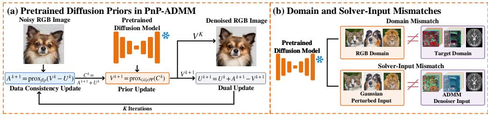  
Figure 1: Two sources of mismatch when using pretrained image priors in scientific imaging: differences between the pretraining and target image domains, and differences between score-model training inputs and ADMM denoiser inputs.

Diffusion-based PnP methods and ADMM variants often use diffusion models pretrained on natural RGB images (Zhu et al., 2023; Wu et al., 2024; Zhang et al., 2025; Shrestha & Fu, 2026). Figure 1(a) illustrates how a pretrained diffusion model supplies the prior update within ADMM. Applying such priors to scientific imaging can introduce two distinct mismatches, illustrated in Figure 1(b). First, natural RGB images differ from scientific images in their image statistics and representations, creating a mismatch between the pretraining and target domains. Adapting these priors to modalities such as hyperspectral imaging and MRI may therefore require additional representation or model adaptation (Pang et al., 2024; Xiao et al., 2025; Gao & Zhou, 2024). Second, even within the same modality, ADMM denoiser inputs need not follow the Gaussian perturbation distributions used to train score models, because they also reflect dual feedback and solver-dependent errors. AC–DC mitigates this mismatch by adapting solver inputs to a pretrained score model through noise injection and conditional Langevin correction (Shrestha & Fu, 2026). This motivates a complementary direction: learning score corrections directly from observation-derived ADMM states, so that their statistics inform the prior update without requiring an externally pretrained model.

To address these mismatches in scientific image restoration, we introduce S3-PnP for settings without domain-matched pretrained priors. The framework learns a self-supervised score approximation at test time from ADMM denoiser inputs generated by the available observations. The learned score corrects the input to the analytical prior update, combining observation-adapted state statistics with analytical regularization. Training requires neither clean targets nor externally pretrained weights. Under a matched quadratic denoising model with ideal score corrections, we establish sufficient conditions for convergence of the corrected ADMM iterations and lower expected reconstruction error relative to the matched analytical ADMM baseline. Because structured interference may enter the learned state statistics, a structure-guided learning strategy combines complementary orthogonal projections with sequential training. We evaluate S3-PnP on reference-guided HSI restoration, single-image HSI denoising, and MRI denoising. Our contributions are:

• Self-supervised score prior learning. For scientific image restoration, S3-PnP learns score corrections from ADMM states at test time to modify the analytical prior input. Training requires neither clean targets nor externally pretrained weights.

• Convergence and reconstruction error analysis. We establish sufficient conditions for S3-PnP to converge and achieve lower expected reconstruction error than matched analytical ADMM, assuming an ideal score and quadratic data fidelity.

• Score learning in complementary orthogonal subspaces. We learn and independently control score corrections in complementary orthogonal subspaces, enabling separate treatment of corrections associated with structured interference.

## 2 RELATED WORK

Plug-and-Play and Generative Priors for Image Restoration. PnP combines denoisers with observation-model updates (Venkatakrishnan et al., 2013), with subsequent analyses covering fixedpoint convergence, Lipschitz conditions, and proximal denoiser constructions (Chan et al., 2017; Ryu et al., 2019; Hurault et al., 2022). For RGB restoration, DDRM uses spectral decompositions of linear observation operators (Kawar et al., 2022), while DDNM uses range–null-space decomposition to enforce data consistency (Wang et al., 2023). DPS and ΠGDM guide diffusion sampling through approximate measurement likelihoods (Chung et al., 2023; Song et al., 2023). DiffPIR combines diffusion denoising with half-quadratic splitting (Zhu et al., 2023), and PnP-DM uses split Gibbs sampling for likelihood and prior updates (Wu et al., 2024). PnP-Flow constructs time-dependent denoisers from pretrained flow-matching models (Martin et al., 2025), while CM4IR uses consistency models for few-step restoration (Garber & Tirer, 2025). ADMMDiff coordinates generative priors and guidance within ADMM (Zhang et al., 2025). For non-RGB imaging, PLRDiff and HIR-Diff use low-dimensional spectral representations to apply pretrained three-channel diffusion priors to HSI restoration (Rui et al., 2024; Pang et al., 2024). DM-ZS learns guidance and spectral mapping from PAN and low-resolution HSI observations for pansharpening with a pretrained RGB diffusion model (Xiao et al., 2025). For MRI reconstruction, Chung & Ye (2022) combine an MRI-trained score prior with data-consistency updates, while DDS couples diffusion sampling with conjugategradient updates (Chung et al., 2024). MRPD transfers a natural-image latent diffusion prior to MRI with optional autoencoder adaptation (Gao & Zhou, 2024), and PnP-CM incorporates MRI-trained consistency models into PnP-ADMM (Gulle et al., 2026). Our framework combines learned score¨ corrections with an analytical prior update within ADMM. The corrections act on the prior input, allowing learned information to complement analytical regularization.

Self-Supervised Prior Learning and Adaptation. Self-supervised learning and prior adaptation address limited clean supervision and mismatch with the target restoration problem. Shoushtari et al. (2024) analyze denoiser mismatch in PnP-ADMM and investigate adaptation using target-domain samples. AC–DC addresses the mismatch between pretrained score models and ADMM inputs shaped by dual feedback through Gaussian noise injection and conditional Langevin corrections (Shrestha & Fu, 2026). To learn without clean targets, Noise2Self constructs self-supervised losses using noise independence and masked prediction (Batson & Royer, 2019). For score estimation, DSM connects perturbation-based denoising regression to distribution scores (Vincent, 2011). Noise2Score learns the score of the noisy-image distribution and uses Tweedie’s formula for restoration (Kim & Ye, 2021), while C2S introduces generalized denoising score matching on further-corrupted observations for MRI denoising (Tu et al., 2025). Learning directly from the observations to be restored provides another route to reducing external data requirements. ZS-N2N trains a lightweight network on downsampled pairs from a single noisy image (Mansour & Heckel, 2023), and DDS2M optimizes spatial and spectral networks during reverse diffusion using only the degraded HSI (Miao et al., 2023). For diffusion MRI, DDM2 combines statistical denoising with generative diffusion in a three-stage framework (Xiang et al., 2023); Di-Fusion uses later diffusion steps and adaptive sampling in a single-stage self-supervised framework (Wu et al., 2025). We learn score corrections at test time from ADMM states generated by the available observations. These corrections modify the input to an analytical prior update, combining observation-driven learning with analytical regularization without externally pretrained weights.

## 3 METHOD

## 3.1 SELF-SUPERVISED SCORE APPROXIMATION FROM ADMM ITERATES

Analytical priors in ADMM capture structures such as low rank and sparsity, but may not fully describe the statistics of the denoiser inputs generated during optimization. These statistics can complement analytical regularization, helping suppress noise while preserving image content. Therefore, $\mathrm { \bf \dot { S } } ^ { 3 }$ -PnP learns an implicit regularization correction from ADMM denoiser inputs generated by the current observations. We estimate this correction through self-supervised score regression without externally pretrained weights and apply it before the analytical prior update.

Self-supervised score learning. Firstly, we run Eq. (2) with its analytical prior update and collect the denoiser inputs $C ^ { k } = A ^ { k + \top } + U ^ { k }$ into a training set B to capture observation-dependent state statistics. Each state $C \in B$ is normalized as $Z = \bar { \mathcal { S } } ( C ) = ( \bar { C } - m ) / s$ , using fixed medians m and positive scales s estimated from B. Then, we construct the perturbed state $Z _ { t } = Z + \sqrt { \Delta _ { t } } \epsilon$ where $\epsilon \sim \mathcal { N } ( 0 , I )$ is independent of Z and $\Delta _ { t } > 0$ is the artificial perturbation variance. In order to formulate a correction direction from these state statistics, let $p _ { t }$ denote the density of $Z _ { t }$ and define the state energy $R _ { t } ( z ) = - \log p _ { t } ( z )$ . The score of the perturbed state distribution is its log-density gradient, $\nabla _ { z } \log { p _ { t } ( z ) } = - \nabla _ { z } R _ { t } ( z )$ , which provides a correction direction reflecting the reference-state statistics. Since $p _ { t }$ is unknown, we estimate this score through self-supervised regression using the collected states and their artificial perturbations. Specifically, we build on the regression principle of generalized denoising score matching (GDSM) (Tu et al., 2025). The following lemma establishes the relationship between its optimal restoration predictor and the state score, providing the basis for learning the required correction without clean training targets.

Lemma 1. Under the state construction andfixed normalization above, assume $\mathbb { E } \Vert Z \Vert ^ { 2 } < \infty$ . For fixed t and $\kappa _ { t } > \Delta _ { t } > 0$ , consider the GDSM interpolation loss

$$
\mathcal { L } _ { \mathrm { G D S M } } ( \widehat { Z } ; t ) = \mathbb { E } \bigg \lvert \bigg \lvert \frac { \Delta _ { t } } { \kappa _ { t } } \widehat { Z } ( Z _ { t } , t ) + \left( 1 - \frac { \Delta _ { t } } { \kappa _ { t } } \right) Z _ { t } - Z \bigg \rvert \bigg \lvert ^ { 2 } .\tag{3}
$$

Its minimizer over square-integrable restoration predictors satisfies, almost surely,

$$
\widehat { Z } ^ { \star } ( Z _ { t } , t ) = Z _ { t } + \kappa _ { t } s _ { t } ^ { \star } ( Z _ { t } ) ,\tag{4}
$$

where $s _ { t } ^ { \star } = \nabla$ log $p _ { t } = - \nabla R _ { t }$ . Moreover, $\mathbb { E } [ Z \mid Z _ { t } ] = Z _ { t } + \Delta _ { t } s _ { t } ^ { \star } ( Z _ { t } )$ . Ifadditionally $Z = Z _ { 0 } +$ $\sigma _ { 0 } \epsilon _ { 0 }$ , where $Z _ { 0 }$ denotes the underlying clean state in normalized coordinates, $\sigma _ { 0 } > 0 , \epsilon _ { 0 } \sim \mathcal { N } ( 0 , I )$ , and $Z _ { 0 } , \epsilon _ { 0 } ,$ ϵ are mutually independent, choosing $\kappa _ { t } = \sigma _ { 0 } ^ { 2 } + \Delta _ { t } \ g i \nu e s \ \widehat { Z } ^ { \star } ( Z _ { t } , t ) = \mathbb { E } [ Z _ { 0 } \mid Z _ { t } ]$

See Appendix A.1 for the proof.

To learn the state score directly, we parameterize the restoration predictor as $\widehat { Z } _ { \theta } ( Z _ { t } , t ) = Z _ { t } +$ $\kappa _ { t } s _ { \theta } ( Z _ { t } , t )$ in $\operatorname { E q . } ( 4 )$ , where $\theta$ denotes the trainable parameters of the correction network. When training a shared network across perturbation levels, differences in regression-error scale can affect their relative contributions to optimization. We therefore use noise-level-dependent normalization of the scaled correction error and express the resulting objective as weighted score regression. For fixed t, before task-specific output processing, the GDSM interpolation loss satisfies

$$
\mathcal { L } _ { \mathrm { G D S M } } ( \widehat { Z } _ { \theta } ; t ) = \frac { \Delta _ { t } ^ { 2 } } { w ( t ) } \mathcal { L } _ { \mathrm { s c o r e } } ( \theta ; t ) = \frac { \Delta _ { t } ^ { 2 } } { w ( t ) } \mathbb { E } \Big [ w ( t ) \big | \big | s _ { \theta } ( Z _ { t } , t ) - \Delta _ { t } ^ { - 1 } ( Z - Z _ { t } ) \big | \big | ^ { 2 } \Big ] .\tag{5}
$$

Here $w ( t ) = \kappa _ { t } ^ { 2 } ( N \gamma \sigma _ { t } ^ { 2 } ) ^ { - 1 }$ , where $N$ is the number of tensor entries per sample, $\gamma > 0$ controls the loss scale, and $\sigma _ { t } > 1$ specifies the perturbation level. For each fixed t, the factor $\Delta _ { t } ^ { 2 } / w ( t )$ is positive and independent of $\theta ,$ , so the two objectives share the same minimizer under this parameterization. Training uses $\mathcal { L } _ { \mathrm { s c o r e } }$ averaged over the sampled perturbation levels, with $w ( t )$ determining their relative emphasis.

We then use the learned score to correct the input to the analytical prior update. With $Z = { \mathcal { S } } ( C )$ , the corrected operator is

$$
\mathcal { C } _ { k } ( C ) = \mathcal { T } _ { k } \big ( S ^ { - 1 } [ Z + \beta _ { k } \kappa _ { t _ { k } } s _ { \theta } ( Z , t _ { k } ) ] \big ) .\tag{6}
$$

Here $\beta _ { k } \geq 0$ controls the correction strength, $\kappa _ { t _ { k } }$ is the score-scaling coefficient introduced in Lemma $1 , t _ { k }$ specifies the smoothing level, and $\mathcal { T } _ { k }$ is the analytical prior update. For the ideal score, $s _ { t _ { k } } ^ { \star } = - \nabla R _ { t _ { k } }$ , so the correction is a gradient step on the state energy in normalized coordinates. Setting $\beta _ { k } = 0$ recovers the analytical ADMM solver in $\operatorname { E q . } \left( 2 \right)$ . We refer to the resulting ADMM framework with self-supervised score corrections as $\mathsf { S } ^ { 3 } – \mathsf { P n P }$

Convergence and reconstruction error. Next, we establish sufficient conditions under which the corrected ADMM algorithm converges and its limiting estimate has lower expected reconstruction error than that of analytical ADMM. The analysis assumes a matched statistical model with an ideal score, fixed operators, and positive-definite quadratic fidelity.

Theorem 1. Under the clean-state and moment assumptions of Lemma 1, let $A _ { 0 } = S ^ { - 1 } ( Z _ { 0 } ) , Y =$ $S ^ { - 1 } ( Z _ { t } )$ . Consider ADMM with fixed $\rho > 0 , H = H ^ { * } \succsim 0$ , and $f ( A ) = { \textstyle { \frac { 1 } { 2 } } } \langle A - Y , H ( A - Y ) \rangle$ . For $\beta _ { k } \equiv \beta \in [ 0 , 1 ]$ , use $V ^ { k + 1 } = \mathcal { T } ( C ^ { k } { + \beta } d _ { t } ( C ^ { k } ) )$ , where the ideal correction $d _ { t } ( C ) = \kappa _ { t } s \odot s _ { t } ^ { \star } ( S ( C ) )$ is L-Lipschitz. Set $r _ { H } = \mathrm { m a x } _ { j } \left| ( \rho - \lambda _ { j } ( \dot { H } ) ) / ( \rho + \lambda _ { j } ( H ) ) \right|$ , where $\lambda _ { j } ( H ) > 0$ are the eigenvalues of $H .$

(i) Convergence. Let $C _ { \beta } ^ { k } = A _ { \beta } ^ { k + 1 } + U _ { \beta } ^ { k }$ denote the ADMM denoiser input at iteration k with correction strength β. I $\dot { \boldsymbol { r } } _ { H } ( 1 + 2 \beta L ) < 1$ , the iterates converge from any finite initialization and satisfy

$$
\| C _ { \beta } ^ { k } - C _ { \beta } ^ { \star } \| \leq q _ { \beta } ^ { k } \| C _ { \beta } ^ { 0 } - C _ { \beta } ^ { \star } \| ,\tag{7}
$$

where $C _ { \beta } ^ { \star }$ is the unique fixed point of the denoiser-input iteration and $q _ { \beta } = { \textstyle { \frac { 1 } { 2 } } } [ 1 + r _ { H } ( 1 + 2 \beta L ) ] < 1$ Denote the common limit of the primal iterates $A _ { \beta } ^ { k }$ and $V _ { \beta } ^ { k }$ by $A _ { \beta } ^ { \star }$

(ii) Error improvement. Under the same stability condition, additionally assume $\| { \mathcal { T } } ( Q ) - Q \| \leq b$ for all $Q ,$ with $b \geq 0$ . Let $a _ { t } \ = \ ( \mathbb { E } \| Y - \mathbb { E } [ A _ { 0 } \ | \ Y ] \| ^ { 2 } ) ^ { 1 / 2 }$ , with $\delta _ { \beta } , \ c _ { \beta }$ , and $b _ { H }$ defined in Appendix A.2. For $\beta > 0 , \mathrm { i f } \delta _ { \beta } < 1$ and $c _ { \beta } a _ { t } + b _ { H } / ( 1 - \delta _ { \beta } ) < a _ { t } - b _ { H }$ , then

$$
{ \mathbb E } \| A _ { \beta } ^ { \star } - A _ { 0 } \| ^ { 2 } < { \mathbb E } \| A _ { \mathrm { o f f } } ^ { \star } - A _ { 0 } \| ^ { 2 } .\tag{8}
$$

Here $A _ { \mathrm { o f f } } ^ { \star }$ is the converged estimate of the analytical ADMM solver in Eq. (2), recovered by setting $\beta = 0$ while keeping the data term, analytical map, and penalty unchanged.

Appendix A.2 gives the remaining constants and proof. We further examine the theoretical predictions on convergence and reconstruction error through controlled experiments in Section 4.4 and Appendix C.1. In practical imaging, structured interference may persist in the reference states and be reflected in the learned score. Therefore, we introduce structure-guided score corrections in Section 3.2.

## 3.2 SELF-SUPERVISED SCORE LEARNING AND $S ^ { 3 } .$ -PNP INFERENCE

The previous subsection described how the state score corrects the input to the analytical prior update. Here, we explain how to learn these corrections, following the two procedures in Figure 2: full-space learning and structure-guided learning. Full-space learning estimates corrections over the entire space, while structure-guided learning separately controls correction components associated with structured interference. For full-space learning, we use the lower module with $P _ { s } = 0 , P _ { q } = I$ and $\beta _ { s } = 0$ . Training begins by running analytical ADMM without learned corrections to collect denoiser inputs $C ^ { k } = A ^ { \ k + 1 } + { \cal U } ^ { k }$ into a state training set $B _ { 0 }$ . We then use these states and their artificial perturbations to train the full-space network $D _ { g }$ through self-supervision, as summarized in Algorithm 1. After training, we freeze the network and add its correction to the current state before the analytical prior update during inference.

However, structured interference, such as column stripes in hyperspectral images, can remain in the ADMM states used for full-space learning and influence the learned score. To control stripe-related corrections separately, we use imaging knowledge to construct a subspace associated with column stripes and its orthogonal complement. These subspaces are represented by orthogonal projectors $P _ { s }$ and $P _ { g } = I - P _ { s }$ s, satisfying $\bar { P } _ { s } + P _ { g } = I$ and $P _ { s } \dot { P } _ { q } = 0$ . The two correction components are then learned separately, with their strengths adjusted independently. For a fixed reference-state distribution, let $s ^ { \star }$ denote the ideal score-induced correction and define $s _ { i } ^ { \star } = P _ { i } s ^ { \star } \mathrm { f o r } i \in \{ s , g \} \quad$ . The correction then decomposes as

$$
s ^ { \star } = P _ { s } s ^ { \star } + P _ { g } s ^ { \star } = s _ { s } ^ { \star } + s _ { g } ^ { \star } .\tag{9}
$$

The projector construction is detailed in Appendix B.4. For structure-guided learning, we use two lightweight conditional U-Nets, $D _ { s }$ and $D _ { g }$ , with the same architecture and independent parameters $\theta _ { s }$ and $\theta _ { g } .$ . Following the orange path in Figure 2, we first train the structure network $D _ { s }$ on the state training set $B _ { 0 }$ generated by analytical ADMM. We then freeze this network and rerun ADMM with its correction enabled to collect a new state training set $\boldsymbol { B } _ { 1 }$ for training the complementary network $D _ { g }$ . The two stages use their respective fixed normalizations and reference-state distributions. We train each network using the self-supervised objective

$$
{ \mathcal { L } } _ { i } = { \mathcal { L } } _ { \mathrm { s c o r e } , i } + \lambda _ { \mathrm { a u x } } { \mathcal { L } } _ { \mathrm { a u x } , i } , \qquad i \in \{ s , g \} ,\tag{10}
$$

where the score-regression term follows Eq. (5), with task-specific output processing and auxiliary losses detailed in Appendix B. During inference, the networks, normalizations, and deployment projectors remain fixed. The active networks process the same ADMM input $C ^ { k }$ . Let $s _ { i } ( \bar { C } ^ { k } , \bar { t } _ { k } ; \theta _ { i } )$ denote the learned correction in the original coordinates after rescaling, output processing, and projection by $P _ { i }$ . The score-scaling factor $\kappa _ { t _ { k } }$ is included in $s _ { i } .$ . When $\beta _ { i } = 0 .$ , branch i is skipped and its correction is set to zero. As illustrated on the right of Figure 2, these corrections are combined before a single analytical prior update:

$$
V ^ { k + 1 } = \mathcal { T } _ { k } \bigl ( C ^ { k } + \beta _ { s } s _ { s } ( C ^ { k } , t _ { k } ; \theta _ { s } ) + \beta _ { g } s _ { g } ( C ^ { k } , t _ { k } ; \theta _ { g } ) \bigr ) .\tag{11}
$$

Here $\beta _ { s } , \beta _ { g } \geq 0$ control the correction strengths, while the data and dual updates follow $\operatorname { E q . } \left( 2 \right)$ Setting both gains to zero recovers the matched analytical ADMM solver. Algorithms 2 and 3 summarize sequential training and unified inference, respectively.

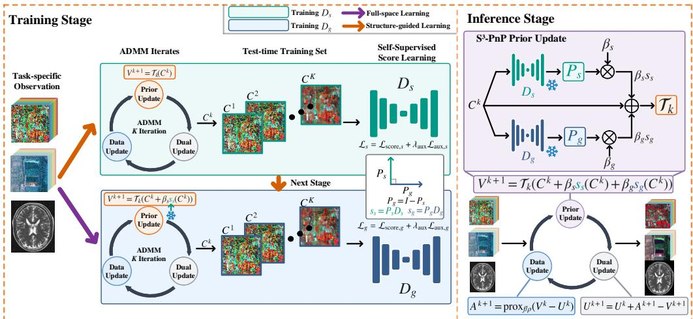

Figure 2: Training and inference of $\mathrm { S ^ { 3 } \mathrm { - P n P } } .$ . Purple arrows indicate full-space learning with $P _ { s } = 0$ $\bar { P _ { g } } = I ,$ , and $\beta _ { s } = 0 .$ . Orange arrows indicate structure-guided learning: $D _ { s }$ is trained and frozen, and its correction is enabled to collect a new state training set for $D _ { g }$ . At inference, active corrections are evaluated at the same ADMM input and combined before a single analytical prior update. Snowflakes denote frozen networks.  
Algorithm 1 LEARNSCORE $( B , i )$ Algorithm $3 \mathrm { S } ^ { 3 } .$ PnP Inference   
Input: State training set ${ \overline { { B , } } }$ branch i, M Input: Noisy observations, $\overline { { \{ \theta _ { i } , \beta _ { i } \} _ { i \in \{ s , g \} } , P _ { s } , \rho , } }$   
1: Initialize $\theta _ { i }$ K, {tk}   
2: for $n = 1 , \ldots , M$ do 1: Initialize $V ^ { 0 } , U ^ { 0 } , f$ and $\mathcal { T } _ { k }$   
3: Sample $Z$ from $\boldsymbol { B } , t , \epsilon \sim \mathcal { N } ( 0 , I )$ 2: if full-space correction then   
4: $Z _ { t } \gets Z + \sqrt { \Delta _ { t } } \epsilon$ 3: $P _ { s }  0 , \quad P _ { g }  I , \quad \beta _ { s }  0$   
5: $w ( t ) \gets \dot { \kappa _ { t } ^ { 2 } ( N \gamma \sigma _ { t } ^ { 2 } ) ^ { - 1 } }$ 4: Freeze $\theta _ { g }$ ▷ Alg. 1   
6: $\mathcal { L } _ { i } \gets \mathcal { L } _ { \mathrm { s c o r e } , i } + \lambda _ { \mathrm { a u x } } \mathcal { L } _ { \mathrm { a u x } , i }$ 5: else   
7: $\theta _ { i } \gets \mathrm { A d a m } ( \theta _ { i } , \nabla _ { \theta _ { i } } \mathcal { L } _ { i } )$ 6: Fix $P _ { s } ; P _ { g }  I - P _ { s }$   
8: end for 7: Freeze $( \theta _ { s } , \theta _ { g } )$ ▷ Alg. 2   
9: return $\theta _ { i }$ 8: end if   
$\triangleright$ Trained parameters remain fixed   
Algorithm 2 Structure-guided Training 9: for $k = 0 , \ldots , K - 1$ do   
Input: Visible observations, $\overline { { { P _ { s } , P _ { g } = I - P _ { s } , } } }$ 10: $A ^ { k + 1 } \xleftarrow { } \operatorname { p r o x } _ { f / \rho } ( V ^ { k } - U ^ { k } )$   
$\beta _ { s } > 0$ 11: $C ^ { k } \gets A ^ { k + 1 } + \dot { U } ^ { k }$   
1: Run ADMM via Eq. (11), $\beta _ { s } = \beta _ { g } = 0$ 12: $s _ { s } ^ { k } \gets 0 , \quad s _ { q } ^ { k } \gets 0$   
2: $B _ { 0 } \gets \{ C ^ { k } \} _ { k \in { \mathcal K } }$ 13: for $i \in \{ s , g \}$ with $\beta _ { i } > 0$ do   
3: $\theta _ { s } \gets$ LEARNSCORE $( B _ { 0 } , s )$ ▷ Alg. 1 14: $s _ { i } ^ { k } \gets s _ { i } ( C ^ { k } , t _ { k } ; \theta _ { i } )$   
4: Freeze $\theta _ { s }$ 15: end for   
5: Rerun ADMM via Eq. (11) with $\theta _ { s }$ $\beta _ { g } = 0$ 16: $V ^ { k + 1 } \gets \mathcal { T } _ { k } ( C ^ { k } + \beta _ { s } s _ { s } ^ { k } + \beta _ { g } s _ { g } ^ { k } )$   
6: $B _ { 1 } \gets \{ C ^ { k } \} _ { k \in { \mathcal { K } } }$ 17: $U ^ { k + 1 } \gets U ^ { k } + A ^ { k + 1 } - V ^ { k + 1 }$   
7: $\theta _ { g } \gets \bar { \mathrm { L E A R N S C O R E } } ( \mathcal { B } _ { 1 } , g )$ ▷ Alg. 1 18: end for   
8: return $\left( \theta _ { s } , \theta _ { g } \right)$ 19: return $\widehat { A } = V ^ { K }$

## 4 EXPERIMENTS

We evaluate $\mathbf { S } ^ { 3 } \ – \mathbf { P } \mathbf { n } \mathbf { P }$ on reference-guided HSI restoration, single-image HSI denoising, and MRI denoising. The experiments include quantitative and qualitative comparisons, ablation studies, and controlled tests of the theoretical predictions.

## 4.1 DATASETS AND EXPERIMENTAL SETTINGS

Datasets and Experimental Settings. We evaluate reference-guided hyperspectral restoration on the Dongying dataset from HiPandas (Xu et al., 2025), using a noisy low-resolution HSI as input and a PAN image as guidance. For single-image hyperspectral denoising, we use Qingpu and Xiong’an, with a single noisy HSI as input. Both tasks are evaluated under Gaussian and mixed noise at varying intensity levels. MRI denoising is evaluated on BrainWeb at the official 3%, 5%, and 7% noise levels and on M4Raw using acquired noisy images from all 25 test subjects. For all learning-based methods without pretrained weights, self-supervised training is performed at test time using only the noisy test observations. Dataset and implementation details are provided in Appendix B.5. We report PSNR and SSIM for all tasks, supplemented by SAM and ERGAS for both hyperspectral tasks; higher PSNR/SSIM and lower SAM/ERGAS indicate better performance.

Baselines. For reference-guided hyperspectral restoration, we follow the baseline setup of UHiPandas (Xu et al., 2025). Comparisons include UHiPandas and cascaded pipelines constructed from R-PNN (Guarino et al., 2024), HIR-Diff (Pang et al., 2024), PWRCTV (Xu et al., 2024), PLRDiff (Rui et al., 2024), and SwinIR (Liang et al., 2021). For single-image hyperspectral denoising, baselines include BM4D (Maggioni et al., 2013), HLRTF (Luo et al., 2022), RCTV (Peng et al., 2022), DDS2M (Miao et al., 2023), LRTFR (Luo et al., 2024), HIR-Diff (Pang et al., 2024), and CF-INR (Yu et al., 2026). For MRI denoising, baselines include Noise2Self (Batson & Royer, 2019), Noise2Void (Krull et al., 2019), Noisier2Noise (Moran et al., 2020), R2R (Pang et al., 2021), Noise2Score (Kim & Ye, 2021), ZS-N2N (Mansour & Heckel, 2023), C2S (Tu et al., 2025), and DRDD (Lin et al., 2026). In our comparisons, HIR-Diff, PLRDiff, and DRDD use pretrained diffusion weights, whereas DDS2M performs self-supervised learning during reverse diffusion and C2S trains a denoising predictor through generalized denoising score matching.

## 4.2 QUANTITATIVE AND QUALITATIVE RESULTS

Quantitative comparisons. Tables 1–3 and Appendix C.2 summarize the results for the three restoration tasks. For reference-guided HSI restoration, S3-PnP achieves better average restoration performance than the compared cascaded methods and UHiPandas in both noise groups, with improved spectral fidelity under mixed noise. Similarly, for single-image HSI denoising on Qingpu, it outperforms the reported baselines under both Gaussian and mixed noise. For MRI denoising, S3-PnP achieves the best reported average performance at all three BrainWeb noise levels. On M4Raw, S3-PnP learns only at test time and achieves results comparable to pretrained C2S. S3-PnP generally outperforms the evaluated pretrained diffusion methods and the self-supervised diffusion method.

Table 1: Reference-guided HSI restoration on Dongying. Best in bold; second best underlined.
<table><tr><td></td><td colspan="4">Gaussian Mean</td><td colspan="4">Mixed Mean</td></tr><tr><td>Method</td><td>PSNR ↑</td><td></td><td>SSIM↑ SAM↓</td><td>ERGAS ↓</td><td>PSNR↑</td><td>SSIM↑</td><td>SAM↓</td><td>ERGAS↓</td></tr><tr><td>R-PNN + HIR-Diff</td><td>30.83</td><td>0.7226</td><td>8.80</td><td>22.55</td><td>29.83</td><td>0.7139</td><td>11.44</td><td>31.40</td></tr><tr><td>HIR-Diff + SwinIR</td><td>32.42</td><td>0.7431</td><td>7.00</td><td>19.42</td><td>29.76</td><td>0.6776</td><td>11.33</td><td>34.18</td></tr><tr><td>HIR-Diff + R-PNN</td><td>35.32</td><td>0.9199</td><td>6.08</td><td>15.35</td><td>33.12</td><td>0.8995</td><td>9.75</td><td>29.67</td></tr><tr><td>PWRCTV + PLRDiff</td><td>36.13</td><td>0.8675</td><td>6.23</td><td>21.54</td><td>32.76</td><td>0.7747</td><td>13.59</td><td>153.69</td></tr><tr><td>PWRCTV + SwinIR</td><td>35.55</td><td>0.8773</td><td>4.66</td><td>14.65</td><td>33.80</td><td>0.8403</td><td>9.90</td><td>160.43</td></tr><tr><td>UHiPandas</td><td>38.24</td><td>0.9368</td><td>4.05</td><td>10.87</td><td>37.17</td><td>0.9294</td><td>7.10</td><td>32.91</td></tr><tr><td>S³-PnP (Ours)</td><td>39.75</td><td>0.9497</td><td>3.45</td><td>9.20</td><td>38.38</td><td>0.9438</td><td>4.53</td><td>11.24</td></tr></table>

Table 2: Single-image HSI denoising on Qingpu. Best in bold; second best underlined.
<table><tr><td rowspan="2">Method</td><td colspan="4">Gaussian Mean</td><td colspan="4">Mixed Mean</td></tr><tr><td>PSNR ↑</td><td>SSIM↑</td><td>SAM↓</td><td>ERGAS↓</td><td>PSNR ↑</td><td>SSIM ↑</td><td>SAM↓</td><td>ERGAS↓</td></tr><tr><td>BM4D</td><td>33.95</td><td>0.8214</td><td>3.61</td><td>9.18</td><td>24.56</td><td>0.4833</td><td>17.50</td><td>68.67</td></tr><tr><td>HLRTF</td><td>34.94</td><td>0.7733</td><td>3.07</td><td>8.97</td><td>31.23</td><td>0.7944</td><td>27.69</td><td>117.96</td></tr><tr><td>RCTV</td><td>28.59</td><td>0.5180</td><td>7.34</td><td>19.50</td><td>34.01</td><td>0.8741</td><td>5.49</td><td>16.13</td></tr><tr><td>DDS2M</td><td>39.97</td><td>0.9504</td><td>1.40</td><td>4.21</td><td>29.79</td><td>0.8536</td><td>13.12</td><td>53.51</td></tr><tr><td>LRTFR</td><td>37.24</td><td>0.9020</td><td>1.78</td><td>6.17</td><td>30.84</td><td>0.8442</td><td>27.00</td><td>114.55</td></tr><tr><td>HIR-Diff</td><td>38.47</td><td>0.9157</td><td>1.68</td><td>4.85</td><td>29.06</td><td>0.8260</td><td>13.20</td><td>55.59</td></tr><tr><td>CF-INR</td><td>40.32</td><td>0.9541</td><td>1.36</td><td>4.01</td><td>35.86</td><td>0.9339</td><td>2.62</td><td>8.50</td></tr><tr><td>S³-PnP (Ours)</td><td>40.47</td><td>0.9562</td><td>1.33</td><td>3.95</td><td>37.88</td><td>0.9433</td><td>1.89</td><td>5.34</td></tr></table>

Qualitative comparisons. Figure 3 presents visual comparisons for the three restoration tasks. For reference-guided HSI restoration on Dongying, S3-PnP recovers clearer spatial boundaries and colors closer to the reference, while several cascaded methods exhibit color shifts or residual artifacts. For single-image HSI denoising on Qingpu, it suppresses noise while preserving fine spatial structures,

Table 3: MRI denoising. Best in bold; second best underlined.
<table><tr><td rowspan="3">Method</td><td colspan="6">BrainWeb</td><td colspan="6">M4Raw</td></tr><tr><td colspan="2">3%</td><td colspan="2">5%</td><td colspan="2">7%</td><td colspan="2">T1</td><td colspan="2">T2</td><td colspan="2">FLAIR</td></tr><tr><td>PSNR</td><td>SSIM</td><td>PSNR</td><td>SSIM</td><td>PSNR</td><td>SSIM</td><td>PSNR</td><td>SSIM</td><td>PSNR</td><td>SSIM</td><td>PSNR</td><td>SSIM</td></tr><tr><td>Noise2Self</td><td>31.22</td><td>0.8613</td><td>30.40</td><td>0.8396</td><td>29.49</td><td>0.7952</td><td>29.10</td><td>0.8537</td><td>28.17</td><td>0.8095</td><td>28.94</td><td>0.8150</td></tr><tr><td>Noise2Void</td><td>32.11</td><td>0.8810</td><td>30.40</td><td>0.8522</td><td>29.23</td><td>0.8110</td><td>31.24</td><td>0.8671</td><td>30.45</td><td>0.8392</td><td>30.80</td><td>0.8288</td></tr><tr><td>Noisier2Noise</td><td>34.38</td><td>0.8964</td><td>31.37</td><td>0.8341</td><td>28.90</td><td>0.7410</td><td>31.18</td><td>0.8675</td><td>30.55</td><td>0.8435</td><td>31.17</td><td>0.8356</td></tr><tr><td>R2R</td><td>34.02</td><td>0.8011</td><td>32.03</td><td>0.7879</td><td>29.50</td><td>0.7292</td><td>30.82</td><td>0.8552</td><td>30.48</td><td>0.8329</td><td>30.97</td><td>0.8187</td></tr><tr><td>Noise2Score</td><td>34.47</td><td>0.8405</td><td>29.95</td><td>0.7621</td><td>26.85</td><td>0.7133</td><td>31.23</td><td>0.8444</td><td>30.48</td><td>0.8139</td><td>31.00</td><td>0.7975</td></tr><tr><td>ZS-N2N</td><td>32.63</td><td>0.7768</td><td>28.73</td><td>0.7165</td><td>26.07</td><td>0.6749</td><td>31.66</td><td>0.8922</td><td>30.96</td><td>0.8729</td><td>31.89</td><td>0.8765</td></tr><tr><td>C2S</td><td>35.21</td><td>0.9287</td><td>33.30</td><td>0.8504</td><td>31.88</td><td>0.8173</td><td>32.61</td><td>0.9152</td><td>32.30</td><td>0.8880</td><td>33.02</td><td>0.8792</td></tr><tr><td>DRDD</td><td>35.03</td><td>0.8188</td><td>30.70</td><td>0.7581</td><td>27.83</td><td>0.7233</td><td>32.43</td><td>0.9108</td><td>31.44</td><td>0.8770</td><td>32.60</td><td>0.8797</td></tr><tr><td>S³-PnP (Ours)</td><td>37.47</td><td>0.9568</td><td>34.65</td><td>0.9413</td><td>32.72</td><td>0.9279</td><td>32.69</td><td>0.9165</td><td>32.31</td><td>0.8922</td><td>32.83</td><td>0.8906</td></tr></table>

whereas some competing methods leave visible noise or blur local details. On BrainWeb and M4Raw, it reduces noise while retaining tissue boundaries and local anatomical structures. The enlarged regions highlight these differences in noise suppression and detail preservation, and the error maps reveal the remaining discrepancies from the references.  
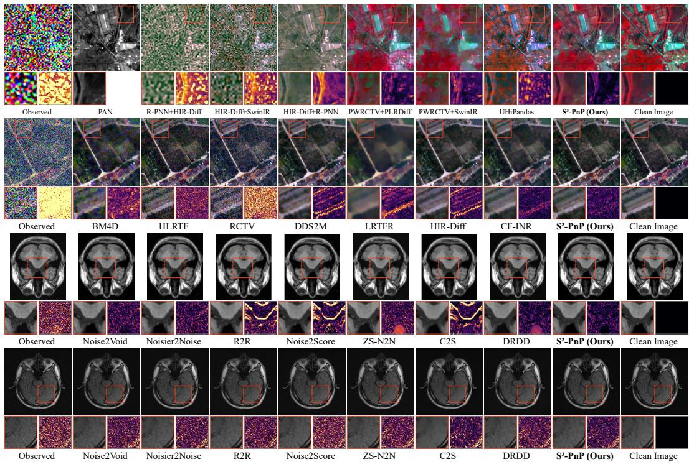  
Figure 3: Qualitative comparisons on Dongying (GNI), Qingpu (G50), BrainWeb (T1, 7% noise), and M4Raw (T1), from top to bottom. Enlarged regions and corresponding error maps are shown below each reconstruction.

## 4.3 ABLATION STUDIES

Contribution of learned corrections. We compare each trained configuration with analytical ADMM at the same prior setting. The analytical reference uses the initial observation-derived estimates, and network weights remain fixed during each correction-strength sweep. Figure 4(a)–(b) shows positive gains throughout the tested Dongying grids. On BrainWeb, all tested settings improve performance at 7% noise, while strong corrections under weaker priors can reduce performance at 3% noise (c)–(d). These results show that learned corrections can improve analytical ADMM, but their strength should be selected jointly with the analytical prior and noise level.

Structure-guided learning. We compare structure-guided and full-space learning at the same prior strength τ = 0.105. The structure-guided configuration achieves larger gains across all tested correction multipliers (Figure 4(b)). Since the training configurations also differ, this comparison does not isolate the contribution of orthogonal projection alone.

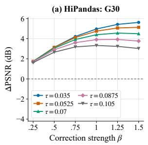

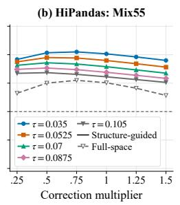

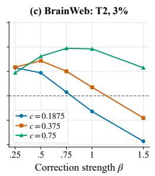

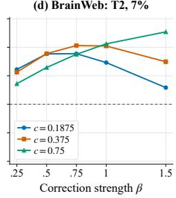  
Figure 4: PSNR gains over analytical ADMM at the same prior setting, varying τ in (a)–(b) and c in (c)–(d). In (b), solid curves denote structure-guided correction and the dashed curve denotes full-space correction at $\tau = 0 . 1 0 5 \mathrm { ; }$ the horizontal axis scales their respective reference gains. BrainWeb results average three development slices per condition.

## 4.4 CONSISTENCY WITH THE THEORETICAL ANALYSIS

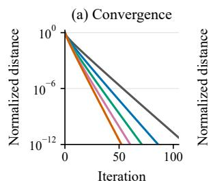

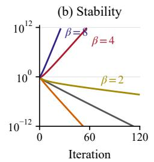

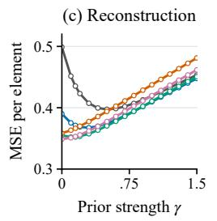

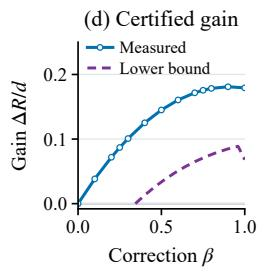  
Figure 5: Controlled experiments with $6 4 \times 6 4$ Gaussian states and ideal scores. (a)–(c) Widespectrum fidelity; (d) near-matched fidelity with a theoretical lower bound on error reduction. The relative prior strength $\gamma = b / a _ { t }$ is fixed at 0.15 in (a)–(b) and 0.1 in (d). Shading in (c)–(d) indicates pointwise 95% confidence intervals.

We examine Theorem 1 using matched solvers with positive-definite quadratic fidelity and exact singular-value soft thresholding. Under wide-spectrum fidelity, the tested corrections accelerate the empirical decay of the normalized distance between trajectories from two initializations (Figure 5(a)): at $\beta = 1$ , the distance reaches $1 0 ^ { - 1 0 }$ in 44 iterations, compared with 93 for analytical ADMM. Some settings outside the sufficient contraction region still show decaying distances, whereas $\beta = 4 , 8 .$ beyond the theorem’s range, produce growing distances (b). Moderate corrections $( \beta = 0 . 2 5 , 0 . 5 )$ reduce reconstruction error across the tested prior strengths, whereas stronger corrections can increase error under strong analytical regularization (c). Under near-matched fidelity, all eight sampled settings satisfying the improvement condition yield empirical gains above the positive theoretical lower bound (d), consistent with the predicted improvement and illustrating the bound’s conservatism. These results support balancing score correction with analytical regularization. Appendix C.1 provides full settings and results across dimensions.

## 5 CONCLUSION

We presented $\mathbf { S } ^ { 3 } – \mathbf { P n P } ,$ , a self-supervised PnP-ADMM framework for scientific image restoration. By learning score corrections from ADMM states generated by the available observations, the framework connects prior learning to the restoration process. These corrections refine the inputs to analytical prior updates, complementing analytical regularization without clean training targets or externally pretrained weights. We further analyzed the convergence and reconstruction error of the corrected ADMM algorithm under ideal scores and quadratic data fidelity. Through task-specific observation models, the framework supports reference-guided HSI restoration, single-image HSI denoising, and MRI denoising. Our work provides a common approach to integrating observation-driven score learning with analytical optimization for scientific imaging.

## AI USE STATEMENT

In this work, we used generative AI tools solely to improve the grammar, clarity, and readability of text written by the authors. Generative AI was not used to generate research ideas, formulate hypotheses or claims, design the methodology or experiments, implement the method, analyze data, or interpret results. The authors reviewed all AI-assisted edits and take full responsibility for the final content of this work.

## REFERENCES

Joshua Batson and Lo¨ıc Royer. Noise2self: Blind denoising by self-supervision. In Proceedings of the 36th International Conference on Machine Learning, volume 97 of Proceedings of Machine Learning Research, pp. 524–533, 2019.

Stephen Boyd, Neal Parikh, Eric Chu, Borja Peleato, and Jonathan Eckstein. Distributed optimization and statistical learning via the alternating direction method of multipliers. Foundations and Trend in Machine Learning, 3(1):1–122, 2011. doi: 10.1561/2200000016.

Stanley H. Chan, Xiran Wang, and Omar A. Elgendy. Plug-and-play ADMM for image restoration: Fixed-point convergence and applications. IEEE Transactions on Computational Imaging, 3(1): 84–98, 2017. doi: 10.1109/TCI.2016.2629286.

Hyungjin Chung and Jong Chul Ye. Score-based diffusion models for accelerated MRI. Medical Image Analysis, 80:102479, 2022. doi: 10.1016/j.media.2022.102479.

Hyungjin Chung, Jeongsol Kim, Michael T. McCann, Marc L. Klasky, and Jong Chul Ye. Diffusion posterior sampling for general noisy inverse problems. In International Conference on Learning Representations, 2023.

Hyungjin Chung, Suhyeon Lee, and Jong Chul Ye. Decomposed diffusion sampler for accelerating large-scale inverse problems. In International Conference on Learning Representations, 2024.

Bradley Efron. Tweedie’s formula and selection bias. Journal ofthe American Statistical Association, 106(496):1602–1614, 2011. doi: 10.1198/jasa.2011.tm11181.

Ziqi Gao and S. Kevin Zhou. Mrpd: Undersampled mri reconstruction by prompting a large latent diffusion model. arXiv preprint arXiv:2402.10609, 2024.

Tomer Garber and Tom Tirer. Zero-shot image restoration using few-step guidance of consistency models (and beyond). In Proceedings of the IEEE/CVF Conference on Computer Vision and Pattern Recognition, pp. 2398–2407, 2025.

Giuseppe Guarino, Matteo Ciotola, Gemine Vivone, and Giuseppe Scarpa. Band-wise hyperspectral image pansharpening using CNN model propagation. IEEE Transactions on Geoscience and Remote Sensing, 62:1–18, 2024. doi: 10.1109/tgrs.2023.3339337.

Merve Gulle, Junno Yun, Ya¨ s¸ar Utku Alc¸alar, and Mehmet Akc¸akaya. PnP-CM: Consistency models as plug-and-play priors for inverse problems. In Proceedings of the IEEE/CVF Conference on Computer Vision and Pattern Recognition, pp. 38464–38474, 2026.

Samuel Hurault, Arthur Leclaire, and Nicolas Papadakis. Proximal denoiser for convergent plugand-play optimization with nonconvex regularization. In Proceedings ofthe 39th International Conference on Machine Learning, volume 162 of Proceedings ofMachine Learning Research, pp. 9483–9505, 2022.

Bahjat Kawar, Michael Elad, Stefano Ermon, and Jiaming Song. Denoising diffusion restoration models. In Advances in Neural Information Processing Systems, volume 35, pp. 23593–23606, 2022. doi: 10.52202/068431-1714.

Kwanyoung Kim and Jong Chul Ye. Noise2Score: Tweedie’s approach to self-supervised image denoising without clean images. In Advances in Neural Information Processing Systems, volume 34, pp. 864–874, 2021.

Alexander Krull, Tim-Oliver Buchholz, and Florian Jug. Noise2Void - learning denoising from single noisy images. In Proceedings of the IEEE/CVF Conference on Computer Vision and Pattern Recognition, pp. 2129–2137, 2019.

Jingyun Liang, Jiezhang Cao, Guolei Sun, Kai Zhang, Luc Van Gool, and Radu Timofte. SwinIR: Image restoration using swin transformer. In Proceedings of the IEEE/CVF International Conference on Computer Vision Workshops, pp. 1833–1844, 2021.

Ziyue Lin, Jiahe Hou, Hongyu Xia, Xinrui Xie, Feifei Wang, Yuyin Zhou, Wei Wang, Jiawei Liu, and Liangqiong Qu. Decoupled residual denoising diffusion models for unified and data efficient image-to-image translation. In Proceedings ofthe IEEE/CVF Conference on Computer Vision and Pattern Recognition, pp. 35967–35977, 2026.

Yisi Luo, Xi-Le Zhao, Deyu Meng, and Tai-Xiang Jiang. HLRTF: Hierarchical low-rank tensor factorization for inverse problems in multi-dimensional imaging. In Proceedings ofthe IEEE/CVF Conference on Computer Vision and Pattern Recognition, pp. 19303–19312, 2022.

Yisi Luo, Xile Zhao, Zhemin Li, Michael K. Ng, and Deyu Meng. Low-rank tensor function representation for multi-dimensional data recovery. IEEE Transactions on Pattern Analysis and Machine Intelligence, 46(5):3351–3369, 2024. doi: 10.1109/TPAMI.2023.3341688.

Matteo Maggioni, Vladimir Katkovnik, Karen Egiazarian, and Alessandro Foi. Nonlocal transformdomain filter for volumetric data denoising and reconstruction. IEEE Transactions on Image Processing, 22(1):119–133, 2013. doi: 10.1109/TIP.2012.2210725.

Youssef Mansour and Reinhard Heckel. Zero-Shot Noise2Noise: Efficient image denoising without any data. In Proceedings ofthe IEEE/CVF Conference on Computer Vision and Pattern Recognition, pp. 14018–14027, 2023.

Segol ´ ene Martin, Anne Gagneux, Paul Hagemann, and Gabriele Steidl. PnP-Flow: Plug-and-play\` image restoration with flow matching. In International Conference on Learning Representations, pp. 45466–45492, 2025.

Yuchun Miao, Lefei Zhang, Liangpei Zhang, and Dacheng Tao. DDS2M: Self-supervised denoising diffusion spatio-spectral model for hyperspectral image restoration. In Proceedings of the IEEE/CVF International Conference on Computer Vision, pp. 12052–12062, 2023.

Nick Moran, Dan Schmidt, Yu Zhong, and Patrick Coady. Noisier2Noise: Learning to denoise from unpaired noisy data. In Proceedings of the IEEE/CVF Conference on Computer Vision and Pattern Recognition, pp. 12061–12069, 2020. doi: 10.1109/cvpr42600.2020.01208.

Li Pang, Xiangyu Rui, Long Cui, Hongzhong Wang, Deyu Meng, and Xiangyong Cao. HIR-Diff: Unsupervised hyperspectral image restoration via improved diffusion models. In Proceedings of the IEEE/CVF Conference on Computer Vision and Pattern Recognition, pp. 3005–3014, 2024.

Tongyao Pang, Huan Zheng, Yuhui Quan, and Hui Ji. Recorrupted-to-recorrupted: Unsupervised deep learning for image denoising. In Proceedings ofthe IEEE/CVF Conference on Computer Vision and Pattern Recognition, pp. 2043–2052, 2021.

Jiangjun Peng, Hailin Wang, Xiangyong Cao, Xinling Liu, Xiangyu Rui, and Deyu Meng. Fast noise removal in hyperspectral images via representative coefficient total variation. IEEE Transactions on Geoscience and Remote Sensing, 60:1–17, 2022. doi: 10.1109/TGRS.2022.3229012.

Xiangyu Rui, Xiangyong Cao, Li Pang, Zeyu Zhu, Zongsheng Yue, and Deyu Meng. Unsupervised hyperspectral pansharpening via low-rank diffusion model. Information Fusion, 107:102325, 2024. doi: 10.1016/j.inffus.2024.102325.

Ernest K. Ryu, Jialin Liu, Sicheng Wang, Xiaohan Chen, Zhangyang Wang, and Wotao Yin. Plugand-play methods provably converge with properly trained denoisers. In Proceedings ofthe 36th International Conference on Machine Learning, volume 97 of Proceedings of Machine Learning Research, pp. 5546–5557, 2019.

Shirin Shoushtari, Jiaming Liu, Edward P. Chandler, M. Salman Asif, and Ulugbek S. Kamilov. Prior mismatch and adaptation in PnP-ADMM with a nonconvex convergence analysis. In Proceedings ofthe 41st International Conference on Machine Learning, volume 235 of Proceedings ofMachine Learning Research, pp. 45154–45182, 2024.

Rajesh Shrestha and Xiao Fu. Taming score-based denoisers in ADMM: A convergent plug-and-play framework. In International Conference on Learning Representations, pp. 13523–13568, 2026.

Jiaming Song, Arash Vahdat, Morteza Mardani, and Jan Kautz. Pseudoinverse-guided diffusion models for inverse problems. In International Conference on Learning Representations, 2023.

Jiachen Tu, Yaokun Shi, and Fan Lam. Score-based self-supervised MRI denoising. In International Conference on Learning Representations, pp. 102262–102293, 2025.

Singanallur V. Venkatakrishnan, Charles A. Bouman, and Brendt Wohlberg. Plug-and-play priors for model based reconstruction. In 2013 IEEE Global Conference on Signal and Information Processing, pp. 945–948, 2013. doi: 10.1109/GlobalSIP.2013.6737048.

Pascal Vincent. A connection between score matching and denoising autoencoders. Neural Computation, 23(7):1661–1674, 2011. doi: 10.1162/NECO a 00142.

Yinhuai Wang, Jiwen Yu, and Jian Zhang. Zero-shot image restoration using denoising diffusion null-space model. In International Conference on Learning Representations, 2023.

Chenxu Wu, Qingpeng Kong, Zihang Jiang, and S. Kevin Zhou. Self-supervised diffusion MRI denoising via iterative and stable refinement. In International Conference on Learning Representations, pp. 98708–98747, 2025.

Zihui Wu, Yu Sun, Yifan Chen, Bingliang Zhang, Yisong Yue, and Katherine L. Bouman. Principled probabilistic imaging using diffusion models as plug-and-play priors. In Advances in Neural Information Processing Systems, volume 37, pp. 118389–118427, 2024. doi: 10.52202/079017-3759.

Tiange Xiang, Mahmut Yurt, Ali B. Syed, Kawin Setsompop, and Akshay Chaudhari. DDM2: Selfsupervised diffusion MRI denoising with generative diffusion models. In International Conference on Learning Representations, 2023.

Jin-Liang Xiao, Ting-Zhu Huang, Liang-Jian Deng, Guang Lin, Zihan Cao, Chao Li, and Qibin Zhao. Hyperspectral pansharpening via diffusion models with iteratively zero-shot guidance. In Proceedings of the IEEE/CVF Conference on Computer Vision and Pattern Recognition, pp. 12669–12678, 2025.

Shuang Xu, Qiao Ke, Jiangjun Peng, Xiangyong Cao, and Zixiang Zhao. Pan-denoising: Guided hyperspectral image denoising via weighted represent coefficient total variation. IEEE Transactions on Geoscience and Remote Sensing, 62:1–14, 2024. doi: 10.1109/tgrs.2024.3450888.

Shuang Xu, Zixiang Zhao, Haowen Bai, Chang Yu, Jiangjun Peng, Xiangyong Cao, and Deyu Meng. Hipandas: Hyperspectral image joint denoising and super-resolution by image fusion with the panchromatic image. In Proceedings of the IEEE/CVF International Conference on Computer Vision, pp. 12002–12011, 2025.

Chang Yu, Yisi Luo, Kai Ye, Xile Zhao, and Deyu Meng. Cross-frequency implicit neural representation with self-evolving parameters. IEEE Transactions on Pattern Analysis and Machine Intelligence, 48(8):9467–9485, 2026. doi: 10.1109/tpami.2026.3679791.

Youyuan Zhang, Zehua Liu, Zenan Li, Zhaoyu Li, James J. Clark, and Xujie Si. Decoupling trainingfree guided diffusion by ADMM. In Proceedings of the IEEE/CVF Conference on Computer Vision and Pattern Recognition, pp. 23292–23302, 2025.

Bo Zhu, Jeremiah Z. Liu, Stephen F. Cauley, Bruce R. Rosen, and Matthew S. Rosen. Image reconstruction by domain-transform manifold learning. Nature, 555(7697):487–492, 2018.

Yuanzhi Zhu, Kai Zhang, Jingyun Liang, Jiezhang Cao, Bihan Wen, Radu Timofte, and Luc Van Gool. Denoising diffusion models for plug-and-play image restoration. In Proceedings of the IEEE/CVF Conference on Computer Vision and Pattern Recognition Workshops, pp. 1219–1229, 2023.

## A PROOFS

## A.1 PROOF OF LEMMA 1

Lemma 1 (GDSM regression on ADMM states; restated). Let $C$ be an ADMM denoiser input drawn from a fixed reference training distribution, and let $Z = { \mathcal { S } } ( C ) = ( C - m ) / s ,$ , where the channel-wise median m and positive scale s are estimated from the training set and fixed; / denotes element-wise division. Assume $\mathbb { E } \Vert Z \Vert ^ { 2 } < \infty .$ . Forfixed t, construct $Z _ { t } = Z + \sqrt { \Delta _ { t } } \epsilon ,$ where $\Delta _ { t } > 0$ and $\epsilon \sim \mathcal { N } ( 0 , I )$ is independent of $Z .$ . Let $p _ { t }$ denote the density of $\Sigma _ { t }$ and define $R _ { t } = - \log p _ { t }$ . For $\kappa _ { t } > \Delta _ { t }$ , consider the GDSM interpolation loss (Tu et al., 2025)

$$
\mathcal { L } _ { \mathrm { G D S M } } ( \widehat { Z } ; t ) = \mathbb { E } \bigg \| \frac { \Delta _ { t } } { \kappa _ { t } } \widehat { Z } ( Z _ { t } , t ) + \left( 1 - \frac { \Delta _ { t } } { \kappa _ { t } } \right) Z _ { t } - Z \bigg \| ^ { 2 } .
$$

Its minimizer over square-integrable restoration predictors satisfies, almost surely,

$$
\widehat { Z } ^ { \star } ( Z _ { t } , t ) = Z _ { t } + \kappa _ { t } s _ { t } ^ { \star } ( Z _ { t } ) ,
$$

where $s _ { t } ^ { \star } = \nabla \log p _ { t } = - \nabla R _ { t }$ . Moreover, $\mathbb { E } [ Z ~ \vert ~ Z _ { t } ] = Z _ { t } + \Delta _ { t } s _ { t } ^ { \star } ( Z _ { t } )$ . If additionally $Z =$ $Z _ { 0 } + \sigma _ { 0 } \epsilon _ { 0 }$ , where $\sigma _ { 0 } > 0 , \epsilon _ { 0 } \sim \mathcal { N } ( 0 , I )$ , and $Z _ { 0 } , \epsilon _ { 0 } ,$ ϵ are mutually independent, choosing $\kappa _ { t } =$ $\sigma _ { 0 } ^ { 2 } + \Delta _ { t }$ gives $\widehat { Z } ^ { \star } ( Z _ { t } , t ) = \mathbb { E } [ Z _ { 0 } \mid Z _ { t } ]$ . For conditional networks, all densities, expectations, and independence assumptions are understood conditional on the same auxiliary inputs.

Proof. Fix t, the reference distribution, and the normalization. Any auxiliary inputs are held fixed throughout. Assume $\mathbb { E } \Vert Z \Vert ^ { 2 } < \infty .$ , and let $Z _ { t } = Z + \sqrt { \Delta _ { t } } \epsilon$ , where $\epsilon \sim \mathcal { N } ( 0 , I )$ is independent of $Z .$ We first characterize the optimal interpolated prediction, then derive its score representation using Tweedie’s identity, and finally establish the clean-state conditional-mean interpretation.

Determine the optimal interpolated prediction. Consider the GDSM loss over all square-integrable restoration predictors ${ \widehat { Z } } \mathbf { i }$

$$
\mathcal { L } _ { \mathrm { G D S M } } ( \widehat { Z } ; t ) = \mathbb { E } \bigg \| \frac { \Delta _ { t } } { \kappa _ { t } } \widehat { Z } ( Z _ { t } , t ) + \left( 1 - \frac { \Delta _ { t } } { \kappa _ { t } } \right) Z _ { t } - Z \bigg \| ^ { 2 } .
$$

Since $\Delta _ { t } / \kappa _ { t } > 0$ and $Z _ { t }$ is square-integrable, the affine transformation from the restoration prediction to its interpolation is invertible within the class of square-integrable predictors. Minimizing the GDSM loss is therefore equivalent to regressing the interpolated prediction onto $Z$ under squared error. By the conditional-mean characterization of optimal squared-error regression, the minimizer satisfies

$$
\mathbb { E } [ Z \mid Z _ { t } ] = \frac { \Delta _ { t } } { \kappa _ { t } } \widehat { Z } ^ { \star } ( Z _ { t } , t ) + \left( 1 - \frac { \Delta _ { t } } { \kappa _ { t } } \right) Z _ { t } .\tag{A.1}
$$

This determines the optimal interpolation. We next solve for the restoration prediction itself.

Derive the score representation of the optimal prediction. Let $p _ { t }$ denote the density of $Z _ { t }$ and define $s _ { t } ^ { \star } = \nabla \log p _ { t }$ . For the independent Gaussian perturbation above, Tweedie’s identity (Efron, 2011) gives

$$
\operatorname { \mathbb { E } } [ Z \mid Z _ { t } ] = Z _ { t } + \Delta _ { t } { s _ { t } ^ { \star } } ( Z _ { t } ) .\tag{A.2}
$$

Substituting this identity into Eq. (A.1) and isolating $\widehat { Z } ^ { \star }$ yields

$$
\begin{array} { r l } & { \widehat { Z } ^ { \star } ( Z _ { t } , t ) = \frac { \kappa _ { t } } { \Delta _ { t } } \mathbb { E } [ Z \mid Z _ { t } ] - \left( \frac { \kappa _ { t } } { \Delta _ { t } } - 1 \right) Z _ { t } } \\ & { \qquad = Z _ { t } + \kappa _ { t } s _ { t } ^ { \star } ( Z _ { t } ) . } \end{array}\tag{A.3}
$$

Thus, the optimal restoration predictor takes the form of the input plus a scaled state score. This form follows from minimizing the interpolation loss, without imposing a score parameterization beforehand. Furthermore, defining $R _ { t } = - \log p _ { t }$ gives $s _ { t } ^ { \star } = - \nabla \bar { R } _ { t }$ , establishing the state-energy interpretation of the ideal correction.

Establish the clean-state conditional-mean interpretation. Under the additional assumption $Z = Z _ { 0 } + \sigma _ { 0 } \epsilon _ { 0 }$ , where $Z _ { 0 } , \epsilon _ { 0 }$ , and ϵ are mutually independent and $\epsilon _ { 0 } \sim \mathcal { N } ( 0 , I )$ , we have

$$
Z _ { t } = Z _ { 0 } + \sigma _ { 0 } \epsilon _ { 0 } + \sqrt { \Delta _ { t } } \epsilon .
$$

The clean state is square-integrable because $Z _ { 0 } = Z - \sigma _ { 0 } \epsilon _ { 0 }$ . The combined noise is Gaussian, independent of $Z _ { 0 }$ , and has covariance $( \sigma _ { 0 } ^ { 2 } + \Delta _ { t } ) I$ . Applying Tweedie’s identity to this observation model therefore gives

$$
\mathbb { E } [ Z _ { 0 } \mid Z _ { t } ] = Z _ { t } + ( \sigma _ { 0 } ^ { 2 } + \Delta _ { t } ) s _ { t } ^ { \star } ( Z _ { t } ) .
$$

The score is unchanged because the marginal distribution of $Z _ { t }$ remains $p _ { t }$ . Choosing $\kappa _ { t } = \sigma _ { 0 } ^ { 2 } + \Delta _ { t }$ and using Eq. (A.3), we conclude that

$$
{ \widehat { Z } } ^ { \star } ( Z _ { t } , t ) = \mathbb { E } [ Z _ { 0 } \mid Z _ { t } ] .
$$

This proves the final statement. Neither the clean-state distribution nor $p _ { t }$ is required to be Gaussian. Thus, the optimal GDSM prediction equals the input plus a scaled state score and, under the additional Gaussian residual assumption and matched coefficient, coincides with the conditional mean of the clean state. □

## A.2 PROOF OF THEOREM 1

We restate the statistical construction and give the constants used in the theorem. Let $Z = Z _ { 0 } + \sigma _ { 0 } \epsilon _ { 0 }$ and $Z _ { t } = Z + \sqrt { \Delta _ { t } } \epsilon$ , where $\sigma _ { 0 } , \Delta _ { t } > 0$ , the two noises are standard Gaussian, and $Z _ { 0 } , \epsilon _ { 0 } , \epsilon$ are mutually independent. Assume $\mathbb { E } \| Z \| ^ { 2 } < \infty$ . Fix the reference distribution, smoothing level, normalization $\mathbf { \bar { \mathcal { S } } } ( C ) = ( C - m ) / s$ with $s > 0$ , and analytical map throughout the iterations and statistical expectations. All statements are conditional on any fixed auxiliary inputs.

The clean state in the original coordinates is $A _ { 0 } = S ^ { - 1 } ( Z _ { 0 } )$ , and its noisy input is $Y = S ^ { - 1 } ( Z _ { t } )$ Thus, the subscript 0 in $A _ { 0 }$ and $Z _ { 0 }$ denotes the same clean state in different coordinates. Define the posterior-mean estimator ${ \bar { A } } ( Y ) = \mathbb { E } [ A _ { 0 } \mid Y ]$ , its distance from the input $a _ { t } = ( \mathbb { E } \| Y - { \bar { A } } ( Y ) \| ^ { 2 } ) ^ { 1 / 2 }$ and the matched coefficient $\kappa _ { t } = \sigma _ { 0 } ^ { 2 } + \Delta _ { t }$ . The ideal score $s _ { t } ^ { \star } = \nabla \log p _ { t }$ induces the originalcoordinate correction and prior map

$$
d _ { t } ( C ) = \kappa _ { t } s \odot s _ { t } ^ { \star } ( S ( C ) ) , \qquad \mathscr { C } _ { \beta } ( C ) = \mathscr { T } ( C + \beta d _ { t } ( C ) ) , \qquad \beta \in [ 0 , 1 ] .
$$

This is $\operatorname { E q . } \left( 6 \right)$ with $T _ { k } \equiv T , t _ { k } \equiv t , \beta _ { k } \equiv \beta _ { }$ , and $s _ { \theta } ( \cdot , t ) = s _ { t } ^ { \star } ; \beta = 0$ disables the correction. Matrices are treated as elements of a finite-dimensional Hilbert space with the Frobenius inner product, and $\| \cdot \| _ { \mathrm { o p } }$ denotes the induced operator norm.

Theorem 1 (Convergence and error improvement under quadratic fidelity). Under the construction above, use exact ADMM with fixed penalty $\rho > 0$ and $f ( A ) = \textstyle { \frac { 1 } { 7 } } \langle \dot { A } - Y , H ( A - Y ) \rangle$ ⟩, where $H = H ^ { * } \succ 0$ is fixed. Suppose $d _ { t }$ is L-Lipschitz and $\mathcal { T } \mathrm { ~ } i s \mathrm { ~ } f i r m l y$ nonexpansive. Define $r _ { H } =$ $\| ( \rho I - H ) ( \rho I + \dot { H } ) ^ { - 1 } \| _ { \mathrm { o p } }$ . For any $\beta \in [ 0 , \bar { 1 } ]$ satisfying

$$
r _ { H } ( 1 + 2 \beta L ) < 1 ,\tag{A.4}
$$

the ADMM iterates convergefrom anyfinite initialization, with

$$
\begin{array} { r } { \| C _ { \beta } ^ { k } - C _ { \beta } ^ { \star } \| \leq q _ { \beta } ^ { k } \| C _ { \beta } ^ { 0 } - C _ { \beta } ^ { \star } \| , \qquad q _ { \beta } = \frac { 1 } { 2 } [ 1 + r _ { H } ( 1 + 2 \beta L ) ] < 1 . } \end{array}\tag{A.5}
$$

Write $A _ { \beta } ^ { \star } = \mathrm { l i m } _ { k } A _ { \beta } ^ { k } = \mathrm { l i m } _ { k } V _ { \beta } ^ { k }$ for the primal limit. Denote the limit with $\beta = 0$ by $A _ { \mathrm { o f f } } ^ { \star }$ , to distinguish the correction-disabled estimatefrom the clean state $A _ { 0 }$

For the risk comparison, additionally assume $\| { \mathcal { T } } ( Q ) - Q \| \leq b$ for all Q. Set $M \ = \ \rho H ^ { - 1 }$ $b _ { H } = \| M \| _ { \mathrm { o p } } b ,$ and $\delta _ { \beta } = \beta L \| M \| _ { \mathrm { o p } } \| I - H / \rho \| _ { \mathrm { o p } }$ . When $\delta _ { \beta } < 1$ , define $c _ { \beta } = \| I - \beta M \| _ { \mathrm { o p } } +$ $\beta \| M \| _ { \mathrm { o p } } \delta _ { \beta } \dot { / } ( 1 - \delta _ { \beta } )$ . For $\beta > 0 ,$ the sufficient gain conditions

$$
\delta _ { \beta } < 1 , \qquad c _ { \beta } a _ { t } + { \frac { b _ { H } } { 1 - \delta _ { \beta } } } < a _ { t } - b _ { H }\tag{A.6}
$$

ensure

$$
{ \mathbb E } \| A _ { \beta } ^ { \star } - A _ { 0 } \| ^ { 2 } < { \mathbb E } \| A _ { \mathrm { o f f } } ^ { \star } - A _ { 0 } \| ^ { 2 } .
$$

The two solvers use the same data term, analytical map, and penalty; only the score correction changes.

Proof. The proof has three parts. First, we identify the useful correction supplied by the ideal score. Second, we establish convergence of the complete ADMM iteration. Third, we control the effect of the analytical map and ADMM feedback to compare the limiting reconstruction risks.

Relating the ideal score correction to the posterior mean. Lemma 1 gives $\mathbb { E } [ Z _ { 0 } \mid Z _ { t } ] = Z _ { t } +$ $\kappa _ { t } s _ { t } ^ { \star } \big ( Z _ { t } \big )$ under the matched coefficient. Since S is fixed, affine, and invertible, conditioning on $Y$ is equivalent to conditioning on $Z _ { t }$

Here $d _ { t } ( Y ) = \kappa _ { t } s \odot s _ { t } ^ { \star } ( S ( Y ) )$ denotes the ideal score correction rescaled to the original coordinates, with s denoting the fixed normalization scale. Inverse normalization multiplies by s and adds $m ,$ so the normalized input-plus-score prediction becomes $Y + d _ { t } ( Y )$ . Using this rescaling and the fact that a fixed affine map commutes with conditional expectation, we obtain

$$
\begin{array} { r l } & { \bar { A } ( Y ) = \mathbb { E } [ A _ { 0 } \mid Y ] } \\ & { \quad \quad = S ^ { - 1 } [ \mathbb { E } [ Z _ { 0 } \mid Z _ { t } ] ] } \\ & { \quad \quad = S ^ { - 1 } [ S ( Y ) + \kappa _ { t } s _ { t } ^ { \star } ( S ( Y ) ) ] } \\ & { \quad \quad = Y + \kappa _ { t } s \odot s _ { t } ^ { \star } ( S ( Y ) ) = Y + d _ { t } ( Y ) . } \end{array}\tag{A.7}
$$

Thus, $d _ { t } ( Y ) = \bar { A } ( Y ) - Y$ : the ideal correction at $Y$ points toward the posterior mean, which minimizes expected squared reconstruction error. Substituting this identity gives

$$
Y + \beta d _ { t } ( Y ) = ( 1 - \beta ) Y + \beta \bar { A } ( Y ) = : M _ { \beta } .\tag{A.8}
$$

The moment assumption makes $A _ { 0 } , Y$ , and ${ \bar { A } } ( Y )$ square-integrable, and $\mathbb { E } \| d _ { t } ( Y ) \| ^ { 2 } = a _ { t } ^ { 2 }$ . The quadratic fidelity is centered at this same Y , so the correction identified here is calibrated to the input used in the risk comparison.

Establishing ADMM convergence. Fix $\beta \in [ 0 , 1 ]$ satisfying Eq. (A.4). Suppress the subscript $\beta$ on intermediate iterates for readability. The prior update is

$$
V ^ { k + 1 } = { \mathcal { C } } _ { \beta } ( C ^ { k } ) = { \mathcal { T } } ( C ^ { k } + \beta d _ { t } ( C ^ { k } ) ) .\tag{A.9}
$$

Write $h = H Y$ . The first-order condition for the exact data update is $H A - h + \rho ( A - V ^ { k } + U ^ { k } ) = 0 ,$ giving

$$
A ^ { k + 1 } = ( H + \rho I ) ^ { - 1 } \big [ h + \rho ( V ^ { k } - U ^ { k } ) \big ] .\tag{A.10}
$$

Using $C ^ { k } = A ^ { k + 1 } + U ^ { k }$ and $\begin{array} { r } { U ^ { k + 1 } = C ^ { k } - V ^ { k + 1 } } \end{array}$ , the next prior input satisfies

$$
\begin{array} { r l } & { C ^ { k + 1 } = A ^ { k + 2 } + U ^ { k + 1 } } \\ & { \qquad = ( H + \rho I ) ^ { - 1 } \big [ h + \rho V ^ { k + 1 } + H U ^ { k + 1 } \big ] } \\ & { \qquad = ( H + \rho I ) ^ { - 1 } \big [ h + H C ^ { k } + ( \rho I - H ) \mathcal { C } _ { \beta } ( C ^ { k } ) \big ] = : \mathcal { F } _ { \beta } ( C ^ { k } ) . } \end{array}\tag{A.11}
$$

To prove convergence, we show that the complete ADMM map $\mathcal { F } _ { \beta }$ contracts distances between inputs. We use a reflected-operator representation (Ryu et al., 2019) to exploit the firm nonexpansiveness of $\tau { : }$ : its reflection $2 \mathcal { T } - I$ is nonexpansive, which allows us to bound the effect of the added score correction. Define $R ( v ) = 2 ( H + \bar { \rho } I ) ^ { - 1 } ( h + \rho v ) - v$ and $R _ { \beta } = 2 \mathcal { C } _ { \beta } - I$ as the reflections of the data and prior updates, respectively. Substitution gives

$$
\begin{array} { r l } & { \frac { 1 } { 2 } \big [ C + R ( R _ { \beta } ( C ) ) \big ] = ( H + \rho I ) ^ { - 1 } \big [ h + \rho R _ { \beta } ( C ) \big ] + \frac { 1 } { 2 } \big [ C - R _ { \beta } ( C ) \big ] } \\ & { \qquad = ( H + \rho I ) ^ { - 1 } \big [ h + \rho ( 2 \mathcal { C } _ { \beta } ( C ) - C ) \big ] + C - \mathcal { C } _ { \beta } ( C ) } \\ & { \qquad = ( H + \rho I ) ^ { - 1 } \big [ h + H C + ( \rho I - H ) \mathcal { C } _ { \beta } ( C ) \big ] = \mathcal { F } _ { \beta } ( C ) . } \end{array}
$$

Thus Eq. (A.11) has the equivalent representation

$$
\begin{array} { r } { \mathcal F _ { \beta } = \frac { 1 } { 2 } ( I + R \circ R _ { \beta } ) , \qquad } \\ { R ( v ) = ( \rho I - H ) ( \rho I + H ) ^ { - 1 } v + 2 ( H + \rho I ) ^ { - 1 } h . } \end{array}\tag{A.12}
$$

We now bound the changes in R and $R _ { \beta }$ separately to establish contraction of $\mathcal { F } _ { \beta }$ . Positive definiteness of H implies

$$
\mathrm { L i p } ( R ) = r _ { H } = \operatorname* { m a x } _ { j } \left| \frac { \rho - \lambda _ { j } ( H ) } { \rho + \lambda _ { j } ( H ) } \right| < 1 .
$$

Firm nonexpansiveness of $\tau$ means $\| T ( x ) - T ( y ) \| ^ { 2 } \leq \langle T ( x ) - { \mathcal { T } } ( y ) , x - y \rangle$ , and therefore $R \tau = 2 \mathcal { T } - I$ is nonexpansive. Using $\mathcal { C } _ { \beta } ( C ) = \mathcal { T } ( \dot { C } + \beta d _ { t } ( C ) )$ and adding and subtracting the corrected input yields

$$
\begin{array} { r l } & { R _ { \beta } ( C ) = 2 \mathcal { C } _ { \beta } ( C ) - C } \\ & { \quad \quad = 2 7 ( C + \beta d _ { t } ( C ) ) - C } \\ & { \quad \quad = \left[ 2 \mathcal { T } ( C + \beta d _ { t } ( C ) ) - ( C + \beta d _ { t } ( C ) ) \right] + \beta d _ { t } ( C ) } \\ & { \quad \quad = R _ { \mathcal { T } } ( C + \beta d _ { t } ( C ) ) + \beta d _ { t } ( C ) . } \end{array}\tag{A.13}
$$

For any two inputs $C , C ^ { \prime }$ , the triangle inequality and nonexpansiveness of $R \tau$ then give

$$
\begin{array} { r l } & { \| R _ { \beta } ( C ) - R _ { \beta } ( C ^ { \prime } ) \| } \\ & { \leq \| R _ { \mathcal { T } } ( C + \beta d _ { t } ( C ) ) - R _ { \mathcal { T } } ( C ^ { \prime } + \beta d _ { t } ( C ^ { \prime } ) ) \| + \beta \| d _ { t } ( C ) - d _ { t } ( C ^ { \prime } ) \| } \\ & { \leq \| ( C - C ^ { \prime } ) + \beta ( d _ { t } ( C ) - d _ { t } ( C ^ { \prime } ) ) \| + \beta \| d _ { t } ( C ) - d _ { t } ( C ^ { \prime } ) \| } \\ & { \leq \| C - C ^ { \prime } \| + 2 \beta \| d _ { t } ( C ) - d _ { t } ( C ^ { \prime } ) \| } \\ & { \leq ( 1 + 2 \beta L ) \| C - C ^ { \prime } \| . } \end{array}\tag{A.14}
$$

The last inequality uses the L-Lipschitz property of $d _ { t }$ . Thus $\mathrm { L i p } ( R _ { \beta } ) \leq 1 + 2 \beta L$ . Combining this bound with $\mathrm { L i p } ( R ) = r _ { H }$ in Eq. (A.12), we obtain

$$
\begin{array} { r l } & { \| \mathcal { F } _ { \beta } ( C ) - \mathcal { F } _ { \beta } ( C ^ { \prime } ) \| } \\ & { = \frac { 1 } { 2 } \big \| ( C - C ^ { \prime } ) + R ( R _ { \beta } ( C ) ) - R ( R _ { \beta } ( C ^ { \prime } ) ) \big \| } \\ & { \leq \frac { 1 } { 2 } \| C - C ^ { \prime } \| + \frac { 1 } { 2 } \| R ( R _ { \beta } ( C ) ) - R ( R _ { \beta } ( C ^ { \prime } ) ) \| } \\ & { \leq \frac { 1 } { 2 } \| C - C ^ { \prime } \| + \frac { r _ { H } } { 2 } \| R _ { \beta } ( C ) - R _ { \beta } ( C ^ { \prime } ) \| } \\ & { \leq \frac { 1 } { 2 } \| C - C ^ { \prime } \| + \frac { r _ { H } } { 2 } ( 1 + 2 \beta L ) \| C - C ^ { \prime } \| } \\ & { = \frac { 1 } { 2 } [ 1 + r _ { H } ( 1 + 2 \beta L ) ] \| C - C ^ { \prime } \| = q _ { \beta } \| C - C ^ { \prime } \| . } \end{array}\tag{A.15}
$$

The inequalities successively use the triangle inequality, the bound for $R ,$ and Eq. (A.14). Since $q _ { \beta } < 1$ , the contraction principle gives a unique fixed point $C _ { \beta } ^ { \star }$ and the linear convergence bound in Eq. (A.5). Continuity of $\mathcal { C } _ { \beta }$ and the ADMM updates then imply $A ^ { k } , V ^ { k } \to A _ { \beta } ^ { \star }$ and $U ^ { k } \to C _ { \beta } ^ { \star } - A _ { \beta } ^ { \star }$ with

$$
A _ { \beta } ^ { \star } = { \mathcal { C } } _ { \beta } ( C _ { \beta } ^ { \star } ) , \qquad \rho C _ { \beta } ^ { \star } = h + ( \rho I - H ) A _ { \beta } ^ { \star } .\tag{A.16}
$$

This also covers $\beta = 0$ , for which $q _ { 0 } = ( 1 + r _ { H } ) / 2 < 1$

Comparing the limiting reconstruction risks. Part 2 establishes the limiting estimates. We now compare their expected reconstruction errors using the posterior mean $\bar { A } ( \breve { Y } ) = \mathbb { E } [ A _ { 0 } \ | \ Y ]$ as a common reference. For any square-integrable estimator ${ \widehat { A } } ( Y )$ , expanding ${ \widehat { A } } ( Y ) - A _ { 0 } =$ $( \widehat { A } ( Y ) - \bar { A } ( Y ) ) + ( \bar { A } ( Y ) - A _ { 0 } )$ gives

$$
\begin{array} { r l } & { \mathbb { E } \| \widehat { A } ( Y ) - A _ { 0 } \| ^ { 2 } = R _ { \mathrm { M M S E } } + \mathbb { E } \| \widehat { A } ( Y ) - \bar { A } ( Y ) \| ^ { 2 } , } \\ & { \qquad R _ { \mathrm { M M S E } } = \mathbb { E } \| \bar { A } ( Y ) - A _ { 0 } \| ^ { 2 } . } \end{array}\tag{A.17}
$$

The cross term vanishes since ${ \mathbb E } [ \bar { A } ( Y ) - A _ { 0 } \ | \ Y ] = 0$ . The two ADMM limits are measurable functions of $Y ,$ as they can be obtained by iterating the fixed continuous maps from a fixed initialization. Their square integrability will be verified below. With this property, applying Eq. (A.17) to both estimates cancels the common $R _ { \mathrm { M M S E } }$ and gives

$$
\begin{array} { r l } & { \mathbb { E } \| A _ { \mathrm { o f f } } ^ { \star } - A _ { 0 } \| ^ { 2 } - \mathbb { E } \| A _ { \beta } ^ { \star } - A _ { 0 } \| ^ { 2 } } \\ & { \quad \quad \quad = \mathbb { E } \| A _ { \mathrm { o f f } } ^ { \star } - \bar { A } ( Y ) \| ^ { 2 } - \mathbb { E } \| A _ { \beta } ^ { \star } - \bar { A } ( Y ) \| ^ { 2 } . } \end{array}\tag{A.18}
$$

Our goal is therefore to make the difference on the right strictly positive. We derive a lower bound for its first expectation and an upper bound for its second, then compare them using the gain condition. For the intermediate estimates, write $\| X \| _ { L ^ { 2 } } : = ( \mathbb { E } \| X \| ^ { 2 } ) ^ { 1 / 2 }$ , so $a _ { t } = \| Y - \bar { A } ( Y ) \| _ { L ^ { 2 } }$ . We first bound these root-mean-square distances using triangle inequalities, then square the bounds to compare the expectations.

We begin with the correction-disabled estimate. To determine how far it can move from $Y _ { \textrm { \scriptsize i } }$ , we express the output displacement using the fixed-point equations from Part 2. Let $B = I - H / \rho .$ Since $h = H Y$ , Eq. (A.16) gives, for either solver,

$$
C _ { \beta } ^ { \star } - Y = B ( A _ { \beta } ^ { \star } - Y ) .\tag{A.19}
$$

Define the displacement of the analytical map at its actual input by

$$
\begin{array} { r } { e _ { \beta } = \mathcal { T } ( C _ { \beta } ^ { \star } + \beta d _ { t } ( C _ { \beta } ^ { \star } ) ) - ( C _ { \beta } ^ { \star } + \beta d _ { t } ( C _ { \beta } ^ { \star } ) ) , \qquad \| e _ { \beta } \| \le b . } \end{array}
$$

The prior fixed-point equation gives $A _ { \beta } ^ { \star } - C _ { \beta } ^ { \star } = \beta d _ { t } ( C _ { \beta } ^ { \star } ) + e _ { \beta }$ , while Eq. (A.19) gives $A _ { \beta } ^ { \star } - C _ { \beta } ^ { \star } =$ $( H / \rho ) ( A _ { \beta } ^ { \star } - Y )$ . Combining the two identities yields

$$
A _ { \beta } ^ { \star } - Y = M \big [ \beta d _ { t } ( C _ { \beta } ^ { \star } ) + e _ { \beta } \big ] , \qquad M = \rho H ^ { - 1 } .\tag{A.20}
$$

Setting $\beta = 0$ gives $A _ { \mathrm { o f f } } ^ { \star } - Y = M e _ { \mathrm { o f f } }$ , where $e _ { \mathrm { o f f } }$ is the corresponding analytical-map displacement. Hence $\| A _ { \mathrm { o f f } } ^ { \star } - Y \| \leq \widetilde { b } _ { H }$ , which also makes $A _ { \mathrm { o f f } } ^ { \star }$ square-integrable because $Y$ is square-integrable. The reverse-triangle inequality now gives

$$
\begin{array} { r l } & { \| A _ { \mathrm { o f f } } ^ { \star } - \bar { A } ( Y ) \| _ { L ^ { 2 } } \geq \| Y - \bar { A } ( Y ) \| _ { L ^ { 2 } } - \| A _ { \mathrm { o f f } } ^ { \star } - Y \| _ { L ^ { 2 } } } \\ & { \qquad \geq a _ { t } - b _ { H } . } \end{array}\tag{A.21}
$$

The gain condition ensures $a _ { t } > b _ { H }$ , so squaring this nonnegative lower bound gives $\mathbb { E } \Vert A _ { \mathrm { o f f } } ^ { \star } -$ $\bar { A } ( Y ) \| ^ { 2 } \geq ( a _ { t } - b _ { H } ) ^ { 2 }$ . This is the required lower bound for the first expectation in Eq. (A.18).

Nextly, we seek an upper bound for the corrected estimate’s distance to the posterior mean. Part 1 identifies $d _ { t } ( Y ) = \bar { A } \bar { ( Y ) } - Y$ , but at convergence ADMM applies the score correction to $C _ { \beta } ^ { \star } .$ , which generally differs from Y. Adding and subtracting $\beta M d _ { t } ( Y )$ in Eq. (A.20) separates the calibrated score contribution from the remaining effects:

$$
\begin{array} { c } { { A _ { \beta } ^ { \star } - Y = \beta M d _ { t } ( Y ) + \xi _ { \beta } , } } \\ { { \xi _ { \beta } = \beta M \big [ d _ { t } ( C _ { \beta } ^ { \star } ) - d _ { t } ( Y ) \big ] + M e _ { \beta } . } } \end{array}
$$

Substituting the identity from Part 1 gives

$$
A _ { \beta } ^ { \star } - \bar { A } ( Y ) = ( I - \beta M ) ( Y - \bar { A } ( Y ) ) + \xi _ { \beta } .
$$

The first term describes how the calibrated score contribution changes the original discrepancy. The remainder $\xi _ { \beta }$ contains the change in score correction caused by the shifted ADMM input and the displacement due to the analytical map. Bounding this remainder will give the desired upper bound.

For $\beta > 0 .$ , set $D _ { \beta } = A _ { \beta } ^ { \star } - Y$ . To control the remainder, we first bound this output displacement by separating the correction at $Y$ from the change caused by the ADMM input. Starting from Eq. (A.20), we obtain, pointwise,

$$
\begin{array} { r l } & { \| D _ { \beta } \| = \left\| M \big [ \beta d _ { t } ( C _ { \beta } ^ { \star } ) + e _ { \beta } \big ] \right\| } \\ & { \qquad \leq \beta \| M \| _ { \infty } \| d _ { t } ( C _ { \beta } ^ { \star } ) \| + \| M \| _ { \infty } \| e _ { \beta } \| } \\ & { \qquad \leq \beta \| M \| _ { \infty } \big ( \| d _ { t } ( Y ) \| + \| d _ { t } ( C _ { \beta } ^ { \star } ) - d _ { t } ( Y ) \| \big ) + b _ { H } } \\ & { \qquad \leq \beta \| M \| _ { \infty } \big ( \| d _ { t } ( Y ) \| + L \| C _ { \beta } ^ { \star } - Y \| \big ) + b _ { H } } \\ & { \qquad \leq \beta \| M \| _ { \infty } \big ( \| d _ { t } ( Y ) \| + L \| B \| _ { \infty } \| D _ { \beta } \| \big ) + b _ { H } } \\ & { \qquad = \beta \| M \| _ { \infty } \| d _ { t } ( Y ) \| + \delta _ { \beta } \| D _ { \beta } \| + b _ { H } . } \end{array}
$$

The first inequality uses the operator-norm bound and the triangle inequality. The second adds and subtracts $d _ { t } ( Y )$ and uses ${ \| } \boldsymbol { e } _ { \beta } { \| } \leq \boldsymbol { b }$ with $b _ { H } = \| M \| _ { \mathrm { o p } } b$ . The next two inequalities use the L-Lipschitz property of $d _ { t }$ and the identity $C _ { \beta } ^ { \star } - Y = B \ddot { D } _ { \beta } ^ { \star }$ , respectively. The final equality uses $\delta _ { \beta } = \beta L \| M \| _ { \mathrm { o p } } \| B \| _ { \mathrm { o p } }$

Since $\delta _ { \beta } ~ < ~ 1$ , the term involving $D _ { \beta }$ on the right can be moved to the left, bounding $D _ { \beta }$ by a square-integrable random variable. Taking the $L ^ { 2 }$ norm and using $\| d _ { t } ( Y ) \| _ { L ^ { 2 } } = a _ { t }$ gives

$$
\| D _ { \beta } \| _ { L ^ { 2 } } \leq \frac { \beta \| M \| _ { \mathrm { o p } } a _ { t } + b _ { H } } { 1 - \delta _ { \beta } } .\tag{A.22}
$$

This proves square integrability of $A _ { \beta } ^ { \star }$ and completes the justification of Eq. (A.18). The same Lipschitz estimate bounds the remainder as

$$
\begin{array} { l } { \| \xi _ { \beta } \| _ { L ^ { 2 } } \le \delta _ { \beta } \| D _ { \beta } \| _ { L ^ { 2 } } + b _ { H } } \\ { \le \displaystyle \frac { \beta \| M \| _ { \mathrm { o p } } \delta _ { \beta } } { 1 - \delta _ { \beta } } a _ { t } + \displaystyle \frac { b _ { H } } { 1 - \delta _ { \beta } } . } \end{array}\tag{A.23}
$$

We now use the decomposition $A _ { \beta } ^ { \star } - \bar { A } ( Y ) = ( I - \beta M ) ( Y - \bar { A } ( Y ) ) + \xi _ { \beta }$ to turn the remainder bound into a bound on the corrected estimate’s distance to the posterior mean. Expanding the steps gives

$$
\begin{array} { r l } { \| A _ { \beta } ^ { * } - \bar { A } ( Y ) \| _ { L ^ { 2 } } = \big \| \big ( I - \beta M \big ) ( Y - \bar { A } ( Y ) ) + \xi _ { \beta } \big \| _ { L ^ { 2 } } } & { } \\ & { \leq \big \| \big ( I - \beta M \big ) ( Y - \bar { A } ( Y ) ) \big \| _ { L ^ { 2 } } + \| \xi _ { \beta } \| _ { L ^ { 2 } } } \\ & { \leq \| I - \beta M \| _ { \infty } \| Y - \bar { A } ( Y ) \| _ { L ^ { 2 } } + \| \xi _ { \beta } \| _ { L ^ { 2 } } } \\ & { = \| I - \beta M \| _ { \infty } a _ { t } + \| \xi _ { \beta } \| _ { L ^ { 2 } } } \\ & { \leq \| I - \beta M \| _ { \infty } a _ { t } + \frac { \beta \| M \| _ { \infty } \beta _ { \beta } } { 1 - \delta _ { \beta } } a _ { t } + \frac { b _ { H } } { 1 - \delta _ { \beta } } } \\ & { = \bigg ( \| I - \beta M \| _ { \infty } + \frac { \beta \| M \| _ { \infty } \delta _ { \beta } } { 1 - \delta _ { \beta } } \bigg ) a _ { t } + \frac { b _ { H } } { 1 - \delta _ { \beta } } } \\ & { = c _ { \beta } a _ { t } + \frac { b _ { H } } { 1 - \delta _ { \beta } } . } \end{array}\tag{A.24}
$$

We now substitute the two bounds into the risk difference stated at the start. The gain condition in Eq. (A.6) ensures $a _ { t } - b _ { H } > c _ { \beta } a _ { t } + b _ { H } / ( 1 - \delta _ { \beta } ) \geq 0$ , so the squared lower bound strictly exceeds the squared upper bound. Consequently,

$$
\begin{array} { r l r } {  { \mathbb { E } \| A _ { \mathrm { o f f } } ^ { \star } - A _ { 0 } \| ^ { 2 } - \mathbb { E } \| A _ { \beta } ^ { \star } - A _ { 0 } \| ^ { 2 } } } \\ & { } & { = \mathbb { E } \| A _ { \mathrm { o f f } } ^ { \star } - \bar { A } ( Y ) \| ^ { 2 } - \mathbb { E } \| A _ { \beta } ^ { \star } - \bar { A } ( Y ) \| ^ { 2 } } \\ & { } & { \geq ( a _ { t } - b _ { H } ) ^ { 2 } - \bigg ( c _ { \beta } a _ { t } + \frac { b _ { H } } { 1 - \delta _ { \beta } } \bigg ) ^ { 2 } > 0 . } \end{array}\tag{A.25}
$$

This proves Eq. (8): under the stated gain condition, the corrected limit is closer to the posterior mean in mean square and therefore has strictly lower expected reconstruction error. Together with Part 2, this establishes convergence and the claimed error improvement over the same solver with the score correction disabled. □

## B IMPLEMENTATION DETAILS

## B.1 TASK FORMULATIONS AND ANALYTICAL ADMM

All three tasks follow the ADMM formulation in Eq. (2), with the common denoiser input $C ^ { k } =$ $A ^ { k + 1 } + U ^ { k }$ and task-specific observation models and analytical prior updates. We detail these components and their implementation below. For matched comparisons, we disable the learned corrections while keeping the data update, analytical prior, and postprocessing fixed.

Reference-guided HSI restoration. We represent the hyperspectral image as $A = E B + \mu ,$ where B contains the spectral coefficients, and the spectral basis $\dot { E }$ and mean $\mu$ are estimated from the observations and kept fixed. Let H denote spatial blur and downsampling, and let $\mathcal { R } _ { \mathrm { P A N } }$ denote the PAN spectral response. The data-fidelity term combines consistency with the low-resolution HSI and the PAN image:

$$
f ( A ) = \frac { 1 } { 2 } \| \mathcal { H } ( A ) - Y _ { \mathrm { L R } } \| _ { { Q } ( W ) } ^ { 2 } + \frac { 1 } { 2 } \| \mathcal { R } _ { \mathrm { P A N } } ( A ) - Y _ { \mathrm { P A N } } \| _ { 2 } ^ { 2 } ,\tag{B.1}
$$

where $\| r \| _ { Q ( W ) } ^ { 2 } = \langle r , Q ( W ) r \rangle$ , and $Q ( W )$ incorporates observation-derived reliability weights. We implement the analytical ADMM solver in coefficient coordinates, with auxiliary variable $V _ { B }$ and scaled dual variable $U _ { B } { \mathrm { : } }$

$$
\begin{array} { r l } & { B ^ { k + 1 } = \arg \underset { B } { \operatorname* { m i n } } f ( E B + \mu ) + \frac { \rho } { 2 } \| B - V _ { B } ^ { k } + U _ { B } ^ { k } \| _ { F } ^ { 2 } , } \\ & { \quad C _ { B } ^ { k } = B ^ { k + 1 } + U _ { B } ^ { k } , } \\ & { V _ { B } ^ { k + 1 } = \mathcal { T } _ { \tau } ( C _ { B } ^ { k } ) , } \\ & { U _ { B } ^ { k + 1 } = U _ { B } ^ { k } + B ^ { k + 1 } - V _ { B } ^ { k + 1 } . } \end{array}\tag{B.2}
$$

The data update is a quadratic subproblem solved by preconditioned conjugate gradients. The analytical map $\mathcal { T } _ { \tau }$ applies local singular-value soft thresholding to promote low-rank structure in the coefficient patches. Our learned correction modifies ${ C } _ { B } ^ { k }$ before this analytical update, following the prior interface defined in the main text.

Single-image HSI denoising. We represent the hyperspectral image as $A = E B$ , where $E$ is a fixed orthonormal spectral basis estimated from the noisy observations and B contains the spectral coefficients. For mixed noise, we additionally introduce a sparse component $S$ and a column component $L ,$ with the latter constant along the image height. The weighted data-fidelity term is

$$
f ( A ; S , L ) = \frac { 1 } { 2 } \| W ^ { 1 / 2 } \odot ( Y - A - S - L ) \| _ { F } ^ { 2 } ,\tag{B.3}
$$

where Y is the noisy HSI and W contains observation-derived reliability weights. Gaussian denoising sets $S = L = 0$ . We initialize $V _ { B } ^ { 0 } = E ^ { \top } Y , U _ { B } ^ { 0 } = 0 .$ , and $S ^ { 0 } = L ^ { 0 } = \dot { 0 }$ . Holding the noise estimates fixed during the coefficient update, the analytical ADMM steps are

$$
\begin{array} { r l } & { { \cal B } ^ { k + 1 } = \arg \underset { { \cal B } } { \operatorname* { m i n } } f ( E { \cal B } ; { \cal S } ^ { k } , { \cal L } ^ { k } ) + \frac { \rho } { 2 } \| { \cal B } - V _ { { \cal B } } ^ { k } + U _ { { \cal B } } ^ { k } \| _ { F } ^ { 2 } , } \\ & { ~ C _ { \cal B } ^ { k } = { \cal B } ^ { k + 1 } + U _ { { \cal B } } ^ { k } , } \\ & { V _ { \cal B } ^ { k + 1 } = \mathcal { T } _ { \mathrm { H S I } } ( C _ { \cal B } ^ { k } ) , } \\ & { U _ { \cal B } ^ { k + 1 } = U _ { \cal B } ^ { k } + { \cal B } ^ { k + 1 } - V _ { { \cal B } } ^ { k + 1 } . } \end{array}\tag{B.4}
$$

The coefficient data update is obtained by solving a positive-definite linear system at each pixel. In the LocalSVT/TV configuration, $\mathcal { T } _ { \mathrm { H S I } }$ applies local singular-value soft thresholding followed by a finitestep second-order total variation (TV) update. DCT/TV configurations instead use a joint transformsparsity and TV update. For mixed noise, each ADMM iteration is followed by robust updates using the residual $\begin{array} { r } { T ^ { k + 1 } = Y - E V _ { R } ^ { k + 1 } } \end{array}$ : the column component is estimated by soft-thresholding the height-wise medians of $T ^ { k + 1 } - S ^ { k }$ on the detected column support, with column centering where configured, and the sparse component is updated as $S ^ { k + 1 } = \dot { \operatorname { s o f t } } ( T ^ { k + 1 } - L ^ { k + 1 } , \tau _ { \mathrm { i m p } } )$ , where soft denotes element-wise soft thresholding. These noise estimates enter the next coefficient data update. The restored image is $\widehat { A } = E V _ { R } ^ { K }$ . Our learned correction modifies ${ C } _ { B } ^ { k }$ before the analytical prior update, following the interface defined in the main text.

MRI denoising. We restore the magnitude image A directly from the noisy observation Y. The scaled Rician data-fidelity term is

$$
f _ { \mathrm { R } } ( A ) = \sum _ { p } \left[ \frac { 1 } { 2 } A _ { p } ^ { 2 } - \widehat \sigma _ { n } ^ { 2 } \log I _ { 0 } \biggl ( \frac { Y _ { p } A _ { p } } { \widehat \sigma _ { n } ^ { 2 } } \biggr ) \right] , \qquad A \geq 0 ,\tag{B.5}
$$

where $p$ indexes pixels, ${ \widehat { \sigma } } _ { n }$ is an observation-derived noise estimate, and $I _ { 0 }$ is the modified Bessel function of the first kind of order zero. Terms independent of A are omitted. For multicoil M4Raw magnitude images, this data term serves as a likelihood surrogate.

We initialize $V ^ { 0 } = Y$ and $U ^ { 0 } = 0$ . With the nonnegative data-step center $b ^ { k } = \operatorname* { m a x } ( V ^ { k } - U ^ { k } , 0 )$ used in our implementation, the analytical ADMM updates are

$$
\begin{array} { r l } & { { \cal A } ^ { k + 1 } = \arg \underset { A \geq 0 } { \operatorname* { m i n } } f _ { \mathrm { R } } ( A ) + \frac { \rho } { 2 } \| A - b ^ { k } \| _ { F } ^ { 2 } , } \\ & { \quad C ^ { k } = { \cal A } ^ { k + 1 } + { \cal U } ^ { k } , } \\ & { { \cal V } ^ { k + 1 } = \mathcal { T } _ { \mathrm { M R I } } ( C ^ { k } ) , } \\ & { { \cal U } ^ { k + 1 } = { \cal U } ^ { k } + { \cal A } ^ { k + 1 } - { \cal V } ^ { k + 1 } . } \end{array}\tag{B.6}
$$

The data subproblem is approximately solved by fixed-point/MM iterations. The analytical map $\mathcal { T } _ { \mathrm { M R I } }$ combines sparsity of the non- $\mathrm { \ D \bar { C } }$ coefficients of the two-dimensional DCT with second-order total variation (TV), promoting transform-domain sparsity and spatial regularity. This joint prior update is approximately computed by primal–dual iterations. Our learned correction modifies $C ^ { k }$ before the analytical prior update, following the interface defined in the main text.

## B.2 NETWORK ARCHITECTURE AND STATE-BANK CONSTRUCTION

Correction network. The correction network is a shallow conditional U-Net with feature widths 48 and 96, four residual blocks, and one downsampling–upsampling pair. Each residual block uses GroupNorm and SiLU activations and is conditioned on a 128-dimensional embedding of the perturbation level. The input concatenates the normalized state, a one-channel guide, and three scalar condition maps. The final convolution is zero-initialized. The state has $r = 6 , 1 2$ , and 1 channels for reference-guided HSI restoration, single-image HSI denoising, and MRI denoising, respectively. HiPandas uses the observed PAN image as guidance; HSI denoising and MRI use guidance derived from their noisy observations. Each network contains approximately 0.64–0.65 million trainable parameters, with the architecture and exact counts given in Table 4. Dual-track inference uses two networks with the same architecture and independent weights, doubling the parameter count.

Table 4: Architecture of one correction network. $r$ is the number of state channels, and $H \times W$ is the input spatial size. Parameter counts include all trainable weights and biases.
<table><tr><td>Stage</td><td>Operation</td><td>Output size</td><td>Parameters</td></tr><tr><td>Input</td><td>State, guide, and condition maps</td><td> $( r + 4 ) \times H \times W$ </td><td></td></tr><tr><td>Conditioning</td><td> $\mathrm { M L P } \colon 1 2 9 \to 1 2 8 \to 1 2 8$ </td><td>128</td><td>33,152</td></tr><tr><td>Input projection</td><td>3 × 3 convolution</td><td> $4 8 \times H \times W$ </td><td> $4 3 2 r + 1 , 7 7 6$ </td></tr><tr><td>Encoder block 1</td><td>Residual block</td><td> $4 8 \times H \times W$ </td><td>47,952</td></tr><tr><td>Downsampling</td><td>4 × 4 convolution, stride 2</td><td> $9 6 \times { \frac { H } { 2 } } \times { \frac { W } { 2 } }$ </td><td>73,824</td></tr><tr><td>Encoder block 2</td><td>Residual block</td><td> $9 6 \times \frac { \tilde { H } } { \mathrm { ~ 2 ~ } } \times \frac { \tilde { W } } { \mathrm { ~ 2 ~ } }$ </td><td>178,848</td></tr><tr><td>Bottleneck</td><td>Residual block</td><td> $9 6 \times \frac { \tilde { H } } { 2 } \times \frac { \tilde { W } } { 2 }$ </td><td>178,848</td></tr><tr><td>Upsampling</td><td> $4 \times 4$  transposed convolution, stride 2</td><td> $4 8 \times { \bar { H } } \times { \bar { W } }$ </td><td>73,776</td></tr><tr><td>Skip connection</td><td>Add encoder block 1 output</td><td> $4 8 \times H \times W$ </td><td></td></tr><tr><td>Decoder block</td><td>Residual block</td><td> $4 8 \times H \times W$ </td><td>47,952</td></tr><tr><td>Output projection</td><td>GroupNorm, SiLU, 3 × 3 convolution</td><td> $r \times H \times W$ </td><td>433r + 96</td></tr><tr><td colspan="4">Total: reference-guided HSI restoration  $( r = 6 )$ </td></tr><tr><td colspan="2">Total: single-image HSI denoising  $( r = 1 2 )$ </td><td></td><td>0.641M 0.647M</td></tr><tr><td colspan="2">Total: MRI denoising  $( r = 1 )$ </td><td></td><td>0.637M</td></tr></table>

Training states. We first run the analytical ADMM solver and collect its denoiser inputs into a state bank $B _ { 0 }$ . For single-track learning, the correction network is trained directly on $B _ { 0 }$ . For dual-track learning, we first train the structure network on $B _ { 0 }$ and freeze its weights. We then run ADMM with the structure correction enabled to construct a second bank $\boldsymbol { B } _ { 1 }$ , on which the complementary network is trained. This sequential procedure allows the complementary network to adapt to states generated after the structure correction. Each network is trained on a fixed bank without backpropagating through the ADMM iterations, and all network weights are fixed during final inference.

Fixed normalization. For each bank and channel, we compute a median center $m _ { i }$ and scale

$$
s _ { i } = \operatorname* { m a x } \biggl \{ \frac { q _ { 0 . 9 9 } - q _ { 0 . 0 1 } } { 2 } , 1 0 ^ { - 4 } \biggr \} , \qquad S _ { i } ( C ) = ( C - m _ { i } ) \oslash s _ { i } .\tag{B.7}
$$

The statistics are fixed before training and reused at inference. In dual-track learning, the two banks may have different normalization statistics; branch outputs are therefore restored to the original coefficient scale before projection.

## B.3 SELF-SUPERVISED OBJECTIVES AND OPTIMIZATION

Score regression. For a normalized bank state $Z ,$ , we sample $\epsilon \sim \mathcal { N } ( 0 , I )$ and construct

$$
Z _ { t } = Z + \sqrt { \Delta _ { t } } \epsilon , \qquad \Delta _ { t } = \nu ^ { 2 } ( \sigma _ { t } ^ { 2 } - 1 ) , \qquad \kappa _ { t } = \nu ^ { 2 } \sigma _ { t } ^ { 2 } ,\tag{B.8}
$$

where $\nu > 0$ controls the artificial perturbation scale and $\sigma _ { t } > 1$ specifies its level. We train the predicted correction $D _ { i } ( Z _ { t } , t ) = \kappa _ { t } \bar { s } _ { \theta _ { i } } ( Z _ { t } , t )$ to match the observable target $\kappa _ { t } \big ( Z - Z _ { t } \big ) / \Delta _ { t }$ . Before output bounding and branch projection, the regression objective is

$$
\mathcal { L } _ { \mathrm { s c o r e } , i } = \mathbb { E } \Big [ w _ { i } ( t ) \big \lVert D _ { i } ( Z _ { t } , t ) - \kappa _ { t } \Delta _ { t } ^ { - 1 } ( Z - Z _ { t } ) \big \rVert _ { F } ^ { 2 } \Big ] , \qquad w _ { i } ( t ) = ( N _ { i } \gamma _ { i } \sigma _ { t } ^ { 2 } ) ^ { - 1 } .\tag{B.9}
$$

Here $N _ { i }$ is the number of tensor entries per training sample, and $\gamma _ { i } = 0 . 0 1 a _ { i } ^ { - 1 }$ incorporates the external score-loss coefficient $a _ { i } .$ When output bounding or branch projection is used, the same processing is applied to both predictions and targets before computing the squared error.

Auxiliary losses. When a held-out observation loss is used, a fixed set Ω is masked when constructing the state bank and guidance. The original noisy measurements at these locations, denoted by $Y _ { \Omega } .$ serve as training targets. Let $\widehat { Y } _ { \Omega , i } = [ \mathcal { H } ( \widehat { A } _ { i } ) ] _ { \Omega }$ denote the corresponding predicted measurements. For reference-guided HSI restoration, we minimize their weighted absolute difference:

$$
\mathcal { L } _ { \mathrm { h e l d } , i } = | \Omega | ^ { - 1 } \mathbb { E } \Big [ \Big \| w _ { \Omega } \odot ( \widehat { Y } _ { \Omega , i } - Y _ { \Omega } ) \Big \| _ { 1 } \Big ] ,\tag{B.10}
$$

where $w _ { \Omega }$ contains the observation-reliability weights. For MRI, we instead average the scaled Rician discrepancy in Eq. (B.5) over the same held-out locations. The auxiliary objective is

$$
\mathcal { L } _ { \mathrm { a u x } , i } = \mathcal { L } _ { \mathrm { h e l d } , i } + \omega _ { \mathrm { p } , i } \mathcal { L } _ { \mathrm { P A N } , i }\tag{B.11}
$$

The PAN term is $\mathcal { L } _ { \mathrm { P A N } , i } = \mathbb { E } \operatorname* { m e a n } \left| \mathcal { R } _ { \mathrm { P A N } } ( \widehat { A } _ { i } ) - Y _ { \mathrm { P A N } } \right|$ and is used only for reference-guided HSI restoration.

Total objective. Consistent with the main text, each network is trained using

$$
\mathcal { L } _ { i } = \mathcal { L } _ { \mathrm { s c o r e } , i } + \lambda \mathcal { L } _ { \mathrm { a u x } , i } .\tag{B.12}
$$

The weights depend on the task and training configuration.

Optimization. HiPandas and MRI use AdamW with learning rate $1 0 ^ { - 4 }$ , zero weight decay, batch size four, gradient-norm clipping at one, and an EMA decay of 0.999. Inference uses frozen EMA weights. MRI trains for 5,000 updates per network.

## B.4 PROJECTORS AND INFERENCE SETTINGS

We construct two complementary orthogonal projectors to specify the correction subspace of each branch. The structure projector $P _ { s }$ selects directions associated with observation-supported column interference, while $P _ { g }$ selects their orthogonal complement. Under vectorization of the coefficient maps, let $Q$ contain an orthonormal basis of the structural subspace. The projectors are defined as

$$
P _ { s } = Q Q ^ { \top } , \qquad P _ { g } = I - P _ { s } , \qquad Q ^ { \top } Q = I .\tag{B.13}
$$

They satisfy $P _ { s } + P _ { g } = I$ and $P _ { s } P _ { g } = 0$ , so their ranges are complementary and mutually orthogonal.

For HSI column artifacts, the structural subspace combines spectral support with low-frequency variation along the image height. For each spatial column $j ,$ let $M _ { j }$ be a diagonal mask indicating the spectral bands with detected interference support. The eigenvectors associated with the numerically nonzero eigenvalues of $E ^ { \top } M _ { j } .$ E form an orthonormal basis $Q _ { j }$ in the spectral coefficient coordinates. We combine these directions with the first $q$ orthonormal height-wise DCT modes to construct the structural subspace independently for each column. This construction captures supported patterns that are constant or slowly varying along the column.

Both networks receive the complete ADMM denoiser input. Their corrections are rescaled to the original coefficient coordinates and projected by $P _ { s }$ and $P _ { g } ,$ respectively, before entering the analytical prior update. The structural subspace may also contain image signal, so the network learns the correction within the selected directions. When reliable structural support is unavailable, we use $P _ { s } = 0$ and $P _ { g } = I$

## B.5 DATASETS AND IMPLEMENTATION DETAILS

Reference-guided HSI restoration. We use the Dongying dataset1 from HiPandas (Xu et al., 2025). It contains 81 samples with 32 spectral bands. Each sample consists of a noisy $6 4 \times 6 4 \times 3 2$ low-resolution HSI and a 256 × 256 PAN image, with a target HSI of size $2 5 6 \times 2 5 6 \times 3 2$ . The spatial scale factor is four. The Gaussian conditions include G10 and G30, as well as GNI with band-dependent, non-i.i.d. Gaussian noise. The mixed conditions, Mix35, Mix55, and Mix55-G30, combine Gaussian noise with stripe and bad-line interference at different severity levels. For each condition, all 81 noisy samples contribute states to a shared training bank, and the resulting network or network pair is shared across the samples. Training uses $6 4 \times 6 4$ crops in high-resolution state coordinates, corresponding to $1 6 \times 1 6$ low-resolution observation regions. Inference restores each complete sample. Clean high-resolution images are excluded from the training losses and are used for parameter selection and evaluation. Metrics are computed per sample and then averaged over all 81 samples.

Single-image HSI denoising. We use $\mathrm { Q i n g p u } ^ { 2 }$ and $\mathrm { X i o n g ^ { \prime } a n } ^ { 3 }$ , with one noisy HSI as the input to each restoration problem. The experimental scenes have spatial dimensions of $1 5 8 0 \times 3 7 5 0$ , with 251 and 256 spectral bands for Qingpu and Xiong’an, respectively. Both datasets are evaluated under Gaussian conditions G30/G50/G70 and mixed conditions M30/M50/M70. The mixed conditions combine band-dependent Gaussian noise with stripe noise, dead lines, and salt-and-pepper noise. The scenes are divided into $2 5 6 \times 2 5 6$ spatial patches, which are restored independently using a network shared within each scene and noise condition. Training uses crops of solver states generated from the noisy observations.

MRI denoising. We use BrainWeb4 and ${ \mathrm { M } } 4 { \mathrm { R a w } } ^ { 5 }$ to evaluate denoising under simulated and acquired noise. BrainWeb provides T1, T2, and PD images at 1 mm spatial resolution, with a native axial image size of $2 1 \bar { 7 } \times 1 8 1$ pixels. We use the official 3%, 5%, and 7% noise levels, yielding nine conditions, and evaluate 34 slices per condition, giving 306 slice–condition pairs. For M4Raw, we evaluate all 25 test subjects, including the three used for parameter selection. Each subject provides 18 slices of size $2 5 6 \times 2 5 6$ for each of the T1, T2, and FLAIR contrasts, totaling 1,350 slices. We use the acquired noisy images without additional corruption. References are averages of repeated acquisitions that include the input repetition and therefore remain noisy and correlated with the input.

HiPandas parameters. Table 5 lists the HiPandas parameters. K is the number of outer ADMM iterations and ρ is the ADMM penalty. τ is the singular-value soft-threshold of the local low-rank prior. d is the componentwise correction cap in normalized state coordinates before gain scaling. $\beta _ { s }$ and $\beta _ { g }$ are the nominal gains of the structure and full-space/complementary corrections, respectively. $N _ { s }$ and $N _ { g }$ are the optimizer update counts of the corresponding networks; – indicates an unused network.

Gaussian and GNI conditions use Full-space inference; mixed conditions use Structure-guided inference.

Table 5: HiPandas solver and correction parameters.
<table><tr><td>Condition</td><td> $K$ </td><td> $\rho$ </td><td> $\tau$ </td><td> $d$ </td><td> $\beta _ { s }$ </td><td> $\beta _ { g }$ </td><td> $N _ { s }$ </td><td> $N _ { g }$ </td></tr><tr><td>G10</td><td></td><td>4 1</td><td>0.105</td><td>0.10</td><td>0</td><td>1</td><td></td><td>5000</td></tr><tr><td>G30</td><td>8</td><td>8</td><td>0.105</td><td>0.10</td><td>0</td><td>1</td><td></td><td>5000</td></tr><tr><td>GNI</td><td>8</td><td>4</td><td>0.105</td><td>0.10</td><td>0</td><td>1</td><td></td><td>5000</td></tr><tr><td>Mix35</td><td>8</td><td>8</td><td>0.070</td><td>0.10</td><td>0.75</td><td>1.25</td><td>10000</td><td>5000</td></tr><tr><td>Mix55</td><td>8</td><td>4</td><td>0.070</td><td>0.10</td><td>0.75</td><td>1.25</td><td>5000</td><td>5000</td></tr><tr><td>Mix55-G30</td><td>8</td><td>4</td><td>0.070</td><td>0.10</td><td>0.50</td><td>0.50</td><td>5000</td><td>5000</td></tr></table>

HSI denoising parameters. Table 6 lists the parameters for Qingpu and Xiong’an, using the same notation as above. Gaussian conditions use Full-space inference; mixed conditions use Structureguided inference.

Table 6: HSI denoising solver and correction parameters.
<table><tr><td>Condition</td><td> $K$   $\rho$ </td><td> $d$ </td><td> $\beta _ { s }$ </td><td> $\beta _ { g }$   $N _ { s }$ </td><td> $N _ { g }$ </td></tr><tr><td>Qingpu G30</td><td></td><td>30 2 0.1</td><td>0</td><td>0.5</td><td>一 5000</td></tr><tr><td>Qingpu G50</td><td>30</td><td>2 0.1</td><td>0 0.75</td><td>一</td><td>6000</td></tr><tr><td>Qingpu G70</td><td>30</td><td>2 0.1</td><td>0 0.75</td><td>一</td><td>5000</td></tr><tr><td>Qingpu M30</td><td>30 2</td><td>0.1</td><td>0.125</td><td>0.5 2000</td><td>2000</td></tr><tr><td>Qingpu M50</td><td>30 2</td><td>0.1</td><td>0.375 0.75</td><td>3000</td><td>3000</td></tr><tr><td>Qingpu M70</td><td>30 2</td><td>0.1</td><td>0.1875 0.75</td><td></td><td>2000 2000</td></tr><tr><td>Xiong&#x27;an G30</td><td>30 2</td><td>0.1</td><td>0</td><td>0.5</td><td>4000</td></tr><tr><td>Xiong&#x27;an G50</td><td>30</td><td>2 0.1</td><td>0</td><td>0.5</td><td>一 4000</td></tr><tr><td>Xiong&#x27;an G70</td><td>30</td><td>2 0.1</td><td>0 0.75</td><td></td><td>一 6000</td></tr><tr><td>Xiong&#x27;an M30</td><td>30</td><td>2 0.1</td><td>0.125</td><td>0.5</td><td>2000 2000</td></tr><tr><td>Xiong&#x27;an M50</td><td>30</td><td>2 0.1</td><td>0.75</td><td>0.75</td><td>2500 2500</td></tr><tr><td>Xiong&#x27;an M70 30</td><td>2</td><td>0.1</td><td>0.1875</td><td>0.75</td><td>2000 2000</td></tr></table>

MRI parameters. Tables 7 and 8 list the parameters for BrainWeb and M4Raw, respectively. Both datasets use Full-space inference. $K , \rho ,$ and d have the same meanings as above; $\bar { N _ { g } }$ is the number of optimizer updates for the full-space network. c and a are the noise-scaled prior coefficients for DCT sparsity and TGV regularization, respectively, and $J$ is the number of inner iterations used to evaluate their joint proximal map. $\gamma _ { \sigma }$ multiplies the estimated noise standard deviation before it is used by the solver. $\bar { \boldsymbol \beta }$ is the nominal correction gain, and $\eta _ { k }$ is its iteration-dependent multiplier, so the applied gain is $\beta \eta _ { k }$ at outer iteration $k \in \{ 0 , \ldots , K - 1 \}$ . In Table 8, an arrow denotes the training value followed by the inference value; a single value is shared by both stages. $\mathbf { 1 } _ { \{ k \geq 1 0 \} }$ activates the correction during the last 20 of 30 iterations, and $[ x ] _ { 0 } ^ { 1 } = \operatorname* { m i n } \{ 1 , \operatorname* { m a x } \{ 0 , x \} \}$ } defines the ramp schedule.

Table 7: BrainWeb solver and correction parameters.
<table><tr><td>Condition</td><td> $K$ </td><td> $\rho$ </td><td> $c$ </td><td> $a$ </td><td> $J$   $\gamma _ { \sigma }$ </td><td></td><td> $d$   $\beta$ </td><td> $N _ { g }$ </td><td> $\eta _ { k }$ </td></tr><tr><td>T1, 3%</td><td>30</td><td>2</td><td>0.1875</td><td>0.20</td><td>20</td><td>1</td><td>0.10</td><td>0.25</td><td>5000 1</td></tr><tr><td>T1,5%</td><td>30</td><td>2</td><td>0.1875</td><td>0.20</td><td>20</td><td>1 0.10</td><td>0.50</td><td>5000</td><td>1</td></tr><tr><td>T1, 7%</td><td>30</td><td>2</td><td>0.1875</td><td>0.20</td><td>20</td><td>1</td><td>0.10 0.50</td><td>5000</td><td>1</td></tr><tr><td>T2, 3%</td><td>30</td><td>2</td><td>0.1875</td><td>0.20</td><td>20</td><td>1</td><td>0.10 0.25</td><td>5000</td><td>1</td></tr><tr><td>T2, 5%</td><td>30</td><td>2</td><td>0.1875</td><td>0.20</td><td>20</td><td>1</td><td>0.10</td><td>0.50 5000</td><td>1</td></tr><tr><td>T2, 7%</td><td>30</td><td>2</td><td>0.1875</td><td>0.20</td><td>20</td><td>1</td><td>0.10</td><td>0.75 5000</td><td>1</td></tr><tr><td>PD, 3%</td><td>30</td><td>2</td><td>0.1875</td><td>0.20</td><td>20</td><td>1</td><td>0.10</td><td>0.25 5000</td><td>1</td></tr><tr><td>PD,5%</td><td>30</td><td>2</td><td>0.1875</td><td>0.20</td><td>20</td><td></td><td>0.10</td><td>0.50 5000</td><td>1</td></tr><tr><td>PD, 7%</td><td>30</td><td>2</td><td>0.1875</td><td>0.20</td><td>20</td><td>1</td><td>0.10</td><td>0.75 5000</td><td>1</td></tr></table>

<table><tr><td>Contrast</td><td> $K$ </td><td> $\rho$ </td><td>C</td><td>a</td><td> $J$ </td><td> $\gamma _ { \sigma }$ </td><td> $d$ </td><td> $\beta$ </td><td> $N _ { g }$ </td><td> $\eta _ { k }$ </td></tr><tr><td>T1</td><td></td><td></td><td>30 2 0.03125 → 0.015625 0.350 → 0.175</td><td></td><td>20</td><td>1.25</td><td>0.20</td><td>1.00</td><td>5000</td><td> $[ ( k - 1 5 ) / 1 5 ] _ { 0 } ^ { 1 }$ </td></tr><tr><td>T2</td><td>30 2</td><td></td><td>0.09375</td><td>0.175</td><td></td><td>201.25</td><td></td><td></td><td>0.10 0.50 5000</td><td> $\mathbf { 1 } _ { \{ k \geq 1 0 \} }$ </td></tr><tr><td>FLAIR</td><td>30 2</td><td></td><td>0.125</td><td>0.050</td><td></td><td>201.25</td><td>0.10</td><td>0.50</td><td>5000</td><td>1</td></tr></table>

Table 8: M4Raw solver and correction parameters.

## C ADDITIONAL EXPERIMENTAL RESULTS

## C.1 CONTROLLED EXPERIMENTS FOR THE THEORETICAL ANALYSIS

Experimental setup. We use $1 6 \times 1 6 , 3 2 \times 3 2$ , and $6 4 \times 6 4$ Gaussian states with a known ideal score. Normalization is the identity. For $d = m ^ { 2 }$ , the clean covariance Σ is diagonal with entries 0.2, 0.5, 1, and 2 repeated equally; independent Gaussian corruptions have total variance $\kappa _ { t } = 0 . 5$ The data fidelity is $\overset { \cdot } { \underset { \cdot } { 1 } } \langle A - \overset { \cdot } { Y } , H \overset { \cdot } { ( A - \overset { \cdot } { Y } ) } \rangle$ , where H has eigenvalues 0.25, 0.5, 2, and 4, repeated equally in a fixed orthogonal basis, and $\rho = 1$ . The analytical map is exact singular-value soft thresholding on the complete matrix, with threshold $\tau = \gamma a _ { t } / \sqrt { m }$ , where $a _ { t } ^ { 2 } = \kappa _ { t } ^ { 2 } \bar { \mathrm { t r } } ( ( \Sigma + \kappa _ { t } I ) ^ { - 1 } )$ Thus, $\gamma = b / a _ { t }$ measures relative analytical-prior strength. Corrected and correction-disabled solvers share observations, initialization, data fidelity, prior, and penalty.

Convergence and stability. $\mathrm { A t } ~ \gamma ~ = ~ 0 . 1 5$ , we run original ADMM on 16 observations from two different initializations and measure the root-mean-square distance between their prior-input trajectories, normalized by its initial value. Figures 6(a)–(c) compare five correction strengths across dimensions; larger tested corrections yield faster decay in this setting. For this Hessian, the theorem’s sufficient contraction condition holds for $\beta < 7 / 1 5$ . The tested larger corrections within [0, 1] also converge, demonstrating the conservatism of that condition. Panel (d) extends the sweep beyond the theorem’s range: $\beta = \bar { 4 }$ and 8 produce growing trajectory distances and primal residuals, whereas $\beta = 2$ continues to decrease during the recorded iterations. Failure of the sufficient condition alone does not imply divergence.

(a) 16 × 16: wide-spectrum  
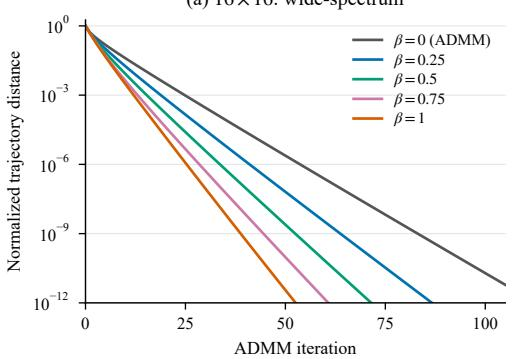

(b) 32 × 32: wide-spectrum  
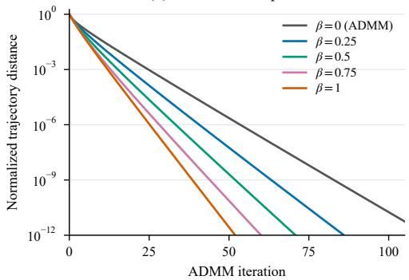

(c) 64 × 64: wide-spectrum  
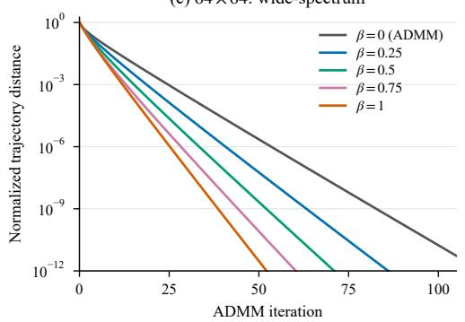

(d) 64 × 64: stability stress test  
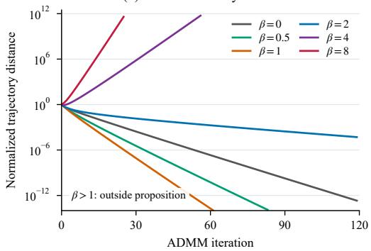  
Figure 6: Wide-spectrum convergence and stability. (a)–(c) Original ADMM trajectories across dimensions at $\gamma = 0 . 1 5$ . (d) Additional correction strengths at $6 4 \times 6 4 ; \beta > 1$ lies outside the theorem’s range. Growing runs stop at a prescribed numerical safety threshold. Panel (d) uses wider axis ranges.

Reconstruction error. We evaluate 512 independent test matrices per dimension, reusing the same clean signals and noisy observations across parameter settings. Figure 7 plots per-element reconstruction error against γ for $\beta \in \{ 0 , 0 . 2 5 , 0 . 5 , \bar { 0 } . 7 5 , 1 \}$ . The 17 evaluated prior strengths span 0 to 1.5 in increments of 0.1, with 0.15 additionally included. The main text shows the 64 × 64 case, using the same data and correction strengths. For each setting, we report

$$
\widehat { R } _ { d } ( \beta , \gamma ) = \frac { 1 } { N d } \sum _ { j = 1 } ^ { N } \| A _ { \beta , j } ^ { \star } - A _ { 0 , j } \| _ { F } ^ { 2 } ,\tag{C.1}
$$

where $A _ { \beta , j } ^ { \star }$ is computed at prior strength $\gamma ,$ and $\beta = 0$ gives analytical ADMM. Lower values indicate better reconstruction. The error curves illustrate the interaction between analytical regularization and score correction: stronger correction is not uniformly better. The tested nonzero correction strengths lie outside the sufficient risk-improvement region, so these comparisons characterize empirical performance beyond the certified settings.

Final risks are computed with Anderson acceleration of the ADMM state map, checking both original fixed-point and primal residuals below $1 0 ^ { - 1 0 }$ . Selected estimates are also checked against direct ADMM. All convergence curves use original ADMM iterations.

$$
\begin{array} { r }  \mathrm { ~ \mathcal ~ { ~ \beta ~ } ~ } \mathrm { ~ \mathcal { ~ \beta ~ } ~ } \mathrm { ~ \mathcal ~ { ~ \beta ~ } ~ } \mathrm { ~ \mathcal { ~ \beta ~ } ~ } \mathrm { ~ \mathcal ~ { ~ \psi ~ } ~ } \mathrm { ~ \beta ~ } \mathrm { ~ \mathcal ~ { ~ \psi ~ } ~ } \mathrm { ~ \beta ~ } \mathrm { ~ \mathcal ~ { ~ \psi ~ } ~ } \mathrm { ~ \beta ~ } \mathrm { ~ \mathcal ~ { ~ \psi ~ } ~ } \mathrm { ~ \beta ~ } \mathrm { ~ \mathcal ~ { ~ \psi } ~ } \mathrm { ~ \beta ~ } \mathrm { ~ \mathcal ~ { ~ \psi ~ } ~ } \mathrm { ~ \mathcal ~ { ~ \beta ~ } ~ } \mathrm { ~ \mathcal { ~ \psi ~ } ~ } \mathrm { ~ \mathcal { ~ \psi } ~ } \mathrm { ~ \mathcal ~ { ~ \psi } ~ } \mathrm { ~ \mathcal { ~ \psi } ~ } \mathrm { ~ \mathcal { ~ \psi } ~ } \mathrm { ~ \mathcal ~ { ~ \psi } ~ } \mathrm { ~ \mathcal { ~ \psi } ~ } \mathrm { ~ \mathcal { ~ \psi } ~ } \mathrm { ~ \mathcal ~ { ~ \psi } ~ } \mathrm { ~ \mathcal { ~ \psi } ~ } \mathrm { ~ \mathcal { ~ \psi } ~ } \mathrm { ~ \mathcal { ~ \psi } ~ } \mathrm { ~ \mathcal ~ { \psi } ~ } \mathrm { ~ \mathcal { ~ \psi } ~ } \mathrm { ~ \mathcal { ~ \psi } ~ } \mathrm { ~ \mathcal { ~ \psi } ~ } \mathrm { ~ \mathcal { ~ \psi } ~ } \mathrm { ~ \mathcal { ~ \psi } ~ } \mathrm { ~ \mathcal ~ { \psi } ~ } \mathrm { ~ \mathcal { ~ \psi } ~ } \mathrm { ~ \mathcal { ~ \psi } ~ } \mathrm { ~ \mathcal { ~ \psi } ~ } \mathrm { ~ \mathcal { ~ \psi } ~ } \mathrm { ~ \mathcal { ~ \psi } ~ } \mathrm { ~ \mathcal { ~ \psi } ~ } \mathrm { ~ \mathcal { ~ \psi } ~ } \mathrm { ~ \mathcal { ~ \psi } ~ } \mathrm { ~ \mathcal { ~ \psi } ~ } \mathrm { ~ \mathcal { ~ \psi } ~ } \mathrm { ~ \mathcal { ~ \psi } ~ } \mathrm { ~ \mathcal { ~ \psi } ~ } \mathrm { ~ \mathcal { ~ \psi } ~ } \mathrm { ~ \mathcal ~ { \psi } ~ } \mathrm  ~ \mathcal  \end{array}
$$

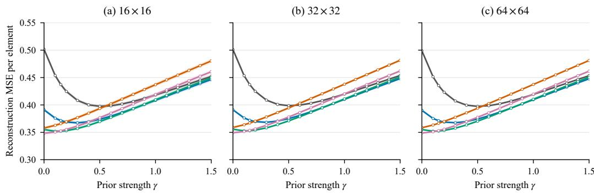  
Figure 7: Reconstruction error under wide-spectrum fidelity. Each panel fixes the state dimension; lower curves indicate better restoration. The gray curve is analytical ADMM $( \beta = 0 )$ . Markers denote evaluated prior strengths, connecting segments are visual guides, and shading shows pointwise 95% intervals computed across independent test matrices. All panels share the same vertical scale.

## C.2 ADDITIONAL QUANTITATIVE RESULTS

Reference-guided HSI restoration. Tables 9 and 10 report G10/G30/GNI and mixed conditions, respectively, with 81 patches per condition. Bold and underlined entries indicate the best and second-best distinct values in each column.

Table 9: Reference-guided HSI restoration on Dongying under Gaussian/GNI noise.
<table><tr><td></td><td colspan="4">G10</td><td colspan="4">G30</td><td colspan="4">GNI</td></tr><tr><td>Method</td><td>PSNR↑</td><td>SSIM↑</td><td>SAM↓</td><td>ERGAS↓</td><td>PSNR↑</td><td>SSIM↑</td><td>SAM↓</td><td>ERGAS↓</td><td>PSNR ↑</td><td>SSIM↑</td><td>SAM↓</td><td>ERGAS↓</td></tr><tr><td>PLRDiff + HIR-Diff</td><td>34.52</td><td>0.8215</td><td>6.73</td><td>16.49</td><td>32.20</td><td>0.8115</td><td>8.96</td><td>20.36</td><td>31.01</td><td>0.7670</td><td>12.73</td><td>23.66</td></tr><tr><td>PLRDiff + PWRCTV</td><td>38.10</td><td>0.9445</td><td>5.42</td><td>12.22</td><td>33.43</td><td>0.9156</td><td>9.02</td><td>18.93</td><td>32.73</td><td>0.9082</td><td>12.05</td><td>21.31</td></tr><tr><td>SwinIR + HIR-Diff</td><td>33.88</td><td>0.8512</td><td>4.69</td><td>22.02</td><td>27.79</td><td>0.4978</td><td>10.21</td><td>33.18</td><td>27.18</td><td>0.4962</td><td>12.66</td><td>35.11</td></tr><tr><td>SwinIR + PWRCTV</td><td>31.66</td><td>0.7815</td><td>8.33</td><td>65.58</td><td>21.16</td><td>0.3662</td><td>29.96</td><td>422.81</td><td>22.62</td><td>0.4464</td><td>31.18</td><td>489.23</td></tr><tr><td>R-PNN + HIR-Diff</td><td>33.80</td><td>0.8068</td><td>6.22</td><td>17.49</td><td>29.10</td><td>0.6743</td><td>9.28</td><td>25.03</td><td>29.59</td><td>0.6866</td><td>10.90</td><td>25.12</td></tr><tr><td>R-PNN + PWRCTV</td><td>36.71</td><td>0.9240</td><td>5.01</td><td>13.53</td><td>29.58</td><td>0.6375</td><td>14.46</td><td>28.57</td><td>30.96</td><td>0.7174</td><td>15.31</td><td>29.07</td></tr><tr><td>HIR-Diff + PLRDiff</td><td>33.48</td><td>0.7606</td><td>8.77</td><td>42.15</td><td>27.52</td><td>0.5859</td><td>17.65</td><td>338.12</td><td>23.06</td><td>0.3942</td><td>31.89</td><td>467.35</td></tr><tr><td>HIR-Diff + SwinIR</td><td>36.23</td><td>0.8612</td><td>3.88</td><td>13.07</td><td>31.00</td><td>0.6963</td><td>7.59</td><td>21.15</td><td>30.03</td><td>0.6716</td><td>9.53</td><td>24.05</td></tr><tr><td>HIR-Diff + R-PNN</td><td>37.90</td><td>0.9390</td><td>4.12</td><td>11.52</td><td>34.82</td><td>0.9157</td><td>6.08</td><td>15.97</td><td>33.25</td><td>0.9048</td><td>8.04</td><td>18.57</td></tr><tr><td>PWRCTV + PLRDiff</td><td>38.52</td><td>0.9116</td><td>3.88</td><td>11.28</td><td>35.46</td><td>0.8691</td><td>5.97</td><td>30.24</td><td>34.41</td><td>0.8217</td><td>8.84</td><td>23.09</td></tr><tr><td>PWRCTV + SwinIR</td><td>37.50</td><td>0.9080</td><td>3.10</td><td>11.33</td><td>34.54</td><td>0.8638</td><td>5.12</td><td>15.96</td><td>34.60</td><td>0.8602</td><td>5.76</td><td>16.66</td></tr><tr><td>UHiPandas</td><td>40.54</td><td>0.9543</td><td>3.04</td><td>8.52</td><td>36.82</td><td>0.9261</td><td>4.66</td><td>12.34</td><td>37.35</td><td>0.9300</td><td>4.46</td><td>11.74</td></tr><tr><td>S³-PnP (Ours)</td><td>41.91</td><td>0.9614</td><td>2.58</td><td>6.89</td><td>38.52</td><td>0.9428</td><td>3.97</td><td>10.57</td><td>38.84</td><td>0.9448</td><td>3.80</td><td>10.13</td></tr></table>

Single-image HSI denoising. Tables 11–14 report six conditions per dataset, each averaged over 85 patches. BM4D denotes the evaluated GPU approximation.

Table 10: Reference-guided HSI restoration on Dongying under mixed noise.
<table><tr><td rowspan="2">Method</td><td colspan="4">Mix35</td><td colspan="4">Mix55</td><td colspan="4">Mix55-G30</td></tr><tr><td>PSNR↑</td><td>SSIM ↑ SAM↓</td><td></td><td>ERGAS↓</td><td>PSNR↑</td><td>SSIM↑</td><td>SAM↓</td><td>ERGAS↓</td><td>PSNR ↑</td><td>SSIM↑</td><td>SAM↓</td><td>ERGAS↓</td></tr><tr><td>PLRDiff + HIR-Diff</td><td>30.90</td><td>0.7649</td><td>12.30</td><td>26.04</td><td>30.70</td><td>0.7687</td><td>13.35</td><td>35.69</td><td>31.63</td><td>0.7997</td><td>11.03</td><td>34.60</td></tr><tr><td>PLRDiff + PWRCTV</td><td>32.58</td><td>0.9079</td><td>11.79</td><td>23.82</td><td>32.13</td><td>0.9000</td><td>12.92</td><td>34.07</td><td>32.82</td><td>0.9059</td><td>10.94</td><td>33.24</td></tr><tr><td>SwinIR + HIR-Diff</td><td>27.88</td><td>0.5443</td><td>12.53</td><td>34.58</td><td>27.62</td><td>0.5328</td><td>13.47</td><td>43.14</td><td>28.20</td><td>0.5456</td><td>11.84</td><td>42.82</td></tr><tr><td>SwinIR + PWRCTV</td><td>25.43</td><td>0.5544</td><td>27.50</td><td>393.81</td><td>23.98</td><td>0.4886</td><td>29.39</td><td>662.34</td><td>22.44</td><td>0.4233</td><td>30.17</td><td>685.00</td></tr><tr><td>R-PNN + HIR-Diff</td><td>30.52</td><td>0.7378</td><td>10.72</td><td>25.12</td><td>29.48</td><td>0.7004</td><td>12.24</td><td>34.86</td><td>29.48</td><td>0.7036</td><td>11.36</td><td>34.20</td></tr><tr><td>R-PNN + PWRCTV</td><td>32.45</td><td>0.7877</td><td>13.26</td><td>26.32</td><td>30.43</td><td>0.7176</td><td>16.23</td><td>73.68</td><td>29.56</td><td>0.6762</td><td>15.72</td><td>67.29</td></tr><tr><td>HIR-Diff + PLRDiff</td><td>24.58</td><td>0.4578</td><td>28.15</td><td>196.77</td><td>23.94</td><td>0.4272</td><td>28.41</td><td>80.01</td><td>25.74</td><td>0.5280</td><td>22.85</td><td>338.78</td></tr><tr><td>HIR-Diff + SwinIR</td><td>30.13</td><td>0.6949</td><td>10.51</td><td>26.73</td><td>29.64</td><td>0.6803</td><td>11.85</td><td>37.69</td><td>29.51</td><td>0.6577</td><td>11.62</td><td>38.12</td></tr><tr><td>HIR-Diff + R-PNN</td><td>33.04</td><td>0.9030</td><td>9.29</td><td>21.81</td><td>32.67</td><td>0.8946</td><td>10.52</td><td>33.86</td><td>33.64</td><td>0.9007</td><td>9.44</td><td>33.35</td></tr><tr><td>PWRCTV + PLRDiff</td><td>35.00</td><td>0.8303</td><td>9.02</td><td>24.35</td><td>32.02</td><td>0.7559</td><td>15.44</td><td>234.17</td><td>31.27</td><td>0.7379</td><td>16.33</td><td>202.54</td></tr><tr><td>PWRCTV + SwinIR</td><td>35.65</td><td>0.8813</td><td>5.98</td><td>17.46</td><td>33.14</td><td>0.8249</td><td>11.64</td><td>219.03</td><td>32.60</td><td>0.8146</td><td>12.07</td><td>244.81</td></tr><tr><td>UHiPandas</td><td>38.65</td><td>0.9440</td><td>3.92</td><td>10.78</td><td>36.49</td><td>0.9223</td><td>8.67</td><td>43.82</td><td>36.37</td><td>0.9218</td><td>8.70</td><td>44.13</td></tr><tr><td>S³-PnP (Ours)</td><td>39.24</td><td>0.9493</td><td>3.67</td><td>9.48</td><td>38.98</td><td>0.9469</td><td>3.81</td><td>9.86</td><td>36.91</td><td>0.9352</td><td>6.13</td><td>14.37</td></tr></table>

Table 11: Single-image HSI denoising on Qingpu under Gaussian noise.
<table><tr><td></td><td colspan="4">G30</td><td colspan="4">G50</td><td colspan="4">G70</td></tr><tr><td>Method</td><td>PSNR ↑</td><td>SSIM↑</td><td>SAM↓</td><td>ERGAS↓</td><td>PSNR↑</td><td>SSIM↑</td><td>SAM↓</td><td>ERGAS↓</td><td>PSNR ↑</td><td>SSIM↑</td><td>SAM↓</td><td>ERGAS↓</td></tr><tr><td>BM4D</td><td>36.44</td><td>0.8936</td><td>2.60</td><td>6.72</td><td>33.64</td><td>0.8194</td><td>3.65</td><td>9.29</td><td>31.77</td><td>0.7511</td><td>4.58</td><td>11.54</td></tr><tr><td>HLRTF</td><td>40.70</td><td>0.9427</td><td>1.28</td><td>3.66</td><td>34.39</td><td>0.7927</td><td>2.81</td><td>8.10</td><td>29.74</td><td>0.5845</td><td>5.11</td><td>15.13</td></tr><tr><td>RCTV</td><td>33.03</td><td>0.7311</td><td>4.10</td><td>10.87</td><td>27.95</td><td>0.4866</td><td>7.36</td><td>19.66</td><td>24.79</td><td>0.3364</td><td>10.55</td><td>27.95</td></tr><tr><td>DDS2M</td><td>41.57</td><td>0.9645</td><td>1.12</td><td>3.49</td><td>39.87</td><td>0.9507</td><td>1.40</td><td>4.21</td><td>38.47</td><td>0.9361</td><td>1.68</td><td>4.95</td></tr><tr><td>LRTFR</td><td>38.73</td><td>0.9235</td><td>1.39</td><td>5.11</td><td>37.11</td><td>0.9000</td><td>1.78</td><td>6.22</td><td>35.89</td><td>0.8826</td><td>2.17</td><td>7.17</td></tr><tr><td>HIR-Diff</td><td>39.31</td><td>0.9260</td><td>1.49</td><td>4.42</td><td>38.84</td><td>0.9252</td><td>1.60</td><td>4.61</td><td>37.25</td><td>0.8958</td><td>1.95</td><td>5.51</td></tr><tr><td>CF-INR</td><td>42.29</td><td>0.9686</td><td>1.14</td><td>3.25</td><td>39.94</td><td>0.9535</td><td>1.37</td><td>4.05</td><td>38.73</td><td>0.9403</td><td>1.56</td><td>4.72</td></tr><tr><td>S3-PnP (Ours)</td><td>42.60</td><td>0.9714</td><td>1.03</td><td>3.02</td><td>40.05</td><td>0.9558</td><td>1.35</td><td>4.09</td><td>38.77</td><td>0.9413</td><td>1.60</td><td>4.73</td></tr></table>

Table 12: Single-image HSI denoising on Qingpu under mixed noise.
<table><tr><td></td><td colspan="4">M30</td><td colspan="4">M50</td><td colspan="4">M70</td></tr><tr><td>Method</td><td>PSNR ↑</td><td>SSIM↑</td><td>SAM↓</td><td>ERGAS↓</td><td>PSNR↑</td><td>SSIM↑</td><td>SAM↓</td><td>ERGAS↓</td><td>PSNR ↑</td><td>SSIM↑</td><td>SAM↓</td><td>ERGAS↓</td></tr><tr><td>BM4D</td><td>22.54</td><td>0.3971</td><td>23.26</td><td>91.66</td><td>25.36</td><td>0.5140</td><td>15.60</td><td>61.07</td><td>25.77</td><td>0.5388</td><td>13.63</td><td>53.29</td></tr><tr><td>HLRTF</td><td>35.60</td><td>0.9123</td><td>27.83</td><td>115.44</td><td>30.84</td><td>0.8113</td><td>27.54</td><td>117.36</td><td>27.25</td><td>0.6595</td><td>27.70</td><td>121.07</td></tr><tr><td>RCTV</td><td>36.83</td><td>0.9183</td><td>3.88</td><td>11.74</td><td>33.64</td><td>0.8730</td><td>5.51</td><td>16.32</td><td>31.55</td><td>0.8311</td><td>7.07</td><td>20.32</td></tr><tr><td>DDS2M</td><td>29.88</td><td>0.8430</td><td>13.20</td><td>53.63</td><td>29.78</td><td>0.8552</td><td>13.12</td><td>53.49</td><td>29.70</td><td>0.8625</td><td>13.05</td><td>53.41</td></tr><tr><td>LRTFR</td><td>32.70</td><td>0.8733</td><td>27.13</td><td>112.10</td><td>30.62</td><td>0.8417</td><td>26.95</td><td>114.20</td><td>29.20</td><td>0.8176</td><td>26.94</td><td>117.34</td></tr><tr><td>HIR-Diff</td><td>29.17</td><td>0.8363</td><td>13.20</td><td>55.69</td><td>29.09</td><td>0.8295</td><td>13.21</td><td>55.69</td><td>28.91</td><td>0.8123</td><td>13.19</td><td>55.40</td></tr><tr><td>CF-INR</td><td>38.71</td><td>0.9596</td><td>1.82</td><td>5.95</td><td>35.53</td><td>0.9335</td><td>2.62</td><td>8.56</td><td>33.35</td><td>0.9086</td><td>3.42</td><td>10.99</td></tr><tr><td>S³-PnP (Ours)</td><td>39.62</td><td>0.9648</td><td>1.56</td><td>4.35</td><td>37.51</td><td>0.9389</td><td>1.87</td><td>5.46</td><td>36.50</td><td>0.9261</td><td>2.24</td><td>6.21</td></tr></table>

Table 13: Single-image HSI denoising on Xiong’an under Gaussian noise.
<table><tr><td></td><td colspan="4">G30</td><td colspan="4">G50</td><td colspan="4">G70</td></tr><tr><td>Method</td><td>PSNR ↑</td><td>SSIM↑</td><td>SAM↓</td><td>ERGAS↓</td><td>PSNR ↑</td><td>SSIM↑</td><td>SAM↓</td><td>ERGAS↓</td><td>PSNR↑</td><td>SSIM↑</td><td>SAM↓</td><td>ERGAS↓</td></tr><tr><td>BM4D</td><td>35.02</td><td>0.8637</td><td>2.54</td><td>5.58</td><td>32.40</td><td>0.7786</td><td>3.49</td><td>7.57</td><td>30.66</td><td>0.7046</td><td>4.32</td><td>9.28</td></tr><tr><td>HLRTF</td><td>39.91</td><td>0.9502</td><td>1.25</td><td>3.29</td><td>34.77</td><td>0.8508</td><td>2.25</td><td>5.86</td><td>30.51</td><td>0.6857</td><td>3.84</td><td>9.86</td></tr><tr><td>RCTV</td><td>33.03</td><td>0.7797</td><td>3.48</td><td>7.65</td><td>27.97</td><td>0.5534</td><td>6.25</td><td>13.88</td><td>24.79</td><td>0.3981</td><td>9.01</td><td>20.04</td></tr><tr><td>DDS2M</td><td>39.75</td><td>0.9448</td><td>1.22</td><td>3.35</td><td>38.07</td><td>0.9250</td><td>1.47</td><td>4.02</td><td>36.61</td><td>0.9001</td><td>1.73</td><td>4.73</td></tr><tr><td>LRTFR</td><td>35.57</td><td>0.8309</td><td>1.61</td><td>5.70</td><td>34.18</td><td>0.7808</td><td>1.98</td><td>6.77</td><td>33.26</td><td>0.7510</td><td>2.31</td><td>7.54</td></tr><tr><td>HIR-Diff</td><td>36.40</td><td>0.8830</td><td>1.58</td><td>4.90</td><td>36.18</td><td>0.8840</td><td>1.73</td><td>4.98</td><td>35.22</td><td>0.8652</td><td>2.01</td><td>5.55</td></tr><tr><td>CF-INR</td><td>39.46</td><td>0.9446</td><td>1.47</td><td>3.50</td><td>37.67</td><td>0.9153</td><td>1.68</td><td>4.30</td><td>36.52</td><td>0.8903</td><td>1.85</td><td>4.94</td></tr><tr><td>S³-PnP (Ours)</td><td>40.74</td><td>0.9632</td><td>1.13</td><td>2.88</td><td>38.66</td><td>0.9418</td><td>1.42</td><td>3.65</td><td>36.92</td><td>0.9161</td><td>1.69</td><td>4.49</td></tr></table>

Table 14: Single-image HSI denoising on Xiong’an under mixed noise.
<table><tr><td></td><td colspan="4">M30</td><td colspan="4">M50</td><td colspan="4">M70</td></tr><tr><td>Method</td><td>PSNR ↑</td><td>SSIM ↑</td><td>SAM↓</td><td>ERGAS↓</td><td>PSNR↑</td><td>SSIM↑</td><td>SAM↓</td><td>ERGAS↓</td><td>PSNR ↑</td><td>SSIM↑</td><td>SAM↓</td><td>ERGAS↓</td></tr><tr><td>BM4D</td><td>22.38</td><td>0.3987</td><td>18.29</td><td>43.57</td><td>24.96</td><td>0.5014</td><td>12.33</td><td>28.99</td><td>25.21</td><td>0.5095</td><td>10.85</td><td>25.93</td></tr><tr><td>HLRTF</td><td>33.61</td><td>0.8941</td><td>24.44</td><td>81.55</td><td>30.12</td><td>0.8326</td><td>24.06</td><td>81.94</td><td>27.70</td><td>0.7451</td><td>24.21</td><td>83.75</td></tr><tr><td>RCTV</td><td>34.86</td><td>0.8863</td><td>3.77</td><td>9.16</td><td>31.92</td><td>0.8267</td><td>5.28</td><td>12.47</td><td>30.00</td><td>0.7754</td><td>6.75</td><td>15.83</td></tr><tr><td>DDS2M</td><td>29.05</td><td>0.8231</td><td>10.05</td><td>26.26</td><td>28.93</td><td>0.8250</td><td>9.92</td><td>26.17</td><td>28.81</td><td>0.8212</td><td>9.81</td><td>26.11</td></tr><tr><td>LRTFR</td><td>29.98</td><td>0.7704</td><td>23.74</td><td>79.14</td><td>28.30</td><td>0.7195</td><td>23.51</td><td>80.07</td><td>27.23</td><td>0.6901</td><td>23.48</td><td>81.42</td></tr><tr><td>HIR-Diff</td><td>28.47</td><td>0.8351</td><td>9.83</td><td>27.49</td><td>28.41</td><td>0.8277</td><td>9.82</td><td>27.41</td><td>28.29</td><td>0.8129</td><td>9.80</td><td>27.21</td></tr><tr><td>CF-INR</td><td>36.43</td><td>0.9285</td><td>2.14</td><td>5.14</td><td>33.65</td><td>0.8762</td><td>2.95</td><td>7.30</td><td>31.82</td><td>0.8362</td><td>3.76</td><td>9.39</td></tr><tr><td>S³-PnP (Ours)</td><td>38.00</td><td>0.9476</td><td>1.62</td><td>4.07</td><td>37.46</td><td>0.9306</td><td>1.82</td><td>4.40</td><td>35.21</td><td>0.9035</td><td>2.21</td><td>5.57</td></tr></table>

MRI denoising. Table 15 reports nine BrainWeb contrast–noise conditions, each averaged over 34 slices. Table 16 reports three M4Raw contrasts, with equal weighting of 25 subjects after averaging 18 slices per subject. C2S on M4Raw uses the official released weights evaluated on our benchmark. For BrainWeb, we report our own evaluation results for C2S. DRDD denotes transfer of the official DRDD-AiO5 natural-image pretrained weights.

## C.3 ADDITIONAL QUALITATIVE RESULTS

The selected examples use the same display mapping, zoom region, and residual scale across methods within each row. The left inset shows the zoomed region; the right shows its absolute residual, with brighter colors indicating larger errors. HSI residuals use displayed RGB channels, BrainWeb uses displayed intensities, and M4Raw uses full-precision intensities.

Reference-guided HSI restoration. Figure 8 shows Gaussian and mixed-noise examples; PAN is guidance and has no HSI residual.

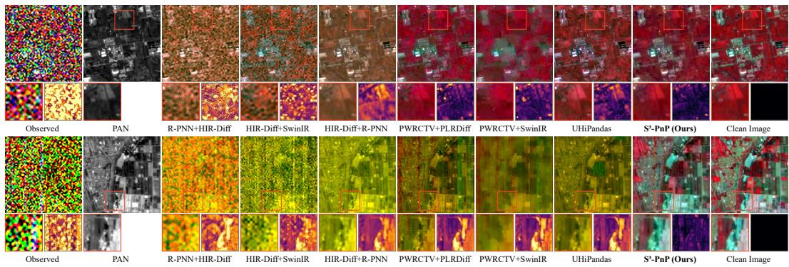  
Figure 8: Reference-guided HSI restoration on Dongying: G30 (top) and Mix55 (bottom).

Single-image HSI denoising. Figures 9 and 10 show examples from both datasets.  
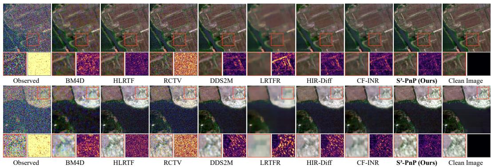  
Figure 9: Single-image HSI denoising on Qingpu: G30 (top) and G50 (bottom).

Table 15: MRI denoising on BrainWeb across nine contrast–noise conditions. T1
<table><tr><td rowspan="2"></td><td colspan="2">T1 3%</td><td colspan="2">T1 5%</td><td colspan="2">T1 7%</td></tr><tr><td>Method PSNR ↑</td><td>SSIM ↑</td><td>PSNR ↑</td><td>SSIM ↑</td><td>PSNR ↑</td><td>SSIM ↑</td></tr><tr><td>Noise2Void</td><td>35.41</td><td>0.9062</td><td>34.88</td><td>0.9425</td><td>32.97</td><td>0.8833</td></tr><tr><td>Noise2Self</td><td>33.17</td><td>0.7933</td><td>33.23</td><td>0.9600</td><td>30.81</td><td>0.7435</td></tr><tr><td>Noisier2Noise</td><td>37.49</td><td>0.9261</td><td>34.52</td><td>0.9049</td><td>31.90</td><td>0.7828</td></tr><tr><td>R2R</td><td>36.20</td><td>0.8040</td><td>34.83</td><td>0.8113</td><td>32.26</td><td>0.7534</td></tr><tr><td>Noise2Score</td><td>37.48</td><td>0.8741</td><td>32.83</td><td>0.7883</td><td>29.68</td><td>0.7370</td></tr><tr><td>ZS-N2N</td><td>35.38</td><td>0.7805</td><td>31.36</td><td>0.7240</td><td>28.70</td><td>0.6903</td></tr><tr><td>C2S</td><td>36.17</td><td>0.9301</td><td>34.90</td><td>0.8402</td><td>35.05</td><td>0.8866</td></tr><tr><td>DRDD</td><td>38.23</td><td>0.8314</td><td>33.85</td><td>0.7614</td><td>30.89</td><td>0.7282</td></tr><tr><td>S³-PnP (Ours)</td><td>40.84</td><td>0.9824</td><td>37.97</td><td>0.9737</td><td>36.03</td><td>0.9636</td></tr></table>

T2
<table><tr><td rowspan="2"></td><td colspan="2">T2 3%</td><td colspan="2">T2 5%</td><td colspan="2">T2 7%</td></tr><tr><td>Method PSNR ↑</td><td>SSIM↑</td><td>PSNR ↑</td><td>SSIM ↑</td><td>PSNR↑</td><td>SSIM ↑</td></tr><tr><td>Noise2Void</td><td>29.46</td><td>0.8822</td><td>27.60</td><td>0.7965</td><td>26.03</td><td>0.7304</td></tr><tr><td>Noise2Self</td><td>30.26</td><td>0.8962</td><td>28.83</td><td>0.7829</td><td>28.72</td><td>0.8620</td></tr><tr><td>Noisier2Noise</td><td>32.35</td><td>0.8728</td><td>29.29</td><td>0.8076</td><td>26.79</td><td>0.7151</td></tr><tr><td>R2R</td><td>33.39</td><td>0.8196</td><td>31.10</td><td>0.8111</td><td>28.00</td><td>0.7279</td></tr><tr><td>Noise2Score</td><td>32.79</td><td>0.8268</td><td>28.42</td><td>0.7586</td><td>25.30</td><td>0.7098</td></tr><tr><td>ZS-N2N</td><td>30.89</td><td>0.7812</td><td>27.15</td><td>0.7243</td><td>24.45</td><td>0.6807</td></tr><tr><td>C2S</td><td>34.39</td><td>0.9386</td><td>31.85</td><td>0.8463</td><td>29.44</td><td>0.7749</td></tr><tr><td>DRDD</td><td>32.93</td><td>0.8093</td><td>28.83</td><td>0.7595</td><td>25.98</td><td>0.7270</td></tr><tr><td>S³-PnP (Ours)</td><td>35.36</td><td>0.9545</td><td>32.46</td><td>0.9339</td><td>30.54</td><td>0.9234</td></tr></table>

PD
<table><tr><td rowspan="2"></td><td colspan="2">PD 3%</td><td colspan="2">PD 5%</td><td colspan="2">PD 7%</td></tr><tr><td>Method PSNR ↑</td><td>SSIM ↑</td><td>PSNR ↑</td><td>SSIM ↑</td><td>PSNR ↑</td><td>SSIM ↑</td></tr><tr><td>Noise2Void</td><td>31.46</td><td>0.8547</td><td>28.73</td><td>0.8176</td><td>28.71</td><td>0.8195</td></tr><tr><td>Noise2Self</td><td>30.23</td><td>0.8943</td><td>29.14</td><td>0.7758</td><td>28.93</td><td>0.7802</td></tr><tr><td>Noisier2Noise</td><td>33.32</td><td>0.8903</td><td>30.32</td><td>0.7897</td><td>28.00</td><td>0.7250</td></tr><tr><td>R2R</td><td>32.48</td><td>0.7798</td><td>30.15</td><td>0.7413</td><td>28.24</td><td>0.7063</td></tr><tr><td>Noise2Score</td><td>33.13</td><td>0.8207</td><td>28.59</td><td>0.7394</td><td>25.58</td><td>0.6932</td></tr><tr><td>ZS-N2N</td><td>31.62</td><td>0.7686</td><td>27.70</td><td>0.7011</td><td>25.05</td><td>0.6538</td></tr><tr><td>C2S</td><td>35.07</td><td>0.9174</td><td>33.14</td><td>0.8647</td><td>31.14</td><td>0.7904</td></tr><tr><td>DRDD</td><td>33.93</td><td>0.8157</td><td>29.42</td><td>0.7534</td><td>26.63</td><td>0.7148</td></tr><tr><td>S³-PnP (Ours)</td><td>36.21</td><td>0.9334</td><td>33.53</td><td>0.9165</td><td>31.59</td><td>0.8966</td></tr></table>

Table 16: MRI denoising on M4Raw across three contrasts.
<table><tr><td rowspan="2">Method</td><td>T1</td><td></td><td>T2</td><td colspan="2">FLAIR</td></tr><tr><td>PSNR ↑</td><td>SSIM ↑</td><td>PSNR↑</td><td>SSIM ↑</td><td>PSNR↑ SSIM ↑</td></tr><tr><td>Noise2Void</td><td>31.24</td><td>0.8671</td><td>30.45</td><td>0.8392</td><td>30.80 0.8288</td></tr><tr><td>Noise2Self</td><td>29.10</td><td>0.8537</td><td>28.17 0.8095</td><td>28.94</td><td>0.8150</td></tr><tr><td>Noisier2Noise</td><td>31.18</td><td>0.8675</td><td>30.55</td><td>0.8435 31.17</td><td>0.8356</td></tr><tr><td>R2R</td><td>30.82</td><td>0.8552</td><td>30.48</td><td>0.8329 30.97</td><td>0.8187</td></tr><tr><td>Noise2Score</td><td>31.23</td><td>0.8444</td><td>30.48</td><td>0.8139 31.00</td><td>0.7975</td></tr><tr><td>ZS-N2N</td><td>31.66</td><td>0.8922</td><td>30.96</td><td>0.8729</td><td>31.89 0.8765</td></tr><tr><td>C2S</td><td>32.61</td><td>0.9152</td><td>32.30</td><td>0.8880 33.02</td><td>0.8792</td></tr><tr><td>DRDD</td><td>32.43</td><td>0.9108</td><td>31.44</td><td>0.8770 32.60</td><td>0.8797</td></tr><tr><td>S³-PnP (Ours)</td><td>32.69</td><td>0.9165</td><td>32.31</td><td>0.8922</td><td>32.83 0.8906</td></tr></table>

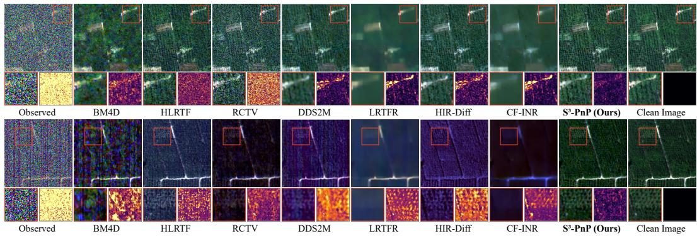  
Figure 10: Single-image HSI denoising on Xiong’an: G70 (top) and M70 (bottom).

MRI denoising. Figures 11 and 12 show anatomical details and residuals. The M4Raw reference averages repeated acquisitions, including the input.  
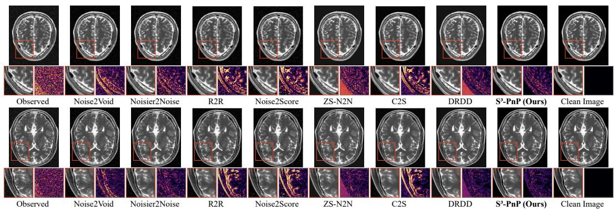

Figure 11: MRI denoising on BrainWeb (T2, 7% noise).  
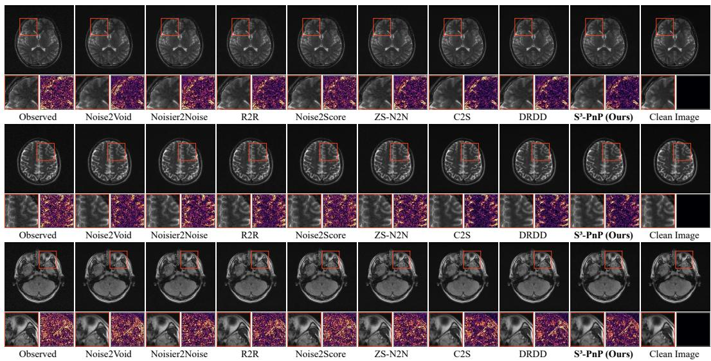  
Figure 12: MRI denoising on M4Raw: T2, T2, and FLAIR from top to bottom.