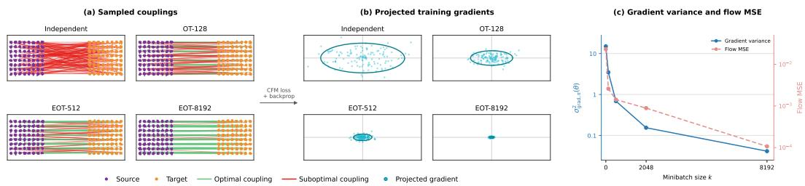
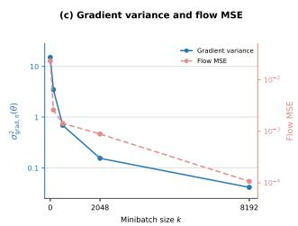
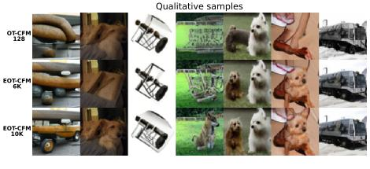
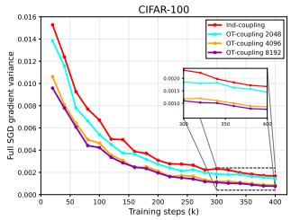
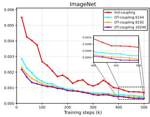
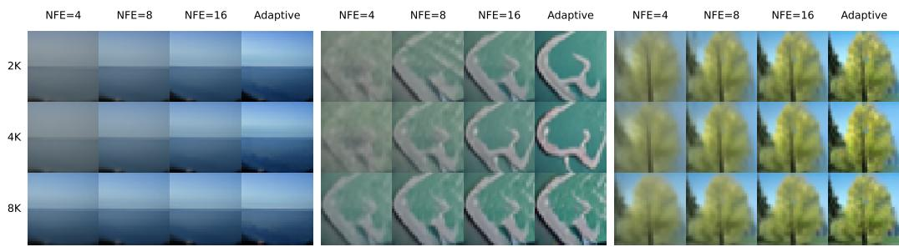
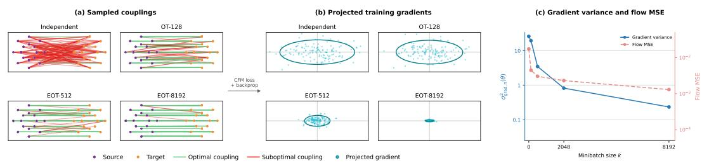
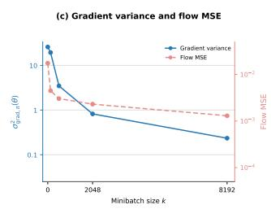
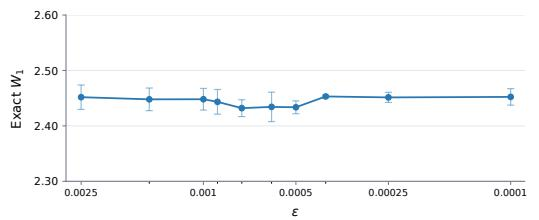
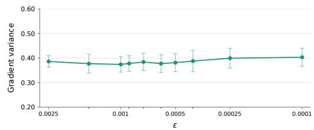

# SCALING ONLINE OPTIMAL TRANSPORT MINIBATCHES FOR FLOW MATCHING

Peter Chen Sergey Levine

University of California, Berkeley

## ABSTRACT

A central challenge in scaling flow models is maintaining stability in training and integration. In flow matching, this stability depends critically on how source samples are paired with data. Independent random pairing introduces substantial stochasticity, motivating minibatch optimal transport (OT) to construct online source-target couplings that reduce this randomness (Tong et al., 2024). However, as applications extend to larger and higher-dimensional datasets, small minibatches can limit these benefits, while scaling the coupling to substantially larger minibatches at every iteration is computationally prohibitive. Moreover, how OT coupling affects the full stochastic gradient and integration remains theoretically unresolved. In this work, we develop a scalable online entropic OT approximation that enables substantially larger source-target couplings while preserving the benefits of OT. We close the theoretical gap for both unregularized and entropic OT by proving strict reductions in full stochastic-gradient variance and integration error relative to independent pairing, and further characterize how these improvements strengthen as the online coupling minibatch grows. Experiments on single-cell gene interpolation-flow and image-flow training validate these predictions, showing that larger online couplings consistently improve training stability and final generation performance.

## 1 INTRODUCTION

Much of the recent progress in generative AI has been driven by scale. Autoregressive language models benefit from a standardized learning objective: next-token prediction under a softmax distribution. Once this objective is fixed, much of the challenge of scaling shifts to systems and optimization. Flow models introduce an additional dimension: their supervision is constructed along a generative path from noise to data, and the resulting regression targets depend on how source noise samples are coupled with target data samples. Thus, scaling flow models requires consideration not only of how the model is optimized, but also of how its training targets are constructed.

The choice of such source-target coupling is therefore part of the learning problem itself. In flow matching, each training example pairs a source sample from the noise distribution with a target data sample and regresses the velocity along the resulting interpolation path. Under the standard independent coupling, these pairings are random. Consequently, nearby intermediate states can arise from different endpoint pairs and receive substantially different velocity targets, increasing ambiguity in the regression problem and the variance of stochastic gradients. A natural way to reduce this randomness is to determine the source-target correspondence during training.

Optimal transport (OT) then provides a natural solution by constructing a coupling between source and target samples within each minibatch during training. Such online coupling minimizes the transport cost between the two empirical distributions, yielding more coherent source-target assignments that induce straighter flows and reduce the ambiguity of independent pairing (Pooladian et al., 2023; Tong et al., 2024). However, as flow matching is applied to larger and more heterogeneous datasets, such as high-dimensional single-cell trajectories and large-scale image datasets, a fixed small coupling minibatch can become increasingly restrictive, where each minibatch only exposes OT to a limited subset of the source and target distributions, constraining the candidate correspondences available at each iteration. As the underlying data distribution grows in diversity and complexity, it therefore becomes natural to scale the OT minibatch accordingly.

Still, scaling the minibatch size is computationally challenging, where dense pairwise interactions in standard OT restrict practical minibatches to hundreds of samples. Nevertheless, recent advances in scalable entropic OT make substantially larger contexts accessible. In particular, FlashSinkhorn (Ye et al., 2026) implements Sinkhorn iterations with FlashAttention-style HBM kernels without materializing the full coupling matrix in high-bandwidth memory. To this end, we propose a simple, tractable approximation by replacing online OT coupling with scalable entropic OT, enabling coupling contexts to grow from hundreds to thousands of samples during training.

The price of this tractability is that entropic regularization changes the coupling itself. The regularization strength ε controls this deviation from standard OT, while the minibatch size k controls the scale of the online coupling. Understanding whether the stability benefits of OT persist therefore requires characterizing the joint effects of regularization and coupling scale. Moreover, this question remains unresolved even for standard unregularized minibatch OT. Existing analyses motivate OT through straighter paths and reduced conditional uncertainty (Pooladian et al., 2023; Boïté et al., 2026; Zhang et al., 2026; Chambolle & Hertrich, 2026), but do not provide a general strict characterization of its effect on the full stochastic-gradient variance or the induced numerical integration error.

By making larger online couplings feasible, we determine whether their stability benefits survive the approximation required for scaling. Our contributions can be summarized below:

Contributions. We provide a unified and principled characterization of how online OT coupling affects optimization and numerical integration. On the optimization side, we characterize the full stochastic-gradient variance by (i) proving that population quadratic OT strictly reduces this variance relative to independent coupling, (ii) showing that unregularized minibatch-OT variance reduces as the minibatch size k grows, and (iii) extending same guarantees to entropic-regularized couplings. On the integration side, we establish parallel strict reductions in Euler integration error and characterize how these guarantees improve with scaled minibatch size. These results provide a better theoretical understanding for using and scaling entropic OT as a replacement to the standard online OT couplings.

Related works. OT-based conditional flow matching (OT-CFM) improves both training and generation through better source-target pairings (Tong et al., 2024; Pooladian et al., 2023). Given the difficulty to scale OT-CFM, recent works scale the minibatch context by separating pairing from training: Zhang et al. (2026) precomputed million-scale couplings offline, which requires buffering enough pairs to cover the entire training run before optimization begins; semidiscrete approximation methods offer better efficiency by reusing fitted dataset-level potentials, but need a separate potential optimization stage (Mousavi-Hosseini et al., 2026) or face non-convergence when scaled to large unconditional datasets (Kong et al., 2026). Therefore, we return to the original challenge, by finding an affordable and stable method for scaling the minibatch that flow matching recomputes from fresh samples at every training iteration.

The existing theory has so far addressed separate pieces. Tong et al. (2024) connect population OT to dynamic OT, while Pooladian et al. (2023) study conditional gradient covariance and asymptotic BatchOT straightness. Finite-batch theory remains limited: Zhang et al. (2026) characterize uncertainty in the resulting OT coupling, while Boïté et al. (2026) analyze its integration benefit only in a restricted two-atom model; more recent work also studies full parameter-gradient variance in restricted Gaussian models (Reu et al., 2025) and integration error through the geometry of a prescribed velocity field (Tao & Choi, 2026). Thus, no prior result establishes that replacing independent pairing with minibatch OT strictly reduces full stochastic-gradient variance while inducing a general integration advantage; we defer further related work to Appendix A.

## 2 PRELIMINARIES

We introduce flow matching (FM) and coupling definitions used throughout the later analyses.

Continuous normalizing flows. Let $q _ { 0 } , q _ { 1 } \in \mathcal { P } _ { 2 } ( \mathbb { R } ^ { d } )$ denote the source (noise) and target (imagedata) distributions, respectively. A time-dependent vector field $v _ { \theta } : [ 0 , 1 ] \times \dot { \mathbb { R } } ^ { d } \to \dot { \mathbb { R } } ^ { d }$ , parameterized by $\theta \in \mathbb { R } ^ { p }$ , assigns an instantaneous velocity to each time-state pair $( t , x )$ , thereby defining a flow from the source to the target. Specifically, a continuous normalizing flow (CNF) (Lipman et al., 2023) transports source samples through the flow map

$$
\frac { \mathrm { d } } { \mathrm { d } t } \phi _ { t } ( x ) = v _ { \theta } ( t , \phi _ { t } ( x ) ) , \qquad \phi _ { 0 } ( x ) = x ,
$$

with the goal that $( \phi _ { 1 } ) _ { \# } q _ { 0 } \approx q _ { 1 }$ . Flow matching trains this vector field from paths induced by a coupling of the source and target endpoints.

Coupling-based FM. Let $\pi$ be a coupling of $q _ { 0 }$ and $q _ { 1 }$ . Each FM training tuple is generated first by sampling $( X _ { 0 } , X _ { 1 } ) \sim \pi$ and then independently sampling $t \sim \mathcal { U } ( [ 0 , 1 ] )$ . Unless stated otherwise, we take all expectations $\mathbb { E } _ { \pi } [ \cdot ]$ and covariances $\operatorname { C o v } _ { \pi } ( \cdot )$ over the randomness induced by the sampling procedure associated with coupling π. For simplicity, we denote the complete stochastic FM training tuple by $\xi ^ { \pi } = ( t , X _ { 0 } , X _ { 1 } )$ and its associated variables, including intermediate interpolation point $X _ { t } ^ { \bar { \pi } }$ and pathwise velocity target $U ^ { \pi }$ , by

$$
X _ { t } ^ { \pi } = ( 1 - t ) X _ { 0 } + t X _ { 1 } , \qquad U ^ { \pi } = X _ { 1 } - X _ { 0 } .
$$

At a fixed model input $( t , X _ { t } ^ { \pi } )$ , different endpoint pairs may produce different velocity targets. Given one sampled FM training tuple $\xi ^ { \pi }$ , its loss is

$$
\ell _ { \pi } ( \theta ; \boldsymbol { \xi } ^ { \pi } ) = \| v _ { \theta } ( t , \boldsymbol { X } _ { t } ^ { \pi } ) - U ^ { \pi } \| _ { 2 } ^ { 2 } .
$$

Under this squared loss, the optimal deterministic velocity prediction at input $( t , x )$ is the conditional mean, defined by $u ^ { \pi } ( t , X _ { t } ^ { \pi } ) { \mathrel { \mathop : } } = \mathbb { E } _ { \pi } [ U ^ { \pi } \mid t , X _ { t } ^ { \pi } ]$ . The conditional covariance, $\operatorname { C o v } _ { \pi } ( U ^ { \pi } \mid t , X _ { t } ^ { \pi } )$ , then measures how much the possible velocity targets still vary at that input; the population FM objective further averages $\ell _ { \pi } ( \theta ; \xi ^ { \bar { \pi } } )$ over all possible training tuples,

$$
\begin{array} { r } { \mathcal { L } _ { \pi } ( \theta ) : = \mathbb { E } _ { \pi } [ \ell _ { \pi } ( \theta ; \xi ^ { \pi } ) ] . } \end{array}
$$

Let $J _ { \theta } ( t , x ) : = \nabla _ { \theta } v _ { \theta } ( t , x ) \in \mathbb { R } ^ { d \times p }$ , the gradient over $\ell _ { \pi } ( \theta ; \xi ^ { \pi } )$ can be expressed as

$$
G _ { \pi } ( \theta ) : = \nabla _ { \theta } \ell _ { \pi } ( \theta ; \xi ^ { \pi } ) = 2 J _ { \theta } ( t , X _ { t } ^ { \pi } ) ^ { \top } \big ( v _ { \theta } ( t , X _ { t } ^ { \pi } ) - U ^ { \pi } \big ) .
$$

Whenever $\mathbb { E } _ { \pi } [ \| G _ { \pi } ( \theta ) \| _ { 2 } ^ { 2 } ] < \infty$ , we can derive the total variance of the per-sample stochastic gradient induced by sampling FM training tuples under coupling $\pi { : }$

$$
\sigma _ { \mathrm { g r a d } , \pi } ^ { 2 } ( \theta ) : = \mathrm { T r } \{ \mathrm { C o v } _ { \pi } ( G _ { \pi } ( \theta ) ) \} = \mathbb { E } _ { \pi } \left[ \| G _ { \pi } ( \theta ) - \mathbb { E } _ { \pi } G _ { \pi } ( \theta ) \| _ { 2 } ^ { 2 } \right] .
$$

Here, $\operatorname { C o v } _ { \pi } ( G _ { \pi } ( \theta ) ) \in \mathbb { R } ^ { p \times p }$ is the covariance matrix of the per-sample stochastic gradient, whereas $\sigma _ { \mathrm { g r a d } , \pi } ^ { 2 } ( \theta )$ is its trace, measuring the total sample-to-sample gradient variance across FM training tuples under coupling $\pi .$ . The law of total covariance further gives us the following decomposition,

$$
\sigma _ { \mathrm { g r a d } , \pi } ^ { 2 } ( \theta ) = \mathbb { E } _ { \pi } [ \mathrm { T r } \{ \mathrm { C o v } _ { \pi } ( G _ { \pi } ( \theta ) \mid t , X _ { t } ^ { \pi } ) \} ] + \mathrm { T r } \{ \mathrm { C o v } _ { \pi } ( \mathbb { E } _ { \pi } [ G _ { \pi } ( \theta ) \mid t , X _ { t } ^ { \pi } ] ) \} .\tag{1}
$$

The first term is the gradient noise from target ambiguity at a fixed model input, and the second term is the variation of the conditional mean gradient across model inputs.

## 3 SCALABLE OT FOR FLOW MATCHING

We refer to our method as conditional flow matching with entropic OT (EOT-CFM). Our approach applies a larger context of source and target samples to construct better couplings, with FlashSinkhorn (Ye et al., 2026) enabling efficient computation at scale. Specifically, at each training iteration, we draw fresh source and target minibatches, compute an approximate entropic transport plan, and sample source-target pairs from this plan to form the regression batch.

We consider three coupling constructions as background: $\mathrm { ( i ) }$ independent coupling $\pi _ { \mathrm { i n d } } .$ , which pairs samples from $q _ { 0 }$ and $q _ { 1 }$ randomly; (ii) optimal OT coupling $\pi ^ { \star }$ , which minimizes $\mathbb { E } _ { \pi } [ \| X _ { 0 } - \dot { X _ { 1 } } \| _ { 2 } ^ { 2 } ]$ over all noise and data points1; (iii) in practice, minibatch OT solves the corresponding problem on source and target minibatches of size $\bar { k , }$ where we denote this empirical plan as $\widehat { \pi } _ { k }$

To formalize our method, we denote k as the number of samples to be paired in the coupling minibatch and $B \leq k$ as the regression batch used per model update. Given independent samples $x _ { i } \sim q _ { 0 }$ and $y _ { j } \sim q _ { 1 }$ , we write $C _ { i j } = \| x _ { i } - y _ { j } \| _ { 2 } ^ { 2 } / ( 2 d )$ , with dimension normalization that preserves the unregularized OT matching. Assigning uniform mass $1 / k$ to each sample, we aim to solve the following entropic transport plan:

$$
\boldsymbol { \widehat { \pi } } _ { k , \varepsilon } = \underset { \underset { P ^ { \sum 0 , P \mathbf { 1 } = \mathbf { 1 } / k } } { P ^ { \sum 0 , P \mathbf { 1 } = \mathbf { 1 } } / k } } { \arg \operatorname* { m i n } } \left\{ \langle \mathbf { C } , P \rangle + \varepsilon \mathrm { K L } \big ( P \| \mathbf { 1 1 } ^ { \top } / k ^ { 2 } \big ) \right\} .\tag{2}
$$

Algorithm 1 Continuous normalizing flow with online entropic couplings (EOT-CFM)   
Require: Minibatch size $k ,$ batch size ${ \overline { { B , } } }$ regularization $\varepsilon > 0 ,$ Sinkhorn iterations $L ,$ training steps $T .$   
1: for $t = 1 , \dots , T$ do   
2: Sample noise and data from source $x _ { i } \sim q _ { 0 }$ and target $y _ { j } \sim q _ { 1 }$ with minibatch size k   
3: Approximate the target dual potential ge of Eq. (2) with $\check { L }$ FlashSinkhorn iterations   
4: Select B distinct source indices $I _ { 1 } , \ldots , I _ { B }$ uniformly   
5: for $b = 1 , \dots , B$ do   
6: Compute $\begin{array} { r } { ( \widetilde { r } _ { I _ { b } , j } ) _ { j = 1 } ^ { k } = \mathrm { s o f t m a x } \bigg ( \bigg ( \frac { \widetilde { g } _ { j } - C _ { I _ { b } j } } { \varepsilon } \bigg ) _ { j = 1 } ^ { k } \bigg ) } \end{array}$   
7: Sample $J _ { b } \sim \mathrm { C a t } \big ( ( \widetilde { r } _ { I _ { b } , j } ) _ { j = 1 } ^ { k } \big )$ and $t _ { b } \sim \mathcal { U } ( [ 0 , 1 ] )$   
8: end for   
9: Compute $\begin{array} { r } { \widehat { \mathcal { L } } ( \theta ) = \frac { 1 } { \mathcal { B } d } \sum _ { b = 1 } ^ { \mathcal { B } } \| v _ { \theta } ( t _ { b } , X _ { t _ { b } , b } ) - U _ { b } \| _ { 2 } ^ { 2 } } \end{array}$   
10: Update θ with the optimizer using $\nabla _ { \boldsymbol { \theta } } \widehat { \mathcal { L } } ( \boldsymbol { \theta } )$   
11: end for

The regularization $\varepsilon > 0$ balances between the cost and entropy. Specifically, the exact row conditional is $\mathbb { P } ( J = j \mid I = i ) = k \cdot \widehat { \pi } _ { k , \varepsilon , i j }$ , which normalizes probabilities from the approximate target potential ${ \widetilde { g } } .$ . Algorithm 1 then constructs the interpolation points $X _ { t _ { b } , b }$ and velocity targets $U _ { b }$ defined in $\ S 2 .$ . Without materializing the full transport plan or invoking a separate JAX process, FlashSinkhorn solves the minibatch coupling directly within the $\mathrm { P y }$ Torch training loop using tiled cost evaluations and dual potentials, with iteration count L that controls the numerical approximation.

We also note that our later EOT analyses consider exact entropic transport plans. For computational efficiency, FlashSinkhorn uses a finite number of Sinkhorn iterations, introducing additional numerical approximation error that is not included in the bounds below.

## 4 MAIN RESULTS

## 4.1 ON STOCHASTIC GRADIENT VARIANCE

We first study the benefit of scaling OT minibatch size through its effect on stochastic-gradient variance. The closest existing result we are aware of is Pooladian et al. (2023, Lemma 3.2), which analyzes the conditional gradient variance of minibatch OT at model input $( t , x )$ , corresponding to the fixed-input component in Eq. (1). However, it remains a gap to prove that OT coupling strictly reduces the stochastic-gradient variance relative to independent coupling.

Therefore, in §4.1.1, we begin by establishing a strict gradient-variance reduction by filling the gap between optimal coupling $\bar { \boldsymbol { \pi } } ^ { \star }$ and independent coupling $\pi _ { \mathrm { i n d } } .$ . In §4.1.2, we extend this result to entropic-OT couplings. Finally, in §4.1.3, we establish that scaling to larger minibatch size could further reduce gradient variance for both unregularized and entropic OT couplings.

## 4.1.1 GRADIENT VARIANCE REDUCTION: STANDARD UNREGULARIZED OT

We first state two standard assumptions used in theoretical analyses of flow matching and neural differential equations: realizability of the population target field and global optimality of the population objective (Islam et al., 2026; Khan et al., 2026; Baheri, 2026). Since the population regression target depends on the coupling π, we note that these assumptions are imposed coupling-wise; all the detailed math derivations and proofs for the later theoretical results are deferred to Appendix B.

Assumption 4.1 (Realizability). For every coupling π under comparison, the model class $\nu = \{ v _ { \theta }$ $\theta \in \mathbb { R } ^ { \bar { p } } \}$ contains the coupling-induced conditional mean velocity, i.e., there exists $\theta _ { \pi } \in \mathbb { R } ^ { p }$ such that $v _ { \theta _ { \pi } } ( t , X _ { t } ^ { \pi } ) = u ^ { \pi } ( t , X _ { t } ^ { \pi } )$ almost surely.

Assumption 4.2 (Optimality). For every coupling π under comparison, $\theta _ { \pi } ^ { \star }$ is a global minimizer of $\mathcal { L } _ { \pi } .$ , the map $\theta \mapsto v _ { \theta } ( t , X _ { t } ^ { \pi } )$ is differentiable at $\theta _ { \pi } ^ { \star }$ almost surely, and $\mathbb { E } _ { \pi } [ \| \mathbf { \bar { \omega } } G _ { \pi } ( \theta _ { \pi } ^ { \star } ) \| _ { 2 } ^ { 2 } ] < \infty$

From an optimization perspective, gradient noise at an optimum provides a reference quantity for analyzing SGD convergence (Gower et al., 2019). In flow matching setting, evaluating gradients at population optima also removes the variance contribution from imperfect fitting of the conditional-mean velocity, providing a common basis for comparing gradient noise across couplings and motivating later flow matching analyses for using optimality conditions to study stochastic gradients (Vaitl et al., 2022b;a; Kim et al., 2025; Zhang et al., 2025; Vaitl & Klein, 2025).

Proposition 4.3. Under Assumptions 4.1 and 4.2, along with a trainable additive output bias $b \in \mathbb { R } ^ { d }$ under OT-CFM architecture (see Fact B.3for detail), we have

$$
\sigma _ { \mathrm { g r a d } , \pi } ^ { 2 } ( \theta _ { \pi } ^ { \star } ) = 4 \mathbb { E } _ { \pi } \left[ \mathrm { T r } \{ J _ { \theta _ { \pi } ^ { \star } } ( t , X _ { t } ^ { \pi } ) ^ { \top } \mathrm { C o v } _ { \pi } ( U ^ { \pi } \mid t , X _ { t } ^ { \pi } ) J _ { \theta _ { \pi } ^ { \star } } ( t , X _ { t } ^ { \pi } ) \} \right] .\tag{3}
$$

Thus, at the population optimum, conditional target covariance is mapped into parameter-gradient space by the model Jacobian. Its average magnitude also satisfies

$$
\mathbb { E } _ { \boldsymbol \pi } \big [ \mathrm { T r } \{ \mathrm { C o v } _ { \boldsymbol \pi } ( U ^ { \pi } \mid t , X _ { t } ^ { \pi } ) \} \big ] = \mathbb { E } _ { \boldsymbol \pi } \big [ \| U ^ { \pi } - u ^ { \pi } ( t , X _ { t } ^ { \pi } ) \| _ { 2 } ^ { 2 } \big ] .
$$

To obtain an explicit positive lower bound for independent coupling, we directly follow from the Assumption (A2’) in Pooladian et al. (2023), using the following technical sufficient condition:

Assumption 4.4. There exist a compact convex set $\Omega \subset \mathbb { R } ^ { d }$ with nonempty interior, $\alpha \in ( 0 , 1 ]$ $\gamma > 0$ , and α-Hölder functions $f _ { i } : \bar { \Omega _ { \mathbf { \Gamma } } } \substack {  [ \gamma , \infty ) }$ such that, for $i \in \{ 0 , 1 \}$ and every Borel $A \subseteq \mathbb { R } ^ { d } .$

$$
q _ { i } ( A ) = \int _ { A \cap \Omega } f _ { i } ( x ) \mathrm { d } x , \qquad \mathrm { s u p p } ( q _ { i } ) = \Omega .
$$

Finally, combining the preceding variance identity with this common-support condition, we establish a strict gradient-variance gap between standard unregularized OT and independent coupling.

Theorem 4.5. Let $\pi ^ { \star } = ( \mathrm { i d } , T ) _ { \# } q _ { 0 }$ be the unregularized OT coupling and $\pi _ { \mathrm { i n d } }$ be the independent coupling under the quadratic cost. Suppose Assumptions $4 . 1 , 4 . 2$ , and 4.4 holdfor both couplings and define $\omega _ { d } = \mathcal { L } ^ { d } \bar { ( B ( 0 , 1 ) ) }$ ), then, for every $\bar { x } \in \mathring { \Omega ^ { \circ } }$ and $r > 0$ such that $B ( \bar { x } , \bar { 2 } r ) \subset \Omega$ , we have

$$
\sigma _ { \mathrm { g r a d } , \pi _ { \mathrm { i n d } } } ^ { 2 } ( \theta _ { \pi _ { \mathrm { i n d } } } ^ { \star } ) - \sigma _ { \mathrm { g r a d } , \pi ^ { \star } } ^ { 2 } ( \theta _ { \pi ^ { \star } } ^ { \star } ) \geq \frac { 4 d \gamma ^ { 2 } \omega _ { d } ^ { 2 } } { d + 2 } r ^ { 2 d + 2 } > 0 .\tag{4}
$$

Remark 4.6. Given Theorem 4.5, one can boundfull-batch SGD variance by single-sample variance via Jensen inequality (see Eq. (30)), which extends similar later results also to batch-level.

## 4.1.2 GRADIENT-VARIANCE REDUCTION: ENTROPIC OT

We next study the influence of entropic regularization on gradient variance and introduce following setup inherited from previous minibatch flow matching analysis.

Definition 4.7 (Uniformly bounded parameter Jacobians). Following the maximum-Jacobian setup in the flow-matching gradient-variance bound of Pooladian et al. (2023, Lemma 3.2), a coupling family Π has uniformly bounded parameter Jacobians if there exists $M < \infty$ such that

$$
\operatorname* { m a x } _ { t \in [ 0 , 1 ] , x \in \mathbb { R } ^ { d } } \| J _ { \theta _ { \pi } ^ { \star } } ( t , x ) \| _ { \mathrm { o p } } ^ { 2 } \leq M , \qquad \forall \pi \in \Pi .\tag{5}
$$

Remark 4.8. We apply Definition 4.7 to obtain a common Jacobian bound M for all couplings considered in later theorems, allowing us to translate target-uncertainty bounds intofull stochasticgradient variance comparisons. We also note that such Jacobian bound control is widely used in neural-network optimization (Oymak & Soltanolkotabi, 2019, Assumption 2) and recent flowmatching theory analysis $( Z e n g \ d$ Yan, 2025, Proposition 3).

We use $\pi _ { \varepsilon }$ to denote the population entropic-OT coupling between $q _ { 0 }$ and $q _ { 1 } \colon$

$$
\pi _ { \varepsilon } \in \operatorname { \arg \operatorname* { m i n } } _ { \pi \in \Pi ( q _ { 0 } , q _ { 1 } ) } \left\{ { \frac { 1 } { 2 d } } \mathbb { E } _ { \pi } [ \| X _ { 0 } - X _ { 1 } \| _ { 2 } ^ { 2 } ] + \varepsilon \mathrm { K L } ( \pi \| \pi _ { \mathrm { i n d } } ) \right\} .\tag{6}
$$

To compare its variance to that under independent coupling, we first relate its irreducible flow matching regression error to its quadratic transport cost, where $W _ { 2 }$ denotes the 2-Wasserstein distance:

Proposition 4.9. Under Assumptions 4.1 and 4.2, every coupling π satisfies

$$
\begin{array} { r } { 0 \leq \mathcal { L } _ { \pi } ( \theta _ { \pi } ^ { \star } ) = { \mathbb E } _ { \pi } [ \mathrm { T r } \{ \mathrm { C o v } _ { \pi } ( U ^ { \pi } \mid t , X _ { t } ^ { \pi } ) \} ] \leq { \mathbb E } _ { \pi } [ \| X _ { 1 } - X _ { 0 } \| _ { 2 } ^ { 2 } ] - W _ { 2 } ^ { 2 } ( q _ { 0 } , q _ { 1 } ) . } \end{array}\tag{7}
$$

Thus, the population loss at optimality is exactly the average target uncertainty remaining at a fixed model input. As an intermediate step, we establish Lemma 4.10 to show that sufficiently small entropic regularization strictly reduces this uncertainty comparing to independent coupling.

Lemma 4.10. Suppose Assumptions 4.1 and 4.2 holdfor $\pi _ { \mathrm { i n d } } , \pi ^ { \star }$ , and every $\pi _ { \varepsilon }$ under comparison, and assume $\mathcal { L } _ { \pi _ { \mathrm { i n d } } } ( \theta _ { \pi _ { \mathrm { i n d } } } ^ { \star } ) > 0$ , which holds whenever $q _ { 0 }$ has a strictly positive Lebesgue density and $q _ { 1 }$ is not a Dirac mass, including the standard choice $q _ { 0 } = \mathcal { N } ( 0 , I _ { d } )$ . Then, for any $\varepsilon _ { 0 } > 0$ that satisfies

$$
\begin{array} { r } { \mathbb { E } _ { \pi _ { \varepsilon _ { 0 } } } [ \| X _ { 1 } - X _ { 0 } \| _ { 2 } ^ { 2 } ] - W _ { 2 } ^ { 2 } ( q _ { 0 } , q _ { 1 } ) < \mathcal { L } _ { \pi _ { \mathrm { i n d } } } ( \theta _ { \pi _ { \mathrm { i n d } } } ^ { \star } ) , } \end{array}\tag{8}
$$

every $0 < \varepsilon \le \varepsilon _ { 0 }$ gives us $E q . \ ( 9 )$ , and such $\varepsilon _ { \mathrm { 0 } }$ is guaranteed to exist by Remark 4.11,

$$
\begin{array} { r } { \mathcal { L } _ { \pi ^ { \star } } ( \theta _ { \pi ^ { \star } } ^ { \star } ) < \mathcal { L } _ { \pi _ { \varepsilon } } ( \theta _ { \pi _ { \varepsilon } } ^ { \star } ) < \mathcal { L } _ { \pi _ { \mathrm { i n d } } } ( \theta _ { \pi _ { \mathrm { i n d } } } ^ { \star } ) . } \end{array}\tag{9}
$$

Remark 4.11. We note that such $\varepsilon _ { \mathrm { 0 } }$ always exists. For any $\widetilde { \pi } \in \Pi ( q _ { 0 } , q _ { 1 } )$ with $0 < \mathrm { K L } ( \widetilde { \pi } \| \pi _ { \mathrm { i n d } } ) < \infty$ and $\begin{array} { r } { \mathbb { E } _ { \widetilde { \pi } } [ \| X _ { 1 } - X _ { 0 } \| _ { 2 } ^ { 2 } ] - W _ { 2 } ^ { 2 } ( q _ { 0 } , q _ { 1 } ) < \dot { \mathcal { L } } _ { \pi _ { \mathrm { i n d } } } ( \theta _ { \pi _ { \mathrm { i n d } } } ^ { \star } ) } \end{array}$ , Eq. (9) holds whenever

$$
0 < \varepsilon < \frac { \mathcal { L } _ { \pi _ { \mathrm { i n d } } } ( \theta _ { \pi _ { \mathrm { i n d } } } ^ { \star } ) + W _ { 2 } ^ { 2 } ( q _ { 0 } , q _ { 1 } ) - \mathbb { E } _ { \widetilde { \pi } } [ \| X _ { 1 } - X _ { 0 } \| _ { 2 } ^ { 2 } ] } { 2 d \mathrm { K L } ( \widetilde { \pi } \| \pi _ { \mathrm { i n d } } ) } .\tag{10}
$$

A coupling $\widetilde { \pi }$ satisfying these conditions always exists; we defer its proofto Appendix B.5.

Finally, we transform Lemma 4.10 into the stochastic-gradient variance reduction.

Theorem 4.12. Suppose the conditions of Lemma 4.10 hold. Then, every $0 < \varepsilon \le \varepsilon _ { 0 }$ satisfies that

$$
\begin{array} { r } { 0 < \sigma _ { \mathrm { g r a d } , \pi _ { \varepsilon } } ^ { 2 } ( \theta _ { \pi _ { \varepsilon } } ^ { \star } ) \leq 4 \{ \mathbb { E } _ { \pi _ { \varepsilon } } [ \| X _ { 1 } - X _ { 0 } \| _ { 2 } ^ { 2 } ] - W _ { 2 } ^ { 2 } ( q _ { 0 } , q _ { 1 } ) \} \mathrm { e s s s u p } \| J _ { \theta _ { \pi _ { \varepsilon } } ^ { \star } } ( t , X _ { t } ^ { \pi _ { \varepsilon } } ) \| _ { \mathrm { o p } } ^ { 2 } . } \end{array}\tag{11}
$$

Moreover, under Definition 4.7 over all sufficiently small ε, there exists $\varepsilon _ { 1 } \in ( 0 , \varepsilon _ { 0 } ]$ such that every $0 < \varepsilon \le \varepsilon _ { 1 }$ satisfies

$$
\sigma _ { \mathrm { g r a d } , \pi ^ { \star } } ^ { 2 } ( \theta _ { \pi ^ { \star } } ^ { \star } ) < \sigma _ { \mathrm { g r a d } , \pi _ { \varepsilon } } ^ { 2 } ( \theta _ { \pi _ { \varepsilon } } ^ { \star } ) < \sigma _ { \mathrm { g r a d } , \pi _ { \mathrm { i n d } } } ^ { 2 } ( \theta _ { \pi _ { \mathrm { i n d } } } ^ { \star } ) .\tag{12}
$$

## 4.1.3 GRADIENT-VARIANCE REDUCTION: LARGER MINIBATCH

We now move to characterize how the gradient variance changes when minibatch size is scaled. Similar to the previous proof structure, we first derive the result upon standard unregularized OT and then extend to the results to entropic OT. Our math idea follows from by connecting the cost residue in Eq. (13) to the velocity uncertainty and then bridging this uncertainty to the gradient variance.

Unregularized OT. For each minibatch, we independently draw k source endpoints from $q _ { 0 }$ and k target endpoints from $q _ { 1 }$ and denote the distribution of this selected pair by $\pi _ { k }$ , with $\pi _ { 1 } = \pi _ { \mathrm { i n d } } .$ . Since $\pi _ { k }$ is a coupling between $q _ { 0 }$ and $q _ { 1 }$ , its quadratic transport cost cannot be smaller than the cost of optimal coupling $\pi ^ { * } , \mathrm { i . e . , } W _ { 2 } ^ { 2 } ( q _ { 0 } , q _ { 1 } )$ . Therefore, we can represent this gap as the excess cost residue $\Delta _ { k }$

$$
\begin{array} { r } { \Delta _ { k } : = \mathbb { E } _ { \pi _ { k } } [ \| X _ { 1 } - X _ { 0 } \| _ { 2 } ^ { 2 } ] - W _ { 2 } ^ { 2 } ( q _ { 0 } , q _ { 1 } ) . } \end{array}\tag{13}
$$

Clearly, $\Delta _ { k } \geq 0$ , and we apply this cost residual in an interesting way by directly connecting it to the velocity-target uncertainty that drives stochastic gradient variance:

Proposition 4.13. Given $q _ { 0 } , q _ { 1 } \in \mathcal { P } _ { 2 } ( \mathbb { R } ^ { d } )$ , then without any assumptions, for every $k \geq 1$ , we have

$$
\begin{array} { r } { \mathbb { E } _ { \pi _ { k } } [ \mathrm { T r } \{ \mathrm { C o v } _ { \pi _ { k } } ( U ^ { \pi _ { k } } \mid t , X _ { t } ^ { \pi _ { k } } ) \} ] \le \Delta _ { k } \xrightarrow { k  \infty } 0 . } \end{array}\tag{14}
$$

Indeed, Proposition 4.13 plays an important role by bridging the gap between the velocity-target uncertainty and OT minibatch, which allows us to further connect it to stochastic gradient variance:

Theorem 4.14. Suppose that $q _ { 0 } , q _ { 1 } \in \mathcal { P } _ { 2 } ( \mathbb { R } ^ { d } )$ and Assumptions 4.1 and 4.2 hold for every $\pi _ { k }$ . Then,

$$
0 \leq \sigma _ { \mathrm { g r a d } , \pi _ { k } } ^ { 2 } ( \theta _ { \pi _ { k } } ^ { \star } ) \leq 4 \Delta _ { k } \mathrm { e s s } \operatorname * { s u p } \| J _ { \theta _ { \pi _ { k } } ^ { \star } } ( t , X _ { t } ^ { \pi _ { k } } ) \| _ { \mathrm { o p } } ^ { 2 } .\tag{15}
$$

Given the setup in Definition 4.7, the right-hand side ofEq. (15) converges to zero, sofor anyfixed $k _ { 0 }$ with $\sigma _ { \mathrm { g r a d } , \pi _ { k _ { 0 } } } ^ { 2 } ( \theta _ { \pi _ { k _ { 0 } } } ^ { \star } ) > 0$ , Eq. (16) strictly holdsfor all sufficiently large k:

$$
\sigma _ { \mathrm { g r a d } , \pi _ { k } } ^ { 2 } ( \theta _ { \pi _ { k } } ^ { \star } ) < \sigma _ { \mathrm { g r a d } , \pi _ { k _ { 0 } } } ^ { 2 } ( \theta _ { \pi _ { k _ { 0 } } } ^ { \star } ) .\tag{16}
$$

Entropic OT. For each $k \geq 1$ and $\varepsilon > 0$ , we denote $\pi _ { k , \varepsilon }$ as the distribution of the endpoint pair generated by the entropic minibatch procedure in $\ S 3$ and $\widehat { \pi } _ { k , \varepsilon }$ as the random empirical plan within minibatches. Similarly, $\pi _ { 1 , \varepsilon } = \pi _ { \mathrm { i n d } } $ . For simplicity, we abbreviate the average target uncertainty in Proposition 4.13 by $\mathsf { R } ( \pi ) = \mathbb { E } _ { \pi } [ \operatorname { T r } \{ \operatorname { C o v } _ { \pi } ( \dot { U } ^ { \pi } \enspace | \enspace t , X _ { t } ^ { \pi } ) \} ]$ . Shown in Proposition 4.15, we first characterize the effect of increased k using the similar cost residue as in $\operatorname { E q . } \left( 1 3 \right)$

Proposition 4.15. Suppose $q _ { 0 } , q _ { 1 } \in \mathcal { P } _ { 2 } ( \mathbb { R } ^ { d } )$ . For every fixed $\varepsilon > 0 , \pi _ { k , \varepsilon }  \pi _ { \varepsilon }$ in $W _ { 2 } ,$ , and moreover,

$$
\operatorname* { l i m } _ { k \to \infty } \operatorname* { s u p } \mathsf { R } ( \pi _ { k , \varepsilon } ) \le \mathsf { R } ( \pi _ { \varepsilon } ) \le \mathbb { E } _ { \pi _ { \varepsilon } } [ \| X _ { 1 } - X _ { 0 } \| _ { 2 } ^ { 2 } ] - W _ { 2 } ^ { 2 } ( q _ { 0 } , q _ { 1 } ) .\tag{17}
$$

Note that $\pi _ { k , \varepsilon }$ and $\pi _ { \mathrm { i n d } }$ are mutually absolutely continuousfor everyfinite $k ,$ so $\mathsf { R } ( \pi _ { k , \varepsilon } ) = 0 \mathrm { ~ } i f$ and only $i f { \sf R } ( \pi _ { \mathrm { i n d } } ) = 0 .$

Increasing k at a fixed $\varepsilon$ indeed approaches the population entropic coupling, but this convergence alone cannot give the complete reduction result, which also depends on the coupling-specific model Jacobian. So, we next establish the gradient variance reduction under larger minibatch size:

Theorem 4.16. Fix a finite baseline $k _ { 0 } \geq 1$ and consider that $q _ { 0 } , q _ { 1 } \in \mathcal { P } _ { 2 } ( \mathbb { R } ^ { d } ) , \mathsf { R } ( \pi _ { \mathrm { i n d } } ) > 0 ,$ and Assumptions 4.1 and 4.2 holdfor every $\pi _ { k , \varepsilon }$ under comparison. Then,for every $k \geq 1$ and $\varepsilon > 0 ,$ , we have

$$
4 \mathsf { R } ( \pi _ { k , \varepsilon } ) \leq \sigma _ { \mathrm { g r a d } , \pi _ { k , \varepsilon } } ^ { 2 } ( \theta _ { \pi _ { k , \varepsilon } } ^ { \star } ) \leq 4 \mathsf { R } ( \pi _ { k , \varepsilon } ) \exp { \| J _ { \theta _ { \pi _ { k , \varepsilon } } ^ { \star } } ( t , X _ { t } ^ { \pi _ { k , \varepsilon } } ) \| _ { \mathrm { o p } } ^ { 2 } } .\tag{18}
$$

Under Definition 4.7 over all sufficiently large k and sufficiently small $\varepsilon ,$ there exists $\bar { \varepsilon } > 0$ such that, for everyfixed $0 < \varepsilon \le \bar { \varepsilon } ,$ , there is afinite batch threshold $K > k _ { 0 }$ for which every $k \geq K$ satisfies

$$
\sigma _ { \mathrm { g r a d } , \pi _ { k , \varepsilon } } ^ { 2 } ( \theta _ { \pi _ { k , \varepsilon } } ^ { \star } ) < \sigma _ { \mathrm { g r a d } , \pi _ { k _ { 0 } , \varepsilon } } ^ { 2 } ( \theta _ { \pi _ { k _ { 0 } , \varepsilon } } ^ { \star } ) .\tag{19}
$$

## 4.2 ON INTEGRATION-ERROR REDUCTION

Beyond optimization, OT couplings induce straighter probability paths, but how this geometry translates into numerical benefits remains unclear. We study integration error at the distribution level by comparing the output of Euler discretization with the target distribution.

Definition 4.17 (One-step distributional Euler error). For a coupling $\pi \in \Pi ( q _ { 0 } , q _ { 1 } )$ , one Euler step from $t = 0$ produces $X _ { 0 } \stackrel { \cdot } { + } \mathbb { E } _ { \pi } [ X _ { 1 } - X _ { 0 } \mid X _ { 0 } ] = \mathbb { E } _ { \pi } [ X _ { 1 } \mid X _ { 0 } ]$ . Its distributional integration error is

$$
\mathrm { e r r } ( \pi ) : = W _ { 2 } ^ { 2 } ( ( \mathbb { E } _ { \pi } [ X _ { 1 } \mid X _ { 0 } = \cdot ] ) _ { \# } q _ { 0 } , q _ { 1 } ) ,\tag{20}
$$

i.e., the Wasserstein distance between the one-step output distribution and the target distribution $q _ { 1 }$ Shown in Proposition 4.18, we first establish the relationship of distributional integration error across optimal, entropic, and independent couplings:

Proposition 4.18. Suppose $q _ { 0 } , q _ { 1 } \in \mathcal { P } _ { 2 } ( \mathbb { R } ^ { d } ) , q _ { 0 } \ll \mathcal { L } ^ { d } ,$ , and $q _ { 1 }$ is not a Dirac mass. Let $\pi ^ { \star } =$ $( \mathrm { i d } , \bar { T } ) _ { \# } q _ { 0 }$ be the population quadratic-OT coupling, let $\pi _ { k }$ be the unregularized OT plan at batch size $k ,$ with $\pi _ { 1 } = \pi _ { \mathrm { i n d } } ,$ , and for every fixed $\varepsilon > 0 ,$ let $\pi _ { \varepsilon }$ be the population entropic coupling. Then,

$$
\mathrm { e r r } ( \pi ^ { * } ) < \mathrm { e r r } ( \pi _ { \varepsilon } ) < \mathrm { e r r } ( \pi _ { \mathrm { i n d } } ) .
$$

Finally, based on Proposition 4.18, we establish the error reduction over larger k by connecting the expected empirical EOT value in Eq. (21) to the integration error.

$$
S _ { k , \varepsilon } : = \mathbb { E } \big [ \langle \mathbf { C } , \widehat { \pi } _ { k , \varepsilon } \rangle + \varepsilon \mathrm { K L } \big ( \widehat { \pi } _ { k , \varepsilon } \big \| \mathbf { 1 } \mathbf { 1 } ^ { \top } / k ^ { 2 } \big ) \big ] .\tag{21}
$$

Theorem 4.19. Under the conditions of Proposition 4.18, for every fixed $\varepsilon > 0$ and $k \geq 2$ , we have

$$
\mathrm { e r r } ( \pi _ { k , \varepsilon } ) \leq \mathbb { E } [ \| X _ { 1 } - \mathbb { E } [ X _ { 1 } ] \| _ { 2 } ^ { 2 } ] - \frac { d ^ { 2 } ( S _ { 1 , \varepsilon } - S _ { k , \varepsilon } ) ^ { 2 } } { \mathbb { E } [ \| X _ { 0 } - \mathbb { E } [ X _ { 0 } ] \| _ { 2 } ^ { 2 } ] } < \mathrm { e r r } ( \pi _ { \mathrm { i n d } } ) .\tag{22}
$$

The upper bound in $E q . \ ( 2 2 )$ is also non-increasing in $k ,$ and er $\mathfrak { c } ( \pi _ { k , \varepsilon } ) \xrightarrow { k \to \infty } \mathrm { e r r } ( \pi _ { \varepsilon } )$ . Let $\varepsilon _ { k } > 0$ be any sequence with $\varepsilon _ { k } \to 0 ,$ , for every fixed finite baseline $k _ { 0 } ,$ , there exists $k _ { 1 } > k _ { 0 }$ such that all $k > k _ { 1 }$ satisfies

$$
\mathrm { e r r } ( \pi _ { k , \varepsilon _ { k } } ) < \mathrm { e r r } ( \pi _ { k _ { 0 } , \varepsilon _ { k } } ) .\tag{23}
$$

Figure 3 illustrates the empirical benefit of Eq. (23) through a qualitative comparison of generated samples at the same NFE; we defer further explanations to $\ S 5$

  
Figure 1: Results on a synthetic multimodal task over independent random coupling, OT-CFM using the minibatch size of 128, and EOT-CFM with contexts up to 8192. (a) Source-target pairings, with green and red lines indicating optimal and suboptimal couplings, respectively. Larger minibatches produce more optimal assignments for subsequent flow training. (b) Stochastic gradients evaluated at a trained flow model with regression batch size 128 and projected onto common two-dimensional axes; ellipses summarize their spread. (c) Full gradient variance (left axis) and final flow-generation MSE (right axis) averaged over three training seeds, scaling along the OT minibatch size, where $k = 0$ denotes independent coupling. Scaling the minibatch size consistently reduces both gradient variance and MSE error, yielding more stable training and better flow generation.

Table 1: Results on EB and PBMC (mean ± std over 5 seeds), with performance metrics $( W _ { 1 }$ , Energy) and gradient variance. Larger contexts improve prediction quality and reduce gradient variance.
<table><tr><td colspan="3">EB</td><td colspan="4">PBMC</td></tr><tr><td>Method</td><td>Exact  $W _ { 1 } \left( \downarrow \right)$ </td><td> $\sigma _ { \mathrm { g r a d } , \pi } ^ { 2 } ( \theta ) \left( \downarrow \right)$ </td><td>Method</td><td>Exact W1 (↓)</td><td>CellFlow Energy (↓)</td><td> $\sigma _ { \mathrm { g r a d } , \pi } ^ { 2 } ( \theta ) \left( \downarrow \right)$ </td></tr><tr><td>OT-CFM-128</td><td> $0 . 7 5 6 \pm 0 . 0 2 7$ </td><td> $0 . 2 4 7 \pm 0 . 0 4 7$ </td><td>OT-CFM-128</td><td> $2 . 6 1 2 \pm 0 . 0 2 1$ </td><td> $0 . 6 9 3 \pm 0 . 1 0 2$ </td><td> $1 . 1 8 3 \pm 0 . 3 4 3$ </td></tr><tr><td>EOT-CFM-512</td><td> $0 . 7 4 6 \pm 0 . 0 2 1$ </td><td> $0 . 1 0 1 \pm 0 . 0 1 7$ </td><td>EOT-CFM-1024</td><td> $2 . 5 3 1 \pm 0 . 0 1 7$ </td><td> $0 . 4 3 5 \pm 0 . 1 1 5$ </td><td> $0 . 6 9 7 \pm 0 . 0 9 6$ </td></tr><tr><td>EOT-CFM-1024</td><td> $0 . 7 1 9 \pm 0 . 0 1 7$ </td><td> $0 . 0 8 0 \pm 0 . 0 1 2$ </td><td>EOT-CFM-4096</td><td> $2 . 5 0 5 \pm 0 . 0 2 8$ </td><td> $0 . 3 8 5 \pm 0 . 1 6 1$ </td><td> $0 . 5 1 5 \pm 0 . 0 3 5$ </td></tr><tr><td>EOT-CFM-1536</td><td> $0 . 7 1 4 \pm 0 . 0 1 6$ </td><td> $0 . 0 7 1 \pm 0 . 0 1 1$ </td><td>EOT-CFM-8192</td><td> $2 . 4 3 2 \pm 0 . 0 1 5$ </td><td> $0 . 3 2 9 \pm 0 . 0 4 6$ </td><td> $0 . 3 8 4 \pm 0 . 0 3 7$ </td></tr></table>

## 5 EXPERIMENTS

We study three classes of experiments to show the empirical benefits of scaling minibatch size: (i) first, we consider classical 2D synthetic datasets, where the effects of minibatch scaling can be clearly visualized and interpreted; (ii) we then work on single-cell interpolation flows; apart from the traditional medium-dimensional dataset used in OT-CFM, we include a large-scale, high-dimensional dataset to demonstrate the benefits of scaled minibatches; (iii) finally, we evaluate image flow training on CIFAR-100 (Krizhevsky, 2009) and ImageNet-64×64 (Deng et al., 2009).

2D-couplings. We consider two synthetic problems: a symmetric problem with 64 Gaussian modes arranged on an 8 × 8 grid, and a double-ring problem with 8 modes on each ring. In both problems, the source and target distributions are separated by a horizontal translation, and the ground-truth coupling matches points with the same mode label. We compare independent coupling, OT-CFM with ${ \textrm { a } } 1 2 8 \times 1 2 8$ minibatch, and EOT with context sizes n ∈ {512, 2048, 8192}, using squared Euclidean cost and training a three-layer MLP for 6,000 updates with batch size 128 with AdamW.

Results are shown in Figure 1. Specifically, larger OT contexts produce increasingly coherent source target pairings, as shown by the reduction in red suboptimal crossing connections and the increase in green optimal coupling connections. This improvement directly translates into lower SGD variance, with tighter projected-gradient distributions that shows scaling the OT context provides cleaner pairings and substantially better training stability. More 2D examples are provided in Appendix C.

High-dimensional single-cell interpolation. We evaluate on both the embryoid body (EB) benchmark (Moon et al., 2019) used in OT-CFM (Tong et al., 2024) and a larger, higher-dimensional PBMC cytokine-response dataset (Oesinghaus et al., 2025), processed by CellFlow (Klein et al., 2025). For EB, it represents 16,819 cells from five time points (the smallest point has 1900 cells) using five whitened principal components and independently split each time point into 80%/10%/10% training, validation, and test sets. We leave out each intermediate time point $t \in \{ 1 , 2 , 3 \}$ , train a three-layer MLP of width 64 on the remaining transitions for at most 1,000 epochs.

For PBMC, we use 90,452 PBS control cells and 20,471 IFN-β-stimulated cells from Donor 1, represent each cell using 100 whitened principal components, and apply the same data split. We train a three-layer MLP of width 256 for 100,000 steps. Both experiments use AdamW with learning rate $1 0 ^ { - 3 }$ , weight decay $1 0 ^ { - 5 }$ , and a regression batch size of 128, and generate cells using 100 Euler steps. For EB, we report exact $W _ { 1 }$ averaged over three held-out time points and five seeds. For PBMC, we compare 2,048 generated and held-out target cells and report exact assignment $W _ { 1 }$ , CellFlow energy, and gradient variance, averaged over five seeds. Results are presented in Table 1. Since the smallest time point from EB contains around 1900 cells, the maximum minibatch cannot be scaled as PBMC. For both dataset, larger minibatch leads to both better empirical performance and more stable training, where the improvement consistently gets better with larger minibatch size. With the result deferred to Appendix C, we also use the high dimensional PBMC dataset to study the ablation over $\varepsilon ,$ moderate thousands-level context already gives a clear effect of scaling and remains robust to the entropic regularization intensity.

Table 2: FIDs across different minibatch size and NFEs on CIFAR and ImageNet dataset.
<table><tr><td rowspan="2">Minibatch context</td><td colspan="6">CIFAR-100</td><td colspan="6">ImageNet-64×64</td></tr><tr><td>NFE 25</td><td>NFE 50</td><td>NFE 100</td><td>NFE 1000</td><td>Adaptive</td><td></td><td>Minibatch context</td><td>NFE 25 NFE 50</td><td>NFE 100</td><td>NFE 1000</td><td>Adaptive</td><td></td></tr><tr><td></td><td></td><td></td><td></td><td></td><td>NFE</td><td>FID</td><td></td><td></td><td></td><td></td><td>NFE</td><td>FID</td></tr><tr><td>OT-CFM-128</td><td>12.85</td><td>10.49</td><td>9.20</td><td>8.00</td><td>142.40</td><td>7.89</td><td>OT-CFM-128</td><td>16.95</td><td>14.88</td><td>13.98</td><td>13.33 183.91</td><td>13.26</td></tr><tr><td>EOT-CFM-2048</td><td>12.77</td><td>10.28</td><td>8.77</td><td>7.79</td><td>147.16</td><td>7.71</td><td>EOT-CFM-6144</td><td>16.82</td><td>14.69 13.80</td><td>13.24</td><td>188.17</td><td>13.20</td></tr><tr><td>EOT-CFM-4096</td><td>12.05</td><td>9.80</td><td>8.59</td><td>7.46</td><td>147.80</td><td>7.36</td><td>EOT-CFM-8192</td><td>16.44 14.57</td><td>13.73</td><td>13.12</td><td>187.32</td><td>13.01</td></tr><tr><td>EOT-CFM-8192</td><td>11.85</td><td>9.63</td><td>8.44</td><td>7.34</td><td>146.86</td><td>7.25</td><td>EOT-CFM-10240</td><td>16.36</td><td>14.47 13.59</td><td>13.05</td><td>187.19</td><td>12.94</td></tr></table>

  
Figure 2: Full SGD gradient variance and qualitative samples. Variance during training on CIFAR-100 (left) and ImageNet (middle) under different minibatch size, with insets highlighting late-stage behavior. Samples from OT-CFM and EOT-CFM from 128 to 10K, generated at NFE 100. (right).

  
Figure 3: Generated images from initial noise. Rows correspond to minibatch sizes of 2K, 4K, and 8K, while columns compare Euler sampling at NFE 4, 8, and 16 with adaptive Dopri5. Smaller coupling minibatches tend to produce darker, less vivid images, whereas larger minibatches yield brighter samples with more vibrant colors, particularly at low NFEs.

Image generation. We evaluate on CIFAR-100 and ImageNet-64×64. For CIFAR, all methods follow the same U-Net architecture and optimization hyperparameters from OT-CFM’s CIFAR training script (Tong et al., 2024). We evaluate EMA checkpoints using fixed-step and adaptive Dopri5 integration, and FIDs are computed with CleanFID with 50,000 generated samples.

For ImageNet training, we follow the unconditional ADM-style U-Net configuration of Pooladian et al. (2023). We train for 500,000 updates with a global batch size of 1,024 across 8×NVIDIA H100 GPUs and a constant learning rate of $1 0 ^ { - 4 }$ . Similar to CIFAR-100, all coupling methods share the same architecture and training configuration, and we generate 50,000 samples from the EMA checkpoint and report FID against the canonical ADM ImageNet-64 reference statistics. Evaluation results are shown in Table 2, and we further present in-training gradient variance and qualitative image generation results in Figure 2. Experiments on both single-cell and image flow matching show that larger coupling minibatches generally reduce gradient variance and improve performance, consistent with our entropic analysis in §4.1.3. Figure 3 further shows that the gains in generation quality are particularly better at low NFEs. Together, these findings suggest that scaling the entropic coupling context benefits both optimization and sampling, combining lower gradient noise during training with better generation quality under limited integration budgets.

Thanks to its bandwidth-efficient design and compatibility with PyTorch/Triton over HBM GPUs, FlashSinkhorn integrates naturally into efficient FM training. Increasing the minibatch size incurs only a modest increase in peak GPU memory. On ImageNet, the standard OT-CFM baseline reaches a peak memory usage of 39.96 GB, while FlashSinkhorn with a coupling size of 10K uses only 41.08 GB. For runtime, even at the largest context 10K, full OT coupling and pair sampling wall time account for less than 10% of the total time per gradient optimization step. The measured coupling latency is approximately 0.03 seconds at the 4K context and around 0.08 seconds at the 8K context. In addition to the benefit brought by entropic regularization, FlashAttention-style engineering also offers efficient GPU kernels, the native PyTorch integration removes the need for PyTorch-JAX tensor interchange and coordination between separate execution and memory-management runtimes, keeping coupling computation and pair sampling within the flow-matching optimization loop.

## 6 CONCLUSION

In this work, we study online coupling as a fundamental scaling axis for flow matching and fill the gap by establishing a strict reduction in full stochastic-gradient variance from independent pairing to population OT, characterize how larger online minibatch couplings recover this advantage, and extend the analysis to entropically regularized OT together with parallel guarantees for integration error. These results motivate a scalable approximation based on large online entropic couplings. Across both cell flow and image flow experiments, scaling the online coupling consistently improves training stability and generation quality. In the end, our results provide both a principled theoretical framework for rigorously analyzing the concrete effect brought by the more informative couplings and simple yet practical foundation for scaling flow matching.

## REFERENCES

Jason Altschuler, Jonathan Niles-Weed, and Philippe Rigollet. Near-linear time approximation algorithms for optimal transport via sinkhorn iteration. In NeurIPS, 2017.

Brandon Amos, Lei Xu, and J Zico Kolter. Input convex neural networks. In ICML, 2017.

Arip Asadulaev, Aleksandr Korotin, Vage Egiazarian, Petr Mokrov, and Evgeny Burnaev. Neural optimal transport with general cost functionals. In ICLR, 2024.

Ali Baheri. Geometry-grounded flow matching on compact manifolds. In ICLR 2026 Workshop on Geometry-grounded Representation Learning and Generative Modeling, 2026.

Mathias Beiglböck, Marcel Nutz, and Nizar Touzi. Complete duality for martingale optimal transport on the line. 2017.

Jean-David Benamou and Yann Brenier. A computational fluid mechanics solution to the mongekantorovich mass transfer problem. Numerische Mathematik, 84(3):375–393, 2000.

Samuel Boïté, Julie Delon, and Kimia Nadjahi. Expected batch optimal transport plans and consequences for flow matching. arXiv preprint arXiv:2605.12174, 2026.

Yann Brenier. Polar factorization and monotone rearrangement of vector-valued functions. In Communications on Pure and Applied Mathematics, 1991.

Sergio Calvo-Ordonez, Matthieu Meunier, Alvaro Cartea, Christoph Reisinger, Yarin Gal, and Jose Miguel Hernandez-Lobato. Weighted conditional flow matching. arXiv preprint arXiv:2507.22270, 2025.

Antonin Chambolle and Johannes Hertrich. Limit points of reflow with minibatch optimal transport. arXiv preprint arXiv:2608.07042, 2026.

Peter Chen, Yue Xie, and Qingpeng Zhang. SICNN: Sparsity-induced input convex neural network for optimal transport. In Optimization for Machine Learning, 2024.

Ricky TQ Chen, Yulia Rubanova, Jesse Bettencourt, and David K Duvenaud. Neural ordinary differential equations. In NeurIPS, 2018.

Marco Cuturi. Sinkhorn distances: Lightspeed computation of optimal transport. In NeurIPS, 2013.

Jia Deng, Wei Dong, Richard Socher, Li-Jia Li, Kai Li, and Li Fei-Fei. Imagenet: A large-scale hierarchical image database. In CVPR, 2009.

Stephan Eckstein and Marcel Nutz. Quantitative stability of regularized optimal transport and convergence of sinkhorn’s algorithm. SIAM Journal on Mathematical Analysis, 54(6):5922–5948, 2022.

Jiaojiao Fan, Amirhossein Taghvaei, and Yongxin Chen. Scalable computations of wasserstein barycenter via input convex neural networks. In ICML, 2021.

Kilian Fatras, Younes Zine, Rémi Flamary, Rémi Gribonval, and Nicolas Courty. Learning with minibatch wasserstein: asymptotic and gradient properties. In AISTATS, 2020.

Rémi Flamary, Nicolas Courty, Alexandre Gramfort, Mokhtar Z Alaya, Aurélie Boisbunon, Stanislas Chambon, Laetitia Chapel, Adrien Corenflos, Kilian Fatras, Nemo Fournier, et al. POT: Python optimal transport. In JMLR, 2021.

Alberto González-Sanz, Marcel Nutz, and Austin J Stromme. Finite-sample bounds for regularized optimal transport. arXiv preprint arXiv:2606.25947, 2026.

Robert Mansel Gower, Nicolas Loizou, Xun Qian, Alibek Sailanbayev, Egor Shulgin, and Peter Richtárik. Sgd: General analysis and improved rates. In ICML, 2019.

Mohammad Mohaiminul Islam, Thijs P Kuipers, Sharvaree Vadgama, Coen de Vente, Afsana Khan, Clara I Sánchez, and Erik J Bekkers. Longitudinal flow matching for trajectory modeling. In AISTATS, 2026.

Fairoz Nower Khan, Nabuat Zaman Nahim, Ruiquan Huang, Haibo Yang, and Peizhong Ju. Flow matching for offline reinforcement learning with discrete actions. arXiv preprint arXiv:2602.06138, 2026.

Myunsoo Kim, Donghyeon Ki, Seong-Woong Shim, and Byung-Jun Lee. Adaptive non-uniform timestep sampling for accelerating diffusion model training. In CVPR, 2025.

Dominik Klein, Jonas Simon Fleck, Daniil Bobrovskiy, Lea Zimmermann, Sören Becker, Alessandro Palma, Leander Dony, Alejandro Tejada-Lapuerta, Guillaume Huguet, Hsiu-Chuan Lin, et al. Cellflow enables generative single-cell phenotype modeling with flow matching. bioRxiv, 2025.

Lingkai Kong, Molei Tao, Yang Liu, Bryan Wang, Jinmiao Fu, Chien-Chih Wang, and Huidong Liu. Alignflow: Improving flow-based generative models with semi-discrete optimal transport. In ICLR, 2026.

Nikita Kornilov, Petr Mokrov, Alexander Gasnikov, and Alexander Korotin. Optimal flow matching: Learning straight trajectories in just one step. In NeurIPS, 2024.

Alexander Korotin, Vage Egiazarian, Arip Asadulaev, Alexander Safin, and Evgeny Burnaev. Wasserstein-2 generative networks. In ICLR, 2021a.

Alexander Korotin, Lingxiao Li, Justin Solomon, and Evgeny Burnaev. Continuous wasserstein-2 barycenter estimation without minimax optimization. In ICLR, 2021b.

Alexander Korotin, Daniil Selikhanovych, and Evgeny Burnaev. Neural optimal transport. In ICLR, 2023.

Alex Krizhevsky. Learning multiple layers of features from tiny images. Tech Report, 2009.

Tianyi Lin, Nhat Ho, and Michael Jordan. On efficient optimal transport: An analysis of greedy and accelerated mirror descent algorithms. In ICML, 2019.

Tianyi Lin, Nhat Ho, Marco Cuturi, and Michael I Jordan. On the complexity of approximating multimarginal optimal transport. In JMLR, 2022.

Yaron Lipman, Ricky TQ Chen, Heli Ben-Hamu, Maximilian Nickel, and Matt Le. Flow matching for generative modeling. In ICLR, 2023.

Elon Litman. Scaled-dot-product attention as one-sided entropic optimal transport. arXiv preprint arXiv:2508.08369, 2025.

Elon Litman and Gabe Guo. You need better attention priors. In ICML, 2026.

Xingchao Liu, Chengyue Gong, and Qiang Liu. Flow straight and fast: Learning to generate and transfer data with rectified flow. In ICLR, 2023.

Ashok Makkuva, Amirhossein Taghvaei, Sewoong Oh, and Jason Lee. Optimal transport mapping via input convex neural networks. In ICML, 2020.

Hugo Malamut and Maxime Sylvestre. Convergence rates of the regularized optimal transport: Disentangling suboptimality and entropy. In SIAM Journal on Mathematical Analysis, 2025.

Kevin R Moon, David Van Dijk, Zheng Wang, Scott Gigante, Daniel B Burkhardt, William S Chen, Kristina Yim, Antonia van den Elzen, Matthew J Hirn, Ronald R Coifman, et al. Visualizing structure and transitions in high-dimensional biological data. Nature biotechnology, 2019.

Gilles Mordant. The entropic optimal (self-) transport problem: Limit distributions for decreasing regularization with application to score function estimation. arXiv preprint arXiv:2412.12007, 2024.

Alireza Mousavi-Hosseini, Stephen Zhang, Michal Klein, and Marco Cuturi. Flow matching with semidiscrete couplings. In ICLR, 2026.

Marcel Nutz and Johannes Wiesel. Entropic optimal transport: Convergence of potentials. Probability Theory and Related Fields, 2022.

Lukas Oesinghaus, Sören Becker, Larsen Vornholz, Efthymia Papalexi, Joey Pangallo, Amir Ali Moinfar, Jenni Liu, Alyssa La Fleur, Maiia Shulman, Simone Marrujo, et al. A single-cell cytokine dictionary of human peripheral blood. BioRXiv, 2025.

Samet Oymak and Mahdi Soltanolkotabi. Overparameterized nonlinear learning: Gradient descent takes the shortest path? In ICML, 2019.

Aram-Alexandre Pooladian, Heli Ben-Hamu, Carles Domingo-Enrich, Brandon Amos, Yaron Lipman, and Ricky TQ Chen. Multisample flow matching: Straightening flows with minibatch couplings. In ICML, 2023.

Teodora Reu, Sixtine Dromigny, Michael Bronstein, and Francisco Vargas. Gradient variance reveals failure modes in flow-based generative models. In NeurIPS, 2025.

Danilo Rezende and Shakir Mohamed. Variational inference with normalizing flows. In ICML, 2015.

Philippe Rigollet and Austin J Stromme. On the sample complexity of entropic optimal transport. The Annals ofStatistics, 2025.

Chenxi Tao and Seung-Kyum Choi. On the role of strain and vorticity in numerical integration error for flow matching. arXiv preprint arXiv:2605.06680, 2026.

Alexander Tong, Kilian Fatras, Nikolay Malkin, Guillaume Huguet, Yanlei Zhang, Jarrid Rector-Brooks, Guy Wolf, and Yoshua Bengio. Improving and generalizing flow-based generative models with minibatch optimal transport. In TMLR, 2024.

Lorenz Vaitl and Leon Klein. Path gradients after flow matching. In NeurIPS, 2025.

Lorenz Vaitl, Kim A Nicoli, Shinichi Nakajima, and Pan Kessel. Gradients should stay on path: better estimators of the reverse-and forward kl divergence for normalizing flows. Machine Learning: Science and Technology, 2022a.

Lorenz Vaitl, Kim Andrea Nicoli, Shinichi Nakajima, and Pan Kessel. Path-gradient estimators for continuous normalizing flows. In ICML, 2022b.

Jonathan Weed. An explicit analysis of the entropic penalty in linear programming. In COLT, 2018.

Felix X-F Ye, Xingjie Li, An Yu, Ming-Ching Chang, Linsong Chu, and Davis Wertheimer. Flashsinkhorn: Io-aware entropic optimal transport on gpu. In ICML, 2026.

Weili Zeng and Yichao Yan. Flow matching in the low-noise regime: Pathologies and a contrastive remedy. arXiv preprint arXiv:2509.20952, 2025.

Juyan Zhang, Rhys Newbury, Xinyang Zhang, Tin Tran, Dana Kulic, and Michael Burke. Why heuristic weighting works: A theoretical analysis of denoising score matching. arXiv preprint arXiv:2508.01597, 2025.

Stephen Y. Zhang, Alireza Mousavi-Hosseini, Michal Klein, and Marco Cuturi. On fitting flow models with large sinkhorn couplings. In TMLR, 2026.

## A FURTHER RELATED WORKS

We walk through more related works and discuss some related theoretical results from both the FM and OT perspectives:

Flow matching and minibatch couplings. Normalizing flows and neural ODEs provide the modeling background for flow matching (Rezende & Mohamed, 2015; Chen et al., 2018), while flow matching and rectified flow introduce regression-based objectives for learning continuous transport dynamics (Lipman et al., 2023; Liu et al., 2023). More broadly, minibatch Wasserstein objectives have been studied as stochastic surrogates for population OT, including their asymptotic and gradient properties (Fatras et al., 2020); these results concern the minibatch transport objective itself rather than using its random plan as flow-matching supervision. Tong et al. (2024) introduce OT-CFM and connect the population OT coupling to dynamic OT, whereas Pooladian et al. (2023) analyze gradient covariance conditional on a fixed model input and establish asymptotic BatchOT straightness and transport-cost convergence.

Very recent work characterizes limit points of Reflow combined with fixed-size minibatch OT through cyclical monotonicity and straightness properties (Chambolle & Hertrich, 2026); we note that this concerns repeated Reflow rather than the optimization or integration behavior of a single online minibatch-CFM objective.

Scaling OT couplings for flow matching. Zhang et al. (2026) scales Sinkhorn couplings to millions of samples through an offline construction, where paired samples are precomputed independently of model training and served through an augmented data loader. We note that their finite-batch lower bound motivates increasing coupling size, but it does not establish a strict OT-versus-independent comparison or a full stochastic-gradient result. Boïté et al. (2026) characterize the expected exact-OT batch plan and its transport-cost convergence, while their integration result is restricted to an exact velocity field in a one-dimensional two-atom model, and they also show that when the population OT plan is unique, $\widehat { \pi } _ { k }$ converges weakly to $\pi ^ { \star } .$ , i.e., $\widehat { \pi } _ { k } \xrightarrow [ k  \infty ] { w } \pi ^ { \star }$ . However, we note that this coupling-level convergence does not imply any level of convergence for stochastic gradient variance.

Semidiscrete methods instead construct dataset-level noise-data alignments, avoiding a fresh discrete OT solve at every iteration (Mousavi-Hosseini et al., 2026; Kong et al., 2026). Calvo-Ordonez et al. (2025) replace minibatch OT with Gibbs-weighted independent pairs, avoiding an explicit OT solve but potentially altering the marginals, so larger minibatches provide more weighted pairs rather than scaling a larger candidate pool for optimizing source-target assignments. Our setting instead retains online couplings recomputed from fresh minibatches, with clear scaling benefits merely to thousand-level of minibatch size.

Scalable optimal transport. Brenier’s characterization motivates representing quadratic-cost OT maps as gradients of convex potentials (Brenier, 1991), for which input-convex neural networks provide a convenient parameterization (Amos et al., 2017). This approach has been used to learn OT maps, plans, and Wasserstein barycenters (Makkuva et al., 2020; Korotin et al., 2021a; Fan et al., 2021; Korotin et al., 2021b; 2023; Chen et al., 2024; Asadulaev et al., 2024). Within flow matching, optimal flow matching constrains the velocity parameterization to recover the population quadratic-OT displacement directly (Kornilov et al., 2024). These methods learn a population-level map or plan through model structure or a separate neural optimization problem, rather than analyzing the random coupling recomputed from each flow-training minibatch.

Optimization and integration theory. Reu et al. (2025) analyze the variance of the full parameter gradient in restricted Gaussian transport models under specific analytic velocity parameterizations, and show that low gradient variance can also coexist with undesirable deterministic pairings. We note that these results do not associate independent pairing with random online minibatch OT in a general model class. For numerical integration, Tao & Choi (2026) decompose the velocity Jacobian into strain and vorticity and establish favorable Euler properties for exact OT displacement fields. This analysis concerns the geometry of a given velocity field rather than an integration-error ordering induced by finite minibatch couplings. Thus, neither line characterizes how full-gradient variance and integration error jointly change with coupling size and entropic regularization.

Computational entropic OT. Entropic regularization makes discrete OT amenable to Sinkhorn matrix scaling (Cuturi, 2013). Subsequent work establishes approximation-complexity guarantees for

Sinkhorn, Greenkhorn, accelerated variants, and multimarginal extensions (Altschuler et al., 2017; Lin et al., 2019; 2022), while POT provides widely used implementations (Flamary et al., 2021). FlashSinkhorn targets GPU efficiency by fusing Sinkhorn updates and avoiding materialization of the full coupling matrix in high-bandwidth memory (Ye et al., 2026), along with prior results with scaled dotproduct attention for onesided EOT problem (Litman, 2025) and later extension with improved learning prior (Litman & Guo, 2026).

Statistical and limiting theory of entropic OT. For finite linear programs, Weed (2018) give explicit non-asymptotic guarantees for convergence of entropically penalized solutions toward unregularized optima. At the population level, EOT potentials, plans, and costs converge toward their unregularized counterparts as $\varepsilon \to 0$ (Nutz & Wiesel, 2022; Malamut & Sylvestre, 2025). Statistical results establish parametric sample-complexity bounds at fixed regularization (Rigollet & Stromme, 2025), limit distributions when regularization decreases with sample size (Mordant, 2024), and finite-sample bias and variance bounds with explicit dependence on regularization and intrinsic dimension (González-Sanz et al., 2026).

## B MISSING PROOFS

We first clarify a measurability point used throughout the proofs. Since $[ 0 , 1 ] \times  { \mathbb { R } } ^ { d }$ and $\mathbb { R } ^ { d }$ are standard Borel spaces, a regular conditional law of $U ^ { \pi }$ given $( t , X _ { t } ^ { \pi } )$ exists. We fix jointly measurable versions of its conditional mean and covariance. Any two such versions agree almost surely, so their values on null sets do not affect the results below.

## B.1 PROPOSITION 4.3

Proof. For any θ with $\begin{array} { r } { \mathcal { L } _ { \pi } ( \theta ) < \infty , } \end{array}$ conditioning on $( t , X _ { t } ^ { \pi } )$ ) and expanding the squared loss gives

$$
\begin{array} { r } { \mathcal { L } _ { \pi } ( \theta ) = \mathbb { E } _ { \pi } \left[ \Vert v _ { \theta } ( t , X _ { t } ^ { \pi } ) - u ^ { \pi } ( t , X _ { t } ^ { \pi } ) \Vert _ { 2 } ^ { 2 } \right] + \mathbb { E } _ { \pi } \left[ \Vert U ^ { \pi } - u ^ { \pi } ( t , X _ { t } ^ { \pi } ) \Vert _ { 2 } ^ { 2 } \right] . } \end{array}
$$

The second term is independent of θ. By realizability, the first term can attain zero. Therefore, global optimality implies $v _ { \theta _ { \pi } ^ { \star } } ( \dot { t } , X _ { t } ^ { \pi } ) = u ^ { \pi } ( t , \dot { X } _ { t } ^ { \pi } )$ almost surely, and substituting this into the per-sample gradient yields

$$
G _ { \pi } ( \theta _ { \pi } ^ { \star } ) = 2 J _ { \theta _ { \pi } ^ { \star } } ( t , X _ { t } ^ { \pi } ) ^ { \top } ( u ^ { \pi } ( t , X _ { t } ^ { \pi } ) - U ^ { \pi } ) .
$$

So, we have

$$
\mathbb { E } _ { \pi } [ G _ { \pi } ( \theta _ { \pi } ^ { \star } ) \mid t , X _ { t } ^ { \pi } ] = 0 .
$$

Thus, the conditional-mean term in Eq. (1) vanishes. Conditional on $( t , X _ { t } ^ { \pi } )$ , the Jacobian is fixed, so the conditional gradient covariance is $4 J _ { \theta _ { \pi } ^ { \star } } ^ { \top } \operatorname { C o v } _ { \pi } ( U ^ { \pi } \mid t , X _ { t } ^ { \pi } ) J _ { \theta _ { \pi } ^ { \star } }$ , with every Jacobian evaluated at $( t , X _ { t } ^ { \pi } )$ . Taking its expected trace would give us Eq. (3). □

## B.2 THEOREM 4.5

Before proving Theorem 4.5, we derive two supporting facts. First, we define the essential lower and upper model sensitivities at the coupling-specific population optimum by $m _ { \pi }$ and $M _ { \pi }$ , respectively:

$$
\begin{array} { r } { m _ { \pi } : = \cosh \operatorname* { i n f } \lambda _ { \operatorname* { m i n } } \big ( J _ { \theta _ { \pi } ^ { \star } } ( t , X _ { t } ^ { \pi } ) J _ { \theta _ { \pi } ^ { \star } } ( t , X _ { t } ^ { \pi } ) ^ { \top } \big ) , \qquad M _ { \pi } : = \cosh \operatorname* { s u p } \| J _ { \theta _ { \pi } ^ { \star } } ( t , X _ { t } ^ { \pi } ) \| _ { \mathrm { o p } } ^ { 2 } . } \end{array}
$$

Here, the essential extrema are taken under the distribution of $( t , X _ { t } ^ { \pi } )$ , and together, they can yield the following variance sandwich bound:

Proposition B.1 (Variance sandwich). Under Assumptions 4.1 and 4.2, every coupling π under comparison satisfies

$$
\begin{array} { r } { 4 m _ { \pi } \mathbb { E } _ { \pi } \left[ \| U ^ { \pi } - u ^ { \pi } ( t , X _ { t } ^ { \pi } ) \| _ { 2 } ^ { 2 } \right] \leq \sigma _ { \mathrm { g r a d } , \pi } ^ { 2 } ( \theta _ { \pi } ^ { \star } ) , } \end{array}\tag{24}
$$

and, $i f M _ { \pi } < \infty ,$ , we have

$$
\begin{array} { r } { \sigma _ { \mathrm { g r a d } , \pi } ^ { 2 } \bigl ( \theta _ { \pi } ^ { \star } \bigr ) \leq 4 M _ { \pi } \mathbb { E } _ { \pi } \left[ \| U ^ { \pi } - u ^ { \pi } \big ( t , X _ { t } ^ { \pi } \big ) \| _ { 2 } ^ { 2 } \right] . } \end{array}\tag{25}
$$

Proof. For notation simplicity, we denote $C = \mathrm { C o v } _ { \pi } ( U ^ { \pi } \mid t , X _ { t } ^ { \pi } ) \succeq 0$ and $A = J _ { \theta _ { \pi } ^ { \star } } J _ { \theta _ { - } ^ { \star } } ^ { \top } \succeq 0$ (with the Jacobian evaluated at $( t , X _ { t } ^ { \pi } ) )$ . Cyclicity of the trace gives T $\mathfrak { c } \big ( J _ { \theta _ { \pi } ^ { \star } } ^ { \top } C J _ { \theta _ { \pi } ^ { \star } } \big ) = \operatorname { T r } ( C A )$ , and

$$
\begin{array} { r } { \lambda _ { \operatorname* { m i n } } ( A ) \operatorname { T r } ( C ) \leq \operatorname { T r } ( C A ) \leq \| A \| _ { \mathrm { o p } } \operatorname { T r } ( C ) = \| J _ { \theta _ { \pi } ^ { \star } } \| _ { \mathrm { o p } } ^ { 2 } \operatorname { T r } ( C ) . } \end{array}
$$

By the definition of the essential infimum, $\lambda _ { \operatorname* { m i n } } ( A ) \geq m _ { \pi }$ almost surely. Applying the lower trace inequality pointwise and taking expectations in Eq. (3), we have

$$
\begin{array} { r } { \sigma _ { \mathrm { g r a d } , \pi } ^ { 2 } ( \theta _ { \pi } ^ { \star } ) = 4 \mathbb { E } _ { \pi } [ \mathrm { T r } ( C A ) ] \geq 4 \mathbb { E } _ { \pi } [ m _ { \pi } \mathrm { T r } ( C ) ] = 4 m _ { \pi } \mathbb { E } _ { \pi } [ \mathrm { T r } ( C ) ] . } \end{array}
$$

Similarly, when $M _ { \pi } < \infty$ , the definition of the essential supremum implies that

$$
\begin{array} { r } { \| A \| _ { \mathrm { o p } } = \| J _ { \theta _ { \pi } ^ { \star } } ( t , X _ { t } ^ { \pi } ) \| _ { \mathrm { o p } } ^ { 2 } \leq M _ { \pi } \qquad \mathrm { a l m o s t ~ s u r e l y } . } \end{array}
$$

Applying the upper trace inequality pointwise and taking expectations yields that

$$
\begin{array} { r } { \sigma _ { \mathrm { g r a d } , \pi } ^ { 2 } ( \theta _ { \pi } ^ { \star } ) = 4 \mathbb { E } _ { \pi } [ \mathrm { T r } ( C A ) ] \le 4 \mathbb { E } _ { \pi } [ M _ { \pi } \mathrm { T r } ( C ) ] = 4 M _ { \pi } \mathbb { E } _ { \pi } [ \mathrm { T r } ( C ) ] . } \end{array}
$$

Finally, since $u ^ { \pi } ( t , X _ { t } ^ { \pi } ) = \mathbb { E } _ { \pi } [ U ^ { \pi } \mid t , X _ { t } ^ { \pi } ]$ , the definition of conditional covariance and the tower property gives us:

$$
\begin{array} { r l } & { \mathbb { E } _ { \pi } [ \mathrm { T r } ( C ) ] = \mathbb { E } _ { \pi } \left[ \mathbb { E } _ { \pi } \left[ \Vert U ^ { \pi } - u ^ { \pi } ( t , X _ { t } ^ { \pi } ) \Vert _ { 2 } ^ { 2 } \middle | t , X _ { t } ^ { \pi } \right] \right] } \\ & { \qquad = \mathbb { E } _ { \pi } \left[ \Vert U ^ { \pi } - u ^ { \pi } ( t , X _ { t } ^ { \pi } ) \Vert _ { 2 } ^ { 2 } \right] . } \end{array}
$$

Substituting this identity into the preceding lower and upper bounds proves Eqs. (24) and (25), respectively. We also provide some further discussions over Jacobian norm and essential extrema in Remark B.2. □

Remark B.2. At each $( t , x ) , \lambda _ { \mathrm { m i n } } ( J _ { \theta _ { \pi } ^ { \star } } ( t , x ) J _ { \theta _ { \pi } ^ { \star } } ( t , x ) ^ { \top } )$ and $\| J _ { \theta _ { \pi } ^ { \star } } ( t , x ) \| _ { \mathrm { o p } } ^ { 2 }$ measure the weakest and strongest model sensitivities across output directions. Accordingly, $m _ { \pi }$ and $M _ { \pi }$ are their essential lower and upper bounds under the distribution of $( t , X _ { t } ^ { \pi } )$ (also note that the essential extrema are suitable here, because Assumption 4.2 requires differentiability only almost everywhere and are therefore unaffected by arbitrary values on null sets). We also note that the operator norm in $M _ { \pi }$ gives a sharper bound than the Frobenius norm, while playing the same role as the maximum Jacobianfactor in Pooladian et al. (2023, Lemma 3.2).

Second, we show the nondegeneracy supplied by an affine output layer with trainable bias.

Fact B.3. Over standard OT-CFM’s MLP structure of width-d output layer trainable bias, let $\theta = ( \eta , b )$ where $b \in \mathbb { R } ^ { d }$ , one always have $v _ { \eta , b } ( t , x ) = \bar { v } _ { \eta } ( t , x ) + b$ . We note that is explicitly shown in Tong et al. (2024, Appendix E.2) and its code implementation2.

With Fact B.3, we then establish Lemma B.4:

Lemma B.4. Under Assumptions 4.1 and 4.2, we have $J _ { \theta _ { \pi } ^ { \star } } ( t , x ) J _ { \theta _ { \pi } ^ { \star } } ( t , x ) ^ { \top } \succeq I _ { d }$ almost everywhere, so $m _ { \pi } \geq 1$ and $\sigma _ { \mathrm { g r a d } , \pi } ^ { 2 } ( \theta _ { \pi } ^ { \star } ) \geq 4 \mathbb { E } _ { \pi } \left[ \| U ^ { \pi } - u ^ { \pi } ( t , X _ { t } ^ { \pi } ) \| _ { 2 } ^ { 2 } \right]$

Proof. Since $\nabla _ { b } v _ { \eta , b } ( t , x ) = I _ { d } ,$ , the full parameter Jacobian at the coupling-specific optimum is

$$
J _ { \theta _ { \overline { { \tau } } } ^ { \star } } ( t , x ) = \left[ \nabla _ { \eta } \bar { v } _ { \eta _ { \overline { { \tau } } } ^ { \star } } ( t , x ) \quad I _ { d } \right] , \quad J _ { \theta _ { \overline { { \tau } } } ^ { \star } } ( t , x ) J _ { \theta _ { \overline { { \tau } } } ^ { \star } } ( t , x ) ^ { \top } = \nabla _ { \eta } \bar { v } _ { \eta _ { \overline { { \tau } } } ^ { \star } } ( t , x ) \nabla _ { \eta } \bar { v } _ { \eta _ { \overline { { \tau } } } ^ { \star } } ( t , x ) ^ { \top } + I _ { d } \succeq I _ { d } .
$$

The conclusion follows from Eq. (24). □

We now prove the theorem:

Proof of Theorem 4.5. We first consider population OT. Choose a Borel representative of the Brenier map and a Borel set D of full $q _ { 0 }$ -measure on which $T = \nabla \varphi$ . Monotonicity of gradients of convex functions gives us

$$
\langle T ( x ) - T ( y ) , x - y \rangle \geq 0 , \qquad x , y \in D .
$$

For $t < 1$ , we write $F _ { t } ( x ) = ( 1 - t ) x + t T ( x ) . { \mathrm { I f } } x \neq y$ , then we have

$$
\begin{array} { r } { \langle F _ { t } ( x ) - F _ { t } ( y ) , x - y \rangle \geq ( 1 - t ) \| x - y \| _ { 2 } ^ { 2 } > 0 , } \end{array}
$$

so $F _ { t }$ is injective on $D .$

It’s clear that Borel map $\Phi ( t , x ) = \left( t , F _ { t } ( x ) \right)$ from $[ 0 , 1 ) \times D$ into $\lbrack 0 , 1 ) \times  { \mathbb { R } } ^ { d }$ is injective. By the Lusin-Souslin theorem, its image is Borel and its inverse is Borel as well. Extending the inverse by a fixed point off its image yields a Borel map Ψ such that, almost surely, we have

$$
X _ { 0 } = \mathrm { p r } _ { 2 } [ \Psi ( t , X _ { t } ^ { \pi ^ { \star } } ) ] .
$$

Since $t = 1$ has probability zero, this recovers $X _ { 0 }$ from $( t , X _ { t } ^ { \pi ^ { \star } } )$ almost surely, so $U ^ { \pi ^ { \star } } = T ( X _ { 0 } ) - X _ { 0 }$ is measurable with respect to $\sigma ( t , X _ { t } ^ { \pi ^ { \star } } )$ (and also $\operatorname { C o v } _ { \pi ^ { \star } } ( U ^ { \pi ^ { \star } } \mid t , X _ { t } ^ { \pi ^ { \star } } ) = 0$ almost surely).

Assumptions 4.1 and 4.2 then give $v _ { \theta _ { \tau ^ { \star } } ^ { \star } } ( t , X _ { t } ^ { \pi ^ { \star } } ) = u ^ { \pi ^ { \star } } ( t , X _ { t } ^ { \pi ^ { \star } } ) = U ^ { \pi ^ { \star } }$ almost surely. Therefore, every per-sample gradient vanishes almost surely and $\sigma _ { \mathrm { g r a d } , \pi ^ { \star } } ^ { 2 } ( \theta _ { \pi ^ { \star } } ^ { \star } ) = 0$

We next consider independent coupling and first extend $f _ { 0 } , f _ { 1 }$ by zero outside Ω. For fixed t, the map

$$
( x _ { 0 } , x _ { 1 } ) \mapsto ( x , u ) = ( ( 1 - t ) x _ { 0 } + t x _ { 1 } , x _ { 1 } - x _ { 0 } )
$$

has inverse $x _ { 0 } = x - t u , x _ { 1 } = x + ( 1 - t ) u$ , and absolute Jacobian determinant one. Therefore, $( X _ { t } , U )$ has joint density $h _ { t } ( x , u ) = f _ { 0 } ( x - t u ) f _ { 1 } ( x + ( 1 - t ) u )$ . For notation clarity, we define

$$
\rho _ { t } ( x ) = \int h _ { t } ( x , u ) \mathrm { d } u , \qquad m _ { t } ( x ) = \rho _ { t } ( x ) ^ { - 1 } \int u h _ { t } ( x , u ) \mathrm { d } u ,
$$

and, when $\rho _ { t } ( x ) > 0$ , we can derive that

$$
\mathrm { C o v } _ { \pi _ { \mathrm { i n d } } } ( U ^ { \pi _ { \mathrm { i n d } } } \mid t , X _ { t } ^ { \pi _ { \mathrm { i n d } } } = x ) = \rho _ { t } ( x ) ^ { - 1 } \int ( u - m _ { t } ( x ) ) ( u - m _ { t } ( x ) ) ^ { \top } h _ { t } ( x , u ) \mathrm { d } u ,
$$

which sets $m _ { t } ( x ) = 0$ when $\rho _ { t } ( x ) = 0$ . Thus, $\rho _ { t }$ is the density of $X _ { t } ,$ , while note that $m _ { t }$ and above are versions of its conditional mean velocity and covariance, respectively.

Next, we fix $\bar { x } \in \Omega ^ { \circ }$ and $r > 0$ with $B ( \bar { x } , 2 r ) \subset \Omega$

For $x \in B ( { \bar { x } } , r ) , u \in B ( 0 , r )$ , and $t \in [ 0 , 1 ]$ , it’s clear that both $x - t u$ and $x + ( 1 - t ) u$ lie in $\Omega .$ Therefore, we have

$$
h _ { t } ( x , u ) \geq \gamma ^ { 2 } , \qquad \rho _ { t } ( x ) \geq \gamma ^ { 2 } \omega _ { d } r ^ { d } > 0 .
$$

For every $a \in \mathbb { R } ^ { d }$ and such $( t , x )$ , we can further derive

$$
\begin{array} { r l r } {  { \rho _ { t } ( x ) a ^ { \top } \operatorname { C o v } _ { \pi _ { \mathrm { i n d } } } ( U ^ { \pi _ { \mathrm { i n d } } } \mid t , X _ { t } ^ { \pi _ { \mathrm { i n d } } } = x ) a \geq \gamma ^ { 2 } \int _ { B ( 0 , r ) } ( a ^ { \top } u - a ^ { \top } m _ { t } ( x ) ) ^ { 2 } \mathrm { d } u } } \\ & { } & { \geq \frac { \gamma ^ { 2 } \omega _ { d } r ^ { d + 2 } } { d + 2 } \| a \| _ { 2 } ^ { 2 } , } \end{array}
$$

where the second step follows because the cross term integrates to zero by symmetry and $\begin{array} { r } { \int _ { B ( 0 , r ) } u u ^ { \top } \mathrm { d } u = \omega _ { d } r ^ { \hat { d } + 2 } I _ { d } / ( d + 2 ) } \end{array}$ . Therefore, we can finally derive

$$
\rho _ { t } ( x ) \operatorname { C o v } _ { \pi _ { \mathrm { i n d } } } ( U ^ { \pi _ { \mathrm { i n d } } } \mid t , X _ { t } ^ { \pi _ { \mathrm { i n d } } } = x ) \succeq \frac { \gamma ^ { 2 } \omega _ { d } r ^ { d + 2 } } { d + 2 } I _ { d } .
$$

The joint law of $( t , X _ { t } )$ has density $\rho _ { t } ( x )$ dt dx. Taking the trace and integrating over $t \in [ 0 , 1 ]$ and $x \in B ( \bar { x } , r )$ eventually yields

$$
\mathbb { E } _ { \pi _ { \mathrm { i n d } } } \big [ \| U ^ { \pi _ { \mathrm { i n d } } } - u ^ { \pi _ { \mathrm { i n d } } } ( t , X _ { t } ^ { \pi _ { \mathrm { i n d } } } ) \| _ { 2 } ^ { 2 } \big ] \geq \frac { d \gamma ^ { 2 } \omega _ { d } ^ { 2 } } { d + 2 } r ^ { 2 d + 2 } .
$$

By Lemma B.4, we have

$$
\sigma _ { \mathrm { g r a d } , \pi _ { \mathrm { i n d } } } ^ { 2 } ( \theta _ { \pi _ { \mathrm { i n d } } } ^ { \star } ) \geq \frac { 4 d \gamma ^ { 2 } \omega _ { d } ^ { 2 } } { d + 2 } r ^ { 2 d + 2 } > 0 .
$$

Subtracting the zero population-OT variance, we can conclude $\operatorname { E q . } \left( 4 \right)$

## B.3 PROPOSITION 4.9

Proof. By Assumptions 4.1 and 4.2, $v _ { \theta _ { \pi } ^ { \star } } ( t , X _ { t } ^ { \pi } ) = u ^ { \pi } ( t , X _ { t } ^ { \pi } )$ almost surely. Therefore, the loss at optimality equals the conditional target variance, and conditional orthogonality gives us that

$$
\begin{array} { r } { \mathbb { E } _ { \pi } [ \| U ^ { \pi } \| _ { 2 } ^ { 2 } ] = \mathbb { E } _ { \pi } [ \| u ^ { \pi } ( t , X _ { t } ^ { \pi } ) \| _ { 2 } ^ { 2 } ] + \mathcal { L } _ { \pi } ( \theta _ { \pi } ^ { \star } ) . } \end{array}\tag{26}
$$

For every smooth compactly supported test function $\phi ,$ differentiation along the linear interpolation and conditioning on $( t , \bar { X } _ { t } ^ { \pi } )$ at each fixed t, we have

$$
\frac { \mathrm { d } } { \mathrm { d } t } \mathbb { E } [ \phi ( X _ { t } ^ { \pi } ) ] = \mathbb { E } [ \nabla \phi ( X _ { t } ^ { \pi } ) ^ { \top } U ^ { \pi } ] = \mathbb { E } [ \nabla \phi ( X _ { t } ^ { \pi } ) ^ { \top } u ^ { \pi } ( t , X _ { t } ^ { \pi } ) ] .
$$

Thus, together with $u ^ { \pi }$ , the marginal path induced by π satisfies the continuity equation and is admissible in the Benamou–Brenier formulation (Benamou $\&$ Brenier, 2000). So, its integrated kinetic energy is at least $W _ { 2 } ^ { 2 } ( q _ { 0 } , q _ { 1 } )$ , i.e.,

$$
\begin{array} { r } { \mathbb { E } _ { \pi } [ \| u ^ { \pi } ( t , X _ { t } ^ { \pi } ) \| _ { 2 } ^ { 2 } ] \ge W _ { 2 } ^ { 2 } ( q _ { 0 } , q _ { 1 } ) . } \end{array}
$$

Since $\mathbb { E } _ { \pi } [ \| U ^ { \pi } \| _ { 2 } ^ { 2 } ] = \mathbb { E } _ { \pi } [ \| X _ { 1 } - X _ { 0 } \| _ { 2 } ^ { 2 } ]$ , combining this inequality with Eq. (26) proves Eq. (7). For $\pi ^ { \star }$ , recall its transport cost is exactly $\mathbf { \ddot { W } } _ { 2 } ^ { 2 } ( q _ { 0 } , q _ { 1 } )$ , so the same bound also gives $\bar { \mathcal { L } } _ { \pi ^ { \star } } ( \theta _ { \pi ^ { \star } } ^ { \star } ) \overset { } { = } 0$ □

## B.4 LEMMA 4.10

Proof. Let $0 < \varepsilon _ { 1 } < \varepsilon _ { 2 }$ . Since $q _ { 0 } , q _ { 1 } \in \mathcal { P } _ { 2 } ( \mathbb { R } ^ { d } )$ , independent coupling is a finite-objective competitor, so both quantities are finite. We use $\pi _ { \varepsilon _ { 2 } }$ as a competitor for the $\varepsilon _ { 1 }$ -problem and $\pi _ { \varepsilon _ { 1 } }$ as a competitor for the ε -problem. Their optimality gives us that

$$
\begin{array} { r l } & { \frac { \mathbb { E } _ { \pi _ { \varepsilon _ { 1 } } } [ \| X _ { 1 } - X _ { 0 } \| _ { 2 } ^ { 2 } ] } { 2 d } + \varepsilon _ { 1 } \mathrm { K L } ( \pi _ { \varepsilon _ { 1 } } \mid \pi _ { \mathrm { i n d } } ) \leq \frac { \mathbb { E } _ { \pi _ { \varepsilon _ { 2 } } } [ \| X _ { 1 } - X _ { 0 } \| _ { 2 } ^ { 2 } ] } { 2 d } + \varepsilon _ { 1 } \mathrm { K L } ( \pi _ { \varepsilon _ { 2 } } \mid \pi _ { \mathrm { i n d } } ) , } \\ & { \frac { \mathbb { E } _ { \pi _ { \varepsilon _ { 2 } } } [ \| X _ { 1 } - X _ { 0 } \| _ { 2 } ^ { 2 } ] } { 2 d } + \varepsilon _ { 2 } \mathrm { K L } ( \pi _ { \varepsilon _ { 2 } } \mid \pi _ { \mathrm { i n d } } ) \leq \frac { \mathbb { E } _ { \pi _ { \varepsilon _ { 1 } } } [ \| X _ { 1 } - X _ { 0 } \| _ { 2 } ^ { 2 } ] } { 2 d } + \varepsilon _ { 2 } \mathrm { K L } ( \pi _ { \varepsilon _ { 1 } } \mid \pi _ { \mathrm { i n d } } ) . } \end{array}
$$

Adding these inequalities and canceling the transport costs yields

$$
\left( \varepsilon _ { 2 } - \varepsilon _ { 1 } \right) \left( \mathrm { K L } ( \pi _ { \varepsilon _ { 2 } } \mid \pi _ { \mathrm { i n d } } ) - \mathrm { K L } ( \pi _ { \varepsilon _ { 1 } } \mid \pi _ { \mathrm { i n d } } ) \right) \leq 0 .
$$

Because $\varepsilon _ { 2 } > \varepsilon _ { 1 }$ , we have

$$
\mathrm { K L } ( \pi _ { \varepsilon _ { 1 } } \mid \pi _ { \mathrm { i n d } } ) \geq \mathrm { K L } ( \pi _ { \varepsilon _ { 2 } } \mid \pi _ { \mathrm { i n d } } ) .
$$

Substituting this into the first optimality inequality further gives

$$
\begin{array} { r } { \mathbb { E } _ { \pi _ { \varepsilon _ { 1 } } } [ \| X _ { 1 } - X _ { 0 } \| _ { 2 } ^ { 2 } ] - \mathbb { E } _ { \pi _ { \varepsilon _ { 2 } } } [ \| X _ { 1 } - X _ { 0 } \| _ { 2 } ^ { 2 } ] \leq 2 d \varepsilon _ { 1 } \big ( \mathrm { K L } ( \pi _ { \varepsilon _ { 2 } } \mid \pi _ { \mathrm { i n d } } ) - \mathrm { K L } ( \pi _ { \varepsilon _ { 1 } } \mid \pi _ { \mathrm { i n d } } ) \big ) \leq 0 . } \end{array}
$$

Therefore, the relative entropy is non-increasing in ε, while the transport cost is non-decreasing:

$$
\begin{array} { r l } & { \mathrm { K L } ( \pi _ { \varepsilon _ { 1 } } \mid \pi _ { \mathrm { i n d } } ) \geq \mathrm { K L } ( \pi _ { \varepsilon _ { 2 } } \mid \pi _ { \mathrm { i n d } } ) , } \\ & { \mathbb { E } _ { \pi _ { \varepsilon _ { 1 } } } [ \| X _ { 1 } - X _ { 0 } \| _ { 2 } ^ { 2 } ] \leq \mathbb { E } _ { \pi _ { \varepsilon _ { 2 } } } [ \| X _ { 1 } - X _ { 0 } \| _ { 2 } ^ { 2 } ] . } \end{array}\tag{27}
$$

For every $0 < \varepsilon \le \varepsilon _ { 0 }$ , we can now apply Eqs. (7), (8) and (27) in order to obtain

$$
\begin{array} { r l } & { \mathcal { L } _ { \pi _ { \varepsilon } } ( \theta _ { \pi _ { \varepsilon } } ^ { \star } ) \leq \mathbb { E } _ { \pi _ { \varepsilon } } [ \| X _ { 1 } - X _ { 0 } \| _ { 2 } ^ { 2 } ] - W _ { 2 } ^ { 2 } ( q _ { 0 } , q _ { 1 } ) } \\ & { \qquad \leq \mathbb { E } _ { \pi _ { \varepsilon _ { 0 } } } [ \| X _ { 1 } - X _ { 0 } \| _ { 2 } ^ { 2 } ] - W _ { 2 } ^ { 2 } ( q _ { 0 } , q _ { 1 } ) } \\ & { \qquad < \mathcal { L } _ { \pi _ { \mathrm { i n d } } } ( \theta _ { \pi _ { \mathrm { i n d } } } ^ { \star } ) , } \end{array}
$$

which proves the strict upper inequality in Eq. (9).

$$
\exp \bigg ( \frac { \varphi _ { \varepsilon } ( x _ { 0 } ) + \psi _ { \varepsilon } ( x _ { 1 } ) - \| x _ { 1 } - x _ { 0 } \| _ { 2 } ^ { 2 } / ( 2 d ) } { \varepsilon } \bigg ) > 0
$$

for $\pi _ { \mathrm { i n d } }$ -almost every $( x _ { 0 } , x _ { 1 } )$ (Nutz & Wiesel, 2022). Thus, $\pi _ { \varepsilon } \sim \pi _ { \mathrm { i n d } }$ , meaning that the two couplings have exactly the same null sets. Therefore, we have

$$
\mathbb { E } _ { \pi } [ U ^ { \pi } \mid t , X _ { t } ^ { \pi } ] = f ( t , X _ { t } ^ { \pi } ) = U ^ { \pi } \qquad { \mathrm { a l m o s t ~ s u r e l y } } ,
$$

so the loss is zero.

$$
( t , x - t u , x + ( 1 - t ) u ) .
$$

We write $P _ { \pi } = \Phi _ { \# } ( \lambda \otimes \pi )$ for the induced law of $( t , X _ { t } ^ { \pi } , U ^ { \pi } )$ . For any Borel set A, the definition of pushforward gives

$$
\begin{array} { r } { \begin{array} { l l l } { P _ { \pi _ { \varepsilon } } ( A ) = 0 } & { \iff } & { ( \lambda \otimes \pi _ { \varepsilon } ) ( \Phi ^ { - 1 } ( A ) ) = 0 } \\ & { \iff } & { ( \lambda \otimes \pi _ { \mathrm { i n d } } ) ( \Phi ^ { - 1 } ( A ) ) = 0 } \\ & { \iff } & { P _ { \pi _ { \mathrm { i n d } } } ( A ) = 0 . } \end{array} } \end{array}
$$

Therefore, $P _ { \pi _ { \varepsilon } } \sim P _ { \pi _ { \mathrm { i n d } } }$ . For any Borel measurable $f : [ 0 , 1 ] \times \mathbb { R } ^ { d }  \mathbb { R } ^ { d }$ , its graph

$$
A _ { f } : = \{ ( t , x , u ) : u = f ( t , x ) \}
$$

is Borel. Applying the preceding equivalence to $A _ { f } ^ { c }$ gives

$$
\begin{array} { r } { P _ { \pi _ { \varepsilon } } ( A _ { f } ) = 1 \quad \Longleftrightarrow \quad P _ { \pi _ { \mathrm { i n d } } } ( A _ { f } ) = 1 . } \end{array}
$$

Thus, a measurable function determines U from $( t , X _ { t } )$ almost surely under one law exactly when it does under the other. Combining this with the zero-loss characterization above, we obtain

$$
\begin{array} { r } { \mathcal { L } _ { \pi _ { \varepsilon } } ( \theta _ { \pi _ { \varepsilon } } ^ { \star } ) = 0 \quad \Longleftrightarrow \quad \mathcal { L } _ { \pi _ { \mathrm { i n d } } } ( \theta _ { \pi _ { \mathrm { i n d } } } ^ { \star } ) = 0 . } \end{array}
$$

Therefore, as $\mathcal { L } _ { \pi _ { \varepsilon } } ( \theta _ { \pi _ { \varepsilon } } ^ { \star } ) > 0$ , with Proposition 4.9 and optimality of $\pi ^ { \star }$ , we end up with

$$
0 \leq \mathcal { L } _ { \pi ^ { \star } } ( \theta _ { \pi ^ { \star } } ^ { \star } ) \leq \mathbb { E } _ { \pi ^ { \star } } [ \| X _ { 1 } - X _ { 0 } \| _ { 2 } ^ { 2 } ] - W _ { 2 } ^ { 2 } ( q _ { 0 } , q _ { 1 } ) = 0 .
$$

Consequently, $\mathcal { L } _ { \pi ^ { \star } } ( \theta _ { \pi ^ { \star } } ^ { \star } ) = 0 < \mathcal { L } _ { \pi _ { \varepsilon } } ( \theta _ { \pi _ { \varepsilon } } ^ { \star } )$ , which proves the strict lower inequality.

## B.5 REMARK 4.11

Proof. Because $q _ { 0 } , q _ { 1 } \in \mathcal { P } _ { 2 } ( \mathbb { R } ^ { d } )$ , the normalized quadratic cost satisfies

$$
\int \frac { \| x _ { 1 } - x _ { 0 } \| _ { 2 } ^ { 2 } } { 2 d } ( q _ { 0 } \otimes q _ { 1 } ) ( d x _ { 0 } , d x _ { 1 } ) \leq \frac { 1 } { d } \left( \int \| x _ { 0 } \| _ { 2 } ^ { 2 } q _ { 0 } ( d x _ { 0 } ) + \int \| x _ { 1 } \| _ { 2 } ^ { 2 } q _ { 1 } ( d x _ { 1 } ) \right) < \infty .
$$

The cost is also continuous, so vanishing-regularization convergence of entropic OT implies that every weak cluster point of $\pi _ { \varepsilon } \mathrm { a s } \varepsilon \downarrow 0$ is a quadratic-OT optimizer (Nutz & Wiesel, 2022).

To pass from weak convergence to convergence of the unbounded quadratic costs, we make the uniform-integrability argument explicit. This is the same de la Vallée–Poussin argument used below in Lemma B.9; for similar one usage, also see the proof of Lemma 6.4 in Beiglböck et al. (2017). Since the squared norms under both marginals are integrable, the de la Vallée–Poussin criterion supplies a common nondecreasing, convex function $\Phi : [ \bar { 0 } , \infty )  [ 0 , \infty )$ such that

$$
\operatorname* { l i m } _ { s \to \infty } \frac { \Phi ( s ) } { s } = \infty , \qquad \int \Phi ( \| x _ { 0 } \| _ { 2 } ^ { 2 } ) q _ { 0 } ( d x _ { 0 } ) + \int \Phi ( \| x _ { 1 } \| _ { 2 } ^ { 2 } ) q _ { 1 } ( d x _ { 1 } ) < \infty .
$$

Indeed, we can apply the criterion to the equally weighted mixture of the two squared-norm distributions, which has finite first moment. For every pair $( x _ { 0 } , x _ { 1 } )$ , we have

$$
\frac { \| x _ { 1 } - x _ { 0 } \| _ { 2 } ^ { 2 } } { 4 } \leq \frac { \| x _ { 0 } \| _ { 2 } ^ { 2 } + \| x _ { 1 } \| _ { 2 } ^ { 2 } } { 2 } .
$$

Therefore, monotonicity and convexity of Φ give us the following:

$$
\Phi \bigg ( \frac { \| x _ { 1 } - x _ { 0 } \| _ { 2 } ^ { 2 } } { 4 } \bigg ) \leq \frac { 1 } { 2 } \Phi ( \| x _ { 0 } \| _ { 2 } ^ { 2 } ) + \frac { 1 } { 2 } \Phi ( \| x _ { 1 } \| _ { 2 } ^ { 2 } ) .
$$

Integrating under any coupling $\pi \in \Pi ( q _ { 0 } , q _ { 1 } )$ , its fixed marginals yield the uniform bound

$$
\operatorname* { s u p } _ { \pi \in \Pi ( q _ { 0 } , q _ { 1 } ) } \int \Phi \left( \frac { \| x _ { 1 } - x _ { 0 } \| _ { 2 } ^ { 2 } } { 4 } \right) d \pi \leq K = \frac { 1 } { 2 } \int \Phi ( \| x _ { 0 } \| _ { 2 } ^ { 2 } ) q _ { 0 } ( d x _ { 0 } ) + \frac { 1 } { 2 } \int \Phi ( \| x _ { 1 } \| _ { 2 } ^ { 2 } ) q _ { 1 } ( d x _ { 1 } ) < \infty .
$$

For any $a > 0$ , superlinearity gives a threshold $M _ { a } < \infty$ such that $\textstyle s \leq a \Phi { \bigl ( } { \frac { s } { 4 } } { \bigr ) }$ whenever $s > M _ { a }$ Consequently, for every $M \geq M _ { a } .$ , we have

$$
\operatorname* { s u p } _ { \pi \in \Pi ( q _ { 0 } , q _ { 1 } ) } \int \| x _ { 1 } - x _ { 0 } \| _ { 2 } ^ { 2 } { \mathbf { 1 } } _ { \{ \| x _ { 1 } - x _ { 0 } \| _ { 2 } ^ { 2 } > M \} } d \pi \leq a \operatorname* { s u p } _ { \pi \in \Pi ( q _ { 0 } , q _ { 1 } ) } \int \Phi \biggl ( \frac { \| x _ { 1 } - x _ { 0 } \| _ { 2 } ^ { 2 } } { 4 } \biggr ) d \pi \leq a K .
$$

Since $a > 0$ is arbitrary, we obtain

$$
\tau ( M ) : = \operatorname* { s u p } _ { \pi \in \Pi ( q _ { 0 } , q _ { 1 } ) } \int \| x _ { 1 } - x _ { 0 } \| _ { 2 } ^ { 2 } { \mathbf { 1 } } _ { \{ \| x _ { 1 } - x _ { 0 } \| _ { 2 } ^ { 2 } > M \} } d \pi \longrightarrow 0 \qquad \mathrm { a s } \ M \to \infty .
$$

Thus, the quadratic costs are uniformly integrable over all couplings with these fixed marginals.

We now use this bound to establish the cost limit. First, the family $\{ \pi _ { \varepsilon } \} _ { \varepsilon > 0 }$ is tight. To see this, for any $\delta > 0$ , we choose compact sets $K _ { 0 } , K _ { 1 } \subset \mathbb { R } ^ { d }$ such that $q _ { i } ( K _ { i } ^ { c } ) < \delta / 2$ . The marginal constraints give us:

$$
\operatorname* { s u p } _ { \varepsilon > 0 } \pi _ { \varepsilon } \big ( ( K _ { 0 } \times K _ { 1 } ) ^ { c } \big ) \leq q _ { 0 } ( K _ { 0 } ^ { c } ) + q _ { 1 } ( K _ { 1 } ^ { c } ) < \delta .
$$

Therefore, from any sequence $\varepsilon _ { n } \downarrow 0$ , we can extract a subsequence such that

$$
\pi _ { \varepsilon _ { n _ { j } } } \Rightarrow \bar { \pi } .
$$

The limit π¯ still has marginals $q _ { 0 } , q _ { 1 }$ , and the vanishing-regularization result above gives us

$$
\mathbb { E } _ { \bar { \pi } } [ \| X _ { 1 } - X _ { 0 } \| _ { 2 } ^ { 2 } ] = W _ { 2 } ^ { 2 } ( q _ { 0 } , q _ { 1 } ) .
$$

For fixed $M > 0$ , we define

$$
c _ { M } : = \operatorname* { m i n } \{ \| x _ { 1 } - x _ { 0 } \| _ { 2 } ^ { 2 } , M \} .
$$

As $c _ { M }$ is bounded and continuous, weak convergence further gives us

$$
\int c _ { M } d \pi _ { \varepsilon _ { n _ { j } } } \longrightarrow \int c _ { M } d \bar { \pi } .
$$

Moreover, since

$$
0 \leq \| x _ { 1 } - x _ { 0 } \| _ { 2 } ^ { 2 } - c _ { M } \leq \| x _ { 1 } - x _ { 0 } \| _ { 2 } ^ { 2 } { \bf 1 } _ { \{ \| x _ { 1 } - x _ { 0 } \| _ { 2 } ^ { 2 } > M \} } ,
$$

so we have

$$
\begin{array} { r l } & { \Big | \mathbb { E } _ { \pi _ { \varepsilon _ { n _ { j } } } } [ \| X _ { 1 } - X _ { 0 } \| _ { 2 } ^ { 2 } ] - \mathbb { E } _ { \pi } [ \| X _ { 1 } - X _ { 0 } \| _ { 2 } ^ { 2 } ] \Big | \leq \left| \int c _ { M } d \pi _ { \varepsilon _ { n _ { j } } } - \int c _ { M } d \bar { \pi } \right| } \\ & { \qquad + \int ( \| x _ { 1 } - x _ { 0 } \| _ { 2 } ^ { 2 } - c _ { M } ) d \pi _ { \varepsilon _ { n _ { j } } } + \int ( \| x _ { 1 } - x _ { 0 } \| _ { 2 } ^ { 2 } - c _ { M } ) d \bar { \pi } } \\ & { \qquad \leq \left| \int c _ { M } d \pi _ { \varepsilon _ { n _ { j } } } - \int c _ { M } d \bar { \pi } \right| + 2 \tau ( M ) . } \end{array}
$$

Taking $j \to \infty$ at fixed $M$ , and then $M \to \infty$ , we have

$$
\mathbb { E } _ { \pi _ { \varepsilon _ { n _ { i } } } } [ \| X _ { 1 } - X _ { 0 } \| _ { 2 } ^ { 2 } ] \longrightarrow \mathbb { E } _ { \pi } [ \| X _ { 1 } - X _ { 0 } \| _ { 2 } ^ { 2 } ] = W _ { 2 } ^ { 2 } ( q _ { 0 } , q _ { 1 } ) .
$$

This subsequence argument also gives convergence of the full family. Otherwise, since

$$
\begin{array} { r } { \mathbb { E } _ { \pi _ { \varepsilon } } [ \| X _ { 1 } - X _ { 0 } \| _ { 2 } ^ { 2 } ] \ge W _ { 2 } ^ { 2 } ( q _ { 0 } , q _ { 1 } ) , } \end{array}
$$

there would exist $\delta > 0$ and a sequence $\varepsilon _ { n } \downarrow 0$ such that

$$
\mathbb { E } _ { \pi _ { \varepsilon _ { n } } } [ \| X _ { 1 } - X _ { 0 } \| _ { 2 } ^ { 2 } ] - W _ { 2 } ^ { 2 } ( q _ { 0 } , q _ { 1 } ) \geq \delta
$$

for every $n .$ The preceding claim would produce a subsequence whose costs converge to $W _ { 2 } ^ { 2 } ( q _ { 0 } , q _ { 1 } )$ which is a contradiction, so we get

$$
\mathbb { E } _ { \pi _ { \varepsilon } } [ \| X _ { 1 } - X _ { 0 } \| _ { 2 } ^ { 2 } ] \longrightarrow W _ { 2 } ^ { 2 } ( q _ { 0 } , q _ { 1 } ) \qquad \mathrm { a s } \varepsilon \downarrow 0 .\tag{28}
$$

Since $\mathcal { L } _ { \pi _ { \mathrm { i n d } } } ( \theta _ { \pi _ { \mathrm { i n d } } } ^ { \star } ) > 0$ , we can now choose $\varepsilon _ { 0 } > 0$ sufficiently small that

$$
0 \leq \mathbb { E } _ { \pi _ { \varepsilon } } [ \| X _ { 1 } - X _ { 0 } \| _ { 2 } ^ { 2 } ] - W _ { 2 } ^ { 2 } ( q _ { 0 } , q _ { 1 } ) < \frac { \mathcal { L } _ { \pi _ { \operatorname* { m a d } } } ( \theta _ { \pi _ { \operatorname* { m a d } } } ^ { \star } ) } { 2 } < \mathcal { L } _ { \pi _ { \operatorname* { i n d } } } ( \theta _ { \pi _ { \operatorname* { m d } } } ^ { \star } ) , \qquad 0 < \varepsilon \leq \varepsilon _ { 0 } .
$$

In particular, Eq. (8) holds at $\varepsilon _ { 0 }$

For the explicit cutoff, fix a competitor $\widetilde { \pi } \in \Pi ( q _ { 0 } , q _ { 1 } )$ satisfying

$$
\begin{array} { r } { 0 < \mathrm { K L } \big ( \widetilde \pi \| \pi _ { \mathrm { i n d } } \big ) < \infty , \qquad \mathbb { E } _ { \widetilde \pi } \big [ \| X _ { 1 } - X _ { 0 } \| _ { 2 } ^ { 2 } \big ] - W _ { 2 } ^ { 2 } ( q _ { 0 } , q _ { 1 } ) < { \mathcal L } _ { \pi _ { \mathrm { i n d } } } ( \theta _ { \pi _ { \mathrm { i n d } } } ^ { \star } ) . } \end{array}
$$

Multiplying the objective in Eq. (6) by $2 d ,$ optimality of $\pi _ { \varepsilon }$ against $\widetilde { \pi }$ gives

$$
\begin{array} { r } { { \mathbb E } _ { \pi _ { \varepsilon } } [ \| X _ { 1 } - X _ { 0 } \| _ { 2 } ^ { 2 } ] + 2 d \varepsilon { \mathrm { K L } } ( \pi _ { \varepsilon } \| \pi _ { \mathrm { i n d } } ) \leq { \mathbb E } _ { \widetilde { \pi } } [ \| X _ { 1 } - X _ { 0 } \| _ { 2 } ^ { 2 } ] + 2 d \varepsilon { \mathrm { K L } } ( \widetilde { \pi } \| \pi _ { \mathrm { i n d } } ) . } \end{array}
$$

Since $\mathrm { K L } ( \pi _ { \varepsilon } \| \pi _ { \mathrm { i n d } } ) \geq 0$ , dropping its contribution and subtracting $W _ { 2 } ^ { 2 } ( q _ { 0 } , q _ { 1 } )$ yields

$$
\begin{array} { r } { { \mathbb { E } } _ { \pi _ { \varepsilon } } [ \| X _ { 1 } - X _ { 0 } \| _ { 2 } ^ { 2 } ] - W _ { 2 } ^ { 2 } ( q _ { 0 } , q _ { 1 } ) \le { \mathbb { E } } _ { \widetilde { \pi } } [ \| X _ { 1 } - X _ { 0 } \| _ { 2 } ^ { 2 } ] - W _ { 2 } ^ { 2 } ( q _ { 0 } , q _ { 1 } ) + 2 d \varepsilon \operatorname { K L } ( \widetilde { \pi } \| \pi _ { \mathrm { i n d } } ) . } \end{array}
$$

The competitor condition ensures that

$$
\begin{array} { r } { \Delta : = \mathcal { L } _ { \pi _ { \mathrm { i n d } } } ( \theta _ { \pi _ { \mathrm { i n d } } } ^ { \star } ) + W _ { 2 } ^ { 2 } ( q _ { 0 } , q _ { 1 } ) - \mathbb { E } _ { \widetilde { \pi } } [ \| X _ { 1 } - X _ { 0 } \| _ { 2 } ^ { 2 } ] > 0 . } \end{array}
$$

Thus, whenever $\begin{array} { r } { 0 < \varepsilon < \frac { \Delta } { 2 d \mathrm { K L } ( \widetilde { \pi } \| \pi _ { \mathrm { i n d } } ) } } \end{array}$ , which is exactly Eq. (10), we have

$$
2 d \varepsilon \mathrm { K L } ( \widetilde { \pi } \| \pi _ { \mathrm { i n d } } ) < \Delta .
$$

Substituting this into the preceding cost bound gives

$$
\begin{array} { r l } & { \mathbb { E } _ { \pi _ { \varepsilon } } [ \| X _ { 1 } - X _ { 0 } \| _ { 2 } ^ { 2 } ] - W _ { 2 } ^ { 2 } ( q _ { 0 } , q _ { 1 } ) \leq \mathbb { E } _ { \widetilde { \pi } } [ \| X _ { 1 } - X _ { 0 } \| _ { 2 } ^ { 2 } ] - W _ { 2 } ^ { 2 } ( q _ { 0 } , q _ { 1 } ) + 2 d \varepsilon \mathrm { K L } ( \widetilde { \pi } \| \pi _ { \mathrm { i n d } } ) } \\ & { \qquad < \mathbb { E } _ { \widetilde { \pi } } [ \| X _ { 1 } - X _ { 0 } \| _ { 2 } ^ { 2 } ] - W _ { 2 } ^ { 2 } ( q _ { 0 } , q _ { 1 } ) + \Delta } \\ & { \qquad = \mathcal { L } _ { \pi _ { \mathrm { i n d } } } ( \theta _ { \pi _ { \mathrm { i n d } } } ^ { \star } ) . } \end{array}
$$

So, Eq. (8) holds with this ε as the reference $\varepsilon _ { 0 }$ , and Lemma 4.10 gives the claimed strict ordering in Eq. (9).

Finally, we verify that a competitor satisfying both conditions always exists. By Eq. (28), we choose a sufficiently small $\eta > 0$ such that

$$
\begin{array} { r } { \mathbb { E } _ { \pi _ { \eta } } [ \| X _ { 1 } - X _ { 0 } \| _ { 2 } ^ { 2 } ] - W _ { 2 } ^ { 2 } ( q _ { 0 } , q _ { 1 } ) < \mathcal { L } _ { \pi _ { \mathrm { i n d } } } ( \theta _ { \pi _ { \mathrm { i n d } } } ^ { \star } ) , } \end{array}
$$

and set $\widetilde { \pi } = \pi _ { \eta }$ . To establish finiteness of its relative entropy, we use $\pi _ { \mathrm { i n d } }$ as a competitor in the η-problem. Obviously, $\mathrm { K L } ( \pi _ { \mathrm { i n d } } \lVert \boldsymbol { \pi } _ { \mathrm { i n d } } ) = 0 .$ , and optimality gives us

$$
\begin{array} { r } { \mathbb { E } _ { \pi _ { \eta } } [ \| X _ { 1 } - X _ { 0 } \| _ { 2 } ^ { 2 } ] + 2 d \eta \operatorname { K L } ( \pi _ { \eta } \| \pi _ { \mathrm { i n d } } ) \le \mathbb { E } _ { \pi _ { \mathrm { i n d } } } [ \| X _ { 1 } - X _ { 0 } \| _ { 2 } ^ { 2 } ] < \infty . } \end{array}
$$

Consequently, we have

$$
0 \leq \mathrm { K L } ( \pi _ { \eta } \| \pi _ { \mathrm { i n d } } ) \leq \frac { \mathbb { E } _ { \pi _ { \mathrm { i n d } } } [ \| X _ { 1 } - X _ { 0 } \| _ { 2 } ^ { 2 } ] - \mathbb { E } _ { \pi _ { \eta } } [ \| X _ { 1 } - X _ { 0 } \| _ { 2 } ^ { 2 } ] } { 2 d \eta } \leq \frac { \mathbb { E } _ { \pi _ { \mathrm { i n d } } } [ \| X _ { 1 } - X _ { 0 } \| _ { 2 } ^ { 2 } ] } { 2 d \eta } < \infty .
$$

We still need to show that

$$
\mathrm { K L } ( \pi _ { \eta } \| \pi _ { \mathrm { i n d } } ) > 0 .
$$

Again, we can consider the contradiction, i.e., suppose instead that

$$
\begin{array} { r } { \mathrm { K L } ( \pi _ { \eta } \lVert \pi _ { \mathrm { i n d } } ) = 0 . } \end{array}
$$

Since relative entropy vanishes only when the two probability measures agree, this would imply $\pi _ { \eta } = \pi _ { \mathrm { i n d } }$ . Applying Eq. (7) to independent coupling then gives

$$
\begin{array} { r } { \mathcal { L } _ { \pi _ { \mathsf { i n d } } } ( \theta _ { \pi _ { \mathsf { i n d } } } ^ { \star } ) \le \mathbb { E } _ { \pi _ { \mathsf { i n d } } } [ \| X _ { 1 } - X _ { 0 } \| _ { 2 } ^ { 2 } ] - W _ { 2 } ^ { 2 } ( q _ { 0 } , q _ { 1 } ) = \mathbb { E } _ { \pi _ { \eta } } [ \| X _ { 1 } - X _ { 0 } \| _ { 2 } ^ { 2 } ] - W _ { 2 } ^ { 2 } ( q _ { 0 } , q _ { 1 } ) < \mathcal { L } _ { \pi _ { \mathsf { i n d } } } ( \theta _ { \pi _ { \mathsf { i n d } } } ^ { \star } ) , } \end{array}
$$

which is a contradiction. Therefore, we can now conclude

$$
0 < \mathrm { K L } ( \pi _ { \eta } | | \pi _ { \mathrm { i n d } } ) < \infty ,
$$

and $\widetilde { \pi } = \pi _ { \eta }$ satisfies all the required conditions, so the guarantee we claimed holds true. □

## B.6 THEOREM 4.12

Before establish the proof, we first justify the sufficient condition for $\mathcal { L } _ { \pi _ { \mathrm { i n d } } } ( \theta _ { \pi _ { \mathrm { i n d } } } ^ { \star } ) > 0$ stated in Lemma 4.10.

Suppose $q _ { 0 }$ has a Lebesgue density $f _ { 0 } > 0$ almost everywhere and $q _ { 1 }$ is not a Dirac mass. Under $\pi _ { \mathrm { i n d } }$ the joint law of $( X _ { 0 } , X _ { 1 } ^ { \bar { ( } } )$ is $f _ { 0 } ( x _ { 0 } ) d x _ { 0 } q _ { 1 } ( d y )$ . Fix $t \in ( 0 , 1 )$ and we write $X _ { t } = ( 1 - t ) X _ { 0 } + t X _ { 1 }$ then for any Borel sets $A , B \subseteq \mathbb { R } ^ { d }$ , independence gives us that

$$
\mathbb { P } ( X _ { t } \in A , \ X _ { 1 } \in B ) = \int _ { B } \int _ { \mathbb { R } ^ { d } } { \mathbf 1 } _ { A } \big ( ( 1 - t ) x _ { 0 } + t y \big ) f _ { 0 } ( x _ { 0 } ) d x _ { 0 } q _ { 1 } ( d y ) .
$$

For each fixed $y ,$ we can do the change of variables $x = ( 1 - t ) x _ { 0 } + t y ,$ so that $x _ { 0 } = ( x - t y ) / ( 1 - t )$ and $d x _ { 0 } = ( 1 - t ) ^ { - d } d x$ . Substituting into the preceding integral and applying Tonelli’s theorem yields the following

$$
\begin{array} { r } { \mathbb { P } ( X _ { t } \in A , \ X _ { 1 } \in B ) = \displaystyle \int _ { B } \int _ { A } ( 1 - t ) ^ { - d } f _ { 0 } \bigg ( \frac { x - t y } { 1 - t } \bigg ) \ d x \ q _ { 1 } ( d y ) } \\ { = \displaystyle \int _ { A } \int _ { B } ( 1 - t ) ^ { - d } f _ { 0 } \bigg ( \frac { x - t y } { 1 - t } \bigg ) \ q _ { 1 } ( d y ) d x . } \end{array}
$$

By taking $B = \mathbb { R } ^ { d }$ , we can show that $X _ { t }$ has Lebesgue density

$$
\rho _ { t } ( x ) = ( 1 - t ) ^ { - d } \int _ { \mathbb { R } ^ { d } } f _ { 0 } \biggl ( \frac { x - t z } { 1 - t } \biggr ) q _ { 1 } ( d z ) .
$$

For every x such that $0 < \rho _ { t } ( x ) < \infty$ , we abbreviate the following for clarity:

$$
K _ { t } ( x , d y ) = { \frac { ( 1 - t ) ^ { - d } f _ { 0 } \left( { \frac { x - t y } { 1 - t } } \right) } { \rho _ { t } ( x ) } } q _ { 1 } ( d y ) .
$$

The preceding joint-probability identity then becomes $\begin{array} { r } { \mathbb { P } ( X _ { t } \in A , X _ { 1 } \in B ) = \int _ { A } K _ { t } ( x , B ) \rho _ { t } ( x ) d x } \end{array}$ , so $K _ { t } ( x , \cdot )$ is a version of the conditional law of $X _ { 1 }$ given $X _ { t } = x .$ . Consequently, for almost every x under the law of $X _ { t } ,$ , we have

$$
{ \frac { d { \mathcal { L } } ( X _ { 1 } \mid X _ { t } = x ) } { d q _ { 1 } } } ( y ) = { \frac { f _ { 0 } \left( { \frac { x - t y } { 1 - t } } \right) } { \displaystyle \int _ { \mathbb { R } ^ { d } } f _ { 0 } \left( { \frac { x - t z } { 1 - t } } \right) q _ { 1 } ( d z ) } } .
$$

The denominator depends only on t and $x ,$ so the Radon-Nikodym derivative is proportional to

$$
y \mapsto f _ { 0 } \big ( \frac { x - t y } { 1 - t } \big ) .
$$

We note that the derivative is strictly positive almost everywhere, so the conditional law is equivalent to the non-Dirac law $q _ { 1 }$ and therefore has strictly positive covariance trace. Since

$$
U ^ { \pi _ { \mathrm { i n d } } } = \frac { X _ { 1 } - X _ { t } ^ { \pi _ { \mathrm { i n d } } } } { 1 - t } ,
$$

its conditional covariance also has strictly positive trace. By integrating over $( t , X _ { t } ^ { \pi _ { \mathrm { i n d } } } )$ , we can prove $\mathcal { L } _ { \pi _ { \mathrm { i n d } } } ( \theta _ { \pi _ { \mathrm { i n d } } } ^ { \star } ) > 0$ , and the condition holds for $q _ { 0 } = \mathcal { N } ( 0 , I _ { d } )$

We now prove the theorem:

Proof. Following from Fact B.3, we write the affine output layer as $\begin{array} { r } { v _ { \eta , b } ( t , x ) = \bar { v } _ { \eta } ( t , x ) + b . } \end{array}$ . Since $\nabla _ { b } v _ { \eta , b } ( t , x ) = I _ { d } .$ , its bias-gradient block at the population optimum is

$$
\nabla _ { b } \ell _ { \pi } ( \theta _ { \pi } ^ { \star } ; \xi ^ { \pi } ) = 2 \big ( u ^ { \pi } ( t , X _ { t } ^ { \pi } ) - U ^ { \pi } \big ) .
$$

Its conditional mean at $( t , X _ { t } ^ { \pi } )$ is zero, so the law of total covariance therefore gives us that

$$
\begin{array} { r } { \operatorname { T r } \{ \operatorname { C o v } _ { \pi } ( \nabla _ { b } \ell _ { \pi } ( \theta _ { \pi } ^ { \star } ; \xi ^ { \pi } ) ) \} = 4 \mathcal { L } _ { \pi } ( \theta _ { \pi } ^ { \star } ) . } \end{array}\tag{29}
$$

For the complete gradient, Eq. (3) and the positive-semidefinite trace bound gives us that

$$
\begin{array} { r } { \sigma _ { \mathrm { g r a d } , \pi _ { \varepsilon } } ^ { 2 } ( \theta _ { \pi _ { \varepsilon } } ^ { \star } ) \leq 4 \mathcal L _ { \pi _ { \varepsilon } } ( \theta _ { \pi _ { \varepsilon } } ^ { \star } ) \exp { \| { J } _ { \theta _ { \pi _ { \varepsilon } } ^ { \star } } ( t , { X } _ { t } ^ { \pi _ { \varepsilon } } ) \| _ { \mathrm { o p } } ^ { 2 } } . } \end{array}
$$

Combining this inequality with Eq. (7) proves the upper bound in Eq. (11). For the strict lower bound, Eq. (29) and Lemma 4.10 show that the bias-gradient block has strictly positive variance for every finite ε.

Since the total gradient-variance trace is at least the trace of this principal block, we can show that $\sigma _ { \mathrm { g r a d } , \pi _ { \varepsilon } } ^ { 2 } ( \theta _ { \pi _ { \varepsilon } } ^ { \star } ) > \overline { { 0 } }$ . At the same time, population OT has zero gradient variance by Eqs. (3) and (7). Therefore, whenever the right-hand side of Eq. (11) is smaller than the independent-coupling variance, the strict chain in Eq. (12) follows.

Finally, the independent-coupling variance is strictly positive by Eq. (29). The theorem’s uniform condition means that there exist $\varepsilon _ { J } > 0$ and $M < \infty$ such that $\{ \pi _ { \varepsilon } : 0 < \varepsilon \le \varepsilon _ { J } \}$ satisfies Definition 4.7 with bound M. Thus, for every $0 < \varepsilon \le \varepsilon _ { J } .$ , we have

$$
\exp \| J _ { \theta _ { \pi _ { \varepsilon } } ^ { \star } } ( t , X _ { t } ^ { \pi _ { \varepsilon } } ) \| _ { \mathrm { o p } } ^ { 2 } \leq \operatorname* { m a x } _ { t \in [ 0 , 1 ] , x \in \mathbb { R } ^ { d } } \| J _ { \theta _ { \pi _ { \varepsilon } } ^ { \star } } ( t , x ) \| _ { \mathrm { o p } } ^ { 2 } \leq M .
$$

We denote $D _ { \varepsilon } : = \mathbb { E } _ { \pi _ { \varepsilon } } [ \| X _ { 1 } - X _ { 0 } \| _ { 2 } ^ { 2 } ] - W _ { 2 } ^ { 2 } ( q _ { 0 } , q _ { 1 } )$ , Eq. (28) then gives us that 4M $D _ { \varepsilon } \to 0 { \mathrm { ~ a s ~ } } \varepsilon \downarrow 0$ Therefore, there exists $\varepsilon _ { \mathrm { g } } > 0$ such that

$$
4 M D _ { \varepsilon } < \sigma _ { \mathrm { g r a d } , \pi _ { \mathrm { i n d } } } ^ { 2 } ( \theta _ { \pi _ { \mathrm { i n d } } } ^ { \star } ) \qquad \mathrm { f o r ~ e v e r y ~ } 0 < \varepsilon \leq \varepsilon _ { \mathrm { g } } .
$$

By setting $\varepsilon _ { 1 } = \operatorname* { m i n } \{ \varepsilon _ { 0 } , \varepsilon _ { J } , \varepsilon _ { \mathrm { g } } \} > 0$ , then for every $0 < \varepsilon \le \varepsilon _ { 1 }$ , the right-hand side of Eq. (11) is smaller than the independent-coupling variance, which concludes Eq. (12). □

## B.7 PROPOSITION 4.13

Proof. We take ${ \widehat { q } } _ { 0 , k }$ and $\widehat { q } _ { 1 , k }$ to denote the empirical distributions of the two endpoint batches used to construct $\pi _ { k }$ . Note that conditional on these batches, the OT solution is a permutation and the selected index is uniform.

Therefore, the selected source and target each remain uniformly distributed over their respective batches; after averaging over the batches, we have $\pi _ { k } \in \Pi ( q _ { 0 } , q _ { 1 } )$ . Moreover, one can derive that

$$
\mathbb { E } _ { \pi _ { k } } [ \| X _ { 1 } - X _ { 0 } \| _ { 2 } ^ { 2 } ] = \mathbb { E } [ W _ { 2 } ^ { 2 } ( \widehat { q } _ { 0 , k } , \widehat { q } _ { 1 , k } ) ] .
$$

To establish this, we first show that, for any $q \in \mathcal { P } _ { 2 } ( \mathbb { R } ^ { d } )$ along with its empirical distribution $\widehat { q } _ { k }$ $\mathbb { E } [ W _ { 2 } ^ { 2 } ( \widehat { q } _ { k } , q ) ]$ will converge to zero.

For any $R > 0$ , let $P _ { R }$ be the metric projection onto the closed ball $\overline { { B } } ( 0 , R )$ , and let $q ^ { R } = ( P _ { R } ) _ { \# } q$ and $\widehat { q } _ { k } ^ { R } = ( P _ { R } ) _ { \# } \widehat { q } _ { k }$ , coupling each sample with its projection gives us that

$$
\begin{array} { r } { \mathbb { E } [ W _ { 2 } ^ { 2 } ( \widehat { q } _ { k } , \widehat { q } _ { k } ^ { R } ) ] \leq a _ { R } : = \mathbb { E } _ { q } [ \| X - P _ { R } ( X ) \| _ { 2 } ^ { 2 } ] , \qquad W _ { 2 } ^ { 2 } ( q , q ^ { R } ) \leq a _ { R } . } \end{array}
$$

For fixed $R > 0$ , the empirical measure $\widehat { q } _ { k } ^ { R }$ converges to $q ^ { R }$ almost surely in $W _ { 2 }$ . Both measures are supported on ${ \overline { { B } } } ( 0 , R )$ , whose diameter is 2R, so $W _ { 2 } ^ { 2 } ( \widehat { q } _ { k } ^ { R } , q ^ { R } ) \leq 4 R ^ { 2 }$ . The almost-sure convergence of $\widehat { q } _ { k } ^ { R }$ to $q ^ { R }$ in $W _ { 2 }$ further gives

$$
W _ { 2 } ^ { 2 } ( \widehat { q } _ { k } ^ { R } , q ^ { R } ) \longrightarrow 0 \qquad \mathrm { a l m o s t \ s u r e l y } .
$$

Since both measures are supported on the radius-R ball, we also have $0 \leq W _ { 2 } ^ { 2 } ( \widehat { q } _ { k } ^ { R } , q ^ { R } ) \leq 4 R ^ { 2 }$ . This deterministic bound is integrable and independent of k, so dominated convergence gives

$$
\operatorname* { l i m } _ { k \to \infty } \mathbb { E } [ W _ { 2 } ^ { 2 } ( \widehat { q } _ { k } ^ { R } , q ^ { R } ) ] = \mathbb { E } \bigg [ \operatorname* { l i m } _ { k \to \infty } W _ { 2 } ^ { 2 } ( \widehat { q } _ { k } ^ { R } , q ^ { R } ) \bigg ] = 0 .
$$

Next, the triangle inequality gives

$$
W _ { 2 } ( \widehat { q } _ { k } , q ) \leq W _ { 2 } ( \widehat { q } _ { k } , \widehat { q } _ { k } ^ { R } ) + W _ { 2 } ( \widehat { q } _ { k } ^ { R } , q ^ { R } ) + W _ { 2 } ( q ^ { R } , q ) .
$$

First using $( a + b + c ) ^ { 2 } \leq 3 ( a ^ { 2 } + b ^ { 2 } + c ^ { 2 } )$ and then simply taking expectations, we have

$$
\begin{array} { r l } & { \mathbb { E } [ W _ { 2 } ^ { 2 } ( \widehat { q } _ { k } , q ) ] \leq 3 \mathbb { E } [ W _ { 2 } ^ { 2 } ( \widehat { q } _ { k } , \widehat { q } _ { k } ^ { R } ) ] + 3 \mathbb { E } [ W _ { 2 } ^ { 2 } ( \widehat { q } _ { k } ^ { R } , q ^ { R } ) ] + 3 W _ { 2 } ^ { 2 } ( q ^ { R } , q ) } \\ & { \qquad \leq 3 a _ { R } + 3 \mathbb { E } [ W _ { 2 } ^ { 2 } ( \widehat { q } _ { k } ^ { R } , q ^ { R } ) ] + 3 a _ { R } } \\ & { \qquad = 6 a _ { R } + 3 \mathbb { E } [ W _ { 2 } ^ { 2 } ( \widehat { q } _ { k } ^ { R } , q ^ { R } ) ] , } \end{array}
$$

where the second inequality uses the two projection bounds established above. Taking the limit superior as $k \to \infty$ , while keeping R fixed, therefore gives

$$
\operatorname* { l i m } _ { k \to \infty } \operatorname { l i m } _ { \mathbb { P } } [ W _ { 2 } ^ { 2 } ( \widehat { q } _ { k } , q ) ] \leq 6 a _ { R } + 3 \operatorname* { l i m } _ { k \to \infty } \mathbb { E } [ W _ { 2 } ^ { 2 } ( \widehat { q } _ { k } ^ { R } , q ^ { R } ) ] = 6 a _ { R } .
$$

Since $q \in \mathcal { P } _ { 2 } ( \mathbb { R } ^ { d } ) , a _ { R } \to 0 { \mathrm { ~ a s ~ } } R \to \infty$ , which proves our claim. Applying it to both marginals yields

$$
| W _ { 2 } ( \widehat { q } _ { 0 , k } , \widehat { q } _ { 1 , k } ) - W _ { 2 } ( q _ { 0 } , q _ { 1 } ) | \leq W _ { 2 } ( \widehat { q } _ { 0 , k } , q _ { 0 } ) + W _ { 2 } ( \widehat { q } _ { 1 , k } , q _ { 1 } ) ,
$$

The right-hand side converges to 0 in $L ^ { 2 }$ , so $W _ { 2 } ( \widehat { q } _ { 0 , k } , \widehat { q } _ { 1 , k } ) \to W _ { 2 } ( q _ { 0 } , q _ { 1 } )$ in $L ^ { 2 }$ . Its square therefore converges in $L ^ { 1 }$ , which proves $\Delta _ { k }  0$ in Eq. (13). Since $\pi _ { k }$ is a coupling of $q _ { 0 }$ and $q _ { 1 }$ , its cost is at least $\hat W _ { 2 } ^ { 2 } ( q _ { 0 } , q _ { 1 } )$ , so $\Delta _ { k } \geq 0$

For any coupling $\pi ,$ conditional orthogonality gives us that

$$
\begin{array} { r } { { \mathbb { E } } _ { \pi } [ \| U ^ { \pi } \| _ { 2 } ^ { 2 } ] = { \mathbb { E } } _ { \pi } [ \| u ^ { \pi } ( t , X _ { t } ^ { \pi } ) \| _ { 2 } ^ { 2 } ] + { \mathbb { E } } _ { \pi } [ \mathrm { T r } \{ \mathrm { C o v } _ { \pi } ( U ^ { \pi } \mid t , X _ { t } ^ { \pi } ) \} ] . } \end{array}
$$

As earlier shown in the proof of Proposition $4 . 9 ,$ the interpolation induced by π, together with $u ^ { \pi }$ , is admissible in the Benamou–Brenier formulation. Therefore, $\mathbb { E } _ { \pi } [ \| u ^ { \pi } ( t , X _ { t } ^ { \pi } ) \| _ { 2 } ^ { 2 } ] \ge \mathsf { \bar { W } } _ { 2 } ^ { 2 } ( q _ { 0 } , q _ { 1 } )$

Applying the preceding kinetic-energy bound to $\pi _ { k }$ , we have

$$
\begin{array} { r } { \mathbb { E } _ { \pi _ { k } } \left[ \| u ^ { \pi _ { k } } ( t , X _ { t } ^ { \pi _ { k } } ) \| _ { 2 } ^ { 2 } \right] \ge W _ { 2 } ^ { 2 } ( q _ { 0 } , q _ { 1 } ) . } \end{array}
$$

We can then rearrange the conditional-orthogonality identity and use $U ^ { \pi _ { k } } = X _ { 1 } - X _ { 0 }$ to get

$$
\begin{array} { r l r l } & { 0 \leq \mathbb { E } _ { \pi _ { k } } \bigl [ \mathrm { T r } \{ \mathrm { C o v } _ { \pi _ { k } } \bigl ( U ^ { \pi _ { k } } \mid t , X _ { t } ^ { \pi _ { k } } \bigr ) \} \bigr ] } & & { } \\ & { \quad = \mathbb { E } _ { \pi _ { k } } \bigl [ \bigl \| U ^ { \pi _ { k } } - u ^ { \pi _ { k } } ( t , X _ { t } ^ { \pi _ { k } } ) \bigr \| _ { 2 } ^ { 2 } \bigr ] } & & { \qquad \mathrm { ( \cdot ; ~ c o n d i t i o n a l - v a r i a n c e ~ i d e n t i t y ) } } \\ & { \quad = \mathbb { E } _ { \pi _ { k } } \bigl [ \bigl \| U ^ { \pi _ { k } } \| _ { 2 } ^ { 2 } \bigr ] - \mathbb { E } _ { \pi _ { k } } \bigl [ \| u ^ { \pi _ { k } } ( t , X _ { t } ^ { \pi _ { k } } ) \| _ { 2 } ^ { 2 } \bigr ] } & & { \qquad \mathrm { ( \cdot ; ~ c o n d i t i o n a l ~ o r t h o g o n a l i t y ) } } \\ & { \quad \leq \mathbb { E } _ { \pi _ { k } } \bigl [ \| U ^ { \pi _ { k } } \| _ { 2 } ^ { 2 } \bigr ] - W _ { 2 } ^ { 2 } ( q _ { 0 } , q _ { 1 } ) } & & { \qquad \mathrm { ( \cdot ; ~ m e a n - v e l o c i t y ~ e n e r g y ~ l o w e r ~ b o u n d ) } } \\ & { \quad = \mathbb { E } _ { \pi _ { k } } \bigl [ \| X _ { 1 } - X _ { 0 } \| _ { 2 } ^ { 2 } \bigr ] - W _ { 2 } ^ { 2 } ( q _ { 0 } , q _ { 1 } ) = \Delta _ { k } . } \end{array}
$$

This proves the upper bound in Eq. (14). Since we have already established that $\Delta _ { k }  0$ , the squeeze theorem further gives

$$
\mathbb { E } _ { \pi _ { k } } [ \mathrm { T r } \{ \mathrm { C o v } _ { \pi _ { k } } ( U ^ { \pi _ { k } } \mid t , X _ { t } ^ { \pi _ { k } } ) \} ] \longrightarrow 0 \qquad \mathrm { a s ~ } k \to \infty .
$$

So, we prove $\Delta _ { k }  0$

## B.8 THEOREM 4.14

Before moving into the proof of Theorem 4.14. We first provide the following supporting lemma, which shows that every finite-batch coupling has zero target uncertainty exactly when independent coupling does.

Lemma B.5. For everyfinite $k \geq 1 , \pi _ { k }$ and $\pi _ { \mathrm { i n d } }$ are mutually absolutely continuous, so it has

$$
\mathbb { E } _ { \pi _ { k } } [ \mathrm { T r } \{ \mathrm { C o v } _ { \pi _ { k } } ( U ^ { \pi _ { k } } \mid t , X _ { t } ^ { \pi _ { k } } ) \} ] = 0 \quad \Longleftrightarrow \quad \mathbb { E } _ { \pi _ { \mathrm { i n d } } } [ \mathrm { T r } \{ \mathrm { C o v } _ { \pi _ { \mathrm { i n d } } } ( U ^ { \pi _ { \mathrm { i n d } } } \mid t , X _ { t } ^ { \pi _ { \mathrm { i n d } } } ) \} ] = 0 .
$$

$I f q _ { 0 } = f _ { 0 } { \mathcal { L } } ^ { d }$ with $f _ { 0 } > 0$ Lebesgue-almost everywhere and q is not a Dirac mass, both quantities are strictly positive.

Proof. We write the two endpoint batches as $( X _ { 1 } , \ldots , X _ { k } )$ and $( Y _ { 1 } , \ldots , Y _ { k } )$ , and let I be uniform on $\{ \dot { 1 } , \dots , k \}$ , independently of both batches, along with τ be the permutation returned by a fixed measurable tie-breaking rule for empirical OT. Then, $( X _ { I } , Y _ { \tau ( I ) } ) \sim \pi _ { k }$

For any Borel set $E \subset \mathbb { R } ^ { d } \times \mathbb { R } ^ { d }$ , if $( q _ { 0 } \otimes q _ { 1 } ) ( E ) = 0$ , all finitely many candidate pairs $( X _ { i } , Y _ { j } )$ avoid $\dot { E }$ almost surely, so $\pi _ { k } ( E ) = 0 .$ . Conversely, we denote $E _ { x } \stackrel { \cdot } { = } \{ y : \stackrel { \cdot } { ( x , y ) } \in E \}$ , and the event that every candidate target paired with $X _ { I }$ lies in $E _ { X _ { I } }$ forces the selected pair to lie in $E .$ . Therefore, we get

$$
\pi _ { k } ( E ) \geq \mathbb { P } ( ( X _ { I } , Y _ { j } ) \in E { \mathrm { ~ f o r ~ e v e r y ~ } } j ) = \int q _ { 1 } ( E _ { x } ) ^ { k } q _ { 0 } ( \mathrm { d } x ) .
$$

If $( q _ { 0 } \otimes q _ { 1 } ) ( E ) > 0$ , then $q _ { 1 } ( E _ { x } ) > 0$ on a set of positive $q _ { 0 }$ -measure, so the final integral is strictly positive. Thus, one have $\pi _ { k } \sim \pi _ { \mathrm { i n d } }$

Next, as we discussed before, the map $( t , x _ { 0 } , x _ { 1 } ) \mapsto ( t , ( 1 - t ) x _ { 0 } + t x _ { 1 } , x _ { 1 } - x _ { 0 } )$ ) is a Borel bijection with inverse $x _ { 0 } = x - t u , x _ { 1 } = x + ( 1 - t ) u$ . Therefore, equivalent endpoint couplings induce equivalent laws of $( t , X _ { t } , U )$

As the covariance trace is nonnegative, its expectation is zero exactly when $\operatorname { C o v } ( U \mid t , X _ { t } ) = 0$ almost surely, or equivalently when $U$ is almost surely a measurable function of $( t , X _ { t } )$ . This graph property is preserved under equivalent laws, proving the stated equivalence.

Finally, using the stated density conditions and fix $t \in ( 0 , 1 )$ . Under independent coupling, for almost every x under the law of $X _ { t } ,$ , the conditional law of $X _ { 1 }$ given $X _ { t } = x$ has Radon–Nikodym derivative with respect to $q _ { 1 }$ proportional to

$$
y \longmapsto f _ { 0 } \left( { \frac { x - t y } { 1 - t } } \right) .
$$

We claim that this derivative is strictly positive for q1-almost every $y .$ To prove it, we set $t \in ( 0 , 1 )$ and let

$$
N : = \{ z \in \mathbb { R } ^ { d } : f _ { 0 } ( z ) = 0 \} .
$$

The assumption $f _ { 0 } > 0$ Lebesgue-almost everywhere gives $\mathcal { L } ^ { d } ( N ) = 0$ . For every fixed $\boldsymbol { y } \in \mathbb { R } ^ { d }$ , the change of variables $x = ( 1 - t ) z + t y$ gives

$$
\int _ { \mathbb { R } ^ { d } } \mathbf { 1 } _ { N } \left( { \frac { x - t y } { 1 - t } } \right) d x = ( 1 - t ) ^ { d } \int _ { \mathbb { R } ^ { d } } \mathbf { 1 } _ { N } ( z ) d z = ( 1 - t ) ^ { d } { \mathcal { L } } ^ { d } ( N ) = 0 .
$$

Thus, for each fixed $y ,$ the numerator $f _ { 0 } ( ( x - t y ) / ( 1 - t ) )$ is positive for Lebesgue-almost every x. We now interchange the order of integration. Since the indicator is nonnegative, Tonelli’s theorem gives us

$$
\int _ { \mathbb { R } ^ { d } } \left[ \int _ { \mathbb { R } ^ { d } } \mathbf { 1 } _ { N } \left( \frac { x - t y } { 1 - t } \right) q _ { 1 } ( d y ) \right] d x = \int _ { \mathbb { R } ^ { d } } \left[ \int _ { \mathbb { R } ^ { d } } \mathbf { 1 } _ { N } \left( \frac { x - t y } { 1 - t } \right) d x \right] q _ { 1 } ( d y ) = 0 .
$$

The inner integral on the left is nonnegative, so it must vanish for Lebesgue-almost every x. Equivalently, we have

$$
q _ { 1 } \left( \left\{ y : f _ { 0 } { \bigg ( } { \frac { x - t y } { 1 - t } } { \bigg ) } = 0 \right\} \right) = 0 \qquad { \mathrm { f o r ~ L e b e s g u e { - } a l m o s t ~ e v e r y ~ } } x .
$$

Therefore, for Lebesgue-almost every $x ,$ we have

$$
f _ { 0 } \bigg ( \frac { x - t y } { 1 - t } \bigg ) > 0 \qquad \mathrm { f o r } q _ { 1 } { \mathrm { - a l m o s t } } \mathrm { e v e r y } y .
$$

We still remain for considering the normalizing factor in the conditional density. Under independent coupling, $X _ { t }$ has Lebesgue density

$$
\rho _ { t } ( x ) = ( 1 - t ) ^ { - d } \int _ { \mathbb { R } ^ { d } } f _ { 0 } \biggl ( \frac { x - t y } { 1 - t } \biggr ) \ q _ { 1 } ( d y ) .
$$

The preceding positivity gives $\rho _ { t } ( x ) > 0$ for Lebesgue-almost every $x .$ Moreover, we can show that

$$
\int _ { \mathbb { R } ^ { d } } \rho _ { t } ( x ) d x = \int _ { \mathbb { R } ^ { d } } \left[ ( 1 - t ) ^ { - d } \int _ { \mathbb { R } ^ { d } } f _ { 0 } \left( \frac { x - t y } { 1 - t } \right) d x \right] q _ { 1 } ( d y ) = \int _ { \mathbb { R } ^ { d } } \left[ \int _ { \mathbb { R } ^ { d } } f _ { 0 } ( z ) d z \right] q _ { 1 } ( d y ) = 1 ,
$$

so $\rho _ { t } ( x ) < \infty$ for Lebesgue-almost every $x .$ Since the law of $X _ { t }$ is absolutely continuous with respect to Lebesgue measure, all these properties also hold for almost every x under the law of $X _ { t }$ For such x, the conditional Radon–Nikodym derivative therefore satisfies

$$
{ \frac { d { \mathcal { L } } ( X _ { 1 } \mid X _ { t } = x ) } { d q _ { 1 } } } ( y ) = { \frac { ( 1 - t ) ^ { - d } f _ { 0 } \left( { \frac { x - t y } { 1 - t } } \right) } { \rho _ { t } ( x ) } } > 0 \qquad { \mathrm { f o r ~ } } q _ { 1 } { \mathrm { - a l m o s t ~ e v e r y ~ } } y .
$$

Thus, for almost every $x$ under the law of $X _ { t }$ , the conditional law of $X _ { 1 }$ given $X _ { t } = x$ is equivalent to $q _ { 1 }$ , which concludes our claim. Furthermore, the conditional law is equivalent to the non-Dirac distribution $q _ { 1 }$ and has strictly positive covariance trace.

Since $U = ( X _ { 1 } - X _ { t } ) / ( 1 - t )$ , the conditional covariance of $U$ also has strictly positive trace. Integrating first over $X _ { t }$ and then over $t \in ( 0 , 1 )$ proves positivity for independent coupling and therefore, by the preceding equivalence, for every $k < \infty$ □

We now formally prove Theorem 4.14:

Proof of Theorem $4 . I 4 .$ At the coupling-specific population optimum, Eq. (3) and the positivesemidefinite trace bound used in Proposition B.1 give

$$
\begin{array} { r } { 0 \leq \sigma _ { \mathrm { g r a d } , \pi _ { k } } ^ { 2 } ( \theta _ { \pi _ { k } } ^ { \star } ) \leq 4 \mathrm { e s s s u p } \| J _ { \theta _ { \pi _ { k } } ^ { \star } } ( t , X _ { t } ^ { \pi _ { k } } ) \| _ { \mathrm { o p } } ^ { 2 } \mathbb { E } _ { \pi _ { k } } [ \mathrm { T r } \{ \mathrm { C o v } _ { \pi _ { k } } ( U ^ { \pi _ { k } } \mid t , X _ { t } ^ { \pi _ { k } } ) \} ] . } \end{array}
$$

Applying Eq. (14) proves the upper bound in Eq. (15). The uniform condition means that there exist $K _ { J } \in \mathbb { N }$ and $M < \infty$ such that, for every $k \geq K _ { J }$ , the following essential optima control exists:

$$
\exp \| J _ { \theta _ { \pi _ { k } } ^ { \star } } ( t , X _ { t } ^ { \pi _ { k } } ) \| _ { \mathrm { o p } } ^ { 2 } \leq \operatorname* { m a x } _ { t \in [ 0 , 1 ] , x \in \mathbb { R } ^ { d } } \| J _ { \theta _ { \pi _ { k } } ^ { \star } } ( t , x ) \| _ { \mathrm { o p } } ^ { 2 } \leq M .
$$

Since $\Delta _ { k }  0$ , the right-hand side of Eq. (15) is at most $4 M \Delta _ { k }  0$ for $k \geq K _ { J }$ . The squeeze theorem therefore gives $\sigma _ { \mathrm { g r a d } , \pi _ { k } } ^ { 2 } ( \theta _ { \pi _ { k } } ^ { \star } ) \to 0$ , so Eq. (16) holds for all sufficiently large k whenever the fixed baseline variance is positive.

For completeness, we also connect the per-sample statement to an update averaged over all matched pairs.

We denote $\{ G _ { k , 1 } , \ldots , G _ { k , k } \}$ as the gradients generated at $\theta _ { \pi _ { k } } ^ { \star }$ by the $k$ matched pairs in one empirical OT batch, with an independent uniform time sampled for each pair, and let I be an independent

uniform index. Then, $G _ { k , I }$ has the same law as $G _ { \pi _ { k } } ( \theta _ { \pi _ { k } } ^ { \star } )$ . The proof of Proposition 4.3 gives $\mathbb { E } [ G _ { k , I } ] = 0$ , so the averaged update also has mean zero. Jensen’s inequality further gives us the following bound:

$$
\begin{array} { r } { \mathrm { T r } \Big \{ \mathrm { C o v } \Big ( k ^ { - 1 } \sum _ { i = 1 } ^ { k } G _ { k , i } \Big ) \Big \} = \mathbb E \Big [ \Big \| k ^ { - 1 } \sum _ { i = 1 } ^ { k } G _ { k , i } \Big \| _ { 2 } ^ { 2 } \Big ] \leq \mathbb E [ \| G _ { k , I } \| _ { 2 } ^ { 2 } ] = \sigma _ { \mathrm { g r a d } , \pi _ { k } } ^ { 2 } ( \theta _ { \pi _ { k } } ^ { \star } ) . } \end{array}\tag{30}
$$

Thus, the averaged matched-batch update also has variance converging to zero under the same vanishing-product condition. □

## B.9 PROPOSITION 4.15

To ensure rigor, we first establish several lemmas required to pass from convergence of entropic couplings to convergence of their target uncertainty.

Lemma B.6. ${ \cal I } f \pi _ { n } , \pi \in \Pi ( q _ { 0 } , q _ { 1 } )$ , with $q _ { 0 } , q _ { 1 } \in \mathcal { P } _ { 2 } ( \mathbb { R } ^ { d } )$ , and $\pi _ { n }  \pi$ in $W _ { 2 } ,$ , then we have

$$
\operatorname* { l i m } _ { n \to \infty } \operatorname { R } ( \pi _ { n } ) \leq \mathsf { R } ( \pi ) .\tag{31}
$$

Proof. We write $P _ { n }$ and $P$ as the laws of $( ( t , X _ { t } ) , U )$ induced by $\pi _ { n }$ and $\pi ,$ respectively. Then, we can couple $\pi _ { n }$ and π optimally and use the same independent t for both couplings.

Since $X _ { t } = ( 1 - t ) X _ { 0 } + t X _ { 1 }$ and $U = X _ { 1 } - X _ { 0 }$ are linear in the endpoints, $P _ { n }  P$ in $W _ { 2 }$ . The conditional-mean characterization of squared-error regression gives

$$
\mathsf { R } ( \pi ) = \operatorname* { i n f } _ { f } \mathbb { E } _ { P } [ \| U - f ( t , X _ { t } ) \| _ { 2 } ^ { 2 } ] ,
$$

where the infimum may be restricted to bounded continuous $f ,$ which are dense in the relevant $L ^ { 2 }$ space. For every such fixed $f ,$ the integrand is continuous with quadratic growth, so its expectation converges under $W _ { 2 }$ convergence. Therefore, we end up with

$$
\operatorname* { l i m } _ { n \to \infty } \operatorname* { s u p } _ { \mathbf { R } } ( \pi _ { n } ) \leq \mathbb { E } _ { P } [ \| U - f ( t , X _ { t } ) \| _ { 2 } ^ { 2 } ] .
$$

Taking the infimum over $f$ proves Eq. (31).

For the convergence of empirical entropic plans, we first try to conclude the following local value bound. Before that, for notation simplicity, given probability measure $\mu$ and $\nu ,$ we define

$$
\mathsf { S } _ { \varepsilon } ( \mu , \nu ) : = \operatorname* { i n f } _ { \rho \in \Pi ( \mu , \nu ) } \left\{ \frac { 1 } { 2 d } \mathbb { E } _ { \rho } [ \| X _ { 1 } - X _ { 0 } \| _ { 2 } ^ { 2 } ] + \varepsilon \mathrm { K L } ( \rho \| \mu \otimes \nu ) \right\} .
$$

Lemma B.7. Let ${ \widehat { q } } _ { 0 , k }$ and $\widehat { q } _ { 1 , k }$ be the two empirical endpoint distributions, set $a _ { k } = W _ { 2 } ( \widehat { q } _ { 0 , k } , q _ { 0 } ) +$ $W _ { 2 } ( \widehat { q } _ { 1 , k } , q _ { 1 } )$ , and let $C _ { \mathrm { i n d } } = \mathbb { E } _ { \pi _ { \mathrm { i n d } } } [ \| X _ { 1 } - X _ { 0 } \| _ { 2 } ^ { 2 } ]$ . Then, for every $\varepsilon > 0$ , we have

$$
\begin{array} { r } { \mathsf { S } _ { \varepsilon } ( \widehat { q } _ { 0 , k } , \widehat { q } _ { 1 , k } ) \le \mathsf { S } _ { \varepsilon } ( q _ { 0 } , q _ { 1 } ) + \frac { 1 } { 2 d } ( 2 \sqrt { C _ { \mathrm { i n d } } } a _ { k } + a _ { k } ^ { 2 } ) . } \end{array}\tag{32}
$$

Proof. Let $\rho _ { \varepsilon }$ minimize ${ \sf S } _ { \varepsilon } ( q _ { 0 } , q _ { 1 } )$ , and transport each of its marginals to the corresponding empirical marginal through optimal $W _ { 2 }$ kernels. Applying the product of these kernels to $\rho _ { \varepsilon }$ produces a coupling $\rho _ { \varepsilon } ^ { \prime } \in \bar { \Pi } ( \widehat { q _ { 0 , k } } , \widehat { q _ { 1 , k } } )$

We claim that $\begin{array} { r } { \mathrm { K L } ( \rho _ { \varepsilon } ^ { \prime } \| \widehat { q } _ { 0 , k } \otimes \widehat { q } _ { 1 , k } ) \leq \mathrm { K L } ( \rho _ { \varepsilon } \| q _ { 0 } \otimes q _ { 1 } ) } \end{array}$ . To prove it, we fix the sampled endpoint batches and let $K _ { i } ( x _ { i } , d \widehat { x } _ { i } )$ be the transport kernel from $q _ { i } \ { \mathrm { t o } } \ { \widehat { q } } _ { i , k } ,$ , for $i \in \{ 0 , 1 \}$ . Thus, for every Borel set $A _ { i } \subseteq \mathbb { R } ^ { d }$ , we have $\begin{array} { r } { \int K _ { i } ( x _ { i } , A _ { i } ) q _ { i } ( d x _ { i } ) = \widehat { q } _ { i , k } ( A _ { i } ) } \end{array}$

We denote $\boldsymbol { x } = \left( x _ { 0 } , x _ { 1 } \right)$ and $\widehat { \boldsymbol { x } } = \left( \widehat { \boldsymbol { x } } _ { 0 } , \widehat { \boldsymbol { x } } _ { 1 } \right)$ , and the product kernel is $K _ { 0 } ( x _ { 0 } , d \widehat { x } _ { 0 } ) K _ { 1 } ( x _ { 1 } , d \widehat { x } _ { 1 } )$ . For any probability measure $\mu$ on the endpoint space, the law obtained by applying this kernel to $\mu$ assigns to each Borel set A with $\begin{array} { r } { \int \left( \int _ { A } \mathbf { \dot { K } } _ { 0 } ( x _ { 0 } , d \widehat { x } _ { 0 } ) K _ { 1 } ( x _ { 1 } , d \widehat { x } _ { 1 } ) \right) \mu ( d x ) } \end{array}$ . So, we then have

$$
\rho _ { \varepsilon } ^ { \prime } ( A ) = \int \left( \int _ { A } K _ { 0 } ( x _ { 0 } , d \widehat x _ { 0 } ) K _ { 1 } ( x _ { 1 } , d \widehat x _ { 1 } ) \right) \rho _ { \varepsilon } ( d x ) .
$$

Applying the same kernel to the independent reference measure gives, for every Borel rectangle $A _ { 0 } \times A _ { 1 }$ , we can do the following derivation:

$$
\begin{array} { l } { \displaystyle \int \left( \displaystyle \int _ { A _ { 0 } \times A _ { 1 } } K _ { 0 } ( x _ { 0 } , d \widehat x _ { 0 } ) K _ { 1 } ( x _ { 1 } , d \widehat x _ { 1 } ) \right) ( q _ { 0 } \otimes q _ { 1 } ) ( d x ) = \displaystyle \int K _ { 0 } ( x _ { 0 } , A _ { 0 } ) K _ { 1 } ( x _ { 1 } , A _ { 1 } ) q _ { 0 } ( d x _ { 0 } ) q _ { 1 } ( d x _ { 1 } ) } \\ { \displaystyle \qquad = \left( \displaystyle \int K _ { 0 } ( x _ { 0 } , A _ { 0 } ) q _ { 0 } ( d x _ { 0 } ) \right) \left( \displaystyle \int K _ { 1 } ( x _ { 1 } , A _ { 1 } ) q _ { 1 } ( d x _ { 1 } ) \right) } \\ { \displaystyle \qquad = \widehat { q } _ { 0 , k } ( A _ { 0 } ) \widehat { q } _ { 1 , k } ( A _ { 1 } ) } \\ { \displaystyle \qquad = ( \widehat { q } _ { 0 , k } \otimes \widehat { q } _ { 1 , k } ) ( A _ { 0 } \times A _ { 1 } ) . } \end{array}
$$

Since these rectangles determine the probability measure, for every Borel set A, we have

$$
\int \left( \int _ { A } K _ { 0 } ( x _ { 0 } , d \widehat { x } _ { 0 } ) K _ { 1 } ( x _ { 1 } , d \widehat { x } _ { 1 } ) \right) ( q _ { 0 } \otimes q _ { 1 } ) ( d x ) = ( \widehat { q } _ { 0 , k } \otimes \widehat { q } _ { 1 , k } ) ( A ) .
$$

We next derive the entropy inequality directly. Since independent coupling is a finite-objective competitor and $\varepsilon > 0$ , optimality gives KL $\left( \rho _ { \varepsilon } \mid q _ { 0 } \otimes q _ { 1 } \right) < \infty$ . Indeed, since $\rho _ { \varepsilon } \ll q _ { 0 } \otimes q _ { 1 }$ , the density ratio $\frac { d \rho _ { \varepsilon } } { d ( q _ { 0 } \otimes q _ { 1 } ) } ( x )$ is then well defined.

Now, we consider the joint reference law $( q _ { 0 } \otimes q _ { 1 } ) ( d x ) K _ { 0 } ( x _ { 0 } , d \widehat { x } _ { 0 } ) K _ { 1 } ( x _ { 1 } , d \widehat { x } _ { 1 } )$ . Under this law, the original endpoint pair X has law $q _ { 0 } \otimes q _ { 1 }$ , while the transformed endpoint pair $\widehat { X }$ has law $\widehat { q } _ { 0 , k } \otimes \widehat { q } _ { 1 , k }$ We note that all the expectations below are taken under this joint reference law.

For any Borel set A in the transformed endpoint space, the definition of $\rho _ { \varepsilon }$ and the conditionalexpectation identity give

$$
\begin{array} { l } { \displaystyle \rho _ { \varepsilon } ^ { \prime } ( A ) = \int \left( \int _ { A } K _ { 0 } ( x _ { 0 } , d \widehat x _ { 0 } ) K _ { 1 } ( x _ { 1 } , d \widehat x _ { 1 } ) \right) \rho _ { \varepsilon } ( d x ) } \\ { \displaystyle = \int \frac { d \rho _ { \varepsilon } } { d ( q _ { 0 } \otimes q _ { 1 } ) } ( x ) \left( \int _ { A } K _ { 0 } ( x _ { 0 } , d \widehat x _ { 0 } ) K _ { 1 } ( x _ { 1 } , d \widehat x _ { 1 } ) \right) ( q _ { 0 } \otimes q _ { 1 } ) ( d x ) } \\ { \displaystyle = { \mathbb E } \left[ \frac { d \rho _ { \varepsilon } } { d ( q _ { 0 } \otimes q _ { 1 } ) } ( X ) \mathbf { 1 } _ { \{ \widehat X \in A \} } \right] } \\ { \displaystyle = { \mathbb E } \left[ \mathbb { E } \left[ \frac { d \rho _ { \varepsilon } } { d ( q _ { 0 } \otimes q _ { 1 } ) } ( X ) \Big | \widehat X \right] \mathbf { 1 } _ { \{ \widehat X \in A \} } \right] } \\ { \displaystyle = \int _ { A } { \mathbb E } \left[ \frac { d \rho _ { \varepsilon } } { d ( q _ { 0 } \otimes q _ { 1 } ) } ( X ) \Big | \widehat X = \widehat x \right] ( \widehat q _ { 0 , k } \otimes \widehat q _ { 1 , k } ) ( d \widehat x ) . } \end{array}
$$

Therefore, the transformed density ratio is

$$
\frac { d \rho _ { \varepsilon } ^ { \prime } } { d ( \widehat { q } _ { 0 , k } \otimes \widehat { q } _ { 1 , k } ) } ( \widehat { x } ) = \mathbb { E } \left[ \frac { d \rho _ { \varepsilon } } { d ( q _ { 0 } \otimes q _ { 1 } ) } ( X ) \bigg | \widehat { X } = \widehat { x } \right]
$$

for $\left( \widehat { q } _ { 0 , k } \otimes \widehat { q } _ { 1 , k } \right)$ -almost every ${ \widehat { x } } .$

Finally, the function s 7→ s log s (with 0 log 0 = 0) is convex on $[ 0 , \infty )$ . Conditional Jensen’s inequality therefore gives

$$
\begin{array} { r } { \mathbb { E } \left[ \left. \frac { d \rho _ { \varepsilon } } { d ( q _ { 0 } \otimes q _ { 1 } ) } ( X ) \right| \widehat { X } \right] \log \left( \mathbb { E } \left[ \left. \frac { d \rho _ { \varepsilon } } { d ( q _ { 0 } \otimes q _ { 1 } ) } ( X ) \right| \widehat { X } \right] \right) } \\ { \leq \mathbb { E } \left[ \left. \frac { d \rho _ { \varepsilon } } { d ( q _ { 0 } \otimes q _ { 1 } ) } ( X ) \log \left( \frac { d \rho _ { \varepsilon } } { d ( q _ { 0 } \otimes q _ { 1 } ) } ( X ) \right) \right| \widehat { X } \right] . } \end{array}
$$

Taking expectations and using the two marginal laws of the joint reference law, we get

$$
\begin{array} { r l } { \mathrm { K L } \big ( \rho _ { \varepsilon } ^ { \prime } \mid \hat { q } _ { 0 , k } \otimes \hat { q } _ { 1 , k } \big ) = \int \frac { d \rho _ { \varepsilon } ^ { \prime } } { d ( \hat { q } _ { 0 , k } \otimes \hat { q } _ { 1 , k } ) } ( \hat { x } ) \log \biggl ( \frac { d \rho _ { \varepsilon } ^ { \prime } } { d ( \hat { q } _ { 0 , k } \otimes \hat { q } _ { 1 , k } ) } ( \hat { x } ) \biggr ) \ ( \hat { q } _ { 0 , k } \otimes \hat { q } _ { 1 , k } ) ( d \hat { x } ) } & \\ & { = \mathrm { E } \biggl [ \mathbb { E } \biggl [ \frac { d \rho _ { \varepsilon } } { d ( q _ { 0 } \otimes q _ { 1 } ) } ( X ) \biggr | \hat { X } \biggr ] \log \biggl ( \mathbb { E } \biggl [ \frac { d \rho _ { \varepsilon } } { d ( q _ { 0 } \otimes q _ { 1 } ) } ( X ) \biggr | \hat { X } \biggr ] \biggr ) \biggr ] } \\ & { \leq \mathrm { E } \biggl [ \mathbb { E } \biggl [ \frac { d \rho _ { \varepsilon } } { d ( q _ { 0 } \otimes q _ { 1 } ) } ( X ) \log \biggl ( \frac { d \rho _ { \varepsilon } } { d ( q _ { 0 } \otimes q _ { 1 } ) } ( X ) \biggr ) \biggr | \hat { X } \biggr ] \biggr ] } \\ & { = \mathrm { E } \biggl [ \frac { d \rho _ { \varepsilon } } { d ( q _ { 0 } \otimes q _ { 1 } ) } ( X ) \log \biggl ( \frac { d \rho _ { \varepsilon } } { d ( q _ { 0 } \otimes q _ { 1 } ) } ( X ) \biggr ) \biggr ] } \\ & { = \int \frac { d \rho _ { \varepsilon } } { d ( q _ { 0 } \otimes q _ { 1 } ) } ( x ) \log \biggl ( \frac { d \rho _ { \varepsilon } } { d ( q _ { 0 } \otimes q _ { 1 } ) } ( x ) \biggr ) \ ( q _ { 0 } \otimes q _ { 1 } ) ( d x ) } \\ & { = \mathrm { K L } ( \rho _ { \varepsilon } \mid q _ { 0 } \otimes q _ { 1 } ) . } \end{array}
$$

So our claim is proved, and by using Minkowski’s inequality, we have

$$
\sqrt { \mathbb { E } _ { \rho _ { \varepsilon } ^ { \prime } } [ \| X _ { 1 } - X _ { 0 } \| _ { 2 } ^ { 2 } ] } \leq \sqrt { \mathbb { E } _ { \rho _ { \varepsilon } } [ \| X _ { 1 } - X _ { 0 } \| _ { 2 } ^ { 2 } ] } + a _ { k } .
$$

Since independent coupling is feasible and has zero relative entropy, the raw transport cost of $\rho _ { \varepsilon }$ is at most $C _ { \mathrm { i n d } }$ . Substituting these bounds into the empirical objective, we can then conclude Eq. (32).

Lemma B.8. Considering two sampled endpoint batches $( X _ { 1 } , . . . , X _ { k } )$ and $( Y _ { 1 } , . . . . , Y _ { k } )$ , then for any uniform-marginal matrix $P = \bar { ( p _ { i j } ) _ { i , j = 1 } ^ { k } } \in \mathbb { R } _ { + } ^ { k \times k }$ satisfying $P \mathbf { 1 } = P ^ { \top } \mathbf { 1 } = \mathbf { 1 } / k ,$ , we write $\begin{array} { r } { \Gamma _ { P } = \sum _ { i , j = 1 } ^ { k } p _ { i j } \delta _ { ( X _ { i } , Y _ { j } ) } \in \Pi \big ( \widehat { q } _ { 0 , k } , \widehat { q } _ { 1 , k } \big ) } \end{array}$ as its pushforward to endpoint space. Then, the index-level problem in $E q . \ ( 2 )$ and the measure-level problem defining $\mathsf { S } _ { \varepsilon } ( \widehat { q } _ { 0 , k } , \widehat { q } _ { 1 , k } )$ have the same minimum.

Proof. Let $\{ x ^ { 1 } , \ldots , x ^ { A } \}$ and $\{ y ^ { 1 } , \ldots , y ^ { B } \}$ be the distinct values in the two batches. We write

$$
{ \cal I } _ { a } : = \{ i : X _ { i } = x ^ { a } \} , \qquad { \cal J } _ { b } : = \{ j : Y _ { j } = y ^ { b } \} , \qquad m _ { a } : = | I _ { a } | , \qquad n _ { b } : = | J _ { b } | .
$$

For a feasible matrix $P ,$ , we define its location-level block masses by

$$
\overline { { P } } _ { a b } : = \sum _ { i \in I _ { a } } \sum _ { j \in J _ { b } } p _ { i j } .
$$

Then, $\overline { { P } }$ is a coupling between the location masses $( m _ { a } / k ) _ { a = 1 } ^ { A }$ and $( n _ { b } / k ) _ { b = 1 } ^ { B }$ , and

$$
\Gamma _ { P } = \sum _ { a = 1 } ^ { A } \sum _ { b = 1 } ^ { B } \overline { { { P } } } _ { a b } \delta _ { ( x ^ { a } , y ^ { b } ) } .
$$

Whenever $\overline { { { P } } } _ { a b } > 0 $ , we set $r _ { i j } ^ { a b } : = p _ { i j } / \overline { { P } } _ { a b }$ on $I _ { a } \times J _ { b } ;$ when $\overline { { \boldsymbol { P } } } _ { a b } = 0$ , one can choose $r ^ { a b }$ arbitrarily. The relative-entropy chain rule gives us that

$$
\mathrm { K L } \big ( P \big | \big | \mathbf { 1 1 } ^ { \top } / k ^ { 2 } \big ) = \mathrm { K L } \Big ( \overline { { P } } \Big | \Big | \big ( m _ { a } n _ { b } / k ^ { 2 } \big ) _ { a , b } \Big ) + \sum _ { a , b } \overline { { P } } _ { a b } \mathrm { K L } \big ( r ^ { a b } \big | \big | \mathrm { U n i f } ( I _ { a } \times J _ { b } ) \big ) .\tag{33}
$$

$\mathrm { S o , }$ , clearly, the first term in Eq. (33) is exactly $\mathrm { K L } ( \Gamma _ { P } | | \widehat { q } _ { 0 , k } \otimes \widehat { q } _ { 1 , k } )$ , while the second term is nonnegative. Moreover, the quadratic cost is constant on every block $I _ { a } \times J _ { b } ,$ , so we have

$$
\langle \mathbf { C } , P \rangle = \frac { 1 } { 2 d } \int \| x - y \| _ { 2 } ^ { 2 } \Gamma _ { P } ( \mathrm { d } x , \mathrm { d } y ) .
$$

Conversely, every location-level coupling P has the feasible block-uniform lift

$$
p _ { i j } : = \frac { \overline { { P } } _ { a b } } { m _ { a } n _ { b } } , \qquad i \in I _ { a } , \ j \in J _ { b } .
$$

Indeed, for $i \in I _ { a }$ , we have

$$
\sum _ { j } p _ { i j } = \frac { 1 } { m _ { a } } \sum _ { b } \overline { { { P } } } _ { a b } = \frac { 1 } { k } ,
$$

and the column constraints follow identically. For this lift every conditional entropy term in Eq. (33) vanishes. Thus, minimizing the index-level objective first over lifts of a fixed endpoint coupling, and then over endpoint couplings, gives exactly the measure-level entropic problem. The block-uniform lift is the unique entropy-minimizing lift of each endpoint coupling.

Since relative entropy is strictly convex on the finite location-level coupling polytope, the measurelevel optimizer is unique, and its block-uniform lift is the unique index-level optimizer. □

With these lemmas, we can finally now prove Proposition 4.15:

Proof of Proposition 4.15. We denote ${ \widehat { q } } _ { 0 , k }$ and $\widehat { q } _ { 1 , k }$ as the empirical marginals and set $\widehat { \gamma } _ { k , \varepsilon } = \Gamma _ { \widehat { \pi } _ { k , \varepsilon } } .$ By Lemma B.8, conditional on the endpoint batches, $\widehat { \gamma } _ { k , \varepsilon }$ is exactly the unique minimizer of $\mathsf { S } _ { \varepsilon } ( \widehat { q } _ { 0 , k } , \widehat { q } _ { 1 , k } )$ . The empirical marginals converge almost surely to $q _ { 0 }$ and $q _ { 1 }$ in $W _ { 2 }$

Fix $\varepsilon > 0 .$ , we can work on an event of probability on which both empirical $W _ { 2 }$ convergences hold.   
We claim that the sequence $\{ \widehat { \gamma } _ { k , \varepsilon } \} _ { k }$ is tight as its two marginals are tight.

Let $\gamma$ be the weak limit of an arbitrary convergent subsequence $\{ \widehat { \gamma } _ { k _ { j } , \varepsilon } \} _ { j \geq 1 }$ , its marginals are $q _ { 0 }$ and $q _ { 1 }$ . Joint lower semicontinuity of the quadratic cost and relative entropy along this subsequence gives us

$$
\frac { 1 } { 2 d } \mathbb { E } _ { \gamma } \| X _ { 1 } - X _ { 0 } \| _ { 2 } ^ { 2 } + \varepsilon \operatorname { K L } ( \gamma \| q _ { 0 } \otimes q _ { 1 } ) \leq \operatorname* { l i m i n f } _ { j \to \infty } \mathsf { S } _ { \varepsilon } ( \widehat { q } _ { 0 , k _ { j } } , \widehat { q } _ { 1 , k _ { j } } ) .
$$

For the entropy term, the joint lower semicontinuity follows directly from its variational representation

$$
\mathrm { K L } ( \mu \| \nu ) = \operatorname* { s u p } _ { f \in { \cal C } _ { b } } \left\{ \int f \mathrm { d } \mu - \log \int e ^ { f } \mathrm { d } \nu \right\} ,
$$

which is because $\widehat { q } _ { 0 , k } \otimes \widehat { q } _ { 1 , k } \Rightarrow q _ { 0 } \otimes q _ { 1 }$ . On the other hand, Lemma B.7 and $a _ { k } \to 0$ (almost surely) give

$$
\operatorname* { l i m } _ { k \to \infty } \operatorname* { s u p } _ { \mathbf { \epsilon } _ { \varepsilon } ( { \widehat { q } } _ { 0 , k } , { \widehat { q } } _ { 1 , k } ) } \leq { \mathsf { S } } _ { \varepsilon } ( q _ { 0 } , q _ { 1 } ) .\tag{34}
$$

The full-sequence bound in Eq. (34) also holds along $\{ k _ { j } \}$ . Therefore, we have

$$
\frac { 1 } { 2 d } \mathbb { E } _ { \gamma } \Vert X _ { 1 } - X _ { 0 } \Vert _ { 2 } ^ { 2 } + \varepsilon \mathrm { K L } ( \gamma \Vert q _ { 0 } \otimes q _ { 1 } ) \leq \operatorname* { l i m i n f } _ { j \to \infty } \mathsf { S } _ { \varepsilon } ( \widehat { q } _ { 0 , k _ { j } } , \widehat { q } _ { 1 , k _ { j } } ) \leq \operatorname* { l i m s u p } _ { j \to \infty } \mathsf { S } _ { \varepsilon } ( \widehat { q } _ { 0 , k _ { j } } , \widehat { q } _ { 1 , k _ { j } } ) \leq \mathsf { S } _ { \varepsilon } ( q _ { 0 } , q _ { 1 } ) ,
$$

so $\gamma$ minimizes the population objective in Eq. (6). We note the objective has a unique minimizer, $\mathrm { i . e . } .$ independent coupling has finite objective, and relative entropy is strictly convex on the finite-objective domain, so $\gamma = \pi _ { \varepsilon }$ . Since every weak cluster point is the same, we end up with

$$
{ \widehat { \gamma } } _ { k , \varepsilon } \Rightarrow \pi _ { \varepsilon } \qquad { \mathrm { a l m o s t ~ s u r e l y } } .
$$

Furthermore, we have

$$
\int ( \| x \| _ { 2 } ^ { 2 } + \| y \| _ { 2 } ^ { 2 } ) \widehat { \gamma } _ { k , \varepsilon } ( \mathrm { d } x , \mathrm { d } y ) = \int \| x \| _ { 2 } ^ { 2 } \widehat { q } _ { 0 , k } ( \mathrm { d } x ) + \int \| y \| _ { 2 } ^ { 2 } \widehat { q } _ { 1 , k } ( \mathrm { d } y ) ,
$$

which converges almost surely to the corresponding second moment under $q _ { 0 } \otimes q _ { 1 }$ . Thus, the almost-sure convergence is in $W _ { 2 }$ . Conditional on the endpoint batches, $\widehat { \gamma } _ { k , \varepsilon }$ is precisely the law of the selected endpoint pair. Therefore, for every bounded continuous $^ { g , }$ we have

$$
\int g \mathrm { d } \pi _ { k , \varepsilon } = \mathbb { E } \biggl [ \int g \mathrm { d } \widehat { \gamma } _ { k , \varepsilon } \biggr ] \longrightarrow \int g \mathrm { d } \pi _ { \varepsilon }
$$

by bounded convergence, so $\pi _ { k , \varepsilon } \Rightarrow \pi _ { \varepsilon }$ . Every expected coupling $\pi _ { k , \varepsilon }$ has marginals $q _ { 0 } , q _ { 1 }$ , and therefore has the same product-space second moment as $\pi _ { \varepsilon }$ . It follows that $\pi _ { k , \varepsilon }  \pi _ { \varepsilon }$ in $W _ { 2 }$

For any coupling $\pi ,$ the conditional orthogonality and Benamou–Brenier argument in the proof of Proposition 4.9 gives

$$
0 \leq \mathsf { R } ( \pi ) \leq \mathbb { E } _ { \pi } [ \| X _ { 1 } - X _ { 0 } \| _ { 2 } ^ { 2 } ] - W _ { 2 } ^ { 2 } ( q _ { 0 } , q _ { 1 } ) .\tag{35}
$$

Applying Lemma B.6 to the established $W _ { 2 }$ convergence yields lim su $\mathrm { p } _ { k  \infty } \mathsf { R } ( \pi _ { k , \varepsilon } ) \leq \mathsf { R } ( \pi _ { \varepsilon } )$ , and applying Eq. (35) to $\pi _ { \varepsilon }$ proves Eq. (17).

We still need to prove the finite-batch equivalence. Let $E \subseteq \mathbb { R } ^ { d } \times \mathbb { R } ^ { d }$ be Borel, we write $E _ { x } = \{ y$ $( x , y ) \in E \} . \operatorname { I f } \pi _ { \operatorname { i n d } } ( E ) = 0$ , every one of the finitely many candidate source-target pairs avoids E almost surely, so $\pi _ { k , \varepsilon } ( E ) = 0$ . Conversely, if $\pi _ { \mathrm { i n d } } ( E ) > 0 .$ , then

$$
\mathbb { P } ( Y _ { j } \in E _ { X _ { I } } { \mathrm { ~ f o r ~ e v e r y ~ } } j ) = \int q _ { 1 } ( E _ { x } ) ^ { k } q _ { 0 } ( \mathrm { d } x ) > 0 ,
$$

and this event forces the selected pair to belong to $E ,$ so $\pi _ { k , \varepsilon } \sim \pi _ { \mathrm { i n d } }$ . The Borel bijection

$$
( t , x _ { 0 } , x _ { 1 } ) \mapsto \left( t , ( 1 - t ) x _ { 0 } + t x _ { 1 } , x _ { 1 } - x _ { 0 } \right)
$$

preserves equivalence of the induced laws. Finally, $\mathsf { R } ( \pi ) = 0$ exactly when $U ^ { \pi }$ is almost surely a measurable function of $( t , X _ { t } ^ { \pi } )$ , and this graph property is invariant under equivalent laws. We now prove the proposition. □

## B.10 THEOREM 4.16

We first establish Lemma B.9 before prove Theorem 4.16.

Lemma B.9. Suppose $q _ { 0 } , q _ { 1 } \in \mathcal { P } _ { 2 } ( \mathbb { R } ^ { d } )$ , and we choose any $k \in \mathbb N .$ Conditional on two sampled endpoint batches, let $\mathcal { O } _ { k }$ be the face of uniform-marginal matrices minimizing the empirical quadratic cost in Eq. (2), and we define

$$
\widehat { \pi } _ { k , 0 } ^ { \mathrm { M E } } : = \underset { P \in \mathcal { O } _ { k } } { \arg \operatorname* { m i n } } \mathrm { K L } \big ( P \big | \big | \mathbf { 1 1 } ^ { \top } / k ^ { 2 } \big ) .\tag{36}
$$

Let $\pi _ { k , 0 } ^ { \mathrm { M E } }$ be the averaged selected-pair coupling induced by this plan. Then, it gives that

$$
\left\| \pi _ { k , \varepsilon } - \pi _ { k , 0 } ^ { \mathrm { M E } } \right\| _ { \mathrm { T V } } \longrightarrow 0 , \qquad \mathsf { R } ( \pi _ { k , \varepsilon } ) \longrightarrow \mathsf { R } ( \pi _ { k , 0 } ^ { \mathrm { M E } } )\tag{37}
$$

as $\varepsilon \downarrow 0 .$ . Moreover, we have

$$
\pi _ { k , 0 } ^ { \mathrm { M E } } \sim \pi _ { \mathrm { i n d } } , \qquad \mathsf { R } ( \pi _ { k , 0 } ^ { \mathrm { M E } } ) = 0 \quad \Longleftrightarrow \quad \mathsf { R } ( \pi _ { \mathrm { i n d } } ) = 0 .\tag{38}
$$

Proof. Let

$$
\mathcal { T } _ { k } : = \left. P \in \mathbb { R } _ { + } ^ { k \times k } : P \mathbf { 1 } = \frac { 1 } { k } \mathbf { 1 } , \ P ^ { \top } \mathbf { 1 } = \frac { 1 } { k } \mathbf { 1 } \right.
$$

be the empirical transport poly-tope. Conditional on the sampled batches, we write

$$
C ( P ) : = \langle { \bf C } , P \rangle , \qquad H ( P ) : = \mathrm { K L } \big ( P \big | \big | { \bf 1 1 } ^ { \top } / k ^ { 2 } \big ) , \qquad C _ { \star } : = \operatorname* { m i n } _ { P \in { \cal T } _ { k } } C ( P ) .
$$

We note that $\mathcal { T } _ { k }$ is both compact and convex, and the optimal face $\mathcal { O } _ { k } = \{ P \in \mathcal { T } _ { k } : C ( P ) = C _ { \star } \}$ is nonempty, compact, and convex. Because the reference matrix has strictly positive entries, H is continuous and strictly convex on $\mathcal { T } _ { k }$ . Therefore, Eq. (36) has a unique solution.

We denote $\widehat { \pi } _ { k , \varepsilon }$ as the unique empirical entropic optimizer, and its optimality against ${ \widehat \pi } _ { k , 0 } ^ { \mathrm { M E } }$ gives

$$
C ( \widehat { \pi } _ { k , \varepsilon } ) + \varepsilon H ( \widehat { \pi } _ { k , \varepsilon } ) \leq C _ { \star } + \varepsilon H ( \widehat { \pi } _ { k , 0 } ^ { \mathrm { M E } } ) .
$$

Since $C ( \widehat { \pi } _ { k , \varepsilon } ) \geq C ,$ ⋆ and $H \geq 0$ , we can show that

$$
0 \leq C ( \widehat { \pi } _ { k , \varepsilon } ) - C _ { \star } \leq \varepsilon H ( \widehat { \pi } _ { k , 0 } ^ { \mathrm { M E } } ) , \qquad H ( \widehat { \pi } _ { k , \varepsilon } ) \leq H ( \widehat { \pi } _ { k , 0 } ^ { \mathrm { M E } } ) .
$$

Therefore, every cluster point of $\widehat { \pi } _ { k , \varepsilon } \mathrm { ~ a s ~ } \varepsilon \downarrow 0$ lies in $\mathcal { O } _ { k }$ and has entropy no larger than that of ${ \widehat \pi } _ { k , 0 } ^ { \mathrm { M E } }$

The uniqueness in Eq. (36) forces every cluster point to equal ${ \widehat \pi } _ { k , 0 } ^ { \mathrm { M E } }$ . Compactness then gives convergence of the full sequence in the finite-dimensional polytope, equivalently in entrywise $\ell _ { 1 }$ and total variation.

For every positive ε, the unique optimizer is a Borel function of the sampled cost matrix by the measurable maximum theorem. Taking, for example, $\varepsilon _ { n } = 1 / n ,$ , the pointwise convergence just proved shows that ${ \widehat \pi } _ { k , 0 } ^ { \mathrm { M E } }$ is the pointwise limit of measurable optimizers and is therefore measurable as well.

For a matrix $P \in \mathcal { T } _ { k }$ , we denote $\begin{array} { r } { \Gamma _ { P } \ = \ \sum _ { i , j = 1 } ^ { k } P _ { i j } \delta _ { ( X _ { i } , Y _ { j } ) } } \end{array}$ as its selected-pair endpoint law conditional on the batches. Pushforward contracts total variation, so we have

$$
\| \Gamma _ { \widehat { \pi } _ { k , \varepsilon } } - \Gamma _ { \widehat { \pi } _ { k , 0 } ^ { \mathrm { M E } } } \| _ { \mathrm { T V } } \leq \frac { 1 } { 2 } \| \widehat { \pi } _ { k , \varepsilon } - \widehat { \pi } _ { k , 0 } ^ { \mathrm { M E } } \| _ { 1 } \longrightarrow 0
$$

for every realized pair of batches. Convexity of total variation and dominated convergence now yield

$$
\| \pi _ { k , \varepsilon } - \pi _ { k , 0 } ^ { \mathrm { M E } } \| _ { \mathrm { T V } } \leq \mathbb { E } \bigg [ \| \Gamma _ { \widehat { \pi } _ { k , \varepsilon } } - \Gamma _ { \widehat { \pi } _ { k , 0 } ^ { \mathrm { M E } } } \| _ { \mathrm { T V } } \bigg ] \longrightarrow 0 .
$$

This proves the first convergence in $\mathrm { E q . } \left( 3 7 \right)$

We next prove the continuity of R needed for the second convergence. More generally, let $\rho _ { n } , \rho \in$ $\Pi ( q _ { 0 } , q _ { 1 } )$ satisfy $\| \rho _ { n } - \rho \| _ { \mathrm { T V } } \to 0$ , and let $P _ { n } , P$ be the corresponding laws of $( ( t , X _ { t } ) , U )$ , where $U = X _ { 1 } - X _ { 0 }$ . Appending the same independent $t \sim \mathcal { U } ( [ 0 , 1 ] )$ preserves total-variation convergence, while measurable pushforward contracts it. Thus, we have $\| \tilde { P } _ { n } - P \| _ { \mathrm { T V } } \to 0$

Let $T _ { L } : \mathbb { R } ^ { d }  \overline { { B } } ( 0 , L )$ denote metric projection, we set $\begin{array} { r } { \mathsf { R } _ { L } ( \rho ^ { \prime } ) { = } \operatorname* { i n f } _ { f } \mathbb { E } _ { \rho ^ { \prime } } \left[ \| T _ { L } ( U ) - f ( t , X _ { t } ) \| _ { 2 } ^ { 2 } \right] } \end{array}$ The infimum may be restricted to predictors with values in $\overline { { B } } ( 0 , L )$ , because projection onto this ball cannot increase the distance to $\bar { T _ { L } ( U ) }$ , so the resulting losses are bounded by $4 \bar { L } ^ { 2 }$

Given $\begin{array} { r } { \| \mu - \nu \| _ { \mathrm { T V } } = \operatorname* { s u p } _ { A } | \mu ( A ) - \nu ( A ) | } \end{array}$ , comparison with an arbitrarily accurate minimizer under the other law gives us that

$$
| \mathsf { R } _ { L } ( \rho _ { n } ) - \mathsf { R } _ { L } ( \rho ) | \leq 8 L ^ { 2 } \| P _ { n } - P \| _ { \mathrm { T V } } \longrightarrow 0 .\tag{39}
$$

The final missing point is that we need to remove the truncation uniformly. We write $A = \| X _ { 0 } \| _ { 2 } ^ { 2 }$ and $B = \| X _ { 1 } \| _ { 2 } ^ { 2 }$ because their two fixed marginal laws are integrable, the de la Vallée–Poussin criterion supplies a nondecreasing, convex, superlinear function Φ such that

$$
\mathbb { E } _ { q _ { 0 } } [ \Phi ( A ) ] + \mathbb { E } _ { q _ { 1 } } [ \Phi ( B ) ] < \infty .
$$

For every $\rho ^ { \prime } \in \Pi ( q _ { 0 } , q _ { 1 } )$ , we have

$$
\frac { \| X _ { 1 } - X _ { 0 } \| _ { 2 } ^ { 2 } } { 4 } \leq \frac { A + B } { 2 } ,
$$

and monotonicity and convexity give the following bound

$$
\operatorname* { s u p } _ { \rho ^ { \prime } \in \Pi ( q _ { 0 } , q _ { 1 } ) } \mathbb { E } _ { \rho ^ { \prime } } \bigg [ \Phi \bigg ( \frac { \| X _ { 1 } - X _ { 0 } \| _ { 2 } ^ { 2 } } { 4 } \bigg ) \bigg ] \leq \frac { 1 } { 2 } \mathbb { E } _ { q _ { 0 } } [ \Phi ( A ) ] + \frac { 1 } { 2 } \mathbb { E } _ { q _ { 1 } } [ \Phi ( B ) ] < \infty .
$$

Therefore, $\{ \| X _ { 1 } - X _ { 0 } \| _ { 2 } ^ { 2 } : \rho ^ { \prime } \in \Pi ( q _ { 0 } , q _ { 1 } ) \}$ is uniformly integrable, and we end up with

$$
e _ { L } = \operatorname* { s u p } _ { \rho ^ { \prime } \in \Pi ( q _ { 0 } , q _ { 1 } ) } \mathbb { E } _ { \rho ^ { \prime } } \left[ \| U - T _ { L } ( U ) \| _ { 2 } ^ { 2 } \right] \longrightarrow 0 .\tag{40}
$$

For any coupling $\rho ^ { \prime } ,$ the square root of its Bayes risk is the $\ell _ { 2 }$ -distance from $U$ to the closed subspace of $( t , X _ { t } )$ -measurable vector-valued functions. Since the distance to a closed set is 1-Lipschitz, we have

$$
\begin{array} { r } { \left| \sqrt { \mathsf { R } ( \rho ^ { \prime } ) } - \sqrt { \mathsf { R } _ { L } ( \rho ^ { \prime } ) } \right| \le \left( \mathbb { E } _ { \rho ^ { \prime } } \| U - T _ { L } ( U ) \| _ { 2 } ^ { 2 } \right) ^ { 1 / 2 } \le e _ { L } ^ { 1 / 2 } . } \end{array}\tag{41}
$$

Combining Eqs. (39) to (41), first taking $n  \infty$ at fixed $L$ and then taking $L  \infty$ , we get ${ \sf R } ( \rho _ { n } )  { \bar { \sf R } } ( \rho )$ . Applying this fact to the endpoint couplings above proves the second convergence in Eq. (37).

Finally, consider $E \subseteq \mathbb { R } ^ { d } \times \mathbb { R } ^ { d }$ be Borel with $E _ { x } = \{ y : ( x , y ) \in E \}$ . If $( q _ { 0 } \otimes q _ { 1 } ) ( E ) = 0$ all $k ^ { 2 }$ sampled candidate pairs avoid $E$ almost surely, which gives $\pi _ { k , 0 } ^ { \mathrm { M E } } ( E ) = 0$ . Conversely, if $( q _ { 0 } \otimes q _ { 1 } ) ( E ) > 0$ , we just consider I be any uniformly selected source index, which gives us

$$
\mathbb { P } ( Y _ { j } \in E _ { X _ { I } } { \mathrm { ~ f o r ~ e v e r y ~ } } j ) = \int q _ { 1 } ( E _ { x } ) ^ { k } q _ { 0 } ( \mathrm { d } x ) > 0 .
$$

On this event, whichever target index is selected from row $I ,$ the selected pair still lies in $E .$ . Therefore, $\pi _ { k , 0 } ^ { \mathrm { M E } } ( E ) > 0$ , proving $\pi _ { k , 0 } ^ { \mathrm { M E } } \sim \pi _ { \mathrm { i n d } }$ . Again, recall that the map

$$
( t , x _ { 0 } , x _ { 1 } ) \longmapsto \left( t , ( 1 - t ) x _ { 0 } + t x _ { 1 } , x _ { 1 } - x _ { 0 } \right)
$$

is a Borel bijection, with inverse $( t , x , u ) \mapsto ( t , x - t u , x + ( 1 - t ) u )$ . Therefore, equivalent endpoint laws induce equivalent laws of $( t , X _ { t } , \dot { U } )$ . Since

$$
\mathsf { R } ( \rho ) = 0 \quad \Longleftrightarrow \quad U \mathrm { ~ i s ~ a l m o s t ~ s u r e l y ~ a ~ m e a s u r a b l e ~ f u n c t i o n ~ o f ~ } ( t , X _ { t } ) ,
$$

so this zero-risk graph property is invariant under equivalence, and we can then conclude Eq. (38).

Before establishing the proof for Theorem 4.16, we define $D _ { \varepsilon } = \mathbb { E } _ { \pi _ { \varepsilon } } [ \| X _ { 1 } - X _ { 0 } \| _ { 2 } ^ { 2 } ] - W _ { 2 } ^ { 2 } ( q _ { 0 } , q _ { 1 } )$ The theorem’s joint uniform condition means that there exist $K _ { J } \in \mathbb { N } , \varepsilon _ { J } > 0$ , and $M < \infty$ such that

$$
\mathrm { e s s s u p } \| J _ { \theta _ { \pi _ { k , \varepsilon } } ^ { \star } } ( t , X _ { t } ^ { \pi _ { k , \varepsilon } } ) \| _ { \mathrm { o p } } ^ { 2 } \leq \operatorname* { m a x } _ { t \in [ 0 , 1 ] , x \in \mathbb { R } ^ { d } } \| J _ { \theta _ { \pi _ { k , \varepsilon } } ^ { \star } } ( t , x ) \| _ { \mathrm { o p } } ^ { 2 } \leq M , k \geq K _ { J } , 0 < \varepsilon \leq \varepsilon _ { J } .\tag{42}
$$

Moreover, Eq. (28) gives $D _ { \varepsilon } \to 0 { \mathrm { ~ a s ~ } } \varepsilon \downarrow 0 .$ . Now, we can start the proof:

Proof of Theorem 4.16. At a realizable coupling-specific population optimum, Eq. (3) gives the exact gradient-variance identity. The trainable additive output bias implies $\mathbf { \bar { \jmath } } _ { \theta _ { \pi _ { k , \varepsilon } } ^ { \star } } J _ { \theta _ { \pi _ { k , \varepsilon } } ^ { \star } } ^ { \top } \succeq \bar { I } _ { d }$ by Fact B.3, with both Jacobians evaluated at $( t , X _ { t } ^ { \pi _ { k , \varepsilon } } )$ ). Applying the positive-semidefinite trace bounds used in Proposition B.1 proves both inequalities in Eq. (18).

We next obtain a positive lower bound for the prescribed finite baseline as $\varepsilon \downarrow 0$ and set $r _ { 0 } = \mathsf { R } ( \pi _ { k _ { 0 } , 0 } ^ { \mathrm { M E } } )$ By Lemma B.9 and the assumption $\mathsf { R } ( \pi _ { \mathrm { i n d } } ) > 0$ , we have

$$
r _ { 0 } > 0 , \qquad \mathsf { R } ( \pi _ { k _ { 0 } , \varepsilon } ) \longrightarrow r _ { 0 } \quad \mathrm { a s } \varepsilon \downarrow 0 .
$$

So, there exists $\varepsilon _ { \mathrm { b } } > 0$ such that

$$
\mathsf { R } ( \pi _ { k _ { 0 } , \varepsilon } ) > \frac { r _ { 0 } } { 2 } \qquad \mathrm { f o r e v e r y } 0 < \varepsilon \leq \varepsilon _ { \mathrm { b } } .
$$

By the lower inequality in Eq. (18), this gives

$$
\sigma _ { \mathrm { g r a d } , \pi _ { k _ { 0 } , \varepsilon } } ^ { 2 } ( \theta _ { \pi _ { k _ { 0 } , \varepsilon } } ^ { \star } ) > 2 r _ { 0 } \qquad \mathrm { f o r e v e r y } \ 0 < \varepsilon \leq \varepsilon _ { \mathrm { b } } .\tag{43}
$$

Now fix $0 < \varepsilon \le \varepsilon _ { J }$ . Proposition 4.15 and Eq. (42) imply

$$
\operatorname* { l i m s u p } _ { k \to \infty } \mathrm { R } ( \pi _ { k , \varepsilon } ) \leq D _ { \varepsilon } , \qquad \operatorname* { l i m } _ { k \to \infty } \operatorname* { s u p } _ { \mathrm { e } ^ { \star \mathrm { s } } \operatorname* { s u p } } \| J _ { \theta _ { \pi _ { k , \varepsilon } } ^ { \star } } ( t , X _ { t } ^ { \pi _ { k , \varepsilon } } ) \| _ { \mathrm { o p } } ^ { 2 } \leq M .
$$

Note that both sequences are nonnegative and the two right-hand sides are finite. Therefore, applying Eq. (18) and the elementary limsup product inequality gives

$$
\operatorname* { l i m } _ { k \to \infty } \sigma _ { \mathrm { g r a d } , \pi _ { k , \varepsilon } } ^ { 2 } ( \theta _ { \pi _ { k , \varepsilon } } ^ { \star } ) \leq 4 M D _ { \varepsilon } .\tag{44}
$$

Since $D _ { \varepsilon } \to 0$ , there exists $\varepsilon _ { \mathrm { s } } > 0$ such that

$$
4 M D _ { \varepsilon } < r _ { 0 } \qquad \mathrm { f o r } \mathrm { e v e r y } 0 < \varepsilon \leq \varepsilon _ { \mathrm { s } } .\tag{45}
$$

We set $\bar { \varepsilon } = \operatorname* { m i n } \{ \varepsilon _ { J } , \varepsilon _ { \mathrm { b } } , \varepsilon _ { \mathrm { s } } \} > 0$ . For every fixed $0 < \varepsilon \le \bar { \varepsilon } _ { \cdot }$ , Eqs. (43) to (45) give

$$
\operatorname* { l i m } _ { k \to \infty } \operatorname* { s u p } \sigma _ { \mathrm { g r a d } , \pi _ { k , \varepsilon } } ^ { 2 } ( \theta _ { \pi _ { k , \varepsilon } } ^ { \star } ) < r _ { 0 } < 2 r _ { 0 } < \sigma _ { \mathrm { g r a d } , \pi _ { k _ { 0 } , \varepsilon } } ^ { 2 } ( \theta _ { \pi _ { k _ { 0 } , \varepsilon } } ^ { \star } ) .
$$

By the limit of superior, we have a finite threshold after which the strict upper comparison holds. Increasing that threshold if necessary, choose a finite $K > \operatorname* { m a x } \{ k _ { 0 } , K _ { J } \}$ , which may depend on $k _ { 0 }$ and ε; then, Eq. (19) holds for every $k \geq K$

Now, it remains for us only to verify strict positivity. For every finite k and $\varepsilon > 0 .$ , Proposition 4.15 gives $\pi _ { k , \varepsilon } \sim \pi _ { \mathrm { i n d } }$ . As in Lemma B.9, equivalence preserves the graph property characterizing zero target uncertainty. Therefore, $\mathsf { R } ( \pi _ { k , \varepsilon } ) > 0$ , and the lower inequality in Eq. (18) gives $\sigma _ { \mathrm { g r a d } , \pi _ { k , \varepsilon } } ^ { 2 } > 0$ This completes the proof, and we can conclude the variance reduction. □

## B.10.1 PROPOSITION 4.18

Before establishing the proof, we need to prove two supporting lemmas. We first prove the following one-step coupling bound:

Lemma B.10. Let $q _ { 0 } , q _ { 1 } \in \mathcal { P } _ { 2 } ( \mathbb { R } ^ { d } )$ , let $\pi \in \Pi ( q _ { 0 } , q _ { 1 } )$ , and we denote $m _ { \pi } ( x ) = \mathbb { E } _ { \pi } [ X _ { 1 } \mid X _ { 0 } = x ]$ Then, we have

$$
0 \leq \mathrm { e r r } ( \pi ) \leq \mathbb { E } _ { \pi } [ \| X _ { 1 } - m _ { \pi } ( X _ { 0 } ) \| _ { 2 } ^ { 2 } ] = \mathbb { E } [ \| X _ { 1 } - \mathbb { E } [ X _ { 1 } ] \| _ { 2 } ^ { 2 } ] - \mathbb { E } [ \| m _ { \pi } ( X _ { 0 } ) - \mathbb { E } [ X _ { 1 } ] \| _ { 2 } ^ { 2 } ] .\tag{46}
$$

Moreover,for every measurable $g \in L ^ { 2 } ( q _ { 0 } ;  { \mathbb { R } } ^ { d } )$ , thefollowing reduction holds true:

$$
\begin{array} { r } { \mathrm { e r r } ( \pi ) \leq \mathbb { E } _ { \pi } [ \| X _ { 1 } - m _ { \pi } ( X _ { 0 } ) \| _ { 2 } ^ { 2 } ] \leq \mathbb { E } _ { \pi } [ \| X _ { 1 } - g ( X _ { 0 } ) \| _ { 2 } ^ { 2 } ] . } \end{array}\tag{47}
$$

$I f \pi \sim q _ { 0 } \otimes q _ { 1 }$ and $q _ { 1 }$ is not a Dirac mass, then err(π) > 0.

Proof. The proof is quite straightforward. Specifically, the pair $( m _ { \pi } ( X _ { 0 } ) , X _ { 1 } )$ couples $( m _ { \pi } ) _ { \# } q _ { 0 }$ with $q _ { 1 }$ , which gives the first upper bound. Conditional orthogonality gives the equality in Eq. (46) and the predictor inequality in Eq. (47).

Now suppose $\pi \sim q _ { 0 } \otimes q _ { 1 }$ . For $q _ { 0 }$ -almost every x, the conditional law $\pi ( \mathrm { d } y \mid X _ { 0 } = x )$ is equivalent to the non-Dirac law $q _ { 1 }$ , so its conditional variance is strictly positive. $\operatorname { I f } \operatorname { e r r } ( \pi ) = 0$ , then $( m _ { \pi } ) _ { \# } q _ { 0 } =$ $q _ { 1 }$ , while conditional orthogonality gives us that

$$
\begin{array} { r } { \mathbb { E } [ \| X _ { 1 } \| _ { 2 } ^ { 2 } ] = \mathbb { E } [ \| m _ { \pi } ( X _ { 0 } ) \| _ { 2 } ^ { 2 } ] + \mathbb { E } _ { \pi } [ \| X _ { 1 } - m _ { \pi } ( X _ { 0 } ) \| _ { 2 } ^ { 2 } ] > \mathbb { E } [ \| X _ { 1 } \| _ { 2 } ^ { 2 } ] , } \end{array}
$$

which is a contradiction, so this proves the lemma.

We next prove the convergence to Monge coupling:

Lemma B.11. Let $T \in L ^ { 2 } ( q _ { 0 } ; \mathbb { R } ^ { d } )$ and let $\gamma _ { n } \in \Pi ( q _ { 0 } , q _ { 1 } )$ satisfy $\gamma _ { n }  ( \mathrm { i d } , T ) _ { \# } q _ { 0 }$ in W2. Then,

$$
\mathbb { E } _ { \gamma _ { n } } [ \| X _ { 1 } - T ( X _ { 0 } ) \| _ { 2 } ^ { 2 } ] \longrightarrow 0 , \qquad { \mathrm { e r r } } ( \gamma _ { n } ) \longrightarrow 0 .\tag{48}
$$

Proof. Fix $g \in C _ { b } ( \mathbb { R } ^ { d } ; \mathbb { R } ^ { d } )$ . Since $( x , y ) \mapsto \| y - g ( x ) \| _ { 2 } ^ { 2 }$ is continuous with quadratic growth, $W _ { 2 }$ convergence and the common first marginal give

$$
\operatorname* { l i m } _ { n \to \infty } \mathbb { E } _ { \gamma _ { n } } [ \| X _ { 1 } - T ( X _ { 0 } ) \| _ { 2 } ^ { 2 } ] \leq 4 \| g - T \| _ { L ^ { 2 } ( q _ { 0 } ) } ^ { 2 } .
$$

Bounded continuous functions are dense in $L ^ { 2 } ( q _ { 0 } )$ , so the first limit follows. The second follows from Eq. (47) with $g = T$ □

Given these two supporting lemmas, we can now prove Proposition 4.18:

ProofofProposition $4 . I 8 .$ . For population OT, $X _ { 1 } = T ( X _ { 0 } )$ almost surely, so the one-step output has law $q _ { 1 }$ and err $( \pi ^ { \star } ) = 0$ . Under independent coupling, $\mathbb { E } [ X _ { 1 } \mid X _ { 0 } ] = \mathbb { E } [ X _ { 1 } ]$ , so we can show that

$$
\mathrm { e r r } ( \pi _ { \mathrm { i n d } } ) = \mathbb { E } [ \| X _ { 1 } - \mathbb { E } [ X _ { 1 } ] \| _ { 2 } ^ { 2 } ] > 0 .
$$

We next prove the two population-entropic claims. First, we write objective as

$$
\mathcal { I } _ { \varepsilon } ( \pi ) = \frac { 1 } { 2 d } \mathbb { E } _ { \pi } [ \| X _ { 1 } - X _ { 0 } \| _ { 2 } ^ { 2 } ] + \varepsilon \mathrm { K L } ( \pi \| \pi _ { \mathrm { i n d } } ) .
$$

Since $\pi _ { \mathrm { i n d } }$ has finite objective, $\pi _ { \varepsilon }$ is absolutely continuous with respect to $\pi _ { \mathrm { i n d } } .$ , and there exists a Radon–Nikodym density $f$ such that $\mathrm { d } \pi _ { \varepsilon } = f \mathrm { d } \pi _ { \mathrm { i n d } }$

We claim that $f > 0$ almost everywhere, which can be proved via contradiction, i.e., otherwise if $A = \left\{ f = 0 \right\}$ had positive $\pi _ { \mathrm { i n d } }$ -mass, the feasible mixture $\pi _ { s } = ( 1 - s ) \pi _ { \varepsilon } + s \pi _ { \mathrm { i n d } }$ would satisfy, with $h ( r ) = r \log r$ , that

$$
\frac { \mathcal { I } _ { \mathfrak { c } } ( \pi _ { s } ) - \mathcal { I } _ { \mathfrak { c } } ( \pi _ { \mathfrak { c } } ) } { s } \le \frac { \mathbb { E } _ { \pi _ { \mathrm { i n d } } } [ \| X _ { 1 } - X _ { 0 } \| _ { 2 } ^ { 2 } ] - \mathbb { E } _ { \pi _ { \mathfrak { c } } } [ \| X _ { 1 } - X _ { 0 } \| _ { 2 } ^ { 2 } ] } { 2 d } + \varepsilon \{ \pi _ { \mathrm { i n d } } ( A ) \log { s } - \mathrm { K L } ( \pi _ { \mathfrak { c } } \| \pi _ { \mathrm { i n d } } ) \} ,
$$

which tends to $- \infty$ as $s \downarrow 0$ and contradicts the optimality, so $\pi _ { \varepsilon } \sim \pi _ { \mathrm { i n d } }$ , and Lemma B.10 gives $\mathrm { e r r } ( \pi _ { \varepsilon } ) > 0$

We next compare $\pi _ { \varepsilon }$ strictly with independence. We choose w such that $\langle w , X _ { 1 } - \mathbb { E } [ X _ { 1 } ] \rangle$ is not a constant and set $b ( X _ { 1 } ) \stackrel { . . } { = } \operatorname { t a n h } \langle w , \hat { X _ { 1 } } - \mathbb { E } [ X _ { 1 } ] \rangle - \mathbb { E } [ \operatorname { t a n h } \langle w , X _ { 1 } - \mathbb { E } [ \dot { X } _ { 1 } ] \rangle ]$ , and it’s clear that $v : = \mathbb { E } [ ( X _ { 1 } - \mathbb { E } [ X _ { 1 } ] ) b ( X _ { 1 } ) ] \neq 0 .$ . Since $q _ { 0 } \ll \mathcal { L } ^ { d }$ , the variable $\langle v , X _ { 0 } - \mathbb { E } [ X _ { 0 } ] \rangle$ is not a constant.

We define $a ( X _ { 0 } )$ by applying and centering tanh in the same way, then rescaling it so that both $\| a \| _ { \infty } , \| b \| _ { \infty } \overset { \cdot } { \leq } 1$ . For $| s | < 1$ , the density $1 + s , a ( x ) b ( y )$ defines a coupling $\rho _ { s } \in \Pi ( q _ { 0 } , q _ { 1 } )$ ), and its entropy derivative at $s = 0$ vanishes, whereas

$$
\frac { \mathrm { d } } { \mathrm { d } s } \frac { 1 } { 2 d } \mathbb { E } _ { \rho _ { s } } [ \| X _ { 1 } - X _ { 0 } \| _ { 2 } ^ { 2 } ] \bigg | _ { s = 0 } = - \frac { 1 } { d } \left. \mathbb { E } [ ( X _ { 0 } - \mathbb { E } [ X _ { 0 } ] ) a ( X _ { 0 } ) ] , v \right. < 0 .
$$

Therefore, $\mathcal { T } _ { \varepsilon } ( \pi _ { \varepsilon } ) \leq \mathcal { T } _ { \varepsilon } ( \rho _ { s } ) < \mathcal { T } _ { \varepsilon } ( \pi _ { \mathrm { i n d } } )$ for all sufficiently small $s > 0$ , and non-negativity of relative entropy gives us that

$$
\begin{array} { r } { \mathbb { E } _ { \pi _ { \varepsilon } } [ \| X _ { 1 } - X _ { 0 } \| _ { 2 } ^ { 2 } ] < \mathbb { E } _ { \pi _ { \operatorname { i n d } } } [ \| X _ { 1 } - X _ { 0 } \| _ { 2 } ^ { 2 } ] . } \end{array}
$$

Expanding the two costs shows that $\mathbb { E } _ { \pi _ { \varepsilon } } [ X _ { 1 } \mid X _ { 0 } ]$ is not almost surely equal to $\mathbb { E } [ X _ { 1 } ]$ . The strict upper comparison err $( \pi _ { \varepsilon } ) < \mathrm { e r r } ( \pi _ { \mathrm { i n d } } )$ now follows from Eq. (46).

Finally, choosing any minibatch batch size k, we denote $( Z _ { 1 } , \ldots , Z _ { k } )$ and $( Y _ { 1 } , \ldots , Y _ { k } )$ as the endpoint batches, let I be any uniform source index, and let τ be the empirical matching. If $( q _ { 0 } \otimes q _ { 1 } ) ( E ) = 0$ , every candidate pair $( Z _ { i } , Y _ { i } )$ avoids E almost surely, so $\pi _ { k } ( E ) = 0$ . Conversely, $\mathrm { i f } \ ( q _ { 0 } \otimes q _ { 1 } ) ( E ) > 0$ and $E _ { z } = \{ y : ( z , \dot { y } ) \in \check { E } \}$ , then

$$
\pi _ { k } ( E ) \geq \mathbb { P } { \bigl ( } Y _ { j } \in E _ { Z _ { I } } { \mathrm { ~ f o r ~ e v e r y ~ } } j { \bigr ) } = \int q _ { 1 } ( E _ { z } ) ^ { k } q _ { 0 } ( \mathrm { d } z ) > 0 .
$$

Therefore, $\pi _ { k } \sim q _ { 0 } \otimes q _ { 1 }$ , and Lemma B.10 gives err $\left( \pi _ { k } \right) > 0$

Now, recall that Proposition 4.13 already proves the convergence of $\pi _ { k }$ to $W _ { 2 } ^ { 2 } ( q _ { 0 } , q _ { 1 } )$ . Also, the tightness, lower semicontinuity, and uniqueness of the Brenier coupling imply $\pi _ { k } \Rightarrow \pi ^ { \star }$ . Since all couplings have the same product-space second moment, this convergence holds in $W _ { 2 }$ . Lemma B.11 therefore gives

$$
\mathrm { e r r } ( \pi _ { k } ) \leq \mathbb { E } _ { \pi _ { k } } [ \| X _ { 1 } - T ( X _ { 0 } ) \| _ { 2 } ^ { 2 } ] \longrightarrow 0 .
$$

Since every fixed finite baseline has positive error, we can conclude the strict error reduction.

## B.11 THEOREM 4.19

Proof. For simplicity, we abbreviate the following notations: $\mu _ { i } = \mathbb { E } [ X _ { i } ] , V _ { i } = \mathbb { E } [ \| X _ { i } - \mu _ { i } \| _ { 2 } ^ { 2 } ]$ and $\dot { C } ( \pi ) = \mathbb { E } _ { \pi } \dot { [ \| X _ { 1 } - X _ { 0 } \| _ { 2 } ^ { 2 } ] }$ with $C _ { \mathrm { i n d } } = C ( \pi _ { \mathrm { i n d } } { \bar { ) } }$ . Since $q _ { 0 } \ll \mathcal { L } ^ { d }$ and q is non-Dirac, we have $V _ { 0 } > 0$ . For any coupling π, expanding the two quadratic costs gives

$$
C _ { \mathrm { i n d } } - C ( \pi ) = 2 \mathbb { E } _ { \pi } [ \langle X _ { 0 } - \mu _ { 0 } , \mathbb { E } _ { \pi } [ X _ { 1 } \mid X _ { 0 } ] - \mu _ { 1 } \rangle ] .
$$

Together with Cauchy–Schwarz and Lemma B.10, we have

$$
\mathrm { e r r } ( \pi ) \leq V _ { 1 } - \frac { \{ C _ { \mathrm { i n d } } - C ( \pi ) \} ^ { 2 } } { 4 V _ { 0 } } .\tag{49}
$$

To apply this inequality, we consider B as two sampled endpoint batches. Under the actual sampling law $\mathbb { P } _ { \mathrm { o t } }$ , the conditional distribution of the selected indices $( I , J )$ given B is $\widehat { \pi } _ { k , \varepsilon }$ . We can define a reference law $\mathbb { P } _ { \mathrm { r e f } }$ using the same batches but conditionally independent uniform indices, so $( I , J ) \mid B \sim { \bf 1 1 } ^ { \top } / \stackrel { \sim } { k } ^ { 2 }$ . The map $( \boldsymbol { B } , I , \boldsymbol { J } ) \mapsto ( \boldsymbol { X } _ { I } , \boldsymbol { Y } _ { J } )$ ) pushes $\mathbb { P } _ { \mathrm { o t } }$ forward to $\pi _ { k , \varepsilon }$ and $\mathbb { P } _ { \mathrm { r e f } }$ forward to $\pi _ { \mathrm { i n d } } .$ , so the conditional KL chain rule, along with the same data processing proof structure from Lemma B.7, give us that

$$
\begin{array} { r } { \mathrm { K L } ( \boldsymbol { \pi } _ { k , \varepsilon } \| \pi _ { \mathrm { i n d } } ) \leq \mathrm { K L } ( \mathbb { P } _ { \mathrm { o t } } \| \mathbb { P } _ { \mathrm { r e f } } ) = \mathbb { E } \big [ \mathrm { K L } \big ( \widehat { \pi } _ { k , \varepsilon } \big \| \mathbf { 1 1 } ^ { \top } / k ^ { 2 } \big ) \big ] . } \end{array}\tag{50}
$$

Moreover, selecting (I, J) according to $\widehat { \pi } _ { k , \varepsilon }$ gives us that

$$
\frac { C ( \pi _ { k , \varepsilon } ) } { 2 d } = \mathbb { E } [ \langle \mathbf { C } , \widehat { \pi } _ { k , \varepsilon } \rangle ] .\tag{51}
$$

Adding Eq. (50) to Eq. (51) and recalling the definition of $S _ { k , \varepsilon }$ , we have

$$
\frac { C ( \pi _ { k , \varepsilon } ) } { 2 d } + \varepsilon \mathrm { K L } ( \pi _ { k , \varepsilon } \| \pi _ { \mathrm { i n d } } ) \leq S _ { k , \varepsilon } .
$$

Since $S _ { 1 , \varepsilon } = C _ { \mathrm { i n d } } / ( 2 d )$ , we obtain

$$
C _ { \mathrm { i n d } } - C ( \pi _ { k , \varepsilon } ) \geq 2 d ( S _ { 1 , \varepsilon } - S _ { k , \varepsilon } ) .
$$

Substitution into Eq. (49) proves the middle inequality in Eq. (22). Proposition 4.15 gives $\pi _ { k , \varepsilon } \sim \pi _ { \mathrm { i t } }$ nd at every finite $k ,$ so strict positivity follows from Lemma B.10, and we finish proving the first statement in the theorem.

We now prove the second statement using the idea of induction, which the upper bound is nonincreasing and strict for $k \geq 2$

First, we set $n = k + 1$ and fix two realized n-point batches. For each source index a and target index $b ,$ remove those two points, let $P ^ { a b }$ solve the resulting $k \times k$ problem, embed it into an n × n matrix

$Q ^ { a b }$ by inserting a zero row and column, and set ${ \overline { { P } } } = n ^ { - 2 } \sum _ { a , b } Q ^ { a b }$ . We note that this matrix has uniform n-point marginals. If

$$
M ( a , b , i , j ) = n ^ { - 2 } Q _ { i j } ^ { a b } , \qquad R ( a , b , i , j ) = \frac { \mathbf { 1 } _ { \{ i \neq a , j \neq b \} } } { n ^ { 2 } k ^ { 2 } } ,
$$

then their $( i , j )$ -marginals are respectively $\overline { { P } }$ and the uniform $n \times n$ matrix. Data processing gives

$$
\mathrm { K L } ( \overline { { P } } \| \mathbf { 1 1 } ^ { \top } / n ^ { 2 } ) \leq \frac { 1 } { n ^ { 2 } } \sum _ { a , b } \mathrm { K L } ( P ^ { a b } \| \mathbf { 1 1 } ^ { \top } / k ^ { 2 } ) .
$$

The same averaging identity holds for the cost, so taking expectations proves $S _ { k + 1 , \varepsilon } \leq S _ { k , \varepsilon }$

We now prove the strictness part, and it’s enough for us to start with $k = 2$

Let $U _ { 2 } = \mathbf { 1 1 } ^ { \top } / 4$ and $D = ( \begin{array} { c } { { 1 } } \\ { { - 1 } } \end{array}  \overline { { 1 } } )$ . The feasible perturbation $U _ { 2 } + s D$ has zero entropy derivative at $s = 0$ , whereas its cost derivative is

$$
- { \frac { 1 } { d } } \langle Z _ { 1 } - Z _ { 2 } , Y _ { 1 } - Y _ { 2 } \rangle .
$$

Since $q _ { 1 }$ is non-Dirac, $Y _ { 1 } - Y _ { 2 } \neq 0$ with positive probability; conditional on any such value, absolute continuity of $q _ { 0 }$ makes the displayed inner product nonzero almost surely. Therefore, the empirical optimum is strictly better than $U _ { 2 }$ with positive probability.

Also, the nonnegative gap is integrable, so $S _ { 2 , \varepsilon } < S _ { 1 , \varepsilon }$ , and monotonicity extends this strict inequality to every $k \geq 2$ . This proves both the strict final inequality and monotonicity of the upper bound in Eq. (22).

We now proceed to prove the final Eq. (23). Similar to before, we write the population value as

$$
S _ { \varepsilon } : = \operatorname* { i n f } _ { \pi \in \Pi ( q _ { 0 } , q _ { 1 } ) } \left\{ { \frac { C ( \pi ) } { 2 d } } + \varepsilon { \mathrm { K L } } ( \pi \| \pi _ { \mathrm { i n d } } ) \right\} .
$$

The index-to-measure reduction and uniform shadow bound in Lemmas B.8 and B.7 give the following, respectively,

$$
0 \leq S _ { k , \varepsilon } - S _ { \varepsilon } \leq e _ { k } : = \frac { 2 \sqrt { C _ { \mathrm { i n d } } } \mathbb { E } [ a _ { k } ] + \mathbb { E } [ a _ { k } ^ { 2 } ] } { 2 d } , \qquad a _ { k } = W _ { 2 } ( \widehat { q } _ { 0 , k } , q _ { 0 } ) + W _ { 2 } ( \widehat { q } _ { 1 , k } , q _ { 1 } ) .\tag{52}
$$

For every $q \in \mathcal { P } _ { 2 } ( \mathbb { R } ^ { d } ) , \mathbb { E } [ W _ { 2 } ^ { 2 } ( \widehat { q } _ { k } , q ) ] \to 0 \mathrm { ~ ( i . e . }$ ., project onto a fixed ball, use bounded-support empirical $W _ { 2 }$ convergence and dominated convergence, and then send the radius to infinity), so $e _ { k } \to 0$

We set $C _ { \star } = W _ { 2 } ^ { 2 } ( q _ { 0 } , q _ { 1 } )$ and try to first show $S _ { \varepsilon }  C _ { \star } / ( 2 d )$ . First, we note that the optimal coupling $\pi ^ { \star }$ may have infinite relative entropy with respect to $\pi _ { \mathrm { i n d } }$ , so we do the following math technique by approximating it through finite-entropy couplings.

Specifically, we first partition both endpoint spaces into increasingly fine finite partitions and set $p _ { A B } = \pi ^ { \star } ( A \times B )$ , and we set $\rho _ { n }$ by assigning mass $p _ { A B }$ to each block $A \times \vec { B }$ according to the product measure $q _ { 0 } ( \mathrm { d } x \mid A ) q _ { 1 } ( \mathrm { d } y \mid B )$ . Since $\textstyle \sum _ { B } p _ { A B } = q _ { 0 } ( A )$ and $\begin{array} { r } { \sum _ { A } p _ { A B } = q _ { 1 } \bar { ( B ) , } \bar { \rho } _ { n } } \end{array}$ has marginals $q _ { 0 }$ and $q _ { 1 }$ . Moreover, we have

$$
\operatorname { K L } ( \rho _ { n } \| \pi _ { \mathrm { i n d } } ) = \sum _ { A , B } p _ { A B } \log { \frac { p _ { A B } } { q _ { 0 } ( A ) q _ { 1 } ( B ) } } < \infty .
$$

As the partitions become finer, $\rho _ { n }$ converges weakly to $\pi ^ { \star }$ . Since all $\rho _ { n }$ have the same marginals as $\pi ^ { \star }$ , their product-space second moments also agree, so $\rho _ { n } \to \pi ^ { \star }$ in $W _ { 2 }$ . Therefore, $C ( \rho _ { n } ) \stackrel { } { \to } \bar { C } _ { \star }$ , and

$$
\frac { C _ { \star } } { 2 d } \leq S _ { \varepsilon } \leq \frac { C ( \rho _ { n } ) } { 2 d } + \varepsilon \mathrm { K L } ( \rho _ { n } \| \pi _ { \mathrm { i n d } } ) .
$$

To prove the claim, we simply need to take $\varepsilon \downarrow 0$ and $n \to \infty$ . Now, let $\varepsilon _ { k } \to 0$ . The raw selected-pair cost, i.e., Eq. (52), and the preceding population limit give

$$
\frac { C _ { \star } } { 2 d } \leq \frac { C ( \pi _ { k , \varepsilon _ { k } } ) } { 2 d } \leq S _ { k , \varepsilon _ { k } } \leq S _ { \varepsilon _ { k } } + e _ { k } \longrightarrow \frac { C _ { \star } } { 2 d } .
$$

Tightness and uniqueness of the Brenier coupling imply $\pi _ { k , \varepsilon _ { k } } \Rightarrow \pi ^ { \star }$ , and the common product-space second moment upgrades this to $W _ { 2 }$ convergence. Lemma B.11 therefore gives er $\cdot ( \pi _ { k , \varepsilon _ { k } } ) \to 0$ , with no rate condition relating k and $\varepsilon _ { k }$

To derive Eq. (23), we still need to use the following continuity fact: let $\rho _ { n } , \rho \in \Pi ( q _ { 0 } , q _ { 1 } )$ satisfy $\| \rho _ { n } - \rho \| _ { \mathrm { T V } } \to 0$ , and we can apply the technique by disintegrating them as $q _ { 0 } ( \mathrm { d } x ) K _ { n } ( x , \mathrm { d } y )$ and $q _ { 0 } ( \mathrm { d } x ) K ( x , \mathrm { d } y )$ . Their common first marginal gives

$$
\| \rho _ { n } - \rho \| _ { \mathrm { T V } } = \int \| K _ { n } ( x , \cdot ) - K ( x , \cdot ) \| _ { \mathrm { T V } } q _ { 0 } ( \mathrm { d } x ) .
$$

For metric projection $P _ { L }$ onto the radius-L ball, the corresponding truncated conditional means satisfy

$$
\int \left\| \int P _ { L } ( y ) K _ { n } ( x , \mathrm { d } y ) - \int P _ { L } ( y ) K ( x , \mathrm { d } y ) \right\| _ { 2 } ^ { 2 } q _ { 0 } ( \mathrm { d } x ) \leq 4 L ^ { 2 } \| \rho _ { n } - \rho \| _ { \mathrm { T V } } .
$$

Conditional Jensen bounds each truncation tail by $\begin{array} { r } { \int \| y - P _ { L } ( y ) \| _ { 2 } ^ { 2 } q _ { 1 } ( \mathrm { d } y ) } \end{array}$ , and we can take $n \to \infty$ and then $L \to \infty$ , which proves convergence of the conditional means in $L ^ { 2 } ( q _ { 0 } )$

Coupling their pushforward laws through $X _ { 0 } \sim q _ { 0 }$ gives $\operatorname { e r r } ( \rho _ { n } ) \to \operatorname { e r r } ( \rho )$ , and we now derive the final ingredient. Fix $\varepsilon > 0 ,$ , and recall the population objective

$$
J _ { \varepsilon } ( \rho ) : = \frac { C ( \rho ) } { 2 d } + \varepsilon \mathrm { K L } ( \rho \| \pi _ { \mathrm { i n d } } ) , \qquad S _ { \varepsilon } = J _ { \varepsilon } ( \pi _ { \varepsilon } ) .
$$

Since $\pi _ { k , \varepsilon } \in \Pi ( q _ { 0 } , q _ { 1 } )$ , population optimality and the preceding bounds on the averaged coupling and empirical value give

$$
S _ { \varepsilon } \leq J _ { \varepsilon } ( \pi _ { k , \varepsilon } ) \leq S _ { k , \varepsilon } \leq S _ { \varepsilon } + e _ { k } .
$$

Therefore, the population objective gap satisfies

$$
0 \leq J _ { \varepsilon } ( \pi _ { k , \varepsilon } ) - J _ { \varepsilon } ( \pi _ { \varepsilon } ) \leq e _ { k } \longrightarrow 0 .
$$

To translate this objective convergence into convergence of the couplings, we apply the entropy Pythagorean inequality (see Lemma 4.4 in Eckstein & Nutz (2022)) to the rescaled objective $J _ { \varepsilon } / \varepsilon$ This gives

$$
\mathrm { K L } ( \pi _ { k , \varepsilon } \| \pi _ { \varepsilon } ) \leq \frac { J _ { \varepsilon } ( \pi _ { k , \varepsilon } ) - J _ { \varepsilon } ( \pi _ { \varepsilon } ) } { \varepsilon } \leq \frac { e _ { k } } { \varepsilon } .
$$

Using the convention $\begin{array} { r } { \| \mu - \nu \| _ { \mathrm { T V } } = \operatorname* { s u p } _ { A } | \mu ( A ) - \nu ( A ) } \end{array}$ |, Pinsker’s inequality then yields

$$
\| \pi _ { k , \varepsilon } - \pi _ { \varepsilon } \| _ { \mathrm { T V } } \leq \sqrt { \frac { 1 } { 2 } \mathrm { K L } ( \pi _ { k , \varepsilon } \| \pi _ { \varepsilon } ) } \leq \sqrt { \frac { e _ { k } } { 2 \varepsilon } } \longrightarrow 0 ,
$$

where the limit follows because $\varepsilon > 0$ is fixed and $e _ { k } \to 0$ . Both couplings have the same marginals $q _ { 0 } , q _ { 1 }$ , so the total-variation continuity established above applies and gives

$$
\mathrm { e r r } ( \pi _ { k , \varepsilon } ) \longrightarrow \mathrm { e r r } ( \pi _ { \varepsilon } ) \qquad \mathrm { a s } \ k \to \infty .
$$

This proves the fixed-regularization convergence claimed in the theorem.

For any fixed finite $k _ { 0 }$ , Lemma B.9 gives $\pi _ { k _ { 0 } , \varepsilon }  \pi _ { k _ { 0 } , 0 } ^ { \mathrm { M E } }$ in total variation and $\pi _ { k _ { 0 } , 0 } ^ { \mathrm { M E } } \sim \pi _ { \mathrm { i n d } }$ . With the continuity, along with Lemma B.10, we have

$$
\mathrm { e r r } ( \pi _ { k _ { 0 } , \varepsilon } ) \longrightarrow \mathrm { e r r } ( \pi _ { k _ { 0 } , 0 } ^ { \mathrm { M E } } ) > 0 ,
$$

i.e., the candidate error tends to zero, so Eq. (23) holds for all sufficiently large $k ,$ and we can finally conclude the theorem. □

## C FURTHER EMPIRICAL RESULTS

Additional 2D examples. We provide additional experimental results and details. First, we present additional 2D synthetic experiment on rings in Figure 4, using the same training settings as the multimodal block synthetic experiment in Figure 1. The results show a similar conclusion, where larger minibatch sizes consistently lead to more stable training and lower flow-generation error.

Figure 4: Results on a synthetic ring task over independent random coupling, OT-CFM using the minibatch size of 128, and EOT-CFM with contexts up to 8192. From left to right, each panel corresponds the flow couplings, the projected training gradients, and the final gradient variance and generation quality under different context size. All the training setup follows from Figure 1.  

  
Figure 5: Ablation over ε on the PBMC dataset with an 8K entropic OT context, with the exact $W _ { 1 }$ error of generated samples (left) and training gradient variance (right) shown. We sweep ε from {0.0025, 0.0015, 0.001, 0.0009, 0.00075, 0.0006, 0.0005, 0.0004, 0.00025, 0.0001}.

Ablation on ε. We also ablate ε on the PBMC dataset, whose size lets us reach substantially larger minibatch contexts than the EB dataset. Offline pipelines that scale to million-level contexts must drive ε to very low levels to keep the coupling sharp, which makes its tuning delicate. Online couplings instead pair each freshly sampled source point within the current minibatch, so that a moderate context of a few thousand points already yields a clear scaling effect while remaining robust to the choice of ε.

As shown in Figure 5, we sweep ε from 0.0001 to 0.0025 at 8K minibatch entropic OT context. Following the exactly same training configuration detailed in §5, each ε trial is running over 5 seeds, with the mean performance and its standard deviation shown. Performance peaks around $\varepsilon = 0 . 0 0 1$ and varies little across the swept range. For EB training, we use a constant ε = 0.01 across all context sizes, since the largest context can only be scaled to 1.5K. For image flow training, where the context can be scaled similarly to PBMC, the optimal ε at the largest minibatch context is 0.002 for CIFAR and 0.001 for ImageNet, consistent with the 8K-context ablation.