# SEA-NET: A SMALL AND INHERENTLY INTER-PRETABLE NEURAL NETWORK FOR TIME SERIES CLAS-SIFICATION

Ubaid Ur Rehman & Tanmoy Mondal∗

FOX Team, Centre de Recherche en Informatique, Signal et Automatique de Lille (CRIStAL) University of Lille, CNRS, Centrale Lille, UMR 9189

F-59000 Lille, France

ubaid-ur.rehman@etu.univ-cotedazur.fr, tanmoy.mondal@univ-lille.fr

## ABSTRACT

Traditional time-series classification methods often operate as black boxes, providing a class prediction without indicating which time point or time interval within the series led to that prediction. To improve temporal interpretability, MILLET (Multiple Instance Learning with Temporal Explanation), which combines an InceptionTime encoder with Conjunctive Pooling, provides both classification and temporal explanations. However, MILLET contains approximately 424 K parameters, making it unsuitable for deployment on resource-constrained micro-controllers, and it achieves an overall time-series accuracy of 0.888 and an explanation score of 0.681 NDCG@n. We therefore propose SEA-Net, a lightweight architecture using small multi-scale depthwise-separable convolutional TSC encoders and improved Multiple Instance Learning (MIL) pooling heads. Our SEA-Net bottleneck encoder with Top-k pooling achieves 0.931 accuracy and 0.765 NDCG@n with only 41 K parameters. Another variant, using a gated encoder with Top-k pooling, achieves 0.955 accuracy and 0.750 NDCG@n with 62 K parameters. These results demonstrate that lightweight architectures can maintain strong classification performance and temporal explanations while substantially reducing model size. The proposed variants address specific limitations of the pooling strategy used by MILLET, providing a practical direction for interpretable time-series classification on resource-constrained edge devices.

## 1 INTRODUCTION

Time Series Classification (TSC) assigns a label $y \in \{ 1 , \ldots , C \}$ to a univariate time series X = $( x _ { 1 } , x _ { 2 } , \ldots , x _ { t } )$ , for example distinguishing a normal from an abnormal heartbeat recording, or a healthy from a faulty machine. Deep learning (DL) models solve this task well, and convolutional architectures in particular are its standard baselines. Accuracy alone is not enough in the applications that motivate this work, which impose three requirements at the same time. The first is accurate classification: the model must remain competitive with the strong convolutional baselines used in the TSC literature. The second is interpretable predictions: the model must show which time steps drove its decision, and this explanation must be part of the computation that produces the prediction itself, not a post-hoc approximation produced afterward by a separate tool. The third is a small parameter budget: the model must be small enough to be a realistic candidate for deployment on an edge device or a micro-controller unit (MCU), where memory is measured in hundreds of kilobytes.

We build on MILLET (Early et al., 2024; Dietterich et al., 1997), which performs TSC as a Multiple Instance Learning problem. In MIL a label is attached to a bag (Ilse et al., 2018) of instances, not to each instance. The whole time series and each time step are treated as the bag and the instances respectively, and only the bag-level label y is observed. This is exactly the structure of time series classification: the series as a whole is labeled, but only a few time steps carry the evidence; the abnormal beat in a long recording, the spike in a traffic trace. Treating the series as the bag and each time step as an instance turns interpretability into a MIL problem, recovering instance-level contributions from bag-level labels and so yielding interpretability alongside classification. MILLET provides both the time-series classification and a faithful built-in explanation.

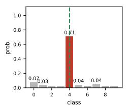

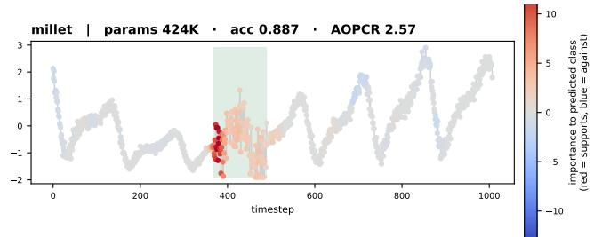

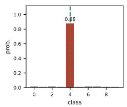

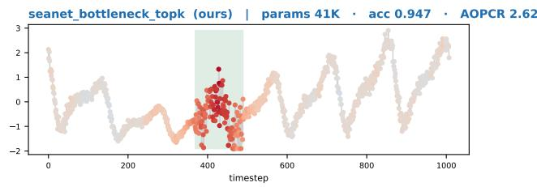  
Figure 1: The same WebTraffic series classified by three models. Each panel shows the predicted class and, its right side provides the explanation or interpretation of the prediction, given by the model. The red marks provide the evidence, supporting the predicted class at each time step. The “green shaded window” is the original ground truth of the time steps and was never used during training. MILLET (top) predicts the same class with 71 % confidence and does explain itself, but needs 424 K parameters. SEA-Net (bottom) is more confident, produces a sharper explanation, and uses 41 K parameters.

But its InceptionTime (Ismail Fawaz et al., 2020) backbone needs about 423,707 parameters and 848 MFLOPs for one series of length 1008, so at 32-bit precision the weights alone take about 1.6 MB, which already exceeds the memory budget above, before activations, runtime or application code. Swapping MILLET’s interpretable head for ordinary global average pooling on the same backbone removes only 1,041 of those parameters (Section C.1): the ability to explain itself costs a quarter of a percent of the model, and almost all of the cost is the encoder. This paper builds on that observation. Edge-oriented models fit micro-controllers (Banbury et al., 2021a; Jacob et al., 2018) but predict only a class label; to our knowledge no model meets all three requirements. Hence, we propose our Selective Evidence Aggregation Network (SEA-Net), an inherently interpretable architecture for time series classification. Both parts already exist — separable convolutions (Chollet, 2017; Howard et al., 2017), squeeze-and-expand bottlenecks (He et al., 2016; Iandola et al., 2016; Sandler et al., 2018) and k-max selection in MIL (Durand et al., 2016), and we claim none as new; what is new is their combination inside an interpretable MIL classifier.Our model has 41,324 parameters and 76.7 MFLOPs, 10.3× and 11.1× below MILLET. On WebTraffic, the one dataset whose ground truth marks the time steps carrying the class label, it beats MILLET on both jobs: accuracy 0.931 against 0.888 and NDCG@n 0.765 against 0.681 (Figure 1). Across the 85 UCR datasets, our method stays within two accuracy points of MILLET (Section 4.1).1 The following are our key contributions: i) A MIL encoder small enough to be a candidate for small devices (Section 3.2): multi-scale depthwise separable dilated convolutions with a bottlenecked pointwise mix, keeping the length unchanged so that the per-time-step interpretation is not lost. ii) Per-class Top-k conjunctive pooling (Section 3.3), which adds no parameters and becomes exactly the baseline head at κ = 1 (Property 2). This property is what makes the κ study of Section 4.1 a controlled experiment rather than a comparison of two different models. iii) A warning about the AOPCR measure (Section 4.1): AOPCR has no fixed scale, and with the architecture and the code held fixed it changes by 4.9× when only the training budget changes, so we compare only against baselines we retrained ourselves.

## 2 RELATED WORK

Deep learning for time series classification: In Wang et al. (2017), the “Fully Convolutional Network (FCN)” and the “Residual Network (ResNet)” are established as strong baselines for TSC. The InceptionTime (Ismail Fawaz et al., 2020) architecture extends this baseline by applying filters of several kernel sizes in parallel, capturing patterns of different durations. Temporal Convolutional Networks (TCNs) (Bai et al., 2018) have demonstrated their effectiveness for time-series analysis, and we take inspiration from them for our proposed model. TCNs use dilated convolutions, which enable the network to capture information over a wider temporal context. This enlarges the receptive field and allows the model to capture both short-term and long-term temporal dependencies without significantly increasing the number of model parameters. The comprehensive review by Ismail Fawaz et al. (2019) shows that convolutional architectures are an effective family of approaches for TSC. Despite their architectural differences, these models typically conclude with a Global Average Pooling (GAP) layer, which removes the explicit temporal resolution of the learned representations.

Interpretability and multiple instance learning: Interpretability methods can be broadly divided into post-hoc approaches and models that incorporate explanations directly into the prediction process. Post-hoc attribution methods, such as LIME (Ribeiro et al., 2016), SHAP (Lundberg & Lee, 2017), and Integrated Gradients (Sundararajan et al., 2017), explain a trained model after prediction, whereas Rudin (2019) advocates incorporating interpretability directly into the model architecture. For time series, two main directions follow this principle. The first direction uses shapelets, i.e., short representative subsequences whose presence can explain a prediction. VQShape (Wen et al., 2024) learns a codebook of representative shapes, while InterpGN (Wen et al., 2025) combines a shapelet expert with a deep expert through a confidence gate. The second direction, which we follow, is based on MIL (Dietterich et al., 1997). Attention-based MIL (Ilse et al., 2018) introduced learnable instance-level pooling, later extended by models such as DSMIL (Li et al., 2021) for histopathology. MILLET (Early et al., 2024) adapted this idea to TSC.

Small architectures and deployment budgets: Depthwise separable convolutions (Chollet, 2017; Howard et al., 2017) and squeeze-and-expand bottlenecks (He et al., 2016; Iandola et al., 2016; Sandler et al., 2018) are standard techniques for reducing the parameter count and computational cost. For time series, ATCN (Baharani & Tabkhi, 2022) combines residual connections with separable convolutions for efficient inference, while the method in Risso et al. (2023) optimizes the dilation and channel structure of TCNs under edge-device constraints. However, these approaches focus on efficiency rather than interpretability: they produce a prediction without explicitly indicating which temporal regions contributed to it.

For deployment on resource-constrained devices, MCUNet (Lin et al., 2020), MicroNets (Banbury et al., 2021b), and MLPerf Tiny (Banbury et al., 2021a) provide benchmarks and design principles based on constraints such as flash memory, SRAM, and computational cost. These works demonstrate how neural networks can be made suitable for micro-controller-class hardware, but they do not address the additional challenge of maintaining interpretability under such resource constraints.

## 3 METHOD

## 3.1 PROBLEM SETUP AND NOTATION

We propose the Selective Evidence Aggregation Network (SEA-Net), a MIL model for TSC that keeps MILLET’s two-part structure but replaces its InceptionTime backbone with a far smaller encoder (Section 3.2) and its Conjunctive head with three selective pooling variants (Section 3.3). SEA-Net has two components: an encoder $\psi _ { e n c - e m b e d } .$ which produces one embedding per time point, and a MIL pooling head $\psi _ { p o o l } .$ , which turns those embeddings into a class prediction. A dataset holds n univariate series $X _ { i } = \stackrel { \cdot } { ( } x _ { i } ^ { 1 } , \ldots , x _ { i } ^ { t } ) , i \in \{ 1 , \ldots , n \}$ , of common length t, each carrying a single label $Y _ { i } \in \{ 1 , \ldots , C \}$ , where $C$ is the number of classes. We treat each series as a MIL bag and each time point as an instance, so the encoder maps $X _ { i } \mathrm { ~ t o ~ } Z _ { i } = [ z _ { i } ^ { 1 } , \ldots , z _ { i } ^ { t } ] \in \mathbb { R } ^ { t \times d }$ , one d-dimensional embedding per instance. The instance labels $\left\{ y _ { i } ^ { 1 } , \ldots , y _ { i } ^ { t } \right\}$ are never annotated in TSC datasets and are never used for training; recovering them from the bag label alone is precisely what MIL techniques are capable of. Unlike classical MIL (Hashimoto et al., 2020; Li et al., 2021), our instances are ordered rather than i.i.d., and every layer of SEA-Net preserves that order.

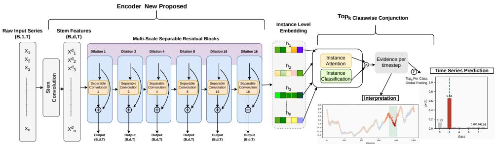  
Figure 2: Overview of a complete SEA-Net model, read left to right, with the tensor shape under each stage. Left, the SEA-Net encoder: the series $( B , 1 , t )$ passes through a stem convolution to $( B , \bar { d } , t )$ and then through six multi-scale separable residual blocks, whose dilation grows $1 , 2 , 4 , 8$ and is then capped at 16; the curved arrow inside each block is the residual connection, and t is unchanged at every stage. Middle: one instance-level embedding $\mathbf { z } _ { j }$ per time step. Right, the MIL pooling head (Section 3.3):

Whether that per-instance evidence survives depends on $\psi _ { p o o l }$ . Classical embedded pooling (Wang et al., 2018) applies global average pooling, $\begin{array} { r } { P _ { i } = \frac { 1 } { t } \sum _ { j = 1 } ^ { t } z _ { i } ^ { j } } \end{array}$ , then a classifier $\hat { Y } _ { i } = \psi _ { c l f } ( P _ { i } )$ to classify: the time axis is collapsed before classification, so no per-time-point prediction exists and the model cannot report which time points drove the prediction for the series. Our pooling heads (Section 3.3) preserve this order: they score each time point first and aggregate afterward, which makes the interpretation $\hat { I } _ { i } \in \mathbb { R } ^ { t \times C }$ available. We keep MILLET’s two-part structure but replace InceptionTime with a smaller, cheaper encoder, and its Conjunctive pooling head with three pooling variants of our own: Class-wise Conjunctive, Soft-Max Conjunctive with Learnable Sharpness and Top-k Conjunctive pooling.

## 3.2 SEA-NET ENCODER

Figure 2 gives an overview of the encoder and its interface with the MIL pooling head. The encoder module begins with a stem convolution layer, that extracts local temporal features from the input time series while simultaneously increasing its representation from a single input channel of a time point to d feature channels. The stem convolution is followed by a stack of multi-scale separable residual blocks (Section 3.2). The output $( Z _ { i } \in \mathbb { R } ^ { t \times d } )$ of the encoder module is given as the input to the MIL pooling module, which in turn provides the prediction as the posterior probabilities $\hat { Y } _ { i } \in \mathbb { R } ^ { 1 \times C }$ of C output classes and the interpretation score of each time step $\hat { I } _ { i } \in \mathbb { R } ^ { t \times C }$

Multi-scale separable residual blocks: The encoder body is a stack of six identical blocks built from two established concepts. Dilated convolutions (Bai et al., 2018) insert gaps between the filter taps, widening the temporal window a filter sees without adding weights, and depthwise separable convolutions (Chollet, 2017; Howard et al., 2017) split a convolution into a depthwise part $D _ { k } ^ { ( \delta ) }$ filtering each channel independently along time, and a pointwise $1 \times 1$ part $P$ mixing channels at each time point. The smallest element is a unit. Three depthwise convolutions read the same input in parallel at kernel sizes $\mathcal { K } = \{ 5 , 1 1 , 2 3 \}$ }, so short, medium and long patterns are examined at once and no single scale has to be chosen in advance; their outputs are summed and mixed by $P \colon$

$$
\begin{array} { r } { \mathcal { U } ( \mathbf { h } ) = \mathrm { D r o p } \Big ( \operatorname { R e L U } \Big ( \operatorname { B N } \Big ( P \Big ( \sum _ { k \in \mathcal { K } } D _ { k } ^ { ( \delta ) } ( \mathbf { h } ) \Big ) \Big ) \Big ) \Big ) , \qquad \mathcal { K } = \{ 5 , 1 1 , 2 3 \} , } \end{array}\tag{1}
$$

where h $\in \mathbb { R } ^ { t \times d }$ is the input and $\delta$ the dilation. A block is two units in sequence with a residual connection, so it learns a correction to its input rather than replacing one representation with another:

$$
\mathrm { B l o c k } ( \mathbf { h } ) = \mathrm { R e L U } \big ( \mathbf { h } + ( \mathcal { U } \circ \mathcal { U } ) ( \mathbf { h } ) \big ) .\tag{2}
$$

Six blocks are stacked, each feeding the next, with the dilation growing geometrically and then held: $\delta _ { i } = \operatorname* { m i n } ( 2 ^ { i } , \delta _ { \operatorname* { m a x } } ) , \delta _ { \operatorname* { m a x } } = 1 6$ . This operation has two properties. First, the receptive field widens quickly but stays bounded: the five taps of the $k = 5$ filter span five consecutive time points at $\delta = 1$ whereas they span up to 65 time points at $\delta = 1 6 ,$ , so each embedding summarizes a local, finite region at several scales. Second, every convolution uses “same” padding with a stride of one, and no pooling or temporal downsampling is applied; the length t is therefore unchanged at every stage, which is what delivers one embedding per time point to the pooling head.

SEA-Net Bottleneck pointwise mixing: In the separable unit, the depthwise filters are cheap because each channel has one small kernel. Most of the parameters are in the pointwise mixing $\dot { P }$ of Equation (1), which costs $d ^ { 2 }$ weights per unit. We therefore factorize $P$ into two smaller $1 \times 1$ convolutions: the first squeezes the d channels to a width $r < d ,$ , and the second expands them back:

$$
{ \cal P } ( { \bf h } ) = P _ { \mathrm { e x p } } \big ( P _ { \mathrm { s q } } ( { \bf h } ) \big ) , \qquad P _ { \mathrm { s q } } : \mathbb { R } ^ { d } \to \mathbb { R } ^ { r } , \quad P _ { \mathrm { e x p } } : \mathbb { R } ^ { r } \to \mathbb { R } ^ { d } , \qquad \frac { 2 d r } { d ^ { 2 } } = \frac { 2 r } { d } .\tag{3}
$$

Because there is no non-linearity between the two convolutions, the pair is equivalent to a single mixing matrix of rank $r .$ This leaves the depth of the block unchanged and adds no extra layer. With $r = d / 4$ , the pointwise cost drops from $d ^ { 2 } \tan 2 d r = d ^ { 2 } / 2$ , a halving at any width. $\mathrm { \ A t \ } d = 6 4$ this reduces the whole model from 57,580 to 41,324 parameters (−28%). The block still outputs a matrix of shape $\mathbb { R } ^ { t \times d }$ , so the pooling head needs no change.

SEA-Net Channel re-weighting variants: Both variants introduce a channel re-weighting layer after the last multi-scale separable residual block. The purpose of this layer is to adaptively adjust the contribution of the d feature channels according to their relevance to the input time series, while leaving the encoder blocks and the MIL pooling head unchanged. In both variants, the output of the sixth block, $Z _ { i } \in \mathbb { R } ^ { t \times d }$ , is first passed through the channel re-weighting layer. Each time-step embedding $z _ { i } ^ { j } , j = 1 , \dotsc , t ,$ is then re-weighted according to:

$$
\begin{array} { r l r l r l r l } & { \tilde { z } _ { i } ^ { j } = z _ { i } ^ { j } \odot ( 1 + g _ { i } ^ { j } ) , } & & { \underbrace { g _ { i } ^ { j } = \sigma ( W _ { g } s _ { i } ) } _ { \mathrm { G a t e d ( m e a n ) } } , } & { s _ { i } = \frac { 1 } { t } \sum _ { j } z _ { i } ^ { j } } & & { \underbrace { g _ { i } ^ { j } = \sigma ( W _ { g } \ast X _ { i } ) ^ { j } } _ { \mathrm { I n p u t G a t e d } } , } & & { g _ { i } ^ { j } \in [ 0 , 1 ] ^ { d } . } \end{array}\tag{4}
$$

where $g _ { i } ^ { j } \in [ 0 , 1 ] ^ { d }$ contains one weight for each feature channel. The use of $( 1 + g _ { i } ^ { j } ) \in [ 1 , 2 ] ^ { d }$ , rather than $g _ { i } ^ { \ j }$ alone, preserves the original features while allowing informative channels to be amplified. This also preserves the differences between time-step embeddings, which are used to compute the interpretation score ${ \hat { I } } _ { i } .$ . Since the re-weighting is applied only along the channel dimension, the temporal structure of $Z _ { i }$ remains unchanged. Consequently, both the following variants produce an output $\tilde { Z } _ { i } \in \mathbb { R } ^ { t \times d }$ that can be directly passed to the same MIL pooling head.

SEA-NET GATED (MEAN): In the first variant, a single set of channel weights is computed for the entire time series. The output $Z _ { i }$ of the sixth encoder block is first averaged over its t time points to obtain a series-level representation. This representation is passed through a linear transformation $W _ { g } \in \mathbb { R } ^ { d \times d }$ followed by a sigmoid function to obtain one weight for each channel: These weights are applied to every time-step embedding as in Equation (4). Thus, this variant determines which feature channels are generally more informative for the entire time series. However, the same weights are applied at every time point and therefore cannot account for changes in the importance of a channel over time. The mean-based version is used in the main experiments (others in Section B.3)

SEA-NET INPUT GATED: The second variant performs channel re-weighting at each time point. Instead of computing the weights from the deep representation $Z _ { i }$ , they are obtained directly from the raw input time series $X _ { i \cdot \mathrm { ~ A ~ } }$ 1D convolution with kernel size $7$ transforms the single input channel into d channels, followed by a sigmoid function to produce a separate set of channel weights $g _ { i } ^ { j } \in [ 0 , 1 ] ^ { d }$ for each time point: where $\mathbf { \bar { \boldsymbol { W } } } _ { g } * \mathbf { \boldsymbol { X } } _ { i }$ denotes the 1D convolution. Unlike the previous variant, the channel weights can therefore vary both across channels and across time points. Because they are computed directly from the raw input, they can respond to local events, such as a sudden peak, before these patterns are potentially smoothed by the encoder’s receptive field. These two variants allow us to study the effect of coarse, series-level channel re-weighting versus fine-grained, time-dependent channel re-weighting while keeping the remainder of the architecture unchanged (Section B).

SEA-Net Spike/Trend: A stack of convolutions followed by batch normalization is biased toward smooth and sustained patterns, whereas in some datasets the evidence of a class is a single sharp discontinuity (i.e., a spike) in the time series. In this variant, we therefore run a second, high-passfilter-like branch in parallel with the encoder blocks and merge the two branches before the pooling head. The output of the encoder is called the trend features, and the output of this new high-passfilter-like branch is called the spike features. In Figure 2, the encoder path (the stem convolution and the six blocks) is untouched and gives the trend features $Z _ { i } \in \mathbb { R } ^ { t \times d }$ . The new spike branch takes the original time series $X _ { i }$ as input, applies a moving average a $\operatorname { v g } _ { w } ( X _ { i } )$ with window $w = 5$ , and then subtracts this smoothed signal from the original time series. This subtraction removes the smooth, slowly varying component of the signal, leaving a residual that is close to zero in smooth regions and becomes large around sudden changes or discontinuities. Then a convolution with kernel size $^ { 3 , }$ followed by BN and ReLU layers, is applied, which turns the output into $d _ { \mathrm { s p i k e } } = 1 6$ channels. Finally, at each time point, the trend features and spike features are concatenated and projected back to d channels using the pointwise convolution $P ,$ , as defined in Equation (1). The resulting representation is then aggregated using the mean operation described in Equation (4).

$$
\operatorname { s p i k e } _ { i } ^ { j } = \operatorname { R e L U } \Big ( \operatorname { B N } \big ( \operatorname { C o n v } _ { 3 } ( X _ { i } - \arg _ { w } ( X _ { i } ) ) \big ) \Big ) ^ { j } \in \mathbb { R } ^ { d _ { \operatorname { s p i k e } } }\tag{5}
$$

$$
\widetilde { z } _ { i } ^ { j } = P \big ( [ z _ { i } ^ { j } ; \mathrm { s p i k e } _ { i } ^ { j } ] \big ) \odot ( 1 + g _ { i } )\tag{6}
$$

where $[ \cdot ; \cdot ]$ is the concatenation along the channel axis, giving $d + d _ { \mathrm { s p i k e } }$ channels, and $g _ { i }$ is computed as in Equation (4) on the mixed features. With this branch, the pooling head directly receives features which mark the discontinuities of the series. Hence, we expect an advantage on datasets where the class evidence has impulsive patterns.

## 3.3 MIL POOLING HEAD

With the encoder complete, we now describe the second component of SEA-Net, the MIL pooling head $\psi _ { p o o l }$ , shown on the right side of Figure 2. Given the instance-level embeddings $Z _ { i } \in \dot { \mathbb { R } } ^ { t \times d } \overset { \smile } { = }$ $[ z _ { i } ^ { 1 } , \ldots , z _ { i } ^ { t } ]$ , the pooling head has two branches: an attention branch that determines the importance of each time point, and a classifier branch that determines the class evidence provided by each time point. Their product defines the evidence $e _ { i } ^ { j , k }$ of time point $j$ for class k. Aggregating this evidence over time produces the class prediction $\hat { Y } _ { i } \in \mathbb { R } ^ { 1 \times C }$ , while retaining the evidence at each time point gives the interpretation score $\hat { I } _ { i } \in \mathbb { R } ^ { t \times C }$ . Our pooling head is based on the Conjunctive pooling of MILLET (Equation (7)) (Early et al., 2024), which uses a single attention weight $a _ { i } ^ { j }$ for each time point and a class-wise classifier output $\hat { y } _ { i } ^ { j }$

$$
\begin{array} { r l } & { \quad a _ { i } ^ { j } = \sigma \big ( \mathbf w _ { a } ^ { \top } \operatorname { t a n h } ( W _ { a } z _ { i } ^ { j } ) \big ) \in [ 0 , 1 ] } \\ & { \quad \hat { y } _ { i } ^ { j } = W _ { c } z _ { i } ^ { j } + \mathbf b _ { c } \in \mathbb R ^ { C } } \\ & { \quad \hat { Y } _ { i } ^ { k } = \frac { 1 } { t } \sum _ { j = 1 } ^ { t } a _ { i } ^ { j } \hat { y } _ { i } ^ { j , k } , \quad \hat { I } _ { i } ^ { j , k } = a _ { i } ^ { j } \hat { y } _ { i } ^ { j , k } } \end{array}\tag{7}
$$

$$
\begin{array} { r l } & { \quad a _ { i } ^ { j } = \sigma \big ( W _ { 2 } \operatorname { t a n h } ( W _ { 1 } z _ { i } ^ { j } ) \big ) \in [ 0 , 1 ] ^ { C } } \\ & { e _ { i } ^ { j , k } = a _ { i } ^ { j , k } \hat { y } _ { i } ^ { j , k } , \quad \hat { I } _ { i } ^ { j , k } = e _ { i } ^ { j , k } } \\ & { \quad \hat { Y } _ { i } ^ { k } = \frac { 1 } { t } \sum _ { j = 1 } ^ { t } e _ { i } ^ { j , k } } \end{array}\tag{8}
$$

where $W _ { a } \in \mathbb { R } ^ { d _ { a } \times d }$ and ${ \mathbf w } _ { a } \in \mathbb { R } ^ { d _ { a } }$ define the attention branch, while $W _ { c } \in \mathbb { R } ^ { C \times d }$ and $\mathbf { b } _ { c } \in \mathbb { R } ^ { C }$ define the classifier branch; $\mathbf { \tilde { W } } _ { 1 } \in \mathbb { R } ^ { d _ { a } \times d }$ and $W _ { 2 } \in \mathbb { R } ^ { C \times d _ { a } }$ are its class-wise counterparts below.

Conjunctive pooling has three limitations that motivate our pooling variants. First, the scalar attention weight $a _ { i } ^ { j }$ is shared across all C classes and therefore cannot represent class-specific importance. Second, the sigmoid weights are not normalized over time: although $a _ { i } ^ { j } \in [ 0 , 1 ]$ , their sum depends on the series length $t ,$ while the aggregation divides by t. Consequently, the magnitude of ${ \hat { Y } } _ { i } ^ { k }$ can depend on the series length, which is particularly relevant for the UCR archive, where series lengths range from 15 to 2,844. Third, averaging all t evidence values can dilute a small number of highly informative time points when most of the series contains background information. We developed seven pooling variants; here we describe the three that directly address the limitations above, while the remaining four are presented in Section C. All three variants retain the two-branch structure and the classifier output $\hat { y } _ { i } ^ { j }$ of Equation (7). They differ only in how the attention weights are computed and/or how the resulting evidence is aggregated. In every case, the interpretation $\hat { I } _ { i }$ is obtained from the same evidence used to compute $\hat { Y } _ { i } ,$ , ensuring consistency between prediction and interpretation.

Class-wise / Soft-Max / Top-k conjunctive pooling: The Class-wise variant (Equation (8)) addresses the first limitation by replacing the single scalar attention weight with a class-specific vector: Each time point can therefore have a different importance for different classes. The modification only widens the final attention layer, adding $( C - 1 ) ( d _ { a } \mathrm { + } 1 )$ parameters compared with the original attention branch. If $a _ { i } ^ { j , k } = a _ { i } ^ { j }$ for all $k ,$ the formulation reduces exactly to the original Conjunctive pooling. The $\mathtt { S o f t - M a x }$ variant addresses the second limitation by normalizing the attention weights across time. For each class, the attention scores are converted into a probability distribution using a Soft-Max with learnable temperature $\tau > 0$ (Equation (9)):

$$
s _ { i } ^ { j , k } = \left( W _ { 2 } \operatorname { t a n h } ( W _ { 1 } z _ { i } ^ { j } ) \right) _ { k }
$$

$$
\begin{array} { r l } & { \alpha _ { i } ^ { j , k } = \frac { \exp ( s _ { i } ^ { j , k } / \tau ) } { \sum _ { l = 1 } ^ { t } \exp ( s _ { i } ^ { l , k } / \tau ) } } \\ & { \hat { Y } _ { i } ^ { k } = \sum _ { j = 1 } ^ { t } \alpha _ { i } ^ { j , k } \hat { y } _ { i } ^ { j , k } , \quad \hat { I } _ { i } ^ { j , k } = \alpha _ { i } ^ { j , k } \hat { y } _ { i } ^ { j , k } } \end{array}\tag{9}
$$

$$
\begin{array} { r l } & { m = \operatorname* { m a x } \left( 1 , \lceil \kappa t \rceil \right) } \\ & { \mathcal { S } _ { i } ^ { k } = \mathrm { t o p } _ { m } \left( e _ { i } ^ { 1 , k } , \ldots , e _ { i } ^ { t , k } \right) } \\ & { \hat { Y } _ { i } ^ { k } = \frac { 1 } { m } \sum _ { j \in { S } _ { i } ^ { k } } e _ { i } ^ { j , k } , \quad \hat { I } _ { i } ^ { j , k } = e _ { i } ^ { j , k } } \end{array}\tag{10}
$$

Because $\begin{array} { r } { \sum _ { j } \alpha _ { i } ^ { j , k } = 1 } \end{array}$ , the prediction is no longer directly affected by the series length, making series of different lengths more comparable. The temperature controls the concentration of the attention: large τ produces a more uniform distribution approaching $1 / t$ , whereas small $\tau$ concentrates the weight on the highest-scoring time points. We parameterize ${ \dot { \tau } } = \exp ( \rho )$ with learnable $\rho ,$ ensuring $\tau > 0$ while introducing only one additional parameter.

The $\tt T O p { - } k$ conjunctive variant addresses the third limitation by aggregating only the most informative time points rather than averaging the evidence over the entire series. It uses the class-wise attention of Equation (8) and retains only the m largest evidence values for each class (Equation (10)): Here, $\kappa \in [ 0 , \bar { 1 } ]$ controls the fraction of time points retained and introduces no additional learnable parameters. When $\kappa = 1$ , this formulation reduces to the class-wise pooling of Equation (8); for $\kappa < 1$ , the aggregation focuses on the most informative time points, reducing the influence of background regions. Consequently, the prediction is based on an explicit subset of time points, which also makes the resulting interpretation more focused. This is the pooling head used in our best-performing models.

Every encoder and head above shares the same input and output shapes, so any pair combines from configuration alone. Section 4 evaluates these combinations, taking the bottleneck encoder with Top-k pooling as our main model.

## 4 EXPERIMENTAL SETUP AND RESULTS

Research questions and datasets: We ask whether the small model retains classification accuracy, retains a useful interpretation, and how much cost it actually removes; two further questions, RQ4 what the bottleneck contributes and RQ5 what Top-k pooling contributes, are answered by the ablation of Section 4.1. We answer them on two datasets (Table 15).

We use the same WebTraffic dataset as MILLET (Early et al., 2024): a synthetic set of 1,000 series of length 1,008 over 10 classes, split 500/500, in which each class signature is injected inside a known window (Figure 14). It is the only dataset with a ground truth per time point, hence the interpretation can be scored rather than merely inspected. For wider coverage we use the UCR archive (Dau et al., 2019), reporting the 85-dataset subset used by MILLET so that the numbers are comparable; we also report the performance on the full 128-dataset archive in Section E.5. Class signatures are not annotated there, so on UCR the interpretation can only be evaluated with AOPCR.

We use the test accuracy for the classification, and AOPCR (Samek et al., 2017) together with NDCG@n (Järvelin & Kekäläinen, 2002) for the interpretation; both metrics are defined in Section D.4. AOPCR progressively removes time points according to their estimated importance and accumulates the resulting decrease in the score of the predicted class. Computing AOPCR does not require ground truth, so we can report this metric on both datasets. NDCG@n ranks the time points by the importance the model assigns them and compares that ranking with the ground truth.

Table 1: Classification and explanation quality on WebTraffic, each model written as encoder + pooling head. Rows marked ∗ are mean ± s.d. over the Runs column. Higher is better except for NLL. AOPCR is unnormalised, so it compares only models trained under the same recipe; rows marked † use MILLET’s recipe (1500 epochs) and are never marked best. Run conventions in Appendix D.3, parameter counts in Table 22.
<table><tr><td>Model (encoder + pooling head)</td><td>Runs</td><td>Accuracy</td><td>AUROC</td><td>NLL</td><td>AOPCR</td><td>NDCG@n</td></tr><tr><td colspan="7">SEA-Net (ours): encoder + Top-k conjunctive head</td></tr><tr><td>gated (mean) + Top-k conj.</td><td>3</td><td>0.955 ± 0.002</td><td>0.998 ± 0.000</td><td>0.254 ± 0.010</td><td>2.225 ± 0.107</td><td>0.750 ± 0.018</td></tr><tr><td>bottleneck + Top-k conj. (λfocus = 0)</td><td>1</td><td>0.950</td><td>0.998</td><td>0.263</td><td>2.303</td><td>0.765</td></tr><tr><td>spike/trend + Top-k conj.</td><td>1</td><td>0.950</td><td>0.997</td><td>0.288</td><td>2.316</td><td>0.756</td></tr><tr><td>input-gated + Top-k conj.</td><td>1</td><td>0.946</td><td>0.997</td><td>0.261</td><td>2.803</td><td>0.748</td></tr><tr><td>bottleneck + Top-k conj.</td><td>1</td><td>0.942</td><td>0.996</td><td>0.294</td><td>2.951</td><td>0.786</td></tr><tr><td>bottleneck + Top-k conj.*</td><td>3</td><td>0.931 ± 0.032</td><td>0.996 ± 0.002</td><td>0.312 ± 0.063</td><td>2.498 ± 0.149</td><td>0.765 ± 0.013</td></tr><tr><td colspan="7">Baselines re-trained here under the same recipe</td></tr><tr><td>MILLET (InceptionTime + conjunctive)*</td><td>4</td><td>0.888 ± 0.007</td><td>0.988 ± 0.002</td><td>0.513 ± 0.019</td><td>2.457 ± 0.655</td><td>0.681 ± 0.013</td></tr><tr><td>ResNet + conjunctive</td><td>1</td><td>0.772</td><td>0.957</td><td>0.824</td><td>2.952</td><td>0.554</td></tr><tr><td>FCN + conjunctive</td><td>1</td><td>0.742</td><td>0.955</td><td>0.910</td><td>3.826</td><td>0.533</td></tr><tr><td colspan="7">MILLET under its own recipe</td></tr><tr><td>MILLET, re-trained here with their recipe*</td><td>2</td><td>0.918 ± 0.002</td><td>0.994 ± 0.001</td><td>0.392 ± 0.021</td><td>12.060 ± 1.208†</td><td>0.643 ± 0.019</td></tr><tr><td>MILLET, published (mean of 5 seeds)</td><td>5</td><td>0.924</td><td>0.994</td><td>0.379</td><td>12.768†</td><td>0.674</td></tr><tr><td>MILLET, published 5-model ensemble</td><td>1</td><td>0.940</td><td>0.996</td><td>0.277</td><td>11.100†</td><td>0.694</td></tr></table>

## 4.1 CLASSIFICATION AND INTERPRETATION RESULTS

WebTraffic: Table 1 gives one complete model per row, written as encoder + pooling head. Our SEA-Net model exceeds MILLET’s accuracy and achieves a better NDCG@n, while being about ten times smaller: 0.931 ± 0.032 accuracy and 0.765 ± 0.013 NDCG@n with 41,324 parameters, against 0.888±0.007 and 0.681±0.013 with 423,707 parameters for MILLET under the same budget (Table 1). The gated (mean) + Top-k variant is more accurate and far more stable $( 0 . 9 5 5 \pm 0 . 0 0 \bar { 2 } )$ but needs 61,740 parameters and a lower NDCG@n (0.750 ± 0.018), so the bottleneck model stays our headline. Two further columns point the same way. Our negative log-likelihood is 0.312 ± 0.063 against 0.513±0.019 for the matched-budget baseline, a 39 % reduction, and it stays below MILLET’s own 1,500-epoch recipe $( 0 . 3 9 2 \pm 0 . 0 2 1 )$ and its published figure (0.379); AUROC moves the same way, 0.996 ± 0.002 against 0.988 ± 0.002. The 41 K model is therefore better calibrated than the baseline even when the baseline is given nearly four times the training budget. UCR archive: On UCR, the comparison depends on the size budget. Our 41 K model reaches 0.810 mean accuracy, 1.8 points below the matched-budget MILLET baseline (0.827) and 3.5 points below MILLET’s published accuracy (0.845), at a tenth of the parameters and with mean rank 15.40 against 12.60. Counted per dataset against MILLET’s published accuracies, it wins on 20, ties on 15 and loses on 50 of the 85, where the ten-times-larger matched-budget baseline scores 13/25/46: more outright wins than the baseline, but also more losses (Table 29). The gap comes from size, not from design. Re-running the same architecture, with the same blocks and head, in a wide configuration (d from 64 to 128, blocks from 4 to 6) reaches 0.829 accuracy and mean rank 11.53, the best rank in Table 29: ahead of the matched-budget MILLET baseline on accuracy (0.827), on rank (12.60) and on wins (26 against 13), with 36 % fewer parameters. At a comparable size and the same training budget, replacing the MILLET backbone by ours is worth about 1.1 rank places. The SEA-Net design is therefore not what loses accuracy on UCR; the smaller parameter budget is.

RQ4, the bottleneck: Table 21, one seed per row, isolates the encoder: the two rows of each pair share the same pooling head and differ only in whether the bottleneck is used. Replacing the plain encoder by the bottleneck encoder removes 16,256 parameters, that is 28 % of the 57,580 of the plain model. Accuracy then changes by −0.014 with the class-wise head and by −0.001 with the Top-k head, and NDCG@n by +0.014 and −0.013 respectively. The accuracy changes are well inside the three-run spread of ±0.032 and the NDCG@n changes sit at its ±0.013 spread (Table 1), so none can be resolved from these single-seed runs. We therefore claim only that the bottleneck delivers the size reduction at no measurable cost in accuracy or interpretation.

RQ5, Top-k pooling: Read the other way, the same table isolates the head: the two rows of each pair share the same encoder and differ only in the pooling head. Replacing the class-wise head by Top-k raises NDCG@n from 0.719 to 0.778 on the plain encoder (+0.059) and from 0.733 to 0.765 on the bottleneck encoder (+0.032), two to five times the ±0.013 seed spread. This gain in interpretation ranking is the claim we make for the head. Accuracy moves the same way, by +0.016 and +0.029, but both sit inside the ±0.032 accuracy spread, so we do not present Top-k as an accuracy gain.

Table 2: Performance on the 84 UCR datasets shared by every row, as mean / average rank / number ofwins. Higher is better except for NLL. Our models and the re-trained baselines share one training recipe; the published MILLET rows use their own (1500 epochs) and are ranked with the rest. Ranking rules, the full protocol and parameter counts are in Appendix D.3 and Table 22.
<table><tr><td>Model</td><td>Accuracy</td><td>Bal. accuracy</td><td>AUROC</td><td>NLL</td></tr><tr><td>SEA-Net (ours), our recipe</td><td></td><td></td><td></td><td></td></tr><tr><td>gated (mean) + Top-k conj.</td><td>0.806 / 9.17 / 11</td><td>0.778 / 9.38 / 11</td><td>0.916 / 9.39 / 11</td><td>0.561 / 7.28 / 3</td></tr><tr><td>base (wide, d = 128) + (MILLET)</td><td>0.822 / 7.75 / 13</td><td>0.797 / 7.64 / 13</td><td>0.927 / 7.60 / 15</td><td>0.522 / 6.35 / 7</td></tr><tr><td>gated (max) + Top-k conj.</td><td>0.809 / 8.73 / 11</td><td>0.783 / 8.61 / 10</td><td>0.916 / 8.38 / 13</td><td>0.551 / 6.92 / 6</td></tr><tr><td>spike/trend + Top-k conj.</td><td>0.807 / 8.44 / 9</td><td>0.781 / 8.32 / 9</td><td>0.913 / 8.57 / 12</td><td>0.551 / 7.06 / 6</td></tr><tr><td>reconstruction-residual + adaptive class-wise</td><td>0.812 / 8.96 / 11</td><td>0.784 / 8.84 / 10</td><td>0.922 / 8.74 / 12</td><td>0.555 / 7.95 / 4</td></tr><tr><td>base (wide, d = 128) + class-wise</td><td>0.827 / 7.32 / 16</td><td>0.802 / 7.10 / 15</td><td>0.925 / 7.96 / 16</td><td>0.516 / 6.60 / 8</td></tr><tr><td>input-gated + Top-k conj</td><td>0.811 / 8.29 / 12</td><td>0.786 / 8.27 / 11</td><td>0.922 / 8.02 / 16</td><td>0.541 / 6.29 / 4</td></tr><tr><td>bottleneck + Top-k conj.</td><td>0.808 / 9.10 / 7</td><td>0.781 / 9.31 / 7</td><td>0.917 / 9.47 / 7</td><td>0.556 / 7.29 / 2</td></tr><tr><td>Baselines re-trained here</td><td></td><td></td><td></td><td></td></tr><tr><td>MILLET (InceptionTime + conjunctive), our recipe</td><td>0.827 / 8.08 / 5</td><td>0.800 / 8.14 / 5</td><td>0.927 / 7.96 / 9</td><td>0.530 / 7.45 / 4</td></tr><tr><td>ResNet + conjunctive</td><td>0.813 / 8.23 / 15</td><td>0.782 / 8.76 / 12</td><td>0.923 / 8.03 / 14</td><td>0.575 / 8.44 / 3</td></tr><tr><td>FCN + conjunctive</td><td>0.812 / 8.92 / 10</td><td>0.782 / 9.43 / 11</td><td>0.921 / 8.90 / 10</td><td>0.578 / 8.73 / 6</td></tr><tr><td>MILLET, published (Early et al., 2024)</td><td></td><td></td><td></td><td></td></tr><tr><td>Conjunctive FCN, published (mean of 5 seeds)</td><td>0.828 / 8.12 / 10</td><td>0.803 / 8.02 / 9</td><td>0.928 / 7.70 / 13</td><td>1.059 / 9.31 / 9</td></tr><tr><td>Conjunctive ResNet, published (mean of 5 seeds)</td><td>0.834 / 7.29 / 10</td><td>0.811 / 7.15 / 9</td><td>0.930 / 7.35 / 9</td><td>1.186 / 10.79 / 2</td></tr><tr><td>Conjunctive InceptionTime, published (mean of 5 seeds)</td><td>0.843 / 5.79 / 12</td><td>0.822 / 5.45 / 13</td><td>0.932 / 6.44 / 13</td><td>1.232 / 10.12 / 5</td></tr></table>

Table 26 varies only the selection fraction κ, with the architecture and the training recipe unchanged. By Property 2, the κ = 1 row is the class-wise baseline head, so the difference between its NDCG@n of 0.722 and the 0.755 reached at $\kappa = 0 . 1 0$ comes from the selection alone and not from a change of model. Two caveats follow. First, κ has a best value rather than a monotone trend: $\kappa = 0 . 0 5$ is worse than $\kappa = 0 . 1 0$ on AOPCR and NDCG@n and no better on accuracy, so keeping too few time points hurts as much as keeping too many. Second, AOPCR does not track κ the way NDCG@n does, peaking at $\kappa = 0 . 5 0 ( 3 . 1 1 4 )$ where NDCG@n is among its lowest (0.732), which is one more reason to read AOPCR with caution (Section 4.1). Table 27 switches off the attention-entropy penalty $\lambda _ { \mathrm { f o c u s } } ( \mathrm { S e c t i o n } 4 ) .$ , a control independent of κ: removing it raises accuracy from 0.888 to 0.950 and NDCG@n from 0.755 to 0.765, while AOPCR falls from 2.409 to 2.303. On this single seed the penalty does not pay for itself. As every cell here is one seed, we read these rows as a pattern rather than as exact values. Re-trained under MILLET’s own 1,500-epoch recipe, MILLET scores AOPCR $1 2 . 0 6 0 \pm 1 . 2 0 8$ on WebTraffic, against $2 . 4 5 7 \pm 0 . 6 5 5$ for the same model under our matched budget (Table 1). The architecture, code, metric and data are identical; only the recipe differs. A 4.9× higher AOPCR would normally mean a far better explanation, but it does not here. AOPCR averages the drop in the predicted-class logit as the top-ranked time points are removed (Section D.4), and logits have no fixed scale: a model trained longer is more confident, so every removal drops the logit further, whether or not its ranking improved. NDCG@n, which scores the ranking itself and is normalized to [0, 1], confirms this: over the same pair $\mathrm { i t } f a l l s$ from 0.681 ± 0.013 to 0.643 ± 0.019, a drop of twice its own spread. AOPCR is therefore comparable only within a fixed training budget, hence not across papers: we retrain every baseline under our own budget rather than copying published numbers, never compare against MILLET’s published AOPCR, and base every interpretation claim on NDCG@n.

## 5 DISCUSSION AND CONCLUSION

Our trade-off depends on where the model runs: saving 10.3× in parameters for 1.8 accuracy points on UCR buys nothing on a workstation, but for the micro-controller class of MCUNet (Lin et al., 2020) and MicroNets (Banbury et al., 2021b) a 41 K model is a candidate where a 424 K one is not, and the per-time-step interpretation is kept. The price is paid for the size and not the design, since widening the same encoder recovers the UCR gap (Section 4.1). Our costs are parameter counts, analytic FLOPs and GPU timings; nothing was quantized or run on a micro-controller (Table 22), so deployment fitness is argued from size rather than shown. Activation memory does not shrink, because the encoder preserves length: peak memory exceeds the baseline’s, and where

SRAM rather than flash binds, streaming or strided variants are the next step. Interpretation is scored only on WebTraffic, which is also our design set, and its backup metric AOPCR is budget-sensitive (Section 4.1). Seeds are uneven: three models use three seeds, each ablation one, read against those spreads (Section 4). Training is slower, since GPU kernels favor dense over depthwise convolutions; the saving is at inference only. In summary, the cost of MIL lies in the encoder and not in the interpretability: our model keeps the per-time-step explanation and beats the equally-trained MILLET baseline on WebTraffic at a tenth of the parameters. Built-in interpretability is therefore not what makes these models large, and need not be given up to make them small.

## REPRODUCIBILITY STATEMENT

Everything needed to reproduce the results is either in the paper or in the anonymous code release. The models are defined in Section 3 and, for the encoder and pooling variants not used in the main text, in Sections B and C. The single training setting used for every model and every dataset is listed in Section 4 and repeated with all the remaining hyperparameters in Section D.3. The two evaluation metrics are defined in Section 4, and the perturbation procedure behind AOPCR, which Section 4.1 shows depends on the training recipe, is given in Section D.4. WebTraffic is produced by the released generator of Early et al. (2024) at the settings in Section D.3; the UCR archive (Dau et al., 2019) is public and used with its published train/test splits and no preprocessing other than standardizing each series. Seed counts are given per row in Table 2 and the per-seed values are in Section E.4. Cost figures come from the measurement procedure in Section 4; the script that produces them is in the code release. All 72 model combinations are listed row by row in Section E.1. Anonymous code, configurations and result tables: https://anonymous.4open.science/r/seanet-ANON.

## ETHICS STATEMENT

This work collects no new data and involves no human subjects. It uses the public UCR archive (Dau et al., 2019) under its original terms and a synthetic benchmark produced by released code; some UCR datasets come from human physiological recordings, but they are distributed in anonymized form by their maintainers and we did not try to re-identify them or add to them. The one risk worth naming is specific to this topic: a model that shows an explanation makes people trust it more than one that does not, and Section 4.1 shows that a common faithfulness score can be raised by training longer rather than by explaining better. Interpretations from models of this kind should therefore be checked on the target domain before they are used to support decisions about people. The code we build on is released under the Apache 2.0 license and its attribution notice is kept in our release.

## AI USE STATEMENT

In this work, we used generative AI tools for writing and editing the text of this paper, for literature search assistance while preparing Section 2, and for producing supporting experiment-management and plotting code. We have not used generative AI tools to generate, select, filter or interpret experimental results, to design the models or the experimental protocol, or to produce any of the numbers reported in this paper. We have reviewed all AI-assisted work. Every numeric value in the paper was traced by the authors to the specific result file and column it came from before it was written down, and the tables were checked against those files a second time after the paper was complete; AI-assisted code was read and tested by the authors, and all reported measurements come from runs the authors executed themselves. Every reference was checked against the original publication, and claims of novelty were checked against a manual literature survey rather than against tool output. We take responsibility for the final content of this work, including text, claims or artifacts produced with the aid of generative AI.

## REFERENCES

Mohammadreza Baharani and Hamed Tabkhi. ATCN: Resource-efficient processing of time series on edge. ACM Transactions on Embedded Computing Systems, 21(5):1–21, 2022.

Shaojie Bai, J. Zico Kolter, and Vladlen Koltun. An empirical evaluation of generic convolutional and recurrent networks for sequence modeling. arXiv preprint arXiv:1803.01271, 2018.

Colby Banbury, Vijay Janapa Reddi, Peter Torelli, Jeremy Holleman, Nat Jeffries, Csaba Kiraly, Pietro Montino, David Kanter, Sebastian Ahmed, Danilo Pau, Urmish Thakker, Antonio Torrini, Peter Warden, Jay Cordaro, Giuseppe Di Guglielmo, Javier Duarte, Stephen Gibellini, Videet Parekh, Honson Tran, Nhan Tran, Niu Wenxu, and Xu Xuesong. MLPerf tiny benchmark. In Advances in Neural Information Processing Systems (NeurIPS), Datasets and Benchmarks Track, 2021a.

Colby Banbury, Chuteng Zhou, Igor Fedorov, Ramon Matas, Urmish Thakker, Dibakar Gope, Vijay Janapa Reddi, Matthew Mattina, and Paul Whatmough. MicroNets: Neural network architectures for deploying TinyML applications on commodity microcontrollers. In Proceedings ofMachine Learning and Systems (MLSys), 2021b.

François Chollet. Xception: Deep learning with depthwise separable convolutions. In IEEE Conference on Computer Vision and Pattern Recognition (CVPR), pp. 1251–1258, 2017.

Hoang Anh Dau, Anthony Bagnall, Kaveh Kamgar, Chin-Chia Michael Yeh, Yan Zhu, Shaghayegh Gharghabi, Chotirat Ann Ratanamahatana, and Eamonn Keogh. The UCR time series archive. IEEE/CAA Journal ofAutomatica Sinica, 6(6):1293–1305, 2019.

Thomas G. Dietterich, Richard H. Lathrop, and Tomás Lozano-Pérez. Solving the multiple instance problem with axis-parallel rectangles. Artificial Intelligence, 89(1-2):31–71, 1997.

Thibaut Durand, Nicolas Thome, and Matthieu Cord. WELDON: Weakly supervised learning of deep convolutional neural networks. In IEEE Conference on Computer Vision and Pattern Recognition (CVPR), pp. 4743–4752, 2016.

Joseph Early, Gavin K. C. Cheung, Kurt Cutajar, Hanting Xie, Jasmina Kandola, and Niall Twomey. Inherently interpretable time series classification via multiple instance learning. In International Conference on Learning Representations (ICLR), 2024.

Noriaki Hashimoto, Daisuke Fukushima, Ryoichi Koga, Yusuke Takagi, Kaho Ko, Kei Kohno, Masato Nakaguro, Shigeo Nakamura, Hidekata Hontani, and Ichiro Takeuchi. Multi-scale domainadversarial multiple-instance CNN for cancer subtype classification with unannotated histopatho logical images. In IEEE Conference on Computer Vision and Pattern Recognition (CVPR), pp. 3852–3861, 2020.

Kaiming He, Xiangyu Zhang, Shaoqing Ren, and Jian Sun. Deep residual learning for image recognition. In IEEE Conference on Computer Vision and Pattern Recognition (CVPR), pp. 770–778, 2016.

Andrew G. Howard, Menglong Zhu, Bo Chen, Dmitry Kalenichenko, Weijun Wang, Tobias Weyand, Marco Andreetto, and Hartwig Adam. Mobilenets: Efficient convolutional neural networks for mobile vision applications. arXiv preprint arXiv:1704.04861, 2017.

Forrest N. Iandola, Song Han, Matthew W. Moskewicz, Khalid Ashraf, William J. Dally, and Kurt Keutzer. SqueezeNet: AlexNet-level accuracy with 50x fewer parameters and <0.5MB model size. arXiv preprint arXiv:1602.07360, 2016.

Maximilian Ilse, Jakub M. Tomczak, and Max Welling. Attention-based deep multiple instance learning. In International Conference on Machine Learning (ICML), pp. 2127–2136, 2018.

Sergey Ioffe and Christian Szegedy. Batch normalization: Accelerating deep network training by reducing internal covariate shift. In International Conference on Machine Learning (ICML), pp. 448–456, 2015.

Hassan Ismail Fawaz, Germain Forestier, Jonathan Weber, Lhassane Idoumghar, and Pierre-Alain Muller. Deep learning for time series classification: A review. Data Mining and Knowledge Discovery, 33(4):917–963, 2019.

Hassan Ismail Fawaz, Benjamin Lucas, Germain Forestier, Charlotte Pelletier, Daniel F. Schmidt, Jonathan Weber, Geoffrey I. Webb, Lhassane Idoumghar, Pierre-Alain Muller, and François Petitjean. Inceptiontime: Finding AlexNet for time series classification. Data Mining and Knowledge Discovery, 34(6):1936–1962, 2020.

Benoit Jacob, Skirmantas Kligys, Bo Chen, Menglong Zhu, Matthew Tang, Andrew Howard, Hartwig Adam, and Dmitry Kalenichenko. Quantization and training of neural networks for efficient integerarithmetic-only inference. In IEEE Conference on Computer Vision and Pattern Recognition (CVPR), pp. 2704–2713, 2018.

Kalervo Järvelin and Jaana Kekäläinen. Cumulated gain-based evaluation of IR techniques. ACM Transactions on Information Systems, 20(4):422–446, 2002.

Diederik P. Kingma and Jimmy Ba. Adam: A method for stochastic optimization. In International Conference on Learning Representations (ICLR), 2015.

Bin Li, Yin Li, and Kevin W. Eliceiri. Dual-stream multiple instance learning network for whole slide image classification with self-supervised contrastive learning. In IEEE Conference on Computer Vision and Pattern Recognition (CVPR), pp. 14318–14328, 2021.

Ji Lin, Wei-Ming Chen, Yujun Lin, John Cohn, Chuang Gan, and Song Han. MCUNet: Tiny deep learning on IoT devices. In Advances in Neural Information Processing Systems (NeurIPS), 2020.

Scott M. Lundberg and Su-In Lee. A unified approach to interpreting model predictions. In Advances in Neural Information Processing Systems (NeurIPS), pp. 4765–4774, 2017.

Marco Tulio Ribeiro, Sameer Singh, and Carlos Guestrin. “why should I trust you?”: Explaining the predictions of any classifier. In ACM SIGKDD International Conference on Knowledge Discovery and Data Mining, pp. 1135–1144, 2016.

Matteo Risso, Alessio Burrello, Francesco Conti, Lorenzo Lamberti, Yukai Chen, Luca Benini, Enrico Macii, Massimo Poncino, and Daniele Jahier Pagliari. Lightweight neural architecture search for temporal convolutional networks at the edge. IEEE Transactions on Computers, 72(3): 744–758, 2023.

Cynthia Rudin. Stop explaining black box machine learning models for high stakes decisions and use interpretable models instead. Nature Machine Intelligence, 1(5):206–215, 2019.

Wojciech Samek, Alexander Binder, Grégoire Montavon, Sebastian Lapuschkin, and Klaus-Robert Müller. Evaluating the visualization of what a deep neural network has learned. IEEE Transactions on Neural Networks and Learning Systems, 28(11):2660–2673, 2017.

Mark Sandler, Andrew Howard, Menglong Zhu, Andrey Zhmoginov, and Liang-Chieh Chen. MobileNetV2: Inverted residuals and linear bottlenecks. In IEEE Conference on Computer Vision and Pattern Recognition (CVPR), pp. 4510–4520, 2018.

Mukund Sundararajan, Ankur Taly, and Qiqi Yan. Axiomatic attribution for deep networks. In International Conference on Machine Learning (ICML), pp. 3319–3328, 2017.

Xinggang Wang, Yongluan Yan, Peng Tang, Xiang Bai, and Wenyu Liu. Revisiting multiple instance neural networks. Pattern Recognition, 74:15–24, 2018. doi: 10.1016/j.patcog.2017.08.026.

Zhiguang Wang, Weizhong Yan, and Tim Oates. Time series classification from scratch with deep neural networks: A strong baseline. In International Joint Conference on Neural Networks (IJCNN), pp. 1578–1585, 2017.

Yunshi Wen, Tengfei Ma, Tsui-Wei Weng, Lam M. Nguyen, and Anak Agung Julius. Abstracted shapes as tokens – a generalizable and interpretable model for time-series classification. In Advances in Neural Information Processing Systems (NeurIPS), 2024. URL https://openreview.net/forum?id=pwKkNSuuEs.

Yunshi Wen, Tengfei Ma, Ronny Luss, Debarun Bhattacharjya, Achille Fokoue, and Anak Agung Julius. Shedding light on time series classification using interpretability gated networks. In International Conference on Learning Representations (ICLR), 2025. URL https://openreview. net/forum?id=n34taxF0TC.

Saining Xie, Ross Girshick, Piotr Dollár, Zhuowen Tu, and Kaiming He. Aggregated residual transformations for deep neural networks. In Proceedings of the IEEE Conference on Computer Vision and Pattern Recognition (CVPR), pp. 1492–1500, 2017.

## Appendix of

## SEA-Net: A Small and Inherently Interpretable Neural Network for Time Series Classification

## A WHY MIL MAKES SEA-NET INTERPRETABLE

Section 1 and Section 3.1 treat time series classification as a Multiple Instance Learning (MIL) problem (Dietterich et al., 1997; Early et al., 2024): the series $X _ { i }$ is the bag, each time point $x _ { i } ^ { j }$ is an instance, and only the bag label $Y _ { i }$ is observed. MIL has one main role in SEA-Net. The instance labels $y _ { i } ^ { j }$ are never annotated, yet the model must still say which time points carry the evidence for its prediction. MIL recovers this from the bag label alone: the pooling head first gives every time point its own class evidence and only then aggregates it into one prediction, so the same per-time-point evidence that forms the prediction is also the interpretation $\hat { I } _ { i } \in \mathbb { R } ^ { t \times C }$ . The interpretation is therefore part of the forward pass and not a post-hoc approximation.

The main text states this view in words. This appendix adds two details: Figure 3 draws the full pipeline from the bag to the prediction and the interpretation, and Equation (11) writes out the embedded pooling that this view replaces, so that the order of its two steps can be compared with the order of our heads.

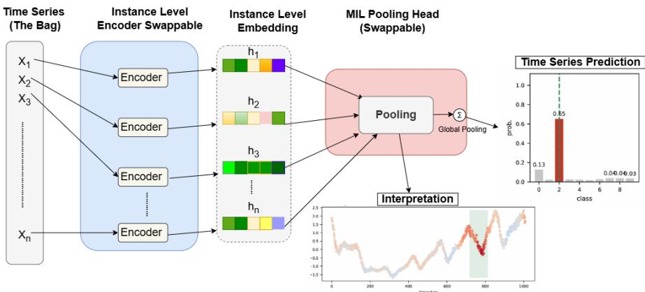  
Figure 3: The MIL view of a time series, read from left to right. The series $X _ { i }$ is the bag and each time point is one instance. The encoder gives one embedding $z _ { i } ^ { j }$ per instance; the pooling head weights those embeddings and combines them into the prediction $\hat { Y _ { i } }$ (right). The same weighted contributions, kept instead of discarded, are the interpretation $\hat { I } _ { i }$ drawn on the series below, where red pushes towards the predicted class and blue pushes away from it. The two grey boxes are interchangeable, which is what lets any encoder of Section B be paired with any head of Section C.

The alternative is worth writing down once, because the rest of the design follows from it. Embedded pooling (Wang et al., 2018) first averages the embeddings and then classifies the average:

$$
P _ { i } = \frac { 1 } { t } \sum _ { j = 1 } ^ { t } z _ { i } ^ { j } \in \mathbb { R } ^ { d } , \qquad \hat { Y } _ { i } = \psi _ { c l f } ( P _ { i } ) .\tag{11}
$$

Once $P _ { i }$ is formed, the time index is gone, so there is no per-time-point prediction left to report. Every head of Section C, starting with the conjunctive pooling of MILLET (Equation (7)), runs the two steps in the opposite order: it classifies each time point first and aggregates afterwards, which is why it can report the interpretation.

## B HOW THE ENCODER STAYS SMALL

Section 3.2 describes the SEA-Net encoder: a stem convolution followed by a stack of multi-scale separable residual blocks (Equation (1) and Equation (2)), which keeps the length t unchanged, so that one embedding per time point reaches the pooling head, as the MIL view of Section A requires. It also gives four variants of this encoder: the bottleneck pointwise mixing (Equation (3)), the two channel re-weighting variants, Gated (mean) and Input Gated (Equation (4)), and the Spike/Trend encoder (Equation (6)). Every variant returns the same output $\boldsymbol { Z } _ { i } ^ { \dot { \mathbf { \alpha } } } \in \mathbb { R } ^ { t \times \dot { d } }$ , so any encoder can be paired with any pooling head.

This appendix gives the details that the main text leaves out. Section B.1 draws one block and the effect of the dilation, Section B.2 works out where the saving of the bottleneck comes from, and Section B.3 and Section B.4 write out the gated and the Spike/Trend variants step by step. Section B.5 to Section B.7 then describe one more encoder and two wrappers that the main text does not cover, and Section B.8 lists the two main encoders layer by layer.

## B.1 MULTI-SCALE SEPARABLE BLOCKS

Figure 4 draws one block of Section 3.2 as a data path, i.e. Equation (1) and Equation (2). Two terms of Equation (1) need a short explanation. In a depthwise convolution $D _ { k } ^ { ( \delta ) }$ , each input channel is filtered with its own kernel, and the channels are not mixed. It is a grouped convolution with as many groups as channels, so it needs d times fewer parameters and FLOPs than a full convolution; the same idea is the basis of efficient architectures such as those of Howard et al. (2017) and Xie et al. (2017). The pointwise $1 \times 1$ convolution $P$ is therefore the only place where the channels are mixed, and it also holds most of the parameters; this is why the bottleneck of Equation (3) factorizes $P$ and nothing else. Batch normalization (Ioffe & Szegedy, 2015) stabilizes the activations and dropout regularizes the model; neither of them changes the shape.

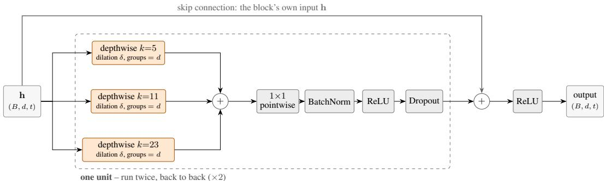  
Figure 4: One multi-scale separable block. The three depth wise convolutions read the same input at the kernel sizes 5, 11 and 23, their outputs are summed, and the point-wise $1 \times 1$ convolution $P$ mixes the channels; BatchNorm, ReLU and dropout close the unit U of Equation (1). The dashed box is what is applied twice, and the arrow over the top is the residual connection of Equation (2).

Figure 5 shows what the dilation of Section 3.2 gives. A kernel of size 5 always holds five weights. $\mathbf { A } \mathbf { t } \delta = 1$ they read five neighbouring time points; at $\delta = 1 6$ the same five weights read time points that are 16 apart and together cover 65. The number of parameters does not change, so the receptive field grows at no cost in weights, and the cap $\delta _ { \mathrm { m a x } } = 1 6$ keeps it bounded, so that each embedding still describes a local region of the series.

## B.2 WHERE THE BOTTLENECK SAVING COMES FROM

Equation (3) gives the ratio $2 r / d ;$ here is the arithmetic behind the $2 8 \%$ saving. At d = 64 the pointwise step costs $d ^ { 2 } = 4 { , } 0 9 6$ weights per unit, and with $r = d / 4 = 1 6$ it costs $2 d r = 2 , 0 4 8 ,$ , so each unit saves 2,048 weights. A block holds two units and the model holds four blocks, which gives $8 \times 2 , 0 4 8 = 1 6 , 3 8 4 ;$ the bias terms of the factorized layers bring the measured saving to 16,256, i.e. from 57,580 to 41,324 parameters (Tables 3 and 4). The depthwise filters are left unchanged, because with the kernel sizes $\{ \bar { 5 } , 1 1 , 2 3 \}$ they hold only 39d weights per unit and are not where the cost is.

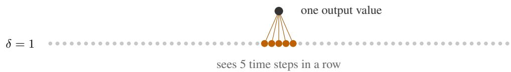

(a) δ = 1: the five taps read five neighbouring time points.  
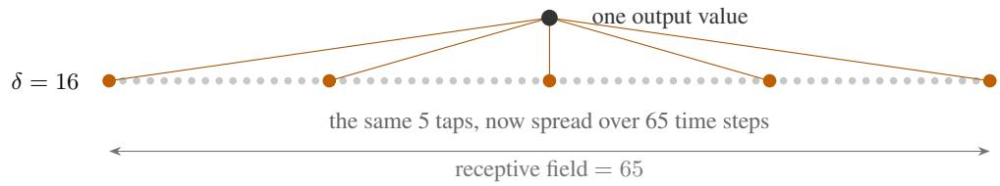  
(b) δ = 16: the same five taps span 65 time points.

Figure 5: The effect of the dilation, drawn with the same five taps of the $k = 5$ filter in both rows. Widening the region that the filter sees costs no extra weight, which is why the receptive field of the encoder can be grown without paying for it in parameters.

## B.3 THE TWO GATED VARIANTS, WRITTEN OUT

Equation (4) writes both channel re-weighting variants in one line. Written separately, Gated (mean) first averages the embeddings over time and computes one weight vector from that summary,

$$
s _ { i } = \frac { 1 } { t } \sum _ { j = 1 } ^ { t } z _ { i } ^ { j } \in \mathbb { R } ^ { d } , \qquad g _ { i } = \sigma ( W _ { g } \ : s _ { i } ) \in [ 0 , 1 ] ^ { d } , \qquad W _ { g } \in \mathbb { R } ^ { d \times d } ,\tag{12}
$$

and the same $g _ { i }$ is then applied at every time point, i.e. $g _ { i } ^ { j } = g _ { i }$ for all $j .$ . The mean is one of three ways to summarize the time axis; the other two are the maximum and the last time point. The mean is used in the main experiments, and the other two appear in Table 21. The cost is one $d \times d$ matrix.

Input Gated keeps the index $j \colon$ the gate $g _ { i } ^ { j }$ is computed from the raw series by a convolution with kernel size 7 and “same” padding, so the gate has exactly t entries, one per time point. Its cost is 7d weights, i.e. less than the mean gate, and its gradient reaches the input directly instead of passing through the encoder blocks.

## B.4 SEA-NET SPIKE/TREND ENCODER

Equation (6) writes the spike branch as one expression. In the implementation it is four steps in this order: a moving average with window $w = 5 ,$ , its subtraction from the input, and then $\mathrm { C o n v _ { 3 } } ,$ BatchNorm and ReLU, all with “same” padding, so the length t is kept. The mixed features are gated by Equation (12) before they reach the head. We expected an advantage on datasets where the class evidence is a sharp spike, but Table 25 shows that this was the weakest of the five encoders, so the expectation was not met.

## B.5 SEA-NET RECONSTRUCTION-RESIDUAL ENCODER

The spike branch decides in advance what the encoder misses, namely the sharp changes. This variant learns it instead, by asking which part of the input the encoder features cannot rebuild. $\mathbf { A } \perp \times 1$ convolution reconstructs the raw series from the features, the reconstruction is subtracted from the real input, and the remainder becomes $d _ { \mathrm { r e s } } = 1 6$ extra channels:

$$
{ \widehat { X } } _ { i } = P _ { \mathrm { r e c } } ( Z _ { i } ) , \qquad { \tilde { z } } _ { i } ^ { j } = P \bigl ( [ z _ { i } ^ { j } ; \phi ( X _ { i } - { \widehat { X } } _ { i } ) ^ { j } ] \bigr ) ,\tag{13}
$$

where $\phi$ is the same small convolution, BatchNorm and ReLU used by the spike branch. There is no separate reconstruction loss: the branch is trained end to end with the classifier, so this is a learned residual feature and not an auto-encoder. It was the second strongest encoder in Table 25.

## B.6 SEA-NET MULTI-SCALE CHANNELS (WRAPPER)

A wrapper changes the input or the output of an encoder but leaves the encoder itself unchanged. The stem receives a single raw channel, so any local statistic that it needs must be learned from scratch. This wrapper adds the rolling maximum, minimum and standard deviation over several windows, together with the sign of the first difference, as extra input channels:

$$
\begin{array} { r l } & { X _ { i } ^ { + } = \Big [ X _ { i } \colon \left( \mathrm { r o l l \_ m a x } _ { w } ( X _ { i } ) \right) _ { w \in \mathcal { W } } \colon \left( \mathrm { r o l l \_ m i n } _ { w } ( X _ { i } ) \right) _ { w \in \mathcal { W } } \colon } \\ & { \qquad \quad \left( \mathrm { r o l l \_ s t d } _ { w } ( X _ { i } ) \right) _ { w \in \mathcal { W } } \colon \mathrm { s i g n } ( \Delta X _ { i } ) \Big ] , } \end{array}\tag{14}
$$

with $\mathcal { W } = \{ 3 , 7 , 1 5 , 3 1 \}$ , all odd so that each window stays centred. The input grows from 1 to $1 + 4 \cdot 3 + 1 = 1 4$ channels before the stem, and the rest is one of the encoders above. A rolling mean is not used on purpose: it is linear, so the stem convolution can learn it on its own, whereas the other three statistics are not linear. A BatchNorm first normalizes the 14 channels, because they do not share the scale of the raw series; removing it reduced the accuracy.

## B.7 SEA-NET MULTI-SCALE PYRAMID (WRAPPER)

The dilation cap bounds the receptive field, so evidence that is visible only over a long span cannot be seen. This wrapper runs the same encoder on the series downsampled by 1, 2, 4 and $^ { 8 , }$ stretches the outputs back to length t, and combines them with an attention over the scales:

$$
\tilde { z } _ { i } ^ { j } = \sum _ { s \in \mathcal { S } } \alpha _ { i } ^ { j , s } z _ { i } ^ { j , ( s ) } , \qquad \alpha _ { i } ^ { j , s } = \mathrm { s o f t m a x } _ { s } \left( \mathrm { s c o r e } ( z _ { i } ^ { j , ( s ) } ) \right) , \qquad S = \{ 1 , 2 , 4 , 8 \} .\tag{15}
$$

The softmax normalizes over the scales and never over time, so the per-time-point signal on which the two interpretation metrics depend is kept. One set of encoder weights is shared by all scales, so the number of parameters barely changes and the extra cost is compute, about 1.9×. This is the one-dimensional analogue of the multi-magnification MIL of Hashimoto et al. (2020), and it was the weakest variant we built (Table 25). It also has a constraint: the wrapped encoder must be shallow enough that its receptive field does not exceed $t / \operatorname* { m a x } ( S )$ , otherwise the coarsest scales collapse to a nearly constant signal. The pyramid therefore uses a two-block base, and the pipeline checks this automatically.

Alternatives we rejected. A Transformer encoder costs $\mathcal { O } ( t ^ { 2 } )$ in time and memory, which is too expensive for series of 1,000–1,500 points on the target hardware. Its unrestricted attention also lets any output position read any input position, which removes the bounded receptive field that the interpretation relies on. Pruning or quantizing InceptionTime would reduce its size, but would not change where the cost is, i.e. in the encoder, which is the point of this paper.

## B.8 THE TWO ENCODERS, LAYER BY LAYER

Table 3 and Table 4 give one row per operation, with its output shape and its number of parameters.   
Read side by side, they show that the saving of Section B.2 comes only from the pointwise layers.

Table 3: The SEA-Net bottleneck encoder (d = 64, 4 blocks, kernels 5/11/23, dilations 1/2/4/8), layer by layer, with the output shape and the number of parameters, built from top/top\_bottleneck\_topk for WebTraffic $( c = 1 0 )$ . The point-wise convolution of every unit is factorised as $d \to d / 4 \to d ,$ which is where the parameter saving comes from. Every layer keeps the series length t, so the head sees one embedding per time point. Depthwise = one filter per channel (groups = d).
<table><tr><td>Stage</td><td>Layer</td><td>Output</td><td>Params</td></tr><tr><td>Input</td><td>z-normalised series</td><td> $b \times 1 \times t$ </td><td></td></tr><tr><td>Stem</td><td>Conv1d 1 → 64, kernel 7</td><td> $b \times 6 4 \times t$ </td><td>512</td></tr><tr><td rowspan="6">2× unit:</td><td>Block 1 (dilation 1), depthwise Conv1d ×3 (kernels 5, 11, 23), summed</td><td> $b \times 6 4 \times t$ </td><td>2,688</td></tr><tr><td>pointwise Conv1d 64 → 16 (reduce)</td><td> $b \times 1 6 \times t$ </td><td>1,040</td></tr><tr><td>pointwise Conv1d 16 → 64 (expand)</td><td> $b \times 6 4 \times t$ </td><td>1,088</td></tr><tr><td>BatchNorm + ReLU + dropout</td><td> $b \times 6 4 \times t$ </td><td>128</td></tr><tr><td>after both units: residual add + ReLU</td><td> $b \times 6 4 \times t$ </td><td>block total</td></tr><tr><td>Block 2 (dilation 2), depthwise Conv1d ×3 (kernels 5, 11, 23),</td><td> $b \times 6 4 \times t$ </td><td>9,888 2,688</td></tr><tr><td rowspan="6">2× unit:</td><td>summed</td><td></td><td></td></tr><tr><td>pointwise Conv1d 64 → 16 (reduce) pointwise Conv1d 16 → 64 (expand)</td><td> $b \times 1 6 \times t$ </td><td>1,040</td></tr><tr><td>BatchNorm + ReLU + dropout</td><td> $b \times 6 4 \times t$   $b \times 6 4 \times t$ </td><td>1,088</td></tr><tr><td>after both units: residual add + ReLU</td><td></td><td>128</td></tr><tr><td></td><td> $b \times 6 4 \times t$ </td><td>block total 9,888</td></tr><tr><td>Block 3 (dilation 4), depthwise Conv1d ×3 (kernels 5, 11, 23),</td><td> $b \times 6 4 \times t$ </td><td>2,688</td></tr><tr><td rowspan="6">2× unit:</td><td>summed</td><td></td><td></td></tr><tr><td>pointwise Conv1d 64 → 16 (reduce)</td><td> $b \times 1 6 \times t$ </td><td>1,040</td></tr><tr><td>pointwise Conv1d 16 → 64 (expand) BatchNorm + ReLU + dropout</td><td> $b \times 6 4 \times t$ </td><td>1,088</td></tr><tr><td>after both units: residual add + ReLU</td><td> $b \times 6 4 \times t$ </td><td>128</td></tr><tr><td></td><td> $b \times 6 4 \times t$ </td><td>block total</td></tr><tr><td></td><td></td><td>9,888</td></tr><tr><td rowspan="6">2× unit:</td><td>Block 4 (dilation 8), depthwise Conv1d ×3 (kernels 5, 11, 23), summed</td><td> $b \times 6 4 \times t$ </td><td>2,688</td></tr><tr><td>pointwise Conv1d 64 → 16 (reduce)</td><td> $b \times 1 6 \times t$ </td><td>1,040</td></tr><tr><td>pointwise Conv1d 16 → 64 (expand)</td><td> $b \times 6 4 \times t$ </td><td>1,088</td></tr><tr><td>BatchNorm + ReLU + dropout</td><td> $b \times 6 4 \times t$ </td><td>128</td></tr><tr><td>after both units: residual add + ReLU</td><td> $b \times 6 4 \times t$ </td><td>block total</td></tr><tr><td></td><td></td><td>9,888</td></tr><tr><td>Encoder total</td><td></td><td> $b \times 6 4 \times t$  (time-point embs.)</td><td>40,064</td></tr><tr><td>Pooling head</td><td>Top-k conjunctive  $( a = 8 , c = 1 0 )$ </td><td> $b \times 1 0$ </td><td>1,260</td></tr><tr><td>Model total</td><td></td><td></td><td>41,324</td></tr></table>

Table 4: The SEA-Net base encoder $( d = 6 4 ,$ , 4 blocks, kernels 5/11/23, dilations 1/2/4/8), layer by layer, with the output shape and the number of parameters, built from seanet/seanet\_slim\_topk for WebTraffic $( c = 1 0 )$ . It has the same skeleton with the plain d → d point-wise convolution, for comparison. Every layer keeps the series length t, so the head sees one embedding per time point. Depthwise = one filter per channel $( \mathrm { g r o u p s } = d ) .$
<table><tr><td>Stage</td><td>Layer</td><td>Output</td><td>Params</td></tr><tr><td rowspan="2">Input Stem</td><td>z-normalised series</td><td> $b \times 1 \times t$ </td><td></td></tr><tr><td>Conv1d 1 → 64, kernel 7</td><td> $b \times 6 4 \times t$ </td><td>512</td></tr><tr><td rowspan="4">2× unit:</td><td>Block 1 (dilation 1), depthwise Conv1d ×3 (kernels 5, 11, 23), summed</td><td> $b \times 6 4 \times t$ </td><td>2,688</td></tr><tr><td>pointwise Conv1d 64 → 64</td><td> $b \times 6 4 \times t$ </td><td>4,160</td></tr><tr><td> $\mathrm { B a t c h N o r m + R e L U + d r o p o u t }$ </td><td> $b \times 6 4 \times t$ </td><td>128</td></tr><tr><td>after both units: residual add + ReLU</td><td> $b \times 6 4 \times t$ </td><td>block total 13,952</td></tr><tr><td rowspan="5">2× unit:</td><td>Block 2 (dilation 2), depthwise Conv1d ×3 (kernels 5, 11, 23), summed</td><td> $b \times 6 4 \times t$ </td><td>2,688</td></tr><tr><td>pointwise Conv1d 64 → 64</td><td> $b \times 6 4 \times t$ </td><td>4,160</td></tr><tr><td>BatchNorm + ReLU + dropout</td><td> $b \times 6 4 \times t$ </td><td>128</td></tr><tr><td>after both units: residual add + ReLU</td><td> $b \times 6 4 \times t$ </td><td>block total</td></tr><tr><td></td><td></td><td>13,952</td></tr><tr><td rowspan="5">2× unit:</td><td>Block 3 (dilation 4), depthwise Conv1d ×3 (kernels 5, 11, 23), summed</td><td> $b \times 6 4 \times t$ </td><td>2,688</td></tr><tr><td>pointwise Conv1d 64 → 64</td><td> $b \times 6 4 \times t$ </td><td>4,160</td></tr><tr><td>BatchNorm + ReLU + dropout</td><td> $b \times 6 4 \times t$ </td><td>128</td></tr><tr><td>after both units: residual add + ReLU</td><td> $b \times 6 4 \times t$ </td><td>block total</td></tr><tr><td></td><td></td><td>13,952</td></tr><tr><td rowspan="5">2× unit:</td><td>Block 4 (dilation 8), depthwise Conv1d ×3 (kernels 5, 11, 23), summed</td><td> $b \times 6 4 \times t$ </td><td>2,688</td></tr><tr><td>pointwise Conv1d 64 → 64</td><td> $b \times 6 4 \times t$ </td><td></td></tr><tr><td> $\mathrm { B a t c h N o r m + R e L U + d r o p o u t }$ </td><td> $b \times 6 4 \times t$ </td><td>4,160 128</td></tr><tr><td>after both units: residual add + ReLU</td><td> $b \times 6 4 \times t$ </td><td>block total</td></tr><tr><td></td><td></td><td>13,952</td></tr><tr><td>Encoder total</td><td></td><td> $b \times 6 4 \times t$  (time-point embs.)</td><td>56,320</td></tr><tr><td>Pooling head Model total</td><td>Top-k conjunctive  $( a = 8 , c = 1 0 )$ </td><td> $b \times 1 0$ </td><td>1,260 57,580</td></tr></table>

## C POOLING HEADS COMPARED

Section 3.3 describes the MIL pooling head $\psi _ { p o o l }$ . It has two branches: an attention branch, which decides how much each time point counts, and a classifier branch, which decides which class each time point argues for. Their product is the evidence $e _ { i } ^ { j , k }$ of time point $j$ for class k; aggregating it over time gives the prediction $\hat { Y } _ { i } .$ , and keeping it per time point gives the interpretation ${ \hat { I } } _ { i } .$ The main text starts from the conjunctive pooling of MILLET (Equation (7)), states its three limitations, and gives the three heads that remove them: class-wise (Equation (8)), Soft-Max (Equation (9)) and Top-k (Equation (10)) conjunctive pooling.

This appendix adds three things. First, it draws every head in the same way, one full-width figure per head (Figure 6 to Figure 13). All seven of our heads keep the classifier branch $\hat { y } _ { i } ^ { j } = W _ { c } z _ { i } ^ { j } + \mathbf { b } _ { c }$ unchanged and differ from the baseline only in two places, the attention head and the aggregation over time; these two places are drawn in blue, so two heads can be compared by looking at the blue boxes only. Second, Section C.5 to Section C.8 describe the four heads that the main text does not cover, with their equations and the reason why each was built. Third, Section C.9 summarizes the eight heads and gives each of them layer by layer.

## C.1 CONJUNCTIVE POOLING

Conjunctive pooling (MILLET baseline)  
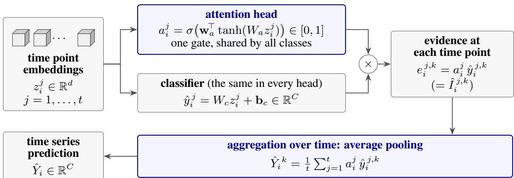  
Figure 6: Conjunctive pooling, the MILLET baseline of Equation (7). Read from left to right: the time point embeddings feed an attention head and a classifier, their product is the evidence at each time point, which is also the interpretation, and aggregating that evidence over time gives the prediction for the series. The classifier is the same in every head; only the two blue boxes, the attention head and the aggregation, change from one head to the next, so Figure 7 to Figure 13 are best read against this figure.

Figure 6 draws the baseline of Equation (7). The head itself is almost free: replacing it by global average pooling on the same InceptionTime backbone removes only 1,041 of the 423,707 parameters, so it is the encoder, and not the interpretability, that makes the baseline large. Section 3.3 states the three limitations of this head. We call them L1 (one gate is shared by all classes), L2 (the weights are not normalized over time) and L3 (the fixed mean dilutes a few decisive time points in a long series), and use these names below and in Table 5.

## C.2 CLASS-WISE CONJUNCTIVE POOLING

Compared with Equation (7), Equation (8) changes only the attention head (Figure 7). The gate becomes a vector of length C, so the evidence is formed class by class, and a time point can support one class while arguing against another. This head targets L1.

## C.3 SOFT-MAX CONJUNCTIVE POOLING

Here the aggregation changes as well, as Figure 8 shows: the sigmoid gate becomes a Soft-Max over time, and the mean becomes a weighted sum. This head targets L2.

Class-wise conjunctive pooling  
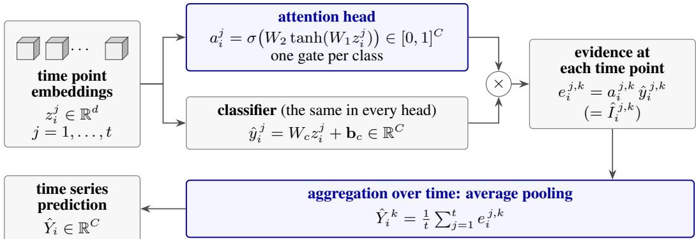  
Figure 7: Class-wise conjunctive pooling. Against Figure 6, only the attention head changes: widening its last layer to C outputs costs $( C - 1 ) \bar { ( } d _ { a } + \bar { 1 ) }$ weights and makes the evidence, and therefore the interpretation, class-specific.

Soft-Max conjunctive pooling  
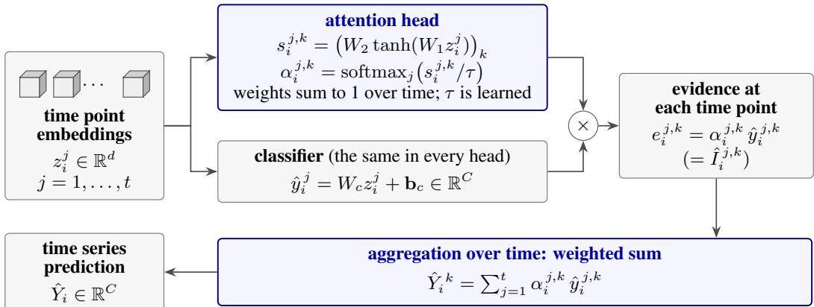  
Figure 8: Soft-Max conjunctive pooling. Both blue boxes change compared with Figure 6: the attention is normalized over time, and the aggregation is a weighted sum rather than a mean. The single extra weight is the sharpness $\tau = \exp ( \rho )$

Property 1 (Length invariance). Since the weights of Equation (9) sum to one over j, ${ \hat { Y } } _ { i } ^ { k }$ does not depend on t. As τ → ∞ theyflatten to 1/t and the head becomes a plain mean over time; as $\tau  0$ it keeps the single highest-scoring time point.

## C.4 TOP-k CONJUNCTIVE POOLING

The attention head is the class-wise one, and only the aggregation changes, as shown in Figure 9.   
This head targets L3.

Property 2 (Strict generalisation). At $\kappa = 1$ , Equation (10) is exactly Equation (8). For $\kappa < 1$ the gradient reaches only the selected time points.

Property 2 makes the κ study of Table 26 a controlled experiment: the κ = 1 row is the class-wise head, so any difference from it comes from the selection alone and not from a change of model.

The remaining four heads are not described in the main text. Each of them keeps the class-wise classifier and changes the attention head, the aggregation or both, and each targets one or two of the limitations above.

## C.5 ADAPTIVE CLASS-WISE POOLING

This head also targets L3, but from another side. A fixed mean suits evidence that is spread over the series, and a maximum suits a single short event; no fixed operator is right for both. The head

Top-k conjunctive pooling  
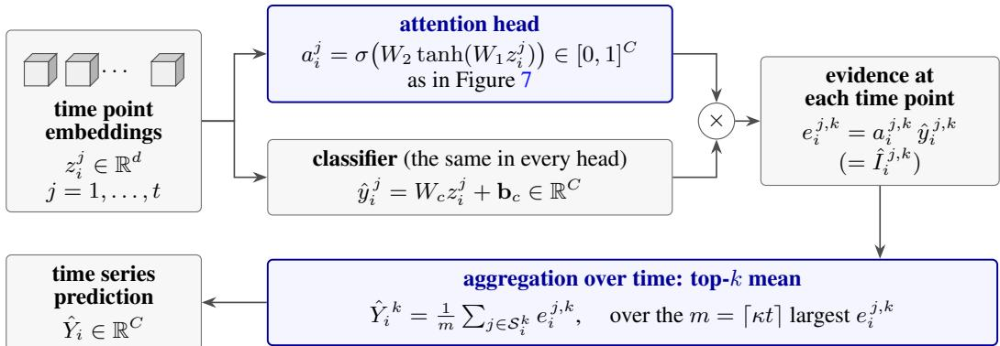  
Figure 9: Top-k conjunctive pooling. The attention head is the one of Figure 7, and only the aggregation moves: the mean runs over the m largest evidence values of the class instead of over all t. It adds no weight, because κ is a hyperparameter.

Adaptive class-wise pooling  
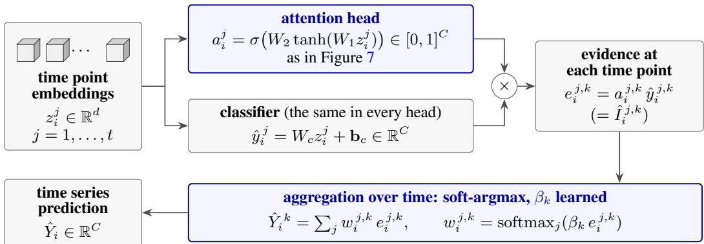  
Figure 10: Adaptive class-wise pooling (Equation (16)). The attention head is the one of Figure 7; the aggregation slides between the mean and the maximum according to one learned number per class.

therefore keeps the class-wise gate and aggregates with a learnable sharpness $\beta _ { k } \geq 0$ per class, written as a numerically stable soft-argmax (Figure 10):

$$
\beta _ { k } = \mathrm { s o f t p l u s } ( \theta _ { k } ) , \qquad w _ { i } ^ { j , k } = \mathrm { s o f t m a x } _ { j } \bigl ( \beta _ { k } e _ { i } ^ { j , k } \bigr ) , \qquad \hat { Y } _ { i } ^ { k } = \sum _ { j = 1 } ^ { t } w _ { i } ^ { j , k } e _ { i } ^ { j , k } .\tag{16}
$$

It adds C weights.

Property 3 (Learned mean–max aggregator). $\beta _ { k } \to 0$ gives $w _ { i } ^ { j , k }  1 / t ,$ , i.e. class-wise pooling; $\beta _ { k } \to \infty$ gives $\hat { Y } _ { i } ^ { k } \to \operatorname* { m a x } _ { j } e _ { i } ^ { j , k } . A s \hat { Y } _ { i } ^ { k }$ is always a convex combination ofthe $e _ { i } ^ { j , k }$ , it stays inside their range, which keeps training stable.

We initialize $\beta _ { k }$ at 0.3, so that training starts close to the class-wise mean and becomes sharper only where this lowers the loss.

## C.6 ATTENTION-MAX POOLING

This is the simplest hard alternative to the previous head, and it serves as a control: the soft-argmax still gives every time point some weight, and this head tests whether that is useful. The aggregation is a learnable per-class blend of the mean and the maximum (Figure 11), again with C extra weights:

$$
\hat { Y } _ { i } ^ { k } = ( 1 - \lambda _ { k } ) \frac { 1 } { t } \sum _ { j = 1 } ^ { t } e _ { i } ^ { j , k } + \lambda _ { k } \operatorname* { m a x } _ { j } e _ { i } ^ { j , k } , \qquad \lambda _ { k } = \sigma ( \theta _ { k } ) \in [ 0 , 1 ] .\tag{17}
$$

$\lambda _ { k } \to 0$ recovers class-wise pooling and $\lambda _ { k } \to 1$ gives max pooling, so each class learns on its own whether its evidence is sustained or a short event. Equation (17) and Equation (16) use the same

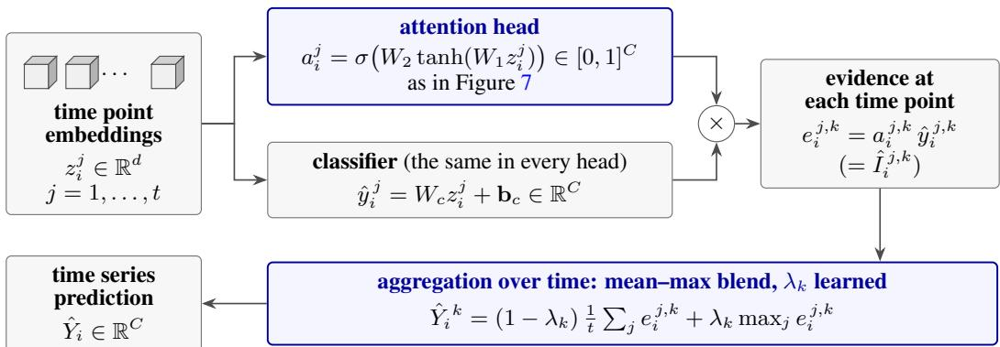  
Figure 11: Attention-max pooling (Equation (17)), the hard counterpart of Figure 10: one learned number per class blends the mean with the maximum directly.

gate and differ only in how they aggregate it, so comparing them isolates soft selection from hard selection.

## C.7 PER-CLASS GATED ATTENTION

Per-class gated attention pooling

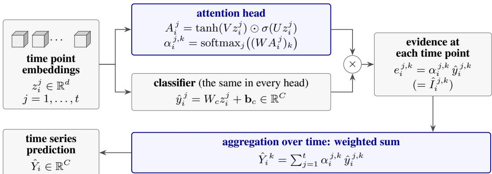  
Figure 12: Per-class gated attention (Equation (18) and Equation (19)). The attention head has two layers instead of one, and the second of them decides which attention features are admitted.

Gated attention was proposed by Ilse et al. (2018) and is also used by Hashimoto et al. (2020), where a bag is a whole-slide image and an instance is a patch. It targets L1 and L3 together with a stronger attention head, because the baseline gate is a single tanh layer, which limits how selective it can be. We apply it to time series and make it per class, which the original is not (Figure 12):

$$
A _ { i } ^ { j } = \operatorname { t a n h } ( V z _ { i } ^ { j } ) \odot \sigma ( U z _ { i } ^ { j } ) \in \mathbb { R } ^ { d _ { a } } , \qquad V , U \in \mathbb { R } ^ { d _ { a } \times d } ,\tag{18}
$$

$$
\alpha _ { i } ^ { j , k } = \mathrm { s o f t m a x } _ { j } \left( ( W A _ { i } ^ { j } ) _ { k } \right) , \qquad \hat { Y } _ { i } ^ { k } = \sum _ { j = 1 } ^ { t } \alpha _ { i } ^ { j , k } \hat { y } _ { i } ^ { j , k } .\tag{19}
$$

The tanh branch proposes attention features and the σ branch decides which of them to let through, so a feature is used only where the second branch judges it reliable. The cost is a second $d \to d _ { a }$ layer, which makes this the most expensive head here. Unlike the other heads, it has no blend parameter that recovers conjunctive pooling, so no setting of its weights returns the baseline.

## C.8 DUAL-STREAM CONJUNCTIVE POOLING

The two-stream mechanism was proposed by Li et al. (2021), again for whole-slide images: one stream aggregates all the instances, and a second one focuses on the most critical instance and on the instances similar to it. It targets L3 when the evidence is scattered, i.e. one decisive time point should

Dual-stream conjunctive pooling

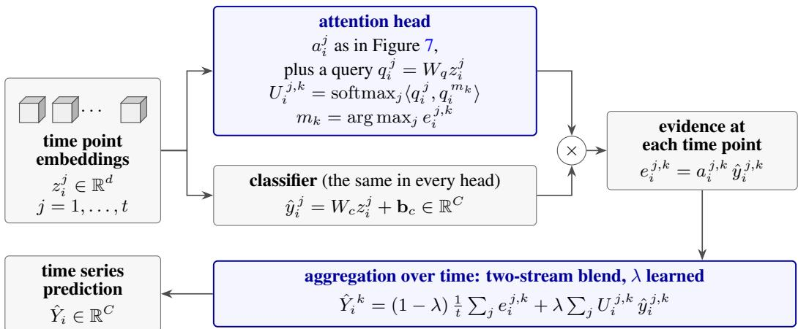  
Figure 13: Dual-stream conjunctive pooling (Equation (20) and Equation (21)). A second stream, built around the most supporting time point of each class, is blended into the class-wise stream of Figure 7 by one learned scalar.

be able to dominate without the rest being discarded. We removed the contrastive pre-training of Li et al. (2021), made the critical instance and the query per class, and blended the two streams with a learnable scalar that starts close to the baseline. Stream A is the class-wise mean of Equation (8); stream B finds the most supporting time point of each class and re-weights the time points by their similarity to its query (Figure 13):

$$
m _ { k } = \arg \operatorname* { m a x } _ { j } \ e _ { i } ^ { j , k } , \qquad q _ { i } ^ { j } = W _ { q } z _ { i } ^ { j } \in \mathbb { R } ^ { d _ { a } } , \qquad U _ { i } ^ { j , k } = \mathrm { s o f t m a x } _ { j } \big ( \langle q _ { i } ^ { j } , q _ { i } ^ { m _ { k } } \rangle \big ) ,\tag{20}
$$

$$
\hat { Y } _ { i } ^ { k } = ( 1 - \lambda ) \frac { 1 } { t } \sum _ { j = 1 } ^ { t } e _ { i } ^ { j , k } + \lambda \sum _ { j = 1 } ^ { t } U _ { i } ^ { j , k } \hat { y } _ { i } ^ { j , k } , \qquad \lambda = \sigma ( \theta ) , \lambda _ { 0 } = 0 . 0 5 .\tag{21}
$$

This head is also the clearest negative result of the study: being able to return to the baseline is not a safety guarantee. Five of the seven heads contain conjunctive pooling as a special case, and this is one of them, yet it is the worst head we tested; its four pairings score 0.860, 0.824, 0.736 and 0.556 (Table 24). The training runs show why: λ starts at 0.05 and nothing in the loss pushes it back towards the baseline, so being able to return there does not mean that training will go there. This is why the main text argues for Top-k from the measured NDCG@n and not from Property 2 alone.

## C.9 THE EIGHT HEADS TOGETHER

Table 5 lists the eight heads by the two choices that define them, the attention head and the aggregation over time. Table 6 to Table 13 then give the eight heads layer by layer, one table per head, with the input and the output shape of each operation. In these tables, b is the batch size, t the series length, d the embedding size (64 for SEA-Net, 128 for MILLET), $a = 8$ the attention width and c the number of classes.

Table 5: The eight heads as two separate choices. Reduces at gives the setting at which the head becomes conjunctive pooling exactly, and Targets gives the limitations of Section C.1 that it addresses.
<table><tr><td># Head</td><td></td><td>Attention</td><td>Reduction over time</td><td>Reduces at</td><td>Targets</td></tr><tr><td></td><td>Conjunctive (baseline)</td><td>shared gate</td><td>mean</td><td></td><td></td></tr><tr><td>2</td><td>Class-wise conjunctive</td><td>per-class gate</td><td>mean</td><td> $a _ { i } ^ { j , k } = a _ { i } ^ { j }$ </td><td>L1</td></tr><tr><td>3</td><td>Soft-Max conjunctive</td><td>per-class score</td><td>softmax, learnable τ</td><td> $\tau \to \infty$ </td><td>L2</td></tr><tr><td></td><td>Top-k conjunctive</td><td>per-class gate</td><td>mean of the m largest</td><td> $\kappa = 1$ </td><td>L3</td></tr><tr><td></td><td>5 Adaptive class-wise</td><td>per-class gate</td><td>soft-argmax, learnable  $\beta _ { k }$ </td><td> $\beta _ { k } \to 0$ </td><td>L3</td></tr><tr><td></td><td>6 Attention-max</td><td>per-class gate</td><td>blend of mean and max</td><td> $\lambda _ { k } \to 0$ </td><td>L3</td></tr><tr><td></td><td>7 Per-class gated attention</td><td>gated tanhσ</td><td>softmax</td><td> $\mathbf { n o n e }$ </td><td>L1,L3</td></tr><tr><td></td><td>8 Dual-stream conjunctive</td><td>gate + critical query</td><td>blend of two streams</td><td> $\lambda  0$ </td><td>L3</td></tr></table>

Table 6: Conjunctive pooling, the MILLET baseline head (their Table $\operatorname { A } . 5 ; d = 1 2 8 )$ . One scalar gate per time point, shared by every class. Registered as mil\_conjunctive.
<table><tr><td>Process</td><td>Layer</td><td>Input</td><td>Output</td></tr><tr><td>Input</td><td>Positional encoding + dropout</td><td> $b \times t \times d$ </td><td> $b \times t \times d$  (time-point embs.)</td></tr><tr><td>Attention</td><td>Linear + tanh</td><td> $b \times t \times d$ </td><td> $b \times t \times a$ </td></tr><tr><td></td><td>Linear + sigmoid</td><td> $b \times t \times a$ </td><td> $b \times t \times 1$  (attention scores)</td></tr><tr><td>Classifier</td><td>Linear</td><td> $b \times t \times d$ </td><td> $b \times t \times c$  (time-point logits)</td></tr><tr><td>Pooling</td><td>Attention weighting</td><td> $b \times t \times c$ </td><td> $b \times t \times c$  (interpretation)</td></tr><tr><td></td><td>Mean over t</td><td> $b \times t \times c$ </td><td> $b \times c$  (series logits)</td></tr></table>

Table 7: Class-wise conjunctive pooling: conjunctive pooling with one gate per class instead of one shared gate. Registered as sea\_classwise\_conjunctive.
<table><tr><td>Process</td><td>Layer</td><td>Input</td><td>Output</td></tr><tr><td>Input</td><td>Positional encoding + dropout</td><td> $b \times t \times d$ </td><td> $b \times t \times d$  (time-point embs.)</td></tr><tr><td>Attention</td><td> ${ \mathrm { L i n e a r } } + { \mathrm { t a n h } }$ </td><td> $b \times t \times d$ </td><td> $b \times t \times a$ </td></tr><tr><td></td><td>Linear + sigmoid</td><td> $b \times t \times a$ </td><td> $b \times t \times c$  (one gate per class)</td></tr><tr><td>Classifier</td><td>Linear</td><td> $b \times t \times d$ </td><td> $b \times t \times c$  (time-point logits)</td></tr><tr><td>Evidence</td><td>Gate × logit (element-wise)</td><td> $b \times t \times c$ </td><td> $b \times t \times c$  (interpretation)</td></tr><tr><td>Pooling</td><td>Mean over t</td><td> $b \times t \times c$ </td><td> $b \times c$  (series logits)</td></tr></table>

Table 8: Top-k conjunctive pooling, the head of every short-listed model: class-wise conjunctive pooling, but the series logit averages only the $k = \lceil \kappa t \rceil$ largest evidence values of each class $( \kappa = 0 . 1 )$ . The interpretation is the full evidence map, so it is exactly zero wherever no evidence was used. Registered as sea\_topk\_conjunctive.
<table><tr><td>Process</td><td>Layer</td><td>Input</td><td>Output</td></tr><tr><td>Input</td><td>Positional encoding + dropout</td><td> $b \times t \times d$ </td><td> $b \times t \times d$  (time-point embs.)</td></tr><tr><td>Attention</td><td> ${ \mathrm { L i n e a r } } + { \mathrm { t a n h } }$ </td><td> $b \times t \times d$ </td><td> $b \times t \times a$ </td></tr><tr><td></td><td>Linear + sigmoid</td><td> $b \times t \times a$ </td><td> $b \times t \times c$  (one gate per class)</td></tr><tr><td>Classifier</td><td>Linear</td><td> $b \times t \times d$ </td><td> $b \times t \times c$  (time-point logits)</td></tr><tr><td>Evidence</td><td>Gate × logit (element-wise)</td><td> $b \times t \times c$ </td><td> $b \times t \times c$  (interpretation)</td></tr><tr><td>Pooling</td><td>Top-k over t (per class)</td><td> $b \times t \times c$ </td><td> $b \times k \times c$ </td></tr><tr><td></td><td>Mean over k</td><td> $b \times k \times c$ </td><td> $b \times c$  (series logits)</td></tr></table>

Table 9: Soft-Max conjunctive pooling: the attention is a distribution over time (a softmax with one learned temperature τ), so the series logit is a true weighted average and long and short series are on one scale. Registered as sea\_softmax\_conjunctive.
<table><tr><td>Process</td><td>Layer</td><td>Input</td><td>Output</td></tr><tr><td>Input</td><td>Positional encoding + dropout</td><td> $b \times t \times d$ </td><td> $b \times t \times d$  (time-point embs.)</td></tr><tr><td>Attention</td><td>Linear + tanh</td><td> $b \times t \times d$ </td><td> $b \times t \times a$ </td></tr><tr><td></td><td>Linear (raw scores)</td><td> $b \times t \times a$ </td><td> $b \times t \times c$ </td></tr><tr><td></td><td> $\div \tau ,$  softmax over t</td><td> $b \times t \times c$ </td><td> $b \times t \times c$  (weights, sum to 1)</td></tr><tr><td>Classifier</td><td>Linear</td><td> $b \times t \times d$ </td><td> $b \times t \times c$  (time-point logits)</td></tr><tr><td>Pooling</td><td>Weight × logit (element-wise)</td><td> $b \times t \times c$ </td><td> $b \times t \times c$  (interpretation)</td></tr><tr><td></td><td>Sum over t</td><td> $b \times t \times c$ </td><td> $b \times c ( \mathrm { s e r i e s \ l o g i t s } )$ </td></tr></table>

Table 10: Adaptive class-wise pooling: class-wise conjunctive pooling with a learned mean-to-max aggregator, i.e. a soft-argmax with one sharpness $\beta _ { k } = \mathrm { s o f t p l u s } ( \theta _ { k } ) \ge ($ 0 per class (c extra parameters; $\beta  0$ gives the mean and $\beta \overset { \cdot } {  }$ ∞ the max). Registered as sea\_adaptive\_classwise.
<table><tr><td>Process</td><td>Layer</td><td>Input</td><td>Output</td></tr><tr><td>Input</td><td>Positional encoding + dropout</td><td> $b \times t \times d$ </td><td> $b \times t \times d$  (time-point embs.)</td></tr><tr><td>Attention</td><td>Linear + tanh</td><td> $b \times t \times d$ </td><td> $b \times t \times a$ </td></tr><tr><td></td><td>Linear + sigmoid</td><td> $b \times t \times a$ </td><td> $b \times t \times c$  (one gate per class)</td></tr><tr><td>Classifier</td><td>Linear</td><td> $b \times t \times d$ </td><td> $b \times t \times c$  (time-point logits)</td></tr><tr><td>Evidence</td><td>Gate × logit (element-wise)</td><td> $b \times t \times c$ </td><td> $b \times t \times c$  (interpretation)</td></tr><tr><td>Pooling</td><td>softmax over t of  $\beta _ { k } \mathrm { \cdot } \mathrm { e v i d e n c e }$ </td><td> $b \times t \times c$ </td><td> $b \times t \times c ( { \mathrm { w e i g h t s } } )$ </td></tr><tr><td></td><td>Weighted sum over t</td><td> $b \times t \times c$ </td><td> $b \times c$  (series logits)</td></tr></table>

Table 11: Attention-max pooling: class-wise conjunctive pooling with a learned per-class blend $\lambda _ { k } = \sigma ( \theta _ { k } )$ of the mean and the max over time (c extra parameters). Registered as sea\_attention\_max.
<table><tr><td>Process</td><td>Layer</td><td>Input</td><td>Output</td></tr><tr><td>Input</td><td>Positional encoding + dropout</td><td> $b \times t \times d$ </td><td> $b \times t \times d$  (time-point embs.)</td></tr><tr><td>Attention</td><td>Linear + tanh</td><td> $b \times t \times d$ </td><td> $b \times t \times a$ </td></tr><tr><td></td><td>Linear + sigmoid</td><td> $b \times t \times a$ </td><td> $b \times t \times c$  (one gate per class)</td></tr><tr><td>Classifier</td><td>Linear</td><td> $b \times t \times d$ </td><td> $b \times t \times c$  (time-point logits)</td></tr><tr><td>Evidence</td><td>Gate × logit (element-wise)</td><td> $b \times t \times c$ </td><td> $b \times t \times c$  (interpretation)</td></tr><tr><td>Pooling</td><td>Mean over t</td><td> $b \times t \times c$ </td><td> $b \times c$ </td></tr><tr><td></td><td>Max over t</td><td> $b \times t \times c$ </td><td> $b \times c$ </td></tr><tr><td></td><td> $\left( 1 - \lambda _ { k } \right)$  mean  $+ \lambda _ { k }$  max</td><td> $b \times c$ </td><td> $b \times c$  (series logits)</td></tr></table>

Table 12: Per-class gated attention pooling (Ilse et al. 2018, made class-specific): a tanh branch multiplied by a sigmoid branch scores every time point, and a softmax over time turns the scores into weights. Registered as sea\_gated\_attention.
<table><tr><td>Process</td><td>Layer</td><td>Input</td><td>Output</td></tr><tr><td>Input</td><td>Positional encoding + dropout</td><td> $b \times t \times d$ </td><td> $b \times t \times d$  (time-point embs.)</td></tr><tr><td>Attention</td><td> ${ \mathrm { L i n e a r } } + \operatorname { t a n h } \left( V \right)$ </td><td> $b \times t \times d$ </td><td> $b \times t \times a$ </td></tr><tr><td></td><td> $\mathrm { L i n e a r } + \mathrm { s i g m o i d } \left( U \right)$ </td><td> $b \times t \times d$ </td><td> $b \times t \times a$ </td></tr><tr><td></td><td>Element-wise product</td><td> $b \times t \times a$ </td><td> $b \times t \times a$  (gated features)</td></tr><tr><td></td><td>Linear (scores), softmax over t</td><td> $b \times t \times a$ </td><td> $b \times t \times c$  (weights, sum to 1)</td></tr><tr><td>Classifier</td><td>Linear</td><td> $b \times t \times d$ </td><td> $b \times t \times c$  (time-point logits)</td></tr><tr><td>Pooling</td><td>Weight × logit (element-wise)</td><td> $b \times t \times c$ </td><td> $b \times t \times c$  (interpretation)</td></tr><tr><td></td><td>Sum over t</td><td> $b \times t \times c$ </td><td> $b \times c$  (series logits)</td></tr></table>

Table 13: Dual-stream conjunctive pooling (DSMIL, Li et al. 2021, wrapped around class-wise conjunctive pooling): stream A is the plain mean, and stream B re-weights the time points by their similarity to the most supporting one (the critical time point) of each class; a learned scalar $\lambda \bar { = } \sigma ( \theta )$ blends the two and starts near stream A. Registered as sea\_dualstream\_conjunctive.
<table><tr><td>Process</td><td>Layer</td><td>Input</td><td>Output</td></tr><tr><td>Input</td><td>Positional encoding + dropout</td><td> $b \times t \times d$ </td><td> $b \times t \times d$  (time-point embs.)</td></tr><tr><td>Attention</td><td>Linear + tanh</td><td> $b \times t \times d$ </td><td> $b \times t \times a$ </td></tr><tr><td></td><td>Linear + sigmoid</td><td> $b \times t \times a$ </td><td> $b \times t \times c$  (one gate per class)</td></tr><tr><td>Classifier</td><td>Linear</td><td> $b \times t \times d$ </td><td> $b \times t \times c$  (time-point logits)</td></tr><tr><td>Evidence</td><td>Gate × logit (element-wise)</td><td> $b \times t \times c$ </td><td> $b \times t \times c$  (interpretation)</td></tr><tr><td>Stream A</td><td>Mean over t</td><td> $b \times t \times c$ </td><td> $b \times c$ </td></tr><tr><td>Stream B</td><td>Linear (query)</td><td> $b \times t \times d$ </td><td> $b \times t \times a$ </td></tr><tr><td></td><td>argmax over t of the evidence</td><td> $b \times t \times c$ </td><td> $b \times c$  (critical index)</td></tr><tr><td></td><td>Gather the critical query</td><td> $b \times t \times a$ </td><td> $b \times c \times a$ </td></tr><tr><td></td><td>Dot product with every query, softmax over t</td><td> $b \times t \times a$ </td><td>b × t × c (weights)</td></tr><tr><td></td><td>Weight × logit, sum over t</td><td> $b \times t \times c$ </td><td> $b \times c$ </td></tr><tr><td>Blend</td><td> $\left( 1 - \lambda \right) \mathbf { A } + \lambda \mathbf { B }$ </td><td> $b \times c$ </td><td> $b \times c$  (series logits)</td></tr></table>

## D REPRODUCING THE EXPERIMENTS

Section 4 gives the experimental setup in short: the two datasets, WebTraffic and the 85 UCR datasets used by MILLET, the metrics, i.e. the test accuracy for the classification and AOPCR and NDCG@n for the interpretation, and the MILLET baseline. This appendix gives the details needed to reproduce the experiments. Section D.1 shows the WebTraffic classes and lists every dataset, Section D.2 describes the baselines and how they were trained, Section D.3 gives the training configuration shared by all models, Section D.4 defines the two interpretation metrics, and Section D.5 lists every hyperparameter and the size of every trained model.

## D.1 DATASETS

WebTraffic is the only dataset in this work with a ground truth for each time point, so it is the only one on which the interpretation can be scored with NDCG@n. Figure 14 shows one example of each of its classes. Table 14 lists WebTraffic and the 85 UCR datasets with their train and test sizes, lengths, numbers of classes and class imbalance.

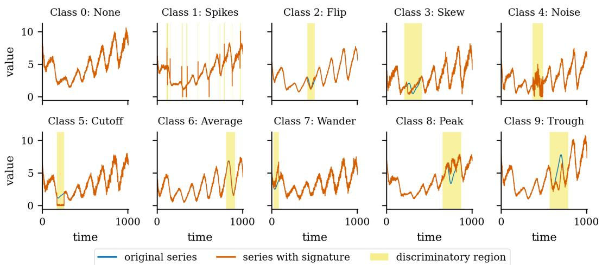  
Figure 14: One example of each class of the WebTraffic dataset. Each series is a daily seasonal signal with a weekly trend and noise, and the signature that defines the class is injected inside a single window, shown shaded; the exception is class 0 (None), which has no signature. These windows are the per-time-point ground truth against which NDCG@n is scored, and they are never used during training.

Table 14: The datasets: WebTraffic (the only one with per-time-point labels, hence the only one with NDCG@n) and the 85 UCR datasets that MILLET publishes, in the order of MILLET. Imbalance is the largest training-class share divided by the smallest (1.00 = balanced). The sizes are the original train / test splits; our training holds out 20 % of the training set for validation when it has at least 100 series.
<table><tr><td># Dataset</td><td></td><td>Train</td><td>Test</td><td>Length</td><td>Classes</td><td>Imbalance</td></tr><tr><td>WebTraffic</td><td></td><td>500</td><td>500</td><td>1,008</td><td>10</td><td>1.00</td></tr><tr><td>Adiac 1</td><td></td><td>390</td><td>391</td><td>176</td><td>37</td><td>3.75</td></tr><tr><td>2</td><td>ArrowHead</td><td>36</td><td>175</td><td>251</td><td>3</td><td>1.00</td></tr><tr><td>3</td><td>Beef</td><td>30</td><td>30</td><td>470</td><td>5</td><td>1.00</td></tr><tr><td>4</td><td>BeetleFly</td><td>20</td><td>20</td><td>512</td><td>2</td><td>1.00</td></tr><tr><td>5</td><td>BirdChicken</td><td>20</td><td>20</td><td>512</td><td>2</td><td>1.00</td></tr><tr><td>6</td><td>Car</td><td>60</td><td>60</td><td>577</td><td>4</td><td>1.55</td></tr><tr><td>7</td><td>CBF</td><td>30</td><td>900</td><td>128</td><td>3</td><td>1.50</td></tr><tr><td>8</td><td>ChlorineConcentration</td><td>467</td><td>3,840</td><td>166</td><td>3</td><td>2.88</td></tr><tr><td>9</td><td>CinCECGTorso</td><td>40</td><td>1,380</td><td>1,639</td><td>4</td><td>2.60</td></tr><tr><td>10</td><td>Coffee</td><td>28</td><td>28</td><td>286</td><td>2</td><td>1.00</td></tr><tr><td>11</td><td>Computers</td><td>250</td><td>250</td><td>720</td><td>2</td><td>1.00</td></tr><tr><td>12</td><td>CricketX</td><td>390</td><td>390</td><td>300</td><td>12</td><td>1.56</td></tr><tr><td>13</td><td>CricketY</td><td>390</td><td>390</td><td>300</td><td>12</td><td>1.29</td></tr><tr><td>14</td><td>CricketZ</td><td>390</td><td>390</td><td>300</td><td>12</td><td>1.64</td></tr><tr><td>15</td><td>DiatomSizeReduction</td><td>16</td><td>306</td><td>345</td><td>4</td><td>6.00</td></tr><tr><td>16</td><td>DistalPhalanxOutlineAgeGroup</td><td>400</td><td>139</td><td>80</td><td>3</td><td>8.57</td></tr><tr><td>17</td><td>DistalPhalanxOutlineCorrect</td><td>600</td><td>276</td><td>80</td><td>2</td><td>1.70</td></tr><tr><td>18</td><td>DistalPhalanxTW</td><td>400</td><td>139</td><td>80</td><td>6</td><td>11.83</td></tr><tr><td>19</td><td>Earthquakes</td><td>322</td><td>139</td><td>512</td><td>2</td><td>4.55</td></tr><tr><td>20</td><td>ECG200</td><td>100</td><td>100</td><td>96</td><td>2</td><td>2.23</td></tr><tr><td>21</td><td>ECG5000</td><td>500</td><td>4,500</td><td>140</td><td>5</td><td>146.00</td></tr><tr><td>22</td><td>ECGFiveDays</td><td>23</td><td>861</td><td>136</td><td>2</td><td>1.56</td></tr><tr><td>23</td><td>ElectricDevices</td><td>8,926</td><td>7,711</td><td>96</td><td>7</td><td>4.73</td></tr><tr><td>24</td><td>FaceAll</td><td>560</td><td>1,690</td><td>131</td><td>14</td><td>1.00</td></tr><tr><td>25</td><td>FaceFour</td><td>24</td><td>88</td><td>350</td><td>4</td><td>2.67</td></tr><tr><td>26</td><td>FacesUCR</td><td>200</td><td>2,050</td><td>131</td><td>14</td><td>8.25</td></tr><tr><td>27</td><td>FiftyWords</td><td>450</td><td>455</td><td>270</td><td>50</td><td>52.00</td></tr><tr><td>28 Fish</td><td></td><td>175</td><td>175</td><td>463</td><td>7</td><td>1.33</td></tr><tr><td>29</td><td>FordA</td><td>3,601</td><td>1,320</td><td>500</td><td>2</td><td>1.05</td></tr><tr><td>30</td><td>FordB</td><td>3,636</td><td>810</td><td>500</td><td>2</td><td>1.05</td></tr><tr><td>31</td><td>GunPoint</td><td>50</td><td>150</td><td>150</td><td>2</td><td>1.08</td></tr><tr><td>32 Ham</td><td></td><td>109</td><td>105</td><td>431</td><td>2</td><td>1.10</td></tr><tr><td>33</td><td>HandOutlines</td><td>1,000</td><td>370</td><td>2,709</td><td>2</td><td>1.76</td></tr><tr><td>34</td><td>Haptics</td><td>155</td><td>308</td><td>1,092</td><td>5</td><td>2.00</td></tr><tr><td>35</td><td>Herring</td><td>64</td><td>64</td><td>512</td><td>2</td><td>1.56</td></tr><tr><td>36</td><td>InlineSkate</td><td>100</td><td>550</td><td>1,882</td><td>7</td><td>2.00</td></tr><tr><td>37</td><td>InsectWingbeatSound</td><td>220</td><td>1,980</td><td>256</td><td>11</td><td>1.00</td></tr><tr><td>38</td><td>ItalyPowerDemand</td><td>67</td><td>1,029</td><td>24</td><td>2</td><td>1.03</td></tr><tr><td>39</td><td>LargeKitchenAppliances</td><td>375</td><td>375</td><td>720</td><td>3</td><td>1.00</td></tr><tr><td>40</td><td>Lightning2</td><td>60</td><td>61</td><td>637</td><td>2</td><td>2.00</td></tr><tr><td>41</td><td>Lightning7</td><td>70</td><td>73</td><td>319</td><td>7</td><td>3.80</td></tr><tr><td>42 Mallat</td><td></td><td>55</td><td>2,345</td><td>1,024</td><td>8</td><td>5.50</td></tr><tr><td>43</td><td>Meat</td><td>60</td><td>60</td><td>448</td><td>3</td><td>1.00</td></tr><tr><td>44</td><td>MedicalImages</td><td>381</td><td>760</td><td>99</td><td>10</td><td>33.83</td></tr><tr><td>45</td><td>MiddlePhalanxOutlineAgeGroup</td><td>400</td><td>154</td><td>80</td><td>3</td><td>4.31</td></tr><tr><td>46</td><td>MiddlePhalanxOutlineCorrect</td><td>600</td><td>291</td><td>80</td><td>2</td><td>1.83</td></tr><tr><td>47</td><td>MiddlePhalanxTW</td><td>399</td><td>154</td><td>80</td><td>6</td><td>6.40</td></tr><tr><td>48</td><td>MoteStrain</td><td>20</td><td>1,252</td><td>84</td><td>2</td><td>1.00</td></tr><tr><td>49</td><td>NonInvasiveFetalECGThorax1</td><td>1,800</td><td>1,965</td><td>750</td><td>42</td><td>1.60</td></tr><tr><td></td><td># Dataset</td><td>Train</td><td>Test</td><td>Length</td><td>Classes</td><td>Imbalance</td></tr><tr><td>50</td><td>NonInvasiveFetalECGThorax2</td><td>1,800</td><td>1,965</td><td>750</td><td>42</td><td>1.60</td></tr><tr><td>51</td><td>OliveOil</td><td>30</td><td>30</td><td>570</td><td>4</td><td>3.25</td></tr><tr><td>52</td><td>OSULeaf</td><td>200</td><td>242</td><td>427</td><td>6</td><td>3.53</td></tr><tr><td>53</td><td>PhalangesOutlinesCorrect</td><td>1,800</td><td>858</td><td>80</td><td>2</td><td>1.87</td></tr><tr><td>54</td><td>Phoneme</td><td>214</td><td>1,896</td><td>1,024</td><td>39</td><td>24.00</td></tr><tr><td>55</td><td>Plane</td><td>105</td><td>105</td><td>144</td><td>7</td><td>2.22</td></tr><tr><td>56</td><td>ProximalPhalanxOutlineAgeGroup</td><td>400</td><td>205</td><td>80</td><td>3</td><td>2.62</td></tr><tr><td>57</td><td>ProximalPhalanxOutlineCorrect</td><td>600</td><td>291</td><td>80</td><td>2</td><td>2.09</td></tr><tr><td>58</td><td>ProximalPhalanxTW</td><td>400</td><td>205</td><td>80</td><td>6</td><td>11.25</td></tr><tr><td>59</td><td>RefrigerationDevices</td><td>375</td><td>375</td><td>720</td><td>3</td><td>1.00</td></tr><tr><td>60</td><td>ScreenType</td><td>375</td><td>375</td><td>720</td><td>3</td><td>1.00</td></tr><tr><td>61</td><td>ShapeletSim</td><td>20</td><td>180</td><td>500</td><td>2</td><td>1.00</td></tr><tr><td>62</td><td>ShapesAll</td><td>600</td><td>600</td><td>512</td><td>60</td><td>1.00</td></tr><tr><td>63</td><td>SmallKitchenAppliances</td><td>375</td><td>375</td><td>720</td><td>3</td><td>1.00</td></tr><tr><td>64</td><td>SonyAIBORobotSurface1</td><td>20</td><td>601</td><td>70</td><td>2</td><td>2.33</td></tr><tr><td>65</td><td>SonyAIBORobotSurface2</td><td>27</td><td>953</td><td>65</td><td>2</td><td>1.45</td></tr><tr><td>66</td><td>StarLightCurves</td><td>1,000</td><td>8,236</td><td>1,024</td><td>3</td><td>3.77</td></tr><tr><td>67</td><td>Strawberry</td><td>613</td><td>370</td><td>235</td><td>2</td><td>1.80</td></tr><tr><td>68</td><td>SwedishLeaf</td><td>500</td><td>625</td><td>128</td><td>15</td><td>1.62</td></tr><tr><td>69</td><td>Symbols</td><td>25</td><td>995</td><td>398</td><td>6</td><td>2.67</td></tr><tr><td>70</td><td>SyntheticControl</td><td>300</td><td>300</td><td>60</td><td>6</td><td>1.00</td></tr><tr><td>71</td><td>ToeSegmentation1</td><td>40</td><td>228</td><td>277</td><td>2</td><td>1.00</td></tr><tr><td>72</td><td>ToeSegmentation2</td><td>36</td><td>130</td><td>343</td><td>2</td><td>1.00</td></tr><tr><td>73</td><td>Trace</td><td>100</td><td>100</td><td>275</td><td>4</td><td>1.48</td></tr><tr><td>74</td><td>TwoLeadECG</td><td>23</td><td>1,139</td><td>82</td><td>2</td><td>1.09</td></tr><tr><td>75</td><td>TwoPatterns</td><td>1,000</td><td>4,000</td><td>128</td><td>4</td><td>1.14</td></tr><tr><td>76</td><td>UWaveGestureLibraryAll</td><td>896</td><td>3,582</td><td>945</td><td>8</td><td>1.27</td></tr><tr><td>77</td><td>UWaveGestureLibraryX</td><td>896</td><td>3,582</td><td>315</td><td>8</td><td>1.27</td></tr><tr><td>78</td><td>UWaveGestureLibraryY</td><td>896</td><td>3,582</td><td>315</td><td>8</td><td>1.27</td></tr><tr><td>79</td><td>UWaveGestureLibraryZ</td><td>896</td><td>3,582</td><td>315</td><td>8</td><td>1.27</td></tr><tr><td>80</td><td>Wafer</td><td>1,000</td><td>6,164</td><td>152</td><td>2</td><td>9.31</td></tr><tr><td>81</td><td>Wine</td><td>57</td><td>54</td><td>234</td><td>2</td><td>1.11</td></tr><tr><td>82</td><td>WordSynonyms</td><td>267</td><td>638</td><td>270</td><td>25</td><td>30.00</td></tr><tr><td>83</td><td>Worms</td><td>181</td><td>77</td><td>900</td><td>5</td><td>4.47</td></tr><tr><td>84</td><td>WormsTwoClass</td><td>181</td><td>77</td><td>900</td><td>2</td><td>1.38</td></tr><tr><td>85</td><td>Yoga</td><td>300</td><td>3,000</td><td>426</td><td>2</td><td>1.19</td></tr><tr><td></td><td>UCR-85: min / median / max</td><td>16 / 267 / 8926</td><td>20/375 1 8236</td><td>24 /300 / 2709</td><td>2/3/60</td><td>1.00 / 1.60 / 146.00</td></tr></table>

## D.2 BASELINES

MILLET (InceptionTime encoder + Conjunctive pooling) is the baseline of this work. We also train FCN and ResNet (Wang et al., 2017) with the same pooling head, to have two more reference points. The faithfulness numbers of two different training recipes cannot be compared (Section 4.1), so we retrain every baseline ourselves with our own training budget, which is the only fair comparison. We also list the published numbers of MILLET (Early et al., 2024) for reference (Table 34).

Two things differ between the recipe behind the published numbers and ours. First, they keep no validation split and use no early stopping, so over-fitting cannot be observed during training. Second, they train with hard targets, i.e. the whole probability mass is put on one class, whereas we add label smoothing.

## D.3 TRAINING CONFIGURATION

We use Optuna to search for the hyperparameters, and the values it selects are then used for every model of this work. Hence, a difference between two rows of a result table is a difference between two models, and not between two training setups. Table 15 gives the shared setting, and Table 16 gives the remaining hyperparameters, with one column per model.

Table 15: Training configuration, identical for every model of this study. The complete hyperparameter list, including the head-specific initial values, is given in Table 16.
<table><tr><td>Setting</td><td>Value</td></tr><tr><td>Encoder size (every SEA-Net model)</td><td>width  $d = 6 4 ,$  4 blocks; 41,324–69,768 parameters</td></tr><tr><td>Optimizer</td><td>Adam (Kingma &amp; Ba, 2015),  $\mathrm { l r } = 1 . 2 5 \times 1 0 ^ { - 3 }$  , weight decay  $= 1 . 2 \stackrel { \cdot } { \times } 1 0 ^ { - 4 }$ </td></tr><tr><td>Epochs / early stopping</td><td>max 400 epochs; stop after 60 epochs with no improvement</td></tr><tr><td>Batch size</td><td> $\operatorname* { m i n } ( \lfloor n _ { \mathrm { t r a i n } } / 1 0 \rfloor , 1 6 )$  , floor of 2</td></tr><tr><td>Validation split</td><td>stratified 80/20 when  $n _ { \mathrm { t r a i n } } \geq 1 0 0 ;$  else train-loss early stopping</td></tr><tr><td>Label smoothing</td><td>0.13</td></tr><tr><td>Dropout</td><td>0.2</td></tr><tr><td>Attention width  $d _ { a }$ </td><td>8</td></tr><tr><td>Top-k fraction κ</td><td>0.1 (Equation (10))</td></tr><tr><td>Head initial values</td><td> $\tau _ { 0 } = 1 . 0 , \beta _ { 0 } = 0 . 3 , \lambda _ { 0 } = 0 . 5$  (attention-max) or 0.05 (dual-stream)</td></tr><tr><td>Focus penalty  $\lambda _ { \mathrm { { f o c u s } } }$ </td><td> $0 . 0 1 ; 0$  for the MILLET baselines, since the term is ours</td></tr><tr><td>Seeds</td><td>3 for the models of Table 28; 1 for the rest</td></tr><tr><td>Hardware</td><td>GPU nodes of a shared academic computing cluster</td></tr></table>

The wide encoder uses the same setting, with $d = 1 2 8$ and 6 blocks. WebTraffic is generated with the released default settings, and each series is standardized on its own; nothing else is done to the data.

## D.4 INTERPRETATION METRICS

Section 4 describes the two interpretation metrics in words: AOPCR removes the time points in the order of their estimated importance and measures how much the score of the predicted class drops, and NDCG@n compares the ranking of the time points with the ground truth. Here we give their exact definitions.

AOPCR. Let $\hat { Y } _ { i } ^ { c } ( X _ { i } )$ be the logit of the predicted class c on the unchanged time series, and let $X _ { i } ^ { ( m ) }$ be the same series in which the m time points that the model itself ranks as the most important for class c are replaced by the mean of that series. AOPCR adds up the drop of the logit along thi order,

$$
\mathrm { A O P C R } = \frac { 1 } { M + 1 } \sum _ { m = 0 } ^ { M } \Big ( \hat { Y } _ { i } ^ { c } ( X _ { i } ) - \hat { Y } _ { i } ^ { c } \big ( X _ { i } ^ { ( m ) } \big ) \Big ) ,\tag{22}
$$

following Samek et al. (2017) as adapted to time series by Early et al. (2024), with M set to 10 % of the series length in steps of 1 %. A higher value is better. Note that Equation (22) is a difference of logits, and logits have no fixed scale. This causes the comparison problem of Section 4.1: two models whose logits lie on different scales give AOPCR values on different scales, however good or bad their ranking of the time points is.

NDCG@n. When the ground truth of each time point is available, as in WebTraffic, we rank the t time points of the series by the importance $\hat { I } _ { i } ^ { j , c }$ that the model gives them for the predicted class $c ,$ and score this ranking with the normalized discounted cumulative gain (Järvelin & Kekäläinen, 2002) at the cut-off $n ,$ , where n is the number of time points that the generator marked as carrying the class signature,

$$
\mathrm { D C G @ } n = \sum _ { p = 1 } ^ { n } \frac { r _ { p } } { \log _ { 2 } ( p + 1 ) } , \qquad \mathrm { N D C G @ } n = \frac { \mathrm { D C G @ } n } { \mathrm { I D C G @ } n } \in [ 0 , 1 ] ,\tag{23}
$$

where $r _ { p } \in \{ 0 , 1 \}$ tells whether the time point placed at rank p by the model belongs to the true signature window, and IDCG@n is the same sum for the best possible ranking of the same series. Since the score is divided by the best possible score, NDCG@n lies in [0, 1] and can be compared between models, datasets and papers. This is why the interpretation claims of this paper rest on NDCG@n and not on AOPCR.

## D.5 FULL HYPERPARAMETERS

Table 16 lists every hyperparameter, with one row per hyperparameter and one column per model, read directly from the configuration files. The two SEA-Net columns and the MILLET column with our recipe share the same training block, so any difference between them is in the architecture. Table 17, set on landscape pages, then gives the number of parameters of every encoder × pooling head pair that was trained, measured on WebTraffic with its 10 classes, together with the change relative to the same encoder with the class-wise conjunctive head.

Table 16: Every hyperparameter, read from the configuration files under configs/models/. The two SEA-Net columns and MILLET (our recipe) share one training block, so any difference between them is the architecture. – = not applicable (the InceptionTime backbone is the code of MILLET with its published defaults, so it has no settings here).
<table><tr><td>Parameter</td><td>Top-k (the paper&#x27;s model)</td><td>SEA-Net bottleneck + SEA-Net gated (mean) + Top-k</td><td>MILLET, our recipe</td></tr><tr><td>Training</td><td></td><td></td><td></td></tr><tr><td>max epochs</td><td>400</td><td>400</td><td>400</td></tr><tr><td>early-stopping patience</td><td>60</td><td>60</td><td>60</td></tr><tr><td>batch size (max)</td><td>16</td><td>16</td><td>16</td></tr><tr><td>learning rate</td><td>0.00125</td><td>0.00125</td><td>0.00125</td></tr><tr><td>weight decay</td><td>0.00012</td><td>0.00012</td><td>0.00012</td></tr><tr><td>label smoothing</td><td>0.13</td><td>0.13</td><td>0.13</td></tr><tr><td>λfocus (attention entropy)</td><td>0.01</td><td>0.01</td><td>0.0</td></tr><tr><td>min. train size for a val.</td><td>100</td><td>100</td><td>100</td></tr><tr><td>split validation fraction</td><td>0.2</td><td>0.2</td><td>0.2</td></tr><tr><td>optimizer</td><td>adam</td><td>adam</td><td>adam</td></tr><tr><td>Encoder</td><td></td><td></td><td></td></tr><tr><td>type (registry name)</td><td>sea_mstcn_sep_ bottleneck</td><td>sea_mstcn_sep_</td><td>mil_</td></tr><tr><td>width d</td><td>64</td><td>gated 64</td><td>inceptiontime</td></tr><tr><td>blocks</td><td>4</td><td>4</td><td></td></tr><tr><td>dropout</td><td>0.2</td><td>0.2</td><td></td></tr><tr><td>dilation cap</td><td>16</td><td>16</td><td></td></tr><tr><td>kernel sizes</td><td>{5, 11, 23}</td><td>{5, 11, 23}</td><td></td></tr><tr><td>bottleneck ratio (d/r)</td><td>4</td><td></td><td></td></tr><tr><td>gate summary statistic</td><td></td><td>mean</td><td></td></tr><tr><td>Pooling head</td><td></td><td></td><td></td></tr><tr><td>type (registry name)</td><td>sea_topk_</td><td>sea_topk_</td><td>mil_conjunctive</td></tr><tr><td></td><td>conjunctive</td><td>conjunctive</td><td></td></tr><tr><td>attention width a</td><td>8</td><td>8</td><td>8</td></tr><tr><td>dropout</td><td>0.2</td><td>0.2</td><td>0.1</td></tr><tr><td>positional encoding</td><td>True</td><td>True</td><td>True</td></tr><tr><td>Top-k fraction κ</td><td>0.1</td><td>0.1</td><td></td></tr></table>

Table 1 7 : Number of parameters of every encoder × pooling head pair that was trained measured on WebTraffic ( 1 0 classes ; the size of a head grows with the number of classes) . The percentages give the change relative to the same encoder with class-wise conjunctive pooling in the manner of Table A. 1 3 of MILLET: every attention head costs well under 1 % of the encoder so the size of a model is set by its encoder. The bottom rows are the baseline encoders with the conjunctive head of MILLET.
<table><tr><td># Encoder  head</td><td>class-wise conj.</td><td>Top-k conj.</td><td>softmax conj.</td><td>adaptive CW.</td><td>attn-max</td><td>gated attn.</td><td>dual- stream</td><td>conj.M</td><td>additiveM</td><td>attention</td></tr><tr><td>1 bottleneck (shallow)</td><td></td><td>21,548</td><td></td><td></td><td></td><td></td><td></td><td></td><td></td><td></td></tr><tr><td>2 multi-scale pyramid (bottleneck base, over channels)</td><td></td><td>28,441</td><td></td><td></td><td></td><td></td><td></td><td></td><td></td><td></td></tr><tr><td>3 bottleneck</td><td>41,324</td><td>41,324 (+0.00%)</td><td>41,325 (+0.00%)</td><td>41,334 (+0.02%)</td><td>41,334 (+0.02%)</td><td>41,844 (+1.26%)</td><td>41,845 (+1.26%)</td><td></td><td></td><td></td></tr><tr><td>4 multi-scale pyramid (bottleneck base)</td><td></td><td>42,365</td><td></td><td></td><td></td><td></td><td></td><td></td><td></td><td></td></tr><tr><td>5 multi-scale channels (bottleneck base, lean)</td><td></td><td>43,576</td><td></td><td></td><td></td><td></td><td></td><td></td><td></td><td></td></tr><tr><td>6 multi-scale channels (bottleneck base)</td><td></td><td>47,176</td><td></td><td></td><td></td><td></td><td></td><td></td><td></td><td></td></tr><tr><td>7 base</td><td>57,580</td><td>57,580 (+0.00%)</td><td>57,581 (+0.00%)</td><td>57,590 (+0.02%)</td><td>57,590 (+0.02%)</td><td>58,100 (+0.90%)</td><td>58,101 (+0.90%)</td><td></td><td></td><td></td></tr><tr><td>8 input-gated</td><td>58,092</td><td>58,092 (+0.00%)</td><td>58,093 (+0.00%)</td><td>58,102 (+0.02%)</td><td>58,102 (+0.02%)</td><td></td><td></td><td></td><td></td><td></td></tr><tr><td>9 gated</td><td>61,740</td><td></td><td></td><td></td><td></td><td></td><td></td><td></td><td></td><td>58,100 (-5.90%)</td></tr><tr><td>10 gated (mean)</td><td>61,740</td><td>61,740 (+0.00%)</td><td>61,741 (+0.00%)</td><td>61,750 (+0.02%)</td><td>61,750 (+0.02%)</td><td></td><td></td><td></td><td></td><td></td></tr><tr><td>11 gated (max)</td><td>61,740</td><td>61,740 (+0.00%)</td><td>61,741 (+0.00%)</td><td>61,750 (+0.02%)</td><td>61,750 (+0.02%)</td><td></td><td></td><td></td><td></td><td></td></tr><tr><td>12 gated (last)</td><td>61,740</td><td>61,740 (+0.00%)</td><td>61,741 (+0.00%)</td><td>61,750 (+0.02%)</td><td>61,750 (+0.02%)</td><td>62,260 (+0.84%)</td><td>62,261 (+0.84%)</td><td></td><td></td><td></td></tr><tr><td>13 multi-scale pyramid (gated base) 14 reconstruction-residual</td><td></td><td>62,781</td><td></td><td></td><td></td><td></td><td></td><td></td><td></td><td></td></tr><tr><td></td><td>62,925</td><td>62,925 (+0.00%)</td><td>62,926 (+0.00%)</td><td>62,935 (+0.02%)</td><td>62,935 (+0.02%)</td><td></td><td></td><td></td><td></td><td></td></tr><tr><td>15 spike/trend</td><td>67,020</td><td>67,020 (+0.00%)</td><td>67,021 (+0.00%)</td><td>67,030 (+0.01%)</td><td>67,030 (+0.01%)</td><td>67,540 (+0.78%)</td><td>67,541 (+0.78%)</td><td></td><td></td><td></td></tr><tr><td># Encoder \ head</td><td>class-wise conj.</td><td>Top-k conj.</td><td>softmax conj.</td><td>adaptive cW.</td><td>attn-max gated attn.</td><td></td><td>dual- stream</td><td>conj.M</td><td>additiveM</td><td>attention</td></tr><tr><td>16 multi-scale channels (gated base)</td><td>一</td><td>67,592</td><td></td><td></td><td></td><td></td><td></td><td></td><td></td><td></td></tr><tr><td>17 multi-scale channels (input-gated base)</td><td></td><td>69,768</td><td></td><td></td><td></td><td></td><td></td><td></td><td></td><td></td></tr><tr><td>18 base (wide, d = 128)</td><td>269,164</td><td></td><td>269,165 (+0.00%)</td><td>269,174 (+0.00%)</td><td></td><td></td><td></td><td>269,083 (-0.03%)</td><td>269,083 (-0.03%)</td><td></td></tr><tr><td>19 InceptionTime (MILLET)</td><td></td><td></td><td></td><td></td><td></td><td></td><td></td><td>423,707</td><td></td><td></td></tr><tr><td>20 ResNet</td><td></td><td></td><td></td><td></td><td></td><td></td><td></td><td>506,331</td><td>7</td><td></td></tr><tr><td>21 FCN</td><td></td><td></td><td></td><td></td><td></td><td></td><td></td><td>267,035</td><td></td><td></td></tr></table>

## E COMPLETE RESULTS

Section 4.1 reports the main results in short. On WebTraffic, our SEA-Net bottleneck + Top-k model is more accurate than MILLET and gives a better NDCG@n with about ten times fewer parameters. On the 85 UCR datasets it stays slightly behind, and this gap comes from the reduced capacity and not from the design. The main text also answers RQ4 (the bottleneck) and RQ5 (Top-k pooling), and shows that AOPCR can only be compared within one training recipe.

This appendix gives the complete results behind these statements, in the same order as the main text. Section E.1 gives every model trained on WebTraffic, Section E.2 the cost of the models, Section E.3 the ablation studies, Section E.4 the results of every seed, Section E.5 the complete UCR results, and Section E.6 compares our MILLET baseline with the published numbers of MILLET (Early et al., 2024).

## E.1 COMPLETE WEBTRAFFIC RESULTS

Figure 15 first compares the explanations of MILLET and of our model on four WebTraffic classes. It shows, on single series, the difference between the two interpretation metrics: MILLET wins AOPCR on three of the four classes, while our heatmaps are the more concentrated.

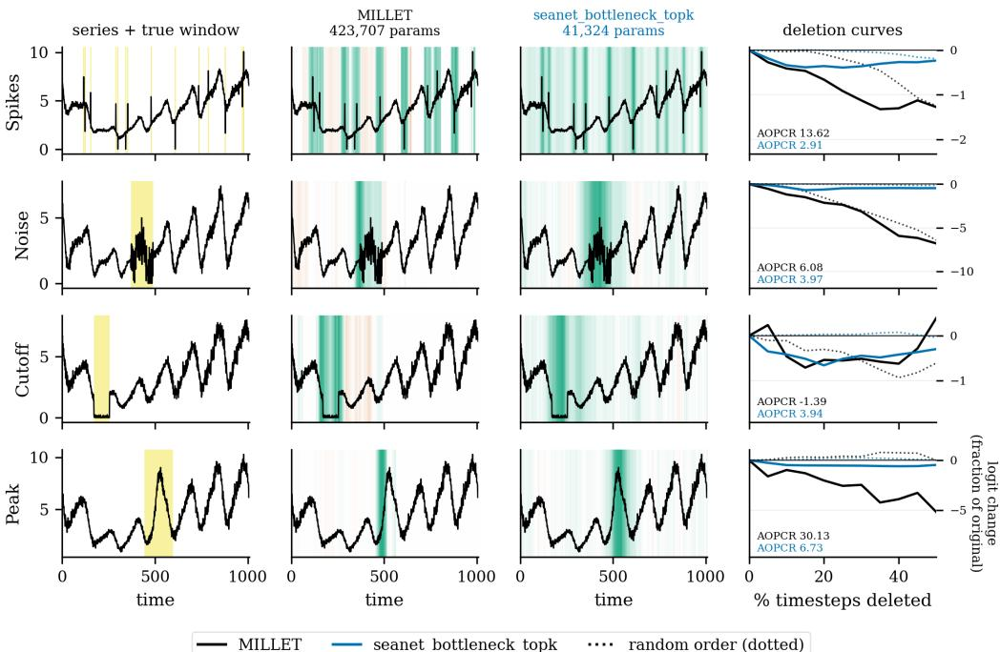  
Figure 15: Head-to-head comparison of the explanations of MILLET (published recipe) and of our SEA-Net bottleneck + Top-k model on four WebTraffic classes. The panels show, left to right, the series with its true signature window, the interpretation heatmap for the true class, and the perturbation curves under each model’s own deletion order (solid) against a random one (dotted). The vertical axis is the change as a fraction of the original logit, because the two models produce logits on very different scales (Section E.6). The AOPCR of each panel is the area between the two curves; MILLET wins it on three of the four classes while our heatmaps are the more concentrated — the difference between the two metrics is analysed in Section 4.1.

The tables below give every trained model. Table 21 is the complete WebTraffic leaderboard of the 71-model sweep, ranked by accuracy, where one row is one encoder + pooling head pair; the rows are grouped into five accuracy bands, so that the table can be read one band at a time. Table 18 is a later round in which every new head was trained on the bottleneck encoder, so the row of our model is the one to beat there. Table 19 and Table 20 give the same sweep as a grid, with one encoder per row and one pooling head per column, for the accuracy and for AOPCR / NDCG@n respectively; a dash means that the pair was not trained. These three tables are wide and are set on landscape pages.

Table 1 8 : The 2026-09 pooling-head round on WebTraffic (results/top results one seed each) : every new head is trained on the bottleneck encoder (one on the gated encoder) so row 1 (the model of the paper trained again) is the number to beat. The MILLET row is the baseline retrained with our recipe. Epochs run / best gives the epoch at which early stopping fired and the epoch whose weights were kept; the voting heads that fail to fit are visible in their NLL.
<table><tr><td rowspan="2"></td><td rowspan="2"># Encoder</td><td rowspan="2">Pooling head</td><td rowspan="2">Acc.</td><td rowspan="2">AUROC</td><td rowspan="2">NLL</td><td rowspan="2">AOPCR</td><td rowspan="2">NDCG@n</td><td rowspan="2">Params</td><td rowspan="2">Epochs run / best</td><td rowspan="2">Train (s)</td></tr><tr><td></td></tr><tr><td></td><td>bottleneck</td><td>Top-k conjunctive (paper model, re-run)</td><td>0.942</td><td>0.996</td><td>0.294</td><td>2.951</td><td>0.786</td><td>41,324</td><td>180 / 120</td><td>54</td></tr><tr><td></td><td>2 bottleneck</td><td>Top-k conjunctive, thresholded</td><td>0.930</td><td>0.996</td><td>0.330</td><td>2.603</td><td>0.744</td><td>41,324</td><td>172/ 112</td><td>52</td></tr><tr><td>3</td><td>bottleneck</td><td>softmax conjunctive, per-class τ</td><td>0.914</td><td>0.991</td><td>0.377</td><td>2.076</td><td>0.732</td><td>41,334</td><td>151 / 91</td><td>65</td></tr><tr><td>4</td><td>bottleneck</td><td>deviation-max (MLP form)</td><td>0.912</td><td>0.990</td><td>0.369</td><td>2.394</td><td>0.742</td><td>42,544</td><td>164 / 104</td><td>276</td></tr><tr><td>5</td><td>bottleneck</td><td>DSMIL (batched rewrite)</td><td>0.900</td><td>0.991</td><td>0.477</td><td>1.462</td><td>0.667</td><td>71,956</td><td>379/319</td><td>611</td></tr><tr><td></td><td>6 InceptionTime</td><td>conjunctive (MILLET, our recipe)</td><td>0.890</td><td>0.985</td><td>0.531</td><td>2.120</td><td>0.692</td><td>423,707</td><td>184 / 124</td><td>443</td></tr><tr><td></td><td>7 bottleneck</td><td>DSMIL (original code)</td><td>0.888</td><td>0.991</td><td>0.488</td><td>1.242</td><td>0.536</td><td>71,956</td><td>319 /259</td><td>2152</td></tr><tr><td></td><td>8 bottleneck</td><td>Top-k voting, thresholded</td><td>0.886</td><td>0.987</td><td>0.468</td><td>2.195</td><td>0.604</td><td>41,325</td><td>247 / 187</td><td>71</td></tr><tr><td>9</td><td>bottleneck</td><td>deviation-max (dual form)</td><td>0.878</td><td>0.988</td><td>0.451</td><td>2.356</td><td>0.723</td><td>41,944</td><td>176 /116</td><td>69</td></tr><tr><td>10</td><td>bottleneck</td><td>Top-k voting</td><td>0.870</td><td>0.983</td><td>0.516</td><td>2.212</td><td>0.601</td><td>41,325</td><td>218 / 158</td><td>61</td></tr><tr><td>11</td><td>bottleneck</td><td>adaptive class-wise + MLP</td><td>0.836</td><td>0.982</td><td>0.653</td><td>1.528</td><td>0.618</td><td>41,375</td><td>195 / 135</td><td>78</td></tr><tr><td>12</td><td>bottleneck</td><td>DSMIL (batched rewrite, no pos.)</td><td>0.832</td><td>0.976</td><td>0.632</td><td>1.312</td><td>0.639</td><td>71,956</td><td>205 / 145</td><td>318</td></tr><tr><td>13</td><td>gated (mean)</td><td>DSMIL (original code)</td><td>0.810</td><td>0.971</td><td>0.692</td><td>0.996</td><td>0.341</td><td>92,372</td><td>126/66</td><td>1043</td></tr><tr><td>14</td><td>bottleneck</td><td>Top-k voting, hard</td><td>0.672</td><td>0.902</td><td>1.173</td><td>1.770</td><td>0.697</td><td>41,325</td><td>168 / 108</td><td>50</td></tr><tr><td>15</td><td>bottleneck</td><td>simple voting</td><td>0.100</td><td>0.531</td><td>4.511</td><td>0.150</td><td>0.222</td><td>41,324</td><td>73 / 13</td><td>22</td></tr></table>

Table 1 9 : WebTraffic accuracy for every encoder × pooling head pair that was trained (7 1 -model sweep ; the κ / λ ablation copies are left out) . – = pair not trained; a superscript count means that several configurations share the cell and the most accurate one is shown. M = a MILLET head. The best value of each column is in bold.
<table><tr><td># Encoder  head</td><td></td><td>class-wise conj.</td><td>Top-k conj.</td><td>softmax conj.</td><td>adaptive CW.</td><td>attn-max</td><td>gated attn.</td><td>dual- stream</td><td> $\mathbf { c o n j . } ^ { \mathrm { M } }$ </td><td>additiveM</td><td>attention</td></tr><tr><td>1</td><td>gated (mean)</td><td>0.902</td><td>0.955</td><td>0.912</td><td>0.860</td><td>0.832</td><td>一</td><td></td><td></td><td></td><td></td></tr><tr><td>2</td><td>base (wide, d = 128)</td><td>0.946</td><td></td><td>0.880</td><td>0.918</td><td></td><td>一</td><td></td><td>0.954</td><td>0.942</td><td></td></tr><tr><td>3</td><td>gated (max)</td><td>0.944</td><td>0.952</td><td>0.914</td><td>0.906</td><td>0.886</td><td></td><td></td><td></td><td></td><td></td></tr><tr><td>4</td><td>spike/trend</td><td>0.904</td><td>0.950</td><td>0.878</td><td>0.934</td><td>0.854</td><td>0.930</td><td>0.556</td><td></td><td></td><td></td></tr><tr><td>5</td><td>multi-scale channels (input-gated base)</td><td></td><td>0.948</td><td></td><td></td><td></td><td></td><td></td><td></td><td></td><td></td></tr><tr><td>6</td><td>multi-scale channels (gated base)</td><td></td><td>0.948</td><td></td><td>一</td><td></td><td></td><td></td><td></td><td></td><td></td></tr><tr><td>7</td><td>reconstruction-residual</td><td>0.910</td><td>0.940</td><td>0.932</td><td>0.946</td><td>0.892</td><td></td><td></td><td></td><td></td><td></td></tr><tr><td>8</td><td>input-gated</td><td>0.914</td><td>0.946</td><td>0.894</td><td>0.905</td><td>0.858</td><td>一</td><td></td><td></td><td></td><td></td></tr><tr><td>9</td><td>gated (last)</td><td>0.942</td><td>0.942</td><td>0.920</td><td>0.938</td><td>0.854</td><td>0.918</td><td>0.736</td><td></td><td></td><td></td></tr><tr><td>10</td><td>bottleneck</td><td>0.902</td><td>0.931</td><td>0.940</td><td>0.868</td><td>0.816</td><td>0.930</td><td>0.824</td><td></td><td></td><td></td></tr><tr><td>11</td><td>base</td><td>0.916</td><td>0.932</td><td>0.890</td><td>0.930</td><td>0.714</td><td>0.894</td><td>0.860</td><td></td><td></td><td></td></tr><tr><td>12</td><td>gated</td><td>0.930</td><td></td><td></td><td></td><td></td><td></td><td></td><td></td><td></td><td>0.888</td></tr><tr><td>13</td><td>multi-scale channels (bottleneck base)</td><td></td><td>0.926</td><td></td><td></td><td></td><td></td><td></td><td></td><td></td><td></td></tr><tr><td>14</td><td>multi-scale channels (bottleneck base, lean)</td><td></td><td>0.924</td><td></td><td></td><td></td><td></td><td></td><td></td><td></td><td></td></tr><tr><td>15 16</td><td>InceptionTime bottleneck (shallow)</td><td></td><td>0.846</td><td></td><td></td><td></td><td></td><td></td><td>0.887</td><td></td><td></td></tr><tr><td>17</td><td>multi-scale pyramid (gated base)</td><td></td><td>0.832</td><td></td><td></td><td></td><td></td><td></td><td></td><td></td><td></td></tr><tr><td>18</td><td>multi-scale pyramid</td><td></td><td>0.786</td><td></td><td></td><td></td><td></td><td></td><td></td><td></td><td></td></tr><tr><td>19</td><td>(bottleneck base) ResNet</td><td></td><td></td><td></td><td></td><td></td><td></td><td></td><td></td><td></td><td></td></tr><tr><td>20 ) FCN</td><td></td><td></td><td>一</td><td></td><td></td><td></td><td></td><td></td><td>0.772 0.742</td><td></td><td></td></tr><tr><td>21</td><td>multi-scale pyramid (bottleneck base, over channels)</td><td></td><td>0.696</td><td></td><td></td><td></td><td></td><td></td><td></td><td></td><td></td></tr></table>

Table 20 : WebTraffic AOPCR / NDCG @ n for every encoder × pooling head pair that was trained (7 1 -model sweep ; the κ / λ ablation copies are left out) . – = pair not trained; a superscript count means that several configurations share the cell and the most accurate one is shown. M = a MILLET head. AOPCR is unnormalised (the same recipe is used ever where here)
<table><tr><td rowspan=1 colspan=13># Encoder  head          class-wise  Top-k conj.  softmax    adaptive   attn-max  gated attn.     dual-     conj.M   additiveM attentionconj.                     conj.        CW.                                   stream</td></tr><tr><td rowspan=3 colspan=13>1 gated (mean)             2.49 / 0.714 2.23 / 0.750 2.09 / 0.765 2.24 / 0.731 1.67 / 0.704                                   一1.02 / 0.605 1.61 / 0.619                                           1.50 / 0.698 1.58 / 0.7293 gated (max)</td></tr><tr><td rowspan=1 colspan=1>2</td><td rowspan=1 colspan=3>base (wide, d = 128) 1.72 / 0.686</td></tr><tr><td rowspan=1 colspan=1>3</td><td rowspan=1 colspan=3>gated (max)1.89 / 0.592</td><td rowspan=1 colspan=5>2.27 / 0.719 1.88 / 0.776</td><td rowspan=1 colspan=3>2.07 / 0.7291.12 / 0.575</td></tr><tr><td rowspan=1 colspan=4>4 spike/trend               2.15 / 0.699</td><td rowspan=1 colspan=5>2.32 / 0.756 1.43 / 0.665</td><td rowspan=1 colspan=3>1.91 / 0.747 1.65 / 0.644</td><td rowspan=1 colspan=1>1.59 /0.721 1.64 /0.510</td></tr><tr><td rowspan=1 colspan=4>5 multi-scale channels</td><td rowspan=2 colspan=8>2.32 / 0.757</td><td rowspan=2 colspan=1></td></tr><tr><td rowspan=1 colspan=4>(input-gated base)</td></tr><tr><td rowspan=1 colspan=1>6 m</td><td rowspan=2 colspan=3>ulti-scale channels(gated base)</td><td rowspan=2 colspan=3>2.22 / 0.717</td><td rowspan=2 colspan=2></td><td rowspan=2 colspan=4></td></tr><tr><td rowspan=1 colspan=1></td></tr><tr><td rowspan=1 colspan=1>7 re</td><td rowspan=1 colspan=2>construction-residual</td><td rowspan=1 colspan=1>2.50 / 0.680</td><td rowspan=1 colspan=3>2.51 / 0.698</td><td rowspan=1 colspan=1>1.64 /</td><td rowspan=1 colspan=1>0.723</td><td rowspan=1 colspan=1>2.60 / 0.768</td><td rowspan=1 colspan=1>2.32 /</td><td rowspan=1 colspan=1>0.725</td><td rowspan=1 colspan=1></td></tr><tr><td rowspan=1 colspan=1>8 i</td><td rowspan=1 colspan=2>nput-gated</td><td rowspan=1 colspan=1>2.48 / 0.715</td><td rowspan=1 colspan=3>2.80 / 0.748</td><td rowspan=1 colspan=2>1.64 / 0.696</td><td rowspan=1 colspan=1>2.65 / 0.732</td><td rowspan=1 colspan=1>2.15 /</td><td rowspan=1 colspan=1>0.700</td><td rowspan=1 colspan=1></td></tr><tr><td rowspan=1 colspan=1>9 ga</td><td rowspan=1 colspan=2>ted (last)</td><td rowspan=1 colspan=1>2.52 / 0.742</td><td rowspan=1 colspan=3>2.31 / 0.748</td><td rowspan=1 colspan=2>1.99 / 0.738</td><td rowspan=1 colspan=1>2.39 / 0.793</td><td rowspan=1 colspan=1>1.78 /</td><td rowspan=1 colspan=1>0.668</td><td rowspan=1 colspan=1>1.35 / 0.7571.95 / 0.637</td></tr><tr><td rowspan=1 colspan=1>10</td><td rowspan=1 colspan=3>bottleneck               2.57 / 0.733</td><td rowspan=1 colspan=3>2.50 / 0.765</td><td rowspan=1 colspan=2>1.68 / 0.740</td><td rowspan=1 colspan=1>1.97 / 0.680</td><td rowspan=1 colspan=2>1.74 / 0.610</td><td rowspan=1 colspan=1>2.23 / 0.741</td></tr><tr><td rowspan=1 colspan=1>11</td><td rowspan=1 colspan=3>base                     2.48 / 0.719</td><td rowspan=1 colspan=3>2.69 / 0.778</td><td rowspan=1 colspan=2>1.83 / 0.705</td><td rowspan=1 colspan=1>2.45 / 0.793</td><td rowspan=1 colspan=2>1.63 / 0.532</td><td rowspan=1 colspan=1>2.30 / 0.714 2.40 / 0.745</td></tr><tr><td rowspan=1 colspan=1>12</td><td rowspan=1 colspan=2>gated</td><td rowspan=1 colspan=1>2.41 / 0.637</td><td rowspan=1 colspan=3></td><td rowspan=1 colspan=2></td><td rowspan=1 colspan=1></td><td rowspan=1 colspan=2></td><td rowspan=3 colspan=1>2.40 / 0.710</td></tr><tr><td rowspan=1 colspan=1>13 m</td><td rowspan=1 colspan=2>ulti-scale channels</td><td rowspan=2 colspan=1></td><td rowspan=2 colspan=3>2.24 / 0.777</td><td rowspan=2 colspan=2></td><td rowspan=2 colspan=1></td><td rowspan=2 colspan=2></td></tr><tr><td rowspan=1 colspan=1></td><td rowspan=1 colspan=2>(bottleneck base)</td></tr><tr><td rowspan=1 colspan=1>14 m</td><td rowspan=1 colspan=3>ulti-scale channels</td><td rowspan=1 colspan=5>2.76 / 0.735</td><td rowspan=1 colspan=2></td><td rowspan=1 colspan=1></td><td rowspan=4 colspan=1>2.57 / 0.677</td></tr><tr><td rowspan=1 colspan=1></td><td rowspan=1 colspan=3>(bottleneck base, lean)</td><td rowspan=1 colspan=5></td><td rowspan=1 colspan=2></td><td rowspan=1 colspan=1></td></tr><tr><td rowspan=1 colspan=1>15</td><td rowspan=1 colspan=3>InceptionTime</td><td rowspan=1 colspan=5></td><td rowspan=2 colspan=3></td></tr><tr><td rowspan=1 colspan=1>16 b</td><td rowspan=1 colspan=3>ottleneck (shallow)</td><td rowspan=1 colspan=2>2.82</td><td></td><td></td><td></td></tr><tr><td rowspan=1 colspan=1>17 m</td><td rowspan=4 colspan=3>ulti-scale pyramid(gated base)ulti-scale pyramid</td><td rowspan=9 colspan=9>0.98 / 0.5912.95 / 0.5543.83 / 0.533</td></tr><tr><td rowspan=1 colspan=1></td></tr><tr><td rowspan=2 colspan=1>18m</td></tr><tr><td rowspan=1 colspan=6></td></tr><tr><td rowspan=1 colspan=1></td><td rowspan=1 colspan=3>(bottleneck base)</td></tr><tr><td rowspan=1 colspan=1>19</td><td rowspan=1 colspan=3>ResNet</td></tr><tr><td rowspan=1 colspan=1>21 m</td><td rowspan=1 colspan=1>ulti-scale p</td><td rowspan=1 colspan=1>yramid</td><td rowspan=1 colspan=1></td><td rowspan=1 colspan=3>2.17 /0.653</td><td rowspan=1 colspan=4></td></tr><tr><td rowspan=2 colspan=1></td><td rowspan=1 colspan=1>(bottleneck</td><td rowspan=1 colspan=1>base, over</td><td rowspan=1 colspan=1></td></tr><tr><td rowspan=1 colspan=3>channels)</td></tr></table>

Table 21: The complete WebTraffic leaderboard of the 71-model sweep (results/old\_results), ranked by accuracy and grouped into accuracy bands.  marks the mean over three seeds (seeds 0–2, the runs of Table 28); every other row is a single run with seed 0, so a comparison between a ∗ row and an unmarked row sets a three-run mean against one run. UCR-85 acc. is the mean accuracy over the 85 UCR datasets for the models that completed the archive, and – for the models that were only screened on WebTraffic. Encoder drops the SEA-Net prefix (MS = multi-scale); wide is the d = 128 encoder; M = a MILLET head. AUROC is given in the csv file next to this table.
<table><tr><td># Encoder</td><td></td><td>Pooling head</td><td>Acc. NLL</td><td>AOPCR</td><td>NDCG@n</td><td></td><td>Params</td><td>UCR-85 acc.</td></tr><tr><td colspan="9">Accuracy ≥ 0.94</td></tr><tr><td></td><td>1 gated (mean)</td><td>Top-k conj.*</td><td>0.955</td><td>0.254</td><td>2.225</td><td>0.750</td><td>61,740</td><td>0.8083</td></tr><tr><td></td><td>2 base (wide, d = 128)</td><td>conj. M</td><td>0.954</td><td>0.262</td><td>1.502</td><td>0.698</td><td>269,083</td><td>0.8238</td></tr><tr><td>3</td><td>gated (max)</td><td>Top-k conj.</td><td>0.952</td><td>0.308</td><td>2.268</td><td>0.719</td><td>61,740</td><td>0.8108</td></tr><tr><td></td><td>4 bottleneck</td><td>Top-k conj.  $( \lambda _ { \mathrm { f o c u s } } { = } 0 )$ </td><td>0.950</td><td>0.263</td><td>2.303</td><td>0.765</td><td>41,324</td><td></td></tr><tr><td></td><td>5 spike/trend</td><td>Top-k conj.</td><td>0.950</td><td>0.288</td><td>2.316</td><td>0.756</td><td>67,020</td><td>0.8089</td></tr><tr><td></td><td>6 MS channels (input-gated base)</td><td>Top-k conj.</td><td>0.948</td><td>0.318</td><td>2.316</td><td>0.757</td><td>69,768</td><td></td></tr><tr><td></td><td>7 MS channels (gated base)</td><td>Top-k conj.</td><td>0.948</td><td>0.289</td><td>2.223</td><td>0.717</td><td>67,592</td><td></td></tr><tr><td></td><td>8 base (wide, d = 128)</td><td>class-wise conj.</td><td>0.946</td><td>0.292</td><td>1.722</td><td>0.686</td><td>269,164</td><td>0.8292</td></tr><tr><td></td><td>9 input-gated</td><td>Top-k conj.</td><td>0.946</td><td>0.261</td><td>2.803</td><td>0.748</td><td>58,092</td><td>0.8131</td></tr><tr><td></td><td>10 reconstruction- residual</td><td>adaptive cw.</td><td>0.946</td><td>0.296</td><td>2.601</td><td>0.768</td><td>62,935</td><td>0.8140</td></tr><tr><td>11</td><td>gated (max)</td><td>class-wise conj.</td><td>0.944</td><td>0.306</td><td>1.889</td><td>0.592</td><td>61,740</td><td>0.8237</td></tr><tr><td>12</td><td>gated (last)</td><td>class-wise conj.</td><td>0.942</td><td>0.327</td><td>2.520</td><td>0.742</td><td>61,740</td><td>0.7888</td></tr><tr><td>13</td><td>gated (last)</td><td>Top-k conj.</td><td>0.942</td><td>0.328</td><td>2.312</td><td>0.748</td><td>61,740</td><td>0.8015</td></tr><tr><td></td><td>14 base (wide, d = 128)</td><td>additiveM</td><td>0.942</td><td>0.260</td><td>1.579</td><td>0.729</td><td>269,083</td><td>0.8298</td></tr><tr><td></td><td>15 bottleneck</td><td>Top-k conj. (κ=0.25)</td><td>0.940</td><td>0.277</td><td>2.648</td><td>0.733</td><td>41,324</td><td></td></tr><tr><td></td><td>16 reconstruction- residual</td><td>Top-k conj.</td><td>0.940</td><td>0.321</td><td>2.505</td><td>0.698</td><td>62,925</td><td>0.8063</td></tr><tr><td></td><td>17 bottleneck</td><td>softmax conj.</td><td>0.940</td><td>0.345</td><td>1.685</td><td>0.740</td><td>41,325</td><td>0.8106</td></tr><tr><td colspan="9">Accuracy in [0.92, 0.94)</td></tr><tr><td></td><td>18 gated (last)</td><td>adaptive cw.</td><td>0.938</td><td>0.289</td><td>2.387</td><td>0.793</td><td>61,750</td><td>0.8029</td></tr><tr><td>19</td><td>spike/trend</td><td>adaptive cw.</td><td>0.934</td><td>0.301</td><td>1.913</td><td>0.747</td><td>67,030</td><td>0.8010</td></tr><tr><td></td><td>20 base</td><td>Top-k conj.</td><td>0.932</td><td>0.306</td><td>2.691</td><td>0.778</td><td>57,580</td><td>0.8093</td></tr><tr><td></td><td>21 reconstruction- residual</td><td>softmax conj.</td><td>0.932</td><td>0.341</td><td>1.642</td><td>0.723</td><td>62,926</td><td></td></tr><tr><td>22</td><td>bottleneck</td><td>Top-k conj.*</td><td>0.931</td><td>0.312</td><td>2.498</td><td>0.765</td><td>41,324</td><td>0.8097</td></tr><tr><td>23</td><td>gated</td><td>class-wise conj.</td><td>0.930</td><td>0.359</td><td>2.408</td><td>0.637</td><td>61,740</td><td>0.7900</td></tr><tr><td>24 base</td><td></td><td>adaptive cw.</td><td>0.930</td><td>0.336</td><td>2.448</td><td>0.793</td><td>57,590</td><td></td></tr><tr><td>25</td><td>bottleneck</td><td>gated attn.</td><td>0.930</td><td>0.313</td><td>2.232</td><td>0.741</td><td>41,844</td><td>0.8146</td></tr><tr><td>26</td><td>spike/trend</td><td>gated attn.</td><td>0.930</td><td>0.350</td><td>1.593</td><td>0.721</td><td>67,540</td><td>0.8039</td></tr><tr><td></td><td>27 MS channels (bottleneck base)</td><td>Top-k conj.</td><td>0.926</td><td>0.357</td><td>2.238</td><td>0.777</td><td>47,176</td><td></td></tr><tr><td>28</td><td>MS channels (bottleneck base,</td><td>Top-k conj.</td><td>0.924</td><td>0.389</td><td>2.762</td><td>0.735</td><td>43,576</td><td></td></tr><tr><td>29</td><td>lean) gated (last)</td><td>softmax conj.</td><td>0.920</td><td>0.381</td><td>1.990</td><td>0.738</td><td>61,741</td><td></td></tr><tr><td># Encoder</td><td></td><td>Pooling head</td><td>Acc.</td><td>NLL</td><td>AOPCR</td><td>NDCG@n</td><td>Params</td><td>UCR-85 acc.</td></tr><tr><td></td><td>30 base (wide,</td><td>adaptive cw.</td><td>0.918</td><td>0.360</td><td>1.608</td><td>0.619</td><td>269,174</td><td>0.8134</td></tr><tr><td>31</td><td>d = 128) gated (last)</td><td>gated attn.</td><td>0.918</td><td>0.365</td><td>1.354</td><td>0.757</td><td>62,260</td><td>0.8048</td></tr><tr><td>32</td><td>base</td><td>class-wise conj.</td><td>0.916</td><td>0.383</td><td>2.478</td><td>0.719</td><td>57,580</td><td></td></tr><tr><td>33</td><td>gated (max)</td><td>softmax conj.</td><td>0.914</td><td>0.372</td><td>1.884</td><td>0.776</td><td>61,741</td><td></td></tr><tr><td>34</td><td>input-gated</td><td>class-wise conj.</td><td>0.914</td><td>0.398</td><td>2.481</td><td>0.715</td><td>58,092</td><td></td></tr><tr><td>35</td><td>gated (mean)</td><td>softmax conj.</td><td>0.912</td><td>0.368</td><td>2.093</td><td>0.765</td><td>61,741</td><td></td></tr><tr><td>36</td><td>reconstruction-</td><td>class-wise conj.</td><td>0.910</td><td>0.417</td><td>2.504</td><td>0.680</td><td>62,925</td><td></td></tr><tr><td>37</td><td>residual bottleneck</td><td>Top-k conj.</td><td>0.908</td><td>0.395</td><td>2.436</td><td>0.722</td><td>41,324</td><td></td></tr><tr><td></td><td>gated (max)</td><td>(κ=1.00) adaptive cw.</td><td></td><td></td><td></td><td></td><td></td><td></td></tr><tr><td>38 39</td><td>input-gated</td><td>adaptive cw.*</td><td>0.906 0.905</td><td>0.444 0.390</td><td>2.071 2.651</td><td>0.729 0.732</td><td>61,750 58,102</td><td>0.8153</td></tr><tr><td>40</td><td>spike/trend</td><td>class-wise conj.</td><td>0.904</td><td>0.395</td><td>2.155</td><td>0.699</td><td>67,020</td><td></td></tr><tr><td>41</td><td>bottleneck</td><td>class-wise conj.</td><td>0.902</td><td>0.395</td><td>2.572</td><td>0.733</td><td>41,324</td><td></td></tr><tr><td>42</td><td>gated (mean)</td><td>class-wise conj.</td><td>0.902</td><td>0.393</td><td>2.493</td><td>0.714</td><td>61,740</td><td></td></tr><tr><td></td><td>Accuracy in [0.85, 0.90)</td><td></td><td></td><td></td><td></td><td></td><td></td><td></td></tr><tr><td colspan="9">43 input-gated</td></tr><tr><td></td><td></td><td>softmax conj.</td><td>0.894</td><td>0.454</td><td>1.636</td><td>0.696</td><td>58,093</td><td></td></tr><tr><td>44 base</td><td>reconstruction-</td><td>gated attn.</td><td>0.894</td><td>0.403</td><td>2.296</td><td>0.714</td><td>58,100</td><td></td></tr><tr><td>45</td><td>residual</td><td>attn-max</td><td>0.892</td><td>0.499</td><td>2.324</td><td>0.725</td><td>62,935</td><td></td></tr><tr><td>46 base</td><td></td><td>softmax conj.</td><td>0.890</td><td>0.419</td><td>1.832</td><td>0.705</td><td>57,581</td><td></td></tr><tr><td>47 48</td><td>gated</td><td>attention</td><td>0.888</td><td>0.426</td><td>2.403</td><td>0.710</td><td>58,100</td><td></td></tr><tr><td></td><td>bottleneck</td><td>Top-k conj. (κ=0.05)</td><td>0.888</td><td>0.401</td><td>2.288</td><td>0.715</td><td>41,324</td><td></td></tr><tr><td>49</td><td>InceptionTime</td><td>conj.M*</td><td>0.887</td><td>0.507</td><td>2.569</td><td>0.677</td><td>423,707</td><td>0.8274</td></tr><tr><td>50 51</td><td>gated (max) bottleneck</td><td>attn-max Top-k conj.</td><td>0.886 0.882</td><td>0.588</td><td>1.124 3.114</td><td>0.575 0.732</td><td>61,750</td><td></td></tr><tr><td></td><td></td><td>(κ=0.50)</td><td></td><td>0.418</td><td></td><td></td><td>41,324</td><td></td></tr><tr><td></td><td>52 base (wide, d = 128)</td><td>softmax conj.</td><td>0.880</td><td>0.455</td><td>1.015</td><td>0.605</td><td>269,165</td><td>0.8131</td></tr><tr><td>53</td><td>spike/trend</td><td>softmax conj.</td><td>0.878</td><td>0.488</td><td>1.435</td><td>0.665</td><td>67,021</td><td></td></tr><tr><td>55</td><td>54 bottleneck</td><td>adaptive cw.</td><td>0.868</td><td>0.559</td><td>1.969</td><td>0.680</td><td>41,334</td><td></td></tr><tr><td></td><td>base</td><td>dual-stream</td><td>0.860</td><td>0.498</td><td>2.399</td><td>0.745</td><td>58,101</td><td></td></tr><tr><td>56</td><td>gated (mean)</td><td>adaptive cw.</td><td>0.860</td><td>0.549</td><td>2.238</td><td>0.731</td><td>61,750</td><td></td></tr><tr><td>57</td><td>input-gated</td><td>attn-max</td><td>0.858</td><td>0.625</td><td>2.153</td><td>0.700</td><td>58,102</td><td></td></tr><tr><td>58</td><td>spike/trend</td><td>attn-max</td><td>0.854</td><td>0.637</td><td>1.646</td><td>0.644</td><td>67,030</td><td></td></tr><tr><td>59</td><td>gated (last)</td><td>attn-max</td><td>0.854</td><td>0.598</td><td>1.779</td><td>0.668</td><td>61,750</td><td></td></tr><tr><td colspan="9">Accuracy &lt; 0.85</td></tr><tr><td></td><td>60 bottleneck (shallow)</td><td>Top-k conj.</td><td>0.846</td><td>0.579</td><td>2.817</td><td>0.624</td><td>21,548</td><td></td></tr><tr><td>61</td><td>gated (mean)</td><td>attn-max</td><td>0.832</td><td>0.665</td><td>1.672</td><td>0.704</td><td>61,750</td><td></td></tr><tr><td>62</td><td>MS pyramid (gated base)</td><td>Top-k conj.</td><td>0.832</td><td>0.602</td><td>0.980</td><td>0.591</td><td>62,781</td><td></td></tr><tr><td>63</td><td>bottleneck</td><td>dual-stream</td><td>0.824</td><td>0.638</td><td>2.037</td><td>0.652</td><td>41,845</td><td></td></tr><tr><td>64 65</td><td>bottleneck</td><td>attn-max</td><td>0.816</td><td>0.732</td><td>1.737</td><td>0.610</td><td>41,334</td><td></td></tr><tr><td></td><td>MS pyramid (bottleneck base)</td><td>Top-k conj.</td><td>0.786</td><td>0.759</td><td>1.035</td><td>0.569</td><td>42,365</td><td></td></tr><tr><td></td><td>66 ResNet</td><td>conj.M</td><td>0.772</td><td>0.824</td><td>2.952</td><td>0.554</td><td>506,331</td><td>0.8146</td></tr><tr><td>67 FCN</td><td></td><td>conj.M</td><td>0.742</td><td>0.910</td><td>3.826</td><td>0.533</td><td>267,035</td><td>0.8141</td></tr></table>

continued on the next page

Table 22: Cost on the WebTraffic input (length 1,008, 10 classes), one GPU, batch 32. Params× and FLOPs× are size and compute relative to the re-trained MILLET baseline; column definitions in Appendix D.4; lower is better throughout.
<table><tr><td>Model</td><td>Params</td><td>Size</td><td>FLOPs</td><td>Latency</td><td>Params×</td><td>FLOPsX</td></tr><tr><td>SEA-Net (ours)</td><td></td><td></td><td></td><td></td><td></td><td></td></tr><tr><td>bottleneck + Top-k conj.</td><td>41,324</td><td>1.43</td><td>76.7</td><td>0.131</td><td>0.10×</td><td>0.09×</td></tr><tr><td>bottleneck + Top-k conj. (λfocus = 0)</td><td>41,324</td><td>1.43</td><td>76.7</td><td>0.130</td><td>0.10×</td><td>0.09×</td></tr><tr><td>input-gated + Top-k conj.</td><td>58,092</td><td>1.49</td><td>110.6</td><td>0.130</td><td>0.14×</td><td>0.13×</td></tr><tr><td>gated (mean) + Top-k conj.</td><td>61,740</td><td>1.50</td><td>109.7</td><td>0.128</td><td>0.15×</td><td>0.13×</td></tr><tr><td>spike/trend + Top-k conj.</td><td>67,020</td><td>1.53</td><td>120.1</td><td>0.132</td><td>0.16×</td><td>0.14×</td></tr><tr><td>bottleneck + Top-k conj., 2026-09 re-run</td><td>41,324</td><td>1.43</td><td>76.7</td><td>0.131</td><td>0.10×</td><td>0.09×</td></tr><tr><td>Baselines</td><td></td><td></td><td></td><td></td><td></td><td></td></tr><tr><td>MILLET (InceptionTime + conjunctive), our recipe</td><td>423,707</td><td>4.11</td><td>847.6</td><td>0.203</td><td>1.00×</td><td>1.00×</td></tr><tr><td>ResNet + conjunctive</td><td>506,331</td><td>4.42</td><td>1013.2</td><td>0.139</td><td>1.20×</td><td>1.20×</td></tr><tr><td>FCN + conjunctive</td><td>267,035</td><td>3.47</td><td>535.2</td><td>0.068</td><td>0.63×</td><td>0.63×</td></tr></table>

Table 21 (continued)
<table><tr><td># Encoder</td><td></td><td>Pooling head</td><td>Acc.</td><td>NLL</td><td></td><td>AOPCR NDCG@n Params UCR-85</td><td></td><td>acc.</td></tr><tr><td></td><td>68 gated (last)</td><td>dual-stream</td><td>0.736</td><td>0.804</td><td>1.947</td><td>0.637</td><td>62,261</td><td></td></tr><tr><td></td><td>69 base</td><td>attn-max</td><td>0.714</td><td>0.855</td><td>1.630</td><td>0.532</td><td>57,590</td><td>一</td></tr><tr><td></td><td>70 MS pyramid (bottleneck base, over channels)</td><td>Top-k conj.</td><td>0.696</td><td>0.992</td><td>2.167</td><td>0.653</td><td>28,441</td><td></td></tr><tr><td></td><td>71 spike/trend</td><td>dual-stream</td><td>0.556 1.260</td><td></td><td>1.643</td><td>0.510</td><td>67,541</td><td></td></tr></table>

## E.2 MODEL COST

The main text states that our model is 10.3× smaller and needs 11.1× less computation than MILLET. Table 22 gives the full cost and separates what improved from what did not. At 32-bit precision the weights go from about 1.6 MB to 161 KB, which moves the model from above to well below the roughly 1 MB flash budget of the micro-controller class described by Lin et al. (2020) and Banbury et al. (2021b), and standard int8 quantization (Jacob et al., 2018) would reduce it to about 40 KB. In this sense, the model becomes a candidate for such a device. The other two columns do not improve. Latency improves by only 1.6× even though the FLOPs fall 11.1×, because depthwise convolutions are limited by memory speed, and a GPU at batch 32 is the wrong tool for a claim about small hardware; the 269 K wide model is in fact the slowest row. Peak memory is 179.0 MB against 112.3 MB for the baseline, which is worse, and this comes from the design: the encoder keeps the length unchanged, so the activations have the shape (d, t) at every stage, however few weights produce them, and Equation (3) reduces the weights, not the activations. On micro-controllers, the SRAM needed for the activations is the limit at least as often as the flash needed for the weights, so this is a real limitation of the design and not a measurement error (Section 5).

Figure 16 draws the compute column of Table 22 as a function of the size of the problem. The left panel varies the length of the series at 10 classes, and the right panel varies the number of classes at length 463, and the two dashed lines mark the mean length and the mean number of classes over the 85 UCR datasets. The cost of both models grows linearly with the length and hardly depends on the number of classes, and our model needs about ten times fewer operations at every length.

Table 23 completes the picture on the pooling side, by counting the real multiplications of each head as a function of t, C and d. No head adds a term that grows faster than those of Conjunctive pooling, so the saving of Table 22 comes from the encoder and is not lost again in the head.

## E.3 ABLATION STUDIES

The main text answers RQ4 and RQ5 with matched pairs of models, i.e. two models that differ in one part only. The ablations below give the wider view: the effect of the pooling head and of the encoder averaged over the whole sweep (A and B), the effect of the Top-k fraction κ (C), and the effect of the attention entropy term (D). A short look at the wrong predictions of the two models closes the subsection.

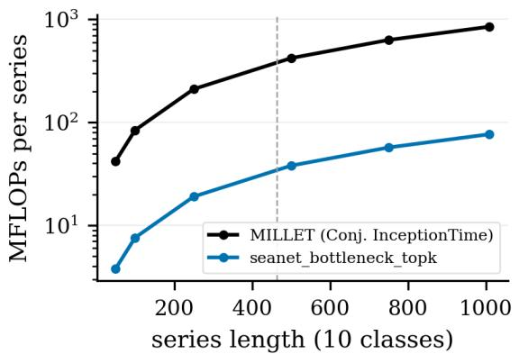

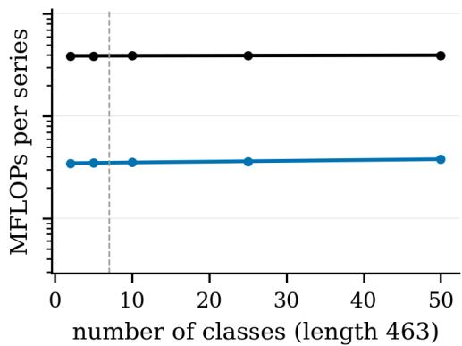  
Figure 16: Compute cost of one prediction, in millions of floating point operations, for our SEA-Net bottleneck + Top-k model and for the MILLET baseline (InceptionTime + Conjunctive). Left: as the length of the series grows, at 10 classes. Right: as the number of classes grows, at length 463. The dashed lines mark the mean series length and the mean number of classes over the 85 UCR datasets.

Table 23: Time complexity of the pooling heads as the number of real multiplications, counted from the code (matrix products only, as in Table A.15 of MILLET; additions, comparisons, the exponential of a softmax and the gather of the critical time point are not counted). t = series length, c = classes, d = embedding size, a = attention width, $k = \lceil \kappa t \rceil$ . The last column evaluates the formula for WebTraffic $( t = 1 0 0 8 , c = 1 0 , a = 8 , \kappa = 0 . 1$ , so k = 101) with the own d of each head: the SEA-Net heads read d = 64 embeddings and the MILLET head d = 128, so every SEA-Net head is cheaper than the baseline head in absolute terms, although its formula has more terms. M = MILLET.
<table><tr><td></td><td># Pooling head</td><td>Real multiplications</td><td>Scale w.r.t. t</td><td>Scale w.r.t. c</td><td>At WebTraffic (M)</td></tr><tr><td></td><td>1 conjunctiveM</td><td> $d t c + d t a + ( a + 2 c ) t d c + d a + a + 2 c d t d t + 2 t$ </td><td></td><td></td><td>2.351 (d = 128)</td></tr><tr><td></td><td>2 class-wise conjunctive</td><td> $d t c + d t a + ( a c + 2 c ) t d c + d a + a c + 2 c d t + a t + 2 t$ </td><td></td><td></td><td>1.262 (d = 64)</td></tr><tr><td></td><td>3 Top-k conjunctive</td><td> $d t c + d t a + ( a c + c ) t + c k d c + d a + a c + c + c \kappa d t + a t + t + k$ </td><td></td><td></td><td>1.253 (d = 64)</td></tr><tr><td></td><td>4 softmax conjunctive</td><td> $d t c + d t a + ( a c + 3 c ) t d c + d a + a c + 3 c d t + a t + 3 t$ </td><td></td><td></td><td>1.272 (d = 64)</td></tr><tr><td></td><td>5 adaptive class-wise</td><td> $d t c + d t a + ( a c + 4 c ) t d c + d a + a c + 4 c d t + a t + 4 t$ </td><td></td><td></td><td>1.282 (d = 64)</td></tr><tr><td></td><td>6 attention-max</td><td> $d t c + d t a + ( a c + 2 c ) t + 2 c d c + d a + a c + 2 c d t + a t + 2 t + 2$ </td><td></td><td></td><td>1.262 (d = 64)</td></tr><tr><td></td><td>7 gated attention</td><td> $d t c + 2 d t a + ( a c + a + 2 c ) t d c + 2 d a + a c + a + 2 c d t + a t + 2 t$ </td><td></td><td></td><td>1.786 (d = 64)</td></tr><tr><td></td><td>8 dual-stream conjunctive</td><td>4c) t + 2c</td><td> $d t c + 2 d t a + ( 2 a c + d c + 2 d a + 2 a c + 4 c \ d t + 2 a t + 4 t + 2$ </td><td></td><td>1.879 (d = 64)</td></tr></table>

A. Effect of the pooling head, averaged over the encoders. In Table 24, one row is one pooling head, and the columns are the accuracy, AOPCR and NDCG@n averaged over every encoder that the head was paired with, where n is the number of pairings. Averaged this way, the pooling head alone changes the WebTraffic accuracy by almost 18 points, which is why we treat the choice of the head as a design decision and not as a detail.

B. Effect of the encoder, averaged over the pooling heads. Table 25 is the same table for the encoders, i.e. one row is one encoder, and the values are averaged over every head that it was paired with. Its spread, from 0.937 down to 0.771, is close to the spread of the pooling table above, so the

Table 24: Effect of the pooling head: WebTraffic accuracy, AOPCR and NDCG@n averaged over every encoder that each head was paired with in the 71-model sweep (n = number of pairings; the κ / λ ablation copies are excluded, so that no pairing is counted twice). The last column is the best single pairing of that head. A head paired once (n = 1) is not comparable with one averaged over ten.
<table><tr><td># Pooling head</td><td>Mean acc.</td><td>Mean AOPCR</td><td>Mean NDCG@n</td><td>n</td><td>Best pairing (acc.)</td></tr><tr><td>SEA-Net heads</td><td></td><td></td><td></td><td></td><td></td></tr><tr><td></td><td>1 class-wise conjunctive</td><td>0.921 0.918</td><td>2.322 1.869</td><td>0.692 10</td><td>0.946(seanet_classwise)</td></tr><tr><td>2 gated attention</td><td></td><td></td><td>0.733</td><td>4</td><td>0.930 (seanet_bottleneck_ gatedattn)</td></tr><tr><td>3 adaptive class-wise</td><td></td><td>0.912</td><td>2.210</td><td>0.732 9</td><td>0.946 (seanet_recon_ adaptive)</td></tr><tr><td></td><td>4 softmax conjunctive</td><td>0.907</td><td>1.690</td><td>0.712 9</td><td>0.940(seanet_bottleneck_ softmax)</td></tr><tr><td>5 Top-k conjunctive</td><td></td><td>0.903</td><td>2.260</td><td>0.712 16</td><td>0.955 (seanet_gated_mean_ topk)</td></tr><tr><td>6 attention-max</td><td></td><td>0.838</td><td>1.758</td><td>0.645 8</td><td>0.892 (seanet_recon_ attnmax)</td></tr><tr><td>7 dual-stream conjunctive</td><td></td><td>0.744</td><td>2.007</td><td>0.636 4</td><td>0.860 (seanet_slim_ dualstream)</td></tr><tr><td colspan="8">MILLET heads (reference; n = 1 rows are one pairing only)</td></tr><tr><td>8 additive 9 attention</td><td>0.942</td><td>1.579 2.403</td><td>0.729 0.710</td><td>1</td><td>0.942 (seanet)</td></tr><tr><td></td><td>0.888</td><td></td><td></td><td>1</td><td>0.888 (seanet_slim_ gatedattn)</td></tr><tr><td>10 conjunctive</td><td>0.839</td><td>2.712</td><td>0.615</td><td>4</td><td>0.954 (seanet_ conjunctive)</td></tr></table>

two choices are about equally important. Two cautions apply to both tables. First, several groups contain very few models and not every pair was trained, so the grid of Table 19 is the more reliable view. Second, the mean of the bottleneck encoder (0.884) is lower than its best pairing suggests, because it was also paired with the weak heads.

C. Effect of the Top-k fraction κ. Table 26 is the same model trained five times with only the κ of Equation (10) changed, all of them on seed 0, and the column k gives how many time points are actually kept at each fraction. The selection is what helps: κ = 1, which by Property 2 is exactly the class-wise conjunctive pooling of Equation (8), scores 0.908, clearly below the 0.938–0.940 obtained at κ = 0.1 and κ = 0.25.

D. Effect of the attention entropy term. Table 27 is one matched pair, i.e. the same model with only $\lambda _ { \mathrm { f o c u s } }$ switched on and off, on seed 0. Switching the term off raises the accuracy from 0.888 to 0.950 and NDCG@n from 0.755 to 0.765, and lowers AOPCR from 2.409 to 2.303. Seed 0 is, however, the weakest of the three runs of the default model (0.888, 0.938 and 0.966; Table 28): against its three-run mean (0.931 ± 0.032 accuracy, 0.765 ± 0.013 NDCG@n), the run without the term lies within one standard deviation in accuracy and matches it exactly in NDCG@n. We therefore keep the value selected by the hyperparameter search and read this pair as showing no measurable effect of the term in either direction.

Wrong predictions. Finally, Figures 17 and 18 look at the wrong predictions of the two models on their hardest WebTraffic class, i.e. the class with the lowest accuracy. The errors are of two kinds: in the first, the model still points at the right window but names the wrong class, so the NDCG@n stays high; in the second, the signature is too weak or too close to the seasonal pattern, and the model never finds it.

## E.4 PER-SEED RESULTS

The main text compares every difference with the seed-to-seed spread measured on WebTraffic, ±0.016 for the accuracy and ±0.013 for NDCG@n. Table 28 gives the runs behind these numbers:

Table 25: Effect of the encoder: WebTraffic accuracy, AOPCR and NDCG@n averaged over every pooling head that each encoder was paired with (n = number of pairings, with the same exclusions as in Table 24). The gated encoder has the largest n because it was paired with the most heads, which pulls its mean towards the weak heads; the last column shows what each encoder reaches with its best head.
<table><tr><td># Encoder</td><td>Mean acc.</td><td>Mean AOPCR</td><td>Mean NDCG@n</td><td>n</td><td>Best pairing (acc.)</td></tr><tr><td colspan="6">SEA-Net encoders († = a wrapper around another encoder)</td></tr><tr><td>1 SEA-Net multi-scale channels†</td><td>0.936</td><td>2.385</td><td>0.747</td><td>4</td><td>0.948 (seanet_inputgate_ mschan)</td></tr><tr><td>2 SEA-Net reconstruction- residual</td><td>0.924</td><td>2.315</td><td>0.719</td><td>5</td><td>0.946 (seanet_recon_ adaptive)</td></tr><tr><td>3 SEA-Net input-gated</td><td>0.903</td><td>2.345</td><td>0.718</td><td>5</td><td>0.946 (seanet_inputgate_ topk)</td></tr><tr><td>4 SEA-Net gated</td><td>0.902</td><td>2.056</td><td>0.710</td><td>19</td><td>0.955 (seanet_gated_mean_ topk)</td></tr><tr><td>5 SEA-Net base</td><td></td><td>0.898 1.933</td><td>0.693</td><td>12</td><td>0.954 (seanet_ conjunctive)</td></tr><tr><td>6 SEA-Net bottleneck</td><td>0.882</td><td>2.193</td><td>0.693</td><td>8</td><td>0.940(seanet_bottleneck_ softmax)</td></tr><tr><td></td><td>7 SEA-Net spike/trend</td><td>0.858 1.814</td><td>0.677</td><td>7</td><td>0.950(seanet_spiketrend_ topk)</td></tr><tr><td>8 SEA-Net multi-scale pyramid†</td><td>0.771</td><td>1.394</td><td>0.604</td><td>3</td><td>0.832 (seanet_gated_ pyramid)</td></tr><tr><td colspan="6">Baseline encoders (each paired with conjunctive pooling only)</td></tr><tr><td>9 InceptionTime</td><td>0.887</td><td>2.569</td><td>0.677</td><td>1</td><td>0.887 (millet)</td></tr><tr><td>10 ResNet</td><td>0.772</td><td>2.952</td><td>0.554</td><td>1</td><td>0.772 (resnet)</td></tr><tr><td>11 FCN</td><td>0.742</td><td>3.826</td><td>0.533</td><td>1</td><td>0.742 (fcn)</td></tr></table>

Table 26: Top-k fraction ablation on WebTraffic: the bottleneck + Top-k model trained five times with only κ changed (seed 0 everywhere, so the κ = 0.10 row is the seed-0 run of that model, and the last row is its mean over every run). $k = \lceil \kappa t \rceil$ is the number of time points that the series logit averages; $\kappa = 1$ recovers class-wis conjunctive pooling exactly. The best single-seed value of each column is in bold.
<table><tr><td>#κ</td><td>k at t = 1008</td><td>Accuracy</td><td>NLL</td><td></td><td>AOPCR</td><td>NDCG@n</td></tr><tr><td>1 0.05</td><td></td><td>51</td><td>0.888</td><td>0.401</td><td>2.288</td><td>0.715</td></tr><tr><td></td><td>2 0.10 (default)</td><td>101</td><td>0.888</td><td>0.391</td><td>2.409</td><td>0.755</td></tr><tr><td>3 0.25</td><td></td><td>252</td><td>0.940</td><td>0.277</td><td>2.648</td><td>0.733</td></tr><tr><td>40.50</td><td></td><td>504</td><td>0.882</td><td>0.418</td><td>3.114</td><td>0.732</td></tr><tr><td></td><td>5 1.00 (= class-wise conjunctive)</td><td>1008</td><td>0.908</td><td>0.395</td><td>2.436</td><td>0.722</td></tr><tr><td>over 3 runs</td><td>0.10, mean ± std</td><td>101</td><td> $0 . 9 3 1 \pm 0 . 0 3 2$ </td><td> $0 . 3 1 2 \pm 0 . 0 6 3$ </td><td> $2 . 4 9 8 \pm 0 . 1 4 9$ </td><td> $0 . 7 6 5 \pm 0 . 0 1 3$ </td></tr></table>

Table 27: The attention-entropy term of the loss, switched on and off, on WebTraffic (seed 0): the bottleneck + Top-k model with only $\lambda _ { \mathrm { f o c u s } }$ changed. This is one matched pair on one seed, so it indicates a direction rather than an effect size.
<table><tr><td> $\lambda _ { \mathrm { f o c u s } }$ </td><td>Accuracy</td><td>NLL</td><td>AOPCR</td><td>NDCG@n</td></tr><tr><td>0.01 (on, the default)</td><td>0.888</td><td>0.391</td><td>2.409</td><td>0.755</td></tr><tr><td>0.00 (off)</td><td>0.950</td><td>0.263</td><td>2.303</td><td>0.765</td></tr></table>

seanet\_bottleneck\_topk - class 7 (Wander), its hardest: accuracy 0.80 every WebTraffic run of the models that were trained more than once, with one row per model and per metric, one column per run, and the mean ± the standard deviation in the last column. These are the numbers behind every ± of the main tables and the noise level used throughout the paper: we never report a difference smaller than this spread as a result. For every model, the spread of AOPCR is far larger than that of the accuracy, which is why we never read an AOPCR difference of a few tenths as a win. Figure 19 asks the same question on the 85 UCR datasets.

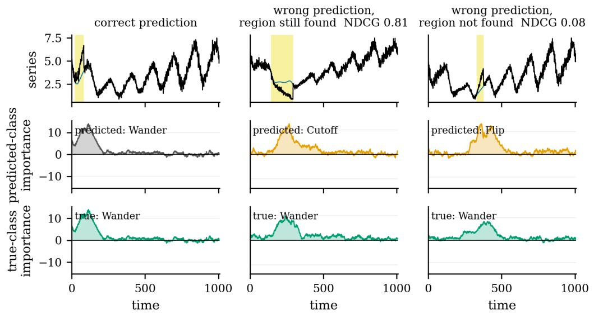  
Figure 17: SEA-Net bottleneck + Top-k (ours). Wrong predictions on the hardest WebTraffic class, i.e. the class with the lowest accuracy. Top: the series with its true signature window in yellow. Middle: the interpretation for the class that the model predicted. Bottom: the interpretation for the true class, with its NDCG@n.

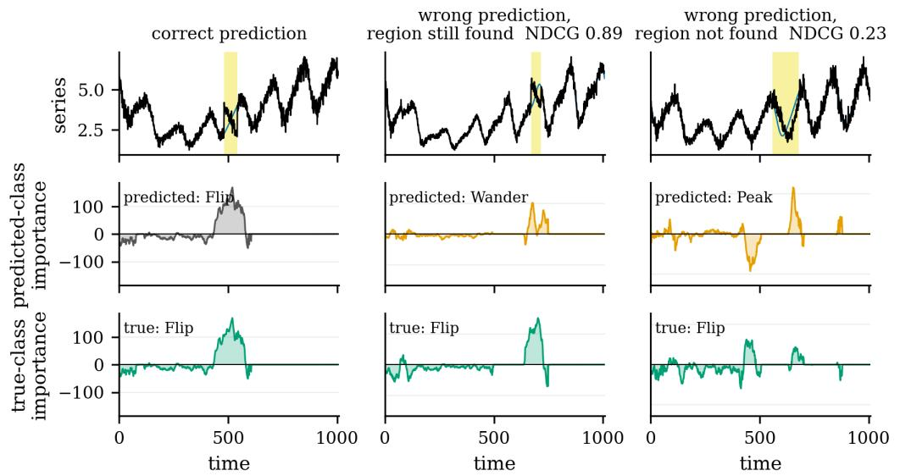  
Figure 18: MILLET (published recipe). Wrong predictions on the hardest WebTraffic class, i.e. the class with the lowest accuracy. Top: the series with its true signature window in yellow. Middle: the interpretation for the class that the model predicted. Bottom: the interpretation for the true class, with its NDCG@n.

Table 28: Every WebTraffic run of the models that were trained more than once, run by run (archive = the 71-model sweep in results/old\_results, 2026-09 = results/top\_results; a seed run in both folders is two different trainings). These are the numbers behind every ± in the main tables. The spread on AOPCR is far larger than on accuracy for every model, which is why AOPCR differences of a few tenths are not read as wins.
<table><tr><td># Model</td><td></td><td>Metric</td><td>Run 1</td><td>Run 2</td><td>Run 3</td><td>Run 4</td><td>Mean ± std</td></tr><tr><td></td><td>1 SEA-Net gated (mean) + Top-k conjunctive</td><td>accuracy</td><td>0.954</td><td>0.958</td><td>0.952</td><td></td><td> $0 . 9 5 5 \pm 0 . 0 0 2$ </td></tr><tr><td></td><td></td><td>AOPCR</td><td>2.293</td><td>2.074</td><td>2.308</td><td></td><td> $2 . 2 2 5 \pm 0 . 1 0 7$ </td></tr><tr><td></td><td></td><td>NDCG@n</td><td>0.772</td><td>0.749</td><td>0.728</td><td></td><td> $0 . 7 5 0 \pm 0 . 0 1 8$ </td></tr><tr><td></td><td></td><td>run</td><td>archive, seed 0</td><td>archive, seed 1</td><td>archive, seed 2</td><td></td><td></td></tr><tr><td></td><td>2 SEA-Net bottleneck + accuracy Top-k conjunctive</td><td></td><td>0.888</td><td>0.938</td><td>0.966</td><td></td><td> $0 . 9 3 1 \pm 0 . 0 3 2$ </td></tr><tr><td></td><td></td><td>AOPCR</td><td>2.409</td><td>2.708</td><td>2.378</td><td></td><td> $2 . 4 9 8 \pm 0 . 1 4 9$ </td></tr><tr><td></td><td></td><td>NDCG@n</td><td>0.755</td><td>0.783</td><td>0.758</td><td></td><td> $0 . 7 6 5 \pm 0 . 0 1 3$ </td></tr><tr><td></td><td></td><td>run</td><td>archive, seed 0</td><td>archive, seed 1</td><td>archive, seed 2</td><td></td><td></td></tr><tr><td></td><td>3 SEA-Net input-gated</td><td>accuracy</td><td>0.938</td><td>0.880</td><td>0.898</td><td></td><td> $0 . 9 0 5 \pm 0 . 0 2 4$ </td></tr><tr><td></td><td>+ adaptive class-wise</td><td>AOPCR</td><td></td><td></td><td></td><td></td><td></td></tr><tr><td></td><td></td><td>NDCG@n</td><td>3.126 0.777</td><td>2.266 0.692</td><td>2.560 0.728</td><td></td><td> $2 . 6 5 1 \pm 0 . 3 5 7$ </td></tr><tr><td></td><td></td><td>run</td><td>archive,</td><td>archive,</td><td>archive,</td><td></td><td> $0 . 7 3 2 \pm 0 . 0 3 5$ </td></tr><tr><td>4 MILLET (InceptionTime +</td><td></td><td>accuracy</td><td>seed 0 0.894</td><td>seed 1 0.876</td><td>seed 2 0.892</td><td>0.890</td><td> $0 . 8 8 8 \pm 0 . 0 0 7$ </td></tr><tr><td>recipe</td><td>conjunctive), our</td><td></td><td></td><td></td><td></td><td></td><td></td></tr><tr><td></td><td></td><td>AOPCR</td><td>1.594</td><td>2.795</td><td>3.319</td><td>2.120</td><td> $2 . 4 5 7 \pm 0 . 6 5 5$ </td></tr><tr><td></td><td></td><td>NDCG@n</td><td>0.671</td><td>0.695</td><td>0.665</td><td>0.692</td><td> $0 . 6 8 1 \pm 0 . 0 1 3$ </td></tr><tr><td></td><td></td><td>run</td><td>archive, seed 0</td><td>archive, seed 1</td><td>archive, seed 2</td><td>2026-09, seed 0</td><td></td></tr></table>

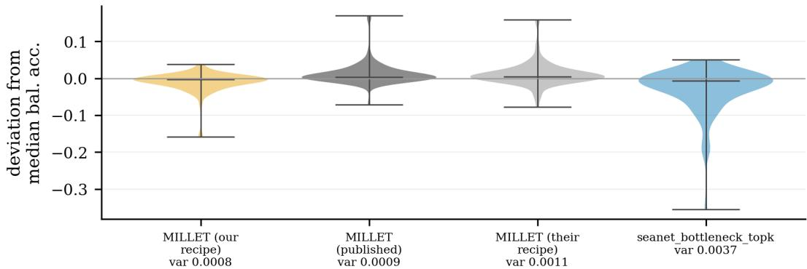  
Figure 19: Model variance over the 85 UCR datasets, in the style of Early et al. (2024). For each dataset and each seed, the balanced accuracy minus the median balanced accuracy of that model on that dataset, pooled over the datasets; the models are ordered from left to right by their total variance, which is printed under each of them. Our SEA-Net model is the least stable of the four and has a long lower tail, i.e. on a few datasets one seed falls far below the other two, which is the same effect that Table 28 shows on WebTraffic.

## E.5 COMPLETE UCR RESULTS

On the UCR archive, the main text reports that our model reaches 0.810 mean accuracy, behind MILLET with the matched budget (0.827) and behind the published MILLET accuracy (0.8445, Early et al. 2024), and that the wide variant of the same design closes this gap. Table 29 is the evidence behind these statements (Section 4.1). With the training budget fixed, changing the backbone at a similar size moves the mean rank from 12.60 to 11.53, about 1.1 places, so our design is not what loses accuracy; the reduced capacity is.

Table 29: UCR-85 accuracy and mean rank. Mean rank is over the 84 datasets finished by all 28 models we ran on the archive; lower is better. Win/tie/loss is counted per dataset against MILLET’s published accuracies. ‡84 of 85 datasets finished.
<table><tr><td>Model</td><td>Params</td><td>Acc.</td><td>Mean rank</td><td>W/T/L</td></tr><tr><td>MILLET, published (Early et al., 2024)</td><td>423,707</td><td>0.8445</td><td></td><td></td></tr><tr><td>SEA-Net wide + class-wise conjunctive</td><td>269,164</td><td>0.8292</td><td>11.53</td><td>26/19/39</td></tr><tr><td>SEA-Net wide + MILLET additive</td><td>269,083</td><td>0.8298</td><td>11.98</td><td>23/19/42</td></tr><tr><td>SEA-Net wide + MILLET conjunctive</td><td>269,083</td><td>0.8238</td><td>12.43</td><td>22/20/42</td></tr><tr><td>MILLET, matched budget</td><td>423,707</td><td>0.8274</td><td>12.60</td><td>13/25/46</td></tr><tr><td>ResNet + conjunctive</td><td>506,331</td><td>0.8146</td><td>13.54</td><td>25/11/49</td></tr><tr><td>FCN + conjunctive</td><td>267,035</td><td>0.8141</td><td>14.48</td><td>20/12/52</td></tr><tr><td>SEA-Net gated + Top-k</td><td>61,740</td><td>0.8083</td><td>15.29</td><td>19/13/53</td></tr><tr><td>SEA-Net bottleneck + Top-k</td><td>41,324</td><td>0.8097</td><td>15.40</td><td>20/15/50</td></tr></table>

The remaining tables give the full detail. Table 30 lists every model that completed the archive, sorted by mean accuracy, where n is the number of datasets it finished out of the 85, and Table 31 counts the wins, ties and losses of the same models against the published per-dataset numbers of MILLET. Table 32 and Table 33 then give one row per dataset and one column per model, for the accuracy and for AOPCR respectively, so that a single dataset can be looked up instead of a mean.

A Wilcoxon–Holm test over the same datasets finds that most of the differences in the middle of Table 30 are not significant at α = 0.05. This is one more reason why the main text argues from WebTraffic and from the cost rather than from the UCR rank, and why we give the win / tie / loss counts instead of relying on the rank order alone.

Figure 20 shows the accuracy comparison with one point per dataset, our model against the published MILLET accuracy (Early et al., 2024). Figure 21 then checks, on the UCR datasets whose normalized class entropy is below one, whether an imbalanced training set hurts the smaller model more, and Figure 22 checks the same for the length of the series and for the number of training series. In all three cases the answer is the same: the ranking of the models is stable, so our model does not fall further behind on the imbalanced, the long or the small datasets.

seanet bottleneck topk win / tie / loss 15 / 17 / 52  
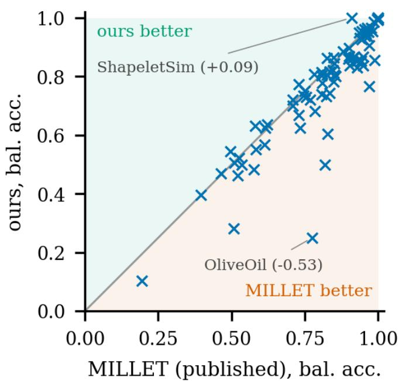  
Figure 20: Direct comparison of our SEA-Net bottleneck + Top-k model against the published MILLET accuracies on the 85 UCR datasets, one point per dataset. The points above the diagonal are the datasets where our model is the more accurate one. The title gives the number of wins / ties / losses (15 / 17 / 52, where a tie is a difference below 0.005), and the datasets with the largest positive and negative differences are named.

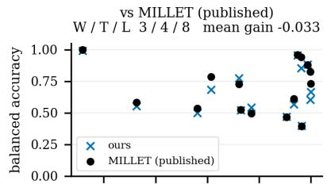

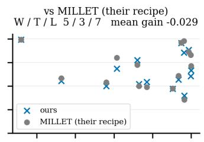

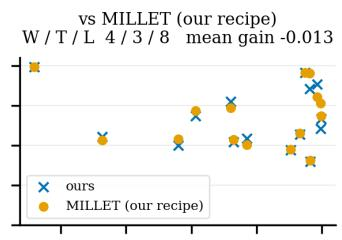

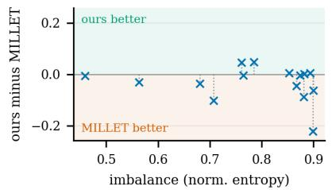

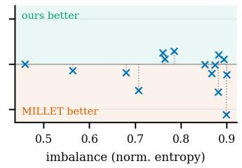

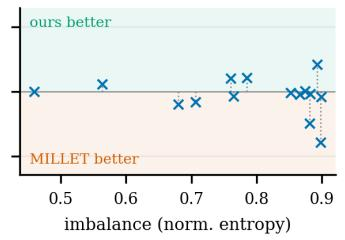  
Figure 21: The effect of the class imbalance, on the UCR datasets whose training set is imbalanced (normalized class entropy below one). Top: the balanced accuracy of our model and of MILLET measured three ways, i.e. published, re-trained with the published recipe, and re-trained with the configuration of Table 15. Bottom: the difference, ours minus MILLET, where green means that our model is the better one. Each title gives the wins / ties / losses and the mean gain. The imbalance does not hurt the smaller model more than the baseline: the differences are small on both sides, and they do not grow with the imbalance.

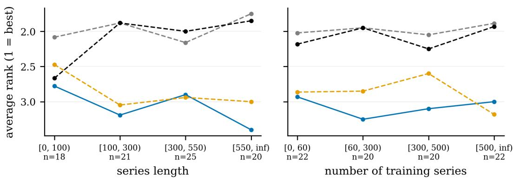

Figure 22: Average accuracy rank (1 = best, lower is better) of our model and of the three MILLET measurements, binned by two properties of the dataset: the length of the series (left) and the number of training series (right). The bin edges are chosen to give bins of roughly equal size, and n is the number of datasets in each bin. The ranking is stable across the bins, i.e. our SEA-Net model does not fall further behind on the long series or on the small training sets.  
Table 30: The 85 UCR datasets: every model that completed the archive, sorted by mean accuracy (n = number of datasets finished, out of the 85 that MILLET publishes). The means are over the datasets that each model finished; the win / tie / loss counts of the same rows are given in Table 31. AOPCR is unnormalised: the rows trained with our recipe can be compared with each other, whereas the † row (the published numbers of MILLET) is on another scale. The best value of each column is in bold (the † row is excluded for AOPCR).
<table><tr><td># Model</td><td></td><td>n Acc.</td><td>Bal. acc.</td><td>AUROC</td><td>NLL</td><td>AOPCR</td><td>Params</td></tr><tr><td></td><td>1 SEA-Net base (wide, d = 128) + additive (MILLET)</td><td>85 0.8298</td><td>0.8077</td><td>0.9295</td><td>0.5088</td><td>0.551</td><td>269,083</td></tr><tr><td></td><td>2 SEA-Net base (wide, d = 128) + class-wise conjunctive</td><td>85</td><td>0.8292</td><td>0.8039</td><td>0.9255 0.5113</td><td>0.564</td><td>269,164</td></tr><tr><td>3</td><td>MILLET (InceptionTime + conjunctive), our recipe</td><td>84</td><td>0.8274</td><td>0.7997</td><td>0.9275</td><td>0.5297 0.812</td><td>423,707</td></tr><tr><td>4</td><td>SEA-Net base (wide, d = 128) + conjunctive (MILLET)</td><td>85</td><td>0.8238</td><td>0.7993 0.9281</td><td>0.5180</td><td>0.626</td><td>269,083</td></tr><tr><td>5</td><td>SEA-Net gated (max) + class-wise conjunctive</td><td>85</td><td>0.8237</td><td>0.7979</td><td>0.9288</td><td>0.5214 0.619</td><td>61,740</td></tr><tr><td></td><td>6 SEA-Net input-gated + adaptive class-wise</td><td>85</td><td>0.8153</td><td>0.7905</td><td>0.9208 0.5545</td><td>0.964</td><td>58,102</td></tr><tr><td>7</td><td>SEA-Net bottleneck + gated attention</td><td>85</td><td>0.8146</td><td>0.7879</td><td>0.9254</td><td>0.5330 0.688</td><td>41,844</td></tr><tr><td>8</td><td>ResNet + conjunctive 9 FCN + conjunctive</td><td>85 85</td><td>0.8146 0.8141</td><td>0.7839 0.7846</td><td>0.9232 0.9216</td><td>0.5709 1.330</td><td>506,331</td></tr><tr><td></td><td>10 SEA-Net reconstruction-residual +</td><td>85</td><td>0.8140</td><td>0.7859</td><td>0.5727 0.9232 0.5502</td><td>1.378 1.091</td><td>267,035 62,935</td></tr><tr><td>11</td><td>adaptive class-wise SEA-Net base (wide, d = 128) +</td><td>85</td><td>0.8134</td><td>0.7849</td><td>0.9199</td><td>0.5354</td><td></td></tr><tr><td>12</td><td>adaptive class-wise SEA-Net base (wide, d = 128) +</td><td>85</td><td>0.8131</td><td>0.7858</td><td></td><td>0.891 1.247</td><td>269,174</td></tr><tr><td>13</td><td>softmax conjunctive SEA-Net input-gated + Top-k</td><td>85</td><td>0.8131</td><td>0.7877</td><td>0.9212 0.9223</td><td>0.5436 0.964</td><td>269,165 58,092</td></tr><tr><td></td><td>conjunctive 14 SEA-Net gated (max) + Top-k</td><td>85</td><td>0.8108</td><td>0.7850</td><td>0.9172</td><td>0.5365 0.5464 0.936</td><td>61,740</td></tr><tr><td>15</td><td>conjunctive SEA-Net bottleneck + softmax</td><td>85</td><td>0.8106</td><td>0.7856</td><td>0.9167</td><td></td><td>41,325</td></tr><tr><td></td><td>conjunctive</td><td></td><td></td><td></td><td></td><td>0.5509 0.759</td><td></td></tr></table>

continued on the next page

Table 30 (continued)
<table><tr><td># Model</td><td></td><td>n</td><td>Acc.</td><td>Bal. acc.</td><td>AUROC</td><td>NLL</td><td>AOPCR</td><td>Params</td></tr><tr><td></td><td>16 SEA-Net bottleneck + Top-k conjunctive</td><td>85</td><td>0.8097</td><td>0.7827</td><td>0.9179</td><td>0.5506</td><td>1.091</td><td>41,324</td></tr><tr><td>17</td><td>SEA-Net base + Top-k conjunctive</td><td>85</td><td>0.8093</td><td>0.7833</td><td>0.9182</td><td>0.5525</td><td>1.018</td><td>57,580</td></tr><tr><td>18</td><td>SEA-Net spike/trend + Top-k conjunctive</td><td>85</td><td>0.8089</td><td>0.7832</td><td>0.9137</td><td>0.5460</td><td>1.108</td><td>67,020</td></tr><tr><td>19</td><td>SEA-Net gated (mean) + Top-k conjunctive</td><td>85</td><td>0.8083</td><td>0.7803</td><td>0.9168</td><td>0.5560</td><td>1.064</td><td>61,740</td></tr><tr><td></td><td>20 SEA-Net reconstruction-residual + Top-k conjunctive</td><td>85</td><td>0.8063</td><td>0.7793</td><td>0.9156</td><td>0.5530</td><td>1.222</td><td>62,925</td></tr><tr><td>21</td><td>SEA-Net gated (last) + gated attention</td><td>85</td><td>0.8048</td><td>0.7804</td><td>0.9157</td><td>0.5564</td><td>0.500</td><td>62,260</td></tr><tr><td>22</td><td>SEA-Net spike/trend + gated attention</td><td>85</td><td>0.8039</td><td>0.7793</td><td>0.9112</td><td>0.5537</td><td>0.682</td><td>67,540</td></tr><tr><td>23</td><td>SEA-Net gated (last) + adaptive class-wise</td><td>85</td><td>0.8029</td><td>0.7797</td><td>0.9139</td><td>0.5633</td><td>0.796</td><td>61,750</td></tr><tr><td>24</td><td>SEA-Net gated (last) + Top-k conjunctive</td><td>85</td><td>0.8015</td><td>0.7749</td><td>0.9131</td><td>0.5531</td><td>0.967</td><td>61,740</td></tr><tr><td>25</td><td>SEA-Net spike/trend + adaptive class-wise</td><td>85</td><td>0.8010</td><td>0.7766</td><td>0.9135</td><td>0.5641</td><td>0.677</td><td>67,030</td></tr><tr><td></td><td>26 SEA-Net gated + class-wise conjunctive</td><td>85</td><td>0.7900</td><td>0.7657</td><td>0.9055</td><td>0.5848</td><td>0.486</td><td>61,740</td></tr><tr><td>27</td><td>SEA-Net gated (last) + class-wise conjunctive</td><td>85</td><td>0.7888</td><td>0.7658</td><td>0.9027</td><td>0.5922</td><td>0.535</td><td>61,740</td></tr><tr><td>28</td><td>MILLET conjunctive InceptionTime, published (mean of 5 seeds)</td><td>85</td><td>0.8445</td><td>0.8235</td><td>0.9329</td><td>1.2241</td><td>4.553†</td><td>423,300</td></tr></table>

Table 31: Wins / ties / losses (W/T/L) of the models of Table 30, with the same rows and the same numbering, against the published per-dataset numbers of MILLET, with tie bands of 0.005 (accuracy), 0.01 (NLL) and 0.1 (AOPCR). The published AOPCR values come from MILLET’s recipe and are on another scale, which is why every model “loses” the AOPCR W/T/L against them.
<table><tr><td># Model</td><td></td><td>W/T/L acc.</td><td>W/T/L NLL</td><td>W/T/L AOPCR</td></tr><tr><td>1</td><td>SEA-Net base (wide, d = 128) + additive (MILLET)</td><td>24/19/42</td><td>60/2/23</td><td>3/0/82</td></tr><tr><td>2</td><td>SEA-Net base (wide, d = 128) + class-wise conjunctive</td><td>27/19/39</td><td>60/1/24</td><td>3/0/82</td></tr><tr><td>3</td><td>MILLET (InceptionTime + conjunctive), our recipe</td><td>13/25/46</td><td>56/2/26</td><td>3/0/81</td></tr><tr><td>4</td><td>SEA-Net base (wide, d = 128) + conjunctive (MILLET)</td><td>23/20/42</td><td>57/5/23</td><td>4/0/81</td></tr><tr><td>5</td><td>SEA-Net gated (max) + class-wise conjunctive</td><td>20/17/48</td><td>61/0/24</td><td>4/0/81</td></tr><tr><td>6</td><td>SEA-Net input-gated + adaptive class-wise</td><td>20/15/50</td><td>60/0/25</td><td>4/0/81</td></tr><tr><td>7</td><td>SEA-Net bottleneck + gated attention</td><td>23/14/48</td><td>59/1/25</td><td>5/0/80</td></tr><tr><td>8</td><td>ResNet + conjunctive</td><td>25/11/49</td><td>55/0/30</td><td>8/0/77</td></tr><tr><td>9</td><td>FCN + conjunctive</td><td>21/12/52</td><td>55/1/29</td><td>5/3/77</td></tr><tr><td>10</td><td>SEA-Net reconstruction-residual + adaptive class-wise</td><td>19/18/48</td><td>58/1/26</td><td>4/0/81</td></tr><tr><td>11</td><td>SEA-Net base (wide, d = 128) + adaptive class-wise</td><td>25/17/43</td><td>57/1/27</td><td>4/1/80</td></tr><tr><td>12</td><td>SEA-Net base (wide, d = 128) + softmax conjunctive</td><td>17/13/55</td><td>60/7/18</td><td>4/0/81</td></tr><tr><td>13</td><td>SEA-Net input-gated + Top-k conjunctive</td><td>23/16/46</td><td>60/1/24</td><td>3/1/81</td></tr><tr><td>14</td><td>SEA-Net gated (max) + Top-k conjunctive</td><td>22/16/47</td><td>59/0/26</td><td>5/1/79</td></tr><tr><td>15</td><td>SEA-Net bottleneck + softmax conjunctive</td><td>22/17/46</td><td>58/1/26</td><td>3/0/82</td></tr><tr><td>16</td><td>SEA-Net bottleneck + Top-k conjunctive</td><td>20/15/50</td><td>58/1/26</td><td>4/0/81</td></tr><tr><td>17</td><td>SEA-Net base + Top-k conjunctive</td><td>20/11/54</td><td>60/1/24</td><td>5/0/80</td></tr><tr><td>18</td><td>SEA-Net spike/trend + Top-k conjunctive</td><td>19/23/43</td><td>56/1/28</td><td>6/0/79</td></tr><tr><td>19</td><td>SEA-Net gated (mean) + Top-k conjunctive</td><td>19/13/53</td><td>58/1/26</td><td>4/0/81</td></tr><tr><td>20</td><td>SEA-Net reconstruction-residual + Top-k conjunctive</td><td>19/19/47</td><td>59/0/26</td><td>5/0/80</td></tr><tr><td>21</td><td>SEA-Net gated (last) + gated attention</td><td>17/15/53</td><td>58/0/27</td><td>3/0/82</td></tr><tr><td>22</td><td>SEA-Net spike/trend + gated attention</td><td>15/14/56</td><td>58/1/26</td><td>4/0/81</td></tr><tr><td>23</td><td>SEA-Net gated (last) + adaptive class-wise</td><td>18/18/49</td><td>57/0/28</td><td>4/1/80</td></tr><tr><td>24</td><td>SEA-Net gated (last) + Top-k conjunctive</td><td>17/17/51</td><td>59/0/26</td><td>3/1/81</td></tr><tr><td>25</td><td>SEA-Net spike/trend + adaptive class-wise</td><td>24/12/49</td><td>57/0/28</td><td>4/0/81</td></tr><tr><td>26</td><td>SEA-Net gated + class-wise conjunctive</td><td>16/15/54</td><td>55/1/29</td><td>3/0/82</td></tr><tr><td>27</td><td>SEA-Net gated (last) + class-wise conjunctive</td><td>17/12/56</td><td>55/0/30</td><td>3/0/82</td></tr><tr><td>28</td><td>MILLET conjunctive InceptionTime, published (mean of 5 seeds)</td><td></td><td></td><td></td></tr></table>

Table 32: Per-dataset accuracy on the 85 UCR datasets that MILLET publishes. MILLETpub. is the published mean of 5 seeds of MILLET; the next four columns are SEA-Net encoders with the Top-k conjunctive head (the model of the paper is bottleneck); MILLET (ours), ResNet and FCN are the baselines re-trained under our recipe, each with conjunctive pooling. The best value of each row is in bold (the published column included).
<table><tr><td># Dataset</td><td> M·.</td><td>boteck</td><td>atad an)</td><td>nup-ded</td><td>spkernd</td><td>(M r</td><td>Reset</td><td>CN</td></tr><tr><td>1 Adiac</td><td>0.832</td><td>0.733</td><td>0.788</td><td>0.749</td><td>0.772</td><td>0.812</td><td>0.785</td><td>0.788</td></tr><tr><td>2 ArrowHead</td><td>0.838</td><td>0.851</td><td>0.829</td><td>0.840</td><td>0.869</td><td>0.827</td><td>0.886</td><td>0.840</td></tr><tr><td>3 Beef</td><td>0.847</td><td>0.822</td><td>0.867</td><td>0.833</td><td>0.767</td><td>0.800</td><td>0.800</td><td>0.733</td></tr><tr><td>4 BeetleFly</td><td>0.920</td><td>0.867</td><td>0.750</td><td>0.850</td><td>0.900</td><td>0.883</td><td>0.850</td><td>0.700</td></tr><tr><td>5 BirdChicken</td><td>0.940</td><td>0.850</td><td>0.800</td><td>0.950</td><td>0.850</td><td>0.983</td><td>1.000</td><td>0.900</td></tr><tr><td>6 Car</td><td>0.920</td><td>0.867</td><td>0.883</td><td>0.917</td><td>0.883</td><td>0.911</td><td>0.933</td><td>0.883</td></tr><tr><td>7 CBF</td><td>1.000</td><td>0.993</td><td>0.947</td><td>0.999</td><td>1.000</td><td>0.997</td><td>0.989</td><td>0.997</td></tr><tr><td>8 ChlorineConcentration</td><td>0.858</td><td>0.681</td><td>0.700</td><td>0.598</td><td>0.616</td><td>0.803</td><td>0.590</td><td>0.780</td></tr><tr><td>9 CinCECGTorso</td><td>0.824</td><td>0.732</td><td>0.749</td><td>0.704</td><td>0.768</td><td>0.844</td><td>0.860</td><td>0.897</td></tr><tr><td>10 Coffee</td><td>1.000</td><td>1.000</td><td>1.000</td><td>1.000</td><td>1.000</td><td>1.000</td><td>1.000</td><td>1.000</td></tr><tr><td>11 Computers</td><td>0.769</td><td>0.721</td><td>0.640</td><td>0.688</td><td>0.596</td><td>0.741</td><td>0.732</td><td>0.828</td></tr><tr><td>12 CricketX</td><td>0.827</td><td>0.811</td><td>0.833</td><td>0.818</td><td>0.836</td><td>0.808</td><td>0.718</td><td>0.710</td></tr><tr><td>13 CricketY</td><td>0.823</td><td>0.805</td><td>0.772</td><td>0.836</td><td>0.813</td><td>0.818</td><td>0.679</td><td>0.715</td></tr><tr><td>14 CricketZ</td><td>0.857</td><td>0.816</td><td>0.800</td><td>0.836</td><td>0.823</td><td>0.817</td><td>0.774</td><td>0.764</td></tr><tr><td>15 DiatomSizeReduction</td><td>0.972</td><td>0.966</td><td>0.935</td><td>0.954</td><td>0.971</td><td>0.948</td><td>0.951</td><td>0.922</td></tr><tr><td>16 DistalPhalanxOutlineAgeGroup</td><td>0.715</td><td>0.755</td><td>0.770</td><td>0.770</td><td>0.770</td><td>0.734</td><td>0.784</td><td>0.734</td></tr><tr><td>17 DistalPhalanxOutlineCorrect</td><td>0.770</td><td>0.775</td><td>0.768</td><td>0.750</td><td>0.772</td><td>0.777</td><td>0.768</td><td>0.732</td></tr><tr><td>18 DistalPhalanxTW</td><td>0.660</td><td>0.703</td><td>0.698</td><td>0.698</td><td>0.712</td><td>0.700</td><td>0.698</td><td>0.705</td></tr><tr><td>19 Earthquakes</td><td>0.725</td><td>0.748</td><td>0.748</td><td>0.748</td><td>0.777</td><td>0.755</td><td>0.741</td><td>0.748</td></tr><tr><td>20 ECG200</td><td>0.896</td><td>0.887</td><td>0.890</td><td>0.900</td><td>0.850</td><td>0.830</td><td>0.830</td><td>0.890</td></tr><tr><td>21 ECG5000</td><td>0.942</td><td>0.944</td><td>0.933</td><td>0.945</td><td>0.942</td><td>0.940</td><td>0.941</td><td>0.942</td></tr><tr><td>22 ECGFiveDays</td><td>1.000</td><td>1.000</td><td>1.000</td><td>1.000</td><td>1.000</td><td>1.000</td><td>0.957</td><td>0.978</td></tr><tr><td># Dataset</td><td>ML M.</td><td>boteck</td><td>ated ean)</td><td>nupu-ged</td><td>spkend</td><td></td><td>(MI (rs</td><td>Reset</td></tr><tr><td></td><td>0.712</td><td>0.719</td><td>0.696</td><td>0.740</td><td>0.712</td><td>0.708</td><td>0.750</td><td>CN 0.729</td></tr><tr><td>23 ElectricDevices 24 FaceAll</td><td>0.953</td><td>0.805</td><td>0.822</td><td>0.807</td><td>0.834</td><td>0.925</td><td>0.922</td><td>0.919</td></tr><tr><td>25 FaceFour</td><td>0.959</td><td>0.962</td><td>0.977</td><td>0.920</td><td>0.955</td><td>0.958</td><td>0.920</td><td>0.932</td></tr><tr><td>26 FacesUCR</td><td>0.960</td><td>0.946</td><td>0.960</td><td>0.961</td><td>0.961</td><td>0.955</td><td>0.949</td><td>0.910</td></tr><tr><td></td><td>0.835</td><td>0.784</td><td>0.809</td><td>0.811</td><td>0.789</td><td>0.807</td><td>0.692</td><td>0.637</td></tr><tr><td>27 FiftyWords</td><td>0.981</td><td>0.952</td><td>0.954</td><td>0.971</td><td>0.954</td><td>0.977</td><td>0.960</td><td>0.971</td></tr><tr><td>28 Fish</td><td></td><td>0.962</td><td>0.967</td><td>0.963</td><td>0.961</td><td>0.957</td><td>0.968</td><td>0.921</td></tr><tr><td>29 FordA</td><td>0.954</td><td>0.845</td><td>0.837</td><td>0.826</td><td>0.858</td><td>0.840</td><td>0.836</td><td>0.785</td></tr><tr><td>30 FordB</td><td>0.850</td><td>0.987</td><td>0.987</td><td>0.993</td><td>0.993</td><td>0.987</td><td>1.000</td><td>1.000</td></tr><tr><td>31 GunPoint</td><td>0.985</td><td></td><td></td><td></td><td>0.686</td><td>0.711</td><td>0.686</td><td></td></tr><tr><td>32 Ham</td><td>0.709</td><td>0.721</td><td>0.733</td><td>0.657</td><td>0.897</td><td></td><td></td><td>0.752</td></tr><tr><td>33 HandOutlines</td><td>0.948</td><td>0.943</td><td>0.951</td><td>0.938</td><td>0.432</td><td>0.939</td><td>0.916</td><td>0.889</td></tr><tr><td>34 Haptics</td><td>0.524</td><td>0.464</td><td>0.393</td><td>0.448</td><td></td><td>0.497</td><td>0.442</td><td>0.471</td></tr><tr><td>35 Herring</td><td>0.578</td><td>0.641</td><td>0.641</td><td>0.656</td><td>0.594 0.309</td><td>0.583 0.418</td><td>0.672</td><td>0.672</td></tr><tr><td>36 InlineSkate</td><td>0.491</td><td>0.276</td><td>0.293 0.610</td><td>0.304</td><td>0.616</td><td></td><td>0.364</td><td>0.293</td></tr><tr><td>37 InsectWingbeatSound</td><td>0.615</td><td>0.625</td><td>0.969</td><td>0.607 0.966</td><td>0.967</td><td>0.597</td><td>0.444 0.932</td><td>0.337</td></tr><tr><td>38 ItalyPowerDemand</td><td>0.951</td><td>0.965 0.898</td><td>0.904</td><td>0.920</td><td>0.901</td><td>0.904</td><td>0.912</td><td>0.962</td></tr><tr><td>39 LargeKitchenAppliances</td><td>0.901</td><td>0.803</td><td>0.885</td><td>0.770</td><td>0.853</td><td>0.803</td><td>0.738</td><td>0.893</td></tr><tr><td>40 Lightning2</td><td>0.856</td><td>0.772</td><td>0.822</td><td>0.836</td><td>0.781</td><td>0.804</td><td>0.822</td><td>0.672</td></tr><tr><td>41 Lightning7</td><td>0.827</td><td>0.765</td><td>0.683</td><td>0.768</td><td>0.963</td><td>0.960</td><td>0.934</td><td>0.794 0.969</td></tr><tr><td>42 Mallat</td><td>0.969</td><td>0.856</td><td>0.933</td><td>0.817</td><td>0.883</td><td>0.983</td><td>0.817</td><td>0.800</td></tr><tr><td>43 Meat</td><td>0.987</td><td>0.741</td><td>0.712</td><td>0.730</td><td>0.720</td><td>0.754</td><td>0.762</td><td>0.746</td></tr><tr><td>44 MedicalImages</td><td>0.802</td><td>0.574</td><td>0.610</td><td>0.591</td><td>0.623</td><td>0.606</td><td>0.656</td><td>0.649</td></tr><tr><td>45 MiddlePhalanxOutlineAgeGroup</td><td>0.522</td><td>0.817</td><td>0.790</td><td>0.828</td><td>0.828</td><td>0.801</td><td>0.804</td><td>0.808</td></tr><tr><td>46 MiddlePhalanxOutlineCorrect</td><td>0.810</td><td>0.574</td><td>0.558</td><td>0.506</td><td>0.571</td><td>0.589</td><td>0.571</td><td>0.591</td></tr><tr><td>47 MiddlePhalanxTW</td><td>0.510</td><td>0.864</td><td>0.881</td><td>0.865</td><td>0.891</td><td>0.904</td><td>0.906</td><td>0.893</td></tr><tr><td>48 MoteStrain</td><td>0.902</td><td>0.869</td><td>0.908</td><td>0.882</td><td>0.922</td><td>0.943</td><td>0.939</td><td>0.945</td></tr><tr><td>49 NonInvasiveFetalECGThorax1</td><td>0.951</td><td></td><td>0.930</td><td>0.903</td><td>0.928</td><td>0.938</td><td>0.927</td><td></td></tr><tr><td>50 NonInvasiveFetalECGThorax2</td><td>0.953</td><td>0.840 0.400</td><td>0.400</td><td>0.400</td><td>0.400</td><td>0.556</td><td>0.400</td><td>0.951</td></tr><tr><td>51 OliveOil</td><td>0.847</td><td>0.843</td><td>0.872</td><td>0.876</td><td>0.835</td><td>0.950</td><td>0.975</td><td>0.800</td></tr><tr><td>52 OSULeaf</td><td>0.947</td><td></td><td>0.814</td><td>0.823</td><td>0.822</td><td>0.823</td><td>0.803</td><td>0.955</td></tr><tr><td>53 PhalangesOutlinesCorrect</td><td>0.830</td><td>0.809 0.222</td><td>0.208</td><td>0.196</td><td>0.207</td><td>0.268</td><td>0.240</td><td>0.780 0.260</td></tr><tr><td>54 Phoneme</td><td>0.301</td><td>1.000</td><td>1.000</td><td>1.000</td><td>1.000</td><td>1.000</td><td>1.000</td><td>1.000</td></tr><tr><td>55 Plane</td><td>1.000</td><td>0.842</td><td>0.829</td><td>0.820</td><td>0.859</td><td>0.839</td><td>0.868</td><td>0.844</td></tr><tr><td>56 ProximalPhalanxOutlineAgeGroup</td><td>0.854 0.923</td><td>0.884</td><td>0.900</td><td>0.880</td><td>0.873</td><td>0.901</td><td>0.883</td><td>0.869</td></tr><tr><td>57 ProximalPhalanxOutlineCorrect 58 ProximalPhalanxTW</td><td>0.760</td><td>0.780</td><td>0.800</td><td>0.785</td><td>0.795</td><td>0.768</td><td>0.795</td><td>0.795</td></tr><tr><td>59 RefrigerationDevices</td><td>0.510</td><td>0.506</td><td>0.469</td><td>0.517</td><td>0.517</td><td>0.506</td><td>0.491</td><td>0.501</td></tr><tr><td></td><td>0.576</td><td>0.484</td><td>0.491</td><td>0.539</td><td>0.424</td><td>0.541</td><td>0.560</td><td>0.637</td></tr><tr><td>60 ScreenType</td><td>0.909</td><td>1.000</td><td>1.000</td><td>1.000</td><td>0.483</td><td>0.998</td><td>1.000</td><td>1.000</td></tr><tr><td>61 ShapeletSim 62</td><td></td><td>0.854</td><td>0.855</td><td>0.857</td><td>0.875</td><td>0.907</td><td>0.855</td><td>0.870</td></tr><tr><td>ShapesAll</td><td>0.928</td><td>0.808</td><td>0.803</td><td>0.800</td><td>0.773</td><td>0.772</td><td>0.797</td><td>0.800</td></tr><tr><td>63 SmallKitchenAppliances</td><td>0.782</td><td></td><td></td><td></td><td></td><td></td><td></td><td></td></tr><tr><td>64 SonyAIBORobotSurface1</td><td>0.934</td><td>0.836</td><td>0.787</td><td>0.887</td><td>0.809</td><td>0.946</td><td>0.977</td><td>0.987</td></tr><tr><td>65 SonyAIBORobotSurface2</td><td>0.827</td><td>0.871</td><td>0.854</td><td>0.864 0.974</td><td>0.877 0.972</td><td>0.816 0.975</td><td>0.959 0.975</td><td>0.932 0.969</td></tr><tr><td>66 StarLightCurves 67 Strawberry</td><td>0.977 0.975</td><td>0.970 0.964</td><td>0.970 0.960</td></tr><tr><td></td><td> M.</td><td>botteck</td><td>(atad ean)</td><td>nupu-ed</td><td>spikrnnd</td><td>(ss) MIET</td><td>Reet</td><td>CN</td></tr><tr><td># Dataset 72 ToeSegmentation2</td><td>0.909</td><td>0.944</td><td>0.954</td><td>0.923</td><td>0.946</td><td>0.879</td><td>0.962</td><td>0.939</td></tr><tr><td>73 Trace</td><td>1.000</td><td>1.000</td><td>1.000</td><td>1.000</td><td>1.000</td><td>1.000</td><td>1.000</td><td>1.000</td></tr><tr><td>74 TwoLeadECG</td><td>0.999</td><td>0.995</td><td>0.972</td><td>0.990</td><td>0.972</td><td>0.999</td><td>0.998</td><td>1.000</td></tr><tr><td>75 TwoPatterns</td><td>1.000</td><td>1.000</td><td>1.000</td><td>1.000</td><td>1.000</td><td>1.000</td><td>1.000</td><td>0.995</td></tr><tr><td>76 UWaveGestureLibraryAll</td><td>0.945</td><td>0.954</td><td>0.965</td><td>0.959</td><td>0.958</td><td>0.945</td><td>0.895</td><td>0.913</td></tr><tr><td>77 UWaveGestureLibraryX</td><td>0.810</td><td>0.804</td><td>0.805</td><td>0.789</td><td>0.806</td><td>0.788</td><td>0.786</td><td>0.792</td></tr><tr><td>78 UWaveGestureLibraryY</td><td>0.753</td><td>0.728</td><td>0.731</td><td>0.719</td><td>0.751</td><td>0.728</td><td>0.723</td><td>0.702</td></tr><tr><td>79 UWaveGestureLibraryZ</td><td>0.743</td><td>0.733</td><td>0.711</td><td>0.763</td><td>0.738</td><td>0.732</td><td>0.753</td><td>0.709</td></tr><tr><td>80 Wafer</td><td>0.998</td><td>0.997</td><td>0.998</td><td>0.999</td><td>0.996</td><td>0.997</td><td>0.998</td><td>0.997</td></tr><tr><td>81 Wine</td><td>0.819</td><td>0.500</td><td>0.500</td><td>0.500</td><td>0.593</td><td>0.500</td><td>0.500</td><td>0.500</td></tr><tr><td>82 WordSynonyms</td><td>0.742</td><td>0.706</td><td>0.745</td><td>0.718</td><td>0.730</td><td>0.725</td><td>0.538</td><td>0.578</td></tr><tr><td>83 Worms</td><td>0.766</td><td>0.697</td><td>0.610</td><td>0.701</td><td>0.714</td><td>0.697</td><td>0.740</td><td>0.727</td></tr><tr><td>84 WormsTwoClass</td><td>0.706</td><td>0.697</td><td>0.701</td><td>0.766</td><td>0.740</td><td>0.714</td><td>0.753</td><td>0.714</td></tr><tr><td>85 Yoga</td><td>0.903</td><td>0.872</td><td>0.884</td><td>0.893</td><td>0.873</td><td>0.848</td><td>0.720</td><td>0.749</td></tr><tr><td>Mean</td><td>0.845</td><td>0.810</td><td>0.808</td><td>0.813</td><td>0.809</td><td>0.827</td><td>0.815</td><td>0.814</td></tr></table>

Table 33: Per-dataset AOPCR on the 85 UCR datasets that MILLET publishes. MILLETpub. is the published mean of 5 seeds of MILLET; the next four columns are SEA-Net encoders with the Top-k conjunctive head (the model of the paper is bottleneck); MILLET (ours), ResNet and FCN are the baselines re-trained under our recipe, each with conjunctive pooling. The best value of each row is in bold among the columns trained with our recipe; the published column (†) was trained with MILLET’s recipe and its AOPCR is on another scale, so it is shown but not compared.
<table><tr><td># Dataset</td><td>L Mb.+</td><td>botteck</td><td>ata an)</td><td>nup-ted</td><td>spikeirnd</td><td>M(Mr) rS</td><td>ReNet</td><td>CN</td></tr><tr><td>1 Adiac</td><td>15.89</td><td>-0.83</td><td>-0.02</td><td>-0.27</td><td>-0.64</td><td>1.60</td><td>-2.05</td><td>1.73</td></tr><tr><td>2 ArrowHead</td><td>3.20</td><td>0.24</td><td>0.45</td><td>1.37</td><td>0.67</td><td>0.60</td><td>0.84</td><td>1.31</td></tr><tr><td>3 Beef</td><td>5.49</td><td>1.33</td><td>1.95</td><td>0.80</td><td>-0.30</td><td>1.34</td><td>2.07</td><td>1.63</td></tr><tr><td>4 BeetleFly</td><td>1.24</td><td>0.58</td><td>2.35</td><td>1.18</td><td>1.59</td><td>0.24</td><td>2.29</td><td>1.35</td></tr><tr><td>5 BirdChicken</td><td>3.37</td><td>1.96</td><td>2.77</td><td>1.30</td><td>1.58</td><td>0.96</td><td>1.15</td><td>1.36</td></tr><tr><td>6 Car</td><td>6.62</td><td>0.40</td><td>1.81</td><td>-0.03</td><td>2.80</td><td>1.02</td><td>2.55</td><td>3.66</td></tr><tr><td>7 CBF</td><td>3.58</td><td>1.97</td><td>1.58</td><td>0.92</td><td>1.71</td><td>0.87</td><td>0.97</td><td>0.85</td></tr><tr><td>8 ChlorineConcentration</td><td>2.14</td><td>0.49</td><td>0.31</td><td>0.80</td><td>1.79</td><td>0.26</td><td>0.20</td><td>1.13</td></tr><tr><td>9 CinCECGTorso</td><td>4.77</td><td>2.31</td><td>2.43</td><td>2.50</td><td>0.01</td><td>1.48</td><td>1.80</td><td>1.97</td></tr><tr><td>10 Coffee</td><td>3.49</td><td>0.60</td><td>0.22</td><td>1.19</td><td>1.69</td><td>0.89</td><td>1.05</td><td>0.64</td></tr><tr><td>11 Computers</td><td>3.44</td><td>0.89</td><td>0.65</td><td>0.53</td><td>0.45</td><td>0.53</td><td>0.74</td><td>0.47</td></tr><tr><td>12 CricketX</td><td>4.51</td><td>2.03</td><td>1.40</td><td>1.36</td><td>1.34</td><td>1.27</td><td>1.78</td><td>1.87</td></tr><tr><td>13 CricketY</td><td>4.89</td><td>1.75</td><td>1.80</td><td>1.45</td><td>1.21</td><td>1.22</td><td>1.95</td><td>1.94</td></tr><tr><td>14 CricketZ</td><td>4.77</td><td>1.83</td><td>1.14</td><td>1.28</td><td>1.71</td><td>1.36</td><td>2.13</td><td>1.93</td></tr><tr><td>15 DiatomSizeReduction</td><td>1.03</td><td>2.41</td><td>-0.02</td><td>0.92</td><td>2.44</td><td>-0.15</td><td>0.67</td><td>0.99</td></tr><tr><td>16 DistalPhalanxOutlineAgeGroup</td><td>2.43</td><td>0.44</td><td>0.17</td><td>0.48</td><td>0.02</td><td>0.66</td><td>0.88</td><td>0.81</td></tr><tr><td>17 DistalPhalanxOutlineCorrect</td><td>0.64</td><td>0.52</td><td>0.54</td><td>0.27</td><td>-0.29</td><td>0.30</td><td>0.86</td><td>0.73</td></tr><tr><td>18 DistalPhalanxTW</td><td>3.12</td><td>1.05</td><td>0.92</td><td>1.61</td><td>-0.71</td><td>0.71</td><td>0.71</td><td>0.85</td></tr><tr><td>19 Earthquakes</td><td>3.49</td><td>0.20</td><td>0.11</td><td>0.15</td><td>0.48</td><td>0.73</td><td>0.35</td><td>0.13</td></tr><tr><td>20 ECG200</td><td>2.86</td><td>0.38</td><td>0.74</td><td>0.10</td><td>1.02</td><td>0.44</td><td>0.49</td><td>0.45</td></tr></table>

continued on the next page

Table 33 (continued)
<table><tr><td># Dataset</td><td>MIL Mb.+</td><td>botteck</td><td>(ate ean)</td><td>nupu-ed</td><td>spieketend</td><td></td><td>(M) Ls()</td><td>ResNet</td><td>CN</td></tr><tr><td>21 ECG5000</td><td>6.70</td><td>1.01</td><td>1.32</td><td>0.49</td><td>1.21</td><td></td><td>1.22</td><td>1.26</td><td>1.46</td></tr><tr><td>22 ECGFiveDays</td><td>4.76</td><td>0.68</td><td>-0.51</td><td>-0.01</td><td>0.31</td><td>0.19</td><td></td><td>0.27</td><td>1.31</td></tr><tr><td>23 ElectricDevices</td><td></td><td>0.87</td><td>1.06</td><td>0.75</td><td>1.19</td><td>0.72</td><td></td><td>1.22</td><td>1.39</td></tr><tr><td></td><td>4.64</td><td>0.78</td><td>0.94</td><td>0.25</td><td>0.41</td><td>0.20</td><td></td><td>1.23</td><td>1.41</td></tr><tr><td>24 FaceAll</td><td>4.00</td><td>1.23</td><td>0.62</td><td>1.13</td><td>1.59</td><td>0.47</td><td></td><td>1.21</td><td>0.97</td></tr><tr><td>25 FaceFour</td><td>6.47</td><td>1.07</td><td>1.20</td><td>1.06</td><td>0.90</td><td></td><td>0.03</td><td>0.95</td><td>0.93</td></tr><tr><td>26 FacesUCR</td><td>3.18</td><td>2.19</td><td>1.78</td><td>1.73</td><td>1.77</td><td></td><td>0.84</td><td>2.39</td><td>2.38</td></tr><tr><td>27 FiftyWords</td><td>3.31</td><td>0.71</td><td>1.09</td><td>1.00</td><td>1.84</td><td></td><td>1.51</td><td>2.33</td><td>3.45</td></tr><tr><td>28 Fish</td><td>5.48</td><td>0.87</td><td>0.73</td><td>-0.11</td><td>0.70</td><td></td><td>0.28</td><td>-0.31</td><td>0.75</td></tr><tr><td>29 FordA</td><td>2.71</td><td>0.51</td><td>0.03</td><td>0.51</td><td>0.93</td><td></td><td>0.37</td><td>0.18</td><td>0.25</td></tr><tr><td>30 FordB</td><td>1.64</td><td>1.05</td><td>0.49</td><td>0.70</td><td>0.70</td><td></td><td>0.91</td><td>0.48</td><td>0.74</td></tr><tr><td>31 GunPoint</td><td>4.01</td><td>1.11</td><td>1.51</td><td>1.10</td><td>1.82</td><td></td><td>0.75</td><td>1.59</td><td></td></tr><tr><td>32 Ham</td><td>3.93</td><td>1.48</td><td>2.90</td><td>2.02</td><td>5.52</td><td></td><td>1.85</td><td>1.34</td><td>1.62 3.51</td></tr><tr><td>33 HandOutlines</td><td>12.71</td><td>1.63</td><td>1.37</td><td>2.13</td><td>1.44</td><td></td><td>1.25</td><td>2.01</td><td>2.47</td></tr><tr><td>34 Haptics</td><td>5.99</td><td>1.44</td><td>1.80</td><td>0.95</td><td>5.24</td><td></td><td>2.70</td><td>3.18</td><td>2.34</td></tr><tr><td>35 Herring</td><td>4.61</td><td>1.52</td><td>1.88</td><td>2.70</td><td>0.80</td><td></td><td>2.05</td><td>1.98</td><td>1.75</td></tr><tr><td>36 InlineSkate</td><td>8.16</td><td>1.18</td><td>1.43</td><td>0.69</td><td>1.02</td><td></td><td>0.61</td><td>0.82</td><td>0.97</td></tr><tr><td>37 InsectWingbeatSound</td><td>2.73</td><td>0.43</td><td>0.92</td><td>0.42</td><td>0.30</td><td></td><td></td><td>0.54</td><td>0.49</td></tr><tr><td>38 ItalyPowerDemand</td><td>4.16</td><td>2.20</td><td>1.22</td><td>1.70</td><td>1.63</td><td></td><td>1.68</td><td>1.80</td><td>1.57</td></tr><tr><td>39 LargeKitchenAppliances</td><td>9.51 5.38</td><td>0.98</td><td>1.09</td><td>1.62</td><td>1.00</td><td></td><td>0.96</td><td>1.67</td><td>1.45</td></tr><tr><td>40 Lightning2</td><td>4.25</td><td>1.86</td><td>1.16</td><td>1.38</td><td>1.16</td><td></td><td>1.30</td><td>1.48</td><td>1.36</td></tr><tr><td>41 Lightning7</td><td></td><td>1.87</td><td>2.28</td><td>2.56</td><td>1.54</td><td></td><td>1.76</td><td>2.99</td><td>2.52</td></tr><tr><td>42 Mallat 43 Meat</td><td>6.74</td><td>1.62</td><td>1.59</td><td>0.68</td><td>0.95</td><td></td><td>2.08</td><td>1.74</td><td>2.01</td></tr><tr><td>44 MedicalImages</td><td>6.19 2.89</td><td>0.91</td><td>0.96</td><td>0.52</td><td>0.69</td><td></td><td>0.92</td><td>0.99</td><td>1.07</td></tr><tr><td></td><td>0.99</td><td>0.35</td><td>0.35</td><td>0.25</td><td>0.41</td><td></td><td>0.86</td><td>1.25</td><td>0.78</td></tr><tr><td>45 MiddlePhalanxOutlineAgeGroup</td><td>2.45</td><td>0.72</td><td>0.58</td><td>-0.18</td><td>-0.36</td><td></td><td>0.13</td><td>2.69</td><td>2.84</td></tr><tr><td>46 MiddlePhalanxOutlineCorrect 47 MiddlePhalanxTW</td><td>3.40</td><td>0.66</td><td>0.62</td><td>0.66</td><td>0.05</td><td></td><td>0.57</td><td>1.04</td><td>0.47</td></tr><tr><td></td><td>3.56</td><td>0.52</td><td>1.39</td><td>0.75</td><td>2.12</td><td></td><td>0.55</td><td>0.46</td><td>0.58</td></tr><tr><td>48 MoteStrain</td><td>-2.26</td><td>1.73</td><td>1.46</td><td>1.29</td><td>1.23</td><td></td><td>0.30</td><td>8.51</td><td>5.18</td></tr><tr><td>49 NonInvasiveFetalECGThorax1</td><td>2.99</td><td>1.73</td><td>1.41</td><td>1.23</td><td>1.00</td><td></td><td>0.50</td><td>3.77</td><td>2.93</td></tr><tr><td>50 NonInvasiveFetalECGThorax2</td><td>-3.63</td><td>0.12</td><td>0.08</td><td>0.12</td><td>0.37</td><td></td><td>3.79</td><td>0.37</td><td>-1.05</td></tr><tr><td>51 OliveOil</td><td>6.53</td><td>1.26</td><td>0.73</td><td>1.16</td><td>0.58</td><td></td><td>0.84</td><td>2.56</td><td>1.90</td></tr><tr><td>52 OSULeaf</td><td></td><td>0.04</td><td>0.45</td><td>0.36</td><td>0.31</td><td></td><td>0.33</td><td>-0.32</td><td>0.48</td></tr><tr><td>53 PhalangesOutlinesCorrect 54 Phoneme</td><td>2.04 4.78</td><td>1.71</td><td>1.16</td><td>1.16</td><td>1.26</td><td></td><td>0.50</td><td>0.64</td><td>0.53</td></tr><tr><td>55 Plane</td><td>3.39</td><td>1.13</td><td>1.05</td><td>1.07</td><td>1.07</td><td></td><td>0.31</td><td>0.26</td><td>0.46</td></tr><tr><td>56 ProximalPhalanxOutlineAgeGroup</td><td>5.65</td><td>0.07</td><td>-0.25</td><td>0.56</td><td>1.05</td><td></td><td>1.04</td><td>0.92</td><td>0.11</td></tr><tr><td>57 ProximalPhalanxOutlineCorrect</td><td>-3.54</td><td>0.08</td><td>0.31</td><td>-1.67</td><td>-0.12</td><td></td><td>0.69</td><td>-1.35</td><td>0.68</td></tr><tr><td>58 ProximalPhalanxTW</td><td>5.70</td><td>-0.10</td><td>-0.88</td><td>-1.46</td><td>0.57</td><td></td><td>-2.17</td><td>-0.64</td><td>-0.86</td></tr><tr><td>59 RefrigerationDevices</td><td>4.25</td><td>0.32</td><td>0.28</td><td>1.41</td><td>0.28</td><td></td><td>0.63</td><td>0.86</td><td>0.71</td></tr><tr><td>60 ScreenType</td><td>4.22</td><td>0.83</td><td>0.37</td><td>0.53</td><td>0.56</td><td></td><td>0.69</td><td>1.07 1.18</td><td>1.15 0.85</td></tr><tr><td>61 ShapeletSim 62 ShapesAll</td><td>3.43 9.56</td><td>1.92 2.36</td><td>2.46 2.23</td><td>1.15 2.28</td><td>0.23</td><td>0.74 1.44 1.64</td></table>

continued on the next page

Table 33 (continued)
<table><tr><td></td><td>M MLb.+</td><td>botteck</td><td>atead ean)</td><td>nupu-ted</td><td>spkernd</td><td>MI S</td><td>ReNet</td><td>CN</td></tr><tr><td># Dataset 70 SyntheticControl</td><td></td><td>3.30 0.95</td><td>0.40</td><td>0.57</td><td>0.74</td><td>0.66</td><td>0.75</td><td>0.54</td></tr><tr><td>71 ToeSegmentation1</td><td>2.18</td><td>0.53</td><td>0.24</td><td>0.65</td><td>0.63</td><td>0.33</td><td>0.64</td><td>0.86</td></tr><tr><td>72 ToeSegmentation2</td><td>3.21</td><td>0.91</td><td>0.42</td><td>0.83</td><td>0.31</td><td>0.41</td><td>1.14</td><td>0.62</td></tr><tr><td>73 Trace</td><td>4.92</td><td>2.05</td><td>1.40</td><td>1.82</td><td>2.46</td><td>1.76</td><td>2.24</td><td>2.21</td></tr><tr><td>74 TwoLeadECG</td><td>4.76</td><td>1.49</td><td>0.94</td><td>1.02</td><td>0.12</td><td>-0.22</td><td>0.83</td><td>0.29</td></tr><tr><td>75 TwoPatterns</td><td>12.16</td><td>2.42</td><td>3.07</td><td>2.22</td><td>1.89</td><td>1.35</td><td>2.88</td><td>1.29</td></tr><tr><td>76 UWaveGestureLibraryAll</td><td>8.08</td><td>1.95</td><td>2.03</td><td>2.43</td><td>1.46</td><td>1.27</td><td>2.45</td><td>2.96</td></tr><tr><td>77 UWaveGestureLibraryX</td><td>4.30</td><td>1.21</td><td>1.70</td><td>1.09</td><td>0.81</td><td>0.85</td><td>1.78</td><td>1.99</td></tr><tr><td>78 UWaveGestureLibraryY</td><td>4.10</td><td>1.23</td><td>1.55</td><td>1.12</td><td>0.93</td><td>0.87</td><td>1.66</td><td>1.61</td></tr><tr><td>79 UWaveGestureLibraryZ</td><td>4.65</td><td>1.44</td><td>1.62</td><td>1.13</td><td>1.22</td><td>0.92</td><td>1.70</td><td>1.57</td></tr><tr><td>80 Wafer</td><td>1.14</td><td>0.37</td><td>0.50</td><td>0.84</td><td>0.27</td><td>-0.27</td><td>0.75</td><td>0.77</td></tr><tr><td>81 Wine</td><td>26.96</td><td>0.61</td><td>2.27</td><td>1.12</td><td>3.31</td><td>0.03</td><td>0.05</td><td>0.03</td></tr><tr><td>82 WordSynonyms</td><td>3.04</td><td>1.49</td><td>1.28</td><td>1.33</td><td>0.94</td><td>0.69</td><td>2.09</td><td>2.20</td></tr><tr><td>83 Worms</td><td>3.11</td><td>1.22</td><td>1.46</td><td>1.89</td><td>1.59</td><td>0.89</td><td>1.63</td><td>2.15</td></tr><tr><td>84 WormsTwoClass</td><td>4.30</td><td>0.95</td><td>1.19</td><td>1.01</td><td>1.13</td><td>0.90</td><td>1.29</td><td>1.74</td></tr><tr><td>85 Yoga</td><td>6.62</td><td>1.28</td><td>1.72</td><td>1.80</td><td>3.22</td><td>0.64</td><td>1.14</td><td>2.62</td></tr><tr><td>Mean</td><td>4.55</td><td>1.09</td><td>1.06</td><td>0.96</td><td>1.11</td><td>0.81</td><td>1.33</td><td>1.38</td></tr></table>

## E.6 RELATION TO THE PUBLISHED MILLET RESULTS

The main comparisons of the paper use MILLET retrained with our own budget, and not its published numbers. Table 34 sets our retrained baseline next to the published numbers of MILLET (Early et al., 2024), with one row per way of obtaining the number; the WebTraffic columns are means over the runs and the UCR columns are means over the 85 published datasets. Early et al. (2024) report 0.924 over five seeds on WebTraffic, and our retrained baseline reaches 0.888 with the same architecture. The two differ in the training recipe (Section D.2).

Table 34: The MILLET baseline (InceptionTime + conjunctive pooling): the published numbers of Early et al. (2024) and our retrained baseline. The WebTraffic columns are means (± std) over the runs in both results folders, and the UCR columns are means over the 85 published datasets (the number in brackets if fewer were finished). Only the last row is used in the main comparisons. †: the published AOPCR comes from MILLET’s own recipe and is on another scale, so AOPCR must only be compared within one recipe.
<table><tr><td></td><td></td><td></td><td colspan="3">WebTraffic</td><td colspan="2">UCR-85 mean</td></tr><tr><td></td><td># How the number was obtained</td><td>Runs</td><td>Acc.</td><td>AOPCR</td><td>NDCG@n</td><td>Acc.</td><td>AOPCR</td></tr><tr><td></td><td>1 Published, mean of 5 seeds</td><td>5</td><td>0.924</td><td>12.768†</td><td>0.674</td><td>0.8445</td><td>4.553†</td></tr><tr><td></td><td>2 Published, 5-model ensemble</td><td>1</td><td>0.940</td><td>11.100†</td><td>0.694</td><td></td><td></td></tr><tr><td></td><td>3 Re-trained here, our recipe (400 epochs, label smoothing, early stopping): the baseline of every</td><td>4</td><td>0.888 ±0.007</td><td>2.457 ±0.655</td><td>0.681 ±0.013</td><td>0.8274 (84)</td><td>0.812</td></tr></table>

The same table also shows the problem of Section 4.1. The published WebTraffic AOPCR of MILLET is 12.768, against 2.457 for our retrained baseline, although the two have a similar NDCG@n (0.674 and 0.681). A factor of about five on a metric that is supposed to measure the quality of an explanation therefore does not reflect a better ranking of the time points. This is why the AOPCR column of Table 1 is only read across its own rows, and never against an AOPCR reported in another paper, including the published 4.55 of MILLET.