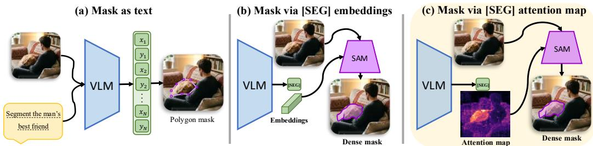
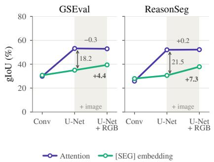
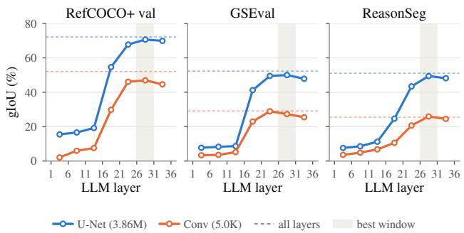
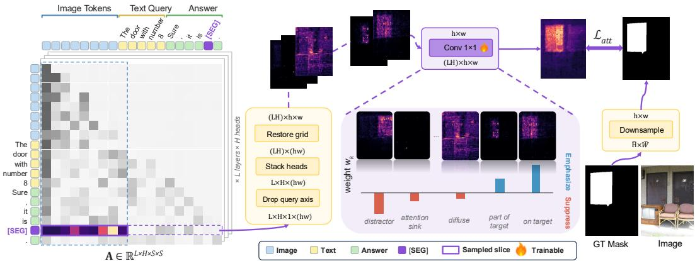
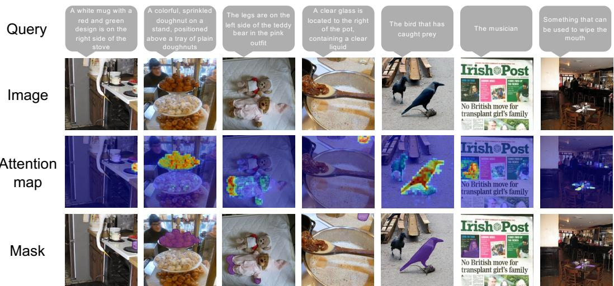
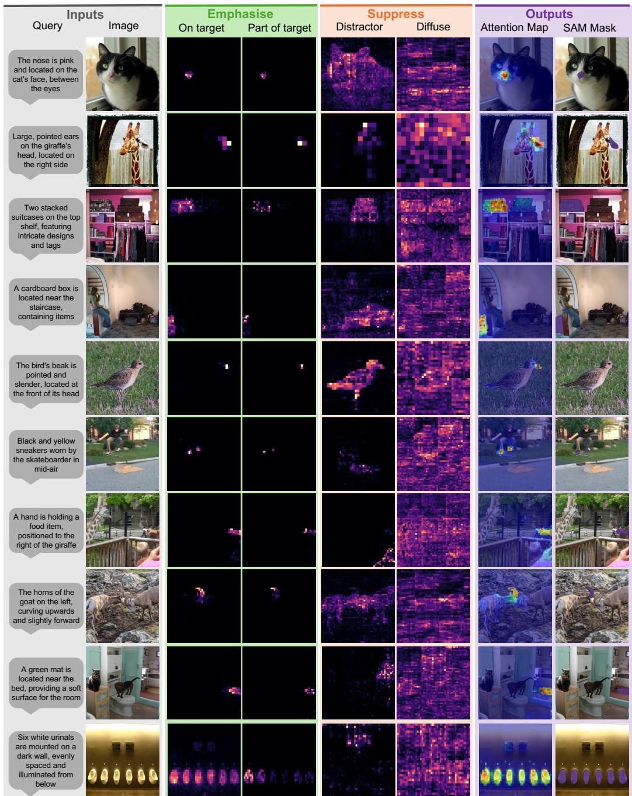
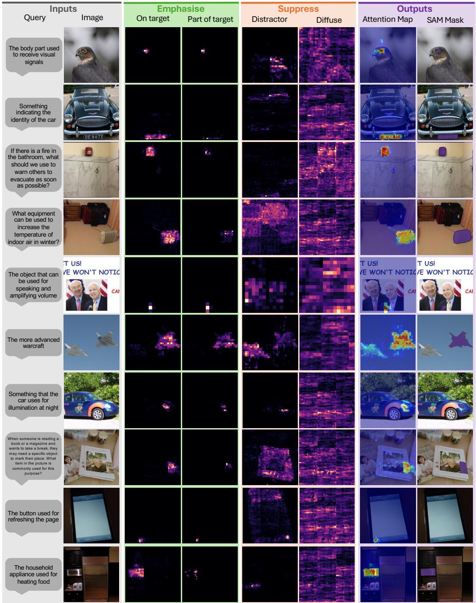

# SEGMENT WHERE YOU LOOK:ATTENTION AS THE INTERFACE BETWEEN LANGUAGEMODELS AND SEGMENTERS

Eslam Abdelrahman1 Hamza Omar Alkaf1 Yuheng Li2 Siddharth Srinivasan Iyer2 Nanxuan Zhao2 Eli Shechtman2 Krishna Kumar Singh2 Mohamed Elhoseiny1 1King Abdullah University of Science and Technology (KAUST) 2Adobe Research

  
Figure 1: Three ways a vision language model can hand a segmenter its spatial intent. (a) The mask is serialized into the token stream. (b) The dominant design: one d dimensional [SEG] embedding, carrying no spatial index, prompts SAM. (c) Ours: the [SEG] token’s attention is already a distribution on the patch grid, so we forward it instead of re-deriving it.

## ABSTRACT

Vision-language models (VLMs) that segment from language must pass the location of the referent to a pixel decoder. The dominant interface compresses it into the hidden state of a single [SEG] token, a d-dimensional vector with no spatial index, and leaves the decoder, which never sees the expression, to recover the referent’s extent. We show that the VLM already computes a better signal: the [SEG] token’s attention over the image tokens, which is defined on the patch grid by construction. Probing a frozen segmentation VLM, we find that this attention yields 18 to 22 more gIoU than the [SEG] hidden state when read by the same probe, that it gains nothing from the image where the hidden state does, and that it is concentrated in the late layers. Building on these findings, we introduce ATTNSEG, which replaces the [SEG] embedding with this attention as the decoder’s prompt. A learned, signed combination of the attention heads forms a dense spatial prompt, and an attention-guidance objective supervises it directly. A two-stage recipe first trains the VLM to localize without the decoder and then trains the decoder to refine, within the budget of standard finetuning. Applied to Sa2VA, ATTNSEG improves ReasonSeg by 6.4 gIoU and GS-Eval by 10.2 at 4B (4.2 and 9.6 over the same model finetuned on the same data), and by 8.8 and 11.3 at 14B. The gains reach 13 to 18 gIoU on object parts, multiple objects and single objects, where the referent must be singled out, and are negligible on stuff regions, which the decoder already recovers unaided. Code and models are available at eslambakr.github.io/attseg\_project\_page.

## 1 INTRODUCTION

Segmenting an object from a natural-language expression requires deciding which region the expression refers to and where exactly its boundary lies. Promptable segmenters such as SAM (Kirillov et al., 2023), HQ-SAM (Ke et al., 2023) and SAM3 (Carion et al., 2026) have made the second the easier half of the problem: given a prompt that points at the right region, they return a high-quality mask. The first requires understanding the expression, which is the role of a vision-language mode (VLM). This division of labor motivates the hypothesis at the center of our work: the VLM should be the load-bearing localizer, and the decoder should only refine. Whether this holds depends on the interface, the representation through which the VLM passes the referent’s location to the decoder.

Two interfaces dominate (Figure 1a,b). The first serializes the mask into the token stream, as polygon vertices (Liu et al., 2023; Wang et al., 2023), learned codewords (Beyer et al., 2024; Wang et al., 2025b) or per-patch labels (Lan et al., 2025b), so that segmentation becomes next-token prediction. Geometry must then pass through a coarse token bottleneck, and these methods trail decoder-based systems by a wide margin (Section 2). The second, introduced by LISA (Lai et al., 2024) and adopted by most subsequent systems (Rasheed et al., 2024; Zhang et al., 2024a; Yuan et al., 2025), adds a [SEG] token to the vocabulary and prompts the decoder with its final hidden state, so that the boundary is drawn at full resolution by a model built for it.

The [SEG] interface, however, reduces the entire spatial message to a single d-dimensional vector with no spatial index, and the decoder that receives it never sees the expression. A vector can point at the referent, but it cannot specify its granularity: for the left ear ofthe dog, a pointer to the dog leaves the decoder to guess whether the dog, its head or its ear is meant. The vector is also supervised only through the mask loss computed after the decoder, so nothing requires the VLM to carry the localization, and the decoder absorbs as much of it as it can. The released Sa2VA-4B illustrates the consequence. On GS-Eval (Hu et al., 2025), it reaches 90.8 gIoU on stuff regions, which the decoder can recover from almost any prompt, but only 49.8 on single objects and 17.8 on object parts. This raises a question: does the VLM already compute a better representation of where the referent lies, and can the decoder be prompted with it directly?

The VLM already knows where to look. We answer the first part by probing a frozen Sa2VA (Yuan et al., 2025). A lightweight probe must predict the mask from a single internal signal: either the [SEG] token’s hidden state, which the dominant interface transmits, or its attention over the image tokens, which is defined on the patch grid by construction. Read by the same U-Net, the attention yields 18.2 and 21.5 more gIoU than the hidden state on GS-Eval and ReasonSeg (Lai et al., 2024) (Figure 2a). Supplying the RGB image improves the probe of the hidden state by 4 to 7 gIoU and leaves that of the attention unchanged, consistent with the attention already encoding the referent’s extent at patch resolution. This localization is, moreover, concentrated in the late layers, while the early layers carry almost none (Figure 2b). To our knowledge, the two signals have not previously been compared within the same frozen model.

Segmenting where the model looks. Building on these findings, we introduce ATTNSEG, which replaces the [SEG] embedding with the [SEG] token’s attention as the decoder’s prompt (Figure 1c). A learned 1 × 1 convolution with signed weights combines the per-head maps into a single map, emphasizing the informative late heads and subtracting those that attend to sinks or distractors, and the map enters the decoder’s dense prompt channel without being thresholded or sampled. An attention-guidance objective supervises this map directly. We adopt a weighted cosine, which asks for the referent’s full extent and penalizes concentrated misplaced attention most. Training proceeds in two stages within the budget of a single epoch: the VLM first learns to localize under the attention guidance objective, without the decoder, and the decoder is then trained to refine the frozen map. Prior systems derive sparse point prompts from attention or similarity maps (Lin et al., 2024; Han et al., 2025; Qian et al., 2025); ATTNSEG instead reads the [SEG] token’s own attention, keeps it dense, and trains the VLM to shape it.

Results. Applied to Sa2VA, ATTNSEG improves ReasonSeg by 6.4 gIoU and GS-Eval by 10.2 at 4B, and by 4.2 and 9.6 over the base model finetuned on the same data for the same budget. At 14B, it improves the two benchmarks by 8.8 and 11.3 and reaches 69.7 gIoU on ReasonSeg without any ReasonSeg training data. The gains concentrate where the referent must be singled out: object parts, multiple objects and single objects gain 13 to 18 gIoU, while stuff regions gain under 1.5. After training, a 560-parameter gate that can only reweight the model’s own maps recovers close to four fifths of what a 3.86M-parameter U-Net recovers from the same attention, against about half before, which shows that the objective reorganizes the attention into a directly readable form.

In summary, our contributions are threefold:

• A probing analysis that compares, within a frozen segmentation VLM, the two spatial signals of the [SEG] token. It shows that the attention carries considerably more localization than the hidden state the dominant interface transmits, and that this localization is concentrated in the late layers.

• ATTNSEG, which replaces the [SEG] embedding with a learned, signed combination of the [SEG] token’s attention maps as a dense decoder prompt, supervised by an attentionguidance objective and trained in two stages that make the VLM the localizer and the decoder a refiner, within the budget of standard finetuning.

• Consistent improvements at two scales on ReasonSeg and GS-Eval, concentrated on the splits where the referent must be singled out, with analyses showing that the attention-guidance objective accounts for most of the gain and makes the attention directly readable.

## 2 RELATED WORK

We review the literature by interface; Appendix A gives an extended review.

Segmentation with vision-language models. A VLM can emit the mask as text, as polygon vertices (Liu et al., 2023; Wang et al., 2023; Pramanick et al., 2024; Xiao et al., 2024), learned codewords (Beyer et al., 2024; Wang et al., 2025b;a) or per-patch labels (Lan et al., 2025b). These methods trail decoder-based systems in pixel accuracy, and even Text4Seg gains 5.7 cIoU on RefCOCO when a SAM refiner draws the boundary from its labels (Lan et al., 2025b), which indicates that the boundary is the part a decoder absorbs. LISA (Lai et al., 2024) instead prompts SAM with the hidden state of a [SEG] token, an interface since extended to grounded conversation, multiple and empty targets, unified pixel-level tasks and video (Rasheed et al., 2024; Xia et al., 2024; Zhang et al., 2024b;a; Yan et al., 2024; Yuan et al., 2025). SAM4MLLM (Chen et al., 2024) instead emits the box and points of a SAM prompt as text; we ask how much of the model’s localization the [SEG] vector carries (Section 3.2).

What a model’s attention encodes. Multimodal models localize referents in their attention without grounding supervision (Cao et al., 2025), although averaging their heads yields noisy maps: localization is carried by a few heads (Kang et al., 2025b), much of the remaining mass falls on sink tokens (Kang et al., 2025a), and raw attention needs aggregation before it can be read (Abnar & Zuidema, 2020; Chefer et al., 2021). Deep-layer attention can even land on the correct region when the model answers wrongly (Liu et al., 2025). These findings motivate our selective, learned aggregation (Section 3.3).

Attention as a segmentation prompt. VL-SAM (Lin et al., 2024) and DecAF (Han et al., 2025) sample point prompts from attention without training, and READ (Qian et al., 2025) samples points from an embedding-space similarity map. ATTNSEG differs in that it reads the [SEG] token’s own attention, the internal signal of the dominant interface; it keeps the map dense in the decoder’s mask channel, preserving the graded confidence that thresholding or sampling would discard; and, unlike the training-free methods, it trains the VLM so that this attention localizes the referent.

## 3 METHODOLOGY

This section derives ATTNSEG from an analysis of the model it builds on. Section 3.1 formalizes language-guided segmentation with a VLM and a promptable decoder, and states our hypothesis about the interface between the two. Section 3.2 tests that hypothesis by probing a frozen segmentation VLM, which reveals two properties of its [SEG] token: its attention over the image encodes considerably more localization than its hidden state, and this localization is concentrated in the late layers, while the early layers carry almost none. Building on these findings, Section 3.3 introduces ATTNSEG, which replaces the [SEG] embedding with the attention, combines the attention heads through a learned aggregation, and supervises the result with an attention-guidance objective in a decoupled, two-stage training.

## 3.1 PROBLEM SETUP AND HYPOTHESIS

The predominant approach to language-guided segmentation pairs a vision-language model (VLM), which interprets the referring expression, with a promptable segmentation decoder such as SAM (Kirillov et al., 2023; Ravi et al., 2025), which produces the segmentation mask (Figure 1b). Formally, given an image $\pmb { I } \in \mathbb { R } ^ { \hat { H } \times \hat { W } \times 3 }$ and a referring expression $\tau$ , the VLM $\mathcal { F }$ processes both jointly, drawing on its language understanding and reasoning to determine which region of I the expression describes, and the decoder D converts that decision into a mask $\hat { Y } \in [ 0 , 1 ] ^ { \hat { H } \times \hat { W } }$ . The interface between the two adopted by LISA (Lai et al., 2024), GLaMM (Rasheed et al., 2024), Sa2VA (Yuan et al., 2025) and most of their successors is the embedding space: a special [SEG] token is added to the vocabulary, and the decoder is prompted with the final hidden state of that token alone,

$$
\begin{array} { r } { \hat { \pmb { Y } } = \mathcal { D } \big ( \pmb { I } , \pmb { h } _ { \scriptscriptstyle \mathrm { S E G } } \big ) , \qquad \pmb { h } _ { \scriptscriptstyle \mathrm { S E G } } = \mathcal { F } ( \pmb { I } , \mathcal { T } ) _ { r } \in \mathbb { R } ^ { d } , } \end{array}\tag{1}
$$

where $r$ is the position of the [SEG] token in the sequence and d the hidden width; the learned projection that maps $h _ { \mathrm { S E G } }$ into the decoder’s prompt space is omitted for brevity. The decoder never observes $\tau$ , so everything it learns about the referring expression must pass through a single d-dimensional vector.

A pointer cannot specify granularity. Under Eq. (1), the VLM’s role is to indicate where the referent lies. A pointer suffices when the referent coincides with a region the decoder can delineate on its own, such as a large, contiguous stuff region, but it falls short when the expression specifies which object, or which part of it, is meant. For instance, given “the left ear of the $d o g '$ , a representation that points at the dog does not determine whether the intended region is the dog, its head or its ear. Promptable decoders are ambiguous in precisely this way, which is why SAM predicts several nested masks for a single point prompt (Kirillov et al., 2023). Since D has no access to $\tau _ { \ast }$ , it cannot resolve the ambiguity from the expression and must fall back on the granularity its training data made most likely. We therefore hypothesize that compressing the referent into $h _ { \mathrm { S E G } }$ discards spatial information the VLM has already computed.

Attention as a spatial alternative. The VLM already possesses a mechanism whose output is spatial by construction. Let $\pmb { A } \in \mathbb { R } ^ { L \times H \times S \times S }$ collect the self-attention weights of one forward pass (Figure 3, left), where L is the number of layers, H the number of heads per layer and S the length of the token sequence, which comprises the image tokens, the text tokens and the generated answer. Let V denote the positions of the $\bar { P } = h w$ image tokens, which tile the image on an $h \times w$ patch grid. For layer l and head k, the row queried by the [SEG] token and restricted to V assigns a weight to every image patch,

$$
\pmb { a } ^ { ( l , k ) } = [ \pmb { A } _ { r , v } ^ { ( l , k ) } ] _ { v \in \mathcal { V } } \in \mathbb { R } ^ { P } , \qquad \pmb { a } ^ { ( l , k ) }  \frac { P \pmb { a } ^ { ( l , k ) } } { \sum _ { p } \pmb { a } _ { p } ^ { ( l , k ) } } .\tag{2}
$$

The row is a softmax over the entire sequence, so the share of its mass that reaches the image varies with sequence length and over training. Rescaling each map to spatial mean one removes that variation, so a head is characterized by where it attends rather than by how much. Folding every map onto the patch grid and stacking them gives $\pmb { a } \in \mathbb { R } ^ { L H \times h \times w }$ . Unlike $h _ { \mathrm { S E G } }$ , each channel is indexed by image location, so it can delineate an object part as readily as the whole object. Attention maps of this kind are widely read, both to interpret what a model attends to (Abnar & Zuidema, 2020; Chefer et al., 2021; Kang et al., 2025b) and as a signal for localization and prompting (Cao et al., 2025; Lin et al., 2024; Han et al., 2025). Our hypothesis is that, for grounding, they carry more of the VLM’s localization than $h _ { \mathrm { S E G } }$ does. We test it on a frozen model before designing anything on it.

## 3.2 WHAT THE MODEL ALREADY KNOWS, AND WHERE IT KEEPS IT

To validate our hypothesis, we employ probing, the established practice of training a lightweight classifier on a network’s frozen internal representations to measure what information they encode (Alain & Bengio, 2018; Belinkov, 2022). We freeze Sa2VA-4B (Yuan et al., 2025) entirely, discard its decoder, and train only a probe that predicts the ground-truth mask from a single internal signal. Since the model is frozen, any accuracy the probe attains reflects information the signal already carries. Two signals are compared: the stacked attention maps a of Eq. (2), and the [SEG] hidden state at every layer, mapped onto the patch grid by a learned projection shared by all embedding probes. Because a sufficiently expressive probe can learn the task itself rather than read it from the representation (Hewitt & Liang, 2019), each signal is read at two capacities (Table 5): a single $3 \times 3$ convolution (≈5K parameters) and a U-Net (≈3.86M). The shared projection alone costs ≈672K parameters, far more than the convolutional attention probe, so any capacity mismatch favors the embedding. Appendix B gives the architectures and training details, and Section 4.3 repeats the procedure on the trained model.

The attention carries more localization than the hidden state. Figure 2a compares the two signals at both capacities. With the U-Net, the attention reaches 53.2 gIoU on GS-Eval (Hu et al., 2025) and 52.1 on ReasonSeg (Lai et al., 2024), against 35.0 and 30.6 for the [SEG] hidden state. With the single convolution, by contrast, the two signals score within a few points of each other, so the attention’s advantage appears only once the probe can combine its channels nonlinearly. This is consistent with prior observations that localization is carried by a small number of heads, while much of the remaining attention mass collects on uninformative sink tokens (Kang et al., 2025b;a): the signal is present, but it must be selected and combined before it can be read.

  
(a) Which space, and what it carries

  
(b) Where in the stack it lives  
Figure 2: Which internal signal carries the localization, and where does it reside? Probes trained on a frozen Sa2VA-4B. (a) Read by the same U-Net, the [SEG] attention beats the [SEG] embedding by 18.2 and 21.5 gIoU, and adding the RGB image helps the embedding (+4.4, +7.3) but not the attention (−0.3, +0.2). (b) Probes restricted to a five-layer window: the early layers carry almost no localization, and a single late window matches the whole stack (dashed).

Finding 1. Read by the same U-Net, the [SEG] token’s attention yields 18.2 and 21.5 more gIoU than its hidden state. The vector the dominant interface transmits is the weaker of the two spatial representations the model computes.

The image helps the embedding, not the attention. A signal that only indicates where the referent lies leaves its extent, the region it covers, unspecified, and a probe that also sees the pixels should be able to recover that extent from the image. A signal that already encodes the extent should gain little from it. We therefore give the U-Net the RGB image as an additional input, shown as the shaded segment of Figure 2a. The embedding gains 4.4 and 7.3 gIoU, whereas the attention changes by −0.3 and +0.2.

Finding 2. The image improves the probe of the [SEG] hidden state by 4 to 7 gIoU and leaves the probe of its attention unchanged, consistent with the attention already encoding the referent’s extent at patch resolution, which the hidden state lacks and must recover from the pixels.

The signal occupies a narrow late band. Having established that the attention is the stronger signal, we ask where in the network it resides. The answer determines how the maps should be combined, since a uniform average over layers and heads is appropriate only if localization is spread evenly across depth. We therefore train a separate probe on each sliding window of five consecutive layers (Figure 2b). Localization emerges at the same depth for both capacities, which identifies the transition as a property of the model rather than of the probe. A uniform average would therefore spend most of its weight on layers that carry no localization; together with the concentration of localization in a few heads, this motivates the learned aggregation of Section 3.3.

Finding 3. Localization is concentrated in the late layers: roughly the first 40% of the layers carry almost none, and a single late window of five layers matches a probe given every layer.

## 3.3 ATTNSEG: SEGMENTING WHERE THE MODEL LOOKS

Attention as the spatial interface. Motivated by these findings, ATTNSEG replaces the [SEG] embedding with the [SEG] token’s attention as the interface between the VLM and the decoder. Instead of compressing the referent into $\begin{array} { r } { h _ { \scriptscriptstyle \mathrm { S E G } } . } \end{array}$ , it combines the per-head maps of Eq. (2) into one map

  
Figure 3: How ATTNSEG reads and shapes the spatial channel. The [SEG] token’s query row of A, restricted to image columns and folded onto the patch grid, gives one map per layer and head; a 1 × 1 convolution with signed weights combines them and $\mathcal { L } _ { \mathrm { { a t t } } }$ supervises the result.

aˆ and prompts the decoder with it alone:

$$
\begin{array} { r } { \hat { Y } = \mathcal { D } \big ( I , \hat { a } \big ) , \qquad \hat { a } = \displaystyle \sum _ { l = 1 } ^ { L } \sum _ { k = 1 } ^ { H } w _ { l , k } { \pmb a } ^ { ( l , k ) } \in \mathbb { R } ^ { h \times w } , \qquad w _ { l , k } ^ { ( 0 ) } = \frac { 1 } { L H } . } \end{array}\tag{3}
$$

Compared with Eq. (1), the decoder now receives a map defined on the image grid rather than a d-dimensional vector. The map enters through the decoder’s dense mask-prompt channel and it is never thresholded or sampled, so the decoder receives its graded confidence rather than a binarized mask or a handful of points (Appendix C). The weights w amount to a 1 × 1 convolution over the $L H$ maps and add only LH parameters. Their form follows from Section 3.2: localization is concentrated in a few late heads, so the combination must be selective, and it is learned rather than fixed to the band we measured, which would otherwise have to be located anew for every backbone. Initialized at the uniform average, the combination starts from the plain head mean and departs from it only where training finds a better weighting. The weights are also unconstrained in sign: a softmax gate, whose weights lie on the simplex, can only suppress a misleading head, whereas a negative weight can subtract it. Appendix C gives a second reason to prefer the convolution.

Decoupled two-stage training. We decouple the training of the two components, so that the VLM carries the localization, at the granularity the expression demands, and the decoder only refines it. In stage one, the VLM and the aggregation weights w are finetuned with an attention-guidance objective $\mathcal { L } _ { \mathrm { a t t } }$ on aˆ, together with the standard next-token prediction loss that keeps the model emitting the [SEG] token. The decoder takes no part, so no mask loss reaches the map, and ${ \mathcal L } _ { \mathrm { a t t } }$ alone determines what it localizes. In stage two, the VLM and w are frozen and only the decoder is trained to read the resulting map, which confines it to refining the localization the VLM provides. Since the map reaches the decoder without thresholding or sampling, the two stages could be merged into one joint run, and doing so is how we measured that the decoder’s gradient into aˆ is roughly 49 times the magnitude of that of $\mathcal { L } _ { \mathrm { a t t } }$ and roughly orthogonal to it: under joint training, the map would be shaped mostly by the decoder. Appendix C details what each stage trains and freezes.

Attention-guidance objective. Finding 2 indicates that the attention can encode the referent’s extent and not merely its location. We train the VLM to strengthen this capability, so that the VLM, not the decoder, resolves which region is meant and at what granularity. The map should therefore delineate the referent as fully as a map at patch resolution allows, while recovering the boundary at full resolution remains the decoder’s task. We supervise aˆ against the ground-truth mask, area-pooled onto the patch grid as $m \in \{ 0 , 1 \} ^ { P }$ (Figure 3, right). Since only where the map attends carries information, and not how much attention reaches the image (Eq. (2)), any such objective must be invariant to the scale of aˆ.

Choosing the objective. We consider three objectives that are invariant to scale but differ in which parts of the map they correct. A peak ratio (Eq. (6), Appendix C) compares the strongest responses inside and outside the target. It corrects only those few patches, so it teaches the map where to point but not how far the referent extends, which reduces the attention to the pointer that Section 3.1 identified as the limitation of $h _ { \mathrm { S E G } }$ . We adopt instead a weighted cosine,

$$
\ell ^ { \mathrm { { c o s } } } ( \hat { a } , m ) = 1 - \frac { \langle \hat { a } , m \rangle _ { c } } { \| \hat { a } \| _ { c } \| m \| _ { c } } , \qquad \langle x , y \rangle _ { c } = \sum _ { p } c _ { p } x _ { p } y _ { p } , \qquad c _ { p } = \left\{ \begin{array} { l l } { \lambda _ { \mathrm { f g } } } & { \mathrm { i f ~ } m _ { p } = 1 , } \\ { \lambda _ { \mathrm { b g } } } & { \mathrm { o t h e r w i s e } , } \end{array} \right.\tag{4}
$$

where $\lambda _ { \mathrm { f g } } = 3$ and $\lambda _ { \mathrm { b g } } = 1$ up-weight the foreground. Its natural alternative is a soft Dice loss on the min-max normalized map $\tilde { \pmb { a } } , \tilde { 1 } - 2 \langle \tilde { \pmb { a } } , \pmb { m } \rangle _ { c } / ( \langle \tilde { \pmb { a } } , \pmb { 1 } \rangle _ { c } + \langle \pmb { m } , \pmb { 1 } \rangle _ { c } )$ . Both correct every patch and are minimized when the map is uniform over the target and flat elsewhere, so both ask for the referent’s full extent. They differ in how they penalize attention placed off the target. Dice penalizes its total mass, $\begin{array} { r } { \sum _ { p : m _ { p } = 0 } \dot { \tilde { a } } _ { p } , } \end{array}$ however that mass is distributed, so its gradient with respect to a˜ is the same for every background patch. The cosine penalizes it through the norm $\| { \hat { \pmb a } } \| _ { c } ,$ which grows with the square of each response, so its gradient on a background patch is proportional to the response there, $\partial \ell ^ { \mathrm { { c o s } } } / \partial \hat { \mathbf { a } } _ { p } = ( \bar { 1 } - \ell ^ { \mathrm { { c o s } } } ) c _ { p } \hat { \mathbf { a } } _ { p } ^ { - } / \| \hat { \mathbf { a } } \| _ { c } ^ { 2 }$ for $m _ { p } = 0$ . For the same amount of misplaced attention, a concentrated response, such as one locked onto a distractor, therefore costs more than diffuse background activity, so the cosine spreads residual attention out rather than concentrating it. A concentrated response is precisely the error that misleads the decoder, which segments where the map responds most strongly. The cosine also needs no normalization to be scale-invariant, and it applies directly to the signed values that Eq. (3) produces. Section 4.3 confirms both arguments by measurement (Table 2).

Scale-aware weighting. The targets in the training mixture span orders of magnitude in area, from object parts that cover a few patches to stuff regions that fill most of the image, and the map does not matter equally across this range. The decoder never sees the expression, so it can correct a poor prompt only through its own objectness prior, which is reliable for large regions and weak for small ones; the map is therefore decisive for small targets and largely recoverable for large ones. A fixed foreground weight cannot express this dependence, so we weight each target i, a [SEG] token with its map $\hat { \mathbf { a } } _ { i }$ and mask $\mathbf { \nabla } m _ { i } .$ , by its area, $s _ { i } = \mathrm { c l a m p } \big ( \bar { m } _ { i } ^ { - \rho } , s _ { \mathrm { m i n } } , s _ { \mathrm { m a x } } \big )$ , where $\begin{array} { r } { \bar { m } _ { i } = \frac { 1 } { P } \sum _ { p } m _ { i , p } } \end{array}$ is the fraction of the grid the target covers and $\rho$ sets how strongly small targets are favored. The two weightings compose at different levels: $\lambda _ { \mathrm { f g } }$ and $\lambda _ { \mathrm { b g } }$ balance foreground against background patches within a target, whereas $s _ { i }$ balances targets against one another. Upweighting small targets, however, amplifies the gradient in the size range where the objective is least stable: over training it moves some peaks into the target and displaces others that were already correct, and a displaced peak costs more than a corrected one gains. We therefore exclude targets whose map is already correctly localized, through a gate $g _ { i }$ that is 0 when the peak of $\hat { \mathbf { } a } _ { i }$ falls inside $\mathbf { m } _ { i }$ and 1 otherwise. The objective is

$$
{ \mathcal { L } } _ { \mathrm { a t t } } = { \frac { \sum _ { i } g _ { i } s _ { i } \ell ^ { \mathrm { c o s } } ( { \hat { \pmb a } } _ { i } , { \pmb m } _ { i } ) } { \sum _ { i } g _ { i } s _ { i } } } ,\tag{5}
$$

with $\rho = 0 . 3$ and $[ s _ { \mathrm { m i n } } , s _ { \mathrm { m a x } } ] = [ 0 . 2 5 , 1 2 ]$ . Normalizing by $\sum _ { i } g _ { i } s _ { i }$ keeps the scale of the objective, and hence the effective learning rate, fixed: gating a target redistributes its weight over the targets that are still mislocalized instead of shrinking the objective.

What the combination learns. The centre of Figure 3 shows the learned weights on a real forward pass. Heads that attend to the referent or to a part of it receive positive weight, whereas a diffuse head, a head collapsed onto an attention sink and a head locked onto a distractor receive negative weight and are subtracted. No supervision names these categories: w is trained in stage one by $\mathcal { L } _ { \mathrm { a t t } }$ alone. Across the trained model about 40% of the weights are negative, and 64% of the positive mass lies in the last third of the layers. The combination thus recovers the late band of Section 3.2, and in addition subtracts late-layer heads that a softmax weighting could only suppress. Figures 5 and 6 in Appendix G show further maps beside the masks refined from them.

## 4 EXPERIMENTS

We first describe the experimental setup (Section 4.1), then compare ATTNSEG with its base models and with recent methods (Section 4.2), and finally analyze where the improvement originates and how training changes the attention itself (Section 4.3).

## 4.1 EXPERIMENTAL SETUP

Models and training. We build ATTNSEG on two Sa2VA models (Yuan et al., 2025), whose VLMs are InternVL2.5-4B and InternVL3-14B, so that the main results are tested at two scales; the probing and the ablations use the 4B model. Both stages train on the thirteen-dataset mixture released with Sa2VA, with LoRA of rank 128 on the language model and AdamW at a learning rate of 4 × 10−5. Each stage takes half of a single epoch of this mixture, so ATTNSEG uses the same training budget as finetuning the base model for one epoch on the same data, which is the baseline of Section 4.3. Reading the attention requires recomputing the [SEG] rows beside the fused attention kernel, at the cost of one extra matrix product per layer (Appendix F). Appendix D lists the mixture and the remaining settings.

Table 1: Comparison with prior work, in gIoU. Each highlighted row is ATTNSEG on the base model directly above it, and bold marks the best value in each column. Over its base, ATTNSEG gains little on stuff and 13 to 18 gIoU on object parts, multiple objects and single objects.
<table><tr><td></td><td colspan="3">ReasonSeg (gIoU)</td><td colspan="5">GS-Eval (gIoU)</td></tr><tr><td>Method</td><td>Sentence Phrase</td><td></td><td>Overall</td><td>Stuff</td><td>Object parts Multi obj. Single obj.</td><td></td><td></td><td>Overall</td></tr><tr><td>LISA-7B</td><td>47.49</td><td>39.08</td><td>45.47</td><td>80.34</td><td>21.25</td><td>71.95</td><td>42.62</td><td>56.34</td></tr><tr><td>GLaMM</td><td>51.68</td><td>42.94</td><td>49.58</td><td>91.38</td><td>24.37</td><td>78.50</td><td>54.11</td><td>65.66</td></tr><tr><td>Sa2VA-Qwen3-4B-SAM2</td><td>59.42</td><td>56.28</td><td>58.67</td><td>91.41</td><td>22.79</td><td>76.91</td><td>54.77</td><td>65.41</td></tr><tr><td>Sa2VA-Qwen3-4B-SAM3</td><td>65.46</td><td>61.47</td><td>64.50</td><td>89.09</td><td>17.06</td><td>70.23</td><td>48.74</td><td>60.29</td></tr><tr><td>VISA-7B</td><td>50.73</td><td>43.50</td><td>49.00</td><td>85.30</td><td>25.39</td><td>75.70</td><td>50.48</td><td>62.10</td></tr><tr><td>SAMTok-Qwen3VL-4B</td><td>59.41</td><td>58.03</td><td>59.08</td><td>87.64</td><td>31.01</td><td>56.77</td><td>56.28</td><td>61.82</td></tr><tr><td>VideoLISA-3.8B</td><td>45.59</td><td>33.61</td><td>42.72</td><td>86.99</td><td>23.40</td><td>73.54</td><td>42.52</td><td>58.70</td></tr><tr><td>GSVA-13B</td><td>38.73</td><td>36.75</td><td>38.26</td><td>77.34</td><td>22.84</td><td>55.46</td><td>38.30</td><td>50.58</td></tr><tr><td>PixelLM-7B</td><td>46.12</td><td>37.02</td><td>43.94</td><td>41.29</td><td>11.12</td><td>49.96</td><td>30.08</td><td>34.93</td></tr><tr><td>Sa2VA-InternVL2.5-4B</td><td>59.51</td><td>52.04</td><td>57.70</td><td>90.80</td><td>17.80</td><td>73.33</td><td>49.80</td><td>61.91</td></tr><tr><td>+ ATTNSEG (ours)</td><td>64.80</td><td>61.93</td><td>64.11</td><td>91.20</td><td>35.29</td><td>86.37</td><td>62.97</td><td>72.11</td></tr><tr><td>Sa2VA-InternVL3-14B</td><td>61.44</td><td>59.11</td><td>60.88</td><td>89.45</td><td>26.97</td><td>69.66</td><td>52.67</td><td>63.05</td></tr><tr><td>+ ATTNSEG (ours)</td><td>69.55</td><td>70.23</td><td>69.71</td><td>90.85</td><td>45.01</td><td>85.08</td><td>66.43</td><td>74.31</td></tr></table>

Benchmarks and metric. We evaluate on two benchmarks, each challenging for a different reason. The test split of ReasonSeg (Lai et al., 2024) names the target by its function or its role in the scene rather than by its appearance, either as a short phrase or as a full sentence, so locating it requires reasoning over the image. GS-Eval (Hu et al., 2025) instead varies the granularity of the target, over stuff regions, object parts, multiple instances of one category and single objects. Neither benchmark’s training data is part of our mixture. We report gIoU, the mean of the per-query IoU, which weighs every query equally; cIoU, which accumulates intersection and union over the whole set, is dominated by a small number of very large masks.

## 4.2 MAIN RESULTS

ATTNSEG improves both benchmarks at both scales. Table 1 compares ATTNSEG with its base model and with recent methods. At 4B, ATTNSEG raises ReasonSeg from 57.70 to 64.11 gIoU and GS-Eval from 61.91 to 72.11, gains of 6.41 and 10.20. Part of this gain comes from finetuning, which Section 4.3 isolates: against the base model finetuned on the same mixture at its original interface for the same epoch, ATTNSEG still gains 4.19 and 9.56. On ReasonSeg the improvement is larger for short phrases, from 52.04 to 61.93, than for full sentences, from 59.51 to 64.80, consistent with the short form offering less context and leaving more to localization.

The gain concentrates where the referent must be singled out. The GS-Eval splits show where the improvement is earned. Object parts improve from 17.80 to 35.29, multiple objects from 73.33 to 86.37 and single objects from 49.80 to 62.97, gains of 17.49, 13.04 and 13.17 gIoU. In each of these splits the expression must single out its referent among competing candidates: a part must be separated from the object that contains it, the instances of one category must be collected while others are excluded, and a single object must be distinguished from the rest of the scene. Stuff regions are the exception. The base model already reaches 90.80 on them, on par with the strongest methods in the table, and ATTNSEG adds 0.40. A stuff region such as the sky or a lawn is large and contiguous, so the decoder can recover it from almost any prompt that falls inside it, which is the regime in which Section 3.3 argued that a poor prompt is recoverable. This distribution is consistent with our premise. Improvement originating in the decoder would appear wherever boundaries are hard; here the gain is negligible where the decoder finds the referent unaided and large where the VLM must localize it.

The improvement does not diminish with scale. An auxiliary objective often benefits a small model most and fades as capacity grows, on the reading that it supplies something a larger model would acquire by itself. That is not the case here. On the 14B model, built on the newer InternVL3, ATTNSEG raises ReasonSeg from 60.88 to 69.71 and GS-Eval from 63.05 to 74.31, gains of 8.83 and 11.26 that exceed those at 4B, and it does so without any ReasonSeg training data. The split pattern is unchanged: object parts rise from 26.97 to 45.01, multiple objects from 69.66 to 85.08 and single objects from 52.67 to 66.43, while stuff moves by 1.40. This is consistent with the objective supplying something that neither scale acquires from the mask loss alone.

Table 2: Why the weighted cosine wins. Attention-map quality and final mask gIoU on Sa2VA-InternVL2.5-4B for the three stage-one objectives, each followed by the same stage two. Pointing is the fraction of queries whose strongest map patch lies inside the target, and extent the gIoU of the map thresholded at 0.5 after min-max normalization. Each alternative fails on one axis; the cosine is the only objective with no severe weakness. Table 7 gives per-split results.
<table><tr><td></td><td colspan="2">Map pointing</td><td colspan="2">Map extent</td><td colspan="2">Mask gIoU</td></tr><tr><td>Stage-one objective</td><td>ReasonŠeg</td><td>GS-Eval</td><td>ReasonSeg</td><td>GS-Eval</td><td>ReasonSeg</td><td>GS-Eval</td></tr><tr><td>Peak ratio</td><td>74.32</td><td>78.82</td><td>3.26</td><td>4.34</td><td>60.13</td><td>65.99</td></tr><tr><td>Soft Dice</td><td>63.89</td><td>65.65</td><td>52.64</td><td>56.03</td><td>61.91</td><td>69.56</td></tr><tr><td>Weighted cosine (ours)</td><td>69.24</td><td>75.77</td><td>49.60</td><td>59.09</td><td>64.11</td><td>72.11</td></tr></table>

Table 3: Isolating the source of the gain on Sa2VA-InternVL2.5-4B.  
Table 4: Does $\mathcal { L } _ { \mathrm { { a t t } } }$ make the attention itself easier to read? The probes of Section 3.2, in gIoU, re-run on the released Sa2VA-InternVL2.5-4B (baseline) and on ATTNSEG built from it. The gain is largest for the smallest probe.
<table><tr><td>Model</td><td>ReasonSeg</td><td>GS-Eval</td></tr><tr><td>Baseline</td><td>57.70</td><td>61.91</td></tr><tr><td>+ Finetuning</td><td>59.92</td><td>62.55</td></tr><tr><td>+ Attention interface</td><td>60.18</td><td>63.64</td></tr><tr><td>+ Latt (ATTNSEG)</td><td>64.11</td><td>72.11</td></tr></table>

<table><tr><td></td><td colspan="2">Gate (560)</td><td colspan="2">Conv (5K)</td><td colspan="2">U-Net (3.86M)</td><td colspan="2">U-Net + image</td></tr><tr><td>Model</td><td>ReasonSeg</td><td>GS-Eval</td><td>ReasonSeg</td><td>GS-Eval</td><td>ReasonSeg</td><td>GS-Eval</td><td>ReasonSeg</td><td>GS-Eval</td></tr><tr><td>Baseline</td><td>24.00</td><td>26.82</td><td>25.84</td><td>29.89</td><td>52.05</td><td>53.18</td><td>52.21</td><td>52.89</td></tr><tr><td>+ ATTNSEG</td><td>42.04</td><td>44.68</td><td>31.27</td><td>34.67</td><td>53.96</td><td>57.13</td><td>54.10</td><td>57.43</td></tr></table>

A stronger decoder is not a substitute. ATTNSEG on InternVL2.5-4B outperforms SAMTok (Zhou et al., 2026), built on the more recent Qwen3-VL-4B, by 5.03 gIoU on ReasonSeg and 10.29 on GS-Eval. Strengthening the decoder instead behaves differently. On the same Qwen3-VL-4B base, replacing SAM2 with SAM3 (Carion et al., 2026) raises ReasonSeg from 58.67 to 64.50, slightly above ATTNSEG at 4B, but lowers GS-Eval from 65.41 to 60.29, 11.82 below it. A stronger decoder trades one benchmark for the other, whereas ATTNSEG improves both over its base at both scales, consistent with the remaining headroom lying in localization rather than in boundary quality.

## 4.3 ANALYSIS

Choice of the attention-guidance objective. Table 2 compares the three objectives of Section 3.3 under the same two-stage recipe and area weighting. The weighted cosine yields the best masks, improving on Dice by 2.20 and 2.55 gIoU on ReasonSeg and GS-Eval and on the peak ratio by 3.98 and 6.12. Both margins are significant under a paired bootstrap at 95% confidence, and the ordering holds at each of four stage-two checkpoints on both benchmarks. The attention maps explain this ordering along two axes. The peak ratio points best, placing the strongest patch inside the target for 74.32% and 78.82% of queries, but specifies almost no extent: its thresholded map reaches 3.26 and 4.34 gIoU, against 49.60 and 59.09 for the cosine. This is the pointer of Section 3.1, measured directly. Dice specifies extent but points worst, at 63.89% and 65.65%. The cosine ranks second at pointing and first or second at extent, the only objective with no severe weakness, and the decoder needs both a correct peak and a specified extent. Its advantage over Dice does not come from overlap, since on ReasonSeg the Dice map overlaps the target more, but from where the misplaced attention sits, as Section 3.3 predicts. The cosine leaves more attention off the target than Dice, 66% against 45% on GS-Eval, yet spreads it out: its strongest 1% of background patches hold 9% of that mass, against 38% for Dice (Appendix E). Since the decoder segments where the map responds most strongly, diffuse background is harmless, whereas a concentrated distractor is not.

Where the improvement originates. Table 3 starts from the released 4B checkpoint and adds one component per row. Finetuning on the training mixture at the original interface adds 2.22 gIoU on ReasonSeg and 0.64 on GS-Eval, and the attention interface a further 0.26 and 1.09. The attentionguidance objective contributes the remaining 3.93 and 8.47 gIoU, 61% and 83% of the total gains of 6.41 and 10.20. The interface alone matters much less here than to the probes of Section 3.2, where it was worth 18 to 22 gIoU, because SAM2 is far larger than a probe and is trained on the full mixture, so it also learns to decode the embedding. Its value lies instead in letting $\mathcal { L } _ { \mathrm { a t t } }$ reach the decoder: the map that $\mathcal { L } _ { \mathrm { a t t } }$ shapes is the map the decoder receives.

  
Figure 4: The attention map is the prediction, not a diagnostic. For each query we show the aggregated [SEG] attention aˆ and the mask the decoder refines from it. More examples in Appendix G.

Training makes the attention easier to read. The benchmark gains could in principle come from the decoder alone learning to cope with an unchanged map. To separate the two, we repeat the probing of Section 3.2 on the trained model, again freezing the VLM, and add a third, much smaller probe: a gate with one weight per attention map (560 parameters), which forms a softmax-weighted sum of the maps and can therefore only select among maps the model has already drawn (Table 4). Every probe improves, but unevenly. The U-Net gains 1.91 gIoU on ReasonSeg and 3.95 on GS-Eval, whereas the gate gains 18.04 and 17.86, from 24.00 to 42.04 and from 26.82 to 44.68. The gate thus recovers close to four fifths of what the U-Net recovers, against about half before training, with nearly seven thousand times fewer parameters. This is partly by construction, since stage one trains a linear combination of the same maps, but it shows that $\mathcal { L } _ { \mathrm { a t t } }$ does what it was designed to do: it adds little that the U-Net could not already extract, and mainly reorganizes the maps so that a trivial readout can take the localization directly. Stage two relies on this property, since its decoder trains against a frozen map. The image also still adds nothing to the attention after training: given the RGB image as well, the U-Net gains only 0.14 and 0.30 gIoU, against 4.4 and 7.3 for the embedding in Figure 2a. At patch resolution, the trained map already carries the region it is scored on.

Qualitative results. Figure 4 shows the aggregated map aˆ beside the mask the decoder refines from it. Because the map is the decoder’s only prompt, the two can be read against each other directly. Figures 5 and 6 in Appendix G give further examples on GS-Eval and ReasonSeg.

## 5 CONCLUSION

We revisited the interface through which a vision-language model passes the location of its referent to a segmentation decoder. Probing a frozen segmentation VLM showed that the [SEG] token’s attention carries considerably more localization than the hidden state the dominant interface transmits, and that this localization is concentrated in the late layers. ATTNSEG builds on these findings: it prompts the decoder with a learned, signed combination of the [SEG] token’s attention maps in place of its embedding, supervises that map with an attention-guidance objective, and trains in two stages that make the VLM the localizer and the decoder a refiner, within the budget of standard finetuning. At both scales and on both benchmarks, the gains concentrate on object parts, multiple objects and single objects, where the referent must be singled out, and are negligible on stuff regions the decoder recovers unaided. More broadly, our results suggest that a segmentation VLM already computes where its referent lies, and that the decisive design choice is to pass that computation to the decoder in the form in which it is made, and to supervise it there.

## AI USE STATEMENT

We used generative AI tools as assistants, under the direction of the authors. For the writing, they helped draft and polish the text: redrafting passages from author-supplied content and findings, correcting grammar and typography, and condensing sections. For the code, they helped debug parts of the implementation and clean it up.

All reported results come from the authors’ own runs. No AI system is an author. We have reviewed all AI-assisted text and code and take full responsibility for the final content of this work, including every claim, number and artifact.

## ETHICS STATEMENT

This work studies the interface between a vision-language model and a promptable mask decoder. It involves no human subjects and no new data collection: every dataset and benchmark we use is public and is used as released, under its own license and evaluation protocol, and both models we build on are publicly released checkpoints.

Two risks are worth stating plainly. First, our method deliberately moves the localization burden onto the language model, which means the system’s errors become the language model’s errors. It inherits whatever biases the base model carries in deciding which object a description refers to, and a sharper, more confident attention map can make a confidently wrong choice of referent harder for the decoder to correct rather than easier. An improvement in gIoU on the benchmarks we report is not evidence that the model resolves ambiguous or contested descriptions correctly, and we would not deploy it in a safety-critical setting without task-specific validation. Second, a system that segments arbitrary objects from free-form language lowers the barrier to fine-grained visual search, and carries the dual-use considerations that come with it.

We have tried to report negative outcomes as carefully as positive ones. Section 4.3 reports that the interface substitution on which the paper is built contributes almost nothing to the end task on its own, Section 4.2 separates the share of the gain that finetuning alone provides and reports that a baseline with a stronger decoder exceeds ATTNSEG at 4B on ReasonSeg, and Appendix F states the computational cost our method adds before describing how we reduce it.

## REPRODUCIBILITY STATEMENT

Section 3 specifies the method in full: Eq. (2) the extraction, Eq. (3) the aggregation, Eq. (4) and Eq. (5) the objective together with its two refinements, and Section 3.3 the two training stages. Appendix C gives the injection equation, the video case, the pointing variant we compare against, and the one implementation detail that is easy to get wrong, namely that freezing the language model does not by itself freeze the aggregation weights.

Section 4.1 and Appendix D state the complete training configuration, which is identical at both model scales and in both stages: the thirteen-dataset mixture released with Sa2VA together with the repetition factor applied to each, LoRA at rank 128 with α = 256 and dropout 0.05 on the language model alone, AdamW at $4 \times 1 0 ^ { - 5 }$ with weight decay 0.05, a cosine schedule preceded by a 5% linear warmup, gradient clipping at 1.0, bfloat16 mixed precision, a maximum sequence length of 8192, a global batch of 48, with each stage taking half of a single epoch. Nothing is tuned per benchmark, so there are no per-dataset hyperparameters to recover, and every run uses the same seed. Appendix B gives the probing protocol, including each probe’s architecture, parameter count, input and training budget.

One numerical caveat matters for exact replication. Reading the attention requires materializing it, which a fused attention kernel does not do, so we keep the fused kernel for each layer’s output and recompute only the [SEG] query rows over the full key length with the softmax in full precision (Appendix F). Those rows are computed exactly as an eager implementation computes them, but the layer outputs come from the fused path, so results are not bitwise identical to a run using eager attention throughout.

## REFERENCES

Samira Abnar and Willem Zuidema. Quantifying attention flow in transformers. In ACL, 2020.

Guillaume Alain and Yoshua Bengio. Understanding intermediate layers using linear classifier probes, 2018. URL https://arxiv.org/abs/1610.01644.

Yonatan Belinkov. Probing classifiers: Promises, shortcomings, and advances. Computational Linguistics, 48(1):207–219, March 2022. doi: 10.1162/coli\_a\_00422. URL https://aclanthology. org/2022.cl-1.7/.

Lucas Beyer, Andreas Steiner, André Susano Pinto, Alexander Kolesnikov, Xiao Wang, Daniel Salz, Maxim Neumann, Ibrahim Alabdulmohsin, Michael Tschannen, Emanuele Bugliarello, et al. PaliGemma: A versatile 3B VLM for transfer. arXiv preprint arXiv:2407.07726, 2024.

Holger Caesar, Jasper Uijlings, and Vittorio Ferrari. COCO-Stuff: Thing and stuff classes in context. In CVPR, pp. 1209–1218, 2018.

Shengcao Cao, Liang-Yan Gui, and Yu-Xiong Wang. Emergent visual grounding in large multimodal models without grounding supervision. In ICCV Findings, 2025.

Nicolas Carion, Laura Gustafson, Yuan-Ting Hu, Shoubhik Debnath, Ronghang Hu, Didac Suris Coll-Vinent, Chaitanya Ryali, Kalyan Vasudev Alwala, Haitham Khedr, Andrew Huang, et al. SAM 3: Segment anything with concepts. In International Conference on Learning Representations, volume 2026, pp. 138846–138923, 2026.

Hila Chefer, Shir Gur, and Lior Wolf. Transformer interpretability beyond attention visualization. In CVPR, 2021.

Xi Chen, Xiao Wang, Lucas Beyer, Alexander Kolesnikov, Jialin Wu, Paul Voigtlaender, Basil Mustafa, Sebastian Goodman, Ibrahim Alabdulmohsin, Piotr Padlewski, et al. PaLI-3 vision language models: Smaller, faster, stronger. arXiv preprint arXiv:2310.09199, 2023.

Xianjie Chen, Roozbeh Mottaghi, Xiaobai Liu, Sanja Fidler, Raquel Urtasun, and Alan Yuille. Detect what you can: Detecting and representing objects using holistic models and body parts. In CVPR, pp. 1971–1978, 2014.

Yi-Chia Chen, Wei-Hua Li, Cheng Sun, Yu-Chiang Frank Wang, and Chu-Song Chen. SAM4MLLM: Enhance multi-modal large language model for referring expression segmentation. In ECCV, 2024.

Henghui Ding, Chang Liu, Shuting He, Xudong Jiang, and Chen Change Loy. MeViS: A large-scale benchmark for video segmentation with motion expressions. In ICCV, pp. 2694–2703, 2023.

Su Ho Han, Jeongseok Hyun, Pilhyeon Lee, Minho Shim, Dongyoon Wee, and Seon Joo Kim. Decomposed attention fusion in MLLMs for training-free video reasoning segmentation. arXiv preprint arXiv:2510.19592, 2025.

John Hewitt and Percy Liang. Designing and interpreting probes with control tasks. In Kentaro Inui, Jing Jiang, Vincent Ng, and Xiaojun Wan (eds.), Proceedings of the 2019 Conference on Empirical Methods in Natural Language Processing and the 9th International Joint Conference on Natural Language Processing (EMNLP-IJCNLP), pp. 2733–2743, Hong Kong, China, November 2019. Association for Computational Linguistics. doi: 10.18653/v1/D19-1275. URL https: //aclanthology.org/D19-1275/.

Rui Hu, Lianghui Zhu, Yuxuan Zhang, Tianheng Cheng, Lei Liu, Heng Liu, Longjin Ran, Xiaoxin Chen, Wenyu Liu, and Xinggang Wang. GroundingSuite: Measuring complex multi-granular pixel grounding. In IEEE/CVF International Conference on Computer Vision (ICCV), pp. 23105–23114. IEEE, 2025.

Seil Kang, Jinyeong Kim, Junhyeok Kim, and Seong Jae Hwang. See what you are told: Visual attention sink in large multimodal models. In ICLR, 2025a.

Seil Kang, Jinyeong Kim, Junhyeok Kim, and Seong Jae Hwang. Your large vision-language model only needs a few attention heads for visual grounding. arXiv preprint arXiv:2503.06287, 2025b.

Lei Ke, Mingqiao Ye, Martin Danelljan, Yifan Liu, Yu-Wing Tai, Chi-Keung Tang, and Fisher Yu. Segment anything in high quality. In NeurIPS, 2023.

Alexander Kirillov, Eric Mintun, Nikhila Ravi, Hanzi Mao, Chloe Rolland, Laura Gustafson, Tete Xiao, Spencer Whitehead, Alexander C. Berg, Wan-Yen Lo, Piotr Dollár, and Ross Girshick. Segment anything. In ICCV, 2023.

Xin Lai, Zhuotao Tian, Yukang Chen, Yanwei Li, Yuhui Yuan, Shu Liu, and Jiaya Jia. LISA: Reasoning segmentation via large language model. In CVPR, 2024.

Mengcheng Lan, Chaofeng Chen, Jiaxing Xu, Zongrui Li, Yiping Ke, Xudong Jiang, Yingchen Yu, Yunqing Zhao, and Song Bai. Text4Seg++: Advancing image segmentation via generative language modeling. arXiv preprint arXiv:2509.06321, 2025a.

Mengcheng Lan, Chaofeng Chen, Yue Zhou, Jiaxing Xu, Yiping Ke, Xinjiang Wang, Litong Feng, and Wayne Zhang. Text4Seg: Reimagining image segmentation as text generation. In ICLR, 2025b.

Yuqi Lin, Hengjia Li, Wenqi Shao, Zheng Yang, Jun Zhao, Xiaofei He, Ping Luo, and Kaipeng Zhang. SAMRefiner: Taming segment anything model for universal mask refinement. In ICLR, 2025.

Zhiwei Lin, Yongtao Wang, and Zhi Tang. Training-free open-ended object detection and segmentation via attention as prompts. In NeurIPS, 2024.

Jiang Liu, Hui Ding, Zhaowei Cai, Yuting Zhang, Ravi Kumar Satzoda, Vijay Mahadevan, and R. Manmatha. PolyFormer: Referring image segmentation as sequential polygon generation. In CVPR, pp. 18653–18663, 2023.

Zhining Liu, Ziyi Chen, Hui Liu, Chen Luo, Xianfeng Tang, Suhang Wang, Joy Zeng, Zhenwei Dai, Zhan Shi, Tianxin Wei, Benoit Dumoulin, and Hanghang Tong. Seeing but not believing: Probing the disconnect between visual attention and answer correctness in VLMs. arXiv preprint arXiv:2510.17771, 2025.

Junhua Mao, Jonathan Huang, Alexander Toshev, Oana Camburu, Alan L Yuille, and Kevin Murphy. Generation and comprehension of unambiguous object descriptions. In Proceedings ofthe IEEE conference on computer vision and pattern recognition, pp. 11–20, 2016.

Bryan A. Plummer, Liwei Wang, Chris M. Cervantes, Juan C. Caicedo, Julia Hockenmaier, and Svetlana Lazebnik. Flickr30k Entities: Collecting region-to-phrase correspondences for richer image-to-sentence models. In ICCV, pp. 2641–2649, 2015.

Shraman Pramanick, Guangxing Han, Rui Hou, Sayan Nag, Ser-Nam Lim, Nicolas Ballas, Qifan Wang, Rama Chellappa, and Amjad Almahairi. Jack of all tasks, master of many: Designing general-purpose coarse-to-fine vision-language model. In CVPR, 2024.

Rui Qian, Xin Yin, and Dejing Dou. Reasoning to attend: Try to understand how <SEG> token works. In CVPR, 2025.

Hanoona Rasheed, Muhammad Maaz, Sahal Shaji, Abdelrahman Shaker, Salman Khan, Hisham Cholakkal, Rao M. Anwer, Eric Xing, Ming-Hsuan Yang, and Fahad S. Khan. GLaMM: Pixel grounding large multimodal model. In CVPR, 2024.

Nikhila Ravi, Valentin Gabeur, Yuan-Ting Hu, Ronghang Hu, Chaitanya Ryali, Tengyu Ma, Haitham Khedr, Roman Rädle, Chloe Rolland, Laura Gustafson, Eric Mintun, Junting Pan, Kalyan Vasudev Alwala, Nicolas Carion, Chao-Yuan Wu, Ross Girshick, Piotr Dollár, and Christoph Feichtenhofer. SAM 2: Segment anything in images and videos. In ICLR, 2025.

Zhongwei Ren, Zhicheng Huang, Yunchao Wei, Yao Zhao, Dongmei Fu, Jiashi Feng, and Xiaojie Jin. PixelLM: Pixel reasoning with large multimodal model. In CVPR, 2024.

Seonguk Seo, Joon-Young Lee, and Bohyung Han. URVOS: Unified referring video object segmentation network with a large-scale benchmark. In ECCV, pp. 208–223, 2020.

Haiyang Wang, Hao Tang, Li Jiang, Shaoshuai Shi, Muhammad Ferjad Naeem, Hongsheng Li, Bernt Schiele, and Liwei Wang. GiT: Towards generalist vision transformer through universal language interface. In ECCV, 2024.

Lingfeng Wang, Hualing Lin, Senda Chen, Tao Wang, Changxu Cheng, Yangyang Zhong, Dong Zheng, and Wuyue Zhao. ALTo: Adaptive-length tokenizer for autoregressive mask generation. arXiv preprint arXiv:2505.16495, 2025a.

Tao Wang, Changxu Cheng, Lingfeng Wang, Senda Chen, and Wuyue Zhao. HiMTok: Learning hierarchical mask tokens for image segmentation with large multimodal model. In ICCV, 2025b.

Wenhai Wang, Zhe Chen, Xiaokang Chen, Jiannan Wu, Xizhou Zhu, Gang Zeng, Ping Luo, Tong Lu, Jie Zhou, Yu Qiao, and Jifeng Dai. VisionLLM: Large language model is also an open-ended decoder for vision-centric tasks. In NeurIPS, 2023.

Jiannan Wu, Muyan Zhong, Sen Xing, Zeqiang Lai, Zhaoyang Liu, Zhe Chen, Wenhai Wang, Xizhou Zhu, Lewei Lu, Tong Lu, Ping Luo, Yu Qiao, and Jifeng Dai. VisionLLM v2: An end-to-end generalist multimodal large language model for hundreds of vision-language tasks. In NeurIPS, 2024.

Zhuofan Xia, Dongchen Han, Yizeng Han, Xuran Pan, Shiji Song, and Gao Huang. GSVA: General ized segmentation via multimodal large language models. In CVPR, 2024.

Bin Xiao, Haiping Wu, Weijian Xu, Xiyang Dai, Houdong Hu, Yumao Lu, Michael Zeng, Ce Liu, and Lu Yuan. Florence-2: Advancing a unified representation for a variety of vision tasks. In CVPR, 2024.

Cilin Yan, Haochen Wang, Shilin Yan, Xiaolong Jiang, Yao Hu, Guoliang Kang, Weidi Xie, and Efstratios Gavves. VISA: Reasoning video object segmentation via large language models. In ECCV, 2024.

Senqiao Yang, Tianyuan Qu, Xin Lai, Zhuotao Tian, Bohao Peng, Shu Liu, and Jiaya Jia. LISA++: An improved baseline for reasoning segmentation with large language model. arXiv preprint arXiv:2312.17240, 2023.

Licheng Yu, Patrick Poirson, Shan Yang, Alexander C. Berg, and Tamara L. Berg. Modeling context in referring expressions. In ECCV, 2016.

Haobo Yuan, Xiangtai Li, Tao Zhang, Yueyi Sun, Zilong Huang, Shilin Xu, Shunping Ji, Yunhai Tong, Lu Qi, Jiashi Feng, and Ming-Hsuan Yang. Sa2VA: Marrying SAM2 with MLLM for dense grounded understanding of images and videos. arXiv preprint arXiv:2501.04001, 2025.

Tao Zhang, Xiangtai Li, Hao Fei, Haobo Yuan, Shengqiong Wu, Shunping Ji, Chen Change Loy, and Shuicheng Yan. OMG-LLaVA: Bridging image-level, object-level, pixel-level reasoning and understanding. In NeurIPS, 2024a.

Zheng Zhang, Yeyao Ma, Enming Zhang, and Xiang Bai. PSALM: Pixelwise segmentation with large multi-modal model. In ECCV, 2024b.

Bolei Zhou, Hang Zhao, Xavier Puig, Sanja Fidler, Adela Barriuso, and Antonio Torralba. Scene parsing through ADE20K dataset. In CVPR, pp. 5122–5130, 2017.

Yikang Zhou, Tao Zhang, Dengxian Gong, Yuanzheng Wu, Ye Tian, Haochen Wang, Haobo Yuan, Jiacong Wang, Lu Qi, Hao Fei, et al. SAMTok: Representing any mask with two words. In IEEE/CVF Conference on Computer Vision and Pattern Recognition (CVPR), pp. 37852–37863, 2026.

Zijian Zhou, Zheng Zhu, Holger Caesar, and Miaojing Shi. OpenPSG: Open-set panoptic scene graph generation via large multimodal models. In ECCV, pp. 199–215, 2024.

## A EXTENDED RELATED WORK

This appendix extends the review of Section 2.

Promptable segmentation and its dense prompt channel. SAM (Kirillov et al., 2023) produces a mask at 1024px from a prompt, and SAM2 (Ravi et al., 2025) extends it to video with a memory bank that propagates a mask from a few conditioning frames. Its prompt encoder handles points and boxes sparsely, as positional embeddings concatenated to the decoder’s query tokens, and masks densely, downscaling them with a small convolutional stack and adding the result to the image embedding. The dense channel is the least used of the three: almost every multimodal segmenter leaves it at SAM’s learned no\_mask\_embed default, and where it is used, it carries a coarse prior to be cleaned up. SAMRefiner (Lin et al., 2025) mines Gaussian-style mask prompts from noisy masks so that SAM can repair them, and HQ-SAM (Ke et al., 2023) quantifies how much boundary quality remains recoverable downstream of a prompt. Because the dense prompt is added to the image embedding, it accepts a soft, full-field spatial distribution that need not be a mask, which is exactly the form of an attention map; this is why ATTNSEG requires no thresholding.

Masks as coordinate sequences. PolyFormer (Liu et al., 2023) cast referring segmentation as sequential polygon generation before large language models entered the field, regressing floatingpoint vertices to avoid quantization error. VisionLLM (Wang et al., 2023) carried the formulation into the LLM era, so that segmentation becomes text prediction, and VistaLLM (Pramanick et al., 2024) samples contour points adaptively where the boundary bends. Florence-2 (Xiao et al., 2024) adds 1000 location tokens to the vocabulary and emits vertices without a mask decoder, and GiT (Wang et al., 2024) routes dense prediction through a single language interface. VisionLLM’s own successor (Wu et al., 2024), however, reintroduces task-specific decoders.

Masks as learned discrete tokens. PaLI-3 and PaliGemma (Chen et al., 2023; Beyer et al., 2024) extend the tokenizer with 128 codewords from a lightweight segmentation VQ-VAE, so that a mask is four box tokens followed by sixteen codebook indices. HiMTok (Wang et al., 2025b) makes the vocabulary hierarchical, representing a mask with up to 32 coarse-to-fine tokens that, unlike the [SEG] route, need no access to the image at de-tokenization time, and ALTo (Wang et al., 2025a) adapts the token budget to object complexity. These tokens are discrete like text but carry an inductive bias the language model can exploit, since neighboring codewords denote similar shapes.

Masks as dense patch labels. Text4Seg (Lan et al., 2025b) labels every patch of a coarse grid with a text descriptor and compresses the string with a row-wise run-length encoding that shortens it by 74% and speeds up inference roughly threefold; Text4Seg++ (Lan et al., 2025a) extends the recipe. With an InternVL2-8B backbone it reaches 75.4 average cIoU on the RefCOCO series, against 69.9 for LISA and 75.6 for GLaMM, the strongest evidence that the text interface is not inherently weak. Adding a SAM-H refiner on top of its 16 × 16 descriptors lifts RefCOCO val from 73.5 to 79.2 cIoU while leaving the localization decision unchanged, which indicates that the boundary is the part a decoder absorbs.

Why the text interface loses on geometry. Four structural reasons account for the gap. The output resolution is the language model’s coarse patch grid. A token cross-entropy penalizes a vertex that is off by one bin as heavily as one that is off by a hundred, unless the objective is explicitly aware of numbers. Under contour or run-length encodings, a one-pixel shift rewrites many tokens, so small spatial errors become large token errors. Finally, a single mispredicted early vertex distorts the remainder of the contour.

Extensions of the [SEG] interface. Beyond the systems named in Section 2, PixelLM (Ren et al., 2024) replaces SAM with a lightweight decoder and LISA++ (Yang et al., 2023) adds instance-level output. The foundational papers argued against serialization on grounds of reasoning ability and training cost; LISA, for instance, contrasts VisionLLM’s 4 × 8 A100-80G GPUs for 50 epochs with under three days on eight 3090s. SAM4MLLM (Chen et al., 2024) takes a middle route: it emits the box and points of a SAM prompt as text, so the decoder is prompted without a dedicated segmentation token.

Attention as localization evidence. Kang et al. (2025b) explain why attention-based localization has looked unreliable: averaging heads gives sparse, noisy maps, whereas a few localization heads track the referent consistently. They isolate these heads with two criteria, an attention sum that keeps heads placing enough of their attention on the image and a spatial entropy over the connected components of the binarized map that keeps heads whose mass forms one compact cluster, and rank heads by how often they are among the ten lowest-entropy heads over 1,000 image-text pairs. That selection is made offline and then frozen, whereas the aggregation of Eq. (3) learns it from $\mathcal { L } _ { \mathrm { a t t } }$ and admits negative weights, which a frequency ranking cannot express. Liu et al. (2025) further find that deep-layer attention often lands on the correct evidence region even when the model answers wrongly, which supports passing the map to the decoder directly and cautions against treating map sharpness as a proxy for task accuracy.

Table 5: The probes. Section 3.2 uses the convolution and the U-Net, and Section 4.3 adds the gate. Three probes of increasing capacity, applied to both signals with the VLM frozen. The gate has no convolution, bias, nonlinearity or spatial support, so it can only select among maps the model has already drawn.
<table><tr><td>Probe</td><td>Input</td><td>Params</td><td>What it can do</td></tr><tr><td rowspan="2">Gate</td><td>attention,  $( L H ) \times h \times w$ </td><td>560</td><td>one scalar per (layer, head), softmax, weighted sum</td></tr><tr><td>[SEG] embedding,  $L \times d$ </td><td>672 036</td><td>one scalar per layer, then the shared projection</td></tr><tr><td rowspan="2">Conv</td><td>attention</td><td>5041</td><td>a single  $3 \times 3$  convolution, no norm, no nonlinearity</td></tr><tr><td>[SEG] embedding</td><td>672 325</td><td>the shared projection, then the same  $3 \times 3$  convolution</td></tr><tr><td rowspan="2">U-Net</td><td>attention</td><td>3.86M</td><td>three stages, base width 64, skip connections</td></tr><tr><td>[SEG] embedding</td><td>4.23 M</td><td>the shared projection, then the same U-Net</td></tr></table>

## B PROBING PROTOCOL

Table 5 lists the three probes for both signals; Section 3.2 uses the convolution and the U-Net, and Section 4.3 adds the gate. For Sa2VA-4B, the attention input has 560 channels, one per (layer, head) pair over every layer except the first (layers 1 to 35 of 0 to 35) and all 16 heads, each rescaled to spatial mean one as in $\operatorname { E q . }$ (2); the aggregation of ATTNSEG reads all 36 layers, hence its 576 weights. The embedding input stacks the [SEG] hidden state of every layer, 36 × 2048. All three embedding probes share one projection onto the grid: a per-layer LayerNorm affine (147,456 parameters) followed by one Linear(2048 → 16 × 16) shared across layers (524,544), reshaped to a 16 × 16 grid and bilinearly resized to the sample’s resolution.

Architectures. The gate learns one scalar per (layer, head) pair, normalized by a softmax over all 560 at unit temperature, and outputs the weighted sum of the maps, with no convolution, bias, normalization or nonlinearity. The convolutional probe is a single $3 \times 3$ convolution from 560 channels to one, again without normalization or nonlinearity. The U-Net has three stages of base width 64: a $3 \times 3$ convolution from 560 to 64 channels, an encoder from 64 to 128 to 256 channels with $2 \times 2$ max pooling, a 256-channel bottleneck, a decoder with $2 \times 2$ transposed convolutions and skip connections back to 128 and 64 channels, and a 1 × 1 convolution to one channel. Every block applies a $3 \times 3$ convolution, GroupNorm with one group and a ReLU, twice.

Training and evaluation. Each probe trains for three epochs on a fixed training subset, with the VLM frozen and the decoder unused, and is scored at full image resolution. We report the probes on RefCOCO+ val, which is in domain for the training mixture, and on GS-Eval and ReasonSeg, which are not; the latter two carry the evidence of Section 3.2.

Thresholding the gate. The gate outputs a convex combination of non-negative maps, so after min-max normalization nearly every pixel exceeds 0.5, and a fixed threshold of 0.5 would make its mask all foreground by construction. We therefore report the gate at a swept threshold, whereas every other probe uses 0.5. This favors the gate, so the fractions of the U-Net’s accuracy it recovers in Section 4.3 are upper bounds; both rows of Table 4 follow the same protocol.

## C ADDITIONAL METHOD DETAILS

Why a signed convolution and not a softmax gate. Section 3.3 gives the structural reason: a softmax keeps the weights on the simplex, so a misleading head can be driven toward zero but never subtracted. There is also a practical reason. With unbounded logits and a saturating map, nothing prevents the gate from collapsing onto a handful of heads during training, and the temperature changes only when the collapse occurs, not whether it does. The 1 × 1 convolution of Eq. (3) has no softmax, temperature or normalization, so this failure cannot occur.

The peak-ratio objective. Let π be the map normalized to unit sum and rescaled by its own detached maximum, and let $\pi _ { \mathrm { f g } }$ and $\pi _ { \mathrm { b g } }$ be the means of its k largest values inside and outside m. The peak ratio compared in Section 3.3 is

$$
\mathcal { L } _ { \mathrm { a t t } } ^ { \mathrm { p e a k } } = - \log \frac { \pi _ { \mathrm { f g } } + \epsilon } { \pi _ { \mathrm { f g } } + \pi _ { \mathrm { b g } } + 2 \epsilon } .\tag{6}
$$

A margin, max $( 0 , \tau - ( \pi _ { \mathrm { f g } } - \pi _ { \mathrm { b g } } ) )$ ), is the more common form of such an objective but fails here. Rescaling by the maximum compresses both quantities toward one, so the achievable gap saturates, and any fixed τ below that ceiling is eventually met by every sample, after which the term emits no gradient. With $\tau = 0 . 2$ , the fraction of samples still producing a gradient fell from 0.34 to zero within the first fifth of training. The ratio of Eq. (6) is positive for any finite gap and decays smoothly as the map improves, so it keeps pressure on poor maps without dominating once they are good.

What each stage trains. Stage one finetunes the language model with LoRA, together with the LH aggregation weights w, under $\mathcal { L } _ { \mathrm { a t t } }$ and the language-modeling loss that keeps the model emitting the [SEG] token. The decoder is never constructed, so no mask loss reaches the map. Stage two freezes the language model entirely, base weights and LoRA adapters alike, together with w, so that aˆ becomes a fixed function of the input; $\mathcal { L } _ { \mathrm { a t t } }$ is switched off, and only the mask branch of the decoder is trained.

Injecting the map into the dense prompt channel. We min-max normalize aˆ per sample, as in Section 3.3, resize it to the resolution of the prompt encoder and map it back to logits,

$$
\tilde { a } = \frac { \hat { a } - \operatorname* { m i n } { \hat { a } } } { \operatorname* { m a x } { \hat { a } } - \operatorname* { m i n } { \hat { a } } + \epsilon } , \qquad M = \mathrm { l o g i t } \bigl ( \mathrm { c l a m p } \bigl ( \mathrm { r e s i z e } _ { 2 5 6 } ( \tilde { a } ) , \epsilon , 1 - \epsilon \bigr ) \bigr ) ,\tag{7}
$$

after which M is the decoder’s only prompt; the [SEG] embedding $h _ { \mathrm { S E G } }$ is not passed to it. Nothing on this path is thresholded or sampled, so it is differentiable through Eq. (7) and Eq. (3) into the language model’s queries and keys. Joint training would use that path; the two-stage recipe does not, since the language model and w are frozen whenever the mask loss is active (Section 3.3). On video, Eq. (2) yields one map per object and conditioning frame, each frame is prompted with its own map, and the memory bank of SAM2 propagates the result through the clip.

Freezing the aggregation in stage two. Freezing the language model does not by itself freeze the map. The weights w of Eq. (3) are registered outside the language model, so a freeze that covers only its parameters leaves w receiving gradient from the decoder. The map would then keep adapting to the decoder, and stage two would silently become a slower form of joint training. Both w and the LoRA adapters must therefore be frozen explicitly.

## D ADDITIONAL EXPERIMENTAL DETAILS

Training mixture. Table 6 lists the thirteen datasets of the training mixture and the repetition factor applied to each. The mixture, the factors and the seed are identical in both stages and at both model scales, and the finetuned baselines of Table 3 use the same mixture and budget, so they differ from ATTNSEG only in the interface and the objective.

Benchmarks. We evaluate on the test split of ReasonSeg (Lai et al., 2024), which reports separately on its two forms of referring expression, short phrases and full sentences, and on their union, as in Table 1. GS-Eval (Hu et al., 2025) reports four splits by the granularity of the target: stuff regions, object parts, multiple instances of one category and single objects.

Optimization. Both stages use AdamW with a learning rate of $4 \times 1 0 ^ { - 5 }$ and weight decay 0.05, a cosine schedule preceded by a linear warmup over the first 5% of the budget, gradient clipping at 1.0, bfloat16 mixed precision and a maximum sequence length of 8192. Training runs on a single node of H100 80 GB GPUs with a global batch of 48, and each stage takes half of a single epoch of the mixture. The language model is adapted with LoRA of rank 128, $\alpha = 2 5 6$ and dropout 0.05, while the vision encoder, the token embedding, the language-modeling head and the vision-language projector remain frozen throughout. The same settings are used at both model scales.

## E CHOICE OF THE ATTENTION-GUIDANCE OBJECTIVE

This appendix extends the comparison of Table 2. All three objectives run the same two-stage recipe with the area weighting of Eq. (5), and the three stage-two runs differ only in the stage-one map they inherit.

Table 6: Training mixture and sampling weights, the thirteen datasets released with Sa2VA (Yuan et al., 2025), identical in both stages and at both model scales. A factor above one oversamples a dataset within the epoch and a factor below one is a seeded subsample.
<table><tr><td>Task</td><td>Dataset</td><td>Repetition factor</td></tr><tr><td rowspan="3">Semantic segmentation</td><td>COCO-Stuff (Caesar et al., 2018)</td><td>0.5</td></tr><tr><td>ADE20K (Zhou et al., 2017)</td><td>1</td></tr><tr><td>Pascal-Part (Chen et al., 2014)</td><td>4</td></tr><tr><td rowspan="3">Referring segmentation</td><td>RefCOCO (Yu et al., 2016)</td><td>2</td></tr><tr><td>RefCOCO+ (Yu et al., 2016)</td><td>2</td></tr><tr><td>RefCOCOg (Mao et al., 2016)</td><td>2</td></tr><tr><td rowspan="3">Referring video segmentation</td><td>MeViS (Ding et al., 2023)</td><td>4</td></tr><tr><td>ReVOS (Yan et al., 2024)</td><td>10</td></tr><tr><td>Ref-YouTube-VOS (Seo et al., 2020)</td><td>4</td></tr><tr><td rowspan="3">Grounded conversation</td><td>GranD-f (Rasheed et al., 2024)</td><td>10</td></tr><tr><td>OpenPSG (Zhou et al., 2024)</td><td>1</td></tr><tr><td>RefCOCOg-GCG (Rasheed et al., 2024)</td><td>0.5</td></tr><tr><td></td><td>Flickr-30k Entities (Plummer et al., 2015)</td><td>0.25</td></tr></table>

Table 7: Choice of the attention-guidance objective, per split, on Sa2VA-InternVL2.5-4B, in gIoU. Each row runs both training stages with the area weighting of Eq. (5) and differs in the stage-one objective. Bold marks the best value per column.
<table><tr><td></td><td colspan="3">ReasonSeg (gIoU)</td><td colspan="5">GS-Eval (gIoU)</td></tr><tr><td>Stage-one objective</td><td>Sentence Phrase</td><td></td><td>Overall</td><td>Stuff</td><td>Object parts Multi obj. Single obj.</td><td></td><td></td><td>Overall</td></tr><tr><td>Peak ratio</td><td>60.75</td><td>58.16</td><td>60.13</td><td>91.30</td><td>28.53</td><td>80.64</td><td>52.59</td><td>65.99</td></tr><tr><td>Soft Dice</td><td>63.06</td><td>58.28</td><td>61.91</td><td>91.01</td><td>28.41</td><td>83.94</td><td>60.08</td><td>69.56</td></tr><tr><td>Weighted cosine (ours)</td><td>64.80</td><td>61.93</td><td>64.11</td><td>91.20</td><td>35.29</td><td>86.37</td><td>62.97</td><td>72.11</td></tr></table>

Per-split results. Table 7 breaks the comparison down by split. The three objectives tie on stuff, to within 0.3 gIoU, a split on which even the released checkpoint already reaches 90.80 (Table 1), and separate on the other three splits, where the cosine leads by 2.4 to 10.4 gIoU. A paired bootstrap with 10,000 resamples finds the cosine’s advantage over both alternatives significant on both benchmarks at 95% confidence; Dice and the peak ratio are significantly different on GS-Eval but statistically tied on ReasonSeg. The ordering of the three objectives is the same at each of four stage-two checkpoints on both benchmarks.

Where the misplaced attention sits. Table 8 measures how each objective distributes the attention it places outside the target, with map and mask resampled to a common 256 × 256 grid. The cosine leaves more mass off the target than Dice on both benchmarks, but far less concentrated: the strongest 1% of background patches hold 8.9 to 9.3% of its off-target mass against 37 to 38% for Dice, and its participation ratio is three to four times higher. The cosine thus redistributes misplaced attention rather than removing it, which is the behavior Section 3.3 predicts from its quadratic penalty. The peak ratio also leaves its off-target mass diffuse, but its maps specify almost no extent (Table 2).

## F LIMITATIONS: READING THE ATTENTION

ATTNSEG reads the attention weights, which fused attention kernels never materialize, and an eager implementation that stores them for the backward pass does not fit at 14B: 48 layers by 40 heads by seq2 amount to roughly 44 GB in bfloat16 at a typical length of 3400. Since Eq. (2) needs only the [SEG] rows and their image columns, we keep the fused kernel for each layer’s output and recompute just those rows, exactly as the eager implementation would. The stored tensor shrinks by a factor of seq/R for R [SEG] tokens, at the cost of one extra matrix product per layer that is linear in sequence length.

Table 8: Where the misplaced attention sits. Properties of the attention mass outside the target for each stage-one objective: its share of the total map (off-target), the share of it held by the strongest 1% of background patches (top-1%), and its normalized participation ratio, which is 1 when it is spread evenly and approaches 0 when it sits on a single patch.
<table><tr><td></td><td colspan="3">ReasonSeg</td><td colspan="3">GS-Eval</td></tr><tr><td>Stage-one objective</td><td>Off-target</td><td>Top-1%</td><td>Particip.</td><td>Off-target</td><td>Top-1%</td><td>Particip.</td></tr><tr><td>Peak ratio</td><td>76.19</td><td>6.28</td><td>0.81</td><td>70.14</td><td>11.29</td><td>0.70</td></tr><tr><td>Soft Dice</td><td>45.42</td><td>36.66</td><td>0.15</td><td>44.79</td><td>38.39</td><td>0.12</td></tr><tr><td>Weighted cosine (ours)</td><td>64.81</td><td>8.92</td><td>0.44</td><td>66.20</td><td>9.32</td><td>0.46</td></tr></table>

## G ADDITIONAL QUALITATIVE RESULTS

Figures 5 and 6 show further examples on GS-Eval and ReasonSeg: for each query, the aggregated map aˆ and the mask the decoder refines from it.

  
Figure 5: Additional qualitative results on GS-Eval. Query, aggregated [SEG] attention map, and the refined mask.

  
Figure 6: Additional qualitative results on ReasonSeg. Query, aggregated [SEG] attention map, and the refined mask.