# SURFACE RECONSTRUCTION FROM RANGE SCANS UNDER VISIBILITY CONSTRAINTS

Gabriel Lenain Inria Paris   
École normale supérieure - PSL   
gabriel.lenain@inria.fr

Jean Ponce École normale supérieure - PSL New York University jean.ponce@ens.fr

Edmond Boyer Univ. Grenoble Alpes, Inria CNRS, Grenoble INP, LJK edmond.boyer@inria.fr

## ABSTRACT

Surface reconstruction from range scans is challenging in the presence of noise and outliers, as fidelity to observations must be balanced against sensitivity to measurement errors. Yet, most neural approaches discard the sensor positions and corresponding visibility information, compensating for this loss with geometric priors or regularization terms. We instead formulate surface reconstruction as robust regression of the predicted first surface intersection along each acquisition ray against its measured depth, which penalizes predicted surface intersections within the segment between the sensor and the observed point. We represent the surface as the zero set of a 1-Lipschitz multi-layer perceptron, allowing the use of linearly convergent sphere tracing to compute the first hit, and use a robust Huber loss for regression. Our formulation requires neither oriented normals, sampled off-surface points, nor an eikonal loss. Comparisons with the state of the art on synthetic and real data with varying levels of noise and outlier contamination demonstrate competitive performance on clean data and much improved fidelity and robustness under even moderate corruption. Our analysis further confirms a trade-off between fidelity and robustness: greater fitting capacity improves data fidelity in the clean case but increases sensitivity to the measurement errors inherent in real acquisitions, with a sweet spot typically emerging at intermediate capacity.

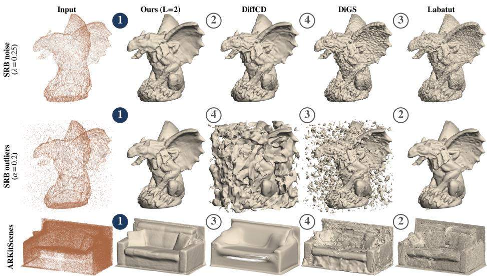  
Figure 1: Surface reconstruction for synthetic data corrupted by (top) noise and (center) outliers, and for (bottom) real LiDAR data. A single integer, the positional encoding level L, controls the fidelity-robustness trade-off. We use $L = 2 ,$ a good compromise in our experiments. Circled numbers rank methods by Chamfer distance for synthetic data and mean absolute depth error for real data.

## 1 INTRODUCTION

Reconstructing a continuous surface from range scans is a classical inverse problem in geometry processing and 3D vision. Surface samples constrain the unknown geometry only locally, leaving its topology, inside–outside orientation, and behavior between or beyond the observations underdetermined. Classical methods reduce these ambiguities through implicit surface reconstruction (Taubin et al., 1994; Hoppe et al., 1992), geometric priors or acquisition-aware occupancy reasoning (Faugeras et al., 1990; Kazhdan et al., 2006; Kazhdan & Hoppe, 2013; Labatut et al., 2009), while neural meth ods either optimize an implicit field independently for each point cloud (Atzmon & Lipman, 2020; Gropp et al., 2020; Ma et al., 2021; Ben-Shabat et al., 2022) or learn reconstruction priors across collections of shapes (Park et al., 2019; Boulch & Marlet, 2022).

However, most neural implicit methods discard the visibility information provided by the acquisition process. Under a calibrated first-return model (e.g., LiDAR), each surface measurement is associated with a sensor, and the open segment between them is known to contain no surface intersection.

Existing visibility-aware methods account for visibility through discrete volumetric reasoning (Faugeras et al., 1990; Labatut et al., 2009; Jancosek & Pajdla, 2014) or auxiliary ray-based supervision (Sulzer et al., 2022; Dai & Nießner, 2022). In contrast, we explicitly enforce visibility by directly constraining the first surface intersection along each acquisition ray to match the measured depth. To find this intersection, we represent the reconstructed surface as the zero level set of a 1-Lipschitz ${ \mathrm { { M L P ~ } } } f _ { \theta } ,$ , which allows us to use the sphere tracing algorithm (Hart, 1996), known to converge to the first zero of $f _ { \theta }$ along the sensor–point ray at a linear rate. We then minimize the discrepancy between these predicted depths and the measured ones. This approach implicitly ensures that the line segment between the sensor and the measured point is free of surface fragments.

We evaluate the method on the Surface Reconstruction Benchmark (SRB) and ShapeNet under clean and corrupted acquisitions, as well as on real LiDAR measurements from ARKitScenes (Baruch et al., 2021) and KITTI (Geiger et al., 2013), and on MVS reconstructions (Aanæs et al., 2016). We achieve competitive results on clean data and improved performance under noise and outliers.

## Our contributions are:

1. To the best of our knowledge, the first method to fit an implicit surface to range scans from scratch by directly regressing the first surface intersection along each acquisition ray against the measured depth.

2. A principled single-loss optimization formulation requiring neither auxiliary geometric supervision nor regularization losses, while retaining competitive results on clean data and improving robustness under noise and outliers.

3. An empirical characterization of the fidelity–robustness trade-off, with the positional encoding level L providing a simple control over sensitivity to corruption.

## 2 RELATED WORK

Point-cloud surface reconstruction. Early methods fit implicit functions or signed-distance fields to point samples (Taubin et al., 1994; Hoppe et al., 1992). Poisson reconstruction estimates an indicator function from oriented point samples, while Screened Poisson (SPSR) adds interpolation constraints to improve geometric fidelity; both rely on oriented normals, which can be unreliable under noisy or non-uniform sampling (Kazhdan et al., 2006; Kazhdan & Hoppe, 2013). More recently, neural implicit methods have become widely used for surface reconstruction as they provide continu ous, resolution-independent representations that handle complex geometry and arbitrary topology. These methods differ mainly in how the field is constrained. A first family learns reconstruction priors across collections of shapes, using a latent-conditioned SDF in DeepSDF, point-conditioned local representations in POCO, or a differentiable Poisson formulation in Shape As Points (Park et al., 2019; Boulch & Marlet, 2022; Peng et al., 2021). In contrast, direct fitting methods optimize a neural field for each input point cloud. IGR shows that eikonal regularization provides an implicit bias toward plausible surfaces (Gropp et al., 2020), while sign agnostic learning (SAL) extends this setting to unoriented inputs (Atzmon & Lipman, 2020). Subsequent methods introduce more explicit geometric mechanisms for constraining the fitted field. Neural-Pull samples queries around the input and pulls them toward nearby observations (Ma et al., 2021), DiGS regularizes the divergence of the gradient field to favor smooth functions (Ben-Shabat et al., 2022) and DiffCD uses a symmetric Chamfer-distance loss between the input point cloud and the surface (Härenstam-Nielsen et al., 2024).

Visibility-aware reconstruction. Known sensor poses reveal the free-space segment preceding each measured surface point. Classical methods exploit this evidence through volumetric reasoning: Faugeras et al. (1990) use visibility to identify free space in a constrained Delaunay triangulation, Labatut et al. (2009) infer inside–outside labels on a Delaunay tetrahedralization using graph cuts, while Jancosek & Pajdla (2014) refine to preserve weakly supported surfaces. More recent methods incorporate visibility into learned reconstructions, through graph neural networks on Delaunay tetrahedralizations (Sulzer et al., 2021), or by augmenting point-based models with ray-derived features and samples (Sulzer et al., 2022). These methods have demonstrated strong robustness to outliers and other acquisition defects (Labatut et al., 2009; Sulzer et al., 2021). Neural Poisson (Dai & Nießner, 2022) and neural RGB-D mapping (Ortiz et al., 2022; Zhu et al., 2022; Wang et al., 2023) also exploit sensor rays, through losses on sampled points or volume rendering, whereas we regress the first zero of the implicit field directly.

Lipschitz neural networks. Lipschitz-constrained architectures were developed to control the worst-case sensitivity of neural networks, for adversarial robustness, certification, and Wasserstein objectives (Cissé et al., 2017; Arjovsky et al., 2017). Early approaches constrain linear layers via spectral or orthogonality-based regularization, but pointwise activations limit expressiveness. GroupSort (Anil et al., 2019) addresses this with norm-preserving sorting activations. Scalable 1-Lipschitz architectures include convex potential layers (CPL) (Meunier et al., 2022), Sandwich layers (Wang & Manchester, 2023), and SDP-based Lipschitz layers (SLL) (Araujo et al., 2023). Closest to our work, Coiffier & Béthune (2024) fit 1-Lipschitz neural distance fields to point clouds with normals or to triangle soups.

## 3 METHOD

## 3.1 PROBLEM STATEMENT

Given a set $\mathcal { D } = \{ ( c _ { i } , p _ { i } ) \} _ { i = 1 } ^ { N }$ of $N$ sensor–point pairs, where $c _ { i } \in \mathbb { R } ^ { 3 }$ is the acquisition origin and $p _ { i } \in \mathbb { R } ^ { 3 }$ a possibly corrupted measurement of an unknown true surface $S ^ { \star }$ , we seek parameters $\theta \in \mathbb { R } ^ { q }$ of an ML $\dot { \mathrm { P } ^ { \prime } } f _ { \theta } : \mathbb { R } ^ { 3 }  \mathbb { R }$ whose zero level set $S _ { \theta } = \{ x \in \mathbb { R } ^ { 3 } : f _ { \theta } ( x ) = 0 \}$ estimates $S ^ { \star }$ . We take $f _ { \theta }$ to be strictly positive outside the surface.

Let us first consider the case where noise is along the acquisition ray:

$$
p _ { i } = c _ { i } + ( t _ { i } ^ { \star } + \eta _ { i } ) d _ { i } , \qquad 1 \le i \le N ,\tag{1}
$$

where $d _ { i } = ( p _ { i } - c _ { i } ) / \left\| p _ { i } - c _ { i } \right\|$ is the unit acquisition direction, $p _ { i } ^ { \star } = c _ { i } + t _ { i } ^ { \star } d _ { i } \in S ^ { \star }$ the corresponding true surface point, $\eta _ { i } \in \mathbb { R }$ a scalar depth perturbation and $t _ { i } = \| p _ { i } - c _ { i } \| _ { 2 }$ the measured depth. Surface fitting can then be viewed as robust regression of noisy scalar first-hit depths, in the spirit of classical smoothing from noisy observations (Reinsch, 1967; Craven & Wahba, 1979). We therefore consider the following regression problem

$$
\operatorname* { m i n } _ { \theta } \sum _ { i = 1 } ^ { N } \rho ( t _ { i } ( \theta ) - t _ { i } ) \quad \mathrm { s . t . } \quad t _ { i } ( \theta ) = \operatorname* { i n f } \{ t \geq 0 : f _ { \theta } ( c _ { i } + t d _ { i } ) = 0 \} , \quad i = 1 , \ldots , N ,\tag{2}
$$

where $\rho$ is a robust penalty.

## 3.2 INCIDENCE-WEIGHTED FIRST-HIT REGRESSION

More generally, under arbitrary 3D measurement noise, we have $p _ { i } = p _ { i } ^ { \star } + \varepsilon _ { i }$ , with $p _ { i } ^ { \star } \in S ^ { \star }$ and $\varepsilon _ { i } \in \mathbb { R } ^ { 3 }$ . The depth residual $\dot { | t _ { i } - t _ { i } ( \theta ) }$ | then depends on the incidence: near grazing angles, small surface-normal displacements produce large depth errors. Following incidence-dependent confidence weighting in range-image fusion and visibility-based reconstruction (Curless & Levoy, 1996; Song et al., 2021), we define

$$
w _ { \theta , i } = \frac { \left| \nabla _ { x } f _ { \theta } ( x _ { \theta , i } ) ^ { \top } d _ { i } \right| } { \| \nabla _ { x } f _ { \theta } ( x _ { \theta , i } ) \| _ { 2 } } ,\tag{3}
$$

where $x _ { \theta , i } = c _ { i } + t _ { i } ( \theta ) d _ { i }$ . Since $p _ { i } - x _ { \theta , i } = [ t _ { i } - t _ { i } ( \theta ) ] d _ { i } , w _ { \theta , i } | t _ { i } - t _ { i } ( \theta ) |$ | is the distance from $p _ { i }$ to the tangent plane of $S _ { \theta }$ at $x _ { \theta , i }$ . If $f _ { \theta }$ is affine in a neighborhood of $x _ { \theta , i }$ , with $\nabla _ { x } f _ { \theta } ( x _ { \theta , i } ) \neq 0$ , then for $t _ { i }$ sufficiently close to $t _ { i } ( \boldsymbol { \theta } )$ , we have

$$
\mathrm { d i s t } ( p _ { i } , S _ { \boldsymbol { \theta } } ) = w _ { \boldsymbol { \theta } , i } | t _ { i } - t _ { i } ( \boldsymbol { \theta } ) | .\tag{4}
$$

A proof of this result is given in Appendix B.3. The objective we optimize is

$$
\begin{array} { r } { \mathcal { L } ( \boldsymbol { \theta } ) = \mathbb { E } _ { i \sim \mathcal { U } [ 1 , N ] } \left[ \rho _ { \delta } ( w _ { \boldsymbol { \theta } , i } [ t _ { i } ( \boldsymbol { \theta } ) - t _ { i } ] ) \right] , } \end{array}\tag{5}
$$

where $\rho _ { \delta }$ is the Huber penalty with $\delta > 0$ (Huber, 1964), known to limit the influence of gross outliers. When differentiating the loss, we keep $w _ { \theta , i }$ fixed as it is a reweighting term, giving $\delta$ a consistent geometric meaning across incidence angles.

## 3.3 DIFFERENTIABLE FIRST-HIT TRACING

Computing $t _ { i } ( \theta )$ requires locating the first zero of $f _ { \theta }$ along the acquisition ray. For a 1-Lipschitz MLP $f _ { \theta }$ (Appendix B.1), a well-known algorithm to do so is sphere tracing, which is guaranteed to converge at a linear rate at a non-grazing root, $\nabla _ { x } f _ { \theta } ( x _ { \theta , i } ) ^ { \top } d _ { i } \dot { \ne } 0$ (Hart, 1996). This motivates our architectural choice in Section 3.4. The sphere tracing algorithm is described below. Differentiable sphere tracing has been used to fit pretrained shape priors to depth or images (Liu et al., 2020) and for multi-view reconstruction (Yariv et al., 2020). We optionally refine converged sphere tracing intersections with two safeguarded Newton steps.

Algorithm 1 Sphere tracing for $f _ { \theta } .$   
Require: $i , \varepsilon , t _ { \mathrm { m a x } } , K$   
1: $t \gets 0 , \ x \gets c _ { i } , \ s \gets f _ { \theta } ( x )$   
2: for $k = 1 , \ldots , K$ do   
3: if $| s | \leq \varepsilon$ then return x   
4: $\tilde { t } \gets t + | s | ;$ if $\tilde { t } > t _ { \mathrm { m a x } }$ then return $\varnothing$   
5: $t  \tilde { t } , \ x  c _ { i } + t d _ { i } , \ s  f _ { \theta } ( x )$   
6: end for   
7: return x $\operatorname { i f } | s | \leq \varepsilon ,$ otherwise ∅

Sphere tracing   
ca   
x0 = ci   
x1   
pn(a)a x2   
|fθ(x0)|   
Sensor-point pairs   
p(2)   
p(1)a ρ (w (t − t (θ))) xθ,i = ci + ti(θ)di   
(1)   
c   
pi   
Incidence weighting   
wθ,i = | cos αi|   
(2)   
c pb dipi   
nθ,i   
Sθ = {x : fθ(x) = 0} |ti − ti(θ)|   
wθ,i|ti − ti(θ)|   
(m(b)) c αi   
xθ,i Txθ,i Sθ  
Figure 2: Method overview. Sensor-point pairs define acquisition rays; sphere tracing locates the predicted first surface intersection, and incidence weighting locally converts the depth residual into a surface-distance residual.

In practice, at each optimization step, we estimate Eq. (5) from batches and retain only rays for which sphere tracing returns a finite, non-grazing intersection satisfying $w _ { \theta , i } > \tau _ { g } ,$ , with $\tau _ { g } > 0$ . We do not differentiate through this filtering operation. For such hits, assuming that $f _ { \theta }$ is differentiable with respect to x and θ in a neighborhood of $x _ { \theta , i }$ i, implicit differentiation of $f _ { \theta } ( x _ { \theta , i } ) = 0$ gives (Yariv et al., 2020)

$$
\nabla _ { \boldsymbol { \theta } } t _ { i } ( \boldsymbol { \theta } ) = - \frac { 1 } { \nabla _ { \boldsymbol { x } } f _ { \boldsymbol { \theta } } ( \boldsymbol { x } _ { \boldsymbol { \theta } , i } ) ^ { \top } d _ { i } } \nabla _ { \boldsymbol { \theta } } f _ { \boldsymbol { \theta } } ( \boldsymbol { x } _ { \boldsymbol { \theta } , i } ) .\tag{6}
$$

Thus, we avoid backpropagating through all sphere tracing iterations, which would be expensive.

## 3.4 1-LIPSCHITZ MODEL

To ensure convergence of sphere tracing, we parameterize the field $f _ { \theta } : \mathbb { R } ^ { 3 }  \mathbb { R }$ as a composition of 1-Lipschitz functions. Let D denote the network’s hidden dimension, which we take to be even. The model is defined as

$$
f _ { \theta } ( x ) = v ^ { \top } \Phi _ { \theta } ( A x ) + \beta ,\tag{7}
$$

where $A \in \mathbb { R } ^ { D \times 3 }$ satisfies $A ^ { \top } A = I _ { 3 } , \Phi _ { \theta } : \mathbb { R } ^ { D }  \mathbb { R } ^ { D }$ is a 1-Lipschitz neural network, $v =$ $\boldsymbol { \widetilde { v } } / \Vert \boldsymbol { \widetilde { v } } \Vert _ { 2 } \in \mathbb { R } ^ { D }$ is the final unit-norm weight, and $\beta \in \mathbb { R }$ is a scalar bias. As a composition of such functions, $f _ { \theta } : \mathbb { R } ^ { 3 }  \mathbb { R }$ is 1-Lipschitz. Our first-hit formulation is agnostic to the 1-Lipschitz architecture used. In our experiments, $\Phi _ { \theta }$ interleaves Convex Potential Layers (CPL) and MaxMin activations (Anil et al., 2019; Meunier et al., 2022). Architectural details are given in Appendix A.3.

## 3.5 PRACTICAL VARIANTS

Rescaling. The architectural constraint guarantees $\operatorname { L i p } ( f _ { \boldsymbol { \theta } } ) \leq 1$ , but can leave substantial slack, yielding small field magnitudes and conservative sphere tracing steps. Eikonal regularization (Gropp et al., 2020) and the hinge–Kantorovich–Rubinstein (hKR) loss (Coiffier & Béthune, 2024) encourage unit-norm gradients; however, both degrade reconstruction accuracy in our experiments (Table 7). For the convex reconstruction domain $\bar { \Omega } \subset \mathbb { R } ^ { 3 }$ with nonempty interior, we define

$$
G _ { \theta } ( \Omega ) = \mathrm { L i p } ( f _ { \theta } | _ { \Omega } ) = \operatorname* { s u p } _ { x \in \Omega : \nabla f _ { \theta } ( x ) } \| \nabla _ { x } f _ { \theta } ( x ) \| _ { 2 } .\tag{8}
$$

Rescaling by $G _ { \theta } ( \Omega ) > 0$ preserves the zero set and yields $\mathrm { L i p } ( f _ { \theta } / G _ { \theta } ( \Omega ) | _ { \Omega } ) = 1$ . However, computing $G _ { \theta } ( \Omega )$ exactly is NP-hard in general (Virmaux & Scaman, 2018). We therefore estimate it every 50 steps from 32,000 probes, sampled half uniformly in the tracing ball and half near observed returns, and rescale $f _ { \theta } \gets f _ { \theta } / \widehat { G } _ { \theta } ( \Omega )$ . Since $\widehat { G } _ { \theta } ( \Omega ) \leq G _ { \theta } ( \Omega )$ , this variant is no longer formally certified. Empirically, sampled slopes remain below one (Figure 17).

Positional encoding. To increase fitting capacity, we additionally consider Fourier positional encoding, which mitigates the spectral bias of coordinate MLPs and improves their ability to represent high-frequency detail (Mildenhall et al., 2020; Tancik et al., 2020). For $L \geq 1$

$$
\gamma _ { L } ( x ) = \left[ x , \left( \sin ( 2 ^ { k } x _ { j } ) , \cos ( 2 ^ { k } x _ { j } ) \right) _ { \stackrel { j = 1 , \ldots , 3 } { k = 0 , \ldots , L - 1 } } \right] .\tag{9}
$$

The implicit field becomes $h _ { \theta } : x \mapsto v ^ { \top } \Phi _ { \theta } ( A \gamma _ { L } ( x ) ) + \beta$ with $A \in \mathbb { R } ^ { D \times ( 6 L + 3 ) }$ and $\operatorname { L i p } ( h _ { \theta } ) \leq$ $\mathrm { L i p } ( \gamma _ { L } ) = ( 1 + ( 4 ^ { L } - 1 ) / 3 ) ^ { 1 / 2 }$ for the $\ell _ { 2 }$ norm. This variant is therefore no longer formally 1-Lipschitz. Dividing the sphere tracing steps by Lip(γL) yields highly conservative steps. We therefore empirically rescale $h _ { \theta }$ as described above.

## 4 EXPERIMENTS

## 4.1 ARCHITECTURE AND OPTIMIZATION.

Unless stated otherwise, we fit an 8-layer, width-256 CPL network with MaxMin activations using Adam with cosine learning-rate decay and an initial learning rate of $1 0 ^ { - 4 }$ for $L = 0$ and $1 0 ^ { - 2 }$ for $L > 0$ . Ours $( L = k )$ denotes the empirically rescaled variant with PE level $k \geq 0 ,$ , where $L = 0$ corresponds to no PE. We use $\delta = 0 . 0 5$ by default and $\delta = 0 . 0 0 5$ when corruption is detected from point-spacing statistics, both relative to the scene radius (Appendix C.2). Optimization runs for 5k steps on ShapeNet and 25k elsewhere. Sphere tracing uses $K = 1 9 2 , \varepsilon = 5 \times 1 0 ^ { - 4 } r _ { \mathrm { i n i t } }$ and $\tau _ { g } = 0 . 1$ , where $r _ { \mathrm { i n i t } }$ is the radius of the enclosing sphere. The field is initialized as an approximate SDF of an enclosing sphere. Further implementation details are given in Appendix A.3.

## 4.2 SYNTHETIC DATASETS AND EVALUATION

Surface Reconstruction Benchmark (SRB). We use the five SRB shapes and synthetic range scans of Sulzer et al. (2025), retaining each point’s sensor origin (Figure 8). These scans were generated with a modified implementation of Berger et al. (2013)’s optical laser-triangulation simulator.

ShapeNet. For synthetic experiments on ShapeNet (Chang et al., 2015), we use the 13-category split of Choy et al. (2016) adopted by Sulzer et al. (2025), with five shapes per category. Following Sulzer et al. (2025), point clouds are generated by casting rays from virtual sensors and retaining first surface intersections (Figure 9).

Baselines. We compare against neural implicit methods SAL (Atzmon & Lipman, 2020), Neural-Pull (Ma et al., 2021), DiGS (Ben-Shabat et al., 2022), DiffCD (Härenstam-Nielsen et al., 2024), and NDF (Coiffier & Béthune, 2024), and classical methods SPSR (Kazhdan & Hoppe, 2013) and visibility-aware Delaunay reconstruction (Labatut et al., 2009). We adapt NDF to visibility-derived labels and call it NDF-vis (Appendix A.4). Neural Poisson (Dai & Nießner, 2022) is omitted because no public implementation is available. All methods use the same input points; SPSR additionally uses estimated oriented normals, while Labatut, NDF-vis, and Ours use sensor origins.

Metrics. Evaluation uses symmetric Chamfer distance (CD), normal consistency (NC), and volumetric IoU. Following DiGS (Ben-Shabat et al., 2022), SRB uses unsquared $\mathrm { C D } _ { 1 }$ in benchmark coordinates and ShapeNet squared $\mathrm { C D _ { 2 } }$ in normalized coordinates; NC follows Sulzer et al. (2025), and IoU follows the DiGS ShapeNet protocol. However, because some surfaces contain regions unsupported by any acquisition, these global metrics conflate reconstruction of observed geometry with extrapolation in unobserved regions. We therefore also evaluate

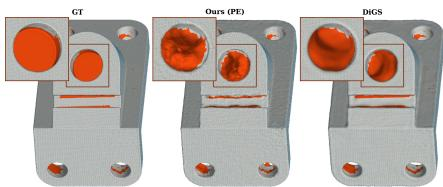  
Figure 3: Observation-supported SRB evaluation. Orange denotes surface regions excluded by the $2 h _ { 0 }$ support mask.

the observation-supported metrics $\mathrm { C D ^ { o b s } }$ and $\mathrm { { N C } ^ { \mathrm { { o b s } } } }$ , retaining predicted and reference surface samples within $2 h _ { 0 }$ of the corrupted and clean acquisitions, respectively, where $h _ { 0 }$ is the median nearest-neighbor spacing (Marchand et al., 2021) (Appendix A.5).

## 4.3 ROBUSTNESS TO MEASUREMENT ERRORS

Scanner noise (SRB). We parameterize the scanner-noise level by $\lambda \in [ 0 , 1 ]$ , with $\lambda = 0$ corresponding to the unperturbed scan and $\lambda = 1$ to the original noisy configuration of Sulzer et al. (2025). Intermediate values linearly scale the simulator noise magnitude. $\lambda = 1$ induces range errors with a standard deviation of about 1% of the bounding-box diagonal. The $\lambda = 1$ setting uses Berger et al. (2013)’s simulator with noise magnitude 0.5, near the upper end of its typical range 0–0.6.

Table 1: SRB results under scanner noise. $\mathbf { M e a n } \pm \mathbf { s t d } .$ . over three seeds for stochastic methods; best/second-best neural implicit results are bold/underlined. Per-shape results are in Appendix D.
<table><tr><td rowspan="2">Method</td><td colspan="4">Clean (λ = 0)</td><td colspan="5">Noise (λ = 1)</td></tr><tr><td> $\mathrm { C D _ { 1 } \downarrow }$ </td><td>NC↑</td><td> $\mathrm { C D _ { 1 } ^ { o b s } \downarrow }$ </td><td> $\mathrm { { N C } ^ { \mathrm { { o b s } } } \uparrow }$ </td><td> $\mathrm { C D _ { 1 } \downarrow }$ </td><td>NC↑</td><td></td><td> $\mathrm { C D _ { 1 } ^ { o b s } \downarrow }$ </td><td> $\mathrm { { N C } ^ { \mathrm { { o b s } } } \uparrow }$ </td></tr><tr><td colspan="10">Neural implicit</td></tr><tr><td>Ours (L = 0) 0.163 ± 0.005</td><td></td><td> $0 . 9 5 8 \pm 0 . 0 0 1$ </td><td> $0 . 1 0 1 \pm 0 . 0 0 3$ </td><td> $0 . 9 7 0 \pm 0 . 0 0 1$ </td><td> $\mathbf { 0 . 3 1 0 \ : \pm 0 . 0 1 6 }$ </td><td>0.906 ± 0.006</td><td></td><td> ${ \bf 0 . 2 2 6 \pm 0 . 0 0 5 }$ </td><td> $\mathbf { 0 . 9 2 1 } \pm 0 . 0 0 4$ </td></tr><tr><td>Ours (L = 2) 0.127 ± 0.002 0.970 ± 0.001</td><td></td><td></td><td> $0 . 0 7 3 \pm 0 . 0 0 1$ </td><td> $0 . 9 8 2 \pm 0 . 0 0 0 2$ </td><td>0.381 ± 0.002 0.781 ± 0.0020.296 ± 0.004</td><td></td><td></td><td></td><td> $0 . 7 9 4 \pm 0 . 0 0 2$ </td></tr><tr><td>Ours (L = 6) 0.133 ± 0.003 0.974 ± 0.002</td><td></td><td></td><td> $\mathbf { 0 . 0 6 4 } \pm 0 . 0 0 2$ </td><td> $\underline { { 0 . 9 8 7 } } \pm 0 . 0 0 3$ </td><td> $0 . 5 4 2 \pm 0 . 0 0 9 0 . 5 4 3 \pm 0 . 0 0 8 0 . 4 0 9 \pm 0 . 0 0 7$ </td><td></td><td></td><td></td><td> $0 . 5 4 4 \pm 0 . 0 0 6$ </td></tr><tr><td>NDF-vis</td><td> $0 . 6 1 3 \pm 0 . 0 6 3 0 . 8 9 3 \pm 0 . 0 0 3 0 . 4 2 3 \pm 0 . 0 3 7$ </td><td></td><td></td><td> $0 . 9 2 0 \pm 0 . 0 0 3$ </td><td> $1 . 0 9 8 \pm 0 . 1 9 4 0 . 8 7 1 \pm 0 . 0 0 3 0 . 8 3 4 \pm 0 . 1 4 9$ </td><td></td><td></td><td></td><td> $\underline { { 0 . 9 0 1 } } \pm 0 . 0 0 0 4$ </td></tr><tr><td>Neural-Pull</td><td> $0 . 2 0 8 \pm 0 . 0 5 1$ </td><td>0.945 ± 0.004 0.126 ± 0.031</td><td></td><td> $0 . 9 5 9 \pm 0 . 0 0 5$ </td><td> $0 . 4 5 0 \pm 0 . 0 0 3 0 . 7 1 7 \pm 0 . 0 0 3 0 . 3 9 4 \pm 0 . 0 0 1$ </td><td></td><td></td><td></td><td> $0 . 7 1 8 \pm 0 . 0 0 3$ </td></tr><tr><td>DiffCD</td><td> $0 . 1 2 8 \pm 0 . 0 0 1 0 . 9 7 3 \pm 0 . 0 0 1 0 . 0 7 0 \pm 0 . 0 0 0 3$ </td><td></td><td></td><td> $0 . 9 8 6 \pm 0 . 0 0 0 3$ </td><td> $0 . 4 1 5 \pm 0 . 0 0 6 0 . 7 8 1 \pm 0 . 0 0 2 0 . 3 5 4 \pm 0 . 0 0 3$ </td><td></td><td></td><td></td><td> $0 . 7 8 9 \pm 0 . 0 0 1$ </td></tr><tr><td>SAL</td><td> $0 . 7 3 1 \pm 0 . 1 4 8 0 . 8 8 5 \pm 0 . 0 1 3 0 . 5 6 7 \pm 0 . 1 2 2 0 . 9 1 4 \pm 0 . 0 1 0$ </td><td></td><td></td><td></td><td></td><td></td><td> $1 . 1 2 5 \pm 0 . 3 2 2 0 . 8 4 5 \pm 0 . 0 0 3 0 . 9 7 0 \pm 0 . 3 1 9$ </td><td></td><td> $0 . 8 6 7 \pm 0 . 0 0 1$ </td></tr><tr><td>DiGS</td><td> ${ \bf 0 . 1 0 8 } \pm 0 . 0 0 4 \ { \bf 0 . 9 8 4 } \pm 0 . 0 0 1 0 . 0 7 1 \pm 0 . 0 0 1 \ { \bf 0 . 9 9 3 } \pm 0 . 0 0 0 2$ </td><td></td><td></td><td></td><td></td><td></td><td> $0 . 6 1 0 \pm 0 . 0 0 6 0 . 5 7 8 \pm 0 . 0 0 4 0 . 4 8 8 \pm 0 . 0 0 1$ </td><td></td><td> $0 . 5 7 5 \pm 0 . 0 0 4$ </td></tr><tr><td colspan="10">Classical</td></tr><tr><td>SPSR</td><td>0.204</td><td>0.956</td><td>0.116</td><td>0.970</td><td>0.358</td><td>0.881</td><td></td><td>0.271</td><td>0.890</td></tr><tr><td>Labatut</td><td>0.137</td><td>0.953</td><td>0.074</td><td>0.968</td><td>0.410</td><td></td><td>0.639</td><td>0.363</td><td>0.639</td></tr></table>

On clean data, increasing L improves fidelity to the observations. Ours $( L = 6 )$ achieves lower observation-supported $\mathrm { C D } _ { 1 }$ than DiGS (0.064 vs. 0.071) and a smaller input-to-surface distance (0.011 vs. 0.032; Table 12), despite a higher $\mathrm { C D } _ { 1 }$ (0.133 vs. 0.108). The discrepancy is concentrated

in weakly observed regions, notably Daratech (Table 16), where stronger geometric priors can improve global metrics by extrapolating beyond the measurements.

Under scanner noise, Ours $( L = 0 )$ outperforms DiGS both globally $( 0 . 3 1 0 \ \mathrm { v s . 0 . 6 1 0 \ C D _ { 1 } } )$ and on observation-supported geometry (0.226 vs. 0.488 $\mathrm { C D } _ { 1 } ^ { \mathrm { o b s } } )$ , while larger L degrades more rapidly. Because this degradation also occurs in observed regions, larger L increasingly fits corrupted measurements rather than merely extrapolating poorly in weakly constrained regions. Figure 4 shows the corresponding qualitative behavior.

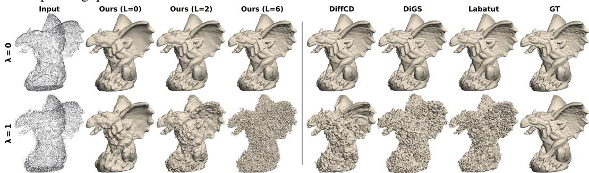  
Figure 4: Qualitative Gargoyle reconstructions under scanner noise: λ = 0 (top) and λ = 1 (bottom).

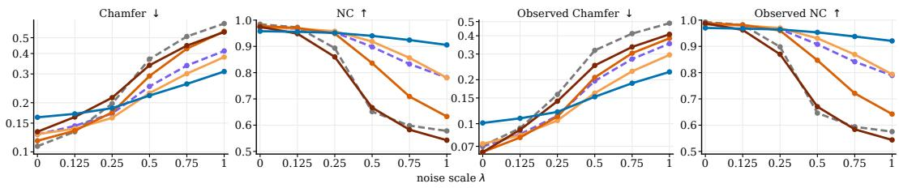  
Ours ( )L = 0 Ours ( )L = 2 Ours ( )L = 4 Ours ( )L = 6 DifCD DiGS  
Figure 5: SRB performance across scanner-noise levels. Larger L improves clean fidelity but reduces robustness. Ours (L = 2) provides a good compromise.

Gaussian noise (ShapeNet). To test robustness beyond the SRB corruption model, we evaluate on ShapeNet using 3K inputs. As in Peng et al. (2021), we consider isotropic Gaussian noise, and additionally ray-aligned range noise as a first-order model of depth uncertainty in direct time-of-flight sensors (Koerner, 2021):

$$
\begin{array} { r } { \left\{ \begin{array} { l l } { \tilde { p } _ { i } = p _ { i } + \varepsilon _ { i } , } & { \varepsilon _ { i } \sim \mathcal { N } ( 0 , \sigma _ { \mathrm { i s o } } ^ { 2 } I _ { 3 } ) , \quad \mathrm { ( i s o t r o p i c ) } , } \\ { \tilde { p } _ { i } = c _ { i } + ( t _ { i } + \eta _ { i } ) d _ { i } , } & { \eta _ { i } \sim \mathcal { N } ( 0 , \sigma _ { \mathrm { r a y } } ^ { 2 } ) , \quad \mathrm { ( r a y - a l i g n e d ) } . } \end{array} \right. } \end{array}\tag{10}
$$

In both settings, we set $\sigma _ { \mathrm { i s o } } ^ { 2 } = \sigma _ { \mathrm { r a v } } ^ { 2 } = 2 . 5 \times 1 0 ^ { - 5 }$ in the unit system of $\mathrm { C D _ { 2 } } .$ following prior work (Erler et al., 2020). Figure 6 shows that the robustness gains persist under Gaussian noise.

Table 2: ShapeNet reconstruction under Gaussian noise with 3K input points. Mean performance over successfully scored models among 65 test shapes. Best/second-best neural implicit results are shown in bold/underlined.
<table><tr><td>Metric</td><td></td><td>Ours (L = 0) Ours (L = 6) NDF-vis DiffCD</td><td></td><td></td><td></td><td>N.-Pull SAL DiGS</td><td></td><td></td><td></td><td>|SPSR Labat.</td></tr><tr><td rowspan="3">Iso NC ↑</td><td> $\mathrm { C D _ { 2 } ( 1 0 ^ { - 4 } ) \downarrow }$ </td><td>2.58</td><td>2.47</td><td>5.51</td><td>2.53</td><td>10.1</td><td>112</td><td>5.89</td><td>46.1</td><td>3.04</td></tr><tr><td></td><td>0.91 0.84</td><td>0.90 0.82</td><td>0.89 0.72</td><td>0.84 0.75</td><td>0.76 0.64</td><td>0.85</td><td>0.68</td><td>0.84</td><td>0.79</td></tr><tr><td>IoU ↑</td><td></td><td></td><td></td><td></td><td></td><td>0.63</td><td>0.46</td><td>0.63</td><td>0.79</td></tr><tr><td rowspan="3">Ray NC ↑</td><td> $\mathrm { C D _ { 2 } ( 1 0 ^ { - 4 } ) \downarrow }$ </td><td>2.23</td><td>2.18</td><td>6.66</td><td>2.45</td><td>14.8</td><td>150</td><td>5.83</td><td>45.0</td><td>3.02</td></tr><tr><td></td><td>0.92</td><td>0.91</td><td>0.89</td><td>0.88</td><td>0.79</td><td>0.85</td><td>0.71</td><td>0.84</td><td>0.81</td></tr><tr><td>IoU ↑</td><td>0.86</td><td>0.85</td><td>0.70</td><td>0.78</td><td>0.63</td><td>0.62</td><td>0.58</td><td>0.64</td><td>0.79</td></tr></table>

Outliers (SRB). Following Sulzer et al. (2025), we augment each clean SRB scan with $N _ { \mathrm { o u t } } =$ $\lfloor \alpha N _ { \mathrm { i n } } \rfloor$ outliers, sampled uniformly within the clean point cloud’s bounding box and uniformly assigned to a sensor. α = 0 corresponds to the full clean scan, while $\lambda = 0$ uses the same set of rays as $\lambda = 1$ . The two clean settings are therefore not the same, explaining the difference in the results.

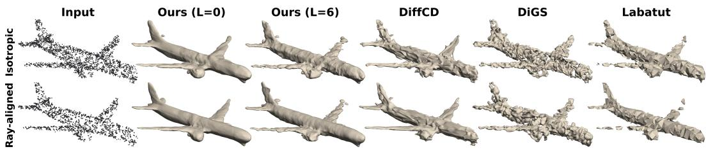  
Figure 6: Qualitative ShapeNet airplane results under isotropic and ray-aligned Gaussian noise.

Table 3: SRB results under outliers. Mean ± std. over three seeds for stochastic methods; best/secondbest neural implicit results are bold/underlined. Per-shape results are in Appendix D.
<table><tr><td rowspan="2">Method</td><td colspan="4"> $\mathbf { C l e a n } \left( \alpha = 0 \right)$ </td><td colspan="4">Outliers  $( \alpha = 0 . 2 )$ </td></tr><tr><td> $\mathrm { C D _ { 1 } \downarrow }$ </td><td>NC↑</td><td> $\mathrm { C D _ { 1 } ^ { o b s } \downarrow }$ </td><td> $\mathrm { { N C } ^ { \mathrm { { o b s } } } \uparrow }$ </td><td> $\mathrm { C D _ { 1 } \downarrow }$ </td><td>NC↑</td><td> $\mathrm { C D _ { 1 } ^ { o b s } \downarrow }$ </td><td> $\mathrm { { N C } ^ { \mathrm { { o b s } } } \uparrow }$ </td></tr><tr><td colspan="9">Neural implicit</td></tr><tr><td>Ours</td><td> $( L = 0 ) ~ 0 . 1 5 5 \pm 0 . 0 0 3$ </td><td> $0 . 9 6 1 \pm 0 . 0 0 2$ </td><td> $0 . 0 9 8 \pm 0 . 0 0 2$ </td><td> $0 . 9 7 3 \pm 0 . 0 0 1$ </td><td> $\underline { { 0 . 1 7 3 } } \pm 0 . 0 1 3$ </td><td> $\underline { { 0 . 9 5 4 } } \pm 0 . 0 0 3$ </td><td> $\underline { { 0 . 1 0 7 } } \pm 0 . 0 0 5$ </td><td> $\underline { { 0 . 9 6 8 } } \pm 0 . 0 0 2$ </td></tr><tr><td>Ours</td><td> $( L = 2 ) \ : \underline { { 0 . 1 1 9 } } \pm 0 . 0 0 3$ </td><td> $0 . 9 7 4 \pm 0 . 0 0 1$ </td><td> $0 . 0 7 0 \pm 0 . 0 0 2$ </td><td> $0 . 9 8 5 \pm 0 . 0 0 1$ </td><td> $\mathbf { 0 . 1 } 2 2 \pm 0 . 0 0 4$ </td><td> $\mathbf { 0 . 9 6 8 \pm 0 . 0 0 1 }$ </td><td> $\mathbf { 0 . 0 8 0 \mathop { \pm } 0 . 0 0 2 }$ </td><td> $\mathbf { 0 . 9 8 1 } \pm 0 . 0 0 1$ </td></tr><tr><td>Ours</td><td> $( L = 6 ) ~ 0 . 1 2 7 \pm 0 . 0 0 4$ </td><td> $\underline { { 0 . 9 7 7 } } \pm 0 . 0 0 0 9$ </td><td> $\mathbf { 0 . 0 6 1 } \pm 0 . 0 0 2$ </td><td>0.989 ± 0.0006</td><td> $0 . 4 1 4 \pm 0 . 0 1 8$ </td><td> $0 . 8 1 8 \pm 0 . 0 0 1 8$ </td><td> $0 . 1 5 1 \pm 0 . 0 0 7$ </td><td> $0 . 8 7 0 \pm 0 . 0 0 0 3$ </td></tr><tr><td>NDF-vis</td><td> $0 . 6 9 7 \pm 0 . 0 8 5$ </td><td> $0 . 8 8 5 \pm 0 . 0 0 3$ </td><td> $0 . 4 6 3 \pm 0 . 0 5 4$ </td><td>0.916 ± 0.003</td><td> $5 . 4 9 2 \pm 0 . 2 8 0$ </td><td> $0 . 7 2 3 \pm 0 . 0 1 0$ </td><td> $2 . 1 4 4 \pm 0 . 2 6 8$ </td><td> $0 . 8 3 2 \pm 0 . 0 0 9$ </td></tr><tr><td>DiffCD</td><td> $0 . 1 2 3 \pm 0 . 0 0 2$ </td><td> $0 . 9 7 5 \pm 0 . 0 0 2$ </td><td> $\underline { { 0 . 0 6 8 } } \pm 0 . 0 0 2$ </td><td>0.988 ± 0.001</td><td> $3 . 3 5 4 \pm 0 . 0 2 8$ </td><td> $0 . 8 0 6 \pm 0 . 0 0 1$ </td><td> $1 . 6 1 4 \pm 0 . 0 0 7$ </td><td> $0 . 9 0 3 \pm 0 . 0 0 1$ </td></tr><tr><td>Neural-Pull</td><td> $0 . 1 6 9 \pm 0 . 0 2 5$ </td><td> $0 . 9 5 1 \pm 0 . 0 0 3$ </td><td> $0 . 1 0 8 \pm 0 . 0 1 7$ </td><td>0.964 ± 0.005</td><td> $3 . 4 2 \pm 0 . 1 5$ </td><td> $0 . 7 5 6 \pm 0 . 0 1 5$ </td><td> $1 . 0 9 6 \pm 0 . 1 2 8$ </td><td> $0 . 8 5 5 \pm 0 . 0 1 4$ </td></tr><tr><td>SAL</td><td> $0 . 7 0 4 \pm 0 . 0 6 8$ </td><td> $0 . 8 8 9 \pm 0 . 0 0 9$ </td><td> $0 . 5 1 2 \pm 0 . 0 5 4$ </td><td>0.919 ± 0.007</td><td> $5 . 7 3 1 \pm 2 . 1 3 4$ </td><td> $0 . 6 5 2 \pm 0 . 0 3 1$ </td><td> $3 . 1 5 9 \pm 2 . 1 6 4$ </td><td> $0 . 7 5 6 \pm 0 . 0 3 4$ </td></tr><tr><td>DiGS</td><td> ${ \bf 0 . 1 0 6 } \pm 0 . 0 0 5$ </td><td> $\mathbf { 0 . 9 8 5 \ : \pm 0 . 0 0 1 }$ </td><td></td><td> $0 . 0 6 9 \pm 0 . 0 0 2 \ 0 . 9 9 4 \pm 0 . 0 0 0 3$ </td><td> $2 . 9 2 7 \pm 0 . 0 6 3$ </td><td> $0 . 8 1 4 \pm 0 . 0 0 2$ </td><td> $1 . 6 5 0 \pm 0 . 0 1 7$ </td><td> $0 . 8 9 7 \pm 0 . 0 0 1$ </td></tr><tr><td colspan="9">Classical</td></tr><tr><td>SPSR</td><td>0.187</td><td>0.960</td><td>0.104</td><td>0.974</td><td>4.917</td><td>0.855</td><td>0.322</td><td>0.970</td></tr><tr><td>Labatut</td><td>0.128</td><td>0.960</td><td>0.068</td><td>0.975</td><td>0.144</td><td>0.946</td><td>0.079</td><td>0.963</td></tr></table>

Neural implicit baselines deteriorate sharply with increasing outliers, whereas our variants remain stable. In particular, Ours $( L = 2 )$ retains the same performance at $\alpha = 0 . 2$ as on clean data and achieves lower $\mathrm { C D } _ { 1 }$ than Labatut at every tested outlier level (Figure 24). Ours $( L = 6 )$ also remains robust, but degrades more strongly as α increases, illustrating the fidelity–robustness trade-off induced by fitting capacity. This behavior follows from the combination of first-hit visibility and the Huber loss. Across our PE and no-PE variants, roughly 60% of outlier rays fall in Huber’s linear regime and about 40% do not yield a valid traced hit, while over 91% of inlier rays remain in the quadratic regime and only 0.8–2.4% are dropped (Table 10). First-hit supervision makes many inconsistent outlier measurements difficult to fit without introducing premature intersections along other rays, so these outliers cease to yield valid hits. For those that remain, the Huber loss limits their influence.

## 4.4 REAL DATA EXPERIMENTS

ARKitScenes (iPad LiDAR). We evaluate on an ARKitScenes sofa scene, using raw $2 5 6 \times 1 9 2$ depth maps from the consumer-grade LiDAR of a 2020 iPad Pro with the corresponding sensor poses. Since the FARO reference is provided as view-aligned depth rather than a surface mesh, Chamfer evaluation would discard the original ray correspondences. We instead render each reconstruction from the FARO viewpoints and compare first-hit depths to the reference depth maps, reporting mean absolute depth error (MAE), hit rate, and the fraction of rays with error below 2 cm (I@2 cm) (Appendix A.5). Table 4: ARKitScenes sofa reconstruction from 2.34M iPad LiDAR points. Evaluation over 36 FARO frames; mean ± standard deviation across frames. Best/second-best results are bold/underlined.

<table><tr><td rowspan="2"></td><td colspan="7">Neural implicit</td><td colspan="2">Classical</td></tr><tr><td> $\mathrm { O u r s } \left( L = 0 \right)$ </td><td> $\mathrm { O u r s } \left( L = 2 \right)$ </td><td>NDF-vis</td><td>DiffCD</td><td>Neural-Pull</td><td>SAL</td><td>DiGS</td><td>SPSR</td><td>Labatut</td></tr><tr><td> $\mathbf { M A E } \left( \mathbf { c m } \right) \downarrow$ </td><td> $2 . 2 4 \pm 0 . 1 7$ </td><td> ${ \bf 2 . 0 7 \pm 0 . 1 7 }$ </td><td> $1 1 . 3 0 \pm 0 . 5 2$ </td><td> $4 . 8 4 \pm 0 . 3 2$ </td><td> $5 . 5 6 \pm 0 . 3 0$ </td><td> $8 . 3 4 \pm 0 . 3 9$ </td><td> $5 . 6 6 \pm 0 . 2 9$ </td><td> $2 . 8 4 \pm 0 . 2 5$ </td><td> $4 . 0 7 \pm 0 . 2 8$ </td></tr><tr><td>Hit (%) ↑</td><td> $\overline { { \mathbf { 9 9 . 7 \pm 0 . 1 3 } } }$ </td><td> $9 9 . 4 \pm 0 . 2 4$ </td><td> $8 3 . 4 \pm 3 . 6 2$ </td><td> ${ \bf 9 9 . 7 \pm 0 . 1 5 }$ </td><td> $9 0 . 3 \pm 2 . 7 2$ </td><td> $9 6 . 3 \pm 0 . 5 8$ </td><td> $9 9 . 5 \pm 0 . 0 9$ </td><td> ${ \bf 9 9 . 7 \pm 0 . 0 8 }$ </td><td> $9 8 . 8 \pm 0 . 4 0$ </td></tr><tr><td> $I @ 2 \mathrm { c m } ( \% ) \uparrow$ </td><td> $6 1 . 9 \pm 3 . 7$ </td><td> ${ \bf 6 6 . 0 \pm 4 . 0 }$ </td><td> $1 . 3 \pm 0 . 5$ </td><td> $3 3 . 1 \pm 3 . 3$ </td><td> $2 0 . 5 \pm 1 . 2$ </td><td> $6 . 5 \pm 0 . 8$ </td><td> $2 5 . 0 \pm 2 . 5$ </td><td> $5 8 . 5 \pm 3 . 8 $ </td><td> $4 5 . 5 \pm 3 . 3$ </td></tr></table>

KITTI Raw (automotive LiDAR). KITTI Raw (Geiger et al., 2013) is a standard dataset providing real-world automotive LiDAR acquisitions with known sensor poses. We use one urban driving sequence, pairing each return with its acquisition ray, and reconstruct a static urban crop. As KITTI

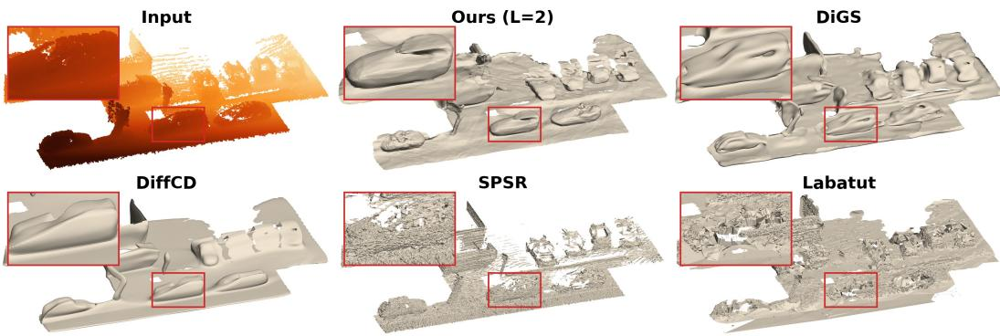  
Figure 7: Qualitative KITTI reconstruction.

provides no reference surface, we report qualitative results only (Figure 7). Supplementary MVS reconstructions are reported in Appendix A.2.

## 5 DISCUSSION

Fidelity–robustness trade-off. DiGS and DiffCD combine several weighted losses that must be balanced during optimization and satisfying each objective is not guaranteed. For example, despite eikonal regularization, the eikonal condition is not enforced in practice (Figure 17). In our case, L provides a single parameter to study sensitivity to corruption: larger values fit clean observations more closely and smaller ones are more robust to corruption. Since the noise characteristics of a sensor are typically known, or can be calibrated once on a reference object, L can in principle be set accordingly. Across our experiments, $L = 2$ provides a good intermediate value.

Role of visibility. To test sensitivity to inaccurate sensor provenance, we perturb the origins $c _ { i }$ while keeping the points $p _ { i }$ fixed. We observe that moderate pose perturbations have little effect, whereas random sensor reassignment makes most ray–point pairs inconsistent and causes the loss of valid first hits (Appendix C.7), showing that acquisition rays carry geometric information.

Ablations. Table 5 summarizes the main ablations. Robust depth penalties matter mainly under outliers: $\ell _ { 1 }$ remains stable whereas $\ell _ { 2 }$ degrades strongly, and adding a miss penalty is harmful as it forces the surface to pass through outliers. Incidence weighting primarily improves outlier robustness, while empirical rescaling improves performance across all three regimes.  
Table 5: SRB ablations, averaged over the five shapes; mean ± standard deviation over three seeds.
<table><tr><td rowspan="2">Variant</td><td colspan="2">Clean (λ = 0)</td><td colspan="2">Noise  $( \lambda = 1 )$ </td><td colspan="2">Outliers  $( \alpha = 0 . 2 )$ </td></tr><tr><td> $\mathrm { C D _ { 1 } \downarrow }$ </td><td>NC↑</td><td> $\mathrm { C D _ { 1 } \downarrow }$ </td><td>NC↑</td><td> $\mathrm { C D _ { 1 } \downarrow }$ </td><td>NC↑</td></tr><tr><td>Ours (L = 0)</td><td> $0 . 1 6 3 _ { \pm 0 . 0 0 5 }$ </td><td> $0 . 9 5 8 { \scriptstyle \pm 0 . 0 0 1 }$ </td><td> $0 . 3 1 0 { \scriptstyle \pm 0 . 0 1 6 }$ </td><td> $0 . 9 0 6 { \scriptstyle \pm 0 . 0 0 6 }$ </td><td> $\mathbf { 0 . 1 7 3 _ { \pm 0 . 0 1 3 } }$ </td><td> $\mathbf { 0 . 9 5 4 } _ { \pm 0 . 0 0 3 }$ </td></tr><tr><td> $\ell _ { 1 }$  loss</td><td> $0 . 1 8 8 { \scriptstyle \pm 0 . 0 0 0 4 }$ </td><td> $0 . 9 5 0 { \scriptstyle \pm 0 . 0 0 0 7 }$ </td><td> $0 . 2 9 6 { \scriptstyle \pm 0 . 0 0 1 }$ </td><td> $0 . 9 1 1 { \scriptstyle \pm 0 . 0 0 4 }$ </td><td> $0 . 1 8 5 { \scriptstyle \pm 0 . 0 0 4 }$ </td><td> $0 . 9 5 0 { \scriptstyle \pm 0 . 0 0 2 }$ </td></tr><tr><td> $\ell _ { 2 }$  loss</td><td> $0 . 1 9 5 { \scriptstyle \pm 0 . 0 0 2 }$ </td><td> $0 . 9 5 1 { \scriptstyle \pm 0 . 0 0 1 }$ </td><td> $0 . 3 0 8 { \scriptstyle \pm 0 . 0 0 2 }$ </td><td> $\mathbf { 0 . 9 2 1 { \scriptstyle \pm 0 . 0 0 0 2 } }$ </td><td> $1 . 1 1 1 { \scriptstyle \pm 0 . 0 1 0 }$ </td><td> $0 . 7 0 8 { \scriptstyle \pm 0 . 0 0 1 5 }$ </td></tr><tr><td> $- \boldsymbol { w } _ { \theta , i }$ </td><td> $0 . 1 7 7 { \scriptstyle \pm 0 . 0 4 6 }$ </td><td> $0 . 9 5 5 { \scriptstyle \pm 0 . 0 1 6 }$ </td><td> $0 . 3 0 2 { \scriptstyle \pm 0 . 0 3 6 }$ </td><td> $0 . 9 1 7 { \scriptstyle \pm 0 . 0 1 3 }$ </td><td> $0 . 2 3 7 { \scriptstyle \pm 0 . 0 0 6 }$ </td><td> $0 . 9 5 0 { \scriptstyle \pm 0 . 0 0 1 5 }$ </td></tr><tr><td> $- \operatorname { r e s c a l i n g }$ </td><td> $0 . 1 9 9 _ { \pm 0 . 0 0 4 }$ </td><td> $0 . 9 4 7 { \scriptstyle \pm 0 . 0 0 0 7 }$ </td><td> $0 . 3 3 9 { \scriptstyle \pm 0 . 0 0 2 }$ </td><td> $0 . 9 0 2 { \scriptstyle \pm 0 . 0 0 0 5 }$ </td><td> $0 . 2 3 1 { \scriptstyle \pm 0 . 0 0 9 }$ </td><td> $0 . 9 2 9 _ { \pm 0 . 0 0 3 }$ </td></tr><tr><td>+ miss penalty</td><td> $\mathbf { 0 . 1 5 8 _ { \pm 0 . 0 0 0 5 } }$ </td><td> $\mathbf { 0 . 9 6 1 { \scriptstyle \pm 0 . 0 0 0 4 } }$ </td><td> $\mathbf { 0 . 2 8 4 _ { \pm 0 . 0 0 7 } }$ </td><td> $0 . 9 1 7 { \scriptstyle \pm 0 . 0 0 4 }$ </td><td> $1 . 2 4 0 { \scriptstyle \pm 0 . 1 0 2 }$ </td><td> $0 . 8 3 4 { \scriptstyle \pm 0 . 0 0 2 }$ </td></tr></table>

Computational cost. Each sphere-tracing iteration requires a network evaluation, making the forward pass costly, while implicit differentiation keeps the backward pass efficient. Full-budget training is more expensive in wall-clock time (∼ 1h40min, versus up to 40min for the baselines; Table 14). However, Ours $( L = 6 )$ reaches within 2.8% of its final $\mathrm { C D _ { 1 } }$ after only 40% of training (∼ 40min). Peak memory remains 3× below DiGS and DiffCD.

## 6 CONCLUSION

We formulate visibility-aware surface reconstruction as a robust first-hit depth regression problem. Acquisition rays constrain both surface position and preceding free space without auxiliary geometric supervision or regularization losses. Experiments show competitive results on clean data and consistent gains under noise and outliers. This minimal formulation allows us to investigate how increasing L improves fitting the input but also increases sensitivity to corruption. Sphere tracing also increases the optimization cost, although most of the accuracy is reached early in the step budget (Table 14). Natural extensions include jointly refining sensor poses, with respect to which the loss is differentiable, and exploring other 1-Lipschitz architectures. More fundamentally, finite first-hit measurements do not uniquely determine the underlying surface. Relating recoverable geometric detail to sampling density, surface regularity, and model capacity is an important direction for future work.

## ACKNOWLEDGMENTS

This work was supported in part by the French government under management of Agence Nationale de la Recherche as part of the “France 2030” program, PR[AI]RIE-PSAI project, reference ANR-23- IACL-0008. J.P. was supported in part by the Louis Vuitton/ENS chair in artificial intelligence, the Institute of Information & Communications Technology Planning & Evaluation (IITP) grant funded by the Korean Government (MSIT) (No. RS-2024-00457882, National AI Research Lab Project), and a Global Distinguished Professorship at the Courant Institute of Mathematical Sciences and the Center for Data Science at New York University.

## REFERENCES

H. Aanæs, R. R. Jensen, G. Vogiatzis, E. Tola, and A. B. Dahl. Large-scale data for multiple-view stereopsis. International Journal ofComputer Vision, 120(2):153–168, 2016.

C. Anil, J. Lucas, and R. Grosse. Sorting out Lipschitz function approximation. In ICML, pages 291–301, 2019.

A. Araujo, A. Havens, B. Delattre, A. Allauzen, and B. Hu. A unified algebraic perspective on Lipschitz neural networks. In ICLR, 2023.

M. Arjovsky, S. Chintala, and L. Bottou. Wasserstein generative adversarial networks. In ICML, pages 214–223, 2017.

M. Atzmon and Y. Lipman. SAL: Sign agnostic learning of shapes from raw data. In CVPR, 2020.

G. Baruch, Z. Chen, A. Dehghan, T. Dimry, Y. Feigin, P. Fu, T. Gebauer, B. Joffe, D. Kurz, A. Schwartz, and E. Shulman. ARKitScenes: A diverse real-world dataset for 3D indoor scene understanding using mobile RGB-D data. In NeurIPS Datasets and Benchmarks Track, 2021.

Y. Ben-Shabat, C. H. Koneputugodage, and S. Gould. DiGS: Divergence guided shape implicit neural representation for unoriented point clouds. In CVPR, pages 19323–19332, 2022.

M. Berger, J. A. Levine, L. G. Nonato, G. Taubin, and C. T. Silva. A benchmark for surface reconstruction. ACM Transactions on Graphics, 32(2), 2013.

A. Boulch and R. Marlet. POCO: Point convolution for surface reconstruction. In CVPR, 2022.

A. X. Chang, T. Funkhouser, L. Guibas, P. Hanrahan, Q. Huang, Z. Li, S. Savarese, M. Savva, S. Song, H. Su, J. Xiao, L. Yi, and F. Yu. ShapeNet: An information-rich 3D model repository. arXiv preprint arXiv:1512.03012, 2015.

C. B. Choy, D. Xu, J. Gwak, K. Chen, and S. Savarese. 3D-R2N2: A unified approach for single and multi-view 3D object reconstruction. In ECCV, pages 628–644, 2016.

M. Cissé, P. Bojanowski, E. Grave, Y. Dauphin, and N. Usunier. Parseval networks: Improving robustness to adversarial examples. In Proceedings ofthe 34th International Conference on Machine Learning, volume 70 of Proceedings of Machine Learning Research, pages 854–863, 2017.

G. Coiffier and L. Béthune. 1-Lipschitz neural distance fields. Computer Graphics Forum, 43(5):e15128, 2024.

P. Craven and G. Wahba. Smoothing noisy data with spline functions: Estimating the correct degree of smoothing by the method of generalized cross-validation. Numerische Mathematik, 31(4):377–403, 1979.

B. Curless and M. Levoy. A volumetric method for building complex models from range images. In Proceedings ofthe 23rd Annual Conference on Computer Graphics and Interactive Techniques, pages 303–312, 1996.

A. Dai and M. Nießner. Neural Poisson: Indicator functions for neural fields. arXiv preprint arXiv:2211.14249, 2022.

P. Erler, P. Guerrero, S. Ohrhallinger, M. Wimmer, and N. J. Mitra. Points2Surf: Learning implicit surfaces from point cloud patches. In ECCV, pages 108–124, 2020.

O. D. Faugeras, E. Le Bras-Mehlman, and J.-D. Boissonnat. Representing stereo data with the Delaunay triangulation. Artificial Intelligence, 44(1–2):41–87, 1990.

A. Geiger, P. Lenz, C. Stiller, and R. Urtasun. Vision meets robotics: The KITTI dataset. International Journal ofRobotics Research, 2013.

A. Gropp, L. Yariv, N. Haim, M. Atzmon, and Y. Lipman. Implicit geometric regularization for learning shapes. In ICML, 2020.

L. Härenstam-Nielsen, L. Sang, A. Saroha, N. Araslanov, and D. Cremers. DiffCD: A symmetric differentiable Chamfer distance for neural implicit surface fitting. In European Conference on Computer Vision (ECCV), 2024.

J. C. Hart. Sphere tracing: A geometric method for the antialiased ray tracing of implicit surfaces. The Visual Computer, 12(10):527–545, 1996.

H. Hoppe, T. DeRose, T. Duchamp, J. McDonald, and W. Stuetzle. Surface reconstruction from unorganized points. In Proceedings of the 19th Annual Conference on Computer Graphics and Interactive Techniques, pages 71–78, 1992.

P. J. Huber. Robust estimation of a location parameter. The Annals ofMathematical Statistics, 35(1):73–101, 1964.

M. Jancosek and T. Pajdla. Exploiting visibility information in surface reconstruction to preserve weakly supported surfaces. International Scholarly Research Notices, 2014:798595, 2014.

J. N. Jensen, M. Hannemose, J. A. Bærentzen, J. Wilm, J. R. Frisvad, and A. B. Dahl. Surface reconstruction from structured light images using differentiable rendering. Sensors, 21(4):1068, 2021.

M. Kazhdan, M. Bolitho, and H. Hoppe. Poisson surface reconstruction. In Symposium on Geometry Processing, 2006.

M. Kazhdan and H. Hoppe. Screened Poisson surface reconstruction. ACM Transactions on Graphics, 32(3), 2013.

L. J. Koerner. Models of direct time-of-flight sensor precision that enable optimal design and dynamic configuration. IEEE Transactions on Instrumentation and Measurement, 70:1–9, 2021.

P. Labatut, J.-P. Pons, and R. Keriven. Robust and efficient surface reconstruction from range data. Computer Graphics Forum, 28(8):2275–2290, 2009.

S. Liu, Y. Zhang, S. Peng, B. Shi, M. Pollefeys, and Z. Cui. DIST: Rendering deep implicit signed distance function with differentiable sphere tracing. In Proceedings ofthe IEEE/CVF Conference on Computer Vision and Pattern Recognition (CVPR), pages 2019–2028, 2020.

W. E. Lorensen and H. E. Cline. Marching cubes: A high resolution 3D surface construction algorithm. In SIGGRAPH, 1987.

B. Ma, Z. Han, Y.-S. Liu, and M. Zwicker. Neural-Pull: Learning signed distance function from point clouds by learning to pull space onto surface. In ICML, pages 7246–7257, 2021.

Y. Marchand, B. Vallet, and L. Caraffa. Evaluating surface mesh reconstruction of open scenes. The International Archives ofthe Photogrammetry, Remote Sensing and Spatial Information Sciences, XLIII-B2-2021:369–376, 2021.

L. Mescheder, M. Oechsle, M. Niemeyer, S. Nowozin, and A. Geiger. Occupancy Networks: Learning 3D reconstruction in function space. In Proceedings of the IEEE/CVF Conference on Computer Vision and Pattern Recognition (CVPR), pages 4460–4470, 2019.

L. Meunier, B. J. Delattre, A. Araujo, and A. Allauzen. A dynamical system perspective for Lipschitz neural networks. In ICML, pages 15484–15500, 2022.

B. Mildenhall, P. P. Srinivasan, M. Tancik, J. T. Barron, R. Ramamoorthi, and R. Ng. NeRF: Representing scenes as neural radiance fields for view synthesis. In ECCV, pages 405–421, 2020.

J. Ortiz, A. Clegg, J. Dong, E. Sucar, D. Novotny, M. Zollhoefer, and M. Mukadam. iSDF: Real-Time Neural Signed Distance Fields for Robot Perception. In Proceedings ofRobotics: Science and Systems, 2022.

J. J. Park, P. Florence, J. Straub, R. Newcombe, and S. Lovegrove. DeepSDF: Learning continuous signed distance functions for shape representation. In CVPR, 2019.

S. Peng, C. Jiang, Y. Liao, M. Niemeyer, M. Pollefeys, and A. Geiger. Shape As Points: A differentiable Poisson solver. In NeurIPS, 2021.

B. Prach, F. Brau, G. Buttazzo, and C. H. Lampert. 1-Lipschitz layers compared: Memory, speed, and certifiable robustness. In CVPR, pages 24574–24583, 2024.

C. H. Reinsch. Smoothing by spline functions. Numerische Mathematik, 10(3):177–183, 1967.

S. Song, Z. Cui, and R. Qin. Vis2Mesh: Efficient mesh reconstruction from unstructured point clouds of large scenes with learned virtual view visibility. In Proceedings of the IEEE/CVF International Conference on Computer Vision, pages 6514–6524, 2021.

R. Sulzer, L. Landrieu, R. Marlet, and B. Vallet. Scalable surface reconstruction with Delaunay-Graph neural networks. Computer Graphics Forum, 40(5):157–167, 2021.

R. Sulzer, L. Landrieu, A. Boulch, R. Marlet, and B. Vallet. Deep surface reconstruction from point clouds with visibility information. In ICPR, pages 2415–2422, 2022.

R. Sulzer, R. Marlet, B. Vallet, and L. Landrieu. A survey and benchmark of automatic surface reconstruction from point clouds. IEEE Transactions on Pattern Analysis and Machine Intelligence, 47(3):2000–2019, 2025.

M. Tancik, P. Srinivasan, B. Mildenhall, S. Fridovich-Keil, N. Raghavan, U. Singhal, R. Ramamoorthi, J. T. Barron, and R. Ng. Fourier features let networks learn high frequency functions in low dimensional domains. In NeurIPS, volume 33, pages 7537–7547, 2020.

G. Taubin, F. Cukierman, S. Sullivan, J. Ponce, and D. J. Kriegman. Parameterized families of polynomials for bounded algebraic curve and surface fitting. IEEE Transactions on Pattern Analysis and Machine Intelligence, 16(3):287–303, 1994.

A. Virmaux and K. Scaman. Lipschitz regularity of deep neural networks: Analysis and efficient estimation. In Advances in Neural Information Processing Systems, volume 31, pages 3839–3848, 2018.

H. Wang, J. Wang, and L. Agapito. Co-SLAM: Joint coordinate and sparse parametric encodings for neural real-time SLAM. In Proceedings of the IEEE/CVF Conference on Computer Vision and Pattern Recognition, pages 13293–13302, 2023.

R. Wang and I. Manchester. Direct parameterization of Lipschitz-bounded deep networks. In ICML, pages 36093–36110, 2023.

Q. Xu, W. Kong, W. Tao, and M. Pollefeys. Multi-scale geometric consistency guided and planar prior assisted multi-view stereo. IEEE Transactions on Pattern Analysis and Machine Intelligence, 45(4):4945–4963, 2023.

L. Yariv, Y. Kasten, D. Moran, M. Galun, M. Atzmon, R. Basri, and Y. Lipman. Multiview neural surface reconstruction by disentangling geometry and appearance. In Advances in Neural Information Processing Systems, volume 33, pages 2492–2502, 2020.

Z. Zhu, S. Peng, V. Larsson, W. Xu, H. Bao, Z. Cui, M. R. Oswald, and M. Pollefeys. NICE-SLAM: Neural implicit scalable encoding for SLAM. In Proceedings ofthe IEEE/CVF Conference on Computer Vision and Pattern Recognition, pages 12786–12796, 2022.

## A EXPERIMENTAL DETAILS

## A.1 ACQUISITION PROTOCOLS

The acquisition geometries used for SRB and ShapeNet are illustrated in Figures 8 and 9.

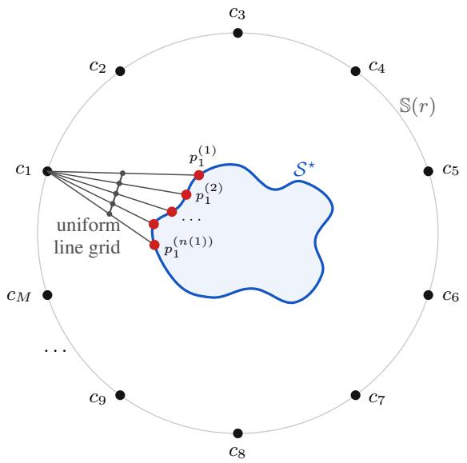

Figure 8: SRB acquisition protocol. Scanner poses lie on S(r); rays are cast through a uniform grid, and their first surface intersections are retained.  
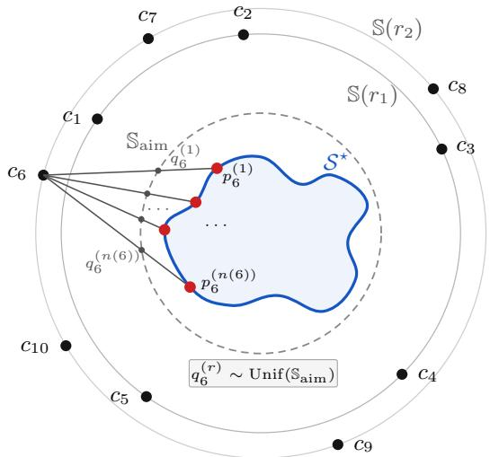  
Figure 9: ShapeNet acquisition protocol. Virtual sensors lie on two concentric spheres; uniformly sampled targets on the enclosing sphere define ray directions, and the first surface intersections are retained.

## A.2 ADDITIONAL REAL-WORLD ACQUISITIONS

MVS reconstruction. We further evaluate on four DTU scenes (Aanæs et al., 2016), using point clouds reconstructed by fusing depth maps estimated with ACMMP (Xu et al., 2023).

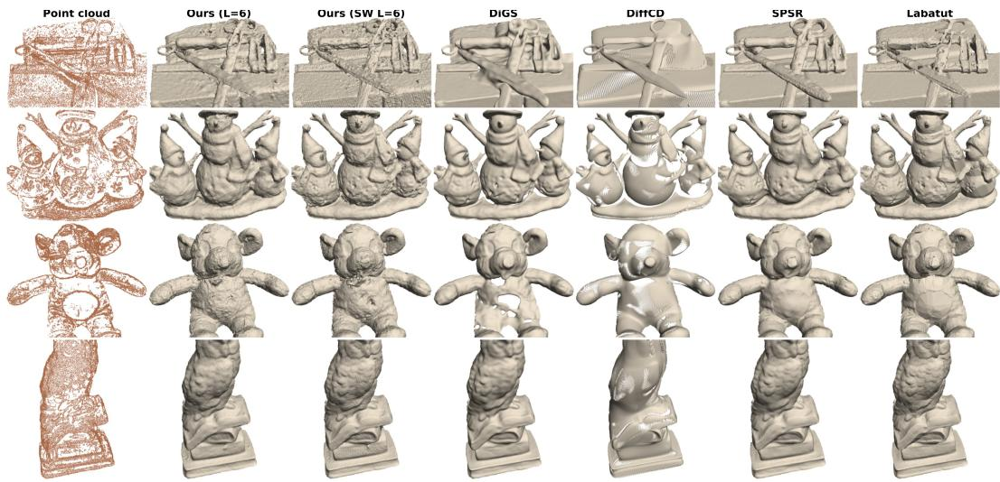  
Figure 10: Qualitative reconstruction on DTU MVS scenes 37, 69, 105 and 122. Ours (SW $L = 6 )$ uses Sandwich layers (SW; Appendix C.3).

## A.3 ARCHITECTURE AND IMPLEMENTATION

Input embedding. For our CPL implementation, following Meunier et al. (2022), we instantiate x 7→ Ax as the fixed zero-padding map

$$
A = { \binom { I _ { 3 } } { 0 } } .\tag{11}
$$

This embedding is isometric since $A ^ { \top } A = I _ { 3 }$

The backbone $\Phi _ { \theta }$ interleaves two types of 1-Lipschitz layers.

MaxMin activation. For $z \in \mathbb { R } ^ { D }$ , we apply the MaxMin operator, which sorts coordinates in pairs:

$$
\begin{array} { r } { \mathrm { M a x M i n } ( z ) = \left( \operatorname* { m a x } ( z _ { 2 k - 1 } , z _ { 2 k } ) , \operatorname* { m i n } ( z _ { 2 k - 1 } , z _ { 2 k } ) \right) _ { k = 1 } ^ { D / 2 } . } \end{array}\tag{12}
$$

MaxMin is norm-preserving and 1-Lipschitz with respect to the $\ell _ { 2 } \cdot$ -norm (Anil et al., 2019).

Convex Potential Layers. CPL layers are parameterized as

$$
\boldsymbol { \ell } ( \boldsymbol { z } ) = \boldsymbol { z } - \frac { 2 } { \| \boldsymbol { W } \| _ { 2 } ^ { 2 } } \boldsymbol { W } ^ { \top } \boldsymbol { \sigma } ( \boldsymbol { W } \boldsymbol { z } + \boldsymbol { b } ) ,\tag{13}
$$

where $\sigma = \mathrm { R e L U } , W \in \mathbb { R } ^ { m \times D }$ , and $\| W \| _ { 2 }$ is the spectral norm. By Meunier et al. (2022), this residual mapping is 1-Lipschitz. We use CPL as a practical compromise between expressivity, memory, speed, and certifiable Lipschitz control (Prach et al., 2024).

In practice, we approximate each spectral norm by power iteration (Meunier et al., 2022). Starting from a unit vector $u ,$ we iterate

$$
v  \frac { W u } { \| W u \| _ { 2 } } , \qquad u  \frac { W ^ { \top } v } { \| W ^ { \top } v \| _ { 2 } } ,\tag{14}
$$

and estimate the dominant singular value as

$$
{ \widehat { \sigma } } ( W ) = v ^ { \top } W u .\tag{15}
$$

With one power-iteration step per gradient step, $\widehat { \sigma } ( W )$ matches the exact spectral norm $\| W \| _ { 2 }$ to a median relative error of $3 \times \mathrm { 1 0 ^ { - 1 3 } \% }$ (worst case 0.06%) across all CPL layers of 49 trained SRB models at their final checkpoint.

Implementation details. We use batches of $| \mathcal D |$ rays for SRB and 16384 for ShapeNet and real acquisitions and, following DiGS and IGR (Gropp et al., 2020; Ben-Shabat et al., 2022), we extract meshes with marching cubes (Lorensen & Cline, 1987) using a grid whose shortest axis has 512 samples.

Sphere initialization. For a random initialization $\theta _ { 0 }$ of $\Phi _ { \theta }$ , we sample M points $x _ { j } \sim$ $\mathcal { U } ( [ - a r _ { \mathrm { i n i t } } , a r _ { \mathrm { i n i t } } ] ^ { 3 } )$ , with $a > 1$ , and fit

$$
( \widetilde v , \widetilde \beta ) \in \arg \operatorname* { m i n } _ { v , \beta } \sum _ { j = 1 } ^ { M } \Bigl ( v ^ { \top } \Phi _ { \theta _ { 0 } } ( A x _ { j } ) + \beta - \bigl ( \| x _ { j } \| _ { 2 } - r _ { \mathrm { i n i t } } \bigr ) \Bigr ) ^ { 2 } .
$$

We then set

$$
f _ { \theta _ { 0 } } ( x ) = \frac { \widetilde { v } ^ { \top } \Phi _ { \theta _ { 0 } } ( A x ) + \widetilde { \beta } } { \| \widetilde { v } \| _ { 2 } } .
$$

This preserves the fitted zero set and ensures $\mathrm { L i p } ( f _ { \theta _ { 0 } } ) \leq 1$

## A.4 BASELINE DETAILS

Visibility-supervised NDF. We adapt Coiffier & Béthune (2024), replacing its normal-derived winding-number supervision with visibility constraints. Points before $p _ { i }$ are labeled outside,

$$
\begin{array} { r } { x _ { i } ^ { \mathrm { o u t } } = p _ { i } - \varepsilon _ { i } d _ { i } , } \end{array}\tag{16}
$$

whereas points immediately behind it are labeled inside,

$$
x _ { i } ^ { \mathrm { i n } } = p _ { i } + \varepsilon _ { i } d _ { i } .\tag{17}
$$

Here, $\varepsilon _ { i } = u _ { i } s _ { i } , u _ { i } \sim \mathcal { U } ( 0 . 5 , 2 )$ , and $s _ { i }$ is the local nearest-neighbor spacing. We additionally sample free-space points along $c _ { i } + t ( p _ { i } - c _ { i } )$ , with $t \in ( 0 , 1 )$ . The original 1-Lipschitz Semi-definite Programming Lipschitz Layer (SLL) architecture and hKR objective are retained, with margin $m = 0 . 0 0 2$

## A.5 EVALUATION METRICS

Let P and Q denote point sets sampled from the predicted and reference surfaces, respectively.

Chamfer distance. We report the symmetric Chamfer distance

$$
\mathrm { C D } _ { q } ( P , Q ) = \frac { 1 } { 2 | P | } \sum _ { x \in P } \operatorname* { m i n } _ { y \in Q } \| x - y \| _ { 2 } ^ { q } + \frac { 1 } { 2 | Q | } \sum _ { y \in Q } \operatorname* { m i n } _ { x \in P } \| y - x \| _ { 2 } ^ { q } .\tag{18}
$$

Following DiGS (Ben-Shabat et al., 2022), we use the unsquared distance $( q = 1 )$ on SRB and the squared distance $( q = 2 )$ on ShapeNet. We sample $1 0 ^ { 6 }$ points uniformly from each reconstructed mesh and reference mesh. The reference surface is the reconbench mesh from which the SRB scans were generated (Berger et al., 2013), and the watertight mesh of Mescheder et al. (2019) on ShapeNet.

Volumetric IoU. Volumetric intersection-over-union is estimated using a common set X of query points:

$$
\mathrm { I o U } = \frac { \sum _ { z \in \mathcal { X } } \mathbf { 1 } [ z \in \Omega _ { \mathrm { p r e d } } \cap \Omega _ { \mathrm { g t } } ] } { \sum _ { z \in \mathcal { X } } \mathbf { 1 } [ z \in \Omega _ { \mathrm { p r e d } } \cup \Omega _ { \mathrm { g t } } ] } .\tag{19}
$$

We report IoU only on ShapeNet, following the DiGS occupancy protocol.

Normal consistency. Following Sulzer et al. (2025), we sample $1 0 ^ { 5 }$ oriented point–normal pairs from each surface and compute

$$
\begin{array} { r l } & { { \displaystyle \mathrm { N C } ( P , Q ) = \frac { 1 } { 2 | P | } \sum _ { x \in P } \left| n _ { P } ( x ) ^ { \top } n _ { Q } ( { \mathrm { N N } } _ { Q } ( x ) ) \right| } } \\ & { { \quad \quad \quad + \frac { 1 } { 2 | Q | } \sum _ { y \in Q } \left| n _ { Q } ( y ) ^ { \top } n _ { P } ( { \mathrm { N N } } _ { P } ( y ) ) \right| . } } \end{array}\tag{20}
$$

Here, $\operatorname { N N } _ { Q } ( x )$ denotes the nearest neighbor of $x$ in $Q ,$ and analogously for $\mathrm { N N } _ { P } ( y )$

Observation-supported metrics. Inspired by the observation-supported evaluation of Marchand et al. (2021), we additionally evaluate only surface samples supported by the acquisition. Let A denote the clean acquisition point cloud and $\widetilde { A }$ the corresponding corrupted point cloud. We filter samples rather than faces to avoid triangulation-dependent masking. For surface samples P and Q from the predicted and reference meshes, respectively, we retain

$$
{ \cal P } ^ { \mathrm { o b s } } = \{ x \in { \cal P } : d ( x , \widetilde { A } ) < \beta h _ { 0 } \} , \qquad { \cal Q } ^ { \mathrm { o b s } } = \{ y \in { \cal Q } : d ( y , A ) < \beta h _ { 0 } \} ,\tag{21}
$$

where

$$
h _ { 0 } = \mathrm { m e d i a n } _ { p _ { i } \in A } d ( p _ { i } , A \setminus \{ p _ { i } \} ) .\tag{22}
$$

We use $\beta = 2$ unless stated otherwise, and compute $\mathrm { C D ^ { o b s } }$ and $\mathrm { { N C } ^ { \mathrm { { o b s } } } }$ by applying Eqs. (18) and (20) to the retained samples.

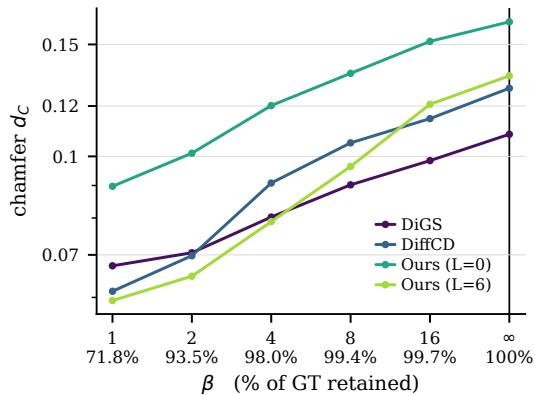  
Figure 11: Sensitivity of $\mathrm { C D _ { 1 } ^ { o b s } }$ to the support threshold $\beta h _ { 0 }$ on clean SRB $( \lambda = 0 )$ , averaged over the five shapes; $\beta = \infty$ recovers $\mathrm { C D _ { 1 } }$

ARKitScenes metrics. We evaluate rendered depth as in neural reconstruction (Zhu et al., 2022; Wang et al., 2023), ray-casting each predicted mesh with Embree along FARO-derived reference rays. For a ray $( o _ { i } , d _ { i } )$ with reference depth $t _ { i } ^ { \mathrm { G T } }$ , when an intersection exists, let

$$
t _ { i } ^ { \mathrm { p r e d } } = \operatorname* { i n f } \{ t \geq 0 : o _ { i } + t d _ { i } \in S _ { \mathrm { p r e d } } \} ,\tag{23}
$$

and let H denote the set of such rays. We report

$$
\mathrm { M A E } = { \frac { 1 } { | H | } } \sum _ { i \in H } { | t _ { i } ^ { \mathrm { p r e d } } - t _ { i } ^ { \mathrm { G T } } | } , \qquad \mathrm { H i t R a t e } = { \frac { | H | } { N } } ,\tag{24}
$$

and the all-ray depth inlier rate

$$
I @ \tau = \frac { 1 } { N } \sum _ { i = 1 } ^ { N } \mathbf { 1 } \Big [ i \in H \ \wedge \ | t _ { i } ^ { \mathrm { p r e d } } - t _ { i } ^ { \mathrm { G T } } | \leq \tau \Big ] .\tag{25}
$$

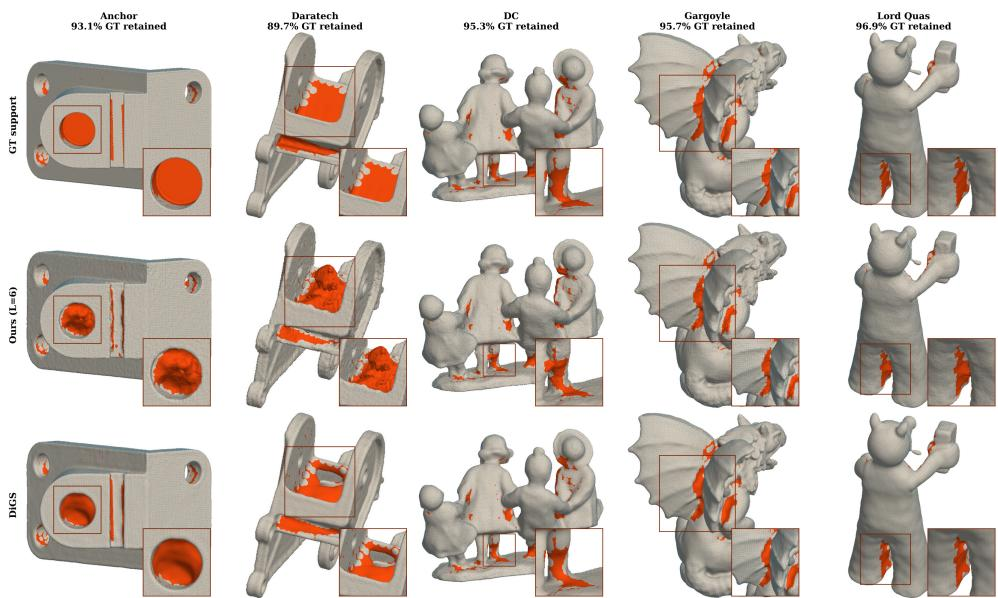  
Figure 12: Observation-supported SRB regions under the $2 h _ { 0 }$ support mask; orange denotes removed surface regions.

$$
\begin{array} { l } { { \begin{array} { l } { { \mathrm { ~  ~ \cdots ~ \ O u r s ~ } ( \mathrm { L } = 2 ) ~ \mathrm { ~  ~ \cdots ~ \mathrm { L a b a t u t ~ } \mathrm { ~  ~ \cdots ~ \ N e u r a l - P u l l } ~ } } } \\ { { \mathrm { ~  ~ \cdots ~ \ O u r s ~ } ( \mathrm { L } = 0 ) ~ \mathrm { ~  ~ \cdots ~ \mathrm { D i f f C D ~ } ~ \mathrm { ~  ~ \cdots ~ \mathrm { S A L } ~ } } } } \\ { { \mathrm { ~  ~ \cdots ~ \mathrm { ~  ~ \mathrm { S P S R } ~ \mathrm { ~  ~ \cdots ~ \mathrm { D i G S ~ } ~ \mathrm { ~  ~ \Omega ~ } ~ } } } } } \end{array} } } \end{array}
$$

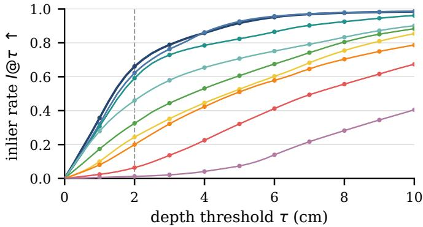  
Figure 13: ARKitScenes held-out depth inlier rate I@τ as a function of the threshold τ.

## B THEORY AND GUARANTEES

## B.1 LIPSCHITZ PRELIMINARIES

For $f : \mathbb { R } ^ { d }  \mathbb { R } ^ { m }$ , define

$$
\operatorname { L i p } ( f ) = \operatorname* { s u p } _ { x \neq x ^ { \prime } } { \frac { \| f ( x ) - f ( x ^ { \prime } ) \| _ { 2 } } { \| x - x ^ { \prime } \| _ { 2 } } } .\tag{26}
$$

The function f is Lipschitz if $\operatorname { L i p } ( f ) < \infty$ , and C-Lipschitz, for $C \geq 0 , \operatorname { i f } \operatorname { L i p } ( f ) \leq C$

## B.2 SPHERE TRACING CONVERGENCE

We first show that $t _ { k } \le t _ { i } ( \theta )$ . This holds for the base case $t _ { 0 } = 0 . \ \mathrm { I f } \ t _ { k } < t _ { i } ( \theta )$ , since $\| d _ { i } \| _ { 2 } = 1$ and $f _ { \theta } ( c _ { i } + t _ { i } ( \theta ) d _ { i } ) = 0$

$$
\begin{array} { r l r } {  { \vert f _ { \theta } ( c _ { i } + t _ { k } d _ { i } ) \vert = \vert f _ { \theta } ( c _ { i } + t _ { k } d _ { i } ) - f _ { \theta } ( c _ { i } + t _ { i } ( \theta ) d _ { i } ) \vert } } \\ & { } & { \leq t _ { i } ( \theta ) - t _ { k } . } \end{array}\tag{27}
$$

Hence

$$
t _ { k + 1 } = t _ { k } + | f _ { \theta } ( c _ { i } + t _ { k } d _ { i } ) | \leq t _ { i } ( \theta ) .\tag{28}
$$

Thus, $\left( t _ { k } \right)$ is non-decreasing and bounded above, hence converges to a limit $\bar { t } \leq t _ { i } ( \theta )$ . Since

$$
| f _ { \theta } ( c _ { i } + t _ { k } d _ { i } ) | = t _ { k + 1 } - t _ { k } \longrightarrow 0 ,\tag{29}
$$

continuity gives

$$
f _ { \theta } ( c _ { i } + \bar { t } d _ { i } ) = 0 .\tag{30}
$$

By definition of the first root, $\bar { t } = t _ { i } ( \theta )$

Furthermore, since $t \mapsto f _ { \theta } ( c _ { i } + t d _ { i } )$ is differentiable at $t _ { i } ( \theta )$ and

$$
\nabla _ { x } f _ { \theta } ( c _ { i } + t _ { i } ( \theta ) d _ { i } ) ^ { \top } d _ { i } \neq 0 ,\tag{31}
$$

there exist constants $\kappa \in ( 0 , 1 ]$ and $\gamma > 0$ such that

$$
| f _ { \theta } ( c _ { i } + t d _ { i } ) | \geq \kappa ( t _ { i } ( \theta ) - t )\tag{32}
$$

for all $t \in ( t _ { i } ( \theta ) - \gamma , t _ { i } ( \theta ) )$ . Therefore, once $t _ { k }$ enters this neighborhood, the error $e _ { k } = t _ { i } ( \theta ) - t _ { k }$ satisfies

$$
e _ { k + 1 } = e _ { k } - | f _ { \theta } ( c _ { i } + t _ { k } d _ { i } ) | \leq ( 1 - \kappa ) e _ { k } .\tag{33}
$$

Hence sphere tracing converges locally at a linear rate.

## B.3 INCIDENCE-WEIGHTED RESIDUAL

Proof. After a rigid change of coordinates, assume $x _ { \theta , i } = 0$ and $n _ { \theta , i } = e _ { 3 }$ . Since $p _ { i } - x _ { \theta , i } =$ $( t _ { i } - t _ { i } ( \theta ) ) d _ { i }$ and $\| d _ { i } \| _ { 2 } = 1$ , writing $p _ { i } = ( a _ { i } , b _ { i } ) \in \mathbb { R } ^ { 2 } \times$ R yields

$$
\| ( a _ { i } , b _ { i } ) \| _ { 2 } = | t _ { i } - t _ { i } ( \theta ) | , \qquad | b _ { i } | = w _ { \theta , i } | t _ { i } - t _ { i } ( \theta ) | .\tag{34}
$$

Locally, $\scriptstyle { S _ { \theta } }$ is the graph $\{ ( a , g ( a ) ) \}$ , where $g ( 0 ) = 0$ and $\nabla g ( 0 ) = 0$ . Let $( a _ { i } ^ { \star } , g ( a _ { i } ^ { \star } ) )$ be a closest point to $p _ { i } .$ . Since $0 \in S _ { \theta }$

$$
\| ( a _ { i } ^ { \star } , g ( a _ { i } ^ { \star } ) ) \| _ { 2 } \leq \mathrm { d i s t } ( p _ { i } , S _ { \theta } ) + \| p _ { i } \| _ { 2 } \leq 2 \| p _ { i } \| _ { 2 } ,\tag{35}
$$

so $a _ { i } ^ { \star } = O ( | t _ { i } - t _ { i } ( \theta ) | )$ , and the closest point lies in this graph neighborhood for $t _ { i }$ sufficiently close to $t _ { i } ( \theta )$ . Moreover,

$$
| b _ { i } | - | g ( a _ { i } ^ { \star } ) | \leq \mathrm { d i s t } ( p _ { i } , S _ { \theta } ) \leq | b _ { i } - g ( a _ { i } ) | \leq | b _ { i } | + | g ( a _ { i } ) | .\tag{36}
$$

If $f _ { \theta }$ is CPWL and affine near $x _ { \theta , i } ,$ , then $g = 0$ locally and

$$
\mathrm { d i s t } ( p _ { i } , S _ { \theta } ) = | b _ { i } | .\tag{37}
$$

Combining this with Eqs. (34)–(36) proves the claim.

Remark 1. If $\scriptstyle { S _ { \theta } }$ is $C ^ { 1 }$ near $x _ { \theta , i }$ , then

$$
\operatorname { d i s t } ( p _ { i } , S _ { \theta } ) = w _ { \theta , i } | t _ { i } - t _ { i } ( \theta ) | + o ( | t _ { i } - t _ { i } ( \theta ) | ) ,\tag{38}
$$

since $g ( a ) = o ( \| a \| _ { 2 } )$ . If $\scriptstyle { S _ { \theta } }$ is $C ^ { 2 }$ , Taylor’s theorem gives $g ( a ) = O ( \Vert a \Vert _ { 2 } ^ { 2 } )$ , hence

$$
\mathrm { d i s t } ( p _ { i } , S _ { \theta } ) = w _ { \theta , i } \vert t _ { i } - t _ { i } ( \theta ) \vert + O \big ( \vert t _ { i } - t _ { i } ( \theta ) \vert ^ { 2 } \big ) .\tag{39}
$$

## B.4 VOLUMETRIC FREE SPACE INDUCED BY RAY SUPERVISION

Although certification is initially available only along the finite set of acquisition rays, the 1-Lipschitz constraint extends this guarantee to a three-dimensional neighborhood.

Let $\Omega _ { \tau } = B ( 0 , \tau r _ { \mathrm { i n i t } } )$ with $\tau \in ( 0 , 1 ]$ denote a concentric sub-ball of the initialization ball $\Omega _ { 1 }$

For each i such that $t _ { i } ( \theta ) < \infty$ , let $x _ { i , 0 } , \ldots , x _ { i , k ( i ) }$ denote its sphere tracing iterates.

Proposition 1 (Certified free space). Assume $f _ { \theta }$ is 1-Lipschitz. Then

$$
B ^ { \circ } ( x _ { i , j } , | f _ { \theta } ( x _ { i , j } ) | ) \cap S _ { \theta } = \emptyset .\tag{40}
$$

Consequently,

$$
\mathcal { C } _ { \theta } ( \mathcal { D } ; \Omega _ { \tau } ) = \Omega _ { \tau } \cap \bigcup _ { i : t _ { i } ( \theta ) < \infty } \bigcup _ { j = 0 } ^ { k ( i ) - 1 } B ^ { \circ } ( x _ { i , j } , | f _ { \theta } ( x _ { i , j } ) | )\tag{41}
$$

satisfies

$$
\mathcal { C } _ { \theta } ( \mathcal { D } ; \Omega _ { \tau } ) \cap \mathcal { S } _ { \theta } = \emptyset .\tag{42}
$$

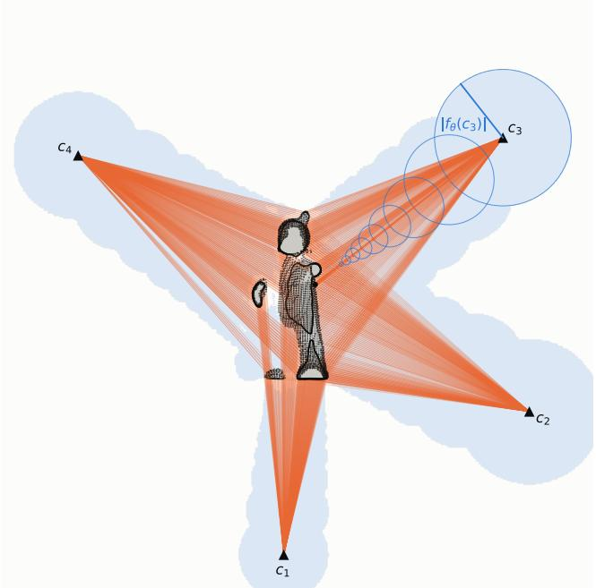  
Figure 14: Certified volumetric free-space regions on a single SRB shape.

Proof. For any $y \in B ^ { \circ } ( x _ { i , j } , | f _ { \theta } ( x _ { i , j } ) | )$ , the 1-Lipschitz property gives

$$
| f _ { \theta } ( y ) | \geq | f _ { \theta } ( x _ { i , j } ) | - \| y - x _ { i , j } \| _ { 2 } > 0 .\tag{43}
$$

Taking the union over all pre-hit iterates and intersecting with $\Omega _ { \tau }$ proves the result.

Let $E ^ { \star } \subset \mathbb { R } ^ { 3 }$ denote the ground-truth solid. We report the certified free-space volume normalized by the amount of ground-truth free space contained in $\Omega _ { \tau }$ :

$$
\operatorname { C F V } _ { \tau } ( \theta ; \mathcal { D } ) = \frac { \operatorname { V o l } \bigl ( \mathcal { C } _ { \theta } ( \mathcal { D } ; \Omega _ { \tau } ) \cap ( \mathbb { R } ^ { 3 } \setminus E ^ { \star } ) \bigr ) } { \operatorname { V o l } ( \Omega _ { \tau } \cap ( \mathbb { R } ^ { 3 } \setminus E ^ { \star } ) ) } .\tag{44}
$$

Table 6: Certified free-space volume CFV (%) for Ours $( L = 0$ , no rescale) within concentric sub-balls of the initialization domain; $\tau = 1$ denotes the full initialization ball.
<table><tr><td>Relative radius  $\tau$ </td><td> $\lambda = 0$ </td><td> $\lambda = 1$ </td><td> $\alpha = 0$   $\alpha = 0 . 2$ </td></tr><tr><td>1.0</td><td>76.7</td><td>72.2</td><td>81.5 88.1</td></tr><tr><td>0.9</td><td>80.9</td><td>75.9 85.3</td><td>86.3</td></tr><tr><td>0.8</td><td>83.1</td><td>77.6 86.8</td><td>82.5</td></tr><tr><td>0.7</td><td>83.9</td><td>77.6 87.0</td><td>78.2</td></tr><tr><td>0.6</td><td>82.4</td><td>75.3 85.1</td><td>72.9</td></tr></table>

## C ABLATIONS AND DIAGNOSTICS

## C.1 OBJECTIVE ABLATIONS

Table 7: Additional SRB objective ablations. Results use a single seed and are averaged over the five SRB shapes. ReLU + eikonal uses the same first-hit loss and differs from Ours only by its architecture.

<table><tr><td>Variant</td><td colspan="2"> $\mathbf { S R B } \lambda = 0$ </td><td colspan="2"> $\mathbf { S R B } \lambda = 1$ </td><td colspan="2"> $\mathbf { S R B } \alpha = 0 . 2$ </td></tr><tr><td></td><td>CD1↓</td><td>NC↑</td><td> $\mathbf { C D _ { 1 } } \downarrow$ </td><td>NC↑</td><td> $\begin{array} { r l } { \mathbf { C D } _ { 1 } \downarrow } & { { } \mathbf { N C } \uparrow } \end{array}$ </td><td></td></tr><tr><td>ReLU + eikonal</td><td>0.366</td><td>0.906</td><td>0.421</td><td>0.891</td><td>1.249</td><td>0.786</td></tr><tr><td>CPL + eikonal</td><td>3.013</td><td>0.685</td><td>2.946</td><td>0.689</td><td>4.963</td><td>0.628</td></tr><tr><td>CPL + hKR</td><td>0.576</td><td>0.940</td><td>0.719</td><td>0.940</td><td>1.226</td><td>0.915</td></tr><tr><td>Ours  $( L = 0 )$ </td><td>0.158</td><td>0.959</td><td>0.296</td><td>0.911</td><td>0.165</td><td>0.956</td></tr></table>

The ReLU + eikonal control consistently underperforms Ours $( L = 0 )$ , suggesting that eikonal regularization alone does not recover the benefits of the architectural Lipschitz constraint. For the miss-penalty ablation, rays for which sphere tracing returns no intersection incur an additional penalty $f _ { \theta } ( p _ { i } ) ^ { 2 }$ . The objective is

$$
\mathcal { L } ( \theta ) + \lambda _ { \mathrm { m i s s } } \mathcal { L } _ { \mathrm { m i s s } } ( \theta ) ,\tag{45}
$$

with $\lambda _ { \mathrm { m i s s } } = 5 $

## C.2 HUBER-SCALE SENSITIVITY

We set

$$
\delta = \left\{ \begin{array} { l l } { 0 . 0 0 5 , } & { N ^ { - 1 } \sum _ { i } { \bf 1 } [ s _ { i } > 4 \widetilde { s } ] > 0 . 5 \% , } \\ { 0 . 0 5 , } & { \mathrm { o t h e r w i s e } , } \end{array} \right.\tag{46}
$$

where $s _ { i }$ is the nearest-neighbor distance of $p _ { i }$ and se its median.

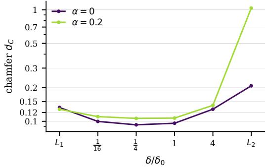  
Figure 15: Sensitivity of Ours $( L = 0 )$ to the Huber scale $\delta$ on a single SRB shape, with δ normalized by its default value $\delta _ { 0 }$ . We use $\delta _ { 0 } = 0 . 0 5$ on clean data and $\delta _ { 0 } = 0 . 0 0 5$ with outliers $( \alpha = 0 . 2 ) ; \ell _ { 1 }$ and $\ell _ { 2 }$ losses are shown for reference.

## C.3 BACKBONE ARCHITECTURE

Since our formulation is agnostic to the particular 1-Lipschitz architecture, we evaluate replacing the CPL backbone $\Phi _ { \theta }$ with Sandwich layers (Wang & Manchester, 2023),

$$
z \mapsto { \sqrt { 2 } } U ^ { \mathsf { T } } \Psi \sigma \Bigl ( { \sqrt { 2 } } \Psi ^ { - 1 } V z + b \Bigr ) , \qquad U U ^ { \mathsf { T } } + V V ^ { \mathsf { T } } = I ,\tag{47}
$$

while keeping the training protocol unchanged. Table 8 shows that the first-hit formulation remains effective with this alternative 1-Lipschitz backbone.

Table 8: Preliminary single seed comparison of CPL and Sandwich backbones on SRB.
<table><tr><td>Setting</td><td>Backbone</td><td> $\mathrm { C D } _ { 1 } \downarrow$ </td><td> $\mathrm { N C ~ \uparrow ~ }$ </td><td> $\mathrm { C D _ { 1 } ^ { o b s } \downarrow }$ </td><td> $\mathrm { { N C } ^ { \mathrm { { o b s } } } \uparrow }$ </td></tr><tr><td> $\lambda = 0$ </td><td>CPL</td><td>0.1584</td><td>0.9597</td><td>0.0984</td><td>0.9698</td></tr><tr><td></td><td>Sandwich</td><td>0.1307</td><td>0.9728</td><td>0.0801</td><td>0.9820</td></tr><tr><td> $\lambda = 1$ </td><td>CPL</td><td>0.2950</td><td>0.9139</td><td>0.2205</td><td>0.9271</td></tr><tr><td></td><td>Sandwich</td><td>0.2818</td><td>0.9084</td><td>0.2229</td><td>0.9204</td></tr><tr><td> $\alpha = 0 . 2$ </td><td>CPL</td><td>0.1650</td><td>0.9571</td><td>0.1062</td><td>0.9697</td></tr><tr><td></td><td>Sandwich</td><td>0.1311</td><td>0.9687</td><td>0.0882</td><td>0.9791</td></tr></table>

## C.4 DEPTH RESIDUAL AND PROJECTION DISTANCE

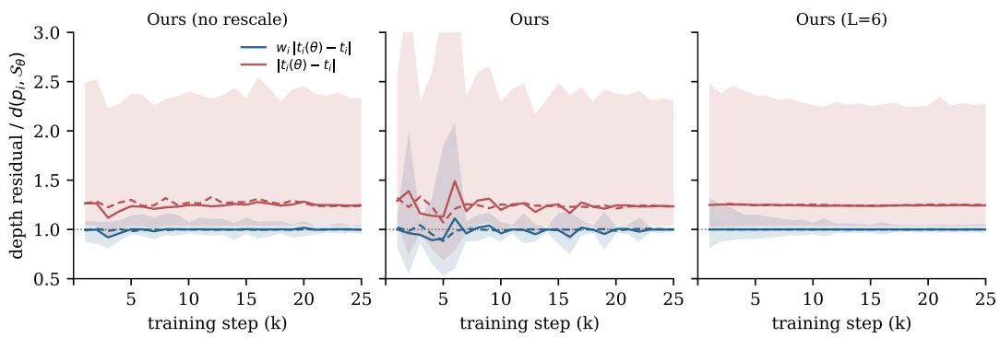  
Figure 16: Ratio of the depth residual to the true projection distance $d ( p _ { i } , S _ { \theta } )$ during a 25k-step fit on a single SRB shape with $\lambda = 0$ (median and $p _ { 1 0 } { - } p _ { 9 0 }$ over 4k rays). Solid curves use incidence weighting; dashed curves remove it.

## C.5 GRADIENT NORMS

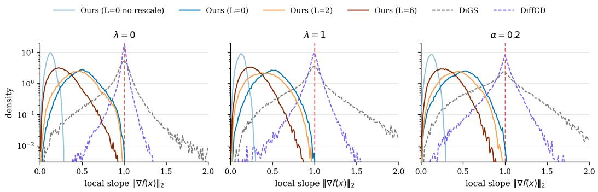  
Figure 17: Density of $\| \nabla _ { x } f _ { \theta } ( x ) \| _ { 2 }$ at points sampled along the traced rays on the five SRB shapes under $\lambda = 0 , \lambda = 1$ , and $\alpha = 0 . 2$ (82k samples per curve and 16, 384 per shape). The axis is clipped at 2.

Table 9: Effect of empirical rescaling for the $L = 2$ and $L = 6$ variants under noise and outliers. Values are ∆(rescale − no rescale), averaged over the five SRB shapes for a single seed.
<table><tr><td>L</td><td>Setting</td><td>No rescale</td><td>Rescaled</td><td>∆</td></tr><tr><td>2</td><td>λ= 0</td><td>0.124</td><td>0.128</td><td>+0.004 (+3.2%)</td></tr><tr><td>2</td><td>λ = 1</td><td>0.425</td><td>0.381</td><td> $- 0 . 0 4 4 \ ( - 1 0 . 4 \% )$ </td></tr><tr><td>2</td><td> $\alpha = 0 . 2$ </td><td>0.125</td><td>0.122</td><td>-0.003 (−2.4%)</td></tr><tr><td>6</td><td>λ = 0</td><td>0.134</td><td>0.133</td><td>-0.001 (−0.7%)</td></tr><tr><td>6</td><td> $\lambda = 1$ </td><td>0.543</td><td>0.542</td><td>-0.001 (−0.2%)</td></tr><tr><td>6</td><td> $\alpha = 0 . 2$ </td><td>0.489</td><td>0.414</td><td>-0.075 (−15.3%)</td></tr></table>

## C.6 OUTLIER-RAY DIAGNOSTICS

Table 10: Ray statistics at convergence on SRB with outliers $( \alpha = 0 . 2 ) $ , averaged over the five shapes. Dropped rays are those for which sphere tracing finds no valid hit. Non-grazing rays are partitioned by the Huber regime of their weighted residual.
<table><tr><td>Variant</td><td>Rays</td><td>Dropped</td><td>Huber linear</td><td>Huber quadratic</td></tr><tr><td>Ours  $( L = 6 )$ </td><td>Inlier</td><td>2.4%</td><td>5.9%</td><td>91.7%</td></tr><tr><td rowspan="3">Ours  $( L = 0 )$ </td><td>Outlier</td><td>41.0%</td><td>57.0%</td><td>2.1%</td></tr><tr><td>Inlier</td><td>0.8%</td><td>8.0%</td><td>91.2%</td></tr><tr><td>Outlier</td><td>39.3%</td><td>60.1%</td><td>0.6%</td></tr></table>

## C.7 SENSITIVITY TO SENSOR PROVENANCE

The perturbation scale σ of the sensor position $c _ { i }$ is expressed in multiples of the point cloud’s median nearest-neighbor spacing $h _ { \mathrm { N N } } ;$ the corresponding mean position error ranges from 0.9% to 7.4% of the scanner standoff mediani $\lVert p _ { i } - c _ { i } \rVert _ { 2 }$

Table 11: Sensitivity to sensor-position perturbations on a single SRB shape at $\lambda = 0 .$
<table><tr><td> $\sigma / h _ { \mathrm { { N N } } }$ </td><td>Position error / standoff</td><td>CD↓</td><td>NC↑</td></tr><tr><td>0</td><td>0.0%</td><td>0.071</td><td>0.976</td></tr><tr><td>2</td><td>0.9%</td><td>0.071</td><td>0.976</td></tr><tr><td>4</td><td>1.8%</td><td>0.077</td><td>0.973</td></tr><tr><td>8</td><td>3.7%</td><td>0.079</td><td>0.975</td></tr><tr><td>16</td><td>7.4%</td><td>0.098</td><td>0.971</td></tr></table>

Performance is nearly unchanged up to 3.7% position error relative to the scanner standoff, and reconstruction still succeeds at $7 . 4 \% .$ . These perturbations are deliberately substantial and are not intended as a precise model of scanner calibration errors.

As an extreme control, we randomly permute sensor origins, replacing each pair $\left( c _ { i } , p _ { i } \right) \mathbf { b y } \left( c _ { \pi ( i ) } , p _ { i } \right)$ where π is a permutation of $\{ 1 , \ldots , N \}$ with $c _ { \pi ( i ) } \neq c _ { i }$ for all i. All 15 fits (five SRB shapes under $\lambda = 0 , \lambda = 1$ , and $\alpha = 0 . 2 )$ reach a state with no valid traced hits after a few hundred optimization steps. Under the shuffled associations, 62–65% of rays are occluded before their measured endpoint, showing that most shuffled ray–point pairs are incompatible with the observed visibility.

## C.8 FIDELITY–ROBUSTNESS ANALYSIS

Input fidelity. Let P denote the input point cloud and $\widehat { s }$ the reconstructed mesh. We measure fidelity to the observations by the mean exact input-to-surface distance

$$
d _ { \mathrm { C } } ^ {  } ( P , \widehat { \mathcal { S } } ) = \frac { 1 } { | P | } \sum _ { p \in P } \operatorname* { m i n } _ { x \in \widehat { \mathcal { S } } } \| p - x \| _ { 2 } .\tag{48}
$$

Table 12: Clean-SRB data fidelity. Mean input-to-surface distance; best/second-best neural implicit results are bold/underlined. Labatut is omitted since its Delaunay surface is constructed from the inputs.
<table><tr><td></td><td colspan="9">Neural implicit</td><td>Classical</td></tr><tr><td>Shape</td><td> $L = 0$ </td><td> $L = 2$ </td><td> $L = 4$ </td><td> $L = 6$ </td><td>DiffCD</td><td>N.-Pull</td><td>DiGS</td><td>NDF-vis</td><td>SAL</td><td>SPSR</td></tr><tr><td>Anchor</td><td>0.0309</td><td>0.0186</td><td>0.0124</td><td>0.0118</td><td>0.0095</td><td>0.0248</td><td>0.0389</td><td>0.3024</td><td>0.4796</td><td>0.0413</td></tr><tr><td>Daratech</td><td>0.1156</td><td>0.0366</td><td>0.0160</td><td>0.0134</td><td>0.0337</td><td>0.3983</td><td>0.0256</td><td>0.4017</td><td>0.4271</td><td>0.1027</td></tr><tr><td>DC</td><td>0.0407</td><td>0.0238</td><td>0.0119</td><td>0.0085</td><td>0.0114</td><td>0.3917</td><td>0.0278</td><td>0.5725</td><td>0.4795</td><td>0.0580</td></tr><tr><td>Gargoyle</td><td>0.0825</td><td>0.0441</td><td>0.0249</td><td>0.0136</td><td>0.0198</td><td>0.0324</td><td>0.0390</td><td>0.6962</td><td>0.6387</td><td>0.0639</td></tr><tr><td>Lord Quas</td><td>0.0291</td><td>0.0148</td><td>0.0102</td><td>0.0064</td><td>0.0132</td><td>0.0143</td><td>0.0306</td><td>0.2317</td><td>0.4496</td><td>0.0339</td></tr><tr><td>Mean</td><td>0.0597</td><td>0.0276</td><td>0.0151</td><td>0.0107</td><td>0.0175</td><td>0.1723</td><td>0.0324</td><td>0.4409</td><td>0.4949</td><td>0.0599</td></tr></table>

Ours (L=0)  
Ours (L=2)  
Ours (L=6)  
DiffCD  
DiGS  
Labatut  
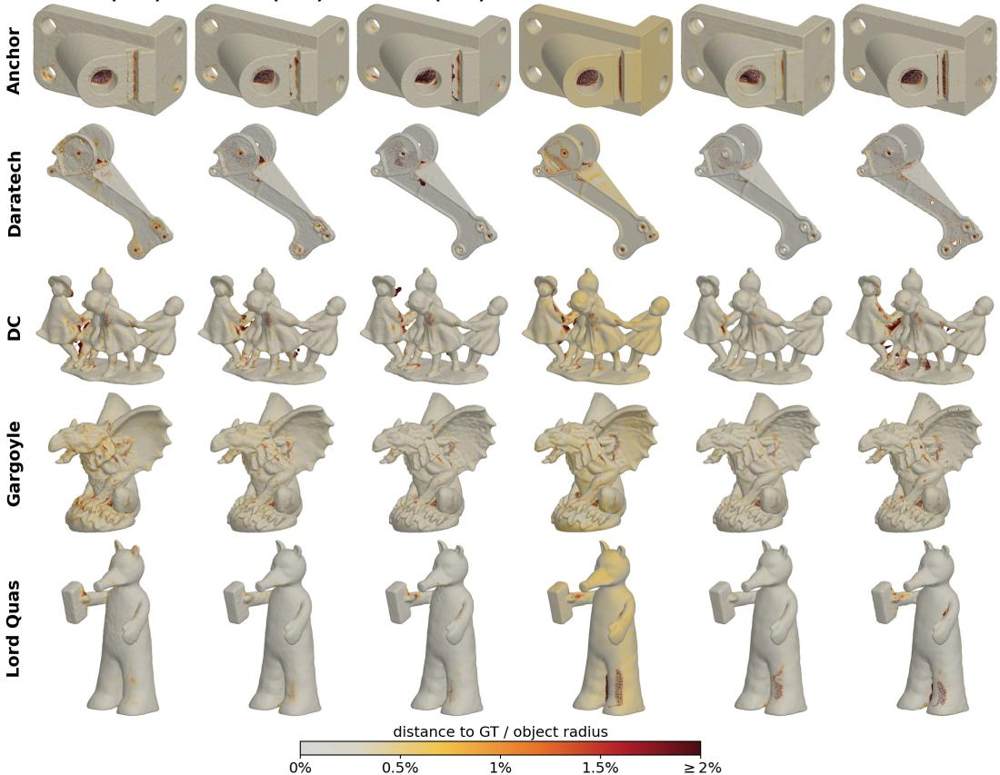

Figure 18: Clean-SRB surface error maps across the five shapes. Colors show distance to the ground-truth surface normalized by object radius.  
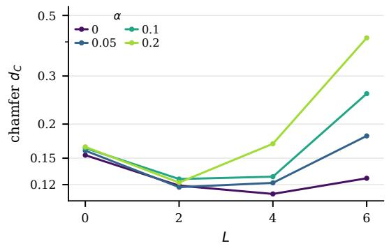

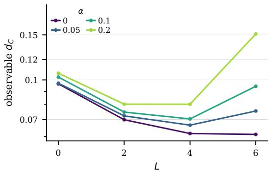  
Figure 19: Mean $\mathrm { C D } _ { 1 }$ (left) and $\mathrm { C D _ { 1 } ^ { o b s } }$ (right) as a function of L under outlier fractions α on SRB.

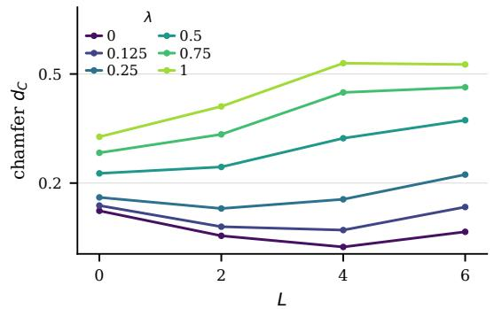

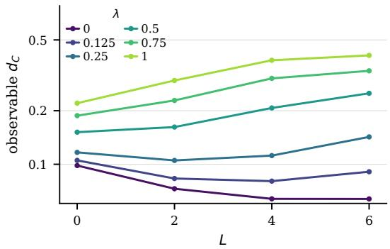

Figure 20: Mean CD1 (left) and $\mathrm { C D _ { 1 } ^ { o b s } }$ (right) as a function of L under scanner noise λ on SRB, on a single seed.  
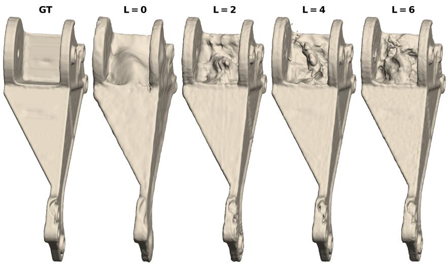  
Figure 21: Effect of L in a weakly observed concave region.

## C.9 LARGEST-COMPONENT FILTERING

Following prior observations that surface reconstruction methods may produce spurious disconnected components (Berger et al., 2013), including SPSR under strong corruption (Jensen et al., 2021), we additionally evaluate all methods after retaining only their largest connected component.

Table 13: Effect of largest-connected-component filtering on SRB with outliers $( \alpha = 0 . 2 )$
<table><tr><td>Method</td><td>Raw CD₁↓</td><td>LCC CD₁↓</td><td>Raw NC↑</td><td>LCC NC↑</td></tr><tr><td>Ours (L = 0)</td><td>0.173</td><td>0.172</td><td>0.954</td><td>0.955</td></tr><tr><td>Ours (L = 2)</td><td>0.122</td><td>0.122</td><td>0.968</td><td>0.969</td></tr><tr><td>Ours (L = 6)</td><td>0.414</td><td>0.397</td><td>0.818</td><td>0.820</td></tr><tr><td>NDF-vis</td><td>5.492</td><td>5.472</td><td>0.723</td><td>0.723</td></tr><tr><td>Neural-Pull</td><td>3.420</td><td>6.680</td><td>0.756</td><td>0.714</td></tr><tr><td>DiffCD</td><td>3.354</td><td>3.319</td><td>0.806</td><td>0.809</td></tr><tr><td>SAL</td><td>5.731</td><td>5.850</td><td>0.652</td><td>0.650</td></tr><tr><td>DiGS</td><td>2.927</td><td>1.127</td><td>0.814</td><td>0.898</td></tr><tr><td>SPSR</td><td>4.917</td><td>0.158</td><td>0.855</td><td>0.962</td></tr><tr><td>Labatut</td><td>0.144</td><td>0.141</td><td>0.946</td><td>0.947</td></tr></table>

## C.10 COMPUTATIONAL COST

$$
\mathrm { T h e ~ C P L ~ n e t w o r k ~ h a s } \underbrace { { 8 { \left( 2 5 6 ^ { 2 } + 2 5 6 \right) } } } _ { \Phi _ { \theta } : \mathrm { 8 ~ C P L ~ l a y e r s ~ } ( W , b ) } + \underbrace { 2 5 6 } _ { \tilde { v } } + \underbrace { 1 } _ { \beta } = 5 2 6 , 5 9 3 \mathrm { ~ t r a i n a b l e ~ p a r a m e t e r s } .
$$

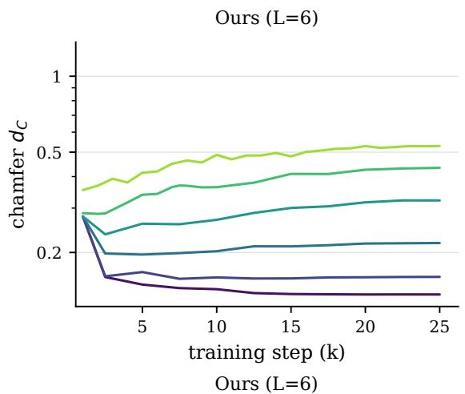

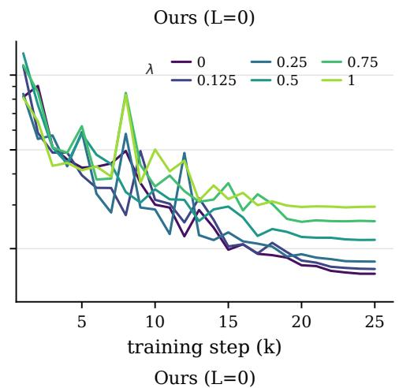

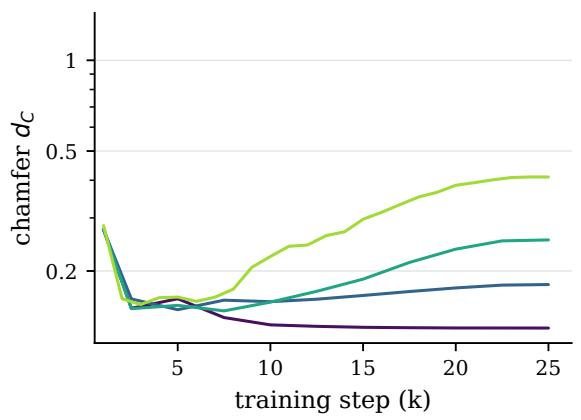

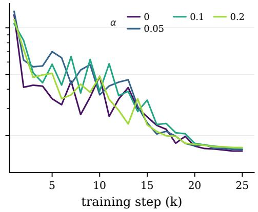  
Figure 22: Mean SRB $\mathrm { C D _ { 1 } }$ with one seed during training under scanner noise (top) and outlier fractions (bottom).  
We report wall-clock training time and peak memory usage for a single SRB shape.  
Table 14: Left: wall-clock training time and peak GPU memory on one SRB shape using an NVIDIA RTX 6000. Right: CD1 averaged over the five SRB shapes at intermediate mesh resolution $2 5 6 ^ { 3 }$ for Ours (L = 6) every 5k training steps.

<table><tr><td colspan="3">(a) Method comparison</td><td colspan="4">(b) Step budget</td></tr><tr><td>Method</td><td>Time ↓</td><td>Peak GPU (GB) ↓</td><td>Steps</td><td>Budget</td><td> $\mathrm { C D } _ { 1 } \downarrow$ </td><td>∆</td></tr><tr><td>SAL</td><td>~1 min</td><td>0.73</td><td>5k</td><td>20%</td><td>0.171</td><td>+21.3%</td></tr><tr><td>Neural-Pull</td><td>~5 min</td><td>0.42</td><td>10k</td><td>40%</td><td>0.145</td><td>+2.8%</td></tr><tr><td>NDF-vis</td><td>~10 min</td><td>0.63</td><td>15k</td><td>60%</td><td>0.144</td><td>+2.1%</td></tr><tr><td>DiGS</td><td>~20 min</td><td>2.94</td><td>20k</td><td>80%</td><td>0.141</td><td>+0.0%</td></tr><tr><td>DiffCD</td><td>~40 min</td><td>2.52</td><td>25k</td><td>100%</td><td>0.141</td><td></td></tr><tr><td>Ours (L = 0)</td><td>~1h30min</td><td>0.84</td><td></td><td></td><td></td><td></td></tr><tr><td>Ours (L = 6)</td><td>~1h40min</td><td>0.84</td><td></td><td></td><td></td><td></td></tr></table>

For each ray i, let $k _ { i } \leq K$ denote the number of sphere tracing iterations actually executed. We use active-ray compaction: terminated rays are removed from subsequent network evaluations. The average tracing workload is therefore characterized by $\mathbb { E } [ k ] / K$

Table 15: sphere tracing workload over SRB training rays with $K = 1 9 2 .$ . Convergence rates are min/mean/max over the five SRB shapes.
<table><tr><td>Model</td><td> $\mathbb { E } [ k ] / K$ </td><td>Mean k</td><td>Reaching K</td><td>Converged (%)</td></tr><tr><td>Ours (L = 0, no rescale)</td><td>40.8%</td><td>78.4</td><td>2.13%</td><td>99.92/99.96/100.00</td></tr><tr><td>Ours (L = 0)</td><td>9.4%</td><td>18.1</td><td>0.002%</td><td>99.91/99.96/99.99</td></tr><tr><td>Ours  $( L = 6 )$ </td><td>22.2%</td><td>42.6</td><td>0.08%</td><td>98.73/99.37/99.92</td></tr></table>

## D EXTENDED RESULTS

## D.1 SRB SCANNER NOISE

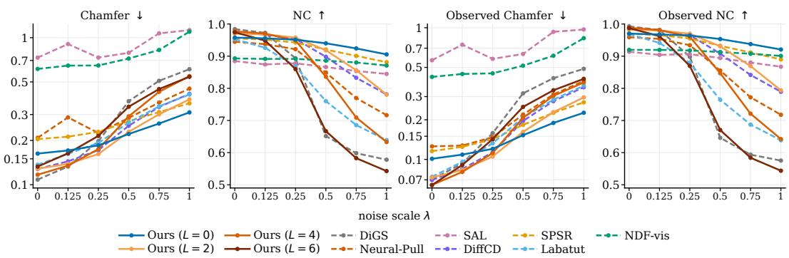

Figure 23: Mean SRB CD and NC across increasing scanner-noise levels λ. Table 16: Per-shape SRB reconstruction under clean input $( \lambda = 0 )$ and scanner noise $( \lambda = 1 )$ Stochastic results use three seeds; best neural implicit results are shown in bold.
<table><tr><td></td><td></td><td colspan="6">Clean (λ = 0)</td><td colspan="6">Noise (λ = 1)</td></tr><tr><td>Method</td><td>Metric</td><td>Anchor</td><td>Daratech</td><td>DC</td><td>Gargoyle</td><td>L. Quas</td><td>Mean</td><td>Anchor</td><td>Daratech</td><td>DC</td><td>Gargoyle</td><td>L. Quas</td><td>Mean</td></tr><tr><td>Neural implicit</td><td></td><td>0.195</td><td>0.286</td><td>0.107</td><td>0.149</td><td>0.077</td><td> $0 . 1 6 3 \pm 0 . 0 0 5$ </td><td>0.337</td><td>0.412</td><td>0.261</td><td>0.291</td><td>0.252</td><td>0.310 ± 0.016</td></tr><tr><td>Ours (L = 0)</td><td>CD1↓ NC↑</td><td>0.978</td><td>0.903</td><td>0.973</td><td>0.952</td><td>0.983</td><td>0.958 ± 0.0011</td><td>0.939</td><td>0.851</td><td>0.915</td><td>0.902</td><td>0.920</td><td>0.906 ± 0.0060</td></tr><tr><td>Ours (L = 2)</td><td>CD1↓ NC↑</td><td>0.186 0.979</td><td>0.200 0.934</td><td>0.088 0.979</td><td>0.108 0.969</td><td>0.055 0.991</td><td> $0 . 1 2 7 \pm 0 . 0 0 2$   $0 . 9 7 0 \pm 0 . 0 0 1$ </td><td>0.403 0.865</td><td>0.445 0.676</td><td>0.368 0.757</td><td>0.376 0.818</td><td>0.312 0.788</td><td> $0 . 3 8 1 \pm 0 . 0 0 2$   $0 . 7 8 1 \pm 0 . 0 0 2$ </td></tr><tr><td>Ours (L = 6)</td><td>CD1↓ NC↑</td><td>0.201 0.973</td><td>0.236 0.949</td><td>0.080 0.983</td><td>0.092 0.975</td><td>0.054 0.991</td><td>0.133 ± 0.003 0.974 ± 0.002</td><td>0.664 0.542</td><td>0.488 0.534</td><td>0.516 0.550</td><td>0.549 0.544</td><td>0.490 0.542</td><td> $0 . 5 4 2 \pm 0 . 0 0 9$   $0 . 5 4 3 \pm 0 . 0 0 8$ </td></tr><tr><td>NDF-vis</td><td>CD1↓ NC↑</td><td>0.582 0.909</td><td>0.600 0.861</td><td>0.777 0.879</td><td>0.815 0.863</td><td>0.290 0.953</td><td>0.613 ± 0.063 0.893 ± 0.0029</td><td>1.069 0.896</td><td>1.395 0.820</td><td>1.076 0.862</td><td>1.162 0.851</td><td>0.788 0.925</td><td> $1 . 0 9 8 \pm 0 . 1 9 4$  0.871 ± 0.0030</td></tr><tr><td>Neural-Pull</td><td>CD1↓ NC↑</td><td>0.163 0.977</td><td>0.508 0.848</td><td>0.188 0.946</td><td>0.113 0.969</td><td>0.070 0.985</td><td> $0 . 2 0 8 \pm 0 . 0 5 1$  0.945 ± 0.004</td><td>0.522 0.767</td><td>0.464 0.667</td><td>0.441 0.701</td><td>0.449 0.719</td><td>0.375 0.729</td><td> $0 . 4 5 0 \pm 0 . 0 0 3$   $0 . 7 1 7 \pm 0 . 0 0 3$ </td></tr><tr><td>DiffCD</td><td>CD1↓ NC↑</td><td>0.203 0.979</td><td>0.175 0.947</td><td>0.079 0.984</td><td>0.106 0.973</td><td>0.076 0.982</td><td> $0 . 1 2 8 \pm 0 . 0 0 1$  0.973 ± 0.0010</td><td>0.456 0.824</td><td>0.458 0.808</td><td>0.408 0.792</td><td>0.397 0.753</td><td>0.355 0.728</td><td> $0 . 4 1 5 \pm 0 . 0 0 6$  0.781 ± 0.0016</td></tr><tr><td>SAL</td><td>CD1↓ NC↑</td><td>0.786 0.901</td><td>0.976 0.788</td><td>0.551 0.890</td><td>0.840 0.894</td><td>0.504 0.952</td><td> $0 . 7 3 1 \pm 0 . 1 4 8$   $0 . 8 8 5 \pm 0 . 0 1 2 9$ </td><td>1.169 0.888</td><td>2.059 0.688</td><td>1.070 0.846</td><td>0.726 0.865</td><td>0.601 0.937</td><td> $1 . 1 2 5 \pm 0 . 3 2 2$  0.845 ± 0.0026</td></tr><tr><td>DiGS</td><td>CD1↓ NC↑</td><td>0.179 0.982</td><td>0.125 0.970</td><td>0.076 0.992</td><td>0.098 0.983</td><td>0.064 0.994</td><td> ${ \bf 0 . 1 0 8 \pm 0 . 0 0 4 }$  0.984 ± 0.0006</td><td>0.712 0.594</td><td>0.505 0.556</td><td>0.577 0.578</td><td>0.608 0.575</td><td>0.650 0.587</td><td>0.610 ± 0.006 0.578 ± 0.0037</td></tr><tr><td>Classical</td><td></td><td></td><td></td><td></td><td></td><td></td><td></td><td></td><td></td><td></td><td></td><td></td><td></td></tr><tr><td>SPSR</td><td>CD1↓ NC↑</td><td>0.269 0.968</td><td>0.333 0.913</td><td>0.165 0.964</td><td>0.160 0.954</td><td>0.095 0.980</td><td>0.204 0.956</td><td>0.412 0.897</td><td>0.512 0.836</td><td>0.325 0.891</td><td>0.316 0.869</td><td>0.223 0.914</td><td>0.358 0.881</td></tr><tr><td>Labatut</td><td>CD1↓ NC↑</td><td>0.202 0.971</td><td>0.198 0.895</td><td>0.101 0.962</td><td>0.109 0.959</td><td>0.073 0.977</td><td>0.137 0.953</td><td>0.467 0.656</td><td>0.454 0.596</td><td>0.390 0.651</td><td>0.410 0.643</td><td>0.331 0.647</td><td>0.410 0.639</td></tr></table>

Table 17: Per-shape observation-supported SRB results under clean input $( \lambda = 0 )$ and scanner noise $( \lambda = 1 )$ , using the $2 h _ { 0 }$ support threshold. Stochastic results use three seeds; best neural implicit results are shown in bold.
<table><tr><td></td><td></td><td colspan="6"> $\mathbf { C l e a n } \left( \lambda = 0 \right)$ </td><td colspan="6"> $\mathbf { N o i s e } \left( \lambda = 1 \right)$ </td></tr><tr><td>Method</td><td>Metric</td><td>Anchor</td><td>Daratech</td><td>DC</td><td> $\mathrm { G a r g o y l e } \mathrm { L . } \mathrm { Q u a s }$ </td><td></td><td>Mean</td><td>Anchor</td><td>Daratech</td><td>DC</td><td> $\mathrm { G a r g o y l e } \mathrm { L . } \mathrm { Q u a s }$ </td><td></td><td>Mean</td></tr><tr><td>Neural implicit</td><td></td><td></td><td></td><td></td><td></td><td></td><td></td><td></td><td></td><td></td><td></td><td></td><td></td></tr><tr><td> $\mathrm { O u r s } \left( L = 0 \right)$ </td><td> $\mathrm { C D } _ { 1 } ^ { \mathrm { o b s } } \downarrow$   $\mathrm { { N C } ^ { \mathrm { { \dot { o b s } } } } \uparrow }$ </td><td>0.078 0.991</td><td>0.146 0.932</td><td>0.090 0.980</td><td>0.126 0.961</td><td>0.066 0.987</td><td> $0 . 1 0 1 \pm 0 . 0 0 3$   $0 . 9 7 0 \pm 0 . 0 0 0 7$ </td><td>0.194 0.956</td><td>0.262 0.875</td><td>0.234 0.926</td><td>0.245 0.916</td><td>0.196 0.931</td><td> ${ \bf 0 . 2 2 6 \pm 0 . 0 0 5 }$   ${ \bf 0 . 9 2 1 \pm 0 . 0 0 4 }$ </td></tr><tr><td> $\mathrm { O u r s } \left( L = 2 \right)$ </td><td> $\mathrm { C D } _ { 1 } ^ { \mathrm { o b s } } \downarrow$   $\mathrm { { N C } ^ { \mathrm { { \dot { o b s } } } } \uparrow }$ </td><td>0.070 0.993</td><td>0.077 0.962</td><td>0.073 0.987</td><td>0.094 0.976</td><td>0.050 0.994</td><td> $0 . 0 7 3 \pm 0 . 0 0 1$   $0 . 9 8 2 \pm 0 . 0 0 0 2$ </td><td>0.248 0.889</td><td>0.325 0.686</td><td>0.327 0.768</td><td>0.303 0.833</td><td>0.277 0.794</td><td> $0 . 2 9 6 \pm 0 . 0 0 4$   $0 . 7 9 4 \pm 0 . 0 0 2$ </td></tr><tr><td>Ours (L = 6)</td><td> $\mathrm { C D } _ { 1 } ^ { \mathrm { o b s } } ~ .$  1</td><td>0.068</td><td>0.063</td><td>0.065</td><td>0.076</td><td>0.047</td><td> ${ \bf 0 . 0 6 4 } \pm 0 . 0 0 2$ </td><td>0.441</td><td>0.354</td><td>0.422</td><td>0.446</td><td>0.382</td><td> $0 . 4 0 9 \pm 0 . 0 0 7$ </td></tr><tr><td>NDF-vis</td><td> $\mathrm { N C ^ { \bar { o } b s } } \ .$  ←  $\mathrm { C D } _ { 1 } ^ { \mathrm { o b s } } ~ .$  →</td><td>0.993 0.318</td><td>0.977 0.356</td><td>0.989 0.578</td><td>0.983 0.620</td><td>0.995 0.245</td><td> $0 . 9 8 7 \pm 0 . 0 0 3$   $0 . 4 2 3 \pm 0 . 0 3 7$ </td><td>0.545 0.760</td><td>0.534 0.960</td><td>0.551 0.851</td><td>0.546 0.947</td><td>0.544 0.650</td><td> $0 . 5 4 4 \pm 0 . 0 0 6$   $0 . 8 3 4 \pm 0 . 1 4 9$ </td></tr><tr><td>Neural-Pull</td><td> $\operatorname { N C } ^ { \mathrm { { \tilde { o } b s } } }$  ←  $\mathrm { C D } _ { 1 } ^ { \mathrm { o b s } }$  →</td><td>0.943 0.074</td><td>0.896 0.256</td><td>0.907 0.157</td><td>0.890 0.089</td><td>0.963 0.052</td><td> $0 . 9 2 0 \pm 0 . 0 0 3$   $0 . 1 2 6 \pm 0 . 0 3 1$ </td><td>0.926 0.383</td><td>0.867 0.401</td><td>0.888 0.414</td><td>0.876 0.421</td><td>0.947 0.352</td><td> $0 . 9 0 1 \pm 0 . 0 0 0 4$   $0 . 3 9 4 \pm 0 . 0 0 1$ </td></tr><tr><td>DiffCD</td><td> $\operatorname { N C } ^ { \mathrm { { \overset { \circ } { b s } } } }$  ↑  $\mathrm { C D } _ { 1 } ^ { \mathrm { o b s } }$  ↓</td><td>0.992 0.065</td><td>0.875 0.092</td><td>0.957 0.063</td><td>0.979 0.078</td><td>0.991 0.051</td><td> $0 . 9 5 9 \pm 0 . 0 0 5$   $0 . 0 7 0 \pm 0 . 0 0 0 3$ </td><td>0.771 0.307</td><td>0.667 0.375</td><td>0.702 0.381</td><td>0.722 0.371</td><td>0.727 0.334</td><td> $0 . 7 1 8 \pm 0 . 0 0 3$   $0 . 3 5 4 \pm 0 . 0 0 3$ </td></tr><tr><td>SAL</td><td> $\operatorname { N C } ^ { \mathrm { { \overset { \circ } { b s } } } }$  ←  $\mathrm { C D } _ { 1 } ^ { \mathrm { o b s } }$  →</td><td>0.996 0.522</td><td>0.966 0.676</td><td>0.992 0.454</td><td>0.985 0.723</td><td>0.993 0.459</td><td> $0 . 9 8 6 \pm 0 . 0 0 0 3$   $0 . 5 6 7 \pm 0 . 1 2 2$ </td><td>0.840 0.889</td><td>0.821 1.803</td><td>0.795 0.952</td><td>0.759 0.663</td><td>0.731 0.546</td><td> $0 . 7 8 9 \pm 0 . 0 0 1$   $0 . 9 7 0 \pm 0 . 3 1 9$ </td></tr><tr><td>DiGS</td><td> $\operatorname { N C } ^ { \mathrm { { \overset { \circ } { b s } } } }$  ←  $\mathrm { C D } _ { 1 } ^ { \mathrm { o b s } } \downarrow$  x</td><td>0.932 0.081</td><td>0.849 0.064</td><td>0.914 0.068</td><td>0.910 0.083</td><td>0.964 0.056</td><td> $0 . 9 1 4 \pm 0 . 0 1 0$   $0 . 0 7 1 \pm 0 . 0 0 1$ </td><td>0.914 0.515</td><td>0.727 0.434</td><td>0.868 0.496</td><td>0.879 0.526</td><td>0.949 0.467</td><td> $0 . 8 6 7 \pm 0 . 0 0 1$   $0 . 4 8 8 \pm 0 . 0 0 1$ </td></tr><tr><td>Classical</td><td> $\mathrm { { N C } ^ { \mathrm { { \dot { o b s } } } } \dagger }$ </td><td>0.994</td><td>0.986</td><td>0.996</td><td>0.991</td><td>0.997</td><td> $\mathbf { 0 . 9 9 3 \pm 0 . 0 0 0 2 }$ </td><td>0.592</td><td>0.549</td><td>0.575</td><td>0.572</td><td>0.589</td><td> $0 . 5 7 5 \pm 0 . 0 0 4$ </td></tr><tr><td>SPSR</td><td> $\mathrm { C D _ { 1 } ^ { o b s } \downarrow }$ </td><td>0.104</td><td>0.155</td><td>0.120</td><td>0.127</td><td>0.073</td><td>0.116</td><td>0.239</td><td>0.349</td><td>0.283</td><td>0.283</td><td>0.203</td><td>0.271</td></tr><tr><td>Labatut</td><td> $\mathrm { N C } ^ { \mathrm { \tilde { o } b s } } \ \mathrm { 1 }$   $\mathrm { C D } _ { 1 } ^ { \mathrm { o b s } } \downarrow$ </td><td>0.983 0.070</td><td>0.940 0.086</td><td>0.975 0.075</td><td>0.965 0.085</td><td>0.987 0.054</td><td>0.970 0.074</td><td>0.907 0.379</td><td>0.851 0.362</td><td>0.897 0.367</td><td>0.876 0.392</td><td>0.920 0.316</td><td>0.890 0.363</td></tr><tr><td></td><td> $\mathrm { { N C } ^ { \mathrm { { \dot { o b s } } } } \uparrow }$ </td><td>0.986</td><td>0.926</td><td>0.974</td><td>0.970</td><td>0.986</td><td>0.968</td><td>0.654</td><td>0.600</td><td>0.649</td><td>0.642</td><td>0.649</td><td>0.639</td></tr></table>

## D.2 SRB OUTLIERS

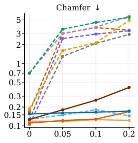

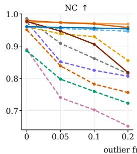

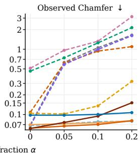

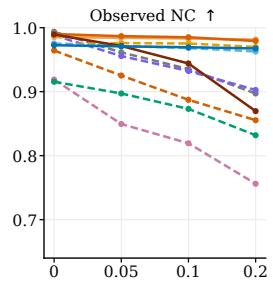  
Ours ( )L = 0 Ours ( )L = 4 DiGS SAL SPSR NDF-vis Ours ( )L = 2 Ours ( )L = 6 Neural-Pull DifCD Labatut  
Figure 24: Mean SRB CD1 and NC across increasing outlier levels α.

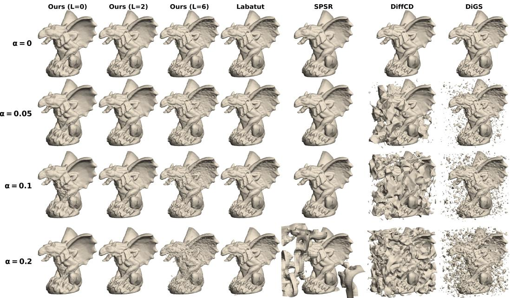  
Figure 25: Qualitative Gargoyle reconstructions across increasing outlier levels α.

Table 18: Per-shape SRB reconstruction without outliers $( \alpha = 0 )$ and with outliers $( \alpha = 0 . 2 )$ Stochastic results use three seeds; best neural implicit results are shown in bold.
<table><tr><td></td><td></td><td colspan="6">Clean (α = 0)</td><td colspan="6">Outliers (α = 0.2)</td></tr><tr><td>Method</td><td>Metric</td><td>Anchor</td><td>Daratech</td><td>DC</td><td>Gargoyle</td><td>L. Quas</td><td>Mean</td><td>Anchor</td><td>Daratech</td><td>DC</td><td>Gargoyle L. Quas</td><td></td><td>Mean</td></tr><tr><td>Neural implicit</td><td>CD1↓</td><td>0.196</td><td>0.274</td><td>0.098</td><td>0.141</td><td>0.067</td><td></td><td>0.202</td><td>0.275</td><td>0.118</td><td>0.194</td><td>0.073</td><td>0.173 ± 0.013</td></tr><tr><td>Ours (L = 0)</td><td>NC↑</td><td>0.977</td><td>0.907</td><td>0.976</td><td>0.956</td><td>0.987</td><td> $\begin{array} { c } { 0 . 1 5 5 \pm 0 . 0 0 3 } \\ { 0 . 9 6 1 \pm 0 . 0 0 1 5 } \end{array}$ </td><td>0.971</td><td>0.910</td><td>0.966</td><td>0.937</td><td>0.986</td><td>0.954 ± 0.0032</td></tr><tr><td>Ours (L = 2)</td><td>CD1↓ NC↑</td><td>0.195 0.977</td><td>0.153 0.951</td><td>0.084 0.982</td><td>0.109 0.969</td><td>0.055 0.992</td><td> $\begin{array} { c } { 0 . 1 1 9 \pm 0 . 0 0 3 } \\ { 0 . 9 7 4 \pm 0 . 0 0 1 } \end{array}$ </td><td>0.149 0.982</td><td>0.154 0.939</td><td>0.100 0.974</td><td>0.142 0.958</td><td>0.065 0.990</td><td>0.122 ± 0.004 0.968 ± 0.001</td></tr><tr><td>Ours (L = 6)</td><td>CD1↓ NC↑</td><td>0.195 0.975</td><td>0.223 0.955</td><td>0.073 0.985</td><td>0.089 0.976</td><td>0.053 0.992</td><td>0.127 ± 0.004 0.977 ± 0.0009</td><td>0.520 0.838</td><td>0.271 0.814</td><td>0.453 0.771</td><td>0.523 0.819</td><td>0.302 0.849</td><td>0.414 ± 0.018 0.818 ± 0.0018</td></tr><tr><td>NDF-vis</td><td>CD1↓ NC↑</td><td>0.670 0.907</td><td>0.568 0.850</td><td>0.927 0.858</td><td>1.038 0.856</td><td>0.284 0.956</td><td>0.697 ± 0.085 0.885 ± 0.0029</td><td>5.835 0.733</td><td>6.375 0.656</td><td>5.355 0.709</td><td>6.042 0.747</td><td>3.851 0.769</td><td>5.492 ± 0.280 0.723 ± 0.0097</td></tr><tr><td>Neural-Pull</td><td>CD1↓ NC↑</td><td>0.142 0.982</td><td>0.403 0.853</td><td>0.119 0.966</td><td>0.109 0.970</td><td>0.070 0.983</td><td> $\begin{array} { c } { 0 . 1 6 9 \pm 0 . 0 2 5 } \\ { 0 . 9 5 1 \pm 0 . 0 0 3 } \end{array}$ </td><td>2.132 0.814</td><td>5.526 0.708</td><td>2.790 0.754</td><td>3.663 0.720</td><td>3.002 0.785</td><td>3.42 ± 0.15 0.756 ± 0.015</td></tr><tr><td>DiffCD</td><td>CD1↓ NC↑</td><td>0.206 0.979</td><td>0.164 0.949</td><td>0.073 0.987</td><td>0.102 0.976</td><td>0.072 0.984</td><td> $\begin{array} { c } { 0 . 1 2 3 \pm 0 . 0 0 2 4 } \\ { 0 . 9 7 5 \pm 0 . 0 0 1 7 } \end{array}$ </td><td>3.625 0.818</td><td>4.565 0.768</td><td>2.752 0.808</td><td>3.448 0.805</td><td>2.380 0.833</td><td>3.354 ± 0.028 0.806 ± 0.0011</td></tr><tr><td>SAL</td><td>CD1↓ NC↑ CD1↓</td><td>0.895 0.898</td><td>0.884 0.825</td><td>0.666 0.881</td><td>0.693 0.891</td><td>0.382 0.953</td><td> $\begin{array} { c } { 0 . 7 0 4 \pm 0 . 0 6 8 } \\ { 0 . 8 8 9 \pm 0 . 0 0 9 4 } \end{array}$ </td><td>7.685 0.652</td><td>5.960 0.595</td><td>4.708 0.655</td><td>6.813 0.661</td><td>3.491 0.694</td><td> $\begin{array} { c } { 5 . 7 3 1 \pm 2 . 1 3 4 } \\ { 0 . 6 5 2 \pm 0 . 0 3 1 4 } \end{array}$ </td></tr><tr><td>DiGS</td><td>NC↑</td><td>0.178 0.982</td><td>0.111 0.976</td><td>0.073 0.993</td><td>0.095 0.984</td><td>0.071 0.993</td><td> $\begin{array} { c } { 0 . 1 0 6 \pm 0 . 0 0 5 } \\ { 0 . 9 8 5 \pm 0 . 0 0 0 6 } \end{array}$ </td><td>3.369 0.798</td><td>4.319 0.793</td><td>2.159 0.831</td><td>2.388 0.832</td><td>2.402 0.816</td><td>2.927 ± 0.063 0.814 ± 0.0020</td></tr><tr><td>Classical</td><td>CD1↓</td><td>0.253</td><td>0.314</td><td>0.136</td><td>0.149</td><td>0.086</td><td>0.187</td><td>4.661</td><td>8.320</td><td>4.747</td><td></td><td></td><td></td></tr><tr><td>SPSR</td><td>NC↑</td><td>0.970</td><td>0.919</td><td>0.970</td><td>0.959</td><td>0.982</td><td>0.960</td><td>0.878</td><td>0.764</td><td>0.853</td><td>4.841 0.852</td><td>2.017 0.929</td><td>4.917 0.855</td></tr><tr><td>Labatut</td><td>CD1↓ NC↑</td><td>0.196 0.972</td><td>0.176 0.919</td><td>0.090 0.969</td><td>0.104 0.962</td><td>0.072 0.977</td><td>0.128 0.960</td><td>0.228 0.958</td><td>0.210 0.901</td><td>0.092 0.958</td><td>0.112 0.950</td><td>0.079 0.965</td><td>0.144 0.946</td></tr></table>

Table 19: Per-shape observation-supported SRB results without outliers $( \alpha = 0 )$ and with outliers $( \alpha = 0 . 2 )$ , using the $2 h _ { 0 }$ support threshold. Stochastic results use three seeds; best neural implicit results are shown in bold.
<table><tr><td></td><td></td><td colspan="6">Clean (α = 0)</td><td colspan="6"> $\mathbf { O u t l i e r s } \left( \alpha = 0 . 2 \right)$ </td></tr><tr><td>Method</td><td>Metric</td><td>Anchor</td><td>Daratech</td><td>DC</td><td>Gargoyle</td><td>L. Quas</td><td>Mean</td><td>Anchor</td><td>Daratech</td><td>DC</td><td>Gargoyle</td><td>L. Quas</td><td>Mean</td></tr><tr><td>Neural implicit</td><td></td><td></td><td></td><td></td><td></td><td></td><td></td><td>0.096</td><td></td><td></td><td></td><td></td><td></td></tr><tr><td> $\mathrm { O u r s } \left( L = 0 \right)$ </td><td> $\mathrm { C D } _ { 1 } ^ { \mathrm { o b s } } \downarrow$  NCobs ↑</td><td>0.078 0.991</td><td>0.141 0.936</td><td>0.086 0.982</td><td>0.123 0.963</td><td>0.060 0.990</td><td> $0 . 0 9 8 \pm 0 . 0 0 2$   $0 . 9 7 3 \pm 0 . 0 0 0 9$ </td><td>0.984</td><td>0.135 0.939</td><td>0.099 0.974</td><td>0.137 0.952</td><td>0.068 0.988</td><td> $0 . 1 0 7 \pm 0 . 0 0 5$   $0 . 9 6 8 \pm 0 . 0 0 2$ </td></tr><tr><td>Ours (L = 2)</td><td> $\mathrm { C D } _ { 1 } ^ { \mathrm { o b s } }$  → NCobs ↑</td><td>0.069 0.993</td><td>0.067 0.974</td><td>0.070 0.988</td><td>0.094 0.977</td><td>0.050 0.994</td><td> $0 . 0 7 0 \pm 0 . 0 0 2$   $0 . 9 8 5 \pm 0 . 0 0 1$ </td><td>0.078 0.993</td><td>0.078 0.968</td><td>0.081 0.983</td><td>0.105 0.971</td><td>0.060 0.992</td><td> ${ \bf 0 . 0 8 0 \pm 0 . 0 0 2 }$   ${ \bf 0 . 9 8 1 \pm 0 . 0 0 1 }$ </td></tr><tr><td>Ours (L = 6)</td><td>CD1bs ↓ NCobs ↑</td><td>0.067 0.994</td><td>0.058 0.981</td><td>0.062 0.991</td><td>0.074 0.985</td><td>0.046 0.995</td><td> ${ \bf 0 . 0 6 1 } \pm 0 . 0 0 2$   $0 . 9 8 9 \pm 0 . 0 0 0 6$ </td><td>0.171 0.906</td><td>0.131 0.858</td><td>0.174 0.824</td><td>0.160 0.879</td><td>0.120 0.881</td><td> $0 . 1 5 1 \pm 0 . 0 0 7$   $0 . 8 7 0 \pm 0 . 0 0 0 3$ </td></tr><tr><td>NDF-vis</td><td> $\mathrm { C D } _ { 1 } ^ { \mathrm { o b s } }$  → NCobs ↑</td><td>0.380 0.943</td><td>0.334 0.886</td><td>0.618 0.893</td><td>0.743 0.890</td><td>0.238 0.966</td><td> $0 . 4 6 3 \pm 0 . 0 5 4$   $0 . 9 1 6 \pm 0 . 0 0 2 7$ </td><td>2.027 0.851</td><td>1.259 0.818</td><td>2.629 0.808</td><td>3.222 0.815</td><td>1.586 0.868</td><td> $2 . 1 4 4 \pm 0 . 2 6 8$   $0 . 8 3 2 \pm 0 . 0 0 9 0$ </td></tr><tr><td>Neural-Pull</td><td> $\mathrm { C D } _ { 1 } ^ { \mathrm { o b s } }$  ↓ NCobs ↑</td><td>0.071 0.994</td><td>0.246 0.880</td><td>0.088 0.976</td><td>0.085 0.981</td><td>0.051</td><td> $\begin{array} { c } { 0 . 1 0 8 \pm 0 . 0 1 7 } \\ { 0 . 9 6 4 \pm 0 . 0 0 5 } \end{array}$ </td><td>0.802 0.896</td><td>1.865 0.841</td><td>0.685</td><td>0.970</td><td>1.160</td><td> $1 . 0 9 6 \pm 0 . 1 2 8$   $0 . 8 5 5 \pm 0 . 0 1 4$ </td></tr><tr><td>DiffCD</td><td> $\mathrm { C D } _ { 1 } ^ { \mathrm { o b s } }$  ↓ NCobs ↑</td><td>0.065 0.997</td><td>0.089 0.968</td><td>0.060</td><td>0.075</td><td>0.992 0.049</td><td> $\begin{array} { c } { 0 . 0 6 8 \pm 0 . 0 0 1 6 } \\ { 0 . 9 8 8 \pm 0 . 0 0 1 3 } \end{array}$ </td><td>1.649</td><td>2.211</td><td>0.865 1.332</td><td>0.811 1.682</td><td>0.865 1.199</td><td> $1 . 6 1 4 \pm 0 . 0 0 7 4$ </td></tr><tr><td>SAL</td><td>CD1bs NCobs ↑</td><td>0.553 0.931</td><td>0.576</td><td>0.994 0.547</td><td>0.987 0.564</td><td>0.994 0.320</td><td> $0 . 5 1 2 \pm 0 . 0 5 4$ </td><td>0.924 5.855</td><td>0.871 1.760</td><td>0.902 2.417</td><td>0.901 3.983</td><td>0.915 1.780</td><td> $0 . 9 0 3 \pm 0 . 0 0 1 4$   $3 . 1 5 9 \pm 2 . 1 6 4$ </td></tr><tr><td>DiGS</td><td> $\mathrm { C D } _ { 1 } ^ { \mathrm { o b s } } ~ ,$  1</td><td>0.080</td><td>0.883 0.062</td><td>0.910 0.067</td><td>0.907 0.082</td><td>0.964 0.057</td><td> $0 . 9 1 9 \pm 0 . 0 0 7 3$   $0 . 0 6 9 \pm 0 . 0 0 1 9$ </td><td>0.747 1.762</td><td>0.745 2.316</td><td>0.759 1.322</td><td>0.723 1.596</td><td>0.806 1.257</td><td> $0 . 7 5 6 \pm 0 . 0 3 4 3$   $1 . 6 5 0 \pm 0 . 0 1 7 5$ </td></tr><tr><td>Classical</td><td> $\mathrm { { N C } ^ { \mathrm { { \dot { o b s } } } } \ \dot { \uparrow } }$ </td><td>0.995</td><td>0.989</td><td>0.996</td><td>0.991</td><td>0.997</td><td> ${ \bf 0 . 9 9 4 \pm 0 . 0 0 0 3 }$ </td><td>0.902</td><td>0.890</td><td>0.897</td><td>0.893</td><td>0.904</td><td> $0 . 8 9 7 \pm 0 . 0 0 1 4$ </td></tr><tr><td>SPSR</td><td> $\mathrm { C D _ { 1 } ^ { o b s } \downarrow }$ </td><td>0.096</td><td>0.141</td><td>0.101</td><td>0.117</td><td>0.067</td><td>0.104</td><td>0.262</td><td>0.682</td><td>0.234</td><td>0.324</td><td>0.109</td><td>0.322</td></tr><tr><td></td><td> $\operatorname { N C } ^ { \mathrm { { \overset { \circ } { b s } } } }$  ←</td><td>0.986</td><td>0.945</td><td>0.980</td><td>0.970</td><td>0.989</td><td>0.974</td><td>0.983</td><td>0.934</td><td>0.977</td><td>0.968</td><td>0.988</td><td>0.970</td></tr><tr><td>Labatut</td><td> $\mathrm { C D } _ { 1 } ^ { \mathrm { o b s } } ~ .$  →  $\mathrm { { N C } ^ { \mathrm { { \dot { o b s } } } } \ \uparrow }$ </td><td>0.068 0.988</td><td>0.072 0.948</td><td>0.069 0.980</td><td>0.080 0.974</td><td>0.050 0.987</td><td>0.068 0.975</td><td>0.081 0.975</td><td>0.094 0.931</td><td>0.075 0.969</td><td>0.087 0.963</td><td>0.057 0.976</td><td>0.079 0.963</td></tr></table>

## D.3 RAY-ALIGNED OUTLIERS

We additionally corrupt the measured range while preserving each acquisition ray direction. Table 20 reports results for 10% corrupted rays.

Table 20: SRB with ray-aligned outliers. Left: reconstruction metrics with 10% of rays having corrupted range. Right: qualitative results on Gargoyle.

<table><tr><td>Method</td><td></td><td>Anchor Daratech</td><td>DC</td><td>Gargoyle Lord Quas Mean</td><td></td><td></td></tr><tr><td> $\mathrm { C D _ { 1 } } \downarrow$ </td><td></td><td></td><td></td><td></td><td></td><td></td></tr><tr><td>Labatut</td><td>1.166</td><td>0.213</td><td>0.107</td><td>0.353</td><td>0.082</td><td>0.384</td></tr><tr><td>Ours (L = 0)</td><td>0.264</td><td>0.271</td><td>0.109</td><td>0.161</td><td>0.078</td><td>0.177</td></tr><tr><td>Ours (L = 2)</td><td>0.206</td><td>0.177</td><td>0.099</td><td>0.134</td><td>0.068</td><td>0.137</td></tr><tr><td>NC↑</td><td></td><td></td><td></td><td></td><td></td><td></td></tr><tr><td>Labatut</td><td>0.948</td><td>0.894</td><td>0.955</td><td>0.948</td><td>0.966</td><td>0.942</td></tr><tr><td>Ours (L = 0)</td><td>0.966</td><td>0.911</td><td>0.972</td><td>0.943</td><td>0.981</td><td>0.954</td></tr><tr><td>Ours (L = 2)</td><td>0.979</td><td>0.931</td><td>0.974</td><td>0.956</td><td>0.988</td><td>0.965</td></tr></table>

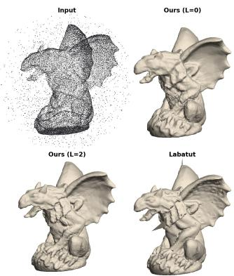

## D.4 SHAPENET EXTENDED RESULTS

Table 21: ShapeNet category-wise $\mathrm { C D _ { 2 } }$ under isotropic and ray-aligned Gaussian noise with 3K input points. Best neural implicit results are shown in bold.
<table><tr><td>Category</td><td>Noise</td><td>Ours (L = 0)</td><td>Ours (L = 6)</td><td>NDF-vis</td><td>DiffCD</td><td>N.-P</td><td>SAL</td><td>DiGS</td><td>SPSR</td><td>Labat.</td></tr><tr><td>Airplane</td><td>Iso.</td><td> $\mathbf { 3 . 7 2 e ^ { - 5 } }$ </td><td> $5 . 1 6 \mathrm { e } ^ { - 5 }$ </td><td> $4 . 3 2 \mathrm { e } ^ { - 4 }$ </td><td> $5 . 5 7 \mathrm { e } ^ { - 5 }$ </td><td>1.75e -4</td><td>7.70e−3</td><td>1.07e−4</td><td>9.66e−5</td><td> $8 . 9 3 \mathrm { e } ^ { - 5 }$ </td></tr><tr><td rowspan="2"></td><td>Ray</td><td> $\mathbf { 2 . 9 1 e ^ { - 5 } }$ </td><td> $3 . 7 8 \mathrm { e } ^ { - 5 }$ </td><td>1.18e−3</td><td>4.30e−5</td><td>1.12e -3</td><td>6.81e−3</td><td>1.24e</td><td>9.36e−5</td><td> $1 . 2 5 \mathrm { e } ^ { - 4 }$ </td></tr><tr><td>Iso.</td><td> $1 . 3 9 \mathrm { e } ^ { - 4 }$ </td><td> $\mathbf { 1 . 3 3 e ^ { - 4 } }$ </td><td> $3 . 0 9 \mathrm { e } ^ { - 4 }$ </td><td>1.74e−4</td><td>1.75e -3</td><td>1.93e−3</td><td>2.52e</td><td>1.08e−²</td><td> $\mathrm { 1 . 7 3 e ^ { - 4 } }$ </td></tr><tr><td>Bench</td><td>Ray</td><td> $\mathrm { 1 . 5 9 e ^ { - 4 } }$ </td><td> $\mathbf { 1 . 0 8 e ^ { - 4 } }$ </td><td>3.43e−4</td><td>1.65e</td><td>5.29e</td><td>1.15e</td><td>2.13e</td><td>1.11e−²</td><td> $2 . 1 1 \mathrm { e } ^ { - 4 }$ </td></tr><tr><td rowspan="2">Cabinet</td><td>Iso.</td><td> $9 . 7 3 \mathrm { e } ^ { - 4 }$ </td><td> $\mathbf { 8 . 5 2 e ^ { - 4 } }$ </td><td> $1 . 2 7 \mathrm { e } ^ { - 3 }$ </td><td>1.12e 3</td><td>1.79e -3</td><td>3.69e 3</td><td>1.41e 3</td><td>3.22e -3</td><td> $9 . 5 8 \mathrm { e } ^ { - 4 }$ </td></tr><tr><td>Ray</td><td> $9 . 4 0 \mathrm { e } ^ { - 4 }$ </td><td> $\mathbf { 7 . 5 5 e ^ { - 4 } }$ </td><td>1.51e−³</td><td>1.12e -3</td><td>1.82e</td><td>4.06e</td><td>1.39e</td><td>3.10e</td><td> $9 . 8 5 \mathrm { e } ^ { - 4 }$ </td></tr><tr><td rowspan="2">Car</td><td>Iso.</td><td> $3 . 7 5 \mathrm { e } ^ { - 4 }$ </td><td> $3 . 7 2 \mathrm { e } ^ { - 4 }$ </td><td> $7 . 0 6 \mathrm { e } ^ { - 4 }$ </td><td> $\mathbf { 3 . 1 1 e ^ { - 4 } }$ </td><td>5.38e</td><td>7.37e</td><td>3.85e 4</td><td>5.56e</td><td> $\mathrm { 3 . 3 4 e ^ { - 4 } }$ </td></tr><tr><td>Ray</td><td> $3 . 6 9 \mathrm { e } ^ { - 4 }$ </td><td> $3 . 8 9 \mathrm { e } ^ { - 4 }$ </td><td> $9 . 3 9 \mathrm { e } ^ { - 4 }$ </td><td> $\mathbf { 3 . 0 5 e ^ { - 4 } }$ </td><td>7.29e</td><td>7.85e</td><td>3.16e</td><td>5.54e -4</td><td> $3 . 5 7 \mathrm { e } ^ { - 4 }$ </td></tr><tr><td rowspan="2">Chair</td><td>Iso.</td><td> $3 . 3 0 \mathrm { e } ^ { - 4 }$ </td><td> $\mathbf { 2 . 5 5 e ^ { - 4 } }$ </td><td> $8 . 5 8 \mathrm { e } ^ { - 4 }$ </td><td>3.73e−4</td><td>3.13e</td><td>9.42e−3</td><td>2.50e−3</td><td>9.73e−3</td><td> $8 . 9 7 \mathrm { e } ^ { - 4 }$ </td></tr><tr><td>Ray</td><td> $3 . 4 8 \mathrm { e } ^ { - 4 }$ </td><td> $\mathbf { 2 . 1 8 e ^ { - 4 } }$ </td><td> $7 . 6 7 \mathrm { e } ^ { - 4 }$ </td><td>3.50e</td><td>2.86e -3</td><td>8.81e− -3</td><td>3.00e 3</td><td>9.27e−3</td><td> $6 . 7 9 \mathrm { e } ^ { - 4 }$ </td></tr><tr><td rowspan="2">Display</td><td>Iso.</td><td> $6 . 7 6 \mathrm { e } ^ { - 5 }$ </td><td> $\mathbf { 5 . 1 0 e ^ { - 5 } }$ </td><td> $1 . 7 8 \mathrm { e } ^ { - 4 }$ </td><td> $8 . 0 9 \mathrm { e } ^ { - 5 }$ </td><td>5.23e 4</td><td>2.79e−3</td><td>2.44e</td><td>1.16e−²</td><td>7.96e−5</td></tr><tr><td>Ray</td><td> $\mathbf { 4 . 4 3 e ^ { - 5 } }$ </td><td> $4 . 7 1 \mathrm { e } ^ { - 5 }$ </td><td> $2 . 0 6 \mathrm { e } ^ { - 4 }$ </td><td>7.65e</td><td>5.70e</td><td>2.27e 3</td><td>1.51e</td><td>1.17e -2</td><td> $8 . 6 2 \mathrm { e } ^ { - 5 }$ </td></tr><tr><td rowspan="2">Lamp</td><td>Iso.</td><td> $\mathbf { 1 . 4 5 e ^ { - 4 } }$ </td><td> $\mathrm { 1 . 9 4 e ^ { - 4 } }$ </td><td>6.01e−4</td><td>1.73e -4</td><td> $\mathrm { 3 . 0 4 e ^ { - 3 } }$ </td><td>3.90e−2</td><td>6.60e−4</td><td>1.86e−3</td><td></td></tr><tr><td>Ray</td><td> $\mathbf { 1 . 3 0 e ^ { - 4 } }$ </td><td> $2 . 0 2 \mathrm { e } ^ { - 4 }$ </td><td>4.85e -4</td><td>1.99e</td><td>7.13e−3</td><td>1.29e−²</td><td>5.35e 4</td><td>1.74e−3</td><td> $2 . 1 1 \mathrm { e } ^ { - 4 }$   $2 . 2 6 \mathrm { { e } ^ { - 4 } }$ </td></tr><tr><td rowspan="2">Loudspeaker Iso.</td><td></td><td> $4 . 1 3 \mathrm { e } ^ { - 4 }$ </td><td> $\mathbf { 4 . 0 9 e ^ { - 4 } }$ </td><td> $5 . 2 2 \mathrm { e } ^ { - 4 }$ </td><td>4.11e</td><td>5.09e -4</td><td>6.34e−4</td><td>6.54e</td><td>6.55e−4</td><td></td></tr><tr><td>Ray</td><td> $4 . 0 6 \mathrm { e } ^ { - 4 }$ </td><td> $\mathbf { 4 . 0 2 e ^ { - 4 } }$ </td><td>5.66e−4</td><td>4.05e 4</td><td>6.03e 4</td><td>5.50e</td><td>5.41e 4</td><td>6.36e−4</td><td> $4 . 3 5 \mathrm { e } ^ { - 4 }$   $3 . 8 9 \mathrm { e } ^ { - 4 }$ </td></tr><tr><td rowspan="2">Rifle</td><td>Iso.</td><td> $5 . 1 2 \mathrm { e } ^ { - 5 }$ </td><td> $\mathrm { 1 . 1 7 e ^ { - 4 } }$ </td><td>4.15e−4</td><td>4.13e</td><td>7.23e -5</td><td>1.62e−3</td><td></td><td></td><td></td></tr><tr><td>Ray</td><td> $4 . 0 8 \mathrm { e } ^ { - 5 }$ </td><td> $9 . 7 1 \mathrm { e } ^ { - 5 }$ </td><td> $7 . 0 6 \mathrm { e } ^ { - 4 }$ </td><td> $\mathbf { 3 . 5 0 e ^ { - 5 } }$ </td><td>1.35e 4</td><td>7.21e−3</td><td>9.39e−5 9.50e</td><td>4.62e−5 4.67e−5</td><td> $5 . 5 6 \mathrm { e } ^ { - 5 }$   $5 . 1 5 \mathrm { e } ^ { - 5 }$ </td></tr><tr><td rowspan="2">Sofa</td><td>Iso.</td><td> $\mathbf { 2 . 3 8 e ^ { - 4 } }$ </td><td> $3 . 4 6 \mathrm { e } ^ { - 4 }$ </td><td> $5 . 4 7 \mathrm { e } ^ { - 4 }$ </td><td>-4</td><td></td><td></td><td></td><td></td><td></td></tr><tr><td>Ray</td><td> $\mathbf { 2 . 2 8 e ^ { - 4 } }$ </td><td> $3 . 1 5 \mathrm { e } ^ { - 4 }$ </td><td> $4 . 6 4 \mathrm { e } ^ { - 4 }$ </td><td>3.43e 3.20e 4</td><td>6.38e 1.75e</td><td>2.36e−3 2.09e -3</td><td>3.97e 3.72e 4</td><td>1.29e−3 -3</td><td> $4 . 0 1 \mathrm { e } ^ { - 4 }$   $4 . 2 4 \mathrm { { e } ^ { - 4 } }$ </td></tr><tr><td rowspan="2">Table</td><td>Iso.</td><td> $\mathrm { 7 . 8 2 e ^ { - 5 } }$ </td><td> $\mathbf { 4 . 7 3 e ^ { - 5 } }$ </td><td>-4</td><td>5</td><td></td><td></td><td></td><td>1.33e</td><td></td></tr><tr><td>Ray</td><td> $5 . 4 8 \mathrm { e } ^ { - 5 }$ </td><td> $\mathbf { 3 . 0 9 e ^ { - 5 } }$ </td><td>6.11e  $5 . 6 8 \mathrm { e } ^ { - 4 }$ </td><td>6.91e 4.27e -5</td><td>6.05e 1.14e -3</td><td>1.54e 1.18e−¹</td><td>2.74e 2.08e</td><td>8.29e -3 8.31e -3</td><td> $1 . 5 5 \mathrm { e } ^ { - 4 }$   $2 . 2 1 \mathrm { e } ^ { - 4 }$ </td></tr><tr><td rowspan="2">Telephone</td><td>Iso.</td><td> $\mathbf { 2 . 7 4 e ^ { - 5 } }$ </td><td> $4 . 4 8 \mathrm { e } ^ { - 5 }$ </td><td> $1 . 3 0 \mathrm { e } ^ { - 4 }$ </td><td>6.54e−5</td><td></td><td>7.97e−2</td><td></td><td></td><td></td></tr><tr><td>Ray</td><td> $\mathbf { 1 . 6 6 e ^ { - 5 } }$ </td><td> $2 . 4 7 \mathrm { e } ^ { - 5 }$ </td><td> $6 . 5 2 \mathrm { e } ^ { - 5 }$ </td><td>4.89e -5</td><td>1.52e 3.00e 4</td><td>1.75e</td><td>2.04e−4 1.65e</td><td>1.10e−² 9.84e−3</td><td> $4 . 1 0 \mathrm { e } ^ { - 5 }$   $4 . 2 1 \mathrm { e } ^ { - 5 }$ </td></tr><tr><td rowspan="2">Watercraft</td><td>Iso.</td><td> $4 . 7 8 \mathrm { e } ^ { - 4 }$ </td><td>3.34e−4</td><td>5.81e−4</td><td>7.21e -5</td><td>2.60e−</td><td>2.34e−3</td><td>2.62e−4</td><td>7.80e−4</td><td>1.27e−4</td></tr><tr><td>Ray</td><td> $\mathrm { 1 . 3 3 e ^ { - 4 } }$ </td><td> $2 . 1 1 \mathrm { e } ^ { - 4 }$ </td><td> $8 . 5 6 \mathrm { e } ^ { - 4 }$ </td><td> ${ \bf 6 . 6 2 e ^ { - 5 } }$ </td><td>5.86e</td><td>9.79e−4</td><td>2.15e</td><td>7.41e−4</td><td> $1 . 2 5 \mathrm { e } ^ { - 4 }$ </td></tr></table>

Table 22: ShapeNet category-wise normal consistency under isotropic and ray-aligned Gaussian noise with 3K input points. Best neural implicit results are shown in bold.
<table><tr><td>Category</td><td>Noise</td><td>Ours (L = 0)</td><td>Ours (L = 6)</td><td>NDF-vis</td><td>DiffCD</td><td>N.-P</td><td>SAL</td><td>DiGS</td><td>SPSR</td><td>Labat.</td></tr><tr><td>Airplane</td><td>Iso.</td><td>0.90</td><td>0.87</td><td>0.86</td><td>0.82</td><td>0.73</td><td>0.79</td><td>0.62</td><td>0.85</td><td>0.73</td></tr><tr><td rowspan="3">Bench</td><td>Ray</td><td>0.92</td><td>0.90</td><td>0.84</td><td>0.87</td><td>0.72</td><td>0.79</td><td>0.66</td><td>0.84</td><td>0.75</td></tr><tr><td>Iso.</td><td>0.88</td><td>0.88</td><td>0.88</td><td>0.83</td><td>0.75</td><td>0.89</td><td>0.65</td><td>0.76</td><td>0.77</td></tr><tr><td>Ray</td><td>0.88</td><td>0.88</td><td>0.88</td><td>0.86</td><td>0.78</td><td>0.78</td><td>0.68</td><td>0.76</td><td>0.79</td></tr><tr><td>Cabinet</td><td>Iso.</td><td>0.86</td><td>0.87</td><td>0.83</td><td>0.84</td><td>0.76</td><td>0.83</td><td>0.66</td><td>0.81</td><td>0.79</td></tr><tr><td rowspan="2">Car</td><td>Ray</td><td>0.87</td><td>0.87</td><td>0.83</td><td>0.85</td><td>0.78</td><td>0.83</td><td>0.68</td><td>0.81</td><td>0.80</td></tr><tr><td>Iso.</td><td>0.89</td><td>0.88</td><td>0.89</td><td>0.81</td><td>0.80</td><td>0.87</td><td>0.66</td><td>0.86</td><td>0.80</td></tr><tr><td></td><td>Ray</td><td>0.90</td><td>0.89</td><td>0.88</td><td>0.84</td><td>0.83</td><td>0.87</td><td>0.72</td><td>0.87</td><td>0.82</td></tr><tr><td rowspan="2">Chair</td><td>Iso.</td><td>0.90</td><td>0.90</td><td>0.89</td><td>0.89</td><td>0.69</td><td>0.83</td><td>0.70</td><td>0.79</td><td>0.81</td></tr><tr><td>Ray</td><td>0.91</td><td>0.91</td><td>0.89</td><td>0.91</td><td>0.75</td><td>0.84</td><td>0.73</td><td>0.79</td><td>0.82</td></tr><tr><td>Display</td><td>Iso.</td><td>0.95</td><td>0.96</td><td>0.95</td><td>0.89</td><td>0.84</td><td>0.94</td><td>0.72</td><td>0.86</td><td>0.86</td></tr><tr><td rowspan="2">Lamp</td><td>Ray</td><td>0.96</td><td>0.96</td><td>0.96</td><td>0.92</td><td>0.86</td><td>0.94</td><td>0.77</td><td>0.86</td><td>0.87</td></tr><tr><td>Iso.</td><td>0.89</td><td>0.87</td><td>0.88</td><td>0.83</td><td>0.73</td><td>0.84</td><td>0.67</td><td>0.85</td><td>0.77</td></tr><tr><td></td><td>Ray</td><td>0.91</td><td>0.90</td><td>0.89</td><td>0.87</td><td>0.76</td><td>0.87</td><td>0.68</td><td>0.86</td><td>0.78</td></tr><tr><td rowspan="2">Loudspeaker Iso.</td><td></td><td>0.95</td><td>0.94</td><td>0.95</td><td>0.88</td><td>0.87</td><td>0.94</td><td>0.71</td><td>0.92</td><td>0.87</td></tr><tr><td>Ray</td><td>0.96</td><td>0.95</td><td>0.96</td><td>0.91</td><td>0.89</td><td>0.95</td><td>0.76</td><td>0.92</td><td>0.90</td></tr><tr><td rowspan="2">Rifle</td><td>Iso.</td><td>0.88</td><td>0.85</td><td>0.80</td><td>0.76</td><td>0.74</td><td>0.85</td><td>0.68</td><td>0.86</td><td>0.71</td></tr><tr><td>Ray</td><td>0.89</td><td>0.88</td><td>0.79</td><td>0.81</td><td>0.74</td><td>0.83</td><td>0.65</td><td>0.87</td><td>0.74</td></tr><tr><td rowspan="2">Sofa</td><td>Iso.</td><td>0.91</td><td>0.91</td><td>0.92</td><td>0.86</td><td>0.80</td><td>0.87</td><td>0.72</td><td>0.86</td><td>0.81</td></tr><tr><td>Ray</td><td>0.92</td><td>0.91</td><td>0.93</td><td>0.90</td><td>0.80</td><td>0.88</td><td>0.75</td><td>0.87</td><td>0.83</td></tr><tr><td rowspan="2">Table</td><td>Iso.</td><td>0.91</td><td>0.93</td><td>0.90</td><td>0.89</td><td>0.69</td><td>0.69</td><td>0.67</td><td>0.79</td><td>0.78</td></tr><tr><td>Ray</td><td>0.92</td><td>0.95</td><td>0.90</td><td>0.93</td><td>0.75</td><td>0.73</td><td>0.73</td><td>0.79</td><td>0.80</td></tr><tr><td rowspan="2">Telephone</td><td>Iso.</td><td>0.97</td><td>0.96</td><td>0.96</td><td>0.90</td><td>0.89</td><td>0.85</td><td>0.68</td><td>0.85</td><td>0.86</td></tr><tr><td>Ray</td><td>0.97</td><td>0.97</td><td>0.97</td><td>0.93</td><td>0.89</td><td>0.87</td><td>0.72</td><td>0.85</td><td>0.87</td></tr><tr><td rowspan="2">Watercraft</td><td>Iso.</td><td>0.90</td><td>0.89</td><td>0.90</td><td>0.83</td><td>0.77</td><td>0.85</td><td>0.67</td><td>0.86</td><td>0.77</td></tr><tr><td>Ray</td><td>0.92</td><td>0.90</td><td>0.89</td><td>0.88</td><td>0.82</td><td>0.89</td><td>0.68</td><td>0.87</td><td>0.80</td></tr></table>

Table 23: ShapeNet category-wise IoU under isotropic and ray-aligned Gaussian noise with 3K input points. Best neural implicit results are shown in bold.
<table><tr><td>Category</td><td>Noise</td><td>Ours (L = 0)</td><td>Ours (L = 6)</td><td>NDF-vis</td><td>DiffCD</td><td>N.-P</td><td>SAL</td><td>DiGS</td><td>SPSR</td><td>Labat.</td></tr><tr><td>Airplane</td><td>Iso.</td><td>0.82</td><td>0.79</td><td>0.57</td><td>0.75</td><td>0.63</td><td>0.57</td><td>0.23</td><td>0.74</td><td>0.73</td></tr><tr><td rowspan="3">Bench</td><td>Ray</td><td>0.86</td><td>0.83</td><td>0.43</td><td>0.79</td><td>0.44</td><td>0.60</td><td>0.52</td><td>0.75</td><td>0.69</td></tr><tr><td>Iso.</td><td>0.82</td><td>0.80</td><td>0.70</td><td>0.62</td><td>0.58</td><td>0.75</td><td>0.38</td><td>0.40</td><td>0.76</td></tr><tr><td>Ray</td><td>0.83</td><td>0.82</td><td>0.70</td><td>0.69</td><td>0.63</td><td>0.47</td><td>0.50</td><td>0.41</td><td>0.77</td></tr><tr><td>Cabinet</td><td>Iso.</td><td>0.82</td><td>0.85</td><td>0.76</td><td>0.74</td><td>0.71</td><td>0.71</td><td>0.58</td><td>0.66</td><td>0.81</td></tr><tr><td rowspan="2">Car</td><td>Ray</td><td>0.84</td><td>0.85</td><td>0.74</td><td>0.74</td><td>0.71</td><td>0.69</td><td>0.62</td><td>0.66</td><td>0.81</td></tr><tr><td>Iso.</td><td>0.89</td><td>0.88</td><td>0.81</td><td>0.85</td><td>0.81</td><td>0.82</td><td>0.57</td><td>0.86</td><td>0.87</td></tr><tr><td></td><td>Ray</td><td>0.90</td><td>0.89</td><td>0.82</td><td>0.87</td><td>0.83</td><td>0.83</td><td>0.78</td><td>0.86</td><td>0.89</td></tr><tr><td rowspan="2">Chair</td><td>Iso.</td><td>0.76</td><td>0.77</td><td>0.61</td><td>0.57</td><td>0.35</td><td>0.45</td><td>0.44</td><td>0.37</td><td>0.70</td></tr><tr><td>Ray</td><td>0.77</td><td>0.80</td><td>0.62</td><td>0.59</td><td>0.48</td><td>0.47</td><td>0.47</td><td>0.38</td><td>0.71</td></tr><tr><td>Display</td><td>Iso.</td><td>0.91</td><td>0.91</td><td>0.86</td><td>0.86</td><td>0.68</td><td>0.81</td><td>0.71</td><td>0.61</td><td>0.88</td></tr><tr><td rowspan="2">Lamp</td><td>Ray</td><td>0.94</td><td>0.92</td><td>0.87</td><td>0.86</td><td>0.77</td><td>0.85</td><td>0.81</td><td>0.60</td><td>0.90</td></tr><tr><td>Iso.</td><td>0.79</td><td>0.74</td><td>0.60</td><td>0.72</td><td>0.43</td><td>0.48</td><td>0.33</td><td>0.61</td><td>0.74</td></tr><tr><td></td><td>Ray</td><td>0.82</td><td>0.78</td><td>0.61</td><td>0.68</td><td>0.36</td><td>0.54</td><td>0.39</td><td>0.62</td><td>0.75</td></tr><tr><td rowspan="2">Loudspeaker Iso.</td><td></td><td>0.94</td><td>0.93</td><td>0.92</td><td>0.92</td><td>0.91</td><td>0.89</td><td>0.73</td><td>0.91</td><td>0.93</td></tr><tr><td>Ray</td><td>0.95</td><td>0.94</td><td>0.92</td><td>0.93</td><td>0.92</td><td>0.91</td><td>0.81</td><td>0.91</td><td>0.94</td></tr><tr><td rowspan="2">Rifle</td><td>Iso.</td><td>0.82</td><td>0.75</td><td>0.57</td><td>0.75</td><td>0.71</td><td>0.65</td><td>0.23</td><td>0.79</td><td>0.76</td></tr><tr><td>Ray</td><td>0.84</td><td>0.80</td><td>0.48</td><td>0.78</td><td>0.59</td><td>0.56</td><td>0.31</td><td>0.79</td><td>0.74</td></tr><tr><td rowspan="2">Sofa</td><td>Iso.</td><td>0.84</td><td>0.83</td><td>0.77</td><td>0.73</td><td>0.69</td><td>0.68</td><td>0.65</td><td>0.68</td><td>0.78</td></tr><tr><td>Ray</td><td>0.85</td><td>0.84</td><td>0.79</td><td>0.78</td><td>0.59</td><td>0.70</td><td>0.69</td><td>0.68</td><td>0.80</td></tr><tr><td rowspan="2">Table</td><td>Iso.</td><td>0.75</td><td>0.79</td><td>0.60</td><td>0.64</td><td>0.35</td><td>0.19</td><td>0.40</td><td>0.40</td><td>0.63</td></tr><tr><td>Ray</td><td>0.79</td><td>0.85</td><td>0.56</td><td>0.73</td><td>0.36</td><td>0.21</td><td>0.52</td><td>0.40</td><td>0.64</td></tr><tr><td rowspan="2">Telephone</td><td>Iso.</td><td>0.92</td><td>0.89</td><td>0.83</td><td>0.84</td><td>0.79</td><td>0.64</td><td>0.54</td><td>0.49</td><td>0.86</td></tr><tr><td>Ray</td><td>0.93</td><td>0.92</td><td>0.88</td><td>0.86</td><td>0.76</td><td>0.64</td><td>0.66</td><td>0.50</td><td>0.87</td></tr><tr><td rowspan="2">Watercraft</td><td>Iso.</td><td>0.79</td><td>0.78</td><td>0.72</td><td>0.76</td><td>0.73</td><td>0.59</td><td>0.29</td><td>0.71</td><td>0.79</td></tr><tr><td>Ray</td><td>0.83</td><td>0.82</td><td>0.70</td><td>0.81</td><td>0.74</td><td>0.63</td><td>0.53</td><td>0.73</td><td>0.81</td></tr></table>