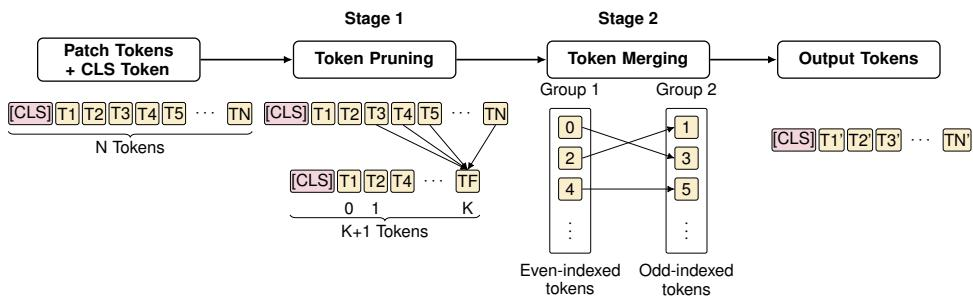

# Scaling Vision Transformers Without Training: Prune-and-Merge Token Compression∗

Vatsal Department of Mathematics Indian Institute of Technology Roorkee vatsal@ma.iitr.ac.in

Priyanshu Chahal Department of Mathematics Indian Institute of Technology Roorkee priyanshu@ma.iitr.ac.in

Soumil Malhotra Department of Mathematics Indian Institute of Technology Roorkee soumil\_m@ma.iitr.ac.in

Sanjeev Kumar Department of Mathematics Indian Institute of Technology Roorkee sanjeev.kumar@ma.iitr.ac.in

## Abstract

Vision Transformers achieve strong performance but incur high computational costs from quadratic token interactions. Training-free token reduction methods improve efficiency, but their robustness remains underexplored. We propose Prune-and-Merge ViT, a training-free framework for off-the-shelf models. It combines classattention-based pruning with similarity-based merging to reduce redundancy while preserving semantic information. To evaluate robustness we introduce two metrics. Relative Accuracy Drop (RAD) measures relative accuracy degradation under transformations, and Prediction Flip Rate (PFR) quantifies prediction consistency. On pretrained ViT and DeiT, Prune-and-Merge reduces computation competitively while maintaining robustness and better accuracy than existing token reduction methods. Our analysis suggests that hybrid token reduction does not introduce hallucination-like behavior and preserves prediction stability for common image transformations.

## 1 Introduction

Vision Transformers (ViTs) forgo convolutional inductive biases and treat an image as a sequence of visual tokens [4]. Non-overlapping patches are projected into N tokens and passed, with a learnable class ([CLS]) token, through Transformer blocks. The token count is constant across layers, so cost scales quadratically, $O ( N ^ { \breve { 2 } } )$ .

To address this issue, token pruning removes redundant tokens and merging aggregates similar ones to cut computation [2, 8]. Many such methods are training-free and apply directly to pretrained models. While such approaches improve efficiency, they may introduce instability under input transformations, potentially affecting prediction consistency. Aggressive reduction at lower keep rates can also degrade performance, as fewer tokens remain to capture essential visual information. This motivates a systematic analysis of prediction stability under aggressive reduction.

Existing approaches apply pruning or merging in isolation, which causes semantic loss or hallucination-like errors under input transformations. We address this with Prune-and-Merge ViT (Figure 1), a plug-and-play, training-free framework that combines class-attention-based pruning with similarity-driven merging for off-the-shelf ViT [4] and DeiT [13]. The first stage discards low-importance tokens via top-k selection on class-attention scores [8], which filters noise while retaining salient features. Subsequently, a merging stage aggregates the remaining redundant tokens by bipartite matching on cosine similarities [2], preserving the semantic manifold in a compact bottleneck $\mathbf { T } ^ { \prime } \in \mathbb { R } ^ { N ^ { \prime } \times D }$ , where $N ^ { \prime } \ll N$ . Unlike single-strategy methods, our framework controls the token budget finely: adjusting the pruning ratio and the merging threshold preserves semantic stability.

  
Figure 1: Overview of the Prune-and-Merge ViT architecture. The framework processes tokens through a dual-stage reduction at layers $l \in \{ 3 , 6 , 9 \}$ }. Stage 1 (pruning) filters out background tokens based on class-attention scores $k _ { p } ,$ , while Stage 2 (merging) aggregates redundant salient tokens using bipartite matching $k _ { m }$

To evaluate robustness we introduce two metrics: Relative Accuracy Drop (RAD), which measures relative accuracy degradation under input transformations, and Prediction Flip Rate (PFR), which quantifies prediction consistency between original and transformed inputs. Experiments on pretrained ViT and DeiT show that Prune-and-Merge ViT competitively reduces computation while maintaining robustness and achieving strong accuracy. Our analysis further shows that hybrid token reduction preserves prediction stability under common image transformations.

Our contributions are summarized as follows:

• Prune-and-Merge ViT, a training-free hybrid token reduction framework.

• An analysis showing that hybrid pruning and merging preserve stability while reducing computation.

• RAD and PFR, which evaluate robustness and prediction stability under semanticspreserving transformations.

## 2 Related work

ViT [4] and DeiT [13] keep the sequence length fixed, so inference stays costly. DynamicViT [12] learns a pruning module, but it has to be trained. EViT [8] and Top-K need no training. They rank patches by class-attention and discard the rest, while V-Pruner [15] ranks globally rather than locally, and Zhan et al. [17] carry the paradigm to state-space models.

ToMe [2] fuses similar tokens by bipartite matching instead, which shortens the sequence physically rather than masking it. The same mechanism accelerates Stable Diffusion [1], and Haurum et al. [6] find that ToMe works best when at least half the token budget is kept. Spatial-preserving hybrids [5, 9] enhance locality and VisionTrim [16] favors throughput, but neither line offers robustness guarantees, and hybrids of the two families remain underexplored.

We address that gap in the plug-and-play spirit of ToCom [7] and its vision-language extensions [18], where transfer to a narrow subset such as ImageNet-100 needs careful alignment [11]; see Section A.

## 3 Method

## 3.1 Framework overview

We propose Prune-and-Merge ViT (see Figure 1), a dual-stage, training-free framework. It treats token reduction as sequential filtering and compression. Given N input tokens x, we apply a hierarchical reduction at layers $l \in \{ 3 , 6 , 9 \}$ [6]. This schedule preserves high-resolution spatial information in early layers before progressively reducing the sequence length in deeper blocks.

The composite keep rate $K = k _ { p } \cdot k _ { m }$ governs reduction intensity at each stage. Here, $k _ { p } \in ( 0 , 1 ]$ is the pruning keep rate, the fraction of tokens retained according to semantic importance; pruning thus acts as a semantic filter. Conversely, $k _ { m } \in ( 0 , 1 ]$ is the merging keep rate, the fraction remaining after bipartite matching of the pruned subset. This multiplicative form allows fine-grained control over the total token budget while ensuring the reduction scales proportionally with the remaining sequence length.

## 3.2 Stage 1: class-attention pruning

Stage 1 retains semantically important tokens using the [CLS] token’s class-attention, following EViT [8]. Multi-head self-attention over input tokens x $\mathbf { \bar { \Psi } } \in \mathbb { R } ^ { \tilde { B } \times N \times C }$ produces an attention map $\mathbf { A } \in \mathbb { R } ^ { \mathbf { \bar { B } } \times H \times N \times N }$ . We measure importance by [CLS] attention to the $P = N - n _ { s }$ patch tokens,

$$
\mathbf { A } _ { \mathrm { c l s } } = \mathbf { A } [ : , : , 0 , n _ { s } : ] \in \mathbb { R } ^ { B \times H \times P } , \qquad { \bar { \mathbf { a } } } = { \frac { 1 } { H } } \sum _ { h = 1 } ^ { H } \mathbf { A } _ { \mathrm { c l s } } ^ { ( h ) } \in \mathbb { R } ^ { B \times P } ,\tag{1}
$$

where $n _ { s }$ counts the special tokens. The top-k attentive tokens are selected using $k _ { p } ,$

$$
k = \mathrm { m a x } ( 1 , \left. k _ { p } \cdot P \right. ) , \qquad \mathcal { T } _ { \mathrm { a t t } } = \mathrm { T o p K } ( \bar { \mathbf { a } } , k ) .\tag{2}
$$

To prevent total loss of background context, we aggregate the remaining inattentive tokens $\mathcal { T } _ { \mathrm { i n a t t } }$ into one representative token $\mathbf { x f u s e d }$ by attention-weighted averaging,

$$
\mathbf { x } _ { \mathrm { f u s e d } } = \sum _ { i \in \mathcal { T } _ { \mathrm { i n a t t } } } \bar { a } _ { i } \mathbf { x } _ { i } .\tag{3}
$$

The resulting sequence $\mathbf { x } _ { \mathrm { s t a g e 1 } } = [ \mathbf { x } _ { \mathcal { T } _ { \mathrm { a t t } } } , \mathbf { x } _ { \mathrm { f u s e d } } ] \in \mathbb { R } ^ { B \times ( k + 1 ) \times C }$ concentrates computation on salient regions while preserving global context.

## 3.3 Stage 2: similarity-based token merging

The Stage 1 sequence of length $N _ { p } = k + 1$ undergoes bipartite merging inspired by ToMe [2]. We partition its tokens into two disjoint sets A and B of roughly equal size, then match them by cosine similarity between the key features k. Every token in A draws exactly one edge to its most similar counterpart in B. The keep rate $k _ { m }$ governs intensity through the number of merges r,

$$
r = \lfloor ( 1 - k _ { m } ) \cdot N _ { p } \rfloor .\tag{4}
$$

By retaining the r most similar edges, we ensure that only the most redundant features are fused.

Token size tracking and proportional attention. As tokens merge, we track a token size vector s, where $s _ { i }$ counts the original patches a token represents [2]. We merge tokens i and j by a weighted average,

$$
\mathbf { x } _ { \mathrm { m e r g e d } } = \frac { s _ { i } \mathbf { x } _ { i } + s _ { j } \mathbf { x } _ { j } } { s _ { i } + s _ { j } } .\tag{5}
$$

To keep the correct softmax distribution in later layers, we apply proportional attention [2],

$$
\mathbf { A } = \mathrm { s o f t m a x } \bigg ( \frac { \mathbf { Q } \mathbf { K } ^ { \top } } { \sqrt { d } } + \log \mathbf { s } \bigg ) .\tag{6}
$$

The log s term in Eq. (6) ensures that a merged token exerts the same influence as if its patches were still present as separate, identical copies. This dual-stage consolidation keeps the model expressive and accurate even under high compression.

## 4 Experiments

## 4.1 Implementation details

We test ViT and DeiT at Tiny, Small and Base scales with official pretrained weights, on the ImageNet-100 validation set (an ImageNet-1K [3] subset) under semantics-preserving transformations. Pruneand-Merge blocks sit at layers $l \in \{ 3 , 6 , 9 \}$ . In Stage 1 we average [CLS]-token attention over all

H heads to score patch importance [8]. Stage 2 and all ToMe-based baselines use proportional attention [2]. We compare against the raw backbone, Random Drop, Top-K, EViT [8] and ToMe [2]. All are scored at composite keep rates $K \in \{ 0 . 2 5 , 0 . 5 , 0 . 7 , 0 . 9 \}$ by top-1 accuracy, GFLOPs, latency (ms/img) and throughput (imgs/sec), under identical hardware and software (Section D).

## 4.2 Results and discussion

Accuracy-efficiency trade-offs. While our framework maintains a computational profile competi tive with EViT and ToMe, it exhibits higher top-1 accuracy across all architectural scales (Tables 1 and 3). This performance gap is most pronounced in aggressive compression regimes $( \mathrm { e } . \mathrm { g } . , K = 0 . 2 5 )$ representing a marginal but consistent improvement over standalone techniques. This suggests that the interplay between pruning and merging preserves the representational power of the backbones even under significant reduction.

Controlled aggression. A primary contribution of this work is the introduction of ‘Controlled Aggression’ within the reduction pipeline. Unlike fixed-strategy baselines, our framework lets the two stages be balanced dynamically. At low keep rates, prioritizing aggressive merging over pruning yields higher representational stability (Table 2). By shifting the reduction burden from Stage 1 (noise removal) to Stage 2 (information fusion) as K decreases, we mitigate the ‘cliff-edge’ accuracy degradation typically observed in pure-pruning baselines. Critical semantic tokens are fused rather than discarded, which maintains a more coherent global context.

## 4.3 Stability and robustness analysis

We use two metrics to distinguish raw classification accuracy from the stability of the model’s decision-making process. The Relative Accuracy Drop (RAD),

$$
\mathrm { R A D } = { \frac { \operatorname { A c c } ( Y , T ( x ) ) } { \operatorname { A c c } ( Y , x ) } } - { \frac { \operatorname { A c c } ( X , T ( x ) ) } { \operatorname { A c c } ( X , x ) } } ,\tag{7}
$$

measures the difference in top-1 accuracy ratios between frameworks X and Y under a semanticspreserving transformation T of input x. The Prediction Flip Rate (PFR),

$$
\mathrm { P F R } = \frac { 1 } { N } \sum _ { i = 1 } ^ { N } \mathbb { I } [ f ( x _ { i } ) \neq f ( T ( x _ { i } ) ) ] ,\tag{8}
$$

averages the indicator function I over N samples. Both quantify hallucination H, a lack of faithfulness between a model’s representation and its prediction. We measure it as the flip-rate deviation $H =$ $\Delta \mathrm { P F R } = | \mathrm { P F R } _ { \mathrm { r a w } } - \mathrm { \bar { P } F R } _ { \mathrm { h y b r i d } } |$ , where $\mathrm { P F R } _ { \mathrm { r a w } }$ is the backbone flip rate without token reduction. A ∆PFR closer to zero indicates higher robustness against hallucinations (Section E).

Robustness to hallucinations. We benchmark ∆PFR (Table 4) for ViT-Tiny and ViT-Base over Rotation, Color Jitter and Horizontal Flip. ViT-Base is significantly more stable than ViT-Tiny at $K = 0 . 2 5$ . This suggests that its greater parameter density provides more stable ‘anchor’ tokens, allowing both stages to operate without disrupting the core decision boundary (Section E).

Manifold integrity via RAD. $\mathrm { R A D } \approx 0$ suggests no more hallucination than the baseline, whereas a positive value indicates a higher rate. Against the raw ViT, RAD stays near zero or slightly positive (Table 5), so the hybrid model preserves semantic faithfulness to the pretrained backbone. Negative values against other reduction frameworks indicate lower hallucination rates. The ToMeversus-hybrid comparison is undefined at $K = 0 . 2 5$ (a dash in Table 5), because standalone merging cannot exceed 50% reduction while keeping a complete bipartite graph. Our framework, in contrast, keeps RAD stable across the entire spectrum of K. This validates the utility of Stage 1 pruning in stabilizing the token set and removing noise before fusion occurs in Stage 2.

## 5 Conclusion

We introduced Prune-and-Merge ViT, a dual-stage token reduction framework designed to optimize the trade-off between inference efficiency and representational faithfulness. Under ‘Controlled

Aggression’ it transitions from top-k pruning in the early stages to bipartite matching for information fusion in deeper layers. On ImageNet-100 it significantly outperforms standalone pruning and merging baselines, achieving a 3× speedup on ViT-Base at aggressive keep rates while maintaining superior accuracy (Tables 1 and 7). Furthermore, RAD and PFR confirm that the hybrid approach mitigates hallucinations and maintains a more robust attention manifold than fixed-strategy alternatives. These results validate that a hardware-aware, hybrid reduction paradigm is essential for scaling ViTs to resource-constrained environments without sacrificing reliability.

## References

[1] Daniel Bolya and Judy Hoffman. Token merging for fast stable diffusion, 2023.

[2] Daniel Bolya, Cheng-Yang Fu, Xiaoliang Dai, Peizhao Zhang, Christoph Feichtenhofer, and Judy Hoffman. Token merging: Your ViT but faster, 2023.

[3] Jia Deng, Wei Dong, Richard Socher, Li-Jia Li, Kai Li, and Li Fei-Fei. ImageNet: A largescale hierarchical image database. In 2009 IEEE Conference on Computer Vision and Pattern Recognition, pages 248–255, 2009.

[4] Alexey Dosovitskiy, Lucas Beyer, Alexander Kolesnikov, Dirk Weissenborn, Xiaohua Zhai, Thomas Unterthiner, Mostafa Dehghani, Matthias Minderer, Georg Heigold, Sylvain Gelly, Jakob Uszkoreit, and Neil Houlsby. An image is worth 16x16 words: Transformers for image recognition at scale, 2021.

[5] Omar Erak, Omar Alhussein, Hatem Abou-Zeid, Mehdi Bennis, and Sami Muhaidat. Adaptive token merging for efficient transformer semantic communication at the edge, 2025.

[6] Joakim Bruslund Haurum, Sergio Escalera, Graham W. Taylor, and Thomas B. Moeslund. Which tokens to use? investigating token reduction in vision transformers, 2023.

[7] Shibo Jie, Yehui Tang, Jianyuan Guo, Zhi-Hong Deng, Kai Han, and Yunhe Wang. Token compensator: Altering inference cost of vision transformer without re-tuning, 2024.

[8] Youwei Liang, Chongjian Ge, Zhan Tong, Yibing Song, Jue Wang, and Pengtao Xie. Not all patches are what you need: Expediting vision transformers via token reorganizations, 2022.

[9] Junzhu Mao, Yang Shen, Jinyang Guo, Yazhou Yao, and Xiansheng Hua. Efficient token compression for vision transformer with spatial information preserved, 2025.

[10] Adam Paszke, Sam Gross, Francisco Massa, Adam Lerer, James Bradbury, Gregory Chanan, Trevor Killeen, Zeming Lin, Natalia Gimelshein, Luca Antiga, Alban Desmaison, Andreas Köpf, Edward Yang, Zachary DeVito, Martin Raison, Alykhan Tejani, Sasank Chilamkurthy, Benoit Steiner, Lu Fang, Junjie Bai, and Soumith Chintala. PyTorch: An imperative style, high-performance deep learning library. In Advances in Neural Information Processing Systems 32, pages 8024–8035, 2019.

[11] Liu Peng and Yaochu Jin. Robustness of probabilistic models to low-quality data: A multiperspective analysis, 2025.

[12] Yongming Rao, Wenliang Zhao, Benlin Liu, Jiwen Lu, Jie Zhou, and Cho-Jui Hsieh. DynamicViT: Efficient vision transformers with dynamic token sparsification, 2021.

[13] Hugo Touvron, Matthieu Cord, Matthijs Douze, Francisco Massa, Alexandre Sablayrolles, and Hervé Jégou. Training data-efficient image transformers & distillation through attention, 2021.

[14] Ross Wightman. PyTorch image models, 2019. https://github.com/rwightman/ pytorch-image-models.

[15] Guangzhen Yao, Jiayun Zheng, Zezhou Wang, Wenxin Zhang, Renda Han, Chuangxin Zhao, Zeyu Zhang, and Runhao Liu. V-Pruner: A fast and globally-informed token pruning framework for vision transformer. Proceedings ofthe AAAI Conference on Artificial Intelligence, 40(40): 34396–34404, 2026.

[16] Hanxun Yu, Wentong Li, Xuan Qu, Song Wang, Junbo Chen, and Jianke Zhu. VisionTrim: Unified vision token compression for training-free MLLM acceleration, 2026.

[17] Zheng Zhan, Zhenglun Kong, Yifan Gong, Yushu Wu, Zichong Meng, Hangyu Zheng, Xuan Shen, Stratis Ioannidis, Wei Niu, Pu Zhao, and Yanzhi Wang. Exploring token pruning in vision state space models, 2024.

[18] Jusheng Zhang, Xiaoyang Guo, Kaitong Cai, Qinhan Lv, Yijia Fan, Wenhao Chai, Jian Wang, and Keze Wang. HybridToken-VLM: Hybrid token compression for vision-language models, 2025.

## A Extended related work

This appendix expands the condensed discussion of prior work given in the main text, covering Vision Transformer backbones, learned and training-free token pruning, token merging, and plug-and-play compression in turn.

## A.1 Vision Transformer foundations and distillation

The Vision Transformer (ViT) architecture [4] has been further optimized through specialized training strategies. Notably, DeiT [13] introduced a distillation token that interacts with patch embeddings via self-attention to inherit the inductive biases of convolutional teacher models. That work demonstrated that hard distillation can significantly outperform soft distillation, and that the interplay between the [CLS] and distillation tokens provides a more robust classifier than either token in isolation. While effective, these models still maintain a fixed sequence length, leading to high inference costs.

## A.2 Dynamic and learned token pruning

To reduce computation, several methods focus on discarding redundant tokens. DynamicViT [12] introduced a learned prediction module that hierarchically prunes tokens throughout the network. A key finding in learned pruning is that masking tokens at the input layer significantly harms performance; sparsification is therefore typically applied between transformer blocks. While learned modules offer high accuracy, they require additional training and backpropagation. In contrast, EViT [8] and Top-K strategies provide training-free alternatives by ranking token importance based on class-attention scores, identifying and removing background patches that contribute minimally to the final classification. Recent advances such as V-Pruner [15] refine this idea by employing globally informed importance metrics, ensuring that locally important but globally redundant features are identified accurately. Extensions to state-space models [17] further refine this paradigm, yet hybrids remain underexplored.

## A.3 Token merging and compression

A more recent paradigm shifts from discarding information to aggregating it. Token merging (ToMe) [2] uses bipartite soft matching to fuse similar tokens based on the dot product of their key vectors. Unlike pruning, which often relies on masking that does not always translate into hardware speedups, merging physically reduces the number of tokens passed to the MLP block, leading to tangible throughput gains. Recent extensions have explored unequal bipartite graphs to achieve higher compression ratios (> 50%) and have applied these techniques to Stable Diffusion in order to accelerate generative tasks [1]. Furthermore, studies such as “Which Tokens to Use?” [6] suggest that ToMe is most effective when at least 50% of the token budget is kept, often outperforming baseline DeiT models by leveraging proportional attention to account for the varying weights of merged tokens. Spatial-preserving hybrids such as that of Mao et al. [9] and adaptive merging [5] enhance locality but lack robustness guarantees, which our framework addresses. In addition, hardware-centric frameworks such as VisionTrim [16] have begun optimizing token reduction for specific edge-device latencies, though they often prioritize throughput over prediction stability.

## A.4 Plug-and-play compression and transferability

Recent research has addressed the gap between models trained at different compression degrees. ToCom [7] identifies that transferring a model between different compression levels is often inefficient. To mitigate this, it introduces a pretrained plug-in module that models the performance gap between source and target compression degrees, enabling more efficient inference-time scaling without retraining. Extensions to vision-language models [18] further validate this paradigm. Our work builds on this plug-and-play philosophy by combining pruning and merging into a single, training-free framework that offers more granular control than these monolithic strategies. Finally, as noted by Peng and Jin [11], the transferability of compressed weights to smaller, specialized subsets such as ImageNet-100 requires careful alignment in order to maintain the original semantic robustness of the model.

## B Result tables

This section reports the full accuracy and complexity results referenced in Section 4.2. A dash marks a configuration that standalone merging cannot reach, since bipartite matching cannot exceed a 50% reduction rate while keeping a complete bipartite graph over the tokens.

Table 1: Top-1 Accuracy comparison for DeiT and ViT models under different keep rates.
<table><tr><td></td><td colspan="4">DeiT-Tiny Baseline: 88.42</td><td colspan="4">DeiT-Small Baseline: 92.62</td><td colspan="4">DeiT-Base Baseline: 93.64</td></tr><tr><td>Keep Rates</td><td>0.9</td><td>0.7</td><td>0.5</td><td>0.25</td><td>0.9</td><td>0.7</td><td>0.5</td><td>0.25</td><td>0.9</td><td>0.7</td><td>0.5</td><td>0.25</td></tr><tr><td>Random Drop</td><td>87.94</td><td>84.02</td><td>75.22</td><td>33.18</td><td>92.06</td><td>90.52</td><td>85.00</td><td>50.34</td><td>92.68</td><td>90.62</td><td>82.14</td><td>25.86</td></tr><tr><td>EViT</td><td>88.44</td><td>86.42</td><td>80.34</td><td>52.54</td><td>92.46</td><td>91.80</td><td>89.02</td><td>70.16</td><td>93.76</td><td>93.06</td><td>89.00</td><td>51.32</td></tr><tr><td>ToMe</td><td>88.44</td><td>86.70</td><td>82.92</td><td></td><td>92.42</td><td>91.54</td><td>89.96</td><td></td><td>93.26</td><td>92.00</td><td>85.30</td><td></td></tr><tr><td>Top-K</td><td>88.48</td><td>86.28</td><td>80.14</td><td>52.02</td><td>92.46</td><td>91.60</td><td>89.16</td><td>68.78</td><td>93.74</td><td>93.18</td><td>88.86</td><td>53.04</td></tr><tr><td>Hybrid (Ours)</td><td>88.06</td><td>86.96</td><td>84.00</td><td>67.62</td><td>92.30</td><td>91.86</td><td>90.60</td><td>79.58</td><td>93.56</td><td>92.58</td><td>89.72</td><td>47.88</td></tr><tr><td rowspan="2"></td><td colspan="4">ViT-Tiny</td><td colspan="4">ViT-Small</td><td colspan="4">ViT-Base</td></tr><tr><td colspan="4">Baseline: 89.22</td><td colspan="4">Baseline: 93.18</td><td colspan="4">Baseline: 95.52</td></tr><tr><td>Keep Rates</td><td>0.9</td><td>0.7</td><td>0.5</td><td>0.25</td><td>0.9</td><td>0.7</td><td>0.5</td><td>0.25</td><td>0.9</td><td>0.7</td><td>0.5</td><td>0.25</td></tr><tr><td>Random Drop</td><td>63.42</td><td>57.04</td><td>42.22</td><td>13.20</td><td>88.62</td><td>83.82</td><td>67.48</td><td>19.16</td><td>92.08</td><td>90.04</td><td>80.66</td><td>33.90</td></tr><tr><td>EViT</td><td>89.08</td><td>86.92</td><td>79.72</td><td>44.06</td><td>93.06</td><td>91.28</td><td>82.80</td><td>35.48</td><td>95.54</td><td>95.04</td><td>92.48</td><td>61.00</td></tr><tr><td>ToMe</td><td>88.76</td><td>86.86</td><td>83.06</td><td></td><td>92.76</td><td>91.68</td><td>86.58</td><td></td><td>95.30</td><td>94.64</td><td>91.42</td><td></td></tr><tr><td>Top-K</td><td>89.08</td><td>86.78</td><td>79.22</td><td>42.90</td><td>93.14</td><td>91.22</td><td>81.82</td><td>34.44</td><td>95.58</td><td>95.10</td><td>92.46</td><td>58.72</td></tr><tr><td>Hybrid (Ours)</td><td>88.90</td><td>87.62</td><td>84.14</td><td>60.12</td><td>92.88</td><td>91.94</td><td>88.14</td><td>55.58</td><td>95.36</td><td>95.20</td><td>93.62</td><td>71.16</td></tr></table>

Table 2: Balanced vs pruning-heavy vs merging-heavy hybrid strategies (Accuracy %)
<table><tr><td></td><td colspan="4">DeiT-Tiny</td><td colspan="4">DeiT-Small</td><td colspan="4">DeiT-Base</td></tr><tr><td>Keep Rates</td><td>0.9</td><td>0.7</td><td>0.5</td><td>0.25</td><td>0.9</td><td>0.7</td><td>0.5</td><td>0.25</td><td>0.9</td><td>0.7</td><td>0.5</td><td>0.25</td></tr><tr><td>Balanced</td><td>88.06</td><td>86.96</td><td>84.00</td><td>67.62</td><td>92.30</td><td>91.86</td><td>90.60</td><td>79.58</td><td>93.56</td><td>92.58</td><td>89.72</td><td>47.88</td></tr><tr><td>Pruning-heavy</td><td>88.28</td><td>86.60</td><td>82.66</td><td>68.00</td><td>92.26</td><td>91.96</td><td>90.40</td><td>79.76</td><td>93.44</td><td>92.96</td><td>90.24</td><td>52.44</td></tr><tr><td>Merging-heavy</td><td>88.00</td><td>86.88</td><td>84.38</td><td>74.98</td><td>92.28</td><td>92.06</td><td>90.26</td><td>84.84</td><td>93.46</td><td>92.70</td><td>88.70</td><td>68.58</td></tr><tr><td></td><td colspan="4">ViT-Tiny</td><td colspan="4">ViT-Small</td><td colspan="4">ViT-Base</td></tr><tr><td>Keep Rates</td><td>0.9</td><td></td><td></td><td></td><td></td><td></td><td></td><td></td><td></td><td></td><td></td><td></td></tr><tr><td></td><td></td><td>0.7</td><td>0.5</td><td>0.25</td><td>0.9</td><td>0.7</td><td>0.5</td><td>0.25</td><td>0.9</td><td>0.7</td><td>0.5</td><td>0.25</td></tr><tr><td>Balanced</td><td>88.90</td><td>87.62</td><td>84.14</td><td>60.12</td><td>92.88</td><td>91.94</td><td>88.14</td><td>55.58</td><td>95.36</td><td>95.20</td><td>93.62</td><td>71.16</td></tr><tr><td>Pruning-heavy Merging-heavy</td><td>89.30 89.10</td><td>87.52 87.74</td><td>82.56 84.36</td><td>60.06 71.42</td><td>92.86 92.84</td><td>92.02 92.24</td><td>87.58 88.50</td><td>55.98 71.16</td><td>95.48 95.28</td><td>95.20 95.16</td><td>93.62 93.12</td><td>74.08 83.56</td></tr></table>

Table 3: GFLOPs comparison for DeiT and ViT models under different keep rates.
<table><tr><td></td><td colspan="4">DeiT-Tiny Baseline: 1.079</td><td colspan="4">DeiT-Small Baseline: 4.250</td><td colspan="4">DeiT-Base</td></tr><tr><td>Keep Rates</td><td>0.9</td><td>0.7</td><td>0.5</td><td>0.25</td><td>0.9</td><td>0.7</td><td>0.5</td><td>0.25</td><td>0.9</td><td>0.7</td><td>Baseline: 16.867 0.5</td><td>0.25</td></tr><tr><td>EViT</td><td>0.989</td><td>0.752</td><td>0.576</td><td>0.432</td><td>3.817</td><td>2.892</td><td>2.203</td><td>1.634</td><td>14.985</td><td>11.336</td><td>8.608</td><td>6.349</td></tr><tr><td>ToMe</td><td>0.983</td><td>0.746</td><td>0.571</td><td></td><td>3.787</td><td>2.863</td><td>2.178</td><td></td><td>14.865</td><td>11.216</td><td>8.507</td><td></td></tr><tr><td>Top-K</td><td>0.981</td><td>0.744</td><td>0.570</td><td>0.428</td><td>3.786</td><td>2.862</td><td>2.177</td><td>1.618</td><td>14.863</td><td>11.215</td><td>8.506</td><td>6.287</td></tr><tr><td>Hybrid (Ours)</td><td>0.992</td><td>0.753</td><td>0.577</td><td>0.429</td><td>3.823</td><td>2.893</td><td>2.204</td><td>1.624</td><td>15.005</td><td>11.337</td><td>8.608</td><td>6.309</td></tr><tr><td></td><td></td><td>ViT-Tiny</td><td></td><td></td><td></td><td>ViT-Small</td><td></td><td></td><td></td><td></td><td></td><td></td></tr><tr><td>Keep Rates</td><td></td><td>Baseline: 1.079</td><td></td><td></td><td></td><td>Baseline: 4.250</td><td></td><td></td><td></td><td>Baseline: 16.867</td><td>ViT-Base</td><td></td></tr><tr><td></td><td>0.9</td><td>0.7</td><td>0.5</td><td>0.25</td><td>0.9</td><td>0.7</td><td>0.5</td><td>0.25</td><td>0.9</td><td>0.7</td><td>0.5</td><td>0.25</td></tr><tr><td>EViT</td><td>0.989</td><td>0.752</td><td>0.576</td><td>0.432</td><td>3.817</td><td>2.892</td><td>2.203</td><td>1.634</td><td>14.985</td><td>11.336</td><td>8.608</td><td>6.349</td></tr><tr><td>ToMe</td><td>0.983</td><td>0.746</td><td>0.571</td><td></td><td>3.787</td><td>2.863</td><td>2.178</td><td></td><td>14.865</td><td>11.216</td><td>8.507</td><td></td></tr><tr><td>Top-K</td><td>0.981</td><td>0.744</td><td>0.570</td><td>0.428</td><td>3.786</td><td>2.862</td><td>2.177</td><td>1.618</td><td>14.863</td><td>11.215</td><td>8.506</td><td>6.287</td></tr><tr><td>Hybrid (Ours)</td><td>0.992</td><td>0.753</td><td>0.577</td><td>0.429</td><td>3.823</td><td>2.893</td><td>2.204</td><td>1.624</td><td>15.005</td><td>11.337</td><td>8.608</td><td>6.309</td></tr></table>

Table 4: Average ∆PFR across augmentations.
<table><tr><td>Model</td><td>0.25</td><td>0.50</td><td>0.70</td><td>0.90</td></tr><tr><td>ViT-Base</td><td>0.3611</td><td>0.0422</td><td>0.0099</td><td>0.0022</td></tr><tr><td>ViT-Tiny</td><td>0.4105</td><td>0.0943</td><td>0.0272</td><td>0.0059</td></tr></table>

Table 5: Relative Accuracy Drop (RAD).
<table><tr><td>Model</td><td>Comparison</td><td>0.25</td><td>0.50</td><td>0.70</td><td>0.90</td></tr><tr><td rowspan="4">Tiny</td><td>Raw</td><td>0.073</td><td>0.023</td><td>0.003</td><td>-0.004</td></tr><tr><td>ToMe</td><td></td><td>-0.003</td><td>-0.003</td><td>-0.003</td></tr><tr><td>EViT</td><td>-0.030</td><td>-0.002</td><td>0.000</td><td>-0.003</td></tr><tr><td>Raw</td><td>0.045</td><td>0.009</td><td>0.001</td><td>-0.001</td></tr><tr><td rowspan="2">Base</td><td>ToMe</td><td></td><td>0.002</td><td>-0.001</td><td>-0.001</td></tr><tr><td>EViT</td><td>-0.026</td><td>0.000</td><td>0.001</td><td>-0.002</td></tr></table>

## C Extended hardware performance metrics

While the main text focuses on accuracy and GFLOPs, we present here the comprehensive latency and throughput benchmarks, conducted on a T4 GPU using a Google Colab environment.

## C.1 Inference latency

Table 6 details the average per-image inference latency for both DeiT and ViT architectures. We observe that the dual-stage overhead of our hybrid approach is negligible, consistently maintaining parity with, or outperforming, standalone pruning and merging methods. Notably, in the ViT-Base configuration at aggressive keep rates $( K = 0 . 2 5 )$ , our hybrid method achieves the lowest latency of 4.222 ms/img, outperforming EViT (5.061 ms/img) and Top-K (4.417 ms/img). Similarly, for ViT-Tiny at $K \bar { = } 0 . 9$ , our approach achieves lowest latency of 0.971 ms/img among the evaluated methods. These results demonstrate that the combination of pruning and merging stages does not introduce a computational bottleneck, even when scaling to larger backbone architectures.

Table 6: Latency comparison (ms/img)
<table><tr><td></td><td colspan="4">DeiT-Tiny Baseline: 1.629</td><td colspan="4">DeiT-Small Baseline: 3.092</td><td colspan="4">DeiT-Base Baseline: 12.772</td></tr><tr><td>Keep Rates</td><td>0.9</td><td>0.7</td><td>0.5</td><td>0.25</td><td>0.9</td><td>0.7</td><td>0.5</td><td>0.25</td><td>0.9</td><td>0.7</td><td>0.5</td><td>0.25</td></tr><tr><td>EViT</td><td>1.241</td><td>0.984</td><td>0.751</td><td>0.747</td><td>3.256</td><td></td><td>1.763</td><td>1.253</td><td>11.559</td><td>8.771</td><td>6.728</td><td>5.058</td></tr><tr><td>ToMe</td><td>1.042</td><td>0.888</td><td>0.900</td><td></td><td>2.952</td><td>2.390 2.217</td><td>1.621</td><td></td><td>10.437</td><td>7.958</td><td>6.092</td><td></td></tr><tr><td>Top-K</td><td>1.156</td><td>0.903</td><td>0.729</td><td>0.633</td><td>2.892</td><td>2.138</td><td>1.569</td><td>1.311</td><td>10.107</td><td>7.660</td><td>5.845</td><td>4.421</td></tr><tr><td>Hybrid (Ours)</td><td>1.110</td><td>1.116</td><td>1.249</td><td>1.107</td><td>2.930</td><td>2.165</td><td>1.628</td><td>1.193</td><td>10.189</td><td>7.626</td><td>5.885</td><td>4.532</td></tr><tr><td></td><td colspan="4">ViT-Tiny</td><td colspan="4">ViT-Small</td><td colspan="4">ViT-Base</td></tr><tr><td></td><td colspan="4">Baseline: 1.322</td><td colspan="4">Baseline: 3.440</td><td colspan="4">Baseline: 12.721</td></tr><tr><td>Keep Rates</td><td>0.9</td><td>0.7</td><td>0.5</td><td>0.25</td><td>0.9</td><td>0.7</td><td>0.5</td><td>0.25</td><td>0.9</td><td>0.7</td><td>0.5</td><td>0.25</td></tr><tr><td>EViT</td><td>1.096</td><td>1.036</td><td>0.753</td><td>0.660</td><td>3.260</td><td>2.362</td><td>1.744</td><td>1.254</td><td>11.568</td><td>8.815</td><td>6.698</td><td>5.061</td></tr><tr><td>ToMe</td><td>1.059</td><td>1.031</td><td>0.777</td><td></td><td>2.745</td><td>2.203</td><td>1.647</td><td></td><td>10.301</td><td>7.361</td><td>6.022</td><td></td></tr><tr><td>Top-K</td><td>1.208</td><td>0.901</td><td>0.751</td><td>0.719</td><td>2.876</td><td>2.136</td><td>1.575</td><td>1.150</td><td>10.114</td><td>7.646</td><td>5.825</td><td>4.417</td></tr><tr><td>Hybrid (Ours)</td><td>0.971</td><td>0.932</td><td>1.305</td><td>0.697</td><td>2.822</td><td>2.093</td><td>1.560</td><td>1.227</td><td>9.805</td><td>7.340</td><td>5.631</td><td>4.222</td></tr></table>

## C.2 System throughput

Table 7 presents a comparative analysis of system throughput (imgs/sec) across varied keep rates for DeiT and ViT architectures. Our hybrid framework demonstrates superior scaling characteristics, particularly as model complexity increases from Tiny to Base variants. In the ViT-Base regime, our method achieves the highest throughput across almost all keep rates. Most notably, at the most aggressive compression level $( K = 0 . 2 { \bar { 5 } } )$ , the hybrid approach reaches 236.85 imgs/sec, representing a 3.01× speedup over the ViT-Base baseline (78.61 imgs/sec) and significantly outperforming EViT (197.60 imgs/sec). Even at higher keep rates such as $\bar { K } = 0 . 9$ , our method maintains a lead with 101.98 imgs/sec, validating that the dual-stage reduction logic provides an immediate efficiency boost without requiring a heavy computational overhead. For smaller scales like ViT-Tiny, our method achieves a peak throughput of 1073.18 imgs/sec at K = 0.7, further illustrating its versatility for high-speed edge deployment.

## D Supplemental implementation details

This section expands upon the implementation details provided in Section 4.1. We provide specific hyperparameter configurations and environmental constraints to ensure full reproducibility.

Model families. We evaluate our framework across two major model families: the standard Vision Transformer (ViT) and the Data-efficient Image Transformer (DeiT), covering Tiny, Small and Base scales (16 × 16 patch size, 224 × 224 resolution). All inference is performed in full precision (FP32) to ensure a high-fidelity evaluation of the token manifolds, and the Prune-and-Merge blocks are integrated at layers $l \in \left\{ 3 , 6 , 9 \right\}$ , specifically positioned post-attention and pre-MLP.

Table 7: Throughput comparison (imgs/sec)
<table><tr><td></td><td colspan="4">DeiT-Tiny Baseline: 613.92</td><td colspan="4">DeiT-Small Baseline: 323.46</td><td colspan="4">DeiT-Base Baseline: 78.30</td></tr><tr><td>Keep Rates</td><td>0.9</td><td>0.7</td><td>0.5</td><td>0.25</td><td>0.9</td><td>0.7</td><td>0.5</td><td>0.25</td><td>0.9</td><td>0.7</td><td>0.5</td><td>0.25</td></tr><tr><td>EViT</td><td>805.73</td><td>1016.41</td><td>1330.76</td><td>1338.06</td><td>307.11</td><td>418.34</td><td>567.28</td><td>797.83</td><td>86.51</td><td>114.02</td><td>148.62</td><td>197.69</td></tr><tr><td>ToMe</td><td>960.08</td><td>1126.47</td><td>1110.56</td><td></td><td>338.74</td><td>451.12</td><td>616.72</td><td></td><td>95.81</td><td>125.66</td><td>164.14</td><td></td></tr><tr><td>Top-K</td><td>864.74</td><td>1107.43</td><td>1371.64</td><td>1579.34</td><td>345.74</td><td>467.62</td><td>637.31</td><td>762.66</td><td>98.94</td><td>130.56</td><td>171.08</td><td>226.19</td></tr><tr><td>Hybrid (Ours)</td><td>917.30</td><td>895.66</td><td>800.48</td><td>903.08</td><td>341.34</td><td>461.98</td><td>614.11</td><td>838.28</td><td>98.14</td><td>131.13</td><td>169.92</td><td>220.63</td></tr><tr><td></td><td></td><td>ViT-Tiny</td><td></td><td></td><td></td><td>ViT-Small</td><td></td><td></td><td></td><td>ViT-Base</td><td></td><td></td></tr><tr><td>Keep Rates</td><td>0.9</td><td></td><td>Baseline: 756.22</td><td></td><td>0.9</td><td>0.7</td><td>Baseline: 290.71</td><td></td><td></td><td></td><td>Baseline: 78.61</td><td></td></tr><tr><td></td><td></td><td>0.7</td><td>0.5</td><td>0.25</td><td></td><td></td><td>0.5</td><td>0.25</td><td>0.9</td><td>0.7</td><td>0.5</td><td>0.25</td></tr><tr><td>EViT</td><td>912.27</td><td>965.17</td><td>1328.21</td><td>1514.27</td><td>306.75</td><td>423.41</td><td>573.48</td><td>797.14</td><td>86.45</td><td>113.44</td><td>149.30</td><td>197.60</td></tr><tr><td>ToMe</td><td>944.52</td><td>969.48</td><td>1287.70</td><td></td><td>364.32</td><td>454.01</td><td>607.31</td><td></td><td>97.07</td><td>135.85</td><td>166.05</td><td></td></tr><tr><td>Top-K</td><td>827.67</td><td>1109.70</td><td>1331.42</td><td>1390.24347.75</td><td></td><td>468.19</td><td>634.78</td><td>869.25</td><td>98.87</td><td>130.79</td><td>171.68</td><td>226.38</td></tr><tr><td>Hybrid (Ours) 1029.53</td><td></td><td>1073.18</td><td>766.50</td><td>1434.45354.34477.73640.87</td><td></td><td></td><td></td><td>815.07</td><td>101.98 136.25</td><td></td><td>177.57 236.85</td><td></td></tr></table>

Baselines. We benchmark our method against the original, uncompressed backbone operating on the full sequence length; Random Drop, a naive baseline where tokens are discarded uniformly at random, representing a lower bound for pruning; Top-K pruning, a basic strategy that retains high-attention tokens but discards the remainder without context fusion; and EViT [8] and ToMe [2], the state of the art in semantic pruning and similarity-based merging, respectively. For a fair comparison, all baselines are evaluated under identical hardware and software constraints.

Hyperparameter configuration. All experiments were conducted using the PyTorch framework [10] and the timm library [14] on a Google Colab T4 GPU environment. For our hybrid Prune-and-Merge blocks, the similarity metric used for token merging in Stage 2 was the cosine similarity computed on the token features (embeddings). Proportional attention is applied in Stage 2, and for all ToMe-based baselines, to maintain mathematical consistency during self-attention.

Hardware environment. All benchmarks, namely the latency figures in Table 6 and the throughput figures in Table 7, were measured on a single NVIDIA T4 GPU (16 GB VRAM).

ImageNet-100 class mapping. The 100 classes were selected as a subset of the ImageNet-1K label set. The backbone was initialized with ImageNet-1K pre-trained weights and the linear projection weights corresponding to the selected 100 classes were retained to obtain the 100-class output space.

## E Additional results

In this section, we provide detailed quantitative results supporting our analysis. We report (i) the Prediction Flip Rate (PFR, Table 8) and (ii) the absolute change in PFR (∆PFR, Table 9) across different augmentations and keep rates. RAD serves as an accuracy trade-off metric, measuring the difference in top-1 accuracy ratios between frameworks when subjected to transformations. While faithfulness is often tested by removing important tokens, we evaluate the inverse: a robust model should maintain its prediction if an input is slightly transformed such that its semantic information remains unchanged. We calculate ∆PFR for ViT-Tiny and ViT-Base to capture trends across increasing model scales.

## E.1 Prediction flip rate

E.2 Absolute change in the prediction flip rate

Table 8: Prediction Flip Rate (PFR) for raw and hybrid models across augmentations and keep rates.
<table><tr><td>Model</td><td>Augmentation</td><td>Raw</td><td>0.25</td><td>0.50</td><td>0.70</td><td>0.90</td></tr><tr><td rowspan="3">ViT-Base</td><td>Rotation</td><td>0.0472</td><td>0.4528</td><td>0.0938</td><td>0.0552</td><td>0.0458</td></tr><tr><td>Color Jitter</td><td>0.0128</td><td>0.3552</td><td>0.0524</td><td>0.0250</td><td>0.0162</td></tr><tr><td>Horizontal Flip</td><td>0.0112</td><td>0.3464</td><td>0.0516</td><td>0.0206</td><td>0.0130</td></tr><tr><td rowspan="3">ViT-Tiny</td><td>Rotation</td><td>0.1856</td><td>0.6086</td><td>0.2902</td><td>0.2162</td><td>0.1898</td></tr><tr><td>Color Jitter</td><td>0.0416</td><td>0.4516</td><td>0.1394</td><td>0.0698</td><td>0.0498</td></tr><tr><td>Horizontal Flip</td><td>0.0356</td><td>0.4342</td><td>0.1160</td><td>0.0584</td><td>0.0408</td></tr></table>

Table 9: Absolute change in Prediction Flip Rate (∆PFR) between raw and hybrid models.
<table><tr><td>Model</td><td>Augmentation</td><td>0.25</td><td>0.50</td><td>0.70</td><td>0.90</td></tr><tr><td rowspan="3">ViT-Base</td><td>Rotation</td><td>0.4056</td><td>0.0466</td><td>0.0080</td><td>0.0014</td></tr><tr><td>Color Jitter</td><td>0.3424</td><td>0.0396</td><td>0.0122</td><td>0.0034</td></tr><tr><td>Horizontal Flip</td><td>0.3352</td><td>0.0404</td><td>0.0094</td><td>0.0018</td></tr><tr><td rowspan="3">ViT-Tiny</td><td>Rotation</td><td>0.4230</td><td>0.1046</td><td>0.0306</td><td>0.0042</td></tr><tr><td>Color Jitter</td><td>0.4100</td><td>0.0978</td><td>0.0282</td><td>0.0082</td></tr><tr><td>Horizontal Flip</td><td>0.3986</td><td>0.0804</td><td>0.0228</td><td>0.0052</td></tr></table>