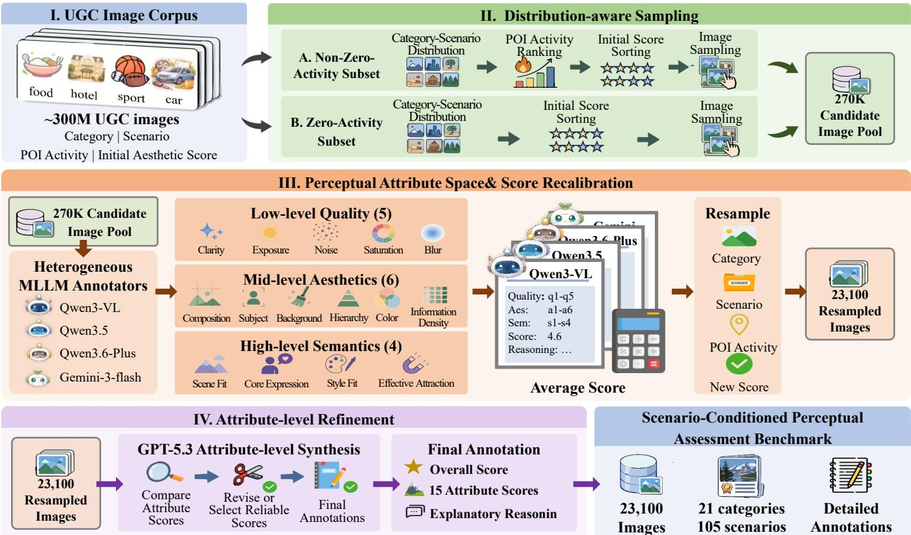
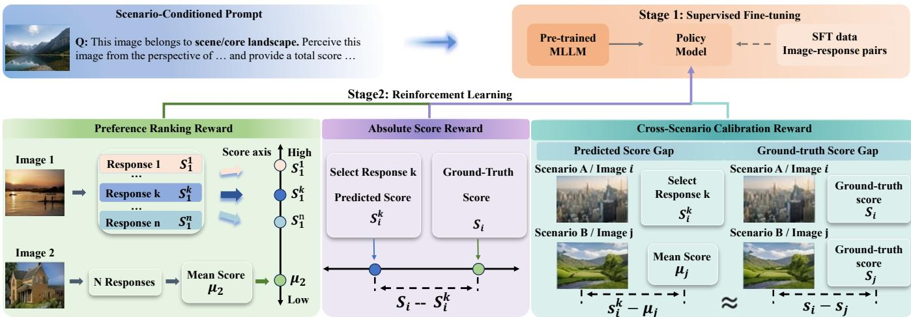
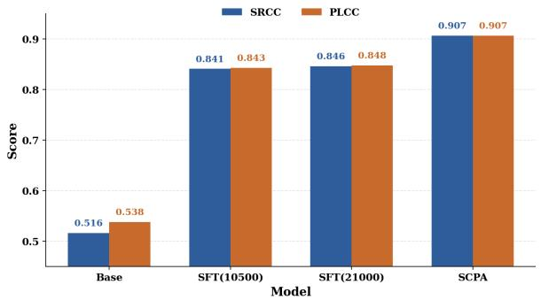

# ScenePercept: Scenario-Conditioned Perceptual Assessment of Real-World User-Generated Content Images

Shuhan Xia1, Yu Chen2, Xiang Wang2\*, Shuai Li2, Peipei Li1†, Ran He3

1Beijing University of Posts and Telecommunications

2Amap, Alibaba Group

3Minzu University of China

†Corresponding author.

\*Project leader.

## Abstract

The rapid development of mobile imaging and social platforms has led to explosive growth in user-generated content (UGC) images, making their systematic and comprehensive perceptual assessment increasingly important. Existing image perception benchmarks are typically task-oriented, curating specific scenarios for quality or aesthetic assessment and applying a uniform perceptual criterion across diverse scenarios. This limits their ability to capture the scene diversity and perceptual complexity of real-world UGC images. To address these limitations, we introduce ScenePercept-Bench, a benchmark designed to reflect the distribution of real-world UGC images, comprising 23,100 images across 21 categories and 105 fine-grained scenes. To account for the influence of scene context on human perception, we design a hierarchical, scene-aware annotation protocol, covering visual quality, aesthetic perception, and scene semantics, with 15 attributes in total. Each image is annotated with an overall score, 15 attribute-level scores, and structured explanatory reasoning. Building on this benchmark, we further introduce Scenario-Conditioned Perceptual Alignment (SCPA), a training framework that tackles the heterogeneity of perceptual criteria across scenarios. SCPA jointly optimizes absolute score prediction, preference ranking, and cross-scenario calibration, preserving the model’s general perceptual assessment ability while encouraging it to explore and adapt perceptual criteria across diferent scenarios. Extensive experiments demonstrate that SCPA achieves state-of-the-art performance in UGC image perception and generalizes efectively to established IQA and IAA benchmarks.

## Introduction

The widespread availability of mobile cameras and online sharing platforms has made user-generated content (UGC) images an important source of real-world visual data. Compared with professionally captured images, UGC images exhibit substantially greater diversity in scene content, visual quality, and aesthetic characteristics. Therefore, reliable perceptual assessment of this heterogeneous visual content is important for a range of applications, such as content recommendation and image quality enhancement.

However, existing image perception benchmarks are insuficient for UGC image assessment in two key aspects:

1) Limited scenario coverage. Most existing benchmarks are constructed from curated artistic collections (Murray, Marchesotti, and Perronnin 2012) or under restricted quality conditions (Hosu et al. 2020), which are designed for quality or aesthetic assessment, failing to represent the diverse categories and scenarios in real-world UGC images. 2) Fixed perception criteria. Existing protocols usually represent human perception using either a single mean opinion score (MOS) (Lin, Hosu, and Saupe 2019) or a fixed set of attributes criteria (Jin et al. 2024; Vera Nieto, Celona, and Fernandez Labrador 2022; Achlioptas et al. 2021; Yi et al. 2023). The former obscures the multidimensional evidence underlying perceptual judgments, while the latter overlooks that the relevance and interpretation of perceptual attributes vary across scene contexts. In practice, appearance-oriented scenarios may emphasize aesthetic appeal, whereas information-oriented scenarios may prioritize semantic completeness. Therefore, UGC image assessment requires a benchmark that captures both distributional diversity and scenario-conditioned perceptual criteria.

To address these limitations, we construct ScenePercept-Bench along three complementary design dimensions. 1) Distribution-Aware Sampling. Based on a large-scale AMAP UGC corpus containing approximately 300M images, we use category and scenario to define the sampling strata, and further allocate samples within each stratum according to the activity of Point of Interest (POI) and initial aesthetic scores. This hierarchical procedure is designed to retain the semantic distribution, exposure distribution and perceptual quality of UGC images. 2) Broad Scenario Coverage. The resulting benchmark contains 23,100 images spanning 21 categories and 105 fine-grained scenarios. This taxonomy enables evaluation across semantically distinct scenarios rather than within a narrow aesthetic or quality domain. 3) Scenario-Conditioned Hierarchical Annotation. Each image is paired with its category and finegrained scenario as explicit contextual conditions during assessment. The annotation protocol organizes perceptual assessment into three levels, including visual quality, aesthetic assessment, and scene semantics, and further represents them through 15 attributes and structured explanatory reasoning. This design provides not only perceptual scores, but also the contextual evidence underlying human judgments, enabling models to learn how perceptual criteria vary across scenarios.

<table><tr><td>Dataset</td><td>Source</td><td>Scen.</td><td>Score</td><td>Reason.</td><td>Attr.</td></tr><tr><td>AVA</td><td>Photography</td><td>一</td><td>√</td><td>x</td><td>一</td></tr><tr><td>TAD66K</td><td>Photography</td><td>47</td><td>√</td><td>x</td><td>一</td></tr><tr><td>KonIQ</td><td>Photography</td><td>一</td><td>√</td><td>x</td><td>一</td></tr><tr><td>FLICKR</td><td>Photography</td><td>9</td><td>√</td><td>x</td><td>一</td></tr><tr><td>UniPercept</td><td>Photography</td><td>17</td><td>√</td><td>√</td><td>13</td></tr><tr><td>RealQA</td><td>UGC</td><td></td><td>√</td><td>√</td><td>10</td></tr><tr><td>Ours</td><td>UGC</td><td>105</td><td>√</td><td>√</td><td>15</td></tr></table>

Table 1: Comparison of existing datasets and ScenePercept-Bench. Scen. denotes scenario, Reason. denotes explanatory reasoning, and Attr. denotes image perceptual attributes.

However, such scenario-conditioned supervision introduces a new modeling challenge: a perceptual model should not simply map heterogeneous images into a shared global perception space, but adapt its assessment criteria according to diferent scene contexts. Existing image assessment models are mainly optimized with scene-agnostic objectives (Wu et al. 2023; Li et al. 2026) and lack explicit mechanisms to adjust perceptual judgments across scenarios. To address this challenge, we propose Scenario-Conditioned Perceptual Alignment (SCPA), a two-stage alignment framework that first learns scenario-aware perceptual reasoning through supervised fine-tuning (SFT) and then optimizes perceptual consistency through reinforcement learning (RL). Specifically, SCPA introduces three complementary objectives: absolute score calibration anchors predictions to scenariospecific score scales, preference ranking preserves relative perceptual ordering among images, and cross-scenario calibration aligns score margins across heterogeneous scenarios to prevent the model from applying a universal perception criterion. Our main contributions are summarized as follows:

• We introduce ScenePercept-Bench, to our knowledge the first scenario-conditioned UGC images perceptual assessment benchmark. The benchmark is built from AMAP UGC corpus and contains 23,100 images across 21 categories and 105 fine-grained scenarios.

• We design a hierarchical annotation protocol that evaluates each image under category and scenario conditions. The protocol provides an overall perceptual score, 15 attribute scores and structured explanations that connect perceptual judgments to the corresponding scene context.

• We propose SCPA, a two-stage alignment framework that addresses the scene relevance exposed by UGC assessment. By combining SFT with rewards for absolute score, preference ranking, and cross-scenario calibration, SCPA encourages models to adapt their perceptual criteria across diferent scenarios.

## Related Work

## Image Assessment Benchmarks

For image assessment, prior research has primarily focused on two major areas: Image Aesthetics Assessment (IAA) and Image Quality Assessment (IQA). Early IQA datasets were constructed by applying controlled synthetic distortions to reference images, providing standardized testbeds for evaluating distortion sensitivity (Sheikh et al. 2006; Larson and Chandler 2010; Ponomarenko et al. 2015; Lin, Hosu, and Saupe 2019). To better reflect practical imaging conditions, subsequent benchmarks shifted toward authentically distorted images captured in unconstrained environments, substantially expanding the diversity of visual content and real-world degradation patterns (Ghadiyaram and Bovik 2015; Hosu et al. 2020; Fang et al. 2020). Some recent datasets further enrich quality supervision with attribute annotations, supporting more fine-grained analysis beyond global quality scores (Ying et al. 2020). Early IAA benchmarks established aesthetic rating protocols for natural photographs, typically representing human judgments through mean opinion scores (Murray, Marchesotti, and Perronnin 2012; Kong et al. 2016). Recent datasets further account for subjective variations through personalized annotations, annotator information, and specialized collections such as artistic imagery (Yang et al. 2022; Yi et al. 2023; Ke et al. 2023; Cao et al. 2026; Zhao et al. 2026). Despite this progress, most existing benchmarks are designed around particular distortion models, content domains, or aesthetic objectives. In contrast, as shown in Table 1, ScenePercept-Bench provides fine-grained scenario coverage, multi-level attribute annotations, and structured explanatory reasoning content, enabling comprehensive perceptual assessment of UGC images.

## Image Assessment Methods

Early image assessment methods relied on handcrafted features and manually designed perceptual rules (Mavridaki and Mezaris 2015; Mittal, Soundararajan, and Bovik 2012). With the emergence of large-scale human-annotated datasets, deep models trained on mean opinion scores became the dominant paradigm for both aesthetic prediction (Kong et al. 2016; Ren et al. 2017; Yang et al. 2022). Recently, Multimodal Large Language Models (MLLMs) have extended image assessment beyond scalar regression by supporting prompt-based evaluation, attribute analysis, and language-based explanations (Ke et al. 2023; Wu et al. 2023; You et al. 2025; Li et al. 2025). In parallel, model-as-a-judge and reward modeling have shown that intermediate reasoning and preference supervision can improve evaluation consistency, motivating reinforcement-learning-based image assessment with absolute scores or pairwise rankings (Li et al. 2026; Wu et al. 2026; Liu et al. 2025). However, existing methods are typically optimized under a globally shared perceptual criterion and provide limited mechanisms for adapting scoring and preference judgments to heterogeneous UGC scenarios.

## ScenePercept-Bench

## Benchmark Definition

We construct ScenePercept-Bench, a scenario-conditioned benchmark for UGC image perceptual assessment. Formally, each sample is defined as a conditional assessment unit (x, c, a, s, r), where x, c, a, s, and r respectively denote the UGC image, category and fine-grained scenario, attributelevel perceptual scores, overall scene-conditioned score, and explanatory rationale. This formulation treats scene context as an explicit condition for interpreting visual quality, rather than auxiliary metadata added after annotation.

  
Figure 1: Pipeline for constructing ScenePercept-Bench. A 270K candidate pool is built from AMAP UGC corpus via distribution-aware sampling. Heterogeneous MLLMs perform scenario-conditioned assessment for score calibration and resampling, followed by GPT-5.3 refinement to produce 23,100 images with perceptual labels.

## Data Collection

As shown in Figure 1.I, ScenePercept-Bench is constructed from the AMAP UGC corpus, a large-scale database containing 300M user-uploaded images from real-world scenes. Each image has POI-level metadata. To capture source distribution, we retain four fields: category, scenario, POI activity, and initial aesthetic score. Category provides the highest-level semantic abstraction, whereas scenario denotes a finer-grained visual subtype within that category (Top 5 selected). Together, these fields characterize POI semantics. POI activity reflects real-world exposure. The initial aesthetic score is the only field related to perceptual quality and provides a coarse perceptual prior despite being generated by a biased lightweight predictor.

## Data Annotation

Distribution-Aware Sampling. We observe a highly skewed exposure distribution in the source corpus, with approximately 90% of POIs having zero activity. Direct sampling from the full POI population would reduce the representation of active POIs, despite their dominance in real-world exposures. To address this imbalance, we adopt a dual-branch sampling strategy that allocates equal sampling budgets to zero- and non-zero-activity POIs (Figure 1.II). For non-zeroactivity POIs, we stratify by category–scenario, rank POIs by activity within each stratum, and sample uniformly across strata. For each selected POI, we rank associated images by initial aesthetic score and uniformly sample up to 10 images. For zero-activity POIs, we retain category–scenario and aesthetic-score-aware sampling while removing activitybased stratification. The two branches are then merged into a candidate pool of approximately 270K images. This design preserves semantic coverage and coarse perceptual variation in the zero-activity majority while ensuring that active POIs remain suficiently represented in the benchmark.

Perceptual Attribute Space. To align annotation with human perception, we define a three-level perceptual attribute space covering visual quality, aesthetics, and scene semantics, resulting in 15 attributes. For the low-level quality and mid-level aesthetic dimensions, we consolidate attribute definitions from existing IQA and IAA literature. For the highlevel scene-semantic dimension, we consult domain practitioners to derive attributes that reflect how images are actually perceived in real-world applications. This design grounds the benchmark in established perceptual attribution while extending it to scene-dependent judgments.

<table><tr><td>Model</td><td>Spearman</td><td>Within-0.5 Rate</td><td>Within-1.0 Rate</td></tr><tr><td>Qwen-series</td><td>0.892</td><td>0.898</td><td>0.990</td></tr><tr><td>Gemini-3</td><td>0.928</td><td>0.918</td><td>0.988</td></tr><tr><td>GPT-5.3</td><td>0.960</td><td>0.964</td><td>0.990</td></tr></table>

Table 2: Human agreement of the final score. Spearman measures rank consistency between overall score and human judgments, while Within-0.5 and Within-1.0 report the proportions of samples within 0.5 and 1.0 score deviations.

Initial Score Recalibration. Since the initial aesthetic scores attached to the 270K candidate pool are produced by a lightweight IAA model trained on limited scenario, they are too biased to serve as the final sampling prior for UGC images. The multimodal reasoning capacity of MLLMs provides a practical route to recalibrate these noisy priors. As shown in Figure 1.III, we prompt Qwen-series (Bai et al. 2025b) and Gemini-series (DeepMind 2025) models with each image and its category–scenario context, and employ chain-of-thought reasoning to decompose perception assessment into attribute-level judgments. Each MLLM outputs structured annotations containing 15 attribute scores, rationales, and an overall score. We average the overall scores across MLLMs to replace the initial aesthetic scores in the sampling metadata. Based on the updated scores, we rerun the distribution-aware sampling process and obtain 23,100 images from 21 categories and 105 scenarios.

Attribute-level Refinement. Although the first-pass annotations substantially reduce the bias of initial aesthetic score, they still exhibit model-series-specific bias at the attribute level, such as Qwen-series models tend to overestimate quality attributes, whereas Gemini-series models may underweight scene semantics. To obtain final annotations, as shown in Figure 1.IV we apply GPT-5.3 (OpenAI 2026) to each selected image together with the first-pass annotations. GPT-5.3 revises attribute scores when they conflict with visual evidence or scene context, and then recomputes the overall score from the corrected attribute profile.

Human Correction and Quality Control. We conduct a manual inspection over all 23,100 images to ensure annotation reliability. First, we remove images containing watermarks and copyright-related identifiers. Second, we verify that the annotation procedure is free from leakage of the initial aesthetic scores, ensuring that the final annotation results are from MLLMs’ independent judgment. Third, we inspect the explanations to ensure that they accurately reflect the visual content and the corresponding scenario conditions.

Annotation Consistency Validation. To verify that the final annotations reflect human-aligned perceptual patterns rather than being dominated by a single MLLM, we uniformly sample 1,500 images covering all categories and scenarios for human evaluation. As shown in Table 2, we compare human judgments with annotations generated by Qwenseries, Gemini-3-flash, and GPT-5.3. All MLLM-based annotations achieve strong agreement with human judgments (Spearman: 0.89–0.96), with GPT-5.3-refined annotations obtaining the highest consistency. This demonstrates that GPT-5.3 efectively refines perceptual diferences among MLLM outputs, while the final annotations capture a consensus across multiple models rather than the preference of any individual model. Additional details, including annotation prompts, category/scenario definitions, and attributelevel human consistency, are provided in the Appendix.

## Method

## Problem Formulation

Given the ScenePercept-Bench $\mathbf { \mathcal { D } } = \{ ( x _ { i } , c _ { i } , \mathbf { a } _ { i } , s _ { i } , r _ { i } ) \} _ { i = 1 } ^ { N }$ where $x _ { i } , c _ { i } , \mathbf { a } _ { i } , s _ { i } ,$ and $r _ { i }$ denote the image, scenario condition, 15 attribute scores, overall score, and perceptual rationale, respectively, our goal is to fine-tune an MLLM policy $\pi _ { \boldsymbol { \theta } } ( \cdot | \boldsymbol { x } , c )$ to generate scenario-conditioned perceptual assessments. For each image-scenario pair $( x _ { i } , c _ { i } )$ , the predicted assessment trajectory is:

$$
\tau _ { i } = ( \hat { r } _ { i } , \hat { \mathbf { a } } _ { i } , \hat { s } _ { i } ) \sim \pi _ { \boldsymbol { \theta } } ( \cdot | x _ { i } , c _ { i } ) .\tag{1}
$$

## Scenario-Conditioned Perceptual Alignment

Based on the scenario-conditioned supervision in ScenePercept-Bench, we propose Scenario-Conditioned Perceptual Alignment (SCPA), a two-stage framework that aligns pretrained MLLMs with diverse perceptual criteria. As shown in Figure. 2, SCPA first applies SFT to learn structured scenario-aware assessment, followed by RL optimization with three objectives, including absolute score calibration, preference ranking, and cross-scenario calibration.

Preference ranking reward. Ranking is a natural way to express subjective perceptual judgments. Humans often find it easier to compare candidates than to assess each image in isolation. Inspired by RL to Ranking (Wu et al. 2026), we introduce a preference ranking reward to encourage the model to preserve the preference structure among images.

To obtain a continuous ranking signal for policy optimization, we adopt a Thurstone probabilistic ranking formulation (Thurstone 2017). For each image $x _ { i }$ , the policy samples K trajectories and produces predicted scores $\{ \hat { s } _ { i } ^ { k } \check  \} _ { k = 1 } ^ { K }$ . We estimate the latent perceptual distribution of image i from these sampled predictions, and compute the probability that the k-th prediction of image i is preferred over image j as:

$$
p _ { i j } ^ { k } = \Phi \left( \frac { \hat { s } _ { i } ^ { k } - \mu _ { j } } { \sqrt { \sigma _ { i } ^ { 2 } + \sigma _ { j } ^ { 2 } + \gamma } } \right) ,\tag{2}
$$

where $\Phi ( \cdot )$ is the standard Gaussian cumulative distribution function, $\mu _ { j }$ and $\sigma _ { j } ^ { 2 }$ denote the mean and variance of the sampled predictions for image $j ,$ and $\gamma$ is a small constant for numerical stability. The reference preference is derived from the annotated overall scores:

$$
p _ { i j } ^ { * } = \left\{ { \begin{array} { l l } { 1 , } & { s _ { i } \geq s _ { j } , } \\ { 0 , } & { s _ { i } < s _ { j } , } \end{array} } \right.\tag{3}
$$

and the ranking reward is defined by a continuous measure:

$$
R _ { \mathrm { r a n k } } ( \tau _ { i } ^ { k } ) = \frac { 1 } { | \mathcal { N } _ { i } | } \sum _ { j \in \mathcal { N } _ { i } } \left( \sqrt { p _ { i j } ^ { * } p _ { i j } ^ { k } } + \sqrt { ( 1 - p _ { i j } ^ { * } ) ( 1 - p _ { i j } ^ { k } ) } \right)\tag{4}
$$

  
Figure 2: Framework overview of SCPA. SCPA first learns scenario-aware perceptual reasoning through supervised fine-tuning and subsequently optimizes perceptual alignment via reinforcement learning.

where $\mathcal { N } _ { i }$ denotes the set of comparison samples for image i. Unlike binary ranking rewards that only indicate whether an ordering is correct, this formulation provides pairwise ranking according to the continuous reward, which enables more stable, precise signals of sampled trajectories.

Absolute score reward. Preference ranking preserves ordinal relationships among images, but it cannot constrain the absolute position of each image on the perceptual score scale. Therefore, we introduce an absolute score reward to align the generated score with the annotated scenario-conditioned score. Given the k-th sampled trajectory $\tau _ { i } ^ { k }$ for image $x _ { i } ,$ we parse its predicted overall score as $\hat { s } _ { i } ^ { k }$ . The absolute score reward is defined by a Gaussian-shaped error function:

$$
R _ { \mathrm { a b s } } ( \tau _ { i } ^ { k } ) = \exp \left( - ( \hat { s } _ { i } ^ { k } - s _ { i } ) ^ { 2 } \right) ,\tag{5}
$$

where $s _ { i }$ is the annotated overall perceptual score.

Cross-scenario calibration reward. Preference ranking and absolute score provide image-level supervision signals, but they fail to explicitly capture scene-dependent perceptual criteria. In real-world UGC images, the impact of the same visual attribute can vary significantly across diferent scenarios. For example, vivid colors may enhance the perceived quality of vision-oriented images, while reducing the clarity of information-oriented images. As a result, images with identical scores may reflect distinct underlying perceptual standards, and relying on a shared criterion can lead to systematic overestimation or underestimation.

Such bias becomes more evident in cross-scene comparisons. While a single image score only reflects its isolated perception, the relative score gap across multiple images amplifies the discrepancy between diferent perceptual standards. Therefore, we introduce a cross-scene calibration reward to align the predicted score diferences with the groundtruth score diferences, enabling the model to better capture scene-aware perceptual quality. Given a cross-scenario pair set $\mathcal { P } _ { \mathrm { c r o s s } } = \mathbf { \dot { \{ } }  ( i , j ) \mid c _ { i } \mathbf { \dot { \neq } } c _ { j } \mathbf  \dot { \} }$ , for the k-th sampled trajectory of image $x _ { i }$ , the margin error is defined as:

$$
\Delta _ { i j } ^ { k } = \left( \hat { s } _ { i } ^ { k } - \mu _ { j } \right) - \left( s _ { i } - s _ { j } \right) ,\tag{6}
$$

where $\mu _ { j }$ is the mean predicted score of image xj. The crossscenario calibration reward is then defined as:

$$
R _ { \mathrm { c r o s s } } ( \tau _ { i } ^ { k } ) = \frac { 1 } { | \mathcal { M } _ { i } | } \sum _ { j \in \mathcal { M } _ { i } } \exp \left( - \frac { ( \Delta _ { i j } ^ { k } ) ^ { 2 } } { 2 \sigma _ { \mathrm { c r o s s } } ^ { 2 } } \right) ,\tag{7}
$$

where $\mathcal { M } _ { i } = \{ j \ | \ ( i , j ) \in \mathcal { P } _ { \mathrm { c r o s s } } \}$ and $\sigma _ { \mathrm { c r o s s } }$ controls the tolerance to cross-scenario margin deviation. Unlike absolute score, cross-scenario calibration explicitly constrains relative score relationships across scenarios and corrects scenariolevel score ofsets. The final reward conbimes the three items:

$$
R _ { \mathrm { S C P A } } ( \tau _ { i } ^ { k } ) = R _ { \mathrm { r a n k } } ( \tau _ { i } ^ { k } ) + R _ { \mathrm { a b s } } ( \tau _ { i } ^ { k } ) + R _ { \mathrm { c r o s s } } ( \tau _ { i } ^ { k } ) .\tag{8}
$$

Cold-start SFT. The policy is first cold-started with SFT on the structured annotations. For each image-scenario input $( x _ { i } , c _ { i } )$ , we minimize the negative log-likelihood:

$$
{ \mathcal { L } } _ { \mathrm { S F T } } ( \theta ) = - \mathbb { E } _ { ( x _ { i } , c _ { i } , \tau _ { i } ^ { * } ) \sim \mathcal { D } } \left[ \log \pi _ { \theta } ( \tau _ { i } ^ { * } \mid x _ { i } , c _ { i } ) \right] .\tag{9}
$$

This stage equips the model with the scene-conditioned perceptual reasoning and structured output.

DAPO Training. The second stage optimizes the model with DAPO (Yu et al. 2026). For each image-scenario input $( x _ { i } , c _ { i } )$ , the old policy $\pi _ { \theta _ { \mathrm { o l d } } }$ samples a group of K assessment trajectories $\{ \tau _ { i } ^ { k } \} _ { k = 1 } ^ { K }$ . Each trajectory is assigned an SCPA reward $R _ { i } ^ { k }$ , which is normalized within the sampled group to compute the advantage:

$$
\hat { A } _ { i } ^ { k } = \frac { R _ { i } ^ { k } - \mu ( \{ R _ { i } ^ { k } \} _ { k = 1 } ^ { K } ) } { \sigma ( \{ R _ { i } ^ { k } \} _ { k = 1 } ^ { K } ) + \epsilon } .\tag{10}
$$

The policy is optimized with the clipped surrogate objective:

$$
\begin{array} { c } { \displaystyle \mathcal { L } _ { \mathrm { c l i p } } ( \theta ) = \displaystyle \frac { 1 } { K } \sum _ { k = 1 } ^ { K } \frac { 1 } { | \tau _ { i } ^ { k } | } \sum _ { t = 1 } ^ { | \tau _ { i } ^ { k } | } \mathrm { m i n } \left( \rho _ { i , k } \hat { A } _ { i } ^ { k } , \right. } \\ { \left. \mathrm { c l i p } ( \rho _ { i , k } , 1 - \epsilon _ { \mathrm { l o w } } , 1 + \epsilon _ { \mathrm { h i g h } } ) \hat { A } _ { i } ^ { k } \right) , } \end{array}\tag{11}
$$

where $\rho _ { i , k , t }$ denotes the importance ratio.

<table><tr><td>Category</td><td>Methods</td><td>ScenePercept-Bench</td><td>TAD66K</td><td>AVA</td><td>KonIQ</td><td>FLICKR-AES</td></tr><tr><td rowspan="4">Proprietary Models</td><td>Gemini-2.5-pro Gemini-3-flash</td><td>0.574 / 0.593</td><td>0.143 / 0.037</td><td>0.248 / 0.100</td><td>0.582 / 0.316</td><td>0.357 / 0.206</td></tr><tr><td></td><td>0.712 / 0.735</td><td>0.286 / 0.289</td><td>0.483 / 0.479</td><td>0.703 / 0.703</td><td>0.614 / 0.608</td></tr><tr><td>GPT-4o</td><td>0.638 / 0.651</td><td>0.278 / 0.282</td><td>0.509 / 0.485</td><td>0.695 / 0.744</td><td>0.605 / 0.597</td></tr><tr><td>GPT-5.3</td><td>0.763 / 0.771</td><td>0.299 / 0.306</td><td>0.525 / 0.516</td><td>0.719 / 0.705</td><td>0.630 / 0.642</td></tr><tr><td rowspan="6">Open-source Models</td><td>Qwen2.5-VL-7B Qwen3-VL-8B</td><td>0.516 / 0.538</td><td>0.208 / 0.195</td><td>0.359 / 0.324</td><td>0.708 / 0.762</td><td>0.588 / 0.520</td></tr><tr><td>Intern3-VL-8B</td><td>0.504 / 0.512</td><td>0.191 / 0.121</td><td>0.280 / 0.170</td><td>0.761 / 0.822</td><td>0.507 / 0.388</td></tr><tr><td></td><td>0.492 / 0.515</td><td>0.205 / 0.191</td><td>0.372 / 0.344</td><td>0.574 / 0.646</td><td>0.547 / 0.476</td></tr><tr><td>Intern3.5-VL-8B</td><td>0.506 / 0.523</td><td>0.180 / 0.182</td><td>0.308 / 0.295</td><td>0.663 / 0.660</td><td>0.519 / 0.448</td></tr><tr><td>Qwen2.5-VL-32B</td><td>0.537 / 0.559</td><td>0.215 / 0.217</td><td>0.396 / 0.373</td><td>0.754 / 0.809</td><td>0.613 / 0.582</td></tr><tr><td>Qwen3-VL-32B</td><td>0.544 / 0.565</td><td>0.200 / 0.095</td><td>0.353 / 0.198</td><td>0.796 / 0.838</td><td>0.572 / 0.413</td></tr><tr><td rowspan="5">Specialized Models</td><td>Q-Align* DeQA-Score</td><td>0.659 / 0.686</td><td>0.295 / 0.286</td><td>0.442 / 0.451</td><td>0.612 / 0.663</td><td>0.623 / 0.637</td></tr><tr><td>VisualQuality-R1*</td><td>0.585 / 0.608</td><td>0.285 / 0.285</td><td>0.572 / 0.589</td><td>0.677 / 0.703</td><td>0.606 / 0.589</td></tr><tr><td>RAPO*</td><td>0.753 / 0.862 0.890 / 0.890</td><td>0.285 / 0.248 0.302 / 0.310</td><td>0.488 / 0.409</td><td>0.704 / 0.697</td><td>0.623 / 0.545 0.647 / 0.665</td></tr><tr><td>SCPA* (Ours)</td><td></td><td>0.304 / 0.317</td><td>0.517 / 0.511 0.529 / 0.524</td><td>0.712 / 0.708 0.724 / 0.715</td><td>0.647 / 0.668</td></tr><tr><td></td><td>0.907 / 0.907</td><td></td><td></td><td></td><td></td></tr></table>

Table 3: SRCC/PLCC comparison on ScenePercept-Bench and four public image assessment datasets. Methods marked with ∗ are retrained on the ScenePercept-Bench. The best results are highlighted in bold, and the second-best results are underlined.

## Experiments

## Dataset and Metrics

We adopt ScenePercept-Bench and four public image assessment datasets: TAD66K (He et al. 2022), AVA (Murray, Marchesotti, and Perronnin 2012), KonIQ-10k (Hosu et al. 2020), and FLICKR-AES (Ren et al. 2017). Models are trained on ScenePercept-Bench to evaluate perceptual assessment on multi-scenario UGC images, with TAD66K, AVA, KonIQ-10k, and FLICKR-AES serving as out-of-domain datasets for conventional IQA and IAA evaluation. Following prior image assessment work, model performance is quantified using the Pearson linear correlation coeficient (PLCC) and the Spearman rank-order correlation coeficient (SRCC) between predicted scores and ground-truth annotations.

## Baselines and Implementation

We compare our method with: 1) proprietary MLLMs, including Gemini series (DeepMind 2025) and GPT series (OpenAI 2026); 2) open-source MLLMs, including Qwen2.5-VL series (Bai et al. 2025b), Qwen3-VL series (Bai et al. 2025a) and Intern-series (Zhu et al. 2025; Wang et al. 2025); and 3) specialized models, including Q-Align (Wu et al. 2023), DeQA-Score (You et al. 2025), VisualQuality-R1 (Wu et al. 2026) and RAPO (Liu et al. 2025).

We adopt Qwen2.5-VL-7B as the backbone and split ScenePercept-Bench into 10.5K/10.5K/2.1K samples for SFT, RL, and testing, respectively. During annotation, we employ Qwen-series models (Qwen3-VL-235B-A22B, Qwen3.5-397B-A17B, Qwen3.6-Plus), Gemini-3-flash, and GPT-5.3, with the human-annotated subset included in the test set. The coeficient $\sigma _ { \mathrm { c r o s s } }$ is set to 0.2. For fair comparison, Q-Align, VisualQuality-R1, and RAPO are retrained under identical settings, while DeQA-Score is trained on AVA due to missing standard deviation annotations. More details are provided in Appendix.

  
Figure 3: Efect of training strategies. Adding the same 10,500 samples as supervised data (SFT(21,000)) barely helps, while SCPA further improves performance.

## Main Results

Table 3 compares SCPA with all baselines. We draw three observations.

Existing MLLMs struggle with scenario-conditioned perceptual assessment. Although recent MLLMs achieve strong general visual understanding, their performance on ScenePercept-Bench remains limited. Gemini-3-flash reaches only 0.712 SRCC and 0.735 PLCC, while GPT-5.3 reaches 0.763 SRCC and 0.771 PLCC, indicating that general vision-language capability alone is insuficient for fine-grained multi-scenario UGC assessment.

SCPA efectively improves scenario-conditioned perceptual assessment. SCPA obtains 0.907 / 0.907 SRCC / PLCC, outperforming the strongest specialized baseline RAPO and other MLLMs, showing that cross-scenario perceptual alignment is efective for heterogeneous UGC scenes.

SCPA generalizes to conventional IAA and IQA benchmarks. Beyond ScenePercept-Bench, SCPA achieves the best performance on TAD66K and FLICKR-AES, and obtains competitive results on AVA and KonIQ-10k. These results suggest that SCPA preserves transferable perception ability on traditional image assessment benchmarks.

<table><tr><td rowspan="2"> $R _ { \mathrm { r a n k } }$ </td><td rowspan="2"> $R _ { \mathrm { a b s } }$ </td><td rowspan="2"> $R _ { \mathrm { c r o s s } }$ </td><td colspan="2">ScenePercept-Bench</td><td colspan="2">TAD66K</td><td colspan="2">AVA</td><td colspan="2">KonIQ</td><td colspan="2">FLICKR-AES</td></tr><tr><td>SRCC</td><td>PLCC</td><td>SRCC</td><td>PLCC</td><td>SRCC</td><td>PLCC</td><td>SRCC</td><td>PLCC</td><td>SRCC</td><td>PLCC</td></tr><tr><td>√</td><td>√</td><td>x</td><td>0.892</td><td>0.892</td><td>0.303</td><td>0.316</td><td>0.520</td><td>0.520</td><td>0.707</td><td>0.706</td><td>0.647</td><td>0.642</td></tr><tr><td>√</td><td>x</td><td>√</td><td>0.898</td><td>0.897</td><td>0.310</td><td>0.313</td><td>0.518</td><td>0.509</td><td>0.703</td><td>0.710</td><td>0.639</td><td>0.664</td></tr><tr><td>x</td><td>√</td><td>√</td><td>0.898</td><td>0.895</td><td>0.288</td><td>0.290</td><td>0.500</td><td>0.478</td><td>0.714</td><td>0.703</td><td>0.632</td><td>0.644</td></tr><tr><td>√</td><td>√</td><td>√</td><td>0.907</td><td>0.907</td><td>0.304</td><td>0.317</td><td>0.529</td><td>0.524</td><td>0.724</td><td>0.715</td><td>0.647</td><td>0.668</td></tr></table>

Table 4: Ablation studies of diferent reward components. ✓ means the reward is used, and ✗ means the reward is removed.

<table><tr><td>Methods</td><td>ScenePercept-Bench</td><td>Human Subset</td></tr><tr><td>Qwen-series</td><td>0.562</td><td>0.543</td></tr><tr><td>Gemini-3-flash</td><td>0.712</td><td>0.699</td></tr><tr><td>GPT-5.3</td><td>0.763</td><td>0.756</td></tr><tr><td>RAPO</td><td>0.890</td><td>0.874</td></tr><tr><td>SCPA</td><td>0.907</td><td>0.895</td></tr></table>

Table 5: SRCC comparison on the full ScenePercept-Bench and the human-annotated subset.

Efect of Training. Figure 3 compares diferent training strategies on Qwen2.5-VL-7B. SFT with 10.5K samples improves SRCC/PLCC from 0.516/0.538 to 0.841/0.843. Adding the remaining 10.5K samples as additional SFT data brings marginal gains (0.846/0.848), while optimizing them with DAPO significantly improves performance to 0.907/0.907, demonstrating that the gain comes from preference optimization and cross-scenario calibration rather than data scaling. Furthermore, SCPA surpasses the labelsynthesis model GPT-5.3 (0.763/0.771), indicating that it learns scenario-conditioned perceptual assessment rather than merely distilling the teacher model.

Validation on Human-Annotated Subset. To further verify the alignment between SCPA and human perception, we re-evaluate the MLLMs involved in the annotation process, RAPO, and SCPA on human-annotated subset. Table 5 shows that SCPA achieves the highest SRCC on both the full ScenePercept-Bench and the human-annotated subset, demonstrating its superior consistency with human judgments. The consistent performance trends of all methods across two subsets further validate the reliability of our annotation process and the robustness of the evaluation protocol.

## Ablation Study

Reward Function. Table 4 evaluates the contribution of each reward function. Removing any reward degrades performance, demonstrating their complementary roles. In particular, removing $R _ { \mathrm { c r o s s } }$ causes the largest drop on ScenePercept-Bench $( 0 . 9 0 \bar { 7 } / 0 . 9 0 7 {  } 0 . 8 9 2 / 0 . 8 9 \bar { 2 } )$ , highlighting the importance of cross-scenario calibration. Meanwhile, removing $R _ { \mathrm { a b s } }$ or $R _ { \mathrm { r a n k } }$ also reduces performance, confirming the necessity of absolute score and preference ranking. The full reward design achieves the best results, validating the efectiveness of combining the three objectives.

<table><tr><td>Setting</td><td>Full Test SRCC</td><td>Full Test PLCC</td></tr><tr><td>Correct Scenario</td><td>0.907</td><td>0.907</td></tr><tr><td>Remove Scenario</td><td>0.869</td><td>0.874</td></tr><tr><td>Shuffled Scenario</td><td>0.701</td><td>0.711</td></tr></table>

Table 6: Efect of scenario conditions on ScenePercept-Bench performance.

Efect of Scenario Conditions. To verify that SCPA genuinely conditions its perceptual judgments on scene context, we evaluate the same SCPA checkpoint under three inference settings: providing the correct category and scenario, masking the fine-grained scenario, and substituting an incorrect scenario from the same category. Masking the scenario degrades SRCC/PLCC on ScenePercept-Bench from 0.907/0.907 to 0.869/0.874, while providing a misleading scenario causes a substantially larger drop to 0.701/0.711. Since the misleading setting preserves the prompt format, this sharp degradation indicates that SCPA relies on the semantics of the scene condition rather than its surface form: incorrect scene context actively misguides the perceptual criteria instead of being ignored. These results confirm that fine-grained scene context is an essential input for scenarioconditioned perceptual assessment.

Hyperparameter Analysis. We analyze the efect of $\sigma _ { \mathrm { c r o s s } }$ by varying it over {0.8, 0.4, 0.2, 0.1}. Weaker constraints provide insuficient scenario-aware calibration, while overly strict ones slightly improve in-domain results at the cost of generalization to other benchmarks; $\sigma _ { \mathrm { c r o s s } } = 0 . 2$ achieves the best overall trade-of. Detailed results are provided in the Appendix.

## Conclusion

In this work, we introduce ScenePercept-Bench and SCPA for scenario-conditioned perceptual assessment of real-world UGC images. ScenePercept-Bench provides a benchmark with diverse scenarios and hierarchical perceptual annotations, enabling models to capture how visual criteria vary across diferent contexts. SCPA jointly optimizes absolute score prediction, preference ranking, and cross-scenario calibration, encouraging it to explore and adapt perceptual criteria across diferent scenarios. Extensive experiments demonstrate that SCPA achieves state-of-the-art performance on ScenePercept-Bench and generalizes efectively to existing IQA and IAA benchmarks. We hope that this work will encourage further research on multi-scenario visual perception.

## References

Achlioptas, P.; Ovsjanikov, M.; Haydarov, K.; Elhoseiny, M.; and Guibas, L. J. 2021. Artemis: Afective language for visual art. In Proceedings of the IEEE/CVF Conference on Computer Vision and Pattern Recognition.

Bai, S.; Cai, Y.; Chen, R.; Chen, K.; Chen, X.; Cheng, Z.; Deng, L.; Ding, W.; Gao, C.; Ge, C.; et al. 2025a. Qwen3-vl technical report. arXiv preprint arXiv:2511.21631.

Bai, S.; Chen, K.; Liu, X.; Wang, J.; Ge, W.; Song, S.; Dang, K.; Wang, P.; Wang, S.; Tang, J.; Zhong, H.; Zhu, Y.; Yang, M.; Li, Z.; Wan, J.; Wang, P.; Ding, W.; Fu, Z.; Xu, Y.; Ye, J.; Zhang, X.; Xie, T.; Cheng, Z.; Zhang, H.; Yang, Z.; Xu, H.; and Lin, J. 2025b. Qwen2.5-VL Technical Report. arXiv preprint arXiv:2502.13923.

Cao, S.; Ma, N.; Li, J.; Li, X.; Shao, L.; Zhu, K.; Zhou, Y.; Pu, Y.; Wu, J.; Wang, J.; et al. 2026. Artimuse: Finegrained image aesthetics assessment with joint scoring and expert-level understanding. In Proceedings ofthe IEEE/CVF Conference on Computer Vision and Pattern Recognition.

DeepMind, G. 2025. Gemini 3 Flash: Frontier Intelligence Built for Speed. https://deepmind.google/models/gemini/. Accessed: 2025-12-17.

Fang, Y.; Zhu, H.; Zeng, Y.; Ma, K.; and Wang, Z. 2020. Perceptual quality assessment of smartphone photography. In Proceedings of the IEEE/CVF conference on computer vision and pattern recognition.

Ghadiyaram, D.; and Bovik, A. C. 2015. Massive online crowdsourced study of subjective and objective picture quality. IEEE transactions on image processing.

He, S.; Zhang, Y.; Xie, R.; Jiang, D.; and Ming, A. 2022. Rethinking Image Aesthetics Assessment: Models, Datasets and Benchmarks. In IJCAI.

Hosu, V.; Lin, H.; Sziranyi, T.; and Saupe, D. 2020. KonIQ-10k: An ecologically valid database for deep learning of blind image quality assessment. IEEE Transactions on Image Processing.

Jin, X.; Qiao, Q.; Lu, Y.; Wang, H.; Huang, H.; Gao, S.; Liu, J.; and Li, R. 2024. APDDv2: Aesthetics of Paintings and Drawings Dataset with Artist Labeled Scores and Comments. In NeurIPS.

Ke, J.; Ye, K.; Yu, J.; Wu, Y.; Milanfar, P.; and Yang, F. 2023. Vila: Learning image aesthetics from user comments with vision-language pretraining. In Proceedings of the IEEE/CVF Conference on Computer Vision and Pattern Recognition.

Kong, S.; Shen, X.; Lin, Z.; Mech, R.; and Fowlkes, C. 2016. Photo aesthetics ranking network with attributes and content adaptation. In European conference on computer vision.

Larson, E. C.; and Chandler, D. M. 2010. Most apparent distortion: full-reference image quality assessment and the role of strategy. Journal of electronic imaging.

Li, M.; Wang, R.; Sun, L.; Bai, Y.; and Chu, X. 2025. Next token is enough: Realistic image quality and aesthetic scoring with multimodal large language model. arXiv preprint arXiv:2503.06141.

Li, W.; Zhang, X.; Zhao, S.; Zhang, Y.; Li, J.; Zhang, J.; et al. 2026. Q-insight: Understanding image quality via visual reinforcement learning. Advances in Neural Information Processing Systems.

Lin, H.; Hosu, V.; and Saupe, D. 2019. KADID-10k: A largescale artificially distorted IQA database. In 2019 Eleventh International Conference on Quality of Multimedia Experience (QoMEX).

Liu, B.; Hu, Y.; Jin, S.; Dou, S.; Shi, G.; Shao, J.; Gui, T.; and Huang, X. 2025. Unlocking the Essence of Beauty: Advanced Aesthetic Reasoning with Relative-Absolute Policy Optimization. arXiv preprint arXiv:2509.21871.

Mavridaki, E.; and Mezaris, V. 2015. A comprehensive aesthetic quality assessment method for natural images using basic rules of photography. In 2015 IEEE International Conference on Image Processing (ICIP).

Mittal, A.; Soundararajan, R.; and Bovik, A. C. 2012. Making a “completely blind” image quality analyzer. IEEE Signal processing letters.

Murray, N.; Marchesotti, L.; and Perronnin, F. 2012. AVA: A large-scale database for aesthetic visual analysis. In 2012 IEEE conference on computer vision andpattern recognition.

OpenAI. 2026. GPT-5.3 System Card. https://openai.com/ index/gpt-5-3-system-card/.

Ponomarenko, N.; Jin, L.; Ieremeiev, O.; Lukin, V.; Egiazarian, K.; Astola, J.; Vozel, B.; Chehdi, K.; Carli, M.; Battisti, F.; et al. 2015. Image database TID2013: Peculiarities, results and perspectives. Signal processing: Image communication.

Ren, J.; Shen, X.; Lin, Z.; Mech, R.; and Foran, D. J. 2017. Personalized image aesthetics. In Proceedings of the IEEE international conference on computer vision.

Sheikh, H. R.; Sabir, M. F.; Bovik, A. C.; et al. 2006. A statistical evaluation of recent full reference image quality assessment algorithms. IEEE Trans. Image Process.

Thurstone, L. L. 2017. A law of comparative judgment. In Scaling.

Vera Nieto, D.; Celona, L.; and Fernandez Labrador, C. 2022. Understanding aesthetics with language: A photo critique dataset for aesthetic assessment. Advances in Neural Information Processing Systems.

Wang, W.; Gao, Z.; Gu, L.; Pu, H.; Cui, L.; Wei, X.; Liu, Z.; Jing, L.; Ye, S.; Shao, J.; et al. 2025. InternVL3.5: Advancing Open-Source Multimodal Models in Versatility, Reasoning, and Eficiency. arXiv preprint arXiv:2508.18265.

Wu, H.; Zhang, Z.; Zhang, W.; Chen, C.; Liao, L.; Li, C.; Gao, Y.; Wang, A.; Zhang, E.; Sun, W.; et al. 2023. Q-align: Teaching lmms for visual scoring via discrete text-defined levels. arXiv preprint arXiv:2312.17090.

Wu, T.; Zou, J.; Liang, J.; Zhang, L.; and Ma, K. 2026. Visualquality-r1: Reasoning-induced image quality assessment via reinforcement learning to rank. Advances in Neural Information Processing Systems.

Yang, Y.; Xu, L.; Li, L.; Qie, N.; Li, Y.; Zhang, P.; and Guo, Y. 2022. Personalized image aesthetics assessment with rich attributes. In Proceedings of the IEEE/CVF Conference on Computer Vision and Pattern Recognition.

Yi, R.; Tian, H.; Gu, Z.; Lai, Y.-K.; and Rosin, P. L. 2023. Towards artistic image aesthetics assessment: a large-scale dataset and a new method. In Proceedings ofthe IEEE/CVF Conference on Computer Vision and Pattern Recognition, 22388–22397.

Ying, Z.; Niu, H.; Gupta, P.; Mahajan, D.; Ghadiyaram, D.; and Bovik, A. 2020. From patches to pictures (PaQ-2-PiQ): Mapping the perceptual space of picture quality. In Proceedings of the IEEE/CVF conference on computer vision and pattern recognition.

You, Z.; Cai, X.; Gu, J.; Xue, T.; and Dong, C. 2025. Teaching large language models to regress accurate image quality scores using score distribution. In Proceedings of the Computer Vision and Pattern Recognition Conference.

Yu, Q.; Zhang, Z.; Zhu, R.; Yuan, Y.; Zuo, X.; Yue, Y.; Dai, W.; Fan, T.; Liu, G.; Liu, L.; et al. 2026. Dapo: An opensource llm reinforcement learning system at scale. Advances in Neural Information Processing Systems.

Zhao, Z.; He, Z.; Kan, M.; Shan, S.; and Chen, X. 2026. UniPercept: A Unified Difusion Model for Generalizable Visual Perception. In Proceedings ofthe IEEE/CVF Conference on Computer Vision and Pattern Recognition.

Zhu, J.; Wang, W.; Chen, Z.; Liu, Z.; Ye, S.; Gu, L.; Tian, H.; Duan, Y.; Su, W.; Shao, J.; et al. 2025. Internvl3: Exploring advanced training and test-time recipes for open-source multimodal models. arXiv preprint arXiv:2504.10479.