# TEV: SCALING LONG-HORIZON AGENTIC ENVIRONMENTS WITH DENSE PROGRESS REWARDS

Wenbo Hu<sup>1,2</sup> Shraman Pramanick<sup>1</sup> Krishna Kumar Singh<sup>1</sup>

Nanyun Peng<sup>2</sup> Kai-Wei Chang<sup>2</sup> Yong Jae Lee<sup>1</sup>

<sup>1</sup>Adobe Research <sup>2</sup>University of California, Los Angeles

https://tev-agent.github.io

## ABSTRACT

Long-horizon agents have drawn growing attention for their ability to work autonomously—from hours to days—on economically valuable tasks, a capability essential to automated discovery and recursive self-improvement (RSI). Yet open-source models still struggle on long-horizon tasks, largely for lack of both training data and a working recipe, and scaling both is hard: long, complex tasks are difficult to curate and verify, and their rewards are sparse. We address both. First, we introduce TEV-GYM, the first long-horizon agent training dataset with verifiable, dense, progressive rewards—1,170 verified task environments across 7 domains. It is built on a latent-world-first approach that first constructs a latent world: a complete and correct hidden specification of the task domain, workflow, and expected state after each step. Each task is then progressively rendered from this specification into an agent-facing environment, enabling controllable complexity and a natural progress metric. Second, we turn this metric into a training recipe: via progress-potential reward shaping (PPRS), we convert progress into a dense perstep reward that improves training efficiency and makes otherwise-intractable tasks trainable. Training with this recipe yields TEV-27B, which achieves substantial gains on the Agents’ Last Exam computing and math sciences domains (ALE-CM), matching GPT-6 Astra and Claude Opus 5 at Pass@5. Despite training only on ALE-related data, it generalizes to the Terminal-Bench (TB) 3.0 and 4.0 subsets, surpassing GLM 5.2 and Gemini 3.7 Flash, and reaches Claude Opus 4.8-level performance on middle-horizon tasks such as TB 2.1.

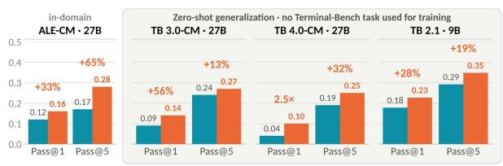

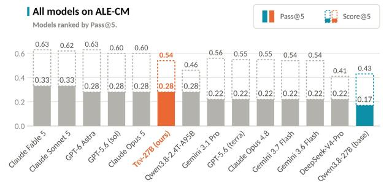

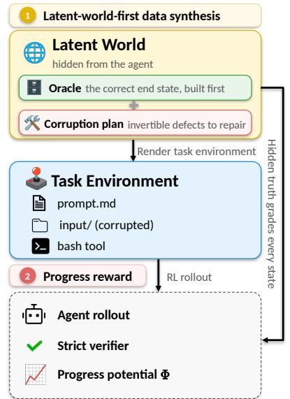  
Figure 1: We demonstrate TEV’s results on ALE-CM, and generalization to Terminal-Bench (TB) 3.0-CM, 4.0-CM, and 2.1 on the left and a summary of our latent-world-first data synthesis approach on the right. TEV showcases significant performance gains across two model scales and TEV-27B matches GPT-6 Astra and Claude Opus 5 at Pass@5 on ALE-CM.

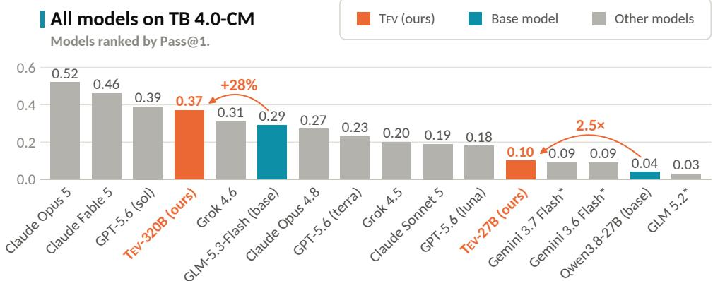  
Figure 2: All models on the Terminal-Bench 4.0 “CM” subset (TB 4.0-CM), ranked by Pass@1. TEV-320B and TEV-27B are trained with our recipe from GLM-5.3-Flash and Qwen3.8-27B, respectively; each arrow gives the relative gain over its base.

## 1 INTRODUCTION

Recent progress in large language models (LLMs) has shifted attention toward long-horizon agents (OpenAI, 2026; Anthropic, 2026; Moonshot AI, 2026), which can work autonomously for hours to days on complex, economically valuable tasks (Sun et al., 2026; Styles et al., 2024; Zhu et al., 2026a). Long-horizon tasks, such as solving open problems in mathematics and science, conducting automated machine learning research, and advancing coding and security systems, are fundamental to automated discovery and recursive self-improvement (RSI).

Despite these promising breakthroughs, coding-agent progress in the open-source community has focused on shorter- and mid-horizon tasks, scaled via large agentic training corpora such as SWE-Smith (Yang et al., 2025a), TMAX (Ivison et al., 2026), Endless Terminals (Gandhi et al., 2026), CLI-Gym (Lin et al., 2026), SETA (Shen et al., 2026), and Terminal-Universe (Wu et al., 2026). These datasets contain thousands to tens of thousands of environments, but each involves only a pull-request-sized fix or a short terminal session, and their unit-test-based evaluation provides only a terminal pass/fail signal or the fraction of tests passed. By contrast, genuinely long-horizon tasks are available only in human-authored benchmarks (Merrill et al., 2026; Li et al., 2026b). These benchmarks contain only tens to a few hundred instances, each requiring weeks of expert effort. They provide partial credit only through hand-written checkpoints and exist only as evaluation sets. Thus, no training corpus of long-horizon tasks exists: agentic training corpora are large but short-horizon, while long-horizon tasks exist only as small, human-authored evaluation sets.

Curating long-horizon tasks requires balancing two competing goals: tasks must be sufficiently long and structurally complex to provide meaningful training while remaining exactly verifiable (Zeng et al., 2026a). Scaling long-horizon environments for training is even more difficult because rewards are sparse and available only upon task completion, depriving long-tail tasks of useful training signals. To address both limitations, we introduce a latent-world-first synthesis approach that begins by constructing a latent world, a complete and correct hidden specification of the task domain. We first represent the underlying workflow as a directed acyclic graph (DAG) within a latent world and then progressively render the input files from that world. This procedure allows us to control task complexity while retaining every correct intermediate state, which provides a natural metric for measuring progress and therefore a verifiable dense reward for our training. Unlike pipelines that ask a language model to generate the task, inputs, and checker without a true answer, our latent world serves as an exact answer key for reliable verification.

Long-horizon tasks come with sparse rewards, arriving only at task completion and submission, which notoriously starves training on long-tail samples (Yu et al., 2025; Shen et al., 2026; Zeng et al., 2026a). Group-relative policy optimization (GRPO; Shao et al., 2024) normalizes rewards within a group of G rollouts of the same task, so under terminal-only reward, a group in which all G rollouts fail has zero advantage everywhere and contributes nothing to the gradient. Mid-horizon pipelines can afford to discard such groups (Ivison et al., 2026; Yu et al., 2025) because they are rare there; on long-horizon tasks they are most common at the start of training, when the policy is weakest and signal is needed most. We therefore introduce progress-potential reward shaping (PPRS) into reinforcement learning (RL), which makes training efficient and makes otherwise-intractable tasks trainable. PPRS scores the agent’s workspace after every turn t against the known-correct intermediate states from our latent world, giving a progress potential $\Phi ( s _ { t } ) \in [ 0 , 1 ]$ that rises as the workflow is completed and falls on regressions. Reward shaped by Φ gives within-group variance from the first turn, even when no rollout finishes.

Table 1: TEV-GYM versus prior agentic task corpora. “Agent time” is the median and mean wallclock minutes per rollout of Gemini 3.6 Flash, from first action to last step (details in Appendix A.8). Difficulty is Pass@k measured by Gemini 3.6 Flash across all datasets.
<table><tr><td rowspan="2">Dataset</td><td rowspan="2">Size</td><td rowspan="2"># Domains</td><td colspan="2">Agent time (min)</td><td rowspan="2">Oracle</td><td>Grading</td><td>Progressive</td><td rowspan="2">P@1</td><td rowspan="2">P@8</td></tr><tr><td>Median</td><td>Mean</td><td>Metric</td><td>Reward</td></tr><tr><td>SWE-Smith (Yang et al., 2025a)</td><td>50.1k</td><td>1334</td><td>2.0</td><td>2.4</td><td>unit tests</td><td>pass/fail</td><td>x</td><td>47%</td><td>52%</td></tr><tr><td>Terminal-Universe (Wu et al., 2026)</td><td>32.0k</td><td></td><td>NA</td><td>NA</td><td>pytest</td><td>pass/fail</td><td>x</td><td>NA</td><td>NA</td></tr><tr><td>TMAX-15K (Ivison et al., 2026)</td><td>14.6k</td><td></td><td>1.3</td><td>2.1</td><td>unit tests</td><td>pass/fail</td><td>x</td><td>74%</td><td>80%</td></tr><tr><td>SETA (Shen et al., 2026)</td><td>4.5k</td><td></td><td>1.2</td><td>2.1</td><td>unit tests</td><td>test fraction</td><td>x</td><td>80%</td><td>88%</td></tr><tr><td>Endless Terminals (Gandhi et al., 2026)</td><td>3.3k</td><td>2</td><td>0.5</td><td>0.7</td><td>unit tests</td><td>pass/fail</td><td>x</td><td>83%</td><td>89%</td></tr><tr><td>CLI-Gym (Lin et al., 2026)</td><td>1.7k</td><td>4</td><td>1.9</td><td>2.3</td><td>unit tests</td><td>pass/fail</td><td>x</td><td>69%</td><td>74%</td></tr><tr><td>TEV-GYM (ours)</td><td>1,170</td><td>7</td><td>12.4</td><td>14.8</td><td>latent world</td><td>staged Φ + pass/fail</td><td>√</td><td>29%</td><td>40%</td></tr></table>

Figure 1 summarizes our approach and TEV’s results, and Figure 2 ranks all models on the Terminal Bench (TB) 4.0 “CM” subset by Pass@1. Using our latent-world-first synthesis approach, we introduce TEV-GYM, composed of 1,170 verified long-horizon task environments across 7 domains (software engineering, data engineering, AI/CS research, mathematics and operations research, security and forensics, infrastructure administration, and quantum computing). As illustrated in Table 1, TEV-GYM’s tasks take a frontier agent a median of 12.4 minutes per rollout, about 6 times longer than the most time-intensive prior corpus (Yang et al., 2025a), and have the lowest pass rate, demonstrating our training data’s complexity and quality. Moreover, TEV-GYM can be scaled beyond a fixed collection by coding agents writing generators that produce new verified environments across seeds and scale tiers without further model calls.

We introduce TEV-9B and TEV-27B, trained with PPRS on the unit tier and the full corpus of TEV-GYM, respectively. On ALE-CM, the computing-and-math split of Agents’ Last Exam (Sun et al., 2026), TEV-9B improves Pass@5 by 83% over Qwen3.5-9B, while TEV-27B improves it by 65% over Qwen3.8-27B to 0.28, matching GPT-6 Astra and Claude Opus 5. Despite training only on ALE-related data, TEV-27B generalizes to the TB 3.0 and 4.0 subsets (Merrill et al., 2026; Marten et al., 2026; Marten, 2026), improving Pass@1 by 56% and 150%, respectively, and outperforming GLM 5.2 and Gemini 3.7 Flash. On the mid-horizon TB 2.1, TEV-9B improves zero-shot Pass@1 by 28%, while TEV-27B reaches 0.794 Pass@1, matching Claude Opus 4.8-level performance. The recipe also transfers to a larger base: applying it to GLM-5.3-Flash yields TEV-320B, which raises Pass@1 on the TB 3.0 and 4.0 subsets by 35% and 28% and, on TB 4.0, trails only Claude Opus 5, Claude Fable 5, and GPT-5.6 (sol).

Our main contributions are summarized as follows:

• We propose latent-world-first synthesis, a pipeline that constructs long-horizon agentic tasks backward from a known-correct world, giving exact verification, a controllable difficulty ladder, and a progressive reward in the middle.

• We introduce TEV-GYM, the first long-horizon agent training dataset with progressive rewards, composed of 1,170 verified long-horizon task environments across 7 domains.

• We present TEV-27B, trained on TEV-GYM using PPRS, and demonstrate its superior performance on ALE-CM, the TB 3.0 and TB 4.0 subsets, and TB 2.1; the same recipe applied to GLM-5.3-Flash gives TEV-320B, which improves further.

## 2 LONG-HORIZON ENVIRONMENT SYNTHESIS

Figure 3 details the mechanisms of long-horizon environment reconstruction. This section defines how an environment is synthesized backward from a latent world (§2.1), and how coverage, difficulty, and correctness are enforced in TEV-GYM (§2.2).

## 2.1 LATENT-WORLD-FIRST TASK SYNTHESIS

Stage 0: task sources. Our training data targets ALE-CM, whose coverage we group into seven major domains. Within each domain, we randomly sample specifications and author our own generator around each one. For details, please refer to Appendix A.1.

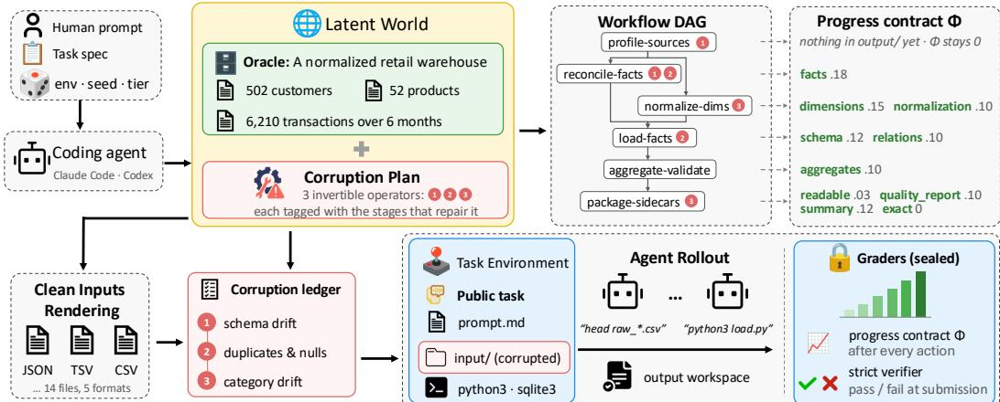  
Figure 3: Latent-world-first synthesis, on one example TEV-GYM environment. This environment’s task is “Retail Warehouse ETL Recovery. Goal: build a clean star-schema SQLite warehouse from six months of messy retail data and produce two truthful JSON sidecars.”

Stage 1: world construction. Each generator is a seeded program. Given a seed and a scale tier, it procedurally generates the latent world W, the complete, correct state of the domain (e.g., a retail warehouse’s customers, products, and transactions, or a distributed checkpoint’s tensor shards and topology), and we validate W against the environment’s invariants (unique identities, valid joins, finite measures). The same step draws a seed-derived defect plan: exactly which records, shards, or fields of W will later be corrupted, and by which declared operator.

Stage 2: workflow graph. We compile the environment’s workflow into a directed acyclic graph (DAG) of stages with explicit dependencies, permitted parallelism, and per-stage semantic-work estimates (e.g., profile-sources → reconcile-facts / normalize-dimensions → load-facts → aggregate-validate → package-sidecars). The DAG is built by code from the scale of W, with no model in the loop. Its critical path, the longest chain of dependent stages, defines the task’s horizon, and its stages form the skeleton of the progress potential in §3.

Stage 3: artifact rendering. We project W onto the environment’s declared public interface, materializing the clean input files in their target wire formats: CSV and TSV partitions, JSON records, SQLite databases, safetensors shards, stripped binaries, or infrastructure manifests. Rendering is a pure function of W, and before proceeding we assert that it round-trips, i.e., that W is recovered exactly from the rendered files. Together with the invertible corruption of Stage 4, this makes the agent’s workspace s<sub>0</sub> fully determine W, so the correct answer is computable from what the agent actually sees, and the ground truth is correct by construction.

Stage 4: controlled corruption. We apply the Stage-1 defect plan to the rendered files, injecting schema drift, duplicate and missing records, categorical drift, scrambled shard indices, stale caches, and the like (Figure 3 shows the three operators of one environment). The corrupted tree $s _ { 0 }$ is the task the agent receives, and the untouched world W is the ground truth. Because rendering round-trips and corruption is declared and invertible, $s _ { 0 }$ fully determines W: the correct solution is computable from what the agent sees and is known exactly without running a solver. More generally, every component of an environment,

$$
E = \big ( x , ~ s _ { 0 } , ~ \mathrm { v e r } _ { W } , ~ \Phi _ { W } \big ) ,\tag{1}
$$

is a function of the same W: the task prompt x, the input tree $s _ { 0 } ,$ the strict pass/fail verifier ver<sub>W</sub>, which checks the agent’s output files against W, and the progress potential Φ<sub>W</sub> of §3. This single anchor prevents artifact drift (Ivanov & Rana, 2026), where an environment, task, and verifier generated separately each look valid on their own yet describe different problems.

Stages 5 and 6: public specification and hidden suite. We emit the public contract, the task prompt x (input roles, required output artifacts and their schemas, ordered requirements, authorityprecedence rules, and the permitted toolchain), which is the only description the agent sees. Outside the agent’s view, we seal a hidden suite used at verification time: metamorphic transforms, which are semantics-preserving rewrites that must not change the grade, and stale-output counterfactuals, which are plausible-but-wrong states that must fail.

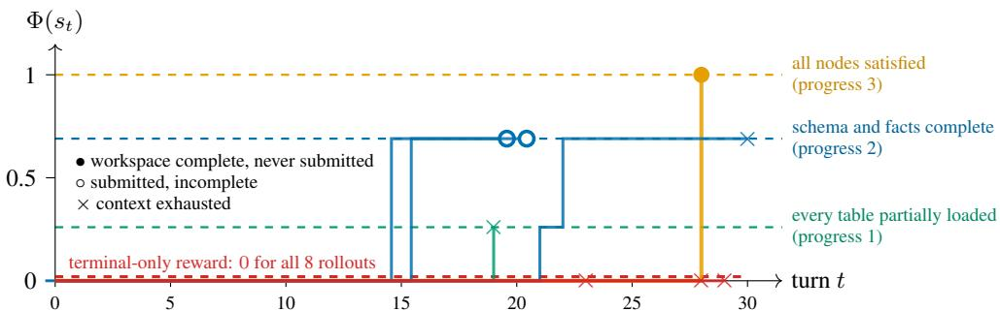  
Figure 4: The progress potential along one group (G=8) of rollouts. Eight rollouts of the trained 27B model on one warehouse environment, graded live after every turn. Under terminalonly reward (red) every rollout scores 0. Under progressive rewards, by contrast, two submit an incomplete warehouse (circles), five exhaust the 65k-token context (crosses), and one builds a complete warehouse, so the rewards vary within the group.

Generalization of latent-world-first synthesis. We focus on the ALE-CM domains due to resource constraints, but the approach applies to other ALE domains. Appendix A.10 walks through three environments built by the pipeline: a multimodal AWS cost-optimization task with its billingdashboard screenshot rendered from our latent world (cloud operations), closed-loop building control of an EnergyPlus model (engineering), and financial-statement reconstruction from SEC-style filings (finance).

## 2.2 COVERAGE, CALIBRATION, AND QUALIFICATION

Diversity. Every environment is labeled on 19 coverage axes (Appendix A.3), including subdomain, scale, the four horizon axes, workflow stage, tool capability, artifact role, relation type, and corruption class. The axes that matter for training are behavioral: changing their value changes what the agent must repair (corruption class), how (workflow stage, tool capability), and through which files (artifact role, relation type). For more details, please see our Appendix A.3.

Controllable difficulty. Two controls change a task’s difficulty. The scale tier (by default unit, small, orfull) grows W (Appendix A.4) and lengthens the operational horizon: how much must be read, joined, and written. The workflow DAG of Stage 2, together with the number of corruption classes in the defect plan, fixes the dependency depth: how many stages must be completed, and in which order, before any output can be right. Appendix A.5 states how we measure horizon and difficulty and reports base-model and frontier solve rates.

Qualification gates and cleanliness. A synthesized environment is admitted only if it passes all eight benchmark-independent gates, checked automatically at generation time and each matched to a named failure class (Table 7). Three of them back the progress potential of §3.2: all 14 gaming probes must score 0 (exploit resistance), the potential must lie strictly between 0 and 1 on partially correct states and increase monotonically to 1 along the reference trajectory (progress validity), and the progress scorer, strict verifier, and reference solvers must have disjoint code closures (role independence). Appendix A.6 states every gate formally, together with the verifier-independent solver audit, and Appendix A.9 describes the structural decontamination check.

## 3 DENSE REWARD FOR LONG-HORIZON RL

The latent world that grades task completion also grades its middle. This section turns it into a training signal: we quantify why terminal-only reward starves group-relative RL (§3.1), define the progress potential every TEV-GYM environment provides (§3.2), and detail the shaped reward (§3.3).

## 3.1 TERMINAL REWARD STARVES GROUP-RELATIVE RL

Consider GRPO (Shao et al., 2024), the estimator we and most recent agentic RL pipelines use. For a task x the policy samples G rollouts $\tau _ { 1 } , \ldots , \tau _ { G }$ with rewards $R _ { 1 } , \ldots , R _ { G }$ , and each rollout is weighted by its group-normalized advantage

$$
\hat { A } _ { i } = { \frac { R _ { i } - \mathrm { m e a n } ( R _ { 1 : G } ) } { \mathrm { s t d } ( R _ { 1 : G } ) + \epsilon } } .\tag{2}
$$

With terminal reward $R _ { i } = \mathbb { 1 } [ \tau _ { i }$ passes], where a rollout passes when the policy issues the submit action and the strict verifier ver accepts the submitted workspace, a group in which every rollout fails has $\hat { A } _ { i } = 0$ for all i: the task contributes nothing to the gradient and its G rollouts are wasted. If the policy solves the task with probability $p ,$ the fraction of wasted groups is $( 1 - p ) ^ { G }$ : 66% at $\scriptstyle { p = 0 . 0 5 }$ and ${ \mathrm { { \bar { G } } } } { = } { \dot { 8 } } ,$ and 92% at $\scriptstyle { p = 0 . 0 1 }$ (Appendix B). On long-horizon tasks, where $p$ for an untrained open model is roughly one in ten or lower (§4), dropping or resampling such groups (Ivison et al., 2026; Yu et al., 2025) discards most of the batch. A group with a single success fares only slightly better. Its one positive rollout is contrasted with $G - 1$ failures that all receive the same negative advantage, so the gradient cannot tell a near-miss from a rollout that made no progress.

## 3.2 A PROGRESS POTENTIAL FROM THE LATENT WORLD

Every TEV-GYM environment provides a progress contract: a set of nodes $V ,$ each a checkable state of the output workspace derived from the workflow DAG of §2.1, with weights $\begin{array} { r } { w _ { v } > 0 , \sum _ { v } w _ { v } = 1 } \end{array}$ and prerequisite sets pre(v) (example in Appendix B). A partial scorer $c _ { v } ( s ) \in [ 0 , 1 ]$ grades the agent’s current workspace s on node v directly against the latent world. Credit is prerequisite-gated: $\tilde { c } _ { v } ( s )$ is the lowest partial score among v and all its direct and indirect prerequisites. The potential, written Φ for Φ<sub>W</sub> of Eq. (1), is the weighted sum:

$$
\Phi ( s ) = \sum _ { v \in V } w _ { v } \tilde { c } _ { v } ( s ) \in [ 0 , 1 ] .\tag{3}
$$

Preventing reward hacking. Three properties make Φ a usable training signal, each enforced by a qualification gate (§2.2): it is anchored (exploit resistance), with the untouched public tree and every gaming probe scoring $\Phi = 0$ and $\Phi = 1$ exactly when the strict verifier accepts the workspace; monotone (progress validity), rising as nodes are completed and falling when completed work is destroyed; and independent (role independence), computed by a scorer whose code closure is disjoint from those of the verifier and the reference solvers, so a defect in one grader is not inherited by the other; none of this grading code is shipped in the public tree.

Scalable reward design. Because the latent world is defined before task generation, every correct intermediate state can be rendered directly and evaluated by $c _ { v }$ . This provides exact and deterministic progress feedback for every generated seed and scale without the human step labels used by process reward models (Lightman et al., 2024), a trained reward model, or a language-model judge.

## 3.3 PROGRESS-POTENTIAL REWARD SHAPING (PPRS)

Let $s _ { 0 } , \ldots , s _ { T }$ be the workspace states along a rollout $\tau _ { : }$ , with $s _ { 0 }$ the untouched public tree, so $\Phi ( s _ { 0 } ) = 0$ . As in potential-based reward shaping (PBRS; Ng et al., 1999), the per-step shaping reward is the change in potential, $r _ { t } = \Phi ( s _ { t } ) - \Phi ( s _ { t - 1 } )$ , and the rollout reward is

$$
R ( \tau ) = 1 [ \tau \mathrm { p a s s e s } ] + \lambda \sum _ { t = 1 } ^ { T } r _ { t } = 1 [ \tau \mathrm { p a s s e s } ] + \lambda \Phi ( s _ { T } ) ,\tag{4}
$$

with $\lambda = 0 . 2 5$ in every run (Appendix C.1). Unlike PBRS, which zeroes the terminal potential so that optimal policies are unchanged, PPRS keeps $\lambda \Phi ( s _ { T } )$ and deliberately changes the objective (Appendix B). Submission is an action, not a state: Φ grades workspaces, and the terminal term grades the workspace the policy submits. A rollout that exhausts its turn or token budget without submitting is not graded terminally and earns $\lambda \Phi ( s _ { T } )$ alone; this is how the complete but unsubmitted rollout of Figure 4 reaches $\Phi = \mathrm { i }$ with terminal reward 0. Because Φ is a function of the workspace alone, $R ( \tau )$ depends on the rollout only through its final state $s _ { T } \colon$ two rollouts that reach the same workspace by different routes, in a different order of steps or with a different implementation, receive the same reward. The telescoping form also keeps the terminal reward’s ranking at the top: since $\Phi \le 1$ , any passing rollout earns $1 + \lambda ,$ , strictly more than any failing one, so no single rollout is rewarded for trading completion against partial progress; for stochastic policies, Appendix B bounds when the preference can reverse. Appendix B states what else is and is not preserved.

Substituting Eq. (4) into Eq. (2) shows why this repairs the starvation of GRPO. A group in which no rollout passes now has rewards $R _ { i } = \lambda \Phi ( s _ { T } ^ { ( i ) } )$ , where $s _ { T } ^ { ( i ) }$ is the final workspace of $\tau _ { i }$ . These differ whenever the rollouts progressed to different depths, so the group’s advantages are non-zero and rank the rollouts by progress; Figure 4 shows one such group, and Appendix B the 24 groups we probed.

Table 2: Main results on ALE-CM, computing and math science domains of Agents’ Last Exam (ALE). Each cell reports the mean graded score (S@1) and the fraction of tasks fully solved (P@1), averaged over 5 rollouts per task, together with their best-of-5 counterparts (S@5, P@5).
<table><tr><td rowspan="2">Model</td><td rowspan="2">Harness</td><td colspan="4">Math &amp; Science</td><td colspan="2">ML</td><td colspan="2">Coding &amp; System</td><td colspan="4">All (Avg)</td></tr><tr><td rowspan="2">S@1 P@5</td><td colspan="3">S@5 P@1</td><td colspan="3">S@1 S@5 P@1P@5</td><td colspan="2">S@1 S@5 P@1P@5|</td><td colspan="3">S@1 S@5 P@1 P@5</td></tr><tr><td colspan="11">Frontier API models</td></tr><tr><td>GPT-6 Astra</td><td>Codex</td><td>0.58</td><td>0.58</td><td>0.38</td><td>0.38</td><td>0.48</td><td>0.49 0.20</td><td>0.20 0.81</td><td>0.85</td><td>0.20 0.20</td><td>0.62</td><td>0.63</td><td>0.28</td><td>0.28</td></tr><tr><td>Claude Fable 5</td><td>Claude Code</td><td>0.47</td><td>0.51</td><td>0.38</td><td>0.38</td><td>0.52</td><td>0.57 0.24</td><td>0.40</td><td>0.83 0.90</td><td>0.20 0.20</td><td>0.58</td><td>0.63</td><td>0.29</td><td>0.33</td></tr><tr><td>GPT-5.6 (sol)</td><td>Codex</td><td>0.50</td><td>0.51</td><td>0.38</td><td>0.38</td><td>0.46</td><td>0.49 0.20</td><td>0.20</td><td>0.82 0.85</td><td>0.20 0.20</td><td>0.58</td><td>0.60</td><td>0.28</td><td>0.28</td></tr><tr><td>GPT-5.6 (terra)</td><td>Codex</td><td>0.51</td><td>0.56</td><td>0.38</td><td>0.38</td><td>0.25</td><td>0.26 0.00</td><td>0.00</td><td>0.75 0.83</td><td>0.200.20</td><td>0.50</td><td>0.55</td><td>0.22</td><td>0.22</td></tr><tr><td>Claude Opus 5</td><td>Claude Code</td><td>0.51</td><td>0.53</td><td>0.38</td><td>0.38</td><td>0.43</td><td>0.46 0.20</td><td>0.20</td><td>0.85 0.87</td><td>0.20 0.20</td><td>0.58</td><td>0.60</td><td>0.28</td><td>0.28</td></tr><tr><td>Claude Sonnet 5</td><td>Claude Code</td><td>0.50</td><td>0.51</td><td>0.38</td><td>0.38</td><td>0.39</td><td>0.56</td><td>0.12 0.40</td><td>0.80 0.87</td><td>0.20 0.20</td><td>0.55</td><td>0.62</td><td>0.26</td><td>0.33</td></tr><tr><td>Claude Opus 4.8</td><td>Claude Code</td><td>0.48</td><td>0.51</td><td>0.38</td><td>0.38</td><td>0.31</td><td>0.33</td><td>0.00 0.00</td><td>0.80 0.86</td><td>0.20 0.20</td><td>0.52</td><td>0.55</td><td>0.22</td><td>0.22</td></tr><tr><td>Gemini 3.7 Flash</td><td>Gemini CLI</td><td>0.48</td><td>0.50</td><td>0.38</td><td>0.38</td><td>0.26</td><td>0.29</td><td>0.00 0.00</td><td>0.84 0.86</td><td>0.200.20</td><td>0.52</td><td>0.54</td><td>0.22</td><td>0.22</td></tr><tr><td>Gemini 3.6 Flash</td><td>Gemini CLI</td><td>0.48</td><td>0.51</td><td>0.35</td><td>0.38</td><td>0.25</td><td>0.26</td><td>0.00 0.00</td><td>0.81 0.86</td><td>0.20 0.20</td><td>0.51</td><td>0.54</td><td>0.21</td><td>0.22</td></tr><tr><td>Gemini 3.1 Pro</td><td>Gemini CLI</td><td>0.49</td><td>0.52</td><td>0.35</td><td>0.38</td><td>0.27</td><td>0.29</td><td>0.00 0.00</td><td>0.82 0.88</td><td>0.20 0.20</td><td>0.52</td><td>0.56</td><td>0.21</td><td>0.22</td></tr><tr><td></td><td colspan="14"></td></tr><tr><td>Qwen3.8-2.4T-A95B Vanillux2</td><td></td><td>0.20</td><td>0.38</td><td>0.20</td><td>0.38</td><td>0.10</td><td>Open-source models 0.20</td><td>0.04 0.20</td><td>0.74 0.86</td><td>0.16 0.20</td><td>0.32</td><td>0.46</td><td>0.14</td><td>0.28</td></tr><tr><td>DeepSeek-V4-pro</td><td>Vanillux2</td><td>0.12</td><td>0.25</td><td>0.12</td><td>0.25</td><td>0.10</td><td>0.20</td><td>0.04 0.20</td><td>0.73 0.88</td><td>0.16</td><td>0.20 0.29</td><td>0.41</td><td>0.11</td><td>0.22</td></tr><tr><td>Qwen3.5-9B (base)</td><td>Vanillux2</td><td>0.07</td><td>0.12</td><td>0.00</td><td>0.00</td><td>0.19</td><td>0.26</td><td>0.00 0.00</td><td>0.59</td><td>0.73 0.20 0.20</td><td>0.25</td><td>0.33</td><td>0.06</td><td>0.06</td></tr><tr><td>TEV-9B (ours)</td><td>Vanillux2</td><td>0.14</td><td>0.29</td><td>0.04</td><td>0.12</td><td>0.23</td><td>0.26</td><td>0.00 0.00</td><td>0.56 0.73</td><td>0.20 0.20</td><td>0.29</td><td>0.40</td><td>0.07</td><td>0.11</td></tr><tr><td>△TEV-9B - Qwen3.5-9B</td><td></td><td>0.07↑</td><td>0.17↑</td><td>0.04↑</td><td>↑0.12↑0.04↑</td><td></td><td></td><td></td><td>0.03↓</td><td></td><td></td><td>0.04↑0.07↑</td><td>↑0.01↑0.05↑</td><td></td></tr><tr><td></td><td></td><td>0.15</td><td>0.25</td><td>0.15</td><td>0.25</td><td>0.21</td><td>0.32</td><td>0.00 0.00</td><td></td><td>0.20 0.20</td><td>0.33</td><td></td><td></td><td></td></tr><tr><td>Qwen3.8-27B (base) Vanillux2</td><td></td><td>0.23</td><td>0.50</td><td>0.23</td><td>0.50</td><td>0.26</td><td></td><td>0.00</td><td>0.74</td><td>0.82</td><td>0.40</td><td>0.43</td><td>0.12</td><td>0.17</td></tr><tr><td>TEV-27B (ours)</td><td>Vanillux2</td><td></td><td></td><td></td><td></td><td></td><td>0.29</td><td>0.00</td><td>0.82</td><td>0.86</td><td>0.20 0.20</td><td>0.54</td><td>0.16</td><td>0.28</td></tr><tr><td>△TEV-27B - Qwen3.8-27B</td><td></td><td></td><td></td><td></td><td></td><td></td><td>0.08↑ 0.25↑ 0.08↑ 0.25↑ 0.05↑0.03↓</td><td></td><td>0.08↑ 0.04↑</td><td></td><td></td><td>0.07↑0.11↑0.04↑0.11↑</td><td></td><td></td></tr></table>

## 4 EXPERIMENTS

Our main experiments ask three questions. Does RL on TEV-GYM improve open models on the long-horizon tasks it was built for, do the gains generalize to tasks of even longer horizon, and does the model keep its general coding competence on a standard mid-horizon benchmark (§4.2)? Finally, §4.3 ablates our latent-world-first data and the dense reward approaches, separately.

## 4.1 SETUP

Training. We train Qwen3.5-9B and Qwen3.8-27B using DPPO (Qi et al., 2026) with the reward in our Eq. (4), scaling the training data together with the model: the 9B model trains on a 264-task subset of TEV-GYM from the unit difficulty tier, which is better suited for learning at this model scale, while the 27B model trains on the full corpus. We choose G=24 rollouts for each of 8 tasks per step, a response budget of 65,536 tokens per rollout (16,384 per turn), and at most 64 tool calls, in a sandbox that exposes a single bash tool. Our 27B model is trained on 4 nodes of B200 GPUs or 8 nodes of A100 GPUs for about 4 days. For more details, refer to Appendix C. To test whether the recipe transfers to a larger base model, we also train GLM-5.3-Flash with the same recipe, obtaining TEV-320B, which we evaluate on the TB 3.0 and 4.0 subsets.

Evaluation. Long-horizon agent evaluation tasks are scarce and costly, with each requiring up to eight hours to evaluate. Our in-domain suite, ALE-CM, is the computing-and-math split of Agents Last Exam (Sun et al., 2026), listed in Appendix C.2 (Table 12). On TB 3.0 and 4.0 (Merrill et al., 2026; Marten et al., 2026; Marten, 2026) we evaluate the “CM” subsets (22 and 18 tasks). To form them we asked Claude to judge, for every TB 3.0 task, whether it belongs to the computing-and-math domain, even if only slightly; the selection and the full task lists are given in Appendix C.2 (Table 13). We compare leaderboard model performance on the full ALE, TB 3.0, and TB 4.0 benchmarks with performance on our corresponding subsets. The results show that our splits are representative of full-set performance, with Pearson correlations of r = 0.96 for TB 3.0 P@1 and r = 0.97 for TB 4.0 P@1 (Appendix C.2; Tables 14, 15, and 16).

Train/eval decontamination. We measure lexical leakage per evaluation set: no environment of TEV-GYM shares a 13-gram or an 8-gram with any task of ALE-CM, TB 3.0, TB 4.0 or TB 2.1, and the median nearest-neighbor prompt Jaccard of the evaluation tasks to the dataset is 0.13 on TB 3.0/4.0 and 0.22 on ALE-CM, against 0.24–0.25 and 0.28 for tasks of the same benchmark compared with one another. For more details, refer to Appendix A.9, Table 10.

Table 3: Terminal-Bench (TB) 3.0 and 4.0 “CM” subsets. Leaderboard rows are from the official per-trial results (5 trials per task); <sup>∗</sup>results evaluated by us, not on the official leaderboard.
<table><tr><td rowspan="3">Model</td><td colspan="6">TB 3.0 (22 tasks)</td><td colspan="8">TB 4.0 (18 tasks)</td></tr><tr><td colspan="2">Software</td><td>ML</td><td>Operations</td><td>Security</td><td rowspan="2">All</td><td colspan="2">Software</td><td rowspan="2">ML</td><td colspan="2">Operations</td><td colspan="2">Security</td><td rowspan="2">All</td></tr><tr><td colspan="2">P@1 P@5</td><td>P@1 P@5</td><td>P@1 P@5</td><td>P@1 P@5|</td><td>P@1 P@5 |P@1</td><td>P@5 P@1</td><td>P@5</td><td>P@1 P@5</td><td>P@1 P@5</td></tr><tr><td></td><td>0.50</td><td>0.80</td><td>0.45</td><td>0.50 0.15</td><td>0.25 0.40</td><td>0.75 0.41</td><td>0.64</td><td>0.53 0.62</td><td>0.60</td><td>0.75 0.05</td><td>0.25</td><td>0.70 1.00</td><td></td><td>|P@1 P@5 0.61</td></tr><tr><td>Claude Fable 5 Claude Opus 5</td><td>0.54</td><td>0.60</td><td>0.60</td><td>0.75 0.40</td><td>0.50 0.55 0.75</td><td>0.53</td><td>0.64 0.47</td><td>0.62 0.75</td><td>1.00</td><td>0.20</td><td>0.50 0.90</td><td>1.00</td><td>0.46 0.52</td><td>0.72</td></tr><tr><td>GPT-5.6 (sol)</td><td>0.32</td><td>0.50</td><td>0.65</td><td>0.75 0.10</td><td>0.25 0.70</td><td>0.75 0.41</td><td>0.55 0.33</td><td>0.62 0.70</td><td>1.00</td><td>0.00</td><td>0.00 0.80</td><td>1.00</td><td>0.39</td><td>0.61</td></tr><tr><td>GPT-5.6 (terra)</td><td>0.22</td><td>0.50</td><td>0.55</td><td>0.75 0.05</td><td>0.25 0.50</td><td>0.75 0.30</td><td>0.55 0.10</td><td>0.38 0.50</td><td>0.75</td><td>0.00</td><td>0.00 0.70</td><td>1.00</td><td>0.23</td><td>0.44</td></tr><tr><td>GPT-5.6 (luna)</td><td>0.18</td><td>0.30</td><td>0.25</td><td>0.50 0.00</td><td>0.00 0.30</td><td>0.50 0.18</td><td>0.32 0.12</td><td>0.25</td><td>0.25 0.50</td><td>0.05</td><td>0.25</td><td>0.50 0.50</td><td>0.18</td><td>0.33</td></tr><tr><td>Grok 4.6</td><td>0.24</td><td>0.50</td><td>0.50</td><td>0.75 0.00</td><td>0.00 0.55</td><td>0.75 0.30</td><td>0.50 0.30</td><td>0.50</td><td>0.55 0.75</td><td>0.00</td><td>0.00</td><td>0.50 1.00</td><td>0.31</td><td>0.50</td></tr><tr><td>Claude Sonnet 5</td><td>0.18</td><td>0.40</td><td>0.25</td><td>0.50 0.00</td><td>0.00 0.20</td><td>0.25 0.16</td><td>0.32 0.28</td><td>0.62</td><td>0.20 0.75</td><td>0.00</td><td>0.00</td><td>0.20 0.50</td><td>0.19</td><td>0.50</td></tr><tr><td>Claude Opus 4.8</td><td>0.20</td><td>0.70</td><td>0.10</td><td>0.25 0.05</td><td>0.25 0.40</td><td>0.50 0.19</td><td>0.50 0.20</td><td>0.50</td><td>0.35 0.50</td><td>0.05</td><td>0.25</td><td>0.80 1.00</td><td>0.27</td><td>0.50</td></tr><tr><td>Grok 4.5</td><td>0.14</td><td>0.30</td><td>0.45</td><td>1.00 0.15</td><td>0.50 0.50</td><td>0.75 0.26</td><td>0.55 0.12</td><td>0.12</td><td>0.35 0.75</td><td>0.00</td><td>0.00</td><td>0.60 1.00</td><td>0.20</td><td>0.33</td></tr><tr><td>GLM 5.2</td><td>0.04</td><td>0.20</td><td>0.05</td><td>0.25 0.00</td><td>0.00 0.05</td><td>0.25 0.04</td><td>0.18 0.06*</td><td>* 0.24*</td><td>*0.02*</td><td>0.10* 0.00* 0.00* 0.00* 0.00*</td><td></td><td></td><td>0.03* 0.13*</td><td></td></tr><tr><td>Gemini 3.7 Flash*</td><td>0.08</td><td>0.20</td><td>0.00</td><td>0.00 0.00</td><td>0.00 0.20</td><td>0.50 0.07</td><td>0.18 0.12</td><td>0.25</td><td>0.00 0.00</td><td>0.00</td><td>0.00</td><td>0.30 0.50</td><td>0.09</td><td>0.17</td></tr><tr><td>Gemini 3.6 Flash*</td><td>0.04</td><td>0.20</td><td>0.00</td><td>0.00 0.00</td><td>0.00 0.00</td><td>0.00 0.02</td><td>0.09 0.20</td><td>0.25</td><td>0.00 0.00</td><td>0.00</td><td>0.00</td><td>0.00 0.00</td><td>0.09</td><td>0.11</td></tr><tr><td></td><td></td><td>0.43</td><td>0.00</td><td>0.00 0.00</td><td>0.00 0.05</td><td>0.25 0.09</td><td>0.24 0.07</td><td>0.31</td><td></td><td></td><td></td><td></td><td></td><td></td></tr><tr><td>Qwen3.8-27B (base)</td><td>0.17</td><td>0.39</td><td>0.19</td><td>0.25 0.00</td><td>0.00 0.20</td><td>0.25 0.14</td><td>0.27</td><td>0.17 0.33</td><td>0.05 0.25 0.12 0.46</td><td>0.00</td><td>0.00</td><td>0.00 0.00</td><td>0.04</td><td>0.19</td></tr><tr><td>TEV-27B</td><td>0.15</td><td></td><td>0.02↓ 0.04↓ 0.19↑ 0.25↑</td><td></td><td>0.15↑</td><td></td><td>0.05↑0.03↑</td><td>|0.10↑ 0.02↑</td><td>↑0.07↑0.21↑</td><td>0.00</td><td>0.00</td><td>0.00 0.00</td><td>0.10</td><td>0.25</td></tr><tr><td>△TEV-27B - Qwen3.8-27B</td><td></td><td></td><td></td><td></td><td></td><td></td><td></td><td></td><td></td><td></td><td></td><td></td><td></td><td>0.06↑ 0.06↑</td></tr><tr><td>GLM-5.3-Flash (base)</td><td>0.18</td><td>0.60</td><td>0.35</td><td>0.50 0.05</td><td>0.25 0.22 0.45</td><td>0.50 0.20 0.27</td><td>0.50</td><td>0.16 0.50</td><td>0.60 0.75</td><td>0.05</td><td>0.25</td><td>0.68 1.00</td><td>0.29</td><td>0.56</td></tr><tr><td>TEV-320B</td><td>0.21</td><td>0.70</td><td>0.40</td><td>0.50 0.10</td><td>0.25</td><td>0.50</td><td>0.55</td><td>0.25 0.50</td><td>0.65</td><td>0.75 0.15</td><td>0.25</td><td>0.70</td><td>1.00 0.37</td><td>0.56</td></tr><tr><td>∆TEV-320B - GLM-5.3-Flash</td><td>0.03↑ 0.10↑ 0.05↑</td><td></td><td></td><td>0.05↑</td><td>0.23↑</td><td></td><td>0.07↑0.05↑</td><td>1|0.09↑</td><td>0.05↑</td><td>0.10↑</td><td></td><td>0.02↑</td><td>0.08↑</td><td></td></tr></table>

## 4.2 MAIN RESULTS

Results on long-horizon tasks. As shown in Table 2, TEV-9B improves mean S@1 by 16% and nearly doubles its best-of-5 solve rate over Qwen3.5-9B, while TEV-27B produces 33% more full solutions than Qwen3.8-27B. Trained on the full corpus rather than the unit tier, TEV-27B shows larger absolute gains than TEV-9B on every metric and surpasses Qwen3.8-2.4T-A95B under the same harness on P@1. Although Claude Fable 5 reaches only 0.33 P@5, training raises the 27B model from 0.17 to 0.28, reaching 85% of the frontier score and closing more than two-thirds of the original gap.

Results on longer-horizon tasks. The TB 3.0 and 4.0 “CM” subsets are even more challenging, with each task requiring eight hours of expert work. Our 27B base model fully solves only 9% and 4% of attempted tasks, respectively. As shown in Table 3, TEV-27B raises P@1 from 0.04 to 0.10 (2.5×) on TB 4.0 and from 0.09 to 0.14 (+56%) on TB 3.0. Notably, TEV-27B surpasses GLM 5.2, the strongest open-source model on the leaderboard. Compared with frontier models, however, a substantial gap remains. Claude Opus 5, the strongest agent on both suites, achieves P@1 scores of 0.53 on TB 3.0 and 0.52 on TB 4.0, suggesting that stronger open-source base models are needed to fully benefit from our high-quality but challenging TEV-GYM.

Table 4: Terminal-Bench (TB) 2.1 results. Frontier-reference rows are taken from the official TB 2.1 leaderboard (5 trials, 89 tasks).
<table><tr><td>Model</td><td>Pass@1</td><td>Pass@5</td></tr><tr><td>GPT-6 Astra (Codex, high)</td><td>0.874</td><td>0.944</td></tr><tr><td>Fable 5 (Claude Code, xhigh)</td><td>0.838</td><td>0.933</td></tr><tr><td>Opus 4.8 (Claude Code, high)</td><td>0.789</td><td>0.944</td></tr><tr><td>Sonnet 5 (Claude Code, high)</td><td>0.746</td><td>0.921</td></tr><tr><td>Qwen3.5-9B (base)</td><td>0.178</td><td>0.292</td></tr><tr><td>TEV-9B (ours)</td><td>0.227</td><td>0.348</td></tr><tr><td>△TEV-9B - Qwen3.5-9B</td><td>0.049↑</td><td>0.056↑</td></tr><tr><td>Qwen3.8-27B (base)</td><td>0.764</td><td>0.864</td></tr><tr><td>TEV-27B (ours)</td><td>0.794</td><td>0.884</td></tr><tr><td>△TEV-27B - Qwen3.8-27B</td><td>0.030↑</td><td>0.020↑</td></tr></table>

Scaling the base model. Consistent with this, the recipe carries over to a stronger base. Applying it to GLM-5.3-Flash yields TEV-320B, whose P@1 rises from 0.20 to 0.27 on TB 3.0 and from 0.29 to 0.37 on TB 4.0, with gains in every category on both suites and the largest on TB 3.0 security (0.22 to 0.45). The improvement is concentrated in P@1: P@5 gains 0.05 on TB 3.0 and is unchanged on TB 4.0, so training mainly makes the model solve the tasks it can already reach more reliably rather than unlocking new ones. TEV-320B is the strongest open-source model on both subsets; on TB 3.0 it edges past Grok 4.5 and Claude Opus 4.8, and on TB 4.0 it trails only Claude Opus 5, Claude Fable 5, and GPT-5.6 (sol) in P@1 (Figure 2).

Results on middle-horizon tasks. We next evaluate our model on TB 2.1 (Table 4), a standard mid-horizon terminal benchmark. Despite zero data targeting TB 2.1, our model shows strong zero-shot performance. TEV-9B significantly outperforms its base after training, raising P@1 by 28% and P@5 by 19%, showing that training on long-horizon tasks also improves performance on standard mid-horizon work. Our 27B model achieves P@1 0.794 and P@5 0.884, a smaller but consistent gain over its base and on par with Claude Opus 4.8, though still behind Claude Fable 5 and GPT-6 Astra.

Table 5: Ablations on ALE-CM (Qwen3.5-9B). Here GPU-h/step is the mean time of one training step times the 32 GPUs of the recipe in H100 GPU-hours.
<table><tr><td rowspan="2">Method</td><td colspan="3">Data</td><td colspan="3">Reward</td><td rowspan="2">GPU-h / step</td><td colspan="3">ALE-CM</td></tr><tr><td></td><td></td><td>World DAG Hidden truth Signal</td><td></td><td>Credit</td><td> $\mathbf { A d v . n o r m . }$ </td><td>S@1</td><td>S@5 P@1</td><td>P@5</td></tr><tr><td>Qwen3.5-9B (base)</td><td></td><td></td><td></td><td>no RL</td><td></td><td></td><td></td><td>0.25</td><td>0.33 0.06</td><td>0.06</td></tr><tr><td>TEV-9B (ours)</td><td></td><td></td><td></td><td>∆Φt + terminal</td><td> $G _ { t } , \gamma { = } 1$ </td><td>per turn</td><td>9.0</td><td>0.29 0.40</td><td>0.07</td><td>0.11</td></tr><tr><td colspan="9">Data ablation: replace one construction step with an LLM; terminal reward, compare with Sparse</td><td></td><td></td></tr><tr><td>Public-view verifier</td><td>√</td><td>LLM</td><td>terminal</td><td></td><td>whole rollout per rollout</td><td>22.3</td><td>0.24</td><td>0.35</td><td>0.04</td><td>0.06</td></tr><tr><td>Prompt-first</td><td>√ LLM LLM</td><td>LLM</td><td>terminal</td><td></td><td>whole rollout per rollout</td><td>11.8</td><td>0.23</td><td>0.32</td><td>0.06</td><td>0.06</td></tr><tr><td colspan="9">Reward ablation: keep TEV-GYM, change how Φ enters training</td><td></td></tr><tr><td>Sparse (terminal only)</td><td>√</td><td>√</td><td>√ terminal</td><td></td><td>whole rollout per rollout</td><td></td><td>16.7 0.25</td><td>0.32</td><td>0.06</td><td>0.06</td></tr><tr><td>PPRS, pooled norm.</td><td>√</td><td></td><td>√</td><td> $\Delta \Phi _ { t } + \mathrm { t e r m i n a l }$ </td><td> $G _ { t } , \gamma { = } 1$ </td><td>per rollout</td><td>10.9 0.28</td><td>0.35</td><td>0.06</td><td>0.06</td></tr><tr><td>Direct reward (additive)</td><td>√</td><td></td><td>√</td><td> $\Phi ( s _ { t } ) + \mathrm { t e r m i n a l }$ </td><td> $G _ { t } , \gamma { = } 0$ </td><td>per turn</td><td>9.7 0.29</td><td>0.35</td><td>0.06</td><td>0.06</td></tr></table>

Qualitative results. Figure 5 traces the key decision points of four rollouts on the k8s\_payment\_api\_root\_cause\_analysis task: every agent finds the same root causes, but TEV-27B and Claude Fable 5 ground the liveness-probe cause in the measurement that explains it and judge rollback safe, whereas the base model and GPT-6 Astra cite only the symptoms and decline rollback, forfeiting the decisive grader component. For more qualitative examples, see Appendix C.3.

## 4.3 ABLATION STUDY

Due to resource constraints, we conduct the ablation study in the 9B setting of §4.1.

Ablation on data curation methods. Our pipeline differs from standard LLM-synthesized corpora in two key ways: tasks are derived from a preexisting latent world and its code-compiled workflow DAG, and verifiers evaluate against this hidden ground truth rather than only agent-visible files. Table 5 shows which components each ablation retains, with GPT-5.6 (sol, xhigh) replacing the others. Public-view verifier ablates only access to hidden ground truth by asking the model to write a verifier from the agent’s view. Prompt-first, a standard self-instruct baseline, instead replaces the entire construction pipeline by generating each prompt before its inputs, verifier, and solution, leaving no latent world or DAG. The public-view variant causes 88% of sampled groups to be discarded during training. Because both variants use terminal rewards, we compare them with the Sparse row: neither improves over the base model in S@1 (0.24 and 0.23 vs. 0.25), whereas our full method leads them by 0.05–0.06 in S@1 and 0.05 in P@5.

Ablation on dense reward. Holding TEV-GYM fixed, we compare our PPRS, which uses returnto-go G with γ = 1 and normalizes advantages by turn index, against terminal-only sparse reward, PPRS with per-rollout normalization (pooled norm.), and direct additive reward using $\Phi ( s _ { t } )$ with $\gamma = 0$ (Yuan et al., 2026). Our method provides the best balance of performance and training efficiency, improving S@1 by 0.04 over sparse reward. Turn-index normalization preserves credit for later turns by avoiding comparison of their smaller returns against the whole-rollout mean, while γ = 1 propagates progress back to earlier actions. In contrast, direct additive reward repeatedly rewards high-potential states without propagating credit, leading to more rollouts exhausting the context window before submission and producing longer trajectories. The advantage over sparse reward widens further at 27B, where shaped reward trains to completion but terminal-only reward produces almost entirely zero-advantage groups and fails to complete a single optimizer step.

## 5 RELATED WORK

Synthetic corpora for coding and terminal agents. Recent corpora typically mine repositories for issues and tests or use language models to generate tasks such as bug-injected repositories and reconstructed terminal sessions (Jimenez et al., 2024; Yang et al., 2025a; Ivison et al., 2026; Lin et al., 2026). Other work scales executable tool-use environments and their success conditions (Cai et al., 2025; Fang et al., 2025), although scaling helps only when difficulty is controlled (Zhu et al., 2026b). In contrast, our environments contain long, multi-stage workflows across mathematics and science, machine learning, coding, and systems; are instantiated by seeded generator code rather than directly authored by a language model; and provide a dense progress signal for every task.

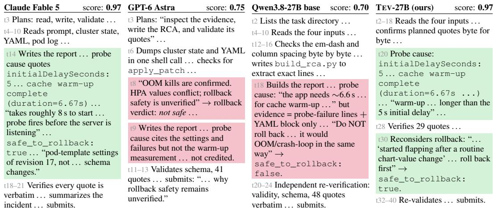  
Figure 5: Qualitative example on the ALE-CM task: k8s payment api root cause analysis (Coding & System). From a kubectl capture, the Deployment/HPA YAML and a crashing pod’s log, the agent writes a JSON root-cause report with verbatim evidence strings and a rollback verdict. Green marks a decision that earns a component, red one that forfeits it.

Backward construction. Deriving a task from a known solution is an established family: denoising, controlled error injection, code mutation, environment rewinding, instruction back-translation, and procedural puzzle generation all corrupt or invert a single artifact whose ground truth is already known (Lewis et al., 2020; Arocena et al., 2015; Tran et al., 2013; Yang et al., 2025a; Hariharan et al., 2025; Lin et al., 2026; Li et al., 2023; Wu et al., 2024; Stojanovski et al., 2025; Chen et al., 2025a; Liu et al., 2025; Li et al., 2025). We instead corrupt a rendering of an entire latent world, so the task, verifier, and progress signal are all functions of that one world rather than separately generated factors that can drift apart (Zeng et al., 2026a; Ivanov & Rana, 2026).

Sparse reward and dense signal in agentic RL. Existing methods avoid uninformative rollout groups by filtering identical rewards, selecting tasks near the policy’s current ability, or adding expert prefixes (Yu et al., 2025; Florensa et al., 2018; Zhang et al., 2025c). Other approaches provide denser feedback through learned judges (Cui et al., 2025; Choudhury, 2025) or proxy signals such as test-pass rates (Du et al., 2025; Shen et al., 2026; Yang et al., 2026), but these require additional models or capture only terminal outcomes. Our potential Φ instead measures exact progress and regression against the latent world at every workflow stage, without requiring a critic or language-model judge. For full related work, please refer to Appendix D.

## 6 CONCLUSION

We introduce a latent-world-first approach for scaling verifiable long-horizon agent training. Each task is built backward from a known-correct latent world, which is rendered into interrelated files, modified through controlled corruptions, and reused for exact verification and dense progress rewards. We instantiate this approach in TEV-GYM, a collection of 1,170 verified environments across seven domains, and show that training improves both 9B and 27B open models on ALE-CM, with gains transferring to Terminal-Bench tasks of different horizons and to a 320B base model. One limitation of our current study is its focus on synthetic terminal environments, and the hardest benchmark still show a gap between our models and leading frontier agents. Supporting new workflows also requires authoring and validating additional environment components. Future work could simplify this process, expand domain coverage, and combine the resulting data with stronger open models, making more professional workflows available for reproducible RL without human step labels or language-model judges.

## ACKNOWLEDGMENTS

We thank Scott Cohen at Adobe Research for mentorship, guidance, and support throughout this project, and Adobe Research for supporting this work. We are grateful to our colleagues at Adobe Research and UCLA for helpful discussions and feedback.

## AI USE STATEMENT

We used generative AI tools for the following tasks that require disclosure. Generating synthetic data and implementing methods: coding agents helped author the generators of TEV-GYM, that is, the environment specifications and their reference solvers, strict verifiers, and progress scorers (§2; Appendix A.2). Once authored, a generator is a deterministic seeded program, so no language model participates when an environment is generated, verified, or rewarded; every generator passed the qualification gates of Appendix A.6, and the authors reviewed each specification. Qualitative data analysis: Claude helped judge which TB 3.0 and 4.0 tasks relate to the computing-and-math domain of our training data, which defines our “CM” evaluation subsets; Appendix C.2 gives the procedure and the resulting task lists, and Appendix C.2 checks that the subsets track full-benchmark performance. Coding assistants also helped write evaluation and analysis scripts. Separately, language models appear in our experiments as objects of study rather than as aids to the authors: GPT-5.6 (sol) builds the two data-ablation baselines (§4.3), Gemini 3.6 Flash is the fixed evaluator of the corpus difficulty comparison (Appendix A.8), and frontier models are evaluated as baselines. No generative model grades any task or produces any training reward. Among tasks with recommended disclosure, we used generative AI tools to search and summarize related literature and to draft and edit parts of the text. Translation, surveys, interviews, and transcription are not applicable to this work. We have reviewed all AI-assisted work, and all claims, numbers, and citations were checked by the authors. We take responsibility for the final content of this work, including text, claims, and artifacts produced with the aid of generative AI.

## ETHICS STATEMENT

TEV-GYM is fully synthetic: every environment is generated procedurally from a seed, contains no data collected from people, and involves no human subjects, so the corpus encodes no private records or proprietary code. Task specifications are drawn from public benchmarks and reference material (Appendix A.1), but every artifact an agent sees is generated by the environment itself, and third-party benchmarks and corpora used for evaluation and comparison are used under their published licenses (Appendix A.8). The environments simulate professional workflows such as data reconciliation, checkpoint consolidation, systems administration, and the analysis of synthetic binaries and packet captures in the style of capture-the-flag exercises. Each declares its toolchain in its public contract, the agent’s workspace is seeded only with its public tree, and no task targets real software, systems, or people. Improving open-weight agents on long-horizon terminal tasks carries the general dual-use considerations of more capable coding agents; our security-flavored tasks are analysis and forensics exercises over synthetic artifacts, the same class of task already present in public terminal-agent benchmarks. Because part of the training mix is built against the interfaces of ALE-CM, we measure train/evaluation overlap for every evaluation set and report it with its calibration (§4.1; Appendix A.9). Frontier baselines run in their native agent harnesses, the setting most favorable to them (Appendix C.2), and we discuss the limitations of our results in §6.

## REPRODUCIBILITY STATEMENT

We have written the paper and appendix so that every result can be reproduced from them. Data. Every environment of TEV-GYM is a deterministic, model-free function of its generator, seed, and scale tier (§2.1; Appendix A.2), so the corpus can be regenerated exactly, at a median of 30 s of CPU time per environment and with no model calls. The generation stages are specified in §2.1; task sources and the domain taxonomy in Appendix A.1 (Table 6); the coverage policy in Appendix A.3; the scale ladder and the measurement of horizon and difficulty in Appendices A.4 and A.5; the qualification gates in Appendix A.6 (Table 7); and per-domain statistics in Appendix A.7 (Table 8). Appendix A.10 walks through three complete training environments, each with its public view and the ground truth sealed behind it, so the construction can be followed end to end (the listings are excerpts of the package files). Reward and training. The progress potential and the shaped reward are fully specified by Eqs. (3) and (4). All three base models are publicly available and DPPO is a published objective; §4.1 states the corpus each model is trained on, and Table 11 lists the hyperparameters shared by every run. Each ablation changes a single component of this recipe. Evaluation. All evaluation benchmarks are public. Appendix C.2 gives the harnesses, turn and token budgets, number of rollouts, and metric definitions; Appendix C.2 lists every task in ALE-CM and in the TB 3.0/4.0 “CM” subsets (Tables 12 and 13); and Appendix C.2 shows that the subsets track full-benchmark performance. The difficulty comparison of Table 1 follows Appendix A.8, which fixes the evaluator, harness, sampling budget, and subsample seed, and train/evaluation overlap is measured with the protocol of Appendix A.9.

## REFERENCES

Anthropic. Claude Fable 5 and Claude Mythos 5. https://www.anthropic.com/news/ claude-fable-5-mythos-5, 2026. Accessed 2026-09-25.

Patricia C. Arocena, Boris Glavic, Giansalvatore Mecca, Renée J. Miller, Paolo Papotti, and Donatello Santoro. Messing up with BART: Error generation for evaluating data-cleaning algorithms. Proceedings ofthe VLDB Endowment, 9(2), 2015.

Ibragim Badertdinov, Alexander Golubev, Maksim Nekrashevich, Anton Shevtsov, Simon Karasik, Andrei Andriushchenko, Maria Trofimova, Daria Litvintseva, and Boris Yangel. SWE-rebench: An automated pipeline for task collection and decontaminated evaluation of software engineering agents. arXiv preprint arXiv:2505.20411, 2025.

Shihao Cai, Runnan Fang, Jialong Wu, Baixuan Li, Xinyu Wang, Yong Jiang, Liangcai Su, Liwen Zhang, Wenbiao Yin, Zhen Zhang, Fuli Feng, Pengjun Xie, and Xiaobin Wang. AutoForge: Automated environment synthesis for agentic reinforcement learning. arXiv preprint arXiv:2512.22857, 2025.

Jun Shern Chan, Neil Chowdhury, Oliver Jaffe, James Aung, Dane Sherburn, Evan Mays, Giulio Starace, Kevin Liu, Leon Maksin, Tejal Patwardhan, Lilian Weng, and Aleksander M ˛adry. MLEbench: Evaluating machine learning agents on machine learning engineering. In International Conference on Learning Representations (ICLR), 2025.

Aili Chen, Chi Zhang, Junteng Liu, Jiangjie Chen, Chengyu Du, Yunji Li, Ming Zhong, Qin Wang, Zhengmao Zhu, Jiayuan Song, Ke Ji, Junxian He, Pengyu Zhao, and Yanghua Xiao. DIVE: Scaling diversity in agentic task synthesis for generalizable tool use. arXiv preprint arXiv:2603.11076, 2026a.

Guhong Chen, Chenghao Sun, Cheng Fu, Qiyao Wang, Zhihong Huang, Chaopeng Wei, Guangxu Chen, Feiteng Fang, Ahmadreza Argha, Bing Zhao, Xander Xu, Qi Han, Hamid Alinejad-Rokny, Qiang Qu, Binhua Li, Shiwen Ni, Min Yang, Hu Wei, and Yongbin Li. Beyond quantity: Trajectory diversity scaling for code agents. In Findings ofthe Associationfor Computational Linguistics: ACL 2026, pp. 15676–15691, 2026b.

Jiangjie Chen, Qianyu He, Siyu Yuan, Aili Chen, Zhicheng Cai, Weinan Dai, Hongli Yu, Qiying Yu, Xuefeng Li, Jiaze Chen, Hao Zhou, and Mingxuan Wang. Enigmata: Scaling logical reasoning in large language models with synthetic verifiable puzzles. arXiv preprint arXiv:2505.19914, 2025a.

Xuanzhong Chen, Zile Qiao, Guoxin Chen, Liangcai Su, Zhen Zhang, Xinyu Wang, Pengjun Xie, Fei Huang, Jingren Zhou, and Yong Jiang. AgentFrontier: Expanding the capability frontier of LLM agents with ZPD-Guided data synthesis. arXiv preprint arXiv:2510.24695, 2025b.

Sanjiban Choudhury. Process reward models for LLM agents: Practical framework and directions. arXiv preprint arXiv:2502.10325, 2025.

Ganqu Cui, Lifan Yuan, Zefan Wang, Hanbin Wang, Yuchen Zhang, Jiacheng Chen, Wendi Li, Bingxiang He, Yuchen Fan, Tianyu Yu, Qixin Xu, Weize Chen, Jiarui Yuan, Huayu Chen, Kaiyan Zhang, Xingtai Lv, Shuo Wang, Yuan Yao, Xu Han, Hao Peng, Yu Cheng, Zhiyuan Liu, Maosong Sun, Bowen Zhou, and Ning Ding. Process reinforcement through implicit rewards. arXiv preprint arXiv:2502.01456, 2025.

Guanting Dong, Junting Lu, Junjie Huang, Wanjun Zhong, Longxiang Liu, Shijue Huang, Zhenyu Li, Yang Zhao, Xiaoshuai Song, Xiaoxi Li, Jiajie Jin, Yutao Zhu, Hanbin Wang, Fangyu Lei, Qinyu Luo, Mingyang Chen, Zehui Chen, Jiazhan Feng, Ji-Rong Wen, and Zhicheng Dou. Agent-World: Scaling Real-World environment synthesis for evolving general agent intelligence. arXiv preprint arXiv:2604.18292, 2026.

Yaxin Du, Yuzhu Cai, Yifan Zhou, Cheng Wang, Yu Qian, Xianghe Pang, Qian Liu, Yue Hu, and Siheng Chen. SWE-Dev: Evaluating and training autonomous Feature-Driven software development. arXiv preprint arXiv:2505.16975, 2025.

Runnan Fang, Shihao Cai, Baixuan Li, Jialong Wu, Guangyu Li, Wenbiao Yin, Xinyu Wang, Xiaobin Wang, Liangcai Su, Zhen Zhang, Shibin Wu, Zhengwei Tao, Yong Jiang, Pengjun Xie, Fei Huang, and Jingren Zhou. Towards general agentic intelligence via environment scaling. arXiv preprint arXiv:2509.13311, 2025.

Lang Feng, Zhenghai Xue, Tingcong Liu, and Bo An. Group-in-Group policy optimization for LLM agent training. arXiv preprint arXiv:2505.10978, 2025.

Carlos Florensa, David Held, Xinyang Geng, and Pieter Abbeel. Automatic goal generation for reinforcement learning agents. In Proceedings ofthe 35th International Conference on Machine Learning (ICML), volume 80 of Proceedings ofMachine Learning Research, pp. 1515–1528, 2018.

Kanishk Gandhi, Shivam Garg, Noah D. Goodman, and Dimitris Papailiopoulos. Endless terminals: Scaling RL environments for terminal agents. arXiv preprint arXiv:2601.16443, 2026.

Anisha Gunjal, Anthony Wang, Elaine Lau, Vaskar Nath, Yunzhong He, Bing Liu, and Sean Hendryx. Rubrics as rewards: Reinforcement learning beyond verifiable domains. arXiv preprint arXiv:2507.17746, 2025.

Jiacheng Guo, Ling Yang, Peter Chen, Qixin Xiao, Yinjie Wang, Xinzhe Juan, Jiahao Qiu, Ke Shen, and Mengdi Wang. GenEnv: Difficulty-Aligned Co-Evolution between LLM agents and environment simulators. arXiv preprint arXiv:2512.19682, 2025.

Kaivalya Hariharan, Uzay Girit, Atticus Wang, and Jacob Andreas. Breakpoint: Scalable evaluation of system-level reasoning in LLM code agents. arXiv preprint arXiv:2506.00172, 2025.

Jujie He, Jiacai Liu, Chris Yuhao Liu, Rui Yan, Chaojie Wang, Peng Cheng, Xiaoyu Zhang, Fuxiang Zhang, Jiacheng Xu, Wei Shen, Siyuan Li, Liang Zeng, Tianwen Wei, Cheng Cheng, Bo An, Yang Liu, and Yahui Zhou. Skywork Open Reasoner 1 technical report. arXiv preprint arXiv:2505.22312, 2025.

Yuki Imajuku, Kohki Horie, Yoichi Iwata, Kensho Aoki, Naohiro Takahashi, and Takuya Akiba. ALE-Bench: A benchmark for Long-Horizon Objective-Driven algorithm engineering. arXiv preprint arXiv:2506.09050, 2025.

Maksim Ivanov and Abhijay Rana. Anchor: Mitigating artifact drift in agent benchmark generation. arXiv preprint arXiv:2605.26321, 2026.

Hamish Ivison, Junjie Oscar Yin, Rulin Shao, Teng Xiao, Nathan Lambert, and Hannaneh Hajishirzi. Tmax: A simple recipe for terminal agents. arXiv preprint arXiv:2606.23321, 2026.

Naman Jain, Jaskirat Singh, Manish Shetty, Liang Zheng, Koushik Sen, and Ion Stoica. R2E-Gym: Procedural environments and hybrid verifiers for scaling Open-Weights SWE agents. arXiv preprint arXiv:2504.07164, 2025.

Minbyul Jeong and Chanwoong Yoon. AgentMercury: Your agent can synthesize verifiable environments for business scenarios at scale. arXiv preprint arXiv:2608.20634, 2026.

Carlos E. Jimenez, John Yang, Alexander Wettig, Shunyu Yao, Kexin Pei, Ofir Press, and Karthik Narasimhan. SWE-bench: Can language models resolve real-world GitHub issues? In International Conference on Learning Representations (ICLR), 2024.

Mike Lewis, Yinhan Liu, Naman Goyal, Marjan Ghazvininejad, Abdelrahman Mohamed, Omer Levy, Ves Stoyanov, and Luke Zettlemoyer. BART: Denoising Sequence-to-Sequence pre-training for natural language generation, translation, and comprehension. In Proceedings of the 58th Annual Meeting of the Association for Computational Linguistics (ACL), pp. 7871–7880, 2020.

Peiji Li, Jiasheng Ye, Yongkang Chen, Linyang Li, Yichuan Ma, Zijie Yu, Ganqu Cui, Haozhan Li, Jiacheng Chen, Chengqi Lyu, Wenwei Zhang, Qipeng Guo, Dahua Lin, Bowen Zhou, and Kai Chen. InternBootcamp: Boosting LLM reasoning with verifiable task scaling. arXiv preprint arXiv:2508.08636, 2025.

Xian Li, Ping Yu, Chunting Zhou, Timo Schick, Omer Levy, Luke Zettlemoyer, Jason Weston, and Mike Lewis. Self-Alignment with instruction backtranslation. arXiv preprint arXiv:2308.06259, 2023.

Zhongzhi Li, Yucheng Shi, Zongxia Li, Ruhan Wang, Anhao Li, Zixun Huang, Junyao Yang, Lei Ke, Ninghao Liu, Haitao Mi, and Leowei Liang. Recursive synthesis for Long-Horizon terminal tasks. arXiv preprint arXiv:2608.05466, 2026a.

Zongxia Li, Zhongzhi Li, Yucheng Shi, Ruhan Wang, Junyao Yang, Zhichao Liu, Xiyang Wu, Anhao Li, Yue Yu, Ninghao Liu, Lichao Sun, Haotao Mi, and Leowei Liang. Long-Horizon-Terminal-Bench: Testing the limits of agents on Long-Horizon terminal tasks with dense Reward-Based grading. arXiv preprint arXiv:2607.08964, 2026b.

Hunter Lightman, Vineet Kosaraju, Yura Burda, Harri Edwards, Bowen Baker, Teddy Lee, Jan Leike, John Schulman, Ilya Sutskever, and Karl Cobbe. Let’s verify step by step. In International Conference on Learning Representations (ICLR), 2024.

Yusong Lin, Haiyang Wang, Shuzhe Wu, Lue Fan, Feiyang Pan, Sanyuan Zhao, and Dandan Tu. CLI-Gym: Scalable CLI task generation via agentic environment inversion. arXiv preprint arXiv:2602.10999, 2026.

Junteng Liu, Yuanxiang Fan, Zhuo Jiang, Han Ding, Yongyi Hu, Chi Zhang, Yiqi Shi, Shitong Weng, Aili Chen, Shiqi Chen, Yunan Huang, Mozhi Zhang, Pengyu Zhao, Junjie Yan, and Junxian He. SynLogic: Synthesizing verifiable reasoning data at scale for learning logical reasoning and beyond. arXiv preprint arXiv:2505.19641, 2025.

Ryan Marten. Terminal-Bench 4.0. https://www.tbench.ai/news/ terminal-bench-4-0, 2026. Accessed 2026-09-23.

Ryan Marten, Alex Shaw, and Andy Konwinski. Terminal-Bench 3.0. https://www.tbench. ai/news/terminal-bench-3-0, 2026. Accessed 2026-09-23.

Mike A. Merrill, Alexander G. Shaw, Nicholas Carlini, Boxuan Li, Harsh Raj, Ivan Bercovich, Lin Shi, Jeong Yeon Shin, Thomas Walshe, E. Kelly Buchanan, Junhong Shen, Guanghao Ye, Haowei Lin, Jason Poulos, Maoyu Wang, Marianna Nezhurina, Jenia Jitsev, Di Lu, Orfeas Menis Mastromichalakis, Zhiwei Xu, Zizhao Chen, Yue Liu, Robert Zhang, Leon Liangyu Chen, Anurag Kashyap, Jan-Lucas Uslu, Jeffrey Li, Jianbo Wu, Minghao Yan, Song Bian, Vedang Sharma, Ke Sun, Steven Dillmann, Akshay Anand, Andrew Lanpouthakoun, Bardia Koopah, Changran Hu, Etash Guha, Gabriel H. S. Dreiman, Jiacheng Zhu, Karl Krauth, Li Zhong, Niklas Muennighoff, Robert Amanfu, Shangyin Tan, Shreyas Pimpalgaonkar, Tushar Aggarwal, Xiangning Lin, Xin Lan, Xuandong Zhao, Yiqing Liang, Yuanli Wang, Zilong Wang, Changzhi Zhou, David Heineman, Hange Liu, Harsh Trivedi, John Yang, Junhong Lin, Manish Shetty, Michael Yang, Nabil Omi, Negin Raoof, Shanda Li, Terry Yue Zhuo, Wuwei Lin, Yiwei Dai, Yuxin Wang, Wenhao Chai, Shang Zhou, Dariush Wahdany, Ziyu She, Jiaming Hu, Zhikang Dong, Yuxuan Zhu, Sasha Cui, Ahson Saiyed, Arinbjörn Kolbeinsson, Jesse Hu, Christopher Michael Rytting, Ryan Marten, Yixin Wang, Alex Dimakis, Andy Konwinski, and Ludwig Schmidt. Terminal-Bench: Benchmarking agents on hard, realistic tasks in command line interfaces. arXiv preprint arXiv:2601.11868, 2026.

Moonshot AI. Kimi K3: Open frontier intelligence. https://github.com/MoonshotAI/ Kimi-K3, 2026. Accessed 2026-09-18.

Andrew Y. Ng, Daishi Harada, and Stuart Russell. Policy invariance under reward transformations: Theory and application to reward shaping. In International Conference on Machine Learning (ICML), 1999.

OpenAI. GPT-6 Astra. https://openai.com/index/gpt-6-astra/, 2026. Accessed 2026-09-18.

Jiayi Pan, Xingyao Wang, Graham Neubig, Navdeep Jaitly, Heng Ji, Alane Suhr, and Yizhe Zhang. Training software engineering agents and verifiers with SWE-Gym. In Proceedings of the 42nd International Conference on Machine Learning (ICML), volume 267 of Proceedings of Machine Learning Research, pp. 47717–47737, 2025.

Penghui Qi, Xiangxin Zhou, Zichen Liu, Tianyu Pang, Chao Du, Min Lin, and Wee Sun Lee. Rethinking the trust region in LLM reinforcement learning. arXiv preprint arXiv:2602.04879, 2026.

John Schulman, Filip Wolski, Prafulla Dhariwal, Alec Radford, and Oleg Klimov. Proximal policy optimization algorithms. arXiv preprint arXiv:1707.06347, 2017.

Tommy Sha, Skylar Zhai, and Siqi Zhao. ThinkPrior: Zero-Rollout difficulty priors for Cold-Start prompt selection in RLVR. arXiv preprint arXiv:2609.09075, 2026.

Zhihong Shao, Peiyi Wang, Qihao Zhu, Runxin Xu, Junxiao Song, Xiao Bi, Haowei Zhang, Mingchuan Zhang, Y. K. Li, Y. Wu, and Daya Guo. DeepSeekMath: Pushing the limits of mathematical reasoning in open language models. arXiv preprint arXiv:2402.03300, 2024.

Qijia Shen, Zhiqi Huang, Vamsidhar Kamanuru, Aznaur Aliev, Jay Rainton, Ahmed Awelkair, Zhichen Zeng, Jiajun Li, Shi Dong, Yueming Yuan, Boyuan Ma, Qizheng Zhang, Jiwei Fu, Yuzhen Mao, Wendong Fan, Ping Nie, Philip Torr, Bernard Ghanem, Changran Hu, Jonathan Lingjie Li, Urmish Thakker, and Guohao Li. SETA: Scaling environments for terminal agents. arXiv preprint arXiv:2607.10891, 2026.

Xiaoshuai Song, Haofei Chang, Guanting Dong, Yutao Zhu, Ji-Rong Wen, and Zhicheng Dou. EnvScaler: Scaling Tool-Interactive environments for LLM agent via programmatic synthesis. arXiv preprint arXiv:2601.05808, 2026.

Giulio Starace, Oliver Jaffe, Dane Sherburn, James Aung, Jun Shern Chan, Leon Maksin, Rachel Dias, Evan Mays, Benjamin Kinsella, Wyatt Thompson, Johannes Heidecke, Amelia Glaese, and Tejal Patwardhan. PaperBench: Evaluating AI’s ability to replicate AI research. In Proceedings of the 42nd International Conference on Machine Learning (ICML), volume 267 of Proceedings of Machine Learning Research, pp. 56843–56873, 2025.

Zafir Stojanovski, Oliver Stanley, Joe Sharratt, Richard Jones, Abdulhakeem Adefioye, Jean Kaddour, and Andreas Köpf. REASONING GYM: Reasoning environments for reinforcement learning with verifiable rewards. arXiv preprint arXiv:2505.24760, 2025.

Olly Styles, Sam Miller, Patricio Cerda-Mardini, Tanaya Guha, Victor Sanchez, and Bertie Vidgen. WorkBench: A benchmark dataset for agents in a realistic workplace setting. arXiv preprint arXiv:2405.00823, 2024.

Yiyou Sun, Xinyang Han, Weichen Zhang, Yuanbo Pang, Tianyu Wang, Yuhan Cao, Yixiao Huang, Chris Duroiu, Haoyun Zhang, Jeffrey Lin, Weishu Zhang, Tyler Zeng, Ying Yan, Bo Liu, Hanson Wen, Mingyang Xu, Xiaoyuan Liu, Zimeng Chen, Weiyan Shi, Amanda Dsouza, Vincent Sunn Chen, Patrick Bryant, Carl Boettiger, Yamini Rangan, Bradley Rothenberg, Kyle Steinfeld, Arvind Rao, Tapio Schneider, Georgios Yannakakis, Laure Zanna, Kaan Ozbay, Ida Sim, Tarek Zohdi, George Em Karniadakis, Jack Gallant, Teresa Head-Gordon, et al. Agents’ Last Exam. arXiv preprint arXiv:2606.05405, 2026.

Khoi-Nguyen Tran, Dinusha Vatsalan, and Peter Christen. GeCo: An online personal data generator and corruptor. In Proceedings ofthe ACM International Conference on Information and Knowledge Management (CIKM), 2013.

Harsh Trivedi, Tushar Khot, Mareike Hartmann, Ruskin Manku, Vinty Dong, Edward Li, Shashank Gupta, Ashish Sabharwal, and Niranjan Balasubramanian. AppWorld: A controllable world of apps and people for benchmarking interactive coding agents. In Proceedings ofthe 62nd Annual Meeting of the Association for Computational Linguistics (Volume 1: Long Papers), pp. 16022–16076, 2024.

Dunwei Tu, Hongyan Hao, Hansi Yang, Yihao Chen, Yi-Kai Zhang, Zhikang Xia, Yu Yang, Yueqing Sun, Xingchen Liu, Furao Shen, Qi Gu, Hui Su, and Xunliang Cai. ScaleEnv: Scaling environment synthesis from scratch for generalist interactive Tool-Use agent training. arXiv preprint arXiv:2602.06820, 2026.

Hanlin Wang, Chak Tou Leong, Jiashuo Wang, Jian Wang, and Wenjie Li. SPA-RL: Reinforcing LLM agents via stepwise progress attribution. arXiv preprint arXiv:2505.20732, 2025.

Yu Wang. The dark room in the reward channel: Dense prediction rewards collapse GRPO-Trained LLM agents – and the channel, not the content, decides what works. arXiv preprint arXiv:2607.21273, 2026.

Yuxiang Wei, Olivier Duchenne, Jade Copet, Quentin Carbonneaux, Lingming Zhang, Daniel Fried, Gabriel Synnaeve, Rishabh Singh, and Sida I. Wang. SWE-RL: Advancing LLM reasoning via reinforcement learning on open software evolution. arXiv preprint arXiv:2502.18449, 2025.

Lorenz Wolf, Connor Watts, Roger Creus Castanyer, Geoffrey Bradway, Maxwill Lin, Augustine N. Mavor-Parker, and Matthew Daborn-Sargent. Breaking the solver bottleneck: Training task generators at the learnable frontier. arXiv preprint arXiv:2606.18284, 2026.

Jie Wu, Zhenru Zhang, Beichen Zhang, Xuwu Wang, Yuhui Su, Mouxiang Chen, Peng Wang, Zhihai Wang, Que Shen, Hao Zhou, An Yang, Fei Huang, Yujiu Yang, and Dayiheng Liu. Terminal-Universe: Turning agent trajectories into scalable terminal environments. arXiv preprint arXiv:2609.04148, 2026.

Yutong Wu, Di Huang, Wenxuan Shi, Wei Wang, Lingzhe Gao, Shihao Liu, Ziyuan Nan, Kaizhao Yuan, Rui Zhang, Xishan Zhang, Zidong Du, Qi Guo, Yewen Pu, Dawei Yin, Xing Hu, and Yunji Chen. InverseCoder: Self-improving Instruction-Tuned code LLMs with Inverse-Instruct. arXiv preprint arXiv:2407.05700, 2024.

Zhiheng Xi, Jixuan Huang, Chenyang Liao, Baodai Huang, Honglin Guo, Jiaqi Liu, Rui Zheng, Junjie Ye, Jiazheng Zhang, Wenxiang Chen, Wei He, Yiwen Ding, Guanyu Li, Zehui Chen, Zhengyin Du, Xuesong Yao, Yufei Xu, Jiecao Chen, Tao Gui, Zuxuan Wu, Qi Zhang, Xuanjing Huang, and Yu-Gang Jiang. AgentGym-RL: Training LLM agents for Long-Horizon decision making through Multi-Turn reinforcement learning. arXiv preprint arXiv:2509.08755, 2025.

Tianle Xia, Ming Xu, Lingxiang Hu, Yiding Sun, Wenwei Li, Linfang Shang, Liqun Liu, Peng Shu, Huan Yu, and Jie Jiang. Search-P1: Path-Centric reward shaping for stable and efficient agentic RAG training. In Proceedings ofthe 64th Annual Meeting ofthe Associationfor Computational Linguistics (Volume 6: Industry Track), pp. 517–534, 2026.

Tianbao Xie, Danyang Zhang, Jixuan Chen, Xiaochuan Li, Siheng Zhao, Ruisheng Cao, Toh Jing Hua, Zhoujun Cheng, Dongchan Shin, Fangyu Lei, Yitao Liu, Yiheng Xu, Shuyan Zhou, Silvio Savarese, Caiming Xiong, Victor Zhong, and Tao Yu. OSWorld: Benchmarking multimodal agents for Open-Ended tasks in real computer environments. In Advances in Neural Information Processing Systems (NeurIPS), Datasets and Benchmarks Track, 2024.

Frank F. Xu, Yufan Song, Boxuan Li, Yuxuan Tang, Kritanjali Jain, Mengxue Bao, Zora Z. Wang, Xuhui Zhou, Zhitong Guo, Murong Cao, Mingyang Yang, Hao Yang Lu, Amaad Martin, Zhe Su, Leander Maben, Raj Mehta, Wayne Chi, Lawrence Jang, Yiqing Xie, Shuyan Zhou, and Graham Neubig. TheAgentCompany: Benchmarking LLM agents on consequential real world tasks. arXiv preprint arXiv:2412.14161, 2024.

Minrui Xu, Zilin Wang, Mengyi Deng, Zhiwei Li, Zhicheng Yang, Xiao Zhu, Yinhong Liu, Boyu Zhu, Baiyu Huang, Chao Chen, Heyuan Deng, Fei Mi, Lifeng Shang, Xingshan Zeng, and Zhijiang Guo. EnvFactory: Scaling Tool-Use agents via executable environments synthesis and robust RL. arXiv preprint arXiv:2605.18703, 2026.

John Yang, Kilian Lieret, Carlos E. Jimenez, Alexander Wettig, Kabir Khandpur, Yanzhe Zhang, Binyuan Hui, Ofir Press, Ludwig Schmidt, and Diyi Yang. SWE-smith: Scaling data for software engineering agents. arXiv preprint arXiv:2504.21798, 2025a.

Junyao Yang, Yucheng Shi, Zhongzhi Li, Ruhan Wang, Zongxia Li, Haitao Mi, and Leowei Liang. T1: Terminal agent reinforcement learning for Long-Horizon tasks. arXiv preprint arXiv:2609.11042, 2026.

Zonghan Yang, Shengjie Wang, Kelin Fu, Wenyang He, Weimin Xiong, Yibo Liu, Yibo Miao, Bofei Gao, Yejie Wang, Yingwei Ma, Yanhao Li, Yue Liu, Zhenxing Hu, Kaitai Zhang, Shuyi Wang, Huarong Chen, Flood Sung, Yang Liu, Yang Gao, Zhilin Yang, and Tianyu Liu. Kimi-Dev: Agentless training as skill prior for SWE-Agents. arXiv preprint arXiv:2509.23045, 2025b.

Shunyu Yao, Noah Shinn, Pedram Razavi, and Karthik Narasimhan. τ-bench: A benchmark for Tool-Agent-User interaction in Real-World domains. In International Conference on Learning Representations (ICLR), 2025.

Qiying Yu, Zheng Zhang, Ruofei Zhu, Yufeng Yuan, Xiaochen Zuo, Yu Yue, Weinan Dai, Tiantian Fan, Gaohong Liu, Lingjun Liu, Xin Liu, et al. DAPO: An open-source LLM reinforcement learning system at scale. arXiv preprint arXiv:2503.14476, 2025.

Huining Yuan, Zelai Xu, Huaijie Wang, Xiangmin Yi, Jiaxuan Gao, Xiao-Ping Zhang, Yu Wang, Chao Yu, and Yi Wu. Verifiable process rewards for agentic reasoning. arXiv preprint arXiv:2605.10325, 2026.

Liang Zeng, Yongcong Li, Yuzhen Xiao, Changshi Li, Chris Yuhao Liu, Rui Yan, Tianwen Wei, Jujie He, Xuchen Song, Yang Liu, and Yahui Zhou. Skywork-SWE: Unveiling data scaling laws for software engineering in LLMs. arXiv preprint arXiv:2506.19290, 2025.

Xingshan Zeng, Zishan Xu, Boju Zhang, Yuzhou Wu, Lingzhi Wang, Jianghao Lin, Liangyou Li, Yasheng Wang, Lifeng Shang, Xin Jiang, Weinan Zhang, Yong Yu, Qun Liu, and Weiwen Liu. What makes good agentic data? An ACE lens on data generation for LLM agents. arXiv preprint arXiv:2608.27260, 2026a.

Yucheng Zeng, Weipeng Lu, Linyun Liu, Shupeng Li, Zitian Qu, Chenghao Zhu, Shaofei Li, Zhengdong Tan, Mengyue Liu, Haotian Zhao, Zhe Zhou, and Jianmin Wu. LOGIGEN: Logic-Driven generation of verifiable agentic tasks. arXiv preprint arXiv:2603.00540, 2026b.

Chenghao Zhang, Yuxi Cheng, Saisai Hu, Canran Xiao, Yikai Mao, and Dan Roth. Training needs trustworthy worlds: Verified synthetic web environments for agent learning. arXiv preprint arXiv:2608.21898, 2026.

Jiayi Zhang, Yiran Peng, Fanqi Kong, Cheng Yang, Yifan Wu, Zhaoyang Yu, Jinyu Xiang, Jianhao Ruan, Jinlin Wang, Maojia Song, HongZhang Liu, Xiangru Tang, Bang Liu, Chenglin Wu, and Yuyu Luo. AutoEnv: Automated environments for measuring Cross-Environment agent learning. arXiv preprint arXiv:2511.19304, 2025a.

Lei Zhang, Jiaxi Yang, Min Yang, Jian Yang, Mouxiang Chen, Jiajun Zhang, Zeyu Cui, Binyuan Hui, and Junyang Lin. SWE-Flow: Synthesizing software engineering data in a Test-Driven manner. arXiv preprint arXiv:2506.09003, 2025b.

Xuechen Zhang, Zijian Huang, Yingcong Li, Chenshun Ni, Jiasi Chen, and Samet Oymak. BREAD: Branched rollouts from expert anchors bridge SFT & RL for reasoning. arXiv preprint arXiv:2506.17211, 2025c.

Yifan Zhang and Lanser Contributors. Reinforcement learning from compiler and language server feedback. arXiv preprint arXiv:2510.22907, 2025.

Shuyan Zhou, Frank F. Xu, Hao Zhu, Xuhui Zhou, Robert Lo, Abishek Sridhar, Xianyi Cheng, Tianyue Ou, Yonatan Bisk, Daniel Fried, Uri Alon, and Graham Neubig. WebArena: A realistic web environment for building autonomous agents. In International Conference on Learning Representations (ICLR), 2024a.

Yifei Zhou, Andrea Zanette, Jiayi Pan, Sergey Levine, and Aviral Kumar. ArCHer: Training language model agents via hierarchical Multi-Turn RL. In Proceedings ofthe 41st International Conference on Machine Learning (ICML), volume 235 of Proceedings of Machine Learning Research, pp. 62178–62209, 2024b.

Yifei Zhou, Song Jiang, Yuandong Tian, Jason Weston, Sergey Levine, Sainbayar Sukhbaatar, and Xian Li. SWEET-RL: Training Multi-Turn LLM agents on collaborative reasoning tasks. arXiv preprint arXiv:2503.15478, 2025.

Deyao Zhu, Xin Zhou, Shengling Qin, Xuekai Zhu, Hangliang Ding, Shu Zhong, Zixin Wen, Zhonglin Xie, Chenhui Gou, Linxuan Ren, Yueyang Wang, Junfeng Zhong, Rui Liu, Tian Gao, Yangguang Lin, Jingyuan Zhang, Maojia Song, Xuan Qi, Jinhong Wu, Chenyang Zhang, Yinzhu Piao, Ziru Niu, Hongbin Lin, Lingxiang Meng, Peng Tang, Chengyao Tang, Shanyu Wu, Huanyu Zheng,

Yu Liu, Liya Zhu, He Wang, Ming Ding, Ziyu Wan, Hao Liu, Sibo Wang, Haotian Zhu, Xintian Zhang, Nan Chai, Yipeng Liu, Panhao Lai, Sihang Yuan, Zixin Su, Ge Zhang, Wangchunshu Zhou, Yantao Du, Wenhao Huang, and Guang Shi. EdgeBench: Unveiling scaling laws of learning from Real-World environments. arXiv preprint arXiv:2607.05155, 2026a.

Kejian Zhu, Zhuoran Jin, Dongqi Huang, Hongbang Yuan, Yupu Hao, Kang Liu, and Jun Zhao. Beyond simply environment scaling: Designing effective environment distributions for multimodal agent learning. arXiv preprint arXiv:2608.03571, 2026b.

## APPENDIX CONTENTS

A Data Construction Details 20   
A.1 Task Sources and Domain Taxonomy 20   
A.2 Determinism, Reproducibility, and Generation Cost . . 20   
A.3 Coverage Axes and Covering Array 20   
A.4 Scale Ladder 21   
A.5 Measuring Horizon and Difficulty 22   
A.6 Qualification Gates 22   
A.7 Dataset Statistics 22   
A.8 Comparison Protocol 23   
A.9 Decontamination 24   
A.10 Three Worked Training Environments 25   
B Dense Reward Details 32   
C Training and Evaluation Details 33   
C.1 Training Recipe and Hyperparameters . 33   
C.2 Evaluation Protocol . 33   
C.3 Qualitative Examples on ALE-CM 36   
D Extended Related Work 36

## A DATA CONSTRUCTION DETAILS

This appendix expands the condensed description in §2.

## A.1 TASK SOURCES AND DOMAIN TAXONOMY

TEV-GYM’s generators target the seven computing-and-math subdomains of Agents’ Last Exam (Sun et al., 2026), which constitute ALE-CM and which we refer to throughout as TEV-GYM’s seven do mains: software engineering (9.1), data and analytics engineering (9.2), AI engineering, safety and CS research (9.3), mathematical and operations research (9.4), cybersecurity and digital forensics (9.5), infrastructure engineering and cloud operations (9.6), and quantum computing (9.7). Table 6 gives the scope of each and the deterministic signals it is verified by; subdomain ids and names are taken from the ALE taxonomy and the scope summaries follow it, reconstructed from O<sup>\*</sup>NET/SOC 2018 and the released ALE task specifications. The coverage policy of Appendix A.3 requires every domain to be populated by at least two generators.

Sourcing. For every domain we assemble a pool of real task specifications: specifications mined from the internet, MLE-bench (82 Kaggle competitions), or, for domain 9.7 (quantum computing), which no benchmark suite covers, public reference material (MQT Bench’s circuit suite, Qiskit Experiments manuals, TeNPy’s DMRG examples). From this pool we randomly sample specifications and author our own generator around each selection: every generator is a fresh procedural design of our own, drawing on the sampled specification for structure and difficulty only, and never reproducing its prompt, input, answer, or grader text. A feasibility filter first restricts candidates to specifications whose ground truth is knowable by construction and executable batch/CPU-only, excluding liveservice, vision/audio, heavy-toolchain, GPU-kernel, and open-ended “improve this” tasks; a similarity gate then compares every new generator’s code, specification, and generated data with all alreadyregistered generators and rejects near-duplicates; and an adversarial review pass attacks each accepted generator’s specification for hidden shortcuts, too short a horizon, or a disguised source before implementation.

## A.2 DETERMINISM, REPRODUCIBILITY, AND GENERATION COST

Every stage of §2.1 is a pure, seeded function, and no language model participates in generation. Each generator’s code is authored once by coding agents and reviewed by the authors (see AI use statement); running it is model-free. An environment is therefore fully reproducible from its generator, seed, and scale tier, and two seeds of the same generator yield provably distinct worlds (the six-seed diversity gate of Appendix A.6). The cost of an environment therefore splits in two. A one-time authoring cost per generator is amortized over every seed and scale tier at which it is instantiated. The marginal cost is seconds of compute: producing one environment, including running both reference solvers, sealing the hidden suite, and previewing the progress potential Φ<sub>W</sub>, takes a median of 30 s of CPU time (90th percentile 82 s) and no model calls, against hours of expert time per hand-authored task. Each environment declares its toolchain (e.g., python3, sqlite3) in its public contract, and the agent’s workspace is seeded only with its public tree.

## A.3 COVERAGE AXES AND COVERING ARRAY

Every environment is labeled on 19 axes, the required axes of the corpus coverage policy: curriculum layer, subdomain, generator revision, scale tier, the four horizon axes (semantic, action, operational, verification), workflow stage, tool capability, artifact role, relation type, corruption class, source kind, license class, reward component, observed reward band, outcome category, and failure category. The corpus must satisfy a strength-2 covering array over these axes: for any two axes, every valid pair of their values co-occurs in at least one admitted environment. Coverage is extended greedily by choosing the generator, seed, and scale tier that fill the largest number of currently uncovered pairs, so “diverse” is a checkable property of the corpus rather than a claim. Pairwise coverage is what separates enforced from nominal diversity and rules out template locking (Zeng et al., 2026a): a corpus can be balanced on every axis taken alone while its axis values only ever appear in a few fixed combinations; a strength-2 covering array rules this out for every pair of axes. Coverage is checked on admitted environments only, after the gates of Appendix A.6. Appendix A.7 reports the resulting balance across domains and capability categories.

Table 6: The seven computing-and-math subdomains of ALE-CM that TEV-GYM spans. Subdomains (9.1–9.7) of the Computing & Math domain of Agents’ Last Exam (Sun et al., 2026), which we refer to as TEV-GYM’s seven domains. Ids and names are taken from the ALE taxonomy; scope summaries follow it, reconstructed from O<sup>\*</sup>NET/SOC 2018 and the released ALE task specifications. “Verified by” names the deterministic signals we build the strict verifier and progress potential around.
<table><tr><td>Subdomain</td><td>Scope</td></tr><tr><td>9.1 Software En- gineering</td><td>Feature implementation, debugging, refactoring, and test authoring across real codebases, turning issues and specs into working, tested code changes. Verified by: test-suite pass (gate then score), behavioral correctness under fixed inputs, and no regression in existing tests.</td></tr><tr><td>9.2 Data &amp; An- alytics Engineer- ing</td><td>ETL/ELT pipelines, recommender and ranking systems, feature engineering, and analytics workflows, turning raw data into validated datasets, features, and model outputs. Verified by: output values exact or within tolerance, schema validity (gate), metric reproduction, and feature-parity against a reference.</td></tr><tr><td>9.3 AI Engineer- ing, Safety &amp; CS Research</td><td>Model training and evaluation pipelines, research-paper reproduction, checkpoint and config management, and alignment/safety experiments, turning specs and code into reproduced results. Verified by: reproduced metrics within tolerance (FID, accuracy, etc.), config and alignment exactness, artifact validity, and deterministic-</td></tr><tr><td>9.4 Mathemati- cal &amp; Operations Research</td><td>under-seed behavior. Combinatorial optimization, game-theoretic equilibrium computation, applied math- ematics and number theory, and probabilistic estimation and filtering, implemented from specifications. Verified by: objective or solution exact or within tolerance, an optimality/feasibility certificate (gate), and reproducibility under a fixed seed.</td></tr><tr><td>9.5 Cybersecu- rity &amp; Digital Forensics</td><td>Reverse engineering and malware-config extraction, network and packet triage, crackme and key-generation analysis, and incident forensics, turning binaries and captures into extracted artifacts and findings. Verified by: extracted-value exactness against a reference (hash/string), finding-set precision and recall, and decoded- artifact correctness (gate).</td></tr><tr><td>9.6 Infrastruc- ture Engineering &amp; Cloud Opera- tions</td><td>Kubernetes migration and configuration, root-cause analysis of production incidents, OS and security hardening, and infrastructure-as-code, turning infrastructure specs and incidents into working, secured systems. Verified by: the system&#x27;s world- state (resources/health) under fixed inputs, config correctness against a reference, incident-cause exactness, and policy-check pass (gate).</td></tr><tr><td>9.7 Quantum Computing</td><td>Quantum-circuit construction and simulation, quantum-error-correction code analy- sis, and circuit-level noise simulation, turning circuit and code specs into measured outcomes and logical-error estimates. Verified by: statistics and error-rates within tolerance against a reference, reproducibility under a fixed seed, and circuit/structure validity.</td></tr></table>

Multi-format artifacts. Text-only tasks under-represent real terminal work, so each environment ships concrete, heterogeneous artifacts inspected through standard tooling: relational databases, columnar and delimited text, serialized model shards, compiled binaries, and service manifests. Some environments are also multimodal: part of the latent world is rendered as an image, such as the billing-dashboard screenshot of Example 1 (Appendix A.10).

Per-seed world variation. Re-seeding a generator varies entity identities, values, layouts, tensor names, and the placement of every corruption, so no two environments share a public tree (Appendix A.6). This is the mechanism behind both scale and decontamination.

## A.4 SCALE LADDER

Each generator exposes a scale axis that tunes the size of the world. For the warehouse environment the tiers run from 30 customers and 48 transactions per month (small) to 480 customers and 960 transactions per month (large), with proportional growth in duplicates and missing values; for the checkpoint-consolidation environment the ladder is the shard count crossed with the parallelism topology (pure tensor parallelism up to combined tensor-, pipeline-, and expert-parallel layouts). Because tasks are defined over the workflow DAG, typically five to six critical stages with cross-stage dependencies, the action, operational, and verification horizons grow with the tier as first-class, controllable quantities. We sample across the ladder so that the corpus is neither uniformly trivial nor uniformly unsolvable. For the generators instantiated at all three scale tiers, the median input tree grows from 17 files and 51 KB (unit) to 20 files and 168 KB (small) and 28 files and 586 KB (full) while the workflow DAG is unchanged.

## A.5 MEASURING HORIZON AND DIFFICULTY

We quote the critical path of the workflow DAG (Stage 2 of §2.1), not the observed rollout length T, as the structural measure of horizon, because it does not inflate with an agent’s detours. The scale tier and the dependency depth of the DAG are generation controls, not difficulty scores; difficulty is relative to a learner π, so we report it as verified success under a declared harness, $p _ { \pi } ( E ) \stackrel { . } { = } \mathrm { P r } _ { \tau \sim \pi ( \cdot | E ) } \big [ \mathrm { v e r } _ { W } ( s _ { T } ) = 1 \big ]$ . Appendix A.7 reports this success rate for an untrained Qwen3.8-27B under the training harness and for a fixed frontier evaluator (Table 8). Where $p _ { \pi } ( E )$ saturates at zero, the progress potential $\Phi _ { W } ( s _ { T } )$ of §3 still resolves difficulty; this is the regime the dense reward is built for. Table 1 positions TEV-GYM against recent agentic corpora.

## A.6 QUALIFICATION GATES

A synthesized environment is admitted only if it passes every gate below. All gates are benchmarkindependent; they are enforced while each generator is authored and checked automatically when each environment is generated.

• Reward causality. Each reward component c must lose value when its cause is mutated in the workspace: $c ( \mu _ { c } ( s ^ { \star } ) ) < c ( s ^ { \star } )$ for a passing workspace $s ^ { \star }$ and its cause-mutation $\mu _ { c }$

• Exploit resistance. A probe $s ^ { ( k ) }$ for every one of 14 gaming strategies (empty output, minimal schema-valid output, copied input, single-seed hard-coding, path traversal, private lookup, and others) must score 0 under both the strict verifier and the progress scorer, ver $\bar { { \bf \Phi } _ { W } } \big ( \boldsymbol s ^ { ( k ) } \big ) = \bar { \boldsymbol \Phi _ { W } } \big ( \boldsymbol s ^ { ( k ) } \big ) =$ $0 .$

• Role independence. Reference solver, alternative solver, strict verifier, and progress scorer have disjoint, audited code closures; none imports another.

• Solver agreement. The reference solver $\pi ^ { \mathrm { r e f } }$ , whose output scores exactly 1.0, ve $\begin{array} { r l } { \mathrm { \vec { \cdot } } _ { W } \big ( \pi ^ { \mathrm { r e f } } ( s _ { 0 } ) \big ) = } & { { } } \end{array}$ $\Phi _ { W } ( \pi ^ { \mathrm { r e f } } ( s _ { 0 } ) ) = 1$ , and the independently authored alternative solver $\pi ^ { \mathrm { a l t } }$ must produce identical output trees on every seed, $\pi ^ { \mathrm { r e f } } ( s _ { 0 } ) = \pi ^ { \mathrm { a l t } } ( s _ { 0 } )$ ; a disagreement is treated as an unresolved specification and the environment is rejected.

• Progress validity. The potential $\Phi _ { W }$ satisfies $0 < \Phi _ { W } ( s ) < 1$ on partially correct states, is monotone to 1.0 along the reference trajectory, and produces negative increments on regression.

• Metamorphic invariance. Semantics-preserving transforms of a correct output do not change the grade; stale-output counterfactuals fail.

• Six-seed diversity. At least six seeds yield distinct world identities, public-tree hashes, and task ids.

• Public-contract hygiene. No private authority, reference output, or verifier code appears in the prompt x or the public tree $s _ { 0 }$

Why we gate at generation time. The solver audit is independent of the verifier: neither $\pi ^ { \mathrm { r e f } }$ nor $\pi ^ { \mathrm { a l t } }$ imports verifier code, so their agreement is evidence about the specification rather than about the grader. Unlike pipelines that skip validation and rely on downstream RL to soft-filter unsolvable tasks (Ivison et al., 2026), we gate at generation time, because a dense progress signal is only useful if it is causal and resists gaming. Procedural seeding also makes decontamination structural: no two environments share a public tree, $s _ { 0 } ( E ) \neq s _ { 0 } ( \bar { E ^ { \prime } } )$ for $E \neq E ^ { \prime }$ , and none shares one with an evaluation instance (Appendix A.9).

## A.7 DATASET STATISTICS

Balance. We quantify balance with the normalized-entropy score $\mathrm { B a l a n c e } = \exp ( H ) / K$ , where $\begin{array} { r } { H = - \sum _ { i = 1 } ^ { K } p _ { i } \log p _ { i } } \end{array}$ and $p _ { i }$ is the fraction of environments in bucket i of $K { \mathrm { ; } }$ ; the score lies in $[ 1 / K , 1 ]$ ] with 1 perfectly uniform. TEV-GYM attains 0.89 across the three capability categories and 0.91 across the seven domains. Horizon. An environment has a median of 6 workflow stages (range 3–12), 8 progress nodes, 6 reward components, and 2 injected corruptions (1–7), and exposes to the agent a median of 12 input files (up to 501) totaling 51 KB (up to 6.1 MB) in 23 wire formats (32 file extensions), described by a task prompt of 583 tokens at the median (Qwen tokenizer; maximum

Table 7: Intrinsic qualification gates. Every task environment must pass all gates; each gate is benchmark-independent, enforced while each generator is authored, and checked automatically when each environment is generated. The third column names the failure class each gate is matched to; passing one gate is not taken as evidence for a property it does not observe.
<table><tr><td>Gate</td><td>What it enforces</td><td>Failure class it targets</td></tr><tr><td>Reward causality</td><td>each reward component drops when its cause is mutated</td><td>reward credits the wrong outcome</td></tr><tr><td>Exploit resistance</td><td>all 14 gaming probes score 0</td><td>verifier loophole, shortcut acceptance</td></tr><tr><td>Role independence</td><td>disjoint reference/alt/verifier/progress closures</td><td>shared bias between solver and grader</td></tr><tr><td>Solver agreement</td><td>reference and alternative solvers yield identical trees</td><td>verifier-only acceptance, unresolved spec.</td></tr><tr><td>Progress validity</td><td>0 &lt; Φ &lt; 1; monotone; decreases on regression</td><td>invalid process signal</td></tr><tr><td>Metamorphic invariance</td><td>meaning-preserving rewrites keep the grade; stale outputs fail</td><td>over-narrow verifier; stale-state acceptance</td></tr><tr><td>Six-seed diversity</td><td>distinct world / public-tree / task id (≥ 6)</td><td>degenerate environment, template repetition</td></tr><tr><td>Public-contract hygiene</td><td>no private authority in the prompt or public tree</td><td>answer leakage</td></tr></table>

Table 8: Composition of TEV-GYM by capability category. Counts are task environments; horizon columns are per-environment medians over the category (workflow stages, input files the agent sees, injected corruptions); “formats” counts distinct wire formats among the inputs. Base P@1 is the single-rollout pass rate of untrained Qwen3.8-27B under the training harness, from one probe on our environments; frontier P@1 is the fixed evaluator of Appendix A.8 on its 92-environment subsample.
<table><tr><td></td><td></td><td colspan="4">Per-environment horizon (median)</td><td colspan="2">Difficulty (P@1)</td></tr><tr><td>Category</td><td>Task envs.</td><td>Stages</td><td>Input files</td><td>Corruptions</td><td>Formats</td><td>Base 27B</td><td>Frontier</td></tr><tr><td>Math &amp; Science</td><td>264</td><td>6</td><td>8</td><td>1</td><td>7</td><td>0.04</td><td>0.31</td></tr><tr><td>ML</td><td>242</td><td>6</td><td>12</td><td>1</td><td>11</td><td>0.03</td><td>0.24</td></tr><tr><td>Coding &amp; System</td><td>664</td><td>6</td><td>14</td><td>3</td><td>19</td><td>0.03</td><td>0.30</td></tr><tr><td>TEV-GYM (total)</td><td>1,170</td><td>6</td><td>12</td><td>2</td><td>15</td><td>0.03</td><td>0.29</td></tr></table>

944). Under the training harness of §4.1, an untrained Qwen3.8-27B uses a median of 19 tool calls and generates 30k tokens per rollout, and 52% of its rollouts exhaust the 65,536-token context before submitting.

Difficulty. The same rollouts give the base-model difficulty: across our single-rollout probes (one per environment), 3.2% of environments are fully solved (mean graded score 0.06). Terminal reward alone is therefore near zero on most of the corpus, which is the regime §3 addresses. Under the fixed evaluator of Appendix A.8, Gemini 3.6 Flash reaches pass@1 29% and pass@8 40% on a fixed 92-environment subsample (Table 1), so the open–frontier gap is roughly 3% against 29%; on 26 of those 92 environments, and on 52 further environments probed at the small and full scale tiers, it solves nothing and submits an answer in at most 29% of its rollouts, so a substantial part of TEV-GYM is beyond current frontier reach as authored.

## A.8 COMPARISON PROTOCOL

Agent time. “Agent time” in Table 1 is measured rather than estimated. The fixed evaluator of the difficulty protocol below, Gemini 3.6 Flash, is run on a fixed 100-task subsample of each corpus, and for every rollout we record the wall-clock time from the agent’s first action to its last step. The interval includes every model call and retry and every command execution in between; it excludes only sandbox setup before the first action and the separate test run after the last step (TEV-GYM’s host-side grade at submission, 0.3 s at the median, falls inside the last step). The table reports the median and mean over rollouts, in minutes. For the prior corpora these are the rollouts of the difficulty measurement below (Harbor terminus-2, 60 turns, 8 rollouts per task, timed by Harbor’s agent\_execution interval). That budget ends only 1–13% of their rollouts, and every rollout it ends has already run longer than its corpus’s median, so the reported prior-corpus medians equal those of an unlimited budget (only the means could rise). TEV-GYM’s rollouts run longer (28% use more than 60 tool calls), so for TEV-GYM we lift the budget until it no longer binds: we draw a fixed 100-environment subsample from all 1,170 environments (seed 20260915, stratified by domain 9.1–9.7) and run the evaluator in the single-bash harness of §4.1 with a budget of 300 tool calls and 2 h of agent wall-clock per rollout, 2 rollouts per environment. No rollout reaches either limit (median 41 tool calls, maximum 145), so the values are not truncated: median 12.4 min and mean 14.8 min, against a median of 0.5–2.0 min for the prior corpora. The measure compares corpora under one evaluator and is not an estimate of human effort. Terminal-Universe releases no environments and cannot be timed. “Progressive reward” marks a training signal defined on intermediate workspace states during an episode (§3); SETA’s test fraction is computed once at the end of the episode and therefore does not qualify.

Table 9: How recent agentic corpora are generated and gated. Axes follow the ACE lens (Zeng et al., 2026a). Anchor is the factor from which the others are derived; model in generation lists what a language model writes; validation is what admits a task and when; difficulty and coverage record whether the corpus controls them (“–” marks no explicit control reported); progress signal is what a learner receives short of a terminal pass. Prior-corpus cells are transcribed from the cited papers.
<table><tr><td>Corpus</td><td>Anchor</td><td>Model in generation</td><td>Validation</td><td>Difficulty control</td><td>Coverage control</td><td>Progress signal</td></tr><tr><td>SWE-Smith (Yang et al., 2025a)</td><td>repository</td><td>bug injection, task text</td><td>tests run post hoc</td><td></td><td></td><td>none</td></tr><tr><td>Terminal-Universe (Wu et al., 2026)</td><td>agent trajectory</td><td>trajectory, task text</td><td>pytest post hoc</td><td></td><td></td><td>none</td></tr><tr><td>TMAX-15K (Ivison et al., 2026)</td><td>task text</td><td>task, container, tests</td><td>none; RL soft-filters</td><td></td><td>topic balancing</td><td>none</td></tr><tr><td>SETA (Shen et al., 2026)</td><td>task text</td><td>task, tests</td><td>solvability post hoc</td><td></td><td></td><td>test fraction</td></tr><tr><td>Endless Terminals (Gandhi et al., 2026) CLI-Gym (Lin et al., 2026)</td><td>task text agent trajectory</td><td>task, container, tests trajectory, task text</td><td>solvability post hoc tests post hoc</td><td></td><td></td><td>none none</td></tr><tr><td></td><td></td><td></td><td></td><td></td><td></td><td></td></tr><tr><td>TEV-GYM (ours)</td><td>latent world</td><td>generator code (once, reviewed)</td><td>8 gates at generation</td><td>scale × DAG depth</td><td>strength-2 covering array</td><td>staged Φ</td></tr></table>

Difficulty. We measure difficulty uniformly: a single evaluator, Gemini 3.6 Flash, is run on a fixed subsample of every corpus at an identical budget (60 tool calls, 8 rollouts per task, temperature 1.0), and we report pass@1 (mean over rollouts) and the unbiased pass@8 (macro over tasks). For TEV-GYM the evaluator runs in the single-bash harness of §4.1 on a fixed 92-environment subsample, reaching pass@1 29% and pass@8 40%; it solves nothing on 26 of the 92, nor on the 52 further environments probed at the small and full tiers (Appendix A.7). For the prior corpora we run the same evaluator under the official Harbor terminus-2 agent on a fixed 100-task subsample of each (seed 20260915, stratified by the corpus’s own domain or repository field where present): SETA 80/88 (camel-ai/seta-env-release, CC BY-SA 4.0; 100/100 tasks), TMAX-15K 74/80 (pre-converted Harbor release of allenai/TMax-15K, ODC-BY; 100/100), Endless Terminals 83/89 (obiwan96/endless-terminals, MIT; 99/100), SWE-Smith 47/52 (SWE-bench/SWE-smith, MIT; 100/100), and CLI-Gym 69/74 (LiberCoders/CLI-Gym, MIT; 89/100). Excluded are tasks the Docker sandbox cannot faithfully build: 11 CLI-Gym and 1 Endless tasks whose released Dockerfiles reference build-context files absent from the release or perform build-time /etc/hosts or /proc writes (these are CLI-Gym’s hardest systems-level corruptions, so its number is a mild upper bound); one TMAX task is under-sampled. Every exclusion is recorded. Terminal-Universe is a task-generation method whose 32k environments are not publicly released, so its difficulty could not be measured and its cells are marked NA. The evaluator and budget are shared across all rows; only the scaffold differs (prior corpora terminus-2, TEV-GYM single-bash). Sizes are as reported by each corpus; “oracle” names what grades a task and “grading metric” what it emits to a learner, and a corpus is credited with a progressive reward only if it emits more than a terminal scalar.

Table 9 complements the size and difficulty comparison with the axes on which generation pipelines differ in design: what anchors generation, whether a model is in the loop, what admits a task and when, whether difficulty and coverage are controlled or only reported, and what a learner receives short of a terminal pass.

## A.9 DECONTAMINATION

Structural cleanliness. Because each task is projected from a freshly seeded procedural world, no two environments, and in particular no environment and no evaluation instance, share a public tree; the six-seed diversity gate enforces this by hash. TEV-GYM therefore contains no verbatim copy of any evaluation task.

Measured overlap. We additionally measure lexical overlap between the task prompt of every one of the 1,170 environments and our evaluation sets with a 13-gram sliding window over lower-cased alphanumeric tokens, following standard contamination protocol. The evaluation texts are the task cards of the 18 computing-and-math tasks (and, as a superset, all 23 tasks of that split; 9,010 distinct 13-grams), the instructions of the 74 TB 3.0/4.0 tasks (21,138) and of the 89 TB 2.1 tasks (13,292). No environment shares a single 13-gram with any evaluation task (0 of 1,170 against each set; maximum shared fraction 0.0%), and none shares an 8-gram; overlap appears only at 5-grams, in generic phrasing such as “not modify files under input”. A control confirms that the comparator is sensitive: the two TB sets share 156 13-grams with each other.

Per-set breakdown. Table 10 gives the per-set view behind these statements, with TB 3.0 and TB 4.0 separated (full sets and the CM subsets of Table 3) and TB 2.1 included, and adds three statistics to the 13-gram count. 8-gram hits repeats the count at the shorter window; max token coverage is, for the worst evaluation task, the fraction of its tokens that fall inside an 8-gram also present in some environment prompt; NN Jaccard is each evaluation task’s largest token-set Jaccard similarity to any of the 1,170 prompts, summarized by its median and maximum over tasks. The calibration block applies the same code to a task scored against the other tasks of its own benchmark, which shares a 13-gram in every TB case (the common closing instruction) and reaches a nearest-neighbor Jaccard of 0.37. Against that scale, no evaluation task shares an 8-gram with any environment, and nearest-neighbor similarity to the whole dataset stays at 0.13 (median) and 0.18 (maximum) on TB 3.0 and 4.0 and 0.10 and 0.16 on TB 2.1; on ALE-CM it is 0.22 and 0.38.

# AWS cost optimization analysis (430 inventory resources)

Table 10: Lexical overlap between all 1,170 environments of TEV-GYM and each evaluation set. Hits: evaluation tasks sharing at least one 13-gram (resp. 8-gram) of lower-cased alphanumeric tokens with any environment prompt. Max token cov.: for the worst evaluation task, the share of its tokens covered by 8-grams that also occur in some environment prompt. NN Jaccard: per evaluation task, the largest token-set Jaccard similarity to any environment prompt; median / max over tasks. CM = the 22- / 18-task computing-and-math subsets evaluated in Table 3. The calibration block applies the same code to same-benchmark, different-task pairs.
<table><tr><td>Evaluation set</td><td>Tasks</td><td>13-gram hits</td><td>8-gram hits</td><td>Max token cov.</td><td>NN Jaccard med./ max</td></tr><tr><td>ALE-CM</td><td>18</td><td>0</td><td>0</td><td>0.0%</td><td>0.22 / 0.38</td></tr><tr><td>TB 3.0, all</td><td>74</td><td>0</td><td>0</td><td>0.0%</td><td>0.13 / 0.18</td></tr><tr><td>TB 3.0, CM subset</td><td>22</td><td>0</td><td>0</td><td>0.0%</td><td>0.14 / 0.18</td></tr><tr><td>TB 4.0, all</td><td>66</td><td>0</td><td>0</td><td>0.0%</td><td>0.13 / 0.18</td></tr><tr><td>TB 4.0, CM subset</td><td>18</td><td>0</td><td>0</td><td>0.0%</td><td>0.14 / 0.18</td></tr><tr><td>TB 2.1</td><td>89</td><td>0</td><td>0</td><td>0.0%</td><td>0.10 / 0.16</td></tr><tr><td colspan="6">Calibration: same code, same-benchmark tasks</td></tr><tr><td>ALE-CM task vs. other ALE-CM tasks</td><td>18</td><td>2</td><td>13</td><td>26.0%</td><td>0.28 / 0.34</td></tr><tr><td>TB 3.0 CM task vs. other TB 3.0 tasks</td><td>22</td><td>22</td><td>22</td><td>42.5%</td><td>0.24 / 0.37</td></tr><tr><td>TB 4.0 CM task vs. other TB 4.0 tasks</td><td>18</td><td>18</td><td>18</td><td>42.5%</td><td>0.25 / 0.37</td></tr></table>

## A.10 THREE WORKED TRAINING ENVIRONMENTS

Two generalizations of §2.1 are easiest to see on concrete environments. First, the public tree $s _ { 0 }$ need not be text: Example 1, a cloud-operations task from one of TEV-GYM’s seven domains, stages a billing-dashboard screenshot whose three findings appear in no CSV. Second, nothing in the pipeline is specific to the seven computing-and-math domains: Examples 2 and 3 were synthesized by the same pipeline for two other domains of Agents’ Last Exam (Sun et al., 2026), energy engineering (closed-loop building control) and accounting (financial-statement reconstruction). For each we present the training environment only, in two parts: the public view, the prompt x and the input tree s that are all the agent ever receives, and the ground truth sealed behind them, the latent world W, the reference deliverables derived from it, and what the grader compares. The three also span the two ways a latent world grounds a reference: in Examples 1 and 3 the world is a generated record set and the reference follows from it by construction; in Example 2 the world is a pinned simulator plus a declared procedure, so the reference is a tool oracle, produced by running that procedure once inside the sealed image. Paths are relative to the agent’s working directory, the agent writes its deliverables to output/, and all three run in a pinned container with the network disabled.

## EXAMPLE 1: MULTIMODAL CLOUD COST OPTIMIZATION (CLOUD OPERATIONS)

Public view. The container provides python3 and pandas. The agent receives the prompt below and three inputs: an inventory CSV of 430 EC2, RDS, and S3 resources with utilization percentiles, a pricing table, and a rendered billing-dashboard screenshot (Figure 6) whose lower panel lists three findings, an idle NAT gateway, an unattached Elastic IP, and a stale CloudWatch log group, that appear in no CSV. This is an extra-large instance of its generator.

```csv
- ‘input/aws_billing_dashboard.png‘ - a synthetic AWS billing dashboard screenshot. It shows
a per-service cost breakdown AND three ’dashboard-only’ findings (an idle NAT gateway, an
unattached Elastic IP, and a stale CloudWatch log group) that are NOT present in the usage
CSV. Inspect the image directly to recover them.
- ‘input/resource_usage.csv‘ - the EC2/RDS/S3 inventory with columns ‘resource_id,
resource_type,name,state,instance_type,cpu_p95,mem_p95,connections_p95,size_gb,
ia_access_ratio‘.
- ‘input/aws_pricing_reference.csv‘ - the deterministic pricing table (‘sku,dimension,unit,
price_usd‘).
Apply these rules and price every saving from the pricing table:
- Downsize a running EC2 instance one tier when ‘cpu_p95 < 20‘ and ‘mem_p95 < 50‘.
- Downsize an available RDS instance one tier when ‘cpu_p95 < 25‘ and ‘connections_p95 < 10‘.
- Move an S3 bucket to Infrequent Access when ‘ia_access_ratio < 0.10‘ and ‘size_gb >= 100‘.
- Include the three dashboard-only findings (delete the idle NAT gateway, release the
unattached Elastic IP, delete the stale CloudWatch log group).
Write ‘output/optimization_report.json‘ with an ‘executive_summary‘ object and a ‘
recommendations‘ array, and ‘output/savings_summary.csv‘ with columns ‘resource_id,
resource_type,name,action,current_cost,projected_cost,monthly_savings‘.
Scoring is weighted: 30% coverage F1 over the hidden recommendation set (including the three
dashboard-only resources), 30% action correctness, 25% savings accuracy (full credit within
+/-20% relative error), and 15% report completeness.
input/
aws_billing_dashboard.png 900 x 560 px dashboard render: cost by service + 3 findings
resource_usage.csv 430 rows: 220 EC2 instances, 80 RDS instances, 130 S3 buckets
aws_pricing_reference.csv 11 SKUs: 5 EC2 tiers, 4 RDS tiers, 2 S3 storage classes
```

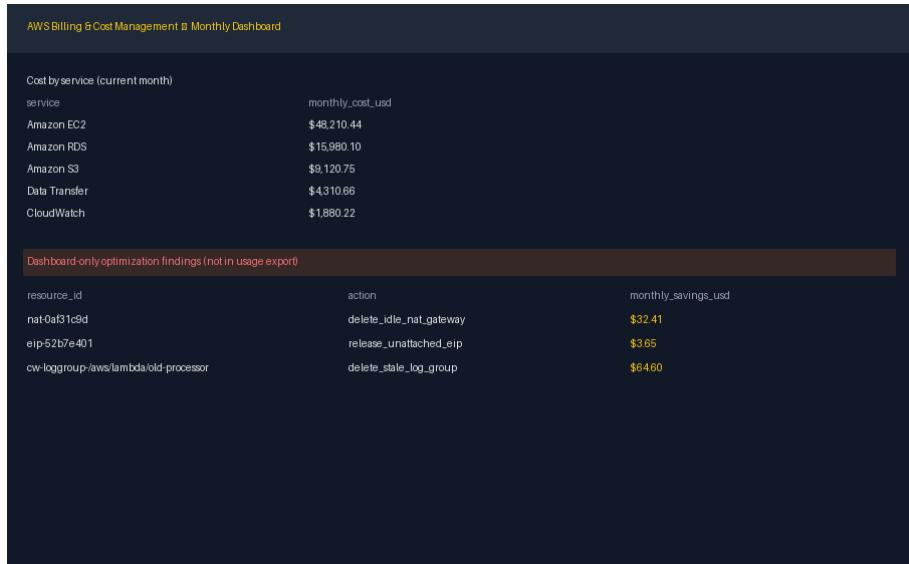  
Figure 6: The dashboard screenshot staged as input/aws\_billing\_dashboard.png in Example 1 (900 × 560 px, drawn by the generator from the latent world). The upper table is perservice context and plays no role in grading; the lower table holds the three dashboard-only findings that appear in no CSV, so the agent must read the image to recover their ids, actions, and savings.

The two CSVs are plain tables; the inventory leaves the columns that do not apply to a resource type empty.

```csv
# input/aws_pricing_reference.csv (complete)
sku,dimension,unit,price_usd
t3.medium,ec2_compute,hour,0.041600
m5.large,ec2_compute,hour,0.096000
m5.xlarge,ec2_compute,hour,0.192000
m5.2xlarge,ec2_compute,hour,0.384000
m5.4xlarge,ec2_compute,hour,0.768000
db.t3.medium,rds_compute,hour,0.068000
db.m5.large,rds_compute,hour,0.171000
db.m5.xlarge,rds_compute,hour,0.342000
db.m5.2xlarge,rds_compute,hour,0.684000
s3-standard,s3_storage,gb_month,0.023000
```

```csv
s3-standard-ia,s3_storage,gb_month,0.012500
# input/resource_usage.csv (6 of 430 rows)
resource_id,resource_type,name,state,instance_type,cpu_p95,mem_p95,connections_p95,size_gb,
,→ ia_access_ratio
db-000067,rds,rds-svc-067,available,db.m5.xlarge,62.12,,346,,
db-000048,rds,rds-svc-048,available,db.m5.xlarge,18.48,,8,,
i-000161,ec2,ec2-app-161,running,m5.2xlarge,45.55,74.81,,,
i-000000,ec2,ec2-app-000,running,m5.2xlarge,11.97,41.34,,,
s3-000015,s3,data-bucket-015,,,,,,5923,0.052
s3-000118,s3,data-bucket-118,,,,,,19,0.596
```

Ground truth. The latent world W is the generator’s record of the fleet: the 430 inventory rows with their utilization percentiles and sizes, the pricing tiers in their declared order, and three planted dashboard-only findings with their dashboard-reported costs. Rendering splits W across three formats: the inventory becomes resource\_usage.csv, the tiers become aws\_pricing\_reference.csv, and the three findings are drawn only into the PNG, next to a per-service cost table that is context, so that no text file contains them. The reference follows from W by applying the prompt’s four rules with the pricing table: 730 hours per month, one tier down along the declared order, S3 Standard to Infrequent Access per GB-month, and recommendations sorted by savings descending, then by id. Each recommendation’s current cost, projected cost, and savings are computed from unrounded prices and rounded to cents separately, so a row’s savings can differ by one cent from the difference of its two rounded costs (s3-000126, 7,734 GB: 177.88 − 96.68 = 81.20, savings 81.21). Of the six rows above, three qualify: db-000048 (CPU 18.48, 8 connections) drops to db.m5.large and saves 124.83; i-000000 (CPU 11.97, memory 41.34) drops to m5.xlarge and saves 140.16; s3-000015 (5,923 GB at 5.2% infrequent access) moves to Infrequent Access and saves 62.19. For this seed the rules yield 148 recommendations, 74 EC2 downsizes, 27 RDS downsizes, 44 S3 tier moves, and the three dashboard findings. The executive summary sums the rounded rows column by column: current cost 32,629.73 USD, projected cost 16,234.79, and monthly savings 16,395.02. The savings total therefore exceeds current minus projected (16,394.94) by 0.08, the sum of the one-cent residues on 12 S3 rows, far inside the grader’s 20% savings tolerance. The grader applies two hard gates (both files parse and are non-empty; total savings lie between zero and total current cost), then scores the weighted rubric the prompt announces: coverage F1 of recommended ids against the hidden set (30%), action correctness on matched ids (30%), savings accuracy with full credit within 20% relative error and linear decay to zero at 100% (25%), and completeness of the summary fields, per-recommendation columns, and CSV header (15%); it also reports recall of the three dashboard-only ids separately, accepting the CloudWatch id as printed on the dashboard as an alias of the canonical id.

```jsonl
# reference/optimization_report.json (148 recommendations; excerpt, reformatted)
{"executive_summary": {"resource_count": 430, "recommendation_count": 148,
"dashboard_only_finding_count": 3, "total_current_cost": 32629.73,
"total_projected_cost": 16234.79, "total_monthly_savings": 16395.02},
"recommendations": [
{"resource_id": "i-000003", "resource_type": "ec2", "name": "ec2-app-003",
"action": "downsize_ec2", "current_cost": 560.64, "projected_cost": 280.32,
"monthly_savings": 280.32},
{"resource_id": "i-000006", "resource_type": "ec2", "name": "ec2-app-006",
"action": "downsize_ec2", "current_cost": 560.64, "projected_cost": 280.32,
"monthly_savings": 280.32},
{"resource_id": "cw-loggroup-old-processor", "resource_type": "cloudwatch_log_group",
"name": "/aws/lambda/old-processor", "action": "delete_stale_log_group",
"current_cost": 64.6, "projected_cost": 0.0, "monthly_savings": 64.6},
{"resource_id": "nat-0af31c9d", "resource_type": "nat_gateway",
"name": "nat-gw-prod-1c", "action": "delete_idle_nat_gateway",
"current_cost": 32.41, "projected_cost": 0.0, "monthly_savings": 32.41},
{"resource_id": "eip-52b7e401", "resource_type": "elastic_ip",
"name": "eip-orphaned-legacy", "action": "release_unattached_eip",
"current_cost": 3.65, "projected_cost": 0.0, "monthly_savings": 3.65},
...]}
# reference/savings_summary.csv (148 rows; first 3)
resource_id,resource_type,name,action,current_cost,projected_cost,monthly_savings
i-000003,ec2,ec2-app-003,downsize_ec2,560.64,280.32,280.32
i-000006,ec2,ec2-app-006,downsize_ec2,560.64,280.32,280.32
i-000024,ec2,ec2-app-024,downsize_ec2,560.64,280.32,280.32
```

# EXAMPLE 2: CLOSED-LOOP BUILDING MPC (ENERGY, POWER & NUCLEAR ENGINEERING)

Public view. The container is the engineering-energyplus-mpc profile (EnergyPlus 22.1.0, cvxpy 1.6.5, numpy 2.1.3; 4 cores, 8 GB, 5 h wall clock). The agent receives the prompt below and the input tree that follows it, and nothing else. This is a medium instance of its generator.

# EnergyPlus closed-loop building MPC (7 days at 15 minutes)   
Use the exact toolchain declared in ‘input/instance.json‘. Inspect ‘input/model.idf‘, ‘input   
weather.epw‘, ‘input/experiment\_plan.json‘, and ‘input/output\_contract.json‘. The model is   
the pinned EnergyPlus 22.1 one-zone example with a declared internal-mass transformation and   
a schedule actuator driving the ‘MPC Cooling Sink‘.   
Run the deterministic thermostat baseline and supplied excitation at 15-minute resolution.   
Fit the declared second-order input-output thermal model over both EnergyPlus traces and   
preserve its training and held-out diagnostics. This is a 3R2C-comparable dynamic-order model   
, not a claim that physical resistance and capacitance parameters were identified.   
Implement two distinct cyxpy/osop receding-horizon policies using the declared price. peak  
load, comfort, and switching weights. Deploy each through the EnergyPlus Python API: at every   
zone timestep read the simulated zone temperature, solve the policy, and actuate the first   
control. A precomputed open-loop schedule does not satisfy this task.   
Write the nine artifacts named in ‘input/output\_contract.json‘. The three data traces cover   
the complete simulation window. The two action files and comparison metrics cover the final   
24 hours. RC logs must expose model coefficients, training and held-out calibration, policy   
specific closed-loop error, objective weights, and solver status counts.   
The grader densely compares all nine artifacts to a reference generated and rerun with   
EnergyPlus 22.1 and cvxpy in the pinned profile.   
input/   
question.md the task prompt above   
instance.json horizon, schedules, tariff, controller weights (excerpt below)   
experiment\_plan.json four runs, identification recipe and split, two policies   
output\_contract.json the nine deliverables, their columns, and their rounding (below)   
model.idf one-zone EnergyPlus model, materialized from the pinned example   
weather.epw Golden, CO (NREL) TMY3 weather file, from the same pinned install

instance.json declares every quantity the procedure depends on; its seven 672-entry schedules are elided here.

```jsonl
{
"kind": "energyplus_second_order_closed_loop_mpc_cosimulation", "seed": 6610,
"energyplus_version": "22.1.0", "cvxpy_version": "1.6.5", "numpy_version": "2.1.3",
"source_focus": "energyplus_1zoneuncontrolled_22_1",
"source_idf_sha256": "53e3fb38...", "source_epw_sha256": "65041e11...",
"weather_window": "golden_tmy3_july",
"run_period_start_month": 7, "run_period_start_day": 1, "run_period_days": 7,
"timestep_minutes": 15, "horizon_steps": 672,
"prediction_horizon_steps": 24, "reporting_window_steps": 96,
"cooling_capacity_kw": 2.0406, "cooling_cop": 3.0, "internal_mass_area_m2": 48.0,
"baseline_deadband_c": 0.5, "baseline_on_fraction": 0.85, "identification_ridge": 1e-08,
"occupancy": [0, 0, ...], // 672 values; 1 between 08:00 and 20:00
"is_peak_period": [0, 0, ...], // 672 values; 1 between 17:00 and 20:00
"setpoint_c": [27.5, 27.5, ...], // 24.2 while occupied, else 27.5
"comfort_min_c": [17.0, 17.0, ...], // 20.5 while occupied, else 17.0
"comfort_max_c": [28.0, 28.0, ...], // 24.5 while occupied, else 28.0
"energy_price_per_kwh": [0.061587, ...], // 672 values in [0.058, 0.250]
"excitation_schedule": [0.9, 0.1, 0.9, ...], // 672 values in {0.1, 0.9}
"policy_objectives": {
"energy_saving": {"energy_weight": 0.35, "price_weight": 1.0, "peak_weight": 0.1,
"on_peak_weight": 0.1, "comfort_weight": 2.0, "switch_weight": 0.12},
"demand_response": {"energy_weight": 0.05, "price_weight": 0.35, "peak_weight": 5.0,
"on_peak_weight": 2.0, "comfort_weight": 4.0, "switch_weight": 0.12}
}
}
```

output\_contract.json names the nine deliverables and fixes their schemas.

{   
"trace\_files": {"baseline": "baseline\_data.csv",   
"energy\_saving": "mpc\_energy\_saving\_data.csv",   
"demand\_response": "mpc\_demand\_response\_data.csv"},   
"trace\_columns": ["step", "hour", "cooling\_w", "t\_zone", "setpoint", "outdoor\_temp\_c",   
"occupancy", "cooling\_fraction", "electric\_kw", "price\_per\_kwh",   
"comfort\_min\_c", "comfort\_max\_c", "one\_step\_predicted\_zone\_temp\_c"],

"action\_files": ["mpc\_actions\_energy\_saving.csv", "mpc\_actions\_demand\_response.csv"],   
"rc\_log\_files": ["rc\_log\_energy\_saving.json", "rc\_log\_demand\_response.json"],   
"metrics\_file": "metrics\_comparison.csv",   
"metrics\_rows": ["baseline", "mpc\_energy\_saving", "mpc\_demand\_response"],   
"metrics\_columns": ["cooling\_kwh", "elec\_kwh", "cost\_usd", "peak\_load\_kw",   
"peak\_hour\_avg\_kw", "discomfort\_dh", "calibration\_rmse\_c"],   
"summary\_file": "results\_summary.json",   
"numeric\_rounding": {"csv": 8, "model\_coefficients": 10, "summary": 8}   
}

Ground truth. The latent world is the pinned simulator together with the declared procedure: the EnergyPlus model, the weather file, and the schedules, weights, and identification recipe of instance.json fix a unique correct value for every field of the nine deliverables. The reference is therefore produced by executing that procedure once, inside the same pinned image, by the sealed reference builder, which the agent never sees. The builder (i) checks the SHA-256 of the shipped 1ZoneUncontrolled.idf and Golden TMY3 weather file against the values pinned in instance.json and applies the declared edits to the model (run period 1–7 July, four timesteps per hour, an InternalMass of $4 8 \mathrm { m ^ { 2 } }$ , and a Schedule:Constant actuator driving a 2.0406 kW OtherEquipment cooling sink); (ii) runs EnergyPlus twice through its Python API, once under the two-position thermostat (declared setpoint schedule, deadband ${ \bf \bar { 0 . 5 } } ^ { \circ } \mathrm { C } ,$ on-fraction 0.85) and once under the prescribed 0.9/0.1 excitation schedule, reading the zone temperature and writing the actuator at every zone timestep; (iii) fits the declared second-order input–output model

$$
T [ t ] = a _ { 1 } T [ t - 1 ] + a _ { 2 } T [ t - 2 ] + b _ { 0 } T _ { \mathrm { o u t } } [ t ] + b _ { 1 } T _ { \mathrm { o u t } } [ t - 1 ] + c _ { 0 } u [ t ] + c _ { 1 } u [ t - 1 ] + d _ { 1 } T _ { \mathrm { o u t } } [ t ] .
$$

by ridge least squares $( \lambda = 1 0 ^ { - 8 } )$ on the first 80% of each trace with the last 20% held out, and asserts a negative cooling gain, $c _ { 0 } + c _ { 1 } < 0 ; \mathrm { ( i v ) }$ runs EnergyPlus twice more in closed loop, solving at every zone timestep a 24-step cvxpy/OSQP receding-horizon problem with the policy’s declared weights and actuating its first control; and (v) writes the nine artifacts with the declared rounding: three 672-row traces, two 96-row action files over the final 24 hours, two logs exposing the seven coefficients, training and held-out RMSE, closed-loop one-step RMSE, objective weights, and solverstatus counts, the $\bar { 3 } \times 7$ metrics table, and the summary. A round-trip self-check re-fits the model and re-reads every artifact the way the grader will (coefficients within $1 0 ^ { - 7 }$ , row counts, distinct policy weights) before the environment is published. The grader then compares the agent’s nine files with these references cell by cell (CSV) and leaf by leaf (JSON) at a tolerance of $1 0 ^ { - 4 }$ , scoring each artifact by its fraction of matching fields. Every artifact is a function of the closed-loop trajectories, so a precomputed open-loop schedule, a first-order model, or a single policy cannot reproduce them.

## EXAMPLE 3: FINANCIAL-STATEMENT RECONSTRUCTION (ACCOUNTING & FINANCE)

Public view. The container is the finance-foss-headless profile (Python 3.10 only; 4 cores, 4 GB, 30 min wall clock). The agent receives the prompt below, a policy document, and a filing packet for a fictitious company, Juniper Ridge Holdings plc, in the two shapes an analyst meets in practice: SEC “companyfacts” JSON and inline-XBRL HTML filings. This is a medium instance of its generator.

```prolog
# Reconstruct and reconcile annual financial statements
Reconstruct the annual statements from the multi-document filing packet under ‘input/filings
/‘ and the SEC-shaped ‘input/companyfacts.json‘. Use ‘input/filing_index.json‘, ‘input/
account_mapping.csv‘, and the authority and fallback rules in ‘input/reconstruction_policy.md
‘.
Write three deliverables:
‘output/financial_statements.json‘, with company metadata, USD-million unit metadata, and a
‘periods‘ array containing balance sheet, income statement, and cash-flow sections.
‘output/evidence.csv‘, with the exact columns ‘period, statement, line_item, selected_value
, concept, source_file, locator, citation, authority_basis‘, in period and mapping order.
Every locator must resolve to the selected source value.
- ‘output/exceptions.json‘, listing every cross-source conflict, explicit amendment
restatement, accepted taxonomy alias, and missing-structured-fact fallback with its policy
based resolution.
Preserve integer USD millions. Verify the accounting, income, and cash roll-forward
identities for every period before writing the files. Do not use quarterly, unaudited, pro
forma, or wrong-unit evidence.
```

input/   
question.md the task prompt above   
instance.json 2 fiscal years, 16 line items, 3 deliverables   
reconstruction\_policy.md authority and fallback rules (below)   
filing\_navigation.md amendments carry only restated rows; ids are locators   
account\_mapping.csv 16 line items -> statement, label, accepted concepts   
filing\_index.json 4 filings: form, accession, filing date, status (below)   
companyfacts.json SEC-shaped facts: 16 us-gaap concepts x 3, whole USD   
filings/2025/form10-k.htm FY2025 10-K, 16 inline-XBRL rows (fact-2025-000..015)   
filings/2025/form10-k-a.htm FY2025 10-K/A, restates one row   
filings/2025/current-report.htm FY2025 8-K with quarterly (Q3) figures   
filings/2024/form10-k.htm FY2024 10-K

The policy document is the agent’s only statement of precedence.

# Annual statement reconstruction policy   
All output values are USD millions. Companyfacts ‘USD‘ values are whole USD and must be   
divided by 1,000,000. Use exact fiscal-year and period-end matches, annual ‘FY‘ facts, and   
Forms 10-K or 10-K/A only. Ignore quarterly, non-USD, pro forma, and unaudited supplemental   
facts.   
Within Companyfacts, choose the latest ‘filed‘ date and then accession among all accepted   
concepts in ‘account\_mapping.csv‘. Within filing documents, a 10-K/A overrides only the rows   
it explicitly restates; otherwise retain the original 10-K row. When the latest structured   
fact and latest filing row disagree, the structured Companyfacts value controls. If no   
accepted structured fact exists, use the latest applicable filing row. Record every cross  
source conflict, amendment restatement, taxonomy alias, and structured-fact fallback in ‘   
exceptions.json‘. Every evidence row must cite an exact JSON pointer or HTML fragment that   
resolves to the selected value.

The excerpts below follow one line item, cash and cash equivalents for FY2025, through the packet: under its balance-sheet concept it is reported five times with four different values.

# account\_mapping.csv (first of 16 rows)   
statement,line\_item,filing\_label,canonical\_concept,accepted\_concepts,period\_type   
balance\_sheet,cash,Cash and cash equivalents,us-gaap:CashAndCashEquivalentsAtCarryingValue,us   
,→ -gaap:CashAndCashEquivalentsAtCarryingValue|jrh:   
,→ CashCashEquivalentsRestrictedCashAndRestrictedCashEquivalents,instant   
# filing\_index.json   
{"cik": "8899426957", "company": "Juniper Ridge Holdings plc", "filings": [   
{"accession": "8899426957-25-000001", "document": "filings/2025/form10-k.htm",   
"filed": "2026-01-30", "fiscal\_year": 2025, "form": "10-K", "status": "original"},   
{"accession": "8899426957-25-000002", "document": "filings/2025/form10-k-a.htm",   
"filed": "2026-02-15", "fiscal\_year": 2025, "form": "10-K/A",   
"status": "amendment\_explicit\_rows\_only"},   
{"accession": "8899426957-25-000004", "document": "filings/2025/current-report.htm",   
"filed": "2025-10-15", "fiscal\_year": 2025, "form": "8-K",   
"status": "current\_report\_decoy"},   
{"accession": "8899426957-24-000001", "document": "filings/2024/form10-k.htm",   
"filed": "2025-01-30", "fiscal\_year": 2024, "form": "10-K", "status": "original"}]}   
# companyfacts.json, node /facts/us-gaap/CashAndCashEquivalentsAtCarryingValue/units/USD   
[{"accn": "8899426957-25-000001", "form": "10-K", "fy": 2025, "fp": "FY",   
"end": "2025-12-31", "filed": "2026-01-30", "val": 239000000},   
{"accn": "8899426957-25-000002", "form": "10-K/A", "fy": 2025, "fp": "FY",   
"end": "2025-12-31", "filed": "2026-02-15", "val": 246000000},   
{"accn": "8899426957-24-000001", "form": "10-K", "fy": 2024, "fp": "FY",   
"end": "2024-12-31", "filed": "2025-01-30", "val": 256000000}]   
# filings/2025/form10-k.htm, balance sheet ("USD in millions")   
<tr><th scope="row">Cash and cash equivalents</th><td><ix:nonFraction id="fact-2025-000"   
name="us-gaap:CashAndCashEquivalentsAtCarryingValue" contextRef="FY2025" unitRef="USD"   
scale="6" format="ixt:numdotdecimal">239</ix:nonFraction></td></tr>   
# filings/2025/form10-k-a.htm, the only row it restates   
<tr><th scope="row">Cash and cash equivalents</th><td><ix:nonFraction   
id="amended-fact-2025-000" name="us-gaap:CashAndCashEquivalentsAtCarryingValue"   
contextRef="FY2025" unitRef="USD" scale="6" ...>243</ix:nonFraction></td></tr>   
# filings/2025/current-report.htm, 8-K with a quarterly context   
<tr><th scope="row">Cash and cash equivalents</th><td><ix:nonFraction   
id="current-report-fact-2025-000" name="us-gaap:CashAndCashEquivalentsAtCarryingValue"   
contextRef="Q32025" unitRef="USD" scale="6" ...>230</ix:nonFraction></td></tr>

Ground truth. The latent world W is the company’s true two-period statements: 16 integer line items in USD millions for fiscal years 2025 and 2024, each ending December 31. W satisfies the three identities the prompt asks the agent to verify, assets = liabilities + equity, net income = revenue − cost of revenue − operating expenses, and ending cash = beginning cash + operating + investing + financing cash flow, as well as the ties that connect real statements: the four asset lines sum to total assets (FY2025: 246 + 147 + 62 + 732 = 1,187), balance-sheet cash equals cash-flow ending cash in each year (246 and 256), and FY2025 beginning cash equals FY2024 ending cash (256). Rendering projects W into the two public formats: each value becomes a whole-dollar structured fact under its us-gaap concept in companyfacts.json and an inline-XBRL row, in millions and with a stable fragment id, in the fiscal year’s 10-K. The defect plan then corrupts the clean packet, but only in sources that the policy rejects. The original FY2025 10-K misstates three balance-sheet lines, in its rows and in its structured facts alike (cash 239, accounts receivable 138, other current assets 726, against 246, 147, and 732 in W); a 10-K/A restates one row (cash, 239 → 243), and the restated value is still wrong; the whole FY2025 fact set is refiled in companyfacts.json under the 10-K/A accession with the true values, so the structured feed and the amendment disagree about the same restatement; an 8-K reports the same concepts under quarterly Q32025 contexts; the filings carry an “unaudited supplemental data” section; outflows are printed in accounting parentheses, (110); and each line item admits a second, company-extension concept (jrh:) that this seed leaves unused. Because the defect plan is declared, the correct resolution of each of these is known without running a solver, and the three reference deliverables follow from W, the defect plan, and the policy text. Since every defect lies in a rejected source, the values the policy selects are those of W, and financial\_statements.json is W itself. The rejected values are also the ones that break the ties: the original 10-K’s asset lines sum to 1,165 against its total assets of 1,187, and neither 239 nor 243 matches the ending cash of 246. exceptions.json lists exactly the four conflicts the defect plan created, each with the resolution the policy dictates; the amendment entry records the filing-level choice (the 10-K/A row, 243, supersedes the original, 239), while its selected value is the structured 246 that overrides both. evidence.csv holds one row per line item and period, 32 in all, whose locator is the JSON pointer of the latest annual fact and whose authority basis names the rule that selected it. A round-trip self-check reselects every value from the public packet, verifies the three identities and the three ties above in every period, and asserts that the observed exception set equals the expected one before the environment is published. The grader compares the agent’s three files with these references leaf by leaf and cell by cell at zero tolerance.

```python
# reference/financial_statements.json (USD millions; reformatted)
{"cik": "8899426957", "company": "Juniper Ridge Holdings plc", "currency": "USD",
"unit": "millions", "periods": [
{"period": "2025", "period_end": "2025-12-31",
"balance_sheet": {"cash": 246, "accounts_receivable": 147, "inventory": 62,
"other_assets": 732, "assets": 1187, "liabilities": 598,
"equity": 589},
"income_statement": {"revenue": 1852, "cost_of_revenue": 666,
"operating_expense": 927, "net_income": 259},
"cash_flow": {"beginning_cash": 256, "operating_cash_flow": 365,
"investing_cash_flow": -110, "financing_cash_flow": -265,
"ending_cash": 246}},
{"period": "2024", "period_end": "2024-12-31",
"balance_sheet": {"cash": 256, "accounts_receivable": 73, "inventory": 30,
"other_assets": 546, "assets": 905, "liabilities": 508,
"equity": 397},
"income_statement": {"revenue": 1583, "cost_of_revenue": 601,
"operating_expense": 777, "net_income": 205},
"cash_flow": {"beginning_cash": 106, "operating_cash_flow": 333,
"investing_cash_flow": -146, "financing_cash_flow": -37,
"ending_cash": 256}}]}
# reference/exceptions.json (reformatted)
[{"kind": "cross_source_conflict", "period": "2025", "line_item": "accounts_receivable",
"structured_value": 147, "filing_value": 138, "selected_value": 147,
"resolution": "structured_feed_priority"},
{"kind": "amendment_restatement", "period": "2025", "line_item": "cash",
"original_value": 239, "amended_value": 243, "selected_value": 246,
"resolution": "explicit_amendment_over_original"},
{"kind": "cross_source_conflict", "period": "2025", "line_item": "cash",
"structured_value": 246, "filing_value": 243, "selected_value": 246,
"resolution": "structured_feed_priority"},
{"kind": "cross_source_conflict", "period": "2025", "line_item": "other_assets",
"structured_value": 732, "filing_value": 726, "selected_value": 732,
"resolution": "structured_feed_priority"}]
# reference/evidence.csv (2 of 32 rows)
period,statement,line_item,selected_value,concept,source_file,locator,citation,
,→ authority_basis
```

```csv
2025,balance_sheet,cash,246,us-gaap:CashAndCashEquivalentsAtCarryingValue,companyfacts.json
,→ ,#/facts/us-gaap/CashAndCashEquivalentsAtCarryingValue/units/USD/1,"SEC Companyfacts
,→ JSON, us-gaap:CashAndCashEquivalentsAtCarryingValue, FY 2025, companyfacts.json#/
,→ facts/us-gaap/CashAndCashEquivalentsAtCarryingValue/units/USD/1",
,→ latest_exact_period_annual_structured_fact
2024,balance_sheet,cash,256,us-gaap:CashAndCashEquivalentsAtCarryingValue,companyfacts.json
,→ ,#/facts/us-gaap/CashAndCashEquivalentsAtCarryingValue/units/USD/2,"SEC Companyfacts
,→ JSON, us-gaap:CashAndCashEquivalentsAtCarryingValue, FY 2024, companyfacts.json#/
,→ facts/us-gaap/CashAndCashEquivalentsAtCarryingValue/units/USD/2",
,→ latest_exact_period_annual_structured_fact
```

## B DENSE REWARD DETAILS

This appendix expands §3.

Wasted groups under terminal reward. The all-fail fraction $( 1 - p ) ^ { G }$ of §3.1 stays high even for larger groups, still 44% at $\scriptstyle { p = 0 . 0 5 }$ with $G { = } 1 6$ , and even on synthesized terminal tasks Shen et al. (2026) find that only about half of all tasks yield any reward variance under binary reward. The same starvation afflicts actor-critic methods such as PPO (Schulman et al., 2017) in a softer form, since a critic fit to near-constant returns yields near-zero advantages everywhere; GRPO merely makes it exact.

Relation to policy-invariant shaping. PPRS (Eq. (4)) is not policy-invariant shaping in the sense of Ng et al. (1999). Classical shaping zeroes the potential of the terminal state, so the shaping terms sum to the same constant $- \Phi ( s _ { 0 } ) = 0$ on every trajectory and leave the objective unchanged. We keep the terminal potential, so the shaped return is terminal success plus $\lambda \Phi ( s _ { T } )$ and defines a graded objective; zeroing it would give every all-fail group identical rewards again and reinstate the starvation of §3.1, which is why the term is kept. What is preserved is the ranking of trajectories: a passing trajectory earns $1 + \lambda$ and a failing one at most λ, so a deterministic policy that maximizes one objective maximizes the other, and no trajectory is rewarded for trading completion against partial progress. What is not preserved is the ranking of stochastic policies in expectation. Let $\pi _ { 1 }$ and $\pi _ { 2 }$ pass with probabilities $p _ { 1 } < p _ { 2 }$ and let $\bar { \Phi } _ { k } \in [ \breve { 0 } , 1 ]$ be the mean final potential of their failing rollouts. Then

$$
\begin{array} { r } { \mathbb { E } _ { \pi _ { 1 } } [ R ] - \mathbb { E } _ { \pi _ { 2 } } [ R ] = ( p _ { 1 } - p _ { 2 } ) ( 1 + \lambda ) + \lambda \big [ ( 1 - p _ { 1 } ) \bar { \Phi } _ { 1 } - ( 1 - p _ { 2 } ) \bar { \Phi } _ { 2 } \big ] \ \leq \ ( p _ { 1 } - p _ { 2 } ) ( 1 + \lambda ) + \lambda ( 1 - p _ { 1 } ) , } \end{array}
$$

so the shaped objective can prefer the less successful policy only if $p _ { 2 } - p _ { 1 } < \lambda ( 1 - p _ { 1 } ) / ( 1 + \lambda ) \leq$ $\lambda / ( 1 + \lambda )$ , which is $0 . 2 \ \mathrm { a t } \ \lambda = 0 . 2 5$ , and only when its failures end close to complete while the other’s end near empty. Every result we report is a terminal pass rate under the strict verifier, so any such distortion would appear directly in the tables; the sparse arm of Table 5, trained on the same tasks with the terminal reward alone, is the control. λ was fixed at 0.25 in every run and not tuned.

Example progress contract. For the warehouse environment of Figure 3 the nodes are readable, schema, dimensions, facts, normalization, relations, aggregates, quality\_report, and summary; relations, for instance, requires dimensions and facts. The partial scorer $c _ { v }$ uses set precision and recall for record-valued outputs and declared tolerances for numeric ones, and never re-runs the strict verifier. Each node’s credit is capped by the weakest of its prerequisites (§3.2), so a correct aggregate built on a wrong fact table earns nothing.

Measured groups. To see the starvation of §3.1 on real rollouts, we graded the workspace after every turn for $G { = } 8$ rollouts on each of 12 seeds of the warehouse environment, for the untrained Qwen3.8- 27B and for the trained 27B checkpoint, under the training harness (65k-token context, 60 tool calls), which grades the terminal reward only when the policy issues the submit command. Terminal reward is 0 on all 192 rollouts, so every one of the 24 groups has zero advantage under Eq. (2); yet under Φ every group has non-zero variance, with rollouts ending on the prerequisite-gated plateaus 0.05 (readable and schema partially present), 0.26 (every table partially loaded), 0.69 (schema and facts complete), 0.78, 0.90, and 1. Figure 4 shows one of these groups.

Shaping within a failing group. In a group in which no rollout passes, λ cancels and the potential is the objective; Wang (2026) shows that GRPO agents collapse when this happens with a shaping term that is not aligned with the task, and it is safe here only because Φ is exact progress toward the ground-truth world. Among failing rollouts, the shaped reward therefore imposes a total order by how much of the workflow they completed, and it penalizes regressions, such as overwriting a correct table with a corrupted one, through negative increments $r _ { t } < 0$ . The fraction of groups that yield gradient rises from $1 - ( 1 - p ) ^ { G }$ to the fraction whose rollouts are not all stalled at the same stage. In training, $R ( \tau )$ enters with per-turn credit (Appendix C): turn t receives the increment $\lambda \boldsymbol { r } _ { t }$ and the final turn additionally receives the terminal term.

Relation to potential-based shaping. In the language of potential-based shaping (Ng et al., 1999), Φ is the potential and $r _ { t }$ its difference. Classical shaping requires that the shaped objective have the same optimal policies as the original; we deliberately do not, because the whole point is that the shaped objective is not indifferent to partial progress. What we retain is agreement on maximizers (any passing rollout outscores any failing one) and anchoring $( \Phi = 1$ exactly when the verifier passes), so the acceptance set of a task is unchanged. This is the opposite route from the usual remedy for tasks beyond a learner’s frontier, which is to simplify, scaffold, or defer the task until some rollout succeeds (Florensa et al., 2018; Chen et al., 2025b; Wolf et al., 2026; Zeng et al., 2026a); we leave the task and the harness fixed and raise the resolution of the reward. We prefer a task-aligned potential to the test-pass fraction of Shen et al. (2026) and the passing-assertion count of Yang et al. (2026), which score only what the terminal tests probe and carry no notion of regression. The signal is also denser within a group that contains a success: the lone passing rollout is contrasted not with an undifferentiated mass of failures but with a graded spectrum of near-misses. Because Φ is produced by a scorer with a code closure disjoint from the verifier’s and has passed the causality and exploit-resistance gates of Appendix $_ { \mathrm { A . 6 , } }$ none of the probed gaming strategies applied to the public tree earns $\Phi > 0$ , and Φ rises only when the output tree matches more of the workflow’s correct intermediate and final artifacts.

## C TRAINING AND EVALUATION DETAILS

## C.1 TRAINING RECIPE AND HYPERPARAMETERS

We optimize with DPPO: group-centered advantages, a total-variation divergence bound of 0.1 on the policy ratio, and no KL anchor. Groups whose rewards have zero variance are discarded and refilled by active sampling, so every step sees 8 informative groups. The reward is Eq. (4) with $\lambda = 0 . 2 5$ applied with per-turn credit: turn t receives the increment $\lambda \boldsymbol { r } _ { t }$ , the final turn additionally receives the terminal term, and each turn’s advantage is its return-to-go minus the group mean of that return at the same turn index. Table 11 lists the recipe shared by every run; runs differ only in the corpus subset, the reward mechanism, the model size, and the hardware they ran on.

Table 11: Training hyperparameters shared by every RL run in this paper.
<table><tr><td>Setting</td><td>Value</td></tr><tr><td>Objective</td><td>group-relative policy gradient with centered advantages  $\left( \operatorname { E q . } \left( 2 \right) \right)$ </td></tr><tr><td>Trust region</td><td>total-variation divergence bound 0.1 on the policy ratio (DPPO loss); no KL anchor  $( \beta \mathrm { = } 0 )$ </td></tr><tr><td>Rollouts per task (G)</td><td>24</td></tr><tr><td>Unique tasks per step</td><td>8 (192 rollouts per step)</td></tr><tr><td>Active sampling</td><td>zero-variance groups discarded and refilled</td></tr><tr><td>Optimizer</td><td>AdamW, learning rate  $1 0 ^ { - 6 }$  , constant schedule, one epoch per batch</td></tr><tr><td>Sampling temperature</td><td>1.0</td></tr><tr><td>Prompt / response budget</td><td>2,048 prompt tokens; 65,536 response tokens</td></tr><tr><td>Per-turn budget Tools</td><td>16,384 tokens; at most 64 tool calls per rollout a single bash tool in a per-task container (python : 3.13-slim base im-</td></tr><tr><td>Reward</td><td>age) Eq. (4) with  $\lambda { = } 0 . 2 5 ;$  per-turn credit, return-to-go with γ=1, per-turn-index</td></tr><tr><td></td><td>group baseline</td></tr><tr><td>Terminal reward Precision / parallelism</td><td>strict verifier score at submission, 1.0 for a pass</td></tr><tr><td>Learner / inference split</td><td>bf16 with fp32 LM head; ZeRO-3, sequence parallelism 4 (9B) 16 learner  $\mathrm { G P U s } + 1 6$  inference engines on 32-GPU runs; 16 + 48 on the</td></tr><tr><td></td><td>64-GPU 27B run</td></tr><tr><td>Seed</td><td>42</td></tr></table>

## C.2 EVALUATION PROTOCOL

ALE-CM consists of 18 expert-authored long-horizon tasks in three capability categories (Math & Science, 8 tasks; ML, 5; Coding & System, 5), each graded in [0, 1] by its own strict grader. Every

Qwen model, base or trained, runs in Vanillux2, the single-bash harness used in training, with 64 turns and 16,384 tokens per turn and 5 independent rollouts per task. Frontier models run in their native agent harnesses (Codex, Claude Code, Gemini CLI), the setting most favorable to them; the largest open model, Qwen3.8-2.4T-A95B, runs in Vanillux2. We report the mean graded score (S@1), the fraction of rollouts that fully solve the task (P@1), and their best-of-5 counterparts (S@5, P@5). On TB 3.0 and 4.0 (Merrill et al., 2026; Marten et al., 2026; Marten, 2026) we evaluate the “CM” subsets (22 and 18 tasks; selection described below); on TB 2.1 (89 tasks) we use the benchmark’s reference agent Terminus-2 for the 27B models and Vanillux2 for the 9B models, with k=5. Task selection and scoring conventions are given in the table captions.

Selection of the “CM” subsets and task lists. Our training generators cover one domain, computing and math, while TB 3.0 spans many, so we evaluate on the TB tasks that fall in that domain. To select them we gave Claude the 74 TB 3.0 task directories together with a description of our computing-and math domains and asked it to judge, task by task, whether the task belongs to that domain even just slightly; we keep the in-domain tasks that our CPU-only harness can run and grade. This gives the 22-task TB 3.0 subset, and the 18 of these tasks that remain in TB 4.0 form the TB 4.0 subset. The computing-and-math split of Agents’ Last Exam has 23 tasks, and ALE-CM keeps the 18 that run in a Linux Docker container, the sandbox of our training and evaluation harness. The other five need a full virtual machine, which that sandbox does not provide. Four boot a Windows 10 guest to analyze Windows binaries or packet captures with desktop tools such as IDA, Ghidra, x64dbg, and Wireshark (ghidra\_malware\_config\_extraction\_01, pcap\_enterprise\_triage\_01, tris\_crackme, newyear\_keygen2); the fifth, k8s\_migration\_1, boots an Ubuntu 22 guest to run a Minikube cluster on Docker, which would require Docker inside our container. The exclusion follows from the runtime alone, not from task difficulty, and every model in Table 2, ours and frontier, is scored on the same 18 tasks. The 18 ALE-CM tasks are listed in Table 12 and the TB subsets in Table 13.

Table 12: The 18 ALE-CM tasks (computing-and-math split of Agents’ Last Exam), grouped by the capability category used in Table 2.
<table><tr><td>Category</td><td>Task</td><td>Title</td></tr><tr><td>Math &amp; Science (8)</td><td>branch_bound_atsp cfr_game_theory_equilibrium</td><td>Branch-and-Bound ATSP Solver CFR Game Theory Equilibrium</td></tr><tr><td></td><td>particle_filter_nonlinear_tracking</td><td>Particle Filter Nonlinear Tracking</td></tr><tr><td></td><td>k3 abelian extensions</td><td>Finite Abelian Extension Classification</td></tr><tr><td></td><td></td><td>Synthetic Causal Structure Inference</td></tr><tr><td></td><td>synthetic_causal_structure_inference</td><td>Clustered-Cyclic Code Circuit Simulation</td></tr><tr><td></td><td>clustered_cyclic_code_circuit_level_simulation</td><td></td></tr><tr><td></td><td>ising_post_measurement_1</td><td>Post-Measurement States for a Quantum Ising Chain</td></tr><tr><td></td><td>go_game_reconstruction_1</td><td>Go Game Reconstruction 1</td></tr><tr><td></td><td>dit_pipeline_cfg_alignment_fid_256_001</td><td>Repair Standalone DiT Pipeline CFG Alignment</td></tr><tr><td>ML (5)</td><td>paper_reproduction_instance_1</td><td>LCA-on-the-Line Table 2 Reproduction</td></tr><tr><td></td><td>ranking_node_feature_parity_recovery_instance_1</td><td>Ranking Node Feature Parity Recovery</td></tr><tr><td></td><td>mp_checkpoint_consolidation_v2</td><td>Checkpoint Consolidation V2</td></tr><tr><td></td><td>recsys_cold_start_instance_1</td><td>Hybrid Recommender Cold-Start Benchmark</td></tr><tr><td></td><td></td><td>Kubernetes Payment API Root Cause Analysis</td></tr><tr><td>Coding &amp; System (5)</td><td>k8s_payment_api_root_cause_analysis</td><td></td></tr><tr><td></td><td>os_log_permission_guard_v1</td><td>OS Log Permission Guard</td></tr><tr><td></td><td>data_pipeline_etl_instance_1</td><td>Retail ETL Warehouse Cleanup</td></tr><tr><td></td><td>cp_test_gen_1 cost_optimization_1</td><td>Competitive Programming Test Generator – Binary String Copying</td></tr></table>

Representativeness of the “CM” subsets. Tables 14 and 15 compare, for every official leaderboard row of Table 3, its score on our 22-task (TB 3.0) and 18-task (TB 4.0) subsets with its score on the full 74- and 66-task benchmarks. Both sides are computed from the same official per-trial results (5 trials per task, ungraded trials scored 0, P@1 the per-task mean reward and P@5 the unbiased pass@5 estimator, macro-averaged over tasks); the full-set P@1 reproduces the leaderboard’s published accuracy to within 0.01 (the residual comes from trials the leaderboard re-scored after our snapshot). GLM 5.2 has no TB 4.0 entry, and our own Gemini and Qwen runs are not leaderboard rows, so they are omitted. Subset scores run somewhat above full-set scores for most models, but the two agree closely on how models compare: across models, Pearson r (linear agreement of the scores) is 0.96 (P@1) and 0.89 (P@5) on TB 3.0 and 0.97 and 0.92 on 4.0, and Spearman ρ (agreement of the model ranking) is 0.94/0.83 and 0.90/0.91.

For ALE-CM the official Agents’ Last Exam leaderboard publishes only aggregate scores per model and harness (mean score and pass rate over the full 152-task benchmark, one run per task) and no per-task results, so Table 16 sets our own Table 2 runs on the 18-task split against the leaderboard’s headline entry for the same model in the same harness family (its default row, the reasoning-effort variant with the highest pass rate, retrieved 2026-09-18). Five frontier rows of Table 2 have such an entry; Claude Sonnet 5, the Gemini Flash models, and Qwen3.8-2.4T-A95B do not. Because the two sides differ in harness configuration and number of rollouts, agreement is looser than on TB: across the five models Spearman ρ is 0.95 for pass rate and 0.63 for score (Pearson r 0.75 and 0.56), with Gemini 3.1 Pro the main outlier, scoring far higher in our Gemini CLI runs on the split than on the full benchmark. Close agreement is neither expected nor our aim: the full benchmark spans many domains beyond computing and math, such as engineering, finance, multimodal, and 3D tasks, whereas ALE-CM isolates the one domain our data targets.

Table 13: The Terminal-Bench “CM” subsets evaluated in Table 3: the 22 TB 3.0 tasks in the computing-and-math domain, with the official TB category and whether the task remains in TB 4.0 (18 do).
<table><tr><td>TB task</td><td>TB category</td><td>In TB 4.0</td></tr><tr><td>batched-eval-parity</td><td>ML / Evaluation</td><td>yes</td></tr><tr><td>cargo-flight-dispatch</td><td>Operations / Logistics</td><td>yes</td></tr><tr><td>cli-2ph-simplex</td><td>Software / Algorithms</td><td></td></tr><tr><td>ctr-optimization</td><td>Operations / Marketing</td><td>yes</td></tr><tr><td>data-anonymization</td><td>Software / Data engineering</td><td>yes</td></tr><tr><td>distributed-dedup</td><td>Software / Systems</td><td>yes</td></tr><tr><td>fix-uautomizer-soundness</td><td>Software / Languages</td><td></td></tr><tr><td>freight-dispatch-shift</td><td>Operations / Logistics</td><td>yes</td></tr><tr><td>ico-path-patch</td><td>Security / Reverse engineering</td><td></td></tr><tr><td>live-database-cutover</td><td>Software / Databases</td><td>yes</td></tr><tr><td>memcached-backdoor</td><td>Security / Reverse engineering</td><td></td></tr><tr><td>mp-checkpoint-consolidation</td><td>ML / Inference</td><td>yes</td></tr><tr><td>mvcc-lsm-compaction</td><td>Software / Databases</td><td>yes</td></tr><tr><td>payments-pipeline-fix</td><td>Software / Systems</td><td>yes</td></tr><tr><td>pretrain-shard-corruption</td><td>ML / Training</td><td>yes</td></tr><tr><td>production-planning</td><td>Operations / Supply chain</td><td>yes</td></tr><tr><td>risk-scorer-replay</td><td>ML / Evaluation</td><td>yes</td></tr><tr><td>session-window-debug</td><td>Software / Systems</td><td>yes</td></tr><tr><td>shadow-relay</td><td>Security / Forensics</td><td>yes</td></tr><tr><td>telecom-entity-resolution</td><td>Software / Data engineering</td><td>yes</td></tr><tr><td>uefi-bootkit</td><td>Security / Forensics</td><td>yes</td></tr><tr><td>wal-recovery-ordering</td><td>Software / Databases</td><td>yes</td></tr></table>

Table 14: TB 3.0: our 22-task “CM” subset versus the full 74-task benchmark, official leaderboard rows of Table 3. “Official acc.” is the published leaderboard accuracy. Across the 10 models: Pearson r=0.96 (P@1) and 0.89 (P@5); Spearman ρ=0.94 and 0.83.
<table><tr><td>Model</td><td>Subset (22) P@1 P@5</td><td>Full (74) P@1 P@5</td><td>Official acc.</td></tr><tr><td>Claude Fable 5 Claude Opus 5 GPT-5.6 (sol) GPT-5.6 (terra) GPT-5.6 (luna) Grok 4.6</td><td>0.41 0.64 0.53 0.64 0.41 0.55 0.30 0.55 0.18 0.32 0.30 0.50 0.26</td><td>0.34 0.61 0.42 0.58 0.34 0.55 0.20 0.38 0.13 0.27</td><td>0.34 0.43 0.35 0.21 0.14</td></tr></table>

Table 15: TB 4.0: our 18-task $\mathbf { \hat { \mu } } ^ { 6 6 } \mathbf { C M } ^ { 9 9 }$ subset versus the full 66-task benchmark, same rows and protocol as Table 14 (GLM 5.2 has no 4.0 entry). Across the 9 models: Pearson r=0.97 (P@1) and 0.92 (P@5); Spearman ρ=0.90 and 0.91.
<table><tr><td>Model</td><td>Subset (18) P@1 P@5</td><td>Full (66) P@1 P@5</td><td>Official acc.</td></tr><tr><td>Claude Fable 5 Claude Opus 5 GPT-5.6 (sol) GPT-5.6 (terra) GPT-5.6 (luna) Grok 4.6</td><td>0.46 0.61 0.52 0.72 0.39 0.61 0.23 0.44 0.18 0.33</td><td>0.45 0.68 0.52 0.71 0.37 0.61 0.22 0.44</td><td>0.45 0.52 0.37 0.22</td></tr></table>

Table 16: Agents’ Last Exam: our 18-task ALE-CM split (Table 2, 5 rollouts per task) versus the official full 152-task leaderboard (one run per task; the leaderboard’s default row for the model in the same harness family, with its reasoning-effort setting). Across the 5 models: Pearson r=0.56 (score) and 0.75 (pass rate); Spearman ρ=0.63 and 0.95.
<table><tr><td rowspan="2">Model</td><td rowspan="2">Harness</td><td colspan="2">Our ALE-CM split (18 tasks)</td><td colspan="2">Official full ALE (152 tasks)</td><td rowspan="2">Official effort</td></tr><tr><td>S@1</td><td>P@1</td><td>Score</td><td>Pass rate</td></tr><tr><td>GPT-5.6 (sol)</td><td>Codex</td><td>0.58</td><td>0.28</td><td>0.54</td><td>0.31</td><td>xhigh</td></tr><tr><td>GPT-5.6 (terra)</td><td>Codex</td><td>0.50</td><td>0.22</td><td>0.51</td><td>0.28</td><td>max</td></tr><tr><td>Claude Opus 5</td><td>Claude Code</td><td>0.58</td><td>0.28</td><td>0.55</td><td>0.32</td><td>high</td></tr><tr><td>Claude Opus 4.8</td><td>Claude Code</td><td>0.52</td><td>0.22</td><td>0.45</td><td>0.27</td><td>max</td></tr><tr><td>Gemini 3.1 Pro</td><td>Gemini CLI</td><td>0.52</td><td>0.21</td><td>0.33</td><td>0.16</td><td>default</td></tr></table>

## C.3 QUALITATIVE EXAMPLES ON ALE-CM

Table 2 aggregates over 18 tasks and 5 rollouts; here we trace single rollouts on three more tasks in the layout of Figure 5, which shows the k8s\_payment\_api\_root\_cause\_analysis task: a rollout of the strongest frontier agent (Claude Fable 5), a rollout of a second frontier agent (GPT-6 Astra or GPT-5.6), a typical rollout of the untrained Qwen3.8-27B base model, and a rollout of TEV-27B. The tasks are those on which our rollout beats the base rollout; Table 17 lists the graded scores. Every Qwen rollout ran in Vanillux2, a single bash tool with 64 turns; frontier rollouts ran in their native harnesses. Every task below is also solved by at least one frontier agent, so these are not tasks on which our model is uniquely capable; the figures show how the rollouts differ. Green marks a decision that earns grader credit, red one that forfeits it, grey lines summarize routine steps, and t is the trajectory step.

Table 17: Graded scores of the rollouts traced in Figure 5 and Figures 7–9. Each cell is the score of the single rollout shown in that column; frontier rollouts in their native harness, Qwen rollouts in Vanillux2.
<table><tr><td>Task</td><td>Category</td><td>Best frontier rollout</td><td>Second frontier rollout</td><td>Base rollout</td><td>Ours</td></tr><tr><td>k8s_payment_api_root_cause_analysis</td><td>Coding &amp; Sys.</td><td>0.97 (Claude Fable 5)</td><td>0.75 (GPT-6 Astra)</td><td>0.70</td><td>0.97</td></tr><tr><td>ising_post_measurement_1</td><td>Math &amp; Sci.</td><td>1.00 (Claude Fable 5)</td><td>1.00 (GPT-5.6 sol)</td><td>0.00</td><td>1.00</td></tr><tr><td>branch_bound_atsp</td><td>Math &amp; Sci.</td><td>1.00 (Claude Fable 5)</td><td>1.00 (GPT-5.6 sol)</td><td>0.00</td><td>1.00</td></tr><tr><td>k3_abelian_extensions</td><td>Math &amp; Sci.</td><td>1.00 (Claude Fable 5)</td><td>1.00 (GPT-5.6 sol)</td><td>0.00</td><td>1.00</td></tr></table>

## D EXTENDED RELATED WORK

Synthetic corpora for coding and terminal agents. The first wave of agent training data mined real repositories: SWE-bench (Jimenez et al., 2024) and SWE-Gym (Pan et al., 2025) collect GitHub issues with their tests, and SWE-rebench (Badertdinov et al., 2025) and Skywork-SWE (Zeng et al., 2025) automate the mining. The second wave synthesizes tasks: SWE-smith (Yang et al., 2025a) injects bugs into working repositories, SWE-Flow (Zhang et al., 2025b) strips a repository along its runtime dependency graph, and R2E-Gym (Jain et al., 2025) back-translates problem statements from commits. Terminal corpora follow the same pattern at larger scale, either with a language model writing tasks, containers, and tests that are then filtered for solvability, as in Endless Terminals (Gandhi et al., 2026), SETA (Shen et al., 2026), and recursive solution extension (Li et al., 2026a) (TMAX (Ivison et al., 2026) skips this filter and lets RL drop unsolved tasks), or by reconstructing environments from agent trajectories, as in CLI-Gym (Lin et al., 2026) and Terminal-Universe (Wu et al., 2026). All of these scale the number of instances: each instance is pull-request-sized or a single session, its verifier is a test suite that caps the complexity a task can have, and generation depends on a model whose output must be validated after the fact. We scale environments: a coding agent writes each generator once, the authors review it, and instantiating it involves no model; verification is against the latent world rather than a test suite. Closer in spirit is the programmatic synthesis of executable, stateful tool environments, AutoForge (Cai et al., 2025), EnvScaler (Song et al., 2026), ScaleEnv (Tu et al., 2026), Agent-World (Dong et al., 2026), EnvFactory (Xu et al., 2026), and LOGIGEN (Zeng et al., 2026b), which also treats the environment as the unit of scale (Fang et al., 2025); these are API worlds for short tool-use episodes, and only LOGIGEN emits a progress signal, a per-turn reward from the database’s proximity to its target state. Two findings from that line carry over: more environments alone do not help without difficulty control (Zhu et al., 2026b), and coverage rather than count is what drives transfer (Chen et al., 2026a;b; Xu et al., 2026). Our environments differ from this family on the two properties it largely lacks: each spans a long, multi-stage workflow across math and science, ML, and coding and systems domains rather than a short tool-use episode, and every one ships the progress potential $\Phi _ { W }$ of §3 rather than a bare success condition, so the difficulty control and dense signal these two findings call for come from the same generator that supplies coverage.

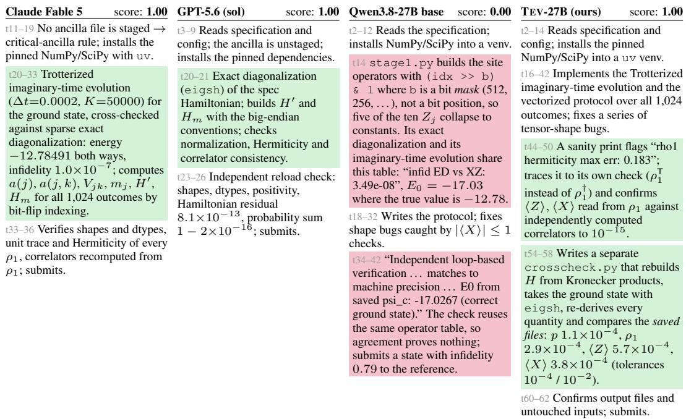  
Figure 7: Qualitative example on the ALE-CM task ising\_post\_measurement\_1 (Math & Science). Compute the exact ground state of a 10-qubit critical transverse-field Ising chain, couple it to an ancilla copy and derive, for all $2 ^ { 1 0 }$ projective ancilla outcomes, the post-measurement probabilities, site-1 reduced density matrices and one-body correlators; four arrays are graded against a hidden reference with binary credit. Green marks a decision that secures the result, red one that forfeits it. All three solving rollouts cross-check the ground state with an independent construction of H; the base model’s exact-diagonalization and imaginary-time codes share one buggy operator table, so their agreement proves nothing.

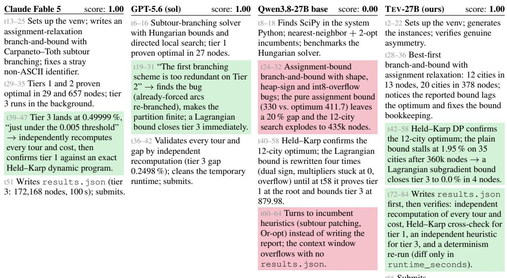  
Figure 8: Qualitative example on the ALE-CM task branch\_bound\_atsp (Math & Science). Implement a branch-and-bound solver in Python/NumPy/SciPy for three asymmetric TSP instances: 12 and 20 cities to proven optimality, 35 cities to within a 0.5 % gap, reported in a JSON file checked against hidden optima. Green marks a decision that secures the result, red one that forfeits it. The three solving rollouts write the deliverable and then verify it independently; the base model has a working bound by t58 but keeps improving heuristics and never writes the file.

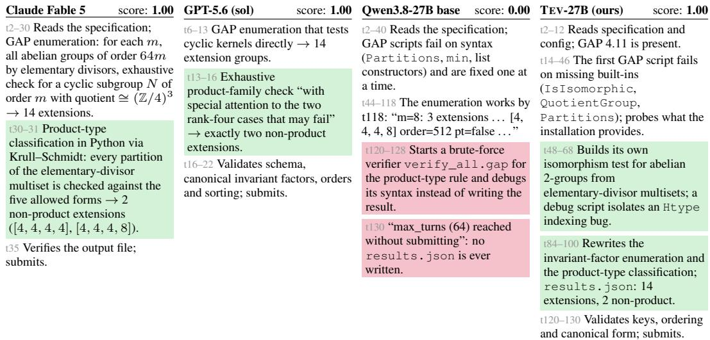  
Figure 9: Qualitative example on the ALE-CM task k3\_abelian\_extensions (Math & Science). Enumerate every finite abelian G in $0 \to \mathbb { Z } / m \to G \to ( \mathbb { Z } / 4 ) ^ { 3 } \to 0 { \mathrm { ~ f o r ~ } } m = 1 , \dots , 8$ in GAP, classify product type, and write an exact-match JSON. Green marks a decision that secures the result, red one that forfeits it. The GAP build lacks IsIsomorphic; our model works around it and writes the deliverable, whereas the base model has the enumeration right by t118 but spends its remaining turns on a brute-force verifier and never writes the file.

Backward construction. Latent-world-first synthesis belongs to a long line of methods that derive a task from its solution. Denoising objectives corrupt text and learn to restore it (Lewis et al., 2020); the data-cleaning community injects errors of controlled repairability into clean databases to evaluate repair algorithms (Arocena et al., 2015) and corrupts synthetic person records to benchmark record linkage (Tran et al., 2013); mutation and bug injection corrupt working code (Yang et al., 2025a; Hariharan et al., 2025); CLI-Gym rewinds a healthy environment to an earlier broken state (Lin et al., 2026); instruction back-translation derives prompts from answers (Li et al., 2023; Wu et al., 2024); and procedural generators with rule-based verifiers supply unlimited single-turn reasoning problems whose answers are known by construction (Stojanovski et al., 2025; Chen et al., 2025a; Liu et al., 2025; Li et al., 2025). In every case the corrupted object is a single artifact graded by a preexisting oracle, or a one-step puzzle. We corrupt a rendering of an entire world into many mutually constraining files of different formats, and the oracle is the world itself; this is what lets exactness, and the ground truth of every intermediate stage, survive a multi-hour horizon. In the taxonomy of Zeng et al. (2026a), generation pipelines anchor on the environment, the task, the trajectory, or a blueprint that coordinates them; anchoring on the verified terminal state itself is what removes the artifact drift among task, environment, and verifier that separately generated factors invite (Ivanov & Rana, 2026). Concretely, we anchor one level earlier than any object in that taxonomy: the latent world W itself, so that the task $x ,$ the input tree $s _ { 0 } .$ , the strict verifier ver , and the progress potential $\Phi _ { W }$ (Eq. (1))

are four views of one object rather than four artifacts a blueprint must keep synchronized after the fact. CLI-Gym is the closest of these in mechanism, but it rewinds a single running environment to an earlier state and stops at one pass/fail check, with no signal over the stages in between.

World-state verification, environment scaling, and long-horizon benchmarks. Verifying an agent against the final state of a simulated world rather than against its transcript is established in AppWorld (Trivedi et al., 2024), τ-bench (Yao et al., 2025), WebArena (Zhou et al., 2024a), and OSWorld (Xie et al., 2024), all with hand-authored tasks for evaluation. Recent work generates the world too: AgentMercury (Jeong & Yoon, 2026) has a model author persistent business worlds with executable invariants, and Zhang et al. (2026) derive dense rewards from progress predicates over generated web sites; neither uses a declared corruption, and both depend on a model to write the world. A growing literature argues that environments are the bottleneck of agentic RL (Xi et al., 2025; Fang et al., 2025; Song et al., 2026; Zhang et al., 2025a; Gandhi et al., 2026), with the caveat that more environments alone do not help without difficulty control (Zhu et al., 2026b). Our thesis is narrower: the environments worth scaling are those whose latent world supplies both the oracle and the progress signal. Long-horizon benchmarks with partial credit, TheAgentCompany (Xu et al., 2024), Long-Horizon Terminal-Bench (Li et al., 2026b), PaperBench (Starace et al., 2025), MLE-bench (Chan et al., 2025), and ALE-Bench (Imajuku et al., 2025), target the regime we train for, but their checkpoints are written per task by hand or graded by a model, and at tens of instances they are evaluation sets.

Sparse reward and dense signal in agentic RL. Group-relative methods discard rollout groups with identical rewards (Yu et al., 2025; He et al., 2025; Ivison et al., 2026), schedule prompts by difficulty (Yang et al., 2025b; Sha et al., 2026), or seed groups with expert prefixes (Zhang et al., 2025c); all assume enough solvable prompts to fill a batch. A complementary line moves the tasks rather than the reward, generating or selecting them near the learner’s current success band (Florensa et al., 2018; Guo et al., 2025; Chen et al., 2025b; Wolf et al., 2026); this keeps groups informative but caps difficulty at what the current policy can sometimes finish. Denser signals come from learned or judged step rewards (Cui et al., 2025; Choudhury, 2025; Wang et al., 2025; Zhou et al., 2025; 2024b; Gunjal et al., 2025), from advantages over recurring states (Feng et al., 2025), or from exact but proxy quantities: similarity to an oracle patch (Wei et al., 2025), the fraction of tests passed (Du et al., 2025; Shen et al., 2026), the count of passing assertions (Yang et al., 2026), compiler diagnostics (Zhang & Lanser Contributors, 2025), path-centric credit for evidence gathering (Xia et al., 2026), or symbolic oracles in closed domains (Yuan et al., 2026). Test-fraction rewards are the closest to ours and are what lets SETA and T1 train on terminal tasks, but they score only what the terminal tests probe, are not monotone in workflow progress, and carry no notion of regression. Our potential is exact progress against the latent world at every workflow stage, anchored so that Φ = 1 exactly when the verifier passes, and free for every seed. A recent finding shapes how such a signal should be used: a shaping term that is not aligned with the task collapses GRPO agents, because in all-fail groups it becomes the whole objective (Wang, 2026). Unlike the learned or judged step rewards above, Φ needs no trained critic or LM judge; its relation to classical potential-based shaping (Ng et al., 1999) is discussed in Appendix B.