# TEXTURE INTERPOLATION AS TEXTON MATCHING

Ido Madar   
Tel Aviv University   
idomadar@mail.tau.ac.il

Gal Oren Stanford University galoren@stanford.edu

Shai Avidan Tel Aviv University avidan@eng.tau.ac.il

## ABSTRACT

Texture interpolation asks what should lie between two textures. Standard methods typically blend pixels or features at corresponding spatial locations, implicitly assuming that co-located elements should be mixed. For unrelated textures, however, this correspondence is arbitrary: a crack at one location has no particular relationship to a fiber at the same location in another image.

We study whether this hidden pairing choice is itself a major determinant of interpolation quality. We represent textures as collections of local appearance vectors, or textons, and replace positional pairing with appearance-aware matching while keeping the encoder, representation, and decoder fixed. This isolates the effect of correspondence from changes in model capacity or training.

Across texture pairs, appearance-aware matching consistently improves the distributional quality of interpolated midpoints over positional feature blending. Soft matching produces the strongest midpoint statistics, whereas one-to-one assignments yield more balanced transitions and closer agreement with the target endpoint. The same intervention also improves a second pretrained texture interpolator without retraining.

These results identify correspondence as a first-class design choice in texture interpolation: meaningful transitions depend not only on how strongly two textures are mixed, but also on which local appearances are mixed with one another.

## 1 INTRODUCTION

What should lie between cracked earth and lined fur? A useful texture transition forms a plausible material whose local appearance changes with the interpolation parameter. An RGB cross-fade often leaves two transparent patterns overlaid. Blending learned features can produce the same failure (Figure 1d). Both operations pair elements by spatial index, even though a crack at one location has no special relationship to the fiber at that location in an unrelated image. Interpolation chooses a representation and an association between its elements. Spatial pairing is useful for registered images. For unregistered textures, appearance gives a more informative association. We test this distinction by changing the partner map inside a fixed encoder and decoder (Figure 1a–c).

We demonstrate this idea on Compositional Neural Textures (CNT) (Tu et al., 2024). CNT maps a texture image to a collection of textons, where each texton is represented with a Gaussian for its spatial location and an appearance vector. A texture image is rendered from the localized Gaussian primitives with a learned decoder (Tu et al., 2024). We align the dense appearance vectors produced by splatting while retaining source conditioning: soft texton matching (entropic OT) solves one balanced entropic transport problem per pair, and each interpolation coefficient then costs one decoder pass.

Gaussian alignment explains most of the improvement over positional blending. Random permutation covers the target samples but ignores appearance, producing typical-looking images with poor set-level statistics. These controls measure the effect of matching without retraining a generator.

a Represent as textons  
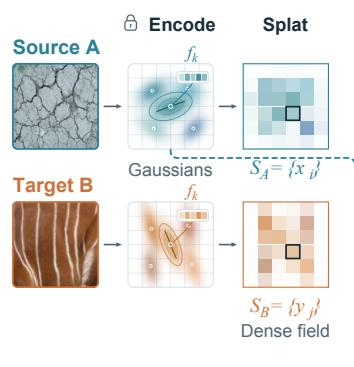

b Match by appearance  
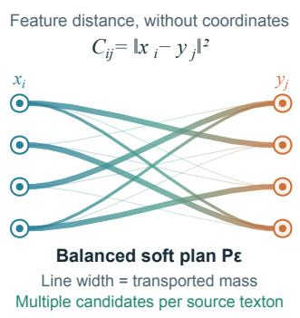

c Blend, then decode  
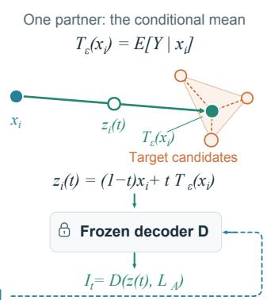

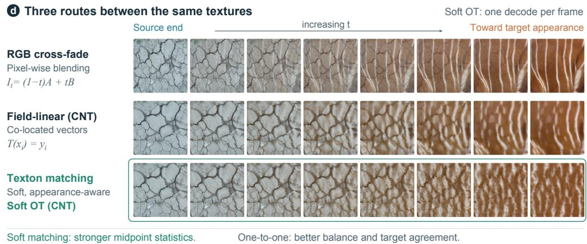  
Figure 1: Texture interpolation is a choice of partners. Blending the same locations in unrelated textures can leave two patterns overlaid. We instead associate local appearances, keeping the learned representation and decoder fixed. (a) CNT splats localized Gaussian primitives into dense fields of local appearance vectors (textons). (b) Balanced entropic transport softly matches their vectors by appearance. (c) Each source vector moves toward the weighted mean of its matches. One partner map is reused across t, with source conditioning retained and one decoder pass per frame. (d) Cracked earth to lined fur through RGB cross-fading, positional CNT blending, and soft texton matching. The two CNT rows differ only in pairing. Across experiments, soft matching improves midpoint statistics without retraining, also in Texture Mixer, while one-to-one matching improves midpoint balance and target agreement. Our prompted comparator scores better at midpoints, but has no shared explicit path. The soft texton matching path is directed and need not reconstruct the target. Panels (a–c) are schematic.

Similarly, Texture Mixer breaks a texture image into local features that capture texton information. It then uses interpolation-specific training (Yu et al., 2019) for texture interpolation. This gives better interpolation statistics than texton matching. Yet, we show that replacing the positional latent blend of Texture Mixer with texton-matching lowers its KID without retraining, while a one-to-one assignment raises it.

As an alternative, we evaluate GPT-Image-1.5 that synthesizes an intermediate image from the images and a description of the midway image. This gives better results than texton matching but is not parametric, does not form a controllable path, and comes at a higher computational price.

We make three contributions:

• A texton matching formulation and controlled comparison of texture interpolation in a frozen CNT decoder, identifying appearance-aware distribution alignment as the source of most of the improvement over positional pairing, with an explicit account of barycentric contraction, target-end behavior, and the cost of reusing a coupling across frames.

• Evidence that the intervention transfers to a second pretrained decoder (Texture Mixer), with the quantitative outcome reported in Section 4.3.

• An evaluation of matching rules and learned generators that separates midpoint statistics, endpoint balance, and path behavior, and isolates the regime in which positional correspondence remains useful.

## 2 RELATED WORK

Textons. Julesz proposed that texture perception rests on local elements, textons, and their statistics (Julesz, 1981). Parametric models made this operational by matching joint statistics of wavelet coefficients (Portilla & Simoncelli, 2000), and deep variants match the statistics of convolutional features (Gatys et al., 2015). CNT makes the elements explicit as localized Gaussian primitives with appearance vectors (Tu et al., 2024). Every such representation ends with a set of local descriptors, which we call textons, so interpolation has to decide which textons combine.

Texture transitions. Patch correspondence (Ruiters et al., 2010), image melding (Darabi et al., 2012), stationary Gaussian models (Xia et al., 2014), and optimized neural statistics (Vacher et al., 2020) provide different routes to texture mixing. Texture Mixer learns local and global latent spaces with interpolation-specific objectives (Yu et al., 2019). Mix-Max uses content-derived priority maps to select among overlaid texels for spatial material transitions (Fournier & Sauvage, 2024). Our study varies appearance association inside an existing decoder, including rules that preserve marginals and rules that do not.

Distribution matching. Statistical texture synthesis ranges from wavelet models (Portilla & Simoncelli, 2000) to deep feature statistics (Gatys et al., 2015). Wasserstein texture barycenters (Rabin et al., 2012), sliced Wasserstein losses (Heitz et al., 2021), and GOTEX (Houdard et al., 2023) already use transport for synthesis or mixing. Risser (2020) moves autoencoder features toward their optimal transport targets and interpolates between them; we build on this operator and isolate the pairing rule as the only variable inside a fixed encoder and decoder. Gaussian feature transforms (Li et al., 2017), to which our Gaussian row is related through covariance alignment (see also Huang & Belongie, 2017), and transport on generative latents (Agustsson et al., 2019) also motivate our distributional controls. We compare matching rules and their endpoint effects under a shared representation and renderer, then evaluate the decoded results. Full-reference texture metrics rest on the premise this paper builds on: DISTS tolerates texture resampling by comparing spatial statistics of deep features rather than co-located values (Ding et al., 2022), and the information–estimation metric derives a distance from an image prior that reduces to a second-moment distance for Gaussian priors (Ohayon et al., 2026). Both find that low-order statistics of a good representation carry most of a texture’s perceptual content, which our Gaussian and target-mean rows show from the operator’s side; our object is an interpolation operator, not a distance. We systematically vary the pairing rule within a shared frozen encoder–decoder to separate the effects of appearance information, target coverage, and matching sharpness; that isolation, not the transport machinery, is the contribution.

CNT and correspondence. CNT matches latent Gaussians using centers and weights, then interpolates their geometry and appearance; it explicitly proposes softer transport as a future extension (Tu et al., 2024). We study dense splat-field vectors, weighted by their spatial coverage, rather than moving the sparse primitives. Exact OT (one-to-one) in our experiments acts on these same vectors. This separates the object being matched from the hardness of its matching rule. Related transport methods preserve content through self-similarity constraints in style transfer (Kolkin et al., 2019).

## 3 INTERPOLATION WITH AN EXPLICIT PARTNER MAP

Two routes lead from a pair of textures to a midpoint: a parametric operator moves along a representation under an explicit coefficient t, and a generative model describes the midpoint and samples it. This paper is about the first; Section 4.4 compares it with the second.

## 3.1 FROM GAUSSIAN PRIMITIVES TO A DENSE APPEARANCE FIELD

For an image A, CNT predicts about 101 localized Gaussian primitives, of which about 30 carry most of the weight, with appearance features $f _ { k }$ and spatial parameters. Splatting and alpha-compositing these primitives gives a conditioning field $\begin{array} { r } { S _ { A } ( p ) { \bf \bar { \Psi } } = \sum _ { k } s _ { k } ( p ) f _ { k } } \end{array}$ , where $s _ { k } ( p )$ is the contribution of primitive k at position $p .$ The pretrained generator uses such fields at several resolutions (Tu et al., 2024). We operate on the finest field; each cell of the field is a local appearance vector, a texton:

$$
S _ { A } = ( x _ { i } ) _ { i = 1 } ^ { N } , \qquad S _ { B } = ( y _ { i } ) _ { i = 1 } ^ { N } , \qquad N = 2 5 6 ^ { 2 } , \quad x _ { i } , y _ { i } \in \mathbb { R } ^ { 3 8 4 } .\tag{1}
$$

CNT’s own interpolation matches and moves the primitives; we couple the per-cell vectors beneath them and retain the source layout. A field cell can mix several primitive features. Treating the cells as uniformly weighted samples therefore weights appearance by spatial coverage; it does not assign equal mass to each Gaussian. Coordinates are omitted from the transport cost, but the splatted fields still contain spatial correlations. Let $L _ { A }$ denote the retained source layout and remaining decoder conditioning.

## 3.2 ONE SOURCE-INDEXED PATH, SEVERAL CHOICES OF PARTNER

Let $T$ assign a target appearance vector to each source texton. We define

$$
z _ { i } ( t ) = ( 1 - t ) x _ { i } + t T ( x _ { i } ) , \qquad I _ { t } = D \big ( ( z _ { i } ( t ) ) _ { i = 1 } ^ { N } , L _ { A } \big ) , \quad t \in [ 0 , 1 ] .\tag{2}
$$

The encoder and decoder D are frozen (Figure 1a–c). Positional blending uses $T ( x _ { i } ) = y _ { i } ;$ an appearance-based map instead associates nearby textons or aligns the two distributions. The path keeps the partner map separate from the representation and renderer, and admits Gaussian affine maps whose outputs are not convex combinations of observed target samples.

## 3.3 BALANCED ENTROPIC TRANSPORT

For M sampled vectors per field with cost $C _ { i j } = \| x _ { i } - y _ { j } \| ^ { 2 }$ and uniform sampled measures, the balanced entropic objective is

$$
P _ { \varepsilon } = \underset { P \geq 0 } { \mathrm { a r g } \mathrm { m i n } } \langle P , C \rangle - \varepsilon H ( P ) , \quad P \mathbf { 1 } = P ^ { \top } \mathbf { 1 } = M ^ { - 1 } \mathbf { 1 } , \quad H ( P ) = - \sum _ { i j } P _ { i j } \log P _ { i j } .\tag{3}
$$

Sinkhorn iterations solve it (Cuturi, 2013). The barycentric partner is

$$
T _ { \varepsilon } ( x _ { i } ) = \frac { \sum _ { j } P _ { \varepsilon , i j } y _ { j } } { \sum _ { j } P _ { \varepsilon , i j } } = M \sum _ { j } P _ { \varepsilon , i j } y _ { j } .\tag{4}
$$

The normalized expression applies to the numerical plan; the last equality holds for its prescribed marginals. Each unsampled cell uses the partner of its nearest sampled source vector. We reuse this map for every t; we call the resulting path soft texton matching; the unregularized assignment is exact OT.

## 3.4 WHAT THE MATCHING CONTROLS

We use matching for any rule that pairs textons, including soft rules that spread each texton over several counterparts; a coupling is the transport plan that defines one. Field-linear pairs each cell with its co-located texton, $\mathbf { \bar { \Psi } } T ( x _ { i } ) = y _ { i }$ . Random permutation pairs through a random bijection, $T ( x _ { i } ) = y _ { \sigma ( i ) }$ , an appearance-blind negative control with exact sample coverage. The target mean replaces every partner by ${ \bar { y } } .$ Nearest-neighbor matching pairs each source texton with its nearest target texton, $T ( x _ { i } ) = y _ { j ^ { * } ( i ) }$ , and may reuse targets. The Gaussian $W _ { 2 }$ rule is the quadratic-cost optimal affine map between fitted Gaussians, ridge $1 0 ^ { - 4 } I$ (Section B.3). Entropic transport uses the plan of Equation (3) and the conditional mean of Equation (4) on 4,096 samples. Exact OT (one-to-one) is a Hungarian assignment under squared feature cost on 1,024 samples, $T ( x _ { i } ) = y _ { \sigma ^ { * } ( i ) }$ with the same nearest-neighbor extension.

The field-level controls share encoded inputs, source conditioning, and decoder. The primitive-linear baseline instead interpolates CNT elements by index before rendering, a representation-level reference distinct from the native CNT application that first matches Gaussian primitives; RGB cross-fading is an image-space reference.

## 3.5 PROJECTION, ENDPOINTS, AND DIRECTION

For a sampled pair $( X , Y ) \sim P _ { \varepsilon }$ , the map satisfies $T _ { \varepsilon } ( X ) = \mathbb { E } [ Y \mid X ]$ . Hence

$$
\operatorname { C o v } ( Y ) = \operatorname { C o v } ( T _ { \varepsilon } ( X ) ) + \mathbb { E } [ \operatorname { C o v } ( Y \mid X ) ] .\tag{5}
$$

The second term is positive semidefinite. A diffuse plan therefore contracts the projected target cloud; the measured default retains 38% of target variance. The same relation holds along the path. If $Z _ { t } = ( 1 - t ) X + t Y$ keeps the joint pairs and $\bar { Z } _ { t } = ( 1 - t ) X + t \mathbb { E } [ Y \mid X ]$ uses one partner per source, then

$$
\operatorname { C o v } ( Z _ { t } ) - \operatorname { C o v } ( { \bar { Z } } _ { t } ) = t ^ { 2 } \mathbb { E } [ \operatorname { C o v } ( Y \mid X ) ] .\tag{6}
$$

Thus the distributional effect of projection grows toward the target end. Section B derives these identities and distinguishes the joint displacement measure from the source-indexed field used by the decoder.

$\mathbf { A } \mathbf { t } t = 0$ , Equation (2) returns CNT’s reconstruction of A. At t = 1, it decodes transported appearance with $L _ { A }$ . Exact OT (one-to-one) removes conditional variance on its sampled cloud, but extension and source conditioning still affect the image endpoint; the task is a directed transition, and the two directions can differ.

With an exact quadratic-cost plan the joint displacement path is a $W _ { 2 }$ geodesic (McCann, 1997); the projected, decoded path is deterministic in t and affine in the conditioning field once its samples and plan are fixed, and its perceptual linearity remains empirical.

## 4 EXPERIMENTS

## 4.1 PROTOCOL AND PRIMARY COMPARISON

Unless otherwise stated, the default configuration uses 4,096 sampled vectors per field, 100 Sinkhorn iterations, $\varepsilon = 0 . 0 5$ in raw squared-feature units, and float32 arithmetic. The equal-sample and Texture Mixer ablations iterate Sinkhorn to a marginal error below $1 0 ^ { - 3 }$ and set ε as stated in Sections D.4 and D.5. The primary comparison uses 1,000 stratified cross-category DTD pairs (Cimpoi et al., 2014). Endpoint images are stored at $1 2 8 \times 1 2 8$ (Texture $\mathrm { { \bf { M i x e r } } \bar { \boldsymbol { s } } }$ native resolution) and bicubically upsampled to 256 × 256 before CNT encoding; all outputs are resized to 128 px before feature extraction. FID/KID compare midpoint sets with 2819 DTD references (Heusel et al., 2017; Binkowski et al.´ , 2018). FID is the community standard but biased upward at small $n ;$ KID is unbiased and admits a paired interval, so comparisons rest on KID. The first 200 pairs form the matching ablation; a separate 120-pair subset includes GPT-Image-1.5. Set-level scores are compared within each protocol.

We measure individual-sample manifold realism in Inception and DINOv2 features (Kynkäänniemi et al., 2019; Oquab et al., 2024). Midpoint balance is

$$
b ( o ; A , B ) = \left| \frac { d ( o , A ) } { d ( o , A ) + d ( o , B ) } - \frac { 1 } { 2 } \right| ,\tag{7}
$$

using DINOv2 distance; balance measures relative proximity, FID/KID agreement with the reference set. Path behavior is assessed separately.

Within the CNT decoder, soft texton matching improves FID/KID from 108.0/0.030 for field-linear to 94.7/0.021, Gaussian alignment is close at 97.9/0.024, and every soft texton-matching rule beats positional blending on FID/KID within the same decoder, and exact OT trades set-level statistics for balance and endpoint proximity. The gain is distributional: positional blending has the lower measured balance error $( b = 0 . 0 4 8$ against 0.081), and balance alone does not distinguish a coherent intermediate from a superposition. Texture Mixer, a separately trained interpolator, is compared in Section 4.3.

## 4.2 WHICH PROPERTIES OF THE PARTNER MAP MATTER?

The 200-pair study varies appearance information, marginal constraints, and assignment sharpness within the CNT encodings and renderer (Table 7, Section D.3); it and the 1,000-pair benchmark use the original rendering protocol, whereas every row of the matched-rendering experiment (Table 2) shares the field blend and pyramid construction.

B  
Table 1: Does replacing positional blending by texton matching improve interpolation in a fixed decoder? Primary comparison: within each block, encoder, representation and decoder are fixed and the pairing of textons changes; the rendering-controlled comparison, with paired intervals, is Table 2 (CNT, 200 pairs) and Section D.5 (Texture Mixer, 1,000 pairs); exact OT trades set-level statistics for balance. –: not defined for the reference row.
<table><tr><td>Method</td><td>KID↓</td><td>FID↓</td><td>Inc. real. ↑</td><td>b↓</td><td>∆KID vs. positional</td></tr><tr><td>CNT, 1,000 pairs</td><td></td><td></td><td></td><td></td><td></td></tr><tr><td>Positional blending (field-linear)</td><td>0.030</td><td>108.0</td><td>0.925</td><td>0.048</td><td></td></tr><tr><td>Texton matching: Gaussian moments</td><td>0.024</td><td>97.9</td><td>0.926</td><td>0.105</td><td>20%</td></tr><tr><td>Texton matching: Soft OT (ours)</td><td>0.021</td><td>94.7</td><td>0.942</td><td>0.081</td><td>30%</td></tr><tr><td>Texton matching: Exact OT</td><td>0.033</td><td>112.8</td><td>0.951</td><td>0.044</td><td>-10%</td></tr><tr><td>Texture Mixer, 1,000 pairs</td><td></td><td></td><td></td><td></td><td></td></tr><tr><td>Positional blending (native)</td><td>0.0121</td><td>82.4</td><td>0.948</td><td>0.056</td><td></td></tr><tr><td>Texton matching: Target mean</td><td>0.0090</td><td>79.6</td><td>0.970</td><td>0.077</td><td>26%</td></tr><tr><td>Texton matching: Soft OT</td><td>0.0093</td><td>79.1</td><td>0.955</td><td>0.078</td><td>23%</td></tr></table>

A  
CNT-linear  
Gaussian W2  
Soft OT (ours)  
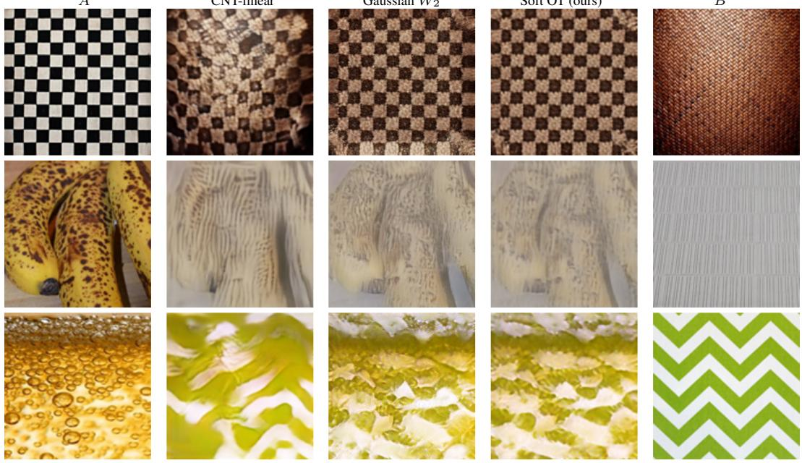  
Figure 2: Texton matching within the CNT decoder: rows 2, 4, and 5 of the six-pair grid in Section E, Texture Mixer column omitted. Columns: A, CNT-linear, Gaussian $W _ { 2 } ,$ , Soft OT (ours), B. Distribution alignment blends appearance where the linear baseline retains endpoint structures; Gaussian and empirical transport often look similar.

Matched-rendering result. Under one rendering path and one scoring session (Table 2), the operator lowers KID from 0.0322 for positional pairing to 0.0198 (-0.0124, CI [-0.0172,-0.0076]; 38% lower KID, 8% lower FID). A one-to-one assignment does not show a statistically resolved improvement over positional pairing (-0.0022, CI [-0.0066,+0.0022]) and loses +0.0085 to the soft plan (CI [+0.0049,+0.0120]); a sharp entropic plan is marginally better than the default (-0.0018, CI [-0.0035,-0.0001]). Every soft appearance-aware rule beats positional pairing on KID, and entropic transport outperforms exact OT (one-to-one; cf. Ferradans et al., 2014), so the form of the matching matters, not appearance matching alone. The one-to-one assignment gives better balance and a smaller target gap than the soft variants (0.043 against 0.072, $\overset { \sim } { p } = 1 . 7 \times 1 0 ^ { - 1 4 }$ ; 0.81 against 0.87, $p = 9 . 5 \times \mathrm { \bar { 1 0 ^ { - 1 3 } } }$ , both from the 200-pair matched-rendering study; field-linear’s endpoint is the target field by construction; gap values in Section D.4). The regularization sweep is in Figure 7.

Table 2: Is the gain the matching itself, and whichform ofmatching? One rendering path and one scoring session; the exact and 1,024-sample soft rows share the same sampled textons. Soft OT lowers KID by 38% against positional blending; exact OT does not show a statistically resolved improvement over it. Intervals and target-end gaps in Section D.4.
<table><tr><td>Rule</td><td>KID↓</td><td>FID↓</td><td>b↓</td><td>Inc. real. ↑</td></tr><tr><td>Field-linear (same pipeline)</td><td>0.0322</td><td>189.3</td><td>0.046</td><td>0.923</td></tr><tr><td>Exact OT (1,024)</td><td>0.0300</td><td>183.4</td><td>0.043</td><td>0.952</td></tr><tr><td>Soft OT 1,024 ε = 0.005</td><td>0.0197</td><td>174.5</td><td>0.067</td><td>0.933</td></tr><tr><td>Soft OT 1,024 ε = 0.05</td><td>0.0216</td><td>177.6</td><td>0.072</td><td>0.931</td></tr><tr><td>Soft OT 4,096 (ours)</td><td>0.0198</td><td>174.9</td><td>0.076</td><td>0.942</td></tr></table>

Sample coverage alone is insufficient. Random permutation has about four times the KID of either entropic plan despite covering the same target samples, yet the highest Inception realism, 1.035 (DINO 0.926): individually typical outputs whose ensemble poorly matches the reference.

Moment alignment accounts for most of the improvement. The Gaussian map reaches 0.022 KID against 0.020 for default entropic transport, with the same ordering on 1,000 pairs: the larger change is from positional association to distribution alignment. A target-mean map also attains low KID, 0.025, with per-image realism -0.016 (CI [-0.029,-0.003]) relative to soft texton matching.

When does spatial correspondence help? Across overlapping crops, controlled warps, and unrelated textures (Figure 9), positional interpolation blurs or overlays the endpoint patterns as alignment weakens. To separate alignment from content we take 40 seamless images and let B be a cyclic shift of A, so the texture distribution is identical at every shift. Positional blending’s deviation from the source reconstruction grows monotonically with the shift (0 at 0 px, 15.2 at 16, 23.9 at 64, DINOv2 distance), while the matching rules are far less sensitive to displacement, staying at 18.2–22.4, an offset to which projection, sampling, extension and rendering all contribute. On this family the regimes cross between 16 and 64 px (Figure 10): a reliable positional correspondence should be used when it exists, and texton matching when it does not.

## 4.3 DOES THE EFFECT EXTEND BEYOND CNT?

The intervention transfers. Texture Mixer’s representation and decoder are not ours. It blends its 32 × 32 local latent positionally; replacing that pairing by texton matching of the two latent clouds, rendered by its own generator with its encodings and global-latent blend untouched, improves its set-level statistics without retraining (Table 1). The target-mean matching lowers KID by -0.0031 (CI [-0.0044,-0.0018], 26%) and the soft matching by -0.0028 (CI [-0.0039,-0.0017]) on 1000 pairs, with higher per-image realism (p = 0.005); the two do not differ (+0.0003, CI [-0.0006,+0.0012]). One-to-one matching raises KID (+0.0087, CI [+0.0042,+0.0132], n = 120) and gives the best balance. In this latent the diffuse limit is the best set-level setting; the element-level plan is what buys balance.

Appearance-aware matching also retains more source-feature spread than positional blending in DINO and SAM (Kirillov et al., 2023) feature spaces (Table 8).

## 4.4 HOW DOES A PROMPTED MIDPOINT COMPARE?

We evaluate GPT-Image-1.5 on the same 120 DTD pairs through its image-editing interface with both endpoints supplied. A directed prompt requests the source arrangement with appearance halfway toward the target; a symmetric prompt requests a natural midpoint. Each output is one stochastic 10242 image resized to $1 2 8 ^ { 2 }$ ; intermediate coordinates are separate calls.

The directed prompt achieves KID 0.0051, compared with 0.0119 for Texture Mixer and 0.0190 for soft texton matching (Table 3); on these 120 pairs soft texton matching lowers KID against field-linear by -0.0114 (CI [-0.0174,-0.0054]). Its DINO realism is close to Texture Mixer’s; the symmetric prompt is higher. Per midpoint, texton matching costs 0.21 s on one A100 against 52.4 s for optimization-based interpolation and about 38 s of API time for prompted generation; each further t is one decoder pass (0.08 s). Prompted generation is a strong option for a single plausible intermediate, and the prompts treat source arrangement differently from pair to pair (Figure 3; all eight pairs in Figure 6).

Table 3: How does texton matching compare with learned and prompted generators, and at what cost? Prompted generation gives the best midpoint statistics at about 38 s per output; texton matching needs no training and pays its cost once per pair (Section D.10).
<table><tr><td>Method</td><td>FID↓ KID↓</td><td>Inc. real. ↑ DINO real. ↑</td><td></td><td>b↓</td><td>s / midpoint training</td><td></td></tr><tr><td>Field-linear</td><td>218.90.0305</td><td>0.913</td><td>0.856</td><td>0.041</td><td>0.18</td><td>none</td></tr><tr><td>Soft OT (ours)</td><td>208.2 0.0190</td><td>0.924</td><td>0.851</td><td>0.081</td><td>0.21</td><td>none</td></tr><tr><td>Exact OT</td><td>211.80.0302</td><td>0.943</td><td>0.871</td><td>0.044</td><td>0.66</td><td>none</td></tr><tr><td>Texture Mixer</td><td>204.00.0119</td><td>0.948</td><td>0.907</td><td>0.061</td><td>0.012</td><td>GAN, domain-specific</td></tr><tr><td>Texture Mixer + soft OT</td><td>204.00.0099</td><td>0.942</td><td>0.922</td><td>0.072</td><td>0.012+0.03</td><td>GAN, domain-specific</td></tr><tr><td>GPT directed</td><td>193.7 0.0051</td><td>0.960</td><td>0.906</td><td>0.054</td><td>38 (API)</td><td>proprietary</td></tr><tr><td>GPT symmetric</td><td>201.1 0.0087</td><td>0.953</td><td>0.969</td><td>0.046</td><td>38 (API)</td><td>proprietary</td></tr></table>

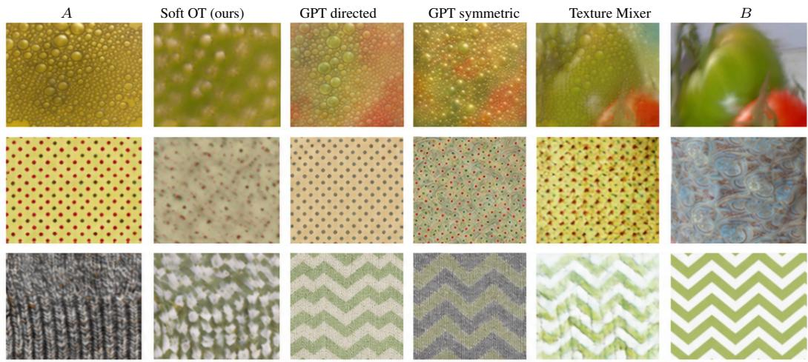  
Figure 3: The first three pairs of the 120-pair comparison, in pair-ID order. Columns: A, Soft OT (ours), GPT directed, GPT symmetric, Texture Mixer, B. The prompted outputs treat the source arrangement differently from pair to pair; all eight pairs are in Figure 6.

Soft texton matching reuses one fixed source-indexed map, so its path is affine in the conditioning field; prompted generation prompts each frame independently, without a shared explicit map.

## 4.5 WHAT IS PAID ONCE, AND WHAT IS PAID PER FRAME?

Encoding and matching are paid once per pair and each coefficient costs one renderer pass (Table 11, Section D.10). Texture Mixer’s generator is faster than CNT’s decoder at every t (0.003 s against 0.02 s at 128 px); texton matching requires no interpolation-specific training, training domain, or fixed output size.

## 4.6 APPLICATIONS

Anchor-based texture mixtures. Transport maps from one anchor texture to several others give fields on the anchor’s source grid, which can be blended with nonnegative weights summing to one and decoded under the anchor’s conditioning (Figure 4). The construction depends on the chosen anchor and is not an exact multi-distribution barycenter.

B  
A appearance  
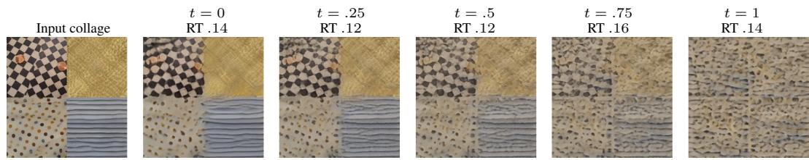  
Figure 4: Four-texture mixing with a common anchor. The input collage identifies the textures; mixing strength increases from left to right; RT is the re-encoding round-trip error. Formulation in Section F.1.

Source-conditioned appearance transfer. Setting t = 1 in Equation (2) decodes the transported target appearance under the source conditioning $\mathit { L } _ { A } ;$ reversing the two inputs exchanges those roles, so each texture can be rendered with the other’s appearance (Figure 5).

B appearance  
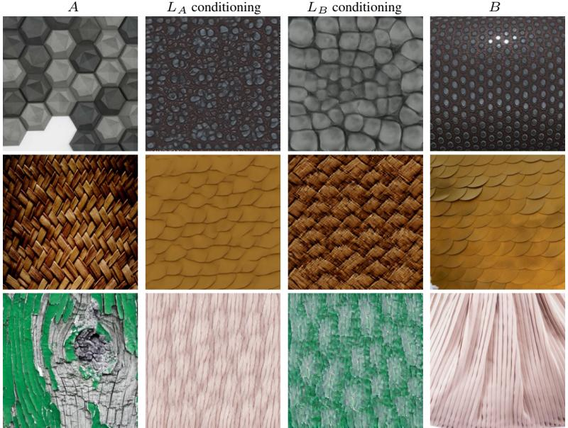  
Figure 5: Source-conditioned appearance transfer in both directions, three pairs. Columns: A, B’s appearance under A’s conditioning, A’s appearance under $B ^ { * } { \mathrm { s } }$ conditioning, B. Each output keeps the conditioning texture’s arrangement; the operation does not impose pixelwise structure preservation.

## 5 DISCUSSION AND LIMITATIONS

The task is a directed transition under retained source conditioning: a diffuse barycentric map does not reproduce the target distribution exactly, retaining $L _ { A }$ does not guarantee pixelwise preservation of source structure, and a texture interpolated with itself is not returned unchanged. Periodic textures remain difficult because local marginals omit phase and long-range organization, and CNT reconstruction error bounds the outputs (Section D.6). No single metric establishes that both endpoints are perceptually represented, and endpoint balance rewards superposition as readily as realism rewards typicality; the generative comparator uses single outputs from fixed prompts; no human preference study is included.

## 6 CONCLUSION

Texture interpolation is a matching problem before it is a blending problem. Deciding which textons combine, inside a fixed encoder and decoder, improves midpoints in CNT and in a trained interpolator; soft matching favours ensemble statistics, one-to-one matching favours balance.

## AI USE STATEMENT

Generative AI tools assisted with manuscript organization and drafting, literature lookup, analysis of experimental results, mathematical exposition, figure layout, and LaTeX build and validation scripts, and assisted with research ideation and experiment execution, including evaluation code. GPT-Image-1.5 outputs are evaluated explicitly as a generative baseline. The experimental results and image assets are our own; editorial assistance did not generate replacement measurements. Every number in the main-text tables was recomputed from the saved outputs with the released scoring code. The authors are responsible for the submitted content.

## REPRODUCIBILITY STATEMENT

The appendix specifies the transport objective, numerical settings, Gaussian map, projection identities, and evaluation protocols. The accompanying package includes per-pair scores, seeds, solver diagnostics, and pair manifests for the Texture Mixer matching ablation, the equal-sample ablation, the alignment study, the timing study, and the transport-cost comparison, together with the reference image list. The older evaluations retain aggregate values only. The prompts and the call ledger are in the repository. Code, the cached features needed to recompute the main-text tables and the appendix results listed in the repository’s check report, installation scripts, and two Colab notebooks that reproduce the pipeline end to end are available at https://github.com/Scientific-Computing-Lab/TextureMatcher.

## ETHICS STATEMENT

The study concerns texture interpolation and reports no human-subject experiment. The generatedimage baseline and its role in the evaluation are identified throughout. Texture editing can alter material appearance in ways that viewers may mistake for captured imagery; edited outputs should be identified as synthetic when that distinction matters.

## REFERENCES

Eirikur Agustsson, Alexander Sage, Radu Timofte, and Luc Van Gool. Optimal transport maps for distribution preserving operations on latent spaces of generative models. In ICLR, 2019.

Mikołaj Binkowski, Danica J. Sutherland, Michael Arbel, and Arthur Gretton. Demystifying MMD´ GANs. In ICLR, 2018.

Mircea Cimpoi, Subhransu Maji, Iasonas Kokkinos, Sammy Mohamed, and Andrea Vedaldi. Describing textures in the wild. In CVPR, 2014.

Marco Cuturi. Sinkhorn distances: Lightspeed computation of optimal transport. In NeurIPS, 2013.

Soheil Darabi, Eli Shechtman, Connelly Barnes, Dan B. Goldman, and Pradeep Sen. Image melding: Combining inconsistent images using patch-based synthesis. ACM Transactions on Graphics, 31 (4):82:1–82:10, 2012. doi: 10.1145/2185520.2185578.

Keyan Ding, Kede Ma, Shiqi Wang, and Eero P. Simoncelli. Image quality assessment: Unifying structure and texture similarity. IEEE TPAMI, 44(5):2567–2581, 2022.

Sira Ferradans, Nicolas Papadakis, Gabriel Peyré, and Jean-François Aujol. Regularized discrete optimal transport. SIAM Journal on Imaging Sciences, 7(3):1853–1882, 2014. doi: 10.1137/ 130929886.

Romain Fournier and Basile Sauvage. Mix-max: A content-aware operator for real-time texture transitions. Computer Graphics Forum, 43(6):e15193, 2024. doi: 10.1111/cgf.15193.

Leon A. Gatys, Alexander S. Ecker, and Matthias Bethge. Texture synthesis using convolutional neural networks. In NeurIPS, 2015.

Eric Heitz, Kenneth Vanhoey, Thomas Chambon, and Laurent Belcour. A sliced wasserstein loss for neural texture synthesis. In CVPR, pp. 9412–9420, 2021.

Martin Heusel, Hubert Ramsauer, Thomas Unterthiner, Bernhard Nessler, and Sepp Hochreiter. GANs trained by a two time-scale update rule converge to a local Nash equilibrium. In NeurIPS, 2017.

Antoine Houdard, Arthur Leclaire, Nicolas Papadakis, and Julien Rabin. A generative model for texture synthesis based on optimal transport between feature distributions. Journal ofMathematical Imaging and Vision, 65(1):4–28, 2023. doi: 10.1007/s10851-022-01108-9.

Xun Huang and Serge Belongie. Arbitrary style transfer in real-time with adaptive instance normalization. In ICCV, pp. 1510–1519, 2017. doi: 10.1109/ICCV.2017.167.

Béla Julesz. Textons, the elements of texture perception, and their interactions. Nature, 290:91–97, 1981.

Alexander Kirillov, Eric Mintun, Nikhila Ravi, Hanzi Mao, Chloe Rolland, Laura Gustafson, Tete Xiao, Spencer Whitehead, Alexander C. Berg, Wan-Yen Lo, Piotr Dollár, and Ross Girshick. Segment anything. In ICCV, pp. 4015–4026, 2023.

Nicholas Kolkin, Jason Salavon, and Gregory Shakhnarovich. Style transfer by relaxed optimal transport and self-similarity. In CVPR, 2019.

Tuomas Kynkäänniemi, Tero Karras, Samuli Laine, Jaakko Lehtinen, and Timo Aila. Improved precision and recall metric for assessing generative models. In NeurIPS, 2019.

Yijun Li, Chen Fang, Jimei Yang, Zhaowen Wang, Xin Lu, and Ming-Hsuan Yang. Universal style transfer via feature transforms. In NeurIPS, 2017.

Robert J. McCann. A convexity principle for interacting gases. Advances in Mathematics, 128(1): 153–179, 1997.

Guy Ohayon, Pierre-Étienne H. Fiquet, Florentin Guth, Johannes Ballé, and Eero P. Simoncelli. Learning a distance measure from the information-estimation geometry of data. In ICLR, 2026.

Maxime Oquab, Timothée Darcet, Théo Moutakanni, Huy Vo, Marc Szafraniec, Vasil Khalidov, Pierre Fernandez, Daniel Haziza, Francisco Massa, Alaa El-Nouby, Mahmoud Assran, Nicolas Ballas, Wojciech Galuba, Russell Howes, Po-Yao Huang, Shang-Wen Li, Ishan Misra, Michael Rabbat, Vasu Sharma, Gabriel Synnaeve, Hu Xu, Hervé Jégou, Julien Mairal, Patrick Labatut, Armand Joulin, and Piotr Bojanowski. DINOv2: Learning robust visual features without supervision. TMLR, 2024.

Zhiliang Peng, Li Dong, Hangbo Bao, Qixiang Ye, and Furu Wei. BEiT v2: Masked image modeling with vector-quantized visual tokenizers. arXiv preprint arXiv:2208.06366, 2022.

Javier Portilla and Eero P. Simoncelli. A parametric texture model based on joint statistics of complex wavelet coefficients. IJCV, 40(1):49–70, 2000.

Julien Rabin, Gabriel Peyré, Julie Delon, and Marc Bernot. Wasserstein barycenter and its application to texture mixing. In Scale Space and Variational Methods in Computer Vision, pp. 435–446, 2012. doi: 10.1007/978-3-642-24785-9\_37.

Eric Risser. Optimal textures: Fast and robust texture synthesis and style transfer through optimal transport. arXiv preprint arXiv:2010.14702, 2020.

Roland Ruiters, Ralf Schnabel, and Reinhard Klein. Patch-based texture interpolation. Computer Graphics Forum, 29(4):1421–1429, 2010. doi: 10.1111/j.1467-8659.2010.01739.x.

Peihan Tu, Li-Yi Wei, and Matthias Zwicker. Compositional neural textures. In SIGGRAPH Asia Conference Papers, 2024. doi: 10.1145/3680528.3687561.

Jonathan Vacher, Aida Davila, Adam Kohn, and Ruben Coen-Cagli. Texture interpolation for probing visual perception. In NeurIPS, 2020.

Gui-Song Xia, Sira Ferradans, Gabriel Peyré, and Jean-François Aujol. Synthesizing and mixing stationary gaussian texture models. SIAM Journal on Imaging Sciences, 7(1):476–508, 2014. doi: 10.1137/130918010.

Ning Yu, Connelly Barnes, Eli Shechtman, Sohrab Amirghodsi, and Michal Lukác. Texture mixer: Aˇ network for controllable synthesis and interpolation of texture. In CVPR, 2019.

Richard Zhang, Phillip Isola, Alexei A. Efros, Eli Shechtman, and Oliver Wang. The unreasonable effectiveness of deep features as a perceptual metric. In CVPR, 2018.

## A PROTOCOL AND BASELINE DEFINITIONS

The primary benchmark uses 1,000 stratified cross-category pairs from DTD, which contains 5,640 images in 47 categories (Cimpoi et al., 2014). Endpoint images are stored at $1 2 8 \times 1 2 8$ (Texture Mixer’s native resolution) and bicubically upsampled to $2 5 6 \times 2 5 6$ before CNT encoding; all outputs are resized to 128 px before feature extraction. This holds for the primary, 200-pair matching, and 120-pair generative comparisons. The reference pool contains 2819 DTD images. FID and KID compare midpoint sets with that pool (Heusel et al., 2017; Binkowski et al. ´ , 2018); their absolute values change with the sample count and reference protocol. The older evaluations below retain their own sample counts and reference definitions.

Two positional baselines. Field-linear blends co-located dense CNT feature vectors; our experiment code names it “pixel-linear.” Primitive-linear blends the indexed CNT elements and is named “textonlinear” there. The latter is distinct from CNT’s published interpolation application, which first matches Gaussians by the sum of differences between centers and weights, then interpolates the matched parameters (Tu et al., 2024), Appendix B.5. An RGB cross-fade blends image pixels directly. It appears as a separate reference in the teaser and parametric-texture experiment. These are three distinct operations.

Transport configuration. The finest conditioning field has $2 5 6 ^ { 2 }$ cells of dimension 384. The default uses $M \bar { = } 4 0 9 6$ uniform samples per field, raw feature vectors, uniform masses, squared Euclidean cost, $\varepsilon = 0 . 0 5$ , and 100 Sinkhorn iterations in float32 on the GPU. The sampled barycentric map is extended through nearest sampled source vectors. The hard implementation uses 1,024 samples. These different sample counts are part of the measured implementations. Gaussian transport uses covariance ridge $1 0 ^ { - 4 } I$ . Our runs draw the samples at random, and we report the resulting repeat variation below; fixing a sampled map makes its subsequent path deterministic.

Learned and optimization-based references. Texture Mixer uses the released earth-texture checkpoint and its fixed 128 × 128 generator (Yu et al., 2019). DTD is outside that specific training domain. The Vacher variants optimize Gram, Gaussian, or Wasserstein statistics (Vacher et al., 2020). We run them for 30 iterations; the published configuration uses 150. GPT-Image-1.5 is a proprietary pretrained generator, evaluated with the image-editing interface and two reference inputs. No interpolation-specific training is performed for the CNT operator, which itself relies on pretrained CNT weights. Timing was re-measured on the 120 pairs under one protocol for all methods (encode logged once per pair, one renderer pass per t); earlier drafts used a 20-pair run.

KID estimators. The CNT block of the 1,000-pair table and the matching-rules table report KID as the mean over 20 reference subsets; every other KID, and every ∆KID, uses the full reference with the trace-corrected self-term.

What the metrics condition on. Manifold realism is the per-image score of Kynkäänniemi et al. (2019), evaluated in Inception or DINOv2 features (Oquab et al., 2024). It measures proximity to reference-image neighborhoods without conditioning on the selected texture pair. We report medians over five reference-manifold draws; the empirical realism resolution of the observer experiments is .036, which is not a confidence interval for FID, KID, or fidelity. DINO balance is the absolute displacement of the endpoint-distance ratio from one half. LPIPS path measurements use perceptual image distance (Zhang et al., 2018). Portilla–Simoncelli and BEiTv2 serve as additional sourcefidelity observers (Portilla & Simoncelli, 2000; Peng et al., 2022).

Available evidence. The accompanying package includes per-pair scores, seeds, solver diagnostics, and pair manifests for the Texture Mixer matching ablation, the equal-sample ablation, the alignment study, the timing study, and the transport-cost comparison, together with the reference image list. The older evaluations retain aggregate values only, with confidence intervals where we computed them. The prompts and the call ledger are in the repository. The full scoring code is available at the same address.

## B OPERATOR DERIVATIONS

## B.1 JOINT TRANSPORT AND DETERMINISTIC PROJECTION

For equal-weight sampled clouds, a balanced coupling $P$ defines random variables $( X , Y )$ with the prescribed empirical marginals. A row-normalized plan defines $T ( X ) \ = \ \mathbb { E } [ Y \ | \ X ]$ . With $\epsilon _ { Y } \dot { = } Y - \mathbb { E } [ Y \mid \dot { X } ]$ , we have $\mathbf { \mathbb { E } } [ \epsilon _ { Y } \mid X ] = 0$ . Therefore ${ \dot { T } } ( X )$ and $\epsilon _ { Y }$ have zero cross-covariance, giving

$$
\operatorname { C o v } ( Y ) = \operatorname { C o v } ( T ( X ) ) + \mathbb { E } [ \operatorname { C o v } ( Y \mid X ) ] .\tag{8}
$$

The second term is positive semidefinite, so $\operatorname { C o v } ( T ( X ) ) \preceq \operatorname { C o v } ( Y )$ . Equality holds when the conditional variance vanishes in every direction.

The joint displacement variable $Z _ { t } = ( 1 - t ) X + t Y$ satisfies

$$
\operatorname { \mathbb { E } } [ Z _ { t } \mid X ] = ( 1 - t ) X + t T ( X ) = { \bar { Z } } _ { t } , \qquad \operatorname { C o v } ( Z _ { t } \mid X ) = t ^ { 2 } \operatorname { C o v } ( Y \mid X ) .\tag{9}
$$

Applying total covariance again gives

$$
\operatorname { C o v } ( Z _ { t } ) - \operatorname { C o v } ( { \bar { Z } } _ { t } ) = t ^ { 2 } \mathbb { E } [ \operatorname { C o v } ( Y \mid X ) ] .\tag{10}
$$

This identity describes the cost of replacing the conditional distribution by its mean before decoding. It imposes no corresponding equality on decoded image statistics, since the decoder is nonlinear and uses additional conditioning.

The joint displacement measure $( ( 1 - t ) x + t y ) _ { \# } P$ reaches both empirical marginals. A diffuse plan can give it up to $M ^ { 2 }$ support points, whereas the decoder input requires one vector per source grid cell. Barycentric projection supplies that field but changes the target distribution. With an unregularized quadratic-cost optimal plan, joint displacement gives a $W _ { 2 }$ geodesic (McCann, 1997). Entropic regularization, projection, nearest-neighbor extension, and nonlinear decoding each limit the direct use of this geometric interpretation for images.

## B.2 WHAT QUADRATIC COST REWARDS

For fixed marginals with means $m _ { A } , m _ { B } ,$

$$
\begin{array} { r } { { \mathbb { E } } \| X - Y \| ^ { 2 } = \| m _ { A } - m _ { B } \| ^ { 2 } + { \mathbb { E } } \| X - m _ { A } \| ^ { 2 } + { \mathbb { E } } \| Y - m _ { B } \| ^ { 2 } - 2 { \mathbb { E } } \langle X - m _ { A } , Y - m _ { B } \rangle . } \end{array}\tag{11}
$$

Unregularized quadratic transport maximizes the cross term. Entropic transport trades that alignment against plan entropy. A random permutation preserves the marginals but does not optimize their feature alignment. Coverage and appearance information are therefore separate controls. Perceptual quality need not follow feature alignment.

## B.3 GAUSSIAN TRANSPORT

For fitted Gaussian models $\mathcal { N } ( \boldsymbol { m } _ { A } , \Sigma _ { A } )$ and $\mathcal { N } ( \boldsymbol { m } _ { B } , \boldsymbol { \Sigma } _ { B } )$ with positive-definite covariances, the quadratic-cost optimal affine map is

$$
\begin{array} { r } { T _ { G } ( x ) = m _ { B } + A ( x - m _ { A } ) , \phantom { x x x x x x x x x x x x x x x x x x x x x x x x x x x x x x x x x x x x x x } } \\ { A = \Sigma _ { A } ^ { - 1 / 2 } ( \Sigma _ { A } ^ { 1 / 2 } \Sigma _ { B } \Sigma _ { A } ^ { 1 / 2 } ) ^ { 1 / 2 } \Sigma _ { A } ^ { - 1 / 2 } . } \end{array}\tag{12}
$$

The implementation adds $1 0 ^ { - 4 } I$ to the covariances and clips negative eigenvalues from floating-point error. CNT field vectors are mixtures of a much smaller number of primitive features, so covariance regularization can affect this map. The affine path is the $W _ { 2 }$ geodesic for the regularized Gaussian models. The empirical input cloud need not be Gaussian, and the decoded path retains source conditioning. The Gaussian row is a moment-alignment baseline for the empirical operator.

## B.4 EXACT OT (ONE-TO-ONE)

A minimum-cost assignment on 1,024 equally weighted source and target vectors is a permutation. Its conditional variance is zero on that sampled cloud. Nearest-neighbor extension to the dense field can repeat assigned targets, so sample-level exactness does not imply exact full-field target recovery. The exact-OT target gap is 0.80 on the 1,000-pair canonical benchmark; the 200-pair matching-rules study reports 0.81 for exact OT and 0.87 for the default soft plan. A symmetric $( \mathrm { O T - s y m } )$ variant averaging the two directed paths reduced order dependence but lowered recall and set-level statistics, and is not used.

## C GENERATIVE COMPARISON

The 120-pair comparison uses a category-stratified subset and the same $1 2 8 ^ { 2 }$ scoring resolution for every method. GPT-Image-1.5 receives both endpoint images in a fixed order and produces one 10242 output per prompt and pair. The directed prompt requests source layout and halfway target appearance; the symmetric prompt requests a natural midpoint with no source preference. Both prompts are reproduced below, byte for byte.

## GPT symmetric (prompt P1):

You are given exactly two reference images in order: reference image 1 is texture A and reference image 2 is texture B. Generate one single square image M representing a coherent, plausible perceptual texture midpoint between A and B at t = 0.50.

M must be one internally consistent texture that could plausibly exist on its own. Interpolate texture-level properties such as periodicity, orientation, topology, motif or element shape, spatial scale, density, regularity, material appearance, local contrast, and color distribution. Preserve meaningful evidence of both endpoints and aim for approximately equal perceptual texture distance from A and B. Prefer structural and statistical texture cues over semantic object identity.

Do not make a pixel-space blend, alpha blend, cross-fade, transparent overlay, split image, side-by-side composition, collage, or simple average of colors. Do not merely paste motifs from A and B together. Do not include A, B, labels, text, borders, margins, or a presentation panel. Output only M, edge-to-edge. The definition is symmetric: swapping the order of A and B should not change the intended midpoint.

## GPT directed (prompt P2):

You are given exactly two reference images in order: reference image 1 is source texture A and reference image 2 is target-appearance texture B. Generate one single square midpoint texture M at t = 0.50 for a directed source-layout appearance interpolation from A toward B. Preserve the dominant spatial organization, layout, orientation, and large-scale arrangement of A, while moving the appearance of its local texture elements halfway toward B. Interpolate local motif shape, scale, density, regularity, material, local contrast, and color statistics toward B. The result must be one coherent, plausible texture, not two overlaid patterns. Semantic objects that are incidental to texture should not dominate the interpolation.

Do not make a pixel-space blend, alpha blend, cross-fade, transparent overlay, split image, side-by-side composition, collage, or simple average of colors. Do not include A, B, labels, text, borders, margins, or a presentation panel. Output only M, edge-to-edge. This task is directed: A supplies layout and B supplies the target appearance.

Model gpt-image-1.5 through the image-editing interface, quality high, input fidelity high, two ordered reference images (A then B), one $1 0 2 4 \times 1 0 2 4$ output per call; 240 scored calls, median latency 38 s.  
Table 4: Complete 120-pair results. FID is descriptive at this sample count. Bold marks the best value in each column.
<table><tr><td>Method</td><td>FID↓</td><td>KID↓</td><td>Inc. real. ↑</td><td>DINO real. ↑</td><td>Balance ↓</td></tr><tr><td>Field-linear</td><td>218.9</td><td>0.0305</td><td>0.913</td><td>0.856</td><td>0.041</td></tr><tr><td>Primitive-linear</td><td>247.9</td><td>0.0504</td><td>0.897</td><td>0.849</td><td>0.040</td></tr><tr><td>Gaussian W2</td><td>216.2</td><td>0.0253</td><td>0.919</td><td>0.847</td><td>0.103</td></tr><tr><td>Soft OT (ours)</td><td>208.2</td><td>0.0190</td><td>0.924</td><td>0.851</td><td>0.081</td></tr><tr><td>Exact OT</td><td>211.8</td><td>0.0302</td><td>0.943</td><td>0.871</td><td>0.044</td></tr><tr><td>Texture Mixer</td><td>204.0</td><td>0.0119</td><td>0.948</td><td>0.907</td><td>0.061</td></tr><tr><td>GPT, directed</td><td>193.7</td><td>0.0051</td><td>0.960</td><td>0.906</td><td>0.054</td></tr><tr><td>GPT, symmetric</td><td>201.1</td><td>0.0087</td><td>0.953</td><td>0.969</td><td>0.046</td></tr></table>

The directed prompt’s median distance-ratio placement is 0.456. This is a signed location along the endpoint-distance axis, distinct from the absolute balance error in the table. Paired DINO realism differences from the CNT-based variants range from +0.035 to +0.074 $( p \leq 1 0 ^ { - 5 } ) ;$ ; the difference from Texture Mixer is -0.021 and not significant. Paired differences and differences between separately summarized table columns need not coincide. Soft texton matching reuses a fixed source-indexed map and has explicit affine dependence on t before decoding, while independently prompted frames carry no such structure; its dependence on input order remains. The API latency is approximately 38 s per output, versus 0.21 s for a local soft texton matching midpoint in the A100 timing study.

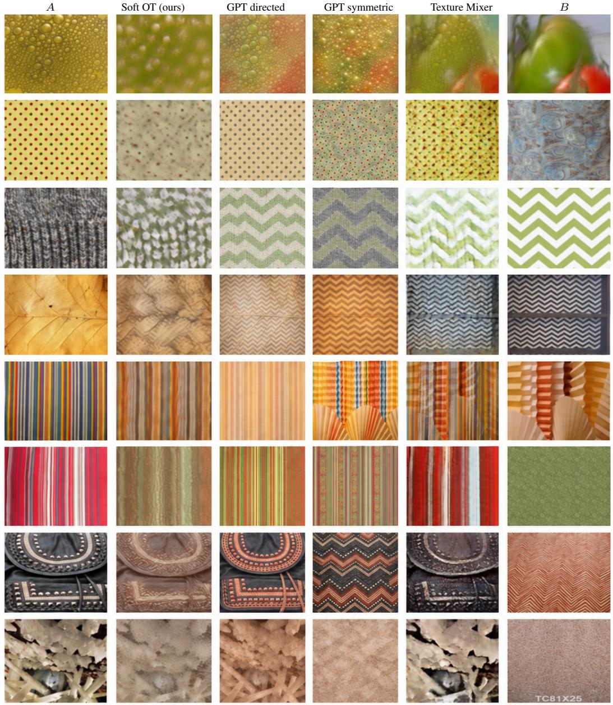  
Figure 6: The first eight pairs, in pair-ID order. Columns are A, Soft OT (ours), GPT directed, GPT symmetric, Texture Mixer, and B; the main text shows the first three rows. The directed prompt handles stochastic appearance, structured motifs, and semantic source content differently; the examples do not establish a pixelwise structure guarantee for either method.

## D ADDITIONAL QUANTITATIVE EVALUATIONS

## D.1 OPTIMIZATION-BASED COMPARISON

Table 5: The 50-pair comparison with optimization-based interpolation, scored at 128 px. Timing is on one A100, with 30 iterations for Vacher variants. FID at this sample count is descriptive. –: not defined, no interpolation is performed.
<table><tr><td>Method</td><td>FID↓</td><td>Midpoint (s)</td><td>11-frame path (s)</td></tr><tr><td>Soft OT (ours)</td><td>268.3</td><td>0.21</td><td>1.02</td></tr><tr><td>Field-linear</td><td>284.6</td><td>0.18</td><td>0.99</td></tr><tr><td>Vacher, Gram</td><td>318.4</td><td>13.5</td><td>148.5</td></tr><tr><td>Vacher, Gaussian</td><td>314.3</td><td>15.0</td><td>165.3</td></tr><tr><td>Vacher, Wasserstein</td><td>313.6</td><td>52.4</td><td>576.6</td></tr><tr><td>CNT reconstruction</td><td>273.9</td><td></td><td></td></tr></table>

We find no significant paired difference in per-sample realism and midpoint balance (all Wilcoxon p > .25). This small-sample result does not establish statistical equivalence. The runtime difference follows from reusing the transport map across frames, while the optimization-based method solves for each output independently. The Wasserstein implementation takes 52.1, 52.4, and 56.5 seconds at 128, 256, and 512 pixels, respectively.

## D.2 MATCHING ON CNT’S GAUSSIAN PRIMITIVES

CNT predicts about 101 Gaussian primitives per texture, of which about 30 carry most of the weight. On 120 pairs we pair the two primitive sets with a Hungarian assignment under a position cost, an appearance cost, or their mixture, and either freeze the source layout or let the matched primitives move; the encoder, primitives, interpolation, and decoder are otherwise those of the main protocol (Table 6). With a frozen layout the cost is a null result (KID 0.030 / 0.030 / 0.027 for position / appearance / mixed; appearance against position +0.0001, CI [-0.0041,+0.0043]), and reassigning every pairing changes per-image realism by 0.001. With a moving layout, appearance matching is the worst choice (0.080 against 0.036, ∆KID +0.0433, CI [+0.0333,+0.0534]), because look-alike partners are far apart and the moved primitives superpose. Intervals are paired leave-one-pair-out jackknife, 95% CI. A soft matching of the same primitives reaches 0.016 KID, against 0.019 for the dense operator and 0.030 for every one-to-one rule. The matching’s softness and the anchoring to the source layout, not the cue used to pair, separate a coherent intermediate from a superposition.

Table 6: KID for one-to-one matchings of CNT’s Gaussian primitives, 120 pairs, canonical scoring. Rows fix or move the source layout; columns give the pairing cost.
<table><tr><td>Layout</td><td>Position cost</td><td>Appearance cost</td><td>Mixed cost</td></tr><tr><td>Frozen (source)</td><td>0.030</td><td>0.030</td><td>0.027</td></tr><tr><td>Moving (matched)</td><td>0.036</td><td>0.080</td><td>0.046</td></tr></table>

## D.3 MATCHING RULES UNDER THE ORIGINAL RENDERING PROTOCOL

The 200-pair matching-rule study of the main text, scored under the original rendering protocol, is tabulated here.

## D.4 EQUAL-SAMPLE COMPARISON OF HARD AND SOFT MATCHINGS

The main-text hard and entropic rows use 1,024 and 4,096 samples. The matched-rendering ablation (Table 2) repeats the 200-pair study under one rendering path. Exact OT (one-to-one) and the two 1,024-sample entropic rows share the same sampled clouds; field-linear uses positional correspondence on the full co-located fields; the 4,096-sample operator uses its own sample; all rows share the field-blend and pyramid construction and were scored in one session. Sinkhorn is iterated until the marginal error is below $1 0 ^ { - 3 } .$ . The sharp plan retains 0.88 of the target variance and the default plan 0.38. Against field-linear on the same pipeline (KID 0.0322), the default plan gives -0.0107 (CI [-0.0154,-0.0059]), the 4,096-sample operator -0.0124 (CI [-0.0172,-0.0076]), and exact OT (one-to-one) -0.0022 (CI [-0.0066,+0.0022]). The sharp plan’s difference from the default plan is -0.0018 (CI [-0.0035,-0.0001]); the difference of exact OT (one-to-one) from the sharp plan is +0.0103 (CI [+0.0070,+0.0135]) and from the default plan +0.0085 (CI [+0.0049,+0.0120]). All ∆KID intervals are paired leave-one-pair-out jackknife, 95% CI. The balance and target-gap differences between hard and default are significant at $p = 1 . 7 \times 1 0 ^ { - 1 4 }$ and $p = 9 . 5 \times 1 0 ^ { - 1 3 }$ (paired Wilcoxon). In this matched-rendering study the normalized target-end gap at $t = 1$ is 0.81 for exact OT, 0.84 for the sharp plan and 0.87 for the default plan; it is not defined for field-linear, whose endpoint is the target field by construction, and was not measured for the 4,096-sample operator. Re-encoding intermediates at $t \in \{ . 2 5 , . 5 , . 7 5 \}$ gives error 0.17 against a 0.13 reconstruction floor, versus 0.32 for field-linear blending.

Table 7: Matching rules on the same 200 pairs. Random permutation preserves the sampled marginals but ignores appearance. Mean and nearest-neighbor maps test averaging and target reuse. Lower KID/FID is better; gaps are normalized target-end distances (the positional rows reach the target field by construction, so their gap is decoder error only). Bold marks the best value per column; this table uses the original rendering protocol, unlike the matched-rendering table in the main text. Bottom line: every soft appearance-aware rule beats positional pairing on KID, and entropic transport outperforms exact OT (one-to-one) in the matched-rendering comparison (Table 2), so the form of the matching matters, not appearance information alone.
<table><tr><td>Rule</td><td>KID↓</td><td>FID↓</td><td> $b \downarrow$ </td><td>Target gap ↓</td><td>Inc. real. ↑</td></tr><tr><td>Random permutation</td><td>0.077</td><td>224.3</td><td>0.035</td><td>1.00</td><td>1.035</td></tr><tr><td>Target mean</td><td>0.025</td><td>183.7</td><td>0.082</td><td>0.91</td><td>0.921</td></tr><tr><td>Field-linear</td><td>0.031</td><td>188.7</td><td>0.044</td><td>0.29</td><td>0.923</td></tr><tr><td>Primitive-linear</td><td>0.043</td><td>211.8</td><td>0.035</td><td>0.00</td><td>0.895</td></tr><tr><td>Gaussian  $W _ { 2 }$ </td><td>0.022</td><td>177.6</td><td>0.107</td><td>0.81</td><td>0.928</td></tr><tr><td>Nearest neighbor</td><td>0.027</td><td>182.4</td><td>0.046</td><td>0.81</td><td>0.951</td></tr><tr><td>Exact OT</td><td>0.030</td><td>184.2</td><td>0.043</td><td>0.81</td><td>0.953</td></tr><tr><td>Soft OT  $( \mathrm { o u r s } ) , \varepsilon = . 0 5$ </td><td>0.020</td><td>174.9</td><td>0.081</td><td>0.87</td><td>0.933</td></tr><tr><td>Soft OT  $( \mathrm { o u r s } ) , \varepsilon = . 0 0 5$ </td><td>0.019</td><td>173.7</td><td>0.083</td><td>0.84</td><td>0.942</td></tr></table>

Table 8: Feature spread retained at the midpoint, $n = 4 0$ . The common direction across representations supports the matching mechanism. In a separate experiment decoding DINO features to images, appearance-aware matching improves LPIPS midpoint placement on 37 of the n = 40 pairs.
<table><tr><td>Representation</td><td>Positional blend</td><td>Appearance-aware matching</td></tr><tr><td>DINO</td><td>60%</td><td>66%</td></tr><tr><td>SAM</td><td>57%</td><td>71%</td></tr><tr><td>CNT primitives</td><td>60%</td><td>87%</td></tr><tr><td>CNT field</td><td>67%</td><td>99%</td></tr></table>

## D.5 MATCHING IN TEXTURE MIXER’S LOCAL LATENT

Texture Mixer interpolates a $3 2 \times 3 2$ local latent positionally and blends a global latent. For the matching ablation (Table 1) we keep its encodings, global-latent blend, and generator, and replace only the pairing of the two local-latent clouds. The entropic regularization is set as a multiple of the median pairwise cost, $\varepsilon = 0 . 0 3 ;$ ×median, and Sinkhorn is run until the marginal error is below $1 0 ^ { - 3 }$ At that setting the projected cloud retains 0.33 of the target variance; in the diffuse limit the coupling reduces to the target-mean rule; at the reported setting it retains 0.33 of the target variance, and exact OT (one-to-one) retains the full sampled target cloud. Scoring is identical to the main protocol at 128 px against the same reference pool: the native, target-mean and soft rows are scored on 1000 pairs, the one-to-one row on the 120-pair subset. ∆KID against the native positional blend is a paired leave-one-pair-out jackknife, 95% CI, for every row; on 1000 pairs the soft matching differs from the target mean by +0.0003 (CI [-0.0006,+0.0012]), and its per-image realism exceeds the native blend’s $( p = 0 . 0 0 5 )$

## D.6 ENCODING CEILING

This study uses a separate reference of 5,640 native 128-px DTD windows. One CNT encode– decode loop has LPIPS 0.21 on the 120-pair set. The KID of the originals is 0.009, measured against this study’s 5,640-window reference, so these values are not comparable to Table 3’s; their reconstructions reach 0.014, and a second reconstruction 0.025. Soft texton matching midpoints are at 0.023, below the double-reconstruction level. Per-image realism moves from 1.00 for originals to 0.90 for reconstructions and 0.85 for midpoints. Per-pair reconstruction error does not predict midpoint quality (Spearman 0.08).

## D.7 OBSERVER DEPENDENCE AND NEGATIVE CONTROLS

An older 100-pair realism experiment includes an LPIPS-optimized control. It attains a near-perfect LPIPS midpoint ratio (.50), despite producing a degenerate image. Its realism is below that of soft texton matching, though not below every baseline. The random-pairing control in the main paper has high per-image realism despite poor set-level statistics, illustrating the converse problem.

Table 9: Per-image realism, $n = 1 0 0 . \ R \geq 1$ denotes inclusion in the reference manifold estimate. The paired win column compares soft texton matching to each row; –: not defined for its own row.
<table><tr><td>Method</td><td>Mean R</td><td>Fraction  $R \geq 1$ </td><td>Soft OT wins (p)</td></tr><tr><td>Primitive-linear</td><td>.920</td><td>14%</td><td> $6 5 / 1 0 0 ( 2 . 6 \times 1 0 ^ { - 4 } )$ </td></tr><tr><td>Field-linear</td><td>.952</td><td>29%</td><td> $5 4 / 1 0 0 ( . 2 1 )$ </td></tr><tr><td>LPIPS control</td><td>.938</td><td>25%</td><td> $6 2 / 1 0 0 \ : ( . 0 1 7 )$ </td></tr><tr><td>Soft OT (ours)</td><td>.960</td><td>41%</td><td></td></tr></table>

In a separate 1,000-pair observer evaluation, Texture Mixer and soft texton matching have Inception realism .963 and .962 (paired $p = . 2 8 )$ , respectively. Their Portilla–Simoncelli fidelity scores are −.575 and −.585 $( p = . 1 8 )$ , while DINO realism is .948 versus .904 and BEiTv2 fidelity is −.875 versus −.906. These measurements belong to the earlier observer protocol and remain separate from the canonical rerun.

## D.8 ENDPOINT DIRECTION

The operator is directed: at $t = 0$ the feature field is exactly the source field, so a nonzero image gap there measures the decoder’s reconstruction error, and swapping the two inputs changes the output because the target’s appearance is decoded under the source’s conditioning.

## D.9 REGULARIZATION AND REPEATED APPLICATION

For the 20-pair entropy sweep, mean row entropy changes from 7.09 to 8.31 nats between $\varepsilon = . 0 0 5$ and .5, against a uniform ceiling of 8.32. Projected target variance changes from 88% to 1%. The extreme-midpoint LPIPS difference is .21 (IQR .17–.25), compared with an approximately .15 resampling floor. These are midpoint measurements; the path covariance identity explains why projection can have larger effects toward $t = 1$

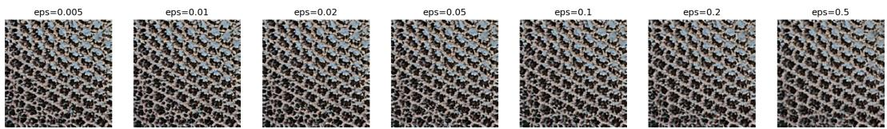  
Figure 7: Complete regularization sweep for one pair. The comparatively small visual change at the midpoint accompanies much larger changes in the entropic plan and projected feature variance.

Table 10: Eight repeated operations on 24 pairs. Self: use the current image on both sides. Fixed: retain a fixed second endpoint. Positive realism drop denotes deterioration under that observer; negative values denote an increase. –: not defined, no second endpoint.
<table><tr><td>Method</td><td>Realism drop (self)</td><td>Realism drop (fixed)</td><td>Self drift</td></tr><tr><td>Autoencoder only</td><td>.105</td><td></td><td>61.9</td></tr><tr><td>Primitive-linear</td><td>.024</td><td>.025</td><td>61.0</td></tr><tr><td>Field-linear</td><td>.024</td><td>.029</td><td>61.0</td></tr><tr><td>Texture Mixer</td><td>-.019</td><td>.006</td><td>59.7</td></tr><tr><td>Soft OT (ours)</td><td>-.041</td><td>-.077</td><td>62.8</td></tr></table>

Autoencoder-only and transport self loops have similar DINO drift. Increasing realism along these trajectories therefore does not imply preservation of the original image; the outputs can move toward smoother, typical textures.

## D.10 RUNTIME

Table 11 separates what is paid once per pair from what each interpolation coefficient costs. The optimization-based comparison pays for each frame separately, and the GPT entry is API latency rather than a hardware-normalized runtime.

Table 11: Recorded stage timings in seconds on one A100: 120 pairs for the CNT and Texture Mixer rows; the Vacher et al. timing comes from a 20-pair run on the same hardware with its 30-iteration configuration; GPT is the median API latency over the scored calls. Encoding is separate; each interpolation coefficient is one renderer pass. CNT decoding is at 256 px (128 px in parentheses); Texture Mixer is at 128 px. –: no such stage for this method.
<table><tr><td>Method</td><td>Encode, once per pair</td><td>Couple, once per pair</td><td>Each requested t</td></tr><tr><td>Field-linear</td><td>0.09</td><td></td><td>0.08 (0.02) decode</td></tr><tr><td>Soft OT (ours)</td><td>0.09</td><td>0.03</td><td>0.08 (0.02) decode</td></tr><tr><td>Exact OT</td><td>0.09</td><td>0.48</td><td>0.08 (0.02) decode</td></tr><tr><td>Texture Mixer</td><td>0.009</td><td></td><td>0.003 generate</td></tr><tr><td>Vacher  $W _ { 2 }$ </td><td></td><td></td><td>52.4 optimize</td></tr><tr><td>GPT-Image-1.5</td><td></td><td>一</td><td>~38 API call</td></tr></table>

B

## E QUALITATIVE COMPARISONS AND APPLICATIONS

A  
CNT-linear  
Gaussian W2  
Soft OT (ours)  
Texture Mixer  
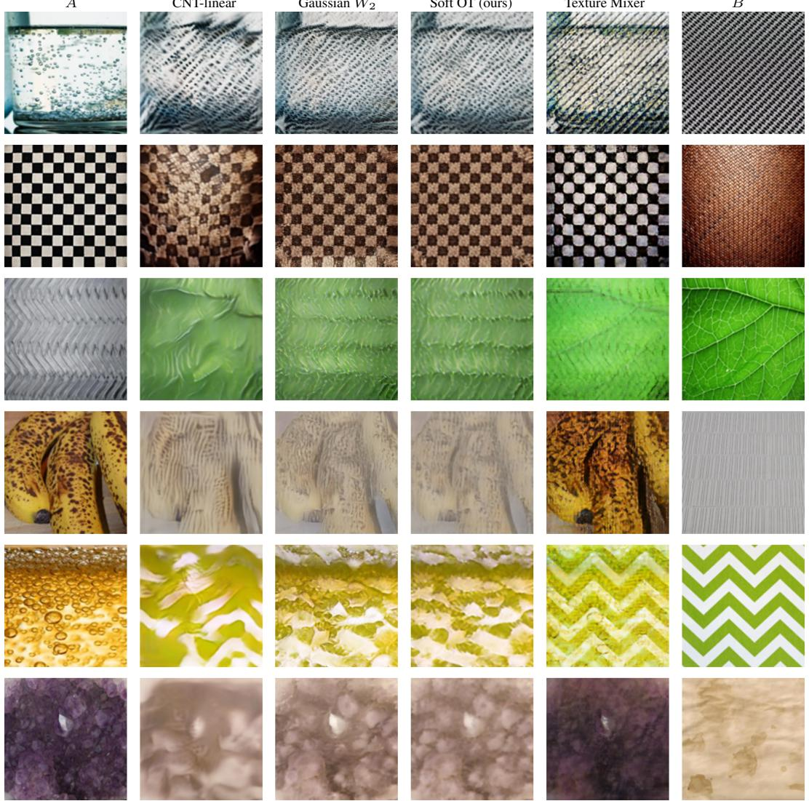  
Figure 8: The full six-pair qualitative comparison. The main paper selects rows 2, 4, and 5. The Gaussian and empirical columns often resemble one another, while the relative appearance of all methods depends on the pair.

A

B

Positional linear  
Soft OT (ours)  
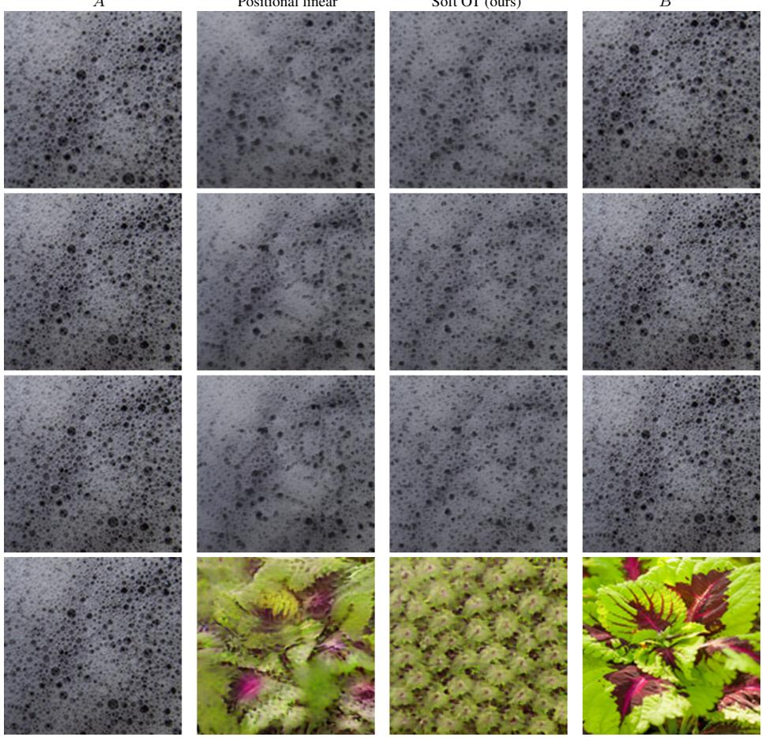  
Figure 9: Full correspondence progression. Columns: A, positional linear, Soft OT (ours), B. Rows: overlapping crops, $\mathrm { ~ a ~ } \overset { \cdot } { 2 } ^ { \circ }$ warp, an $8 ^ { \breve { \circ } }$ warp, and an unrelated pair. Spatial pairing remains useful in the aligned rows; appearance matching gives a coherent intermediate in the unrelated pair.

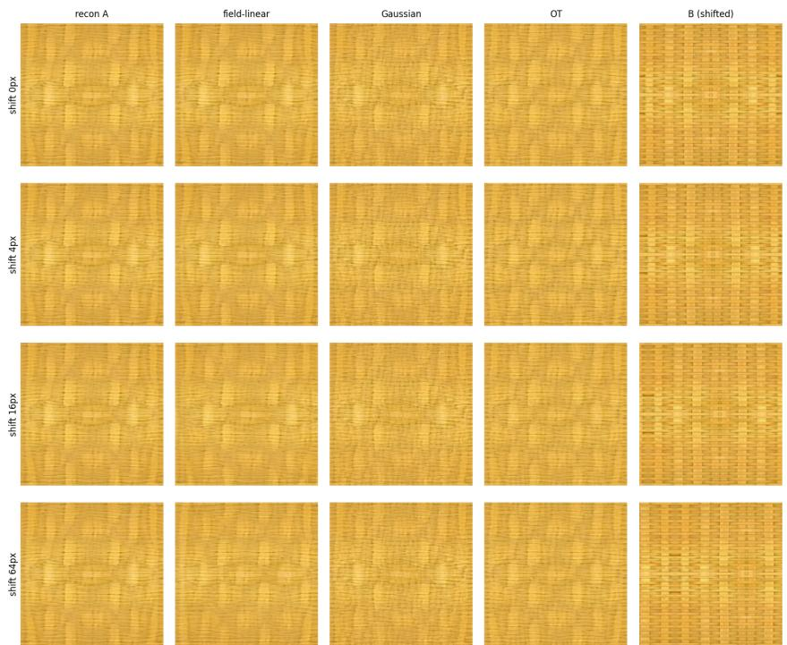  
Figure 10: Alignment isolated. Rows: cyclic shift of B by 0, 4, 16, 64 px; columns: source reconstruction, field-linear, Gaussian, Soft OT (ours), B. Positional blending superposes as the shift grows; the appearance-aware rules are far less sensitive to displacement.

Source-conditioned material transfer. At t = 1, the operator uses target-aligned appearance with source conditioning. Reversing the arguments reverses those roles. The examples in the main-text transfer figure illustrate the resulting control over arrangement; the operation does not impose a pixelwise geometry constraint.

Spatially varying paths. The interpolation coefficient in a frozen map can vary across source cells: $z _ { i } = ( 1 - t _ { i } ) x _ { i } + t _ { i } T ( x _ { i } )$ . A scalar ramp produces a spatial transition; an externally chosen field gives spatial control. This extension changes the mixing coefficients without requiring another transport solve.

## F EXPLORATORY MIXTURES, CODING, AND PLAN DIAGNOSTICS

## F.1 ANCHOR-BASED MIXTURES

For k textures, choose source $X _ { 1 }$ as an anchor and form

$$
X _ { w } = \sum _ { j = 1 } ^ { k } w _ { j } T _ { 1 \to j } ( X _ { 1 } ) , \qquad w \in \Delta _ { k } , \quad T _ { 1 \to 1 } = \mathrm { i d } .\tag{13}
$$

The decoder uses the anchor’s conditioning. This one-step construction is anchor-dependent. On two four-texture sets, changing the anchor changes the output by 46% and 38% of mean source separation, versus same-anchor rerun floors of 14% and 32%. Along a four-texture path, round-trip errors are .12–.16 against a .14 reconstruction floor. These mixtures depend on an anchor and differ from exact multi-distribution Wasserstein barycenters. The four-texture strip is in the main text (Figure 4); its RT labels are the re-encoding round-trip errors quoted above. Figure 11 is a second four-texture example, Figure 12 browses the same construction as a 4 × 4 palette, and Figure 13 applies it to a natural image split into three regions, where the objects dissolve into a mixture rather than a recognizable scene; none is an exact barycenter.

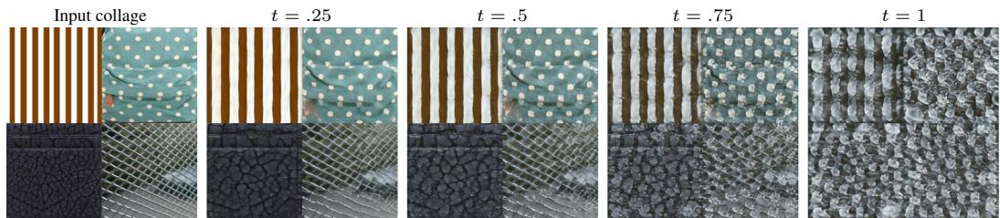  
Figure 11: A second four-texture example: a $2 \times 2$ collage of four textures moved toward their anchor-based mixture as t increases.

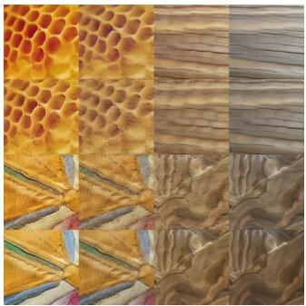  
Figure 12: $\mathrm { ~ A ~ 4 ~ } \times \mathrm { ~ 4 ~ }$ palette spanned by four corner textures under one anchor; every cell is a decoded mixture with the same conditioning.

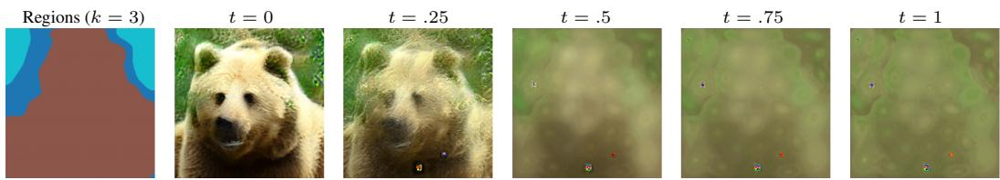  
Figure 13: Exploratory: a natural image clustered into three regions and moved toward their anchorbased mixture. Objects dissolve as distributions; the construction is not an exact barycenter and is outside the texture setting of the paper.

## F.2 SPARSE APPEARANCE CODING

For target field $Z$ and dictionary textures $A _ { j }$ , fixed transported atoms $T _ { Z  A _ { j } } ( Z )$ share the target’s support. The weight problem is

$$
\operatorname* { m i n } _ { w \in \Delta _ { K } } \| \sum _ { j } w _ { j } T _ { Z  A _ { j } } ( Z ) - Z \| _ { F } ^ { 2 } .\tag{14}
$$

It is a convex quadratic problem for fixed atoms; uniqueness requires additional conditions. Sparse subset selection is a separate combinatorial step. Among 83 reconstructable targets and a 40-atom dictionary, the recorded sparse mixture improves on the best single atom in 82% of cases, with a median margin of 22%. Sixteen of 99 targets were excluded because CNT could not reconstruct them. Periodic structure is a recurring failure (Figure 14).

The dictionary study uses a pool of 376 textures. Raw farthest-point sampling can preferentially select corrupted encodings. Screening and a landmark-completed geometry improve that selection procedure; screened FPS with 40 atoms matches the decoded quality of 80 k-medoids atoms $( p = . 4 2 )$ This result does not establish superiority of a selection rule. We did not retain the subset-search settings and raw coding outputs, so coding remains an exploratory extension.

## F.3 PLAN ALIGNMENT

With centered clouds and RMS amplitudes $a _ { A } , a _ { B }$ , define

$$
\rho ( P ) = \frac { 1 } { a _ { A } a _ { B } } \sum _ { i j } P _ { i j } \langle x _ { i } - \bar { x } , y _ { j } - \bar { y } \rangle .\tag{15}
$$

For nonzero amplitudes this lies in [−1, 1] by Cauchy–Schwarz. A sharp 1,024-point assignment on 1,000 screened pairs yields 929 pairs at $0 . 9 7 7 \pm 0 . 0 2 1$ and 71 at $0 . 5 2 \pm 0 . 0 8$ . The threshold was selected on the same data. Sharp entropic and hard-plan scores have correlation .99; the default diffuse plan is less informative. This describes pair geometry in-sample; prospective failure detection has not been validated.

Calibrated coding: typical / best / worst (selected by rank, not by eye)  
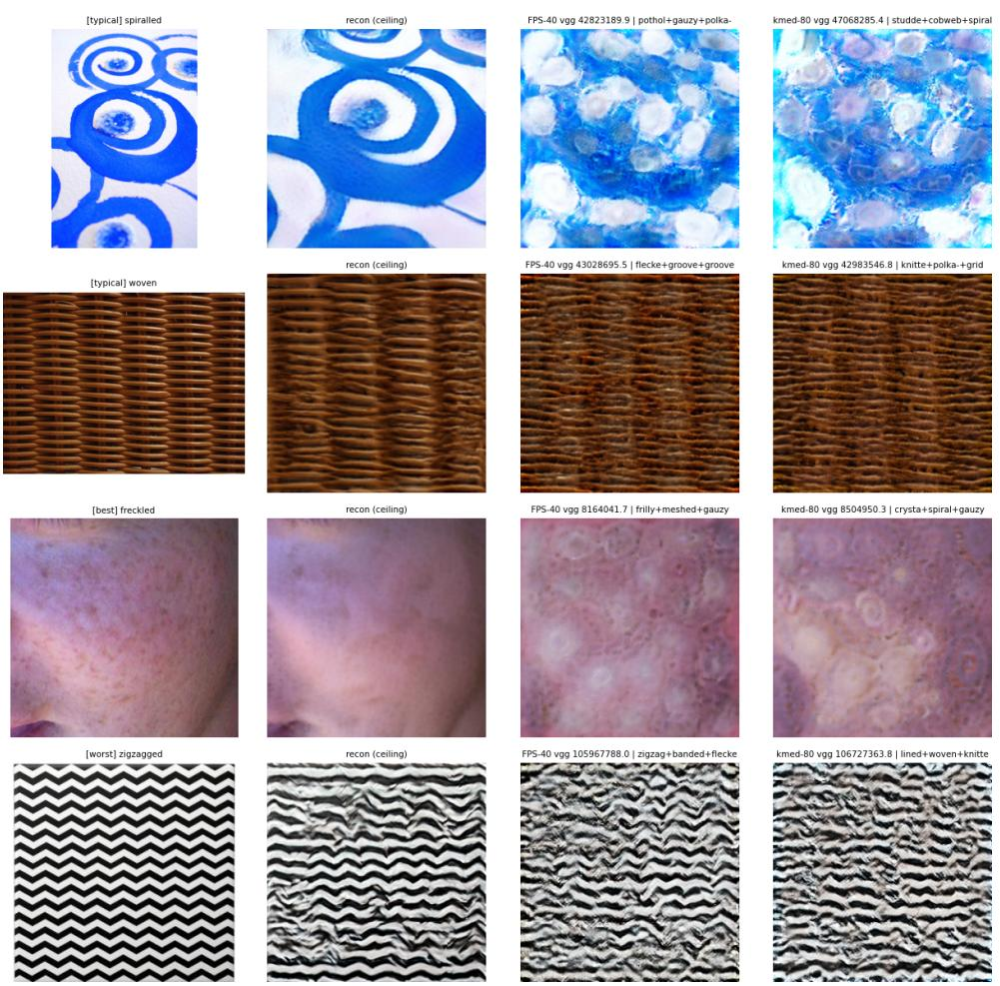  
Figure 14: Exploratory dictionary reconstructions. Columns show the target, CNT reconstruction, and decoded constructions from two dictionary choices. The bottom row illustrates the difficulty of preserving regular structure.

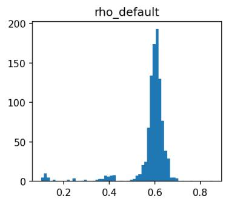

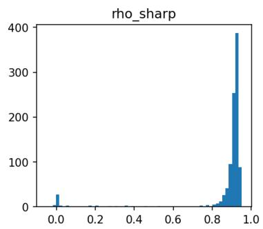

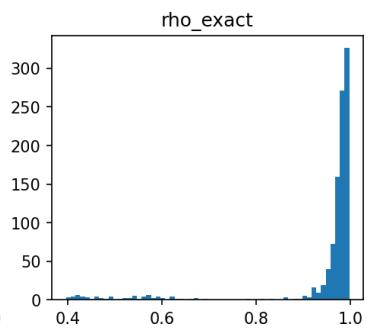  
Figure 15: Plan-alignment histograms. The separated low-alignment group appears under sharp and hard plans. The $\rho ^ { * }$ notation in the histogram refers to this statistic; only exact unregularized optimization maximizes alignment over the sampled coupling set.