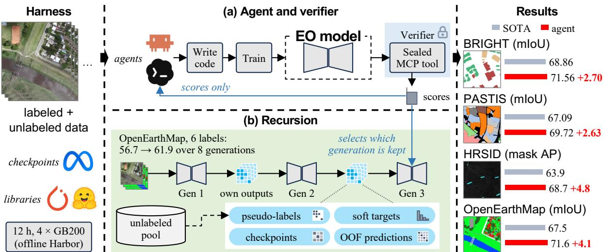
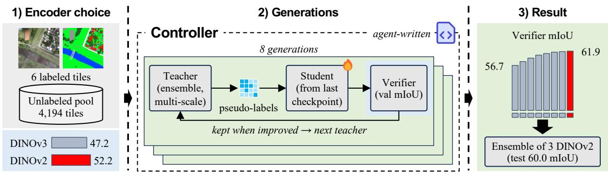
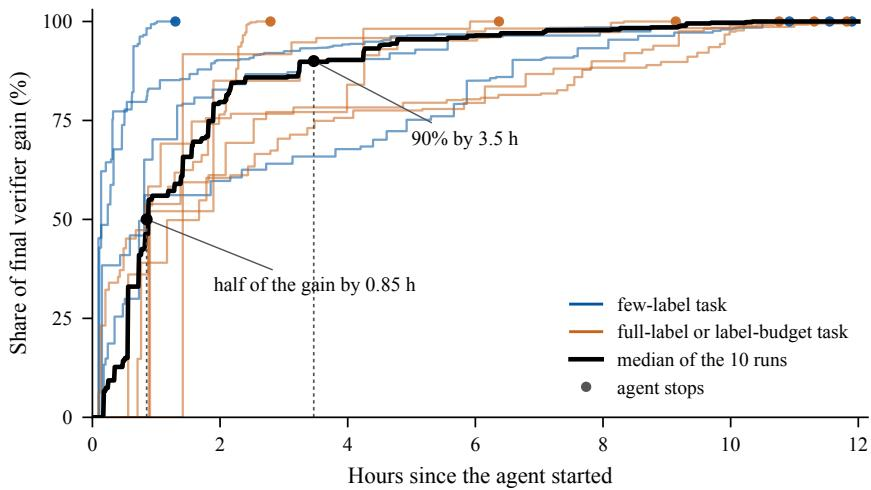

# The Last Remote Sensing Model Built by Humans? Casting Any Earth Observation Task as Recursive Self-Improvement

Sijie Zhao1,2∗ Zeqi Zhou1,2∗ Heli Qi2 Xuanchao Fu2 Zhuo Zheng3 Junshi Xia2 Junjue Wang1,2 Weihao Xuan1,2† Naoto Yokoya1,2†

1The University of Tokyo 2RIKEN 3Stanford University Yokoya-Lab-UTokyo/RSI4EO

  
Figure 1: RSI4EO casts any EO task as a harness and a verifier. The harness defines what the agent may use and the verifier defines what counts as success. (a) A general-purpose coding agent writes and trains the EO model and receives only the scores of the sealed verifier. (b) Each generation of the model is built from the outputs of the previous one, and the verifier decides which generation is kept. The resulting models surpass the state of the art on four benchmarks (Table 2).

## Abstract

Earth observation (EO) models are still built by hand. For each new task, experts design a training recipe and tune it against a benchmark. We show that this loop can be handed to an agent. Any verifiable task can be cast as a harness and a verifier, where the harness defines what the agent may use and the verifier defines what counts as success. Every EO task can be made verifiable, through labeled benchmarks, independent sensors, physical models or the repeated observation of the same place. Given only these two components, a general-purpose coding agent builds the EO model and improves it recursively on its own outputs. Settings long treated as separate research problems, from learning with a handful of labels to adapting across domains, become choices of harness and verifier. On four EO benchmarks spanning optical, SAR and multispectral time-series imagery, agent-built models surpass the state of the art and keep most of that accuracy from about 1% of the training labels. This establishes a new paradigm for EO, in which people design harnesses and verifiers and agents build the models, so EO models improve as agents do.1

## 1 Introduction

Earth observation (EO) models are still built by hand. Each new sensor, region or task starts another round of engineering, in which experts choose a backbone, design a training recipe and tune it against a benchmark. Foundation models have raised the starting point of this cycle without removing it [Cong et al., 2022, Reed et al., 2023, Guo et al., 2024, Xiong et al., 2024, Jakubik et al., 2025, Simeoni et al.´ , 2026], and on PANGAEA they do not consistently outperform a supervised UNet [Marsocci et al., 2026, Xiao et al., 2025]. Across the many sensors, regions and label taxonomies of EO, expert engineering time decides how many tasks receive a strong model. The cost is highest where EO matters most. When a disaster strikes, a new satellite comes online, or a wildfire, flood or forest loss must be mapped in a new region, a strong model is needed within days, yet expert engineering takes weeks to months and many agencies and countries have no machine learning team at all.

Meanwhile, AI has advanced fastest wherever success can be checked automatically. Verifiers drive progress in mathematical reasoning [Cobbe et al., 2021, Guo et al., 2025] and program discovery [Romera-Paredes et al., 2024, Novikov et al., 2025], and coding agents such as Claude Code and Codex now write, run and debug training code for hours, earning medals in machine learning competitions [Jiang et al., 2025, Chan et al., 2025] and improving training scripts against a validation metric [Karpathy, 2026]. EO agents have so far orchestrated fixed, human-built models and tools [Singh et al., 2024a, Liu et al., 2024, Feng et al., 2026], and a recent agentic research loop refines fully supervised baselines by one to three points [Kang et al., 2026]. The EO task itself has not yet been handed to an agent.

Our premise is that any verifiable task can be cast as a harness and a verifier. The harness defines what the agent may use, such as data, pretrained checkpoints, libraries and compute, and the verifier defines what counts as success by scoring the agent’s model (Fig. 1). Every EO task can be made verifiable, and EO offers unusually many ways to do so. A decade of community benchmarks scores models on labeled held-out data, independent sensors and in-situ measurements check retrieved quantities, physical models check consistency with the observations, and repeated observation of the same place checks any prediction about its future. Building an EO model then becomes optimization against a verifier, and settings long treated as separate research problems become choices of these two components. Learning from a handful of labels restricts the labeled data in the harness, label-budget search asks for the smallest training set that passes a target score, and domain adaptation places the verifier on a target domain. We call this formulation RSI4EO.

Given a harness and a verifier, a general-purpose coding agent builds the model by itself. It writes training code, trains models, queries the verifier and decides what to try next, offline and without human input. The verifier is sealed and returns a score, and containerized execution keeps the held-out data and the network out of the agent’s reach [Harbor Framework Team, 2026, Merrill et al., 2026, Shi et al., 2026]. The agent improves the EO model recursively on its own outputs [Yudkowsky, 2013, Zelikman et al., 2024] and designs this recursion itself. With six labeled images, it runs eight generations of self-training, each taught by the best pipeline the verifier has seen, and ends by automating the loop with its own scripts. Because the two components specify the task completely, any agent can receive it.

Agents equipped this way surpass the state of the art on all four benchmarks with published results, land-cover mapping [Xia et al., 2023], building damage assessment from optical and SAR imagery [Chen et al., 2025], SAR ship instance segmentation [Wei et al., 2020] and crop-type mapping from Sentinel-2 time series [Sainte Fare Garnot and Landrieu, 2021], each within 12 hours on four GB200 GPUs, and the same agent builds a surface-material classifier from hyperspectral pixels [Thoreau et al., 2024]. With labels for 0.1 to 1.4% of the training set they keep most of that accuracy, and on OpenEarthMap six labeled tiles yield 60.0 test mIoU. On OpenEarthMap, 300 tiles selected without labels suffice to surpass every published method trained on all labels, and two agents that build their models in very different ways both surpass the published state of the art.

These results point to a new paradigm for EO, in which people design harnesses and verifiers and agents build the models. A task’s harness and verifier stay fixed while agents improve, so EO models improve as agents do, without new human engineering. The time from a new need to a working model shrinks to the agent’s budget. After a disaster, responders can label a handful of image pairs from the affected area, pose them as a task and receive a damage model within a day. The few-label BRIGHT task, with one labeled image pair per disaster event, is a direct instance of this scenario. Wildfire, flood and deforestation mapping follow the same pattern, and a newly launched satellite can have a model within a day of its first labeled images. Above all, any agency or country that can define a task can obtain a model at the level of the published state of the art, whether or not it has a machine learning team. Research questions move upstream to which verifiers capture a task faithfully and what a harness must contain, and annotation moves from training sets to the held-out sets behind the verifier, which every benchmark already labels. Our contributions are threefold.

• A Paradigm for Building EO Models. Any verifiable task becomes a harness and a verifier, which turns the many verification sources of EO into objectives that agents optimize directly and unifies learning settings as choices of these two components.

• An Open EO Task Suite. We release the tasks of this paper in this form, covering optical, SAR, optical–SAR, multispectral time-series and hyperspectral imagery with pixel-level and instance-level outputs, runnable by any agent in offline Harbor containers.

• Evidence across Tasks, Labels and Agents. Agent-built models surpass the state of the art on four benchmarks, keep 69 to 84% of that accuracy from 0.2 to 1.4% of the labels, and on OpenEarthMap beat every published

full-label method from 11% of the labels.

## 2 Related Work

Self-Improvement and Verifiers. The idea of machines that design better machines goes back to Good [1965] and was formalized in the Godel machine [ ¨ Schmidhuber, 2007]. Language models now realize parts of this program. STOP uses a language model to improve the scaffold that calls it [Zelikman et al., 2024], Godel Agent and the¨ Darwin Godel Machine rewrite their own agent code [¨ Yin et al., 2025, Zhang et al., 2026], and FunSearch and AlphaEvolve evolve programs against automatic evaluators [Romera-Paredes et al., 2024, Novikov et al., 2025]. Self-training lets a model improve on its own outputs, from Noisy Student in vision [Xie et al., 2020] to STaR and ReSTEM in language [Zelikman et al., 2022, Singh et al., 2024b] and AlphaGo Zero in games [Silver et al., 2017], and in RSI4EO the agent arrives at such loops for the EO model without being told to. Progress in this line follows the availability of verifiers [Sutton, 2001, Wei, 2025], from trained verifiers for mathematics [Cobbe et al., 2021, Lightman et al., 2024] to reinforcement learning with verifiable rewards [Lambert et al., 2025, Guo et al., 2025], and recent surveys and roadmaps chart the path toward recursive self-improvement in general AI systems [Gao et al., 2026a, Chen et al., 2026, Duan et al., 2026]. RSI4EO carries this verifier-driven view into a scientific domain, where verifiers range from labeled benchmarks to the repeated observation of the same place and the artifact that improves recursively is the EO model.

Agents for Machine Learning Engineering. AutoML has automated parts of model development for over a decade, through hyperparameter optimization [Feurer et al., 2015, Li et al., 2018, Falkner et al., 2018, Akiba et al., 2019], neural architecture search [Zoph and Le, 2017, Liu et al., 2019, Real et al., 2020] and self-configuring pipelines such as nnU-Net [Isensee et al., 2021], each searching a space that people define. LLM agents widen this space to arbitrary code. AIDE, The AI Scientist and autoresearch write and revise training code against validation metrics [Jiang et al., 2025, Lu et al., 2026, Karpathy, 2026], and MLAgentBench, MLE-bench and RE-Bench measure such agents on engineering and research tasks [Huang et al., 2024, Chan et al., 2025, Wijk et al., 2025]. Domain systems apply these loops to medical image segmentation [Gao et al., 2026b, Liu et al., 2026] and solar-panel mapping [Lekavicius et al., 2026]. RSI4EO differs in how a task reaches the agent, as a containerized task in the format of recent agent evaluation suites [Merrill et al., 2026, Shi et al., 2026]. The harness and a sealed verifier specify it completely, so label budgets and domain shift become part of the task definition and validation data stay outside the agent’s reach, a design that reward-hacking studies of frontier agents support [Von Arx et al., 2025].

Earth Observation Models and Agents. EO foundation models learn transferable representations from optical, multispectral and SAR archives [Cong et al., 2022, Reed et al., 2023, Fuller et al., 2023, Jakubik et al., 2023, Guo et al., 2024, Xiong et al., 2024, Tseng et al., 2025, Astruc et al., 2025, Jakubik et al., 2025], and general-purpose backbones such as DINOv3 now ship satellite-pretrained variants [Oquab et al., 2024, Simeoni et al.´ , 2026], with GEO-Bench and PANGAEA evaluating them under fixed protocols [Lacoste et al., 2023, Marsocci et al., 2026]. Label-scarce and cross-domain settings have each produced dedicated methods, including semi-supervised segmentation [Yang et al., 2023, 2025, Lu et al., 2023, Zhou et al., 2026] and unsupervised domain adaptation [Hoyer et al., 2022, 2023], also on LoveDA [Wang et al., 2021, Zhao et al., 2024]. In RSI4EO these models and methods become ingredients that the agent selects, combines and trains. LLM agents for EO have so far orchestrated fixed tools and pretrained models [Singh et al., 2024a, Liu et al., 2024, Feng et al., 2026, Xu et al., 2026, Talem et al., 2026], and OpenEarth-Agent extends them to creating their own tools [Zhao et al., 2026]. RingMoClaw is a multi-agent loop that retrains remote sensing models and improves fully supervised baselines on four tasks [Kang et al., 2026]. RSI4EO hands an agent the whole EO task, including its label budget and domain shift, and extends agent-built models to label-scarce regimes.

## 3 Method

RSI4EO turns the construction of an EO model into a task that an agent solves. Section 3.1 defines a task by its harness and verifier, Sections 3.2 and 3.3 describe the two components as we instantiate them, Section 3.4 describes how the agent improves the model on its own outputs, and Section 3.5 shows how learning settings become choices of the two components.

## 3.1 Tasks as a Harness and a Verifier

An EO task is a pair $\boldsymbol { \mathcal { T } } = ( \boldsymbol { \mathcal { H } } , \boldsymbol { \mathcal { V } } )$ . The harness H fixes the resources the agent may use: labeled data $\mathcal { D } _ { L }$ , unlabeled data $\mathcal { D } _ { U }$ , pretrained checkpoints, software and a compute budget.2 The verifier V fixes what counts as success. The

agent produces pipelines, where a pipeline π is a self-contained directory of code and trained weights that maps input imagery to predictions. The verifier runs a pipeline on held-out data $( X _ { V } , Y _ { V } )$ that the agent never sees and returns its score

$$
s ( \pi ) = m \bigl ( \pi ( X _ { V } ) , Y _ { V } \bigr ) ,\tag{1}
$$

where m is the task metric. Over its budget the agent writes pipelines $\pi _ { 1 } , \ldots , \pi _ { K }$ , queries $s ( \pi _ { k } )$ and decides what to try next. When the budget ends, its final pipeline $\pi ^ { \star }$ is evaluated once on a hidden test set with the same metric, m $( \pi ^ { \star } ( X _ { T } ) , Y _ { T } )$ .

The formulation leaves every modeling decision to the agent. Architecture, losses, the use of unlabeled data, ensembling and inference all belong to the pipeline the agent writes, and the verifier is the only signal of success it receives. A task is fully specified by its two components, so any agent can receive it, and changing either component defines a new task.

## 3.2 Verifier

The verifier is sealed. It runs in a separate container that holds the validation data, executes a submitted pipeline exactly as the final grader will, and returns the score through a tool call. The agent never receives validation images or labels. Because the verifier runs the whole pipeline, it scores what will be graded, including preprocessing, ensembling and test-time augmentation, and it exposes failures such as missing outputs before the final evaluation. The agent may query it as often as it likes.

EO is rich in sources for such verifiers. Labeled benchmarks provide held-out sets, independent sensors and in-situ measurements check retrieved quantities, physical models check consistency with the observations, and repeated observation of the same place checks predictions against what is observed later. Each source yields a function that scores a pipeline without exposing its data to the agent. In this paper we build the verifier from labeled held-out sets, using the official validation split where it is not needed as the test set and otherwise a held-out portion of the training split selected by region or scene.

## 3.3 Harness

The harness gives the agent what an EO researcher would start from. It contains the labeled training data and an unlabeled pool formed by the remaining training imagery, pretrained encoders without decoders or task heads (DINOv3 ViT-L/16 pretrained on satellite imagery, DINOv2 ViT-L/14, ResNet-18 to ResNet-101 and EfficientNet-B0 [Simeoni et al.´ , 2026, Oquab et al., 2024, He et al., 2016, Tan and Le, 2019]), the official source code of the DINO models, the Python deep-learning and geospatial stack together with QGIS, SAGA and GDAL, and a deliberately plain starter pipeline, an EfficientNet-B0 encoder with an FPN decoder [Lin et al., 2017]. The agent has four GB200 GPUs and 12 hours, and no single training run may exceed 4 hours. The submitted pipeline must be a deep network that the agent trained, the given labels may not be edited, and the agent may annotate unlabeled data itself.

Each task runs in an offline Harbor container [Harbor Framework Team, 2026, Merrill et al., 2026], where the agent works without network access beyond its own model interface. When time ends, the submission directory is copied out and graded once on the hidden test set under an inference budget of 4 hours. Nothing else the agent created survives, so every model, weight and script the final pipeline needs must be inside the submission.

## 3.4 Recursive Improvement

Within a task, the agent improves the EO model recursively on its own outputs. We call each model the agent trains a generation. A generation $f _ { t }$ leaves outputs $O _ { t }$ behind, including its predictions and class probabilities on the unlabeled pool, its checkpoints, and its predictions on held-out folds of the training data. The next generation is trained from these outputs,

$$
f _ { t + 1 } = \operatorname { T r a i n } ( \mathcal { H } , O _ { \leq t } ) ,\tag{2}
$$

and the verifier decides which generation is kept and serves as the source of the next one. Two loops therefore run together. In the outer loop, the agent proposes pipelines and the verifier scores them. In the inner loop, each kept model becomes material for its successor, so the model improves along a lineage.

The agent designs this recursion itself. The task instruction permits methods such as pseudo-labeling on the unlabeled pool but prescribes none, and the agent chooses the mechanisms, their order and the depth of the lineage from the verifier’s feedback. Across our runs the mechanisms fall into three families. At the data level, a teacher labels the unlabeled pool with hard pseudo-labels or soft class probabilities and a student trains on them, as in Noisy Student [Xie et al., 2020] and knowledge distillation [Hinton et al., 2015]. At the parameter level, new models start from earlier checkpoints, average several checkpoints, or grow from a smaller trained network. At the prediction level, the agent trains models on its own predictions, such as calibrators fitted to out-of-fold predictions and networks that refine its masks. Each generation thus learns from the previous one, the pattern behind STaR [Zelikman et al., 2022] and AlphaGo Zero [Silver et al., 2017], here applied to the EO model the agent builds.

Table 1: The five benchmarks. Training data form the harness, the verifier holds a validation split, and the test split stays hidden until the final evaluation. The few-label task keeps a few labeled samples per natural stratum, with their share of the training labels in parentheses, and moves the other training samples to the unlabeled pool. PASTIS counts the background as a class.
<table><tr><td>Benchmark</td><td>Task</td><td>Input</td><td>Classes</td><td>Metric</td><td>Train</td><td>Verifier</td><td>Test</td><td>Few-label task</td></tr><tr><td>OpenEarthMap</td><td>land-cover mapping</td><td>RGB, 0.25–0.5 m</td><td>8</td><td>mIoU</td><td>2,700</td><td>300</td><td>500</td><td>6 tiles, one per continent (0.2%)</td></tr><tr><td>BRIGHT</td><td>building damage</td><td>optical + SAR pairs</td><td>4</td><td>mIoU</td><td>2,918</td><td>450</td><td>878</td><td>14 pairs, one per event (0.5%)</td></tr><tr><td>HRSID</td><td>ship instances</td><td>SAR, 0.5–3 m</td><td>1</td><td>mask AP</td><td>3,090</td><td>552</td><td>1,962</td><td>36 images, one per scene (1.2%)</td></tr><tr><td>PASTIS</td><td>crop-type mapping</td><td>Sentinel-2 time series</td><td>19</td><td>mIoU</td><td>1,455</td><td>482</td><td>496</td><td>20 series, five per tile (1.4%)</td></tr><tr><td>Toulouse</td><td>surface materials</td><td>310-band pixel spectra</td><td>32</td><td>macro-F1</td><td>190,969</td><td>39,991</td><td>149,272</td><td>160 pixels, five per class (0.1%)</td></tr></table>

## 3.5 Learning Settings as Choices of Harness and Verifier

Settings that EO research has treated as separate problems become choices of the two components. Full supervision gives the harness all training labels. Learning from few labels keeps one to five labeled samples per natural stratum of the data, such as a continent, a disaster event, a scene or a class, chosen so that together they cover every class, and moves the remaining training imagery to the unlabeled pool (Table 1). A label-budget search fixes a label-free selection rule, ranks the training images with it, and asks for the smallest prefix whose labels let the agent reach a target score. Domain adaptation places the labeled data on a source domain and the verifier on the target domain. In every case the agent, the verifier interface and the final evaluation stay the same.

This view also changes where annotation goes. Labels are needed for the verifier and for the final evaluation, which every benchmark already provides, while the training set can shrink to a handful of samples. Validation labels reach the agent only through the scores the verifier returns.

## 4 Experiments

The experiments ask three questions that follow from the introduction. The first is whether one agent and one interface suffice across sensors, output types and label regimes. The second is how good the resulting models are, both against the plain pipeline that ships with the harness and against published methods. The third is how the amount of labeled data in the harness and the choice of agent change the outcome. Section 5 then examines the runs themselves to explain where the accuracy comes from.

## 4.1 Setup

Benchmarks and Tasks. We instantiate RSI4EO on five EO benchmarks that differ in sensor, output and metric (Table 1). OpenEarthMap [Xia et al., 2023] maps eight land-cover classes from sub-meter RGB imagery, BRIGHT [Chen et al., 2025] grades building damage from pre-event optical and post-event SAR pairs, HRSID [Wei et al., 2020] segments ship instances in SAR images, PASTIS [Sainte Fare Garnot and Landrieu, 2021] maps 18 crop types from Sentinel-2 time series, and the Toulouse data set [Thoreau et al., 2024] classifies 32 surface materials from single hyperspectral pixels. Each benchmark yields a full-label task and a few-label task that keeps 0.1 to 1.4% of the training labels. On OpenEarthMap we add two points of the label-budget search, in which the harness holds the first 300 or 600 tiles ranked by k-center on frozen DINOv3 features [Sener and Savarese, 2018], a rule that uses no labels.

The hidden test set is the official test split of each benchmark, except on OpenEarthMap. Its test labels are withheld, so its official validation split serves as the test set and the verifier holds 300 tiles taken from the training split. Its 1,500 official test images join the unlabeled pool. For Toulouse we use the second of the eight official spatially disjoint splits. HRSID has no official validation split, and its verifier holds 20 complete scenes taken from the official training set. The agent therefore trains on 3,090 of the 3,642 images that published methods use. The Toulouse harness provides only spectra, without pixel positions and without a pretrained model.

Agents and Protocol. The main agent is Codex with GPT-6-Astra, which runs every task. Claude Code with Claude Opus 5.5 runs the four OpenEarthMap tasks. Both agents use their highest reasoning effort and work for at most 12 hours on four GB200 GPUs in an offline container (Section 3.3). The verifier returns the task metric, its per-class breakdown and the inference time, and it may be queried without limit. Each task runs once per agent.

Reference Points. We compare each agent-built model with two references. The first is the starter pipeline of the harness, trained as provided, which shows what the harness yields without an agent. The second is the set of published results under each benchmark’s standard protocol (Table 2). Toulouse is compared with the starter, as its published results are averages over eight splits.

Table 2: Agent-built models against published methods on the four benchmarks with published results under our split, each under its standard protocol. Rows are sorted by score and the previous state of the art (SOTA) is underlined. The RSI4EO rows give the agent-built model from the full training set with its gain over the SOTA, and from a few-label subset (share of the training set in parentheses) with its score as a percentage of the full-label score. All agent rows come from GPT-6-Astra through Codex, within 12 hours on four GB200 GPUs. †Test-time augmentation. ‡Multi-model ensemble with post-processing. §Pretrained foundation model fine-tuned on PASTIS, as reported by Herzog et al. [2025]. ∥Fold-I score from the released test logs of Cai [2023], whose paper reports five-fold means of 66.8 and 67.9. PASTIS uses the official fold I split. The other baselines are those of Tarasiou et al. [2023], who evaluate on 24 × 24 crops of the same test fold. On HRSID, the four generic detectors are those of Wei et al. [2020], and LFG-Net⋆ is the stronger of the two configurations reported by its authors. OpenEarthMap reports 8-class mIoU on the official validation split, which serves as the test split because test labels are withheld. ∗8-class mean recomputed from the per-class IoUs of Wang et al. [2024] and Wang et al. [2025]. ¶Encoder evaluated by Duc and Fukui [2026].

(a) BRIGHT building damage, pre-event optical + post-event SAR
<table><tr><td>Method</td><td>mIoU</td></tr><tr><td>SiamAttnUNet [Adriano et al., 2021] DeepLabV3+ [Chen et al., 2018]</td><td>64.26</td></tr><tr><td>UNet [Ronneberger et al., 2015]</td><td>64.80 64.94</td></tr><tr><td>SiamCRNN [Chen et al., 2020] ChangeOS [Zheng et al., 2021]</td><td>65.73</td></tr><tr><td>DamageFormer [Chen et al., 2022]</td><td>65.98</td></tr><tr><td>ChangeMamba [Chen et al., 2024]</td><td>67.09</td></tr><tr><td>ChangeMamba† [Chen et al., 2025]</td><td>67.63</td></tr><tr><td>Ensemble‡ [Chen et al., 2025]</td><td>68.50</td></tr><tr><td>RSI4EO, 14 pairs (0.5%)</td><td>68.86</td></tr></table>

(b) PASTIS crop-type segmentation, Sentinel-2 time series
<table><tr><td>Method</td><td>mIoU</td></tr><tr><td>FPN-ConvLSTM [Chamorro Martinez et al., 2021] 3D-UNet [Rustowicz et al., 2019]</td><td>59.5 60.4</td></tr><tr><td>U-ConvLSTM [Rustowicz et al., 2019] AnySat® [Astruc et al., 2025] TerraMind-L§ [Jakubik et al., 2025]</td><td>60.7 60.9</td></tr><tr><td>Galileo-B§ [Tseng et al., 2025]</td><td>60.9</td></tr><tr><td>U-TAE [Sainte Fare Garnot and Landrieu, 2021] OlmoEarth-B⁸ [Herzog et al., 2025]</td><td>61.2 62.4</td></tr><tr><td>TSViT [Tarasiou et al., 2023]</td><td>64.3</td></tr><tr><td>OlmoEarth-L§ [Herzog et al., 2025]</td><td>65.1</td></tr><tr><td>Exchanger + UNet&quot; [Cai et al., 2023]</td><td>66.3</td></tr><tr><td></td><td>66.5</td></tr><tr><td>Exchanger + Mask2Former&quot; [Cai et al., 2023]</td><td></td></tr><tr><td>RSI4EO, 20 series (1.4%) RSI4EO, full labels</td><td>67.1</td></tr></table>

(c) HRSID SAR ship instance segmentation
<table><tr><td>Method</td><td>Mask AP</td></tr><tr><td>Mask R-CNN [He et al., 2017]</td><td>54.3</td></tr><tr><td>MS R-CNN [Huang et al., 2019] Cascade Mask R-CNN [Cai and Vasconcelos, 2021]</td><td>54.4 54.7</td></tr><tr><td>HTC [Chen et al., 2019]</td><td>55.4</td></tr><tr><td>SA R-CNN [Zhao et al., 2021]</td><td>56.5</td></tr><tr><td>GCBANet [Ke et al., 2022] MAI-SE-Net [Zhang and Zhang, 2022a]</td><td>57.3</td></tr><tr><td>FL-CSE-ROIE [Zhang and Zhang, 2022b]</td><td>57.8</td></tr><tr><td>CATNet [Liu et al., 2025]</td><td>57.9</td></tr><tr><td>HTC+ [Zhang and Zhang, 2022c]</td><td>58.2</td></tr><tr><td>Insight Any Instance [Li et al., 2025]</td><td>59.1</td></tr><tr><td>CATNet, multi-scale training [Liu et al., 2025]</td><td>59.3</td></tr><tr><td>ARANet [Chang et al., 2026]</td><td>59.6</td></tr><tr><td>LFG-Net* [Wei et al., 2022]</td><td>60.6</td></tr><tr><td>GCIE-Net [Luo et al., 2026]</td><td>63.9 63.9</td></tr><tr><td></td><td></td></tr><tr><td>RSI4EO, 36 images (1.2%) RSI4EO, full labels</td><td>50.2 73% 68.7 +4.8</td></tr></table>

(d) OpenEarthMap land-cover mapping, sub-meter optical
<table><tr><td>Method</td><td>mIoU</td></tr><tr><td>UNet [Ronneberger et al., 2015]</td><td>57.8*</td></tr><tr><td>RS3Mamba [Ma et al., 2024]</td><td>60.5*</td></tr><tr><td>DC-Swin [Wang et al., 2022a]</td><td>63.6*</td></tr><tr><td>UNetFormer [Wang et al., 2022b]</td><td>64.3*</td></tr><tr><td>ResNet-50&quot; [He et al., 2016]</td><td>64.5</td></tr><tr><td>ViT-L, MAE&quot; [He et al., 2022]</td><td>64.8</td></tr><tr><td>ViT-B, MAE [He et al., 2022]</td><td>65.6</td></tr><tr><td>EfficientNet-B7&quot; [Tan and Le, 2019]</td><td>66.3</td></tr><tr><td>SatMamba-B [Duc and Fukui, 2026]</td><td>66.5</td></tr><tr><td>MetaSegNet† [Wang et al., 2024]</td><td>67.0*</td></tr><tr><td>PyramidMamba† [Wang et al., 2025]</td><td>67.5*</td></tr><tr><td>RSI4EO, 6 tiles (0.2%)</td><td></td></tr><tr><td>RSI4EO, full labels</td><td>60.084% 71.6+4.1</td></tr></table>

## 4.2 Main Results

One Agent across Five Benchmarks. Table 3 reports the hidden-test score of every task. The same agent, through the same interface, builds a strong model for RGB, SAR, optical and SAR pairs, multispectral time series and hyperspectral pixels, and for semantic segmentation, instance segmentation and pixel classification. In all seven comparisons with the starter, the agent-built model is well above it. The gain is 5.6 to 16.7 points with full labels and 14.6 to 36.1 points with few labels. The gain is larger with few labels because the starter trains a small network on the labeled samples alone, whereas the agent brings in the pretrained encoders and the unlabeled pool that the harness also contains.

Table 3: Hidden-test scores on all five benchmarks. The starter is the plain pipeline that ships with the harness, trained as provided, and RSI4EO is the model that GPT-6-Astra builds from the same harness within 12 hours, with its gain over the starter in blue. The last column gives the best published result that uses all training labels under the same protocol (Table 2). A dash marks a score that is not available. Toulouse has no published result under our split.
<table><tr><td></td><td></td><td colspan="2">Few labels</td><td colspan="2">Full labels</td><td></td></tr><tr><td>Benchmark</td><td>Metric</td><td>Starter</td><td>RSI4EO</td><td>Starter</td><td>RSI4EO</td><td>Published</td></tr><tr><td>OpenEarthMap</td><td>mIoU</td><td>34.0</td><td>60.0 +26.0</td><td></td><td>71.6</td><td>67.5</td></tr><tr><td>BRIGHT</td><td>mIoU</td><td>34.8</td><td>49.4+14.6</td><td>61.8</td><td>71.6+9.8</td><td>68.9</td></tr><tr><td>HRSID</td><td>mask AP</td><td></td><td>50.2</td><td></td><td>68.7</td><td>63.9</td></tr><tr><td>PASTIS</td><td>mIoU</td><td>14.0</td><td>50.1 +36.1</td><td>53.0</td><td>69.7 +16.7</td><td>67.1</td></tr><tr><td>Toulouse</td><td>macro-F1</td><td>50.3</td><td>69.1 +18.8</td><td>66.2</td><td>71.8+5.6</td><td>一</td></tr></table>

Comparison with Published Methods. With full labels, the agent-built model exceeds the best published result on all four benchmarks with published results, by 2.7 mIoU on BRIGHT, 2.6 mIoU on PASTIS, 4.8 mask AP on HRSID and 4.1 mIoU on OpenEarthMap (Table 2). The baselines include a multi-model ensemble on BRIGHT, fine-tuned EO foundation models on PASTIS and methods with test-time augmentation on OpenEarthMap. Each model is a system that the agent designed, trained and assembled from its own networks within 12 hours. On HRSID the agent reaches its score with 15% fewer training images than the published methods and without a pretrained detector. A run of this kind costs roughly 100 to 170 US dollars of model usage and at most 48 GPU hours (Section A.2).

Few Labels. With 0.2 to 1.4% of the training labels, the agent keeps 69 to 84% of its full-label score on OpenEarthMap, BRIGHT, HRSID and PASTIS. On OpenEarthMap, six labeled tiles yield 60.0 mIoU, close to the 60.5 of RS3Mamba trained on all 3,000 tiles. With five labeled pixels per class on Toulouse, the agent keeps 96% of its full-label score and exceeds the starter trained on all 190,969 labeled pixels.

## 4.3 Labels and Agents on OpenEarthMap

Table 4: OpenEarthMap hidden-test mIoU as the harness holds more labeled tiles, for two agents. The 300 and 600 tiles are selected by k-center on frozen features, without labels, and these two tasks provide no unlabeled pool. The previous state of the art uses all training labels.
<table><tr><td>Labeled tiles</td><td>Share</td><td>Unlabeled tiles</td><td>GPT-6-Astra</td><td>Claude Opus 5.5</td></tr><tr><td>6</td><td>0.2%</td><td>4,194</td><td>60.0</td><td>56.7</td></tr><tr><td>300</td><td>11%</td><td>0</td><td>64.3</td><td>67.8</td></tr><tr><td>600</td><td>22%</td><td>0</td><td>69.4</td><td>68.6</td></tr><tr><td>2,700</td><td>100%</td><td>1,500</td><td>71.6</td><td>70.8</td></tr><tr><td colspan="3">Previous SOTA [Wang et al., 2025]</td><td colspan="2">67.5</td></tr></table>

Label Budget. Table 4 follows OpenEarthMap as the harness holds more labels. With 300 tiles, 11% of the training set, one agent already surpasses all 11 published methods of Table 2, all of which train on the full label set. With 600 tiles, 22% of the training set, both agents surpass them and reach 97% of their full-label scores. Most of the value of the training labels thus lies in the first few hundred tiles. This supports the annotation shift of Section 3.5, in which labels are spent first on the held-out sets behind the verifier and the final evaluation.

Two Agents. The two agents reach similar accuracy by different routes. GPT-6-Astra works in many small steps and runs experiments in parallel, and with six tiles it queries the verifier 341 times. Claude Opus proceeds in fewer and larger steps and queries the verifier 43 times in the same setting. GPT-6-Astra leads in three of the four settings and Claude Opus at 300 tiles, and from 600 tiles upward they differ by less than one point. With six tiles the deeper self-training lineage of GPT-6-Astra leads, and with 300 tiles the full fine-tuning of both DINO encoders by Claude Opus leads. The formulation thus does not depend on one agent or one working style.

## 5 Analysis

The trajectories record every command, message and verifier query of a run. We use them to examine three points. The first is that the agent improves the model recursively on its own outputs without being told to. The second is that the agent takes over the engineering that experts otherwise carry out. The third is how far a model selected against a

  
Figure 2: Lineage of the six-label OpenEarthMap run. The agent compares encoders on the verifier, pseudo-labels the unlabeled pool with its best model, and runs eight generations in which the best verified pipeline teaches a student that continues from the previous generation. In the later generations, controller scripts written by the agent select the teacher from the verifier log and start the next generation. The final three-network ensemble scores 60.0 mIoU on the hidden test set.

  
Figure 3: Progress within a run. Share of the final verifier gain reached over time in the 10 runs of GPT-6-Astra for which trajectories are available, where the gain is measured from the first to the best verifier score of a run. A do marks the time at which the agent ends the run, and the black line is the median over runs.

sealed verifier generalizes to data the agent never accesses. Further observations on how the agents use the verifier and spend their budget, and on what follows for the design of harnesses and verifiers, are reported in Section A.

## 5.1 Recursion in Practice

A Lineage from Six Labels. The six-label OpenEarthMap run shows the recursion most clearly (Fig. 2). The agent first uses the verifier to choose an encoder, then labels all 4,194 unlabeled tiles with its best model and trains a student on the six labeled tiles and this pseudo-labeled pool. From there it runs eight generations. In each, the teacher is the best pipeline the verifier has seen so far, and the student continues from the previous generation’s checkpoint. The verifier score rises in every generation, from 56.7 to 61.9 mIoU, which is 9.0 points above the best model the agent trained on the six tiles alone. The agent then automates this loop. It writes scripts that read the verifier log, promote the best pipeline to the next teacher and start a new generation when the teacher has improved. The last generation was launched, trained and verified by these scripts alone. The recursion thus extends from the model to the procedure that improves it.

The Same Pattern across Tasks. The few-label runs on OpenEarthMap, BRIGHT and HRSID all arrive at teacher–student loops over the unlabeled pool, with eight generations on OpenEarthMap, ten on BRIGHT and five on HRSID, and Claude Opus runs four on OpenEarthMap. No instruction asks for them. The loops also differ in what passes from one generation to the next. On BRIGHT the teacher is a three-stage pipeline of a building detector, a damage network and a building-level classifier, and on HRSID it is a detector followed by a network that predicts each mask from a crop around the detected box.

The Verifier Steers the Recursion. On BRIGHT the first two generations add about 2 and 1 points. From the third generation on, the gains come from generations that change the loss or architecture of the student. The verifier shows the agent when another generation of the same kind stops paying, and the agent responds with such a change.

## 5.2 What the Agent Contributes

Most of the Gain Arrives Early. Figure 3 shows how the verifier score of each run approaches its final value. Across the 10 runs of GPT-6-Astra with recorded trajectories, half of the final gain is reached after a median of 0.85 hours and 90% after 3.5 hours. The steps taken in this early phase are of a few recurring kinds.

• Choosing Pretrained Encoders with the Verifier. Replacing the starter encoder by a frozen foundation encoder is the largest single step in several runs, with 11.1 points on six-label OpenEarthMap and 7.3 on few-label BRIGHT, each within the first 15 minutes. The verifier also corrects plausible priors. With six OpenEarthMap tiles, DINOv2 scores 52.2 mIoU and the satellite-pretrained DINOv3 47.2, and on PASTIS the agent finds tha pixel-wise temporal models contribute more than DINO features.

• Matching Model Capacity to the Labels. Across the few-label runs, early checkpoints often beat later ones, and the agent infers from the verifier that fitting a handful of labels more closely reduces accuracy.

• Debugging. The largest step of the full-label HRSID run, 5.2 AP, comes largely from correcting a half-pixel offset in mask refinement, which the agent found by inspecting its outputs. Earlier in the same run it had traced misplaced masks to a loss of box-coordinate precision under mixed precision.

• Task-Specific Structure. On BRIGHT with few labels, the agent separates the confidence that a pixel is a building from the confidence in its damage grade when it trains on pseudo-labels, which adds 2.2 points in a controlled comparison. It later assigns building footprints to a separate optical detector, which adds a further 1.1 points.

These are the choices of backbone and training recipe that experts otherwise make by hand (Section 1). Here the agent makes them from the verifier’s feedback, and it makes most of them within the first hours of a run. A mode close to the final one therefore exists within the first hours of a run (Section A.2).

## 5.3 Generalization beyond the Verifier

The Verifier Score Carries Over. The agent selects among up to several hundred candidates with the verifier, and on OpenEarthMap, PASTIS, HRSID and BRIGHT the score it optimizes carries over to the hidden test. Table 5 in the appendix lists the verifier and test scores of every run. The hidden-test score lies within about 2 points of the verifier score in all seven OpenEarthMap runs listed there and within 0.2 points on PASTIS. On HRSID the test score is higher by about 3.5 AP, because the official test images come from the same scenes as the training images whereas the verifier holds separate scenes.

The Gap Follows the Split. On OpenEarthMap the run with 341 queries has a gap of 1.9 points, and the run with 8 queries has a gap of 1.3. In both, and in every other OpenEarthMap run, the gap is concentrated in the same two classes, bareland and water. On BRIGHT, three quarters of the 3.5 to 4.0 point difference come from the destroyed class, which covers 1.38% of the validation pixels and 0.93% of the test pixels, and its test IoU of 61.5 is below the 65.4 that the first, untuned submission of the run obtained on the verifier. On these benchmarks the gaps mainly reflect differences between the validation and test splits. This agrees with studies of benchmark reuse, which find that repeated model selection on a held-out set causes little overfitting [Recht et al., 2019, Roelofs et al., 2019].

## 6 Conclusion

We have shown that any verifiable EO task can be cast as a harness and a verifier, and that a general-purpose coding agent given these two components builds EO models that surpass the state of the art on four benchmarks and keep most of that accuracy from about 1% of the training labels. The formulation separates what people specify from what agents build. The harness and the verifier of a task stay fixed while the agents that solve it improve, so every advance in agent capability turns into better EO models without new human engineering. The time from a new disaster, satellite or region to a working model then becomes the agent’s budget, and any agency that can define a task can obtain a state-of-the-art model. As AI capability continues to rise, we see this as the paradigm in which EO models will be built, with human effort invested in the harnesses and verifiers that define the tasks.

## References

Yezhen Cong, Samar Khanna, Chenlin Meng, Patrick Liu, Erik Rozi, Yutong He, Marshall Burke, David B. Lobell, and Stefano Ermon. SatMAE: Pre-training transformers for temporal and multi-spectral satellite imagery. In Advances in Neural Information Processing Systems (NeurIPS), volume 35, pages 197–211, 2022.

Colorado J. Reed, Ritwik Gupta, Shufan Li, Sarah Brockman, Christopher Funk, Brian Clipp, Kurt Keutzer, Salvatore Candido, Matt Uyttendaele, and Trevor Darrell. Scale-MAE: A scale-aware masked autoencoder for multiscale geospatial representation learning. In Proceedings of the IEEE/CVF International Conference on Computer Vision (ICCV), pages 4088–4099, 2023.

Xin Guo, Jiangwei Lao, Bo Dang, Yingying Zhang, Lei Yu, Lixiang Ru, Liheng Zhong, Ziyuan Huang, Kang Wu, Dingxiang Hu, Huimei He, Jian Wang, Jingdong Chen, Ming Yang, Yongjun Zhang, and Yansheng Li. SkySense: A multi-modal remote sensing foundation model towards universal interpretation for earth observation imagery. In Proceedings ofthe IEEE/CVF Conference on Computer Vision and Pattern Recognition (CVPR), pages 27672–27683, 2024.

Zhitong Xiong, Yi Wang, Fahong Zhang, Adam J. Stewart, Joelle Hanna, Damian Borth, Ioannis Papoutsis, Bertrand¨ Le Saux, Gustau Camps-Valls, and Xiao Xiang Zhu. Neural plasticity-inspired multimodal foundation model for earth observation, 2024. URL https://arxiv.org/abs/2403.15356.

Johannes Jakubik, Felix Yang, Benedikt Blumenstiel, Erik Scheurer, Rocco Sedona, Stefano Maurogiovanni, Jente Bosmans, Nikolaos Dionelis, Valerio Marsocci, Niklas Kopp, Rahul Ramachandran, Paolo Fraccaro, Thomas Brunschwiler, Gabriele Cavallaro, Juan Bernabe-Moreno, and Nicolas Longep´ e. TerraMind: Large-scale´ generative multimodality for earth observation. In Proceedings ofthe IEEE/CVF International Conference on Computer Vision (ICCV), pages 7383–7394, 2025.

Oriane Simeoni, Huy V. Vo, Maximilian Seitzer, Federico Baldassarre, Maxime Oquab, Cijo Jose, Vasil Khalidov,´ Marc Szafraniec, Seung Eun Yi, Michael Ramamonjisoa, Francisco Massa, Daniel Haziza, Luca Wehrstedt,¨ Jianyuan Wang, Timothee Darcet, Th´ eo Moutakanni, Leonel Sentana, Claire Roberts, Andrea Vedaldi, Jamie´ Tolan, John Brandt, Camille Couprie, Julien Mairal, Herve J´ egou, Patrick Labatut, and Piotr Bojanowski. DINOv3.´ Transactions on Machine Learning Research, 2026. ISSN 2835-8856. URL https://openreview.net/ forum?id=2NlGyqNjns. Featured Certification.

Valerio Marsocci, Yuru Jia, Georges Le Bellier, David Kerekes, Liang Zeng, Sebastian Hafner, Sebastian Gerard, Eric Brune, Ritu Yadav, Ali Shibli, Heng Fang, Yifang Ban, Maarten Vergauwen, Nicolas Audebert, and Andrea Nascetti. PANGAEA: Assessing geospatial foundation models capabilities through a global and inclusive benchmark. IEEE Geoscience and Remote Sensing Magazine, 14(1):245–285, 2026. doi: 10.1109/MGRS.2025. 3628194.

Aoran Xiao, Weihao Xuan, Junjue Wang, Jiaxing Huang, Dacheng Tao, Shijian Lu, and Naoto Yokoya. Foundation models for remote sensing and earth observation: A survey. IEEE Geoscience and Remote Sensing Magazine, 13 (4):297–324, 2025. doi: 10.1109/MGRS.2025.3576766.

Karl Cobbe, Vineet Kosaraju, Mohammad Bavarian, Mark Chen, Heewoo Jun, Lukasz Kaiser, Matthias Plappert, Jerry Tworek, Jacob Hilton, Reiichiro Nakano, Christopher Hesse, and John Schulman. Training verifiers to solve math word problems, 2021. URL https://arxiv.org/abs/2110.14168.

Daya Guo, Dejian Yang, Haowei Zhang, Junxiao Song, Peiyi Wang, Qihao Zhu, Runxin Xu, Ruoyu Zhang, Shirong Ma, Xiao Bi, Xiaokang Zhang, Xingkai Yu, et al. DeepSeek-R1 incentivizes reasoning in LLMs through reinforcement learning. Nature, 645(8081):633–638, 2025. doi: 10.1038/s41586-025-09422-z. Preprint: arXiv:2501.12948.

Bernardino Romera-Paredes, Mohammadamin Barekatain, Alexander Novikov, Matej Balog, M. Pawan Kumar, Emilien Dupont, Francisco J. R. Ruiz, Jordan S. Ellenberg, Pengming Wang, Omar Fawzi, Pushmeet Kohli, and Alhussein Fawzi. Mathematical discoveries from program search with large language models. Nature, 625(7995): 468–475, 2024. doi: 10.1038/s41586-023-06924-6.

Alexander Novikov, Ngan Vˆ u, Marvin Eisenberger, Emilien Dupont, Po-Sen Huang, Adam Zsolt Wagner, Sergey˜ Shirobokov, Borislav Kozlovskii, Francisco J. R. Ruiz, Abbas Mehrabian, M. Pawan Kumar, Abigail See, Swarat Chaudhuri, George Holland, Alex Davies, Sebastian Nowozin, Pushmeet Kohli, and Matej Balog. AlphaEvolve: A coding agent for scientific and algorithmic discovery, 2025. URL https://arxiv.org/abs/2506. 13131.

Zhengyao Jiang, Dominik Schmidt, Dhruv Srikanth, Dixing Xu, Ian Kaplan, Deniss Jacenko, and Yuxiang Wu. AIDE: AI-driven exploration in the space of code, 2025. URL https://arxiv.org/abs/2502.13138.

Jun Shern Chan, Neil Chowdhury, Oliver Jaffe, James Aung, Dane Sherburn, Evan Mays, Giulio Starace, Kevin Liu, Leon Maksin, Tejal Patwardhan, Aleksander Madry, and Lilian Weng. MLE-bench: Evaluating machine learning agents on machine learning engineering. In International Conference on Learning Representations (ICLR), 2025. URL https://openreview.net/forum?id=6s5uXNWGIh. Oral.

Andrej Karpathy. autoresearch: AI agents running research on single-GPU nanochat training automatically. GitHub repository, 2026. URL https://github.com/karpathy/autoresearch. README dated March 2026; accessed 2026-10-11.

Simranjit Singh, Michael Fore, and Dimitrios Stamoulis. GeoLLM-Engine: A realistic environment for building geospatial copilots. In Proceedings ofthe IEEE/CVF Conference on Computer Vision and Pattern Recognition Workshops (CVPRW), pages 585–594, 2024a. doi: 10.1109/CVPRW63382.2024.00063.

Chenyang Liu, Keyan Chen, Haotian Zhang, Zipeng Qi, Zhengxia Zou, and Zhenwei Shi. Change-Agent: Toward interactive comprehensive remote sensing change interpretation and analysis. IEEE Transactions on Geoscience and Remote Sensing, 62:1–16, 2024. doi: 10.1109/TGRS.2024.3425815.

Peilin Feng, Zhutao Lv, Junyan Ye, Xiaolei Wang, Xinjie Huo, Jinhua Yu, Wanghan Xu, Wenlong Zhang, Lei Bai, Conghui He, and Weijia Li. Earth-Agent: Unlocking the full landscape of earth observation with agents. In International Conference on Learning Representations (ICLR), 2026. URL https://arxiv.org/abs/ 2509.23141.

Kaiyue Kang, Qixuan He, Peijin Wang, Yingchao Feng, Chao Ren, Kangxin Wang, Wenhui Diao, Yixiao Wang, Liangjin Zhao, Kaiwen Wei, Nayu Liu, and Xian Sun. RingMoClaw: An experience-inspired multi-agent framework for self-evolving research in remote sensing. IEEE Transactions on Geoscience and Remote Sensing, 2026. doi: 10.1109/TGRS.2026.3734082. Early access.

Harbor Framework Team. Harbor: A framework for evaluating and optimizing agents and models in container environments, 2026. URL https://doi.org/10.5281/zenodo.20953922.

Mike A. Merrill, Alexander G. Shaw, Nicholas Carlini, Boxuan Li, Harsh Raj, et al. Terminal-bench: Benchmarking agents on hard, realistic tasks in command line interfaces, 2026. URL https://arxiv.org/abs/2601. 11868.

Lin Shi, Haowei Lin, Zixuan Zhu, Xiaoyue Zhou, Xiang Li, Xiangning Lin, et al. Harbor adapters and Harbor-Index: Infrastructure and a curated meta-dataset for large-scale agentic evaluation, 2026. URL https://arxiv. org/abs/2609.04298.

Eliezer Yudkowsky. Intelligence explosion microeconomics. Technical Report 2013-1, Machine Intelligence Research Institute, Berkeley, CA, 2013. URL https://intelligence.org/files/IEM.pdf.

Eric Zelikman, Eliana Lorch, Lester Mackey, and Adam Tauman Kalai. Self-taught optimizer (STOP): Recursively self-improving code generation. In First Conference on Language Modeling (COLM), 2024. arXiv:2310.02304.

Junshi Xia, Naoto Yokoya, Bruno Adriano, and Clifford Broni-Bediako. OpenEarthMap: A benchmark dataset for global high-resolution land cover mapping. In Proceedings ofthe IEEE/CVF Winter Conference on Applications ofComputer Vision (WACV), pages 6254–6264, 2023.

Hongruixuan Chen, Jian Song, Olivier Dietrich, Clifford Broni-Bediako, Weihao Xuan, Junjue Wang, Xinlei Shao, Yimin Wei, Junshi Xia, Cuiling Lan, Konrad Schindler, and Naoto Yokoya. BRIGHT: A globally distributed multimodal building damage assessment dataset with very-high-resolution for all-weather disaster response. Earth System Science Data, 17(11):6217–6253, 2025. doi: 10.5194/essd-17-6217-2025.

Shunjun Wei, Xiangfeng Zeng, Qizhe Qu, Mou Wang, Hao Su, and Jun Shi. HRSID: A high-resolution SAR images dataset for ship detection and instance segmentation. IEEE Access, 8:120234–120254, 2020. doi: 10.1109/ACCESS.2020.3005861.

Vivien Sainte Fare Garnot and Loic Landrieu. Panoptic segmentation of satellite image time series with convolutional temporal attention networks. In Proceedings ofthe IEEE/CVF International Conference on Computer Vision (ICCV), pages 4852–4861, 2021. doi: 10.1109/ICCV48922.2021.00483.

Romain Thoreau, Laurent Risser, Veronique Achard, B ´ eatrice Berthelot, and Xavier Briottet. Toulouse hyperspectral´ data set: A benchmark data set to assess semi-supervised spectral representation learning and pixel-wise classification techniques. ISPRS Journal of Photogrammetry and Remote Sensing, 212:323–337, 2024. doi: 10.1016/j.isprsjprs.2024.05.003.

Irving John Good. Speculations concerning the first ultraintelligent machine. In Advances in Computers, volume 6, pages 31–88. Academic Press, New York, 1965. doi: 10.1016/S0065-2458(08)60418-0.

Jurgen Schmidhuber. G¨ odel machines: Fully self-referential optimal universal self-improvers. In¨ Artificial General Intelligence, Cognitive Technologies, pages 199–226. Springer, Berlin, Heidelberg, 2007. doi: 10.1007/ 978-3-540-68677-4 7. Preprint: arXiv:cs/0309048 (2003).

Xunjian Yin, Xinyi Wang, Liangming Pan, Li Lin, Xiaojun Wan, and William Yang Wang. Godel agent: A ¨ self-referential agent framework for recursively self-improvement. In Proceedings ofthe 63rd Annual Meeting of the Associationfor Computational Linguistics (Volume 1: Long Papers), pages 27890–27913, Vienna, Austria, 2025. Association for Computational Linguistics. doi: 10.18653/v1/2025.acl-long.1354.

Jenny Zhang, Shengran Hu, Cong Lu, Robert Lange, and Jeff Clune. Darwin Godel machine: Open-ended¨ evolution of self-improving agents. In International Conference on Learning Representations (ICLR), 2026. URL https://openreview.net/forum?id=pUpzQZTvGY. arXiv:2505.22954 (2025).

Qizhe Xie, Minh-Thang Luong, Eduard Hovy, and Quoc V. Le. Self-training with noisy student improves ImageNet classification. In Proceedings ofthe IEEE/CVF Conference on Computer Vision and Pattern Recognition (CVPR), June 2020.

Eric Zelikman, Yuhuai Wu, Jesse Mu, and Noah Goodman. STaR: Bootstrapping reasoning with reasoning. In Advances in Neural Information Processing Systems (NeurIPS), volume 35, pages 15476–15488, 2022.

Avi Singh, John D. Co-Reyes, Rishabh Agarwal, Ankesh Anand, Piyush Patil, Xavier Garcia, Peter J. Liu, James Harrison, Jaehoon Lee, Kelvin Xu, Aaron T. Parisi, Abhishek Kumar, Alexander A. Alemi, Alex Rizkowsky, Azade Nova, Ben Adlam, Bernd Bohnet, Gamaleldin Fathy Elsayed, Hanie Sedghi, Igor Mordatch, Isabelle Simpson, Izzeddin Gur, Jasper Snoek, Jeffrey Pennington, Jiri Hron, Kathleen Kenealy, Kevin Swersky, Kshiteej Mahajan, Laura A. Culp, Lechao Xiao, Maxwell Bileschi, Noah Constant, Roman Novak, Rosanne Liu, Tris Warkentin, Yundi Qian, Yamini Bansal, Ethan Dyer, Behnam Neyshabur, Jascha Sohl-Dickstein, and Noah Fiedel. Beyond human data: Scaling self-training for problem-solving with language models. Transactions on Machine Learning Research, 2024b. ISSN 2835-8856. URL https://openreview.net/forum?id= lNAyUngGFK.

David Silver, Julian Schrittwieser, Karen Simonyan, Ioannis Antonoglou, Aja Huang, Arthur Guez, Thomas Hubert, Lucas Baker, Matthew Lai, Adrian Bolton, Yutian Chen, Timothy Lillicrap, Fan Hui, Laurent Sifre, George van den Driessche, Thore Graepel, and Demis Hassabis. Mastering the game of Go without human knowledge. Nature, 550(7676):354–359, 2017. doi: 10.1038/nature24270.

Richard S. Sutton. Verification, the key to AI. Essay, November 2001. URL http://incompleteideas. net/IncIdeas/KeytoAI.html. Dated 15 November 2001.

Jason Wei. Asymmetry of verification and verifier’s rule. Blog post, July 2025. URL https://www.jasonwei. net/blog/asymmetry-of-verification-and-verifiers-law. Posted 15 July 2025.

Hunter Lightman, Vineet Kosaraju, Yuri Burda, Harrison Edwards, Bowen Baker, Teddy Lee, Jan Leike, John Schulman, Ilya Sutskever, and Karl Cobbe. Let’s verify step by step. In International Conference on Learning Representations (ICLR), 2024. URL https://openreview.net/forum?id=v8L0pN6EOi.

Nathan Lambert, Jacob Morrison, Valentina Pyatkin, Shengyi Huang, Hamish Ivison, Faeze Brahman, Lester James Validad Miranda, Alisa Liu, Nouha Dziri, Xinxi Lyu, Yuling Gu, Saumya Malik, Victoria Graf, Jena D. Hwang, Jiangjiang Yang, Ronan Le Bras, Oyvind Tafjord, Christopher Wilhelm, Luca Soldaini, Noah A. Smith, Yizhong Wang, Pradeep Dasigi, and Hannaneh Hajishirzi. Tulu 3: Pushing frontiers in open language model¨ post-training. In Second Conference on Language Modeling (COLM), 2025. arXiv:2411.15124.

Huan-ang Gao, Jiayi Geng, Wenyue Hua, Mengkang Hu, Xinzhe Juan, Hongzhang Liu, Shilong Liu, Jiahao Qiu, Xuan Qi, Qihan Ren, Yiran Wu, Hongru Wang, Han Xiao, Yuhang Zhou, Shaokun Zhang, Jiayi Zhang, Jinyu Xiang, Yixiong Fang, Qiwen Zhao, Dongrui Liu, Cheng Qian, Zhenhailong Wang, Minda Hu, Huazheng Wang, Qingyun Wu, Heng Ji, and Mengdi Wang. A survey of self-evolving agents: What, when, how, and where to evolve on the path to artificial super intelligence. Transactions on Machine Learning Research, 2026a. ISSN 2835-8856. URL https://openreview.net/forum?id=CTr3bovS5F. Survey Certification. arXiv:2507.21046.

Mingguang Chen, Licheng Wang, and Bo Qu. Recursive self-improvement in AI: From bounded self-refinement to autonomous research loops, 2026. URL https://arxiv.org/abs/2607.07663.

Yi Duan, Ying Liu, Zirui Tang, Haodong Chen, Jun Zhou, Yumou Liu, Bangrui Xu, Yukai Wu, Sidi Chen, Yuhan Zhou, Haoyu Wang, Xiaoyou Yu, Shaokun Han, Xuzhou Zhu, Le Zhou, Bolin Lu, Wei Zhou, Jiachen Liu, Nuozhou Fang, Jiaxin Tian, Ruoyu Chen, Yuxuan Li, Kai Zuo, Kaiyan Zhang, Qianyu Yang, Zijie Wang, Jiantao Qiu, Conghui He, Guoliang Li, Bowen Zhou, Zhiyuan Liu, Zhoufutu Wen, Jihua Kang, Xuanhe Zhou, and Fan Wu. The last AI built by humans: Toward genuine recursive self-improvement, 2026. URL https: //arxiv.org/abs/2609.11873.

Matthias Feurer, Aaron Klein, Katharina Eggensperger, Jost Springenberg, Manuel Blum, and Frank Hutter. Efficient and robust automated machine learning. In Advances in Neural Information Processing Systems (NIPS), volume 28, 2015.

Lisha Li, Kevin Jamieson, Giulia DeSalvo, Afshin Rostamizadeh, and Ameet Talwalkar. Hyperband: A novel bandit-based approach to hyperparameter optimization. Journal ofMachine Learning Research, 18(185):1–52, 2018. URL https://jmlr.org/papers/v18/16-558.html.

Stefan Falkner, Aaron Klein, and Frank Hutter. BOHB: Robust and efficient hyperparameter optimization at scale. In Proceedings of the 35th International Conference on Machine Learning (ICML), volume 80 of Proceedings of Machine Learning Research, pages 1437–1446. PMLR, 2018. URL https://proceedings.mlr.press/ v80/falkner18a.html.

Takuya Akiba, Shotaro Sano, Toshihiko Yanase, Takeru Ohta, and Masanori Koyama. Optuna: A next-generation hyperparameter optimization framework. In Proceedings ofthe 25th ACM SIGKDD International Conference on Knowledge Discovery & Data Mining (KDD), pages 2623–2631, 2019. doi: 10.1145/3292500.3330701.

Barret Zoph and Quoc V. Le. Neural architecture search with reinforcement learning. In International Conference on Learning Representations (ICLR), 2017.

Hanxiao Liu, Karen Simonyan, and Yiming Yang. DARTS: Differentiable architecture search. In International Conference on Learning Representations (ICLR), 2019.

Esteban Real, Chen Liang, David So, and Quoc Le. AutoML-Zero: Evolving machine learning algorithms from scratch. In Proceedings of the 37th International Conference on Machine Learning (ICML), volume 119 of Proceedings ofMachine Learning Research, pages 8007–8019. PMLR, 2020. URL https://proceedings. mlr.press/v119/real20a.html.

Fabian Isensee, Paul F. Jaeger, Simon A. A. Kohl, Jens Petersen, and Klaus H. Maier-Hein. nnU-Net: a selfconfiguring method for deep learning-based biomedical image segmentation. Nature Methods, 18(2):203–211, 2021. doi: 10.1038/s41592-020-01008-z.

Chris Lu, Cong Lu, Robert Tjarko Lange, Yutaro Yamada, Shengran Hu, Jakob Foerster, David Ha, and Jeff Clune. Towards end-to-end automation of AI research. Nature, 651(8107):914–919, 2026. doi: 10.1038/ s41586-026-10265-5. The AI Scientist; earlier preprint arXiv:2408.06292.

Qian Huang, Jian Vora, Percy Liang, and Jure Leskovec. MLAgentBench: Evaluating language agents on machine learning experimentation. In Proceedings of the 41st International Conference on Machine Learning (ICML), volume 235 of Proceedings ofMachine Learning Research, pages 20271–20309. PMLR, 2024. URL https://proceedings.mlr.press/v235/huang24y.html.

Hjalmar Wijk, Tao Roa Lin, Joel Becker, Sami Jawhar, Neev Parikh, Thomas Broadley, Lawrence Chan, Michael Chen, Joshua M. Clymer, Jai Dhyani, Elena Ericheva, Katharyn Garcia, Brian Goodrich, Nikola Jurkovic, Megan Kinniment, Aron Lajko, Seraphina Nix, Lucas Jun Koba Sato, William Saunders, Maksym Taran, Ben West, and Elizabeth Barnes. RE-Bench: Evaluating frontier AI R&D capabilities of language model agents against human experts. In Proceedings of the 42nd International Conference on Machine Learning (ICML), volume 267 of Proceedings ofMachine Learning Research, pages 66772–66832. PMLR, 2025.

Yifan Gao, Haoyue Li, Feng Yuan, Xin Gao, Weiran Huang, and Xiaosong Wang. Camyla: Scaling autonomous research in medical image segmentation. arXiv preprint arXiv:2604.10696, 2026b.

Shengyuan Liu, Jia-Xuan Jiang, Boyun Zheng, Cheng Wang, Zipei Wang, Wentao Pan, Hongtao Wu, Houwen Peng, Yu Gu, Lichao Sun, and Yixuan Yuan. Towards autonomous and auditable medical imaging model development. arXiv preprint arXiv:2607.10522, 2026.

Justinas Lekavicius, Kursat Komurcu, Valentas Gruzauskas, and Linas Petkevicius. Insights from autoresearch for solar panel segmentation, 2026. URL https://arxiv.org/abs/2610.10491. AutoML4EO 2026 workshop (non-archival), AutoML Conference.

Sydney Von Arx, Lawrence Chan, and Elizabeth Barnes. Recent frontier models are reward hacking. METR Blog, June 2025. URL https://metr.org/blog/2025-06-05-recent-reward-hacking/. Posted 5 June 2025.

Anthony Fuller, Koreen Millard, and James R. Green. CROMA: Remote sensing representations with contrastive radar-optical masked autoencoders. In Advances in Neural Information Processing Systems (NeurIPS), volume 36, pages 5506–5538, 2023.

Johannes Jakubik, Sujit Roy, C. E. Phillips, Paolo Fraccaro, Denys Godwin, Bianca Zadrozny, Daniela Szwarcman, Carlos Gomes, Gabby Nyirjesy, Blair Edwards, et al. Foundation models for generalist geospatial artificial intelligence, 2023. URL https://arxiv.org/abs/2310.18660.

Gabriel Tseng, Anthony Fuller, Marlena Reil, Henry Herzog, Patrick Beukema, Favyen Bastani, James R. Green, Evan Shelhamer, Hannah Kerner, and David Rolnick. Galileo: Learning global & local features of many remote sensing modalities. In Proceedings ofthe 42nd International Conference on Machine Learning (ICML), volume 267 of Proceedings of Machine Learning Research, pages 60280–60300, 2025.

Guillaume Astruc, Nicolas Gonthier, Clement Mallet, and Loic Landrieu. AnySat: One earth observation model for´ many resolutions, scales, and modalities. In Proceedings ofthe IEEE/CVF Conference on Computer Vision and Pattern Recognition (CVPR), pages 19530–19540, 2025.

Maxime Oquab, Timothee Darcet, Th´ eo Moutakanni, Huy V. Vo, Marc Szafraniec, Vasil Khalidov, Pierre Fernandez,´ Daniel Haziza, Francisco Massa, Alaaeldin El-Nouby, Mahmoud Assran, Nicolas Ballas, Wojciech Galuba, Russell Howes, Po-Yao Huang, Shang-Wen Li, Ishan Misra, Michael Rabbat, Vasu Sharma, Gabriel Synnaeve, Hu Xu, Herve J´ egou, Julien Mairal, Patrick Labatut, Armand Joulin, and Piotr Bojanowski. DINOv2: Learning´ robust visual features without supervision. Transactions on Machine Learning Research, 2024. ISSN 2835-8856. URL https://openreview.net/forum?id=a68SUt6zFt.

Alexandre Lacoste, Nils Lehmann, Pau Rodriguez, Evan David Sherwin, Hannah Kerner, Bjorn L¨ utjens, Jeremy An-¨ drew Irvin, David Dao, Hamed Alemohammad, Alexandre Drouin, Mehmet Gunturkun, Gabriel Huang, David Vazquez, Dava Newman, Yoshua Bengio, Stefano Ermon, and Xiao Xiang Zhu. GEO-Bench: Toward foundation models for earth monitoring. In Advances in Neural Information Processing Systems (NeurIPS), Datasets and Benchmarks Track, volume 36, pages 51080–51093, 2023.

Lihe Yang, Lei Qi, Litong Feng, Wayne Zhang, and Yinghuan Shi. Revisiting weak-to-strong consistency in semi-supervised semantic segmentation. In Proceedings of the IEEE/CVF Conference on Computer Vision and Pattern Recognition (CVPR), pages 7236–7246, 2023.

Lihe Yang, Zhen Zhao, and Hengshuang Zhao. UniMatch V2: Pushing the limit of semi-supervised semantic segmentation. IEEE Transactions on Pattern Analysis and Machine Intelligence, 47(4):3031–3048, 2025. doi: 10.1109/TPAMI.2025.3528453.

Xiaoqiang Lu, Licheng Jiao, Lingling Li, Fang Liu, Xu Liu, Shuyuan Yang, Zhixi Feng, and Puhua Chen. Weakto-strong consistency learning for semisupervised image segmentation. IEEE Transactions on Geoscience and Remote Sensing, 61:1–15, 2023. doi: 10.1109/TGRS.2023.3272552.

Yi Zhou, Xuechao Zou, Shun Zhang, Kai Li, Shiying Wang, Jingming Chen, Congyan Lang, Tengfei Cao, Pin Tao, and Yuanchun Shi. Toward stable semi-supervised remote sensing segmentation via co-guidance and co-fusion. IEEE Transactions on Geoscience and Remote Sensing, 64:1–14, 2026. doi: 10.1109/TGRS.2026.3680315.

Lukas Hoyer, Dengxin Dai, and Luc Van Gool. DAFormer: Improving network architectures and training strategies for domain-adaptive semantic segmentation. In Proceedings ofthe IEEE/CVF Conference on Computer Vision and Pattern Recognition (CVPR), pages 9924–9935, 2022.

Lukas Hoyer, Dengxin Dai, Haoran Wang, and Luc Van Gool. MIC: Masked image consistency for contextenhanced domain adaptation. In Proceedings of the IEEE/CVF Conference on Computer Vision and Pattern Recognition (CVPR), pages 11721–11732, 2023.

Junjue Wang, Zhuo Zheng, Ailong Ma, Xiaoyan Lu, and Yanfei Zhong. LoveDA: A remote sensing land-cover dataset for domain adaptive semantic segmentation. In J. Vanschoren and S. Yeung, editors, Proceedings of the Neural Information Processing Systems Track on Datasets and Benchmarks, volume 1, 2021. URL https://datasets-benchmarks-proceedings.neurips.cc/paper\_ files/paper/2021/file/4e732ced3463d06de0ca9a15b6153677-Paper-round2.pdf.

Qi Zhao, Shuchang Lyu, Hongbo Zhao, Binghao Liu, Lijiang Chen, and Guangliang Cheng. Self-training guided disentangled adaptation for cross-domain remote sensing image semantic segmentation. International Journal of Applied Earth Observation and Geoinformation, 127:103646, 2024. doi: 10.1016/j.jag.2023.103646.

Wenjia Xu, Zijian Yu, Boyang Mu, Jiuniu Wang, Zhiwei Wei, and Mugen Peng. RS-Agent: Automating remote sensing tasks through intelligent agent. Science China Information Sciences, 69(8):180302, 2026. doi: 10.1007/ s11432-026-5026-5.

Niloufar Alipour Talemi, Julia Boone, and Fatemeh Afghah. Agentic AI in remote sensing: Foundations, taxonomy, and emerging systems. In Proceedings ofthe IEEE/CVF Winter Conference on Applications ofComputer Vision Workshops (WACVW), pages 786–799, 2026. doi: 10.1109/WACVW68408.2026.00088.

Sijie Zhao, Feng Liu, Xueliang Zhang, Hao Chen, Xinyu Gu, Zhe Jiang, Fenghua Ling, Ben Fei, Wenlong Zhang, Junjue Wang, Weihao Xuan, Pengfeng Xiao, Naoto Yokoya, and Lei Bai. OpenEarth-Agent: From tool calling to tool creation for open-environment earth observation, 2026. URL https://arxiv.org/abs/2603. 22148.

Kaiming He, Xiangyu Zhang, Shaoqing Ren, and Jian Sun. Deep residual learning for image recognition. In Proceedings of the IEEE Conference on Computer Vision and Pattern Recognition (CVPR), pages 770–778, 2016.

Mingxing Tan and Quoc V. Le. EfficientNet: Rethinking model scaling for convolutional neural networks. In Proceedings ofthe 36th International Conference on Machine Learning (ICML), volume 97 of Proceedings of Machine Learning Research, pages 6105–6114, 2019.

Tsung-Yi Lin, Piotr Dollar, Ross Girshick, Kaiming He, Bharath Hariharan, and Serge Belongie. Feature pyra-´ mid networks for object detection. In Proceedings of the IEEE Conference on Computer Vision and Pattern Recognition (CVPR), pages 2117–2125, 2017.

Geoffrey Hinton, Oriol Vinyals, and Jeff Dean. Distilling the knowledge in a neural network, 2015. URL https://arxiv.org/abs/1503.02531.

Henry Herzog, Favyen Bastani, Yawen Zhang, Gabriel Tseng, Joseph Redmon, Hadrien Sablon, Ryan Park, Jacob Morrison, Alexandra Buraczynski, Karen Farley, Joshua Hansen, Andrew Howe, Patrick Alan Johnson, Mark Otterlee, Ted Schmitt, Hunter Pitelka, Stephen Daspit, Rachel Ratner, Christopher Wilhelm, Sebastian Wood, Mike Jacobi, Hannah Kerner, Evan Shelhamer, Ali Farhadi, Ranjay Krishna, and Patrick Beukema. OlmoEarth: Stable latent image modeling for multimodal earth observation, 2025. URL https://arxiv.org/abs/ 2511.13655.

Xin Cai. Revisiting the encoding of satellite image time series. Zenodo, 2023. URL https://zenodo.org/ record/8406435. Model weights and logs for Exchanger+Unet and Exchanger+Mask2Former, version 1.0.

Michail Tarasiou, Erik Chavez, and Stefanos Zafeiriou. ViTs for SITS: Vision transformers for satellite image time series. In Proceedings ofthe IEEE/CVF Conference on Computer Vision and Pattern Recognition (CVPR), pages 10418–10428, 2023. doi: 10.1109/CVPR52729.2023.01004.

Libo Wang, Sijun Dong, Ying Chen, Xiaoliang Meng, Shenghui Fang, and Songlin Fei. MetaSegNet: Metadatacollaborative vision-language representation learning for semantic segmentation of remote sensing images. IEEE Transactions on Geoscience and Remote Sensing, 62:1–11, 2024. doi: 10.1109/TGRS.2024.3477548.

Libo Wang, Dongxu Li, Sijun Dong, Xiaoliang Meng, Xiaokang Zhang, and Danfeng Hong. PyramidMamba: Rethinking pyramid feature fusion with selective space state model for semantic segmentation of remote sensing imagery. International Journal ofApplied Earth Observation and Geoinformation, 144:104884, 2025. doi: 10.1016/j.jag.2025.104884.

Chuc Man Duc and Hiromichi Fukui. SatMamba: Development of foundation models for remote sensing imagery using state space models. IOP Conference Series: Earth and Environmental Science, 1633(1):012014, 2026. doi: 10.1088/1755-1315/1633/1/012014.

Bruno Adriano, Naoto Yokoya, Junshi Xia, Hiroyuki Miura, Wen Liu, Masashi Matsuoka, and Shunichi Koshimura. Learning from multimodal and multitemporal earth observation data for building damage mapping. ISPRS Journal ofPhotogrammetry and Remote Sensing, 175:132–143, 2021. doi: 10.1016/j.isprsjprs.2021.02.016.

Liang-Chieh Chen, Yukun Zhu, George Papandreou, Florian Schroff, and Hartwig Adam. Encoder-decoder with atrous separable convolution for semantic image segmentation. In Computer Vision – ECCV 2018, Lecture Notes in Computer Science, pages 833–851. Springer International Publishing, 2018. doi: 10.1007/978-3-030-01234-2 49.

Olaf Ronneberger, Philipp Fischer, and Thomas Brox. U-Net: Convolutional networks for biomedical image segmentation. In Medical Image Computing and Computer-Assisted Intervention – MICCAI 2015, Lecture Notes in Computer Science, pages 234–241. Springer International Publishing, 2015. doi: 10.1007/978-3-319-24574-4 28.

Hongruixuan Chen, Chen Wu, Bo Du, Liangpei Zhang, and Le Wang. Change detection in multisource VHR images via deep siamese convolutional multiple-layers recurrent neural network. IEEE Transactions on Geoscience and Remote Sensing, 58(4):2848–2864, 2020. doi: 10.1109/TGRS.2019.2956756.

Zhuo Zheng, Yanfei Zhong, Junjue Wang, Ailong Ma, and Liangpei Zhang. Building damage assessment for rapid disaster response with a deep object-based semantic change detection framework: From natural disasters to man-made disasters. Remote Sensing ofEnvironment, 265:112636, 2021. doi: 10.1016/j.rse.2021.112636.

Hongruixuan Chen, Edoardo Nemni, Sofia Vallecorsa, Xi Li, Chen Wu, and Lars Bromley. Dual-tasks siamese transformer framework for building damage assessment. In IGARSS 2022 - 2022 IEEE International Geoscience and Remote Sensing Symposium, pages 1600–1603, 2022. doi: 10.1109/IGARSS46834.2022.9883139.

Hongruixuan Chen, Jian Song, Chengxi Han, Junshi Xia, and Naoto Yokoya. ChangeMamba: Remote sensing change detection with spatiotemporal state space model. IEEE Transactions on Geoscience and Remote Sensing, 62:1–20, 2024. doi: 10.1109/TGRS.2024.3417253.

Jorge Andres Chamorro Martinez, Laura Elena Cue La Rosa, Raul Queiroz Feitosa, Ieda Del’Arco Sanches, and´ Patrick Nigri Happ. Fully convolutional recurrent networks for multidate crop recognition from multitemporal image sequences. ISPRS Journal ofPhotogrammetry and Remote Sensing, 171:188–201, 2021. doi: 10.1016/j. isprsjprs.2020.11.007.

Rose M. Rustowicz, Robin Cheong, Lijing Wang, Stefano Ermon, Marshall Burke, and David Lobell. Semantic segmentation of crop type in Africa: A novel dataset and analysis of deep learning methods. In Proceedings of the IEEE/CVF Conference on Computer Vision and Pattern Recognition Workshops (CVPRW), 2019.

Xin Cai, Yaxin Bi, Peter Nicholl, and Roy Sterritt. Revisiting the encoding of satellite image time series. In Proceedings ofthe 34th British Machine Vision Conference (BMVC). British Machine Vision Association, 2023.

Kaiming He, Georgia Gkioxari, Piotr Dollar, and Ross Girshick. Mask R-CNN. In´ Proceedings of the IEEE International Conference on Computer Vision (ICCV), pages 2980–2988, 2017. doi: 10.1109/ICCV.2017.322.

Zhaojin Huang, Lichao Huang, Yongchao Gong, Chang Huang, and Xinggang Wang. Mask scoring R-CNN. In Proceedings of the IEEE/CVF Conference on Computer Vision and Pattern Recognition (CVPR), pages 6402–6411, 2019. doi: 10.1109/CVPR.2019.00657.

Zhaowei Cai and Nuno Vasconcelos. Cascade R-CNN: High quality object detection and instance segmentation. IEEE Transactions on Pattern Analysis and Machine Intelligence, 43(5):1483–1498, 2021. doi: 10.1109/TPAMI. 2019.2956516.

Kai Chen, Jiangmiao Pang, Jiaqi Wang, Yu Xiong, Xiaoxiao Li, Shuyang Sun, Wansen Feng, Ziwei Liu, Jianping Shi, Wanli Ouyang, Chen Change Loy, and Dahua Lin. Hybrid task cascade for instance segmentation. In Proceedings ofthe IEEE/CVF Conference on Computer Vision and Pattern Recognition (CVPR), pages 4969–4978, 2019. doi: 10.1109/CVPR.2019.00511.

Danpei Zhao, Chunbo Zhu, Jing Qi, Xinhu Qi, Zhenhua Su, and Zhenwei Shi. Synergistic attention for ship instance segmentation in SAR images. Remote Sensing, 13(21):4384, 2021. doi: 10.3390/rs13214384.

Xiao Ke, Xiaoling Zhang, and Tianwen Zhang. GCBANet: A global context boundary-aware network for SAR ship instance segmentation. Remote Sensing, 14(9):2165, 2022. doi: 10.3390/rs14092165.

Tianwen Zhang and Xiaoling Zhang. A mask attention interaction and scale enhancement network for SAR ship instance segmentation. IEEE Geoscience and Remote Sensing Letters, 19:1–5, 2022a. doi: 10.1109/LGRS.2022. 3189961. arXiv:2207.03912.

Tianwen Zhang and Xiaoling Zhang. A full-level context squeeze-and-excitation ROI extractor for SAR ship instance segmentation. IEEE Geoscience and Remote Sensing Letters, 19:1–5, 2022b. doi: 10.1109/LGRS.2022.3166387.

Ye Liu, Huifang Li, Chao Hu, Shuang Luo, Yan Luo, and Chang Wen Chen. Learning to aggregate multi-scale context for instance segmentation in remote sensing images. IEEE Transactions on Neural Networks and Learning Systems, 36(1):595–609, 2025. doi: 10.1109/TNNLS.2023.3336563. arXiv:2111.11057.

Tianwen Zhang and Xiaoling Zhang. HTC+ for SAR ship instance segmentation. Remote Sensing, 14(10):2395, 2022c. doi: 10.3390/rs14102395.

Xuexue Li, Wenhui Diao, Xinming Li, and Xian Sun. Insight any instance: Promptable instance segmentation for remote sensing images. IEEE Transactions on Geoscience and Remote Sensing, 63:1–15, 2025. doi: 10.1109/TGRS.2025.3543636.

Shibo Chang, Ping Lang, Hao Chang, Congxia Zhao, Jiayi Yang, Jian Dong, and Xiongjun Fu. ARANet: A unified representation alignment framework for SAR ship instance segmentation. IEEE Journal ofSelected Topics in Applied Earth Observations and Remote Sensing, 19:28679–28694, 2026. doi: 10.1109/JSTARS.2026.3720719.

Shunjun Wei, Xiangfeng Zeng, Hao Zhang, Zichen Zhou, Jun Shi, and Xiaoling Zhang. LFG-Net: Low-level feature guided network for precise ship instance segmentation in SAR images. IEEE Transactions on Geoscience and Remote Sensing, 60:1–17, 2022. doi: 10.1109/TGRS.2022.3188677.

Wei Luo, Jinhui Lan, Yiliang Zeng, and Wei Xiong. GCIE-Net: A global and channel information-enhanced network for ship instance segmentation in SAR images. Remote Sensing, 18(15):2512, 2026. doi: 10.3390/rs18152512.

Xianping Ma, Xiaokang Zhang, and Man-On Pun. RS3Mamba: Visual state space model for remote sensing image semantic segmentation. IEEE Geoscience and Remote Sensing Letters, 21:1–5, 2024. doi: 10.1109/LGRS.2024. 3414293.

Libo Wang, Rui Li, Chenxi Duan, Ce Zhang, Xiaoliang Meng, and Shenghui Fang. A novel transformer based semantic segmentation scheme for fine-resolution remote sensing images. IEEE Geoscience and Remote Sensing Letters, 19:1–5, 2022a. doi: 10.1109/LGRS.2022.3143368.

Libo Wang, Rui Li, Ce Zhang, Shenghui Fang, Chenxi Duan, Xiaoliang Meng, and Peter M. Atkinson. UNetFormer: A UNet-like transformer for efficient semantic segmentation of remote sensing urban scene imagery. ISPRS Journal ofPhotogrammetry and Remote Sensing, 190:196–214, 2022b. doi: 10.1016/j.isprsjprs.2022.06.008.

Kaiming He, Xinlei Chen, Saining Xie, Yanghao Li, Piotr Dollar, and Ross Girshick. Masked autoencoders´ are scalable vision learners. In Proceedings of the IEEE/CVF Conference on Computer Vision and Pattern Recognition (CVPR), pages 16000–16009, 2022. doi: 10.1109/CVPR52688.2022.01553.

Ozan Sener and Silvio Savarese. Active learning for convolutional neural networks: A core-set approach. In International Conference on Learning Representations (ICLR), 2018.

Benjamin Recht, Rebecca Roelofs, Ludwig Schmidt, and Vaishaal Shankar. Do ImageNet classifiers generalize to ImageNet? In Proceedings ofthe 36th International Conference on Machine Learning (ICML), volume 97 of Proceedings ofMachine Learning Research, pages 5389–5400. PMLR, 2019.

Rebecca Roelofs, Vaishaal Shankar, Benjamin Recht, Sara Fridovich-Keil, Moritz Hardt, John Miller, and Ludwig Schmidt. A meta-analysis of overfitting in machine learning. In Advances in Neural Information Processing Systems (NeurIPS), volume 32, 2019.

Table 5: How each run with an available trajectory used the verifier. Runs are grouped by whether the agent set aside part of the training labels for local validation. Queries counts the pipelines submitted to the verifier, and the gap is the best verifier score minus the hidden-test score, in points. Astra and Opus stand for GPT-6-Astra and Claude Opus 5.5. The gap follows the benchmark more closely than the number of queries.
<table><tr><td>Task</td><td>Agent</td><td>Local validation</td><td>Queries</td><td>Verifier</td><td>Test</td><td>Gap</td></tr><tr><td colspan="7">Local validation first, verifier to confirm</td></tr><tr><td>PASTIS, full</td><td>Astra</td><td>160 series, later five folds</td><td>40</td><td>69.9</td><td>69.7</td><td>+0.2</td></tr><tr><td>OpenEarthMap, full</td><td>Opus</td><td>250 tiles</td><td>8</td><td>72.1</td><td>70.8</td><td>+1.3</td></tr><tr><td>OpenEarthMap, 600</td><td>Astra</td><td>60 tiles</td><td>10</td><td>70.6</td><td>69.4</td><td>+1.2</td></tr><tr><td>OpenEarthMap, 600</td><td>Opus</td><td>98 tiles</td><td>12</td><td>70.6</td><td>68.6</td><td>+2.0</td></tr><tr><td>OpenEarthMap, 300</td><td>Opus</td><td>55 tiles</td><td>13</td><td>68.8</td><td>67.8</td><td>+1.0</td></tr><tr><td>HRSID, full</td><td>Astra</td><td>301 images, by scene</td><td>47</td><td>65.3</td><td>68.7</td><td>-3.4</td></tr><tr><td>BRIGHT, full</td><td>Astra</td><td>148 pairs, by event</td><td>114</td><td>75.1</td><td>71.6</td><td>+3.5</td></tr><tr><td colspan="7">Verifier as the only validation signal</td></tr><tr><td>OpenEarthMap, 300</td><td>Astra</td><td>none</td><td>21</td><td>66.0</td><td>64.3</td><td>+1.7</td></tr><tr><td>OpenEarthMap, 6</td><td>Opus</td><td>none</td><td>43</td><td>58.1</td><td>56.7</td><td>+1.4</td></tr><tr><td>OpenEarthMap, 6</td><td>Astra</td><td>none</td><td>341</td><td>61.9</td><td>60.0</td><td>+1.9</td></tr><tr><td>HRSID, few</td><td>Astra</td><td>none</td><td>73</td><td>46.6</td><td>50.2</td><td>-3.6</td></tr><tr><td>BRIGHT, few</td><td>Astra</td><td>none</td><td>222</td><td>53.4</td><td>49.4</td><td>+4.0</td></tr><tr><td>Toulouse, few</td><td>Astra</td><td>none</td><td>115</td><td>89.3</td><td>69.1</td><td>+20.2</td></tr><tr><td>Toulouse, full</td><td>Astra</td><td>none</td><td>196</td><td>89.3</td><td>71.8</td><td>+17.5</td></tr></table>

## A Exploratory Analysis of the Trajectories

This appendix adds detail on how the agents use the verifier and spend their budget, and on what follows for the design of harnesses and verifiers.

## A.1 How Agents Use the Verifier

Two Regimes. The number of verifier queries per run ranges from 8 to 341 (Table 5). This spread reflects whether the agent builds a validation signal of its own. Where it holds out part of the training labels, it screens candidates locally and sends a median of 13 pipelines to the verifier for confirmation. Where it does not, the verifier becomes the only validation signal and the median rises to 115. The agent then submits every checkpoint and writes controller scripts that queue pipelines, read the scores and promote the best one automatically. Claude Opus behaves in the same way. It issues 8 to 13 queries when it has a holdout and 43 with six tiles, where it notes that it will rely on the verifier because leave-one-tile-out validation is too noisy.

## A.2 Budget, Stopping and Cost

A Strong Model within Hours. The full-label BRIGHT run gains 2.5 points of verifier mIoU in its first 1.8 hours. Every run with a recorded trajectory was ended by the agent before the time limit, at a median of 10.6 hours, and the two Toulouse runs ended after 1.3 and 2.8 hours. The 12-hour budget is thus an upper bound, and a model close to the final one is available within the first few hours, the time scale that rapid response requires.

Cost. The model-usage cost of 100 to 170 US dollars per run of GPT-6-Astra behind Table 2 is estimated from the logged token counts.

## A.3 Lessons for Harness and Verifier Design

Two Practical Rules. The observations of this appendix suggest two rules. The harness should contain what local validation needs, such as the grouping of samples into scenes, events or polygons. The verifier should be representative of the test distribution and can report the uncertainty of its scores.