# Thinker-WM: A Unified World Model with Shared Multimodal Backbone for Embodied Intelligence

Thinker Team, Ubtech

## Abstract

World models have emerged as a promising paradigm for embodied AI, yet existing systems often remain fragmented in the modalities they model and the functions they support. In particular, visual dynamics, geometric structure, and executable action are commonly coupled through separate interfaces or downstream modules rather than being jointly represented and evolved within a shared dynamics model.

In this work, we present Thinker-WM, a unified multimodal world model that jointly models and generates RGB, metric depth, and robot action through a shared intermediate Unified Dynamics Transformer with modality-specific encoders and decoders. The model performs multimodal unification at the representation level: appearance, geometry, and action are transformed into a common dynamic representation and jointly evolved by shared parameters, while their distinct output structures are preserved. The same parameterization supports multiple functions, including joint video–action generation, world prediction, policy inference, action-conditioned generation, video-to-action generation, and inverse dynamics. To examine whether the shared representation captures action-related information, we introduce a lightweight motion probe that shows the frozen visual representation contains recoverable motion information.

Thinker-WM is trained on a heterogeneous corpus comprising approximately 20K hours of egocentric video, 10K hours of real-robot data, and 1K hours of simulation data, including approximately 4K hours of real-robot data with aligned depth supervision. Extensive experiments demonstrate strong performance across embodied world-model evaluations. Thinker-WM ranks first on EWMBench, WorldOlympiad and WorldArena, while controlled studies further demonstrate the benefits of action conditioning, geometric interaction, and multi-function training within the shared representation.

## 1 Introduction

World models aim to learn how an environment evolves over time, enabling an agent to anticipate the consequences of its interventions rather than react only to the current observation. Early work developed compact latent simulators for planning and reinforcement learning [8, 9], while recent approaches increasingly leverage large-scale generative models with broader visual and temporal priors [5, 11, 24, 33, 38]. For embodied intelligence, however, predicting future appearance alone is insuficient: the evolution of the world is simultaneously reflected in visual observations, physical geometry, executable actions, and task intent. Actions change the environment, the resulting state constrains subsequent actions, and task intent determines the desired evolution. This motivates world-action models (WAMs), which jointly model future world states and the actions that produce them [3, 21, 39, 45].

Recent WAMs have made substantial progress by bringing video and action modeling into a common generative framework. Diferent approaches, however, place the coupling at diferent levels. Some systems compose modality-specific experts or maintain distinct processing pathways for diferent modalities [3, 21]. Others use a shared transformer and unify video and action through difusion or noise configurations, while retaining separate modality channels [6, 14, 45]. Omnimodal world models further broaden the set of modeled modalities, but may retain embodiment-specific projections around a shared backbone [25].

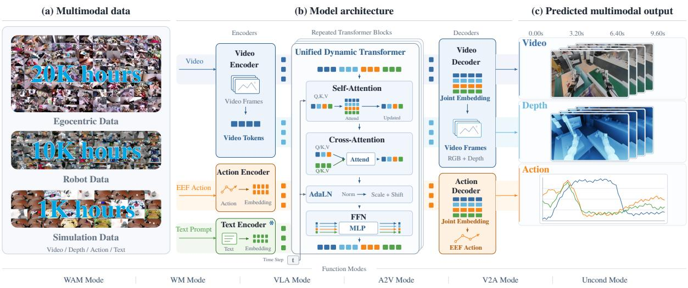  
Figure 1: Thinker-WM overview. Left: the pre-training mixture, which combines egocentric, robot, and simulation data. Middle: every modality is lifted into and decoded back from one unified representation by its own encoder and decoder, while a shared Unified Dynamic Transformer (UDT) models the future world within that representation using a single set of weights. Right: open-loop results on real-world tasks, where video, depth, and action are generated jointly by the same network.

Geometry has also been introduced into world-action modeling, for example through geometric-semantic prediction or lightweight spatial representations supervised by future depth [17, 19, 37]. These approaches demonstrate that combining complementary signals can improve embodied world modeling. Nevertheless, the modalities are often connected through interfaces, conditioning mechanisms, or modality-specific parameterizations rather than being expressed within a common representation that jointly carries future-world dynamics. This raises a fundamental question: where should multimodal unification take place in a general world-action model? We argue that the key is not merely to make multiple modalities available to the same network, but to let them evolve within a shared representation in which their common structure can be learned directly.

We therefore propose Thinker-WM, a unified multimodal world model that jointl models and generates RGB, depth, and action under task-level conditioning. The central design principle is representation-level unification. Each modalit is first transformed b a modalit -s ecific encoder into a shared intermediate representation. A common Transformer stage then models their joint evolution, while modality-specific decoders render the resulting representation back into RGB, depth, or executable action. The main unification therefore occurs inside the Unified Dynamic Transformer rather than only at its input or output interfaces. Within it, visual, geometric, and action tokens interact through common attention mechanism, while task-level representations provide structured guidance for future prediction. The resulting formulation treats appearance, geometry, action, and instruction as diferent manifestations of a coupled world process, while retaining modality-specific interfaces where the underlying physical representations necessarily difer. Figure 1 gives an overview of the data mixture, the architecture, and the open-loop use of the same network.

This representation-level formulation also allows geometry to become an explicit component of the generated world state. Thinker-WM represents depth using the same latent and spatiotemporal organization as visual generation, allowing geometric information to participate throughout the shared generative process. Geometric supervision therefore shapes the shared representation rather than being applied only through an auxiliary prediction branch. This makes physical structure directly available to the model alongside visual appearance and action, providing complementary information about the spatial relationships that govern embodied interaction. The objective is not to treat geometry as a complete solution to physical reasoning, but to make metric structure a native signal within the world model.

A unified representation is valuable only when the training distribution captures the diversity of embodied d namics encountered in the real world. Thinker-WM is trained from a heterogeneous mixture of general video data, publicly available robot datasets, in-house robot data, and egocentric human video. General video rovides broad visual and tem oral riors; robot data rovides action- rounded su ervision across diferent embodiments, environments, and tasks; and egocentric video expands coverage of real-world interactions and human motion [7, 10, 13, 43]. These sources difer substantially in sensor configuration, action representation, embodiment, and annotation format. Thinker-WM therefore maps heterogeneous robot actions into a common representation at the model boundary, allowing shared dynamics to be learned across embodiments while preserving robot-specific decoding. In this way, data diversity and architectural unification reinforce each other: diverse sources broaden the distribution of world dynamics, while the shared representation provides a common space in which those dynamics can be learned.

We evaluate Thinker-WM across embodied world-model benchmarks and a range of generative settings, including action-conditioned future generation, depth generation, long-horizon rollout, trajectory transfer, video-to-action generation, and instruction-conditioned generation. These experiments examine whether a shared multimodal representation can support world prediction, geometric modeling, and action generation within a single model. Thinker-WM ranked first on EWMBench [12], WorldOlympiad [42] and WorldArena [29], while additional experiments demonstrate its ability to support multiple world-model and world-action conditionals within the same parameterization.

The main contributions of this work are:

• Representation-level multimodal unification. We introduce the Unified Dynamic Transformer in which RGB, depth, action, and task-level conditioning are lifted into a shared intermediate representation and transformed by common parameters, placing multimodal interaction inside the representation rather than only at the input or output interfaces.

• Geometry as part of the generative world state. We incorporate depth as a native generative modality that shares the latent and spatiotemporal structure of visual modeling and whose supervision directly shapes the shared representation, making physical geometry an explicit component of the modeled world dynamics.

• Scalable heterogeneous embodied learning. We combine general video, publicly available robot data, in-house robot data, and egocentric human video, together with a common action representation across embodiments, to provide complementary visual, geometric, and action supervision for scalable world-action modeling.

## 2 Related Work

We view world models as generative models that learn how an environment evolves under observations, conditions, and interventions. Their role has gradually expanded from compact predictive simulators to large-scale generative models with broad visual priors, and more recently to models that jointly generate future observations and executable actions. From this perspective, we organize prior work into three stages: simulator-oriented world models, latent and generative world models, and world models that generate actions alongside the future. We further discuss recent eforts to introduce explicit geometric structure into this unified formulation, which provides the closest context for Thinker-WM.

## 2.1 Simulator-oriented World Models

Early world models were developed primarily as learned simulators for model-based planning and reinforcement learning. World Models [8] compress observations into a compact latent space, model temporal dynamics with a recurrent mixture-density network, and enable agents to train policies inside the model’s imagined rollouts. PlaNet and the subsequent Dreamer family [9] further demonstrate that a learned latent dynamics model can support planning and behavior learning without requiring the policy to interact with the real environment at every step. DreamerV3 [9] in particular shows that a common world-modeling recipe can operate across a broad collection of tasks and domains under a largely fixed training configuration.

The central abstraction in this family is a predictive transition model,

$$
z _ { t + 1 } \sim p _ { \theta } ( z _ { t + 1 } \mid z _ { t } , a _ { t } ) ,\tag{1}
$$

where $z _ { t }$ is a learned latent state and $a _ { t }$ specifies an intervention. The model therefore functions primarily as a simulator: given a current state and an action, it predicts a plausible future state on which planning or control can be performed. This formulation is computationally eficient and well suited to model-based decision making, but the learned latent space is usually optimized around the environments and tasks encountered during training. Consequently, the visual prior and open-world knowledge available in large-scale image and video corpora are not directly inherited by the dynamics model.

## 2.2 Latent and Generative World Models

Recent work increasingly treats the world model itself as a large-scale generative model rather than a compact task-specific simulator. This shift replaces manually designed or task-specific latent dynamics with generative models capable of capturing richer visual structure and broader physical priors. GAIA-1 [11], for example, learns an action-conditioned generative model of driving scenes from large-scale fleet data, while Genie [5] learns a controllable latent interface directly from large collections of video without requiring explicit action annotations. UniSim [38] further combines image, robotics, and navigation data to construct a general-purpose simulator whose outputs can represent the visual consequences of both high-level instructions and low-level controls. iVideoGPT [33] integrates action-conditioned video prediction with visual planning and model-based reinforcement learning, while Pandora [35] allows language-conditioned interventions throughout a generated trajectory rather than restricting the condition to the initial frame.

Lar e-scale video eneration models rovide another im ortant foundation for this transition. Rather than learning visual dynamics from scratch, recent systems exploit pretrained video-generation backbones to inherit strong priors over appearance, motion, and scene structure. The Cosmos World Foundation Model [24], for example, positions a pretrained generative world model as a reusable foundation for downstream world-model construction and synthetic data generation. Xiaomi-Robotics-U0 [16] similarly explores broad multimodal generation and embodied scene synthesis, positioning a world foundation model as both a generative world model and a scalable source of downstream training data. These systems demonstrate that large-scale visual pretraining can substantially broaden the knowledge available to a world model beyond the distribution of a single embodied environment.

Despite their generality, however, the action interface of these models is often indirect. Actions may be represented as latent controls, natural language commands, or environment-specific interfaces rather than as executable physical robot actions. In other cases, the generated visual trajectory is treated as a simulator for a separate downstream policy, or the model serves as a data engine whose generated embodied data improves a separately trained policy [16]. Thus, the generative world model provides the predictive component of control while the executable action model remains outside the generative process. This separation motivates the next stage of world-model development: jointly modeling the future world and the action that produces it.

## 2.3 World Models with Action

This stage of the progression extends generative world modeling by incorporating an executable action space into the same generative process as future-world prediction. Instead of the sequential formulation

$$
\hat { x } _ { ( t + 1 : t + H ) } = g _ { \psi } ( x _ { t } , c ) , \qquad a _ { t } = h _ { \phi } \big ( \hat { x } _ { t + 1 : t + H } , x _ { t } \big ) ,\tag{2}
$$

where a video generator is followed by a separate inverse-dynamics model, these approaches seek to model video and action jointly. The resulting formulation allows the model to learn not only what the world may look like after an intervention, but also which physical action is associated with that evolution.

Motus [3] is an early example of this unified formulation. It combines pretrained experts for vision-language understanding, video generation, inverse dynamics, and policy learning within a Mixture- of-Transformers architecture, allowing several world-modeling and control distributions to be represented in one system. To exploit action-free video, Motus additionally introduces latent actions derived from visual motion and uses a multi-stage curriculum to progressively bridge video generation and robot control. This demonstrates that large-scale video priors and action learning can be combined within a single generative framework, while physical embodiment grounding is still largely introduced at the later robot-specific stage.

MotuBrain [21] further develops the unified formulation with a three-stream architecture and a data pyramid spanning web video, egocentric human video, and heterogeneous robot trajectories. In particular, it treats egocentric video as video-only supervision rather than requiring every video to have an explicit robot action label. Its action representation is also expressed relative to the conditioning frame, with relative position and rotation providing a more transferable interface across robot configurations. These choices are closely related to the setting considered in this work, where action-free egocentric video and heterogeneous robot trajectories must coexist during training. However, MotuBrain retains embodiment-specific physical scales rather than explicitly registering the action statistics of diferent robots at a shared model boundary, and its temporal instruction structure is primarily episode-level rather than aligned to individual instruction segments.

A complementary line unifies video and action through difusion noise rather than through separate modality-specific architectures. Difusion Forcing [6] assigns independent noise levels to diferent temporal tokens, enabling a single denoising model to express multiple conditional distributions under diferent temporal masks. UWM [45] applies this principle to robot learning by sharing a transformer between image and action difusion processes, allowing the same model to operate as a policy, a world model, or a joint video-action model depending on the masking configuration. Difusion ReRoll [14] further introduces asymmetric SNR-based reweighting for image and action losses. These methods provide a flexible probabilistic view of world modeling with action, although action and image remain separate difusion channels and their embodiment-specific representations are not the primary focus.

Another direction expands the scope of modality unification. Cosmos 3 [25] jointly models language, image, video, audio, and action using a shared multimodal backbone, with domain-aware input and output projections that carry each embodiment into a shared latent action space. Ego and efector poses are encoded as frame-to-frame relative transforms, while grasp states directly encode the current manipulation state, and large-scale egocentric human video supplies additional pseudo-action supervision.

Recent work has additionally introduced explicit geometric structure into this joint generative process. GeoSem-WAM [19] augments joint world and action learning with geometric and semantic future prediction, showing that structured spatial information can provide action-relevant supervision beyond RGB appearance. WAM4D [17] introduces lightweight spatial register tokens supervised by future depth to inject 4D geometric priors into a video-action model, while removing the geometry branch during action inference for eficiency. These results suggest that metric geometry can provide a useful intermediate representation for connecting visual dynamics and physical interaction. In these approaches, however, geometry is primarily introduced as an auxiliary supervisory signal or intermediate representation rather than as a modality that is jointly generated throughout the same generative process.

DreamZero [39] provides the closest instance of the pretrained-backbone route. It builds a robot foundation model on top of a large image-to-video difusion backbone and jointly denoises visual trajectories and robot actions under a shared objective, showing that preserving a strong visual generation prior improves downstream robot control relative to vision-language-action baselines. Its remaining boundaries are of a diferent kind: the instruction is supplied by a frozen text encoder rather than produced by the generative process, the model is pretrained separately for each embodiment, and its action target stays at relative joint positions rather than a shared end-efector representation. Zero-WAM [44] extends the same direction to in-context human-video supervision, but keeps separate query, key, and value projections, feed-forward networks, and output heads per modality, so that video and action meet only inside the shared attention layers. The two therefore share at diferent depths: one transformer with separated decoders in DreamZero [39], shared attention over separated parameters in Zero-WAM [44].

## 2.4 Position of Thinker-WM

The progression above moves from world models as compact simulators, to large-scale generative models with transferable visual priors, and finally to world models that jointly predict the future world and executable actions. Thinker-WM follows the latter formulation while extending it in three directions. First, it preserves a pretrained flow-matching video-generation backbone and incorporates robot and egocentric data without reducing action-free video to an action-labeled proxy. Second, it treats appearance, metric geometry, and action as co-evolving outputs of a shared intermediate representation rather than using geometry only as an auxiliary training signal. Third, it registers heterogeneous robot actions at the model boundary using a common relative end-efector representation and per-robot statistics, allowing diferent embodiments to share the same generative space while retaining exact robot-specific decoding.

Architecturall , Thinker-WM therefore laces the main unification inside the UDT. Modalit -s ecific encoders and decoders translate video, geometry, action, and language into a common latent interface, where shared attention and feed-forward transformations model their joint evolution. The resulting formulation treats the world model not merely as a simulator for a downstream policy, but as a unified generative model in which visual dynamics, physical structure, and executable action are diferent manifestations of the same underlying world process.

## 3 Model Architecture

## 3.1 Overview: Representation-Level Unified World Model

A world model for embodied intelligence must capture more than the visual appearance of the future. The evolution of an embodied environment is jointly reflected in what the agent observes, the geometric structure of the scene, and the actions that cause the observed changes. Thinker-WM therefore models RGB video, metric depth, and robot action within a single generative framework, rather than treating action generation as a downstream module of visual prediction.

Given an observation $o _ { t }$ and a task-level condition $^ { c , }$ Thinker-WM models the joint distribution of future visual, geometric, and action trajectories as

$$
p \left( v _ { t + 1 : t + H } , d _ { t + 1 : t + H } , a _ { t + 1 : t + H } \vert o _ { t } , c \right) ,\tag{3}
$$

where v, $d ,$ and a denote RGB video, metric depth, and robot action, respectively. The key design principle is representation-level unification: each generative modality is first encoded by a modality-specific encoder into an intermediate dynamic representation. These representations then feed into a Unified Dynamics Transformer (UDT) to participate in the shared dynamic evolution. The outputs are subsequently separated and decoded through modality-specific generation head.

This design satisfied two requirements that are often conflated in multimodal models. On the one hand, RGB, depth, and action have fundamentally diferent input statistics and output semantics and therefore require dedicated interfaces. On the other hand, their future evolution is physically coupled: actions alter the environment, visual observations reveal the consequences, and metric geometry constrains both perception and interaction.

Thinker-WM is initialized from a pretrained Wan2.2 TI2V-5B video generation backbone and extends it with dedicated depth and action pathways. A frozen Qwen3-VL-2B [1] model provides task-level understanding, which is projected into the model as a structured conditioning representation rather than treated as a fourth generative stream. The resulting information flow can be summarized as

$$
\begin{array} { r } { ( o _ { t } , c )  \{ \mathcal { E } _ { v } , \mathcal { E } _ { d } , \mathcal { E } _ { a } , \mathcal { E } _ { 1 } \}  \mathcal { U }  \{ \mathcal { D } _ { v } , \mathcal { D } _ { d } , \mathcal { D } _ { a } \}  ( \hat { v } , \hat { d } , \hat { a } ) , } \end{array}\tag{4}
$$

where $\mathcal { E } _ { v } , \mathcal { E } _ { d } .$ , and ${ \mathcal { E } } _ { a }$ are the modality-specific generative encoders, $\mathcal { E } _ { \mathrm { l } }$ produces the task-level understanding representation, U denotes the unified dynamics transformer, and $\mathcal { D } _ { v } , \mathcal { D } _ { d } .$ and $\mathcal { D } _ { a }$ decode the corresponding future modalities. The following sections describe the latent interfaces, the construction of the unified dynamics transformer, and the generative parameterization in detail.

Table 1: Structure and weight origin of the three-stage architecture and auxiliary branches. Pretrained visual blocks are inherited from Wan2.2 TI2V-5B and remain trainable, while the VAE and VLM are frozen.
<table><tr><td>Component</td><td>Blocks</td><td>Weight origin</td><td>Role</td></tr><tr><td>Visual encoder  $\mathcal { E } _ { v , d }$ </td><td>8 blocks</td><td>Inherited</td><td>Encode RGB and physical-fidelity tokens.</td></tr><tr><td>RGB UDT U</td><td>14 blocks</td><td>Inherited</td><td>Model appearance and interaction.</td></tr><tr><td>Physical-fidelity UDT U</td><td>14 blocks</td><td>Inherited</td><td>Model geometry and interaction.</td></tr><tr><td>Visual decoder  $\mathcal { D } _ { v , d }$ </td><td>8 blocks</td><td>Inherited</td><td>Decode RGB and physical-fidelity outputs.</td></tr><tr><td>Action encoder  ${ \mathcal { E } } _ { a }$ </td><td>8 blocks</td><td>Initialized</td><td>Encode action tokens.</td></tr><tr><td>Action decoder  $\mathcal { D } _ { a }$ </td><td>8 blocks</td><td>Initialized</td><td>Decode executable actions.</td></tr><tr><td>Understanding und</td><td>4MLP blocks</td><td>Initialized + Qwen3-VL</td><td>Provide task and planning guidance.</td></tr></table>

## 3.2 Multimodal Representation

## 3.2.1 Language Representation

Language is represented as a task-level conditioning sequence rather than a fourth generative stream. The structured prompt is processed by a frozen Qwen3-VL-2B [1]. Its final hidden states are truncated to at most 1000 tokens and projected into the model width through a linear bridge followed by four residual MLP blocks, producing the conditioning sequence $h _ { u n d }$

Instructions from heterogeneous datasets are normalized into a structured three-field prompt containing Task, Scene, and Action. The fixed schema separates the task objective from the scene description and the intended operation, reducing variation in prompt format across data sources and providing a consistent semantic structure for the language encoder. Prompt structure is further regularized during training. Redundant occurrences of the field are mer ed, the order of the three fields is randoml shufled, and random field dropout is applied. Evaluation uses a fixed Task–Scene–Action order. These transformations encourage the model to rely on semantic content rather than field position or the presence of a complete schema.

## 3.2.2 Visual Representation

RGB frames and depth maps are both compressed by the frozen Wan2.2 VAE into the same latent topology. At 640 × 480 resolution, a window of 49 frames is mapped to a latent grid of $1 3 \times 3 0 \times 4 0$ , and patchification with kernel (1, 2, 2) produces $1 3 \times 1 5 \times 2 0 = 3 9 0 0$ tokens for each visual stream. Using the same VAE and spatiotemporal organization allows RGB and depth to occupy compatible latent coordinates while retaining distinct modality semantics.

The two visual modalities nevertheless use separate input projections. RGB tokens are mapped directly into the model width, while depth tokens use their own patch embedding followed by a learnable stream embedding that distinguishes geometric information from appearance. After multimodal dynamics modeling, the two streams are mapped back through modality-specific output projections. Thus, RGB and depth share a common latent topology, but their input and output representations remain explicitly separated where their underlying statistics difer. Figure 2 illustrates the resulting visual encoding paths.

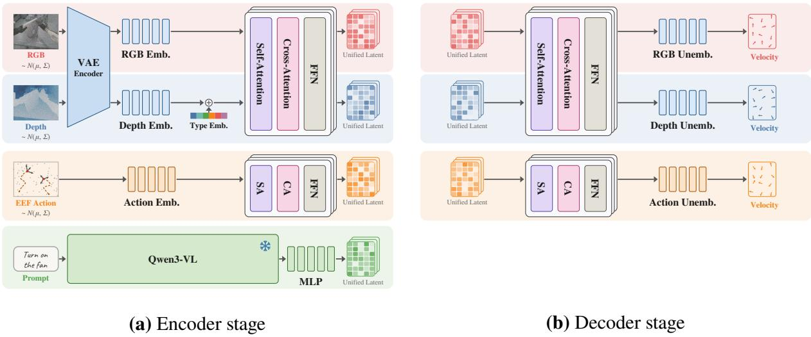  
Figure 2: Multimodal encoding and decoding pipelines. RGB video, metric depth, and action are mapped into the unified latent space through modality-specific encoders and processed back into their respective output spaces through modality-specific decoders. The frozen Qwen3-VL-2B converts the structured prompt into the conditioning sequence $h _ { \mathrm { u n d } }$ , while robot identity is provided through learnable tokens $^ { r } \cdot$ The decoder stage predicts the flow-matching velocity field for each modality rather than directly producing decoded samples.

## 3.2.3 Unified Action Representation

Robot actions are substantially more heterogeneous than visual inputs: diferent embodiments expose diferent action dimensions, coordinate frames, control conventions, and actuator interfaces. A shared generative model therefore requires an action representation that is independent of the raw dimension of any particular robot. Thinker-WM maps every embodiment into a fixed unified action space of $U = 2 0$ dimensions, organized as dual-arm delta end-efector positions, rotations, and gripper states. For robot r with raw action $\boldsymbol { a } \in \mathbb { R } ^ { d _ { r } }$ , we define a semantic slot map

$$
\pi _ { r } : \{ 1 , \ldots , U \} \to \{ 1 , \ldots , d _ { r } \} \cup \{ - 1 \} ,
$$

where $\pi _ { r } ( u )$ specifies which raw action dimension corresponds to unified slot $u ,$ and $\pi _ { r } ( u ) = - 1$ indicates that the robot does not have that degree of freedom. The unified action and its validity mask are then defined as

$$
\tilde { a } _ { u } = \left\{ \begin{array} { l l } { a _ { \pi _ { r } ( u ) } , } & { \pi _ { r } ( u ) \geq 0 , } \\ { 0 , } & { \pi _ { r } ( u ) = - 1 , } \end{array} \right. \quad \quad m _ { u } = \left\{ 1 , \quad \pi _ { r } ( u ) \geq 0 , \right.\tag{5}
$$

Here, $m _ { u }$ indicates whether unified dimension u is valid for robot r. Invalid dimensions are neither noised nor included in the training loss, so the zero-filled entries do not become artificial action targets.

We represent all robot actions using a unified relative end-efector (EEF) representation. For each end efector, the position and orientation at time t are expressed relative to its state at the conditioning frame:

$$
\Delta p _ { t } = p _ { t } - p _ { 0 } , \qquad R _ { t } ^ { \mathrm { r e l } } = R _ { 0 } ^ { \top } R _ { t } .\tag{6}
$$

Here, $\Delta p _ { t }$ denotes the relative EEF displacement and $R _ { t } ^ { \mathrm { r e l } }$ the relative EEF rotation, represented using the continuous 6D rotation parameterization. Anchoring each trajectory to its own conditioning frame removes dependence on the global coordinate frame and makes action representations more comparable across scenes, camera poses, and embodiments.

Action normalization is applied at the model boundary using statistics computed separately for each robot. Gripper and dexterous-hand dimensions are scaled to [−1, 1] while the remaining dimensions retain their physical units. The visual and action streams are temporally aligned with a fixed 6:1 correspondence, with six action steps per video frame. A temporal convolution with kernel and stride 6 compresses the action sequence into 48 tokens of width 3072, while the action decoder expands each token back to $6 \times 2 0$ action values. The resulting action tokens therefore share the temporal horizon of the visual latent sequence while remaining compact enough for joint processing.

Embodiment identity is provided through a small set of learnable robot tokens. For each robot, eight learnable tokens are prepended to the language conditioning sequence to form the cross-attention context of the encoder and decoder:

$$
c = [ r _ { 1 : 8 } \ ; \ h _ { u n d } ] .\tag{7}
$$

Placing robot identity in the conditioning context rather than in the main generative sequence preserves the sequence structure shared across embodiments.

Together, these three representations establish the model boundary: visual streams preserve a shared spatiotemporal latent topology, heterogeneous robot actions are registered into a common 20-dimensional action space, and language is converted into a structured conditioning sequence. These representations are then passed to the Unified Dynamics Transformer, where their interactions and joint temporal evolution are modeled explicitly.

## 3.3 Unified Dynamics Transformer

The Unified Dynamics Transformer (UDT) is the central multimodal dynamics modeling stage of Thinker-WM. The encoded RGB, depth, and action tokens are concatenated into a joint generative sequence, while the language representation provides task-level conditioning through cross-attention. The UDT therefore operates on a common latent sequence while preserving modality-specific representations at its input and output boundaries.

Given the modality-specific latent representations $z _ { v } ^ { 0 } , z _ { d } ^ { 0 }$ , and $z _ { a } ^ { 0 } .$ , the unified dynamics stage is written as

$$
z ^ { \prime } = \mathcal { U } \left( [ z _ { v } ^ { 0 } ; z _ { d } ^ { 0 } ; z _ { a } ^ { 0 } ] , h _ { \mathrm { u n d } } \right) ,\tag{8}
$$

where $[ \cdot ; \cdot ]$ denotes concatenation along the token dimension and $h _ { \mathrm { u n d } }$ is the task-level conditioning sequence. The output $z ^ { \prime }$ is subsequently separated into modality-specific streams for RGB, depth, and action decoding.

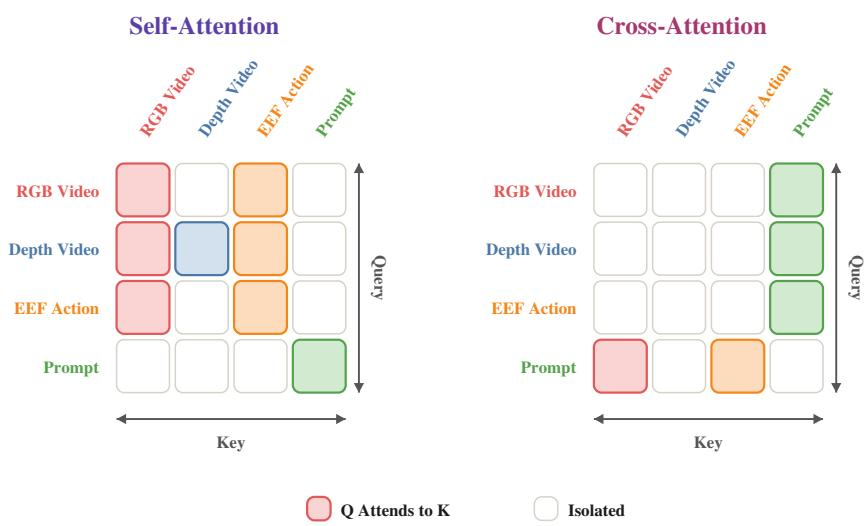  
Figure 3: Attention pattern of the UDT during pretraining. Self-attention provides cross-modal interaction among RGB, depth, and action, while cross-attention provides the dedicated task-conditioning path from the prompt representation. Depth interacts asymmetrically with the other generative streams during pretraining.

The attention structure during pretraining is shown in Figure 3. RGB and action form the main generative interaction path, allowing the two streams to exchange information through self-attention. Depth is asymmetric: it reads from the visual and action streams but does not feed back into them. This one-way coupling allows geometric supervision to shape the shared representation while preventing imperfect depth supervision from directly perturbing the pretrained visual and action pathways. The language tokens are isolated from self-attention and provide task-level conditioning through the dedicated cross-attention path shown in the figure.

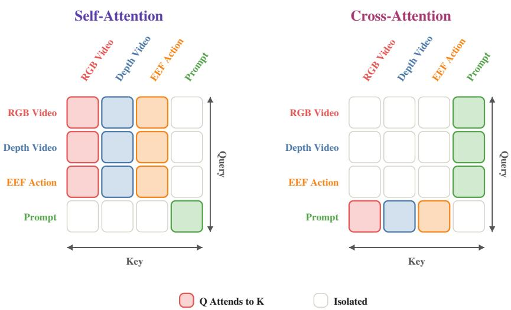  
Figure 4: Attention pattern of the UDT during post-training. Compared with pretraining, the geometric stream is opened to bidirectional interaction with RGB and action, enabling multimodal refinement under reliable depth supervision.

In the post-training stage, RGB and action tokens are also allowed to attend to depth tokens (Figure 4), enabling bidirectional interaction among RGB, depth, and action. This changes the role of geometry from a one-way supervisory signal into a bidirectional source of multimodal refinement, allowing appearance, geometry, and action to jointly adapt during the final training stage. The original language representation $h _ { \mathrm { u n d } } ^ { 0 }$ is first provided to the encoder, and the UDT maintains both the original and the layer-updated language representations. For UDT block k, the cross-attention keys and values are constructed as

$$
{ \cal K } _ { k } = { \cal W } _ { K } [ h _ { \mathrm { u n d } } ^ { 0 } ; h _ { \mathrm { u n d } } ^ { k } ] , \qquad { \cal V } _ { k } = { \cal W } _ { V } [ h _ { \mathrm { u n d } } ^ { 0 } ; h _ { \mathrm { u n d } } ^ { k } ] .\tag{9}
$$

This preserves the original task condition while allowing the language representation to adapt to the evolving multimodal state.

The UDT further uses modality-aware positional and timestep conditioning. RGB tokens use 3D rotary position encoding, language tokens use one-dimensional positional encoding, and action tokens use temporal-only rotary encoding with a frequency scaling matched to the fixed temporal alignment between video and action. A shared timestep embedding provides the adaLN modulation for the generative streams using their respective flow times.

## 3.4 Function-Oriented Training

The shared multi-modal representation makes it possible to use the same parameterization under diferent combinations of observed and generated modalities. In particular, RGB, depth, and action are modeled within the same UDT, while a modality can either be generated from noise, provided as a clean condition, or omitted from the computation. This flexibility allows the same model to realize joint world–action generation, visual world prediction, policy inference, and cross-modal generation without introducing separate networks.

Rather than relying on random modality dropout to implicitly cover these conditionals, Thinker-WM explicitly assigns a training configuration to each function mode, as illustrated in Table 2 and Figure 5.

Table 2: Function-oriented training modes. Each training mode corresponds to one function of the shared model.
<table><tr><td>Mode</td><td>Training Detail</td><td>Role</td></tr><tr><td>WAM</td><td>joint denoising of visual streams and action joint generation</td><td></td></tr><tr><td>WM</td><td>action branch omitted</td><td>visual world model</td></tr><tr><td>VLA</td><td>first video frame kept clean</td><td>policy on the current observation</td></tr><tr><td>A2V</td><td>clean action injected, prompt dropped</td><td>action-conditioned visual generation</td></tr><tr><td>V2A</td><td>clean video injected, prompt dropped</td><td>video-conditioned action generation</td></tr><tr><td>Uncond</td><td>prompt dropped, joint denoising</td><td>unconditional branch for guidance</td></tr></table>

The function modes include joint generation (WAM), visual world modeling (WM), action generation from the current observation (VLA), action-conditioned visual generation (A2V), video-conditioned action generation (V2A), and the unconditional branch required for classifier-free guidance.

Conditional generation is implemented by assigning zero flow time to the conditioning modality. Under the flow-matching path in Eq. (11), setting $\sigma = 0$ yields

$$
\textstyle x _ { \sigma = 0 } = x .\tag{10}
$$

The conditioned modalit is therefore assed throu h its ori inal encoder as a clean observation, while its prediction loss is excluded from the objective. The same construction is used for action-conditioned visual generation, video-conditioned action generation, and VLA, where the first video frame is provided as the clean observation.

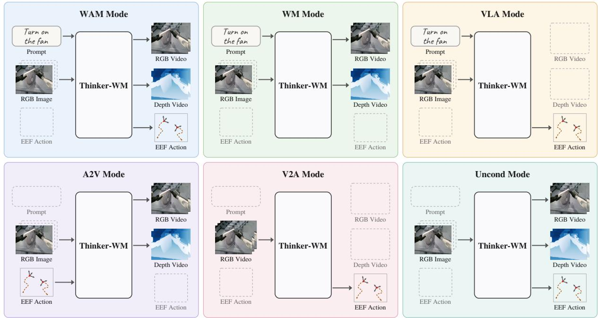  
Figure 5: Function modes of Thinker-WM. Each panel shows the modality configuration of one function, with dashed outlines indicating omitted inputs or outputs.

For each training mode, omitted modalities are excluded from both the forward computation and their associated loss terms. The resulting optimization objective therefore matches the corresponding inference configuration: conditioned modalities are held fixed as observations, generated modalities are supervised against their target distributions, and omitted modalities are absent from the computation graph. This explicit alignment between training and inference allows a single parameterization to support multiple world-model and cross-modal generation settings.

## 3.5 Flow-Matching Parameterization

Thinker-WM a lies a unified velocit -field arameterization to ever enerative modalit . For modalit $m \in \{ v , d , a \}$ , let $x _ { m }$ denote its clean representation, $\epsilon _ { m } \sim \mathcal { N } ( 0 , I )$ , and $\sigma _ { m } \in [ 0 , 1 ]$ . The noisy state and target velocity are

$$
x _ { m , \sigma _ { m } } = ( 1 - \sigma _ { m } ) x _ { m } + \sigma _ { m } \epsilon _ { m } , \qquad u _ { m } ^ { \star } = \epsilon _ { m } - x _ { m } .\tag{11}
$$

The model predicts $\hat { u } _ { m } = v _ { \theta , m } ( x _ { m , \sigma _ { m } } , \sigma _ { m } , c )$ for each generative stream, where c denotes the corresponding multimodal conditioning context.

RGB and depth follow the same flow trajectory and therefore share a common noise schedule, while the action stream uses a separate schedule:

$$
\sigma ( s ) = { \frac { \mathrm { s h } \cdot s } { 1 + ( \mathrm { s h } - 1 ) \cdot s } } , \qquad s \sim \mathrm { U n i f o r m } \{ 1 , \dots , 1 0 0 0 \} ,\tag{12}
$$

with sh = 6.0 for RGB and depth and sh = 1.0 for action. The modality-specific schedules are retained at inference so that the sampling trajectories remain consistent with the corresponding training distributions.

At inference, the learned velocity fields are integrated using 50 steps for RGB and depth and 10 steps for action. Classifier-free guidance is applied only to the visual streams, while the action branch is sampled without guidance to avoid instability in the generated action trajectories.

## 3.6 Training Objective

Given the velocity-field parameterization above, the training loss for each generative modality is the standard flow-matching regression objective:

$$
\begin{array} { r } { \mathcal { L } _ { m } ( \theta ) = \mathbb { E } _ { x _ { m } , \epsilon _ { m } , \sigma _ { m } } \left[ \| v _ { \theta , m } ( x _ { m , \sigma _ { m } } , \sigma _ { m } , c ) - u _ { m } ^ { \star } \| _ { 2 } ^ { 2 } \right] . } \end{array}\tag{13}
$$

For the action stream, the unified action space has $U = 2 0$ dimensions with a validity mask $m _ { u }$ that retains only the degrees of freedom available to the robot. The action loss is

$$
\mathcal { L } _ { a } ( \theta ) = \mathbb { E } \left[ \frac { \sum _ { u = 1 } ^ { U } m _ { u } \left. \hat { u } _ { a , u } - u _ { a , u } ^ { \star } \right. _ { 2 } ^ { 2 } } { \sum _ { u = 1 } ^ { U } m _ { u } + \varepsilon } \right] ,\tag{14}
$$

where $\varepsilon$ is a small numerical stabilizer. Invalid action dimensions are neither noised nor included in the loss; when the loss is computed in the action-token space, the validity mask is expanded to the corresponding token dimensions. The modality-specific noise schedules in Section 3.5 are used when evaluating the corresponding ${ \mathcal { L } } _ { m }$

At training time, the current function mode r partitions the modalities into a generated set $\mathcal { G } ( \boldsymbol { r } )$ , a conditioned set $\mathcal { C } ( \boldsymbol { r } )$ , and an omitted set $\mathcal { O } ( r )$ . The total objective is

$$
\mathcal { L } _ { \mathrm { t o t a l } } ( \theta ) = \sum _ { m \in \mathcal { G } ( r ) } \lambda _ { m } \mathcal { L } _ { m } ( \theta ; r ) ,\tag{15}
$$

where $\lambda _ { m }$ balances the modality scales or efective token counts. For $m \in \mathcal { C } ( r )$ , setting $\sigma _ { m } = 0$ feeds the modality as a clean observation while excluding its prediction loss; for $m \in { \mathcal { O } } ( r )$ , the modality is absent from both the forward computation and the loss. Consequently, the six function modes—WAM, WM, VLA, A2V, V2A, and Uncond—share the same loss form and difer only in which modalities are generated, conditioned, or omitted. The modes are sampled with fixed proportions determined by the global step index, ensuring consistency across data-parallel ranks.

## 4 Data

Our pretraining corpus aggregates approximately 20,000 hours of high-quality egocentric human video and 10,000 hours of robot data, including around 4,000 hours with aligned depth. We organize the corpus into in-house data, internet data, and depth data. Figure 6 summarizes its composition.

  
More episodes sampled from the training mixture  
Egocentric human videos from multiple datasets

# Thinker-WM Pretraining Corpus

Every sample carries aligned Video, Depth, Action, and Language records

## Ego Data

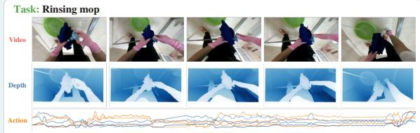  
More episodes sampled from the training mixture

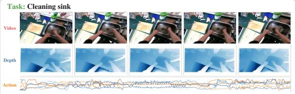

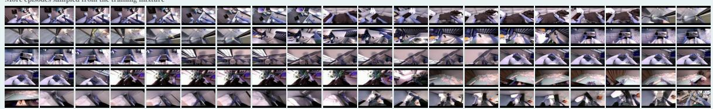

## Real Robot Data

Real-world robot recordings from multiple datasets

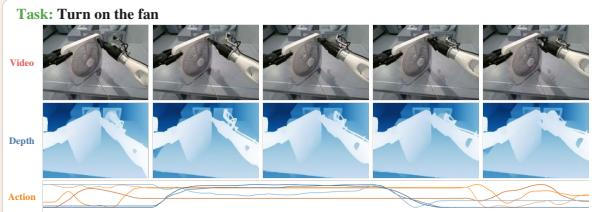  
More episodes sampled from the training mixture

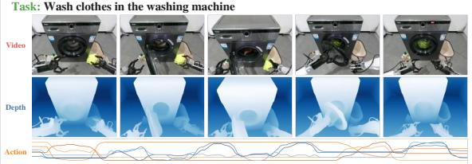

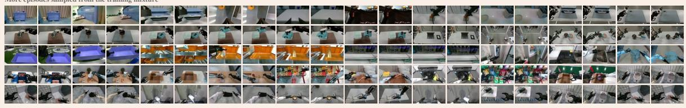

## Simulated Robot Data

Simulated robot interactions from multiple datasets

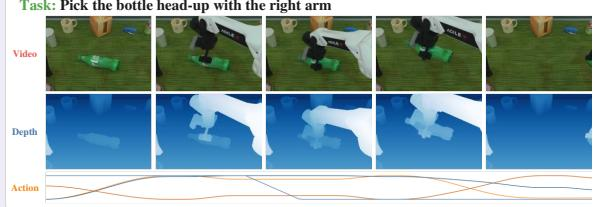

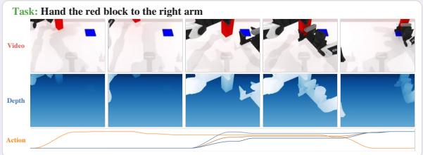

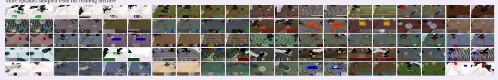  
Figure 6: Training data composition. For each category, two example episodes are shown with five video frames, their aligned depth labels, and the corresponding action curves; task text serves as the language record. The grids show additional episodes sampled from the training mixture. Depth is obtained by stereo matching for egocentric video, predicted by a monocular teacher for real robot video, and rendered exactly in simulation.

## 4.1 In-House Data

In-house data rovide covera e of our tar et embodiments, environments, and task distributions. It includes high-quality egocentric human video collected internally, spanning household, commercial, retail, and industrial scenarios. These egocentric recordings are captured with head-mounted stereo devices at 30Hz, and each frame includes hand keypoints and head pose. We further organize this egocentric corpus into 10 major categories and 20 subcategories, with the data evenly distributed across these categories. This egocentric data supplies scalable task, scene, object, and long-horizon activity diversity that robot teleoperation cannot economically reach. We also integrate high-quality real-robot data collected from UBTech robots, which provides paired visual observations and executable actions for learning practical robot dynamics and embodiment-specific action representations.

## 4.2 Internet Data

Internet data consist of open-source datasets collected from the web. General video data, including OpenVid [23], cover diverse scenes, objects, activities, and visual dynamics, providing broad visual and temporal priors beyond the distribution of embodied datasets. Open-source robot datasets, including AgiBot [31] and RoboMIND [34], cover diverse embodiments, environments, and manipulation tasks, ofering paired visual observations and actions for learning embodied dynamics and cross-embodiment representations. RoboTwin [22] provides simulated manipulation data. Egocentric human video sources, including EgoVerse [27] and Ego4D [7], supply scalable task, scene, object, and long-horizon activity diversity. The sources listed here are representative rather than exhaustive; additional public datasets are also included in the pretraining mixture.

## 4.3 Depth Data

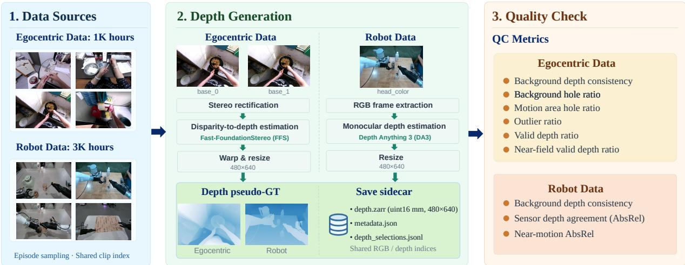  
Figure 7: Depth data pipeline. We generate depth pseudo-labels for egocentric and robot videos, filter low-quality clips, and align the retained depth with RGB frames for world model training.

To complement RGB observations with explicit geometric information, we augment egocentric and robot videos with depth pseudo-labels. We use Fast-FoundationStereo [32] to estimate depth from egocentric stereo pairs and DepthAnything3 [18] to predict depth from monocular robot videos. The resulting depth maps are aligned with the original RGB views and resized to a common resolution. We apply clip-level quality control based on temporal consistency, depth validity, and agreement with available sensor depth, discarding clips with unreliable predictions. During training, we sample synchronized RGB and depth sequences, apply logarithmic depth encoding, and encode both modalities with the same frozen VAE. Depth is then learned as an additional generative stream using flow matching, providing geometric supervision for modeling spatial structure and physical interactions.

## 5 Infrastructure

## 5.1 Overview

World-model training relies on heterogeneous data sources that were not originally collected for joint use. These sources span robot trajectories from diverse embodiments, simulation rollouts, public video, and egocentric human recordings, each with distinct storage formats, modalities, temporal structures, action spaces, and annotation conventions. The Data Factory separates a data layer that maintains factual records from a training layer that specifies sampling and composition policies. This decoupling allows either side to evolve without rebuilding the other. Figure 8 illustrates the producer–consumer architecture.

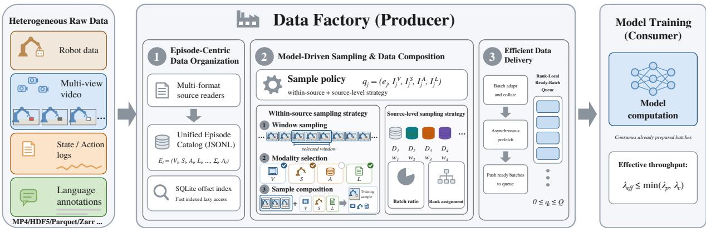  
Figure 8: Overview of the Data Factory producer–consumer pipeline. Heterogeneous multimodal data are organized into episode-centric catalogs $E _ { i } = \left( V _ { i } , S _ { i } , A _ { i } , L _ { i } , \Sigma _ { i } , \Lambda _ { i } \right)$ and accessed lazily through a SQLite ofset index. The model specifies each training sample as $q _ { j } = ( e _ { j } , I _ { j } ^ { V } , I _ { j } ^ { S } , I _ { j } ^ { A } , I _ { j } ^ { L } )$ , including within-source window and modality selection, while source-level sampling controls the mixture of data sources across batches and ranks. The resulting samples are adapted, collated, and asynchronously prefetched into a rank-local ready-batch queue with occupancy $0 \leq q _ { t } \leq Q$ , from which the training process consumes prepared batches. The efective pipeline throughput is bounded by $\lambda _ { \mathrm { e f f } } \le \operatorname* { m i n } ( \lambda _ { p } , \lambda _ { c } )$ , where $\lambda _ { p }$ and $\lambda _ { c }$ denote the producer and consumer rates.

The fundamental unit is the Episode, which carries its own modalities, index spaces, and physical locations:

$$
E _ { i } = \left( V _ { i } , S _ { i } , A _ { i } , L _ { i } , \Sigma _ { i } , \Lambda _ { i } \right) ,\tag{16}
$$

where $V _ { i } , S _ { i } , A _ { i } , L _ { i }$ denote video, state, action, and language modalities, and $\Sigma _ { i } , \Lambda _ { i }$ their schemas and physical locators. Modalities keep independent index spaces, so lengths and correspondences are not forced, and absent modalities are declared rather than imputed. Episodes are published in immutable catalogs that record facts rather than pre-cut windows, enabling lazy materialization through byte-ofset indices. Sampling is expressed by the model: the factory materializes exactly what the model requests without interpreting semantics, so a new source costs a description rather than a pipeline.

## 5.2 Quality Control and Gating

Quality control is implemented as a set of boundaries along the sample path, each with diferent granularity and cost. Ofline gates operate on whole Episodes and windows, rejecting timelines with non-finite values or magnitudes beyond per-source guards, filtering stationary windows, and excluding Episodes shorter than a training window. Egocentric recordings receive an additional filter that removes windows dominated by camera self-motion, keeping only start positions whose rotation and translation stay within calibrated thresholds. Online gates at load time validate action and state ranges before video decoding, retry missing or corrupt videos against a bounded number of alternates, and blacklist persistent failures. Batch-level checks validate shapes, value ranges, finiteness, and the model input contract; a genuinely absent modality is marked rather than filled. At the step level, samples with extreme unified-action magnitudes have their loss weight zeroed, non-finite values are replaced before zeroing, and any step afected by non-finite parameters, loss, or gradients is skipped. The depth stream carries its own gates: a selection file marks usable Episodes, depth frames are checked against video frames for alignment, unreadable depth is marked absent and loses its loss share, and depths are clamped to the codec range.

## 5.3 Data Preparation and Throughput Matching

Reading and encoding a batch dominates preparation cost, while the noise used for training changes every step. We therefore encode each batch once and reuse the latents across N optimization steps, each of which draws fresh noise and timestep and runs a full forward–backward pass:

$$
B _ { t } = B _ { t _ { 0 } } , \qquad t _ { 0 } = \lfloor t / N \rfloor N ,\tag{17}
$$

where $B _ { t }$ is the encoded batch at step t. The N steps are independent denoising objectives because the flow-matching target is rebuilt from fresh noise each step. This divides the encoding cost by N.

To keep the training loop from waiting, a bounded per-rank queue lets a background producer keep complete batches ready ahead of consumption. Because a fresh batch is requested once every N steps, preparation stays hidden as long as

$$
C _ { \mathrm { p r e p } } \ \leq \ N \cdot C _ { \mathrm { s t e p } } ,\tag{18}
$$

where $C _ { \mathrm { p r e p } }$ is host time to prepare a batch and $C _ { \mathrm { s t e p } }$ the time of one model step. When this holds with margin, the queue stays filled and the model never observes preparation latency; otherwise the queue drains and the model waits. Figure 9 illustrates the arrangement.

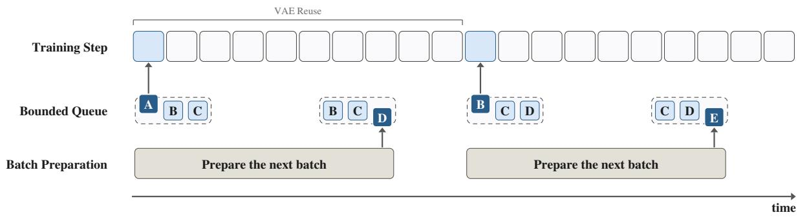  
Figure 9: Throughput matching between data preparation and model computation. Batches are labelled in arrival order; preparation stays ahead of consumption within each VAE reuse window, so the model never waits.

## 5.4 Load Balancing across Ranks

In synchronous training, all ranks must update the same parameters at the same step. If ranks train diferent branch subsets, the reduction operates over diferent tensor sets and can deadlock under ZeRO-1. We therefore make the function mode a pure function of the step number, sampled from configured proportions with a generator seeded only by that step, persisted with the checkpoint, and advanced identically by every rank. This guarantees agreement across ranks and across restarts. The same reasoning requires identical token layouts: windows are cut to fixed lengths so no padding is needed and every rank carries the same number of tokens. Figure 10 illustrates the arrangement.

Source assignment ofers two deterministic schedules. The default assigns the same source to every rank at a given step, keeping batches internally consistent. The alternative distributes rank slots across sources in proportion to their weights, mixing the corpus more finely at the risk of stragglers. Both require no inter-rank communication. Losses are averaged across ranks, and non-finite and outlier signals are reduced so that a condition seen by one rank is acted on by all.

Same Mode on Every Rank  
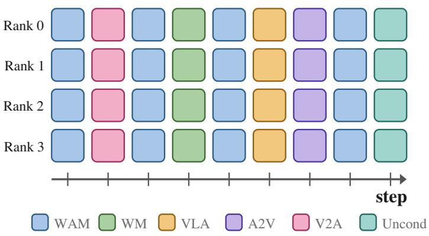  
Figure 10: Load balancing across ranks in a synchronous run. Every row is one rank and every column one optimization step, and the function mode of a step is sampled with a generator seeded only by the step number, so a column carries the same mode on every rank and the same choice is reproduced after a restart. The legend names the six modes, which are sampled in the configured proportions.

## 5.5 Evaluation Orchestration

Evaluation runs every fixed number of steps on a fixed set of samples, with deterministic assignment to ranks derived from the same weights as the training mixture. To avoid competing with training for GPUs, a background process decodes evaluation clips into a shared-storage cache and writes a completion manifest. The foreground evaluation only reads the cache, so prepared evaluations take seconds and never occupy a GPU needed by training. The cache is content-keyed and reused across restarts and runs; an evaluation whose cache is not ready is skipped rather than stalling training. Out-of-memory shards are rerun with smaller micro-batches, keeping the evaluated set complete, and results join the same logging channel as training metrics.

## 6 Training Strategy

Thinker-WM supports multiple control modes and is trained on heterogeneous data sources. Large-scale general video supplies broad visual and temporal priors [5, 8, 35]; real robot recordings provide embodimentspecific visual statistics and the action supervision on which the conditionals of Eq. (3) depend; egocentric human video supplies scalable task, scene, and object diversity that robot teleoperation cannot economically reach [4, 26]. The Data Factory provides the execution substrate, and this section specifies how these sources are combined into a staged curriculum.

## 6.1 Staged Training Curriculum

Training across all data distributions from the outset can destabilize optimization, as heterogeneous objectives compete for the capacity of the shared model and may pull the representation toward dominant training distributions. Fully sequential training, in contrast, risks catastrophic forgetting of capabilities acquired in earlier stages [15, 20]. To balance acquisition and retention, Thinker-WM adopts a staged curriculum with lightweight rehearsal, progressively introducing new data distributions and capabilities while maintaining a small replay stream from earlier stages [2, 28]. The training distribution of stage s is

$$
\mathcal { D } _ { s } = \left( 1 - \epsilon _ { s } \right) \mathcal { D } _ { s } ^ { \mathrm { m a i n } } + \epsilon _ { s } \mathcal { D } _ { s } ^ { \mathrm { r e p l a y } } , \qquad \epsilon _ { s } \ll 1 ,\tag{19}
$$

where $\mathcal { D } _ { s } ^ { \mathrm { m a i n } }$ carries the new capability and $\mathcal { D } _ { s } ^ { \mathrm { r e p l a y } }$ samples all previously aligned distributions. Each stage therefore mixes in a small fraction of the data from the preceding stage, so that capabilities accumulate rather than overwrite. Stages are ordered so that shared representations stabilize before downstream modules couple into them. Table 3 summarizes the data, updated scope, and installed capability of each stage.

Table 3: The four trainin sta es. Each sta e installs one or more capabilities while mixin in a fixed small fraction of the data from the previous stage. Stage 0 is the pretrained Wan2.2 model, used as it stands.
<table><tr><td>Stage</td><td>Main data</td><td>Updated scope</td><td>Capability installed</td></tr><tr><td>0</td><td>internet-scale video</td><td>inherited</td><td>visual and world prior</td></tr><tr><td>1</td><td>robot data egocentric human video data from the previous stage</td><td>video pathway</td><td>robot-view video prediction</td></tr><tr><td>2</td><td>curated robot data curated egocentric human video data from the previous stage</td><td>all parameters</td><td>video-action coupling + geometry</td></tr><tr><td>3</td><td>target-robot data data from the previous stage</td><td>all parameters</td><td>target-robot specialization</td></tr></table>

Stage 0 is the pretrained Wan2.2 TI2V-5B backbone [30], which supplies the broad visual and temporal prior and is not trained here. Stage 1 introduces open-source robot recordings and egocentric human video, training only the video pathway to adapt the inherited prior to first-person embodied observations; a small fraction of Stage 0 data is replayed to preserve scene, lighting, and camera-motion diversity. Stage 2 turns the video-only model into a joint video–action model on curated robot and egocentric data, introducing the action stream and the geometric stream together, with the planning condition providing a shared conditioning signal across branches. Stage 3 specializes the model to the target robot using embodiment-specific recordings and accurate geometric supervision; the earlier stages are replayed so that the shared backbone and previously acquired capabilities are preserved. Overall, the curriculum follows a progression of inheritance, integration, and specialization.

## 6.2 Stage-wise Parameter and Geometry Schedule

We initialize from the Wan2.2 TI2V-5B backbone [30] and reuse its pretrained blocks, patch embeddings, modulation layers, and positional geometry across all three architectural depths (Section 3.2). Stage 0 leaves these weights untouched. Stage 1 updates the visual pathway only, adapting the inherited prior to robot-view and first-person statistics without disturbing branches that have no counterpart in the pretrained model. From Stage 2 onward, all trainable parameters are active: the action tower, the geometric pathway, and the shared UDT are optimized jointly. The frozen components remain fixed throughout, as the VAE and the VLM keep their pretrained weights.

Geometry enters in Stage 2 and is integrated into the shared representation so that the model jointly predicts future observations, geometry, and actions. While the mixture is dominated by data with coarse or partial depth annotation, the geometric channel is one-way: geometry reads appearance and action, but neither reads geometry, so the geometric objective shapes the shared weights only through its own loss gradient. Once training is restricted to datasets with accurate depth, which in this curriculum is the target-robot fine-tuning stage, the remaining direction is opened so that appearance and action also read the geometric stream (Figures 3 and 4).

## 6.3 Function Mode and Noise Scheduling

The function modes of Section 3.4 partition the joint distribution of Eq. (3) across world modeling, policy learning, and cross-modal generation. They are sampled in the fixed ratio

$$
\mathsf { w a m : w m : v l a : a 2 v : v 2 a : u n c o n d } = 0 . 5 : 0 . 1 : 0 . 1 : 0 . 1 : 0 . 1 : 0 . 1 : 0 . 1 : 0 . 1 ,
$$

so that half of the o timization ste s train the full joint distribution while ever function is exercised regularly. Mode assignment is made once per optimization step for the whole batch, seeded by the global step index and identical across all data-parallel ranks, so every rank computes gradients for the same set of branches and the sharded optimizer remains consistent. These proportions belong to the training configuration and can be revised without touching the architecture.

Both streams are trained against the time-shifted noise grids of Eq. (12). The shift concentrates video training at high noise levels, where global scene structure is determined and the 3900-token visual latent requires the most supervision, while the 48-token action sequence is low-dimensional and smooth, so a near-uniform grid covers it without wasting steps. Within the joint modes wam and uncond, the two noise levels share a common base u and receive independent jitter $\delta _ { m }$ before applying their own shift:

$$
\begin{array} { r } { \tilde { \sigma } _ { m } \ = \ \mathrm { c l a m p } \big ( u + \delta _ { m } , 0 , 1 \big ) , \qquad u \sim \mathrm { U n i f o r m } ( 0 , 1 ) , \qquad \delta _ { m } \sim \mathrm { U n i f o r m } ( - r , r ) , \qquad m \in \{ v , a \} . } \end{array}\tag{20}
$$

At inference the two streams are denoised in lockstep along coupled trajectories, so the noise combinations visited during training should match those traversed at inference. The shared base keeps the streams at matched denoising progress, and the jitter half-width $r = 0 . 1 0$ , calibrated to one cell of the 10-step action inference grid, decorrelates their exact levels within that resolution. Single-modality modes retain independent per-modality sampling, since only one stream carries a loss there.

## 7 Motion Probe

Chapters 3 and 6 establish that Thinker-WM jointly models RGB, depth, and action through a shared Unified Dynamics Transformer (UDT). A natural question is whether the shared representation truly captures cross-modal coupling, or merely processes modalities in parallel. We introduce Motion Probe, a lightweight diagnostic module that evaluates whether motion information can be recovered from the shared video representation, thereby providing direct evidence for the efectiveness of the UDT. Motion probe’s efect is evaluated in Section 8.2.4.

## 7.1 Probe Design and Ofline Motion Teacher

The probe rests on a simple logic: if the UDT truly unifies appearance and action, the video tokens should carry suficient motion information to reconstruct end-efector displacement aligned with the executed action, even without action-specific supervision on the video pathway. We test this by attaching a lightweight Motion Head to the frozen UDT video tokens. The head is deliberately small—spatial pooling followed by temporal regression—so that its capacity cannot compensate for missing motion information in the shared representation. The UDT weights are kept frozen throughout the probe, and only the Motion Head is trained.

To evaluate the probe on real-robot data, we require a reliable visual motion reference. However, AgiBot [31] lacks reliable camera extrinsics and depth. We therefore construct an ofline motion teacher, in which SpatialTrackerV2 [36] is applied once to the ground-truth RGB video to produce 3D point trajectories on a dense grid. We discard tracks with negligible image-space motion or that leave the valid image region for a large fraction of the sequence, retain tracks whose motion magnitude correlates with the recorded end-efector motion, and aggregate them by temporal median to obtain a robust visual center trajectory $C _ { t }$ . An Umeyama alignment between $C _ { t }$ and the ground-truth end-efector trajectory yields a per-window Sim(3) transform parameterized by scale s, rotation R, and translation t:

(a) Offline Visual Motion Teacher (Preprocessing, once before training)  
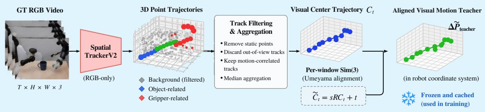

(b) Training with Motion Probe (no change to backbone)  
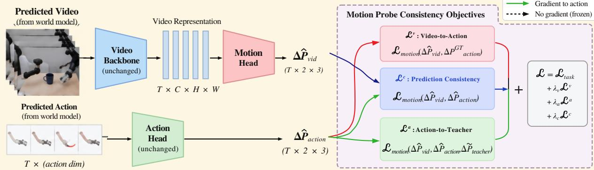  
Figure 11: Overview of Motion Probe. (a) Ofline visual motion teacher construction: SpatialTrackerV2 extracts 3D point trajectories from ground-truth RGB video, motion-aware filtering and median aggregation produce a robust visual center trajectory, and a per-window Sim(3) transform aligns it with the recorded end-efector motion. The aligned teacher is frozen and cached. (b) Probing the frozen UDT: a lightweight Motion Head predicts end-efector displacement from the shared video representation. The UDT weights remain frozen, and only the Motion Head is trained. Low probe error indicates that the shared representation encodes action-relevant motion.

$$
\tilde { C } _ { t } = s R C _ { t } + t .\tag{21}
$$

Since the probe is defined on temporal displacement, the translation cancels after diferencing:

$$
\Delta \tilde { C } _ { t } = \tilde { C } _ { t + 1 } - \tilde { C } _ { t } = s R \left( C _ { t + 1 } - C _ { t } \right) = s R \Delta C _ { t } .\tag{22}
$$

The aligned displacement $\Delta \tilde { C } _ { t }$ is the visual motion teacher. The Sim(3) parameters are estimated once from ground-truth data and frozen; they are never refined on model predictions, so the teacher remains a fixed geometric reference rather than an adaptive target.

Not every window yields reliable supervision. A window is marked usable if path correlation $\geq 0 . 9 5$ motion-magnitude correlation $\geq 0 . 5 5$ , trajectory-shape agreement $\geq 0 . 6 5$ , frame-wise directional cosine $\geq 0 . 5$ , and the estimated scale $s \in [ 0 . 2 , 3 0 ]$ . Windows that fail these criteria are excluded from the probe. This filtering is applied ofline, and the resulting teacher signals are cached.

## 7.2 Probe Objective and Interpretation

The Motion Head maps frozen UDT video tokens to left- and right-hand translational displacements,

$$
\Delta \hat { P } _ { \mathrm { v i d } } \in \mathbb { R } ^ { T \times 2 \times 3 } .\tag{23}
$$

It is trained only on the motion loss between predicted video motion and ground-truth end-efector displacement:

$$
\mathcal { L } _ { \mathrm { p r o b e } } = \mathcal { L } _ { \mathrm { m o t i o n } } \left( \Delta \hat { P } _ { \mathrm { v i d } } , \Delta P _ { \mathrm { a c t i o n } } ^ { \mathrm { G T } } \right) ,\tag{24}
$$

where ${ \mathcal { L } } _ { \mathrm { m o t i o n } }$ combines end-point error and motion-magnitude discrepancy:

$$
\mathcal { L } _ { \mathrm { m o t i o n } } ( x , y ) = \frac { 1 } { | \mathcal { T } | } \sum _ { t \in \mathcal { T } } \Vert x _ { t } - y _ { t } \Vert _ { 2 } + \frac { 1 } { | \mathcal { T } | } \sum _ { t \in \mathcal { T } } \left| \Vert x _ { t } \right| _ { 2 } - \left. y _ { t } \right. _ { 2 } \big | .\tag{25}
$$

The probe is interpreted as a measurement, not as a performance improvement. If the frozen UDT video representation already encodes action-relevant motion, a small head should recover displacement with low error; if recovery fails, the shared representation does not carry suficient motion structure for downstream use. A low probe error therefore provides direct evidence that the UDT has learned a genuinely unified representation in which appearance and action are coupled, rather than merely processed in parallel. The probe introduces no new training stage, no modification to the backbone, and no additional generation branch; its value lies in the representational evidence it provides.

## 8 Experiments

## 8.1 Results on Benchmarks

We report our evaluation results on three well-recognized world-model benchmarks.

## 8.1.1 EWMBench Evaluation

We first evaluate the quality of the generated world itself. EWMBench [12] is a standard benchmark for embodied world models. It scores a generated video along eight dimensions covering visual scene consistency, end-efector motion correctness, and semantic alignment with the instruction, and reports their sum as Overall. Its standard evaluation set contains 21 episodes drawn from 7 manipulation tasks. For every episode, the model produces three candidate videos conditioned on the ground-truth first frame and the oficial instruction, the best candidate is selected by Hausdorf distance, and each dimension is normalized to [0, 1] and averaged over all valid trials, 63 videos in total. Generation uses 48 frames at a resolution of 480 × 640 with 50 denoising steps and a classifier-free guidance scale of 5.0. Since the benchmark computes its metrics at 30 FPS, generated results are upsampled from 5 FPS to 30 FPS so that the comparison follows the protocol on which the benchmark is defined.

Table 4 reports the main results. General video generators reach high visual scores but degrade sharply on the motion dimensions. Veo3 scores 0.8415 on SceneC and 0.8965 on CLIP, yet its HSD and Dyn fall to 0.2130 and 0.1932, showing that visual fidelity alone does not imply a physically consistent world. Embodied world models close part of this gap, and Thinker-WM obtains the highest Overall in the table at 4.66. The advantage is most visible where appearance and action meet: nDTW reaches 0.7102 against 0.6708 for Qwen-RobotWorld and 0.6226 for LVP, and Dyn reaches 0.3630 against 0.3429 and 0.0433. This is consistent with the model design: video, depth, and action are generated in one joint process rather than through an action head attached to a video generator, so the robot trajectory is part of what the generative process is trained to match.

The same benchmark also tracks the four sta es of the trainin curriculum in Section 6. The retrained backbone, used without any training of our own, obtains an Overall of 2.63. Training the video pathway alone on robot first-person data raises it to 3.34, joint video–action training reaches 4.44, and supervised fine-tuning on the recordings of the deployed robot reaches 4.66. The progression is monotone, so both the breadth of the mixture and the specialization to the deployed robot translate into measurable generation quality (Figure 12).

Table 4: Generation quality on EWMBench. Every dimension is normalized to [0, 1], the Overall column is the sum of the eight dimensions, and higher is better. Numbers for the baseline models are taken from Qwen-RobotWorld [40], which re orts them on the same evaluation set. The last block is our model.
<table><tr><td>Type</td><td>Model</td><td>SceneC ↑</td><td>HSD ↑</td><td>Dyn ↑</td><td>nDTW ↑</td><td>Diversity ↑</td><td>BLEU ↑</td><td>CLIP↑</td><td>Logics ↑</td><td>Overall ↑</td></tr><tr><td>General video</td><td>Veo3</td><td>0.8415</td><td>0.2130</td><td>0.1932</td><td>0.1613</td><td>0.0221</td><td>0.2139</td><td>0.8965</td><td>0.9474</td><td>3.49</td></tr><tr><td></td><td>Wan2.6</td><td>0.6712</td><td>0.2034</td><td>0.0900</td><td>0.1715</td><td>0.0502</td><td>0.1616</td><td>0.8743</td><td>1.0000</td><td>3.22</td></tr><tr><td></td><td>Kling26</td><td>0.8211</td><td>0.3272</td><td>0.1822</td><td>0.3423</td><td>0.0173</td><td>0.2591</td><td>0.9014</td><td>1.0000</td><td>3.85</td></tr><tr><td></td><td>LTX-2</td><td>0.7850</td><td>0.2076</td><td>0.1283</td><td>0.2443</td><td>0.0120</td><td>0.1425</td><td>0.8869</td><td>0.5000</td><td>3.01</td></tr><tr><td></td><td>Sora2</td><td>0.8526</td><td>0.2807</td><td>0.3494</td><td>0.2754</td><td>0.0314</td><td>0.2466</td><td>0.9100</td><td>0.9474</td><td>3.89</td></tr><tr><td>Embodied world model</td><td>Cosmos</td><td>0.7963</td><td>0.2500</td><td>0.2052</td><td>0.2533</td><td>0.0803</td><td>0.1230</td><td>0.8458</td><td>0.7333</td><td>3.29</td></tr><tr><td></td><td>GigaWorld</td><td>0.8707</td><td>0.3050</td><td>0.0849</td><td>0.2783</td><td>0.0278</td><td>0.2048</td><td>0.8873</td><td>0.9000</td><td>3.56</td></tr><tr><td></td><td>LVP</td><td>0.8795</td><td>0.4248</td><td>0.0433</td><td>0.6226</td><td>0.0093</td><td>0.2179</td><td>0.8995</td><td>0.9524</td><td>4.05</td></tr><tr><td></td><td>Vidar</td><td>0.7341</td><td>0.1877</td><td>0.1520</td><td>0.1769</td><td>0.0653</td><td>0.1607</td><td>0.8821</td><td>0.9411</td><td>3.30</td></tr><tr><td></td><td>WoW</td><td>0.8866</td><td>0.2494</td><td>0.0529</td><td>0.2566</td><td>0.0266</td><td>0.1932</td><td>0.9001</td><td>0.9524</td><td>3.52</td></tr><tr><td></td><td>Qwen-RobotWorld</td><td>0.9142</td><td>0.5660</td><td>0.3429</td><td>0.6708</td><td>0.0114</td><td>0.2079</td><td>0.8834</td><td>1.0000</td><td>4.60</td></tr><tr><td>Ours</td><td>Thinker-WM</td><td>0.8877</td><td>0.5638</td><td>0.3630</td><td>0.7102</td><td>0.0117</td><td>0.2691</td><td>0.9020</td><td>0.9524</td><td>4.66</td></tr></table>

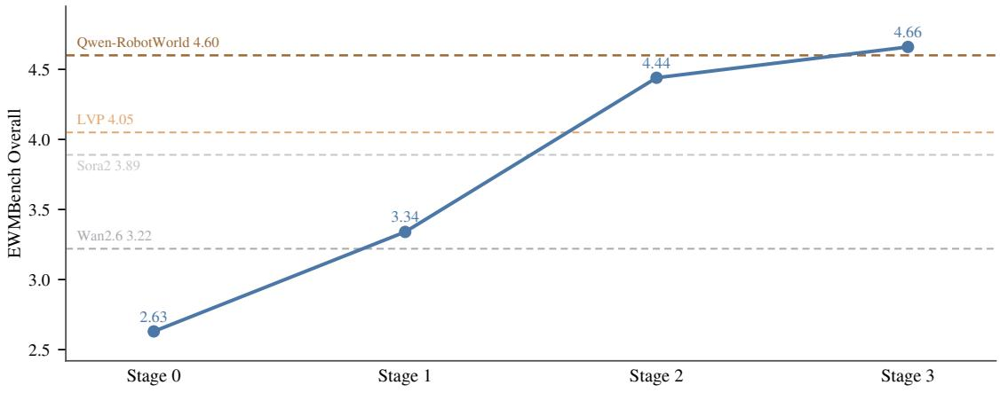  
Figure 12: Overall EWMBench score across the four training stages of Section 6, with the final checkpoint of each stage as a point. The dashed lines are four reference baselines from Table 4, namely Wan2.6, Sora2 as the strongest general video model, LVP, and the strongest overall, Qwen-RobotWorld.

## 8.1.2 WorldOlympiad Evaluation

WorldOlympiad [42] complements EWMBench by evaluating video world models on a broader real-robot distribution. We use its Robotics subdomain leaderboard, which contains 400 manipulation episodes from more than ten physical robot embodiments and spans multiple camera configurations, including head-mounted, wrist-mounted, and external viewpoints. The benchmark reports physical faithfulness, 3D consistency, CLIP-based semantic similarity, and interaction fidelity, providing a stronger test of cross-embodiment and cross-view generalization than EWMBench. Both benchmarks are built on real-robot interaction videos, so together they assess whether the learned visual dynamics remain consistent across heterogeneous real-world robotic settings.

Following the oficial WorldOlympiad protocol, the overall score, denoted as All in Table 5, is computed as the equal-weight average of the three core evaluation tracks:

$$
S _ { \mathrm { A l l } } = \frac { 1 } { 3 } \left( S _ { \mathrm { p h y s } } + S _ { \mathrm { 3 D } } + S _ { \mathrm { i n t e r a c t } } \right) ,\tag{26}
$$

where $S _ { \mathrm { p h y s } } , S _ { \mathrm { 3 D } }$ , and $S _ { \mathrm { { i n t e r a c t } } }$ denote physical faithfulness, 3D consistency, and interaction fidelity, respectively. The reported CLIP score is not averaged as an additional independent term in $S _ { \mathrm { A l l } } ;$ rather, it serves as an auxiliary semantic signal within the interaction metric.

Table 5: WorldOlympiad Evaluation Results on the Robotics Subdomain Leaderboard.
<table><tr><td>Model</td><td>Physical</td><td>3D Cons.</td><td>CLIP</td><td>Interact.</td><td>All</td></tr><tr><td>Uranus</td><td>0.925</td><td>0.511</td><td>0.304</td><td>0.730</td><td>0.722</td></tr><tr><td>Cosmos-Predict-2.5</td><td>0.937</td><td>0.479</td><td>0.321</td><td>0.721</td><td>0.712</td></tr><tr><td>LingBot-World</td><td>0.949</td><td>0.393</td><td>0.314</td><td>0.710</td><td>0.684</td></tr><tr><td>Rolling Forcing</td><td>0.870</td><td>0.389</td><td>0.329</td><td>0.566</td><td>0.608</td></tr><tr><td>LongLive</td><td>0.857</td><td>0.472</td><td>0.327</td><td>0.470</td><td>0.600</td></tr><tr><td>Yume-1.5</td><td>0.851</td><td>0.288</td><td>0.312</td><td>0.624</td><td>0.588</td></tr><tr><td>WoW</td><td>0.787</td><td>0.272</td><td>0.288</td><td>0.447</td><td>0.502</td></tr><tr><td>Ours</td><td>0.923</td><td>0.531</td><td>0.306</td><td>0.765</td><td>0.740</td></tr></table>

As shown in Table 5, our proposed Thinker-WM achieves the highest overall score of 0.740, together with the best 3D Consistency (0.531) and Interaction score (0.765) among the compared methods. These results indicate a favorable balance between geometric consistency and interaction fidelity, supporting the model’s ability to produce plausible and coherent future dynamics in real-world robotic scenarios. Figure 13 presents the oficial screenshot of the WorldOlympiad robotics leaderboard, corroborating our top-ranking performance on this benchmark.

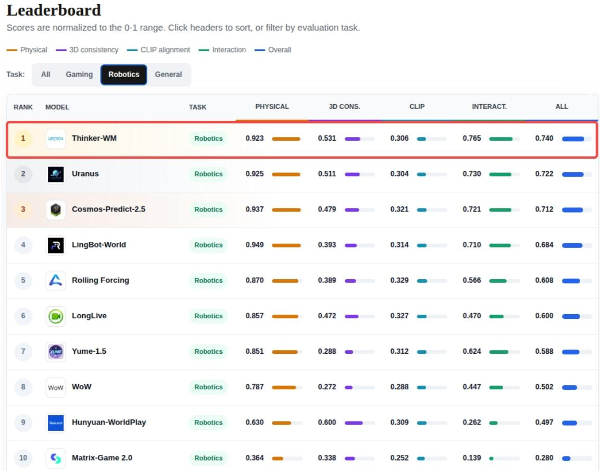  
Figure 13: Oficial screenshot of the WorldOlympiad robotics leaderboard, where our proposed model ranks first.

## 8.1.3 WorldArena Track-1 Evaluation

We further evaluate on WorldArena [29] Track-1, a simulation-based benchmark for open-loop embodied video generation. Unlike EWMBench and WorldOlympiad, which are built on real-robot manipulation videos, WorldArena provides controlled simulated environments with diverse task configurations and interaction dynamics. The track assesses visual appearance, temporal consistency, physical plausibility, 3D geometric fidelity, and compliance with task instructions and action conditions. Because Dynamic Degree, Flow Score, and Motion Smoothness are highly sensitive to frame rate and temporal sampling density, we exclude these three motion-related metrics and adopt the unweighted mean of the remaining twelve metrics as the core comparison metric, following the oficial benchmark recommendation as these three motion metrics sufer from frame-sampling exploitation bugs. The retained metrics cover visual quality, content consistency, physics adherence, 3D accuracy, and controllability: Image Quality, Aesthetic Quality, JEPA Similarity, Subject Consistency, Background Consistency, Photometric Consistency, Interaction Quality, Trajectory, Accuracy, Depth Accuracy, Perspectivity, Instruction Following, and Semantic Alignment.

Table 6: WorldArena dimension-level scores under the 12-metric protocol.
<table><tr><td></td><td>Metric</td><td>Ours</td><td>DexWorldEngine</td><td>BWM-Fast</td><td>UNIS</td><td>MotuBrain</td><td>Wan2.6</td><td>Cosmos-Predict2.5</td></tr><tr><td rowspan="3">Visual Quality</td><td>Image Quality</td><td>37.26</td><td>51.44</td><td>51.22</td><td>53.94</td><td>54.05</td><td>67.36</td><td>49.48</td></tr><tr><td>Aesthetic Quality</td><td>37.65</td><td>40.96</td><td>40.15</td><td>40.79</td><td>41.02</td><td>44.40</td><td>34.14</td></tr><tr><td>JEPA Similarity</td><td>93.94</td><td>86.71</td><td>97.87</td><td>90.60</td><td>96.88</td><td>72.57</td><td>90.65</td></tr><tr><td rowspan="3">Content Consistency</td><td>Subject Consistency</td><td>82.58</td><td>81.46</td><td>81.42</td><td>79.05</td><td>83.51</td><td>73.15</td><td>67.24</td></tr><tr><td>Background Consistency</td><td>90.19</td><td>88.85</td><td>90.17</td><td>86.44</td><td>89.91</td><td>84.29</td><td>72.72</td></tr><tr><td>Photometric Consistency</td><td>46.33</td><td>4.42</td><td>3.08</td><td>2.13</td><td>5.10</td><td>34.57</td><td>45.21</td></tr><tr><td rowspan="2">Physics Adherence</td><td>Interaction Quality</td><td>70.20</td><td>81.04</td><td>79.88</td><td>87.30</td><td>73.90</td><td>73.16</td><td>90.35</td></tr><tr><td>Trajectory Accuracy</td><td>50.71</td><td>51.41</td><td>44.89</td><td>41.89</td><td>43.10</td><td>12.18</td><td>27.49</td></tr><tr><td rowspan="2">3D Accuracy</td><td>Depth Accuracy</td><td>92.49</td><td>86.19</td><td>86.41</td><td>85.25</td><td>88.65</td><td>75.43</td><td>60.54</td></tr><tr><td>Perspectivity</td><td>90.08</td><td>97.58</td><td>97.14</td><td>98.84</td><td>94.32</td><td>93.94</td><td>84.68</td></tr><tr><td rowspan="2">Controllability</td><td>Instruction Following</td><td>78.86</td><td>92.62</td><td>90.22</td><td>93.86</td><td>82.60</td><td>93.94</td><td>90.35</td></tr><tr><td>Semantic Alignment</td><td>90.47</td><td>89.45</td><td>89.15</td><td>89.35</td><td>89.09</td><td>88.09</td><td>89.86</td></tr><tr><td colspan="2">12-Metric EWMScore ↑</td><td>71.73</td><td>71.01</td><td>70.97</td><td>70.79</td><td>70.18</td><td>67.43</td><td>64.40</td></tr></table>

Table 6 reports the 12-metric evaluation. Our model achieves the highest overall score of 71.73, with particularly strong performance in Background Consistency, Photometric Consistency, Depth Accuracy, and Semantic Alignment. Together with the real-world evaluations on EWMBench and WorldOlympiad, the WorldArena results provide complementary evidence that the video prediction component of Thinker-WM maintains strong visual and structural prediction capability across both real and simulated embodied environments.

## 8.2 Ablation and Analysis

We conduct a set of controlled experiments to examine the functional behavior of Thinker-WM and the role of its shared multimodal representation. The experiments address four complementary questions. First, does the model actually consume an action sequence when it is provided as a condition? Second, does depth contribute to downstream control beyond improving geometric prediction, and does the direction of RGB–depth interaction matter? Third, can the six function modes share the same UDT parameters without introducing substantial optimization conflict? Finally, can additional motion-level supervision improve action prediction without degrading the existing video representation?

## 8.2.1 Action Conditioning Controls Future Generation

A central capability of a world–action model is to let a specified action trajectory determine the predicted future rather than merely coexisting with an independently generated video. We therefore compare the standard joint-generation mode with an action-conditioned mode in which the ground-truth action sequence is provided as a clean condition and the language prompt is removed. Both settings use the same network parameters, so the comparison isolates the efect of conditioning the video generation process on an explicit action trajectory.

Table 7: Generation with the ground-truth action sequence as a condition, compared with joint generation on the same model. Numbers are averaged over the evaluated checkpoints, and the dimensions that compare motion against the ground truth are shown separately.
<table><tr><td>Dimension</td><td>Joint</td><td>Action-conditioned</td><td>∆</td></tr><tr><td>Overall</td><td>4.66</td><td>5.03</td><td>+0.37</td></tr><tr><td>HSD</td><td>0.5638</td><td>0.7369</td><td>+0.1731</td></tr><tr><td>nDTW</td><td>0.7102</td><td>0.8736</td><td>+0.1634</td></tr><tr><td>Dyn</td><td>0.3630</td><td>0.3636</td><td>+0.0006</td></tr></table>

Table 7 reports the results averaged over the evaluated checkpoints. Supplying the ground-truth action increases the Overall score from 4.66 to 5.03, with the largest improvements appearing in the motion-sensitive metrics. HSD increases from 0.5638 to 0.7369, nDTW from 0.7102 to 0.8736, and Dyn from 0.3630 to 0.3636. In particular, HSD and nDTW directly measure the agreement between the generated motion and the recorded trajectory, making their improvement a direct indication that the predicted future changes in response to the provided action sequence.

The result shows that the action stream is used as a generative condition rather than treated as an auxiliary output that can be ignored by the video pathway. The same weights can therefore represent both autonomous future generation and action-steered future prediction, with the supplied trajectory providing an explicit control signal for the generated world. Qualitative trajectory-transfer results in Section 8.3.2 provide a complementary visualization of this behavior.

## 8.2.2 Depth as a Co-Evolving Generative State

We evaluate depth from two complementary perspectives: the accuracy of generated geometry and the benefit of RGB–depth interaction for closed-loop control.

Depth generation accuracy. We compare Thinker-WM with RynnWorld-4D [41] on 48 AgiBot validation sequences. RynnWorld-4D also includes AgiBot in its training corpus. We evaluate generated depth using absolute relative error (AbsRel) and root mean squared error (RMSE). As shown in Table 8, Thinker-WM achieves an AbsRel of 0.1360 and an RMSE of 0.1790 m, compared with 0.1625 and 0.2075 m for RynnWorld-4D. These correspond to relative error reductions of 16.3% and 13.7%, respectively.

As a valid-range sensitivity check, restricting RynnWorld-4D’s evaluation range from 0.05–5.0 m to the 0.15–4.0 m range used by Thinker-WM changes its AbsRel only from 0.162517 to 0.162474. Thus, the observed AbsRel improvement is not explained by this diference in valid depth range.

Table 8: Generated depth accuracy on 48 AgiBot validation sequences. RMSE is measured in meters. Lower is better for both metrics.
<table><tr><td>Method</td><td>AbsRel↓</td><td>RMSE (m) ↓</td></tr><tr><td>RynnWorld-4D</td><td>0.1625</td><td>0.2075</td></tr><tr><td>Thinker-WM</td><td>0.1360</td><td>0.1790</td></tr></table>

Impact on closed-loop control. Accurate depth generation alone does not establish its utility for action prediction. We therefore conduct a controlled ablation on the RoboTwin turn\_switch task. All three configurations are trained for 8K steps under the same training recipe, using 24 video frames and a 48-step action horizon. At inference, video and action are each sampled with 10 denoising steps. We evaluate the 6K, 7K, and 8K checkpoints with 20 closed-loop trials per checkpoint. The RGB-only baseline removes the de th stream. RGB + Depth (One-way) adds de th eneration but restricts RGB–de th interaction to one direction. Our full Thinker-WM enables bidirectional RGB–depth interaction within the shared generative backbone, allowing appearance and geometry to co-evolve before decoding. This comparison tests whether bidirectional interaction provides benefits beyond introducing a depth stream with restricted coupling.

Table 9: Closed-loop success on the RoboTwin turn\_switch task. Interaction denotes RGB–depth information flow. Each checkpoint is evaluated over 20 trials; overall success aggregates the three checkpoints.
<table><tr><td>Configuration</td><td>Interaction</td><td>6K</td><td>7K</td><td>8K</td><td>Overall</td></tr><tr><td>RGB-only</td><td>None</td><td>12/20</td><td>12/20</td><td>12/20</td><td>60.0%</td></tr><tr><td>RGB + Depth</td><td>One-way</td><td>12/20</td><td>12/20</td><td>14/20</td><td>63.3%</td></tr><tr><td>Thinker-WM</td><td>Bidirectional</td><td>15/20</td><td>15/20</td><td>15/20</td><td>75.0%</td></tr></table>

As shown in Table 9, adding depth with one-way interaction increases overall success from 60.0% to 63.3%. Bidirectional interaction achieves 75.0%, improving over the RGB-only and one-way variants by 15.0 and 11.7 percentage points, respectively. The full model also outperforms both variants at every evaluated checkpoint. These results suggest that the benefit of depth depends not only on its prediction objective, but also on how its latent representation interacts with RGB during joint generation.

Together, these experiments demonstrate improved depth generation accuracy on the evaluated AgiBot subset and a closed-loop control benefit from bidirectional geometric interaction on RoboTwin. They support treating depth as a co-evolving generative state within the representation used for action generation.

## 8.2.3 Gradient Compatibility across Function Modes

The function modes of Thinker-WM are optimized with a shared set of UDT parameters. This design raises a basic optimization question: do the diferent modes provide compatible training signals, or do some objectives interfere with one another? We investigate this question directly through the geometry of the loss gradients on the shared UDT.

For each function mode, we evaluate its loss on the same training batches and with the same noise realization, while forcing the modes to run independently on the shared weights. We compute pairwise cosine similarity between the resulting gradients with respect to the shared UDT parameters, together with the corresponding gradient norms. The measurement is repeated at five checkpoints spanning the joint-training stage, so that the observed geometry can be separated from checkpoint-specific variation.

Figure 14 summarizes the results. First, the shared UDT shows no measurable pairwise gradient conflict: the minimum cosine similarity across the six modes is approximately −0.005, within the variation observed for pairs whose true alignment is near zero. Most mode pairs are therefore either aligned or approximately orthogonal rather than negatively aligned. Second, the degree of alignment follows the functional relationship between the modes. The joint WAM mode shows its strongest alignment with the inverse-dynamics, unconditional, and policy modes, with cosine similarities of 0.19, 0.17, and 0.14, respectively. In contrast, mode pairs with less overlap in their supervised outputs remain close to zero, including 0.000 between the WM and VLA modes and −0.001 between the A2V and V2A modes. This structure is consistent with the functional overlap among the diferent training objectives.

The auxiliary modes also produce substantial optimization signals on the shared UDT. Their mean gradient norms range from 0.34 to 0.50, compared with 0.68 for the joint WAM mode. Thus, the nearorthogonal pairs do not result from vanishing gradients; the corresponding objectives actively update the shared representation. The same pattern is more pronounced on the action branch, where the gradient alignment with the inverse-dynamics, unconditional, and policy modes reaches 0.36, 0.35, and 0.28, respectively. This localization is consistent with the fact that these objectives directly supervise the action pathway.

The action-conditioned mode provides a complementary case. Its gradient alignment is close to orthogonal on both the shared UDT and the action branch, with cosine similarities of 0.037 and 0.006, respectively. Attention measurements on the same checkpoints show a strongly asymmetric interaction between video and action tokens: video tokens allocate approximately 0.5% of their attention mass to action tokens, whereas action tokens allocate substantially more to video tokens. This asymmetric coupling is consistent with the relatively weak gradient interaction of the action-conditioned objective with the shared optimization direction.

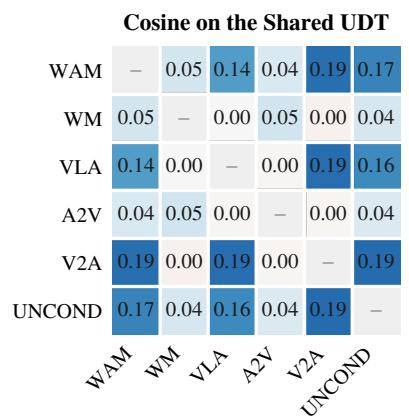

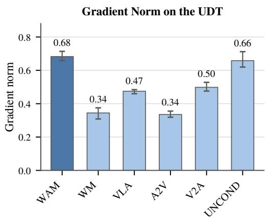  
Figure 14: Gradient geometry of the six training modes. Every mode is forced on its own pass over the same batches with a shared noise realization, and the pairwise cosine of the loss gradients with respect to the shared parameters is averaged over five checkpoints spanning the joint training stage. Left, the cosine matrix on the shared UDT, with the diagonal omitted. Right, the gradient norm per mode on the shared UDT, where the bar is the mean over the five checkpoints and the whisker covers their range. No pair is negative, and every auxiliary mode carries gradients of comparable magnitude in a direction that adds to the joint one.

We further verify the gradient measurements at the objective level. Under identical batches and noise realizations, the video loss of the joint WAM mode is 0.230, compared with 0.232 for the video-only WM mode, indicating that jointly modeling action does not introduce a measurable degradation in the video objective. Conversely, providing a ground-truth action sequence as a clean condition reduces the video loss by 0.016 relative to the video-only mode, while the inverse-dynamics mode reduces the action loss by 0.010 relative to the policy mode. These changes follow the intended role of the conditional modes and provide an objective-level counterpart to the measured gradient geometry.

Overall, the six modes exhibit non-conflicting and non-trivial optimization signals on the shared UDT, while their alignment structure reflects the functional relationships among the corresponding objectives. These measurements support the compatibility of the multifunction training scheme with a shared multimodal representation. They do not, however, establish whether the particular mode sampling ratio is optimal under a fixed optimization budget, since the six modes divide the available training steps; isolating that efect would require matched training runs with diferent step allocations.

## 8.2.4 Motion Probe Evaluation

Motion probing evaluates whether action-relevant motion information is recoverable from the shared video representation. This analysis complements the gradient-compatibility analysis in Section 8.2.3: while the latter examines whether auxiliary training objectives interfere during optimization, the motion probe assesses the action-related information available in the learned representation.

We evaluate the probe on a held-out set of 96 AgiBot windows. For each UDT checkpoint, we freeze the video representation and train the same probing-head architecture under a consistent training protocol. The probe predicts executed end-efector displacement from the frozen video representation alone, and its accuracy is measured by action mean squared error (MSE). By keeping the representation frozen and the probing protocol fixed, this evaluation measures how readily action-relevant motion information can be extracted from the learned features, rather than how well the representation adapts to the probe objective.

As shown in Figure 15, action MSE decreases monotonically across the evaluated training checkpoints.

This trend indicates that end-efector displacement becomes increasingly recoverable from the frozen UDT video representation as training progresses. The result provides evidence that the shared representation progressively develops features that are informative about robot motion.

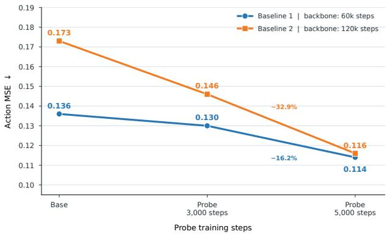  
Figure 15: Action MSE of a motion probe evaluated on frozen UDT video representations from diferent training checkpoints. Lower is better. Both plotted series exhibit a monotonic decrease in MSE, indicating that action-relevant motion information becomes increasingly recoverable from the learned representation.

The reliability of the ofline visual motion teacher is important for interpreting these results, since the probe relies on teacher-generated motion pseudo-labels rather than manual annotations for its primary supervision. We therefore evaluate the teacher on an in-house test split for which ground-truth end-efector motion is available. Table 10 reports the agreement between teacher-estimated and ground-truth motion, along with the retention rates associated with the reliability filters used to construct the pseudo-labeled dataset.

Table 10: Reliability of the ofline visual motion teacher on the in-house test split. The upper block reports agreement between teacher-estimated and ground-truth end-efector motion. The lower block summarizes the pseudo-label filtering statistics. All retention and rejection percentages are computed relative to the full set of candidate windows.
<table><tr><td>Metric</td><td>Result</td></tr><tr><td>Teacher Quality</td><td></td></tr><tr><td>Frame-wise directional cosine similarity Cumulative displacement cosine similarity</td><td>0.65 0.83</td></tr><tr><td>End-point error (m) Trajectory-shape score</td><td>0.041</td></tr><tr><td>Path correlation</td><td>0.86 0.99</td></tr><tr><td>Motion-magnitude correlation</td><td>0.71</td></tr><tr><td>Filtering Statistics</td><td></td></tr><tr><td>Retention rate (keep)</td><td></td></tr><tr><td>Retention rate (HQ)</td><td>70%</td></tr><tr><td>Rejection rate</td><td>50% 30%</td></tr></table>

The teacher achieves stronger agreement on global trajectory characteristics than on frame-wise motion. Cumulative displacement cosine similarity reaches 0.83, while the trajectory-shape score and path correlation are 0.86 and 0.99, respectively. The end-point error is 0.041 m. In comparison, frame-wise directional cosine similarity is 0.65, and motion-magnitude correlation is 0.71, suggesting that local direction and displacement magnitude remain imperfectly estimated. These results indicate that the teacher captures important aspects of the overall motion trajectory, while leaving room for errors at finer temporal and magnitude scales.

The keep criterion retains 70% of candidate windows, while the stricter high-quality (HQ) criterion retains 50%; the remaining 30% are rejected by the keep filter. These statistics characterize the coverage of the filtering procedure and the proportion of windows retained for pseudo-labeling.

Taken to ether, the motion- robe results show that action-relevant motion information is recoverable from the frozen UDT video representation and becomes increasingly accessible as training progresses. Because the robe de ends on an im erfect visual teacher, these findin s should be inter reted as evidence of action-relevant information recoverability under the probe protocol, rather than as proof of exact motion reconstruction across all candidate windows.

## 8.3 Qualitative Capabilities and Generalization

We next examine qualitative behaviors that are not fully captured by the quantitative benchmarks above: long-horizon generation, bidirectional interaction between trajectory and video, and zero-shot execution of unseen instructions in unseen scenes. Rather than providing quantitative comparisons, these experiments serve as controlled probes of whether the capabilities suggested by the shared representation manifest at inference time.

## 8.3.1 Training-Free Long-Horizon Generation

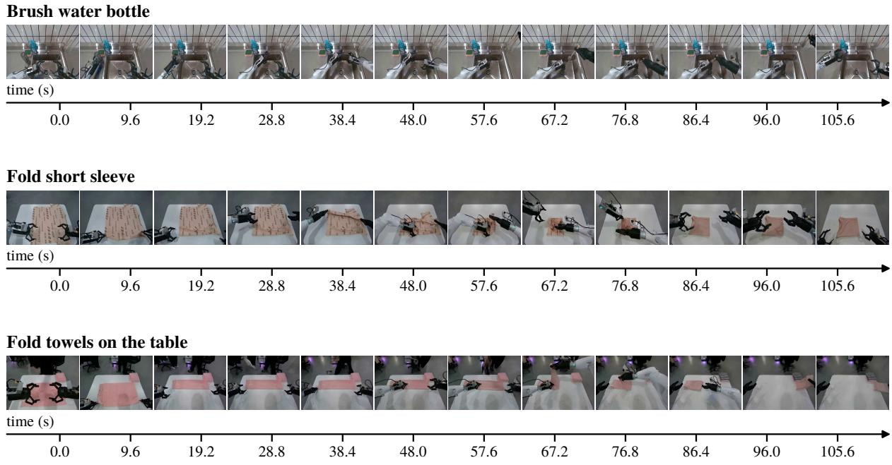  
Figure 16: Lon -horizon eneration on three recorded e isodes. Each block sam les the frames of the model’s rollout of one episode. Only the first frame of a rollout is a ground-truth observation; every later conditioning frame is produced by the model, so the 115.2 seconds shown are generated without any test-time supervision.

The model is never trained for long rollouts. Every training window is an independent clip of 48 frames, no stage feeds a prediction back as a condition, and no autoregressive fine-tuning is performed. Long videos are obtained at inference by using the last frame of one segment as the first frame of the next, and by switching the instruction at segment boundaries so that each segment is conditioned on the annotation covering its own time window.

We evaluate this procedure in two regimes. The first chains ten 48-frame segments from eight EWMBench first frames with their oficial instructions, yielding 96 seconds of video from a single conditioning frame. The second chains twelve segments from sixteen long real-robot episodes, about 115 seconds of video, with the instruction changing at every segment and each segment covering one annotated sub-task. In both cases, the first frame is the only ground-truth frame the model ever sees; every later conditioning frame is its own output.

Table 11: Accuracy of the action sequence recovered from a recorded window by the inverse mode, measured against the recorded trajectory.
<table><tr><td>Space</td><td>RMSE</td></tr><tr><td>Native reader space, 14 dimensions</td><td>0.0540</td></tr><tr><td>Unified action space, 20 dimensions</td><td>0.0293</td></tr></table>

Figure 16 shows three rollouts. The generation covers several sub-tasks of a full manipulation episode, and the object layout and robot configuration are preserved rather than drifting toward a generic scene. The model therefore holds the scene it started from for the full rollout without test-time supervision.

This stability is consistent with the conditioning design. The structured instruction enters every layer through cross-attention, so each segment remains anchored to the same task instead of recovering it from a drifting visual context. Segment length and frame rate also match training, so continuing from a generated frame introduces no temporal shift, and each new segment is conditioned on a clean frame rather than a noisy latent.

## 8.3.2 Trajectory Transfer and Action Recovery

Section 8.2.1 shows that the model consumes an action sequence when one is available. The two cases below illustrate this behavior on recorded trajectories rather than synthetic actions.

In the first case, generation is conditioned on a real recorded trajectory. The source is a bimanual episode dominated by left-arm motion, with the window chosen for maximal end-efector path length. The model receives the first frame of an evaluation sample together with that recorded trajectory, so the scene and the trajectory come from diferent recordings. This tests whether the model follows the supplied trajectory rather than reproducing the motion originally performed in that scene.

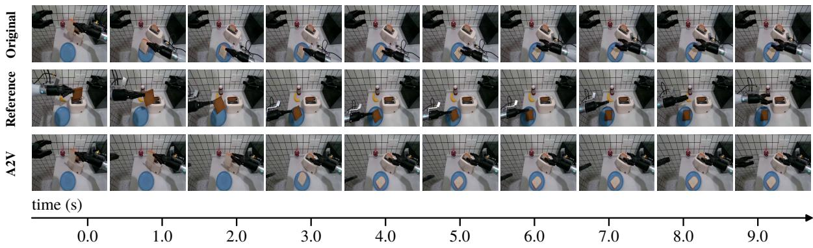  
Figure 17: Trajectory transfer. Top to bottom: the original execution of the scene, the recorded window whose end-efector trajectory is supplied as the condition, and the video generated from that trajectory. Frames are sampled at the times marked below.

Figure 17 compares the generated video against both the original execution and the recording whose trajectory was supplied. Figure 18 plots the supplied trajectory, confirming that the generated motion follows the requested path rather than a plausible alternative for the same task.

The second case closes the loop. The inverse mode of the same model recovers actions from the recording by treating the video window as a clean condition and denoising the action stream. The recovered sequence is then used to regenerate the video. As Table 11 reports, the recovered action matches the recording with RMSE of 0.0540 in native reader space and 0.0293 in unified action space, with the largest residuals at gripper open/close transitions.

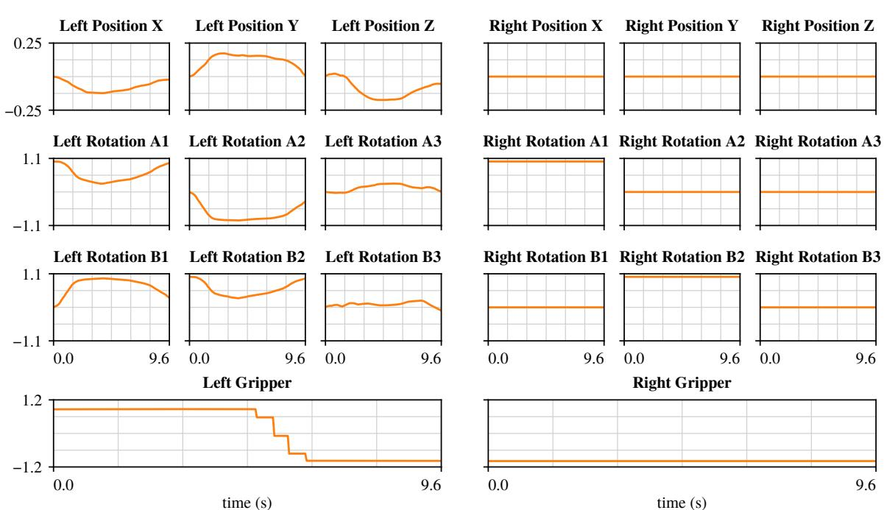  
Figure 18: The end-efector trajectory supplied as the condition, in the unified action space. The position panels are drawn at ±0.25 and the gripper panels at ±1.2 so that the motion is visible; the rotation panels keep the range of the training monitor, ±1.1.

Together, the two cases show the same interface operating in both directions: a recorded trajectory can drive future generation, and a recorded future can be turned back into the trajectory that produced it. The model is therefore not restricted to describing motion that it also invents.

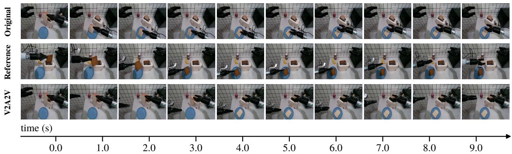  
Figure 19: Closed loop over a recorded window. Top to bottom: the original execution of the scene, the recorded window from which the action is recovered, and the video generated from the recovered action. The layout follows Figure 17.

## 8.3.3 Zero-Shot Generalization

The cases above are drawn from the data distribution. We now remove all such support: the conditioning frame is a hand-held photograph of a desk the model has never seen, the instruction is written by hand rather than taken from an annotation, and no recorded video of the scene exists, so no ground-truth continuation is available.

The two cases share the same conditioning frame and difer only in the instruction. In the first, the left gripper must grasp a spoon handle inside a cup and lift it out while the right arm stays still. In the second,

Condition

1 1.0  
T 2.0  
5.0  
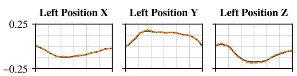

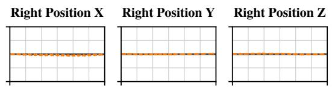

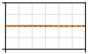

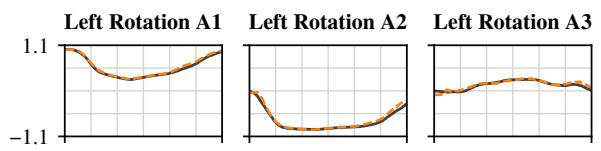

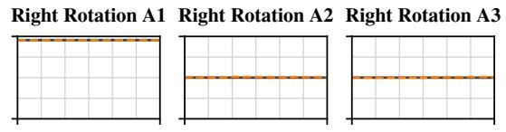

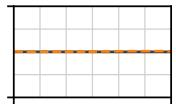

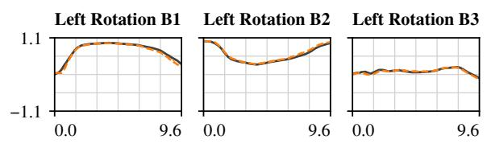

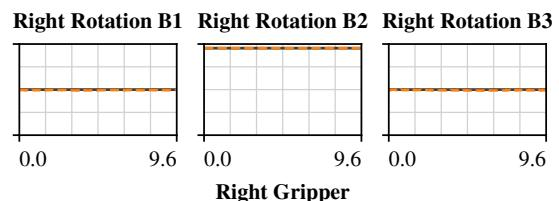

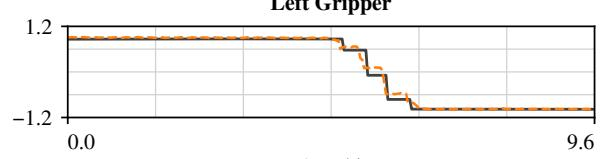  
time (s)

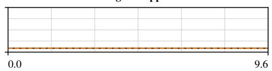  
time (s)  
Figure 20: The action recovered from the recording by the inverse mode (V2A, dashed) against the recorded trajectory (Reference, solid) over the same window, in the unified action space.

the right gripper must enter the same cup and stir its contents. The generated frames carry out the requested motion in both cases (Figures 21 and Figure 22), with the uncommanded arm remaining in place. Since the conditioning frame is identical, the diference between the two results must come from the instruction.

8.0  
9.0  
time (s)  
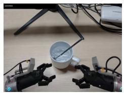  
Task: The robot grasps the spoon inside the white cup with the left gripper.

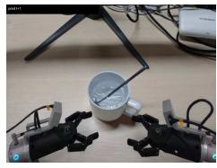

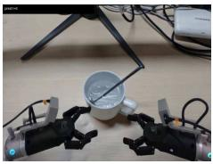

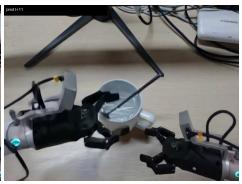

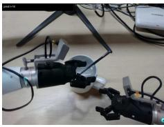

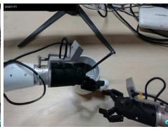  
T 3.0  
T 4.0

0.0  
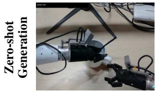

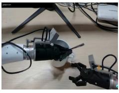

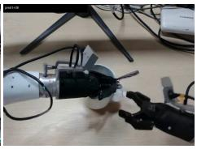

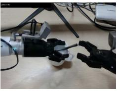

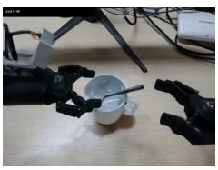  
Figure 21: Zero-shot generation from a hand-held frame that is outside the training distribution. The prompt card repeats the instruction that was supplied, of which the model only sees the Task field.

Task: The robot grasps the spoon in the white cup and stirs the contents of the cup with it.

  
Figure 22: Zero-shot generation from the same conditioning frame as Figure 21, under the instruction given in the prompt card.

These cases isolate the two conditioning components the model was trained to respect. The scene is unseen, so no memorized visual prior applies, and the instruction is new, so behavior must be composed from the structured prompt rather than retrieved. The requested motion under both conditions indicates that the conditioning pathway generalizes beyond the annotated corpora.

## 8.3.4 Zero-Shot Manipulation across Diverse Scenes

Our model is trained exclusivel on demonstrations collected under the clean configuration of RoboTwin, with a fixed camera configuration and no viewpoint variation in the training data. The baseline uses this original head-camera configuration, with a downward viewing angle of approximately 52◦ relative to the horizontal plane. At evaluation time, we directly deploy the trained model in scenes with randomized backgrounds and distractor objects, using either the baseline view or a steeper 65◦ view absent from training, without additional fine-tuning. Here, zero-shot refers to transfer to scene and camera configurations not encountered during training, rather than to unseen task categories.

Figure 23 presents successful executions of two tasks: pressing an alarm clock and grasping a roller with both arms, each specified using a new instruction phrasing. The two baseline rollouts share the same initial scene and object arrangement, allowing us to demonstrate diferent task executions conditioned on the instruction while holding the visual input fixed. The model selects and manipulates the instructed target despite the presence of other objects. Both tasks are also successfully executed under the 65◦ camera view in another scene with a diferent background. These examples demonstrate qualitative transfer from clean, fixed-view training data to more visually varied evaluation scenes, including a camera configuration absent from training. Because the background and camera configuration change together in the displayed examples, the figure illustrates joint scene and viewpoint generalization rather than an isolated viewpoint efect.

Beyond these qualitative examples, we further evaluate our model on all 50 tasks of RoboTwin 2.0 under the standard Clean and Randomized settings. Following the benchmark’s closed-loop evaluation protocol, we report the average task success rate across all tasks. Our model achieves 92.6% and 91.4% success rates on Clean and Randomized, respectively, with only a 1.2 percentage-point drop, demonstrating strong

Press the Alarm Clock

“Tap the center top button of the alarm-clock with beige screen.”

  
Grasp the Roller  
“Reach and grab the light brown cylindrical roller with both arms.”

  
Figure 23: Zero-shot manipulation across diverse scenes. Trained only on RoboTwin clean demonstrations without viewpoint variation, the model follows new instructions to press an alarm clock (top) and grasp a roller (bottom) under diferent backgrounds and a 65◦ camera view, without fine-tuning. Each row shows nine keyframes combining head and wrist camera views.

Table 12: Manipulation success rates (%) on RoboTwin 2.0 across 50 tasks.
<table><tr><td>Method</td><td>Clean ↑</td><td>Randomized ↑</td><td>Drop ↓</td></tr><tr><td>Thinker-WM (Ours)</td><td>92.6</td><td>91.4</td><td>1.2</td></tr></table>

robustness to visual variations.

## 9 Conclusion and Future Work

This work resented Thinker-WM, a unified multimodal world model that jointl models RGB, de th, and robot action within a shared intermediate representation. Modality-specific encoders and decoders preserve the distinct structure of each modality, while a shared Unified Dynamics Transformer (UDT) models their joint evolution with a single set of weights. This design supports multiple world-action functions under one parameterization, including joint video-action generation, world modeling, policy inference, action-conditioned generation, video-to-action generation, and inverse dynamics. Trained on approximately 20K hours of egocentric video, 10K hours of robot data, and 1K hours of simulation data, about 4K hours with aligned depth, Thinker-WM uses a staged curriculum with replay to stabilize shared re resentations and s ecialize to the de lo ed robot. Across benchmarks, it achieves the best Overall score on EWMBench (4.66), ranks first on WorldOlympiad Robotics with an All score of 0.740, and obtains the highest 12-metric EWMScore of 71.73 on WorldArena Track-1. Supplying a recorded action sequence as a clean condition improves Overall from 4.66 to 5.03, with HSD increasing from 0.5638 to 0.7369 and nDTW from 0.7102 to 0.8736. Additional experiments show that bidirectional RGB-depth interaction raises closed-loo success on RoboTwin from 60.0% to 75.0%, and that the frozen video re resentation contains recoverable action-relevant motion information. These results support representation-level unification as a viable foundation for embodied world-action modeling, while also highlighting the need for further validation in real-world closed-loop settings.

Several directions remain open. First, although Thinker-WM achieves promising closed-loop control in simulation (e.g., RoboTwin), its efectiveness as a closed-loop policy on real robots remains to be established. Conducting real-world closed-loop manipulation experiments, evaluating robustness to real- world perturbations, and investigating sim-to-real transfer of the shared action interface are critical next steps. Second, geometric supervision covers only a subset of the training mixture; extending depth-aware learning to larger collections of egocentric and general video could further strengthen physical representation learning. Third, long-horizon generation is currently performed through inference-time autoregressive rollout; training directly on model-generated trajectories and quantitatively evaluating long-horizon drift remain open. Finally, scaling the model and training mixture, understanding how the geometric channel, data composition, and training curriculum should evolve with scale, and optimizing the sampling ratios of the six function modes under a fixed optimization budget are additional directions for future study.

## Contributors

CORE AUTHOR

Chen Liao, Jiyuan Wang, Xiongwei Zhao

AUTHOR

Peng Gao, Yiming Ma, Daqin Luo, Xiangming Xu

PROJECT LEAD

Baiyu Pan

ADVISOR

Jichao Jiao, Hailin Shi

## Acknowledgments

We would like to express our sincere gratitude to the Cloud Platform Team and the IT Team for their generous support, especially to Wei Sun, Junhui Huang, Yang Peng, Dong Liang, Wencai Deng for their valuable contributions.

## References

[1] Shuai Bai, Yuxuan Cai, Ruizhe Chen, Keqin Chen, Xionghui Chen, Zesen Cheng, Lianghao Deng, Wei Ding, Chang Gao, Chunjiang Ge, Wenbin Ge, Zhifang Guo, Qidong Huang, Jie Huang, Fei Huang, Binyuan Hui, Shutong Jiang, Zhaohai Li, Mingsheng Li, Mei Li, Kaixin Li, Zicheng Lin, Junyang Lin, Xuejing Liu, Jiawei Liu, Chenglong Liu, Yang Liu, Dayiheng Liu, Shixuan Liu, Dunjie Lu, Ruilin Luo, Chenxu Lv, Rui Men, Lingchen Meng, Xuancheng Ren, Xingzhang Ren, Sibo Song, Yuchong Sun, Jun Tang, Jianhong Tu, Jianqiang Wan, Peng Wang, Pengfei Wang, Qiuyue Wang, Yuxuan Wang, Tianbao Xie, Yiheng Xu, Haiyang Xu, Jin Xu, Zhibo Yang, Mingkun Yang, Jianxin Yang, An Yang, Bowen Yu, Fei Zhang, Hang Zhang, Xi Zhang, Bo Zheng, Humen Zhong, Jingren Zhou, Fan Zhou, Jing Zhou, Yuanzhi Zhu, and Ke Zhu. Qwen3-vl technical report, 2025. URL https://arxiv.org/abs/2511.21631.

[2] Yoshua Bengio, Jérôme Louradour, Ronan Collobert, and Jason Weston. Curriculum learning. In Proceedings of the 26th Annual International Conference on Machine Learning, pages 41–48, 2009.

[3] Hongzhe Bi, Hengkai Tan, Shenghao Xie, Zeyuan Wang, Shuhe Huang, Haitian Liu, Ruowen Zhao, Yao Feng, Chendong Xiang, Yinze Rong, et al. Motus: A unified latent action world model. arXiv preprint arXiv:2512.13030, 2025.

[4] Anthony Brohan, Noah Brown, Justice Carbajal, Yevgen Chebotar, Joseph Dabis, Chelsea Finn, Keerthana Gopalakrishnan, Karol Hausman, Alex Herzog, Jasmine Hsu, et al. Rt-1: Robotics transformer for real-world control at scale. In Robotics: Science and Systems (RSS), 2023.

[5] Jake Bruce, Michael Dennis, Ashley Edwards, Jack Parker-Holder, Yuge Shi, Edward Hughes, Matthew Lai, Aditi Mavalankar, Richie Stei erwald, Chris A s, et al. Genie: Generative interactive environments. In International Conference on Machine Learning (ICML), 2024.

[6] Boyuan Chen, Diego Marti Monso, Yilun Du, Max Simchowitz, Russ Tedrake, and Vincent Sitzmann. Difusion forcing: Next-token prediction meets full-sequence difusion. In Advances in Neural Information Processing Systems (NeurIPS), 2024.

[7] Kristen Grauman, Andrew Westbury, Eugene Byrne, Zachary Chavis, Antonino Furnari, Rohit Girdhar, Jackson Hamburger, Hao Jiang, Miao Liu, Xingyu Liu, et al. Ego4d: Around the world in 3,000 hours of egocentric video. In IEEE/CVF Conference on Computer Vision and Pattern Recognition (CVPR), 2022.

[8] David Ha and Jürgen Schmidhuber. World models. arXiv preprint arXiv:1803.10122, 2018.

[9] Danijar Hafner, Jurgis Pasukonis, Jimmy Ba, and Timothy Lillicrap. Mastering diverse domains through world models. arXiv preprint arXiv:2301.04104, 2023.

[10] Ryan Hoque, Peide Huang, David J. Yoon, Mouli Sivapurapu, and Jian Zhang. Egodex: Learning dexterous manipulation from large-scale egocentric video. In International Conference on Learning Representations (ICLR), 2026.

[11] Anthony Hu, Lloyd Russell, Hudson Yeo, Zak Murez, George Fedoseev, Alex Kendall, Jamie Shotton, and Gianluca Corrado. Gaia-1: A generative world model for autonomous driving. arXiv preprint arXiv:2309.17080, 2023.

[12] Yue Hu, Siyuan Huang, Yue Liao, Shengcong Chen, Pengfei Zhou, Liliang Chen, Maoqing Yao, and Guanghui Ren. EWMBench: Evaluating scene, motion, and semantic quality in embodied world models. arXiv preprint arXiv:2505.09694, 2025.

[13] Simar Kareer, Dhruv Patel, Ryan Punamiya, Pranay Mathur, Shuo Cheng, Chen Wang, Judy Hofman, and Danfei Xu. Egomimic: Scaling imitation learning via egocentric video. arXiv preprint arXiv:2410.24221, 2024.

[14] Seonsoo Kim, Seongil Hong, and Jun-Gill Kang. Difusion reroll: Revisable denoising for robotic sequential prediction. arXiv preprint arXiv:2607.19919, 2026.

[15] James Kirkpatrick, Razvan Pascanu, Neil Rabinowitz, Joel Veness, Guillaume Desjardins, Andrei A. Rusu, Kieran Milan, John Quan, Tiago Ramalho, Agnieszka Grabska-Barwinska, et al. Overcoming catastrophic forgetting in neural networks. Proceedings of the National Academy of Sciences, 114 (13):3521–3526, 2017.

[16] Xinghang Li, Jun Guo, Qiwei Li, Long Qian, Hang Lai, Yueze Wang, Hongyu Yan, Jiahang Cao, Xi Chen, Jingen Qu, et al. Xiaomi-robotics-u0: Unified embodied synthesis with world foundation model. arXiv preprint arXiv:2607.11643, 2026. Code: https://github.com/XiaomiRobotics/Xiaomi- Robotics-U0.

[17] Ying Li, Xiaobao Wei, Jiajun Cao, Hao Wang, Xiaowei Chi, Chengyu Bai, Qianpu Sun, Jiajun Li, Xiaojie Zhang, Peidong Jia, et al. Wam4d: Fast 4d world action model via spatial register tokens. arXiv preprint arXiv:2606.14048, 2026.

[18] Haotong Lin, Sili Chen, Junhao Liew, Donny Y Chen, Zhenyu Li, Guang Shi, Jiashi Feng, and Bingyi Kang. Depth anything 3: Recovering the visual space from any views. arXiv preprint arXiv:2511.10647, 2025.

[19] Fulong Ma, Daojie Peng, Wenjun Yue, Jiahang Cao, Bintao Wang, Qiang Zhang, and Jun Ma. Geosem-wam: Geometry-and semantic-aware world action models. arXiv preprint arXiv:2606.03188, 2026.

[20] Michael McCloskey and Neal J. Cohen. Catastrophic interference in connectionist networks: The sequential learning problem. Psychology of Learning and Motivation, 24:109–165, 1989.

[21] Motubrain Team. Motubrain: An advanced world action model for robot control. arXiv preprint arXiv:2604.27792, 2026. https://github.com/shengshu-ai/Motubrain.

[22] Yao Mu, Tianxing Chen, Shijia Peng, Zanxin Chen, Zeyu Gao, Yude Zou, Lunkai Lin, Zhiqiang Xie, and Ping Luo. Robotwin: Dual-arm robot benchmark with generative digital twins. arXiv preprint arXiv:2409.02920, 2024.

[23] Kepan Nan, Rui Xie, Penghao Zhou, Tiehan Fan, Zhenheng Yang, Zhijie Chen, Xiang Li, Jian Yang, and Ying Tai. Openvid-1m: A large-scale high-quality dataset for text-to-video generation. arXiv preprint arXiv:2407.02371, 2024.

[24] NVIDIA. Cosmos world foundation model platform for physical ai. arXiv preprint arXiv:2501.03575, 2025.

[25] NVIDIA. Cosmos 3: Omnimodal world models for physical ai. arXiv preprint arXiv:2606.02800, 2026.

[26] Abhishek Padalkar, Acorn Pooley, Ajinkya Jain, Alex Bewley, Alex Herzog, Alex Irpan, Anant Khazatsky, Anant Rai, Anikait Singh, Anthony Brohan, et al. Open x-embodiment: Robotic learning datasets and rt-x models. In IEEE International Conference on Robotics and Automation (ICRA), 2024.

[27] Ryan Punamiya, Simar Kareer, Zeyi Liu, Josh Citron, Ri-Zhao Qiu, Xiongyi Cai, Alexey Gavryushin, Jiaqi Chen, Davide Liconti, Lawrence Y. Zhu, Patcharapong Aphiwetsa, Baoyu Li, Aniketh Cheluva, Pranav Kuppili, Yangcen Liu, Dhruv Patel, Aidan Gao, Hye-Young Chung, Ryan Co, Renee Zbizika, Jef Liu, Xiaomeng Xu, Haoyu Xiong, Geng Chen, Sebastiano Oliani, Wenkai Xuan, Chenyu Yang, Xi Wang, James Fort, Richard Newcombe, Josh Gao, Jason Chong, Garrett Matsuda, Aseem Doriwala, Marc Pollefeys, Robert Katzschmann, Xiaolong Wang, Shuran Song, Judy Hofman, and Danfei Xu. Egoverse: An egocentric human dataset for robot learning from around the world, 2026. URL https://arxiv.org/abs/2604.07607.

[28] Anthony Robins. Catastrophic forgetting, rehearsal and pseudorehearsal. Connection Science, 7(2): 123–146, 1995.

[29] Yu Shang, Zhuohang Li, Yiding Ma, Weikang Su, Xin Jin, Ziyou Wang, Lei Jin, Xin Zhang, Yinzhou Tang, and Haisheng Su. Worldarena: A unified benchmark for evaluating perception and functional utility of embodied world models. arXiv preprint arXiv:2602.08971, 2026.

[30] Wan Team. Wan: Open and advanced large-scale video generative models. arXiv preprint arXiv:2503.20314, 2025. https://github.com/Wan-Video/Wan2.1.

[31] Team AgiBot-World. Agibot world colosseo: A large-scale manipulation platform for scalable and intelligent embodied systems. arXiv preprint arXiv:2503.06669, 2025.

[32] Bowen Wen, Shaurya Dewan, and Stan Birchfield. Fast-foundationstereo: Real-time zero-shot stereo matching. In Proceedings of the IEEE/CVF conference on computer vision and pattern recognition, pages 7513–7524, 2026.

[33] Jialong Wu, Shaofeng Yin, Ningya Feng, Xu He, Dong Li, Jianye Hao, and Mingsheng Long. ivideogpt: Interactive videogpts are scalable world models. arXiv preprint arXiv:2405.15223, 2024.

[34] Kun Wu, Chengkai Hou, Jiaming Liu, Zhengping Che, Xiaozhu Ju, Zhuqin Yang, Meng Li, Yinuo Zhao, Zhiyuan Xu, Guang Yang, et al. Robomind: Benchmark on multi-embodiment intelligence normative data for robot manipulation. In Robotics: Science and Systems (RSS) 2025. Robotics: Science and Systems Foundation, 2025. URL https://www.roboticsproceedings.org/rss21/p152.pdf.

[35] Jiannan Xiang, Guangyi Liu, Yi Gu, Qiyue Gao, Yuting Ning, Yuheng Zha, Zeyu Feng, Tianhua Tao, Shibo Hao, Yemin Shi, Zhengzhong Liu, Eric P. Xing, and Zhiting Hu. Pandora: Towards general world model with natural language actions and video states. arXiv preprint arXiv:2406.09455, 2024.

[36] Yuxi Xiao, Jianyuan Wang, Nan Xue, Nikita Karaev, Yuri Makarov, Bingyi Kang, Xing Zhu, Hujun Bao, Yujun Shen, and Xiaowei Zhou. Spatialtrackerv2: 3d point tracking made easy. In Proceedings of the IEEE/CVF International Conference on Computer Vision, 2025. URL https: //arxiv.org/abs/2507.12462.

[37] Linqi Yang, Xiongwei Zhao, Qihao Sun, Ke Wang, Ao Chen, and Peng Kang. Splatpose: Geometry- aware 6-dof pose estimation from single rgb image via 3d gaussian splatting. In 2025 IEEE/RSJ International Conference on Intelligent Robots and Systems (IROS), pages 9059–9066, 2025.

[38] Sherry Yang, Yilun Du, Seyed Kamyar Seyed Ghasemipour, Jonathan Tompson, Leslie Kaelbling, Dale Schuurmans, and Pieter Abbeel. Learning interactive real-world simulators. In International Conference on Learning Representations (ICLR), 2024.

[39] Seonghyeon Ye, Yunhao Ge, Kaiyuan Zheng, Shenyuan Gao, Sihyun Yu, George Kurian, Suneel Indupuru, You Liang Tan, Chuning Zhu, Jiannan Xiang, et al. World action models are zero-shot policies. arXiv preprint arXiv:2602.15922, 2026.

[40] Jie Zhang et al. Qwen-robotworld technical report: Unifying embodied world modeling through language-conditioned video generation. arXiv preprint arXiv:2606.17030, 2026.

[41] Haoyu Zhao, Xingyue Zhao, Siteng Huang, Xin Li, Deli Zhao, and Zhongyu Li. Rynnworld-4d: 4d embodied world models for robotic manipulation. arXiv preprint arXiv:2607.06559, 2026.

[42] Yuke Zhao, Wangbo Zhao, Weijie Wang, Zeyu Zhang, Dakai An, Akide Liu, Yinghao Yu, Jiasheng Tang, Fan Wang, and Wei Wang. Worldolympiad: Can your world model survive a triathlon? arXiv preprint arXiv:2606.11129, 2026.

[43] Ruijie Zheng, Dantong Niu, Yuqi Xie, Jing Wang, Mengda Xu, Yunfan Jiang, Fernando Castañeda, Fengyuan Hu, You Liang Tan, Letian Fu, et al. Egoscale: Scaling dexterous manipulation with diverse egocentric human data. arXiv preprint arXiv:2602.16710, 2026.

[44] Jiaming Zhou, Qihang Zhang, Gangwei Xu, Cunxin Fan, Yujie Zhao, Ruilin Wang, Yiming Luo, Shuai Yang, Xing Zhu, Yujun Shen, Junwei Liang, and Yinghao Xu. Zero-wam: In-context world-action modeling from human videos for open-ended task generalization. arXiv preprint arXiv:2608.26103, 2026.

[45] Chuning Zhu, Raymond Yu, Siyuan Feng, Benjamin Burchfiel, Paarth Shah, and Abhishek Gupta. Unified world models: Coupling video and action difusion for pretraining on large robotic datasets. arXiv preprint arXiv:2504.02792, 2025.