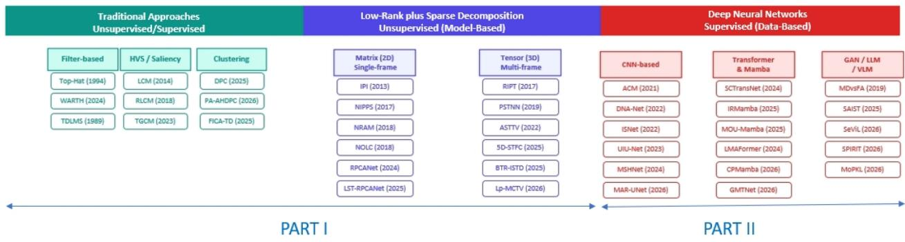
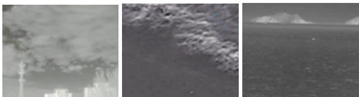
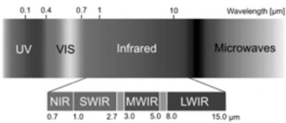
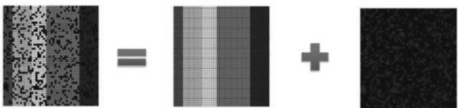
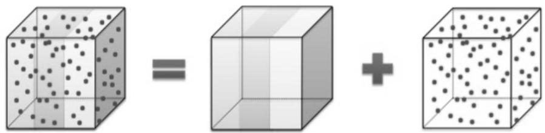

# Traditional and Recent Approaches for Infrared Small Target Detection : Overview, Challenges and Perspectives (Part 1)

Thierry Bouwmansa, Anastasia Zakharovaa, Belmar Garciab, Marwa Chendeb El Raid, Meghna Kapoore, Badri Narayan Subudhi1

aLaboratoire MIA La Rochelle Université, La Rochelle, 17000, France bISEN Toulon , Toulon, , France

cSchool ofArts and Sciences American University in Dubai, Dubai, , UAE

dLaboratoire L3i La Rochelle Université, La Rochelle, 17000, France

eDepartment of Electrical Engineering IIT Jammu, Jagti, 181221, India

## Abstract

Infrared small target detection is often used in diferent civilian and military applications to detect static or moving targets in scenes like in ground, air and sea surveillance. First valuable research has emerged since 30 years ago and the two last decades witnessed very significant publications in this field following the rise of low-rank and sparse decomposition (model-based methods) and deepc learning models (data-based methods). Furthermore, several surveys can be found in the literature but none of them addressesO an overall review in this field. In this context, the aim of this paper is to provide a complete survey of the traditional and recent approaches in infrared small target detection. First, we categorize the diferent approaches found in the literature in terms of the modeling models, i.e mathematical models, machine learning models and signal processing models. Then, we have discussed them in terms of the critical situations that they claim to handle. Furthermore, we present the available resources, datasets and libraries.] Then, we conclude with several promising directions for future research. For the sake of reading, this survey is divided into twoV parts: 1) "Traditional and Recent Approaches for Infrared Small Target Detection : Overview, Challenges and Perspectives (Part 1)" about conventional and low-rank and sparse decomposition (model-based methods), and 2) "Traditional and Recent Approachess for Infrared Small Target Detection : Overview, Challenges and Perspectives (Part 2)" about deep learning models (data-basedc methods).

Keywords: Small Target Detection, Local/Global Contrast Measurement, Low-rank plus Sparse Decomposition, Deep Neural Networks, Graph Representation and Learning

## 1. Introduction

Infrared small target detection is a crucial task in military and0 civilian fields using Infrared Search and Track (IRST), Forward1 Looking Infrared System (FLIR), Space-based Infrared System6 (SBIRS), Space Tracking and Surveillance Systems (STSS), early-warning systems, and missile tracking systems. All thesev applications require to detect target as early as possible and the size of target is often with only a few pixels because of long imaging distance. Thus, infrared target detection a pivotala role in various long-distance detection and surveillance tasks owing to its exceptional sensitivity to thermal radiation and independence from illumination conditions. However, the infrared target radiation energy received by imaging sensor is very low and with dim spotlike feature because of the atmospheric refraction, dispersion and absorption. Thus, infrared small target detection in complex clutter background is dificult because of a low Signal-to-Clutter Ratio (SCR), and a lack of concrete shape or texture information. In this context, Infrared Small Target Detection (IRTD) is a significant research field with high challenges. In literature, this field is also refered as infrared dim small target detection (1), infrared weak target detection (2), infrared tiny target detection (3; 4) and far infrared small target detection (5). When the targets are statics as in the more general cases, it is called Static Infrared Small Target detection (SIRST). When the targets are in motion, it is also called Moving Infrared Small Target detection (MIRST) (6; 7; 8; 9; 10; 11; 12; 13; 14; 15).

Two closely related problems to infrared small target detection are closely-spaced infrared small target unmixing (16; 17; 18; 19; 20) and the moving object detection task using background subtraction in video surveillance (21; 22) with visible spectrum or IR sensors. In closely-spaced infrared small target unmixing, the radiation intensity obtained from remote targets is inherently weak due to their long-range distance from the imaging system. This challenge is exacerbated when targets appear in spatially close dense clusters, as the Closely-Spaced Objects (CSO), resulting in overlapping blob-like spots. The core of CSO is to recover the intrinsic attributes of each constituent target from the mixed spot, which requires the simultaneous achievement of three objectives (18): sub-pixel target detection, sub-pixel localization, and recovery of intrinsic target informa tion. Instead of IRSTD that focuses on pixel-level target detection, CSO requires accurate estimate of the number of targets within the mixed light spot rather than mere target-level detec tion. Morevover, distinct from IRSTD which achieves pixellevel target localization, CSO determines the sub-pixel coordinates of each individual target. Using the signal processing theory, CSO is formulated within the framework of Compressed Sensing (CS) and reconstruction. It aims to reconstruct a high resolution target distribution from low-resolution observations. Recent advances concern the deep neural networks approaches (16; 17). In the moving object detection task, the background can be modeled and the size of the moving object is suficient to extract the foreground comparing the background with the current image (23). The background model is based on either mathematical tools (statistical concepts (24), fuzzy concepts (25; 26)), machine learning tools (subspace learning (27; 28), deep neural networks (29; 30)) or signal processing tools (graph signal processing (31; 32). Even if several approaches have been developed in the context of infrared moving object detection to model the background allowing to detect persons (33), cars (34) or boats (35) in challenging environments, none of these methods are suitable in the case of infrared small target detection (22). However, several methods address the challenge of small moving object detection (36; 37; 38; 39) in the visible spectrum and the size is bigger than the size defined by the Society of Photo-Optical Instrumentation Engineers (SPIE) about small target in infrared images. Finally, small target motion detection methods based on bio-inspired visual networks (40; 41; 42; 43; 44; 45; 46) works well in visible spectrum and are not adaptable for IRSTD. In summary, these two close related fields employ dedicated methods that can not be used in IRSTD.

## 1.1. Related Works

In literature, the infrared small target detection has thus attracted numerous works since the three last decades with several key periods related to the rise of sensors in more diverse environments and to the mathematical, machine learning and signal processing tools employed to deal with the met challenges. In this context, several surveys (47; 48; 49; 50; 51; 52; 53) about infrared small target detection can be found in the literature but none of them address an overall review in this field. Indeed, Bai et al. (47) survey in 2011 wavelet based algorithms, inter-frame diference based algorithms and filter based algorithms. In 2019, Zhang and Peng (48) review low-rank and sparse decomposition models. Eysa and Hamdulla (49) focus on typical algorithm principles and characteristics for infrared small target detection and tracking. In 2022, Zhao et al. (51) review only single frame models. In 2024, Cheng et al. (52) focus on deep learning methods from the past three years and classify them according to six key issues: 1) enhancing the representation capability of small targets, 2) improving the accuracy of bounding box regression, 3) resolving the issue of target information loss in the deep network, 4) balancing missed detections and false alarms, 5) adapting for complex backgrounds and 6) lightweight design and deployment issues of the network. In 2025, Kumar and Singh (53) provide a comprehensive survey but the survey reviews only 90 papers lacking in terms of exhaustivity, misses key recent future works based on graph learning representation and misses also key issues about performance evaluation.

<table><tr><td>Surveys [Authors (Date)]</td><td>Surveyed Categories (Number of Reviewed Papers)</td></tr><tr><td>Bai et al. (47) (2011)</td><td>Traditional Unsupervised Models (30 papers)</td></tr><tr><td>Zhang and Peng. (48) (2019)</td><td>Low-rank and Sparse Decomposition Models (70 papers)</td></tr><tr><td>Eysa and Hamdulla (49) (2029)</td><td>Typical Algorithm Principles and Characteristics</td></tr><tr><td>Zhao et al. (51) (2022)</td><td>Single Frame Models</td></tr><tr><td>Cheng et al. (52) (2024)</td><td>Deep Learning Supervised Models (90 papers)</td></tr><tr><td>Kumar and Singh (53) (2025)</td><td>All Categories (90 papers) + Datasets</td></tr><tr><td>This Survey</td><td>All Categories (1050 papers) + Datasets + Performance Evaluation Metrics</td></tr></table>

Table 1: Existing Surveys in Infrared Small Target Detection: An Overview.

Table 1 compares these surveys with the proposed survey highlighting our contributions.

Note that the small space target detection (54) and the infrared small target tracking task (55; 56) are out of the scope of this review.

## 1.2. Motivation and Contributions

Infrared small target detection has emerged as a topic of interest 30 years ago with the development of infrared sensors which are more and more eficient and deployable over time. In addition, machine learning methods has also witnessed key developments with model-based models and data-based models to deal with diverse kinds of data. More specifically, with the rise of deep learning, infrared small target detection has made rapid progress in diverse civilian and military fields like marine resource, high-precision navigation, autonomous driving, and ecological environment monitoring. With the growing demands for edge-side applications like micro-satellites, micro-UAVs, autonomous vehicles and ships, existing methods fails to achieve eficient response in edge-side scenarios with limited annotated samples and computational resources.

In this context, the aim of this survey is then to provide a first complete overview of all infrared small target detection methods over more than 1050 papers from the origin until 2026 for (1) novices who could be students or engineers beginning in the field of remote sensing, (2) experts as we put forward the recent advances that need to be improved, and (3) reviewers to evaluate papers in journals (IEEE Transactions on Geoscience and Remote Sensing, IEEE Geoscience and Remote Sensing Letters, IEEE Journal of Selected Topics in Applied Earth Observations and Remote Sensing, ELSEVIER Remote Sensing of Environment, MDPI Remote Sensing, etc.) and conferences (IEEE International Geoscience and Remote Sensing Symposium, etc.). So, this survey is intended to be a reference for researchers and developers in industries, as well as graduate students, interested in infrared small target detection methods applied to ground, air and sea environments. It can also be suggested as a reading text to teach graduate courses in subjects such as computer vision and remote sensing.

Although there are numerous works on infrared small target detection and the fact that it can give the feeling that this issue is solved or is over-studied, no algorithm today seems to be able to simultaneously address all the key challenges that we can meet in infrared small target detection and the substantial progress remain constrained (57). This is due to the four main reasons:

1. The lack of common framework, that is, each method was developed in several diferent contexts such as ground vehicles, airplanes and ship detection.

2. The lack of scientific progress, that is, there are mainly improvements of the state-of-art methods such as saliency based methods, low-rank plus sparse decomposition, and deep neural networks but recent representation models are investigated insuficiently.

3. The absence of a single realistic large-scale dataset with accurate ground-truth providing a balanced coverage of the range of challenges present in the real world.

4. The last reason for this technological stagnation is the fundamental bias in the current evaluation protocol: A critical “evaluation gap” in identifying the intrinsic dificulty of detection tasks. Indeed, existing research has mainly focused on post detection performance metrics. Even if needed for benchmarking final outputs, these metrics are posterior and result-oriented. Thus, they can not quantify the a priori dificulty of the input data, leaving the field overly reliant on the SCR as the sole authoritative indicator of dificulty (57).

These four problems have been partially addressed by (1) some recent surveys on the field (52; 53) but limited to deep learning methods, (2) the application of graph-based learning tools (58; 15; 59; 60; 61), (3) the creation of large-scale datasets such as the IRDST dataset (62), the TensorISTD dataset (63), the NCHU-Seg dataset (64) and the IRSTDID dataset (65) and (4) new evaluation protocols based on hybrid level metrics (66) and a target detectability metric (57). In addition of the annual top ranked IEEE IGARSS conferences, a ICPR 2024 Resource-Limited Infrared Small Target Detection Challenge (LimitIRSTD1) facilitates the development of infrared small object detection algorithms under limited resources including two tracks about weakly supervised algorithms under single point supervision and lightweight algorithms under pixel-level supervision.

In this context, we believe that we are living in a key transition in the field of infrared small target detection and the aim of this survey is to review these key new points. Thus, it reviews all the models since the first works in the field to the recent ones. By reviewing both existing and new ideas, this survey gives a complete overview of the concepts, theories, algorithms, and applications related to infrared small target detection. First, an infrared small target detection definition for beginners is provided. Then, we review the diferent challenges and which steps and issues are concerned to deal with them. Furthermore, existing and recent methods for infrared small target detection are presented. A description of recent complete datasets and codes are given. Moreover, an accompanying website called the Target Detection Website2 is provided. It allows the reader to have a quick access to the main resources, datasets and codes in the field. Finally, with this survey, we aim to bring a one-stop solution, i.e., access to a number of diferent models, algorithms, implementations and benchmarking techniques in a single paper.

Thus, we present the diferent models in three main categories to strengthen this transition:

• Traditional Unsupervised Models which present the following characteristics: (1) These models are the first models used in the field and are generally basics in terms of mathematical concepts. (2) These models allow to handle some specific challenges in normal environments, and are generally easy to implement. (3) Numerous improvements concern these models and their limitations seem to be reached.

• Low-rank and Sparse Decomposition Unsupervised Models which present the following characteristics: (1) These models present a disruptive methodology after the seminal work of Candes et al. (67) published in 2011. (2) These models allow to handle more challenges than traditional unsupervised models and are generally easy to implement. (3) Numerous improvements concern these models in terms of modeling of background, accuracy of detection, robustness in presence of noise and computation time.

• Deep Neural Networks Supervised Models which present on the other hand the following characteristics: (1) These models are more sophisticated to robustly handle a lot of challenges, (2) Most of them need improvements to be deployable and to achieve real-time requirements. To this end, fast and lightweight deep learning algorithms as well as inductive learning algorithms and graph based learning algorithms requiring less labeled data should be developed.

Infrared small target detection can be also classified into modeldriven methods and data driven methods as done in the work of Li et al. (68). The model-driven algorithms require fewer computing resources and do not require training samples as they are unsupervised. Moreover, they are easy to implement on platforms with limited resources and hold great potential for practical implementations The model-driven approaches can be classified into three categories: morphological filteringdrive, human visual system-driven and sparse representationdriven algorithms. The data-driven methods rely heavily on computational resources and labeled training samples as they are supervised. However, according on the spatial and temporal information used, the model-driven methods and data driven methods can be further classified into single-frame and multi-frame detection (also called sequential-frame detection). Single-frame detection methods are enough for SIRST detection while MIRST detection often requires multi-frame detection methods to employ the motion information. Contributions of this paper can be summarized as follows:

• A first complete overview of infrared small target detection methods concerning more than 950 papers covering 30 years of research using mathematical tools, machine learning tools and signal processing tools. For each of these three categories, the methods are classified into two groups: single-frame detection and multi-frame detection. Each method is also labeled as static or moving targets detection methods. However, we present for each category in a rationale and historical manner the corresponding first works, the similar research, their variants/improvements and their last developments to provide the reader an overview of where we come from, where we are and where we go. Subsequently, for each category, the methods are classified into single-frame and multi-frame detection, and also labeled as static or moving targets detection methods.

• A description of the diferent resources available to allow fair comparisons of the algorithms. More specifically, datasets and performance evaluation protocol using conventional metrics and disruptive metrics are detailed and discussed.

• An analysis of solved and unsolved challenges and theoretical perspectives to handle the current unsolved challenges. The idea is to provide the reader perspectives how the field will progress in the next years.

The rest of this paper is organized as follows: In Section 2, we first explain the methodology employed for the survey and we give a general overview in terms of papers published per journals/conferences, per year and per category. In Section 3, we investigate the various applications in terms of ground, maritime and air environments. In Section 4, we review the diferent challenges met in infrared small target detection, and which steps and issues are involved to deal with them. Then, in Section 5, we give an overview of the conventional unsupervised models classified following the mathematical tools. In Section 6, we review the low-rank and sparse decomposition methods using the matrix representation and the tensor representation achieving single-frame detection and multi-frame detection, respectively. In the paper titled "Traditional and Recent Approaches for Infrared Small Target Detection : Overview, Challenges and Perspective (Part 2)", we investigate the recent supervised models based on deep neural networks and the recent promising methods based on graph/hypergraph representation and learning. In Section 7, we present resources, datasets and codes publicly available to test and evaluate algorithms. Finally, we provide a conclusion and perspectives for future research.

## 2. General Overview

## 2.1. Factual Overview

The methodology used to collect all the papers since 30 years about infrared small target detection is based on research on IEEE Xplore3, Scopus 4 and GoogleScholar. The first papers (69; 70; 71) identified as relevant has been published in 1994. We also investigate the number of papers per journals and conferences, the number of papers per years and the number of papers per categories.

• Publications per journals and conferences: We investigate in which journals and conferences papers about infrared small target detection are mainly published. The main stream for journals is practically as follows: IEEE Transactions on Geoscience and Remote Sensing (152 papers), IEEE Geoscience and Remote Sensing Letters (66 papers), IEEE Journal of Selected Topics in Applied Earth Observations (61 papers), ELSEVIER Infrared Physics and Technology (72 papers), ELSEVIER Pattern Recognition (39 papers) and MDPI Remote Sensing (54 papers). The main stream for conferences concerns IEEE IGARSS conferences, IAPR ICPR conferences, and AAAI Conference on Artificial Intelligence. 87 papers are recent preprint papers available on ArXiv5 and SSRN 6 since 2025 and 2026.

• Publications per year: We investigate the number of publications per year to highlight the attraction of the field over time. The stream for the last decade is as follows: 2017 (23 papers), 2018 (19 papers), 2019 (26 papers), 2020 (39 papers), 2021 (33 papers), 2022 (34 papers), 2023 (110 papers), 2024 (143 papers), 2025 (255 papers), and 2026 (320 papers).

• Publications per scientific category: We investigate the number of publications per category to highlight the respective attraction of mathematical tools, machine learning tools and signal processing tools. The stream is as follows: mathematical unsupervised models with 201 papers, low-rank and sparse decomposition models (model-based models) with 154 papers, deep learning methods (data-based models) with 553 papers. Thus, data-based methods represent themself approximatively 51% of the total number of publications.

In summary, the evolution over the last decade demonstrates the increasing attraction of infrared small target detection. This phenomenon is owing to the progress in cooled and uncooled infrared sensors (72; 73) increasing their deployment of infrared cameras in diverse challenging environments (74) and to the rise of deep learning methods which allows to tackle more challenges both in sparse and dense target detection. We can note also that at least 70% publications come from China laboratories confirming their international leadership in the field. In this context, Wei An7 (National University of Defense Technology, Changsha, China) emerges as the most active researcher with more than 30 published papers in the field.

Note that the current research activities in the first semester 2026 generate three up to five publications per week and also generate duplicate acronyms (SANet (75) (2023), SANet (76) (2026) and SANet (77) (2026), LESPS (78) (2023) and LESPS (78) (2024), SAMamba (Xu et al. (79) (2025) and SAMamba (80) (2026), IRS-DETR (81) (2025) and IRS-DETR (82) (2026)) providing confusion.

## 2.2. Conceptual Overview

Figure 1 show the representative models in the three main categories. The first two categories namely traditional approaches and low-rank plus sparse decomposition are reviewed in the Part I while deep neural networks are surveyed in Part II. Moreover, we investigate the impact of the conceptual development of mathematical tools, machine learning tools and signal processing on the research about infrared small target detection. Figure 1 shows the timeline of the progress in the data modeling tools, in computer vision and infrared small target detection.

## 3. Applications of Infrared Small Target Detection

Applications of infrared small target detection are done in three main environments: Ground environments (Land-based), air environments (Aerial-based), and sea environments (Maritimebased). Each environments have their properties and challenges. Figure 2 show sample image of each environment.

## 3.1. Ground Environment

The targets are vehicles (83), stopped airplanes, etc. The challenges vary according to urban environments and to natural environments. In urban environments, complex geometric layouts of urban landscapes (buildings, etc.) disturb the detection. In natural environments, dynamic spatial changes owing to the vegetation increase the challenge of detection. Moreover, the visual similarities between background and targets, including similarity in shape and energy, complicate the diferentiation process and add layers of complexity to detection algorithms (57).

## 3.2. Sea Environment

The targets are ships, boats, vessels, etc. The three main challenges in sea environments are the following ones (84):

1. Because of the resolution limitation of remote sensing images and the small size of ships, the targets show weak edges in the images and are dificult to accurately identify.

2. The sea surface environment is changeable with interference information such as ripples, clouds, and wake waves. These interferences easily cause false detection and missed detection.

3. The length-width ratio of ships is very diferent, and the directions are diferent.

In literature, several methods (85; 86; 87; 88; 89) have addressed small target detection covering the three categories defined in this survey:

• Traditional unsupervised models with filters (86; 90), consistency of backgrounds (91; 92; 93), saliency of targets (94; 95; 96; 97), SVM (87), and Isolation Forest (98).

• Low-rank and sparse decomposition unsupervised models (99; 100; 96).

• Deep Neural Networks Supervised Models with detection based methods with YOLO series (EISD-YOLO (101), EG-YOLO (102), SeaInfraNet (103), YCENet (104), GT-YOLO (105), InfraTiny-YOLO (106), DSEE-YOLO (107), DCST-YOL (108), IRMultiFuseNet (109), InfraShip-Net (110)) and DETR series (111) (IRS-DETR (82), FGOM-RTDETR (112), FP-RTDETR (113), KDFF-DET (114), MAFF-DETR (115), Physics-Driven DETR (116)), and segmentation based methods (Dedicated Architectures (117; 118), Attention Networks (119; 120; 121; 4; 122), Flexible Networks (84), Transformers (112; 82; 123; 124; 125; 126; 127), Feature Guidance (128; 129; 130), Semantic Guidance (131; 132)), and spatial–temporal graph neural networks (133; 134).

Each method is reviewed in each corresponding section and appears with the label [Ship] in the overview tables. Note that infrared and visible image fusion is a key technique for all-weather ship surveillance in maritime security applications (135; 136; 137; 138; 139). Indeed, this technique allows to compensate the deficiencies of single-modal imaging under low-illumination and complex sea-state conditions (137).

## 3.3. Air Environment

Airborne IRST and FLIR based systems acquire infrared image by imaging systems that sense infrared radiation (140). The targets are aircrafts, missiles, etc. for military applications and airplanes, birds, etc. for civil applications. In numerous situations, these targets need to be detected at considerable distances, which can extend to several hundred kilometers. Morevover, airplanes can be submerged in a thick cloud and birds may fly in the jungle. Working in three main infrared atmospheric ranges (1-2.7, 3-5 and 8-14), the thermal imaging cameras have two basic infrared wavelength ranges: mediumwave infrared (3-5) and long-wave infrared (8-12). These characteristics allow to detect aircrafts with medium-wave infrared radiation characteristic of smoke plume and long-wave infrared radiation characteristic of aircraft skin when it is flying with high-speed. But, the images in the form of visible light include both interested target and background and noise. More specifically, the infrared radiation characteristic of sky background is related to time, space and climate. The radiation comes from two main parts: difuse solar radiation (<3) and atmospheric thermal radiation (>4) afecting the infrared image. In literature, several authors (141; 142; 143; 144; 145; 146) have addressed small target detection in air environments. More specifically, Li et al. (141) design a saliency based method. Wang et al. (142) and Gao et al. (146) employ low-rank plus sparse matrix decomposition methods whilst Sasikaladevi et al. (143) design in a deep neural networks method.

  
Figure 1: Traditional Approaches, Low-rank plus Sparse Decomposition (Model-based) and Deep Neural Networks (Data-based models) : An Overview (with representative models).

  
Figure 2: From left to right: Ground environment, Air environment, Sea environment.

## 4. Preliminaries, Challenges and Issues

## 4.1. Preliminaries

In the field of infrared small target detection, the Society of Photo-Optical Instrumentation Engineers defines a small target as an entity with a spatial extent typically smaller than 9×9 pixels. In 2003, Zhang et al. (147) consider a target as a small target if it occupies less than 0 12 percent of the total pixels in an image. In the case of 256 × 256 images, targets smaller than 80 pixels are categorized as small. These targets usually exhibit a prominent central intensity that attenuates symmetrically in all directions, providing as weak isotropic responses with negligible shape or textural structure. On the other hand, background clutter often displays pronounced directional characteristics, especially in edge-rich regions or parallax-dominated areas. The local structure refers to specific features of the target and its surroundings:

• Target Morphology: Small targets (e.g., aircraft, vehicles, or people) appear as bright spots with distinct shapes and sizes.

• Edge Information: The boundary between the target and the background is clear and has high contrast, making it a key local feature.

• Texture Features: Even in low-resolution images, texture diferences provide useful information. For example, the sky and flat ground have uniform textures, while vegetation and buildings show more complex texture

In summary, the infrared small targets present the following characteristics (148):

• Small: Because of the long imaging distance, targets are generally small, ranging from one pixel to tens of pixels in the images.

• Dim: Infrared targets usually present low Signal-to-Clutter Ratio (SCR) and are often immersed in heavy noise and clutter background.

• Shapeless: Infrared small targets have limited shape characteristics.

• Changeable: The sizes and shapes of infrared targets vary a lot among diferent scenarios.

Sometimes researchers refer to infrared dim small target detection. The term “dim” mean the low intensity or weak contrast of the target signal. Even if there is no unified quantitative consensus for “dimness” as researchers continually push the limits of algorithm sensitivity, it generally mean targets that are submerged in background clutter with low Signal-to-Clutter Ratios (SCR), making them visually indiscernible. In literature, a target is considered as dim when its local SCR is below 3, a threshold where efective detection becomes extremely challenging for algorithms.

## 4.2. Challenges

The diferent challenges met in infrared small target detection can be classified as follows.

## 4.2.1. Sensor Challenges

The challenges related to the sensors can be categorized as follows:

• Sensor Locations: IR sensors are either fixed or moving sensors. In the last case, they can be mounted on drones, on UAVs (Unmanned Autonomous Vehicles) (149; 150; 151) or on satellites (spaceborne (114; 130)).

• Wavelengths Spectrum: In practice, the wavelengths captured by sensors are classified into four main categories: Near-Infrared (NIR), Short-Wave Infrared (SWIR), Mid-Wave Infrared (MWIR), and Long-Wave Infrared (LWIR). Figure 3 shows an illustration of these four categories with their range.

  
Figure 3: Near-Infrared (NIR), Short-Wave Infrared (SWIR), Mid-Wave Infrared (MWIR), and Long-Wave Infrared (LWIR).

• Sensors Sensibility: Infrared images are typically affected by low signal-to noise ratios. Indeed, infrared sensors should identify targets at long distances (usually up to hundreds of kilometers), causing them to appear small and dificult to distinguish from the background. Second, strong vignetting can be observed in various scenarios (152). Vignetting in infrared imagery is characterized by a pixel intensity from the image center toward the edges.The brightness distribution of vignetting is inconsistent, with the center region being nearly saturated and significantly brighter than the other regions. Third, noise fluctuations and some nonuniform streaks generated during the photoelectric conversion process have the common characteristic of weak intensity with the target. These problems generate significant challenges for small target detection against a strong vignetting background (152).

## 4.2.2. Target Challenges

Due to their extremely small size and lack of distinct texture, such targets often provide insuficient structural features for reliable identification. In addition, disparities in shape and texture characteristics between infrared and visible light imagery led to suboptimal performance. In literature, targets are classified into three main categories: extended targets, spotted targets and point targets.

## 4.2.3. Background Challenges

Strong background noise complicates target extraction. Natural interference such as cloud boundaries, sea surface clutter and man-made interference further increases false positive rates and reduces detection performance. The main scenarios can be classified into the following types: air-based, ground-based, and air–ground interfaces (57).

• Cloud clutter: Air exploration often takes place from the ground up or from the air to a higher altitude and scene elements are often relatively simple, being mainly composed of sky clouds. However, cloud clutter generate challenges to detect air targets because clouds are naturally formed with blurry edge contours and have no fixed shapes.

• Blurred water: Water surfaces present strong reflection and scattering abilities because they are afected by the optical properties of water molecules. In addition, water zones are complex with various shadows and light spots.

Finally, lines and waves on water surfaces may distort the outlines of a scene and interfere with the detection, recognition, and positioning of targets.

• Vegetation cover: Vegetation generate complex scenes. Ground vegetation areas consist of the same types of plants typically exhibit a high degree of similarity. They contain fine texture features, which can lead to diferences in texture features in the presence of diferent plant species.

• Urban ground: Urban ground scenes present man made objects with various shapes and densities. For example, buildings present significant geometric features and the diversity of scene elements leads to large diferences in the imaging responses of ground objects, which interferes with target detection.

Various backgrounds collectively present these characteristics that increase detection dificulty. The main challenges are the irregularity and dynamic aspects of the backgrounds, and the potential similarity in visual features between targets and their backgrounds (camouflage) (57).

## 4.3. Issues

The infrared data are thus afected by low signal-to noise ratios. Furthermore, data corresponding to the small target lack of dis tinct texture. Modeling tools that can be employed are mathematical tools, machine learning tools and signal processing tools. For mathematical tools, statistic, fuzzy, and Dempster-Shäfer methods take into account imprecision, uncertainty, and incompleteness in the data, which appear due to diferent chal lenges, and because of the quality of the sensor. Regarding robust representation learning methods (i.e models-based methods), unsupervised techniques seek for low-rank structure in the data and attempt to be robust to outliers. Deep Learning models (i.e data-based methods) seek to be able to face all the challenges by learning all the situations. Signal processing models make an estimation of the background based on the temporal distribution of the pixels in image frames. In literature, these various tools have been employed and are reviewed in the following paper titled "Unsupervised and Supervised Approaches for Infrared Small Target Detection : Overview, Challenges and Perspectives (Part 2)".

## 5. Conventional Unsupervised Methods

## 5.1. Preliminaries

Conventional unsupervised methods employed mathematics tools based on crisp, statistical and fuzzy concepts and signal processing tools using filters. Note that statistical and fuzzy concepts allows to take into account the imprecision, the uncertainty and the imcompletness that may occur in the data.

## 5.2. Single-Frame Detection

Single-frame infrared small target detection methods can be classified into two main categories based on diferent assumptions about the relationship between the target and the background. More specifically, the categories can be identified as follows:

1. The first category assumes that targets disrupt local background correlations, where backgrounds exhibit slow variations and strong interpixel correlations. The methods are based on prior information and they are based either on local prior filtering and nonlocal prior optimization methods as follows

• Local Prior based Methods: Their core idea is to focus on the pixel neighborhood (usually the range of 3 × 3 up to 15 × 15), and to recognize the target by analyzing local contrast, gradient changes, and other features. Its theoretical basis is that weak and small targets will form significant extreme points or abnormal points in local areas. This type of algorithm mainly includes background estimation techniques (i.e. filters techniques), directional gradient and local contrast. First, specialized filters have been proposed to adapt to diferent backgrounds and targets. These filtering-based methods operate in the intensity or derivative domain suppressing clutter while enhancing targets. More specifically, these filtering methods employ prior information on background consistency to estimate the background. However, these methods often amplify non-target edges providing to false alarms in complex scenes. To address this limitation, the second kind of methods enhance targets by exploiting local contrast diferences. Local contrast measurement and multiscale contrast measurement are based on the same methodology by enhancing the saliency of small targets. The directional gradient technology distinguishes the target from the background by using the local gradient feature of the image, which can efectively capture the diference between the target and the background in the edge direction In addition, diferent variants of enhancement insights of small target have been proposed and achieved advanced performance. In summary, these methods increase the separability between targets and background by refining contrast measurement.

• Non-Local Prior based Methods: The non-local information methods are based on the diference between the target image and the non-target in the frequency spectrum data to achieve the extraction of the target image. It can use the dependence on local characteristics and highlight the global nature. It addresses the challenge that the background characteristics are too large, resulting in the dificulty of target detection. The core idea of this kind of algorithm is thus to establish a global feature model and to suppress the background by mining the long range dependence relationship of the spatial-frequency domain of the image. It breaks through the limitations of local windows and uses the sparsity and continuity characteristics of the target in the entire image.

These methods based on local and non-local priors are surveyed in Section 5.3, Section 5.4, Section 5.2.1, and Section 5.2.2. In addition, Table 4 and Table 2 show an overview of these diferent single-frame detection methods.

2. Unlike the first category based on strong local pixel correlations, the second category assumes similarities even among nonadjacent pixels and employs low-rank decomposition models for target detection. These methods reformulate detection as an iterative optimization problem using sparse and low-rank representations. These methods have been the SOTA algorithms between 2012 and the rise of deep learning methods and present the advantages to be model-based requiring no labels data. These methods are reviewed in Section 6.2.

## 5.2.1. Classification/Clustering Methods

• Classification Methods: In 2017, Bi et al. (153) propose a multiple novel features approach. Each feature reflects specific characteristic of small target. The best feature vector is selected to apply these features for detection. Then, a learning-based classifier is trained to scan candidate targets which are obtained by initial segmentation. Experiments show that the proposed features method discriminates efectively small targets from various clutters. In an other work, Liu et al. (154) design an Hierarchical Structure Dependency Whitening (HSDW). First, Liu et al. (154) characterize domain discrepancies in infrared images as diferences in structural information. Then, Liu et al. (154) use feature whitening to mitigate the dependency on domain-specific structure information, whose distribution is diversely simulated by a dual-branch nonlinear transformation module. Liu et al. (154) adopt a hierarchical suppression mechanism to alleviate the structural biases across multiple decoding stages, thereby facilitating more generalized target understanding across domains.

• Density Peak Clustering: In 2025, Wu et al. (155) propose a method based on improved Density Peak Clustering (DPC) and gray-level contribution. First, Wu et al. (155) apply an attribute filtering to quickly extract candidate targets. This attribute cannot only guide the parameter setting of the improved DPC (IDPC) but also derive the weights of feature fusion. After, Wu et al. (155) build an unsupervised clustering model based on IDPC, which accurately represent the local features of these targets. A gray-level model allows to extract the global features of small targets, leveraging the statistical properties of the gray level of small targets. By the weighted fusion of local and global features, the clustered targets are efectively enhanced, while the background clutter is further suppressed. Experiments show that IDPC provides a superior clustered target enhancement efect and a higher probability of multitarget detection compared to previous SOTA algorithms.

• Monte Carlo linear Clustering: In 2023, Li et al. (156) propose an approach using Monte Carlo linear clustering with single-point supervision to avoid a large amount of training data with expensive pixel-level annotations. This method aims to recover the per-pixel mask of each target from a single point label using Monte Carlo linear clustering. This method employs randomness to the clustering process by adding noise to the input images. By averaging the clustered results, more reliable pseudo masks are obtained. This Monte Carlo clustering approach allows the method to accurately recover pseudo masks and convert fully supervised SIRST detection networks into weakly supervised ones with only single-point annotation.

• Riemannian manifold Clustering: Infrared small target detection present the challenge of center drift in the case of unsupervised clustering which is misled by heavytailed background clutter in flat Euclidean spaces. To address this limitation, Zhu et al. (157) design a Spatio-Temporal prior-guided Semi-supervised Riemannian manifold Tetector and Tracker (ST-SRDT8). First, spatial coordinates and high-order optical structural features are separated and mapped onto a symmetric positive definite (SPD) covariance manifold. Second, the curved matrices are projected onto a flat Lie algebra tangent space using the Log-Euclidean metric (LEM). Third, a semi-supervised Riemannian fuzzy C-means (SSFCM) framework robustly resists hierarchical clutter and steers the trajectory toward the true target. Experiments show that ST-SRDT outperforms WSLCM (158) and PSTNN (159) while running in real time at 24 frames per second.

• Hyperbolic Density Clustering: All the detection algorithms typically map hierarchical background clutter into a flat Euclidean space and results in a “feature crowding efect” because of the geometric mismatch between spatial capacity and data structure. In 2026, Zhu et al. (160) propose a hyperbolic density clustering method based on a training-free detection paradigm which integrates non-Euclidean geometric reconstruction with optical mechanism verification. In a further work, Zhu et al. (161) design a Physics-Aware Adaptive Hyperbolic Density Peak Clustering (PA-AHDPC9) to address this theoretical point. PA-AHDPC is a training-free detection paradigm that employs non-Euclidean geometric reconstruction with optical mechanism verification. First, PA-AHDPC employs dual-prior probabilistic screening to rapidly anchor highconfidence candidate regions. Second, PA-AHDPC exploits the exponential expansion property of the hyperbolic Poincaré ball relative to its radius to address the local feature distribution. PA-AHDPC isolates weak targets from strongly structured clutter at the topological level on a negatively curved manifold. Third, a strict Local Gradient Diference (Strict-LGD) soft-decision mechanism incorporating energy spillover tolerance filters out pseudotargets lacking continuous energy difusion characteristics, such as high-brightness sensor dead pixels. Experiments show that PA-AHDPC outperforms the second-best SOTA algorithms by achieving an approximate 5 to 10 dB improvement in signal-to-clutter ratio gain (SCRG). To address the feature crowding efect where heavy-tailed background clutter overlaps with weak targets within flat Euclidean spaces, Zhu et al. (162) propose a Hyperbolic Wasserstein Manifold Detector (HWM-Det10). First, a spatial topological ofset physically isolates target radiation. A cascade screening reduces computational complexity to linear time. Second, local patches guided by Hessian structural tensors are mapped onto a Symmetric Positive Definite (SPD) manifold to keep the target’s optical point spread function (PSF) prior. Third, the highdimensional features are embedded into a Poincaré ball. An extreme value theory (EVT)-driven Bayesian framework generates a maximum a posteriori (MAP) recovery bound. Experiment. shows that HWM-Det outperforms RLCM, TLLCM and PSTNN (159).

In summary, clustering methods present several interesting abilities for infrared small target detection especially with recent approaches based on density Peak clustering and hyperbolic density clustering published in 2025 and 2026, respectively.

## 5.2.2. Discriminative Methods

In 2025, Luo et al. (163) propose an small target detection method based on frequency data sphering (FDS) and independent component analysis (FICA-TD) in order to capture the characteristics of diferent components. First, a spatialtemporal tensor with its adjacent frames is constructed from the videos. Second, the low-frequency information is suppressed with a frequency high-pass filtering operator and a FDS operator. Third, an Independent Component Analysis (ICA) method allows to determine the number of signal sources and the basis of independent component space followed by projecting the frequency data-sphered tensor into the independent component space. A Sparsity Information Filter (SIF) is then employed to filter out the residual low-response information of the middle frontal slice. Finally, the target detection result sequence are obtained. Experiments conducted on five real IR sequences show that FICA-TD is superior to seven state-of-the-art competitive methods in terms of target detectability, background suppressibility, and overall performance.

## 5.3. Consistency ofBackgrounds

Methods based on the background spatial consistency assume that the unknown background can be predicted based on the correlation between pixels while the occurrence of the target breaks the correlation and makes the prediction fail. In this way, the target and background separation is achieved by subtracting the predicted image from the original one. These filter based methods can be classified as follows: Wavelet/Contourlet filters (69; 164; 165; 166) ,Top-Hat filters (167; 168; 169; 170; 171; 68; 172), Least Mean Square filters (173; 174; 175; 176; 177) and Max-Min filters (178).

## 5.3.1. Wavelet/Contourlet based Methods

In 1994, Gregoris et al. (69) propose a multi-scale wavelet transform algorithm in forward looking infrared (FLIR). In 2012, Zhao et al. (165) design a detection algorithm based on wavelet transform and image fusion. The original image is decomposed and reconstructed by wavelet and it is separated into a low frequency image and some high frequency images. Then, the low frequency image is removed and the high frequency images are fused into a new image. The fused image is segmented with a threshold to obtain the target. In an other work, Zhao et al. (166) develop a detection method based on the nonsubsampled contourlet transform. The nonsubsampled contourlet transform allows to decompose the source image. Considering the diferent energy distribution characteristics of the target, background and noise, the energy image is obtained by energy cross correlation operation. Then, a few of candidate targets were segmented through adaptive threshold. Finally, the target was confirmed by using the continuity and consistency of target energy intensity and target movement in image sequence.

## 5.3.2. Top-Hat Filters

Morphological detection is the first method employed infrared small target detection. Along with the development of morphological research, morphological image processing has gradually become a new trend in image processing field and a suitable tool in small target detection. The final performance of the morphological filter strongly depends on the selection of the structuring element including the shape and value of it once given the morphological operation regulation. There will be diferent geometric structure information to analyze and process in the operation according to diferent structuring element being selected. In this context, most of the researchers have adopted the Top-Hat operations for infrared small target detection. More specifically, the morphological Top-Hat operation (179) is a high-pass filtering operation which includes opening Top-Hat operation and closing one. The opening Top-Hat operation can detect wave crest of an image and the closing Top-Hat operation can detect wave hollow. In 2002, Bin and Peng (180) indicate that the Top-Hat operation is similar to a non-spread operation and the opening Top-Hat operation is always positive. Therefore, Top-Hat filters provide good results only in some corresponding image model. However, usually the image signals are extremely complicated and change all the time, so the selected structuring element should be adaptive for realizing optimization. But, classical top-hat transformation employs two same structuring elements in the operations of opening or closing, and does not use this diference information in the structuring element appropriately. This fact decreases the eficiency of classical top-hat transformation to diferentiate the real target region and noise or clutter regions. Moreover, the noise or clutter may afect the performance of classica top-hat transformation as follows: 1) The noises may lead to target losing or increase the number of false alarms, and 2) the classical top-hat transformation cannot diferentiate the heavy clutter and real target region. In literature, two methods for optimizing structuring elements have emerged (167): morphological neural networks and morphological genetic algorithm. In 2006, Zeng et al. (167) propose two methods to optimize Top-Hat morphological filtering parameters. The first is based on neural network. Its structuring element is a two-layer feed-forward network which is trained by a mass of sample nets. This method considers Top-Hat operation as a whole and one layer, and defines the node of the output layer as the maximum gray-scale image vector after Top-Hat operation. The second method is based on genetic algorithm. This method adopts the interval discretization code and primary and secondary mood crossover and mutation. In 2010, Bai and Zhou (169) propose the definition, properties, multi-scale operations of top-hat transformation. The definition of this top-hat transformation employs two diferent but correlated structuring elements to reorganize the classical top-hat trans formation, and takes into account of the diference information between the target and surrounding regions. Experiments show that this top-hat transformation can detect infrared small targe more eficiently than the previous top-hat transformations. In further work, Bai and Zhou (170) propose an other modified top-hat transformation improving the contrast between bright and dark regions and using an iterative thresholding method to automatically detect the target region. Nevertheless, these methods have problem in suppressing the fixed position sharp noise and poor real-time performance. To solve this problem, Wang et al. (181) design a three-dimensional dynamic queue pipeline and employs a space-domain algorithm based on morphology Top-Hat operator in order to ensure the continuity of the target and the pipeline. However, the structure elements are desired to be adjusted adaptively. To this end, Deng et al. (168) propose an adaptive structure elements optimization method based on Quantum Genetic Algorithm (QGA). Experiments show that QGA achieve more stable performance compared with the traditional top-hat filter.

Despite its simplicity and the rise of LRSD models and deep neural networks, several researchers still develop improvements. In 2022, Yang et al. (2) propose a multi-structural element top-hat operator to obtain the suspected target area through adaptive threshold segmentation. This method employs image feature algorithms, such as central pixel contrast, regional gradient, and directional gradient, to extract the feature information of the suspected target at multiple scales, and the fuzzy decision method is employed for multi-feature fusion to achieve the final target detection. In 2023, Yavari et al. (182) propose a multi-stage morphological operator. The algorithm consists . of three stages. First, the noise is eliminated by means of Gaussian filtering to improve the SNR. Second, the morphological-based operation is applied but unlike the NTHF which uses the largest value of the neighborhood of a point, the average of n-largest values are employed. This strategy addresses the shortcoming of the NTHF when clutter is close to target. The residual noise and clutter is then reduced in the final stage using another morphological operation. In 2024, Li et al. (68) propose a Weighted Adaptive Ring Top-Hat transformation (WARTH). First, an adaptive ring-shaped structural element and a target awareness indicator are employed to measure local and global feature information to detect small targets while minimizing false alarms. Second, a Diference-of-Structure Tensors (DoST) is proposed and the positive smallest eigenvalue of DoST (PSEDoST) is computed to obtain the adaptive ring-shaped that captures local feature information. Third, the image is converted into the Fourier phase spectrum, and a two-stage sliding window filtering technique is applied to obtain the target awareness indicator that perceives global feature information. At the last stage, WARTH is defined by fusing the above two measurements which eliminate false alarms and improve the robustness of target detection.

## 5.3.3. Least Mean Square Filters

In 1989, Hadhoud and Thomas (173) propose a twodimensional adaptive filter which is an extension of the one-dimensional Least Mean Square (LMS) filter. This method attempts to minimize the mean square error between the predicted response and the output signal. Thus, the TDLMS filter predicts the pixel intensity based on the weighted intensity of nearby pixels. The prediction error is large near the target and is close to zero in the background. This is because the intensity of the pixels near the target changes rapidly and is hard to predict accurately. In the opposite, the intensity of the background pixels is homogeneous and easy to predict. Thus, the TDLMS filter enhance small targets and suppress backgrounds. In 1994, Azimi et al. (70) propose the two-dimensional BDLMS (Block Diagonal Least Mean Square) method. The weight matrix is updated once per block rather than once per pixel. The diagonal scanning is choosen to avoid the problems inherent in the one-dimensional (1D) standard scanning schemes. In 2009, Bae et al. (183) develop a mask-weighted TDLMS method that places the predicted pixel in the center of the masked prediction matrix. The method can obtain more neighborhood information than the conventional TDLMS. Nevertheless, the methods present problems related to the step-size adjustment of TDLMS (184; 185; 186). First, Cao et al. (175) employ five prediction matrices to obtain the neighborhood information in order to compute the step size. The step size is a function of the variance of the four prediction values in the four directions. The step size is long near the changeable area such as the cloud edges and short in the homogeneous backgrounds. In the same idea, Bae et al. (176) employ a eight prediction matrices to obtain the neighborhood information improving the TDLMS algorithms by fully using the neighborhood information. This allow to determine whether the pixel is near the edge of the cloud or near the target. Thus, the step size near the edge of the cloud is increased and the step size near the target is reduced according to the neighborhood information. In a further work, Bae et al. (177) employ an edge directional 2D LMS filter to take advantage of edge information of prediction pixels corresponding to surrounding blocks around current filter window. To adjust adaptively the step size in the background and small target region, the adaptive region-dependent nonlinear step size is obtained with the variance of the prediction pixels of the surrounding blocks. This prediction structure and adaptive step size is then applied to the background region including objects such as cloud edge and small target region diferently. Nevertheless, these above TDLMS filters can not detect small targets accurately. Moreover, their algorithms are time-consuming and do not perform well in real-time applications. To address these disadvantages, Zhao et al. (174) develop a bilateral filtering method. This method filters the images rightwards and leftwards and then fuses the prediction error images. Thus, the cloud edges and noise spots are eliminated sharply and the targets are significantly enhanced using the addition of the leftward filtering and fusing processes. Zhao et al. (174) also employ a selected, fixed step size and simplified filter structure to improve the computing speed. Experiments show that this algorithm provide better detection performance as well as competitive execution eficiency than the previous TDLMS algorithms.

In summary, these methods are based on morphological filtering to detect targets by suppressing the background. These methods show good detection performance in the case of simple and uniform backgrounds.

## 5.4. Saliency of Targets

Human Visual System (HVS) methods assume that the target us the most salient object. These HVS based methods can be classified as follows: Local contrast methods (187; 188; 189; 190; 191; 192) and global contrast methods (193; 194; 195; 196; 197). Their progress over time can be summarized as follows.

## 5.4.1. Local Contrast Methods

Conventional HVS algorithms commonly employ the ratio of gray values between the target and the surrounding background to define the local contrast, as a means to obtain enhancement of the target and suppression of the background. In this idea, Chen et al. (190) propose in 2014 the Local Contrast Measure (LCM). In a further work, Han et al. (191) propose an Improved LCM (ICLM) detection algorithm based on HVS to achieve good performance in detection rate, and to reduce false alarm rate and speed simultaneously. First, an HVS size-adaptation process is employed, and the IR image after pre-processing is divided into sub-blocks to improve detection speed. Based on HVS contrast mechanism, the improved local contrast measure is employed to obtain the saliency map. Finally, a threshold operation along with a traversal mechanism based on HVS attention shift mechanism is employed to get the target subblocks. This algorithm based on HVS (i.e diference of Gaussians (DoG) filters) is sensitive to not only real small targets but also background edges, which results in a high false alarm rate. To address this problem, Han et al. (198) propose an im proved DOG (IDoGb) filter. IDoGb is an extension of DoG but is sensitive to orientations and can better suppress the complex background edges. IDoGb achieves a lower false alarm rate and multi-scale detection can be also achieved. Experiments show that the IDoGb filter produces less false alarms than ICLM at the same detection rate, while consuming only about 0 1 s for a single frame. However, these methods use the absolute local contrast, which may not be efective in eliminating noise and high-brightness clutter. To address this issue, Han et al. (199) propose a Relative Local Contrast Measure (RLCM) to handle small targets of diferent sizes ofering better efectiveness and robustness in complex background. In an other work, Wei et al. (200) incorporate the biological vision mechanism and design an algorithm called Multiscale Patch-based Contrast Measure (MPCM). The algorithm allows the simultaneous detection of bright and dark targets in infrared images. However, it exhibits relatively poor robustness in complex backgrounds with strong noise. In 2016, Deng et al. (201) design a Weighted Local Diference Measure (WLDM)-based scheme for the detection of small targets in various complex cloudy-sky backgrounds. First, a WLDM map allows to simultaneously enhance targets and suppress background clutters and noise. Thus, the true tar gets can be easily separated from jamming objects. Second, a simple adaptive threshold is used to segment the targets. In 2018, Gao et al. (202) employ multiscale gray and variance difference measures. A multiscale adaptive gray diference measure is first computed to enhance small targets and improve de tection accuracy. Second, a multiscale variance diference measure allows to alleviate the impact of background fluctuation By integrating these two approaches, targets can be extracted more accurately using a threshold-adaptive segmentation. In 2019, Qin et al. (202) propose a method based on Facet Kernel and Random Walker. First, local order-statistic and mean filtering are applied to remove the pixel-sized noises with high brightness and smooth the infrared images. The infrared image is filtered by the Facet kernel to enhance the target pixels. Can didate target pixels are then extracted by an adaptive threshold. Then, Qin et al. (203) define a Novel Local Contrast Descriptor (NLCD) to achieve clutter suppression and target enhancement. The candidate target pixels are selected as central pixels o ob tain the local regions. The NLCD map of all local regions is weighted by the filtered map of Facet kernel to further enhance target. Finally, the target is detected by a thresholding operation on the weighted map.

All these local contrast based methods adopt a sliding window with a two-layer structure, which restricts the computation of contrast features to a single scale at a time. However, several algorithms use multiscale windows to calculate the local contrast at various scales. The maximum value obtained from these calculations is selected as the final local contrast. For example, to achieve the best detection efect for targets of diferent sizes, the LCM algorithm uses four scales of sliding windows to traverse the image, and the sizes of the sub- windows are set to 3 × 3, 5 × 5, 7 × 7 and 9 × 9, respectively. However, this increases the computational complexity and processing time. Furthermore, recent works published in 2026 are based on ring local contrast measure either with spatial–temporal prior (204), with edge suppression (205), with structure-aware weighted information (206), or feature-guided discriminative mechanisms (207).

## 5.4.2. Global Contrast Methods

A local contrast method can work well only when the target is locally prominent, which is not always the case when the background is very complex. In 2023, Tang et al. (193) design a fast infrared small target detection algorithm based on global contrast with a low computational time consumption. First, the original image is processed by dilate operation with a ring structuring element. Second the detection result is obtained with a Global Contrast Measure (GCM) between the original image and the processed image according to the ratio form and the diference form. But this method presents limitations in background suppression and multi-target detection capabilities. To address these limitations, Tang et al. (194) develop a Multiscale Global Contrast Measure (MSGCM). Ex periments show that MSGCM provides better performance than GCM with an average increase of 2 95 times in background suppression factor, 6 17 times in signal-to-clutter ratio gain for single-target detection, and 10 49 times for multi-target detection. To improve the multi-target detection capabilities, Tang et al. (195) employ a method based on Facet Global Contrast Measure (FGCM). In an other work, Xie et al. (196) propose an Improved Global Contrast Measure (IGCM). The original image is processed by dilate operation with a ring structuring element and mean operator with a square structuring element, respectively. Second, the improved global contrast measure is obtained by the two results above. IGCM provides an higher signal-to-clutter ratio and background suppression factor than the previous global contrast methods. In 2025, Han et al.(197) develop a True Global Contrast Measure (TGCM) in which its baseline is obtained by global decomposition. This method can handle situations where the target is not locally salient. A Gaussian filtering operation is employed to suppress noises, and a local max dilation is used on the separated baseline to maintain as much edge/corner information as possible. The residual information during decomposition are employed as a weighting function to further suppress clutters. In a further work, Han et al. (208) design a contrast method framework named Hy brid Contrast Measure (HCM). This framework consists of two main modules: a Relative Global Contrast Measure (RGCM), and a small patch local contrast weighting function. First, the sparse and low rank decomposition method is adopted to get the global background of a raw image as benchmark, and a Local Max Dilation (LMD) operation is applied on the global background to recover edge/corner information. Then, a Gaussian matched filtering operation is applied on the raw image to suppress noise. The RGCM is computed between the filtered image and the benchmark to enhance true small dim target and sup press flat background area simultaneously. Second, the Diference of Gaussians (DoG) filtering is employed and improved as the weighting function. Experiments show that RGCM presents robustness in presence of interference of high brightness background, complex edges/corners and random noises.

## 5.4.3. Transform Domain Methods

Transform domain methods often use a special transform such as Wavelet transform, Fourier transform, phase spectrum of quaternion Fourier transform (PQFT) and so on. Detection in complex backgrounds performs better in transform domain than in the spatial domain in spite of higher computation complexity (209). These transform domain methods define a fre quency diference between the background and the target in the transform domain, and obtain the detection by magnifying the measured diference. Because more details in an image imply higher phase information values in the transform domain, better detection results can be obtained by employing the phase information (209). First, Qi et al. (210) employ Phase spectrum of Fourier transform (PFT) to enhance targets. Then, Qi et al. (211) present a method using a phase spectrum of quater nion Fourier transform (PQFT). In this model, the facet model allow to get four directional features which are employed to perform PQFT. The amplitude spectrum values are set to a constant value for each PQFT feature so that the saliency map consists of the inverse transform of the phase spectrum. Nevertheless, these two methods only employ the phase spectrum to recover signals, which will cause some information loss. It also lead to missed detection in the results. In an other approach, Yang et al. (212) design a method based on another direction feature. The filter is obtained by Gauss kernel function. Comparing with Fourier transform, cosine transform only performs on real even function and contains only real cosine terms. It is a real number of domain transformation. The actual signals are mostly in the real number domain, which conducts the Fourier transform very redundant. Moreover cosine transform allow to reduce computational complexity. According to these facts, Zhang et al. (209) develop a method based on spatial-temporal enhancement using quaternion Discrete Cosine Transform (QDCT). This method can support four channels, ofering more information for DCT, whereas traditional DCT can only use gray information. Based on the fact that a small target often makes HVS have a higher response, the infrared small target detection is then formulated as a salient region detection problem in the transform domain. In summary, HVS methods in the spatial or frequency domain achieve better detection performance in complex scenes than filters-based methods. It is because they address the contrast between the background and the targets.

## 5.5. Multi-Frame Detection

## 5.6. Multi-Frame Cumulation Algorithms

In 2007, Yu (213) design a method based on higher-order cumulant. In 2016, Tang et al. (214) propose a similar approach based on morphology and high-order statistics. In 2017, Fan et al. (215) employ a self-adaptive caliber temporal-spatial filtering. The accumulated image obtained by these three algorithms (213; 214; 215) increases the number of accumulated frames. The target signal is enhanced but the streak noise is also enhanced. Because these three algorithms did not use the non-uniformity correction algorithm in the early stage, the background image still has more streak noise. The algorithm (213) only use employs the information of pixel points in time domain to estimate the background generating more noise in the diference image. The algorithm (215) only employs the information of the pixel points in the spatial domain for background estimation. Thus, it generates a diference map with partial noise. However, the algorithm (214) combines the spatial and temporal information of pixel points to estimate the background. It makes full use of the spatial and temporal information of the pixel and makes the target signal in the diference image preserved.

To address these limitations, Fan et al. (216) design in 2019 a non-uniform correction method of ring perturbation in sequence images. This method removes the non-uniformity of images. Then, a multi-frame cumulation technique enhances the dim targets. A Poisson distribution is employed to obtain candidate target images and a high-order cumulant allows to extract efective targets. Thus, the motion estimation is achieved on the dim target to make accumulation along the estimated direction. Experiments demonstrate that this ring perturbation correction method enhances the local signal-tonoise ratio (SNR) of dim small targets and provides better detection results than other algorithms (213; 214; 215), and can efectively detect dim small targets in strong clutter background

In 2017, Fan et al. (217) employs an Improved Anisotropy for Background Prediction (IABP) with a target enhancement based on High-Order Cumulates (HOC). A sequential image energy center detection algorithm integrates the neighborhood, continuity, area, and energy and other motion characteristics of the target. Experiments demonstrate that IABP provides a superior overall performance compared to previous background prediction methods increasing the signal-noise ratio of images.

## 5.7. Miscellaneous Algorithms

In 2004, Peng et al. (218) design a strategy based on various nonlinear features that are representative of dim targets. An information fusion algorithm by Karhunen-Loeve (KL) transform is employed to obtain an integrated feature. In 2014, in the context of maritime scenes, Wang et al. (219) propose a pipeline-filtering algorithm with self-adaptive anti-vibration abilities. First, the inter-frame vibration of sequence images is acquired in real time within the block matching method that combines the normalized cross-correlations coeficient with the normalized mutual information. Second, it is used to correct coordinates at the single-frame level Third, the corrected detection results allows to complete the pipeline-filtering. Experiments show that the algorithm can handle the challenge of inter-frame vibration of sequence images achieving accurate detection of small maritime targets.

In 2018, Liu et al. (220) develop a method based on flux density and direction diversity in gradient vector field. First, the infrared image is transformed to the Infrared Gradient Vector Field (IGVF). Second, a multiscale flux density (MFD) quantifies the extent of sink point character. In the MFD map, the small targets are enhanced and background clutters are suppressed. Third, a Gradient Direction Diversity (GDD) is employed. The residual noise due to the heavy clutter is suppressed by GDD. Finally, an adaptive threshold allows to separate the targets. Experiments show that IGVF outperforms previous SOTA methods in complex background clutter.

<table><tr><td>Category</td><td>Acronyms</td></tr><tr><td>Transform Domain Methods</td><td>PFT (Qi et al.(210)), PQFT (Qi et al.(211)), QDCT (Zhang et al. (209)) NSST-PQFT (Ren et al. (221))</td></tr><tr><td>Classification Methods</td><td>Bi et al. (153), Wu et al. (155)</td></tr><tr><td>Clustering Methods</td><td>DensityPeaksIR (Huang et al. (222)), HSDW (Liu et al. (154)), Sample Data (Fan et al. (223)) Monte Carlo Linear Clustering (Li et al. (156))</td></tr><tr><td></td><td>Hyperbolic Density Clustering: HDC (Zhu et al. (160)), PA-AHDPC (Zhu et al. (161)), HWM-Det (Zhu et al. (162)) LDMGGC (Zhu et al. (134)), IFCM-MF (Chen and Lin (224))</td></tr><tr><td>Statistical Non Parametric Methods</td><td>Kernel-based (Gu et al. (225)), Neyman-Pearson Criteria (Askar et al. (226)), Fast Algorithm (Zhang et al. (227)) High-Order Statistics (Jiao and Wu (228))</td></tr><tr><td></td><td>Collinearity (Zhang et al. (229))</td></tr><tr><td>Discriminative Methods</td><td>Independent Component Analysis: FICA-TD (Luo et al. (163))</td></tr><tr><td></td><td></td></tr><tr><td>Miscellaneous Methods</td><td>Weighted Image Entropy (Deng et al. (230))</td></tr><tr><td></td><td></td></tr><tr><td></td><td>Multiscale Kurtosis Map Fusion (Xin et al. (231))</td></tr><tr><td></td><td>Multiscale Fuzzy Metric (Deng et al. (232))</td></tr><tr><td></td><td></td></tr><tr><td></td><td>Variational Mode Decomposition:(NVMD) [Band-Limited Subsignals] (Wang et al. (233))</td></tr><tr><td></td><td>Fast Adaptive Scaling Algorithm (FAMSIS) (Chen et al. (234))</td></tr><tr><td></td><td>Real-Time Implementations: SRD-1BVFM (Zhou and Wang (235))</td></tr><tr><td></td><td>FPGA Implementations: FAST (Wu et al. (236))</td></tr></table>

Table 2: Conventional Unsupervised Methods (Part 2): Overview of Single-Frame Detection (26 papers).

<table><tr><td>Category</td><td>Acronyms</td></tr><tr><td>Multi-Frame Cumulation Algorithms</td><td>Higher-Order Cumulant (Lu (213)), Morphology and High-order Statistics (Tang et al. (214)) Self-Adaptive Caliber Temporal-Spatial Filtering (Fan et al. (215)</td></tr><tr><td>Miscellaneous Algorithms</td><td>Ring Perturbation non-uniformity Correction (Fan et al. (216)) Local Energy Center: IABP (Fan et al. (217) Information Fusion:IF-KL (Peng et al. (218)) Antivibration Pipeline-Filtering: APF (Wang et al. (219))</td></tr></table>

Table 3: Conventional Unsupervised Methods: Overview of Multi-Frame Detection (9 papers).

<table><tr><td>Category</td><td>Methods</td><td>Acronyms</td></tr><tr><td>Consistency of Backgrounds</td><td>Top-Hat Filters Study (Soni et al. (237))</td><td>Top-Hat (Jackway (179)) Optimizing the structuring element: Morphological Neural Networks (Zeng et al. (167)), Morphological Genetic Algorithm (Zeng et al. (167)) WTH (Bai et al. (169)), BTH (Bai et al. (169)) MWTH (Bai et al. (238)), MBTH (Bai et al. (238)), TEO (Bai et al. (170))</td></tr><tr><td></td><td></td><td>Dynamic Queue (Wang et al. (181)), QGA (Deng et al. (168)) Multi-stage Morphological (NTFH) (Yavari (182)), Weighted Adaptive Ring (WARTH) (Li et al. (68)), Balanced Ring Top-Hat (Zhu et al. (172)) PM (Lu et al. (171)) Mexican-Hat (Zhang et al. (239)) Multi-Feature Fuzzy Decision-Making (Yang et al. (2))</td></tr><tr><td></td><td>Gaussian Filter Least Mean Square Filters</td><td>DoG (Huang et al. (240)), Improved DoG (Ye et al. (241)), ASC (Ruitao et al. (242)), GWM (Zhang and Li (243)) TDLMS (Hadhoud and Thomas (173)), BDLMS (Azimi et al. (70)), MW-TDLMS ( Bae et al. (183)) VS-LMS (K wong and Johnston (184)), Neighborhood-TDLMS (Cao et al. (175))</td></tr><tr><td></td><td></td><td>Block Statistics TDLMS (Bae et al. (176)), Edge Directional 2D-TDLMS (Bae et al. (177))</td></tr><tr><td></td><td></td><td></td></tr><tr><td></td><td></td><td></td></tr><tr><td></td><td></td><td></td></tr><tr><td></td><td></td><td></td></tr><tr><td></td><td></td><td></td></tr><tr><td></td><td>Wiener Filters</td><td>Median-Modified Wiener Filter (Liu et al. (244))</td></tr><tr><td></td><td>Particle Filters</td><td></td></tr><tr><td></td><td></td><td>MPF (Li and Ji (245))</td></tr><tr><td></td><td>Bilateral Filters</td><td>IBF (Meng et al. (246))</td></tr><tr><td></td><td>Directional Second-Order Directional Derivative</td><td>DSODD (Yang et al. (247))</td></tr><tr><td></td><td>Miscellaneous Filters</td><td>Max-Min Filter (Deshpande et al. (178)), MILL (Kim et al. (248))</td></tr><tr><td></td><td></td><td>Morphological Filter (Tom et al. (249)) (Fortin (250)) (Li et al. (251)) (Yao et al. (1) ), Adaptive Morphological Filter (Bai et al. (252) ), ASRG (Bai et al. (253)), MMP (Zhao et al. (254))</td></tr><tr><td></td><td></td><td>Neural Network Filter (Shirvaikar and Trivedi (255)), 2-D AL (Ffrench et al. (256))</td></tr><tr><td></td><td></td><td>Spatio-Temporal Filter (Fan et al. (257)), HSWF (Cui et al. (258))</td></tr><tr><td></td><td></td><td>Closest-Mean (Han et al. (259)), LCI Filter (Cao et al. (260)), MDMSHB (Peng et al. (261))</td></tr><tr><td>Saliency of Targets</td><td></td><td></td></tr><tr><td></td><td>Local Contrast Measurements</td><td>LCM (Chen et al. (190)), ALCM (Yi et al. (262)), ICLM (DoG) (Han et al. (191)), IDoGb (Han et al. (198))</td></tr><tr><td></td><td></td><td>RLCM (Han et al. (199)), MPCM (Wei et al. (200)), WLDM (Deng et al. (201)), STLDM (Du and Hamdulla (263))</td></tr><tr><td></td><td></td><td></td></tr><tr><td></td><td></td><td>FGDRLCM (Zhao et al. (207))</td></tr><tr><td></td><td></td><td>Facet Kernel (Qin et al. (202)), NLCD (Qin et al. (203)), STSM (Li et al. (141))</td></tr><tr><td></td><td></td><td>WSLCM (Han et al. (158)), TLLCM (Han et al. (264)), ASPCM (Oiu et al. (265))</td></tr><tr><td></td><td></td><td>MLCM-LEF (Xia et al. (266)), ELCM (Guan et al. (267)), NWLCM-CDC (Jia et al. (97))</td></tr><tr><td></td><td></td><td>MRF-LCE (Li et al. (268)), LGFFCM (Xiong et al. (269)), MFLCM (Wu and Ren (270))</td></tr><tr><td></td><td></td><td>LGDI-LGW (Dong et al. (271)), TLSD (Li et al. (272))</td></tr><tr><td></td><td></td><td>Derivative Scheme: MDWCM (Lu et al. (273)), DECM (Bai and Bi (274)), LCWMD (Xu et al. (275)), FODD (Zheng and Zong (276))</td></tr><tr><td></td><td></td><td>MRF-LCE (Li et al, . (277)), (Qiu et al. (278)), MLGDR (He et al. (279))</td></tr><tr><td></td><td></td><td></td></tr><tr><td></td><td></td><td>TCBS (Zhou and Wang (283))</td></tr><tr><td></td><td></td><td>Entropy Scheme: EW-MLC (Wei et al. (284)), EVWLCM (Xi et al. (285)), MDLDE (Yao et al. (286))</td></tr><tr><td></td><td></td><td>Layer Scheme: DL-LCM (Ren et al. (287)), DLPC (Liu et al. (288))</td></tr><tr><td></td><td></td><td>TrLCM (Luo et al. (289)), SDWTLLCM (Chen et al. (290)), WTLLCM (He et al. (291)), STLCM (Yu et al. (292))</td></tr><tr><td></td><td></td><td>MLCF-STC (Wang et al. (293)), Improved TLLCM (Wang et al. (294))</td></tr><tr><td></td><td></td><td>Relative Scheme : LRICM (Xie et al. (295))</td></tr><tr><td></td><td></td><td>PFT (Shao et al. (296)), MLLCM (Sun et al. (297)), DLCM (Wu et al. (298)), RDLCM (Lu et al. (299)), LIG (Zhang (300))</td></tr><tr><td></td><td></td><td>CSS-LCM (Hou et al. (301)), STLECS (MDIMG) (Xi et al. (302))</td></tr><tr><td></td><td></td><td>Weighted Scheme: WRDLCM (Chen et al. (303)), WRDLCM (Chen et al. (304))</td></tr><tr><td></td><td></td><td>TAWGIF (Wang et al. (305)), WSTRLCM (Hu et al. (204)) WIDLCM (Wang et al. (306)), ODSWA (Li et al. (307))</td></tr><tr><td></td><td></td><td>WIRLCM (Zhao et al. (206)), SF-LIWGM (Xu et al. (308)), WDDSM (Cui et al. (309))</td></tr><tr><td></td><td></td><td>LOG Scheme: MSLCM-LOG (Chen et al. (310)), ELC-LOG (Ma et al. (311))</td></tr><tr><td></td><td></td><td>FWLCM (Jiang et al. (312)), ESRLCM (Hu et al. (205))</td></tr><tr><td></td><td></td><td></td></tr><tr><td></td><td></td><td>Shrinkage Problem (Xu et al. (313))</td></tr><tr><td></td><td></td><td>Suppression Scheme: ARMS (Kong et al. (314))</td></tr><tr><td></td><td></td><td>Spatiotemporal Saliency (Pang et al. (315))</td></tr><tr><td></td><td></td><td>Multifactor Detectability Framework (Zhao et al. (57))</td></tr><tr><td></td><td>Global Contrast Measurements</td><td></td></tr><tr><td></td><td></td><td>GCM (Tang et al. (193)), MSGCM (Tang et al. (194)), FGCM (Tang et al. (195))</td></tr></table>

## 6. Low-rank and Sparse Decomposition Unsupervised Models

Low-rank plus Sparse matrix Decomposition (LRSD) models is a dominant model-based approach in infrared small target detection. The LRSD model is also called Robust Principal Component Analysis (RPCA) introduced in 2009 by Candès et al (67) to handle robustly sparse outliers in observed data. The original decomposition was extended to three terms decomposition (i.e low-rank matrix, sparse matrix and noise matrix) in 2010 by Zhou et al. (316). This version of RPCA is also known as stable RPCA in literature. Furthermore, the decomposition has been also extended in the tensor domain (317) to take into account explicitly the spatio-temporal constraints. However, the LRSD model has also proven this eficiency in the close field of moving objects detection for video-surveillance (318) by ofering the possibility of spatio-temporal algorithms (319; 320; 321), incremental algorithms (322; 323; 324) crucial for real-time applications, and deep unrolled RPCA methods (325; 326; 327). The rise and success of the LRSD models for infrared small target detection are based on the fact that it ofers a rigorous mathematical foundation by jointly optimizing the nuclear norm (background regularization) and $l _ { 1 }$ -norm in contrast to filtering methods for background suppression or human visual-inspired contrast enhancement techniques. Moreover, the convex optimization framework demonstrates robustness when handling complex dynamic infrared backgrounds, and variable-sized targets across heterogeneous environments. The progress of LRSD methods in infrared small target detection follows a similar scheme that the one developed in moving object detection but using designed algorithms for the challenges met in IRSTD. The reader can refer to surveys (328; 329; 330; 331) and the DLAM website11 for a list of representative fundamental papers about RPCA.

## 6.1. Mathematical Preliminaries

Candès et al. (67) proposed a convex optimization to address the robust PCA problem also called LRSD. The observation matrix A is assumed represented as:

$$
A = L + S\tag{1}
$$

where L is a low-rank matrix and S must be sparse matrix with a small fraction of nonzero entries. The straightforward formulation is to use $l _ { 0 } .$ -norm to minimize the energy function:

$$
\operatorname* { m i n } _ { L , S } r a n k ( L ) + \lambda \| S \| _ { l _ { 0 } } \mathrm { s u b j } A - L - S = 0\tag{2}
$$

where $\lambda > 0$ is an arbitrary balanced parameter. But this problem is NP-hard, typical solution might involve a search with combinatorial complexity. This research seeks to solve for L with the following optimization problem:

$$
\operatorname* { m i n } _ { L , S } \ \| L \| _ { * } + \lambda \| S \| _ { l _ { 1 } } \mathrm {  ~ \ s u b j ~ } A - L - S = 0\tag{3}
$$

where || ||∗ and $\Vert . \Vert _ { l _ { 1 } }$ are the nuclear norm (which is the l1-norm of singular value) and $l _ { 1 }$ -norm, respectively, and $\lambda > 0$ is an arbitrary balanced parameter. Usually, $\begin{array} { r } { \lambda = \frac { 1 } { \sqrt { m a x ( m , n ) } } } \end{array}$ . Under these minimal assumptions, this approach called Principal Component Pursuit (PCP) solution perfectly recovers the low-rank and the sparse matrices.

The low-rank minimization concerning L ofers a suitable framework for background due to the correlation between frames. So, minimizing L and S implies that the background is approximated by a low-rank subspace that can gradually change over time, while the targets constitute the correlated sparse outliers which are contained in S . To obtain the target mask, S needs to be thresholded. The threshold is determined experimentally. rank(L) influences the number of modes of the background that can be represented by L: If rank(L) is to high, the model will incorporate the targets in its representation; if the rank(L) is to low, the model tends to be uni-modal and then the multi-modality which appears in complex backgrounds will be not captured. The quality of target detection is directly related to the assumption of the low-rank and sparsity of the background and targets, respectively. In this case, the best separation is then obtained only when the optimization algorithm has converged. Essentially, the nuclear-norm term corresponds to low-frequency components along the temporal while the $l _ { 1 }$ norm describes the high-frequency components. Figure 4 shows an illustration of the decomposition of an observed matrix A into a low rank matrix L and a sparse matrix $s$

The key characteristics of the LRSD problem formulations are the following ones:

• Decomposition: The form of the decomposition can be implicit or explicit. Furthermore, this decomposition can be made in two (67) or three (316) terms. Thus, all the decompositions can be written in a general formulation as follows:

$$
A = \sum _ { k = 1 } ^ { K } M _ { k } = M _ { 1 } + M _ { 2 } + M _ { 3 } = L + S + E\tag{4}
$$

with $K \in \{ 1 , 2 , 3 \}$ . The matrix A can be corrupted by outliers where matrix $M _ { 1 } = L$ is a low-rank matrix, the second matrix $M _ { 2 }$ is an unconstrained (residual) matrix. $M _ { 2 }$ is a sparse matrix S in explicit decomposition. The third matrix $M _ { 3 }$ is generally the noise matrix E. The noise can be modeled by a Gaussian, a mixture of Gaussians (MoG) or a Laplacian distribution.

• Minimization problem: The problem of the decomposition seeks to a minimization problem written in its original form or its Lagrangian form. Practically, the minimization problem is viewed as an optimization problem which can be convex or not. More specifically, the minimization problem seeks to the following optimization problem: $F ( X ) = f ( x ) + g ( x )$ where we have:

$$
f ( x ) = \frac { \lambda _ { 0 } } { 2 } \| A - L - S - E \| _ { n o r m _ { 0 } } ^ { p _ { 0 } }\tag{5}
$$

  
Figure 4: Illustration of the decomposition of an observed matrix A into a low rank matrix L and a sparse matrix S .

$$
\begin{array} { r } { g ( x ) = \lambda _ { 1 } \| L \| _ { n o r m _ { 1 } } ^ { p _ { 1 } } + \lambda _ { 2 } \| S \| _ { n o r m _ { 2 } } ^ { p _ { 2 } } + \lambda _ { 3 } \| E \| _ { n o r m _ { 3 } } ^ { p _ { 3 } } } \end{array}\tag{6}
$$

where we have:

– f(x) is smooth and convex function which has Lipschitz continuous gradients. f(x) contains the loss function.

– g(x) can be a nonsmooth and nonconvex function. g(x) contains the low-rank regularizer, the sparse regularizer and the noise regularizer.

Equation $^ 6$ can be written as follows:

$$
\operatorname* { m i n } _ { L , S } \ \lambda _ { 1 } \| L \| _ { n o r m _ { 1 } } ^ { p _ { 1 } } + \lambda _ { 2 } \| S \| _ { n o r m _ { 2 } } ^ { p _ { 2 } } + \lambda _ { 3 } \| E \| _ { n o r m _ { 3 } } ^ { p _ { 3 } } \mathrm { ~ \ s u b j ~ \ } C\tag{7}
$$

where the $\lambda _ { i }$ are the regularization parameters. C is a constraint on A, L, S and E.

• Regularization Terms/Loss Functions: Loss functions are used for the minimization term, and the regularized functions are used to enforce the low-rank, sparse and noise constraints on $L , S$ and $E ,$ respectively. They are needed to solve the minimization problem. In literature, most of the time, the authors do not distinguish "loss functions" and "regularized functions", and they use them indiferently. In this paper, the regularized functions are respectively noted $f _ { l o w } ( ) , f _ { s p a r s e } ( )$ and $f _ { n o i s e } ( )$ , and we only use the term "loss functions". Thus, several loss functions can be used to enforce the constraints on each matrix which composes the decomposition. Most of the time, proxy loss functions are used as surrogate of the original loss functions (rank() and $l _ { 0 } { \mathrm { - n o r m } } )$ to obtain a solvable problem. The surrogate lost functions present the main advantage that they allow to reach to a solvable convex problem but their use can present main advantages/disadvantages as follows:

– The nuclear loss function is the surrogate proposed by Candès et al. (67).The Nuclear norm (∥ · ∥∗) is defined as follows:

$$
\| \mathbf { L } \| _ { * } = \sum _ { i } \sigma _ { i } ( \mathbf { L } ) .\tag{8}
$$

where L is the low-rank (background) matrix and $\sigma _ { i }$ denotes its i-th singular value.The tightest convex surrogate of the rank function over the unit spectral norm ball (332). Convex but nonconvex over a general closed set, and causes target over-shrinkage due to equal penalisation of all singular values. Weighted (333) and partial-sum tensor (159) variants address this limitation.

– The Frobenius norm $| | \cdot | | _ { F }$ loss function is a valid proxy for nuclear norm loss function, but it fails to recover the low-rank matrix without rank. The Frobenius norm $( \Vert \cdot \Vert _ { F } )$ is defined as follows:

$$
\Vert \mathbf { L } \Vert _ { F } = \sqrt { \sum _ { i , j } l _ { i j } ^ { 2 } } ,\tag{9}
$$

where $b _ { i j }$ denotes the (i j)-th element of B. A valid proxy for the nuclear norm (332; 334), but fails to recover the low-rank matrix without a rank estimate and exhibits poor suppression of strong background edges (335).

– The $l _ { 1 } .$ -loss function also known as least absolute deviations (LAD) or least absolute errors (LAE) is robust to outliers but it is not stable and do not reach to a unique solution. In addition, it may be suboptimal, since the $l _ { 1 }$ -norm is a loose approximation of the l -norm and often leads to an over-penalized problem. Furthermore, $l _ { 1 }$ -loss function cannot handle collinearity. The $\ell _ { 1 }$ -norm is defined as follows:

$$
\| \mathbf { S } \| _ { 1 } = \sum _ { i , j } | s _ { i j } | ,\tag{10}
$$

where $t _ { i j }$ denotes the (i j)-th element of S. Also known as Least Absolute Deviations (LAD) or Least Absolute Errors (LAE), this norm is robust to outliers but unstable, yields no unique solution, cannot handle collinearity, and over-penalises sparse components as a loose approximation of ∥ · ∥0 (332). A weighted variant better preserves target energy (336).

– The l -loss function is sensitive to outliers and missing data but it is stable and reach always to one solution. The $\ell _ { 2 , 1 }$ -norm is defined as follows:

$$
\| { \bf E } \| _ { 2 , 1 } = \sum _ { j } \sqrt { \sum _ { i } e _ { i j } ^ { 2 } } ,\tag{11}
$$

where E denotes the structured clutter component. More robust than $\ell _ { 1 }$ to correlated background edges and clutter residuals (336).

– The $l _ { p }$ -loss function is more general than the $l _ { 2 } .$ -loss function. The $\ell _ { p } .$ -norm $( 0 ~ < ~ p ~ < ~ 1 )$ is defined as follows.

$$
\| \mathbf { S } \| _ { p } = \big ( \sum _ { i , j } | s _ { i j } | ^ { p } \big ) ^ { 1 / p } .\tag{12}
$$

Non-convex but a tighter approximation of $\| \cdot \| _ { 0 }$ than $\ell _ { 1 }$ , recovering sparser solutions with fewer false detections (337).

– The Least Squares (LS) loss function is known to be very sensitive to outliers too but the least squares loss function is a suitable solution in applications in which it is needed to take into account any and all outliers. The Least Squares (LS) is defined as follows:

$$
\mathcal { L } _ { \mathrm { L S } } = \Vert \mathbf { A } - \mathbf { L } - \mathbf { S } \Vert _ { F } ^ { 2 } ,\tag{13}
$$

where A is the observed infrared image. Stable and always yielding a unique closed-form solution, but highly sensitive to outliers and missing data (332).

For the computational point of view, $l _ { 1 }$ -norm does not have an analytical solution, but l -norm does. Thus, $l _ { 2 } .$ -norm problems can be solved computationally efficiently. l1-norm solutions can take into account the sparsity properties which allows it to be used for sparse constraints, which makes the computation more eficient than the l -norm (338).

• Solvers: Algorithms which are called solvers are then used to solve the optimization problem. Furthermore, instead of directly solving the original convex optimizations, some authors use their strongly convex approximations in order to design eficient algorithms. The key challenges related to the solvers are the following ones:

1. Choice of the solver to make the iterations as few as possible.

2. Choice of the SVD algorithm to make the iterations as eficient as possible.

The solvers can be broadly classified into two categories as follows:

– Regularization based approaches: The decomposition is formulated as regularized fitting, where the regularizers are convex surrogates for rank and sparsity. Examples of algorithms in this category include the following solvers: Singular Value Thresholding (SVT), the Accelerated Proximal Gradient (APG) , and the Augmented Lagrange Multiplier (ALM).

– Statistical inference based approaches: Hierarchical statistical models are used to model the data generation process and prior distributions are selected to capture the low-rank and sparse properties of the respective terms. The joint distribution involving the observations, unknown variables and hyperparameters can be determined from the priors and conditional distributions. Posterior distributions of the unknown variables are approximated using Bayesian inference approaches.

## 6.1.1. Definition and Classifications of Outliers

The aim of RPCA is to be robust to outliers in the context of big data. Thus, the notion of outliers needs to be defined. Outliers can be defined as arbitrarily large valued measurements which do not characterize the true data samples. Practically, outliers can be viewed as observations or values that are considerably diferent from the majority of the data and usually follow heavy tailed distribution by assuming that the unobservable noise have a fast-decaying Gaussian probability distribution. As the observed examples are stacked as rows (or columns) in a data matrix, either some of the entries may be afected by 1) additive outliers (positive or negative values) or missing data, or 2) entire rows (or columns) are corrupted. Thus, outliers can be classified by considering their location in the observation matrix A as follows:

1. Element-wise outliers/noise.

2. Row-wise or column-wise outliers/noise.

3. Missing data: They can be due to an acquisition problem.

The shape of outliers varies according the observed data (339). In infrared small target detection, the outliers are the values corresponding to the target and the values corresponding to the background are the inliers. The outliers corresponding to the targets are element-wise outliers because of their size.

## 6.1.2. Application to Infrared Small Target Detection

The adequacy of low-rank and sparse decomposition with the infrared small target detection relies on specific constraints not present in the basic assumptions of the first work published in 2011. These constraints are its robustness to noise, the spatial and temporal constraints, the need of real-time implementations, and the ability to deal with the challenges met in infrared imaging sequences. In practice, researchers have proposed adaptations low-rank and sparse decomposition which attempt to take into account these specific constraints by acting on its key characteristics (i.e decomposition, formulation of the minimization problem, loss functions solvers). In this context, the minimizati‘on problem expressed in Equation 7 can be extended for small target detection in the following general formulation:

$$
\begin{array} { r l } & { \underset { L , S , E } { \operatorname* { m i n } } \ \underset { S } { \underbrace { \lambda _ { 1 } f _ { L o w } ( L ) ) + \lambda _ { 2 } f _ { l p a r s e } ( S ) + \lambda _ { 3 } f _ { n o i s e } ( E ) } } } \\ & { + \underset { A p p l i c a t i o n } { \underbrace { \lambda _ { 4 } f _ { b a c k } ( L ) + \lambda _ { 5 } f _ { t a r } ( S ) } } \mathrm { s u b j } C } \end{array}\tag{14}
$$

where $\lambda _ { 1 }$ up to $\lambda _ { 5 }$ are regularization parameters. C is the contraint which is often as $| | A - L - S - E | | _ { n o r m _ { 0 } } ^ { p _ { 0 } } = 0 . \ f _ { b a c k } ( L )$ and $f _ { t a r } ( S )$ ) are regularization functions that allow the minimization to take into account the characteristics of the background and the target, respectively. $f _ { b a c k } ( L )$ can be a mixed norm. $f _ { t a r } ( S )$ can be the gradient, a Total Variation (TV), etc. Note that the first part of Equation 14 with $f _ { l o w } ( L ) , f _ { s p a r s e } ( S )$ and $f _ { n o i s e } ( E )$ concerns mainly the decomposition into low-rank plus additive matrices, and the second part with $f _ { b a c k } ( L )$ and $f _ { t a r } ( S )$ concerns mainly the application to infrared small target detection.

Thus, the various LRSD based methods for infrared small target detection follow the same scheme and their changes are related to the decomposition, the minimization problem, the loss functions and the solvers. These changes have improved over time the suitability of the LRSD framework for infrared small target detection by addressing its challenges as possible. Table 6, Table 7 and Table 8 provide an overview comparison of the diverse matrix decomposition methods according to these criteria while Table 10 and Table 11 gives an overview of various tensor decomposition methods.

Section 6.2 reviews the single-frame detection using matrix representations highlighting their progress over time. Section 6.3 reviews sparse representation models. Section 6.4 surveys the multiple-frame detection using tensor representations. Note that even if data are either stacked in a matrix or tensor manner, the spatial and temporal information are kept in both case. However, it is only how the data are used that determines if the method is a single-frame or multi-frame one. In addition, the matrix stockage conducts naturally to not exploit the spatial information and to exploit only the temporal information whilst the tensor format induces to exploit both the spatial and temporal information.

## 6.2. Single-Frame Detection

Single-frame detection using LRSD method are the methods that employ the matrix representation. Each image is stocked as a column of the observed matrix A. Even if A contains multiple frames, the temporal aspects is not explicity exploited for the detection.

In 2012, Gao et al. (332) propose the Infrared Patch-Image (IPI) model using the local self-correlation property of the global background patches. First, patch-images are constructed by using a window sliding from left and top to right and bottom in an image. Second, the target-background separation problem is reformulated as an optimization problem of recovering lowrank and sparse matrices. The most advantage of the IPI model is that it fits the reality well. Indeed, the low-rank assumption for the background patch-image is also commonly valid because the property of nonlocal self-correlation exists universally in infrared background images. Moreover, since the target size is small enough comparing with the original image size, the sparse assumption for the target patch-image is valid for almost all scenes. In practice, the IPI model present several weaknesses addressed by further works regarding the decomposition, the loss functions, the solver and the computation time. These improvements can be categorized as done in the following subsections and Table 5 shows an overview classification of the diverse existing LRSD matrix methods applied to infrared small target detection.

## 6.2.1. Computation Time

The computation time limitation can be addressed by using surrogate loss function requiring less iteration in the optimization problem. In view of time-consuming problem in nuclear-norm minimization using singular value decomposition, Zheng and Li (380) employ the Sobolev norm instead of the nuclear-norm, and thus a small target detection method based on harmonic and sparse matrix decomposition was proposed reducing the computation time. In an other way, Li et al. (381) develop a compressive low-rank and sparse decomposition method in which the constant r and K denote the low-rank of background and sparse of target, respectively. Then, the Walsh Hadamard matrix was chosen as the measurement matrix.

## 6.2.2. l1-norm Defects

Because of the defect of $l _ { 1 } { \mathrm { - n o r m } }$ based sparsity measure, the IPI model falls in a dilemma where either over-shrinks the dim targets or preserves the strong edges in the target image. As the $l _ { 1 } { \mathrm { - n o r m } }$ is applied on the sparse component related to the target, changing this norm and adding constraints can increase the accuracy of the target detection. To suppress the strong edges while preserving the dim targets, Dai et al. (348) propose a Weighted Infrared Patch-Image (WIPI) model, incorporating structural prior information into the separation process. The WIPI model is formulated as a Column-wise Weighted RPCA (CWRPCA) problem. In addition, a target unlikelihood coeficient is designed based on the steering kernel, serving as the adaptive weight for each column. To solve the CWPRCA problem, Dai et al. (348) design an Alternating Direction Method (ADM). Nevertheless, calculating the structural prior brings additional computing time.

In 2019, Zhou et al. (342) propose a Graph-Regularized Laplace Low-rank Approximation model (GRLA) to reduce high false or missing alarm when encountering the background with intricate interferences. GRLA is extended to a generalized framework name G-GRLA by replacing diferent non-convex rank functions. Employing an ADMM algorithm, the solution is obtained by an iterative optimization scheme. But GLRA exploit only the spatial information and ignore the structural priors across feature space. To address this limitation, Zhou et al. (343) propose a LRSD model combining the spatial-feature graph regularization and $l _ { 1 / 2 } { \mathrm { - n o r m } }$ sparse constraint. The spatial and feature regularizations are imposed on the sparse component in the form of graph Laplacians where the sparse component is enforced as the eigenvectors of their graph Laplacian matrices. This method allows to take into account the geometric information in both data and feature space simultaneously. The $l _ { 1 / 2 } { \mathrm { - n o r m } }$ acts as a surrogate of l -norm to constrain the sparse component reducing the false positive detection. Zhou et al. (343) employ a Linearized Alternating Direction Method with Adaptive Penalty (LADMAP) for optimization algorithm. This method based on Dual-Graph Regularization Low-rank Approximation (DGRLA) is more robust in the presence of complex scenes with cloudy clutter, sea glitter, and man-made interference than IPI (332) and GRLA (342).

<table><tr><td rowspan=1 colspan=1>Category</td><td rowspan=1 colspan=1>Acronyms</td></tr><tr><td rowspan=1 colspan=1>RPCA Matrix Decomposition</td><td rowspan=1 colspan=1>IPI [Single Subspace] (Gao et al. (332)), NOP [Non-Overlapping Patch](Yang et al. (335))</td></tr><tr><td rowspan=1 colspan=1>Nuclear-norm Defects</td><td rowspan=1 colspan=1>TV-PCP [Single Subspace](Wang et al. (340))</td></tr><tr><td rowspan=1 colspan=1></td><td rowspan=1 colspan=1>SBL (Guo et al. (341))</td></tr><tr><td rowspan=1 colspan=1>l1-norm Defects</td><td rowspan=1 colspan=1>GRLA (Zhou et al. (342)), DGRLA (Zhou et al. (343)), l1–l2 norm-TV (Shao et al. (338))LMRPCA (Zhou et al. (344)), TV-IIPI (Zhou et al. (345)), PUOT (Bertrand et al. (346))HQ-RPCA (Liu et al. (347))</td></tr><tr><td rowspan=1 colspan=1>Nuclear Norm/l1-norm Defects</td><td rowspan=1 colspan=1>WIPI (CWPRCA) (Dai et al. (348)), G-GRLA (Zhou et al. (342)), TNLRS (Zhu et al. (349))NIPPS [Single Subspace] (Dai et al. (350)), NRAM [Single Subspace] (Zhang et al. (336))NOLC [Single Subspace] (Zhang et al. (337)), RS 1/2NIPI (Zhou et al. (351))KRPCA (Yan et al. (352)), WIPI-WNNM (Chen et al. (353))Bi-NNM (Rawat et al. (354))RCTVW (Liu et al. (355)), NRAM-MRW (Wang et al. (356)), DW-SSD (Dan et al. (152))HiLV-LRSD (Liu et al. (357)), SRLCM (Li et al. (358)), PGTSLr (Chen et al. (359)), ITPM-HiLV-LRSD (Liu et al. (360))NARIRM (Deng et al. (361)), GJL-MDW (Li et al. (362))EWBI (Zhu et al. (363)), Structured RPCA (Zhang et al. (364))HG-HDR (Wu and Li (365)), TLRD (Yao et al. (366)), Improved WNNM (Deng et al. (367))ETPTV-HQF (Liu et al. (368))</td></tr><tr><td rowspan=1 colspan=1>Heterogeneous Backgrounds</td><td rowspan=1 colspan=1>LRR (Li et al. (369)), GreB (Pang et al. (370))MW-IPI (Li et al. (371), GPCP (Li et al. (372))LER (Cao and Xue (373)), SCPLBMA (Li et al. (374), MR-IRSTD (Wu et al. (375))</td></tr><tr><td rowspan=1 colspan=1>Adaptivity</td><td rowspan=1 colspan=1>WNM-IPI (Wang et al. (376))</td></tr><tr><td rowspan=1 colspan=1>Temporal Constraints</td><td rowspan=1 colspan=1>(FIRST-Net (Hu et al. (377), MC-RPCA (Wang et al. (378))</td></tr><tr><td rowspan=1 colspan=1>Robustness to Noise</td><td rowspan=1 colspan=1>TV Regularized (DoLP images) (Hu et al. (379))</td></tr><tr><td rowspan=1 colspan=1>Computation Time</td><td rowspan=1 colspan=1>Sobolev Norm (Zheng and Li (380)), Compressive (Li et al. (381))</td></tr><tr><td rowspan=1 colspan=1>Deep Unfold LRSD Networks</td><td rowspan=1 colspan=1>Deep-LSP-Net (Zhou et al. (382)), RPCANet (Wu et al. (383)), BEmST (Deng et al. (384))RPCANet++ (Wu et al. (385)), LSDSSMs (Lu et al. (386)), (Yin et al. (387))LST-RPCANet (Wang et al. (388)), DURD (Hao et al. (389)), ASD (Hao et al. (390))FBDM-Net (Fan et al. (391)), SCDE-Net (Zhang et al. (392)), BAMFNet (Pan et al. (393))Patch Limitation: LRRNet (Zhang et al. (394))Global/Local Information: DUSRNet (Deng et al. (395)), ISTDFN (Ma et al. (396))Dynamic Adaptivity: DRPCA-Net (Xiong et al.(397)), Aw-DuNet (Yang et al. (398))Temporal Dimension: ESTNet (Zhu and Feng (399))Lightweight Algorithm: L-RPCANet (Liu et al. (385)), LSNet (Li et al. (400))State Space Model: RPCASSM (Liu et al. (401))</td></tr></table>

Table 5: Single-Frame Detection Unsupervised Matrix Decomposition Methods : An Overview (84\* papers).

In 2022, Wan et al. (345) propose to use the interframe similarity of target appearance in order to impose a temporal consistency constraint on the target matrix. A TV regularization term is also employed to alleviate the false detection generated by noise. To solve the problem, an alternating optimization algorithm using singular value decomposition (SVD) and accelerated proximal gradient (APG) is employed. Experiments show that TV-IIPI outperforms IPI (332), ECA-STT (402) and PSTNN (159) in the case of sea and ground scenes. In 2023, Shao et al. (338) employ the $l _ { 1 }$ and l $( l _ { 1 } { - } l _ { 2 } )$ norm and total variation (TV) to constraint the sparse component. The $l _ { 1 } { - } l _ { 2 }$ norm allows to separate the target from the complex backgrounds while the total variation norm allows to suppress the sparse clutters. Experiments show that the $l _ { 1 } { - } l _ { 2 }$ norm-TV outperforms IPI (332), NOLC (337), NRAM (336). Zhou et al. (344) propose a Learned Masked Robust Principal Component Analysis (LMRPCA) algorithm for single-frame infrared small target detection. First, the original images are constructed into patch images, which are separated into low-rank and sparse components corresponding to the backgrounds and foreground masks. The optimization function is solved by an DMM method which is mapped to trainable convolutional layers. More specifically, LMRPCA employs elements of convolutional sparse coding to improve representation learning for foreground masks and side information in the auxiliary transform domain. Thus, Zhou et al. (344) assign learnable weights to diferent feature maps with a reweighted $l _ { 1 } - l _ { 1 }$ minimization. Experiments show that LM-RPCA outperforms PSTNN (159) and DNA-Net (148).

## 6.2.3. Nuclear-norm Defects

As the nuclear norm is applied on the low rank component related to the background, changing this norm and adding constraints can increase the robustness in the presence complex and noisy backgrounds. In practice, the IPI model presents weaknesses when facing extremely complex backgrounds. This lies in the mismatching of model’s implicit assumption of a large number of observations with the reality of deficient observations of strong edge. To address this problem, Dai et al. (350) employ the partial sum of singular values instead of the nuclear norm to constrain the low-rank background patch-image. It provides a more accurate background estimation and almost eliminates all the salient residuals in the decomposed arget image. Second, considering the fact that the infrared small target is always brighter than its adjacent background, Dai et al. (350) use an additional non-negative constraint to the sparse target patch image. It reduces of more undesirable components but also accelerates the convergence rate. An inexact augmented Lagrange multiplier is designed for the formulation problem named Non-negative Infrared Patch-image Partial Sum (NIPPS). In 2017, Wang et al. (340) propose to use a total variation (TV) regularization term on the low-rank matrix to describe the inner smooth and crisp edges of background, which is of great importance in non-smooth and nonuniform background. The total variation is based on a local gradient operator which weights the low rank component to reduce clutters in detection results,as well as to provide a good estimation of background region. The proposed method named TV-PCP is solved using augmented Lagrangian function. TV-PCP outperforms the IPI model (332).

In 2018, Zhang et al. (336) design a non-convex, tighter rank surrogate and weighted $l _ { 1 }$ norm which can suppress the background better while preserving the target eficiently. More specifically, a structured $l _ { 2 , 1 }$ norm is employed to wipe out the strong residuals. To solve this non-convex model, Zhang et al. (336) design an non-convex optimization algorithm based on Alternating Direction Method of Multipliers (ADMM) plus Diference of Convex (DC) programming. This method is called Non-convex Rank Approximation Minimization Joint $l _ { 2 , 1 }$ norm (NRAM) method. In a further work, Zhang et al. (337) propose a LRSD method based on Non-convex Optimization with Schatten q-norm and $L _ { p } { \mathrm { - n o r m } }$ Constraint (NOLC) requiring a non-convex optimization algorithm. The NOLC model can detect more the targets but also suppress better the background area than IPI (332), RIPT and NRAM (336). In summary, the NRAM method is based on the structural noise and uses the $l _ { 2 , 1 } \mathrm { - n o r m }$ constraint that emphasizes that the row of the block image is sparse. To reach this efect, the size of the structured noise must be smaller than the size of the sliding window to obtain the efect of row sparseness. However, for structured noise, its size often cannot meet the requirements (such as bridges and houses), which makes the NRAM using the $l _ { 2 , 1 } \mathrm { - n o r m }$ constrained noise term sometimes less robust. The NOLC method is based on the diference between the target and the background sparsity from the perspective of the target, and directly employs the stricter $L _ { p } .$ -norm to constrain the sparse item. This method allows to describe the target more directly and accurately than the IPI model and the NRAM method providing good detection efects under various complex backgrounds. Furthermore, NOLC always restores sparse targets in the noisy infrared small target image. The NOLC method improves the convergence strategy making the convergence speed better than IPI (332) and NRAM (336) methods.

In 2019, Zhou et al. (351) propose the integration of Schatten 1/2 quasi-norm regularization and reweighted sparse enhancement in the LRSD framework. This method provides better approximation for the sparse-regularized low-rank function, exactly recovering the background patch-image. Second, an adaptive weight is applied to suppress the salient sparse outliers. A softening half-thresholding operator, instead of the original half-thresholding operator, is used to solve the Schatten $1 / 2$ minimization subproblem. To deal with interference of heavy clutter and strong edge, Yan et al. (352) adopt a Kernel RPCA (KRPCA) method to estimate the background component. More specifically, a total variation regularization is employed to smooth the background while the $l _ { p } { \mathrm { - n o r m } }$ is choosen to recover the sparse component and the graph Laplacian regularization is utilized as a sparse constraint to constrain the homogeneous target region. Experiments show that KRPCA outperforms IPI (332), RIPT, TV-PCP and NRAM (336).

In 2020, Zhu et al. (349) design a Target-aware method based on a Non-local Low-Rank model and Saliency (TNLRS) filter regularization enabling joint target saliency learning in a lower dimensional discriminative manifold. First, a non-local patch construction is employed for the target-aware low-rank model. By combining similar patches, Zhu et al. (349) reconstruct them together to obtain a better generalization of non-local spatial sparsity constraints. To improve target saliency learning, the saliency filtering regularization term based on entropy is restricted to lie between the background and foreground. Thus, the regularization of the saliency filtering locally takes into account the contexts from the target and surrounding areas and limits the deviated approximation of the low-rank matrix.

In 2023, Liu et al. (357) design a High Local Variance LRSD (HiLV-LRSD) method. HiLV-LRSD allows to distinguish the sparse points with HLS, the non-low rank as the targets and the remaining regions as the background. First, a local variance allows represent local salience. Thus, Liu et al. (357) employ an $L V ^ { * }$ norm to constrain the background’s low-rank and local variance. Second an adaptively reweighted $( l _ { \nu } , l _ { 1 } )$ -norm allows to constrain the sparsity of the target and enhance the influence of local variance. Experiments show that HiLV-LRSD outperforms IPI (332), ReWIPI, NIPPS (350), NRAM (336) and PSTNN (159). In 2023, Liu et al. (355) employ a total variational to constraint Representative Coeficient (RC) matrix instead of data matrix to describe local smooth prior to remove noise and to reduce computational complexity. Thus, Liu et al. (355) control the number of columns in the representative coeficient matrix to maintain the low-rank characteristics of background to avoid SVD calculation and to improve the detection eficiency. The RCTV regularization simultaneously describe local smooth prior and low-rank prior. Second, Liu et al. (355) employ a log-sum function to adaptively assign weights to targets in order to better increase the sparsity of targets and distinguish sparse non target points. Experiments show that RTCTW outperforms ASTTV (403) and NPSTT (404).

In 2024, Dan et al. (152) propose a Dynamic Weight-guided Smooth-Sparse decomposition (DW-SSD) method. First, a surface-fitting perspective allows to reconstruct the smooth vignetting using the B-spline as the basis. Second, Total Variation (TV) allows to regularize the coeficients of the B-spline basis. This term allows a flexible description for diferent background local regions with low computation cost dealing with the high brightness vignetting and improving the emergence of the target. Third, the dynamic weight based on spatial–temporal prior characteristic is employed for the target component, where the diferences in spatial contrast and temporal profile are jointly used to guide the separation of the target from dense noise.

Experiments show that DW-SSD outperforms PSTNN (159).In 2024, Chen et al. (353) propose to use Weighted Nuclear Norm Minimization (WNNM) optimization with sparse representation based on the local IPI model. Experiments show that the proposed method outperforms IPI and ReWIPI.

## 6.2.4. Adaptivity

The adaptivity is generally addressed by a matrix that weighted either the low-rank component or the sparse component by using local prior or computed information. First, Wang and Qin (405) propose an adaptive weighting parameter LRSD method. More specifically, a multi-scale transform and patch transform are used to generate an image patch. Thus, the weighting parameter of RPCA no longer has global uniform value, but has an appropriate value according to the complexity of each patch. In addition, the image processing at the patch level allows parallel computing in multi-core systems to increase the speed of target-background separation even in real time.

In an other approach, Gao et al. (146) employ a weighting matrix W to obtain the sparse matrix. The nonlinear weights are constructed based on a logistic sigmoid function, and ofer more advantages than weights of singular values in suppressing background and keeping small targets. More specifically, the entry-wise weights are designed based on the local weighted entropy, and allow to extract the targets and to suppress background clutters. An Accelerated Proximal Gradient (APG) is used to solve the corresponding optimization problem. At the end, the location correlation of the dense and sparse reconstruction maps and tracklet association of the location correlation maps for successive frames are employed to suppress false alarms and confirm suspected targets. Experiments show the performance this co-detection model in the airbone case. In 2017, Wang et al (376) propose a weight nuclear norm minimization based IPI model. This model consider each singular value diferently instead of equally in the IPI model ofering more flexibly to describe complex background. In 2018, Yuan and Dong (406) design an adaptive scheme based on the ratio minimization of singular values. More specifically, a multi-scale fusion and parameter regulation are employed. They are both based on the non-negative target assumption and the ratio between partial and total sum of background singular values. The parameters are thus regulated adaptively using the image entropy and the standard deviation of image patches. This method shows robustness in extremely variant and complex backgrounds, and is more accurate with low false alarm rate than IPI (332). In 2021, Bertrand et al. (346) employ an Unbalanced Optimal Transport (UOT) method as a regularizer into the IPI model to take into account the temporal correlation between frames.

In an other work, Cao and Xue (373) study the influence of various blocking methods under diferent image backgrounds. Thus, a selection method based on the larger value of the minimum local entropy of image segmentation is employed. Experiments show that the best results are obtained by taking the larger value of the minimum local entropy as the reference.

## 6.2.5. Heterogeneous Backgrounds

To deal with the highly heterogeneous background, Li et al. (369) employs a Low-Rank Representation (LRR) to describe the background patch-image, assuming that all background subspace clusters. But, this LRR based method does not perform as well as the IPI model in suppressing the background clutter and noise.

In 2020, Pang et al. (370) design a LRSD method based on greedy bilateral factorization inspired by by Zhou and Tao (407). First, the target is considered as an independent sparse motion structure by analyzing the complex structure information of the IR image sequences. Second, the greedy bilateral factorization (GreB) strategy is adopted to approximate the low-rank part of the algorithm by substituting L by its bilateral factorization. This scheme also accelerates the eficiency of the algorithm. Experiments show that GreB outperforms IPI and NRAM (336). In 2019, Li et al. (371) propose to exploit both local and nonlocal priors in a dual-window local contrast method (DW-LCM) and multiscale-window IR patch-image (MW-IPI).

In 2024, Li et al. (372) propose a customized Group low-rank regularized Principal Component Pursuit model (GPCP). Experiments on ground backgrounds, sea backgrounds and sky backgrounds show that GPCP outperforms IPI (332) and NRAM (336). Instead of equalizing the background area as in the original IPI (332), Li et al. (374) a Statistical Clustering Partitioning Low-rank Background Modeling Algorithm (SC-PLBMA). It separates the image into areas according to their statistics so that each area is consistent statistical distribution. Thus, SCPLBMA can preserve the natural structure of the image.

In 2026, Wu et al. (375) develop a Manifold Geometric Prior and Structural Rectification for Infrared Small Target Detection (MR-IRSTD) method. First, a spatiotemporal patch matrix is built. Second, a KD-tree-accelerated Local Linear Embedding (LLE) extracts local geometric correlations to form a datadriven Manifold Geometric Prior, providing an optimal linear prediction for complex backgrounds. By shifting the nuclear norm constraint from the raw background to the manifold residual, the structural rectification mechanism absorbs the ghosting artifacts into the low-rank component them to avoid the contaminatination by the sparse targets. Third, the sparse targets and the rectified background are separated through an adaptive Alternating Direction Method of Multipliers (ADMM) algorithm. Experiments show that MR-IRSTD method ofers superior robustness in complex scenarios with strong edges and noise than ASTTV and PSTNN.

## 6.2.6. Robustness to noise

In order to better separate the target from noise, He et al. (369) propose a Low-Rank and Sparse Representation (LRSR) model, employing sparse representation for the small target. In 2018, Gao et al. (372) address the sparse noise component by adopting a Mixture of Gaussians (MoG) with Markov random field (MRF). The MRF guided MoG noise model under the Bayesian framework model the small target detection problem. Using a variational Bayesian, the small target component is separated from complex background noise. A simple adap tive segmentation method is used to extract small target.

## 6.2.7. Temporal Constraints

The IPI model construct patches by traversing local images and ignore the correlations among diferent patches. Thus, some texture information of the target is ignored, and targets of arbitrary forms cannot be accurately identified. To address this limitation, Zhu et al. (369) propose a Target-aware method based on a Non-local Low-Rank model and Saliency filter regularization (TNLRS) solved as a non-convex optimization problem, therein enabling joint target saliency learning in a lower dimensional discriminative manifold. First, a non-local patch construction is employed. By combining similar patches, Zhu et al. (369) reconstruct them together to achieve a better generalization of non-local spatial sparsity constraints. To encourage target saliency learning, a saliency filtering regularization term based on entropy is employed. The regularization of the saliency filtering locally preserves the contexts from the target and surrounding areas and avoids the deviated approximation of the low-rank matrix. Finally, a unified optimization framework is solved with an ADMM algorithm.

In summary, the IPI model is the original method, and its principle and solution method are directly inherited from the proposed LRSD scheme of Candes et al. (67). The changes about the nuclear norm, the low-rank part and its adaptivity aim to improve the reconstruction of the background whilst the changes about the l1-norm, the sparse part and its adaptivity aim to increase the accuracy of the target detection. The changes in the optimization algorithm concern both the solution of the problem formulation and the computation time.

## 6.2.8. Deep Unfold LRSD Networks

Since the rise of deep learning, several authors propose deep low-rank and sparse neural networks (also called deep unfold RPCA networks), namely Deep-LSP-Net (382), RPCANet12(383), DUSRNet13(395), LRRNet14 (394), DRPCA-Net15(397), RPCANet++ 16(385), LSDSSMs (386), L-RPCANet17(408), LSNet (400), DURD18(389) and ESTNet (399).

More specifically, algorithmic unfolding has been introduced to map the iterative optimization process of conventional LRSD models into standard neural network architectures (409). This technique allows for the integration of domain knowledge into the network design, providing more interpretable structures. RPCA-based unfolded networks (also called deep unfolding networks (DUNs)) have demonstrated superior detection performance with fewer training parameters compared to conventional residual neural networks in the field of moving object detection (410; 411).

First, in 2023, Zhou et al. (382) unroll the iterative optimization algorithm of ADMMs into deep neural networks, where a generalized sparsifying transform and a singular value thresholding (SVT) operator are learned by the Convolutional Neural Networks (CNNs) to avoid tedious parameter tuning and improve the interpretability of the neural networks. In 2024, Wu et al. (383) formulates the infrared small target detection task as low-rank background estimation, sparse target extraction, and image reconstruction in a relaxed RPCA model. By unfolding the iterative optimization updating steps into a deep-learning framework, time-consuming and complex matrix calculations are replaced by theory-guided neural networks. This learnable deep network architecture derived from a relaxed RPCA model is named RPCANet. RPCANet detects targets with clear interpretability and preserves the intrinsic image feature, instead of directly transforming the detection task into a matrix decomposition problem.

In a further work, Wu et al. (385) propose RPCANet++ as a sparse object segmentation framework that fuses the interpretability of RPCA with eficient deep architectures and incorporates a memory-augmented module to preserve background features during background extraction and a deep contrastive prior module to accelerate target extraction during target approximation. More specifically, RPCANet++ unfolds a relaxed RPCA model into a structured network comprising a Background Approximation Module (BAM), an Object Extraction Module (OEM), and an Image Restoration Module (IRM). To mitigate inter-stage transmission loss in the BAM, Wu et al. (385) employ a Memory-Augmented Module (MAM) to enhance background feature preservation, while a Deep Contrast Prior Module (DCPM) exploits saliency cues to achieve object extraction. Experiments show that RPCANet++ outperforms NRAM (336) and RPCANet (383).

single-frame methods sufer from semantic ambiguity leading to frequent false alarms, while long-sequence approaches impose prohibitive computational burdens and latency unsuitable for transient threats. This critical observation drives our exploration of the Minimum Efective Frame Threshold (MEFT), a pivotal parameter that balances semantic suficiency and computational eficiency in spatiotemporal dependency modeling. In practice, RPCANet (383) presents several weaknesses addressed by further works and these improvements can be categorized as follows.

• Few-shot Learning: In 2026, Hu et al. (377) design a Few frame-guided spatio-temporal deep unfolding

Network (FIRST-Net). It is a physics-driven architecture featuring hierarchical deep unfolding layers that explicitly encode target sparsity and background low-rank priors. Based on frame-level ablation studies, 5-frame configuration are selected as optimal achieving 74 6% detection accuracy on high-velocity targets while maintaining real-time processing. Experiments demonstrate SOTA performance with 76 8% IoU and $7 . 8 \times 1 0 ^ { - 5 }$ false alarm suppression. FIRST-Net bridges the gap between single-frame eficiency and multi-frame robustness.

• Patch Limitation: RPCANet (383) attempts to unfold RPCA into a trainable network but imposes low-rank constraints on patch-images rather than on the entire image which results in suboptimal detection performance and significant computational overhead, especially on highresolution infrared data. To address these limitations, Zhang et al. (394) design a patch-free Low-Rank Representation Network (LRRNet) that integrates low-rank constraints directly in the image domain avoiding the need for patch-image construction. This design is based on a key insight: the low-rank nature of infrared images implies an inherent compressibility—when the rank is suficiently small, the image information can be sparsely encoded while being nearly “losslessly” preserved.

Global/Local Information: The global low-rank characteristic of infrared image is emphasized in LRSD decomposition and ignore local structural feature. To address this issue, Deng et al. (395) develop a Deep Unfolding Sparse Regularized Network (DUSRNet). DUSRNet combines the feature extraction capability of deep learning with the fine structure description capability of sparse regularization. To adaptively describe the low-rank and sparse characteristics, the sparse-regularized model is embedded into the deep neural network in a end-to-end manner. Deng et al. (395) design an adaptive background estimation module, sparse target extraction module and infrared image reconstruction module. Experiments show that DUSRNet outperforms RPCANet (383) on the NUDT-SIRST, SIRST and IRSTD-1k datasets in extremely high scene complexity and variability.

• Dynamic Adaptivity: In 2025, Xiong et al.(397) propose a dynamic RPCA network (DRPCA-Net), a novel deep unfolding network (DUN) that integrates the sparsity-aware prior into a learnable architecture. Instead of conventional deep unfolding methods that rely on static, glob ally learned parameters, DRPCA-Net employs a dynamic unfolding mechanism via a lightweight hypernetwork. It enables the model to adaptively generate iteration-wise parameters conditioned on the input scene, thereby enhancing its robustness and generalization across diverse backgrounds. Moreover, Xiong et al. (397) employ a Dynamic Residual Group (DRG) module to better capture contextual variations within the background achieving more accurate low-rank estimation and improved separation of

small targets.

• Lightweight Algorithm: In 2025, Liu et al. (385) design a lightweight framework based on RPCA called L-RPCANet. A hierarchical bottleneck structure is provided to reduce and increase the channel dimension in the single-channel input infrared image to achieve channelwise feature refinement, with bottleneck layers designed in each module to extract features. This strategy reduces the number of channels in feature extraction and improves the lightweightness of network parameters. In addition, a noise reduction module is embedded to improve the robustness against complex noise. Squeeze-andexcitation networks (SENets) are exploited as a channel attention mechanism to focus on the varying importance of diferent features across channels, thereby improving performance while maintaining both lightweightness and robustness. Experiments show L-RPCANet that outperforms or achieves similar results than RPCANet (383), DRPCANet (397) and RPCANet++ (385). In summary, L-RPCANet not only improves the detection performance and noise robustness, but also requires fewer parameters, achieves faster GPU inference time, and is more applicable to realtime detection.

• Temporal Dimension: However, all these unfolding networks sufer from the challenges of slow inference and inability to learn temporal dimensional features. In addition, They focus solely on spatial structural features, neglecting the motion characteristics of small targets in the temporal dimension. To address these limitations, Zhu and Feng (399) design a bilevel-optimization RPCA guided spatiotemporal network (ESTNet). ESTNet is the first unfolding network that integrates CUR decomposition. More specifically, Zhu and Feng (399) formulate the infrared small target detection as a bilevel-optimized RPCA problem and solve it through algorithmic unfolding. To substantially increase the inference eficiency, ESTNet incorporates learnable CUR decompositions at each unfolding layer to replace the computationally intensive SVT operator. Moreover, Convolutional Long Short-Term Memory (CLSTM) modules are embedded within each unfolding layer to capture the multi-frame spatiotemporal motion characteristics of small targets. Experiments show that ESTNet outperforms IPI (336) and RPCANet (383).

Even if these methods balance interpretability and learning capability, they sufer from two main weaknesses: the cascading accumulation of background estimation errors and the insuficient adaptability of fixed handcrafted sparse priors. To address these limitations in holistice manner, Wang et al. (388) design a deep unfolding robust PCA with Learnable Sparse Transform (LST-RPCANet). First, a Multi-Channel Attention Supervised Transmission-Enhancement Module (MCASTM) block error difusion and purify cross-stage background features through an attention selection mechanism. Second, a Learnable Sparse Transformation Target Extraction Module (LSTEM) adaptively learns optimal sparse representations in the transform domain for target separation. Third, a Dynamic Attention-Guided Feature Enhancement Module (DAGFEM) enhances the image reconstruction fidelity. Experiments on SIRST V1, NUDT-SIRST, and IRSTD-1K datasets show LST-RPCANet outperforms data-based methods (DNANet (148), UIU-Net (412), L2SKNet (413), SCTransNet (414), MLCL-Net (415), MSDA-Net (416)) and previous deep unfolding methods (RPCANet (383), DRPCANet (397)) with lightweight parameters.

Nevertheless, each layer in an RPCA-unfolded network requires SVD of high-dimensional data, which significantly slows inference speed.

## 6.3. Sparse Representation

In 2014, Li et al. (417) design a sparse representation on a discriminative over-complete dictionary. First, an adaptive morphological over-complete dictionary is trained and built online according to the content of infrared image by K-singular value decomposition (K-SVD) algorithm. Second, an adaptive morphological over-complete dictionary is divided into a target over-complete dictionary describing target signals, and a background over-complete dictionary. This discriminative over-complete dictionary captures significant features of background clutter and dim targets better than a structural over-complete dictionary and also enhances the sparse feature diference between background and target more eficiently than a discriminative over-complete dictionary learned ofline and classified manually. Third, the target and background clutter are sparsely decomposed over their corresponding over-complete dictionaries.

In 2016, Wan et al. (418) propose a non-negativity constraintbased sparse representation. First, a frequency saliency detection based pre-processing extracts candidate regions that possibly contain the target. Second, a target over-complete dictionary is built by a varietal two-dimensional Gaussian model with an extent feature constraint and a background term. Third, a sparse representation model with a non-negativity constraint is employed for the candidate regions to obtain the corresponding coeficient vectors. The detection problem is converted to an l1-regularized optimization using an Accelerated Proximal Gradient (APG) method. Finally, an evaluation index named Sparse Rate (SR) is employed to extract the real target by an adaptive segmentation directly.

In 2019, Lu et al. (419) propose a method based on sparse representation via an online-learned double sparse background dictionary. First, a double sparsity model is used to construct a background dictionary. The Kronecker product of two separable Discrete Cosine Transform (DCT) matrices allow to form the base dictionary. It is the first work based on a double sparsity model in the infrared small target detection problems. Second, a modified online learning algorithm is employed to train the dictionary. Thus, the sparse representation based decomposition process relies on an online-learned dictionary. The sparse representation model decompose the target image into background component, target component and noise component. Finally, an edge clutter suppression strategy improves the robustness of detection. Experiments show that this sparse representation model outperforms Top-hat, ILCM (191), RLCM (199), LIGP (300), DECM (274) and SRvDOCD (417).

## 6.4. Multi-Frame Detection

Even if single-frame methods are relatively eficient, they do not take into account the temporal information that are suitable to detect small target features. Diferent spatiotemporal detection methods have been developed in literature, with spatiotemporal tensor optimization models being particularly notable. The reader can refer to the DLAT website21 for a list of representative fundamental papers about diverse robust tensor decompositions.

## 6.4.1. Mathematical Preliminaries

The robust PCA problem formulated in a matrix manner (67) is expressed in a tensor manner as follows (424):

$$
\mathcal { A } = \mathcal { L } + S\tag{15}
$$

where $\mathcal { L }$ is a low-rank tensor and S must be sparse tensor with a small fraction of nonzero entries. Note that the decomposition problem is more harder than in the matrix case are there are several ways to manage tensor as CP decomposition (425), Tücker decomposition (426), tubal decomposition (427), CUR decomposition (428), BM decomposition (429) and ring decomposition (430). Otherwise, the characteristics are the same than in the matrix case in terms of decomposition in two or three tensors, loss functions and solvers. Figure 5 shows an illustration of the decomposition of an observed tensor A into a low rank tensor $\mathcal { L }$ and a sparse tensor S.

## 6.4.2. RPCA Tensor based Decomposition

In 2019, Zhang et al. (431) propose an Image-Patch Tensor (IPT) model. Based on the structural relationship between pixels, the original single-frame image is stacked as a new imagepatch tensor. Based on the correlation of the background image patch and the sparsity of the target image patch, the small target detection problem is formulated into an optimization problem of separating the low-rank part and the sparse part of the tensor. After post filtering, the target is separated adaptively. The IPT model is thus the transformation of the IPI model (332) published in 2012 from matrix up to tensor seven years later. In practice, the IPT model presents several weaknesses addressed by further works regarding the decomposition, the loss functions, the solver and the computation time. These improvements can be categorized as done in the following items and Table 9 shows an overview classification of the diverse existing LRSD tensor methods applied to infrared small target detection.

1. Nuclear-norm and l -norm Defects As the nuclear norm is applied on the low rank component related to the background, changing this norm and adding constraints can increase the robustness in the presence complex and noisy backgrounds.

Weigthed Norm: In 2018, Sun et al. (451) propose to employ a weighted tensor nuclear norm. More specifically, a weight tensor is incorporated with tensor nuclear norm to preserve the background edges better. Then, the separation between target and background is formulated as a convex weighted tensor RPCA model. Experiments show that WNRIPT outperforms IPI and RIPT. In 2019, Sun et al. (435) propose a Spatial–Temporal Infrared Patch-Tensor (STIPT) structure. Considering the overshrinkage problem in low-rank component estimation field caused by vanilla nuclear norm and weighted nuclear norm, weighted Schatten p-norm is employed to improve the performance by considering the particular meaning of diferent singular values. An Alternating Direction Method of Multipliers (ADMM) is employed as solver and an adaptive threshold is used to separate the targets. Experiments show that STIPT-WNSM outperforms RIPT (333), WNRIPT (451), WSNMIPT and STIPT-WNNM. In 2019, Zhang and Peng (435) design a nonconvex low-rank constraint named Partial Sum of Tensor Nuclear Norm (PSTNN) joint weighted $l _ { 1 } .$ -norm to suppress the background and preserve the target. An improved local prior map is also employed to simultaneously encode with target-related and background-related information into the model. A reweighted scheme for enhancing the sparsity and high-eficiency version of tensor singular value decomposition (t-SVD) allow to reduce the algorithm complexity and computation time. Experiments show that PSTNN provide better results than NRAM (336), NIPPS, ReWIPI and RIPT. To avoid the problem of insuficient structural information extraction in PSTNN, Sun et al. (471) employ the local contrast diference between the target and the background designing a double-neighborhood local contrast based on direction residual weighting method (DNLCDRW). It improves the PSTNN’s ability to suppress bright and complex backgrounds by constraining the sparse terms through DNLCDRW, and better improves the ability of IR weak target detection. In 2020, Guan et al. (450) employ a non-convex tensor rank surrogate joint local contrast energy (NTRS). More specifically, a non-convex tensor rank surrogate merging Tensor Nuclear Norm (TNN) and the Laplace function are employed for low rank background patch-tensor constraint. It allows to adaptively allocate weight for every singular value and better approximate $l _ { 0 } { \mathrm { - n o r m } }$ Considering that the local prior map is equivalent to the saliency map, Guan et al. (450) design a local contrast energy feature into IPT detection framework to weight target tensor. To remove the structured edges, Guan et al. (450) employ an additional structured sparse regularization term using the $l _ { 1 , 1 , 2 }$ -norm of third-order tensor. Experiments show that NTRS outperforms IPI and RIPT. In 2024, Lu et al. (517) design a method based on a spatial–temporal feature fusion tensor model. The partial tubal nuclear norm is employed to constrain the low-rank background. Experiments show that STFFT provides better results than Tophat, LCM (190), PSTNN and MSLSTIPT (518).

<table><tr><td>Methods</td><td>Decomposition</td><td>Minimization</td><td>Constraints</td><td>Solver</td><td>Convexity</td><td>Complexity</td></tr><tr><td>IPI (2013)</td><td>A = L + S</td><td></td><td>A-L-S = 0</td><td>Inexact ALM (420)</td><td>Yes</td><td>Oiter(mnr)</td></tr><tr><td>Gao et al. (332) LRSR (2015)</td><td>A = AZ + DS + E</td><td>i |  + </td><td>A − AZ − DS − E− = 0</td><td>Inexact ALM (420)</td><td>Yes</td><td>Oiter(r3 + nr2 + mnr)</td></tr><tr><td>He et al. (420)</td><td>A = L + S + E</td><td></td><td>D denotes the over-complete dictionary A − L - S - E = 0</td><td>Landweber Algorithm (405)</td><td>Yes</td><td>Oiter(r3 + nr2 + mnr)</td></tr><tr><td>T-BS (2015)</td><td></td><td>L i.n 1 1 1 S 1</td><td>S = S+ + S_,E = E+ + E_</td><td></td><td></td><td></td></tr><tr><td>Wang and Qin (405) RST-CD (2017)</td><td>A = L + S+</td><td>min ||| + λ||W © TI|</td><td>A − L − W ⊙ T = 0</td><td>Accelerated Proximal Gradient (APG)</td><td>Yes</td><td>O(β · mn min(m, n))</td></tr><tr><td></td><td></td><td>L,W</td><td>W is the weighting matrix.</td><td></td><td></td><td></td></tr><tr><td>Wang and Qin (146)</td><td></td><td></td><td>T is the target matrix.</td><td></td><td></td><td></td></tr><tr><td>TV-PCP (2017)</td><td>A = L + S + E</td><td>min | + λ1TV(L + |S|W,1 + 2|1</td><td>A − L − S − E = 0, ∥|E∥ ≤ δ</td><td>Augmented Lagrangian (340)</td><td>Yes</td><td>O(mn min(m, n))</td></tr><tr><td>Wang et al. et al. (340) WNM-IPI (2017)</td><td>A = L + S + E</td><td>TV() denotes the TV norm. nin 1 w IS Il</td><td>A − L − S = 0,</td><td>APG (376)</td><td></td><td></td></tr><tr><td>Wang et al. et al. (376)</td><td>A = L + S</td><td></td><td></td><td></td><td></td><td></td></tr><tr><td>NIPPS (2017) Dai et al. (350)</td><td></td><td>nin 121 1 21 l, 2r</td><td>A − L − S = 0, S &gt; 0</td><td>augmented Lagrangian (350)</td><td>Yes</td><td>O(mn min(m, n))</td></tr><tr><td>RPCA (2017)</td><td>A = L + S</td><td>min ||Z||. + λ||S|l1 LS</td><td>A-L-S = 0</td><td>Inexact augmented Lagrangian (421)</td><td></td><td></td></tr><tr><td>Fan et al. (421)</td><td>A = L + S + E</td><td>.  +  + ,1</td><td>A-L-S -E = 0</td><td></td><td>No</td><td>O(mn2)</td></tr><tr><td>NRAM (2018) Zhang et al. (336)</td><td></td><td></td><td></td><td>ADMM-DC (336)</td><td></td><td></td></tr><tr><td>NOLC (2018)</td><td>A = L + S</td><td>nin 1Zl aS liq</td><td>||A − L − S∥F ≤ δ</td><td>ADMM (337)</td><td>No</td><td>O(mn min(m, n))</td></tr><tr><td>Zhang et al. (337)</td><td>A = L + S</td><td>min ∥Z||*,p + λ||Sl|l1,≥0 + tr(YT (A − L − S))</td><td></td><td></td><td></td><td></td></tr><tr><td>RMSV (2018)</td><td></td><td>1</td><td></td><td>IALM (406)</td><td></td><td></td></tr><tr><td>Yuan and Dong (406) GRLA (2019)</td><td>A = L + S</td><td>min ∥Z|+ + λ1||Ws © S|1 + λ2Tr(ZMZT)</td><td>A − L − S = 0,L = Z</td><td>ADMM (342)</td><td>No</td><td>O(mn2)</td></tr><tr><td>Zhou et al. (342)</td><td></td><td>Ws is a weighted matrix.</td><td></td><td></td><td></td><td></td></tr><tr><td></td><td></td><td>M is the graph Laplacian matrix.</td><td></td><td></td><td></td><td></td></tr><tr><td>G-GRLA (2019</td><td>A = L + S</td><td>in |||Nc-N + λ1Ws ©S4 + 2Tr(ZMZτ)</td><td>A − L − S = 0, L = Z</td><td>ADMM (342)</td><td>No</td><td>O(mn2)</td></tr><tr><td>Zhou et al. (342)</td><td></td><td>Wg is a weighted matrix.</td><td></td><td></td><td></td><td></td></tr><tr><td></td><td></td><td></td><td></td><td></td><td></td><td></td></tr><tr><td></td><td></td><td></td><td></td><td></td><td></td><td></td></tr><tr><td></td><td></td><td>M is the graph Laplacian matrix. NC-Norm is a non-convex norm.</td><td></td><td></td><td></td><td></td></tr><tr><td></td><td></td><td></td><td></td><td></td><td></td><td></td></tr><tr><td></td><td></td><td></td><td></td><td></td><td></td><td></td></tr><tr><td></td><td></td><td></td><td></td><td></td><td></td><td></td></tr><tr><td></td><td>A = L + S</td><td></td><td></td><td></td><td></td><td></td></tr><tr><td></td><td></td><td></td><td></td><td></td><td></td><td></td></tr><tr><td></td><td></td><td></td><td></td><td></td><td></td><td></td></tr><tr><td></td><td></td><td></td><td></td><td></td><td></td><td></td></tr><tr><td>DGRLA (2020)</td><td></td><td>0 + γ1Tr(STPST) + γ2Tr(STFST)</td><td></td><td></td><td></td><td></td></tr><tr><td></td><td></td><td>LS</td><td></td><td></td><td></td><td></td></tr><tr><td></td><td></td><td>min ||Z|| + λ||S1/1/2</td><td></td><td></td><td></td><td></td></tr><tr><td></td><td></td><td></td><td></td><td></td><td></td><td></td></tr><tr><td></td><td></td><td></td><td></td><td></td><td></td><td></td></tr><tr><td></td><td></td><td></td><td></td><td></td><td></td><td></td></tr><tr><td></td><td></td><td></td><td></td><td></td><td></td><td></td></tr><tr><td></td><td></td><td></td><td></td><td></td><td>No</td><td></td></tr><tr><td></td><td></td><td></td><td></td><td>LADMAP (343)</td><td></td><td></td></tr><tr><td></td><td></td><td></td><td></td><td></td><td></td><td></td></tr><tr><td></td><td></td><td></td><td>||A − L − S|F = 0, S ≥ 0</td><td></td><td></td><td>O(mn · max(m, n))</td></tr><tr><td></td><td></td><td></td><td></td><td></td><td></td><td></td></tr><tr><td></td><td></td><td></td><td></td><td></td><td></td><td></td></tr><tr><td></td><td></td><td></td><td></td><td></td><td></td><td></td></tr><tr><td></td><td></td><td></td><td></td><td></td><td></td><td></td></tr><tr><td></td><td></td><td>1/2&gt;0</td><td></td><td></td><td></td><td></td></tr><tr><td></td><td></td><td></td><td></td><td></td><td></td><td></td></tr><tr><td></td><td></td><td></td><td></td><td></td><td></td><td></td></tr><tr><td></td><td></td><td>Tp Patch graph Laplacian matrix.</td><td></td><td></td><td></td><td></td></tr><tr><td></td><td></td><td></td><td></td><td></td><td></td><td></td></tr><tr><td>Zhou et al. (343)</td><td></td><td></td><td></td><td></td><td></td><td></td></tr><tr><td></td><td></td><td>TF Feature graph Laplacian matrix.</td><td></td><td></td><td></td><td></td></tr><tr><td></td><td></td></table>

Table 6: Low-rank plus Sparse Matrix Decomposition for Infrared Small Target Detection: An homogeneous overview (Part 1). m × n is the size of the observation matrix, r is the rank, and β is the iteration count of the solver.

Total Variation Norm: Traditional Total Variation (TV) regularization based method only considers the spatial information of a single frame, and its eficiency cannot meet the real-time processing requirement. To address this limitation, Sun et al. (452) design an anisotropic spatialtemporal TV regularization to use both single-frame and inter-frame information. The spatial-temporal TV regularization and weighted IPT model (STTV-WNIPT) allows to separate the target and background. For the low-rank background component, the weighted tensor nuclear norm and spatial-temporal TV regularization are employed to describe the smoothness. For sparse target component and a noise component, the l1-norm and Frobenius norm terms are used, respectively. Experiments show that STTV-WNIPT outperforms TopHat, IPI (332), WNRIPT and TV-PCP. In 2023, Wang et al. (465) employ a 3D Total variation (3D-TV) to regularize the foreground to take into account the spatial-temporal continuity of the target and to suppress the interference caused by dynamic background and target movement on the foreground extraction. A solver allows he minimization of the nonconvex spatial-temporal tensor low-rank approximation algorithm (MNSTLA). Experiments show that NSTLA provide most of the time better results than NARM, RIPT, and WSNMSTIPT. In 2023, Zhao and Xu (466) design a Tensor l -Norm Minimization via T-QR (TLNMTQR) method to isolate the noise and improve computational speed without compromising accuracy. By employing an Asymmetric Spatial-Temporal Total Variation regularization method (ASSTV), the flexibility and eficacy is improved to handle time series data. Experiments show that TLNMTQR outperforms PSTNN (159), MTFRA and MSLSTIPT (518). In 2025, Ge et al. (482) propose to use both spatial and temporal information. First, a multi-scale energy movement saliency map (MESM) is employed for target motion characteristics. This map serves as a sparse prior and is incorporated into the spatio-temporal tensor model giving strong decomposition guidance even when thetarget contrast is weak or overlapped with strong edges. Second, a reweighted scheme integrating motion saliency is designed based on the minimum temporal projection of the target component after each iteration to suppress background clutter and enhancing target separation. Third, an overlapping group sparse total variation (OGSTV) regularization from 2D to 3D is used. Experiments show that 3D-OGSTV better distinguishes edges from flat regions than ASTTV-NTLA (403), LogTFNN (458), ECA-STT (402) and IMNN-LWEC (461). In 2026, Chen et al. (476) design a structured regularization method named $l _ { p } { \mathrm { - } } \mathbf { M C T V }$ that integrates the $l _ { p } { \mathrm { - n o r m } }$ and a Min-max-Concave Total Variation (MCTV) regularization to improve detection accuracy. To suppress the interference due to the complex backgrounds, Chen et al. (476) use a partial sum minimization of singular values strategy to estimate the background component. In addition, the $l _ { p } { \mathrm { - n o r m } }$ regularization allows to extract the target. The MCTV regularization allows to model the noise component.

<table><tr><td rowspan=1 colspan=1>Methods</td><td rowspan=1 colspan=1>Decomposition</td><td rowspan=1 colspan=1>Minimization</td><td rowspan=1 colspan=1>Constraints</td><td rowspan=1 colspan=1>Solver</td><td rowspan=1 colspan=1>Convexity</td><td rowspan=1 colspan=1>Complexity</td></tr><tr><td rowspan=1 colspan=1>RS 1/2NIPI (2019)Zhou et al. (351)</td><td rowspan=1 colspan=1> $A = L + S + E$ </td><td rowspan=1 colspan=1> $\operatorname* { m i n } _ { L , S } \| L \| _ { S _ { 1 / 2 } } ^ { 1 / 2 } + \lambda \| S \| _ { l _ { 1 , W _ { E } } }$  $W _ { E } = w _ { E , i j } \mathrm { : }$ Weights for every entry in the target patch-image matrix</td><td rowspan=1 colspan=1> $A - L - S - E = 0 , \| E \| \leq \eta$ </td><td rowspan=1 colspan=1>ADMM (351)</td><td rowspan=1 colspan=1></td><td rowspan=1 colspan=1></td></tr><tr><td rowspan=1 colspan=1>MW-IPI (2019)Li et al. (371)</td><td rowspan=1 colspan=1> $A = L + S + E$ </td><td rowspan=1 colspan=1> $\operatorname* { m i n } _ { L S } \ \| L \| _ { * } + \lambda \| S \| _ { I _ { 1 } }$ </td><td rowspan=1 colspan=1> $A - L - S = 0$ </td><td rowspan=1 colspan=1>ADMM (371)</td><td rowspan=1 colspan=1></td><td rowspan=1 colspan=1></td></tr><tr><td rowspan=1 colspan=1>MoG-MRF (2018)Gao et al. (372)</td><td rowspan=1 colspan=1> $A = L + S$ </td><td rowspan=1 colspan=1> $\operatorname* { m i n } _ { L , S } \ \| L \| _ { * } + \lambda \| S \| _ { I _ { 1 } }$ </td><td rowspan=1 colspan=1> $A - L - S = 0$ </td><td rowspan=1 colspan=1>Variational Bayesian (422)</td><td rowspan=1 colspan=1></td><td rowspan=1 colspan=1> $O _ { i t e r } ( m + n ) r ^ { 3 } + k m n r )$ </td></tr><tr><td rowspan=1 colspan=1>GreB (2020)Pang et al. (370)</td><td rowspan=1 colspan=1> $A = L + S + E$ </td><td rowspan=1 colspan=1> $\operatorname* { m i n } _ { X , Y , S } \ \| A - X Y - S \| _ { * } + \lambda \| S \| _ { l _ { 1 } }$ </td><td rowspan=1 colspan=1> $r a n k ( X ) = r a n k ( Y ) \leq r$ </td><td rowspan=1 colspan=1>GreB (407)</td><td rowspan=1 colspan=1></td><td rowspan=1 colspan=1> $O _ { i t e r } ( m n r ^ { 2 } + 3 m n r + m r )$ </td></tr><tr><td rowspan=1 colspan=1>TNLRS (2020)</td><td rowspan=1 colspan=1></td><td rowspan=1 colspan=1></td><td rowspan=1 colspan=1></td><td rowspan=1 colspan=1></td><td rowspan=1 colspan=1></td><td rowspan=1 colspan=1></td></tr><tr><td rowspan=1 colspan=1>SCPLBMA (2021)Li et al. (374)</td><td rowspan=1 colspan=1></td><td rowspan=1 colspan=1></td><td rowspan=1 colspan=1></td><td rowspan=1 colspan=1></td><td rowspan=1 colspan=1></td><td rowspan=1 colspan=1></td></tr><tr><td rowspan=1 colspan=1>IPI with PUOT (2021)Bertrand et al. (346)</td><td rowspan=1 colspan=1></td><td rowspan=1 colspan=1></td><td rowspan=1 colspan=1></td><td rowspan=1 colspan=1>ADMM (346)</td><td rowspan=1 colspan=1></td><td rowspan=1 colspan=1></td></tr><tr><td rowspan=1 colspan=1>TV-IIPI (2022)Zhou et al. (345)</td><td rowspan=1 colspan=1> $A = L + S + E$ </td><td rowspan=1 colspan=1></td><td rowspan=1 colspan=1></td><td rowspan=1 colspan=1>APG (345)</td><td rowspan=1 colspan=1></td><td rowspan=1 colspan=1></td></tr><tr><td rowspan=1 colspan=1>KRPCA (2022)Yan et al. (352)</td><td rowspan=1 colspan=1>A = L +S</td><td rowspan=1 colspan=1> $\operatorname* { m i n } _ { L , S } \ \psi ( L ) + \lambda _ { 1 } \Psi ( S ) + \beta _ { 1 } f ( L ) + \lambda _ { 2 } f ( S )$ </td><td rowspan=1 colspan=1> $A - L - S = 0$ </td><td rowspan=1 colspan=1>ADMM (352)</td><td rowspan=1 colspan=1>No</td><td rowspan=1 colspan=1></td></tr><tr><td rowspan=1 colspan=1>SRLCM (2022)Li et al. (358)</td><td rowspan=1 colspan=1> $A = L + S + E$ </td><td rowspan=1 colspan=1> $\operatorname* { m i n } _ { L , S } \ \| L \| _ { \Phi , \sigma } + \lambda _ { 1 } \| S \| _ { \Phi , l _ { 0 } }$ </td><td rowspan=1 colspan=1> $A - L - S = 0$ </td><td rowspan=1 colspan=1>ADMM (358)</td><td rowspan=1 colspan=1></td><td rowspan=1 colspan=1></td></tr></table>

Table 7: Low-rank plus Sparse Matrix Decomposition for Infrared Small Target Detection: An homogeneous overview (Part 2). m × n is the size of the observation matrix, and r is the rank.

<table><tr><td rowspan=1 colspan=1>Methods</td><td rowspan=1 colspan=1>Decomposition</td><td rowspan=1 colspan=1>Minimization</td><td rowspan=1 colspan=1>Constraints</td><td rowspan=1 colspan=1>Solver</td><td rowspan=1 colspan=1>Convexity</td><td rowspan=1 colspan=1>Complexity</td></tr><tr><td rowspan=1 colspan=1>HiLV-LRSD (2023)Liu et al. (357)</td><td rowspan=1 colspan=1> $A = L + S$ </td><td rowspan=1 colspan=1> $\operatorname* { m i n } _ { L , S } \ \| L \| _ { L V * } + \lambda _ { 1 } \| S \| _ { l _ { \nu } , l _ { 1 } }$ </td><td rowspan=1 colspan=1> $A - L - S = 0$ </td><td rowspan=1 colspan=1>PI-ADMM (357)</td><td rowspan=1 colspan=1></td><td rowspan=1 colspan=1></td></tr><tr><td rowspan=1 colspan=1>LMRPCA (2023)Zhou et al. (344)</td><td rowspan=1 colspan=1> $A = L + S + E$ S (series of n feature mappings)</td><td rowspan=1 colspan=1> $\operatorname* { m i n } _ { L , S } \ \| L \| _ { * } + \lambda _ { 1 } \Sigma _ { i } g _ { i } \| S _ { i } - \tilde { S } _ { i } \| _ { l _ { 1 } } + \lambda _ { 2 } \Sigma _ { i } g _ { i } \| S _ { i } \| _ { l _ { 1 } }$ </td><td rowspan=1 colspan=1> $( 1 - S ) \odot ( A - L ) = 0$ </td><td rowspan=1 colspan=1>ADMM (344)</td><td rowspan=1 colspan=1></td><td rowspan=1 colspan=1></td></tr><tr><td rowspan=1 colspan=1>RCTVW19 (2023)Liu et al. (355)</td><td rowspan=1 colspan=1>A = L + S</td><td rowspan=1 colspan=1> $\operatorname* { m i n } _ { L , S } \ \| L \| _ { R C T V } + \lambda _ { 1 } \| S \| _ { w , l _ { 1 } }$ </td><td rowspan=1 colspan=1>A-L-S = 0</td><td rowspan=1 colspan=1>ADMM (355)</td><td rowspan=1 colspan=1></td><td rowspan=1 colspan=1></td></tr><tr><td rowspan=1 colspan=1>l1−l2 norm-TV (2023Shao et al. (338)</td><td rowspan=1 colspan=1>A = L + S + E</td><td rowspan=1 colspan=1> $\operatorname* { m i n } _ { L , S } \| L \| _ { * } + \lambda _ { 1 } \| S \| _ { l _ { 1 } , l _ { 2 } } + \lambda _ { 2 } T V ( F )$ </td><td rowspan=1 colspan=1> $A - L - S = 0 , S = F$ </td><td rowspan=1 colspan=1>ADMM (338)</td><td rowspan=1 colspan=1>No</td><td rowspan=1 colspan=1> $O _ { i t e r } ( m n r ^ { 2 } )$ </td></tr><tr><td rowspan=1 colspan=1>Bi-NNM (2023)Rawat et al. (354)</td><td rowspan=1 colspan=1></td><td rowspan=1 colspan=1></td><td rowspan=1 colspan=1></td><td rowspan=1 colspan=1>ADMM (354)</td><td rowspan=1 colspan=1></td><td rowspan=1 colspan=1></td></tr><tr><td rowspan=1 colspan=1>NRAM-MRW (2023)Wang et al. (356)</td><td rowspan=1 colspan=1> $A = L + S + E$ </td><td rowspan=1 colspan=1> $\operatorname* { m i n } _ { L , S , E } \| L \| _ { \gamma } + \lambda \| S \| _ { w , l _ { 2 } } + \beta \| E \| _ { 2 , 1 }$ </td><td rowspan=1 colspan=1> $A - L - S - E = 0$ </td><td rowspan=1 colspan=1>ADMM (356)</td><td rowspan=1 colspan=1></td><td rowspan=1 colspan=1></td></tr><tr><td rowspan=1 colspan=1>GPCP (2024)Li et al. (423)</td><td rowspan=1 colspan=1>A = L + S + E</td><td rowspan=1 colspan=1> $\operatorname* { m i n } _ { L , S } ~ \Sigma _ { k } \mu _ { k } \| L _ { k } \| _ { * } + \lambda _ { 1 } \| S \| _ { l _ { 1 } }$ </td><td rowspan=1 colspan=1> $A - L - S - E = 0 , L = L _ { 1 } , L _ { 2 } , . . . , L _ { k }$ </td><td rowspan=1 colspan=1>ADMM (423)</td><td rowspan=1 colspan=1></td><td rowspan=1 colspan=1> $O _ { i t e r } ( m n r ^ { 3 } )$ </td></tr><tr><td rowspan=1 colspan=1>DW-SSD (2024)Dan et al. (152)</td><td rowspan=1 colspan=1>A = L + S + E</td><td rowspan=1 colspan=1> $\operatorname* { m i n } _ { L . S } \ \| \Theta \| _ { T V } + \lambda _ { 1 } \| W \odot S \| _ { s m o o t h l _ { 0 } } + \beta \| E \| _ { 2 , 1 }$  $L = S _ { H } \Theta S _ { V } ^ { T }$ </td><td rowspan=1 colspan=1>A-L-S-E = 0</td><td rowspan=1 colspan=1>ADMM (152)</td><td rowspan=1 colspan=1></td><td rowspan=1 colspan=1></td></tr><tr><td rowspan=1 colspan=1>WIPI-WNNM (2024)Chen et al. (353)</td><td rowspan=1 colspan=1>A = L + S + E</td><td rowspan=1 colspan=1> $\operatorname* { m i n } _ { t \mathrm { ~ c ~ } } \| \boldsymbol { L } \| _ { w , * } + \lambda _ { 1 } \| \boldsymbol { S } \| _ { l _ { 1 } } + < \boldsymbol { Y } , \boldsymbol { A } - \boldsymbol { L } - \boldsymbol { S } > + u \| \boldsymbol { D } - \boldsymbol { L } - \boldsymbol { S } \| _ { F } ^ { 2 } / 2$ Y Lagrange Multiplier</td><td rowspan=1 colspan=1> $A - L - S - E = 0$ </td><td rowspan=1 colspan=1>ADMM (353)</td><td rowspan=1 colspan=1></td><td rowspan=1 colspan=1></td></tr><tr><td rowspan=1 colspan=1>SBL (2025)Guo et al. (341)</td><td rowspan=1 colspan=1></td><td rowspan=1 colspan=1></td><td rowspan=1 colspan=1></td><td rowspan=1 colspan=1></td><td rowspan=1 colspan=1></td><td rowspan=1 colspan=1></td></tr><tr><td rowspan=1 colspan=1>TV Regularized (DoLP images) (2025)Chen et al. (379)</td><td rowspan=1 colspan=1> $A = L + S + E$ </td><td rowspan=1 colspan=1> $\operatorname* { m i n } _ { L S . E } ~ | | L | | _ { * } + \lambda _ { 1 } | | S + E | | _ { l _ { 1 } } + \lambda _ { 2 } | | E | | _ { l _ { 1 } } + \lambda _ { 3 } | | \Omega ( S ) | | _ { T } V$ TV regularization</td><td rowspan=1 colspan=1> $A - L - S - E = 0$ </td><td rowspan=1 colspan=1>ADMM (379)</td><td rowspan=1 colspan=1></td><td rowspan=1 colspan=1></td></tr><tr><td rowspan=1 colspan=1>ITPM-HiLV-LRSD (2026)Liu et al. (360)</td><td rowspan=1 colspan=1> $A = L + S + E$ </td><td rowspan=1 colspan=1> $\operatorname* { m i n } _ { I . S } \ \| L \| _ { L V * } + \lambda _ { 1 } \| S \| _ { w , l _ { 1 } }$ L,S</td><td rowspan=1 colspan=1> $\| A - L - S \| \leq \delta$ </td><td rowspan=1 colspan=1>ADMM (360)</td><td rowspan=1 colspan=1></td><td rowspan=1 colspan=1></td></tr></table>

Table 8: Low-rank plus Sparse Matrix Decomposition for Infrared Small Target Detection: An homogeneous overview (Part 3). m × n is the size of the observation matrix, and r is the rank.

  
Figure 5: Illustration of the decomposition of an observed tensor A into a low rank tensor L and a sparse tensor S.

<table><tr><td>Category</td><td>Methods</td><td>Acronyms</td></tr><tr><td>RPCA Tensors Decomposition</td><td></td><td></td></tr><tr><td rowspan="7"></td><td>Background</td><td>Improved IPI (Deng et al. (432)), ASTTV (Liu et al. (403)), STFF [Tubal] (Lu et al. (433))</td></tr><tr><td>Target</td><td>ReIPT (Dai and Wu (333)), ReWIPI (Guo et al. (434)), WSNM-STIPT (Sun et al. (435)) Facet-LRSD (Dong et al. (436)), FDMDEA-STT (Pang et al. (437)), STC-LRSD (Fan et al. (438))</td></tr><tr><td rowspan="6"></td><td></td></tr><tr><td>STTM-SFR (Pang et al. (439)), ReIPT-LPM (Li et al. (440))</td></tr><tr><td>WE [Entropy] (Liu and Wang (441)), STBMPT (Aliha et al. (442)), Twist Tensor (Li et al. (443))</td></tr><tr><td>CEW (Zhao et al. (444)), IWS (Zhang et al. (445)), LRTA-SP (Pang et al. (446)) EI-LRSD (Zhu et al. (447)), APSTD (Luo et al. (448))</td></tr><tr><td>SDD (Zhou et al. (449)) PSTNN [Single-Frame] (Zhang and Peng (159)), NTRS (Guan et al. (450)), WNRIPT (Sun et al. (451)), STTVWNIPT (Sun et al. (452))</td></tr><tr><td>ECA-STT [Multi-Frame] (Zhang et al. (402)), STTM (Liu et al. (453)), TR [Ring] (Deng et al. (454)), STT-TRNR [Ring] (Yi et al. (455)), 4D-TR [Ring] (Wu et al. (456)) TCTD [Tucker] (Zhao et al. (457)), LogTFNN (NTFRA) [Single-Frame] (Kong et al. (458)), ITRM (Zhou et al. (459))</td></tr><tr><td rowspan="6"></td><td rowspan="6"></td><td></td></tr><tr><td>METTR [Single-frame] (Cao et al. (460)), NPSTT (Wang et al. (404)), IMNN-LWEC [Multi-Frame] (Luo et al. (461))</td></tr><tr><td>TSC pN (Yan et al. (462)), STRL-LBCM (Luo et al. (463)), TD-FP [Tucker] (Liu et al. (464))</td></tr><tr><td>MNSTLA (Wang et al. (465)), TLNMTQR (Zhao and Xu (466)), TTNN [Train] (Wu et al. (467))</td></tr><tr><td>FST-FLNN (Luo et al. (468)), 4DST-BTMD (Luo et al. (469)), SEoST (Luo et al. (470))</td></tr><tr><td>HGLAPR (Luo et al. (474)), FGLR (Liu et al. (475)), Lp-MCTV (Chen et al. (476))</td></tr><tr><td rowspan="7"></td><td>ILN-SSR (Liu et al. (486)), LSTT (Lu et al. (487)), GFT-TNN (Wu et al. (488))</td><td></td></tr><tr><td></td><td>GLLS-LMAG (Li et al. (480)), MSR-FT (Li et al. (481)), DMS-OGSTV (Ge et al. (482))</td></tr><tr><td></td><td>TP-STTA (Zhao et al. (483)), WTANN-lp (Yang et al. (484)), KTNN (Ge et al. (485))</td></tr><tr><td></td><td>SH-FSTT (Zhu et al. (489)), SGSC (Hong et al. (490)), SHFCTM (Zhu et al. (491))</td></tr><tr><td>Heterogeneous Backgrounds</td><td>HMRT (Wu et al. (492)) , ANTLS (Chen et al. (493)), INR (Liu et al. (494))</td></tr><tr><td></td><td>Adaptivity: ANLPT (Zhang et al. (495)), ATN (Nie et al. (496))</td></tr><tr><td>Computation Time</td><td>Clustering: CTSTC (Luo et al. (497)) PTCTV-KMC (Huang et al. (498))</td></tr><tr><td>Bayesian Decomposition Deep Unfold Tensor Decomposition</td><td>BTR-ISTD (Li (499)), IPCE (Zhang (500))</td></tr><tr><td rowspan="6"></td><td rowspan="6"></td><td>(Tan et al. (501))</td></tr><tr><td>DNN-aided LRSD (Yin et al. (502)), TenRPCANet (Zhang et al. (503)), TTDUNet (Xiao and Hu (504))</td></tr><tr><td>NeurSTT (Wu et al. (505)), HLTL-Net (Qi et al. (506)), DRTENet (Ma et al. (507))</td></tr><tr><td>WSWTNN-PnP (Liu et al. (508)) ST-UBRNet (Ma et al. (509))</td></tr><tr><td>DGTU-Net (Zhou et al. (510))</td></tr><tr><td>LCPNet (Zhang et al. (511))</td></tr><tr><td>Robust Tensors Completion</td><td></td><td>(Zhu et al. (512)),(Deng et al. (513)), NRLTC (Chen et al. (514))</td></tr><tr><td></td><td></td><td>SSTTC (Xia et al. (515)),CEM-AD (Wang et al. (516))</td></tr></table>

Table 9: Multi-Frame Detection Unsupervised Tensor Decomposition Methods: An Overview (89 papers).

Dynamic Backgrounds: To deal with dynamic backgrounds, Sun et al. (472) design an Adaptive Spatial-Temporal Infrared Tensor (ASTIT) and Weighted Tensor Average Rank Approximation (WPTAR) method. The ASTIT construction method uses the structural similarity index measure (SSIM) to dynamically adjust the temporal step to obtain physically accurate representation of background changes and maintaining its low rank property. Transpose errors are solved by using the weighted Schatten p-norm and tensor average rank (WPTAR) norm to increase the physical fidelity of the data representation. Sun et al. (472) approximate the $l _ { 0 }$ norm with the p-norm reconstruction accuracy obtaining a more precise physical depiction of sparse targets. Experiments show that ASTIT-WPTAR outperforms RCTVW (355), 4DST-BTMD, IMNN-LWEC (461), ASTTV-NTLA (403) and ECASTT. In 2025, Luo et al. (473) propose a 5-D Spatial–Temporal Factor-based Completion model (5D-STFC). More specifically, a 5-D whitened spatial–temporal patch-tensor is built. Second, Luo et al. (473) employ a spatial–temporal factor-based low-rank background estimation norm and a Moreau envelope-derived sparsity estimation norm based on joint spatial–temporal knowledge. Experiments show that 5D-STFC provides better results than FAMSIS (234), SSTTC (515), 4D-TR (456) and AGPCNet (519).

Facet Model: In 2020, Dong et al. (436) combines a first-order directional derivative of facet model with structural tensor. Four directional derivatives of the original infrared image are computed from the Facet model. Following the directional derivative feature of the target, the structure tensor eigenvalue matrix allows to enhance the target and to suppress the background clutter. Four salient maps are thus obtained and a final fusion map is obtained by multiplying the salient maps of all directions. Experiments show that Facet-LRSD outperforms Top-hat and LCM. In 2021, Pang et al. (437) combines a Facet Derivative-based Multidirectional Edge Awareness with

Spatial–Temporal Tensor (FDMDEA-STT) The problem is formulated with the prior information of the target and background in the spatial–temporal domain. Based on the Facet derivative, a multidirectional edge awareness mapping is employed. Pang et al. (437) fuse it into the model as sparse prior information. Experiments show that FDMDEA-STT provide better results than RIPT and ECA-SST.

Graph Laplacian Regularization: In a further work, Luo et al. (474) propose an Hypergraph Laplacian regularization and Asymmetric Penalty function-based Regularization (HGLAPR). More specifically, a hypergraph structure is built and a hypergraph Laplacian regularization is designed as well as a Laplace-based tensor nuclear norm for low-rank background estimation. Moreover, an asymmetric penalty function-based sparsity regularization is employed for more accurate target estimation. Experiments show that HGLAPR outperforms MSLSTIPT (518), 4D-TR (456), AGPCNet (519) and RPCANet (383). In 2025, Liu et al. (475) use also use a Fast Graph Laplacian Regularization (FGLR) instead of nuclear norm to avoid singular value decomposition computation and to reduce computational complexity. In addition, Liu et al. (475) employ Minimax Concave Penalty (MCP) function instead of $l _ { 1 } .$ -norm to constrains the sparsity of targets. Experiments show that FGLR-MCP provides better results than Top-hat, SMSL, IMNN-LWEC (461) and 4D-TR (456). In 2026, Ge et al. (478) propose a spectral residual method and design it as a convex regularizer significantly reducing computational costs. In addition, a bimodal slice-based graph Laplacian regularization is employed. Graphs are constructed with slices as vertices in both temporal and spatial dimensions in order to capture local geometric features while suppressing the complexity of pixel-level graph construction. In addition, Ge et al. (478) combine single-frame priors and low-cost multi-frame motion posterior information to improve target extraction accuracy. Experiments show that GC outperforms NFTDGSTV (520), MSLSTIPT (518), ASTTV-NTLA (461), 4DST-BTMD (469) and FGLR-MCP.

2. Heterogeneous Backgrounds When facing highly heterogeneous backgrounds, they would not perform very well because of the existence of strong edges and other interfering components and ignoring the priors fully. In 2017, Dai and Wu al. (333) propose a Reweighted Infrared Patch-Tensor (RIPT) model with both non-local and local priors. More specifically, Sun et al. (333) design an entry-wise local structure-adaptive and sparsity enhancing weight to replace the globally constant weighting parameter. The decomposition is then achieved via the element-wise reweighted higher-order RPCA with an additional convergence condition according to the practical situation of target detection. Experiments show that RIPT outperforms IPI (332), WIPI, NIPPS, IPT and WIPT. In

2018, Sun et al. (451). In 2023, Zhang et al. (495) design a self-adaptive low-rank sparse tensor decomposition model. The entropy of image block is employed for fast matching of non-local similar blocks to obtain a better sparse tensor for small targets. The adaptive strategy of low-rank sparse tensor decomposition is employed for diferent background environments, which adaptively compute the weight coeficients. Experiments show that ANLPT outperforms RIPT, PSTNN (159) and NTFRA (458).

3. Computation Time In 2025, Li (499) propose a fourdimensional infrared tensor using a Bidirectional Tensor Ring (BTR) decomposition to separate weak spatial correlations from strong temporal-patch correlations while simultaneously capturing interactions between these two components. This model is solved with a Proximal Alternating Minimization (PAM) framework. Experiments demonstrate that BTR-ISTD outperforms IPI (332), PSTNN (159), RIPTT, ECA-SST in terms of detection accuracy, dynamic backgrounds suppression capability, and computational speed.

## 6.4.3. RTC Tensor based Decomposition

In 2020, Zhu et al. (512) design a low-rank tensor completion with Top-Hat regularization in order to take both the structural prior knowledge of the target and the self-correlation of the background into account. First, a tensor model for the high-dimensional structural characteristics of multiframe infrared images is constructed. Second, a method based on lowrank tensor completion with top-hat regularization is developed. Third, a closed solution to the optimization algorithm is given to solve the formulation problem. In a further work, Deng et al. (513) propose a generalized low-rank double-tensor nuclear norm completion framework. More specifically, this LRSD framework employ the double nuclear norm and ringstructural elements. Indeed, the double nuclear norm instead of the single nuclear norm as is employ in the relaxation of the rank function. It solves the problem that the suboptimal solution deviates from the original solution and better approaches the rank minimization. Moreover, weighted ring structural elements are used instead of traditional structural elements to make better use of the target information and its surrounding background. In 2026, Chen et al. (514) propose a Nonconvex Relaxed Low-Rank Tensor Completion (NRLTC) approximated by using a non convex function to the singular values of the tensor’s squared processing matrix. In addition, Chen et al. (514) develop a reweighted multidirectional structural prior which adaptively integrates multidirectional edge responses to enforce true target structures while eliminating strong background edges and discrete noise. Thus, the prior preserves target details and avoid overshrinkage during detection. Experiments show that NRLTC outperforms IPI and NARM.

## 6.4.4. Multi-subspace Learning

Previous robust subspace methods seek for one subspace presenting weaknesses to consider the complex and heterogeneous backgrounds in infrared images. In 2017, Wang et al. (521) propose a stable multi-subspace learning approach to deal with heterogeneous scene.

In 2021, Sun et al. (518) design a Multiple Subspace Learning and Spatial-Temporal Patch-Tensor (MSLSTIPT) framework. First, a tensor data structure is built to employ inner correlation in spatial and temporal domain. Second, MSLSTIPT promotes the multi-subspace property to tensor domain to separate the target and the background more accurately. Third, an optimization algorithm based on Alternating Direction Method of Multipliers (ADMM) allows to solve the corresponding minimization problem.

<table><tr><td rowspan=1 colspan=1>Methods</td><td rowspan=1 colspan=1>Decomposition</td><td rowspan=1 colspan=1>Minimization</td><td rowspan=1 colspan=1>Constraints</td><td rowspan=1 colspan=1>Solver</td><td rowspan=1 colspan=1>Convexity</td><td rowspan=1 colspan=1>Complexity</td></tr><tr><td rowspan=1 colspan=1>ReIPT (RIPT) (2017)Dai and Wu (333)</td><td rowspan=1 colspan=1> $\mathcal { A } = \mathcal { L } + S + \mathcal { E }$ </td><td rowspan=1 colspan=1> $\operatorname* { m i n } _ { f . S } \ \Sigma _ { i = 1 } ^ { 3 } | | \mathcal { L } _ { \rangle } | | _ { * } + \lambda | | W _ { L S } \odot S | | _ { l _ { 1 } }$ WLs (sparsity enhancement weight tensor)</td><td rowspan=1 colspan=1> $\| \mathcal { A } - \mathcal { L } - S \| _ { F } \leq \delta$ </td><td rowspan=1 colspan=1>ADMM (333)</td><td rowspan=1 colspan=1></td><td rowspan=1 colspan=1></td></tr><tr><td rowspan=1 colspan=1>PSTNN (2019)Zhang and Peng (159)</td><td rowspan=1 colspan=1>A= L+ S+ε</td><td rowspan=1 colspan=1> $\operatorname* { m i n } _ { f . S } \ \lVert \mathcal { L } \rVert _ { P S T N N } + \lambda \lVert W \odot S \rVert _ { l _ { 1 } }$ W (weight tensor)</td><td rowspan=1 colspan=1>A-L-S = 0</td><td rowspan=1 colspan=1>ADMM (159)</td><td rowspan=1 colspan=1></td><td rowspan=1 colspan=1></td></tr><tr><td rowspan=1 colspan=1>NTRS (2020)Guan et al. (450)</td><td rowspan=1 colspan=1>A= L+ S+ε</td><td rowspan=1 colspan=1> $\operatorname* { m i n } _ { \mathcal { L S S } } \| \mathcal { L } \| _ { \epsilon } + \lambda \| W \odot S \| _ { l _ { 0 } } + \beta \| \mathcal { E } \| _ { l _ { 1 , 1 , 2 } }$ W (weight tensor)</td><td rowspan=1 colspan=1>A-L-S= 0</td><td rowspan=1 colspan=1>ADMM (450)</td><td rowspan=1 colspan=1></td><td rowspan=1 colspan=1></td></tr><tr><td rowspan=1 colspan=1>WNRIPT (2018)Sun et al. (451)</td><td rowspan=1 colspan=1>A = L+ S+ε</td><td rowspan=1 colspan=1> $\operatorname* { m i n } _ { f , S } \| \mathcal { L } \| _ { W _ { L } , * } + \lambda \| W _ { S } \odot S \| _ { l _ { 1 } }$  $\mathcal { W } _ { \mathcal { L } } ( \mathrm { w e i g h t t e n s o r } ) , W _ { S } ( \mathrm { w e i g h t t e n s o r } )$ </td><td rowspan=1 colspan=1>||A − L − S| = 0</td><td rowspan=1 colspan=1>ADMM/IALM (451)</td><td rowspan=1 colspan=1></td><td rowspan=1 colspan=1></td></tr><tr><td rowspan=1 colspan=1>WSNM-STIPT (2019)Sun et al. (435)</td><td rowspan=1 colspan=1>A = L+ S+ε</td><td rowspan=1 colspan=1> $\operatorname* { m i n } _ { \mathcal { L S } } \| \mathcal { L } \| _ { W , S _ { P } } ^ { p } + \lambda \| S \| _ { l _ { 1 } }$ </td><td rowspan=1 colspan=1>∥|A − L − S||F ≤ δ</td><td rowspan=1 colspan=1>ADMM (435)</td><td rowspan=1 colspan=1></td><td rowspan=1 colspan=1></td></tr><tr><td rowspan=1 colspan=1>STTV-WNIPT (2019)Sun et al. (452)</td><td rowspan=1 colspan=1>A = L+ S+ε</td><td rowspan=1 colspan=1>Li. $\| \mathcal { L } \| _ { W _ { L } , * } + \lambda _ { 1 } \| \mathcal { L } \| _ { S S T V } + \lambda _ { 2 } \| S \| _ { l _ { 1 } } + \lambda _ { 3 } \| \mathcal { E } \| _ { F } ^ { 2 }$ </td><td rowspan=1 colspan=1>∥|A − L − S||F ≤ δ</td><td rowspan=1 colspan=1>ADMM (452)</td><td rowspan=1 colspan=1></td><td rowspan=1 colspan=1></td></tr><tr><td rowspan=1 colspan=1>FDMDEA-STT (2021)Sun et al. (437)</td><td rowspan=1 colspan=1>A = L+ S+εP {s, P1s (log-sum forms of the vectors, matrix sparsities)</td><td rowspan=1 colspan=1></td><td rowspan=1 colspan=1>||A − L − S||F ≤ δ</td><td rowspan=1 colspan=1>ADMM (437)</td><td rowspan=1 colspan=1></td><td rowspan=1 colspan=1></td></tr><tr><td rowspan=1 colspan=1>STBMPT (2023)Aliha et al. (442)</td><td rowspan=1 colspan=1>A = L+ S+ε</td><td rowspan=1 colspan=1>min ∥L||LBPTNN + λ||W ©S||i1LS</td><td rowspan=1 colspan=1>A − L − S − ε = 0, ∥|ε|F ≤ δ</td><td rowspan=1 colspan=1>ADMM (442)</td><td rowspan=1 colspan=1></td><td rowspan=1 colspan=1></td></tr><tr><td rowspan=1 colspan=1>MNSTLA (2023)Wang et al. (465)</td><td rowspan=1 colspan=1>A = L + S + ε</td><td rowspan=1 colspan=1> $\operatorname* { m i n } _ { \mathcal { L S E } } \| \mathcal { L } \| _ { \gamma , * } + \lambda _ { 1 } \| V ( L ) \| _ { 3 D - T V } + \lambda _ { 2 } \| S \| _ { l _ { 1 } } + \lambda _ { 3 } \| E \| _ { l _ { 2 , 1 } }$ </td><td rowspan=1 colspan=1>A− L-S -ε = 0</td><td rowspan=1 colspan=1>ADMM (465)</td><td rowspan=1 colspan=1></td><td rowspan=1 colspan=1></td></tr><tr><td rowspan=1 colspan=1>TLNMTQR-ASTTV (2023)Zhao and Xu (466)</td><td rowspan=1 colspan=1>A = L + S + ε</td><td rowspan=1 colspan=1> $\operatorname* { m i n } _ { \mathcal { L S , E } } \| \mathcal { L } \| _ { l _ { 2 , 1 } } + \lambda _ { T V } ] \| L \| _ { 4 S T T V } + \lambda _ { S } \| S \| _ { l _ { 1 } } + \lambda _ { 3 } \| E \| _ { F } ^ { 2 }$ </td><td rowspan=1 colspan=1>A− L-S -ε = 0</td><td rowspan=1 colspan=1>ADMM (466)</td><td rowspan=1 colspan=1></td><td rowspan=1 colspan=1></td></tr><tr><td rowspan=1 colspan=1>DNLCDRW (2024)Sun et al. (471)</td><td rowspan=1 colspan=1>A = L+ S+ε</td><td rowspan=1 colspan=1>min ∥L∥|PSTNN + λ||W ©S∥1L.S</td><td rowspan=1 colspan=1>A-L-S-ε=0</td><td rowspan=1 colspan=1>ADMM (471)</td><td rowspan=1 colspan=1></td><td rowspan=1 colspan=1></td></tr></table>

Table 10: Low-rank plus Sparse Tensor Decomposition for Infrared Small Target Detection: An homogeneous overview (Part 1). m × n is the size of the observation matrix, and r is the rank.

<table><tr><td rowspan=1 colspan=1>Methods</td><td rowspan=1 colspan=1>Decomposition</td><td rowspan=1 colspan=1>Minimization</td><td rowspan=1 colspan=1>Constraints</td><td rowspan=1 colspan=1>Solver</td><td rowspan=1 colspan=1>Convexity</td><td rowspan=1 colspan=1>Complexity</td></tr><tr><td rowspan=1 colspan=1>STFFT (2025)Lu et al. (517)</td><td rowspan=1 colspan=1> $\mathcal { A } = \mathcal { L } + S + \mathcal { E }$ </td><td rowspan=1 colspan=1> $\operatorname* { m i n } _ { f . S } \ | | \mathcal { L } | | _ { P T N N } + \lambda _ { 1 } | | \mathcal { W } \odot S | | _ { l _ { 1 } }$ W (Sparsity weight tensor)</td><td rowspan=1 colspan=1> $\mathcal { A } - \mathcal { L } - S = 0$ </td><td rowspan=1 colspan=1>ADMM (517)</td><td rowspan=1 colspan=1></td><td rowspan=1 colspan=1></td></tr><tr><td rowspan=1 colspan=1>ASTIT-WPTAR (2025)Sun et al. (472)</td><td rowspan=1 colspan=1>A = L + S + ε</td><td rowspan=1 colspan=1>Lis $\Sigma _ { k = 1 } ^ { 3 } \| \mathcal { L } ^ { \mathcal { T } _ { \parallel } } \| _ { w p , w a } + \lambda \| S \| ^ { p }$ W (Sparsity weight tensor)</td><td rowspan=1 colspan=1>||A − L − S||F ≤ δ</td><td rowspan=1 colspan=1>ADMM (472)</td><td rowspan=1 colspan=1></td><td rowspan=1 colspan=1></td></tr><tr><td rowspan=1 colspan=1>5D-STFC (2025)Luo et al. (473)</td><td rowspan=1 colspan=1> $\overline { { \mathcal { A } ^ { \nabla \mathcal { D } } = \mathcal { L } ^ { \nabla \mathcal { D } } + S ^ { \nabla \mathcal { D } } + \mathcal { E } ^ { \nabla \mathcal { D } } } }$ </td><td rowspan=1 colspan=1>Lis $\| \mathcal { L } ^ { \nabla \mathcal { D } } \| _ { S T F - N } + \lambda _ { 1 } \| \mathcal { W } ^ { \nabla \mathcal { D } } \odot S ^ { \nabla \mathcal { D } } \| _ { S T K - S } + \lambda _ { 2 } \| \mathcal { E } ^ { \nabla \mathcal { D } } \| _ { F } ^ { 2 }$ </td><td rowspan=1 colspan=1> $\overline { { \mathcal { R } ^ { \triangledown } - \mathcal { L } ^ { \triangledown } - S ^ { \triangledown } - \mathcal { E } ^ { \triangledown } = 0 } }$ </td><td rowspan=1 colspan=1>Multi-Block ADMM (473)</td><td rowspan=1 colspan=1></td><td rowspan=1 colspan=1></td></tr><tr><td rowspan=1 colspan=1>HGLAPR (2025)Luo et al. (474)</td><td rowspan=1 colspan=1>A= L+ S +ε</td><td rowspan=1 colspan=1> $\operatorname* { m i n } _ { \mathcal { L } , S } \| \mathcal { L } \| _ { * , \epsilon } + \lambda _ { 1 } g ( \mathcal { W } \odot S ) + \lambda _ { 2 } \| \mathcal { E } \| _ { F } ^ { 2 } + \lambda _ { 3 } t r ( \mathcal { L } ^ { T } B \mathcal { L } )$ </td><td rowspan=1 colspan=1>A-L-S-8=0</td><td rowspan=1 colspan=1>ADMM (474)</td><td rowspan=1 colspan=1></td><td rowspan=1 colspan=1></td></tr><tr><td rowspan=1 colspan=1>FGLR-MCP (2025)Liu et al. (475)</td><td rowspan=1 colspan=1>A = L + S + εΨ1() is the MCP function</td><td rowspan=1 colspan=1> $\operatorname* { m i n } _ { \mathcal { L } , S } ~ t r ( \mathcal { L } \mathcal { B } \mathcal { L } ^ { T } ) + \lambda _ { 1 } \Psi _ { 1 } ( S ) +$ </td><td rowspan=1 colspan=1>A- L-S-ε = 0</td><td rowspan=1 colspan=1>ADMM (475)</td><td rowspan=1 colspan=1></td><td rowspan=1 colspan=1></td></tr><tr><td rowspan=1 colspan=1>3D-OGSTV (DMS-OGSTV) (2025)Ge et al. (482)</td><td rowspan=1 colspan=1> $\mathcal { A } = \mathcal { L } + S + \mathcal { E }$ </td><td rowspan=1 colspan=1>Li.  $\alpha _ { n } \| \mathcal { U } _ { \backslash } \| _ { l _ { r } ^ { p } } + \lambda _ { 1 } \| \mathcal { B } \| _ { l _ { 1 } } + \lambda _ { 2 } \| \mathcal { W } _ { \checkmark } \odot S \| _ { W _ { d } , l _ { 1 } }$ +λ3||AL||3D-0GSTv + λ4||E||2 $\mathcal { L } = \mathcal { B } \times 1 \mathcal { U } _ { \infty } \times 2 \mathcal { U } _ { \epsilon } , . . . , N \mathcal { U } _ { N }$ </td><td rowspan=1 colspan=1>A− L-S -ε = 0</td><td rowspan=1 colspan=1>ADMM (482)</td><td rowspan=1 colspan=1></td><td rowspan=1 colspan=1></td></tr><tr><td rowspan=1 colspan=1>GLLS-LMAG (2025Li et al. (480)</td><td rowspan=1 colspan=1>A = L+ S</td><td rowspan=1 colspan=1> $\operatorname* { m i n } _ { \mathcal { L S } } \| \mathcal { L } \| _ { G L L S } + \| \mathcal { L } \| _ { L M A G } + \lambda _ { 2 } \| S \| _ { \omega , l _ { 1 } }$ </td><td rowspan=1 colspan=1>A-L-S= 0</td><td rowspan=1 colspan=1>ADMM (480)</td><td rowspan=1 colspan=1></td><td rowspan=1 colspan=1>Oiter(n1n2n3(n1 + n2))</td></tr><tr><td rowspan=1 colspan=1>Improved IPI (2025)Deng et al. (432)</td><td rowspan=1 colspan=1>A = L + S + ε</td><td rowspan=1 colspan=1> $\operatorname* { m i n } _ { \mathcal { L S S } } \| \mathcal { L } \| _ { * } + \lambda _ { 1 } T V ( \mathcal { L } ) + + \lambda _ { 2 } \| S \odot \mathcal { W } \| _ { l _ { 1 } }$ W (corner strength function).TV (bilateral filtering regularization).</td><td rowspan=1 colspan=1>A − L − S − ε = 0, ||L| ≤ δ</td><td rowspan=1 colspan=1>ADMM (432)</td><td rowspan=1 colspan=1></td><td rowspan=1 colspan=1></td></tr><tr><td rowspan=1 colspan=1>GC (2025)Ge et al. (478)</td><td rowspan=1 colspan=1> $\mathcal { A } = \mathcal { L } + S + \mathcal { E }$ </td><td rowspan=1 colspan=1> $\operatorname* { m i n } _ { f . S . S } ~ \Sigma _ { n = 1 } ^ { q } | | \mathcal { U } _ { \backslash } - \mathcal { U } _ { \backslash f , \backslash } | | _ { F } ^ { 2 }$  $+ \Sigma _ { n = 1 } ^ { 2 } \theta _ { n } t r ( \mathcal { L } _ { n } ^ { T } \Psi _ { n } \mathcal { L } _ { n } ) + \lambda _ { 1 } \| \mathcal { W } _ { \surd } \odot S \| \boldsymbol { l } _ { 1 } + \lambda _ { 2 } \| \mathcal { E } \| _ { F } ^ { 2 }$ L\ = ε\ U</td><td rowspan=1 colspan=1>A− L-S -ε = 0</td><td rowspan=1 colspan=1>ADMM (478)</td><td rowspan=1 colspan=1></td><td rowspan=1 colspan=1></td></tr><tr><td rowspan=1 colspan=1>MSR-FT (2026)Li et al. (481)</td><td rowspan=1 colspan=1>A= L+ S +ε</td><td rowspan=1 colspan=1> $\operatorname* { m i n } _ { r , \mathrm { ~ S ~ } } \| \mathcal { L } \| _ { M S T N N } + \lambda _ { 1 } P r o x _ { p _ { \lambda } } ( \mathcal { W } \odot S ) + \lambda _ { 2 } \| E \| _ { F } ^ { 2 }$  $\mathcal { W } ( \mathrm { w e i g t h e d s a l i c n c y t e n s o r } ) .$ </td><td rowspan=1 colspan=1>A-L-S-8=0</td><td rowspan=1 colspan=1>ADMM (481)</td><td rowspan=1 colspan=1></td><td rowspan=1 colspan=1></td></tr><tr><td rowspan=1 colspan=1>STC-LRSD (2026)Fan et al. (438)</td><td rowspan=1 colspan=1> $\mathcal { A } = \mathcal { L } + S + \mathcal { E }$ </td><td rowspan=1 colspan=1> $\operatorname* { m i n } _ { \mathcal { L } ^ { \Delta \mathcal { D } } , S ^ { \Delta \mathcal { D } } } ~ \Sigma _ { n = 1 } ^ { N - 1 } \beta _ { n } | | \mathcal { L } ^ { \Delta \mathcal { D } } | | _ { * } + \alpha | | S ^ { 4 D } | | _ { l _ { 1 } }$ </td><td rowspan=1 colspan=1> $\mathcal { A } - \mathcal { L } - S = 0$ </td><td rowspan=1 colspan=1>ADMM (438)</td><td rowspan=1 colspan=1></td><td rowspan=1 colspan=1></td></tr><tr><td rowspan=1 colspan=1>Lp-MCTV (2026)Chen et al. (476)</td><td rowspan=1 colspan=1> $\mathcal { A } = \mathcal { L } + S + \mathcal { E }$ </td><td rowspan=1 colspan=1></td><td rowspan=1 colspan=1></td><td rowspan=1 colspan=1>ADMM (476)</td><td rowspan=1 colspan=1></td><td rowspan=1 colspan=1></td></tr></table>

Table 11: Low-rank plus Sparse Tensor Decomposition for Infrared Small Target Detection: An homogeneous overview (Part 2). m × n is the size of the observation matrix, and r is the rank.

## 7. Resources and Codes

## 7.1. Target Detection WebSite

This website contains a full list of 610 references in the field, links to 19 available datasets and to 161 codes. For each category, the list is regularly updated and classified following the mathematical, machine learning and signal processing models. An overview of the content of the Target Detection Website22 is given at the home page.

## 7.2. Codes

Several codes are available on GitHub and provided by the authors. Moreover, repositories groups a collection of SOTA algorithms and toolbox solutions are also available as follows:

• Repositories: First, Tianfang Zhang groups approximatively 67 links to the codes released on GitHub, 107 links to papers in the field, 18 links to datasets and three recommended surveys papers at his Awesome Infrared Small Targets GitHub page23. These codes are classified into the following categories: Background suppression-based methods (7 papers, 2 codes), human visual system-based methods (15 papers), optimization-based methods (30 papers, 18 codes), deep learning-based methods (51 papers, 42 codes), and deep unfolding-based methods (4 papers, 4 codes). Even if this repository is directly provided on GitHub and classified algorithms into categories, the Target Detection Website provides more links with 161 codes.

• Toolbox Solutions: For the ICPR24, a toolbox named Basited methods that can not be ucIRSTD was provided. More specifically, BasicIRSTD25 is a PyTorchbased open-source and easy-to-use toolbox for infrared small target detection. This toolbox provides a simple pipeline to train/test methods, and builds a benchmark to evaluate the performance of existing methods. The BasicIRSTD helps researchers to get access to infrared small target detection quickly, and facilitates the development of novel methods. In 2025, Wu et al. (63) provide the TensorISTD toolbox26 (63) which is an opensource MATLAB toolbox designed for optimization-based ISTD research and evaluation. TensorISTD provides a unified, streamlined evaluation pipeline covering: Singleframe/Multi-frame detection, Matrix/ Tensor representations, and evaluation metrics (SCRG, BSF, CG, and 3D-ROC series). TensorISTD allows quick prototyping and verification of optimization-based detection methods. In summary, TensorISTD provides is a toolbox for LRSD methods while BasicIRSTD appears to be able to manage all the categories of methods.

## 8. Datasets

The various datasets can be classified into two main categories: visual datasets and datasets that includes both image and text modalities. They can be further sub-classified into small-scale datasets and large-scale datasets. In 2026, Zhang et al. (522) divided datasets into two categories: sparse-target datasets and dense-target datasets.

The first datasets have been designed for sparse-target scenarios, where each frame contains only a few isolated targets and the minimum inter-target distance is relatively large. These datasets are thus focus on sparse-target conditions and do not reflect scenarios where multiple small targets appear densely within a single frame. To address these limitations, researchers have increasingly shifted their attention toward dense infrared small target detection (dense ISTD) (522).

## 8.1. Visual Modality Datasets

Visual modality datasets are the first datasets available in the field and they progressively move from sparse-target datasets/small-size datasets up to dense-target datasets/large scale datasets. These datasets can be categorized as follows.

## 8.1.1. General Environments

This section lists both small and large-scale datasets for sparse and dense target detections. The datasets can be listed as follows.

## 8.1.2. Small-Scale Datasets

Small-scale datasets have been developed at the beginning of serious performance evaluation of infrared small target detection and they can be enumerated as follows:

• SIRST Dataset (2019): This dataset provided by Wang et al. (523) includes 10000 training images and 100 test images. Neverthless, many targets do not meet the definition of Society of Photo-Optical Instrumentation Engineers (SPIE) and present synthesized traces with illogical annotations. These problems may lead to the inapplicability toward SIRST detection (148).

• NUST-SIRST Dataset (2019): The NUST-SIRST 27 dataset introduced by Wang et al. (523) in 2019 contains approximately 10,000 training images and 100 test images, representing the first publicly available benchmark for deep learning based ISTD. However, targets are synthetically generated via Gaussian sampling, causing labeled masks to be systematically inflated beyond true target boundaries and violating the SPIE small-target definition. These annotation inconsistencies have led subsequent works to advise against its use as a primary benchmark (524), though it remains a standard historical baseline for longitudinal comparison.

• DAUB Dataset (2019): This dataset developed by Hui et al. (525) contains 21 image sequences, 30 trajectories and 16177 frames in relation to 16944 targets. Each target corresponds to a label location in the image, and each image sequence corresponds to a label file.

• NUAA-SIRST Dataset (2021): The NUAA-SIRST dataset28 is provided by Dai et al. (526) with high-quality images and labels. However, the number of images is 427 (256 for training), which cannot well cover dramatic scene changes in infrared small target detection. Moreover, these real infrared data are all manually labeled with many inaccurately labeled pixels.

• NUDT-SIRST Dataset (2021): Li et al. (148) developed the NUDT -SIRST dataset with numerous categories of target, various target sizes, diverse clutter backgrounds, and accurate annotations. The NUDT-SIRST dataset contains 5 main background scenes including city, field, highlight, sea, and cloud. Each image is synthesized from real background with various targets (e.g., point, spot, and extended) under various SCR and rich poses. Most of the background images are collected by Li et al. (148) and a few field-type background images come from Hui et al. (525).

• IRSTD-1K Dataset (2022): The IRSTD-1K dataset (527) contains a collection of 1,000 IR images obtained in realworld scenarios using an IR camera. These images have dimensions of 512 × 512 pixels. The targets have been labeled at the pixel level. A variety of small targets are presents such as drones, persons, vehicles and boats. These targets have been captured at diferent locations, and the images are acquired from considerable imaging distances. The dataset ofers a various environments such as natural, urban and maritime under diferent atmospheric conditions. The backgrounds show notable clutter and noise increasing the dificulty for the detection and recognition of targets. Thus, this dataset is suitable for comprehensive assessments and method benchmarking.

• SISD Dataset (2022): This dataset 29 proposed by Wu et al. (528).

• DenseSIRST Dataset (2024): The DenseSIRST Dataset 30 released by Xiao et al. (529) addresses both the clustered target detection challenge and the background semantic modeling requirement.

1. Dense Target Scenarios: Transitioning from sparse to clustered target configurations that reflect real-world deployment conditions.

2. Background Semantic Annotations: Ofering detailed per-pixel semantic segmentation of background regions, classified into sky and non-sky classes, thereby allowing background semantic modeling.

• SIRST-V2 Dataset (2023): The SIRST-V231 provided by Dai et al. (530) includes 515 real infrared images selected from thousands of infrared sequences. Nevertheless, its moderate size still constrains the training of large capacity models without additional augmentation, and the variable resolution images introduce inconsistencies in evaluation protocols across methods that assume a fixed input size (527). These problems may lead to the inapplicability toward robust SIRST detection (66).

• NCHU-SIRST Dataset (2023): The NCHU-SIRST32 released by Shi et al. (531) is a real-world infrared small target dataset captured using an infrared camera, comprising 590 manually selected images from 6,300 raw infrared photographs. It contains 273 training frames and 317 test frames, covering six background scene categories: architecture, cloudless sky, complex clouds, continuous clouds, sea, and trees. The dataset includes aircraft, birds, and ships as target types, with target sizes ranging from 3×3 to 9×9 pixels in strict conformance with the SPIE small-target definition, providing a reliable real-world evaluation reference for infrared small target detection methods.

• MassMIND Dataset (2023) This dataset33 (532) of reallife Long Wave Infrared (LWIR) images consists of 2916 diverse LWIR images captured in and around the Boston Harbor in Massachusetts, USA over a span of 2 years. The images have been recorded in a busy marine area as well as in not so busy ocean waters during various seasons and times of the day creating seasonal and temporal diversity. Each image has been segmented with pixel level instance segmentation and labeled across 7 diferent classes.

• MWIRSTD Dataset (2024): The MWIRSTD34 proposed by Kumar et al. (533) includes 1053 real Mid-Wave Infrared (MWIR) images drawn from 14 video sequences, annotated across three distinct classes of small objects captured using cooled MWIR imagers. Its limited scale still constrains the training of large capacity models without additional augmentation, and the fixed resolution of 640 × 512 pixels, while consistent, restricts generalization to other sensor configurations and imaging conditions. These problems may lead to inapplicability toward robust SIRST detection in diverse real-world scenarios (533).

• TSIRMT Dataset (2024): The TSIRMT35 dataset, introduced by Huang et al. (534), is a multi-frame sequential infrared benchmark designed to evaluate spatiotemporal detectors under conditions where simultaneous target and platform motion produce strong coupling between target signatures and background clutter.

• DenseSIRST Dataset (2024): This dataset36 is a rigorous annotated infrared image dataset filled with densely clustered small objects. It is realistic and challenging benchmark for algorithm training and evaluation.

• DMIST dataset (2024): The DMIST dataset37 proposed by Chen et al. (535) group two special dense moving target datasets (DMIST-60 and DMIST-100) on DAUB data. They both contain far more than 50 infrared small targets per frame.

• DSISTD Dataset (2024): The DSISTD dataset38 proposed by Chen et al. (535) is a drone swarm infrared small target dataset that integrates real drone targets into simulated infrared backgrounds.

• SIRST-UAVB Dataset (2024): The SIRST-UAVB39 dataset, introduced by Yang et al. (536), comprises 3,000 real single frame mid-wave infrared images captured using a cooled MWIR camera at a fixed resolution of 640×512 pixels and shooting distances ranging from 100 to 800 metres. Targets, consisting of UAVs and birds, account for 94.3% of the data and are presented against complex backgrounds. Nevertheless, the dataset exclusive focus on two target categories UAVs and birds, restricts its diversity relative to broader SIRST benchmarks. These factors may reduce its applicability toward comprehensive and robust SIRST detection across diverse operational conditions.

## 8.1.3. Large-Scale Datasets

Large-scale datasets covers diverse scenarios in terms of environments, number of targets (sparse/dense) and number images/videos allowing training of data-based models.

• IRDST Dataset (2023): The IRDST dataset (62) dataset contains 142,727 frames. It includes 40,650 real frames from 85 scenes and 102,077 simulated frames across 317 scenes. Each frame is annotated with three kinds of labels ranging from fine to coarse: pixel-level masks, bounding boxes, and central pixels. Pixel level masks are obtained by labeling each target pixel individually. Bounding box labels are obtained by placing the box two pixels away from the edges of the pixel-level masks. Central pixel labels are determined by identifying the centroid of the pixel-level mask.

• WideIRSTD Dataset (2024): This dataset40 was delivered for the ICPR 2024 Resource-Limited Infrared Small

Target Detection Challenge. It consists of seven public datasets: SIRST-V2, IRSTD-1K, IRDST, NUDT-SIRST, NUDT-SIRST-Sea, NUDT-MIRSDT, Anti-UAV, and a dataset developed by the team of National University of Defense Technology (NUDT) including simulated landbased and space-based data, and real manually annotated space-based data. The dataset contains images with various target shapes (e.g., point target, spotted target, extended target), wavelengths (e.g., near-infrared, shortwave infrared and thermal), image resolution (e.g., 256, 512, 1024, 3200, etc.), at varied imaging systems (e.g., landbased, aerial-based and space-based imaging systems).

• IRSatVideo-LEO Dataset (2025): The IRSatVideo-LEO41 released by Ying et al. (537) is a large-scale, semi-simulated dataset designed for multi-frame infrared small target (MIRST) detection in Low Earth Orbit (LEO) satellite videos. It contains 200 image sequences, 91,021 frames, and 218,038 targets. The dataset includes synthesized satellite motion, target appearance, trajectory, and intensity, providing a standard toolbox for satellite video generation and a reliable evaluation platform.

IR-SatDense Dataset (2026): The IR-SatDense Dataset developed by Zhang et al. (522) reflects realistic on-orbit imaging conditions with complex backgrounds. It consists of a total of 2154 background images from public satellite infrared imagery sources. These images cover diverse Earth observation scenarios and represent various background characteristics. All background images were cropped and preprocessed to a uniform resolution of 512×512 pixels. According to background complexity, the dataset is categorized into four levels: easy, medium, complex, and extremely complex scenes. Compared to DMIST and DenseSIRST, IR-SatDense dataset provides higher target density and stronger realism. It is obtained with a Dense Single-Frame Target Dataset Generator (DSTD-Gen) based on real satellite infrared backgrounds and is organized into multiple subsets corresponding to diferent density levels measured by the Average Minimum Inter-Target Distance (AMID).

## 8.1.4. Air Environments

The available datasets dedicated to air environments can be listed as follows:

• BSIRST-v1 Dataset (2024): This dataset developed by Zhang et al. (538) is dedicated for testing algorithms in monitoring of birds in plateau lakes and wetlands.

• BSIRST-v2 Dataset (2024): The BSIRST-v2 Dataset 42 developed by Yang et al. (539) consists of 1000 authentic images with various target shapes, sizes, and cluttered backgrounds. The dataset includes rigorous pixel-level annotations.

• MIST Dataset (2026): The MIST43 dataset developed by Gao et al. (540) contains airborne infrared detection scenarios. The dataset is obtained with a synthetic data engine that models variations in pose, size, and intensity of moving targets while seamlessly blending them into real backgrounds for physical, geometric, and visual realism. Targets present low signal-to-clutter ratios and complex motion.

## 8.1.5. Maritime Environmments

The available datasets dedicated to maritime environements can be listed as follows:

• ISDD Dataset (2021): The Infrared Ship Detection Dataset (ISDD44) (541) contains 1284 infrared remote sensing images and 3061 ship instances. The image size is 500 × 500. ISSD consists of images taken by the Landsat8 satellite. There are 373 inshore scenes containing 924 instances and 911 ofshore scenes containing 2137 instances.

• NUDT-SIRST-Sea Dataset (2023): The NUDT-SIRSTsea Dataset45 developed by Wu et al. (123) consists of images with multiple targets. It lacks wave clutter background images, with over 80% featuring simple backgrounds or land near port (542).

• IRSDSS Dataset (2024): This dataset46 proposed by Hu et al. (131) presents maritimes scenarios for infrared ship and contains 1491 images. It contains only about 10% of wave clutter and complex cloud formation backgrounds (542).

• Maritime-SIRST Dataset (2024) This dataset 47 developed by Guo et al. (542) exploits publicly available images from the near-infrared band of the Landsat-8 remote sensing satellite. Within the Landsat-8 remote sensing images, IR band images have been selected from various regions worldwide, including ports, canals, and open seas across Asia, Africa, and North America. The selected images span from 2013 to 2021, ensuring temporal diversity. Moreover, images with diferent months and varying cloud cover percentages have been chosen. Maritime-SIRST dataset comprises 1131 images with 2647 targets. Each image sized is of 256 × 256 pixels.

## 8.2. Visual and Text Modalities Datasets

Since 2025, visual and text modalities datasets have emerged according to the need of evaluation of large language models and vision-language models applied for infrared small target detection. These datasets can be listed as follows:

• MIRSTD Dataset (2025): The MIRSTD dataset developed by Zhang et al. (543) consists of 427 and 1,000 real infrared images with one or more small targets, and 1,327 synthetic infrared images with small targets. All images are resized to 1024 × 1024. The images are divided into three disjoint subsets: 50% for training, 30% for validation, and 20% for testing.

• IR-TXPair Dataset (2025): The IR-TXPair dataset developed by Zhang et al. (544) is obtained from the IRSTD-1k and NUAA-SIRST datasets and contains 1427 images. It contains various scenes like urban environments, landscapes with mountains, marine environments, and desert environments, with backgrounds such as buildings, roads, vegetation, sea waves, and sandstorms. In addition, the dataset ofers diverses infrared small targets (drones, vehicles, and ships). The dataset is provide with text descriptions for rich multimodal information. For each dataset,50% of the images are used as the training set and 30% are employed for the validation set, and 20%for the test set.

• FZDT Dataset (2025): The FZDT dataset introduced by Huang et al. (545) consists of 2,755 infrared images of diferent scenarios with fuzzy semantic textual annotations. More specifically, iy consists of the three public image datasets NUAA-SIRST, NUDT-SIRST, IRSTD-1k, and corresponding fuzzy semantic text prompts. Each dataset is divided into training set, validation set and test set in the ratio of 6:2:2.

• LangIR Dataset (2026): The LangIR dataset developed by Chib and Singh (546) contains two datasets, namely NUAA-SIRST and IRSTD-1k. The NUAA-SIRST subset of the LangIR dataset contains 427 text descriptions and the IRSTD-1k subset contains 1,001 text descriptions. These descriptions include textual information that localizes and describes the small target. In both the NUAA-SIRST and IRSTD-1k subsets, the most frequently occurring positional word is left, indicating that most small targets are located in the left most position of the image, followed by upper and then center.

## 9. Performance Evaluation

## 9.1. Conventional Protocols

Conventional evaluation protocols have been established over several decades, originally within signal processing and subsequently adapted to the deep learning paradigm. They are characterized by their reliance on either pixel-level or block-level (target-level) computational primitives, reflecting the two dominant formulations of the detection problem: as a per-pixel binary segmentation task or as a target-instance localisation task, respectively.

<table><tr><td>Datasets (Authors) (Date)</td><td>Background Features</td><td>Target Features</td><td>Images/Videos/Resolution</td><td>Single Frame/Multi-Frame</td><td>Sparse/Dense</td></tr><tr><td>Visual Modality Datasets (26)</td><td rowspan="6">Sky, Clouds, Ground, Buildings</td><td></td><td></td><td></td><td></td></tr><tr><td>SIRST Dataset (Dai et al. (526)) (2021)</td><td>Dim point-like &lt; 80 px</td><td>10100 images, Variable size 10100 images, 512 × 512</td><td>Single-Frame</td><td>Sparse</td></tr><tr><td>NUST-SIRST Dataset (Wang et al. (523)) (2019)</td><td></td><td></td><td>Single-Frame</td><td>Sparse</td></tr><tr><td>DAUB Dataset (Hui et al. (525)) (2019)</td><td></td><td>427 images</td><td>Single-Frame</td><td>Sparse</td></tr><tr><td>NUAA-SIRST Dataset (Dai et al. (526)) (2021)</td><td></td><td>Single-Frame</td><td></td><td>Sparse</td></tr><tr><td>NUDT-SIRST Dataset (Li et al. (148)) (2021) IRSTD-1K Dataset () (2022)</td><td></td><td>Single-Frame 1,000 images, 256 × 256</td><td></td><td>Sparse</td></tr><tr><td>SISD Dataset (Wu et al. (528) (2022)</td><td>Sea Environments</td><td>Ship</td><td></td><td>Single-Frame</td><td>Sparse Sparse</td></tr><tr><td>IRSTD Dataset (Sun et al. (62)) (2023) [Large-Scale]</td><td></td><td></td><td></td><td></td><td>Sparse</td></tr><tr><td>ISDD Dataset (Han et al. (541)) (2021)</td><td>Sea Environments (Singular Scenes)</td><td>Ships</td><td></td><td></td><td></td></tr><tr><td>SIRST-V2 Dataset (Dai et al. (530)) (2023)</td><td></td><td></td><td></td><td></td><td>Sparse</td></tr><tr><td>NCHU-SIRST Dataset (2023)</td><td></td><td></td><td>590 images</td><td></td><td>Sparse</td></tr><tr><td>NUDT-SIRST-Sea (Wu et al. (123)) (2023)</td><td>Sea Environments Sea Environments</td><td>Ships</td><td></td><td></td><td>Sparse</td></tr><tr><td>IRSDSS Dataset (Hu et al. (131)) (2024)</td><td>Sea Environments (Diverse Scenes)</td><td>Ships</td><td>1491 images</td><td></td><td></td></tr><tr><td>Maritime-SIRST Dataset (Guo et al. (542)) (2024)</td><td></td><td>Ships</td><td>1131 images, 256 × 256</td><td></td><td>Sparse</td></tr><tr><td>MWIRSTD Dataset (Kumar et al. (533)) (2024)</td><td></td><td></td><td>1053 images, 640 × 512</td><td></td><td>Sparse</td></tr><tr><td>TSIRMT Dataset (Huang et al. (534)) (2024) DenseSIRST Dataset (Xiao et al. (529)) (2024)</td><td></td><td></td><td></td><td>Multi-Frame</td><td>Sparse</td></tr><tr><td>DMIST Dataset (Chen et al. (535)) (2024)</td><td></td><td></td><td></td><td></td><td>Dense</td></tr><tr><td>DSISTD dataset (2024)</td><td></td><td></td><td>50 targets/frame</td><td>Multi-Frame</td><td>Dense</td></tr><tr><td>SIRST-UAVB Dataset (2024)</td><td></td><td></td><td>640× 512</td><td></td><td></td></tr><tr><td>SIRST-v1 Dataset (Zhang et al. (538)) (2024)</td><td>Plateau lakes and wetland</td><td>Birds</td><td></td><td></td><td></td></tr><tr><td>BSIRST-v2 (Yang et al. (539) (2024)</td><td>Plateau lakes and wetland SIRST-V2, IRSTD-1K, IRDST, NUDT-SIRST</td><td>Birds</td><td>1000 images</td><td></td><td>Dense Dense</td></tr><tr><td>WideIRSTD Dataset (Li et al. (547)) (2024) [Large scale]</td><td>NUDT-SIRST-Sea, NUDT-MIRSDT, Anti-UAV</td><td>Diverse targets</td><td>Variable size</td><td>Single-Frame/Multi-Frame</td><td>Sparse</td></tr><tr><td>IRSatVideo-LEO (Ying et al. (537)) (2025) [Large Scale] [Satellite]</td><td></td><td>218,039 targets</td><td>91,021 iamges, 200 videos</td><td>Multi-Frame</td><td></td></tr><tr><td>IR-SatDense Dataset (Zhang et al. (522)) (2026) [Satellite]</td><td></td><td></td><td>512×512</td><td></td><td>Sparse Dense</td></tr><tr><td>MIST Dataset (Gao et al. (540)) (2026) [Large-scale]:</td><td>Airport Environments</td><td>Airplanes</td><td></td><td></td><td>Dense</td></tr><tr><td>Visual and Text Modality Datasets (4)</td><td></td><td></td><td></td><td></td><td></td></tr><tr><td>MIRSTD Dataset (Zhang et al. (543)) (2025)</td><td></td><td></td><td></td><td></td><td></td></tr><tr><td>IR-TXPair Dataset (Zhang et al. (544)) (2025)</td><td>IRSTD-1k, NUAA-SIRST</td><td>Idem</td><td></td><td></td><td>Sparse</td></tr><tr><td></td><td></td><td></td><td></td><td></td><td>Sparse</td></tr><tr><td>FZDT Dataset (Huang et al. (545)) (2025) LangIR Dataset (Chib and Singh (546)) (2026)</td><td>NUAA-SIRST, NUDT-SIRST, IRSTD-1k NUAA-SIRST, IRSTD-1k</td><td>Idem Idem</td><td>2,755 images 427 images, 1,001 images</td><td></td><td>Sparse Sparse</td></tr></table>

Table 12: Existing Datasets in Infrared Small Target Detection: An Overview (30 Datasets).

## 9.1.1. Pixel-Level Metrics

Pixel-level metrics treat IRSTD as a dense binary segmentation problem, evaluating the agreement between the predicted mask and the ground truth at individual pixel resolution.Each metric derives from the four entries of the binary confusion matrix: TP, FP, TN, and FN (66). From these quantities, a set of metrics can be derived as follows.

• Intersection over Union(IoU): The common pixel-level metric is the Intersection over Union (IoU). Also known as the Jaccard index, IoU measures the pixel wise overlap between the predicted and ground truth masks:

$$
\mathrm { I o U } = \frac { \mathrm { T P } } { \mathrm { T P } + \mathrm { F P } + \mathrm { F N } } .\tag{16}
$$

It is the primary segmentation metric across IRSTD benchmarks. Its main limitation is a size aggregation bias. Since statistics are pooled globally before computing the ratio, large or numerous targets dominate the score while small, sparse targets contribute negligibly (66).

• Normalised IoU (nIoU): To correct the aggregation bias of Equation (16), the normalised IoU computes the ratio per sample before averaging across the dataset:

$$
\mathrm { n I o U } = \frac { 1 } { N } \sum _ { n = 1 } ^ { N } \frac { \mathrm { T P } _ { n } } { \mathrm { T P } _ { n } + \mathrm { F P } _ { n } + \mathrm { F N } _ { n } } .\tag{17}
$$

This formulation ensures equal contribution from all samples regardless of target size.

• F1-Score / Dice (F1): The pixel-level F1-score is the harmonic mean of pixel-level precision and recall:

$$
\mathrm { F } 1 = \frac { 2 \mathrm { T } \mathrm { P } } { 2 \mathrm { T } \mathrm { P } + \mathrm { F P } + \mathrm { F N } } .\tag{18}
$$

While both IoU and F1 mitigate foreground imbalance through relative area proportions, they remain limited to global pixel-wise analysis and cannot capture target level spatial localisation (66; 305).

• Pixel Accuracy (PA):

$$
\mathrm { P A } = \frac { \mathrm { T P } + \mathrm { T N } } { N _ { \mathrm { t o t a l } } } .\tag{19}
$$

PA is rarely used as a primary metric in IRSTD. Since target pixels account for less than 0 1% of the image, a null predictor achieves $\mathrm { P A } > 9 9 . 9 \%$ , rendering the metric uninformative under such extreme class imbalance.

• Mean Pixel Accuracy (MPA):

$$
\mathrm { M P A } = \frac { 1 } { C } \sum _ { c = 1 } ^ { C } \frac { \mathrm { T P } _ { c } } { \mathrm { T P } _ { c } + \mathrm { F N } _ { c } } .\tag{20}
$$

By computing per-class recall and averaging across the target and background classes, MPA directly corrects the imbalance situation of PA (52).

• Pixel-level Precision and Recall: Precision and recall at the pixel level are defined as:

$$
\mathrm { P r e c } = { \frac { \mathrm { T P } } { \mathrm { T P } + \mathrm { F P } } } ,\tag{21}
$$

$$
{ \mathrm { R e c } } = { \frac { \mathrm { T P } } { \mathrm { T P } + { \mathrm { F N } } } } .\tag{22}
$$

Both are reported in the work of Ni et al. (548). Notably, Rec is equivalent to the target level probability of detection $P _ { d }$ when evaluated at the pixel level.

• PSNR and SSIM: Two additional m of background estimation and image reconstruction quality. The Peak Signalto-Noise Ratio (PSNR) quantifies the reconstruction fidelity of the background model in decibels:

$$
\mathrm { P S N R } = 1 0 \log _ { 1 0 } \left( \frac { \mathrm { M A X } ^ { 2 } } { \mathrm { M S E } } \right) \quad [ \mathrm { d B } ] ,\tag{23}
$$

where MAX is the maximum possible pixel intensity and MSE is the mean squared error between the estimated and reference background. Complementarily, the Structural Similarity Index Measure (SSIM) evaluates perceptual fidelity by jointly assessing luminance, contrast, and structural consistency between two images:

$$
\mathrm { S S I M } ( x , y ) = l ( x , y ) \cdot c ( x , y ) \cdot s ( x , y ) .\tag{24}
$$

Both PSNR and SSIM are restricted to evaluating the fidelity of background suppression models and carry no direct interpretation as detection performance measures.

## 9.1.2. Target-Level Metrics

The common target-level metrics are the Probability of detection (Pd) and the False-alarm rate (Fa). A set of block-level metrics can be derived as follows:

• Probability of Detection $( P _ { d } ) \colon$ The most fundamental block-level metric is the probability of detection, which measures the fraction of ground truth targets successfully identified:

$$
P _ { d } = { \frac { \mathrm { T P } } { \mathrm { T P } + \mathrm { F N } } } .\tag{25}
$$

$P _ { d }$ measures detection completeness but ignores false positives, potentially overestimating performance in noisy environments (66). It is the primary operational metric across the entire IRSTD literature (52; 527; 148; 305).

• False Alarm Rate $( F _ { a } ) \colon$ Complementary to $P _ { d } ,$ , the false alarm rate quantifies the spatial extent of false positive detections by normalising their total area to the full image size:

$$
F _ { a } = { \frac { | \mathrm { a r e a } ( \mathrm { F P } | } { N _ { \mathrm { p i x e l s } } } } \quad [ \times 1 0 ^ { - 6 } \mathrm { p e r p i x e l } ] .\tag{26}
$$

While $F _ { a }$ captures the spatial footprint of false alarms, it may undercount small false positive instances while over penalising large ones. Additionally, $F _ { a }$ disregards pixel-level errors within correctly matched targets (52; 527; 148; 305).

• False Alarm Rate per Frame (FAPF): Rather than measuring the spatial area of false alarms, FAPF counts the mean number of false detection events per frame:

$$
\mathrm { F A P F } = \frac { N _ { \mathrm { F P } } } { N _ { \mathrm { f r a m e s } } } .\tag{27}
$$

This count-based variant is particularly informative in sequential detection scenarios where tracker workload depends on the number of spurious instances rather than their area (52).

• Target-level Precision and F1: Analogously to their pixel-level counterparts, precision and F1 can be formulated at the target instance level:

$$
P _ { \mathrm { t g t } } = { \frac { \mathrm { T P } } { \mathrm { T P } + \mathrm { F P } } } ,\tag{28}
$$

$$
\mathrm { F 1 } = \frac { 2 P _ { \mathrm { t g t } } \cdot P _ { d } } { P _ { \mathrm { t g t } } + P _ { d } } .\tag{29}
$$

Notably, the recall in this context corresponds directly to the target-level $P _ { d }$ defined in Equation (25) (66; 548).

• ROC Curve and AUC: The Receiver Operating Characteristic (ROC) curve plots $P _ { d }$ as a function of $F _ { a }$ across all detection thresholds, providing a threshold-independent view of the detection trade-of. The Area Under the Curve (AUC) summarizes this trade-of in a single scalar:

$$
\mathrm { A U C } = \int P _ { d } ( t ) \mathrm { d } [ F _ { a } ( t ) ] .\tag{30}
$$

The larger the AUC, the better the overall detection performance. The ROC curve is the standard evaluation tool for all filter-based and model-driven IRSTD methods (52).

• Signal-to-Clutter Ratio (SCR): Before any processing, the inherent detectability of a target in a given scene is characterised by the Signal-to-Clutter Ratio (SCR):

$$
\mathrm { S C R } = \frac { \mu _ { t } - \mu _ { \mathrm { b g } } } { \sigma _ { \mathrm { b g } } } ,\tag{31}
$$

where $\mu _ { t }$ is the mean intensity of the target region and $\mu _ { \mathrm { b g } } .$ $\sigma _ { \mathrm { { b g } } }$ are the local background mean and standard deviation computed in a surrounding window (63; 445; 188). SCR is widely used for dataset dificulty characterisation and serves as the baseline reference quantity against which the enhancement capability of an algorithm is measured, as detailed in the following metric.

• Signal-to-Clutter Ratio Gain (SCRG): Building on the SCR definition in Equation (31), the SCRG measures the degree to which an algorithm amplifies the target signal relative to background clutter:

$$
\mathrm { S C R G } = \frac { \mathrm { S C R } _ { \mathrm { o u t } } } { \mathrm { S C R } _ { \mathrm { i n } } } .\tag{32}
$$

Larger values indicate stronger target enhancement. It is important to note, that a high SCRG does not guarantee successful detection; a proper thresholding strategy must follow (63).

• Background Suppression Factor (BSF): Complementary to SCRG, the BSF measures how efectively the algorithm flattens background clutter texture, independently of target enhancement:

$$
\mathrm { B S F } = \frac { \sigma _ { \mathrm { b g , i n } } } { \sigma _ { \mathrm { b g , o u t } } } .\tag{33}
$$

SCRG and BSF are always reported jointly, as together they distinguish between two complementary aspects of background suppression: target contrast enhancement and clutter flattening (63; 52; 549; 550).

• Signal-to-Noise Ratio (SNR) A global variant of SCR, the Signal-to-Noise Ratio replaces the local background window with image-wide noise statistics:

$$
\mathrm { S N R } = \frac { \mu _ { t } - \mu _ { \mathrm { g l o b a l } } } { \sigma _ { \mathrm { g l o b a l } } } .\tag{34}
$$

Although less precise than SCR in characterising structured clutter, SNR is used in early IRSTD literature and hardware-level system characterisation (52; 551).

• Local Contrast Measure (LCM): Motivated by the human visual system, the Local Contrast Measure quantifies target saliency relative to its immediate spatial neighborhood:

$$
\operatorname { L C M } ( x , y ) = \frac { I _ { \mathrm { t a r g e t } } } { \mu _ { \mathrm { n e i g h b o r h o o d } } } .\tag{35}
$$

Multiple variants exist in the literature, including the nonlinear NLCM and the revised RLCM, each modifying the neighborhood weighting (52; 552; 291).

• Centroid Localisation Error (CLE): Rather than measuring overlap or signal quality, the CLE directly quantifies the spatial accuracy of a detection by computing the Euclidean distance between the predicted and ground-truth target centroids:

$$
\mathrm { C L E } = \sqrt { ( \hat { x } - x ) ^ { 2 } + ( \hat { y } - y ) ^ { 2 } } \quad [ \mathrm { p i x e l s } ] .\tag{36}
$$

Mean CLE is typically reported per sequence in tracking evaluations, where sub-pixel accuracy is the target (52; 548; 383).

• Bounding-Box IoU Variants: For anchor based detection architectures, several extensions of the standard IoU have been adapted to the IRSTD setting to improve bounding box regression for small targets. The Generalised IoU (GIoU) penalises non-overlapping boxes through an enclosing box term. The Distance IoU (DIoU) additionally penalises the centroid ofset between predicted and ground-truth boxes. The Complete IoU (CIoU) further incorporates aspect ratio consistency (52). Finally, the Normalised Gaussian Wasserstein Distance (NWD) replaces the geometric overlap entirely by modeling each target as a Gaussian distribution and measuring the Wasserstein distance between them, which is more suitable for targets with near-zero overlap:

$$
\mathrm { N W D } ( N _ { p } , N _ { g } ) = \exp \left( - \frac { \sqrt { W _ { 2 } ^ { 2 } ( N _ { p } , N _ { g } ) } } { C } \right) ,\tag{37}
$$

where $W _ { 2 }$ is the Wasserstein-2 distance between the two Gaussian representations and C is a normalisation constant.

• Mean Average Precision (mAP): Adopted from the general object detection literature, mAP summarises the area under the precision–recall curve across IoU thresholds:

$$
\mathrm { m A P } = \frac { 1 } { | \mathcal T | } \sum _ { \tau \in \mathcal T } \int _ { 0 } ^ { 1 } P ( R , \tau ) \mathrm { d } R ,\tag{38}
$$

where $\mathcal { T }$ is the set of IoU thresholds and $P ( R , \tau )$ is the precision at recall R under threshold τ. mAP is used in anchor-based YOLO-family and DETR-family IRSTD detectors and is not applicable to segmentation-only pipelines (52).

## 9.1.3. Complexity Metrics

Floating-point operations (FLOPs) and parameters (Params) are metrics employed to assess the complexity of deep neural networks models. These metrics allows to understand the computational demands and scale of a model, thereby aiding in model selection, optimization, and deployment.

• FLOPs indicates the number of floating-point operations a model employs per second. The magnitude of FLOPs reflects the complexity of a model. More the model has a higher number of FLOPs the more computationally complex the model is.

• Params indicates the number of parameters the model needs to learn. The number of Params reflects the size of a model, and smaller models involve lower computational burdens.

## 9.2. Common Ranking Protocols

The linear weighted summation of IoU and Pd is used for ranking in the ICPR 2024 Resource-Limited Infrared Small Target Detection Challenge. Even if this ranking protocol appears eficient to obtain one best method, it is proved that this kind of ranking is not suitable and does not reflect the real respective performance (553; 554; 555; 556). Indeed, the performance of a method depend of its environmental application. In addition, a method does not need to be the best in each challenge to be suitable for one kind of application. Thus, alternative ranking protocols need to be designed to provide a fair recommendation to the engineers.

## 9.3. Disruptive Protocols

The conventional evaluation protocols present limitations. First, they rely on fragmented pixel-level and target-level specific metrics, which fails to provide a comprehensive view of model capabilities. Second, an excessive emphasis on overall performance scores do not allows error analysis, which is crucial to identify failure modes and to improved real-world system performance. Third, the field predominantly adopts dataset-specific training-testing paradigms, hindering the understanding of model robustness and generalization across diverse infrared scenarios. One way to change the protocol evaluation is to change the metrics. An other way is to change the ranking protocol itself.

## 9.3.1. Hybrid-Level Metric

Conventional IRSTD evaluation assesses pixel-level and targetlevel performance independently, creating a mismatch where missing a target and miscalculating its shape are never jointly penalised (66). In 2025, Pang et al. (66) address this by proposing Hierarchical IoU (hIoU), a hybrid-level metric that unifies both aspects within a single score, supported by an open-source toolkit.48. hIoU jointly captures target-level localisation and pixel-level segmentation via the Overlap Priority with Distance Compensation (OPDC) matching strategy (66):

$$
\mathrm { \ h I o U = \mathrm { I o U _ { t g t } ^ { l o c } \times I o U _ { p i x } ^ { s e g } , } }\tag{39}
$$

where $\mathrm { I o U } _ { \mathrm { t g t } } ^ { \mathrm { l o c } }$ and $\mathrm { I o U } _ { \mathrm { p i x } } ^ { \mathrm { s e g } }$ denote target-level localisation and pixel-level segmentation IoU, respectively. The multiplicative form ensures that weakness in either component cannot be masked by the other (66).

## 9.3.2. Holistic SIRST Evaluation Metric

In 2026, Yu et al. (557) design an Holistic SIRST Evaluation (HSE) metric that performs multi-threshold integral evaluation at both pixel-level confidence and target-level robustness. More specifically, this metric consists of two complementary submetrics:

• Pixel-level Average Precision (HSE-P): HSE-P quantifies pixel-level confidence quality by computing the area under the precision recall curve derived from all flattened prediction ground-truth pairs (557):

$$
\mathrm { H S E - P } = \int _ { 0 } ^ { 1 } P ( R ) \mathrm { d } R ,\tag{40}
$$

where P(R) denotes precision as a function of recall. HSE-P is more sensitive to false positive pixels under the extreme class imbalance inherent to IRSTD (557).

• Target-level Average Precision (HSE-T): HSE-T quantifies target-level detection robustness via discrete integration of precision recall pairs across a threshold set $\mathcal { T } =$ $\{ t _ { 1 } , t _ { 2 } , \ldots , t _ { M } \}$ (557):

$$
\mathrm { H S E  – T } = \sum _ { j = 1 } ^ { M } P ( t _ { j } ) \left[ R ( t _ { j } ) - R ( t _ { j + 1 } ) \right] ,\tag{41}
$$

where $P ( t _ { j } )$ and $R ( t _ { j } )$ denote precision and recall at threshold $t _ { j } ,$ obtained via centroid-distance of target matching.

The two sub-metrics are fused multiplicatively into the final unified score:

$$
\mathrm { H S E } = \mathrm { H S E . P } \times \mathrm { H S E . T } ,\tag{42}
$$

ensuring that neither pixel-level precision nor target-level detectability can mask deficiencies in the other (557).

## 9.4. Protocolsfor Data-based Methods

ù In complementary of convention protocols reviewed specific protocols are commonly used for deep neural networks supevised models and are developed in "Traditional and Recent Approaches for Infrared Small Target Detection : Overview, Challenges and Perspectives (Part 2)",

## 10. Prospective Research

We first provide an analysis of the current methods and evaluation protocols. Second, we review the current solved and unsolved challenges. Third, we provide theoretical perspectives for each category of methods.

## 10.1. Analysis of Current Methods and Evaluation Protocols

Even if many progress have been made, there are still improvements to investigate according to the analysis of strengths and weaknesses of the current methods. Regarding the current methods, the following remarks can be made as described as follows:

1. Conventional Unsupervised Methods (Model-based): Filtering based approaches eficiently separate targets from the background using prior knowledge but require manual tuning in complex scenes, limiting adaptability and potentially causing target loss when background noise varies. Visual-saliency-based methods improve the target contrast but struggle with complex backgrounds containing similar distractors, introducing noise that afects precise detection. All these methods are researcher-based methods using crisp, statistical or fuzzy concepts designed in the context of infrared small target detection.

2. Low-rank and Sparse Decomposition Unsupervised Models (Model-based): Sparse and low-rank representation methods model targets as sparse components and backgrounds as low-rank structures, leveraging image properties for robust detection. They integrate spatial–temporal information but are computationally intensive, posing challenges for high dimensional data. Each method has strengths and limitations, influencing its efectiveness in diferent environments. However, all the variants of the IPI method are researcher-based improvements that choose or design dedicated norms and miminization problems to handle specific challenges.

3. Evaluation Protocols: About the conventional evaluation protocols, several weaknesses appear to have a fair evaluation and comparison for ranking. First, they rely on fragmented pixel- and target-level specific metrics and thus they fail to provide a comprehensive view of model capabilities. Second, the emphasis on overall performance scores do not allow a precise error analysis required to identify failure modes and improve real-world system performance. Third, the employed dataset are dataset-specific training-testing paradigm and to no allow the understanding of model robustness and generalization across diverse infrared scenarios.

## 10.2. Solved and Unsolved Challenges

Challenges can be investigated either according to singleframe/multi-frame detection and to sparse/dense targets detection as follows:

1. Challenges in Single-frame/Multi-frame Detection: Even if many progress have been made, there are still unsolved challenges both in single-frame and multi-frame detection.

2. Challenges in Sparse/Dense Target Detection: In 2026, existing methods present the following limitations as developed by Zhang et al (522):

• Local spatial saliency limitation: Most existing approaches employed local spatial saliency, improving targets by exploiting intensity contrast between a target and its surrounding background. When multiple adjacent targets are densely distributed in the same region, these methods struggle to separate subtle energy diferences between targets and background, resulting in target adhesion, blurred responses, and incomplete separation in the detection maps.

• Density-aware semantic guidance deficiency: Even if deep neural networks models employ powerful backbones and transformer-based heads, the backbone feature extraction process is bottom-up and does not explicitly encode target density. Features at diferent spatial locations are processed in a homogeneous manner, regardless of whether they belong to dense target clusters or mostly background.

• Dense-target structural limitation: Existing sparse-target models do not explicitly model the structural hierarchy of densely distributed targets in the spatial domain. In multi target scenes with high spatial density, they generate ambiguous spatial structures and mutual feature interference, which conducts to degraded localization accuracy and unstable detection performance.

These three limitations show the current unsolved challenges in the case of dense scenes.

## 10.3. Prospective Solutions

## 10.3.1. Perspectivesfor Researcher Solutions

1. Conventional Unsupervised Methods (Model-based): This category seems to have fully exploit its potential. Nevertheless, recent methods based on hyperbolic clustering have shown high performance without training data. In addition, Dempster-Schäfer theory have not be investigated in infrared small target detection.

2. Low-rank and Sparse Decomposition Unsupervised Models (Model-based): Outliers can be classified in the subspace where they are the more prominent as developed in Brahma et al.(558):

• Outliers in the original observation space (OS) (that are commonly addressed) are relatively visible due to their outlying values. They can be efectively handled by PCP.

• Outliers in the orthogonal complement (OC) subspace (which is the space orthogonal to the primary principal component subspace) for which PCP may fail. OC outliers are observations that have arbitrarily large magnitude when projected onto the OC subspace.

In literature, all the current works using LRSD for infrared small target detection only considered OS outliers. To address this issue, future works may concern a dedicated method for OC outliers or both OS and OC outliers in the low-rank component. Furthermore, outliers can afect both the low-rank and sparse components. Most of the works only considered outliers in the low-rank components. Future works may also concern dedicated methods for outliers in the sparse components or for the simultaneous presence of both sources of corruption.

## 10.3.2. Perspectivesfor AI-Assisted Research Solutions

Previous solutions are designed by researchers using mathematical tools, machine learning tools and signal processing tools. In this context, researchers attempt to develop methods using these modeling tools acting on their characteristics according to the challenges they wish to handle. Low-rank and sparse decomposition based methods difer from their decomposition, their minimization problems, their loss functions and their solvers. Deep neural networks methods difer from their conceptual model (CNNs, Transformers,...), their architecture, their optimization, their loss function and their training. In each case, researchers propose a designed combination of the corresponding characteristics of the chosen modeling tools. However, it is not sure that all the combinations have been investigated to obtain the most suitable combination for the infrared small target detection task. In this context, an AI-Assisted research tools addressing this issue would be helpful.

## 10.4. Perspectivesfor Performance Evolution

For performance evaluation and fair comparison, Pang et al. (66) proposs an hybrid-level metric incorporating pixel- and target-level performance. Thus, a systematic error analysis method is proposed emphasizing the importance of crossdataset evaluation. An open-source toolkit is released to facilitate standardized benchmarking.

Moreover, performance evaluation has to be revisited in the context of high activities research and the diversity of deployment of infrared sensors. Indeed, the research of one top method is not relevant in the context because numerous methods can be more suitable depending the environments. In this context, recent works (553; 554; 555) on performance evaluation conducted in the close field of moving object detection can alleviate the biasis of the current evaluation protocols both for ranking according to the diversity of environments and also in unseen scenarios (556).

## 11. Conclusion

In this paper, we have firstly presented a full review about infrared small target detection by covering 30 years of research. In this context, we categorized the existing methods in three main categories namely traditional unsupervised models, and low-rank and sparse decomposition unsupervised models. For each categories, the methods have been surveyed in a rationale and historical manner with the corresponding first works, the similar research, their variants/improvements and their last developments. Moreover, we have presented the different datasets, the metrics and the ranking protocols employed for performance evaluation. Finally, we provide theoretical perspectives as well as AI-assisted research solutions.

## References

[1] Y. Yao, Z. Wei, and D. Chang, “An Infrared Small and Dim Target Detection Algorithm based on the Mask Image,” IEEE International Conference on Electronic Measurement and Instruments, pp. 226–230, 2011.

[2] D. Yang, Z. Bai, and Z. Junchao, “Infrared Weak and Small Target Detection Based on Top-Hat Filtering and Multi-Feature Fuzzy Decision-Making,” MDPI Electronics, 2022.

[3] S. Yan, R. Chen, H. Sang, Y. Zhou, J. Long, N. Cai, S. Xu, and J. Chen, “Multihop Anchor-Free Network with Tolerance-adjustable Measure for Infrared Tiny Tar get Detection,” IEEE Transactions on Instrumentation and Measurement, vol. 74, pp. 1–11, 2025.

[4] Z. Yan, X. Shi, L. Gu, Z. Hu, F. Chen, Z. He, W. Hu, and F. Wang, “Hierarchy Features Attention Network for Tiny Ship detection From SDGSAT-1 Thermal Infrared Images,” Remote Sensing ofEnvironment, 2025.

[5] J. Ryu and S. Kim, “Heterogeneous Gray-Temperature Fusion-Based Deep Learning Architecture for Far Infrared Small Target Detection,” Journal of Sensors, 2019.

[6] S. Chen, L. Ji, J. Zhu, M. Ye, and X. Yao, “SSTNet: Sliced Spatio-Temporal Network with Cross-Slice ConvLSTM for Moving Infrared Dim-Small Target Detection,” IEEE Transactions on Geoscience and Remote Sensing, vol. 62, pp. 1–12, 2024.

[7] S. Peng, L. Ji, S. Chen, W. Duan, and S. Zhu, “Tempo ral Segmentation Modeling with Sample Augmentation for Moving Infrared Small Target Detection,” Preprint, 2025.

[8] H. Fang, S. Guo, Q. Chen, Y. Chang, and L. Yan, “Spatio-Temporal Context Learning with Temporal Difference Convolution for Moving Infrared Small Target Detection,” AAAI Conference on Artificial Intelligence, 2026.

[9] M. Zhang, Y. Ouyang, Y. Liang, J. Guo, and Y. Li, “Moving Infrared Small Target Detection via Motion-aided Integrated Spatial-Temporal Network,” IEEE Transactions on Geoscience and Remote Sensing, vol. 200, 2026.

[10] Y. Xie, “MFMF-NET: A Moving Infrared Small Target Detection Framework with Multi-Domain Feature Enhancement and Memory Fusion,” IEEE International Computer Conference on Wavelet Active Media Technology and Information Processing, ICCWAMTIP 2025, pp. 1–6, 2025.

[11] X. Qiu, J. Luo, W. Tian, F. He, Y. Huang, and C. Hu, “Local-Motion Mamba With Frequency-Guided for Moving Infrared Small Target Detection,” IEEE Geoscience and Remote Sensing Letters, vol. 23, 2026.

[12] M. Zhang, Y. Ouyang, F. Gao, J. Guo, Q. Zhang, and J. Zhang, “MOCID: Motion Context and Displacement Information Learning for Moving Infrared Small Target Detection,” IEEE Geoscience and Remote Sensing Letters, vol. 23, 2026.

[13] D. Liu, W. Zhang, Z. Feng, R. Zhang, and Y. Shang, “Hybrid MLLA-VIT Network for Moving Infrared Small Target Detection,” International Conference on Advanced Image Processing Technology, AIPT 2025, pp. 1–6, 2025.

[14] W. Duan, L. Ji, J. Huang, and S. Zhu, “SeViL: Semisupervised Vision-Language Learning with Text Prompt Guiding for Moving Infrared Small Target Detection,” AAAI 2026, 2026.

[15] Z. Qi, W. Gao, W. Niu, J. Tang, Y. Li, and X. Peng, “HyperTea: A Hypergraph-based Temporal Enhancement and Alignment Network for Moving Infrared Small Target Detection,” Preprint, 2026.

[16] X. Zhai, B. Xu, Y. Chen, H. Wang, K. Guo, and Y. Dai, “SeqCSIST: Sequential Closely-Spaced Infrared Small Target Unmixing,” Preprint, 2025.

[17] S. Han, S. Yang, X. Zhang, Y. Li, X. Li, J. Yang, M. Cheng, and Y. Dai, “DISTA-Net: Dynamic Closely-Spaced Infrared Small Target Unmixing,” Preprint, 2025.

[18] Z. Tang, Y. Zhu, R. Huang, M. Yang, Y. Ma, J. Huang, and F. Fan, “DSCSNet: A Dynamic Sparse Compression Sensing Network for Closely-Spaced Infrared Small Target Unmixing,” Preprint, 2026.

[19] X. Xiao, Y. Xiao, L. Xu, and L. Peng, “STSA-Net: Small Target Sensitive and Adaptive Sparse Network for Infrared Reconstruction,” IEEE Signal Processing Letters, vol. 33, 2026.

[20] M. Xu, Z. Liu, W. Sheng, B. Li, Y. Dai, M. Cheng, and J. Yang, “DISTA-Net++: Rethinking Infrared Small Target Unmixing Beyond Sub-Pixel Separation,” Preprint, 2026.

[21] T. Bouwmans, “Traditional and Recent Approaches in Background Modeling for Foreground Detection: An Overview,” Computer Science Review, 2014.

[22] B. Garcia-Garcia, T. Bouwmans, and A. Rosales-Silva, “Background Subtraction in Real Applications: Challenges, Current Models and Future Directions,” Computer Science Review, vol. 35, 2020.

[23] T. Bouwmans, F. Porikli, B. Horferlin, and A. Vacavant, “Handbook on Background Modeling and Foreground Detection for Video Surveillance: Traditional and Recent Approaches, Implementations, Benchmarking and Evaluation,” CRC Press, Taylor and Francis Group, 2014.

[24] T. Bouwmans, “Recent Advanced Statistical Background Modeling for Foreground Detection: A Systematic Survey,” Recent Patents on Computer Science, vol. 4, no. 3, 2011.

[25] F. E. Baf, T. Bouwmans, and B. Vachon, “Fuzzy Foreground Detection for Infrared Videos,” Joint IEEE International Workshop on Object Tracking and Classifica tion in and Beyond the Visible Spectrum, OTCBVS 2008, pp. 1–6, 2008.

[26] T. Bouwmans, “Background Subtraction For Visual Surveillance: A Fuzzy Approach,” Handbook on Soft Computing for Video Surveillance, Taylor and Francis Group, no. 5, 2012.

[27] J. Son, J. Cha, J. Park, S. Kim, S. Kim, Y. Kim, and W. Kim, “Robust Object Detection for Long-term Thermal Surveillance via Explicit Background Modeling,” WACV 2026, 2026.

[28] N. Vaswani, T. Bouwmans, S. Javed, and P. Narayanamurthy, “Robust PCA and Robust Subspace Tracking: A Comparative Evaluation,” IEEE Statistical Signal Processing Workshop, SSP 2018, 2018.

[29] M. Panda, B. Subudhi, T. Veerakumar, V. Jakhetiya, and T. Bouwmans, “A Multi-scale Contrast Preserving Encoder-Decoder Architecture for Local Change Detection from Thermal Video Scenes,” IEEE Transactions on Information Forensics and Security, p. 4, 2020.

[30] T. Bouwmans, S. Javed, M. Sultana, and S. Jung, “Deep Neural Network Concepts in Background Subtraction: A Systematic Review and A Comparative Evaluation,” Neural Networks, 2019.

[31] J. Giraldo and T. Bouwmans, “Semi-Supervised Background Subtraction of Unseen Videos: Minimization of The Total Variation of Graph Signal,” IEEE International Conference on Image Processing, ICIP 2020, pp. 3224–3228, 2020.

[32] J. Giraldo, S. Javed, M. Sultana, S. Jung, and T. Bouwmans, “The Emerging Field of Graph Signal Processing for Moving Object Segmentation,” International Work shop on Frontiers of Computer Vision, IW-FCV 2021, 2021.

[33] J. Davis and V. Sharma, “Robust Background-Subtraction for Person Detection in Thermal Imagery,” IEEE International Workshop on Object Tracking and Classification Beyond the Visible Spectrum, 2004.

[34] K. Makantasis, A. Nikitakis, A. Doulamis, N. Doulamis, and Y. Papaefstathiou, “Data-Driven Background Subtraction Algorithm for in-Camera Acceleration in Thermal Imagery,” IEEE Transactions on Circuits and Systemsfor Video Technology, 2017.

[35] D. Prasad, C. Prasath, D. Rajan, L. Rachmawati, E. Rajabally, and C. Quek, “Challenges in Video based Object Detection in Maritime Scenario using Computer Vision,” WASET International Journal of Computer, Electrical, Automation, Control and Information Engineering, vol. 11, no. 1, 2017.

[36] K. Xie and H. Zhu, “A New Algorithm for Small Moving Target Detection on Dynamic Water Surface,” International Conference on Graphics and Image Processing, ICGIP 2018, 2018.

[37] W. Liu, B. Zhou, Z. Wang, G. Yu, and S. Yang, “FPPNet: A Fixed-Perspective-Perception Module for Small Object Detection based on Background Diference,” IEEE Sensors Journal, 2023.

[38] H. Wang, Z. Zhong, F. Lei, J. Peng, and S. Yue, “FBio-Inspired Small Target Motion Detection with Spatio-Temporal Feedback in Natural Scenes,” IEEE Transactions on Image Processing, vol. 33, pp. 451–465, 2024.

[39] X. Yang, W. Zhao, P. Sun, W. Zhao, and W. Yang, “Multi-Dimensional Feature Fusion Network Design and Performance Optimisation for Small Target Detection,” Engineering Applications ofArtificial Intelligence, vol. 162, 2025.

[40] J. Ling, H. Meng, and D. Gong, “Bio-Inspired Visual Network for Detecting Small Moving Targets in Low-Light Dynamic Complex Environments based on Target Gradient Temporal Features,” MDPI Applied Sciences, 2025.

[41] S. Wiederman, P. Shoemaker, and D. O’Carroll, “A Model for the Detection of Moving Targets in Visual Clutter inspired by Insect Physiology,” PLoS ONE, 2008.

[42] H. Wang, J. Peng, and S. Yue, “A Directionally Selective Small Target Motion Detecting Visual Neural Network in Cluttered Backgrounds,” IEEE Transactions on Cybernertics, vol. 50, p. 1541–1555, 2018.

[43] H. Wang, H. Wang, J. Zhao, C. Hu, J. Peng, and S. Yue, “A Time-Delay Feedback Neural Network for Discriminating Small, Fast-Moving Targets in Complex Dynamic Environments,” IEEE Transactions on Neural Networks and Learning, vol. 34, p. 316–330, 2021.

[44] H. Wang, Z. Zhong, F. Lei, J. Peng, and S. Yue, “Bioinspired Small Target Motion Detection with Spatio-Temporal Feedback in Natural Scenes,” IEEE Transactions on Image Processing, vol. 33, p. 451–465, 2024.

[45] J. Ling, H. Wang, M. Xu, H. Chen, H. Li, and J. Peng, “Mathematical Study of Neural Feedback Roles in Small Target Motion Detection,” Frontiers in Neurorobotics, 2022.

[46] M. Xu, H. Wang, H. Chen, H. Li, and J. Peng, “A Fractional-Order Visual Neural Model for Small Target Motion Detection,” Neurocomputing, 2023.

[47] X. Bai, S. Zhang, B. Du, Z. Liu, T. Jin, and F. Z. B. Xue, “Survey on Dim Small Target Detection in Clutter Background: Wavelet, Inter-frame and Filter based Algorithms,” Procedia Engineering, pp. 479–483, 2011.

[48] L. Zhang and Z. Peng, “Infrared Small Target Detection based on Partial Sum of the Tensor Nuclear Norms,” MDPI Remote Sensing, 2019.

[49] R. Eysa and A. Hamdulla, “Issues on Infrared Dim Small Target Detection and Tracking,” IEEE International Conference on Smart Grid and Electrical Automation, ICSGEA 2019, pp. 452–456, 2019.

[50] H. Jinhui, W. Yantao, P. Zhenming, Z. Qian, C. Yaohong, Q. Yao, and L. Nan, “Infrared Dim and Small Target Detection: A Review,” Infrared Laser Engineering, vol. 51, 2021.

[51] M. Zhao, W. Li, L. Li, J. Hu, P. Ma, and R. Tao, “Single-Frame Infrared Small Target Detection: A Survey,” IEEE Geoscience and Remote Sensing Magazine, vol. 10, no. 2, pp. 87–119, 2022.

[52] Y. Cheng, X. Lai, Y. Xia, and J. Zhou, “Infrared Dim Small Target Detection Networks: A Review,” MDPI Sensors, 2024.

[53] N. Kumar and P. Singh, “Small And Dim Target Detection In Infrared Imagery: A Review, Current Techniques And Future Directions,” Neurocomputing, 2025.

[54] F. Wu, H. Li, G. Qu, C. Zhang, Y. Liu, J. Yang, D. Yang, and Y. Cheng, “Attention-Guided Multi-Task Network for Streak-like Dim and Small Space Target Detection in Single Optical Images,” Advances in Space Research, 2025.

[55] B. Xiao, X. Zhou, and Y. Hu, “Implicit Optical Flow-Guided Network for Infrared Small-Target Tracking,” IEEE Transactions on Geoscience and Remote Sensing, vol. 46, 2026.

[56] X. Zhou and Y. Hu, “PISTTN: Profile-Aware Infrared Small Target Tracking Network Using Spatiotemporal Context Information,” IEEE Transactions on Geoscience and Remote Sensing, pp. 1–15, 2026.

[57] E. Zhao, B. Liu, Z. Huang, and Y. Xing, “Beyond Signalto-Clutter Ratio: A Multifactor Detectability Framework for Infrared Dim Small Targets,” IEEE Journal of Selected Topics in Applied Earth Observations and Remote Sensing, 2026.

[58] Y. Shen, Q. Li, C. Xu, C. Chang, and Q. Yin, “Graphbased Context Learning Network for Infrared Small Target Detection,” Neurocomputing, vol. 7, pp. 1–4, 2025.

[59] N. Bampton, T. Ma, and M. Do, “A Graph-based Framework for Detecting Small Noisy Targets: Theory and Analysis,” IEEE International Conference on Acoustics, Speech and Signal Processing, ICASSP 2026, vol. 7, 2026.

[60] S. Yang and G. Cui, “Directional Graph-Structured Energy Propagation for Infrared Small Target Detection,” Infrared Physics and Technology, vol. 7, 2026.

[61] J. Lin, S. Li, X. Yang, S. Niu, B. Yan, and Z. Meng, “CS-ViG-UNet: Infrared Small and Dim Target Detection based on Cycle Shift Vision Graph Convolution Network,” Expert Systems with Applications, 2024.

[62] H. Sun, J. Bai, F. Yang, and X. Bai, “Receptive-Field and Direction Induced Attention Network for Infrared Dim Small Target Detection with a Large-Scale Dataset IRDST,” IEEE Transactions on Geoscience and Remote Sensing, vol. 61, pp. 1–13, 2023.

[63] F. Wu, S. Chen, S. Liu, B. Tao, J. Luo, and Z. Peng, “A Comprehensive Benchmark for Spatiotemporal Tensor-Based Infrared Small Target Detection,” IEEE Transactions on Geoscience and Remote Sensing, vol. 64, pp. 1–20, 2026.

[64] S. Meng, C. Zhang, Q. Shi, Z. Chen, W. Hu, and F. Lu, “A Robust Infrared Small Target Detection Method Jointing Multiple Information and Noise Prediction: Algorithm and Benchmark,” IEEE Transactions on Geoscience and Remote Sensing, vol. 61, pp. 1–17, 2023.

[65] S. Yuan, H. Qin, X. Yan, N. Akhtar, S. Yang, and S. Yang, “IRSTDID-800: A Benchmark Analysis of Infrared Small Target Detection-Oriented Image Destriping,” IEEE Transactions on Geoscience and Remote Sensing, vol. 62, pp. 1–18, 2024.

[66] Y. Pang, X. Zhao, L. Zhang, H. Lu, G. Fakhri, X. Liu, and S. Lu, “Rethinking Evaluation of Infrared Small Target Detection,” Preprint, 2025.

[67] E. Candes, X. Li, Y. Ma, and J. Wright, “Robust Principal Component Analysis,” ACM, vol. 58, no. 3, 2011.

[68] Y. Li, Z. Li, J. Li, J. Yang, and A. Siddique, “Robust Small Infrared Target Detection using Weighted Adaptive Ring Top-Hat Transformation,” Signal Processing, vol. 217, 2024.

[69] D. Gregoris, S. Yu, S. Tritchew, and L. Sevigny, “Detection of Dim Targets in FLIR Imagery using Multiscale Transforms,” SPIE Infrared Technology, 1994.

[70] M. Azimi and H. Pan, “Two-Simensional Block Diagonal LMS Adaptive filtering,” IEEE Transactions on Signal Processing, vol. 42, no. 9, p. 2420–2429, 1994.

[71] S. Blostein and H. Richardson, “A Sequential Detection Approach to Target Tracking,” IEEE Transactions on Aerospace and Electronic Systems, vol. 30, pp. 197– 212, 1994.

[72] H. Chung, M. Kwon, and S. Kang, “High-Resolution Uncooled Infrared Sensors: Innovations in 3D MEMS Technology for Military Use,” IEEE International Conference on Micro Electro Mechanical Systems, MEMS 2025, 2025.

[73] A. Dasgupta and D. Chanda, “Building uncooled Infrared Camera based on one-tom thick graphene,” Advanced Fabrication Technologiesfor Micro/Nano Optics and Photonics, 2026.

[74] T. Bamroongshawgasame, X. Zhang, and Q. Li, “Emerging Trends and Applications in Thermal Imaging using Infrared Detectors: A Review,” IEEE Sensors Journal, vol. 26, no. 2, pp. 1520–1532, 2026.

[75] J. Zhu, S. Chen, L. Li, and L. Ji, “SANet: Spatial Attention Network with Global Average Contrast Learning for Infrared Small Target Detection,” IEEE International Conference on Acoustics, Speech and Signal Processing, ICASSP 2023, pp. 1–5, 2023.

[76] Y. Zhang, W. Su, Q. Xiao, and Y. Yang, “Selective Attention-based Network for Robust Infrared Small Target Detection,” Preprint, 2026.

[77] Y. Zhang, W. Bao, Q. Xiao, Y. Yang, W. Wan, and Y. Luo, “SANet: Selective Attention Network for Infrared Small Target Detection,” Preprint, 2026.

[78] X. Ying, L. Liu, Y. Wang, R. Li, N. Chen, Z. Lin, W. Sheng, and S. Zhou, “Mapping Degeneration Meets Label Evolution: Learning Infrared Small Target Detection with Single Point Supervision,” IEEE Conference on Computer Vision and Pattern Recognition, CVPR 2023, p. 15528–15538, 2023.

[79] W. Xu, S. Zheng, C. Wang, Z. Zhang, C. Ren, R. Xu, and S. Xu, “SAMamba: Adaptive State Space Modeling with Hierarchical Vision for Infrared Small Target Detection,” Information Fusion, 2025.

[80] Y. Sui, X. Zhi, Y. Huang, T. Shi, and S. Jiang, “SAMamba: Stream Alignment Mamba for Motion Infrared Small Target Detection,” IEEE Transactions on Circuits and Systems for Video Technology, 2026.

[81] C. Tang and Z. Ji, “IRS-DETR: Eficient Infrared Ship Detection Transformer for Complex Sea–Air Back ground,” Ocean Engineering, vol. 22, pp. 1–5, 2022.

[82] Y. Zheng, X. Ao, W. Xie, X. Lv, Z. Gao, X. Liu, and Z. Fang, “IRS-DETR: Lightweight Real-Time Transformer for Infrared Ship Detection in Maritime Surveillance,” Ocean Engineering, 2026.

[83] N. Zhang, Y. Liu, H. Liu, T. Tian, J. Ma, and J. Tian, “DTNet: A Specialized Dual-Tuning Network for Infrared Vehicle Detection in Aerial Images,” IEEE Transactions on Geoscience and Remote Sensing, vol. 62, pp. 1–15, 2024.

[84] H. Gu and A. Bian, “FlexShip: A More Flexible Network for Small Target Detection on Marine Ships,” IEEE Journal of Selected Topics in Applied Earth Observations and Remote Sensing, 2025.

[85] M. Rodriguez-Blanco and V. Goliko, “Multiframe GLRT-based adaptive detection of multipixel targets on a sea surface,” IEEE Journal ofSelected Topics in Applied Earth Observations and Remote Sensing, vol. 9, no. 12, p. 5506–5512, 2016.

[86] L. Dong, B. Wang, M. Zhao, and W. Xu, “Robust Infrared Maritime Target Detection based on Visual Attention and Spatiotemporal Filtering,” IEEE Transactions on Geoscience and Remote Sensing, vol. 35, no. 5, p. 3037–3050, 2017.

[87] Y. Xu and L. Jin, “Sea-Surface Floating Small Target Detection Based on SVM and Multidimensional Features,” IEEE International Conference on Information Technol ogy, Big Data and Artificial Intelligence, ICIBA 2020, pp. 453–457, 2020.

[88] R. Ye, H. Xing, and X. Zhou, “A Small Target Detection Method on Sea Surface Based on Markov Transition Field,” IEEE International Conference on Electronic Measurement and Instruments, ICEMI 2023, 2023.

[89] S. Wang, “Gaussian Wasserstein Distance based Ship Target Detection Algorithm,” IEEE International Conference on Electrical Engineering, Big Data and Algorithms, EEBDA 2023, 2023.

[90] X. Sun, W. Xiong, and H. Shi, “A Novel Spatiotemporal Filtering for Dim Small Infrared Maritime Target Detection,” IEEE International Symposium on Electrical, Electronics and Information Engineering, ISEEIE 2022, pp. 195–201, 2022.

[91] P. Yang, L. Dong, and W. Xu, “Detecting Small Infrared Maritime Targets Overwhelmed in Heavy Waves by Weighted Multidirectional Gradient Measure,” IEEE Geoscience and Remote Sensing Letters, 2022.

[92] P. Yang, L. Dong, H. Xu, H. Dai, and W. Xu, “Robust Infrared Maritime Target Detection via Anti-Jitter Spatial–Temporal Trajectory Consistency,” IEEE Geoscience and Remote Sensing Letters, 2022.

[93] P. Yang, L. Dong, and W. Xu, “Small Maritime Target Detection using Gradient Vector Field Characterization of Infrared Image,” IEEE Journal of Selected Topics in Applied Earth Observations and Remote Sensing, vol. 16, pp. 1827–1841, 2023.

[94] ——, “Infrared Small Maritime Target Detection based on Integrated Target Saliency Measure,” IEEE Journal of Selected Topics in Applied Earth Observations and Remote Sensing, vol. 14, pp. 2369–2386, 2021.

[95] J. Fu, F. Li, J. Zhao, J. Tong, and H. Zhang, “Infrared Small Dim Target Detection Under Maritime Near Sea–Sky Line based on Regional-Division Local Contrast Measure,” IEEE Geoscience and Remote Sensing Letters, vol. 20, pp. 1–5, 2023.

[96] D. Ma, L. Dong, M. Zhang, R. Gao, and W. Xu, “Weighted Adaptive Schatten p-norm and Transpose Variability Model for Infrared Maritime Small Target Detection,” IEEE Transactions on Geoscience and Remote Sensing, 2023.

[97] X. Jia, P. Huang, F. Dong, and M. Chen, “Maritime Infrared Small-Target Detection via Local Contrast Measurement with a Novel Window and Central Directional Consistency,” IEEE International Conference on Acoustics, Speech and Signal Processing, ICASSP 2026, 2026.

[98] S. Xu, J. Zhu, J. Jiang, and P. Shui, “Sea-Surface Floating Small Target Detection by Multifeature Detector based on Isolation Forest,” IEEE Journal of Selected Topics in Applied Earth Observations and Remote Sensing, pp. 704–715, 2021.

[99] O. Pulpito, N. Acito, M. Diani, G. Ferri, R. Grasso, and D. Zissis, “Saliency-Aided Online RPCA for Moving Target Detection in Infrared Maritime Scenarios,” MDPI Sensors, 2023.

[100] T. Liu, C. Tang, Q. Zhang, R. He, and Y. Chen, “Infrared Dim Small Target Detection of Ship on the Sea based on Improved RPCA,” IEEE International Symposium on Intelligent Robotics and Systems, ISoIRS 2023, pp. 183– 187, 2023.

[101] S. Wang, Y. Feng, H. Tao, J. Chen, W. Jin, L. Liu, and C. Zhou, “EISD-YOLO: Eficient Infrared Ship Detection with Param-Reduced PEMA Block and Dynamic Task Alignment,” MDI Photonics, 2026.

[102] S. Yang and Y. Liu, “EG-YOLO: A Lightweight Attention-Based Network for Infrared Ship Detection in Complex Maritime Scenest,” International Conference on Internet of Things, Automation and Artificial Intelli gence, IoTAAI 2025, pp. 210–214, 2025.

[103] S. Zhang, “SeaInfraNet: An Eficient Deep Learning Framework for Maritime Infrared Target Detection,” International Conference on Artificial Intelligence and Computer Engineering, ICAICE 2025, 2025.

[104] X. Yang, Y. Wang, R. Liang, H. Zhou, and J. Gu, “YCENet: An Eficient and Robust One-Stage Detector for Infrared Targets in Complex Scenarios,” Preprint, 2026.

[105] Y. Wang, B. Wang, L. Huo, and Y. Fan, “GT-YOLO: Nearshore Infrared Ship Detection based on Infrared Images,” MDPI Journal of Marine Science and Engineering, 2024.

[106] Y. Yunheng, C. Shiguo, and S. Jingcheng, “InfraTiny-YOLO: Ultra-light YOLO12n with MSF, Channel-Constrained Scaling, and GLSA for Infrared Small Target Detection,” Infrared Physics and Technology, 2026.

[107] S. Wang, Y. Feng, W. Jin, L. Liu, and C. Zhou, “DSEE-YOLO: A Dynamic Edge-Enhanced Lightweight Model for Infrared Ship Detection in Complex Maritime Environments,” MDPI Remote Sensing, 2025.

[108] H. Yu, H. Wang, R. Sheng, B. Liu, and L. Wang, “DCST-YOLO: A Ship Target Detection Algorithm Based on Dual-Channel Multi-Scale Convolutional Neural Network and Transformer Fusion,” IEEE International Geoscience and Remote Sensing Symposium, IGARSS 2026,, 2026.

[109] W. Zhou and T. Ben, “IRMultiFuseNet: Ghost Hunter for Infrared Ship Detection,” Displays, vol. 81, 2023.

[110] J. Liu, “InfraShip-Net: An Eficient Deep Learning–Based Algorithm for Maritime Infrared Ship Detection,” IEEE International Conference on Intelligent Computing and Signal Processing, ICSP 2026, 2026.

[111] N. Carion, F. Massa, G. Synnaeve, N. Usunier, A. Kirillov, and S. Zagoruyko, “End-to-end Object Detection with Transformers,” European Conference on Computer Vision, ECCV 2020, pp. 213–229, 2020.

[112] H. Wang, B. Tang, F. Cai, M. Li, Z. Zhang, and D. Fan, “FGOM-RTDETR: Far-Shore-Guided Object-Focusing Multiscale Network With Real-Time Detection Transformer for Infrared Ship Target Detection,” IEEE Transactions on Geoscience and Remote Sensing, vol. 64, pp. 1–16, 2026.

[113] X. Chen and G. Wang, “FP-RTDETR: Enhancing Infrared Ship Detection with Multi-scale Feature Fusion and Lightweight Design,” The Journal of Supercomputing, 2026.

[114] Y. Peng, Z. Tao, J. Zhang, R. Zhao, C. Liu, and H. Sun, “KDFF-DETR: Knowledge-Driven Feature Fusion DETR for Spaceborne Infrared Ship Detection,” IEEE Journal of Selected Topics in Applied Earth Observations and Remote Sensing, vol. 18, pp. 17 638–17 653, 2025.

[115] H. Liu, Y. Zhang, J. Shen, and F. Liu, “Improved RT-DETR for Infrared Ship Detection bsed on Multi-Attention and Feature Fusion,” MDPI Journal ofMarine Science and Engineering, 2024.

[116] T. Wang, X. Wang, Q. Lu, Y. Bu, L. Chen, and D. Zhang, “Beyond Discrete Regression: A Physics-Driven DETR for Infrared Small Target Detection,” IEEE International Conference on Large Models and Intelligent Agent Technologies, LMIAT 2026, 2026.

[117] Y. Lin, D. Peng, L. Wang, L. Jiang, and H. Nam, “MSCK-Net: Multiscale Chinese Knot Convolutional Network for Dim and Small Infrared Ship Detection,” IEEE Transactions on Geoscience and Remote Sensing, vol. 64, pp. 1–18, 2026.

[118] K. Li, T. Wang, H. Tang, Z. Sun, D. Peng, and Y. Qian, “RIVDCB-UNet: A Robust Vessel Detection in Cluttered Backgrounds via UNet for SDGSAT-1 Thermal-Infrared Data,” IEEE Transactions on Geoscience and Remote Sensing, vol. 64, 2026.

[119] E. Zhao, L. Dong, X. Chu, and M. Wang, “Infrared Maritime Small Target Detection Network Based on Attention and Partial Learning Convolution,” Infrared Physics and Technology, 2025.

[120] Y. Zhang, C. Li, F. Man, W. Ren, and Y. Zheng, “KDDNet: Knowledge and Data Dual-Driven Network for Infrared Small Ship Detection,” Preprint, 2026.

[121] L. Dong, D. Ma, G. Qin, T. Zhang, and W. Xu, “Infrared Target Detection in Backlighting Maritime Environment based on Visual Attention Model,” Infrared Physics and Technology, 2019.

[122] Z. Kong, Q. Xu, Y. Li, and W. Li, “From Trail to Target: Eficient Infrared Moving Ship Detection via Dual-Head Supervision to Break the Slicing Barrier,” IEEE Transactions on Geoscience and Remote Sensing, vol. 63, pp. 1–13, 2025.

[123] T. Wu, B. Li, Y. Luo, Y. Wang, C. Xiao, and T. Liu, “MTU-Net: Multilevel TransUNet for Space-Based Infrared Tiny Ship Detection,” IEEE Transactions on Geoscience and Remote Sensing, vol. 61, pp. 1–15, 2023.

[124] T. Wu, B. Li, Y. Luo, Y. Wang, C. Xiao, T. Liu, J. Yang, W. An, and Y. Guo, “MTU-Net: Multilevel TransUNet For Space-based Infrared Tiny Ship Detection,” IEEE Transactions on Geoscience and Remote Sensing, vol. 61, pp. 1–15, 2023.

[125] P. Ge, G. Gu, W. Qian, X. Kong, Q. Chen, and M. Wan, “IRSD-DETR: A Lightweight Real-time Detection Transformer for Infrared Ship Detection,” ISPRS Journal of Photogrammetry and Remote Sensing, vol. 236, pp. 239–254, 2026.

[126] W. Liu, Y. Qiao, Y. Zhao, and Z. Xing, “Infrared Moving Maritime Vessel Segmentation Based on Multi-Scale Spatial–Temporal Transformer Network,” MDPI Remote Sensing, 2026.

[127] D. Ma, T. Chen, and W. Xu, “LPASU-SwinDet: A Multi-Scale Transformer Framework for Maritime Infrared Small Target Detection,” IEEE Geoscience and Remote Sensing Letters, 2026.

[128] Z. Liu, L. Dong, C. Li, and H. Xu, “Spatio-Temporal Feature Perception and Fusion for Multi-Frame Maritime Infrared Small Target Detection,” Advanced Engineering Informatics, 2026.

[129] R. Tao and W. Yin, “AFEI-Net: A Infrared Ship Detection Network Based on Adaptive Feature Selection and Edge Information Enhancement,” International Conference on Intelligent Computing, 2025.

[130] J. Yuan, Z. Cai, S. Wang, and X. Kong, “A Multitype Feature Perception and Refined Network for Spaceborne Infrared Ship Detection,” IEEE Transactions on Geoscience and Remote Sensing, vol. 62, pp. 1–11, 2024.

[131] C. Hu, X. Dong, Y. Huang, L. Wang, L. Xu, T. Pu, and Z. Peng, “SMPISD-MTPNet: Scene Semantic Prior Assisted Infrared Ship Detection using Multi-Task Perception Networks,” IEEE Transactions on Geoscience and Remote Sensing, vol. 62, 2024.

[132] F. Man, C. Li, and T. Guan, “Infrared Remote Sensing Small Ship Target Detection Method based on Spatial-Semantic Enhancement and Feature Reconstruction Neck,” Journal ofVisual Communication and Image Representation, 2025.

[133] X. Wang, G. Cui, Y. Wang, W. Zhao, and K. Xiong, “Marine Target Detection via Spatial–Temporal Graph Neural Network,” IEEE Transactions on Instrumentation and Measurement, vol. 74, pp. 1–14, 2025.

[134] X. Zhang, A. Wang, Y. Zheng, S. Mazhar, and Y. Chang, “A Detection Method With Antiinterference for Infrared Maritime Small Target,” IEEE Journal of Selected Topics in Applied Earth Observations and Remote Sensing, vol. 17, pp. 3999–4014, 2026.

[135] D. Prasad, C. Prasath, D. Rajan, L. Rachmawati, E. Rajabally, and C. Quek, “Challenges in Video based Object Detection in Maritime Scenario using Computer Vision,” WASET International Journal of Computer, Electrical, Automation, Control and Information Engineering, vol. 11, no. 1, 2017.

[136] D. Prasad, D. Rajan, L. Rachmawati, E. Rajabally, and C. Quek, “Video Processing from Electro-optical Sensors for Object Detection and Tracking in Maritime Environment: A Survey,” IEEE Transactions on Intelligent Transportation Systems, 2017.

[137] L. Guo, Y. Wang, X. Zhou, Y. Wu, and G. Yang, “Infrared and Visible Ship Image Fusion based on Adaptive Cross-modal Feature Interaction and Multi-scale Frequency-domain Transformation,” IEEE Transactions on Geoscience and Remote Sensing, 2026.

[138] Y. Lei, W. Zhang, X. Niu, H. Ning, and X. Lu, “Cross-Modal Attention-Modulated Feature Enhancement Network for Visible-Infrared Ship Detection,” IEEE Journal ofSelected Topics in Applied Earth Observations and Remote Sensing, vol. 19, pp. 7568–7582, 2026.

[139] A. Maio, L. Patane, F. Sapuppo, and M. Xibilia, “An Integrated Framework with Explainable Models based on Visible and Infrared Images for Safety Enhancement in Harbour Areas,” Signal, Image and Video Processing, vol. 20, 2026.

[140] Z. Zhang, C. He, Y. Cai, L. Chen, H. Wang, and C. Zhou, “Electro-Optical and Infrared Multi-Sensor Fusion based Airborne Target Perception: A Unified Framework,” Engineering Applications of Artificial Intelligence, vol. 164, 2026.

[141] Y. Li, Y. Zhang, J. Yu, Y. Tan, and J. Ma, “A Novel Spatiotemporal Saliency Approach for Robust Dim Moving Target Detection from Airborne Infrared Image Sequences,” Information Sciences, 2016.

[142] C. Wang, K. Si, T. Wang, Z. Li, and E. W. N. Lin, “Sequential Detection of Flying Small Target in Infrared Images Based on Generalized Low-Rank Background Estimation,” IEEE International Conferences on Ubiquitous Computing and Communications, and Data Science and Computational Intelligence and Smart Computing, Networking and Services, pp. 196–201, 2019.

[143] N. Sasikaladevi, A. Aswin, and G. Pooja, “Dual Stage Deep Learning and Adaptive Morphological Refinement for Infrared Small Target Detection in Aerial Surveillance,” Improving Threat Detection Network Security, and Incident Response With AI, 2026.

[144] L. Jiao, H. Wei, and Q. Pan, “ARAS-Net: A Meta-Learning-Based Few-Shot Small Target Detection Network for Aerial Infrared Remote Sensing Images,” IEEE Geoscience and Remote Sensing Letters, 2026.

[145] H. Zhang, L. Tang, and Y. Tian, “Aerial Infrared Small Target Detection via Dual-Decoder Gradient Feature Aggregation,” IEEE International Conference on Image and Graphics Processing, ICIGP 2026, 2026.

[146] J. Gao, C. Wen, and M. Liu, “Robust Small Target Co-Detection from Airborne Infrared Image Sequences,” MDPI Sensors, 2017.

[147] W. Zhang, M. Cong, and L. Wang, “Algorithms for Optical Weak Small Targets Detection and Tracking,” International Conference on Neural Networks and Signal Processing, p. 643–647, 2003.

[148] B. Li, C. Xiao, L. Wang, Y. Wang, Z. Lin, M. Li, W. An, and Y. Guo, “Dense Nested Attention Network for Infrared Small Target Detection,” Preprint, 2021.

[149] H. Wang and L. Sun, “CSFPR-RTDETR-CR: A Causal Intervention Enhanced Framework for Infrared UAV Small Target Detection with Feature Debiasing,” MDPI Sensors, 2026.

[150] Z. Sun and C. Li, “LUIST-DETR: A Lightweight Unmanned Aerial Vehicle Infrared Small Target Detection Algorithm based on RT-DETR,” International Conference on Advanced Algorithms and Control Engineering, ICAACE 2026, pp. 1101–1105, 2026.

[151] S. Nan, S. Bin, and G. Sun, “CFPM-DETR: A Lightweight Model for UAV Infrared Small Target Detection,” Signal, Image and Video Processing, 2026.

[152] B. Dan, Z. Zhu, X. Qi, J. Zhang, Y. Ouyang, M. Li, and T. Tang, “Dynamic Weight-Guided Smooth-Sparse Decomposition for Small Target Detection Against Strong Vignetting Background,” IEEE Transactions on Instrumentation and Measurement, vol. 73, pp. 1–15, 2024.

[153] Y. Bi, X. Bai, T. Jin, and S. Guo, “Multiple Feature Analysis for Infrared Small Target Detection,” IEEE Geoscience and Remote Sensing Letters, pp. 1333–1337, 2017.

[154] L. Liu, S. Wang, and Y. Fu, “Hierarchical Structure Dependency Whitening for Single-Domain Generalized Infrared Small Target Detection,” IEEE Signal Processing Letters, vol. 33, pp. 396–400, 2026.

[155] L. Wu, F. Fan, J. Huang, and G. Xiao, “Infrared Small Target Detection via Improved Density Peak Clustering and Gray Level Contribution,” IEEE Journal of Selected Topics Applied Earth Observations and Remote Sensing, 2025.

[156] B. Li, Y. Wang, L. Wang, F. Zhang, T. Liu, Z. Lin, W. An, and Y. Guo, “Monte Carlo Linear Clustering with Single-Point Supervision is Enough for Infrared Small Target Detection,” Preprint, 2023.

[157] Z. Zhu, L. Liu, C. Wu, K. Zhang, and Y. Yang, “Priorguided Semi-Dupervised Product Riemannian Manifold Clustering for Detecting Small Infrared Targets,” Preprint, 2026.

[158] J. Han, S. Moradi, I. Faramarzi, H. Zhang, Q. Zhao, X. Zhang, and N. Li, “Infrared Small Target Detection based on the Weighted Strengthened Local Contrast Measure,” IEEE Geoscience and Remote Sensing Letters, pp. 1–5, 2020.

[159] L. Zhang and Z. Peng, “Infrared Small Target Detection Based on Partial Sum of the Tensor Nuclear Norm,” MDPI Remote Sensing, 2019.

[160] Z. Zhu, L. Liu, and C. Wu, “New Infrared Small Target Detection based on Adaptive Hyperbolic Density Clustering and Physics-Driven Verification,” Preprint, 2026.

[161] ——, “Physics-Aware Infrared Small Target Detection based on Adaptive Hyperbolic Density Clustering and Physics-Driven Verification,” Infrared Physics and Technology, 2026.

[162] ——, “Topological Decoupling via Hyperbolic Wasserstein Manifold for Infrared Small Target Detection,” Preprint, 2026.

[163] Y. Luo, X. Li, and S. Chen, “Independent Component Analysis-based Infrared Dim and Small Target Detection,” IEEE Transactions on Instrumentation and Measurement, vol. 74, pp. 1–4, 2025.

[164] G. Boccignone, A. Chianese, and A. Picariello, “Small Target Detection using Wavelets,” IEEE International Conference on Pattern Recognition, pp. 1776–1778, 1998.

[165] J. Zhao, F. Liu, and B. Mo, “An Algorithm of Dim and Small Target Detection based on Wavelet Transform and Image Fusion,” International Symposium on Computational Intelligence and Design, pp. 43–45, 2012.

[166] G. Zhao, Y. Bo, and M. Lv, “Dim Small Target Detection Method Based on Nonsubsampled Contourlet Transform in Infrared Image,” Chinese Conference on Pattern Recognition, pp. 1–5, 2009.

[167] M. Zeng, J. Li, and Z. Peng, “The Design of Top-Hat Morphological Filter and Application to Infrared Target Detection,” Infrared Physics and Technology, vol. 48, no. 1, pp. 67–76, 2006.

[168] L. Deng, H. Zhu, Q. Zhou, and Y. Li, “Adaptive Top-Hat Filter based on Quantum Genetic Algorithm for Infrared Small Target Detection,” Multimedia Tools and Applications, pp. 1–13, 2017.

[169] X. Bai and F. Zhou, “Analysis of New Top-Hat Transformation and The Application for Infrared Dim Small Target Detection,” Pattern Recognition, vol. 34, no. 6, p. 2145–2156, 2010.

[170] ——, “Infrared Target Enhancement and Detection based on Modified Top-Hat Transformations,” Computers and Electrical Engineering, vol. 36, no. 6, pp. 1193– 1201, 2010.

[171] F. Lu, J. Li, and Q. Chen, “Weak Target Detection for PM Model based on Top-Hat Transform,” Systems Engineering and Electronics, vol. 40, no. 7, pp. 1417–1422, 2018.

[172] H. Zhu, J. Zhang, G. Xu, and L. Deng, “Balanced Ring Top-Hat Transformation for Infrared Small-Target Detection With Guided Filter Kernel,” IEEE Transactions on Aerospace and Electronic Systems, vol. 56, no. 5, pp. 3892–3903, 2020.

[173] M. Hadhoud and D. Thomas, “The Two-Dimensional Adaptive LMS (TDLMS) algorithm,” IEEE Transactions on Circuits and Systems for Video Technology, vol. 35, no. 5, pp. 485–494, 1989.

[174] Y. Zhao, H. Pan, C. Du, Y. Peng, and Y. Zheng, “Bilateral Two-Dimensional Least Mean Square Filter for Infrared Small Target Detection,” Infrared Physics and Technology, vol. 65, pp. 17–23, 2014.

[175] Y. Cao, R. Liu, and J. Yang, “Small Target Detection using Two-Dimensional Least Mean Square (TDLMS) Filter based on Neighborhood Analysis,” International Journal on Infrared Millimeter Waves, vol. 29, p. 188–200, 2008.

[176] T. Bae, Y. Kim, S. Ahn, and K. Sohn, “An Eficient Two-Dimensional Least Mean Square (TDLMS) based on Block Statistics for Small Target Detections,” Journal of Infrared Millimeter Terahertz Waves, vol. 30, no. 10, p. 1092–1101, 2009.

[177] T. Bae, F. Zhang, and I. Kweon, “Edge Directional 2D LMS Filter for Infrared Small Target Detection,” Infrared Physics and Technology, vol. 55, no. 1, pp. 137– 145, 2012.

[178] S. Deshpande, M. Er, R. Venkateswarlu, and P. Chan, “Max-mean and Max-median Filters for Detection of Small Targets,” Signal and Data Processing of Small Target, 1999.

[179] P. Jackway, “Improved Morphological Top-Hat,” IEEE Electronics Letters, vol. 36, no. 14, p. 1194–1195, 2000.

[180] Y. Bin and J. Peng, “Small Target Detection Method on Morphological Top-Hat Operator,” Journal of Image and Graphics, 2002.

[181] C. Wang, Y. Shen, D. Zhang, and Y. Cai, “A Dynamic Queue based Pipeline Filter for Infrared Dim Small Target Detection,” Chinese Control Conference, CCC 2015, pp. 3770–3775, 2015.

[182] M. Yavari, P. Moallem, M. Kazemi, and S. Moradi, “Multi-stage Morphological Operators for Small Infrared Target Detection,” Optik, vol. 276, 2023.

[183] T. Bae, Y. Kim, S. Ahn, and K. Sohng, “An Eficient Two-Dimensional Least Mean Square (TDLMS) based on Block Statistics for Small Target Detection,” Journal Infrared Millimeter Terahertz Waves, vol. 30, no. 10, p. 1092–1101, 2009.

[184] R. Kwong and E. Johnston, “A Variable Step Size LMS Algorithm,” IEEE Transactions on Signal Processing, vol. 40, no. 7, p. 1633–1642, 1992.

[185] Y. Cao, R. Liu, and J. Yang, “Small Target Detection using Two-Dimensional Least Mean Square (TDLMS) Filter based on Neighborhood Analysis,” International

Journal on Infrared Millimeter Waves, vol. 29, no. 2, pp. 188–200, 2008.

[186] T. Bae, F. Zhang, and I. Kweon, “Edge Directional 2D LMS Filter for Infrared Small Target Detection,” Infrared Phys. Technol., vol. 55, no. 1, p. 137–145, 2012.

[187] S. Kim, Y. Yang, J. Lee, and Y. Park, “Small target detection utilizing robust methods of the human visual system for IRST,” Journal of Infrared Millimeter and Terahertz Waves, vol. 30, no. 9, pp. 994–1011, 2009.

[188] S. Kim and J. Lee, “Scale Invariant Small Target Detection by Optimizing Signal-to-Clutter Ratio in Heterogeneous Background for Infrared Search and Track,” Pattern Recognition, pp. 393–406, 2012.

[189] X. Wang, G. Lv, and L. Xu, “Infrared Dim Target Detection based on Visual Attention,” Infrared Physics and Technology, vol. 55, p. 513–521, 2012.

[190] C. Chen, H. Li, Y. Wei, T. Xia, and Y. Tang, “A Local Contrast Method for Small Infrared Target Detection,” IEEE Journal ofSelected Topics in Applied Earth Observations and Remote Sensing, vol. 52, p. 574–581, 2014.

[191] J. Han, J. Ma, B. Zhou, F. Fan, K. Liang, and Y. Fang, “A Robust Infrared Small Target Detection Algorithm based on Human Visual System,” IEEE Geoscience and Remote Sensing Letters, vol. 11, p. 2168–2172, 2014.

[192] X. Dong, X. Huang, Y. Zheng, L. Shen, and S. Bai, “Infrared Dim and Small Target Detecting and Track ing Method inspired by Human Visual System,” Infrared Physics and Technology, vol. 62, pp. 100–109, 2014.

[193] Y. Tang, K. Xiong, and C. Wang, “Fast Infrared Small Target Detection based on Global Contrast Measure using Dilate Operation,” IEEE Geosciece and Remote Sensing Letters, vol. 20, 2023.

[194] ——, “A Multiscale Global Contrast Measure for Small Infrared Target Detection,” International Conference on Signal and Image Processing, ICSIP 2023, pp. 120–125, 2023.

[195] ——, “Infrared Small Target Detection Based on Facet Kernel and Global Contrast Measure,” IEEE International Conference on Communications, Computing and Artificial Intelligence, CCCAI 2023, pp. 164–169, 2023.

[196] T. Xie, T. Shang, M. Zhang, and W. Zhang, “An Improved Global Contrast Measure for Infrared Small Target Detection under Complex Background,” IEEE International Conference on Artificial Intelligence and Big Data, ICAIBD 2023, pp. 706–709, 2023.

[197] J. Han, S. Moradi, B. Zhou, W. Wang, Q. Zhao, and Z. Luo, “A True Global Contrast Method for IR Small Target Detection Under Complex Background,” IEEE Transactions on Geoscience and Remote Sensing, vol. 63, pp. 1–24, 2025.

[198] J. Han, Y. Ma, J. Huang, X. Mei, and J. Ma, “An Infrared Small Target Detecting Algorithm based on Human Visual System,” IEEE Geoscience and Remote Sensing Letters, vol. 13, no. 3, p. 452–456, 2016.

[199] J. Han, K. Liang, B. Zhou, X. Zhu, J. Zhao, and L. Zhao, “Infrared Small Target Detection utilizing the Multiscale Relative Local Contrast Measure,” IEEE Journal of Selected Topics in Applied Earth Observations and Remote Sensing, vol. 15, p. 612–616, 2018.

[200] Y. Wei, X. You, and H. Li, “Multiscale Patch-based Contrast Measure for Small Infrared Target Detection,” Pattern Recognition, vol. 58, p. 16–226, 2018.

[201] H. Deng, X. Sun, M. Liu, C. Ye, and X. Zhou, “Small Infrared Target Detection based on Weighted Local Diference Measure,” IEEE Transactions on Geoscience and Remote Sensing, vol. 54, pp. 4204–4214, 2016.

[202] J. Gao, Y. Guo, Z. Lin, W. An, and J. Li, “Robust Infrared Small Target Detection Using Multiscale Gray and Variance Diference Measures,” IEEE Journal of Selected Topics in Applied Earth Observations and Remote Sensing, vol. 5, 2018.

[203] Y. Qin, L. Bruzzone, C. Gao, and B. Li, “Infrared Small Target Detection based on Facet Kernel and Random Walker,” IEEE Transactions on Geoscience and Remote Sensing, vol. 27, pp. 7104–7118, 2019.

[204] L. Hu, D. Yang, D. Zhao, D. Tian, J. Chen, and X. Wang, “Ring Local Contrast Measure Weighted by Spatial–Temporal Prior for Infrared Small Target Detection,” IEEE Geoscience and Remote Sensing Letters, 2026.

[205] L. Hu, D. Yang, D. Zhao, and X. Wang, “Infrared Small Target Detection based on Ring Local Contrast Measure with Edge Suppression,” IEEE Geoscience and Remote Sensing Letters, vol. 23, pp. 1–5, 2026.

[206] D. Zhao, L. Hu, D. Yang, D. Tian, X. Wang, and J. Chen, “Infrared Small Target Detection via Structure-Aware Weighted Improved Ring Local Contrast Measure,” IEEE Sensors Journal, 2026.

[207] D. Zhao, L. Hu, J. Yue, and D. Yang, “Feature-Guided Discriminative Ring Local Contrast Measure for Infrared Small Target Detection,” IEEE Geoscience and Remote Sensing Letters, 2026.

[208] J. Han, S. Moradi, W. Wang, Q. Zhao, and Z. Luo, “A Hybrid Contrast Method for Infrared Small Dim Target Detection,” Frontiers in Marine Science, vol. 12, 2025.

[209] P. Zhang, X. Wang, X. Wang, C. Fei, and Z. Guo, “Infrared Small Target Detection based on Spatial-Temporal Enhancement using Quaternion Discrete Cosine Transform,” IEEE Access, vol. 7, p. 712–723, 2019.

[210] S. Qi, J. Ma, C. Tao, C. Yang, and J. Tian, “A Robust Directional Saliency-based Method for Infrared Small-Target Detection under Various Complex Backgrounds,” IEEE Geoscience Remote Sensing Letters, vol. 10, no. 3, p. 495–499, 2013.

[211] S. Qi, J. Ma, H. Li, S. Zhang, and J. Tian, “Infrared Small Target Enhancement via Phase Spectrum of Quaternion Fourier Transform,” Infrared Physics and Technology, vol. 62, pp. 50–58, 2013.

[212] C. Yang, J. Ma, S. Qi, J. Tian, S. Zheng, , and X. Tian, “Directional Support Value of Gaussian Transformation for Infrared Small Target Detection,” Applied Optics, vol. 54, no. 9, p. 2255–2265, 2015.

[213] Y. Lu, “Infrared Image Temporal Detection based on Higher-Order Cumulant,” Laser Infrared, vol. 37, no. 2, pp. 178–180, 2007.

[214] Y. Tang, S. Huang, and e. a. Y. Zhong, “Moving dim target detection based on morphology and high-order statistics in infrared image,” Modern Defense Technology, vol. 44, no. 2, pp. 151–156, 2016.

[215] X. Fan, Z. Xu, J. Zhang, Y. Huang, and Z. Peng, “Dim Small Targets Detection based on Self-Adaptive Caliber Temporal-Spatial Filtering,” Infrared Physics and Technology, vol. 85, p. 465–477, 2017.

[216] X. Fan, Z. Xu, J. Zhang, Y. Huang, Z. Peng, Z. Wei, and H. Guo, “Dim Small Target Detection based on High-Order Cumulant of Motion Estimation,” Infrared Physics and Technology, vol. 99, pp. 86–101, 2019.

[217] X. Fan, Z. Xu, J. Zhang, Y. Huang, and Z. Peng, “Infrared Dim and Small Targets Detection Method based on Local Energy Center of Sequential Images,” Hindawi Mathematical Problems in Engineering, 2017.

[218] Z. Peng, Q. Zhang, J. Wang, and Q. Zhang, “Dim Target Detection based on Nonlinear Multifeature Fusion by Karhunen-Loeve Transform,” SPIE Optical Engineering, vol. 43, p. 2954–2958, 2004.

[219] B. Wang, W. Xu, M. Zhao, and H. Wu, “Antivibration Pipeline-Filtering Algorithm for Maritime Small Target Detection,” SPIE Optical Engineering, 2014.

[220] D. Liu, L. Cao, Z. Li, T. Liu, and P. Chen, “Infrared Small Target Detection based on Flux Density and Direction Diversity in Gradient Vector Field,” IEEE Journal of Selected Topics in Applied Earth Observations and Remote Sensing, vol. 11, pp. 2528–2554, 2018.

[221] K. Ren, C. Song, X. Miao, M. Wan, J. Xiao, G. Gu, and Q. Chen, “Infrared Small Target Detection based on Non-Subsampled Shearlet Transform and Phase Spectrum of Quaternion Fourier Transform,” Optical and Quantum Electronics, 2020.

[222] S. Huang, Z. Peng, Z. Wang, X. Wang, and M. Li, “Infrared Small Target Detection by Density Peaks Searching and Maximum-Gray Region Growing,” IEEE Geoscience and Remote Sensing Letters, vol. 16, no. 12, pp. 1919–1923, 2023.

[223] P. Fan, W. Zhang, P. Kong, Q. Gao, M. Wang, and Q. Dong, “Infrared Dim and Small Target Detection based on Sample Data,” IEEE International Conference on Control, Automation and Information Sciences, IC-CAIS 2021, pp. 532–536, 2021.

[224] L. Chen and L. Lin, “Improved Fuzzy C-Means for Infrared Small Target Detection,” IEEE Geoscience and Remote Sensing Letters, vol. 19, pp. 1–5, 2022.

[225] Y. Gu, C. Wang, B. Liu, and Y. Zhang, “Kernel-Based Nonparametric Regression Method for Clutter Removal in Infrared Small-Target Detection Applications,” IEEE Journal of Selected Topics in Applied Earth Observations and Remote Sensing, vol. 7, pp. 469–473, 2010.

[226] H. Askar, X. Li, and Z. Li, “Background Clutter Suppression and Dim Moving Point Targets Detection using Nonparametric Method,” IEEE International Conference on Communications, Circuits and Systems and West Sino Expositions, pp. 982–986, 2002.

[227] K. Zhang, P. Sun, and X. Li, “A Fast Non-parametric Detection Method for Infrared Small Dim Target,” IEEE International Conference on Industrial Technology, ICIT 2019, pp. 1425–1429, 2019.

[228] J. Jiao and L. Wu, “Infrared Dim Small Target Detection Method based on Background Prediction and High-Order Statistics,” IEEE International Conference on Image, Vision and Computing, ICIVC 2017, pp. 53–57, 2017.

[229] Y. Zhang, K. Leng, and K. Park, “Adaptive Vector-based Sample Consensus Model for Moving Target Detection in Infrared Video,” IEEE Geoscience and Remote Sensing Letters, 2022.

[230] H. Deng, X. Sun, M. Liu, C. Ye, and X. Zhou, “Infrared Small-Target Detection using Multiscale Gray Diference Weighted Image Entropy,” IEEE Transactions on Aerospace and Electronic Systems, vol. 52, no. 1, pp. 60–72, 2016.

[231] J. Xin, X. Cao, H. Xiao, T. Liu, R. Liu, and Y. Xin, “Infrared Small Target Detection Based on Multiscale Kurtosis Map Fusion and Optical Flow Method,” MDPI Sensors, 2023.

[232] H. Deng, X. Sun, and X. Zhou, “A Multiscale Fuzzy Metric for Detecting Small Infrared Targets against Chaotic Cloudy/Sea-Sky Backgrounds,” IEEE Transactions on Cybernetics, vol. 49, no. 5, pp. 1694–1707, 2019.

[233] X. Wang, Z. Peng, P. Zhang, and Y. He, “Infrared Small Target Detection via Nonnegativity-Constrained Variational Mode Decomposition,” IEEE Geoscience and Remote Sensing Letters, vol. 14, p. 1700–1704, 2017.

[234] Y. Chen, G. Zhang, Y. Ma, J. Kang, and C. Kwan, “Small Infrared Target Detection Based on Fast Adaptive Masking and Scaling With Iterative Segmentation,” IEEE Geoscience and Remote Sensing Letters, 2020.

[235] D. Zhou and X. Wang, “Real-Time Infrared Small Target Detection Based on 1-D Bidirectional Vector Feature Measure in a Novel SRD Mode for Complex Scenes,” IEEE Geoscience and Remote Sensing Letters, vol. 21, pp. 1–5, 2024.

[236] Y. Wu, H. Yan, and M. Wang, “Detection Algorithm of Infrared Dim Small Target Based on FPGA,” IEEE Chinese Automation Congress, CAC 2020, pp. 7650–7655, 2020.

[237] T. Soni, J. Zeidler, and W. Ku, “Performance Evaluation of 2-D Adaptive Prediction Filters for Detection of Small Objects in Image Data,” IEEE Transactions on Image Processing, vol. 2, no. 3, pp. 327–340, 1993.

[238] T. J. X. Bai, F. Zhou, “Enhancement of Dim Small Target Through Modified Top-Hat Transformation under the Condition of Heavy Clutter,” Signal Processing, vol. 90, pp. 1643–1654, 2010.

[239] Y. Zhang, L. Zheng, and Y. Zhang, “Small Infrared Target Detection via a Mexican-Hat distribution,” MDPI Applied Sciences, 2019.

[240] S. Huang, M. Li, X. Wang, X. Zhao, L. Yang, and Z. Peng, “Infrared Small Target Detection with Directional Diference of Gaussian Filter,” IEEE International Conference on Computer and Communications, ICCC 2017, pp. 1698–1701, 2017.

[241] Z. Ye, Z. Zhang, and C. Qiu, “Infrared Small Target Detection Based on Improved DoG Filter,” IEEE International Conference on Computer and Communications, ICCC 2017, pp. 3095–3102, 2020.

[242] L. Ruitao, L. Chuang, Y. Xiaogang, J. Xin, F. Jiwei, and C. Lu, “Robust Small Moving Target Detection based on Adaptive Structure Constraint in Infrared Sequence,” Chinese Automation Congress, CAC 2020, pp. 4249– 4253, 2020.

[243] Y. Zhang and Z. Li, “A Gaussian Weighted Multi-Scale Method for Infrared Small Target Detection,” International Conference on Advances in Computer Science, Electrical, Electronics, and Communication Technolo gies, CE2CT 2025, pp. 465–469, 2025.

[244] D. Liu, Z. Li, X. Wang, and J. Zhang, “Moving Target Detection by Nonlinear Adaptive Filtering on Temporal Frofiles in Infrared Image Sequences,” Infrared Physics and Technology, vol. 73, pp. 41–48, 2015.

[245] C. Li and H. Ji, “Marginalized Particle Filter based Track-Before-Detect Algorithm for Small Dim Infrared Target,” IEEE International Conference on Artificial Intelligence and Computational Intelligence, pp. 321–325, 2009.

[246] F. Meng, X. Ni, G. Yang, and Q. Jia, “A Novel Method for Low-Speed Dim Small Target Detection,” IEEE International Congress on Image and Signal Processing, BioMedical Engineering and Informatics, CISP-BMEI 2020, pp. 609–613, 2020.

[247] C. Yang, J. Ma, M. Zhang, S. Zheng, and X. Tian, “Multiscale Facet Model for Infrared Small Target Detection,” Infrared Physics and Technology, vol. 67, pp. 202–209, 2014.

[248] S. Kim, “Min-local-LoG Filter for Detecting Small Targets in Cluttered Background,” Electronic Letters, vol. 47, no. 2, pp. 105–106, 2011.

[249] V. Tom, T. Peli, M. Leung, and J. Bondaryk, “Morphology-based Algorithm for Point Target Detection in Infrared Backgrounds,” SPIE Signal and Data Processing ofSmall Targets, pp. 2–12, 1993.

[250] R. Fortin, “Detection of Dim Targets in Digital Infrared Imagery by Morphological Image Processing,” SPIE Optical Engineering, vol. 35, no. 7, 1996.

[251] J. Li, Z. Shen, and T. Lan, “Detection of Spot Target in Infrared Clutter with Morphological Filter,” IEEE National Aerospace and Electronics Conference, pp. 168– 172, 1996.

[252] X. Bai, F. Zhou, Y. Xie, and T. Jin, “Adaptive Morphological Method for Clutter Elimination to Enhance and Detect Infrared Small Target,” IEEE International Conference on Internet Computing in Science and Engineering, 2008.

[253] Y. Li, Z. Li, Z. Guo, A. Siddique, Y. Liu, and K. Yu, “Infrared Small Target Detection based on Adaptive Region Growing Algorithm With Iterative Threshold Analysis,” IEEE Transactions on Geoscience and Remote Sensing, vol. 62, pp. 1–15, 2024.

[254] M. Zhao, L. Li, W. Li, R. Tao, L. Li, and W. Zhang, “Infrared Small-Target Detection based on Multiple Morphological Profiles,” IEEE Transactions on Geoscience and Remote Sensing, vol. 59, no. 7, p. 6077–6091, 2021.

[255] M. Shirvaikar and M. Trivedi, “A Neural Network Filter to Detect Small Targets in High Clutter Backgrounds,” IEEE Transactions on Neural Networks, vol. 6, no. 1, pp. 252–257, 1996.

[256] P. Ffrench, J. Zeidler, and W. Ku, “Enhanced Detectability of Small Objects in Correlated Clutter using an Improved 2-D Adaptive Lattice Algorithm,” IEEE Transactions on Image Processing, vol. 6, no. 3, pp. 383–397, 1997.

[257] F. Xiangsuo, Q. Wenlin, L. Juliu, H. Qingnan, and Z. Fan, “Dim and Small Target Detection based on Spatio-Temporal Filtering and High-Order Energy Estimation,” EEE Photonics Journal, vol. 15, no. 2, pp. 1– 20, 2023.

[258] Y. Cui, T. Lei, G. Chen, Y. Zhang, X. H. L. Peng, and G. Zhang, “Hollow Side Window Filter with Saliency Prior for Infrared Small Target Detection,” IEEE Geoscience and Remote Sensing Letters, vol. 21, pp. 1–5, 2024.

[259] J. Han, C. Liu, Y. Liu, Z. Luo, X. Zhang, and Q. Niu, “Infrared Small Target Detection Utilizing the Enhanced Closest-Mean Background Estimation,” IEEE Journal of Selected Topics in Applied Earth Observations and Remote Sensing, vol. 14, pp. 645–662, 2021.

[260] S. Cao, J. Deng, J. Luo, Z. Li, J. Hu, and Z. Peng, “Local Convergence Index-Based Infrared Small Target Detection against Complex Scenes,” MDPI Remote Sensing, vol. 15, no. 5, p. 1464, 2023.

[261] T. Ma, G. Guo, Z. Li, and Z. Yang, “Infrared Small Target Detection Method Based on High-Low-Frequency Semantic Reconstruction,” IEEE Geoscience and Remote Sensing Letters, pp. 1–5, 2024.

[262] X. Yi, B. Wang, H. Zhou, and H. Qin, “Dim and Small Infrared Target Fast Detection Guided by Visual Saliency,” Infrared Physics and Technology, vol. 97, pp. 6–14, 2019.

[263] P. Du and A. Hamdulla, “Infrared Moving Small-Target Detection using Spatial–Temporal Local Diference Measure,” IEEE Geoscience and Remote Sensing Letters, vol. 17, no. 10, p. 1817–1821, 2020.

[264] J. Han, S. Moradi, I. Faramarzi, C. Liu, H. Zhang, and Q. Zhao, “A Local Contrast Method for Infrared Small-Target Detection Utilizing a Tri-Layer Window,” IEEE Geoscience and Remote Sensing Letters, vol. 17, no. 10, pp. 1822–1826, 2020.

[265] Z. Qiu, Y. Ma, F. Fan, J. Huang, and M. Wu, “Adaptive Scale Patch-Based Contrast Measure for Dim and Small Infrared Target Detection,” IEEE Geoscience and Remote Sensing Letters, 2020.

[266] C. Xia, X. Li, L. Zhao, and R. Shu, “Infrared Small Target Detection based on Multiscale Local Contrast Measure using Local Energy Factor,” IEEE Geoscience and Remote Sensing Letters, vol. 17, no. 1, pp. 157–161, 2020.

[267] X. Guan, Z. Peng, S. Huang, and Y. Chen, “Gaussian Scale-Space Enhanced Local Contrast Measure for Small Infrared Target Detection,” IEEE Geoscience and Remote Sensing Letters, vol. 17, no. 2, pp. 327–331, 2020.

[268] Q. Li, J. Nie, and S. Qu, “A small target detection al gorithm in infrared image by combining multi-response fusion and local contrast enhancement,” Optik, 2021.

[269] B. Xiong, X. Huang, and M. Wang, “Local Gradient Field Feature Contrast Measure for Infrared Small Target Detection,” IEEE Geoscience and Remote Sensing Letters, vol. 18, no. 3, pp. 553–557, 2020.

[270] C. Wu and J. Ren, “A Novel Multi-Feature Fuzzy Local Contrast Measure for Detecting Small Targets in Infrared Image,” Optics and Laser Technology, 2026.

[271] X. Dong, H. Jiang, Y. Song, and K. Dong, “Precision Detection of Infrared Small Target in Ground-to-Air Scene,” MDPI Remote Sensing, 2024.

[272] Y. Li, Y. Jing, Z. Li, and A. Siddique, “Infrared Small Target Detection Based on Multiscale Tri-layer Local Statistical Diference,” IEEE Journal of Selected Topics in Applied Earth Observations and Remote Sensing, 2026.

[273] R. Lu, X. Yang, W. Li, J. Fan, D. Li, and X. Jing, “Robust Infrared Small Target Detection via Multidirectional Derivative-Based Weighted Contrast Measure,” IEEE Geoscience and Remote Sensing Letters, 2020.

[274] X. Bai and Y. Bi, “Derivative Entropy-Based Contrast Measure for Infrared Small-Target Detection,” IEEE Transactions on Geoscience and Remote Sensing, vol. 56, no. 4, pp. 2452–2466, 2018.

[275] Y. Xu, M. Wan, X. Zhang, J. Wu, Y. Chen, Q. Chen, and G. Gu, “Infrared Small Target Detection based on Local Contrast-Weighted Multidirectional Derivative,” IEEE Transactions on Geoscience and Remote Sensing, vol. 61, pp. 1–16, 2023.

[276] H. Zheng and X. Zong, “Joint Local Contrast and First-Order Directional Derivative Methods for Detecting Infrared Small Targets in Complex Backgrounds,” IEEE Journal on Miniaturization for Air and Space Systems, 2025.

[277] Q. Li, Y. Nie, and S. Qu, “A Small Target Detection Algorithm in Infrared Image by Combining Multi-Response Fusion and Local Contrast Enhancement,” Optik, pp. 1–20, 2021.

[278] Z. Qiu, Y. Ma, F. Fan, J. Huang, M. Wu, and X. Mei, “Infrared small target detection based on the weighted strengthened local contrast measure,” Defence Technology, vol. 18, no. 9, pp. 1589–1601, 2022.

[279] Y. He, C. Zhang, T. Mu, T. Yan, Y. Wang, and Z. Chen, “Multiscale Local Gray Dynamic Range Method for Infrared Small-Target Detection,” IEEE Geoscience and Remote Sensing Letters, 2020.

[280] J. Ye, C. Wu, J. Miao, G. Qi, and F. Lei, “Circular Sliding-Window Contrast Measure for Infrared Small Target Detection in Complex Background,” International Conference on Optical Imaging and Image Processing, ICOIP 2025, 2025.

[281] Z. Jiang, Y. Piao, and L. He, “Infrared Dim and Small Target Detection Algorithm based on Local Contrast Mechanism and Region Growth,” SPIE Symposium on Novel Optoelectronic Detection Technology and Applications, NDTA 2025, 2025.

[282] S. Guan, D. Zhou, and X. Wang, “Infrared Small Target Detection based on Hierarchical Terrace Contrast Measure,” IEEE Access, vol. 12, pp. 92 268–92 280, 2024.

[283] D. Zhou and X. Wang, “Robust Infrared Small Target Detection using a Novel Four-Leaf Model,” IEEE Journal ofSelected Topics in Applied Earth Observations and Remote Sensing, vol. 17, pp. 1462–1469, 2024.

[284] J. Wei, R. Chen, X. Zhang, and H. Zhao, “Infrared Small Target Detection Algorithm based on Entropy Weighted Multiscale Local Contrast,” AOPC 2022, 2022.

[285] Y. Xi, Y. Zhang, Y. Jiang, and L. Zhang, “Infrared Small Target Detection Based on Entropy Variation Weighted Local Contrast Measure,” MDPI Remote Sensing, 2025.

[286] H. Yao, L. Liu, Y. Wei, D. Chen, and M. Tong, “Infrared Small-Target Detection Using Multidirectiona Local Diference Measure Weighted by Entropy,” MDPI Sustainability, vol. 15, no. 3, 2023.

[287] L. Ren, Z. Pan, and Y. Ni, “Double Layer Local Contrast Measure and Multi-directional Gradient Comparison for Small Infrared Target Detection,” Optik, vol. 258, 2022.

[288] L. Liu, Y. Wei, Y. Wang, H. Yao, and D. Chen, “Using Double-Layer Patch-Based Contrast for Infrared Small Target Detection,” MDPI Remote Sensing, vol. 134, 2023.

[289] Y. Luo, X. Li, S. Chen, C. Xia, and L. Zhao, “Infrared Small Target Detection Based on Improved Tri-Layer Window Local Contrast,” IEEE International Geoscience and Remote Sensing Symposium, IGARSS 2023, pp. 6510–6513, 2023.

[290] C. Chen, R. Xia, Y. Liu, and Y. Liu, “A Simplified Dual-Weighted Three-Layer Window Local Contrast Method for Infrared Small-Target Detection,” IEEE Geoscience and Remote Sensing Letters, vol. 20, pp. 1–5, 2023.

[291] S. He, S. Pan, and B. An, “Infrared Small Target Detection based on Variance Diference Weighted Three-Layer Local Contrast Measure,” Infrared Physics and Technology, vol. 139, 2024.

[292] J. Yu, L. Li, X. Li, J. Jiao, X. Su, and F. Chen, “Infrared Moving Small-Target Detection using Strengthened Spatial-Temporal Tri-Layer Local Contrast Method,” Infrared Physics and Technology, 2024.

[293] Y. Wang, L. Cao, K. Su, D. Dai, N. Li, and D. Wu, “Infrared Moving Small Target Detection based on Space–Time Combination in Complex Scenes,” MDPI Remote Sensing, pp. 1–5, 2023.

[294] H. Wang, X. Peng, Y. Bai, and S. Zheng, “An Improved TLLCM Infrared Small Target Detection Method Based on Diference of Gaussians,” Chinese Control Conference, CCC 2025, pp. 7552–7557, 2025.

[295] F. Xie, D. Yang, Y. Yang, T. Wang, and K. Zhang, “Infrared Small Target Detection Using Directional Derivative Correlation Filtering and a Relative Intensity Contrast Measure,” MDPI Remote Sensing, 2025.

[296] Y. Shao, X. Kang, M. Ma, C. Chen, and D. Wang, “Robust Infrared Small Target Detection with Multi-feature Fusion,” Infrared Physics and Technology, 2023.

[297] H. Sun, Q. Jin, J. Xu, and L. Tang, “Infrared Small-Target Detection based on Multi-level Local Contrast Measure,” Procedia Computer Science, vol. 221, pp. 549–556, 2023.

[298] L. Wu, Y. Ma, F. Fan, M. Wu, and J. Huang, “A Double-Neighborhood Gradient Method for Infrared Small Target Detection,” IEEE Transactions on Geoscience and Remote Sensing, vol. 18, p. 1476–1480, 2021.

[299] Z. Lu, Z.Huang, Q. Song, H. Ni, and K. Bai, “Infrared Small Target Detection based on Joint Local Contrast Measures,” Optik, vol. 273, 2023.

[300] H. Zhang, “Infrared Small Target Detection based on Local Intensity and Gradient Properties,” Infrared Physics and Technology, vol. 89, 2018.

[301] Z. Hou, Z. Liu, J. Shen, J. Yan, and Y. Zhang, “A Centre-Scale Sorting Local Contrast Method for Infrared Small Target Detection,” AOPC 2023, 2023.

[302] Y. Xi, Z. Zhou, Y. Jiang, L. Zhang, Y. Li, Z. Wang, F. Tan, and Q. Hou, “Infrared Moving Small Target Detection based on Spatial-Temporal Local Contrast under Slow-moving Cloud Background,” Infrared Physics and Technology, vol. 134, 2023.

[303] Y. Chen, H. Wang, Y. Pang, J. Han, E. Mou, and E. Cao, “An Infrared Small Target Detection Method based on a Weighted Human Visual Comparison Mechanism for Safety Monitoring,” MDPI Remote Sensing, 2023.

[304] ——, “RETRACTED: An Infrared Small Target Detection Method based on a Weighted Human Visual Comparison Mechanism for Safety Monitoring,” MDPI Remote Sensing, 2023.

[305] Y. Wang, S. Bai, W. Liang, R. Li, and X. Liu, “Infrared Small Target Detection Based on Weighted Local Contrast Enhancement,” Infrared Physics and Technology, 2025.

[306] H. Wang, Y. Hu, Y. Wang, L. Cheng, C. Gong, S. Huang, and F. Zheng, “Infrared Small Target Detection Based on Weighted Improved Double Local Contrast Measure,” MDPI Remote Sensing, 2024.

[307] X. Li, B. Wang, W. Yang, D. Wang, C. Wang, and H. Li, “Infrared Dim and Small Target Detection Method based on Orthogonal Directional Saliency and Segmented Weight Assignment,” Information Sciences, vol. 748, 2026.

[308] Y. Xu, A. Shao, X. Kong, J. Wu, Q. Chen, and G. Gu, “Infrared Small Target Detection based on Sub-Maximum Filtering and Local Intensity Weighted Gradient Measure,” IEEE Sensors Journal, vol. 24, no. 14, 2024.

[309] M. Cui, X. Lu, W. Song, and Y. Wang, “Fast infrared small target detection based on weighted double dilation strengthened mechanism,” Remote Sensing Letters, vol. 17, no. 11, 2026.

[310] J. Chen, Z. Zhu, H. Hu, L. Qiu, Z. Zheng, and L. Dong, “Multi-Scale Local Contrast Fusion based on LOG in Infrared Small Target Detection,” MDPI Aerospace, 2023.

[311] P. Ma, H. Wei, J. Sun, R. Tao, D. Pang, T. Shan, Z. Cai, and Z. Liu, “A LOG Filter based Enhanced Local Contrast Algorithm to Detect Infrared Small Targets,” Acta Armamentarii, vol. 44, no. 4, pp. 1041–1049, 2023.

[312] Y. Jiang, Y. Xi, L. Zhang, Y. Wu, F. Tan, and Q. Hou, “In frared Small Target Detection based on Local Contrast Measure with a Flexible Window,” IEEE Geoscience and Remote Sensing Letters, 2024.

[313] H. Xu, S. Liu, H. Yilahun, and A. Hamdulla, “A Novel Method to Solve the Shrinkage Problem of Targets in Infrared Small Target Detection,” IEEE International Conference on Image Processing, Computer Vision and Machine Learning, ICICML 2024, vol. 12, pp. 1188–1192, 2024.

[314] D. Kong, S. Qian, W. Qian, and H. Zhang, “Infrared Small Target Detection via Anisotropic-Resistant Modulation and Spatiotemporal Association,” Infrared Physics and Technology, 2026.

[315] D. Pang, T. Shan, P. Ma, W. Li, S. Liu, and R. Tao, “A Novel Spatiotemporal Saliency Method for Low-Altitude Slow Small Infrared Target Detection,” IEEE Geosciensce Remote Sensing Letters, pp. 1–5, 2021.

[316] Z. Zhou, X. Li, J. Wright, E. Candes, and Y. Ma, “Stable Principal Component Pursuit,” ISIT 2010, 2011.

[317] D. Goldfarb and Z. Qin, “Robust Low-Rank Tensor Recovery: Models and Algorithms,” SIAM Journal on Matrix Analysis and Applications, vol. 35, no. 1, pp. 225– 253, 2013.

[318] T. Bouwmans, A. Sobral, S. Javed, S. Jung, and E. Zahzah, “Decomposition into Low-rank plus Additive Matrices for Background/Foreground Separation: A Review for a Comparative Evaluation with a Large-Scale Dataset,” Computer Science Review, vol. 23, pp. 1–71, 2017.

[319] S. Javed, A. Mahmood, T. Bouwmans, and S. Jung, “Superpixels based Manifold Structured Sparse RPCA for Moving Object Detection,” International Workshop on Activity Monitoring by Multiple Distributed Sensing, BMVC 2017, 2017.

[320] S. Javed, T. Bouwmans, M. Sultana, and S. Jung, “Moving Object Detection on RGB-D Videos using Graph Regularized Spatiotemporal RPCA,” International Workshop on Background learning for detection and trackingfrom RGBD videos, ICIAP 2017, 2017.

[321] Y. Yang, Z. Yang, and J. Li, “Video Foreground and Background Separation via Gaussian Scale Mixture and Generalized Nuclear Norm Based Robust Principal Component Analysis,” Digital Signal Processing, 2024.

[322] P. Rodriguez and B. Wohlberg, “An incremental principal component pursuit algorithm via projections onto the l1 ball,” IEEE International Conference on Electronics, Electrical Engineering and Computing, INTERCON 2017, pp. 1–4, 2017.

[323] P. Narayanamurthy and N. Vaswani, “A Fast and Memory-eficient Algorithm for Robust PCA (MEROP),” IEEE International Conference on Acoustics, Speech, and Signal, ICASSP 2018, 2018.

[324] Q. Zhang, S. Li, J. Duan, J. Qin, and Y. Zhou, “Moving Object Detection Method based on the Fusion of Online Moving Window Robust Principal Component Analysis and Frame Diference Method,” Neural Processing Letters, 2024.

[325] H. Cai, J. Liu, and W. Yin, “Learned Robust PCA: A Scalable Deep Unfolding Approach for High-Dimensional Outlier Detection,” Conference on Neural Information Processing Systems, NeurIPS 2021, 2021.

[326] V. Monga, Y. Li, and Y. Eldar, “Algorithm Unrolling: Interpretable, Eficient Deep Learning for Signal and Image Processing,” IEEE Signal Processing Magazine, vol. 38, no. 2, pp. 18–44, 2021.

[327] Q. Yin, R. Li, J. Xia, R. Ni, Z. Lin, W. An, Y. Guo, and H. Wang, “DMODNet:Deep Unfolding Network for Moving Object Detection in Satellite Videos,” IEEE Journal of Selected Topics in Applied Earth Observations and Remote Sensing, 2026.

[328] N. Vaswani, T. Bouwmans, S. Javed, and P. Narayanamurthy, “Robust Subspace Learning: Robust PCA, Robust Subspace Tracking and Robust Subspace Recovery,” IEEE Signal Processing Magazine, vol. 35, no. 4, pp. 32–55, 2018.

[329] T. Bouwmans, N. Vaswani, P. Rodriguez, R. Vidal, and Z. Lin, “Introduction to the Special Issue on Robust Subspace Learning and Tracking: Theory, Algorithms, and Applications,” IEEE Journal ofSelected Topics in Signal Processing, 2018.

[330] N. Vaswani, Y. Chi, and T. Bouwmans, “Special Issue on Rethinking PCA for Modern Datasets: Theory, Algorithms, and Applications,” Proceedings of the IEEE, 2018.

[331] T. Bouwmans, N. Aybat, and E. Zahzah, “Handbook on Robust Low-Rank and Sparse Matrix Decomposition: Applications in Image and Video Processing,” CRC Press, Taylor and Francis Group, 2016.

[332] C. Gao, D. Meng, Y. Yang, Y. Wang, X. Zhou, and A. Hauptmann, “Infrared Patch-Image Model for Small Target Detection in a Single Image,” IEEE Transactions on Image Processing, vol. 22, no. 12, 2013.

[333] Y. Dai and Y. Wu, “Reweighted Infrared Patch-Tensor Model with Both Non-Local and Local Priors for Single-Frame Small Target Detection,” IEEE Journal of Selected Topics in Applied Earth Observations and Remote Sensing, pp. 3752–3767, 2017.

[334] C. Guo, P. Luo, Z. Ma, T. Zhao, and X. Shen, “An eficient reparameterized small object detection transformer for thermal infrared images,” Scientific Reports, vol. 15, p. 44599, 2025.

[335] J. Yang, Y. Cui, F. Song, and T. Lei, “Infrared Small Target Detection based on Non-Overlapping Patch Model via l0-l1 Norm,” MDPI Electronics, 2020.

[336] L. Zhang, L. Peng, T. Zhang, S. Cao, and Z. Peng, “Infrared small target detection via non-convex rank approximation minimization joint l2,1 norm,” MDPI Remote Sensing, 2018.

[337] T. Zhang, H. Wu, Y. Liu, L. Peng, C. Yang, and Z. Peng, “Infrared Small Target Detection based on Non-Convex Optimization with Lp-Norm Constraint,” MDPI Remote Sensing, 2019.

[338] Y. Shao, X. Kang, M. Ma, C. Chen, S. He, and D. Wang, “Infrared Dim Small Target Detection based on Nonconvex Constraint with L1–L2 Norm and Total Variation,” MDPI Remote Sensing, 2023.

[339] T. Bouwmans, S. Javed, H. Zhang, and Z. Lin, “On the Applications of Robust PCA in Image and Video Processing,” Proceedings of the IEEE, vol. 23, pp. 1427– 1457, 2018.

[340] X. Wang, Z. Peng, D. Kong, P. Zhang, and Y. He, “Infrared Dim Target Detection based on Total Variation Regularization and Principal Component Pursuit,” Image Vision Computing, vol. 63, pp. 1–9, 2017.

[341] Q. Guo, K. Xie, W. Ye, T. Zhou, and S. Xu, “A Sparse Bayesian Learning Method for Moving Target Detection and Reconstruction,” IEEE Transactions on Instrumentation and Measurement, vol. 74, pp. 1–13, 2025.

[342] F. Zhou, Y. Wu, Y. Dai, P. Wang, and K. Ni, “Graph-Regularized Laplace Approximation for Detecting Small Infrared Target against Complex Backgrounds,” IEEE Access, vol. 7, p. 354–371, 2019.

[343] F. Zhou, Y. Wu, Y. Dai, and K. Ni, “Robust Infrared Small Target Detection via Jointly Sparse Constraint of l1/2-metric and Dual-Graph Regularization,” MDPI Remote Sensing, vol. 12, no. 12, p. 1963, 2020.

[344] X. Zhou, Y. Zhang, and Y. Hu, “Learned Masked Robust Principal Component Analysis Model for Infrared Small Target Detection,” IEEE International Geoscience and Remote Sensing Symposium, IGARSS 2023, pp. 6636– 6639, 2023.

[345] M. Wan, G. Gu, Y. Xu, W. Qian, K. Ren, and Q. Chen, “Total Variation based Interframe Infrared Patch-Image Model for Small Target Detection,” IEEE Geoscience and Remote Sensing Letters, vol. 19, pp. 1–5, 2022.

[346] N. Bertrand, J. Lee, K. Prussing, S. Shapero, and C. Rozell, “Infrared Search and Track with Unbalanced Optimal Transport Dynamics Regularization,” IEEE Geoscience and Remote Sensing Letters, vol. 18, no. 12, pp. 2072–2076, 2021.

[347] Y. Liu, T. Liu, W. An, Z. Lin, and J. Yang, “Infrared Small Target Detection Based on Nonconvex Half-Quadratic Regularization,” IEEE International Geoscience and Remote Sensing Symposium, IGARSS 2025, pp. 824–6827, 2025.

[348] Y. Dai, Y. Wu, and Y. Song, “Infrared Small Target and Background Separation via Column-wise Weighted Robust Principal Component Analysis,” Infrared Physics and Technology, vol. 77, pp. 421–430, 2016.

[349] H. Zhu, H. Ni, S. Liu, G. Xu, and L. Deng, “TNLRS: Target-Aware non-local Low-rank Modeling with Saliency Filtering Regularization for Infrared Small Target Detection,” IEEE Transactions on Image Processing, vol. 29, pp. 9546–9558, 2020.

[350] Y. Dai, Y. Wu, Y. Song, and J. Guo, “Non-negative Infrared Patch-Image Model: Robust target-Background Separation via Partial Sum Minimization of Singular Values,” Infrared Physics and Technology, vol. 81, pp. 182–194, 2017.

[351] F. Zhou, Y. Wu, Y. Dai, and P. Wang, “Detection of Small Target using Schatten 1/2 Quasi-norm Regularization with Reweighted Sparse Enhancement in Complex Infrared Scenes,” MDPI Remote Sensing, vol. 11, p. 2058, 2019.

[352] F. Yan, G. Xu, Q. Wu, J. Wang, and Z. Li, “Infrared Small Target Detection using Kernel Low-rank Approximation and Regularization Terms for Constraints,” Infrared Physics and Technology, 2022.

[353] J. Chen, L. Qiu, Z. Zhu, N. Sun, and H. Huang, “The WIPI Model based on Multi-Scale Local Contrast Post-Processing for Infrared Small Target Detection,” Canadian Journal ofRemote Sensing, 2024.

[354] S. Rawat, S. Verma, and Y. Kumar, “Infrared Small Target Detection based on Bi-Nuclear norm Minimization,” Multimedia Tools and Applications, 2023.

[355] T. Liu, J. Yang, B. Li, Y. Wang, and W. An, “Representative Coeficient Total Variation for Eficient Infrared Small Target Detection,” IEEE Transactions on Geoscience and Remote Sensing, vol. 61, pp. 1–18, 2023.

[356] K. Wang, D. Jiang, L. Yun, and F. Wu, “The Infrared Point Target Detection Algorithm based on M and Nonconvex Rank Approximation Minimization under the Complex Background,” Journal ofInfrared and Millime ter Waves, vol. 42, no. 4, pp. 546–557, 2023.

[357] Y. Liu, X. Liu, X. Hao, W. Tang, S. Zhang, and T. Lei, “Single-Frame Infrared Small Target Detection by High Local Variance, Low-Rank and Sparse Decomposition,” IEEE Geoscience and Remote Sensing, 2023.

[358] Z. Li, S. Liao, and T. Zhao, “Infrared Dim and Small Target Detection Based on Strengthened Robust Local Contrast Measure,” IEEE Geoscience and Remote Sensing Letters, 2022.

[359] X. Chen, Y. Cheng, H. Wu, and H. Wang, “Moving Target Detection by Robust PCA in the Topological Space of Low-Rank Matrices,” IEEE Geoscience and Remote Sensing Letters, 2022.

[360] Y. Liu, W. Tang, X. Hao, and T. Lei, “Infrared Tall Patch-Matrix Model for Single-Frame Low-Contrast Small Target Detection,” MPI Applied Sciences, 2026.

[361] J. Deng, X. Cui, K. Li, J. Hu, C. Long, and Y. Yin, “Nonlocal Afinity-based Robust Interference-Resistant Model for Infrared Small Target Detection,” IEEE Geoscience and Remote Sensing Letters, pp. 1–5, 2025.

[362] J. Li, X. Hou, and Y. Zeng, “Global Joint Local with Multi-directional Weighted Sparse Model for Infrared Small Target Detection,” International Conference on Neural Information Processing, 2025.

[363] B. Zhu, Z. Dong, S. Wang, W. Gao, and C. Gao, “Enhanced Infrared Small Target Detection via Entropy-Weighted Block Image (EWBI) Modeling,” IEEE Access, 2026.

[364] Y. Zhang, Y. Li, M. Cai, Y. Zhang, and Y. Tan, “Structured Robust Principal Component Analysis for Infrared Small Target Detection,” Journal of Systems Engineering and Electronics, vol. 37, no. 3, pp. 779–787, 2026.

[365] C. Wu and Y. Li, “Hypergraph-guided Low-Rank MCP Hierarchical Refinement for Detecting Small Infrared Targets,” Optics and Laser Technology, 2026.

[366] Y. Yao, X. Zheng, T. Lei, Y. Cui, G. Chen, and J. Geng, “Multi-Domain Statistical Consistency Modeling for Infrared Small Target Detection,” IEEE Geoscience and Remote Sensing Letters, 2026.

[367] Y. Deng, X. Fan, Q. M. 1, and J. Lian, “Improved Weighted Nuclear Norm Minimization for Infrared Dim and Small-Target Detection Based on Low-Rank Clustering,” MDPI Remote Sensing, 2026.

[368] T. Liu, Y. Liu, Y. Sun, H. Tang, B. Li, Y. Wang, and H. Kuang, “Enhanced Texture-preserved Total Variation Regularization for Infrared Small Target Detection,” Pattern Recognition, 2026.

[369] M. Li, Y. He, and J. Zhang, “Small Infrared Target Detection based on Low-rank Representation,” Image and GraphicsImage and Graphics, vol. 9219, no. 393401, 2015.

[370] D. Pang, T. Shan, W. Li, P. Ma, S. Liu, and R. Tao, “Infrared Dim and Small Target Detection based on Greedy Bilateral Factorization in Image Sequences,” IEEE Journal of Selected Topics in Applied Earth Observations and Remote Sensing, vol. 13, pp. 3394–3408, 2020.

[371] W. Li, M. Zhao, X. Deng, L. Li, L. Li, and W. Zhang, “Infrared Small Target Detection using Local and Nonlocal Spatial Information,” IEEE Journal of Selected Topics in Applied Earth Observations and Remote Sensing, vol. 12, no. 9, p. 3677–3689, 2019.

[372] C. Gao, L. Wang, Y. Xiao, Q. Zhao, and D. Meng, “Infrared Small-Dim Target Detection based on Markov Random Field Guided Noise Modeling,” Pattern Recognition, vol. 76, pp. 463–475, 2018.

[373] W. Cao and X. Xue, “RPCA Infrared Small Target Detection based on Local Entropy Reference in Preprocessing,” IEEE International Conference on Control Science and Electric Power Systems, CSEPS 2021, pp. 323–332, 2021.

[374] B. Li, X. Zhiyong, J. Zhang, X. Wang, and X. Fan, “Background Modeling based on Statistical Clustering Partitioning,” Mathematical Problems in Engineering, 2021.

[375] A. Wu, Q. Guo, and M. Kaliuzhnyi, “Manifold Geometric Prior and Structural Rectification for Infrared Small Target Detection,” Preprint, 2026.

[376] H. Wang, J. Lou, C. Zhang, and Y. Liu, “Infrared Small Dim Target detection based on Weighted Nuclear Norm Minimization,” IEEE Annual International Conference on CYBER Technology in Automation, Control, and Intelligent Systems, CYBER 2017, pp. 388–393, 2017.

[377] H. Hu, C. Hu, A. Mao, and Z. Peng, “FIRST-Net: Few Frame-Guided Spatio-Temporal Deep Unfolding Networks for Infrared Small Target Detection,” SPIE International Conference on Electronic Information Engineering and Data Processing, EIEDP 2026, 2026.

[378] W. Wang, M. Shao, W. Xue, H. Xie, H. Sun, and Y. Zhao, “Infrared Small Moving Target Detection via Motion Constrained Robust Principal Component Analysis,” IEEE Sensor Array and Multichannel Signal Pro cessing Workshop, SAM 2026, 2026.

[379] Y. Hu, X. Meng, Y. Zhang, Z. Fan, and D. Zhi, “TV Regularized Low-Rank Sparse Decomposition of Infrared Polarization Component Image for Small Target Detection Under Complex Backgrounds,” Optics Communications, 2025.

[380] C. Zheng and H. Li, “Small Infrared Target Detection based on Harmonic and Sparse Matrix Decomposition,” Optical Engineering, pp. 1–11, 2013.

[381] L. Li, H. Li, T. Li, and F. Gao, “Infrared Small Target Detection in Compressive Domain,” Electronic Letters, vol. 50, pp. 510–512, 2014.

[382] X. Zhou, P. Li, Y. Zhang, X. Lu, and Y. Hu, “Deep Low-Rank and Sparse Patch-Image Network for Infrared Dim and Small Target Detection,” IEEE Transactions on Geoscience and Remote Sensing, vol. 61, pp. 1–14, 2023.

[383] F. Wu, T. Zhang, L. Li, Y. Huang, and Z. Peng, “RP-CANet: Deep Unfolding RPCA based Infrared Small Target Detection,” IEEE Winter Conference on Applications of Computer Vision, WACV 2024, vol. 61, pp. 1809–4818, 2024.

[384] H. Deng, Y. Zhang, Y. Li, K. Cheng, and Z. Chen, “BEmST: Multiframe Infrared Small-Dim Target Detection using Probabilistic Estimation of Sequential Backgrounds,” IEEE Transactions on Geoscience and Remote Sensing, vol. 62, pp. 1–15, 2024.

[385] F. Wu, Y. Dai, T. Zhang, Y. Ding, J. Yang, M. Cheng, and Z. Peng, “RPCANet++: Deep Interpretable Robust PCA for Sparse Object Segmentation,” Preprint, 2025.

[386] Y. Lu, P. Liu, A. Li, Q. Zhou, and K. Zhang, “LS-DSSMs:Infrared Small Target Detection Network based on Low-Rank Sparse Decomposition State Space Models,” IEEE Transactions on Geoscience and Remote Sensing, 2025.

[387] J. Yin, R. Wang, B. Xiao, Y. Wei, and C. Li, “Morphology-Inspired Low-Rank and Sparse Decomposition Network for Infrared Small Target Detection,” IEEE International Geoscience and Remote Sensing Symposium, IGARSS 2026, 2026.

[388] P. Wang, Y. Wang, and J. Zhu, “LST-RPCANet: Deep Unfolding Robust PCA with Learnable Sparse Transform for Infrared Small Target Detection,” Infrared Physics and Technology, 2026.

[389] F. Hao, F. Wei, F. Zhou, Z. Wang, S. Yao, and X. Yang, “Deep Unfolding Residual Decomposition for Infrared Small Target Detection,” IEEE Transactions on Geoscience and Remote Sensing, 2026.

[390] F. Hao, F. Zhou, Y. Li, and B. Jia, “Deep Adaptive Structured Directional Local lDecomposition for Infrared Small Target Detection,” International Conference on Knowledge, Engineering and Management, 2026.

[391] F. Fan, L. Dong, C. Li, and Z. Liu, “Multi-Scale Deep Sparse Low-Rank Feature Decoupling and Dynamic Modulation for Maritime Infrared Target Detection,” Expert Systems with Applications, 2026.

[392] M. Zhang, D. Du, H. Jing, and H. Bai, “SCDE-Net: Strip-Context and Dilation-Enhanced Deep Unfolding Network for Infrared Small Target Detection,” EIEEE Journal of Selected Topics in Applied Earth Observations and Remote Sensing,, 2026.

[393] X. Pan, T. Chen, and H. Chen, “Background-Aware Decoupling and Multi-Granularity Fusion-Reconstruction Approach for Infrared Small Target Detection,” Neural Networks, 2026.

[394] G. Zhang, G. Xu, S. Chen, H. Wang, and X. Zhang, “It’s Not the Target, It’s the Background: Rethinking Infrared Small Target Detection via Deep Patch-Free Low-Rank Representations,” Preprint, 2025.

[395] L. Deng, Q. Liu, G. Xu, and H. Zhu, “DUSRNet: Deep Unfolding Sparse-Regularized Network for Infrared Small Target Detection,” Infrared Physics and Technology, 2025.

[396] T. Ma, L. Fu, J. Peng, F. Zhang, H. Zhang, X. Feng, T. Wang, and L. Xin, “Infrared Small Target Detection Fusion Network based on Singular Value Decomposition and Rayleigh Feature Amplifier,” Infrared Physics and Technology, 2026.

[397] Z. Xiong, F. Zhou, F. Wu, S. Yuan, M. Fu, and Z. Peng, “DRPCA-Net: Make Robust PCA Great Again for Infrared Small Target Detection,” IEEE Transactions on Geoscience and Remote Sensing, vol. 63, pp. 1–16, 2025.

[398] X. Yang, A. Li, H. Zhang, L. Wu, Z. Yang, Y. Zhang, and J. Zhang, “Aw-DuNet: Adaptive-Weight Deep Unfolding Network for High Precision Infrared Weak Target Segmentation,” MDPI Applied Sciences, 2026.

[399] H. Zhu and X. Feng, “An Eficient Robust PCA Guided Spatio-Temporal Network for Small Target Detection in Infrared Videos,” Optics and Laser Technology, 2026.

[400] Y. Li, L. Wang, and S. Chen, “From Optimization to Network: A Low-Rank and Sparse-Aware Deep Unfolding Framework for Infrared Small Target Detection,” Advanced Engineering Informatics, 2026.

[401] P. Liu, A. Li, Y. Lu, J. Kuang, T. Zhang, and Q. Zhou, “RPCASSM: Robust PCA State Space Model For Infrared Small Target Detection,” Preprint, 2026.

[402] P. Zhang, L. Zhang, X. Wang, F. Shen, T. Pu, and C. Fei, “Edge and Corner Awareness-Based Spatial-Temporal Tensor Model for Infrared Small-Target Detection,” IEEE Transactions on Geoscience and Remote Sensing, 2020.

[403] T. Liu, J. Yang, B. Li, C. Xiao, Y. Sun, Y. Wang, and W. An, “Nonconvex Tensor Low-Rank Approximation for Infrared Small Target Detection,” IEEE Transactions on Geoscience and Remote Sensing, vol. 60, pp. 1–18, 2022.

[404] G. Wang, B. Tao, X. Kong, and Z. Peng, “Infrared Small Target Detection using Nonoverlapping Patch Spatial-Temporal Tensor Factorization with Capped Nuclear Norm Regularization,” IEEE Transactions on Geoscience and Remote Sensing, vol. 60, pp. 1–17, 2022.

[405] C. Wang and S. Qin, “Adaptive Detection Method of In frared Small Target based on Target-Background Separation via Robust Principal Component Analysis,” Infrared Physics and Technology, vol. 69, pp. 123–135, 2015.

[406] Y. Yuan and S. Dong, “Adaptive Detection of Infrared Small Target based on Target-Background Separation with Ratio Minimization of Singular Values,” Annual International Conference on Network and Information Systemsfor Computers, ICNISC 2018, pp. 144–149, 2018.

[407] T. Zhou and D. Tao, “Robust Principal Component Analysis with Complex Noise,” International Conference on Artificial Intelligence and Statistics, p. 650–658, 2013.

[408] J. Liu, Y. Han, X. Xiu, J. Zhang, and W. Liu, “Lightweight Deep Unfolding Networks with Enhanced Robustness for Infrared Small Target Detection,” Preprint, 2025.

[409] V. Monga, Y. Li, and Y. Eldar, “Algorithm Unrolling: Interpretable, Eficient Deep Learning for Signal and Image Processing,” IEEE Signal Process Mag., vol. 38, no. 2, pp. 18–44, 2021.

[410] K. Takeda, K. Fujiwara, and T. Sakai, “Unsupervised Deep Learning for Online Foreground Segmentation Exploiting Low-rank and Sparse Priors,” International Conference on Digital Image Computing: Techniques and Applications, DICTA 2022, pp. 1–7, 2022.

[411] K. Takeda and T. Sakai, “Unsupervised Deep Learning of Foreground Objects from Low-Rank and Sparse Dataset,” Computer Vision and Image Understanding, 2024.

[412] X. Wu, D. Hong, and J. Chanussot, “UIU-Net: U-Net in U-Net for Infrared Small Object Detection,” IEEE Transactions on Image Processing, vol. 32, pp. 364–376, 2023.

[413] F. Wu, A. Liu, T. Zhang, L. Zhang, J. Luo, and Z. Peng, “Saliency at the Helm: Steering Infrared Small Target Detection With Learnable Kernels,” IEEE Transactions on Geoscience and Remote Sensing, vol. 63, pp. 1–14, 2025.

[414] S. Yuan, H. Qin, X. Yan, N. Akhtar, and A. Mian, “SC-TransNet: Spatial-Channel Cross Transformer Network for Infrared Small Target Detection,” IEEE Transactions on Geoscience and Remote Sensing, vol. 62, pp. 1–15, 2024.

[415] Y. Chuang, Y. Liu, W. Shuhang, H. Zhuhua, X. Xin, L. Deyan, and L. Xin, “Infrared Small Target Detection based on Multiscale Local Contrast Learning Networks,” Infrared Physics and Technology, vol. 123, 2022.

[416] X. Li and G. Cui, “MSDA-IRSTD Multi-Scale Dynamic Attention Fusion Framework for Infrared Small Target Detection,” Preprint, 2026.

[417] Z. Li, J. Chen, Q. Hou, H. Fu, Z. Dai, G. Jin, R. Li, and C. Liu, “Sparse Representation for Infrared Dim Target Detection via a Discriminative Over-Complete Dictionary Learned Online,” MDPI Remote Sensing, 2014.

[418] M. Wan, G. Gu, W. Qian, K. Ren, and Q. Chen, “Robust Infrared Small Target Detection via Non-negativity Constraint-based Sparse Representation,” Applied Optics, no. 55, pp. 7604–7612, 2016.

[419] Y. Lu, S. Huang, and W. Zhao, “Sparse Representation based Infrared Small Target Detection via an Online Learned Double Sparse Background Dictionary,” Infrared Physics and Technology, 2019.

[420] Y. He, M. Li, J. Zhang, and Q. An, “Small Infrared Target Detection based on Low-rank and Sparse Representation,” Infrared Physics and Technology, vol. 68, pp. 98– 109, 2015.

[421] J. Fan, Y. Gao, Z. Wu, and L. Li, “Infrared Dim Small Target Detection Technology based on RPCA,” International Conference on Electronic Information Technology and Intellectualization, ICEITI 2017, 2017.

[422] Q. Zhao, D. Meng, Z. Xu, W. Zuo, and L. Zhang, “Robust Principal Component Analysis with Complex Noise,” International Conference on Machine Learning, ICML 2014, 2014.

[423] M. Li, Y. Wei, B. Dan, D. Liu, and J. Zhan, “Infrared Small Dim Target Detection using Group Regularized Principal Component Pursuit,” MDPI Remote Sensing, 2023.

[424] D. Goldfarb and Z. Qin, “Robust Low-Rank Tensor Recovery: Models and Algorithms,” SIAM Journal on Matrix Analysis and Applications, vol. 35, no. 1, pp. 225– 253, 2013.

[425] B. Jiang, S. Ma, and S. Zhang, “Low-M-Rank Tensor Completion and Robust Tensor PCA,” IEEE Journal of Selected Topics in Signal Processing, 2018.

[426] M. Mozafari and P. Markopoulos, “Robust Barron-Loss Tucker Tensor Decomposition,” Asilomar Conference on Signals, Systems, and Computers, pp. 1651–1655, 2021.

[427] F. Zhang, J. Hou, J. Wang, and W. Wang, “Uniqueness Guarantee of Solutions of Tensor Tubal-Rank Minimization Problem,” IEEE Signal Processing Letters, vol. 27, pp. 540–544, 2020.

[428] H. Cai, Z. Chao, L. Huang, and D. Needell, “Robust Tensor CUR Decompositions: Rapid Low-Tucker-Rank Tensor Recovery with Sparse Corruptions,” SIAM Journal on Imaging Sciences, vol. 17, no. 1, pp. 225–247, 2024.

[429] F. Tian, M. Kilmer, E. Miller, and A. Patra, “Tensor BM-Decomposition for Compression and Analysis of Video Data,” Numerical Linear Algebra with Applications, 2025.

[430] Y. Qiu, G. Zhou, A. Wang, Z. Huang, and Q. Zhao, “Towards Multi-Mode Outlier Robust Tensor Ring Decomposition,” AAAI Conference on Artificial Intelligence, 2024.

[431] X. Zhang, Q. Ding, H. Luo, B. Hui, Z. Chang, and J. Zhang, “Infrared Small Target Detection based on an Image-Patch Tensor Model,” Infrared Physics and Technology, vol. 99, pp. 55–63, 2019.

[432] Y. Deng, X. Fan, T. Li, and Q. Ma, “Improved IPI Dim and Small Target Detection based on Multi-Directional Gradient Regularization,” Preprint, 2025.

[433] D. Lu, W. An, H. Wang, Q. Ling, D. Cao, M. Li, and Z. Lin, “Infrared Moving Small Target Detection based on Spatial-Temporal Feature Fusion Tensor Model,” IEEE Transactions on Geoscience and Remote Sensing, 2024.

[434] J. Guo, Y. Wu, and Y. Dai, “Small Target Detection based on Reweighted Infrared Patch-Image Model,” IET Image Processing, vol. 12, no. 1, pp. 70–79, 2018.

[435] Y. Sun, J. Yang, M. Li, and W. An, “Infrared Small Target Detection via Spatial-Temporal Infrared Patch-Tensor Model and Weighted Schatten p-norm Minimization,” Infrared Physics and Technology, vol. 102, p. 103050, 2019.

[436] J. Dong, T. Shan, and D. Pang, “Infrared Small Target Detection based on Facet Model and Structure Tensor,” IEEE Information Technology, Networking, Electronic and Automation Control Conference, ITNEC 2020, pp. 1246–1250, 2020.

[437] D. Pang, T. Shan, W. Li, P. Ma, R. Tao, and Y. Ma, “Facet Derivative based Multidirectional Edge Awareness and Spatial-Temporal Tensor Model for Infrared Small Target Detection,” IEEE Transactions on Geoscience and Remote Sensing, pp. 1–15, 2021.

[438] X. Fan, T. Li, Y. Deng, B. Li, and Q. Ma, “Infrared Dim and Small Target Detection based on Spatiotemporal Cascade Low-Rank Sparse Inversion,” Infrared Physics and Technology, 2026.

[439] D. Pang, T. Shan, W. Li, P. Ma, R. Tao, and Y. Ma, “STTM-SFR: Spatial-Temporal Tensor Modeling with Saliency Filter Regularization for Infrared Small Target Detection,” IEEE Transactions on Geoscience and Remote Sensing, 2022.

[440] R. Li, D. Yao, Y. Qiu, F. Bu, and L. Wang, “Infrared Patch-tensor Model with A New Tensor Nuclear Norm for Small Target Detection in the Ground Background,” IEEE International Conference on Information Technology,Big Data and Artificial Intelligence, ICIBA 2020, 2020.

[441] C. Liu and H. Wang, “Research on Infrared Dim and Small Target Detection Algorithm based on Low-Rank Tensor Recovery,” IEEE Journal ofSystems Engineering and Electronics, vol. 34, no. 4, pp. 861–872, 2023.

[442] A. Aliha, Y. Liu, Y. Ma, Y. Hu, Z. Pan, and G. Zhou, “A Spatial–Temporal Block-Matching Patch-Tensor Model for Infrared Small Moving Target Detection in Complex Scenes,” MDPI Remote Sensing, 2023.

[443] J. Li, P. Zhang, L. Zhang, and Z. Zhang, “Sparse Regularization-Based Spatial–Temporal Twist Tensor Model for Infrared Small Target Detection,” IEEE Transactions on Geoscience and Remote Sensing, vol. 61, pp. 1–17, 2023.

[444] E. Zhao, L. Dong, and J. Shi, “Infrared Maritime Target Detection Based on Iterative Corner and Edge Weights in Tensor Decomposition,” IEEE Journal of Selected Topics in Applied Earth Observations and Remote Sensing, vol. 16, pp. 7543–7558, 2023.

[445] Y. Zhang, Z. Li, A. Siddique, A. Azeem, W. Chen, and D. Cao, “Infrared Small Target Detection based on Interpretation Weighted Sparse Method,” IEEE Transactions on Geoscience and Remote Sensing, vol. 62, pp. 1–15, 2025.

[446] D. Pang, T. Shan, Y. Ma, P. Ma, T. Hu, and R. Tao, “LRTA-SP: Low Rank Tensor Approximation with

Saliency Prior for Small Target Detection in Infrared Videos,” IEEE Transactions on Aerospace and Electronic Systems, 2025.

[447] C. Zhu, L. Zhu, and F. Zhou, “Infrared Small Target Detection Based on Adaptive Balance Structure Tensor Indicator,” IEEE Geoscience and Remote Sensing Letters, pp. 1–5, 2025.

[448] Y. Luo, J. Wang, X. Li, S. Chen, and C. Xia, “Infrared Small Target Detection Based on Asymmetric Penalty Sparsity,” IEEE International Geoscience and Remote Sensing Symposium, IGARSS 2026, pp. 6280– 6285, 2026.

[449] F. Zhou, M. Fu, Y. Qian, J. Yang, and Y. Dai, “Sparse Prior Is Not All You Need: When Diferential Directionality Meets Saliency Coherence for Infrared Small Target Detection,” IEEE Transactions on Instrumentation and Measurement, vol. 73, pp. 1–18, 2024.

[450] X. Guan, L. Zhang, S. Huang, and Z. Peng, “Infrared Small Target Detection via Non-Convex Tensor Rank Surrogate Joint Local Contrast Energy,” MDPI Remote Sensing, 2020.

[451] Y. Sun, J. Yang, Y. Long, Z. Shang, and W. An, “Infrared Patch-Tensor Model with Weighted Tensor Nuclear Norm for Small Target Detection in a Single Frame,” IEEE Access, vol. 6, pp. 76 140–76 152, 2018.

[452] Y. Sun, J. Yang, Y. Long, and W. An, “Infrared Small Target Detection via Spatial-Temporal Total Variation Regularization and Weighted Tensor Nuclear Norm,” IEEE Access, vol. 7, p. 667–682, 2019.

[453] H. Liu, L. Zhang, and H. Huang, “Small Target Detection in Infrared Videos based on Spatio-Temporal Tensor Model,” IEEE Transactions on Geoscience and Remote Sensing, pp. 1–12, 2020.

[454] L. Deng, J. Song, G. Xu, and H. Zhu, “When Infrared Small Target Detection Meets Tensor Ring Decomposition: A Multiscale Morphological Framework,” IEEE Transactions on Aerospace and Electronic Sys tems, 2021.

[455] H. Yi, C. Yang, R. Qie, J. Liao, F. Wu, T. Pu, and Z. Peng, “Spatial-Temporal Tensor Ring Norm Regularization for Infrared Small Target Detection,” IEEE Geoscience and Remote Sensing Letters, vol. 20, pp. 1–5, 2023.

[456] H. Wu, H. Yu, A. Liu, J. Luo, and Z. Peng, “Infrared Small Target Detection using Spatio-Temporal 4D Tensor Train and Ring Unfolding,” IEEE Transactions on Geoscience and Remote Sensing, 2023.

[457] M. Zhao, W. Li, L. Li, P. Ma, Z. Cai, and R. Tao, “Threeorder Tensor Creation and Tucker Decomposition for Infrared Small-Target Detection,” IEEE Transactions on Geoscience and Remote Sensing, pp. 1–16, 2021.

[458] X. Kong, C. Yang, S. Cao, C. Li, and Z. Peng, “Infrared Small Target Detection via Nonconvex Tensor Fibered Rank Approximation,” IEEE Transactions on Geoscience and Remote Sensing, pp. 1–21, 2021.

[459] F. Zhou, Y. Wu, and Y. Dai, “Infrared Small Target Detection via Incorporating Spatial Structural Prior into Intrinsic Tensor Sparsity Regularization,” Digital Signal Processing, vol. 111, no. 5, p. 102966, 2021.

[460] Z. Cao, X. Kong, T. Zang, Q. Zhu, S. Cao, and Z. Peng, “Infrared Dim Target Detection via Mode-k1k2 Extension Tensor Tubal Rank under Complex Ocean Environment,” ISPRS Journal of Photogrammetry and Remote Sensing, vol. 181, pp. 167–190, 2021.

[461] Y. Luo, X. Li, S. Chen, C. Xia, and L. Zhao, “IMNN-LWEC: A Novel Infrared Small Target Detection based on Spatial-Temporal Tensor Model,” IEEE Transactions on Geosciences and Remote Sensing, vol. 60, pp. 1–22, 2022.

[462] F. Yan, G. Xu, J. Wang, Q. Wu, and Z. Wang, “Infrared Small Target Detection via Schatten Capped pNorm-Based Non-Convex Tensor Low-Rank Approximation,” IEEE Geoscience and Remote Sensing Letters, vol. 20, pp. 1–5, 2023.

[463] Y. Luo, X. Li, Y. Yan, and C. Xia, “Spatial-Temporal Tensor Representation Learning with Priors for Infrared Small Target Detection,” IEEE Transactions on Aerospace and Electronic Systems, vol. 59, no. 6, pp. 9598–9620, 2023.

[464] T. Liu, J. Yang, B. Li, Y. Wang, and W. An, “Infrared Small Target Detection via Nonconvex Tensor Tucker Decomposition with Factor Prior,” IEEE Transactions on Geoscience and Remote Sensing, vol. 61, pp. 1–17, 2023.

[465] K. Wang, D. Jiang, L. Yun, and X. Liu, “Infrared Small and Moving Target Detection on Account of the Minimization of Non-Convex Spatial-Temporal Tensor Low-Rank Approximation under the Complex Background,” MDPI Applied Sciences, 2023.

[466] J. Zhao and A. Xu, “Infrared Small Target Detection via tensor L2,1 norm minimization and ASSTV regularization: A Novel Tensor Recovery Approach,” Preprint, 2024.

[467] A. Wu, X. Fan, L. Min, W. Qin, and L. Yu, “Dim and Small Target Detection based on Local Feature Prior and Tensor Train Nuclear Norm,” IEEE Photonics Journal, vol. 16, no. 2, pp. 1–14, 2024.

[468] Y. Luo, X. Li, and S. Chen, “Feedback Spatial–Temporal Infrared Small Target Detection Based on Orthogonal Subspace Projection,” IEEE Transactions on Geoscience and Remote Sensing, vol. 62, pp. 1–19, 2024.

[469] Y. Luo, X. Li, S. Chen, and C. Xia, “4DST-BTMD: An Infrared Small Target Detection Method Based on 4-D Data-Sphered Space,” IEEE Transactions on Geoscience and Remote Sensing, vol. 62, pp. 1–20, 2024.

[470] H. Luo, Z. Li, Y. Zou, Y. Zhang, and W. Chen, “Infrared Small Target Detection based on Target-and-Background-Weighted Two Layer Nested Model,” IEEE Transactions on Geoscience and Remote Sensing, 2024.

[471] B. Sun, W. Xia, R. Fu, and L. Shi, “Infrared small target detection algorithm via Partial Sum of the Tensor Nuclear Norm and Direction Residual Weighting,” Journal ofInfrared and Millimeter Waves, 2024.

[472] Y. Sun, Z. Lin, T. Liu, B. Li, Q. Yin, and J. Chen, “Adaptive Spatial-Temporal Tensor and Weighted Tensor Average Rank Approximation for Infrared Small Target Detection,” IEEE Journal of Selected Topics in Applied Earth Observations and Remote Sensing, 2025.

[473] Y. Luo, X. Li, and S. Chen, “5-D Spatial–Temporal Information-based Infrared Small Target Detection in Complex Environments,” Pattern Recognition, 2025.

[474] ——, “Infrared Small Target Detection based on Hypergraph and Asymmetric Penalty Function,” Pattern Recognition, 2025.

[475] T. Liu, Y. Liu, J. Yang, B. Li, Y. Wang, and W. An, “Graph Laplacian Regularization for Fast Infrared Small Target Detection,” Pattern Recognition, 2025.

[476] Y. Chen, J. Gui, W. Xue, J. Zhou, and X. Zheng, “Lp-MCTV: A Structured Regularization Method for Infrared Dim Small Target Detection,” Signal, Image and Video Processing, 2026.

[477] Y. Li and P. Chen, “Eficient Infrared Small Target Detection via Fixed-Rank Representation and Patch-Tensor Model,” IEEE Transactions on Geoscience and Remote Sensing, vol. 63, pp. 1–19, 2025.

[478] X. Ge, Z. Fu, X. Yu, W. Qian, K. Ren, and M. Wan, “Infrared Small Target Detection Based on Approximate Background Regularization and Bimodal Slice Based Graph Constraints,” IEEE Journal of Selected Topics in Applied Earth Observations and Remote Sensing, vol. 18, pp. 717 214–17 246, 2025.

[479] Y. Sun, Z. Lin, T. Liu, B. Li, Q. Yin, and Y. Chen, “Infrared Small Target Detection via Nonconvex Weighted Tensor Rank Minimization and Adaptive Spatial–Temporal Modeling,” IEEE Transactions on Geoscience and Remote Sensing, vol. 63, pp. 1–18, 2025.

[480] J. Li, X. Hou, and Y. Zeng, “Infrared Small Target Detection using the Global Low-Rank and Local Smoothness Coupled Representation with Local Structure,” Neurocomputing, 2025.

[481] X. Li, Y. Luo, and S. Chen, “Infrared Small Target Detection Based on Multiscale Low-Rankness and Firm Thresholding Function,” Infrared Physics and Technology, 2026.

[482] X. Ge, W. Qian, and Z. Fu, “DMS-OGSTV: A Novel Infrared Small Target Detection Based on Spatial-Temporal Tensor Model,” IEEE Journal ofSelected Topics in Applied Earth Observations and Remote Sensing, vol. 18, pp. 1472–1499, 2025.

[483] M. Zhao, Q. Ming, Y. Ma, L. Li, W. Li, and R. Tao, “Topological Prior-Embedded Spatial-Temporal Tensor Approximation Model for Infrared Small-Target Detection,” IEEE Transactions on Geoscience and Remote Sensing, 2026.

[484] X. Yang, Y. Zheng, J. Yin, S. Yang, and H. Li, “Infrared Small Target Detection based on Weighted Tensor Average Rank Minimization and Directional Structure Tensor,” IEEE International Geoscience and Remote Sensing Symposium, IGARSS 2024, pp. 6280–6285, 2024.

[485] X.Ge, Z. Fu, X. Yu, W. Qian, K. Ren, M. Wan, and G. Gu, “Multi-Frame Infrared Small Target Detection With Frequency-Guided Background Modeling and Saliency-Based Target Enhancement,” IEEE Journal of Selected Topics in Applied Earth Observations and Remote Sensing, 2026.

[486] L. Liu, R. Zhang, J. Mei, X. Ni, L. Li, X. Su, and F. Chen, “ILN-SSR: Improved Logarithmic Norm and Sparse Structure Refinement for Infrared Small Target Detection,” MDPI Remote Sensing, 2024.

[487] D. Lu, W. An, Q. Ling, D. Cao, H. Wang, M. Li, and Z. Lin, “LSTT: Long-term Spatial–Temporal Tensor Model for Infrared Small Target Detection under Dynamic Background,” MDPI Remote Sensing, 2024.

[488] A. Wu, Q. Guo, M. Kaliuzhnyi, Y. Chen, and N. Fu, “Infrared Small Target Detection via Graph Fourier Transform Tensor Nuclear Norm and Spatio-Temporal Overlapping Group Sparsity,” IEEE Transactions on Geoscience and Remote Sensing, 2026.

[489] Z. Zhu, Y. Li, and C. Wu, “Amplitude-stabilized Spatio-Temporal Tensor for Infrared Small Target Detection Incorporating Three-slice Hypergraph and Multi-order Fractional Priors,” Infrared Physics and Technology, 2026.

[490] C. Hong, J.Su, K. Zhang, and K. Zhang, “SGSC: Spatially Guided Soft Calibration for Robust Infrared Small Target Detection,” Preprint, 2026.

[491] Z. Zhu, Y. Li, C. Wu, K. Zhang, and Y. Yang, “Amplitude-Stable Slice Hypergraph-Guided Third-Order Fractional Spatiotemporal Tensor for Infrared Small Target Detection,” Neurocomputing, 2026.

[492] A. Wu, Q. Guo, M. Kaliuzhnyi, Y. Chen, and N. Fu, “Hypergraph Manifold Regularized Tensor Decomposition with Fast Spectral Projection for Infrared Small Target Detection,” IEEE Transactions on Aerospace and Electronic Systems, 2026.

[493] M. Chen, P. Huang, and X. Jia, “Infrared Small Target Detection via Adaptive Nonconvex Tensor Low-Rank and Spatiotemporal Structural Modeling,” IEEE Geoscience and Remote Sensing Letters, 2026.

[494] P. Liu, Y. Luo, W. Wang, Y. Wang, J. Zhang, and H. Qiao, “Spatial-Temporal Infrared Small Target Detection via Motion-Aware Nonlocal Low-Rank Implicit Representation,” IEEE Transactions on Geoscience and Remote Sensing, 2026.

[495] Z. Zhang, C. Ding, Z. Gao, and C. Xie, “ANLPT: Self-Adaptive and Non-Local Patch-Tensor Model for Infrared Small Target Detection,” MDPI Remote Sensing, 2023.

[496] C. Nie, H. Wang, and L. Zhao, “Adaptive Tensor Networks Decomposition for High-Order Tensor Recovery and Compression,” Information Sciences, 2023.

[497] Y. Luo, X. Li, J. Wang, and S. Chen, “Clustering and Tracking-Guided Infrared Spatial–Temporal Small Target Detection,” IEEE Transactions on Geoscience and Remote Sensing, 2024.

[498] Z. Huang, E. Zhao, W. Zheng, Y. Wen, X. Peng, and W. Niu, “PTCTV-KMC: Infrared Small Target Detection Using Joint Partial Tensor Correlated Total Variation and K-Means Clustering,” IEEE Journal of Selected Topics in Applied Earth Observations and Remote Sensing, 2025.

[499] K. Li, “A BTR-Based Approach for Detection of Infrared Small Targets,” Preprint, 2025.

[500] C. Zhang, Y. He, Q. Tang, Z. Chen, and T. Mu, “Infrared Small Target Detection via Interpatch Correlation Enhancement and Joint Local Visual Saliency Prior,” IEEE Transactions on Geoscience and Remote Sensing, vol. 60, pp. 1–14, 2022.

[501] Y. Tan, Z. Li, Y. Xiao, and N. Liu, “Infrared Small Target Detection Algorithm Based on Robust Tensor Decomposition Model within Bayesian Framework,” IEEE International Geoscience and Remote Sensing Symposium, IGARSS 2019, pp. 1160–1163, 2019.

[502] J. Yin, H. Li, Y. Zheng, and X. Geng, “DNN-aided Low-Rank and Sparse Decomposition Model for Infrared Small Target Detection,” Pattern Recognition, 2026.

[503] G. Zhang, S. Chen, G. Xu, Z. Shen, H. Wang, and X. Zhang, “Beyond Motion Cues and Structural Sparsity: Revisiting Small Moving Target Detection,” IEEE Transactions on Circuits and Systemsfor Video Technology, 2026.

[504] B. Xiao and Y. Hu, “Transform Domain Tensor-Based Deep Unrolling Network for Single-frame Infrared Small Target Detection,” Pattern Recognition, 2026.

[505] F. Wu, S. Liu, H. Wang, B. Tao, J. Luo, and Z. Peng, “Neural Spatial–Temporal Tensor Representation for Infrared Small Target Detection,” Pattern Recognition, 2026.

[506] M. Qi, Z. Zhu, S. Zhuang, L. Zhu, X. Li, and K. Li, “Hierarchical Low-Rank Tensor Learning with Frequency-Domain Refinement for Infrared Small-Target Detection,” Infrared Physics and Technology, 2026.

[507] J. Ma, X. Zhang, Z. Yang, F. Shi, C. Jiang, and X. Cheng, “Dual-Focus Residual Tensor Enhancement Network for Infrared Small Target Detection,” IEEE Transactions on Geoscience and Remote Sensing, vol. 63, pp. 1–13, 2025.

[508] T. Liu, Q. Yin, J. Yang, Y. Wang, and W. An, “Combining Deep Denoiser and Low-rank Priors for Infrared Small Target Detection,” Pattern Recognition, 2023.

[509] Z. Ma, X. Li, and S. Chen, “Spatial-Temporal Unsupervised Background Reconstruction Network for Infrared Small Target Detection,” Asia Conference on Algorithms, Computing and Machine Learning, CACML 2026, pp. 1–7, 2026.

[510] X. Zhou, J. Li, M. Zhong, and B. Chen, “DGTU-Net: Difusion-Prior Guided Tensor Unrolling for Interpretable Infrared Small Target Detection,” IEEE Geoscience and Remote Sensing Letters, 2026.

[511] T. Zhang, F. Wu, L. Li, C. Liu, Z. Peng, and H. Zhang, “LCPNet: Latent Consistent Proximal Unfolding Network for Infrared Small Target Detection,” Preprint, 2026.

[512] H. Zhu, S. Liu, L. Deng, Y. Li, and F. Xiao, “Infrared Small Target Detection via Low-Rank Tensor Completion with Top-Hat Regularization,” IEEE Transactions on Geoscience and Remote Sensing, pp. 1004–1016, 2020.

[513] L. Deng, D. Xu, G. Xu, and H. Zhu, “A Generalized Low-Rank Double-Tensor Nuclear Norm Completion Framework for Infrared Small Target Detection,” IEEE Transactions on Aerospace and Electronic Systems, vol. 58, no. 4, pp. 3297–3312, 2022.

[514] Y. Chen, X. Zhang, G. Xu, L. Deng, and H. Zhu, “NRTC: Infrared Small Target Detection via Nonconvex Relaxed Low-Rank Tensor Completion,” IEEE Journal of Selected Topics in Applied Earth Observations and Remote Sensing, vol. 19, pp. 1425–1437, 2026.

[515] C. Xia, S. Chen, R. Huang, J. Hu, and Z. Chen, “Separable Spatial–Temporal Patch Tensor Pair Completion for Infrared Small Target Detection,” IEEE Transactions on Geoscience and Remote Sensing, vol. 62, pp. 1–20, 2024.

[516] A. Wang, Q. Tan, Y. He, and L. Wang, “Tensor Recovery-Based CEM-AD Method for Infrared Small Target Detection,” IEEE International Geoscience and Remote Sensing Symposium, IGARSS 2025, pp. 7940– 7943, 2025.

[517] D. Lu, W. An, H. Wang, Q. Ling, D. Cao, and M. Li, “Infrared Moving Small Target Detection based on Spatial-Temporal Feature Fusion Tensor Model,” IEEE Journal of Selected Topics in Applied Earth Observations and Remote Sensing, 2024.

[518] Y. Sun, J. Yang, and W. An, “Infrared Dim and Small Target Detection via Multiple Subspace Learning and Spatial-temporal Patch-Tensor Model,” IEEE Transactions on Geoscience and Remote Sensing, vol. 59, no. 5, p. 3737–3752, 2021.

[519] T. Zhang, L. Li, S. Cao, T. Pu, and Z. Peng, “Attention-Guided Pyramid Context Networks for Detecting Infrared Small Target Under Complex Background,” IEEE Transactions on Aerospace and Electronic Systems, 2023.

[520] J. Yang, T. Liu, Y. Liu, B. Li, Y. Wang, W. Sheng, and W. An, “Infrared Small Target Detection Method based on Nonconvex Tensor Tucker Decomposition with Factor Prior,” IEEE Transactions on Geoscience and Remote Sensing, vol. 61, pp. 1–17, 2023.

[521] X. Wang, Z. Peng, and D. Kong, “Infrared Dim and Small Target Detection based on Stable Multisubspace Learning in Heterogeneous Scene,” IEEE Transactions on Geoscience and Remote Sensing, vol. 55, no. 10, pp. 5481–5493, 2017.

[522] X. Zhang, W. An, X. Ying, R. Li, N. Chen, B. Li, C. Xiao, and M. Li, “Semantic Density-Guided ResNet for Dense Infrared Small Target Detection,” MDPI Remote Sensing, 2026.

[523] H. Wang, L. Zhou, and L. Wang, “Miss detection vs. False Alarm: Adversarial Learning for Small Object Segmentation in Infrared Images,” CVPR 2019, p. 8509–8518, 2019.

[524] Z. Yang, H. Yu, J. Zhang, Q. Tang, and A. Mian, “Deep Learning Based Infrared Small Object Segmentation: Challenges And Future Directions,” Information Fusion, vol. 118, p. 103007, 2025.

[525] B. Hui, Z. Song, and H. Fan, “A Dataset for Infrared Detection and Tracking of Dim-Small Aircraft Targets under Ground/Air Background,” China Science Data, vol. 5, no. 3, p. 291–302, 2020.

[526] Y. Dai, Y. Wu, F. Zhou, and K. Barnard, “Asymmetric Contextual Modulation for Infrared Small Target Detection,” CVPR 2021, p. 950–959, 2021.

[527] M. Zhang, R. Zhang, Y. Yang, H. Bai, J. Zhang, and J. Guo, “ISNet: Shape Matters for Infrared Small Target Detection,” IEEE Conference on Computer Vision and Pattern Recognition, CVPR 2022, 2022.

[528] P. Wu, H. Huang, H. Qian, S. Su, B. Sun, and Z. Zuo, “SRCANet: Stacked Residual Coordinate Attention Network for Infrared Ship Detection,” IEEE Transactions on Geoscience and Remote Sensing, vol. 60, pp. 1–14, 2022.

[529] M. Xiao, Y. Zhu, Y. Zhu, B. Li, F. Zhang, and H. Wang, “Background Semantics Matter: Cross-Task Feature Exchange Network for Clustered Infrared Small Target Detection,” IEEE Transactions on Geoscience and Remote Sensing, 2024.

[530] Y. Dai, X. Li, F. Zhou, Y. Qian, Y. Chen, and J. Yang, “One-Stage Cascade Refinement Networks for Infrared Small Target Detection,” IEEE Transactions on Geoscience and Remote Sensing, vol. 61, pp. 1–17, 2023.

[531] Q. Shi, C. Zhang, Z. Chen, F. Lu, L. Ge, and S. Wei, “An Infrared Small Target Detection Method Using Coordinate Attention and Feature Fusion,” Infrared Physics and Technology, vol. 130, p. 104788, 2023.

[532] S. Nirgudkar, M. D. Filippo, M. Sacarny, M. Benjamin, and P. Robinette, “MassMIND: Massachusetts Maritime INfrared Dataset,” The International Journal ofRobotics Research, 2023.

[533] N. Kumar, A. Upadhyay, S. Sharma, M. Sharma, and P. P. Singh, “MWIRSTD: A MWIR Small Target Detection Dataset,” IEEE International Conference on Image Processing, ICIP 2024, pp. 179–185, 2024.

[534] Y. Huang, X. Zhi, J. Hu, L. Yu, Q. Han, and W. Chen, “LMAFormer: Local Motion Aware Transformer for Small Moving Infrared Target Detection,” IEEE Transactions on Geoscience and Remote Sensing, vol. 62, pp. 1–17, 2024.

[535] S. Chen, L. Ji, S. Zhu, M. Ye, H. Ren, and Y. Sang, “Toward Dense Moving Infrared Small Target Detection: New Datasets and Baseline,” IEEE Transactions on Geoscience and Remote Sensing, vol. 62, pp. 1–13, 2024.

[536] J. Yang, S. Liu, J. Wu, X. Su, and N. Hai, “Pinwheel-Shaped Convolution and Scale-based Dynamic Loss for Infrared Small Target Detection,” AAAI Conference on Artificial Intelligence, vol. 39, no. 9, 2025.

[537] X. Ying, L. Liu, Z. Lin, Y. Shi, Y. Wang, and R.Li, “Infrared Small Target Detection in Satellite Videos: A New Dataset and A Novel Recurrent Feature Refinement Framework,” IEEE Transactions on Geoscience and Remote Sensing, 2025.

[538] F. Zhang, J. Yang, and S. D. et al., “AER-net: Adaptive Feature Enhancement and Hierarchical Refinement Network for Infrared Small Target Detection,” IEEE Transactions on Instrumentation and Measurement, vol. 73, pp. 1–18, 2024.

[539] J. Yang, S. Deng, F. Zhang, A. Pan, and Y. Yang, “FATC-Net: Feature Adaptive Transformer and CNN for Infrared Small Target Detection,” IEEE Transactions on Aerospace and Electronic Systems, vol. 60, no. 6, 2024.

[540] R. Gao, M. Zhang, G. Li, G. Li, K. Zhao, and X. Zhang, “MIST: A Benchmark and Baseline for Multi-frame Infrared Small Target Detection in Complex Motion,” IEEE Transactions on Image Processing, 2026.

[541] Y. Han, J. Liao, T. Lu, T. Pu, and Z. Peng, “KCP-Net: Knowledge-Driven Context Perception Networks for Ship Detection in Infrared Imagery,” IEEE Transactions on Geoscience and Remote Sensing, vol. 61, 2021.

[542] F. Guo, H. Ma, L. Li, M. Lv, and Z. Jia, “FCNet: Flexible Convolution Network for Infrared Small Ship Detection,” MDPI Remote Sensing, 2024.

[543] M. Zhang, X. Li, F. Gao, J. Guo, X. Gao, and J. Zhang, “SAIST: Segment Any Infrared Small Target Model Guided by Contrastive Language-Image Pretraining,” CVPR 2025, 2025.

[544] M. Zhang, Q. Xu, Y. Wang, X. Li, and H. Yuan, “MIR-SAM: Multimodal Vision-Language Segment Anything Model For Infrared Small Target Detection,” Visual Intelligence, 2025.

[545] F. Huang, S. Zheng, Z. Qiu, H. Liu, and H. Bai, “Text-IRSTD: Leveraging Semantic Text to Promote Infrared Small Target Detection in Complex Scenes,” Preprint, 2025.

[546] P. Chib and P. Singh, “Leveraging Language Prior for Infrared Small Target Detection,” Neurocomputing, 2026.

[547] B. Li, X. Ying, R. Li, Y. Liu, Y. Shi, and M. Li, “The First Competition on Resource-Limited Infrared Small Target Detection Challenge: Methods and Results,” Preprint, 2024.

[548] R. Ni, B. Li, J. Chen, Y. Li, F. Ren, Y. Wang, H. Yuan, W. He, and W. An, “Rethinking IRSTD: Single-Point Supervision Guided Encoder-only Framework is Enough for Infrared Small Target Detection,” Preprint, 2026.

[549] D. Zhu, J. Tang, X. Fu, Y. Geng, and J. Su, “Detection of Infrared Small Target based on Background Subtraction Local Contrast Measure and Gaussian Structural Similarity,” Heliyon, vol. 9, no. 6, 2023.

[550] P. Du and A. Hamdulla, “Infrared Small Target Detection using Homogeneity-Weighted Local Contrast Measure,” IEEE Geoscience and Remote Sensing Letters, vol. 17, no. 3, pp. 514–518, 2020.

[551] A. Atrash, S. Ertekin, O. Ugur, O. Moured, Y. Chen, and J. Zhang, “TY-RIST: Tactical YOLO Tricks for Real-Time Infrared Small Target Detection,” IEEE International Conference on Computer Vision Workshops, IC-CVW 2025, pp. 2222–2231, 2025.

[552] Q. Zhao, J. Liao, and D. Zhang, “An Infrared Small Target Detection Algorithm utilizing Joint Local Contrast Measure,” IEEE Access, vol. 13, pp. 114 959–114 967, 2025.

[553] S. Pierard and M. V. Droogenbroeck, “Summarizing the Performances of a Background Subtraction Algorithm measured on Several Videos,” IEEE International Conference on Image Processing, ICIP 2020, no. 3234–3238, 2020.

[554] S. Pierard, A. Halin, A. Cioppa, A. Deliege, and M. V. Droogenbroeck, “Summarizing the Performances of a Background Subtraction Algorithm measured on Several Videos,” IEEE Conference on Computer Vision and Pattern Recognition, CVPR 2025, no. 14293–14302, 2025.

[555] S. Pierard, A. Deliege, and M. V. Droogenbroeck, “What is the Optimal Ranking Score between Precision and Recall? We can always find it and it is rarely F1,” IEEE Conference on Computer Vision and Pattern Recognition, CVPR 2025, 2025.

[556] S. Pierard, A. Deliege, A. Halin, and M. V. Droogenbroeck, “A Methodology to Evaluate Strategies Predicting Rankings on Unseen Domains,” IEEE International Conference on Multimedia and Expo Workshops, ICMEW 2025, pp. 1–6, 2025.

[557] C. Yu, J. Zhao, Y. Liu, Y. Li, X. Shu, Y. Feng, B. Wang, Y. Dai, and X. Yue, “Rethinking Infrared Small Target Detection: A Foundation-Driven Eficient Paradigm,” Preprint, 2025.

[558] P. Brahma, Y. She, S. Li, J. Li, and D. Wu, “Reinforced Robust Principal Component Pursuit,” IEEE Transactions on Neural Networks and Learning Systems, vol. 29, no. 5, pp. 1525–1538, 2018.