# UNBALANCED W-FLOW: UNBALANCED WASSERSTEIN DRIFTING UNDER FINITE-BATCH MARGINAL FLUCTUA-TIONS

Jongwook Jeon1

Mingue Park2

Jiwon Choi2

Jaihoon Kim2

Yunhong Min2

Minhyuk Sung2

1Yonsei University 2KAIST

jjwook2602@yonsei.ac.kr, {kicikicik, jiwonch, jh27kim, dbsghd363, mhsung}@kaist.ac.kr

## ABSTRACT

Teacher-free one-step generative models such as W-Flow learn directly from distributional objectives, with the Sinkhorn divergence providing the strongest empirical performance among the energies studied in W-Flow. However, Sinkhorn divergence is based on balanced optimal transport, whose exact marginal constraints can induce undesirable transport under finite minibatch fluctuations. We introduce UW-Flow, which replaces the balanced Sinkhorn energy with a debiased unbalanced Sinkhorn divergence and derives the corresponding Wasserstein velocity. The resulting dynamics retain W-Flow’s crossminus-self structure, recover the balanced limit, and preserve target identifiability under suitable assumptions. We further characterize the finite-batch velocity error of balanced and unbalanced transport by comparing each minibatch field with its population counterpart. Our analysis identifies conditions under which marginal relaxation yields smaller minibatch-to-population velocity error, and shows that for separated matched modes, balanced sensitivity grows with inter-mode separation while the corresponding Unbalanced Optimal Transport (UOT) sensitivity remains controlled by local transport geometry. Controlled experiments on fixed-support and continuous two-mode distributions support these predictions. On MNIST, CIFAR-10, and ImageNet-100, UW-Flow improves generation under matched training budgets, with the largest gains in unconditional generation and consistent improvements in the class-conditional setting.

## 1 INTRODUCTION

Recent progress in teacher-free one-step generative modeling has shown that high-quality generators can be learned directly from distributional objectives (Zhou et al., 2025; Deng et al., 2026; Han et al., 2026). W-Flow (Han et al., 2026) is a representative example that defines a Wasserstein gradient flow from a distributional energy and trains a one-step generator to follow the resulting particle updates. Among the distributional energies studied in W-Flow, the Sinkhorn divergence (Genevay et al., 2018; Feydy et al., 2019) achieves the strongest empirical performance.

The Sinkhorn divergence used by W-Flow is built on balanced optimal transport (Cuturi, 2013), whose coupling must exactly reproduce both input marginals. In practice, however, the corresponding velocity field is estimated from finite minibatches (Zhu et al., 2024; Han et al., 2026), whose empirical composition fluctuates from one update to another. Exact marginal matching can therefore force transport between geometrically unrelated regions when, for example, the sampled proportions of different modes do not agree (Fatras et al., 2021; Nguyen et al., 2022). Unbalanced optimal transport (UOT) relaxes these hard marginal constraints through soft penalties (Liero et al., 2018; Chizat et al., 2018), allowing the transported marginals to deviate when exact matching would require undesirable transport. Prior work has shown that such marginal relaxation can improve robustness to minibatch composition mismatch (Fatras et al., 2021; Nguyen et al., 2022) and outliers (Balaji et al., 2020).

Motivated by this, we introduce UW-Flow, which uses the debiased unbalanced Sinkhorn divergence (Séjourné et al., 2019) as its distributional energy, and derive the resulting Wasserstein velocity. In contrast to prior uses of UOT for minibatch objectives (Fatras et al., 2021), transport maps or couplings (Yang & Uhler, 2018; Choi et al., 2023; Eyring et al., 2024), and scalable JKO schemes (Choi et al., 2024), our formulation uses the debiased unbalanced Sinkhorn divergence as the population energy that directly defines W-Flow’s one-step velocity. In W-Flow, the transport objective directly determines the velocity field used for one-step learning, and thus replacing the balanced Sinkhorn energy changes the underlying population dynamics rather than merely modifying a coupling within a fixed objective. We show that UW-Flow retains the cross-minus-self structure of W-Flow, recovers the balanced dynamics in the hard-marginal limit (Séjourné et al., 2019), and preserves the desired target-identification property under suitable assumptions. Marginal relaxation therefore defines alternative Wasserstein dynamics while retaining the key structural properties required for distribution matching.

We next characterize how finite-batch sampling perturbs the velocity fields induced by balanced and unbalanced transport. Specifically, we measure how far each minibatch velocity deviates from its own population counterpart. For balanced Sinkhorn transport, exact marginal preservation imposes an unavoidable finite-batch velocity error. For UW-Flow, we characterize the leading sensitivity to empirical marginal perturbations and identify conditions under which the UOT minibatch-to-population velocity error is smaller than the corresponding balanced error. In particular, for separated matched modes, the balanced sensitivity grows with inter-mode separation, whereas the corresponding UOT sensitivity remains controlled by the local transport geometry. We further test these predictions on fixed-support and continuous two-mode toy distributions by varying batch size, mode separation, and marginal relaxation.

We evaluate UW-Flow on MNIST (LeCun et al., 1998), CIFAR-10 (Krizhevsky et al., 2009), and ImageNet-100 (Deng et al., 2009; Tian et al., 2020) under matched training budgets. The gains are largest in unconditional generation, where multimodal composition mismatch is more substantial, while class-conditional generation also benefits from marginal relaxation.

## 2 RELATED WORK

Wasserstein flows for one-step generation. Wasserstein gradient flows provide generative models with particle velocities induced by a distributional energy. NSGF (Zhu et al., 2024) studies flows driven by the Sinkhorn divergence, while W-Flow (Han et al., 2026) trains a one-step generator to regress onto the resulting particle updates. Optimal transport (OT) has also been used as a training loss (Genevay et al., 2018), to construct generators (Rout et al., 2021), and to pair samples for flow matching (Tong et al., 2024; Pooladian et al., 2023). In W-Flow, the velocity is estimated from balanced minibatch couplings rather than population distributions. Because these couplings must match the sampled marginals exactly, fluctuations in regional sample proportions can alter the transport plan (Fatras et al., 2019; 2021; Nguyen et al., 2021; 2022) and perturb the velocity used as the regression target.

Relaxed transport. Unbalanced transport relaxes exact marginal matching and has been used to improve the robustness of minibatch couplings (Séjourné et al., 2019; Fatras et al., 2021). Related approaches use partial transport to limit mismatched minibatch pairings (Nguyen et al., 2022), learn maps with reweighted marginals (Choi et al., 2023), incorporate UOT into flow matching (Eyring et al., 2024), or formulate scalable JKO-based flows (Choi et al., 2024). We incorporate an unbalanced Sinkhorn divergence into the W-Flow (Han et al., 2026) framework while retaining the target distribution as an equilibrium of the induced velocity field.

Statistical analysis of transport estimates. Prior analyses study empirical entropic OT maps (Rigollet & Stromme, 2025; Goldfeld et al., 2024) and minibatch OT objectives (Fatras et al., 2019; 2021). Fatras et al. (2021) also demonstrate minibatch UOT particle flows, but their concentration and gradient results concern the expected minibatch loss. To our knowledge, none directly compares the minibatch-to-population error of the cross-minus-self velocity under balanced and unbalanced marginal constraints. We make this comparison and identify a separated-mode setting in which the leading unbalanced error is smaller.

## 3 PRELIMINARIES

We first review Wasserstein gradient flows as a framework for defining distributional dynamics and particle updates (Sec. 3.1). We then describe how W-Flow instantiates this framework with the balanced Sinkhorn divergence and learns the resulting updates with a one-step generator (Sec. 3.2).

## 3.1 WASSERSTEIN DYNAMICS INDUCED BY DISTRIBUTIONAL ENERGIES

Let $p \in \mathcal { P } _ { 2 } ( \mathbb { R } ^ { d } )$ be a target distribution and $q \in \mathcal { P } _ { 2 } ( \mathbb { R } ^ { d } )$ an evolving distribution, where $\mathcal { P } _ { 2 } ( \mathbb { R } ^ { d } )$ denotes the space of probability measures with finite second moment. Given a differentiable distributional energy $\mathcal { F } ( q ; p )$ measuring the discrepancy between q and $p ,$ its formal 2-Wasserstein gradient flow (Ambrosio et al., 2005) satisfies

$$
\partial _ { t } q _ { t } = \boldsymbol { \nabla } \cdot \left( q _ { t } \boldsymbol { \nabla } \frac { \delta \mathcal { F } } { \delta q } ( q _ { t } ; p ) \right) .\tag{1}
$$

Equivalently, this evolution satisfies the continuity equation

$$
\partial _ { t } q _ { t } + \nabla \cdot ( q _ { t } V _ { t } ) = 0 , \qquad V _ { t } ( x ) = - \nabla _ { x } \frac { \delta \mathcal { F } } { \delta q } ( q _ { t } ; p ) ( x ) .\tag{2}
$$

The choice of energy thus determines the velocity field through which the distribution evolves. Under suitable regularity conditions, the same dynamics can be described at the particle level. A particle initialized at $X _ { 0 } = x$ follows

$$
\frac { d X _ { t } } { d t } = V _ { q _ { t } , p } ( X _ { t } ) , \qquad q _ { t } = ( \Phi _ { t } ) _ { \# } q _ { 0 } ,\tag{3}
$$

where $\Phi _ { t } ( x ) = X _ { t }$ denotes the resulting flow map. When a distribution is represented by a generator, its evolution can be learned by fitting the generator to particle displacements prescribed by this flow. We next describe the energy and velocity used by W-Flow for this purpose.

## 3.2 SINKHORN-INDUCED DYNAMICS AND ONE-STEP LEARNING

W-Flow (Han et al., 2026) instantiates the Wasserstein dynamics in Sec. 3.1 using the balanced Sinkhorn divergence as its distributional energy. This choice provides a transport-based velocity that can be computed from samples through entropic optimal transport. Although choosing this energy alone does not guarantee convergence of the gradient flow to the target, W-Flow demonstrates that the resulting dynamics can guide one-step generative modeling at scale.

For $q , p \in \mathcal { P } _ { 2 } ( \mathbb { R } ^ { d } )$ and the quadratic ground cost $\begin{array} { r } { c ( x , y ) = \frac { 1 } { 2 } \| x - y \| _ { 2 } ^ { 2 } } \end{array}$ , the entropically regularized optimal transport cost is

$$
\mathrm { O T } _ { \varepsilon } ( q , p ) = \operatorname* { i n f } _ { \pi \in \Pi ( q , p ) } \left\{ \int c ( x , y ) d \pi ( x , y ) + \varepsilon \mathrm { K L } ( \pi \parallel q \otimes p ) \right\} ,\tag{4}
$$

where $\Pi ( q , p )$ is the set of couplings with marginals $q$ and $p .$ Entropic regularization enables computation through Sinkhorn iterations (Cuturi, 2013), but generally gives a nonzero self-cost, $\mathrm { O T } _ { \varepsilon } ( p , p ) \not = 0$ . The Sinkhorn divergence (Feydy et al., 2019) removes this self-cost:

$$
\mathcal { S } _ { \varepsilon } ( q , p ) = \mathrm { O T } _ { \varepsilon } ( q , p ) - \frac { 1 } { 2 } \mathrm { O T } _ { \varepsilon } ( q , q ) - \frac { 1 } { 2 } \mathrm { O T } _ { \varepsilon } ( p , p ) .\tag{5}
$$

Let $\pi _ { q , p }$ and $\pi _ { q , q }$ be optimal couplings for the cross and self transport problems, respectively, and define their barycentric projections as $\begin{array} { r } { T _ { \boldsymbol { q } , \boldsymbol { p } } ^ { \mathbf { \bar { \mathbf { \alpha } } } } ( \bar { \boldsymbol { x } } ) = \int y \pi _ { \boldsymbol { q } , \boldsymbol { p } } ( d y \mid \boldsymbol { x } ) } \end{array}$ and $\begin{array} { r } { T _ { q , q } \dot { ( \boldsymbol { x } ) } = \int \boldsymbol { x } ^ { \prime } \pi _ { q , q } ( \dot { d \boldsymbol { x } } ^ { \prime } \mid \boldsymbol { x } ) } \end{array}$ . Suppressing the dependence on ε in this notation, the Wasserstein gradient of $S _ { \varepsilon } ( q , p )$ induces the velocity

$$
V _ { q , p } ( x ) = T _ { q , p } ( x ) - T _ { q , q } ( x ) .\tag{6}
$$

At $q = p ,$ the cross and self terms coincide, so $V _ { p , p } = 0$ . Han et al. (2026) approximate the continuous particle dynamics in Eq. 3 with an explicit Euler step. At a current distribution q, this gives

$$
g _ { q , p } ( x ) = x + \eta V _ { q , p } ( x ) , \qquad q ^ { + } = ( g _ { q , p } ) _ { \# } q ,\tag{7}
$$

where $\eta > 0$ is the step size. To learn these updates with a one-step generator, let $p _ { \mathrm { r e f } }$ be a reference distribution and $f _ { \bar { \theta } }$ the current generator, inducing $q _ { \bar { \theta } } = ( f _ { \bar { \theta } } ) _ { \# } p _ { \mathrm { r e f } }$ . With ¯θ fixed when constructing the target, Han et al. (2026) minimize

$$
{ \mathcal { L } } _ { \mathrm { W - F l o w } } ( \theta ) = \mathbb { E } _ { z \sim p _ { \mathrm { r e f } } } \left[ \left. f _ { \theta } ( z ) - \mathrm { s g } \left[ f _ { \bar { \theta } } ( z ) + \eta V _ { q _ { \bar { \theta } } , p } \left( f _ { \bar { \theta } } ( z ) \right) \right] \right. _ { 2 } ^ { 2 } \right] ,\tag{8}
$$

where sg denotes stop-gradient. The generator learns the particle updates during training and produces samples in a single forward pass at inference. In practice, the cross and self barycentric terms are estimated from finite minibatches; we examine how this estimation perturbs the population velocity field in Sec. 4.

## 4 UW-FLOW

The balanced Sinkhorn field in Eq. 6 is defined at the population level, while in practice it is estimated from finite mini-batches (Han et al., 2026). We first examine how empirical marginal fluctuations distort the balanced transport geometry (Sec. 4.1). Motivated by this, we introduce UW-Flow, which relaxes the hard marginal constraints of balanced OT using unbalanced transport penalties (Sec. 4.2). We then analyze how this relaxation affects finite-batch stability relative to balanced OT (Sec. 4.3).

## 4.1 FINITE-BATCH VELOCITY ERROR IN BALANCED SINKHORN FIELDS

Balanced transport must match empirical marginals exactly, so sampling fluctuations can perturb the barycentric field. To examine this effect, draw three mutually independent batches of B i.i.d. samples, $x _ { 1 } , \dots , x _ { B } \sim q , y _ { 1 } , \dots , y _ { B } \sim p ,$ , and $x _ { 1 } ^ { \prime } , \ldots , x _ { B } ^ { \prime } \sim q \mathrm { . }$ , and define

$$
\widehat { q } _ { B } = \frac { 1 } { B } \sum _ { i = 1 } ^ { B } \delta _ { x _ { i } } , \qquad \widehat { p } _ { B } = \frac { 1 } { B } \sum _ { j = 1 } ^ { B } \delta _ { y _ { j } } , \qquad \widehat { q } _ { B } ^ { \prime } = \frac { 1 } { B } \sum _ { i = 1 } ^ { B } \delta _ { x _ { i } ^ { \prime } } .\tag{9}
$$

The regression targets in Eq. 8 use $\widehat { V } _ { B } : = T _ { \widehat { q } _ { B } , \widehat { p } _ { B } } - T _ { \widehat { q } _ { B } , \widehat { q } _ { B } ^ { \prime } }$ . While prior work studies finite-sample convergence of entropic OT maps (Rigollet & Stromme, 2025; Goldfeld et al., 2024), we measure the error of this cross-minus-self field at the sampled source points:

$$
\mathcal { E } _ { \mathrm { B O T } } ( B ) : = \mathbb { E } \left[ \frac { 1 } { B } \sum _ { i = 1 } ^ { B } \left. \widehat { V } _ { B } ( x _ { i } ) - V _ { q , p } ( x _ { i } ) \right. _ { 2 } ^ { 2 } \right] .\tag{10}
$$

The following proposition gives a lower bound on finite-batch velocity error under exact marginal matching. Proposition 1 (Balanced finite-batch velocity error). Assume the cross and selfcouplings are balanced and the following covariances are finite. For every $B ,$

$$
{ \mathcal { E } } _ { \mathrm { B O T } } ( B ) \geq \frac { L _ { \mathrm { B O T } } ^ { 2 } } { B } , \qquad { L _ { \mathrm { B O T } } } ^ { 2 } : = \mathrm { T r } \big [ \mathrm { C o v } _ { p } ( Y ) + \mathrm { C o v } _ { q } ( X ) + \mathrm { C o v } _ { q } \big ( V _ { q , p } ( X ) \big ) \big ] .\tag{11}
$$

The proof is in Appendix B. Thus, even when the balanced OT field is computed exactly for each minibatch, fluctuations in the empirical means contribute an unavoidable variance component to the velocity error.

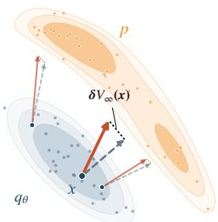  
(a) Balanced transport

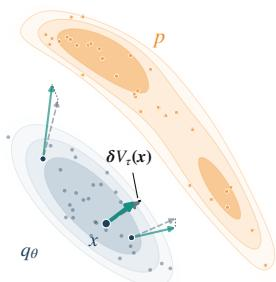  
(b) Unbalanced transport

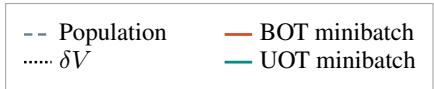  
Figure 1: Finite-batch velocity perturbations. Both panels use identical samples and arrow scales. Dashed arrows show population velocities, solid arrows show minibatch estimates, and dotted segments mark their difference δV. UOT has a smaller perturbation at x in this illustration.

## 4.2 UW-FLOW: RELAXING MARGINAL CONSTRAINTS

The finite-batch error in Sec. 4.1 motivates relaxing empirical marginal constraints, allowing transported mass to adapt to sampling fluctuations and potentially reducing velocity perturbations. We therefore use unbalanced optimal transport (UOT) (Chizat et al., 2018), which replaces hard marginal constraints with soft penalties. For $\tau > 0$ , we use

$$
\mathrm { U O T } _ { \varepsilon , \tau } ( q , p ) = \operatorname* { i n f } _ { \pi \geq 0 } \left\{ \int c ( x , y ) d \pi ( x , y ) + \tau D _ { \mathrm { K L } } ( \pi _ { 1 } \| q ) + \tau D _ { \mathrm { K L } } ( \pi _ { 2 } \| p ) + \varepsilon D _ { \mathrm { K L } } ( \pi \parallel q \otimes p ) \right\} ,\tag{12}
$$

where $\pi _ { 1 }$ and $\pi _ { 2 }$ are marginals of $\pi ,$ and $D _ { \mathrm { K L } }$ denotes the generalized KL divergence. Larger τ penalizes deviations from q and $p ,$ while smaller τ allows trade-offs between marginal mismatch and transport cost. Following Eq. 5, we use the debiased unbalanced Sinkhorn divergence (Séjourné et al., 2019),

$$
\boldsymbol { S } _ { \varepsilon , \tau } ^ { \mathrm { U } } ( \boldsymbol { q } , \boldsymbol { p } ) = \mathrm { U O T } _ { \varepsilon , \tau } ( \boldsymbol { q } , \boldsymbol { p } ) - \frac { 1 } { 2 } \mathrm { U O T } _ { \varepsilon , \tau } ( \boldsymbol { q } , \boldsymbol { q } ) - \frac { 1 } { 2 } \mathrm { U O T } _ { \varepsilon , \tau } ( \boldsymbol { p } , \boldsymbol { p } ) ,\tag{13}
$$

as our distributional energy, $\mathcal { F } _ { \tau } ( q ; p ) : = S _ { \varepsilon , \tau } ^ { \mathrm { U } } ( q , p )$ . The mass-correction term in the general unbalanced Sinkhorn divergence vanishes here because q and p both have unit mass.

Let $\pi _ { q , \mu } ^ { \varepsilon , \tau }$ be the optimal UOT coupling between q and $\mu ,$ where $\mu \in \{ p , q \}$ . Unlike a balanced coupling, its first marginal need not equal q. Writing $\pi _ { q , \mu } ^ { \varepsilon , \tau } ( d x , d y ) = q ( d x ) \pi _ { q , \mu } ^ { \varepsilon , \tau } ( d y | x )$ , define the local transportedmass ratio and normalized barycentric projection by

$$
s _ { q , \mu } ^ { \tau } ( x ) : = \frac { d ( \pi _ { q , \mu } ^ { \varepsilon , \tau } ) _ { 1 } } { d q } ( x ) , \qquad T _ { q , \mu } ^ { \tau } ( x ) : = \frac { \int \ d y \pi _ { q , \mu } ^ { \varepsilon , \tau } ( d y \mid x ) } { s _ { q , \mu } ^ { \tau } ( x ) } .\tag{14}
$$

Here, $\pi _ { q , \mu } ^ { \varepsilon , \tau } ( d y \mid x )$ is a possibly unnormalized measure, and the barycenter is defined wherever $s _ { q , \mu } ^ { \tau } ( x ) > 0$ The Wasserstein gradient of $\dot { \mathcal { F } _ { \tau } }$ yields

$$
V _ { q , p } ^ { \tau } ( x ) = s _ { q , p } ^ { \tau } ( x ) \big ( T _ { q , p } ^ { \tau } ( x ) - x \big ) - s _ { q , q } ^ { \tau } ( x ) \big ( T _ { q , q } ^ { \tau } ( x ) - x \big ) .\tag{15}
$$

The derivation from the UOT dual and first variation is in Appendix A.1. This field retains the cross-minusself structure in Eq. 6, with each displacement weighted by transported mass. Under the assumptions stated in Appendix A.2, it satisfies target identifiability: $\bar { V } _ { q , p } ^ { \tau } = \mathrm { \bar { 0 } }$ q-almost everywhere if and only if $q = p .$ . The proof appears there. Together with marginal relaxation, this property motivates the hypothesis that UOT may improve one-step training when minibatch-induced marginal mismatch perturbs the balanced velocity field. $\begin{array} { r } { \dot { \mathrm { A s } } \tau  \infty , S _ { \varepsilon , \tau } ^ { \acute { \mathrm { U } } } ( q , p )  S _ { \varepsilon } ( q , p ) } \end{array}$ and $V _ { q , p } ^ { \tau } \to V _ { q , p }$ , recovering balanced W-Flow (Han et al., 2026). The full algorithm is provided in Sec. F.1.

## 4.3 FINITE-BATCH VELOCITY ERROR UNDER MARGINAL RELAXATION

We now compare the finite-batch estimation errors of balanced and unbalanced velocity fields. To this end, define the mass-weighted transport term $U _ { q , \mu } ^ { \tau } ( x ) : = s _ { q , \mu } ^ { \tau } ( x ) \big ( T _ { q , \mu } ^ { \tau } ( x ) - x \big )$ . The population field in Eq. 15 is then $V _ { q , p } ^ { \tau } = U _ { q , p } ^ { \tau } - U _ { q , q } ^ { \tau } ,$ , and the empirical field is $\widehat { V } _ { B } ^ { \tau } : = U _ { \widehat { q } _ { B } , \widehat { p } _ { B } } ^ { \tau } - U _ { \widehat { q } _ { B } , \widehat { q } _ { B } ^ { \prime } } ^ { \tau }$

We measure its finite-batch error relative to the population field $V _ { q , p } ^ { \tau }$ as

$$
\mathcal { E } _ { \tau } ( B ) : = \mathbb { E } \left[ \frac { 1 } { B } \sum _ { i = 1 } ^ { B } \left. \widehat { V } _ { B } ^ { \tau } ( x _ { i } ) - V _ { q , p } ^ { \tau } ( x _ { i } ) \right. _ { 2 } ^ { 2 } \right] .\tag{16}
$$

Consistent with the hard-marginal limit $\tau  \infty .$ , we write the balanced quantities from Sec. 4.1 as $\mathcal { E } _ { \infty } ( B ) : =$ $\mathcal { E } _ { \mathrm { B O T } } ( B )$ and $L _ { \infty } : = L _ { \mathrm { B O T } }$ . Note that each error is measured relative to its own population field.

Finite-batch sensitivity of UOT. For the first-order analysis, we assume fixed finite supports with strictly positive population masses, so minibatch sampling induces multinomial fluctuations in the empirical masses. Unlike balanced OT, UOT allows the transported-mass ratio $s _ { i }$ to vary. We analyze how these mass fluctuations affect both $s _ { i }$ and the barycentric destination $T _ { i }$

Proposition 2 (Finite-batch error of UW-Flow). Under the fixed-support assumptions above, for any fixed $0 < \tau < \infty ,$ , as $B \to \infty$

$$
\mathcal { E } _ { \tau } ( B ) = \frac { A _ { \tau } } { B } + O ( B ^ { - 3 / 2 } ) .\tag{17}
$$

The $1 / B$ factor reflects the scale of finite-batch sampling noise, while $A _ { \tau } < \infty$ is a B-independent coefficient that quantifies the leading sensitivity of the UOT velocity field to empirical marginal perturbations. The derivation is deferred to Appendix C. Combining this expansion with the balanced lower bound from Sec. 4.1 yields the following comparison theorem.

Theorem 1 (Finite-batch stability comparison). From the finite-batch error characterizations of UOT in Eq. 17 and balanced OT in Eq. 11, $ { i f { \cal A } _ { \tau } } ^ { \star } < L _ { \infty } ^ { 2 }$ , then there exists $B _ { 0 } < \infty$ such that

$$
A _ { \tau } < L _ { \infty } ^ { 2 } \quad \implies \quad \mathcal { E } _ { \tau } ( B ) < \mathcal { E } _ { \infty } ( B ) , \qquad \forall B \geq B _ { 0 } .\tag{18}
$$

Under the stated condition, the theorem shows that, for sufficiently large B, the empirical UOT field is closer to its own population field than the balanced field is to its population counterpart. Although this comparison does not rank the population fields or guarantee better generation, Sec. 4.4 establishes the condition in a separated two-mode setting and tests the predicted stability gap with finite-batch experiments. Sec. 5 then reports generation gains in more complex settings.

## 4.4 SEPARATE-MODE ANALYSIS

Separated mode analysis. To verify the sufficient condition $A _ { \tau } < L _ { \infty } ^ { 2 }$ , we consider a separated two-mode setting. The source and target distributions each consist of two matched modes whose within-pair geometry remains uniformly bounded as the two mode pairs become increasingly separated. Let the target modes have masses ω and $1 - \omega$ , with conditional means $\mu _ { 1 }$ and $\mu _ { 2 }$ , and define their separation as $d _ { \mu } : = \| \mu _ { 1 } - \mu _ { 2 } \|$

For balanced OT, the target-mode separation directly contributes to the finite-batch error through the target covariance. In particular, the balanced coefficient satisfies

$$
L _ { \infty } ^ { 2 } \geq \omega ( 1 - \omega ) d _ { \mu } ^ { 2 } .\tag{19}
$$

In contrast, for any fixed finite $\tau ,$ UOT can absorb mode-count mismatch through marginal relaxation, so that transport between unmatched modes vanishes as the modes separate while the local transport geometry remains bounded. Consequently,

Corollary 1 (Bounded UOT sensitivity under mode separation). For any fixed $0 < \tau < \infty$ , under the separated matched-mode assumptions above,

$$
A _ { \tau } ( d _ { \mu } ) = O ( 1 ) , \qquad d _ { \mu }  \infty .\tag{20}
$$

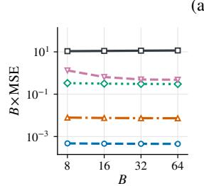  
(a)

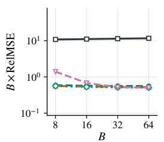

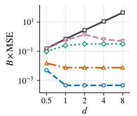  
(b)

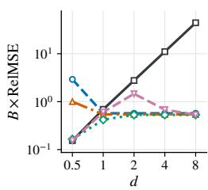  
W-Flow UW-Flow(τ = 0.05) UW-Flow(τ = 0.1) UW-Flow(τ = 1) UW-Flow(τ = 10)  
Figure 2: Minibatch velocity error on fixed supports. Each method is evaluated against its own population velocity. Panel (a) sweeps B at $d = 4$ , while panel (b) sweeps d at $B = 1 6$ . Within each panel, the left plot shows $B \times \mathrm { M S E }$ and the right plot shows $\bar { B ^ { \prime } } \times \mathrm { R e l M S E }$ . RelMSE is MSE divided by the corresponding population-field energy.

A formal derivation is provided in Appendix D. Hence, for sufficiently large $d _ { \mu }$ , the condition $A _ { \tau } < L _ { \infty } ^ { 2 }$ holds.

We use two controlled settings to examine (i) whether the finite-batch error follows the predicted $1 / B$ sensitivity, (ii) how their error gap varies with mode separation, (iii) whether the observed advantage extends beyond fixed supports. We vary B, d, and τ in a fixed-support two-particle model and a continuously sampled two-Gaussian extension. Experimental details are provided in Appendix E.

Fixed-support perturbations. Fig. 2 shows approximately constant $B \times \mathrm { M S E }$ across the tested batch sizes, consistent with $1 / B$ error scaling for both methods. The absolute error gap widens with mode separation, consistent with Eq. 19 and Eq. 20. The $B \times \mathrm { R e l M S E }$ curves show that UOT’s advantage at larger separations persists after accounting for differences in population-field magnitude. Full results, including cosine similarity, appear in Appendix E.2.

Beyond fixed supports. Appendix E.3 extends the comparison to Gaussian mixtures, where both mode proportions and sample locations fluctuate. UOT generally exhibits lower relative error and higher directional agreement over the tested configurations.

## 5 EXPERIMENTAL RESULTS

We evaluate UW-Flow on synthetic targets and image-generation benchmarks. Within each comparison, we replace W-Flow’s (Han et al., 2026) balanced Sinkhorn energy with its unbalanced counterpart while keeping the generator architecture, optimization protocol, and training budget matched. Each transport group consists of three batches of size B: generated samples $( N _ { \mathrm { g e n } } = { \bar { B } } )$ , target samples $( N _ { \mathrm { p o s } } = B )$ , and an independently drawn batch of B generated samples that serves as the self-reference. In transport-batch ablations, we vary B while adjusting the number of groups $N _ { c }$ to keep the number of generated samples per optimizer update fixed at $B _ { \mathrm { o p t } } = N _ { c } B$

## 5.1 TOY ANALYSIS: SYNTHETIC DISTRIBUTION MATCHING

We evaluate distribution matching beyond the controlled two-mode settings of Sec. 4.4. We train W-Flow and UW-Flow on three two-dimensional targets: checkerboard, two moons, and Gaussian ring. Both methods use $B = 1 2 8$ and $B _ { \mathrm { o p t } } = 5 1 2$ , with $\tau = 0 . 1$ for UW-Flow. Experimental details and additional ablations over B and τ are provided in Appendix F.2.

Qualitatively, UW-Flow captures the characteristic structures of all three targets $( \mathrm { F i g } . 3 )$ . The quantitative results in Tab. 1 generally favor UW-Flow over W-Flow, as measured by squared sliced Wasserstein distance $( \mathrm { S W } ^ { 2 } )$ and squared maximum mean discrepancy $\mathrm { ( M M D ^ { 2 } ) }$ .

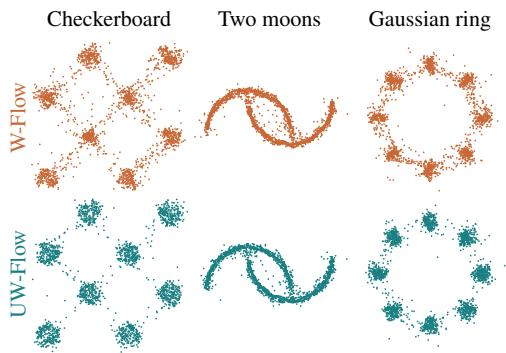  
Figure 3: W-Flow (top) and UW-Flow (bottom) across three distributions.

Table 1: Toy distribution matching with W-Flow and UW-Flow. Values are $\times 1 0 ^ { - 3 }$ ; best in bold.
<table><tr><td rowspan="2">Metric</td><td rowspan="2">Method</td><td colspan="3">Distribution</td></tr><tr><td>Checker- board</td><td>Two moons</td><td>Gaussian ring</td></tr><tr><td> $\mathrm { S W ^ { 2 } \downarrow }$ </td><td>W-Flow UW-Flow</td><td>2.970</td><td>0.825</td><td>4.280</td></tr><tr><td rowspan="2"> ${ \mathrm { M M D } } ^ { 2 } \downarrow$ </td><td></td><td>2.600</td><td>0.852</td><td>3.760</td></tr><tr><td>W-Flow UW-Flow</td><td>1.490 0.700</td><td>0.483 0.407</td><td>0.866 0.501</td></tr></table>

## 5.2 FIXED-BUDGET MINIBATCH DISCREPANCY ABLATION

We examine whether marginal relaxation improves unconditional generation with limited transport support on MNIST (LeCun et al., 1998) and CIFAR-10 (Krizhevsky et al., 2009). We vary $B \in \{ 4 , \bar { 8 , } 1 6 , 3 \bar { 2 , } \bar { 6 } 4 \}$ while keeping $B _ { \mathrm { o p t } }$ fixed at 64 for MNIST and 128 for CIFAR-10. We report Fréchet Inception Distance (FID) (Heusel et al., 2017), precision, and recall (Kynkäänniemi et al., 2019) on both datasets, and Inception Score (IS) (Salimans et al., 2016) on CIFAR-10. Further experimental details are provided in Appendix F.

Tab. 2 and Tab. 3 show the generation results as the transport support size B varies under a fixed per-update budget. FID generally decreases with increasing B for both W-Flow and the reported UW-Flow configurations. We evaluate $\tau \in \{ 0 . 1 , 1 , 1 0 \}$ at each support size and report a selected UW-Flow configuration in the main tables; the complete results are provided in Appendix F.3. UW-Flow consistently achieves lower FID than W-Flow at every tested support size on both datasets. At the smallest support sizes, B = 4 and B = 8, UW-Flow achieves the largest absolute FID reductions over W-Flow, by 15.02 and 14.69 points, respectively. It also maintains a lower FID at B = 64 (4.51 versus 8.10). These results show that an appropriate choice of τ can improve one-step generation by relaxing the hard marginal constraints of balanced OT.

Table 2: MNIST results with $B _ { \mathrm { o p t } } = 6 4 .$
<table><tr><td> $N _ { c } N _ { \mathrm { g e n } } N _ { \mathrm { p o s } }$ </td><td></td><td>Method</td><td>FID↓</td><td>Prec. ↑</td><td>Rec. ↑</td></tr><tr><td>16 4</td><td>4</td><td>W-Flow UW-Flow</td><td>19.70 17.98</td><td>0.54 0.46</td><td>0.06 0.12</td></tr><tr><td>8</td><td>8</td><td>8</td><td>W-Flow UW-Flow</td><td>13.69 12.37</td><td>0.46 0.48</td><td>0.24 0.28</td></tr><tr><td>4</td><td>16</td><td>16</td><td>W-Flow UW-Flow</td><td>9.86 9.22</td><td>0.49 0.47</td><td>0.43 0.51</td></tr><tr><td>2 32</td><td></td><td>32</td><td>W-Flow UW-Flow</td><td>8.72 7.33</td><td>0.58</td><td>0.32</td></tr><tr><td></td><td></td><td></td><td>W-Flow</td><td>7.03</td><td>0.60 0.57</td><td>0.34</td></tr><tr><td>1</td><td>64</td><td>64</td><td>UW-Flow</td><td>5.67</td><td>0.59</td><td>0.53 0.57</td></tr></table>

Table 3: CIFAR-10 results with $B _ { \mathrm { o p t } } = 1 2 8 .$
<table><tr><td> $N _ { c } N _ { \mathrm { g e n } } N _ { \mathrm { p o s } }$ </td><td></td><td></td><td>Method</td><td>FID↓</td><td>IS↑</td><td>Prec. ↑</td><td>Rec. ↑</td></tr><tr><td rowspan="2">32</td><td rowspan="2">4</td><td rowspan="2">4</td><td>W-Flow</td><td>30.58</td><td>9.75</td><td>0.55</td><td>0.01</td></tr><tr><td>UW-Flow</td><td>15.56</td><td>10.60</td><td>0.52</td><td>0.07</td></tr><tr><td rowspan="2">16</td><td rowspan="2"></td><td rowspan="2">8</td><td>W-Flow</td><td>24.39</td><td>8.99</td><td>0.58</td><td>0.01</td></tr><tr><td>UW-Flow</td><td>9.70</td><td>10.53</td><td>0.56</td><td>0.17</td></tr><tr><td rowspan="2">8</td><td rowspan="2">16</td><td rowspan="2">16</td><td>W-Flow</td><td>12.49</td><td>10.09</td><td>0.59</td><td>0.07</td></tr><tr><td>UW-Flow</td><td>10.03</td><td>9.87</td><td>0.61</td><td>0.15</td></tr><tr><td rowspan="2"></td><td rowspan="2">4 32</td><td rowspan="2">32</td><td>W-Flow</td><td>9.57</td><td>10.32</td><td>0.63</td><td>0.08</td></tr><tr><td>UW-Flow</td><td>5.01</td><td>10.43</td><td>0.61</td><td>0.39</td></tr><tr><td rowspan="2">2</td><td rowspan="2">64</td><td rowspan="2">64</td><td>W-Flow</td><td>8.10</td><td>10.37</td><td>0.60</td><td>0.27</td></tr><tr><td>UW-Flow</td><td>4.51</td><td>10.37</td><td>0.60</td><td>0.45</td></tr></table>

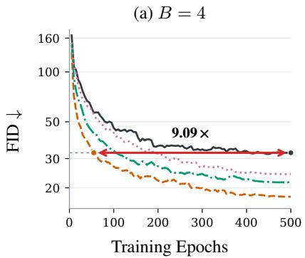

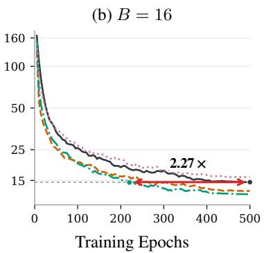

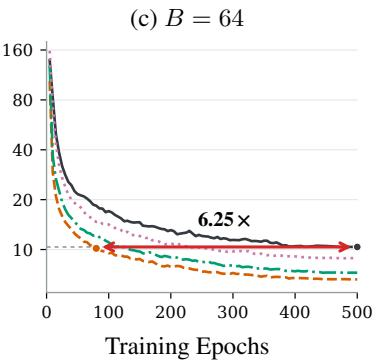  
W-Flow UW-Flow(τ = 0.1) UW-Flow(τ = 1) UW-Flow(τ = 10)  
Figure 4: CIFAR-10 training dynamics across transport support sizes. FID versus training epoch for W-Flow and UW-Flow with $\tau \in \{ 0 . 1 , 1 , 1 0 \}$ . FID is computed using 10,000 generated samples at each evaluation. Panels show $B = 4 , 1 6 .$ , and 64, with the sample budget per optimizer update fixed at $B _ { \mathrm { o p t } } =$ $N _ { c } B = 1 2 8$

Fig. 4 compares FID trajectories across three transport support sizes. UW-Flow with $\tau = 0 . 1 \mathrm { o r } \tau = 1$ generally reaches lower FID in fewer training epochs than W-Flow. At $B = 4 ,$ , UW-Flow with $\tau = 0 . 1$ reaches the FID attained by W-Flow at epoch 500 after approximately 55 epochs, requiring about 9.1× fewer epochs; at $B = 6 4$ , it reaches the corresponding FID after 80 epochs, requiring 6.25× fewer epochs. As τ increases to 10, the trajectories generally move closer to that of W-Flow.

## 5.3 SCALING TO COMPLEX VISUAL DISTRIBUTIONS

To evaluate UW-Flow on a more complex target distribution, we use ImageNet-100, a 100-class subset of ImageNet (Deng et al., 2009), and test both unconditional and class-conditional generation. We compare W-Flow (Han et al., 2026) and UW-Flow under matched generator architectures, feature encoders, sampling configurations, and optimization budgets. We report FID (Heusel et al., 2017), IS (Salimans et al., 2016), precision, and recall (Kynkäänniemi et al., 2019). The experimental setup and results for all tested values of τ are provided in Appendix F.5.

Tab. 4 reports the results for unconditional and class-conditional ImageNet-100 generation. We evaluate $\tau \in \{ 0 . 1 , 1 , 1 0 \}$ and report the configuration with the lowest FID for each setting. For unconditional generation, UW-Flow with $\tau = 0 . 1$ reduces FID from 55.25 to 46.17 (16.4%), with higher IS and recall but lower precision. For classconditional generation, $\tau = 1$ reduces FID from 9.43 to 9.11 (3.4%) and improves IS and preci-

Table 4: ImageNet-100 results at matched budgets.
<table><tr><td>Setting</td><td>Method</td><td>FID↓</td><td>IS↑</td><td>Prec. ↑</td><td>Rec. ↑</td></tr><tr><td>Uncond</td><td>W-Flow</td><td>55.25</td><td>23.89</td><td>0.42</td><td>0.14</td></tr><tr><td>Uncond</td><td>UW-Flow</td><td>46.17</td><td>27.71</td><td>0.40</td><td>0.29</td></tr><tr><td>Cond</td><td>W-Flow</td><td>9.43</td><td>60.31</td><td>0.74</td><td>0.26</td></tr><tr><td>Cond</td><td>UW-Flow</td><td>9.11</td><td>61.34</td><td>0.75</td><td>0.26</td></tr></table>

sion, while recall remains unchanged at the reported precision. The smaller conditional gain is consistent with class-wise transport reducing opportunities for between-class mismatch, although these results do not directly measure coupling mismatch. Full results for all tested values of τ are provided in Appendix F.5.

## 6 CONCLUSION

We introduced UW-Flow to reduce the sensitivity of W-Flow’s velocity field to finite-batch marginal fluctuations. Our analysis characterizes the minibatch-to-population error and identifies a separated-mode setting

in which marginal relaxation improves finite-batch stability. Controlled experiments support this analysis, while results on MNIST, CIFAR-10, and ImageNet-100 show gains in generation quality under finite transport support.

Limitations. Our stability comparison measures each minibatch field against its own population field. It does not compare the population velocities of UOT and balanced transport or guarantee better generation for arbitrary distributions. We also do not provide a method for selecting τ for a given setting.

## AI USE STATEMENT

Generative AI tools were used in this work only for two supporting tasks: revising the manuscript for clarity and readability, and proofreading the mathematical derivations for typographical and notational errors. The research itself was carried out by the authors. This includes the idea of using the debiased unbalanced Sinkhorn divergence as the energy for W-Flow, the derivation of the UW-Flow velocity and its identifiability property, the finite-batch error analysis of balanced and unbalanced transport. The authors were also solely responsible for designing the experiments, implementing the method, selecting datasets, baselines, and metrics, interpreting the results, and surveying and positioning the related literature. AI tools were not used for any of these tasks.

Every AI-suggested edit was checked by the authors, and any change affecting a mathematical expression was verified against the original derivation before being adopted. The authors take full responsibility for the final content of this work, including text, claims or artifacts produced with the aid of generative AI.

## ETHICS STATEMENT

This work uses only publicly available datasets (MNIST, CIFAR-10, and ImageNet-100) and synthetic distributions, and it does not involve human-subject experiments or the collection of personally identifiable information. As with other generative models, models trained with our method may inherit biases present in the training data and could be misused to produce misleading synthetic images. We do not identify ethical concerns beyond those generally associated with generative modeling.

## REPRODUCIBILITY STATEMENT

All theoretical results are stated with their assumptions in the main text, and complete proofs are provided in Appendix. Appendix E also describes the setup of the velocity-error experiments, and Appendix F provides the full training configurations, hyperparameters, and complete results for the generation experiments. All datasets used in this work are publicly available, and we will release our code upon acceptance.

## REFERENCES

Luigi Ambrosio, Nicola Gigli, and Giuseppe Savaré. Gradient flows: in metric spaces and in the space of probability measures. Springer, 2005.

Yogesh Balaji, Rama Chellappa, and Soheil Feizi. Robust optimal transport with applications in generative modeling and domain adaptation. Advances in Neural Information Processing Systems, 33:12934–12944, 2020.

Lenaic Chizat, Gabriel Peyré, Bernhard Schmitzer, and François-Xavier Vialard. Scaling algorithms for unbalanced optimal transport problems. Mathematics of computation, 87(314):2563–2609, 2018.

Jaemoo Choi, Jaewoong Choi, and Myungjoo Kang. Generative modeling through the semi-dual formulation of unbalanced optimal transport. In NeurIPS, 2023.

Jaemoo Choi, Jaewoong Choi, and Myungjoo Kang. Scalable wasserstein gradient flow for generative modeling through unbalanced optimal transport. In ICML, 2024.

Marco Cuturi. Sinkhorn distances: Lightspeed computation of optimal transport. In NeurIPS, 2013.

Jia Deng, Wei Dong, Richard Socher, Li-Jia Li, Kai Li, and Li Fei-Fei. Imagenet: A large-scale hierarchical image database. In CVPR, 2009.

Mingyang Deng, He Li, Tianhong Li, Yilun Du, and Kaiming He. Generative modeling via drifting. arXiv preprint arXiv:2602.04770, 2026.

Luca Eyring, Dominik Klein, Théo Uscidda, Giovanni Palla, Niki Kilbertus, Zeynep Akata, and Fabian Theis. Unbalancedness in neural monge maps improves unpaired domain translation. In ICLR, 2024.

Kilian Fatras, Younes Zine, Rémi Flamary, Rémi Gribonval, and Nicolas Courty. Learning with minibatch wasserstein: asymptotic and gradient properties. arXiv preprint arXiv:1910.04091, 2019.

Kilian Fatras, Thibault Séjourné, Rémi Flamary, and Nicolas Courty. Unbalanced minibatch optimal transport; applications to domain adaptation. In ICML, 2021.

Jean Feydy, Thibault Séjourné, François-Xavier Vialard, Shun-ichi Amari, Alain Trouvé, and Gabriel Peyré. Interpolating between optimal transport and mmd using sinkhorn divergences. In AISTATS, 2019.

Aude Genevay, Gabriel Peyré, and Marco Cuturi. Learning generative models with sinkhorn divergences. In International conference on artificial intelligence and statistics, pp. 1608–1617. PMLR, 2018.

Ziv Goldfeld, Kengo Kato, Gabriel Rioux, and Ritwik Sadhu. Limit theorems for entropic optimal transport maps and sinkhorn divergence. Electronic Journal of Statistics, 2024.

Jiaqi Han, Puheng Li, Qiushan Guo, Renyuan Xu, Stefano Ermon, and Emmanuel J Candès. One-step generative modeling via wasserstein gradient flows. arXiv preprint arXiv:2605.11755, 2026.

Kaiming He, Xiangyu Zhang, Shaoqing Ren, and Jian Sun. Deep residual learning for image recognition. In CVPR, 2016.

Martin Heusel, Hubert Ramsauer, Thomas Unterthiner, Bernhard Nessler, and Sepp Hochreiter. GANs trained by a two time-scale update rule converge to a local nash equilibrium. In NeurIPS, 2017.

Alex Krizhevsky, Geoffrey Hinton, et al. Learning multiple layers of features from tiny images. 2009.

Tuomas Kynkäänniemi, Tero Karras, Samuli Laine, Jaakko Lehtinen, and Timo Aila. Improved precision and recall metric for assessing generative models. In NeurIPS, 2019.

Yann LeCun, Léon Bottou, Yoshua Bengio, and Patrick Haffner. Gradient-based learning applied to document recognition. Proceedings ofthe IEEE, 1998.

Matthias Liero, Alexander Mielke, and Giuseppe Savaré. Optimal entropy-transport problems and a new hellinger–kantorovich distance between positive measures. Inventiones mathematicae, 211(3):969–1117, 2018.

Khai Nguyen, Dang Nguyen, Quoc Nguyen, Tung Pham, Hung Bui, Dinh Phung, Trung Le, and Nhat Ho. On transportation of mini-batches: A hierarchical approach. arXiv preprint arXiv:2102.05912, 2021.

Khai Nguyen, Dang Nguyen, The-Anh Vu-Le, Tung Pham, and Nhat Ho. Improving mini-batch optimal transport via partial transportation. In ICML, 2022.

Aram-Alexandre Pooladian, Heli Ben-Hamu, Carles Domingo-Enrich, Brandon Amos, Yaron Lipman, and Ricky TQ Chen. Multisample flow matching: Straightening flows with minibatch couplings. In ICML, 2023.

Philippe Rigollet and Austin J Stromme. On the sample complexity of entropic optimal transport. The Annals ofStatistics, 2025.

Robin Rombach, Andreas Blattmann, Dominik Lorenz, Patrick Esser, and Björn Ommer. High-resolution image synthesis with latent diffusion models. In CVPR, 2022.

Litu Rout, Alexander Korotin, and Evgeny Burnaev. Generative modeling with optimal transport maps. arXiv preprint arXiv:2110.02999, 2021.

Tim Salimans, Ian Goodfellow, Wojciech Zaremba, Vicki Cheung, Alec Radford, and Xi Chen. Improved techniques for training GANs. In NeurIPS, 2016.

Thibault Séjourné, Jean Feydy, François-Xavier Vialard, Alain Trouvé, and Gabriel Peyré. Sinkhorn divergences for unbalanced optimal transport. arXiv preprint arXiv:1910.12958, 2019.

Yonglong Tian, Dilip Krishnan, and Phillip Isola. Contrastive multiview coding. In ECCV. Springer, 2020.

Alexander Tong, Kilian Fatras, Nikolay Malkin, Guillaume Huguet, Yanlei Zhang, Jarrid Rector-Brooks, Guy Wolf, and Yoshua Bengio. Improving and generalizing flow-based generative models with minibatch optimal transport. TMLR, 2024.

Karren D Yang and Caroline Uhler. Scalable unbalanced optimal transport using generative adversarial networks. arXiv preprint arXiv:1810.11447, 2018.

Linqi Zhou, Stefano Ermon, and Jiaming Song. Inductive moment matching. In ICML, 2025.

Huminhao Zhu, Fangyikang Wang, Chao Zhang, Hanbin Zhao, and Hui Qian. Neural sinkhorn gradient flow. arXiv preprint arXiv:2401.14069, 2024.

## A ENERGY FUNCTIONAL AS AN UNBALANCED SINKHORN DIVERGENCE

This section establishes the two population-level properties used in Sec. 4.2. We first derive the Wasserstein velocity induced by the debiased unbalanced Sinkhorn divergence and then show that the resulting field preserves the desired population target.

## A.1 FROM THE UOT ENERGY TO THE WASSERSTEIN VELOCITY

For positive measures $\mu \ll \nu ,$ define the generalized KL divergence

$$
D _ { \mathrm { K L } } ( \mu \| \nu ) = \int \log \left( \frac { d \mu } { d \nu } \right) d \mu - m ( \mu ) + m ( \nu ) .\tag{21}
$$

Using the convex conjugate of $h ( r ) = r \log r - r + 1$ , namely $h ^ { \star } ( z ) = e ^ { z } - 1$ , the entropic KL-UOT problem admits the dual

$$
\begin{array} { l } { { \displaystyle \mathrm { U O T } _ { \varepsilon , \tau } ( q , p ) = \operatorname* { s u p } _ { f , g } \Biggl \{ \tau \int \left( 1 - e ^ { - f ( x ) / \tau } \right) d q ( x ) } \ ~ } \\ { { \displaystyle ~ + \tau \int \left( 1 - e ^ { - g ( y ) / \tau } \right) d p ( y ) } \ ~ } \\ { { \displaystyle ~ - \varepsilon \iint \left[ \exp \left( \frac { f ( x ) + g ( y ) - c ( x , y ) } { \varepsilon } \right) - 1 \right] d q ( x ) d p ( y ) \Biggr \} } . } \end{array}\tag{22}
$$

The optimal coupling has Gibbs form

$$
d \pi _ { q , p } ^ { \varepsilon , \tau } ( x , y ) = \exp \left( \frac { f _ { q , p } ( x ) + g _ { q , p } ( y ) - c ( x , y ) } { \varepsilon } \right) d q ( x ) d p ( y ) .\tag{23}
$$

Differentiating the dual objective with respect to $f _ { q , p } ( x )$ gives

$$
e ^ { - f _ { q , p } ( x ) / \tau } = \int \exp \left( \frac { f _ { q , p } ( x ) + g _ { q , p } ( y ) - c ( x , y ) } { \varepsilon } \right) d p ( y ) .\tag{24}
$$

The right-hand side is the density of the first coupling marginal with respect to q. Define

$$
s _ { q , p } ^ { \tau } ( x ) : = \frac { d ( \pi _ { q , p } ^ { \varepsilon , \tau } ) _ { 1 } } { d q } ( x ) = e ^ { - f _ { q , p } ( x ) / \tau } .\tag{25}
$$

Let

$$
T _ { q , p } ^ { \tau } ( x ) : = \frac { \int { y \pi _ { q , p } ^ { \varepsilon , \tau } ( d y \mid x ) } } { s _ { q , p } ^ { \tau } ( x ) } .\tag{26}
$$

Thus $s _ { q , p } ^ { \tau } ( x )$ determines how much mass is transported from $x ,$ whereas $T _ { q , p } ^ { \tau } ( x )$ determines its normalized barycentric destination.

By the envelope theorem,

$$
\frac { \delta \mathrm { U O T } _ { \varepsilon , \tau } ( q , p ) } { \delta q } ( x ) = ( \tau + \varepsilon ) \left( 1 - s _ { q , p } ^ { \tau } ( x ) \right) .\tag{27}
$$

For the debiased energy

$$
\mathcal { F } _ { \tau } ( q ; p ) : = S _ { \varepsilon , \tau } ^ { \mathrm { U } } ( q , p ) ,\tag{28}
$$

symmetry of the self term gives

$$
\frac { \delta { \mathcal F } _ { \tau } } { \delta q } ( q ; p ) ( x ) = ( \tau + \varepsilon ) \left( s _ { q , q } ^ { \tau } ( x ) - s _ { q , p } ^ { \tau } ( x ) \right) .\tag{29}
$$

For $\begin{array} { r } { c ( x , y ) = \frac { 1 } { 2 } \| x - y \| _ { 2 } ^ { 2 } } \end{array}$ , differentiating the optimality condition yields

$$
\nabla f _ { q , p } ( x ) = \frac { \tau } { \tau + \varepsilon } \left( x - T _ { q , p } ^ { \tau } ( x ) \right) .\tag{30}
$$

Since $s _ { q , p } ^ { \tau } ( x ) = e ^ { - f _ { q , p } ( x ) / \tau }$

$$
\nabla s _ { q , p } ^ { \tau } ( x ) = \frac { s _ { q , p } ^ { \tau } ( x ) } { \tau + \varepsilon } \left( T _ { q , p } ^ { \tau } ( x ) - x \right) .\tag{31}
$$

Therefore

$$
V _ { q , p } ^ { \tau } ( \boldsymbol { x } ) = - \nabla _ { \boldsymbol { x } } \frac { \delta \mathcal { F } _ { \tau } } { \delta q } ( q ; p ) ( \boldsymbol { x } )\tag{32}
$$

takes the form

$$
V _ { q , p } ^ { \tau } ( x ) = s _ { q , p } ^ { \tau } ( x ) \left( T _ { q , p } ^ { \tau } ( x ) - x \right) - s _ { q , q } ^ { \tau } ( x ) \left( T _ { q , q } ^ { \tau } ( x ) - x \right) .\tag{33}
$$

## A.2 POPULATION TARGET CONSISTENCY

Let

$$
\phi _ { q } ( x ) : = \frac { \delta { \mathcal F } _ { \tau } } { \delta q } ( q ; p ) ( x ) , \qquad V _ { q , p } ^ { \tau } ( x ) = - \nabla \phi _ { q } ( x ) .\tag{34}
$$

Assume that p and q are supported on a compact, piecewise- $- C ^ { 1 }$ , path-connected set $\mathcal { X } \subset \mathbb { R } ^ { d }$ , that $q$ has full support on $\mathcal { X } , \phi _ { q }$ is $\mathsf { \bar { C } } ^ { 1 }$ on a neighborhood of $\mathcal { X } _ { : }$ , and $\mathcal { F } _ { \tau } ( \cdot ; p )$ is convex, nonnegative, and definite on $\mathcal { P } ( \mathcal { X } )$ Suppose first that

$$
V _ { q , p } ^ { \tau } = 0 \qquad q \mathrm { - a . e . }\tag{35}
$$

Full support and continuity imply

$$
\nabla \phi _ { q } ( x ) = 0 , \qquad \forall x \in \mathcal { X } .\tag{36}
$$

Path connectivity therefore gives

$$
\phi _ { q } ( x ) = C , \qquad x \in \mathcal { X } .\tag{37}
$$

By convexity, for every probability measure r supported on $\mathcal { X }$

$$
\mathcal { F } _ { \tau } ( r ; p ) \geq \mathcal { F } _ { \tau } ( q ; p ) + \int \phi _ { q } ( x ) d ( r - q ) ( x )\tag{38}
$$

$$
= F _ { \tau } ( q ; p ) ,\tag{39}
$$

because r and $q$ have the same total mass. Hence q is a global minimizer over $\mathcal { P } ( \mathcal { X } )$ . Since

$$
\mathcal { F } _ { \tau } ( p ; p ) = 0\tag{40}
$$

and $\mathcal { F } _ { \tau }$ is nonnegative,

$$
\begin{array} { r } { \mathcal { F } _ { \tau } ( q ; p ) = 0 . } \end{array}\tag{41}
$$

Definiteness then implies

$$
q = p .\tag{42}
$$

Conversely, if $q = p ,$ the cross and self terms in Eq. 33 coincide, so

$$
V _ { q , p } ^ { \tau } = 0 .\tag{43}
$$

Therefore

$$
V _ { q , p } ^ { \tau } = 0 \quad q { \mathrm { - a . e . } } \qquad \iff \qquad q = p .\tag{44}
$$

## B FINITE-BATCH ERROR OF BALANCED SINKHORN FIELDS

This section derives a non-asymptotic lower bound on the velocity MSE of balanced Sinkhorn fields. The key observation is that exact marginal preservation determines the source-averaged velocity through the empirical sample means. Their sampling fluctuations therefore impose an unavoidable component of the finite-batch error.

## B.1 A NON-ASYMPTOTIC LOWER BOUND ON VELOCITY MSE

Mean preservation under balanced transport. Let $\pi ^ { c }$ denote the balanced coupling between $\widehat { q } _ { B }$ and $\widehat { p } _ { B }$ Since each empirical atom has mass $1 / B$ , its barycentric projection is $\begin{array} { r } { T _ { \widehat { q } _ { B } , \widehat { p } _ { B } } ( x _ { i } ) \stackrel { * } { = } \bar { B ^ { } } \sum _ { j } \pi _ { i j } ^ { c } y _ { j } } \end{array}$ . The exact target marginal constraint, $\textstyle \sum _ { i } \pi _ { i j } ^ { c } = 1 / B$ , then gives

$$
\frac { 1 } { B } \sum _ { i = 1 } ^ { B } T _ { \widehat { q } _ { B } , \widehat { p } _ { B } } ( x _ { i } ) = \sum _ { j } y _ { j } \sum _ { i } \pi _ { i j } ^ { c } = \frac { 1 } { B } \sum _ { j = 1 } ^ { B } y _ { j } = \overline { { Y } } _ { B } .
$$

Applying the same argument to the self coupling gives $\begin{array} { r } { \frac { 1 } { B } \sum _ { i } T _ { \widehat { q } _ { B } , \widehat { q } _ { B } ^ { \prime } } ( x _ { i } ) = \overline { { X } } _ { B } ^ { \prime } } \end{array}$ . Consequently,

$$
\int \widehat { V } _ { \infty , B } ( x ) d \widehat { q } _ { B } ( x ) = \overline { { Y } } _ { B } - \overline { { X } } _ { B } ^ { \prime } .\tag{45}
$$

Thus, although individual barycentric assignments depend on the transport geometry, their source average is fixed by the empirical marginals.

From the mean error to a lower bound. Let $V _ { \infty } ^ { \mathrm { p o p } } = T _ { q , p } - T _ { q , q }$ denote the population field, and define $\Delta _ { B } ( x ) : = \widehat { V } _ { \infty , B } ( x ) - V _ { \infty } ^ { \mathrm { p o p } } ( x )$ . Write $\begin{array} { r } { \overline { { \Delta } } _ { B } : = \int \Delta _ { B } d \widehat { q } _ { B } } \end{array}$ for its empirical source average. Since $\widehat { q } _ { B }$ is a probability measure, Jensen’s inequality yields

$$
\begin{array} { r } { \mathcal { E } _ { \infty } ( B ) : = \mathbb { E } \left[ \| \Delta _ { B } \| _ { \widehat { q } _ { B } } ^ { 2 } \right] \geq \mathbb { E } \left[ \| \overline { { \Delta } } _ { B } \| _ { 2 } ^ { 2 } \right] , } \end{array}\tag{46}
$$

where $\begin{array} { r } { \| \Delta _ { B } \| _ { \widehat { q } _ { B } } ^ { 2 } = \frac { 1 } { B } \sum _ { i } \| \Delta _ { B } ( x _ { i } ) \| _ { 2 } ^ { 2 } } \end{array}$ . It therefore suffices to compute the second moment of the batchaveraged error.

By Eq. 45,

$$
\overline { { \Delta } } _ { B } = \overline { { Y } } _ { B } - \overline { { X } } _ { B } ^ { \prime } - \frac { 1 } { B } \sum _ { i = 1 } ^ { B } V _ { \infty } ^ { \mathrm { p o p } } ( x _ { i } ) .\tag{47}
$$

The same marginal-preservation identity at the population level gives

$$
\mathbb { E } _ { q } [ V _ { \infty } ^ { \mathrm { p o p } } ( X ) ] = \mathbb { E } _ { p } [ Y ] - \mathbb { E } _ { q } [ X ] .
$$

Hence $\mathbb { E } [ \overline { { \Delta } } _ { B } ] = 0$ . Moreover, the three sample averages in Eq. 47 depend on mutually independent batches. Using the covariance of an i.i.d. sample mean, we obtain

$$
\begin{array} { l } { { \displaystyle \mathbb { E } \| \overline { { \Delta } } _ { B } \| _ { 2 } ^ { 2 } = \mathrm { T r } \mathrm { C o v } ( \overline { { \Delta } } _ { B } ) } } \\ { { \displaystyle \qquad = \frac { 1 } { B } \mathrm { T r } [ \mathrm { C o v } _ { p } ( Y ) + \mathrm { C o v } _ { q } ( X ) + \mathrm { C o v } _ { q } ( V _ { \infty } ^ { \mathrm { p o p } } ( X ) ) ] = : \frac { L _ { \infty } ^ { 2 } } { B } . } } \end{array}\tag{48}
$$

Combining this identity with Eq. 46 proves

$$
\mathcal { E } _ { \infty } ( B ) \geq \frac { L _ { \infty } ^ { 2 } } { B } , \qquad B \geq 1 .\tag{49}
$$

This bound captures the component of velocity error that remains after averaging over source particles. It follows from exact marginal preservation and batch independence.

## C FINITE-BATCH ERROR OF UW-FLOW

This section derives the finite-batch velocity MSE of UW-Flow. Because UOT does not preserve the input marginals exactly, the mean-preservation argument in Appendix B.1 does not directly apply. Instead, we analyze how empirical mass fluctuations perturb the mass factors and barycentric projections that define the field. We first derive the linear response of a single UOT field, then combine the cross and self responses to obtain the velocity MSE, and finally bound its leading coefficient.

Throughout, we fix $\varepsilon > 0$ and $0 < \tau < \infty$ and consider probability measures on fixed finite supports:

$$
q = \sum _ { i = 1 } ^ { M _ { q } } a _ { i } \delta _ { x _ { i } } , \qquad p = \sum _ { j = 1 } ^ { M _ { p } } b _ { j } \delta _ { y _ { j } } , \qquad a _ { i } , b _ { j } \geq m _ { 0 } > 0 ,\tag{50}
$$

where $\textstyle \sum _ { i } a _ { i } = \sum _ { i } b _ { j } = 1$ . We use the quadratic cost $\begin{array} { r } { C _ { i j } = \frac { 1 } { 2 } \| x _ { i } - y _ { j } \| _ { 2 } ^ { 2 } } \end{array}$ . For a nonnegative weight vector $\nu ,$ write $\begin{array} { r } { \| z \| _ { \nu } ^ { 2 } : = \dot { \sum _ { i } \nu _ { i } } \| z _ { i } \| _ { 2 } ^ { 2 } \mathrm { ~ } \qquad } \end{array}$ ; unsubscripted norms are Euclidean norms of the stacked vectors.

## C.1 FIRST-ORDER PERTURBATION OF THE UOT FIELD

Population coupling and conditional transport. The population KL-UOT coupling has the form

$$
\pi _ { i j } = a _ { i } u _ { i } K _ { i j } b _ { j } v _ { j } , \qquad K _ { i j } = e ^ { - C _ { i j } / \varepsilon } , \qquad \lambda = \frac { \tau } { \tau + \varepsilon } \in ( 0 , 1 ) ,\tag{51}
$$

where the generalized Sinkhorn scalings satisfy

$$
\boldsymbol { u } = [ K ( b \odot v ) ] ^ { - \lambda } , \qquad \boldsymbol { v } = [ K ^ { \top } ( a \odot u ) ] ^ { - \lambda } .\tag{52}
$$

All powers, logarithms, and products denoted by $\odot$ are entrywise.

Let $m ^ { \pi } = \pi { \bf 1 }$ and $n ^ { \pi } = \pi ^ { \top }$ 1 be the transported marginals, and define the conditional coupling matrices

$$
P _ { i j } = \frac { \pi _ { i j } } { m _ { i } ^ { \pi } } , \qquad Q _ { j i } = \frac { \pi _ { i j } } { n _ { j } ^ { \pi } } .\tag{53}
$$

Thus, $P$ averages target quantities conditional on a source atom, while $Q$ averages source quantities conditional on a target atom.

The identity m $\ i _ { i } ^ { \pi } P _ { i j } = \pi _ { i j } = \ o n _ { i } ^ { \pi } Q _ { j i }$ shows that $Q = P ^ { * }$ in the weighted spaces $L ^ { 2 } ( m ^ { \pi } )$ and $L ^ { 2 } ( n ^ { \pi } )$ Conditional Jensen’s inequality also makes both operators contractions. Consequently,

$$
0 \preceq Q P \preceq I , \qquad \| ( I - \lambda ^ { 2 } Q P ) ^ { - 1 } \| _ { n ^ { \pi } \to n ^ { \pi } } \leq \frac { 1 } { 1 - \lambda ^ { 2 } } .\tag{54}
$$

Response of the Sinkhorn scalings. We perturb the source and target masses while keeping their locations fixed. Let

$$
r = \log u , \qquad t = \log v , \qquad D _ { a } = \mathrm { d i a g } ( a ) , \qquad D _ { b } = \mathrm { d i a g } ( b ) ,
$$

and define the relative perturbations

$$
\rho _ { a } = D _ { a } ^ { - 1 } \delta a , \qquad \rho _ { b } = D _ { b } ^ { - 1 } \delta b .\tag{55}
$$

Differentiating the logarithmic form of Eq. $^ { 5 2 }$ gives

$$
\delta r = - \lambda P ( \rho _ { b } + \delta t ) , \qquad \delta t = - \lambda Q ( \rho _ { a } + \delta r ) .\tag{56}
$$

The quantity $w : = \rho _ { b } + \delta t = \delta \log ( b \odot v )$ collects the change in the effective target weights. Eliminating $\delta r$ yields

$$
w = ( I - \lambda ^ { 2 } Q P ) ^ { - 1 } ( \rho _ { b } - \lambda Q \rho _ { a } ) .\tag{57}
$$

The inverse is well defined by Eq. 54.

Response of the transport field. Define the transported-mass factor and barycentric projection by

$$
s _ { i } = \frac { m _ { i } ^ { \pi } } { a _ { i } } , \qquad T _ { i } = \sum _ { j } P _ { i j } y _ { j } , \qquad U _ { \tau , i } = s _ { i } ( T _ { i } - x _ { i } ) .\tag{58}
$$

Marginal perturbations affect both the conditional destination $T _ { i }$ and the mass factor $s _ { i }$ . Their first-order changes are

$$
\begin{array} { c } { { \delta P _ { i j } = P _ { i j } \big [ w _ { j } - ( P w ) _ { i } \big ] , } } \\ { { \delta T _ { i } = \displaystyle \sum _ { j } P _ { i j } ( y _ { j } - T _ { i } ) w _ { j } , } } \\ { { \delta s _ { i } = s _ { i } ( 1 - \lambda ) ( P w ) _ { i } . } } \end{array}\tag{59}
$$

For the last identity, we used $s _ { i } = [ K ( b \odot v ) ] _ { i } ^ { 1 - \lambda }$ . Applying the product rule to $U _ { \tau , i } = s _ { i } ( T _ { i } - x _ { i } )$ gives

$$
\delta U _ { \tau , i } = s _ { i } \left[ \sum _ { j } P _ { i j } ( y _ { j } - T _ { i } ) w _ { j } + ( 1 - \lambda ) ( T _ { i } - x _ { i } ) ( P w ) _ { i } \right] .\tag{60}
$$

Let H denote this linear map, so that $\delta U _ { \tau } = H w$ . The two terms in Eq. 60 account for changes in the barycentric projection and the transported-mass factor, respectively.

## C.2 FINITE-BATCH VELOCITY MSE

Sampling fluctuations and the debiased response. Under i.i.d. sampling from Eq. 50, the empirical mass vectors satisfy

$B \widehat { a } _ { B }$ ∼ Multinomial $( B , a ) , \qquad B \widehat { b } _ { B }$ ∼ Multinomial(B, b), $B \widehat { a } _ { B } ^ { \prime }$ ∼ Multinomia $( B , a )$ , (61) independently. These vectors define ${ \widehat { q } } _ { B } , { \widehat { p } } _ { B }$ , and $\widehat { q } _ { B } ^ { \prime }$ on the fixed supports. The population and minibatch fields are

$$
\begin{array} { r l } & { V _ { \tau } ^ { \mathrm { p o p } } = U _ { \tau } ( q , p ) - U _ { \tau } ( q , q ) , } \\ & { \widehat { V } _ { \tau , B } = U _ { \tau } ( \widehat { q } _ { B } , \widehat { p } _ { B } ) - U _ { \tau } ( \widehat { q } _ { B } , \widehat { q } _ { B } ^ { \prime } ) . } \end{array}\tag{62}
$$

To separate the batch-size dependence from the field response, define

$$
\begin{array} { l } { { \xi _ { a } = \sqrt { B } D _ { a } ^ { - 1 } ( \widehat { a } _ { B } - a ) , } } \\ { { \xi _ { b } = \sqrt { B } D _ { b } ^ { - 1 } ( \widehat { b } _ { B } - b ) , } } \\ { { \xi _ { a } ^ { \prime } = \sqrt { B } D _ { a } ^ { - 1 } ( \widehat { a } _ { B } ^ { \prime } - a ) . } } \end{array}\tag{63}
$$

These vectors are centered and mutually independent, with

$$
\operatorname { C o v } ( \xi _ { a } ) = \operatorname { C o v } ( \xi _ { a } ^ { \prime } ) = D _ { a } ^ { - 1 } - \mathbf { 1 1 } ^ { \top } , \qquad \operatorname { C o v } ( \xi _ { b } ) = D _ { b } ^ { - 1 } - \mathbf { 1 1 } ^ { \top } .\tag{64}
$$

In particular, their covariances are independent of $B .$

Use subscripts c and s for quantities associated with the population cross coupling $( q , p )$ and self coupling $( q , q )$ , respectively. Applying Eq. 57 to the scaled fluctuations gives

$$
\begin{array} { r l } & { w _ { c } = ( I - \lambda ^ { 2 } Q _ { c } P _ { c } ) ^ { - 1 } ( \xi _ { b } - \lambda Q _ { c } \xi _ { a } ) , } \\ & { w _ { s } = ( I - \lambda ^ { 2 } P _ { s } ^ { 2 } ) ^ { - 1 } ( \xi _ { a } ^ { \prime } - \lambda P _ { s } \xi _ { a } ) , } \end{array}\tag{65}
$$

where $P _ { s } = Q _ { s }$ follows from symmetry of the population self coupling. The scaled first-order velocity response and its second moment are

$$
L _ { \tau } = H _ { c } w _ { c } - H _ { s } w _ { s } , \qquad A _ { \tau } : = \mathbb { E } \Vert L _ { \tau } \Vert _ { a } ^ { 2 } .\tag{66}
$$

The cross and self responses share the source fluctuation $\xi _ { a } ;$ their dependence is therefore retained in $A _ { \tau }$ Since $L _ { \tau }$ is linear in noises with the covariances in Eq. 64, A is independent of $B$

From linear response to expected MSE. Let

$$
\begin{array} { r } { \delta \theta _ { B } : = ( \widehat { a } _ { B } - a , \widehat { b } _ { B } - b , \widehat { a } _ { B } ^ { \prime } - a ) , \qquad e _ { B } : = \widehat { V } _ { \tau , B } - V _ { \tau } ^ { \mathrm { p o p } } . } \end{array}
$$

Multinomial sampling gives

$$
\begin{array} { r } { \mathbb { E } \| \delta \theta _ { B } \| ^ { 2 } = O ( B ^ { - 1 } ) , \qquad \mathbb { E } \| \delta \theta _ { B } \| ^ { 4 } = O ( B ^ { - 2 } ) . } \end{array}\tag{67}
$$

The simultaneous log-scaling map is a λ-contraction in the sup norm and is smooth for positive input masses. Its fixed point, and hence the velocity map, is therefore smooth in the interior of the probability simplices. On the event that every empirical mass is at least $m _ { 0 } / 2 ,$ a second-order Taylor expansion yields

$$
e _ { B } = { \frac { 1 } { \sqrt { B } } } L _ { \tau } + R _ { B } , \qquad \| R _ { B } \| \le C \| \delta \theta _ { B } \| ^ { 2 } .\tag{68}
$$

We also account for batches with small or zero counts. The probability of the complementary event is at most $C _ { 0 } e ^ { - c B }$ . Moreover, the strictly positive kernels on fixed finite supports give a bounded extension of the field to all probability weights. Indeed, for input weights $( \alpha , \beta )$ , set

$$
z _ { i } = [ K ( \beta \odot v ) ] _ { i } , \qquad s _ { i } = z _ { i } ^ { 1 - \lambda } , \qquad P _ { i j } = \frac { K _ { i j } \beta _ { j } v _ { j } } { z _ { i } } .
$$

These expressions define $U _ { i } = s _ { i } ( T _ { i } - x _ { i } )$ even when $\alpha _ { i } = 0$ . The log-scaling contraction bounds the scalings uniformly over $( \alpha , \beta )$ for the fixed kernel, so this extension is bounded. Its values at unobserved source atoms do not affect the empirical norm.

Combining this bounded extension with Eq. 67, the Taylor bound, and local Lipschitz continuity gives

$$
\begin{array} { r } { { \mathbb { E } } \| R _ { B } \| ^ { 2 } = O ( B ^ { - 2 } ) , \qquad { \mathbb { E } } \| e _ { B } \| ^ { 4 } = O ( B ^ { - 2 } ) . } \end{array}\tag{69}
$$

Consequently, Cauchy–Schwarz yields

$$
\begin{array} { l } { \displaystyle \mathbb { E } \| e _ { B } \| _ { a } ^ { 2 } = \frac { A _ { \tau } } { B } + \frac { 2 } { \sqrt { B } } \mathbb { E } \langle L _ { \tau } , R _ { B } \rangle _ { a } + \mathbb { E } \| R _ { B } \| _ { a } ^ { 2 } } \\ { \displaystyle \quad = \frac { A _ { \tau } } { B } + O ( B ^ { - 3 / 2 } ) . } \end{array}\tag{70}
$$

Finally, replacing the population weights by the empirical weights changes the expectation by at most

$$
\begin{array} { r l } & { \mathbb { E } \left| \| e _ { B } \| _ { \widehat { a } _ { B } } ^ { 2 } - \| e _ { B } \| _ { a } ^ { 2 } \right| \leq \left( \mathbb { E } \| \widehat { a } _ { B } - a \| _ { \infty } ^ { 2 } \right) ^ { 1 / 2 } \left( \mathbb { E } \| e _ { B } \| ^ { 4 } \right) ^ { 1 / 2 } } \\ & { \qquad = O ( B ^ { - 3 / 2 } ) . } \end{array}\tag{71}
$$

Thus,

$$
\mathcal { E } _ { \tau } ( B ) : = \mathbb { E } \| e _ { B } \| _ { \widehat { a } _ { B } } ^ { 2 } = \frac { A _ { \tau } } { B } + O ( B ^ { - 3 / 2 } ) .\tag{72}
$$

The coefficient $A _ { \tau }$ measures the leading velocity response to sampling fluctuations, while $1 / B$ captures their batch-size dependence.

## C.3 AN UPPER BOUND ON UOT SENSITIVITY

We now bound Aτ through the conditional transport distances

$$
H _ { \tau , c } : = \operatorname* { m a x } _ { i } \sum _ { j } P _ { i j } ^ { c } \| y _ { j } - x _ { i } \| _ { 2 } ^ { 2 } , \qquad H _ { \tau , s } : = \operatorname* { m a x } _ { i } \sum _ { k } P _ { i k } ^ { s } \| x _ { k } - x _ { i } \| _ { 2 } ^ { 2 } .\tag{73}
$$

These quantities measure the squared transport distances seen from each source atom. We first establish a bound for one coupling and then combine the cross and self terms.

Controlling the mass and noise response. For a population coupling, let $\begin{array} { r } { M _ { \pi } : = \sum _ { i j } \pi _ { i j } } \end{array}$ and $\begin{array} { r l } { { \overline { { s } } } } & { { } : = } \end{array}$ max $m _ { i } ^ { \pi } / a _ { i }$ . The nonnegative cost and probability input masses imply $M _ { \pi } \leq 1$ . To see this, write $\pi = M _ { \pi } \gamma$ with $\begin{array} { r } { \sum _ { i j } \gamma _ { i j } = 1 } \end{array}$ . The KL-UOT objective takes the form

$$
M _ { \pi } G ( \gamma ) + ( \varepsilon + 2 \tau ) ( M _ { \pi } \log M _ { \pi } - M _ { \pi } + 1 ) ,
$$

where $G ( \gamma ) ~ \geq ~ 0$ is the cost-plus-KL objective evaluated at the normalized plan $\gamma .$ . Optimality in $M _ { \pi }$ therefore gives

$$
M _ { \pi } = e ^ { - G ( \gamma ) / ( \varepsilon + 2 \tau ) } \leq 1 , \qquad { \overline { { s } } } \leq { \frac { M _ { \pi } } { m _ { 0 } } } \leq { \frac { 1 } { m _ { 0 } } } .\tag{74}
$$

For the scaled relative noises, Eq. 64 implies

$$
\mathbb { E } \| \xi _ { a } \| _ { m ^ { \pi } } ^ { 2 } \leq \frac { M _ { \pi } } { m _ { 0 } } , \qquad \mathbb { E } \| \xi _ { b } \| _ { n ^ { \pi } } ^ { 2 } \leq \frac { M _ { \pi } } { m _ { 0 } } .
$$

Using the resolvent bound in Eq. 54 and the contraction property of $Q ,$ we obtain

$$
\begin{array} { r l r } {  { ( \mathbb { E } \| w \| _ { n ^ { \pi } } ^ { 2 } ) ^ { 1 / 2 } \leq \frac { ( \mathbb { E } \| \xi _ { b } \| _ { n ^ { \pi } } ^ { 2 } ) ^ { 1 / 2 } + \lambda ( \mathbb { E } \| \xi _ { a } \| _ { m ^ { \pi } } ^ { 2 } ) ^ { 1 / 2 } } { 1 - \lambda ^ { 2 } } } } \\ & { } & { \leq \frac { \sqrt { M _ { \pi } / m _ { 0 } } } { 1 - \lambda } . } \end{array}\tag{75}
$$

Controlling the velocity response. For a single coupling, write $\begin{array} { r } { H _ { \mathrm { g e o m } } : = \operatorname* { m a x } _ { i } \sum _ { j } P _ { i j } \| y _ { j } - x _ { i } \| _ { 2 } ^ { 2 } } \end{array}$ . Let $d _ { i j } : = y _ { j } - x _ { i }$ and $\begin{array} { r } { \overline { { d } } _ { i } : = \sum _ { i } P _ { i j } d _ { i j } = T _ { i } - x _ { i } } \end{array}$ . Then Eq. 60 becomes

$$
( H w ) _ { i } = s _ { i } \sum _ { j } P _ { i j } ( d _ { i j } - \lambda \overline { { d } } _ { i } ) w _ { j } .
$$

Since

$$
\begin{array} { l l } { \displaystyle \sum _ { j } P _ { i j } \| d _ { i j } - \lambda \overline { { d } } _ { i } \| _ { 2 } ^ { 2 } = \displaystyle \sum _ { j } P _ { i j } \| d _ { i j } \| _ { 2 } ^ { 2 } - \lambda ( 2 - \lambda ) \| \overline { { d } } _ { i } \| _ { 2 } ^ { 2 } } \\ { \displaystyle \qquad \leq H _ { \mathrm { g e o m } } , } \end{array}
$$

conditional Cauchy–Schwarz gives

$$
\begin{array} { l } { \displaystyle \| H w \| _ { a } ^ { 2 } \leq H _ { \mathrm { g e o m } } \sum _ { i } a _ { i } s _ { i } ^ { 2 } \sum _ { j } P _ { i j } w _ { j } ^ { 2 } } \\ { \leq \overline { { s } } H _ { \mathrm { g e o m } } \| w \| _ { n ^ { \pi } } ^ { 2 } . } \end{array}\tag{76}
$$

Combining this with Eq. 75 yields

$$
\mathbb { E } \| H w \| _ { a } ^ { 2 } \leq \frac { H _ { \mathrm { g e o m } } } { m _ { 0 } ^ { 2 } ( 1 - \lambda ) ^ { 2 } } .\tag{77}
$$

Applying this bound to the cross and self couplings and using Minkowski’s inequality gives

$$
A _ { \tau } \leq \left( \frac { \sqrt { H _ { \tau , c } } + \sqrt { H _ { \tau , s } } } { m _ { 0 } ( 1 - \lambda ) } \right) ^ { 2 } .\tag{78}
$$

This step does not require independence between the cross and self responses.

Bounded sensitivity under mode separation. Consider a fixed finite collection of matched source and target blocks with centers $c _ { k } ( d )$ :

$$
x _ { i } = c _ { k ( i ) } ( d ) + \widetilde { x } _ { i } , \qquad y _ { j } = c _ { \ell ( j ) } ( d ) + \widetilde { y } _ { j } , \qquad \| \widetilde { x } _ { i } \| _ { 2 } , \| \widetilde { y } _ { j } \| _ { 2 } \le R _ { 0 } .\tag{79}
$$

Distinct centers are at least d apart, and every block contains both source and target atoms. Assume that all within-block cross and self distances are bounded by $R _ { \mathrm { l o c } }$ . The atom masses, block structure, $R _ { 0 } .$ , and $R _ { \mathrm { l o c } }$ remain fixed as d increases.

Define the distance-weighted off-block leakage by

$$
\ell _ { c } ( d ) : = \operatorname* { m a x } _ { i } \sum _ { j : \ell ( j ) \neq k ( i ) } P _ { i j } ^ { c } \| y _ { j } - x _ { i } \| _ { 2 } ^ { 2 } ,\tag{80}
$$

and define $\ell _ { s } ( d )$ analogously for the self coupling. Then

$$
H _ { \tau , c } \leq R _ { \mathrm { l o c } } ^ { 2 } + \ell _ { c } ( d ) , \qquad H _ { \tau , s } \leq R _ { \mathrm { l o c } } ^ { 2 } + \ell _ { s } ( d ) .\tag{81}
$$

It remains to control the scalings, since decay of the Gibbs kernel alone does not imply decay of the conditional coupling. Set $k _ { \mathrm { l o c } } : = e ^ { - R _ { \mathrm { l o c } } ^ { 2 } / ( 2 \varepsilon ) }$ . The existence of a local partner of mass at least $m _ { 0 }$ gives

$$
m _ { 0 } k _ { \mathrm { l o c } } \leq ( K b ) _ { i } \leq 1 , \qquad m _ { 0 } k _ { \mathrm { l o c } } \leq ( K ^ { \top } a ) _ { j } \leq 1 .
$$

The λ-contraction of the log-scaling map therefore bounds its fixed point by

$$
\bigl \| ( \log u , \log v ) \bigr \| _ { \infty } \leq \frac { \lambda } { 1 - \lambda } \left( \log \frac { 1 } { m _ { 0 } } + \frac { R _ { \mathrm { l o c } } ^ { 2 } } { 2 \varepsilon } \right) = : L _ { \star } ,\tag{82}
$$

independently of d. Consequently,

$$
P _ { i j } ^ { c } = \frac { K _ { i j } b _ { j } v _ { j } } { \sum _ { \ell } K _ { i \ell } b _ { \ell } v _ { \ell } } \leq C _ { \star } b _ { j } e ^ { - \| x _ { i } - y _ { j } \| _ { 2 } ^ { 2 } / ( 2 \varepsilon ) } , \qquad C _ { \star } : = \frac { e ^ { 2 L _ { \star } } } { m _ { 0 } k _ { \mathrm { l o c } } } .\tag{83}
$$

For off-block pairs, $\| x _ { i } - y _ { j } \| _ { 2 } \geq d - 2 R _ { 0 }$ . Since $r ^ { 2 } e ^ { - r ^ { 2 } / ( 2 \varepsilon ) }$ decreases for $r \geq { \sqrt { 2 \varepsilon } } .$ , sufficiently large d gives

$$
\ell _ { c } ( d ) \leq C _ { \star } ( d - 2 R _ { 0 } ) ^ { 2 } e ^ { - ( d - 2 R _ { 0 } ) ^ { 2 } / ( 2 \varepsilon ) } \longrightarrow 0 .\tag{84}
$$

The same argument applies to the self coupling, so $\ell _ { s } ( d ) \to 0$ . Combining Eq. 81 with Eq. 78 proves

$$
A _ { \tau } ( d ) \leq \frac { 4 R _ { \mathrm { l o c } } ^ { 2 } + 2 \ell _ { c } ( d ) + 2 \ell _ { s } ( d ) } { m _ { 0 } ^ { 2 } ( 1 - \lambda ) ^ { 2 } } = O ( 1 ) , \qquad d \to \infty .\tag{85}
$$

Thus, for fixed finite τ and ε, the leading UOT sensitivity remains bounded as matched modes separate.

## D COMPARISON OF BALANCED AND UNBALANCED FINITE-BATCH ERRORS

This section directly compares the finite-batch velocity errors derived for balanced Sinkhorn transport in Appendix B and UW-Flow in Appendix C. The comparison shows that both errors operate at the same leading $1 / B$ sampling scale, while marginal relaxation can reduce the corresponding sensitivity coefficient.

Comparison of the leading finite-batch errors. Appendix B gives the non-asymptotic lower bound

$$
\mathcal { E } _ { \infty } ( B ) \geq \frac { L _ { \infty } ^ { 2 } } { B } , \qquad B \geq 1 ,\tag{86}
$$

where $L _ { \infty } ^ { 2 }$ is the variance contribution imposed by exact marginal preservation.

For finite τ , Appendix C gives

$$
\mathcal { E } _ { \tau } ( B ) = \frac { A _ { \tau } } { B } + O ( B ^ { - 3 / 2 } ) ,\tag{87}
$$

where $A _ { \tau }$ is the leading sensitivity of the UOT velocity field to empirical marginal perturbations.

Suppose

$$
A _ { \tau } < L _ { \infty } ^ { 2 } .\tag{88}
$$

Let

$$
g : = L _ { \infty } ^ { 2 } - A _ { \tau } > 0 .\tag{89}
$$

Multiplying Eq. 87 by B gives

$$
B \mathscr { E } _ { \tau } ( B ) = A _ { \tau } + O ( B ^ { - 1 / 2 } ) .\tag{90}
$$

Hence, there exists $B _ { 0 } < \infty$ such that

$$
| B \mathcal { E } _ { \tau } ( B ) - A _ { \tau } | < \frac { g } { 2 } , \qquad B \geq B _ { 0 } .\tag{91}
$$

For such $B ,$

$$
B \mathcal { E } _ { \tau } ( B ) < A _ { \tau } + \frac { g } { 2 } < L _ { \infty } ^ { 2 } \leq B \mathcal { E } _ { \infty } ( B ) ,\tag{92}
$$

and therefore

$$
\begin{array} { r } { \mathcal { E } _ { \tau } ( B ) < \mathcal { E } _ { \infty } ( B ) , \qquad B \geq B _ { 0 } . } \end{array}\tag{93}
$$

Thus, the comparison does not rely on a different convergence rate in B: both errors scale at the leading $1 / B$ order. The advantage arises when marginal relaxation reduces the leading finite-batch sensitivity from the balanced level.

Implication under separated modes. We now specialize the coefficient comparison to the paired-mode setting considered in Sec. 4.4. For any fixed finite τ , Appendix C shows that

$$
A _ { \tau } ( d ) = O ( 1 ) \qquad \mathrm { a s } d \to \infty ,\tag{94}
$$

provided the local source–target geometry remains bounded.

In contrast, Appendix B gives

$$
L _ { \infty } ^ { 2 } \geq \omega ( 1 - \omega ) d _ { \mu } ^ { 2 } .\tag{95}
$$

Therefore, if the separation of the target modes satisfies

$$
d _ { \mu } = \Omega ( d ) ,\tag{96}
$$

then

$$
L _ { \infty } ^ { 2 } ( d ) = \Omega ( d ^ { 2 } ) .\tag{97}
$$

Consequently, for sufficiently large mode separation, $L _ { \infty } ^ { 2 } ( d )$ exceeds the bounded UOT coefficient A (d), so the condition in Eq. 88 is satisfied. It follows that

$$
\exists d _ { 0 } \forall d \geq d _ { 0 } \exists B _ { 0 } ( d ) \forall B \geq B _ { 0 } ( d ) : \qquad { \mathcal { E } } _ { \tau } ( B ) < { \mathcal { E } } _ { \infty } ( B ) .\tag{98}
$$

Hence, in the separated-mode regime, exact marginal preservation can make the balanced field increasingly sensitive to finite-batch mass fluctuations, while finite-τ UOT can keep the leading sensitivity controlled by the local transport geometry.

## E ADDITIONAL VELOCITY-FIELD EXPERIMENTS

## E.1 EVALUATION PROTOCOL AND METRICS

Metrics. For both experiments, we compare the minibatch velocity $\widehat { V } _ { \tau , B }$ with its corresponding population field $V _ { \tau } ^ { \mathrm { p o p } }$ using

$$
B \mathrm { M S E } , \qquad \mathrm { R e l M S E } , \qquad \mathrm { C o s i n e  S i m i l a r i t y } .
$$

We report the batch-scaled velocity error

$$
B \mathrm { M S E } _ { \tau } ( B ) = B \left. \widehat { V } _ { \tau , B } - V _ { \tau } ^ { \mathrm { p o p } } \right. _ { \widehat { q } _ { B } } ^ { 2 } ,
$$

which factors out the leading $1 / B$ sampling dependence and facilitates comparison of finite-batch sensitivity across batch sizes.

Since a smaller population velocity can also reduce the absolute error, we report the relative MSE

$$
\mathrm { R e l M S E } _ { \tau } ( B ) = \frac { \left. \widehat { V } _ { \tau , B } - V _ { \tau } ^ { \mathrm { p o p } } \right. _ { \widehat { q } _ { B } } ^ { 2 } } { \left. V _ { \tau } ^ { \mathrm { p o p } } \right. _ { \widehat { q } _ { B } } ^ { 2 } } ,
$$

which measures the error relative to the population-field magnitude. Finally, cosine similarity measures directional agreement between the minibatch and population velocity fields independently of their scale.

## E.2 FIXED-SUPPORT SETTING

We consider two matched source–target pairs with fixed supports

$$
x _ { \pm } = ( \pm d / 2 , 0 ) , \qquad y _ { \pm } = ( \pm d / 2 , 1 ) ,
$$

and assign probability mass $1 / 2$ to each point. The support locations are fixed across trials, while independent minibatches $\widehat { q } _ { B } , \widehat { p } _ { B }$ , and $\widehat { q } _ { B } ^ { \prime }$ induce fluctuations only in the empirical masses. This directly matches the fixed-support multinomial perturbation setting analyzed in Sec. 4.3.

For the separation sweep, we fix $B ~ = ~ 1 6$ and use $d \in \{ 0 . 5 , 1 , 2 , 4 , 8 \}$ We compare UOT with $\tau \in$ $\{ 0 . 0 5 , 0 . 1 , \mathrm { \bar { 1 } } , 1 0 \}$ against balanced $\mathrm { O T } ,$ corresponding to $\tau = \infty . \operatorname { F i g } . 5$ presents the full results for $B { \times } \mathrm { M S E }$ $B \times \mathrm { R e l M S E } .$ , and cosine similarity.

## E.3 CONTINUOUS GAUSSIAN-MIXTURE SETTING

To move beyond fixed supports, we replace each point above with an isotropic Gaussian component. Specifically, the source and target distributions are equal-weight mixtures centered at

$$
( \pm d / 2 , 0 ) \qquad \mathrm { a n d } \qquad ( \pm d / 2 , h ) ,
$$

respectively, with covariance $\sigma ^ { 2 } I .$ . We use $h = 1$ and $\sigma = 0 . 1 5$ . Fresh samples are drawn at every trial, so minibatch variation affects both the empirical mode proportions and the sampled support locations.

We use $B \in \{ 8 , 1 6 , 3 2 , 6 4 \}$ at $d = 4$ for the batch-size sweep and $d \in \{ 1 , 2 , 4 , 8 \}$ at $B = 1 6$ for the separation sweep. We compare UOT with $\tau \in \{ 0 . 1 , 1 , 1 0 \}$ against balanced OT. Each configuration is evaluated over 64 independent trials. Fig. 6 reports the corresponding $B \times \mathrm { M S E } , B \times \mathrm { R e l M S E } .$ , and cosine similarity.

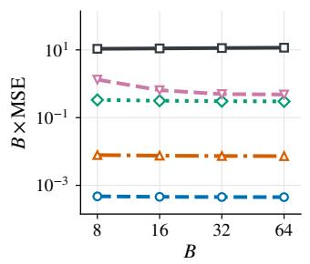

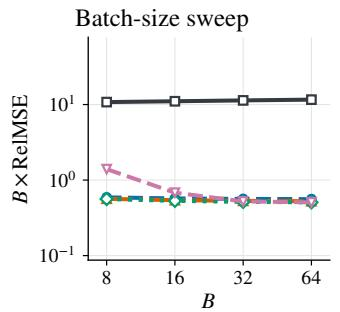

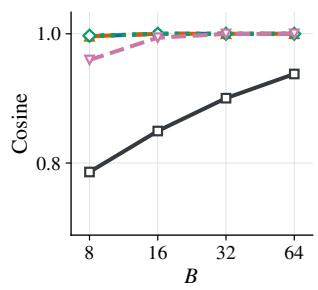

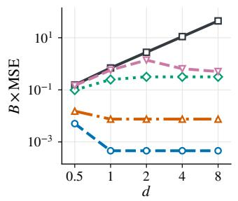

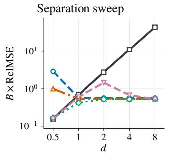

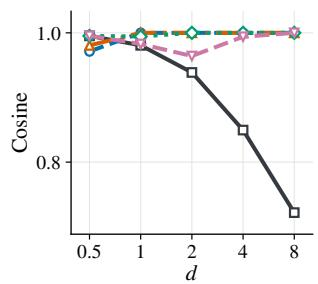  
W-Flow UW-Flow (τ = 0.05) UW-Flow (τ = 0.1) UW-Flow (τ = 1) UW-Flow (τ = 10)  
Figure 5: Full fixed-support velocity-error results. Columns show $B \times \mathrm { M S E }$ $B \times \mathrm { R e l M S E } .$ , and cosine similarity. The top and bottom rows vary B and d, respectively.

## F EXPERIMENTAL DETAILS AND ADDITIONAL GENERATION RESULTS

This appendix first presents the training algorithm and unbalanced Sinkhorn solver (Sec. F.1). We then provide the setup and full $B \times \tau$ ablations for toy distribution matching (Sec. F.2), followed by detailed settings and complete results for the fixed-budget minibatch ablation (Sec. F.3) and the image-generation hyperparameters (Sec. F.4). We also report ImageNet-100 generation results (Sec. F.5), together with ablations of the Sinkhorn iteration count and entropic coefficient (Sec. F.6).

## F.1 TRAINING ALGORITHM

Algorithm 1 summarizes the training procedure of UW-Flow. At each iteration, we compute cross and self UOT couplings to construct the mass-weighted velocity field in eq. 15, and update the generator by regressing toward stop-gradient targets. Algorithm 2 details the unbalanced Sinkhorn solver, which returns the barycentric projections and transported-mass ratios used to construct this field.

## F.2 GENERATION ON SYNTHETIC DISTRIBUTIONS

We provide experimental details and full $B \times \tau$ ablations for the synthetic generation experiments in Sec. 5.1.   
We consider three two-dimensional target distributions: checkerboard, two moons, and Gaussian ring.

Training configuration. W-Flow and UW-Flow use the same Fourier-feature generator with an effective optimizer batch size of $B _ { \mathrm { o p t } } = 5 1 2$ . We vary the transport batch size $B \in \{ 8 , \mathbf { \bar { 3 } 2 } , 1 2 8 , 5 1 2 \}$ and evaluate UW-Flow with $\tau \in \{ 0 . 0 1 , \bar { 0 } . 1 , 1 , 1 0 \}$ . All runs use 30,000 optimizer updates, 30 Sinkhorn iterations, $\varepsilon =$ 0.01, and random seed 0. The reported ε and τ denote coefficients in the normalized training loss.

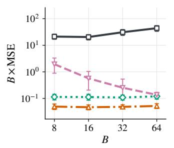

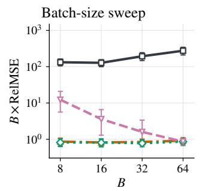

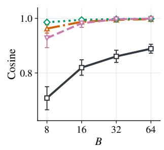

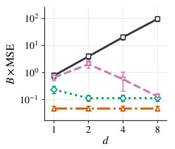

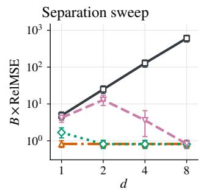

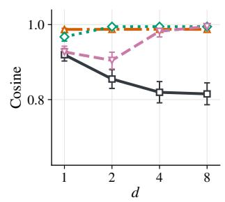  
W-Flow UW-Flow(τ = 0.1) UW-Flow(τ = 1) UW-Flow(τ = 10)

Figure 6: Velocity errors under Gaussian-mixture sampling. Columns show B × MSE, B × RelMSE, and cosine similarity. The top and bottom rows vary B and d, respectively.  
Algorithm 1 UW-Flow Training Algorithm 2 Unbalanced Sinkhorn   
Input: Generator $f _ { \boldsymbol { \theta } } ;$ distributions $p _ { \mathrm { r e f } } , p ;$ sample sizes Input: Particles $X = \{ x _ { i } \} _ { i = 1 } ^ { N } , Y = \{ y _ { j } \} _ { j = 1 } ^ { M } ; \varepsilon , \tau , L .$   
$N , M ;$ step size $\begin{array} { r } { \jmath ; \varepsilon , \tau , L . } \end{array}$ 1: $a _ { i }  1 / N , \quad b _ { j }  1 / M$ ▷ Weights   
1: repeat 2: $\begin{array} { r } { C _ { i j }  \frac { 1 } { 2 } \| x _ { i } - y _ { j } \| _ { 2 } ^ { 2 } } \end{array}$ ▷ Cost   
2: Sample $Z = \{ z _ { i } \} _ { i = 1 } ^ { N } \sim p _ { \mathrm { r e f } }$ 3: $\phi _ { i }  0 , \quad \psi _ { j }  0$ ▷ Initialize   
3: Sample $Z ^ { \prime } = \{ z _ { i } ^ { \prime } \} _ { i = 1 } ^ { N } \sim p _ { \mathrm { r e f } }$ 4: $\alpha  { \frac { \tau } { \tau + \varepsilon } }$ ▷ Relaxation   
4: Sample $Y = \{ y _ { j } \} _ { j = 1 } ^ { M } \sim p$ 5: for $\ell = \mathrm { i } , \ldots , L$ do   
5: $X  f _ { \theta } ( Z )$ 6: $\begin{array} { r } { \phi _ { i }  - \alpha \varepsilon \log \sum _ { j } b _ { j } e ^ { ( \psi _ { j } - C _ { i j } ) / \varepsilon } } \end{array}$ ▷ Source   
6: $X ^ { \prime } \gets \mathrm { s g } ( f _ { \theta } ( Z ^ { \prime } ) )$   
7: $( T ^ { + } , s ^ { + } ) \stackrel { - } {  } \mathrm { U S I N K H O R N } ( X , Y ; \varepsilon , \tau , L )$ 7: $\begin{array} { r } { \psi _ { j }  - \alpha \varepsilon \log { \sum _ { i } } a _ { i } e ^ { ( \phi _ { i } - C _ { i j } ) / \varepsilon } } \end{array}$ ▷ Target   
8: end for   
8: $( T ^ { - } , s ^ { - } ) \gets \mathrm { U S I N K H O R N } ( X , X ^ { \prime } ; \varepsilon , \tau , L )$ 9: $\Pi _ { i j }  a _ { i } b _ { j } e ^ { ( \phi _ { i } + \psi _ { j } - C _ { i j } ) / \varepsilon }$ ▷ Coupling   
9: $V _ { i } \gets s _ { i } ^ { + } ( T _ { i } ^ { + } - x _ { i } ) - s _ { i } ^ { - } ( T _ { i } ^ { - } - x _ { i } )$ 10: $\begin{array} { r } { r _ { i } \gets \sum _ { j } \dot { \Pi } _ { i j } } \end{array}$ ▷ Row mass   
10: ${ \widetilde { x } } _ { i } \gets \mathrm { s g } ( x _ { i } + \eta V _ { i } )$ 11: $s _ { i } \gets \frac { r _ { i } } { a _ { i } }$ ▷ Mass ratio   
11: Update θ by minimizing   
$\begin{array} { r } { \mathcal { L } ( \theta ) = \frac { 1 } { N } \sum _ { i = 1 } ^ { N } \| f _ { \theta } ( z _ { i } ) - \widetilde { x } _ { i } \| _ { 2 } ^ { 2 } } \end{array}$ 12: $\begin{array} { r } { T _ { i } \gets \frac { 1 } { r _ { i } } \sum _ { j } \Pi _ { i j } y _ { j } } \end{array}$ ▷ Barycenter   
12: until converged 13: return $( T , s )$

Full qualitative ablations. Fig. 7, Fig. 8, and Fig. 9 show that UW-Flow with $\tau \in \{ 0 . 0 1 , 0 . 1 \}$ generally captures the target structures more clearly than W-Flow at smaller B. As B increases, both methods improve and the qualitative gap tends to narrow. Larger τ generally produces results closer to W-Flow.

Table 5: Full results of the fixed-budget minibatch discrepancy ablation on unconditional MNIST, with fixed $B _ { \mathrm { o p t } } = N _ { c } N _ { \mathrm { g e n } } = 6 4$
<table><tr><td> $N _ { c }$ </td><td> $N _ { \mathrm { g e n } }$ </td><td> $N _ { \mathrm { p o s } }$ </td><td>Method</td><td>FID↓</td><td>Prec. ↑</td><td>Rec. ↑</td></tr><tr><td rowspan="4">16</td><td rowspan="4">4</td><td rowspan="4">4</td><td>W-Flow</td><td>19.70</td><td>0.536</td><td>0.059</td></tr><tr><td>UW-Flow (τ = 10)</td><td>22.54</td><td>0.562</td><td>0.081</td></tr><tr><td>UW-Flow (τ = 1)</td><td>17.98</td><td>0.464</td><td>0.116</td></tr><tr><td>UW-Flow (τ = 0.1)</td><td>18.66</td><td>0.419</td><td>0.253</td></tr><tr><td rowspan="4">8</td><td rowspan="4">8</td><td rowspan="4">8</td><td>W-Flow</td><td>13.69</td><td>0.461</td><td>0.239</td></tr><tr><td>UW-Flow (τ = 10)</td><td>13.50</td><td>0.545</td><td>0.110</td></tr><tr><td>UW-Flow (τ = 1)</td><td>12.37</td><td>0.477</td><td>0.281</td></tr><tr><td>UW-Flow (τ = 0.1)</td><td>13.56</td><td>0.492</td><td>0.351</td></tr><tr><td rowspan="4">4</td><td rowspan="4">16</td><td rowspan="4">16</td><td>W-Flow</td><td>9.86</td><td>0.487</td><td>0.430</td></tr><tr><td>UW-Flow (τ = 10)</td><td>10.14</td><td>0.513</td><td>0.355</td></tr><tr><td>UW-Flow (τ = 1)</td><td>9.97</td><td>0.517</td><td>0.218</td></tr><tr><td>UW-Flow (τ = 0.1)</td><td>9.22</td><td>0.470</td><td>0.507</td></tr><tr><td rowspan="4">2</td><td rowspan="4">32</td><td rowspan="4">32</td><td>W-Flow</td><td>8.72</td><td>0.576</td><td>0.317</td></tr><tr><td>UW-Flow (τ = 10)</td><td>7.33</td><td>0.596</td><td>0.343</td></tr><tr><td>UW-Flow (τ = 1)</td><td>7.85</td><td>0.517</td><td>0.435</td></tr><tr><td>UW-Flow (τ = 0.1)</td><td>7.78</td><td>0.528</td><td>0.530</td></tr><tr><td rowspan="4">1</td><td rowspan="4">64</td><td rowspan="4">64</td><td>W-Flow</td><td>7.03</td><td>0.572</td><td></td></tr><tr><td>UW-Flow (τ = 10)</td><td>6.11</td><td>0.589</td><td>0.532 0.578</td></tr><tr><td>UW-Flow (τ = 1)</td><td>5.67</td><td>0.585</td><td>0.568</td></tr><tr><td>UW-Flow (τ = 0.1)</td><td>6.18</td><td>0.559</td><td>0.603</td></tr></table>

## F.3 FIXED-BUDGET MINIBATCH ABLATION

Each transport group contains B source samples, B target samples, and B independently drawn selfreference samples. Cross and self transport couplings are computed separately within each group.

We vary B ∈ {4, 8, 16, 32, 64} while keeping

$$
B _ { \mathrm { o p t } } = N _ { c } B
$$

fixed at 64 for MNIST and 128 for CIFAR-10. Accordingly, we set $N _ { c } = B _ { \mathrm { o p t } } / B$ . The corresponding values of $N _ { c }$ are {16, 8, 4, 2, 1} for MNIST and {32, 16, 8, 4, 2} for CIFAR-10. Regression losses from all groups are aggregated for each optimizer update.

For each dataset and support size, W-Flow and UW-Flow use the same model, feature representation, optimizer, training schedule, and entropic regularization parameter. They differ in the transport objective used to construct the velocity. We compute the evaluation metrics using 50,000 generated samples for CIFAR-10 and 10,000 for MNIST. Additional hyperparameters and evaluation settings are provided in Appendix F.4. The complete results corresponding to Tab. 2 and Tab. 3 are reported in Tab. 5 and Tab. 6, respectively.

## F.4 IMAGE-GENERATION HYPERPARAMETERS

Tab. 7 reports the model, transport, and optimization settings for the MNIST (LeCun et al., 1998) and CIFAR-10 (Krizhevsky et al., 2009) experiments in Sec. 5.2 and the ImageNet-100 (Deng et al., 2009) experiments in Sec. 5.3. The ImageNet-100 experiments are based on the ImageNet ablation setup of W-Flow (Han et al., 2026). For the fixed-budget ablation, we vary $N _ { c }$ and the samples per transport group as detailed in Appendix F.3.

Table 6: Full results of the fixed-budget minibatch discrepancy ablation on unconditional CIFAR-10, with fixed $B _ { \mathrm { o p t } } = N _ { c } N _ { \mathrm { g e n } } = 1 2 8$
<table><tr><td> $N _ { c }$ </td><td> $N _ { \mathrm { g e n } }$ </td><td> $N _ { \mathrm { p o s } }$ </td><td>Method</td><td>FID↓</td><td>IS↑</td><td>Prec. ↑</td><td>Rec. ↑</td></tr><tr><td rowspan="4">32</td><td rowspan="4">4</td><td rowspan="4">4</td><td>W-Flow</td><td>30.58</td><td>9.75</td><td>0.55</td><td>0.01</td></tr><tr><td>UW-Flow (τ = 10)</td><td>22.03</td><td>9.58</td><td>0.57</td><td>0.02</td></tr><tr><td>UW-Flow (τ = 1)</td><td>19.41</td><td>10.10</td><td>0.56</td><td>0.02</td></tr><tr><td>UW-Flow (τ = 0.1)</td><td>15.56</td><td>10.60</td><td>0.52</td><td>0.07</td></tr><tr><td rowspan="4">16</td><td rowspan="4">8</td><td rowspan="4">8</td><td>W-Flow</td><td>24.39</td><td>8.99</td><td>0.58</td><td>0.01</td></tr><tr><td>UW-Flow (τ = 10)</td><td>14.64</td><td>10.39</td><td>0.59</td><td>0.04</td></tr><tr><td>UW-Flow (τ = 1)</td><td>13.71</td><td>10.82</td><td>0.56</td><td>0.05</td></tr><tr><td>UW-Flow (τ = 0.1)</td><td>9.70</td><td>10.53</td><td>0.56</td><td>0.17</td></tr><tr><td rowspan="4">8</td><td rowspan="4">16</td><td rowspan="4">16</td><td>W-Flow</td><td>12.49</td><td>10.09</td><td>0.59</td><td>0.07</td></tr><tr><td>UW-Flow (τ = 10)</td><td>10.39</td><td>10.16</td><td>0.59</td><td>0.13</td></tr><tr><td>UW-Flow (τ = 1)</td><td>10.03</td><td>9.87</td><td>0.61</td><td>0.15</td></tr><tr><td>UW-Flow (τ = 0.1)</td><td>13.97</td><td>10.09</td><td>0.52</td><td>0.24</td></tr><tr><td rowspan="4">4</td><td rowspan="4">32</td><td rowspan="4">32</td><td>W-Flow</td><td>9.57</td><td>10.32</td><td>0.63</td><td>0.08</td></tr><tr><td>UW-Flow (τ = 10)</td><td>8.68</td><td>10.19</td><td>0.61</td><td>0.23</td></tr><tr><td>UW-Flow (τ = 1)</td><td>8.43</td><td>10.20</td><td>0.60</td><td>0.16</td></tr><tr><td>UW-Flow (τ = 0.1)</td><td>5.01</td><td>10.43</td><td>0.61</td><td>0.39</td></tr><tr><td rowspan="4">2</td><td rowspan="4">64</td><td rowspan="4">64</td><td>W-Flow</td><td></td><td></td><td></td><td></td></tr><tr><td>UW-Flow (τ = 10)</td><td>8.10</td><td>10.37</td><td>0.60</td><td>0.27</td></tr><tr><td>UW-Flow (τ = 1)</td><td>6.67</td><td>10.30 10.23</td><td>0.60 0.62</td><td>0.31 0.39</td></tr><tr><td>UW-Flow (τ = 0.1)</td><td>5.11 4.51</td><td>10.37</td><td>0.60</td><td>0.45</td></tr></table>

For Sec. 5.2, we vary $N _ { c }$ and the number of samples per transport group while fixing the per-update budget $B _ { \mathrm { o p t } } ,$ as detailed in Appendix F.3. The other dataset-specific hyperparameters follow Tab. 7 unless stated otherwise. For ImageNet-100, we follow the ImageNet ablation setup of W-Flow (Han et al., 2026), changing only the number of classes to 100.

## F.5 IMAGENET-100 GENERATION

Dataset and training setup. We use the 100 ImageNet classes specified by the ImageNet-100 class list released with Contrastive Multiview Coding (Tian et al., 2020). We follow the ImageNet ablation setup of W-Flow (Han et al., 2026), adapting it to the 100-class subset. We train a DiT-B/2 generator in the SD-VAE (Rombach et al., 2022) latent space and compute transport costs using features from a frozen ResNet (He et al., 2016) encoder pretrained with latent-MAE. Both methods use the same architecture, encoder weights, and optimization protocol within each setting. We use $N _ { c } = 6 4$ transport groups with $N _ { \mathrm { g e n } } = N _ { \mathrm { p o s } } = 6 4$ samples per group, giving $B _ { \mathrm { o p t } } = N _ { c } N _ { \mathrm { g e n } } = 4 0 9 6$ . Additional hyperparameters are listed in Tab. 7.

Parameter selection and evaluation. We evaluate UW-Flow with $\tau \ \in \ \{ 0 . 1 , 1 , 1 0 \}$ in both settings. For class-conditional evaluation, we follow W-Flow’s CFG selection protocol, testing guidance scales in {1.0, 1.5, 2.0, 2.5, 3.0, 3.5, 4.0} and reporting the metrics at the scale with the lowest FID for each method. Tab. 8 reports the complete results across τ.

Table 7: Hyperparameters for image-generation experiments. $N _ { \mathrm { g e n } }$ and $N _ { \mathrm { p o s } }$ are the numbers of generated and target samples per transport group; the total generated batch size is $\bar { N _ { c } } N _ { \mathrm { g e n } }$ . The listed ε and τ values are before scaling by the feature dimension D.
<table><tr><td rowspan=1 colspan=6>Hyperparameter</td><td rowspan=1 colspan=1>MNIST</td><td rowspan=1 colspan=1>CIFAR-10</td><td rowspan=1 colspan=2>ImageNet-100</td></tr><tr><td rowspan=1 colspan=10>Model and representation</td></tr><tr><td rowspan=1 colspan=6>GeneratorTraining shape / spaceFeature encoder (frozen)Feature normalizationVelocity normalization</td><td rowspan=1 colspan=1>DiT-based, patch 228×28×1ConvNeXt V2–TinyDistance-based scalingRMS normalization</td><td rowspan=1 colspan=1>DiT-based, patch 232×32×3ConvNeXt V2–TinyDistance-based scalingRMS normalization</td><td rowspan=1 colspan=2>DiT-B/232×32×4Latent-MAE ResNet(width 256)Distance-based scalingRMS normalization</td></tr><tr><td rowspan=1 colspan=10>Transport</td></tr><tr><td rowspan=1 colspan=6>Per-update budget $B _ { \mathrm { o p t } } = N _ { c } N _ { q }$ Samples per group $N _ { \mathrm { g e n } } =  { N _ { \mathrm { p o s } } } ^ { \dagger }$ Transport groups $N _ { c }$ Entropic coefficient εMarginal penalty coefficient τSinkhorn iterations LDrift step size η</td><td rowspan=1 colspan=1>64{4, 8, 16, 32, 64} $B _ { \mathrm { o p t } } / N _ { \mathrm { g e n } }$ 0.05{0.1, 1, 10}301.0</td><td rowspan=1 colspan=1>128{4, 8, 16, 32, 64} $B _ { \mathrm { o p t } } / N _ { \mathrm { g e n } }$ 0.05{0.1, 1, 10}301.0</td><td rowspan=1 colspan=2>4,09664640.05{0.1, 1, 10}101.0</td></tr><tr><td rowspan=1 colspan=10>Optimization</td></tr><tr><td rowspan=4 colspan=6>Optimizer</td><td rowspan=1 colspan=1>AdamW</td><td rowspan=1 colspan=1>AdamW</td><td rowspan=1 colspan=2>AdamW</td></tr><tr><td rowspan=3 colspan=1>(β1, β2)</td><td></td><td></td><td></td><td></td></tr><tr><td rowspan=2 colspan=1></td><td></td><td></td><td></td><td></td></tr><tr><td rowspan=1 colspan=2></td><td rowspan=1 colspan=1>(0.9,0.95)</td><td rowspan=1 colspan=1>(0.9,0.95)</td><td rowspan=1 colspan=2>(0.9,0.95)</td></tr><tr><td rowspan=3 colspan=6>Learning rateWeight decayLR schedule (after warmup)</td><td rowspan=1 colspan=1>2×10−4</td><td rowspan=1 colspan=1>2×10−4</td><td rowspan=2 colspan=2>0.01</td></tr><tr><td rowspan=1 colspan=1>0.01</td><td rowspan=1 colspan=1>0.01</td></tr><tr><td rowspan=2 colspan=3></td><td rowspan=1 colspan=1></td><td rowspan=1 colspan=1>Cosine</td><td rowspan=1 colspan=1>Cosine</td><td rowspan=1 colspan=2>Constant</td></tr><tr><td rowspan=2 colspan=6>Training budget</td><td rowspan=1 colspan=1></td><td rowspan=1 colspan=1>0.999</td><td rowspan=1 colspan=2>0.999</td></tr><tr><td rowspan=1 colspan=1>100 epochs</td><td rowspan=1 colspan=1>500 epochs</td><td rowspan=1 colspan=2>100 epochs</td></tr></table>

†For MNIST and CIFAR-10, $N _ { \mathrm { g e n } }$ and $N _ { c }$ are varied jointly with $B _ { \mathrm { o p t } }$ fixed.

## F.6 SINKHORN PARAMETER ABLATIONS

Following W-Flow (Han et al., 2026), we examine the effects of Sinkhorn iterations L and the entropic coefficient ε on UW-Flow. We use the CIFAR-10 configuration with $N _ { c } = 2 , N _ { \mathrm { g e n } } = N _ { \mathrm { p o s } } = 6 4$ , and $\tau = 0 . 1$ , varying one parameter at a time. W-Flow selects $\varepsilon = 0 . 0 5$ based on its ablation study. We retain this value for the results reported in the main text to compare W-Flow and UW-Flow under the same entropic regularization; the default iteration count is $L = 3 0$

As shown in Tab. 9, FID ranges from 4.51 to 5.18 across $L \in \{ 5 , 1 0 , 2 0 , 3 0 , 4 0 \}$ , with no monotonic improvement as L increases. The choice of ε has a larger effect in this setting: at $L = 3 0$ , reducing ε from 0.05 to 0.025 improves FID from 4.51 to 3.75 and recall from 0.45 to 0.52. The main-text results use ε = 0.05 for the matched comparison; the lower FID at $\varepsilon = 0 . 0 2 5$ is reported here as an additional ablation result.

Table 8: Full ImageNet-100 generation results following the ImageNet ablation setup and CFG selection protocol of W-Flow (Han et al., 2026). Both settings use $N _ { c } = 6 4 , N _ { \mathrm { g e n } } = N _ { \mathrm { p o s } } = 6 4$ , and $B _ { \mathrm { o p t } } ~ =$ 4096. For class-conditional generation, we select the CFG scale with the lowest FID for each method from {1.0, 1.5, 2.0, 2.5, 3.0, 3.5, 4.0}.
<table><tr><td>Setting</td><td> $N _ { c }$ </td><td> $N _ { \mathrm { g e n } }$ </td><td> $N _ { \mathrm { p o s } }$ </td><td> $B _ { \mathrm { o p t } }$ </td><td>Method</td><td>FID↓</td><td>IS↑</td><td>Prec. ↑</td><td>Rec. ↑</td></tr><tr><td rowspan="4">Uncond 64</td><td rowspan="4"></td><td rowspan="4">64</td><td rowspan="4">64</td><td rowspan="4">4096</td><td>W-Flow</td><td>55.25</td><td>23.89</td><td>0.42</td><td>0.14</td></tr><tr><td>UW-Flow (τ = 10)</td><td>55.00</td><td>25.01</td><td>0.40</td><td>0.16</td></tr><tr><td>UW-Flow (τ = 1)</td><td>51.08</td><td>25.47</td><td>0.41</td><td>0.19</td></tr><tr><td>UW-Flow (τ = 0.1)</td><td>46.17</td><td>27.71</td><td>0.40</td><td>0.29</td></tr><tr><td rowspan="4">Cond</td><td rowspan="4">64</td><td rowspan="4">64</td><td rowspan="4">64</td><td rowspan="4">4096</td><td>W-Flow</td><td>9.43</td><td>60.31</td><td>0.74</td><td>0.26</td></tr><tr><td>UW-Flow (τ = 10)</td><td>9.47</td><td>61.08</td><td>0.75</td><td>0.25</td></tr><tr><td>UW-Flow (τ = 1)</td><td>9.11</td><td>61.34</td><td>0.75</td><td>0.26</td></tr><tr><td>UW-Flow (τ = 0.1)</td><td>9.59</td><td>58.35</td><td>0.78</td><td>0.25</td></tr></table>

Table 9: Sinkhorn parameter ablations on CIFAR-10. We fix $N _ { c } = 2 , N _ { \mathrm { g e n } } = N _ { \mathrm { p o s } } = 6 4 , B _ { \mathrm { o p t } } = 1 2 8 _ { \cdot }$ , and $\tau = 0 . 1$ . The default configuration uses $L = 3 0$ and $\varepsilon = 0 . 0 5$ ; each table varies one parameter while fixing the other.
<table><tr><td colspan="4">Sinkhorn iterations L</td></tr><tr><td>L</td><td>FID↓</td><td>IS↑</td><td>Precision ↑</td><td>Recall ↑</td></tr><tr><td>5</td><td>5.04</td><td>10.39</td><td>0.57</td><td>0.41</td></tr><tr><td>10</td><td>4.73</td><td>10.54</td><td>0.58</td><td>0.45</td></tr><tr><td>20</td><td>5.16</td><td>10.26</td><td>0.59</td><td>0.40</td></tr><tr><td>30</td><td>4.51</td><td>10.37</td><td>0.60</td><td>0.45</td></tr><tr><td>40</td><td>5.18</td><td>10.29</td><td>0.57</td><td>0.45</td></tr></table>

<table><tr><td colspan="4">Entropic regularization ε</td></tr><tr><td>ε</td><td>FID↓</td><td>IS↑</td><td>Precision ↑</td><td>Recall ↑</td></tr><tr><td>0.01</td><td>3.77</td><td>10.21</td><td>0.60</td><td>0.52</td></tr><tr><td>0.025</td><td>3.75</td><td>10.39</td><td>0.61</td><td>0.52</td></tr><tr><td>0.05</td><td>4.51</td><td>10.37</td><td>0.60</td><td>0.45</td></tr><tr><td>0.075</td><td>5.47</td><td>10.60</td><td>0.57</td><td>0.39</td></tr><tr><td>0.1</td><td>8.35</td><td>10.54</td><td>0.54</td><td>0.23</td></tr></table>

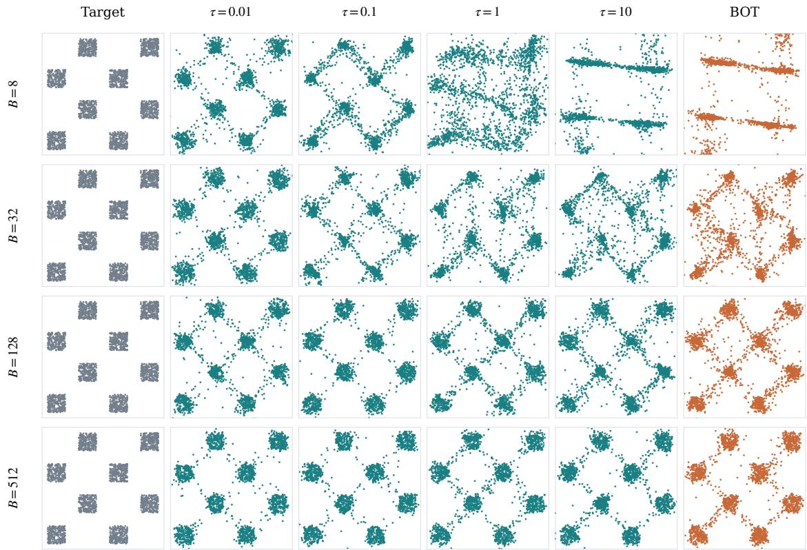  
Figure 7: Qualitative B × τ ablation on checkerboard. Rows vary B; columns show the target, UW-Flow with increasing τ, and W-Flow.

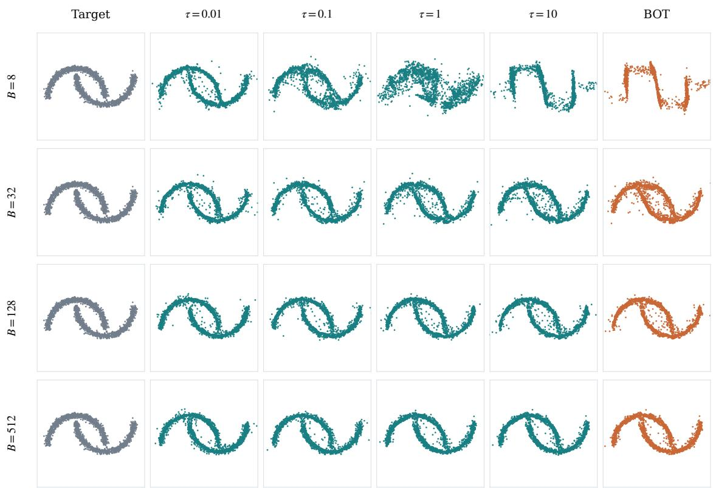  
Figure 8: Qualitative $B \times \tau$ ablation on two moons. Rows vary B; columns show the target, UW-Flow with increasing τ, and W-Flow.

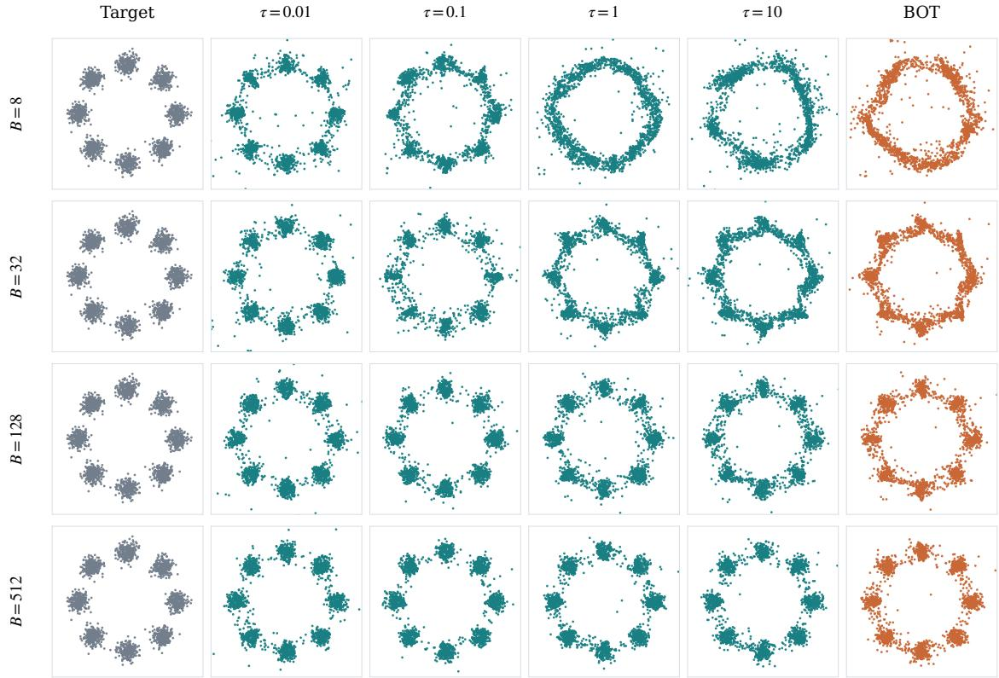  
Figure 9: Qualitative $B \times \tau$ ablation on Gaussian ring. Rows vary B; columns show the target, UW-Flow with increasing τ , and W-Flow.