# UNIW(A)M: A UNIFIED MIXTURE-OF-EXPERTS FRAMEWORK FOR WORLD AND WORLD-ACTION MODELS

Jingbo Xu1,∗, Jianjie Fang1,∗, Zhuohang Li1, Zihao Song1, Zhaolu Wang2, Xvyuan Liu3, Xin Zhang4, Haisheng Su4, Yinzhou Tang1, Chen Gao1,2,†, Wei Wu4,†, Yong Li1,†

1Tsinghua University 2Zhongguancun Academy

3East China Normal University 4Manifold AI

∗Joint first author. †Corresponding authors.

## ABSTRACT

World models (WMs) and world-action models (WAMs) focus on future world prediction and executable action generation, respectively. Although these models learn shared physical dynamics and interaction semantics from embodied trajectories, they are typically trained in isolation, which restricts knowledge reuse between prediction and control. The central challenge is therefore to develop a unified learning framework that shares these dynamics while preserving the distinct modeling capabilities required by each paradigm. We propose UniW(A)M, a mixture-of-experts world-(action) model built upon diffusion Transformers that unifies action-conditioned world modeling and diverse WAM variants. Shared experts capture common dynamics, while atomic capability experts are reused across interfaces so that each interface keeps its own conditional pathway. At deployment, a plug-in adaptive interface router (PAIR) learns from a small subset of target-task chunk scenarios to select a suitable WAM interface for each execution chunk, balancing task success and execution efficiency while keeping the backbone frozen. We evaluate UniW(A)M on LIBERO, RoboTwin 2.0, and three real-world manipulation tasks, where it achieves 88.3% average real-world success versus 76.7% for the strongest baseline. On WorldArena, it leads actionconditioned world modeling on all three tasks. AC-WM co-training contributes to action generation on every action interface and PAIR raises OOD success from 63.3% to 76.7%.

## 1 INTRODUCTION

World models (WMs) and world-action models (WAMs) offer complementary capabilities for embodied intelligence: predicting how environments evolve and generating actions to interact with them (Wang et al., 2026b). Action-conditioned world models simulate future observations given candidate actions (Guo et al., 2025), whereas WAMs use future-world representations to support action generation (Shen et al., 2026). WAM variants differ in how they use visual prediction, ranging from explicit or latent future modeling (Sun et al., 2026; Lin et al., 2026) to action-only inference that omits future-video generation at deployment (Yuan et al., 2026; Ye et al., 2026a).

Existing unified models connect world prediction and action generation through shared generative modeling and modular architectures. Motus integrates understanding, video-generation, and action experts (Bi et al., 2025), while UWM couples video and action diffusion to support multiple prediction modes (Zhu et al., 2025). Worldscape-MoE extends shared dynamics learning to heterogeneous action controls (Fang et al., 2026). Together, these approaches demonstrate the value of shared modeling and modular specialization. For jointly trained video–action interfaces, the key design issue is how to reuse shared dynamics while organizing specialized computation around the predictive roles induced by different conditional dependencies.

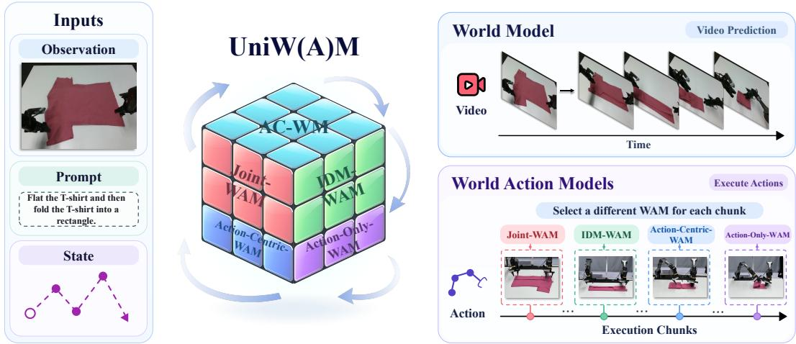  
Figure 1: Overview of UniW(A)M. The model unifies AC-WM and four WAM paradigms over shared embodied context. AC-WM predicts future video, while action execution adaptively switches among the four WAM paradigms across successive chunks, illustrated by a cloth-folding task.

Building on this direction, we jointly train action-conditioned world modeling and multiple WAM interfaces so that world modeling contributes to action generation and each interface keeps its own conditional pathway. These interfaces define different conditional relationships over the same embodied trajectories: future actions may be supplied as conditions or generated as outputs, and future video and action tokens interact under different visibility patterns. Video–action masks make these dependencies explicit within a common modeling framework.

We propose UniW(A)M, a mixture-of-experts framework that unifies action-conditioned world modeling and four WAM interfaces within a shared diffusion Transformer. Video–action visibility masks specify each interface’s conditional dependencies. We organize the interfaces around four reusable predictive roles, which we term atomic capabilities: action-free video prediction, direct action generation, action-conditioned video prediction, and video-conditioned action generation. Shared experts model common dynamics, while atomic capability experts specialize in these roles and can be reused across interfaces. To align expert computation with these roles, Capability Aligned Token Routing (CATR) assigns video and action target groups to eligible expert sets and learns mixture weights within each set. Joint training on the same trajectory data allows the inter faces to reuse these components while retaining their distinct conditional pathways.

These WAM interfaces differ in their use of future-video prediction and inference cost, raising a deployment question: which interface should be used at each execution chunk? The Plug-in Adaptive Interface Router (PAIR) learns this selection offline from a small subset of target-task chunk scenarios while keeping the UniW(A)M backbone frozen. At deployment, PAIR uses the current embodied context to select one of the four WAM interfaces for each chunk, allowing execution to switch between fast action-generation pathways that omit future-video prediction and interfaces that explicitly predict future video as interaction demands change.

On three real-world manipulation tasks, UniW(A)M achieves 88.3% average success versus 76.7% for the strongest baseline, and leads action-conditioned world modeling on all three WorldArena tasks. AC-WM co-training contributes to every action interface, including those that do not predict future video at deployment, and CATR keeps all four interfaces effective under joint training. Under distribution shifts, PAIR raises average success from 63.3% to 76.7% by selecting the interface for each chunk while the backbone stays frozen.

The main contributions of this work are summarized as follows:

• We introduce UniW(A)M, a mixture-of-experts framework that unifies action-conditioned world modeling and four WAM interfaces through video–action visibility masks. Shared dynamics experts, atomic capability experts, and CATR enable joint training while each interface keeps its own conditional pathway.

• We develop PAIR for chunk-level WAM interface selection, adapting interface choice using a small subset of target-task chunk scenarios without updating the shared backbone, raising OOD success and improving execution efficiency.

• Experiments show that co-training contributes to action generation on every action interface and that the unified model leads action-conditioned world prediction, and that PAIR further raises OOD success by selecting the interface per chunk with the backbone frozen.

## 2 RELATED WORK

Action-conditioned world models. Action-conditioned world models (AC-WMs) represent a branch of world models (WMs) dedicated to embodied robotic planning and evaluation (Lu et al., 2026). Built primarily upon large-scale pre-trained video generative models, they simulate future temporal evolution conditioned on current observations and specified actions (Guo et al., 2025; Wu & Gao, 2026; Bruce et al., 2024). Unlike pure policy models, AC-WMs emphasize controllable action dependencies and focus primarily on future world prediction rather than joint optimization with action generation (Shen et al., 2026; Chen et al., 2026; Shang et al., 2026). However, the general dynamics knowledge acquired through action-conditioned world modeling is rarely transferred to world action models, which limits overall data efficiency (Sun et al., 2026; Tang et al., 2026; Ye et al., 2026b).

World action models. World action models (WAMs) integrate future world prediction and executable action generation within a unified learning objective, enabling action synthesis to exploit foresight into future states. Existing WAM variants differ in their generation targets and conditional structures (Shen et al., 2026; Lu et al., 2026). Specifically, joint interfaces predict video and actions concurrently (Ye et al., 2026b), visual-to-action interfaces synthesize visual futures prior to inferring actions (Li et al., 2026b), and action-centric interfaces prioritize action output during inference while treating video primarily as a supervisory signal (Ye et al., 2026a). Although these variants rely on identical embodied trajectory data, their conditional dependencies, implemented via attention masks (Wang et al., 2026a; Peng et al., 2026; Zhao et al., 2026; Luo et al., 2026), vary considerably. Current methodologies typically train and deploy a single interface in isolation, which prevents the specialized action-generation capabilities developed across different interfaces from being shared and reused within a unified model (Sun et al., 2026; Tang et al., 2026).

Unified world-action modeling. Mixture-of-Transformers (MoT) architectures, exemplified by Motus (Bi et al., 2025; Motubrain Team et al., 2026), integrate understanding, video generation, and action experts into a single framework, enabling flexible switching across multiple operational modes through coordinated scheduling. Another line of research employs a single Transformer backbone (Mei et al., 2026), represented by UWM and UniWM, where UWM couples video and action diffusion via independent diffusion timesteps to facilitate flexible transitions among diverse modes (Zhu et al., 2025), while UniWM unifies planning and visual imagination within a multimodal autoregressive backbone (Dong et al., 2025). A third direction adopts Mixture-of-Experts (MoE) architectures, such as Worldscape-MoE (Fang et al., 2026; Shen et al., 2026), which captures universal world dynamics via shared experts and processes heterogeneous control signals with condition-specific experts, thereby achieving modular disentanglement and scaling under multimodal action supervision. Nevertheless, the mutual reinforcement among distinct modes within such unified frameworks to improve overall model performance remains largely unexplored (Lu et al., 2026; Dong et al., 2026).

## 3 METHOD

UniW(A)M jointly trains action-conditioned world modeling and four WAM interfaces on shared embodied trajectories, so that world modeling contributes to action generation while each interface keeps its own conditional pathway. Its design has three components. First, we formulate actionconditioned world modeling and four WAM variants as interfaces defined by video-action visibility masks, making their distinct conditional dependencies explicit within a unified framework. Second, these interfaces share a diffusion Transformer backbone and are jointly trained on the same trajectory data. Shared experts capture common dynamics, while CATR assigns each video and action token group to the experts of its predictive role. Third, PAIR selects one of the four WAM interfaces for each execution chunk. With the backbone frozen, it learns this selection from a small subset of target-task chunk scenarios, switching between fast action pathways and interfaces that predict future video under OOD conditions.

Table 1: Atomic capability composition and visibility characteristics of different paradigms.
<table><tr><td>Paradigm</td><td>Atomic Capabilities</td><td>Visibility / Role</td></tr><tr><td>AC-WM</td><td>WM</td><td>Action-conditioned world modeling</td></tr><tr><td>Joint-WAM</td><td> $\mathrm { V G M } + \mathrm { I D M }$ </td><td>Mutual visibility</td></tr><tr><td>IDM-WAM</td><td> $\mathrm { V G M } + \mathrm { I D M }$ </td><td>Sequential vision-to-action</td></tr><tr><td>Action-Centric-WAM</td><td> $\mathrm { V L A } + \mathrm { W M }$ </td><td>Action-centric with video supervision</td></tr><tr><td> $\mathrm { A c t i o n  – O n l y – W A M }$ </td><td> $\mathrm { V L A } + \mathrm { V G M }$ </td><td>Action generation with auxiliary video</td></tr></table>

## 3.1 UNIFIED MODELING OF HETEROGENEOUS VIDEO-ACTION MASK RELATIONS

An embodied trajectory comprises historical observations $^ { O } { \leq } t ,$ instructions $\ell ,$ future observations $O _ { t + 1 : t + k }$ , and future actions $a _ { t + 1 : t + k }$ . Interfaces differ in whether future actions are conditioning inputs or prediction targets, and in which future tokens can attend to one another during denoising. AC-WM predicts video conditioned on externally supplied actions; WAMs generate actions alongside video representations.

Atomic capabilities and paradigm compositions. We define four atomic capabilities: VGM, action-free video prediction; VLA, direct action generation; WM, action-conditioned video prediction; and IDM, video-conditioned action generation. VGM and WM model the future world, whereas VLA and IDM model future actions. These capabilities organize predictive roles within our chosen interfaces. Each expert receives the representation admitted by that interface’s attention mask, and the role name refers to this masked prediction.

Conditional directions of the interfaces. Table 1 summarizes how the atomic capabilities are composed into five interfaces. Each interface specifies the role of future actions and the visibility between future video and action tokens.

Joint-WAM combines the video-prediction role of VGM with the video-conditioned action prediction role of IDM, motivated by decomposing a joint video–action distribution into a video marginal and an action conditional, as in DreamZero (Ye et al., 2026b). The two modalities are denoised jointly with bidirectional attention, allowing their evolving representations to inform one another. IDM-WAM uses the same VGM and IDM capabilities with a sequential dependency. VGM first predicts a visual rollout, and IDM then infers actions conditioned on that rollout. Action tokens can access the predicted future video, while future video tokens do not attend to future actions. Action-Centric-WAM combines VLA and WM: VLA predicts actions without accessing future video, while WM predicts their visual consequences as auxiliary training supervision. Action-Only-WAM combines VLA and VGM with both directions of future cross-modal attention disabled, so the two branches predict their respective targets from the observed context. Both interfaces omit future-video prediction at deployment. AC-WM activates WM to predict future observations given candidate actions. These actions are clean external conditions rather than prediction targets, so the interface supports world simulation without generating executable actions.

The conditional probability formulations of all five interfaces are provided in Appendix A.1, and their training and inference visibility masks are illustrated in Appendix A.2.

## 3.2 ARCHITECTURE OF UNIW(A)M

As illustrated in Figure 2, UniW(A)M uses interface-specific attention masks and replaces the diffusion Transformer’s dense feed-forward sublayers with mixture-of-experts modules, initialized from the pretrained dense sublayers as described in Appendix G.3.

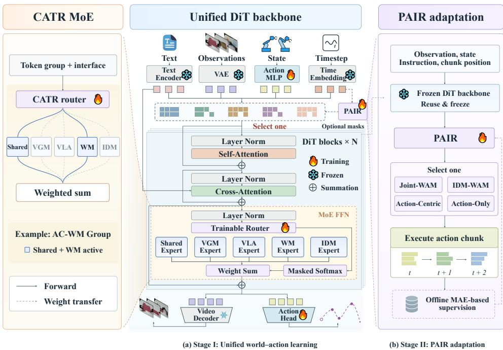  
Figure 2: Architecture of UniW(A)M. (a) Stage I: Unified learning. Five interfaces share a diffusion Transformer with CATR expert routing. (b) Stage II: PAIR adaptation. With the backbone frozen, PAIR learns interface selection from offline MAE-based supervision.

Heterogeneous Expert Activation Architecture. Shared experts participate in every interface, while atomic experts specialize in interface-specific predictive roles. The same expert ensemble can support different interfaces through distinct attention masks. Training and inference expert assignments are detailed in Appendix A.4.

Capability-Aligned Token Routing. We introduce Capability-Aligned Token Routing (CATR) to align expert computation with the predictive roles of video and action token groups. Each target group is assigned a prescribed set of eligible experts based on its modality and interface-specific predictive role. A learned router produces group-level mixture weights within this set; experts outside the set do not contribute to the group’s output. Tokens within a group share these weights but retain their individual expert outputs. Video target groups use VGM or WM specialists, whereas action target groups use VLA or IDM specialists, alongside shared experts. The eligible sets and treatment of clean conditions are detailed in Appendix A.4. Guided by CATR, UniW(A)M is jointly optimized through the multi-task training objective detailed in Appendix G.2.

Inference-Time Computation and Latency. IDM-WAM generates video and actions sequentially, whereas Joint-WAM denoises them jointly. Action-Centric-WAM and Action-Only-WAM omit future-video prediction and use shared and VLA experts for action denoising. Their conditioning paths differ: WM is inactive in Action-Centric-WAM, while Action-Only-WAM additionally uses VGM for the initial conditioning frame, allowing different contextual representations and action predictions. Detailed expert assignments and cache handling are provided in Appendix A.4.

## 3.3 OUT-OF-DISTRIBUTION DEPLOYMENT WITH PLUG-IN ADAPTIVE ROUTING

The UniW(A)M backbone is frozen after pretraining. To adapt interface selection to a target OOD task without changing the backbone, we train a lightweight Plug-in Adaptive Interface Router (PAIR) on a small subset of target-task chunk scenarios. PAIR uses a trainable classification head to select among the four WAM interfaces at each action chunk. Let ${ \mathcal { T } } _ { \mathrm { W A M } }$ denote these four actiongenerating interfaces in Table 1: Joint-WAM, IDM-WAM, Action-Centric-WAM, and Action-Only-WAM.

During offline router training, each frozen WAM interface predicts actions for the same chunk scenario. We compare each prediction with the ground-truth actions using mean absolute error (MAE), then min–max normalize the four errors to obtain $\Delta _ { t } ^ { ( i ) }$ for interface $i \in \mathcal { T } _ { \mathrm { W A M } }$ . The target probability decreases with this normalized error:

$$
\tilde { y } _ { t } ^ { ( i ) } = \frac { \exp \left( - \Delta _ { t } ^ { ( i ) } / \tau \right) } { \displaystyle \sum _ { j \in \mathbb { Z } _ { \mathrm { W A M } } } \exp \left( - \Delta _ { t } ^ { ( j ) } / \tau \right) } , \qquad i \in \mathbb { Z } _ { \mathrm { W A M } } ,\tag{1}
$$

Here $\tau > 0$ controls the target sharpness. Among interfaces whose MAE is within 1% of the minimum, an efficiency preference selects a fast interface if available, choosing the faster one if both qualify. The selected interface receives a one-hot target; otherwise, the MAE-based soft target is retained. We denote the resulting target by $y _ { t } ^ { ( i ) }$ ; its construction is detailed in Appendix B.1.

PAIR maps frozen contextual features $z _ { t }$ to interface probabilities $q _ { \phi } ( i \mid z _ { t } )$ with classification-head parameters ϕ. It is trained by cross-entropy against the MAE-aware target:

$$
\mathcal { L } _ { \mathrm { R o u t e r } } = - \sum _ { i \in \mathcal { T } _ { \mathrm { W A M } } } y _ { t } ^ { ( i ) } \log q _ { \phi } ( i \mid z _ { t } ) ,\tag{2}
$$

At deployment, PAIR chooses the interface with the highest predicted probability for each action chunk, executes that interface’s actions, and updates the observation history before the next selection. Router features, output probabilities, and the selection rule are specified in Appendix B.2.

Router inference cost. PAIR is invoked at chunk transitions. Its ensemble prediction takes approximately 2 ms; including shared-expert feature computation, routing averages approximately 63 ms in the benchmark described in Appendix B.2, excluding observation and language encoding. The appendix specifies the measurement scope and cache handling.

## 4 EXPERIMENTS

## 4.1 EXPERIMENTAL SETUP

To ensure fair and reproducible comparisons, we evaluate models under the same task settings and protocols, covering future-world modeling and action generation. During unified training, we sample the five paradigms uniformly and optimize one paradigm per step. We evaluate action generation on LIBERO (Liu et al., 2023), RoboTwin 2.0 (Chen et al., 2025), and three real-world tasks: cloth folding, box folding, and tabletop cleaning (Figure 3). AC-WM’s action-conditioned video prediction is evaluated with WorldArena (Shang et al., 2026). Further details on the benchmarks and evaluation protocols are provided in Appendix C.

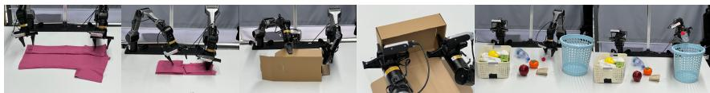  
Figure 3: Real-world tasks: cloth folding, box folding, and tabletop cleaning.

Per-task success counts and 95% Wilson intervals for the real-world evaluations are reported in Appendix C.1.

OOD settings. We retain the same task goals and define OOD relative to backbone training: unseen garment colors and sizes for cloth folding, different box types for box folding, and different cluttered backgrounds for tabletop cleaning.

## 4.2 OVERALL EVALUATION

The main analysis focuses on the three real-world manipulation tasks, which also form the basis of our ablation studies. We additionally evaluate action generation on LIBERO and RoboTwin 2.0. UniW(A)M achieves 97.5% average success on LIBERO, including 99.2% on Spatial; detailed results are provided in Appendix E.

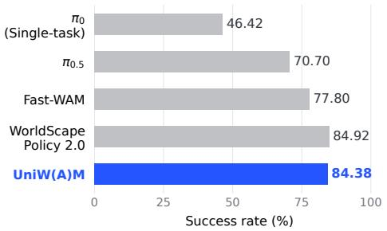  
(a) Clean-to-Clean (C2C)

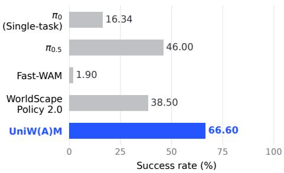  
(b) Clean-to-Randomized (C2R)  
Figure 4: RoboTwin 2.0 success rates with clean-only training. (a) C2C evaluates on clean scenes; (b) C2R evaluates on randomized scenes. Scores are averaged over 50 tasks separately for each setting. Gray bars show official leaderboard baselines (RoboTwin Team, 2026): $\pi _ { 0 }$ uses single-task fine-tuning, while the others use co-training. Blue bars show UniW(A)M.

Table 2: Success rates (%) on real-world robotic tasks under the standard evaluation configuration. The best results within each task are shown in bold.
<table><tr><td>Method</td><td>Folding Clothes (Deformable)</td><td>Folding Box (Contact-Rich)</td><td>Tabletop Clean. (Long-Horizon)</td><td>Average</td></tr><tr><td></td><td>Baselines</td><td></td><td></td><td></td></tr><tr><td>π0.5 (Physical Intelligence et al., 2025)</td><td>60</td><td>65</td><td>70</td><td>65.0</td></tr><tr><td>DreamZero (Ye et al., 2026b)</td><td>45</td><td>55</td><td>60</td><td>53.3</td></tr><tr><td>WorldScape Policy 2.0 (Su et al., 2026)</td><td>75</td><td>75</td><td>80</td><td>76.7</td></tr><tr><td></td><td>UniW(A)M</td><td></td><td></td><td></td></tr><tr><td>Joint-WAM</td><td>90</td><td>80</td><td>90</td><td>86.7</td></tr><tr><td>IDM-WAM</td><td>90</td><td>85</td><td>90</td><td>88.3</td></tr><tr><td>Action-Centric-WAM</td><td>85</td><td>75</td><td>85</td><td>81.7</td></tr><tr><td>Action-Only-WAM</td><td>85</td><td>70</td><td>85</td><td>80.0</td></tr></table>

RoboTwin generalization. With clean-only training, UniW(A)M achieves 84.38% success under Clean-to-Clean (C2C) evaluation and 66.60% under Clean-to-Randomized (C2R) evaluation (Figure 4). It ranks second in C2C among the compared methods and leads in C2R, exceeding the strongest listed C2R baseline, $\pi _ { 0 . 5 } ,$ , by 20.60 percentage points. These results demonstrate effective generalization to randomized scenes without randomized training demonstrations. Protocol details and numerical comparisons are provided in Appendices C and E.

Results and analysis. On real-world evaluation, Table 2 reports real-world success rates over 20 trials per task. All four UniW(A)M interfaces exceed the strongest baseline in average success, with IDM-WAM achieving 88.3% versus 76.7% for WorldScape Policy 2.0, a gain of approximately 11.7 percentage points. IDM-WAM reaches 90%, 85%, and 90% on cloth folding, box folding, and tabletop cleaning, respectively. Qualitative visualizations of the three tasks across all four interfaces are provided in Appendix D.1.

On WorldArena, UniW(A)M achieves the highest aggregate EWMScore-P among the compared methods on all three tasks (Table 3), so the unified model leads action-conditioned world modeling together with the action-generation results above. Complete component scores and qualitative comparisons with Ctrl-World and Cosmos-Predict2.5 are provided in Appendices F.1 and F.2, respectively.

Table 3: Evaluation of action-driven and interaction metrics of WorldArena on three real-world tasks. All metrics are reported on a 0–100 scale. The best and second-best results within each task are shown in bold and underlined, respectively.
<table><tr><td>Model</td><td>JEPA Similarity↑</td><td>Motion Smoothness↑</td><td>Interaction Quality↑</td><td>Trajectory Accuracy↑</td><td>Instruction Following↑</td><td>EWM Score-P↑</td></tr><tr><td colspan="7">Task 1: Folding Clothes (Deformable)</td></tr><tr><td>Cosmos-Predict 2.5 (NVIDIA et al., 2025)</td><td>21.86</td><td>60.70</td><td>64.00</td><td>7.20</td><td>56.50</td><td>48.08</td></tr><tr><td>CtrlWorld (Guo et al., 2025)</td><td>17.57</td><td>78.21</td><td>63.50</td><td>18.56</td><td>51.50</td><td>53.09</td></tr><tr><td>UniW(A)M (Ours)</td><td>44.39</td><td>87.77</td><td>80.00</td><td>22.87</td><td>93.50</td><td>61.51</td></tr><tr><td colspan="7">Task 2: Folding Box (Contact-Rich)</td></tr><tr><td>Cosmos-Predict 2.5 (NVIDIA et al., 2025)</td><td>40.27</td><td>52.47</td><td>76.50</td><td>10.91</td><td>95.00</td><td>51.07</td></tr><tr><td>CtrlWorld (Guo et al., 2025)</td><td>63.81</td><td>66.56</td><td>64.50</td><td>14.73</td><td>78.00</td><td>55.48</td></tr><tr><td>UniW(A)M (Ours)</td><td>65.41</td><td>68.69</td><td>70.50</td><td>17.28</td><td>84.00</td><td>55.89</td></tr><tr><td colspan="7">Task 3: Tabletop Clean. (Long-Horizon)</td></tr><tr><td>Cosmos-Predict 2.5 (NVIDIA et al., 2025)</td><td>4.63</td><td>48.49</td><td>54.00</td><td>2.88</td><td>41.00</td><td>31.75</td></tr><tr><td>CtrlWorld (Guo et al., 2025)</td><td>33.76</td><td>57.93</td><td>60.00</td><td>5.94</td><td>59.00</td><td>50.23</td></tr><tr><td>UniW(A)M (Ours)</td><td>50.30</td><td>63.10</td><td>66.50</td><td>7.26</td><td>68.50</td><td>52.53</td></tr></table>

Table 4: OOD success rates (%) for UniW(A)M interface adaptation on real-world tasks. The best results within each task are shown in bold.
<table><tr><td>Interface</td><td>Folding Clothes (Deformable)</td><td>Folding Box (Contact-Rich)</td><td>Tabletop Clean. (Long-Horizon)</td><td>Average</td></tr><tr><td></td><td>Standalone Interfaces</td><td></td><td></td><td></td></tr><tr><td>Joint-WAM</td><td>65</td><td>55</td><td>70</td><td>63.3</td></tr><tr><td>IDM-WAM</td><td>65</td><td>50</td><td>75</td><td>63.3</td></tr><tr><td>Action-Centric-WAM</td><td>50</td><td>40</td><td>55</td><td>48.3</td></tr><tr><td>Action-Only-WAM</td><td>50</td><td>45</td><td>55</td><td>50.0</td></tr><tr><td>PAIR</td><td>75</td><td>70</td><td>85</td><td>76.7</td></tr></table>

## 4.3 ANALYSIS OF OUT-OF-DISTRIBUTION SCENARIOS

PAIR raises average OOD success from 63.3% with the strongest standalone interface to 76.7% (Table 4), using routing-only adaptation with the UniW(A)M backbone frozen and 2,000 target-task chunk scenarios per task (Appendix B.1).

Across Reach (approach), Contact (contact-based manipulation), and Core (fine manipulation), PAIR selects Action-Centric-WAM and Action-Only-WAM during approach, and Joint-WAM and IDM-WAM more often during contact and fine manipulation. Detailed selection distributions and critical-operation case studies are provided in Appendices B.3 and D.2, respectively.

## 4.4 PARETO ANALYSIS OF SUCCESS RATE AND INFERENCE LATENCY

We measure the trade-off between task execution capability and inference cost for each interface. Figure 5(b) reports full action-chunk inference time divided by the configured step count of 16: Action-Centric-WAM and Action-Only-WAM require 154.3 ms and 225.8 ms, respectively, whereas Joint-WAM and IDM-WAM require 428.1 ms and 532.7 ms. Appendix C specifies the timing metrics. As shown in Figure 5(a), UniW(A)M + PAIR achieves a 76.7% success rate with an average completion time of 308.9 s over successful trials, placing it on the upper-left Pareto frontier of the four static interfaces. By routing to the fast action pathways during standard transfer motions and dynamically invoking foresight-capable joint pathways during contact-rich phases, the method combines the execution efficiency of action-centric interfaces with the foresight of video-conditioned interfaces.

## 4.5 ABLATION STUDIES

Per-task results for the architecture, routing, and training-paradigm ablations are provided in Appendix G.

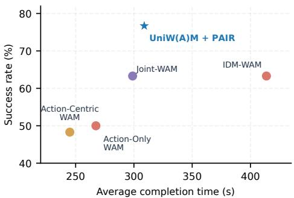  
(a) Task-level Pareto efficiency

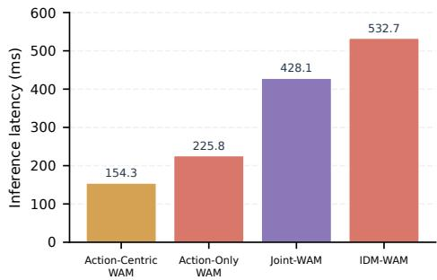  
(b) Step-normalized chunk latency  
Figure 5: Inference efficiency and task-level Pareto analysis of UniW(A)M. (a) Task success rate versus average completion time over successful real-robot trials, where UniW(A)M + PAIR occupies the upper-left Pareto frontier. (b) Full chunk inference time divided by the configured step count of 16 across the four standalone WAM interfaces; IDM-WAM uses 16 steps per stage (Appendix C). Chunk-boundary routing is excluded from these bars: ensemble prediction takes approximately 2 ms, while routing including shared-expert feature computation averages approximately 63 ms under the measurement scope in Appendix B.2.

Contribution of AC-WM co-training. Removing AC-WM from mixed training reduces success across all four WAM interfaces on all three tasks. Average success decreases by 15.0 percentage points for both Joint-WAM and IDM-WAM, and by 31.7 and 43.3 points for Action-Centric-WAM and Action-Only-WAM, respectively. The larger drops on Action-Centric-WAM and Action-Only-WAM show that AC-WM co-training contributes to action generation even on interfaces that do not predict future video at deployment. Detailed results are provided in Appendix G.4.

Architecture and training configuration. We compare a single dense DiT initialized from Wan2.1-I2V-14B (Team Wan et al., 2025) with joint UniW(A)M training under the same training steps, learning-rate settings, and data volume; the detailed results are reported in Appendix G.4. All four interfaces of the jointly trained UniW(A)M substantially outperform the baseline, whose best success rate is only 16.7%, whereas UniW(A)M achieves 88.3%.

CATR and sample-level routing. The two MoE configurations have identical expert counts, network structures, and parameter counts. They differ in routing organization: sample-level routing applies the active expert ensemble to the entire sample, whereas CATR assigns eligible expert sets and learned mixture weights to modality- and role-specific token groups. This restricts specialist FFN computation to the relevant groups while retaining shared attention and shared experts. As shown in Appendix G.4, sample-level routing produces uneven performance: Joint-WAM and IDM WAM achieve 51.7% and 60.0% average success, respectively, whereas both Action-Centric-WAM and Action-Only-WAM achieve only 10.0%. With expert count and parameter count held fixed, CATR improves all four interfaces and raises Action-Centric-WAM and Action-Only-WAM from 10.0% to 81.7% and 80.0%, so joint training delivers all four interfaces.

## 5 CONCLUSION

UniW(A)M unifies action-conditioned world modeling and four WAM interfaces through video– action masks and capability-aligned expert routing. Experiments demonstrate action generation and future-world prediction within a shared backbone. Ablations show that AC-WM co-training improves all four WAM interfaces across three real-world tasks, while CATR improves action generation relative to sample-level routing. PAIR further improves OOD execution through chunk-level interface selection with the backbone frozen. Together, these results support joint learning and adap tive deployment of complementary world and action modeling capabilities.

## AI USE STATEMENT

We used generative artificial intelligence tools to assist with drafting and editing the manuscript text, organizing and debugging LaTeX source files, and preparing schematic figures and plotting scripts. These tools were not used to generate experimental data, fabricate results, or substitute for author decisions regarding research methodology. All AI-assisted text, equations, code, and figures were reviewed, verified, and revised by the authors. We take full responsibility for the final content of this work, including all claims, analyses, and artifacts developed with generative artificial intelligence assistance.

## REPRODUCIBILITY STATEMENT

To support reproducibility, the implementation complements the method descriptions and training details provided in the paper and appendix.

## REFERENCES

Hongzhe Bi, Hengkai Tan, Shenghao Xie, Zeyuan Wang, Shuhe Huang, Haitian Liu, Ruowen Zhao, Yao Feng, Chendong Xiang, Yinze Rong, Hongyan Zhao, Hanyu Liu, Zhizhong Su, Lei Ma, Hang Su, and Jun Zhu. Motus: A unified latent action world model. arXiv preprint arXiv:2512.13030, 2025.

Kevin Black, Noah Brown, Danny Driess, Adnan Esmail, Michael Equi, Chelsea Finn, et al. π0: A vision-language-action flow model for general robot control. arXiv preprint arXiv:2410.24164, 2024. doi: 10.48550/arXiv.2410.24164. URL https://arxiv.org/abs/2410.24164.

Jake Bruce, Michael Dennis, Ashley Edwards, Jack Parker-Holder, Yuge Shi, Edward Hughes, Matthew Lai, Aditi Mavalankar, Richie Steigerwald, Chris Apps, Yusuf Aytar, Sarah Bechtle, Feryal Behbahani, Stephanie Chan, Nicolas Heess, Lucy Gonzalez, Simon Osindero, Sherjil Ozair, Scott Reed, Jingwei Zhang, Konrad Zolna, Jeff Clune, Nando de Freitas, Satinder Singh, and Tim Rocktaschel. Genie: Generative interactive environments. In ¨ International Conference on Machine Learning (ICML), 2024.

Sixiang Chen, Jiaming Liu, Jixian Wu, Yichen Guo, Tinghao Wang, Siyuan Qian, Hao Chen, Jiajun Cao, Jian Tang, and Shanghang Zhang. Do robotic world models really follow actions? diagnosing and aligning action-conditioned generation for policy learning. arXiv preprint arXiv:2608.24885, 2026.

Tianxing Chen, Zanxin Chen, Baijun Chen, Zijian Cai, Yibin Liu, Zixuan Li, Qiwei Liang, Xianliang Lin, Yiheng Ge, Zhenyu Gu, Weiliang Deng, Yubin Guo, Tian Nian, Xuanbing Xie, Qiangyu Chen, Kailun Su, Tianling Xu, Guodong Liu, Mengkang Hu, Huan ang Gao, Kaixuan Wang, Zhixuan Liang, Yusen Qin, Xiaokang Yang, Ping Luo, and Yao Mu. RoboTwin 2.0: A scalable data generator and benchmark with strong domain randomization for robust bimanual robotic manipulation. arXiv preprint arXiv:2506.18088, 2025.

Yifei Dong, Fengyi Wu, Guangyu Chen, Lingdong Kong, Qiyu Hu, Yuxuan Zhou, Xu Zhu, Jingdong Sun, Jun-Yan He, Qi Dai, Alexander G. Hauptmann, and Zhi-Qi Cheng. Towards unified world models for visual navigation via memory-augmented planning and foresight. arXiv preprint arXiv:2510.08713, 2025.

Yifei Dong, Fengyi Wu, Yilong Dai, Lingdong Kong, Guangyu Chen, Xu Zhu, Qiyu Hu, Tianyu Wang, Johnalbert Garnica, Feng Liu, Siyu Huang, Qi Dai, and Zhi-Qi Cheng. Languageconditioned world modeling for visual navigation. arXiv preprint arXiv:2603.26741, 2026.

Jianjie Fang, Yongyan Xu, Ziyou Wang, Chen Gao, Yuchao Huang, Zhaolu Wang, Rongze Tang, Mingyuan Jia, Baining Zhao, Weichen Zhang, Xin Zhang, Haisheng Su, Yu Shang, Wei Wu, Xinlei Chen, and Yong Li. Worldscape-moe: A unified mixture-of-experts world model for scalable heterogeneous action control. arXiv preprint arXiv:2607.03964, 2026.

Yanjiang Guo, Lucy Xiaoyang Shi, Jianyu Chen, and Chelsea Finn. Ctrl-world: A controllable generative world model for robot manipulation. arXiv preprint arXiv:2510.10125, 2025.

Moo Jin Kim, Karl Pertsch, Siddharth Karamcheti, Ted Xiao, Ashwin Balakrishna, Suraj Nair, Rafael Rafailov, Ethan Foster, Grace Lam, Pannag Sanketi, Quan Vuong, Thomas Kollar, Benjamin Burchfiel, Russ Tedrake, Dorsa Sadigh, Sergey Levine, Percy Liang, and Chelsea Finn. Openvla: An open-source vision-language-action model. arXiv preprint arXiv:2406.09246, 2024.

Lin Li, Qihang Zhang, Yiming Luo, Shuai Yang, Ruilin Wang, Fei Han, et al. Causal world modeling for robot control. arXiv preprint arXiv:2601.21998, 2026a. doi: 10.48550/arXiv.2601.21998. URL https://arxiv.org/abs/2601.21998.

Sizhe Lester Li, Evan Kim, Xingjian Bai, Tong Zhao, Tao Pang, Max Simchowitz, and Vincent Sitzmann. Turning video models into generalist robot policies. arXiv preprint arXiv:2605.27817, 2026b.

Yihan Lin, Jiawei He, Shifeng Bao, Chen Zhao, Yang Li, Xiaobo Wang, Yan Wang, Cheng Chi, and Jing Zhang. JEPA-WAM: Learning vision-language-action policies with joint-embedding world modeling. arXiv preprint arXiv:2608.09381, 2026.

Bo Liu, Yifeng Zhu, Chongkai Gao, Yihao Feng, Qiang Liu, Yuke Zhu, and Peter Stone. LIBERO: Benchmarking knowledge transfer for lifelong robot learning. arXiv preprint arXiv:2306.03310, 2023.

Zuxing Lu, Hongjia Zhai, Guanzhi Wang, Huajian Zeng, Jiaqi Yang, Jingyu Liu, Lei Cheng, Yuantai Zhang, Yuheng Qiu, Zezhou Cheng, Ivan Laptev, Danfei Xu, Benjamin Riviere, Giuseppe Loianno, Eric Xing, and Xingxing Zuo. World-action models for robot learning and control: A survey. arXiv preprint arXiv:2609.16074, 2026.

Hao Luo, Wanpeng Zhang, Yicheng Feng, Sipeng Zheng, Haiweng Xu, Chaoyi Xu, Ziheng Xi, Yuhui Fu, and Zongqing Lu. Being-H0.7: A latent world-action model from egocentric videos. arXiv preprint arXiv:2605.00078, 2026.

Yanghong Mei, Longteng Guo, Ming-Ming Yu, Guiyu Zhao, Xingjian He, and Jing Liu. Navwm: A unified navigation world model for foresight-driven planning. arXiv preprint arXiv:2606.24101, 2026.

Motubrain Team, Chendong Xiang, Fan Bao, Haitian Liu, Hengkai Tan, Hongzhe Bi, James Li, Jiabao Liu, Jingrui Pang, Kiro Jing, Louis Liu, Mengchen Cai, Rongxu Cui, Ruowen Zhao, Runqing Wang, Shuhe Huang, Yao Feng, Yinze Rong, Zeyuan Wang, and Jun Zhu. Motubrain: An advanced world action model for robot control. arXiv preprint arXiv:2604.27792, 2026.

NVIDIA, Arslan Ali, Junjie Bai, Maciej Bala, Yogesh Balaji, Aaron Blakeman, et al. World simulation with video foundation models for physical AI. arXiv preprint arXiv:2511.00062, 2025. doi: 10.48550/arXiv.2511.00062. URL https://arxiv.org/abs/2511.00062.

Quanquan Peng, Yutong Liang, Rui Yan, Nicklas Hansen, and Xiaolong Wang. FACT: Failureaware causal training for world-action models. arXiv preprint arXiv:2608.10232, 2026.

Physical Intelligence, Kevin Black, Noah Brown, James Darpinian, Karan Dhabalia, Danny Driess, Adnan Esmail, Michael Equi, Chelsea Finn, Niccolo Fusai, Manuel Y. Galliker, Dibya Ghosh, Lachy Groom, Karol Hausman, Brian Ichter, Szymon Jakubczak, Tim Jones, Liyiming Ke, Devin LeBlanc, Sergey Levine, Adrian Li-Bell, Mohith Mothukuri, Suraj Nair, Karl Pertsch, Allen Z. Ren, Lucy Xiaoyang Shi, Laura Smith, Jost Tobias Springenberg, Kyle Stachowicz, James Tanner, Quan Vuong, Homer Walke, Anna Walling, Haohuan Wang, Lili Yu, and Ury Zhilinsky. π : A vision-language-action model with open-world generalization. arXiv preprint arXiv:2504.16054, 2025.

RoboTwin Team. RoboTwin 2.0 Leaderboard, 2026. URL https://robotwin-platform. github.io/leaderboard. Co-train results; updated September 24, 2026; accessed September 26, 2026.

Yu Shang, Zhuohang Li, Yiding Ma, Weikang Su, Xin Jin, Ziyou Wang, Lei Jin, Xin Zhang, Yinzhou Tang, Haisheng Su, Chen Gao, Wei Wu, Xihui Liu, Dhruv Shah, Zhaoxiang Zhang, Zhibo Chen, Jun Zhu, Yonghong Tian, Tat-Seng Chua, Wenwu Zhu, and Yong Li. WorldArena: A unified benchmark for evaluating perception and functional utility of embodied world models. arXiv preprint arXiv:2602.08971, 2026.

Qiuhong Shen, Shihua Zhang, Yue Liao, Qi Li, Zhenxiong Tan, Shizun Wang, Shuicheng Yan, and Xinchao Wang. World action models: A survey. arXiv preprint arXiv:2606.20781, 2026.

Haisheng Su, Zongdai Liu, Xin Jin, Haoxuan Dou, Chengming Hu, Baorun Li, Zhanwang Liu, Ruiyan Xu, Jianjie Fang, Xin Zhang, Zhenjie Yang, Xue Yang, Chen Gao, Junchi Yan, Yong Li, and Wei Wu. WorldScape Policy 2.0: Empowering steerable world action modeling with reasoning-augmented memory and in-context learning. arXiv preprint arXiv:2607.18840, 2026.

Haofeng Sun, Jiangbo Pei, Fei Kang, Zexiang Liu, Yaokun Li, Boyi Jiang, Hua Xue, Cindy Zhou, Wei Li, Yichen Wei, Mengyin An, Fanliang Zhao, Biao Jiang, Zile Wang, Yang Liu, and Yangguang Li. Riemann-1.0: An embodied world action model for physical AI. arXiv preprint arXiv:2608.27033, 2026.

Peijun Tang, Shangjin Xie, Baifu Huang, Binyan Sun, Haotian Yang, Kuncheng Luo, Weiqi Jin, Shilin Fang, and Jianan Wang. Towards predictive, aligned, and scalable robot learning. arXiv preprint arXiv:2607.11270, 2026.

Team Wan, Ang Wang, Baole Ai, Bin Wen, Chaojie Mao, et al. Wan: Open and advanced largescale video generative models. arXiv preprint arXiv:2503.20314, 2025. doi: 10.48550/arXiv. 2503.20314. URL https://arxiv.org/abs/2503.20314.

Linhan Wang, Zijian An, Mingyuan Zhang, Chen Dai, Yi Xu, Can Cui, Zichong Yang, Yinlin Chen, Lifeng Zhou, and Chang-Tien Lu. GlanceWAM: Sparse test-time imagination for world-action models. arXiv preprint arXiv:2608.23927, 2026a.

Siyin Wang, Junhao Shi, Zhaoyang Fu, Xinzhe He, Feihong Liu, Chenchen Yang, Yikang Zhou, Zhaoye Fei, Jingjing Gong, Jinlan Fu, Mike Zheng Shou, Xuanjing Huang, Xipeng Qiu, and Yu-Gang Jiang. World action models: The next frontier in embodied AI. arXiv preprint arXiv:2605.12090, 2026b.

Edwin B. Wilson. Probable inference, the law of succession, and statistical inference. Journal of the American Statistical Association, 22(158):209–212, 1927. doi: 10.1080/01621459.1927. 10502953.

Zhuoyuan Wu and Jun Gao. OSCAR: Omni-embodiment action-conditioned world model for robotics. arXiv preprint arXiv:2606.04463, 2026.

Angen Ye, Boyuan Wang, Chaojun Ni, Guan Huang, Guosheng Zhao, Hao Li, Hengtao Li, Jie Li, Jindi Lv, Jingyu Liu, Min Cao, Peng Li, Qiuping Deng, Wenjun Mei, Xiaofeng Wang, Xinze Chen, Xinyu Zhou, Yang Wang, Yifan Chang, Yifan Li, Yukun Zhou, Yun Ye, Zhichao Liu, and Zheng Zhu. GigaWorld-Policy: An efficient action-centered world–action model. arXiv preprint arXiv:2603.17240, 2026a.

Seonghyeon Ye, Yunhao Ge, Kaiyuan Zheng, Shenyuan Gao, Sihyun Yu, George Kurian, Suneel Indupuru, You Liang Tan, Chuning Zhu, Jiannan Xiang, Ayaan Malik, Kyungmin Lee, William Liang, Nadun Ranawaka, Jiasheng Gu, Yinzhen Xu, Guanzhi Wang, Fengyuan Hu, Avnish Narayan, Johan Bjorck, Jing Wang, Gwanghyun Kim, Dantong Niu, Ruijie Zheng, Yuqi Xie, Jimmy Wu, Qi Wang, Ryan Julian, Danfei Xu, Yilun Du, Yevgen Chebotar, Scott Reed, Jan Kautz, Yuke Zhu, Linxi “Jim” Fan, and Joel Jang. World action models are zero-shot policies. arXiv preprint arXiv:2602.15922, 2026b.

Tianyuan Yuan, Zibin Dong, Yicheng Liu, and Hang Zhao. Fast-WAM: Do world action models need test-time future imagination? arXiv preprint arXiv:2603.16666, 2026. doi: 10.48550/arXiv. 2603.16666. URL https://arxiv.org/abs/2603.16666.

Zongchuang Zhao, Xin Zhou, Tianyang Xu, Zhengyang Sun, Kaixuan Zhou, Yu Wu, Honglin Li, Dingkang Liang, and Xiang Bai. SimWAM: A simple world action model for end-to-end autonomous driving. arXiv preprint arXiv:2608.07468, 2026.

Chuning Zhu, Raymond Yu, Siyuan Feng, Benjamin Burchfiel, Paarth Shah, and Abhishek Gupta. Unified world models: Coupling video and action diffusion for pretraining on large robotic datasets. In Robotics: Science and Systems (RSS), 2025.

## A VIDEO–ACTION INTERFACES AND EXPERT ROUTING

## A.1 CONDITIONAL FORMULATIONS OF THE FIVE INTERFACES

We formalize the five interfaces in the same order as Section 3.1. Here $o _ { t }$ is the current observation, $O { \le } t$ denotes the observation history, ℓ is the language instruction, and $O _ { t + 1 : t + k }$ and $a _ { t + 1 : t + k }$ are the future visual rollout and action sequence. Let $C _ { t } ^ { ( p ) }$ denote the observed context available to interface $p ,$ including its visible observation history, language instruction, and robot-state inputs where used; AC-WM omits state tokens. We write $C _ { t }$ for this interface-specific context below. Future video and action targets are kept explicit. The factors express modeled conditional relationships, while attention masks and denoising schedules specify their realization.

Joint-WAM. The joint distribution over the two future modalities can be written as a video marginal and an action conditional, corresponding to the VGM and IDM capabilities:

$$
p ( o _ { t + 1 : t + k } , a _ { t + 1 : t + k } \mid C _ { t } ) = p _ { { \bf V } \bf G M } \big ( o _ { t + 1 : t + k } \mid C _ { t } \big ) p _ { { \bf I D M } } \big ( a _ { t + 1 : t + k } \mid C _ { t } , o _ { t + 1 : t + k } \big ) .\tag{3}
$$

This factorization is a probabilistic decomposition, not a prescription for sequential sampling. The factor labels indicate predictive roles rather than distributions independently parameterized by individual FFN experts. Joint-WAM realizes the joint prediction with mutual visibility between future video and action tokens during denoising; thus, video-token representations can incorporate information from the evolving action tokens despite the VGM role name.

IDM-WAM. The visual factor is conditioned on the available observed context. Its predicted rollout subsequently supplies the visual condition for the inverse-dynamics factor:

$$
p ( o _ { t + 1 : t + k } , a _ { t + 1 : t + k } \mid C _ { t } ) = p _ { { \bf V } \bf G M } \big ( o _ { t + 1 : t + k } \mid C _ { t } \big ) p _ { { \bf I D M } } \big ( a _ { t + 1 : t + k } \mid C _ { t } , o _ { t + 1 : t + k } \big ) .\tag{4}
$$

Here the order of the two factors also follows the generation procedure: the video rollout is obtained before the corresponding actions are inferred. The one-way attention mask prevents the video branch from depending on future action tokens.

Action-Centric-WAM. The VLA factor defines the action distribution from the available observed context, and the WM factor models future observations conditioned on those actions:

$$
\begin{array} { r } { p ( o _ { t + 1 : t + k } , a _ { t + 1 : t + k } \mid C _ { t } ) = p _ { { \bf V } \bf L A } \big ( a _ { t + 1 : t + k } \mid C _ { t } \big ) p _ { { \bf W } { \bf M } } \big ( o _ { t + 1 : t + k } \mid C _ { t } , a _ { t + 1 : t + k } \big ) . } \end{array}\tag{5}
$$

The second factor adds an action-conditioned video objective during training. At inference, only the action distribution is sampled; no future video is generated, so WM is inactive.

Action-Only-WAM. With future cross-modal dependencies removed, the action and video factors share the observed context but do not condition on one another’s future outputs:

$$
p ( o _ { t + 1 : t + k } , a _ { t + 1 : t + k } \mid C _ { t } ) = p _ { { \bf V } \bf L A } ( a _ { t + 1 : t + k } \mid C _ { t } ) p _ { { \bf V } \bf G M } ( o _ { t + 1 : t + k } \mid C _ { t } ) .\tag{6}
$$

The VGM factor contributes auxiliary video supervision during training. At deployment, VGM remains active for the initial conditioning frame, while shared and VLA experts predict future action tokens without generating future video. This product form expresses the conditional independence imposed between the two future modalities.

AC-WM. The future action sequence appears entirely in the conditioning variables. The WM capability therefore defines a distribution over future observations only:

$$
p { \big ( } o _ { t + 1 : t + k } \mid C _ { t } , a _ { t + 1 : t + k } { \big ) } = p _ { \mathbf { W M } } { \big ( } o _ { t + 1 : t + k } \mid C _ { t } , a _ { t + 1 : t + k } { \big ) } .\tag{7}
$$

Unlike the four WAM interfaces, this conditional contains no action-generation factor. The supplied action sequence remains fixed while the model predicts its visual consequences.

## A.2 TRAINING AND INFERENCE VISIBILITY MASKS

Figures 6–10 visualize the attention dependencies of the five interfaces during training and inference. Rows denote query tokens and columns denote key tokens: a filled cell allows the row token to attend to the column token, whereas a white cell blocks that connection. Blue and yellow indicate video-query and action-query rows, respectively. Here $f _ { 0 }$ denotes the observed visual context, $f _ { 1 }$ and $f _ { h }$ represent future video tokens, and $a _ { 1 }$ and $a _ { h }$ represent future action tokens. Other shared conditioning inputs are omitted for clarity.

The masks specify visibility rather than the denoising schedule. In particular, IDM-WAM uses sequential video-then-action inference despite retaining the same dependency pattern. AC-WM treats actions as fixed inputs; its diagrams therefore retain action columns but omit action-query rows. Their expansion into training windows and teacher-forcing copies is described in Appendix A.3.

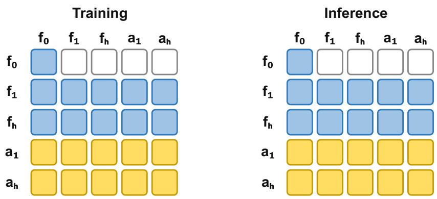  
Figure 6: Joint-WAM visibility masks. Future video and action tokens attend to both modalities, coupling their predictions during joint denoising. Training and inference use the same bidirectional visibility pattern.

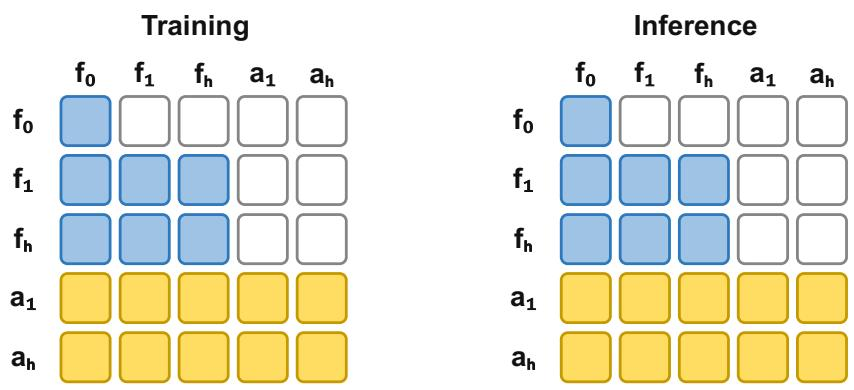  
Figure 7: IDM-WAM visibility masks. Action queries can access future video, while video queries cannot access future actions. At inference, video is generated first and then held fixed as the condition for action generation.

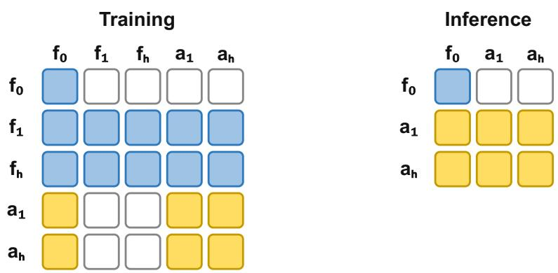  
Figure 8: Action-Centric-WAM visibility masks. During training, future video queries access actions, but action queries cannot access future video. At deployment, future video tokens are omitted and WM is inactive, while observed-context tokens remain available to action generation.

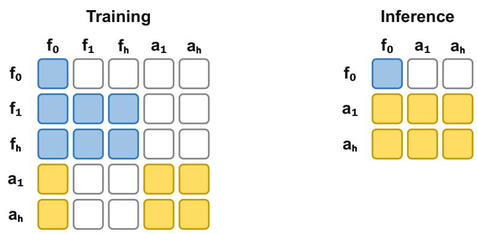  
Figure 9: Action-Only-WAM visibility masks. Neither future modality attends to the other during training, although both access the observed context. Inference retains only the context and action tokens, omitting auxiliary video prediction.

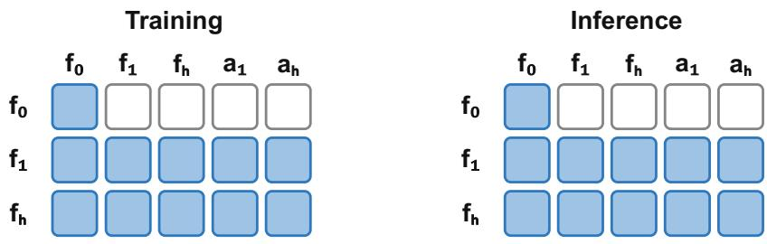  
Figure 10: AC-WM visibility masks. Future video queries attend to the supplied action sequence during both training and inference. Actions remain clean conditioning inputs, so the interface predicts video without generating actions.

## A.3 TRAJECTORY ORGANIZATION AND TEACHER FORCING

The unified training configuration draws all five interfaces from the same trajectory-window format: 33 RGB frames, 96 action vectors, four robot states, and a language instruction. Video encoding produces nine temporal latent frames, comprising an initial condition and four successive block of two future latent frames. Each block is aligned with 24 actions and one state. The language instruction enters through cross-attention. AC-WM uses the aligned video and action data but does not include state tokens in its Transformer input.

Table 5: Training trajectory organization. All rows use the same four-block trajectory window. The initial video frame is conditioning only and excluded from video loss. Clean copies serve teacher forcing rather than additional supervision.
<table><tr><td>Interface</td><td>Conditioning copies and inputs</td><td>Denoising targets</td></tr><tr><td>Joint-WAM</td><td>language</td><td>Clean video history, current state, and Future video and actions, with joint current-block visibility</td></tr><tr><td>IDM-WAM</td><td>states, and language under interleaved before action</td><td>Video and action conditioning copies, Future video and actions, ordered video</td></tr><tr><td>Action-Centric-WAM</td><td>teacher forcing language</td><td>Clean video history, current state, and Future video and actions; video addition- ally reads current noisy actions</td></tr><tr><td>Action-Only-WAM</td><td>language</td><td>Clean video history, current state, and Future video and actions without current- block cross-modal attention</td></tr><tr><td>AC-WM</td><td>Clean video history, supplied clean ac- Future video only tions, and language</td><td></td></tr></table>

Table 5 distinguishes conditioning copies from prediction targets. Clean video copies provide observed history for teacher forcing; they are not additional prediction targets. For Joint-WAM and the full-window Action-Centric-WAM, Action-Only-WAM, and AC-WM paths, a target block accesses the clean video prefix preceding that block, together with the current-block inputs permitted by its interface mask. This prevents the clean copy of the target future video from becoming a direct input to its own prediction. IDM-WAM instead follows an interleaved video-then-action ordering: the current video condition precedes the action target, allowing action denoising to use that video while preventing the reverse dependence. Its video-condition augmentation is described in Appendix G.2.

The visibility diagrams in Appendix A.2 summarize modality-level dependencies. The implementation expands these dependencies over temporal blocks and separate conditioning/target copies, allowing teacher-forced blocks to be processed in parallel without changing the prescribed information flow.

## A.4 CAPABILITY-ALIGNED TOKEN ROUTING

Figure 11 summarizes the expert groups used by each interface in the two execution settings. The shared component is retained throughout, whereas the active atomic groups depend on which modalities are predicted and what they condition on. At inference, Action-Centric-WAM uses shared and VLA experts; WM is inactive because no future video is generated. Action-Only-WAM additionally retains VGM to process the initial conditioning-frame tokens, while future action tokens use shared and VLA experts. Its separate conditioning-frame expert path is retained even when future-video prediction is removed. This design preserves specialized visual conditioning within the interface’s separation of future video and action targets; information leakage from future targets is prevented by the visibility mask, not by expert activation alone. The grey dashed WM circle denotes deactivation, whereas the coloured dashed VGM circle denotes retained conditioning-frame processing without future-video generation.

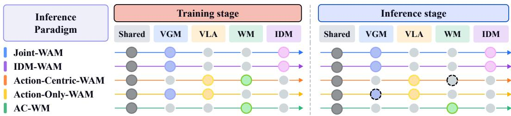  
Figure 11: Expert activation across five video-action interfaces. Shared experts are active for every interface, while atomic experts specialize according to the conditional pathway. In Action-Centric-WAM, the grey dashed WM circle indicates that the expert is inactive when future-video prediction is omitted. In Action-Only-WAM, the coloured dashed VGM circle indicates that the expert remains active for the initial conditioning frame, without predicting future video. For these two interfaces, future action tokens are processed only by shared and VLA experts.

Allowed experts and learned mixture weights. CATR combines a prescribed expert eligibility set with learned mixing weights. Each MoE feed-forward sublayer contains one shared expert and four atomic experts, VGM, VLA, WM, and IDM. Table 6 gives the eligible experts for future prediction tokens. In the teacher-forced layout, clean history copies and state tokens use the shared expert alone; clean action conditions in AC-WM also use only the shared expert. These clean history copies are distinct from the initial conditioning-frame (seed) group: Action-Only-WAM routes that group through shared and VGM experts during both training and inference, whereas Action-Centric-WAM uses shared alone. In cached inference, clean history is written through shared alone; VGM participates in the Action-Only-WAM seed pass, and subsequent action queries use shared and VLA experts while reading the cached context. Thus, VGM does not process every historical frame, and WM is not introduced into the Action-Centric-WAM inference path. The table concerns future target groups rather than conditioning-frame or clean-history copies.

Table 6: Eligible experts for future target groups during training. Weights are learned within each listed set; experts outside the set do not contribute to that group’s output.
<table><tr><td>Interface</td><td>Future video targets</td><td>Action targets</td></tr><tr><td>Joint-WAM / IDM-WAM</td><td> $\mathrm { S h a r e d + V G M }$ </td><td> $\mathrm { S h a r e d + I D M }$ </td></tr><tr><td>Action-Centric-WAM</td><td> $\mathrm { S h a r e d + W M }$ </td><td>Shared + VLA</td></tr><tr><td>Action-Only-WAM</td><td> $\mathrm { S h a r e d + V G M }$ </td><td>Shared + VLA</td></tr><tr><td>AC-WM</td><td> $\mathrm { S h a r e d + W M }$ </td><td>None (clean conditions)</td></tr></table>

For a routed token group $g$ (a prediction-target or conditioning group), let $\mathcal { E } _ { g }$ be its eligible expert set and $\mathcal { R } _ { g }$ the token indices pooled for routing. At a given Transformer layer, the router operates on hidden states $h _ { j }$ after attention:

$$
\bar { h } _ { g } = \frac { 1 } { | \mathcal { R } _ { g } | } \sum _ { j \in \mathcal { R } _ { g } } h _ { j } , \qquad \alpha _ { g , e } = \{ \frac { \exp ( ( W _ { r } \bar { h } _ { g } ) _ { e } / \tau ) } { \sum _ { e ^ { \prime } \in \mathcal { E } _ { g } } \exp ( ( W _ { r } \bar { h } _ { g } ) _ { e ^ { \prime } } / \tau ) } , \quad e \in \mathcal { E } _ { g } , \qquad \alpha _ { g , e ^ { \prime } } = \mathcal { E } _ { g } , \qquad \alpha _ { g , e ^ { \prime } } = \mathcal { E } _ { g } , \qquad \alpha _ { g , e ^ { \prime } } = \mathcal { E } _ { g } . \qquad\tag{8}
$$

Here, Wr is the learned router matrix and $\tau$ is its temperature. For each token $j$ in group g, the feed-forward output is

$$
\mathrm { M o E } ( h _ { j } ) = \sum _ { e \in \mathscr { E } _ { g } } \alpha _ { g , e } f _ { e } ( h _ { j } ) ,\tag{9}
$$

where $f _ { e }$ is expert $e .$ Thus, tokens within a group share mixture weights but retain their individual expert outputs. Shared-only groups have a fixed weight of one and need no learned mixture.

Table 7: Expert sets and mixing rules for conditioning and action groups in the two action-only inference pathways. Shared-only groups have fixed weight one; learned mixtures use Equations 8 and 9.
<table><tr><td>Token group</td><td>Action-Centric</td><td>Action-Only</td><td>Mixing</td></tr><tr><td>Clean history copies</td><td>Shared</td><td>Shared</td><td>Fixed</td></tr><tr><td>Initial conditioning frame (seed)</td><td>Shared</td><td>Shared + VGM</td><td>Fixed / learned</td></tr><tr><td>Future action targets</td><td>Shared + VLA</td><td>Shared + VLA</td><td>Learned</td></tr><tr><td>State tokens</td><td>Shared</td><td>Shared</td><td>Fixed</td></tr></table>

For the Action-Only-WAM seed group, $\mathcal { R } _ { g }$ contains that group’s frame-token indices: their postattention hidden states are mean-pooled, projected by $W _ { r }$ , and normalized over shared and VGM experts. The resulting weights are shared within the group, while each token retains its own expert output. Action-Centric-WAM uses only shared for this group. In the cached action-query pass, action-group weights are similarly obtained by pooling the current action tokens, whose hidden states already incorporate the permitted cached context.

Caching and interface changes. Clean-history and seed passes store attention keys and values in the interface’s KV cache for subsequent action queries; the expert-mixture weights are computed for each routed group rather than reused as cache entries. In the real-robot PAIR server, an interface change clears the model’s runtime caches and resets window tracking. The newly selected interface is seeded from the latest frame of the current observation, rebuilding its cache through its own computation path; KV entries from the previous interface are not transferred. If the interface remains unchanged, normal within-interface caching continues, subject to its window resets.

Pooling scope and interface selection. Joint-WAM pools the current block’s video, action, and state representations, then applies separate eligibility masks for video and action groups. IDM-WAM pools each video or action target group separately. The full-window Action-Centric-WAM, Action-Only-WAM, and AC-WM paths likewise pool each predicted modality within its block. These representations already incorporate the context allowed by attention; the router does not pool the entire trajectory indiscriminately. CATR therefore specifies expert computation inside the selected interface, whereas PAIR selects the action-generating interface at deployment. The two routing mechanisms operate at different levels.

## B PAIR: TRAINING AND DEPLOYMENT

## B.1 MAE-BASED TRAINING TARGETS

The OOD adaptation datasets comprise human-collected demonstrations of the same three realworld tasks: Folding Clothes, Folding Box, and Tabletop Cleaning. Each episode records camera observations and the corresponding robot actions throughout task execution. These demonstrations are separate from the data used to train the backbone: the task goals are shared, but the object instances and scene conditions differ, including lighting and object appearance such as color. Taskspecific shifts include garment colors and sizes, box types, and cluttered backgrounds, as defined in Section 4.1.

For each target task, we randomly select 500 episodes from its OOD dataset and construct candidate chunk scenarios using a sliding window of 24 consecutive action steps with stride one action step, aligned with the execution chunk length. We then randomly sample 2,000 chunk scenarios from this candidate pool. Each scenario is evaluated by all four frozen WAM interfaces, producing 8,000 interface-specific action predictions per task. The reference action chunk is the recorded action sequence from the corresponding window in the OOD dataset, not an action sequence generated by any of the four interfaces. We compare all four predictions with this same reference to obtain four MAEs and identify the lowest-error interface for each scenario. These errors provide the routing supervision, with soft targets and the near-best efficiency preference defined below. Thus, each task contributes 2,000 labeled chunk scenarios, not 8,000 independent training windows; all four interfaces are evaluated on every scenario rather than sampled as separate data sources. Using this 24-step, stride-one counting convention, sliding-window construction across the three task datasets yields up to 21,867,390 candidate windows in total. These overlapping windows are candidate chunk scenarios, not independent demonstrations. The 6,000 selected scenarios across the three tasks constitute approximately 0.0274% of this candidate pool (less than one thousandth). This fraction measures window sampling, not a reduction in episode acquisition requirements. PAIR is trained offline with the UniW(A)M backbone frozen. Final OOD success rates are measured in new physical robot trials rather than on windows held out from these episodes; the deployment environments do not exactly reproduce the dataset configurations, as detailed in Appendix C.

For an action chunk of k steps, the frozen backbone generates candidate action sequences $\hat { a } _ { t + } ^ { ( i ) }$ 1:t+k for the four WAM interfaces:

$$
\mathrm { \overline { { Z } } _ { W A M } = \{ J o i n t { \mathrm { - } } W A M , I D M { \mathrm { - } } W A M , A c t i o n { \mathrm { - } } C e n t r i c { \mathrm { - } } W A M , A c t i o n { \mathrm { - } } O n l y { \mathrm { - } } W A M } \}  \mathrm  \overline { { + } } \overline { { W } } \overline { { A } } M \} \mathrm  \overline { { + } } \overline { { - } } \overline { { W A M } } \mathrm  \overline { { + } } \overline { { - } } \overline { { W A M } } \mathrm  \overline { { + } } \overline { { - } } \overline { { W A M } } \mathrm  \overline { { + } } \overline { { - } } \overline { { W A M } } \mathrm  \overline { { + } } \overline { { - } } \overline { { \mathrm { - } } } \overline { { W A M } } \mathrm  \overline { { + } } \overline { { - } } \overline  { \mathrm { - } } \overline { { U } } \mathrm  \overline { { + } } \overline  { \mathrm { - } } \overline  { U } \mathrm  \overline { { - } } \overline  { \mathrm { \mathrm { - } } } \overline  { U } \mathrm { \mathrm { - } } \overline  { U \mathrm } \mathrm  \overline { { - } } \overline  \mathrm  \overline { { U } \mathrm } \mathrm { { - } \mathrm } \overline  { U \mathrm } \mathrm { \mathrm { - } } \overline  \mathrm { U } \mathrm { \mathrm { - } \mathrm } \overline  { U \mathrm } \mathrm { \mathrm { - } \mathrm } \overline  { U \mathrm } \mathrm { \mathrm { - } \mathrm } \overline  { U \mathrm } \mathrm { \mathrm { - } \mathrm } \overline  { U \mathrm } \mathrm { \mathrm { - } \mathrm } \overline  { U \mathrm } \mathrm { \mathrm { - } \mathrm } \overline  { U \mathrm } \mathrm { \mathrm { - } \mathrm } \overline  { U \mathrm } \mathrm { \mathrm { - } \mathrm } \overline  { U \mathrm } \mathrm { \mathrm { - } \mathrm } \overline  { U \mathrm } \mathrm { \mathrm { - } \mathrm } \mathrm  U \mathrm { } \mathrm { - } \mathrm \overline  { U \mathrm } \mathrm { \mathrm { - } \mathrm } \overline  { U \mathrm } \mathrm { \mathrm { - } \mathrm } \mathrm  U \mathrm\tag{10}
$$

Given the ground-truth sequence $a _ { t + 1 : t + k } ^ { * }$ , the action error for each interface is

$$
\mathcal { L } _ { \mathrm { M A E } } ^ { ( i ) } = \frac { 1 } { k d _ { a } } \sum _ { s = t + 1 } ^ { t + k } \sum _ { d = 1 } ^ { d _ { a } } \left| \hat { a } _ { s , d } ^ { ( i ) } - a _ { s , d } ^ { * } \right| , \quad \quad i \in \mathcal { I } _ { \mathrm { W A M } } ,\tag{11}
$$

where $d _ { a }$ is the action dimensionality. We normalize errors within each chunk scenario:

$$
\Delta _ { t } ^ { ( i ) } = \frac { \mathcal { L } _ { \mathrm { M A E } } ^ { ( i ) } - \underset { j \in \mathbb { Z } _ { \mathrm { W A M } } } { \operatorname* { m i n } } \mathcal { L } _ { \mathrm { M A E } } ^ { ( j ) } } { \operatorname* { m a x } \left\{ \underset { j \in \mathbb { Z } _ { \mathrm { W A M } } } { \operatorname* { m a x } } \mathcal { L } _ { \mathrm { M A E } } ^ { ( j ) } - \underset { j \in \mathbb { Z } _ { \mathrm { W A M } } } { \operatorname* { m i n } } \mathcal { L } _ { \mathrm { M A E } } ^ { ( j ) } , \epsilon \right\} } ,\tag{12}
$$

where $\epsilon = 1 0 ^ { - 1 2 }$ prevents division by zero. Equation 1 maps these normalized errors to the soft target $\tilde { y } _ { t } ^ { ( i ) }$ . Let $e _ { t } ^ { ( i ) } = \mathcal { L } _ { \mathrm { M A E } } ^ { ( i ) }$ and $e _ { t } ^ { * } = \operatorname* { m i n } _ { i } e _ { t } ^ { ( i ) }$ . We define the near-best candidate set by

$$
\mathcal { N } _ { t } = \left\{ i \in \mathcal { I } _ { \mathrm { W A M } } : e _ { t } ^ { ( i ) } - e _ { t } ^ { * } \leq \delta e _ { t } ^ { * } \right\} , \qquad \delta = 0 . 0 1 .\tag{13}
$$

For a positive minimum error, this includes every interface whose MAE is within 1% of the minimum. If $e _ { t } ^ { * } = 0$ , only zero-error interfaces qualify, avoiding division by zero. Let $\mathcal { F }$ contain Action-Centric-WAM and Action-Only-WAM. If $\mathcal { N } _ { t } \cap \mathcal { F }$ is nonempty, we select its lowest-latency member $i _ { t } ^ { \mathrm { f a s t } }$ and assign a one-hot training target:

$$
y _ { t } ^ { ( i ) } = \left\{ \begin{array} { l l } { \mathbf { 1 } \{ i = i _ { t } ^ { \mathrm { f a s t } } \} , } & { \mathcal { N } _ { t } \cap \mathcal { F } \neq \emptyset , } \\ { \tilde { y } _ { t } ^ { ( i ) } , } & { \mathcal { N } _ { t } \cap \mathcal { F } = \emptyset . } \end{array} \right.\tag{14}
$$

When both fast interfaces qualify, Action-Centric-WAM is selected according to the measured latency ordering in Section 4.4. This preference is restricted to near-best candidates and does not assign probability to an ineligible fast interface. The rule constructs offline training labels; deployment uses the learned router without ground-truth actions or online MAE comparisons.

## B.2 ROUTER INPUTS AND CHUNK-LEVEL SELECTION

PAIR uses contextual features from the frozen UniW(A)M backbone:

$$
z _ { t } = \Psi _ { \theta } \left( F _ { t } ^ { \mathrm { v i d e o } } , F _ { t } ^ { \mathrm { C L I P } } , F _ { t } ^ { \mathrm { s t a t e } } , F _ { t } ^ { \mathrm { t e x t } } , c _ { t } \right) ,\tag{15}
$$

where the four feature inputs are video, CLIP-derived semantic, robot-state, and language features, respectively, $c _ { t }$ is a one-hot encoding of the chunk position within the current window, and θ denotes the frozen backbone parameters. To obtain the video features, the current visible observation prefix is encoded and passed through all frozen DiT blocks with only the shared FFN expert enabled; the resulting video tokens are mean-pooled. This feature-extraction pass is independent of the interface to be selected and does not populate that interface’s KV cache. Its pooled video representation is combined with the CLIP, state, language, and chunk-position features for routing. PAIR uses eight independently trained classification heads. Their softmax probabilities are averaged to obtain

$$
q _ { \phi } ( i \mid z _ { t } ) = \frac { 1 } { 8 } \sum _ { m = 1 } ^ { 8 } \mathrm { s o f t m a x } _ { i } \left( g _ { \phi _ { m } } ( z _ { t } ) \right) , \qquad i \in \mathcal { T } _ { \mathrm { W A M } } ,\tag{16}
$$

where $\phi = \{ \phi _ { m } \} _ { m = 1 } ^ { 8 }$ and each head is trained with the loss in Equation 2. The PAIR results in Table 4 and Figure 5 use this same eight-head ensemble. At deployment, PAIR selects

$$
i _ { t } = \arg \operatorname* { m a x } _ { i \in \mathbb { Z } _ { \mathrm { W A M } } } q _ { \phi } ( i \mid z _ { t } ) .\tag{17}
$$

The selected WAM interface generates the next action chunk. After its execution, the observation history is updated before PAIR selects an interface for the next chunk. As detailed in Appendix A.4, an interface change clears runtime caches and resets window tracking; the latest observed frame then seeds the selected interface’s own cache. When the interface is unchanged, normal within-interface caching continues.

Router timing. The eight heads are evaluated in parallel; their combined prediction and probability aggregation take approximately 2 ms in a separate measurement. To account for shared-expert feature computation and the remaining routing operations, we benchmark the first chunk of each window on a single NVIDIA H20 using checkpoint-150000 and an ensemble of eight router heads. After one warm-up window, we average five windows using synthetic 640×480 camera inputs and CUDA synchronization at each timing boundary. Subtracting the separately timed observation and language encoding stage from the complete observation-to-selection call gives 62.7 ms on average, rounded to 63 ms. This accounting includes input preparation, shared-expert feature computation, classification, and interface selection, but excludes observation and language encoding, subsequent action generation, cache reconstruction, and multi-GPU control communication. It characterizes the first-chunk setting rather than an average over chunk positions. The synthetic inputs are used to measure computation time, not routing accuracy.

## B.3 INTERFACE SELECTION ACROSS EXECUTION PHASES

Figure 12 reports phase-conditioned interface selection across the three real-world tasks. We divide execution into Reach, involving motion for approaching the target; Contact, involving contact-based manipulation; and Core, involving fine-grained manipulation, and measure each interface’s selection frequency within each phase. During Reach, Action-Only-WAM and Action-Centric-WAM together account for 60%–75% of selections, favoring fast action pathways for low-interaction motions. During Contact, the combined share of Joint-WAM and IDM-WAM rises to approximately 60%–70%, consistent with a preference for video-conditioned geometric guidance. During Core, these two interfaces account for 70%–90% of selections, indicating greater use of visual foresight during fine manipulation and complex physical interactions. This phase-dependent pattern is consistent with balancing fast action execution and foresight-rich control as interaction demands change, and offers an interpretation of the OOD gains reported in the main text. Examples of critical manipulation steps are discussed in Appendix D.2.

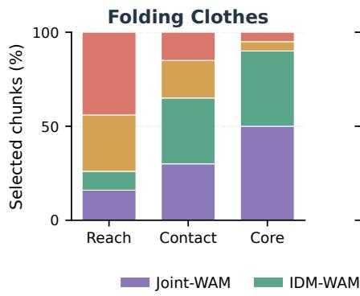

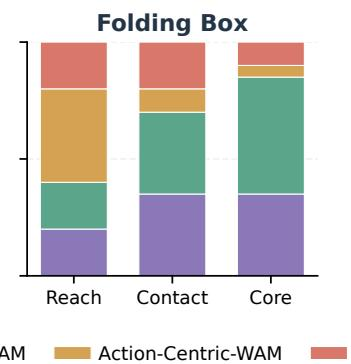

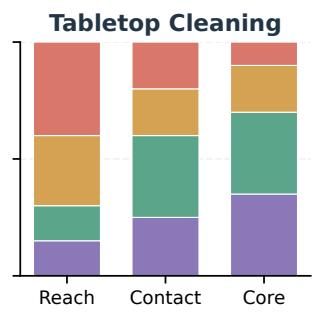  
Figure 12: Phase-conditioned PAIR interface selection across three real-world tasks. Each panel reports 100%-stacked proportions for the Reach, Contact, and Core stages, revealing how the router shifts between fast action pathways and video-aware WAMs as interaction demands change.

## C BENCHMARKS AND EVALUATION PROTOCOLS

We describe the benchmarks and evaluation protocols summarized in Section 4.1. LIBERO, RoboTwin 2.0, and the real-world tasks evaluate action generation, while WorldArena evaluates action-conditioned future-world prediction.

LIBERO. The benchmark comprises four official suites, including LIBERO-Spatial, LIBERO-Object, LIBERO-Goal, and LIBERO-Long, each containing 10 tasks with 50 demonstrations per task. We follow the standard public benchmarking protocol for training configurations and evaluation trial counts. We report task success rates for each suite alongside the overall average.

RoboTwin 2.0. RoboTwin 2.0 evaluates dual-arm manipulation across 50 tasks. Following the official benchmark setting (RoboTwin Team, 2026), we jointly train a single policy on 50 clean demonstrations per task (2,500 demonstrations in total). We evaluate the same policy for 100 trials per task under clean (Clean-to-Clean, C2C) and randomized (Clean-to-Randomized, C2R) conditions, reporting the mean success rate across the 50 tasks separately for each setting. Baselines come from the official leaderboard snapshot updated on September 24, 2026. The π0 entry uses a separately fine-tuned checkpoint per task; the other listed baselines use co-training, which jointly trains one policy across all tasks.

Real-World Evaluation. Real-robot experiments are conducted on an AgileX dual-arm platform across three representative manipulation tasks: Folding Clothes, Folding Box, and Tabletop Cleaning. Each task is evaluated over 20 trials. All main comparisons and ablation studies share these three tasks, with task success rate serving as the primary evaluation metric. For PAIR, offline adaptation uses recorded OOD dataset episodes as described in Appendix B.1, whereas final OOD evalua tion consists of separately conducted real-robot deployments under environment configurations that do not exactly match those in the dataset. This evaluates transfer from offline target-domain data to physical execution; it is not a random window-level train/test split of the same recorded episodes.

Efficiency metrics. All interfaces use a configured denoising step count of 16. Joint-WAM jointly denoises video and actions for 16 steps, while Action-Centric-WAM and Action-Only-WAM each denoise actions for 16 steps. IDM-WAM performs 16 video-denoising steps followed by 16 actiondenoising steps. CFG is set to 5 for Joint-WAM and for IDM-WAM’s video stage; IDM-WAM’s action stage uses no CFG, and both fast interfaces use a guidance scale of 1. The standalone interface latency in Figure 5(b) is the elapsed time for a complete action-chunk inference call divided by the configured step count of 16. For IDM-WAM, this denominator is 16 rather than the 32 iterations summed across its two stages. Multiplying each reported normalized latency by 16 recovers the corresponding full chunk inference time. Initial conditioning and cache construction performed within that call are included and amortized over the steps; the metric is not a direct measurement of a steady-state denoising iteration. PAIR routing is timed separately as described in Appendix B.2. The task-level completion time in Figure 5(a) is averaged over successful trials only. Failed and timed-out trials are excluded from this time average but remain in the success-rate denominator.

WorldArena. To evaluate future world prediction, UniW(A)M operates as an action-conditioned world model following the standard WorldArena evaluation protocol. We report metrics across visual quality, motion quality, content consistency, physical adherence, 3D accuracy, and controllability, comparing against established action-conditioned video prediction baselines under the same benchmark protocol. This evaluation verifies whether unified multi-task training preserves actionconditioned world modeling capabilities.

## C.1 UNCERTAINTY IN REAL-WORLD SUCCESS RATES

We report per-task success counts and two-sided 95% Wilson score intervals without continuity correction (Wilson, 1927) for the existing real-robot evaluations. Each method–task setting consists of $n = 2 0$ trials, so the reported task success rate determines the integer count k. These calculations summarize the existing trials and do not introduce additional robot evaluations. With $\hat { p } = k / n$ and

z = 1.959964, the interval is

$$
\frac { \hat { p } + z ^ { 2 } / ( 2 n ) \pm z \sqrt { \hat { p } ( 1 - \hat { p } ) / n + z ^ { 2 } / ( 4 n ^ { 2 } ) } } { 1 + z ^ { 2 } / n } .\tag{18}
$$

The calculation assumes approximately independent Bernoulli outcomes with a common success probability within each method–task setting. The intervals quantify finite-trial uncertainty conditional on the evaluated model and task setting; they do not capture variation across training runs. We report marginal intervals for individual task success rates, not simultaneous confidence bounds or tests of differences between methods. We do not pool the three tasks as 60 trials with a common success probability or assign intervals to cross-task averages without the corresponding trial structure.

Table 8 supplements the standard and OOD evaluations in Tables 2 and 4. Table 9 covers the dense, sample-level routing, and four-WAM-only ablations in Table 15; the full five-paradigm CATR results reuse the standard UniW(A)M rows in Table 8. One additional success changes a task’s observed rate by five percentage points, so small differences in point estimates should not be interpreted as stable performance rankings.

Table 8: Per-task uncertainty for standard and OOD real-world evaluations. Each entry gives successes out of 20 trials, followed by the 95% Wilson interval in percent. Standard and OOD rows correspond to separate evaluation settings.
<table><tr><td>Method / interface</td><td>Folding Clothes</td><td>Folding Box</td><td>Tabletop Cleaning</td></tr><tr><td colspan="4">Standard evaluation: baselines</td></tr><tr><td>π0.5 (Physical Intelligence et al., 2025)</td><td>12/20; [38.7, 78.1]</td><td>13/20; [43.3, 81.9]</td><td>14/20; [48.1, 85.5]</td></tr><tr><td>DreamZero (Ye et al., 2026b)</td><td>9/20; [25.8, 65.8]</td><td>11/20; [34.2, 74.2]</td><td>12/20; [38.7, 78.1]</td></tr><tr><td>WorldScape Policy 2.0 (Su et al., 2026)</td><td>15/20; [53.1, 88.8]</td><td>15/20; [53.1, 88.8]</td><td>16/20; [58.4, 91.9]</td></tr><tr><td colspan="4">Standard evaluation: UniW(A)M with CATR</td></tr><tr><td>Joint-WAM</td><td>18/20; [69.9, 97.2]</td><td>16/20; [58.4, 91.9]</td><td>18/20; [69.9, 97.2]</td></tr><tr><td>IDM-WAM</td><td>18/20; [69.9, 97.2]</td><td>17/20; [64.0, 94.8]</td><td>18/20; [69.9, 97.2]</td></tr><tr><td>Action-Centric-WAM</td><td>17/20; [64.0, 94.8]</td><td>15/20; [53.1, 88.8]</td><td>17/20; [64.0, 94.8]</td></tr><tr><td>Action-Only-WAM</td><td>17/20; [64.0, 94.8]</td><td>14/20; [48.1, 85.5]</td><td>17/20; [64.0, 94.8]</td></tr><tr><td colspan="4"></td></tr><tr><td>Joint-WAM</td><td>OOD evaluation 13/20; [43.3, 81.9]</td><td>11/20; [34.2, 74.2]</td><td>14/20; [48.1, 85.5]</td></tr><tr><td>IDM-WAM</td><td>13/20; [43.3, 81.9]</td><td>10/20; [29.9, 70.1]</td><td>15/20; [53.1, 88.8]</td></tr><tr><td>Action-Centric-WAM</td><td>10/20; [29.9, 70.1]</td><td>8/20; [21.9, 61.3]</td><td>11/20; [34.2, 74.2]</td></tr><tr><td>Action-Only-WAM</td><td>10/20; [29.9, 70.1]</td><td>9/20; [25.8, 65.8]</td><td>11/20; [34.2, 74.2]</td></tr><tr><td>UniW(A)M + PAIR</td><td>15/20; [53.1, 88.8]</td><td>14/20; [48.1, 85.5]</td><td>17/20; [64.0, 94.8]</td></tr></table>

Table 9: Per-task uncertainty for the dense, sample-level routing, and four-WAM-only ablations. Entries give successes out of 20 trials and 95% Wilson intervals in percent. Counts and intervals for the full five-paradigm CATR model appear in the standard UniW(A)M block of Table 8.
<table><tr><td>Method / interface</td><td>Folding Clothes</td><td>Folding Box</td><td>Tabletop Cleaning</td></tr><tr><td colspan="4">Single DiT (Dense)</td></tr><tr><td>Joint-WAM</td><td>2/20; [2.8, 30.1]</td><td>2/20; [2.8, 30.1]</td><td>4/20; [8.1, 41.6]</td></tr><tr><td>IDM-WAM</td><td>4/20; [8.1, 41.6]</td><td>0/20; [0.0, 16.1]</td><td>6/20; [14.5, 51.9]</td></tr><tr><td>Action-Centric-WAM</td><td>0/20; [0.0, 16.1]</td><td>0/20; [0.0, 16.1]</td><td>2/20; [2.8, 30.1]</td></tr><tr><td>Action-Only-WAM</td><td>0/20; [0.0, 16.1]</td><td>0/20; [0.0, 16.1]</td><td>1/20; [0.9, 23.6]</td></tr><tr><td colspan="4">MoE with Sample-Level Routing</td></tr><tr><td>Joint-WAM</td><td>10/20; [29.9, 70.1]</td><td>9/20; [25.8, 65.8]</td><td>12/20; [38.7, 78.1]</td></tr><tr><td>IDM-WAM</td><td>16/20; [58.4, 91.9]</td><td>6/20; [14.5, 51.9]</td><td>14/20; [48.1, 85.5]</td></tr><tr><td>Action-Centric-WAM</td><td>2/20; [2.8, 30.1]</td><td>0/20; [0.0, 16.1]</td><td>4/20; [8.1, 41.6]</td></tr><tr><td>Action-Only-WAM</td><td>2/20; [2.8, 30.1]</td><td>0/20; [0.0, 16.1]</td><td>4/20; [8.1, 41.6]</td></tr><tr><td colspan="4">UniW(A)M with CATR: Four WAMs Only (w/o AC-WM)</td></tr><tr><td>Joint-WAM</td><td>15/20; [53.1, 88.8]</td><td>12/20; [38.7, 78.1]</td><td>16/20; [58.4, 91.9]</td></tr><tr><td>IDM-WAM</td><td>16/20; [58.4, 91.9]</td><td>12/20; [38.7, 78.1]</td><td>16/20; [58.4, 91.9]</td></tr><tr><td>Action-Centric-WAM</td><td>11/20; [34.2, 74.2]</td><td>6/20; [14.5, 51.9]</td><td>13/20; [43.3, 81.9]</td></tr><tr><td>Action-Only-WAM</td><td>10/20; [29.9, 70.1]</td><td>2/20; [2.8, 30.1]</td><td>10/20; [29.9, 70.1]</td></tr></table>

## D REAL-WORLD TASK VISUALIZATIONS

D.1 TASK SEQUENCES ACROSS WAM INTERFACES

Figures 13–15 present recorded sequences for the three real-world tasks evaluated in Section 4.2, organized by Joint-WAM, IDM-WAM, Action-Centric-WAM, and Action-Only-WAM. Each interface group contains ten selected frames, read from left to right across the first row and then the second. Each frame combines the head-camera view above the two wrist-camera views, showing both the overall scene and local object interactions.

Folding Clothes

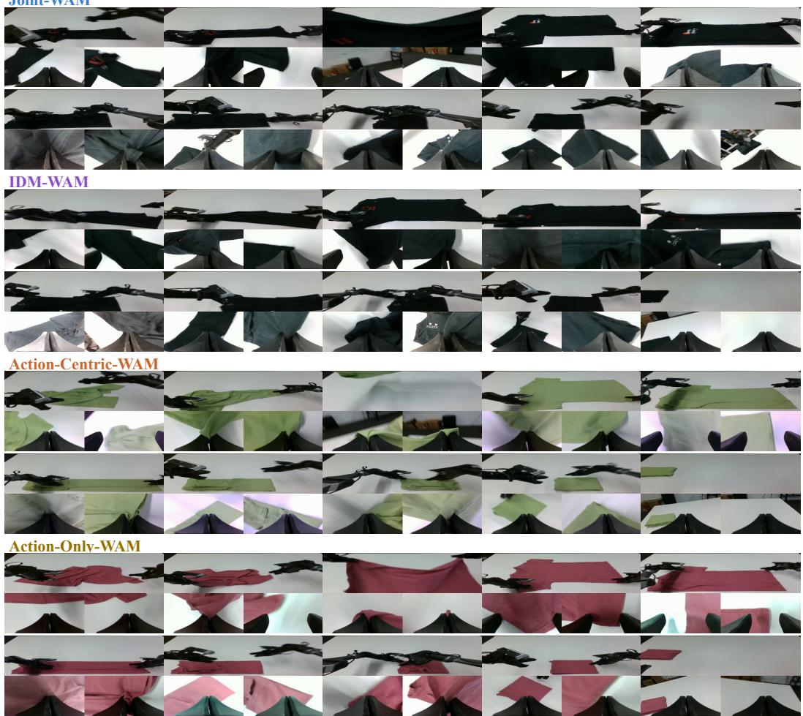  
Figure 13: Real-world visualizations of Folding Clothes for the four WAM interfaces. The sequences illustrate garment grasping, repositioning, and folding through successive stages of manipulation.

Folding Box Joint-WAM

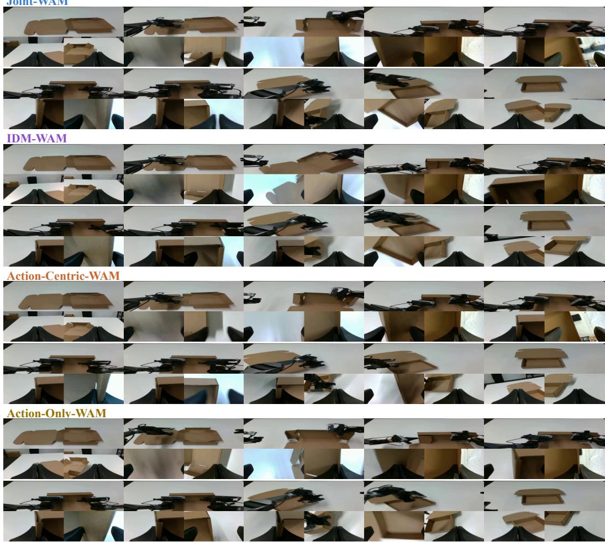  
Figure 14: Real-world visualizations of Folding Box for the four WAM interfaces. Selected frames show the progression from a flat cardboard box to folding its walls and manipulating its flaps.

Tabletop Cleaning  
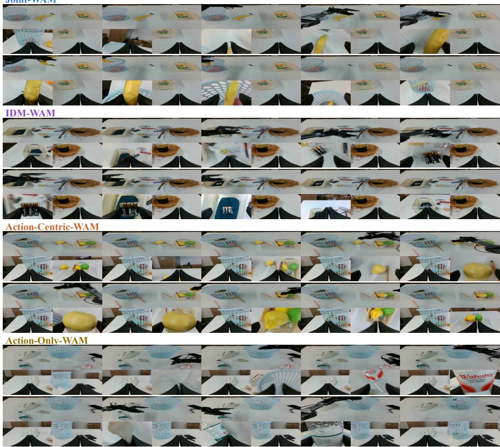  
Figure 15: Real-world visualizations of Tabletop Cleaning for the four WAM interfaces. The sequences show object pickup, transfer, and placement into a collection basket, with complementary views of reaching and grasping.

## D.2 CASE STUDY: ROUTING AT CRITICAL MANIPULATION STEPS

Figure 16 illustrates why combining interfaces can benefit real-world task execution. A fixed interface may handle most of a trajectory well yet fail at a critical action. PAIR instead selects an interface for each execution chunk, aiming to exploit the different manipulation capabilities learned by the four interfaces. This allows the choice of action pathway to change with the current interaction, rather than relying on one interface throughout the task.

Folding Clothes. Small execution errors can disrupt the entire folding sequence. From left to right, the five examples show failures to release the garment during the first, second, and final folding stages; a failed pull-back motion because the gripper does not contact the garment; and lifting the garment again to restart folding after a wrinkled intermediate result. The last behavior constitutes a renewed attempt rather than direct progress toward completion.

Folding Box. The examples highlight failures to push the left or right side flap into the intended position and complete the corresponding fold. Accurate contact placement and coordinated pushing are essential at these steps.

Tabletop Cleaning. The three cases show an inaccurate grasp, an object slipping during transfer because the grasp is insecure, and a failure to place the object inside the collection basket.

Across these observed critical operations, Joint-WAM and IDM-WAM handle fine manipulation more reliably and are usually selected by PAIR. These cases suggest how chunk-level selection can reduce the impact of a single interface’s local weaknesses on overall task success, consistent with the phase-conditioned preferences in Appendix B.3. The learned router expresses an interface preference from the current context; it does not guarantee an optimal action for every chunk.

Folding Clothes  
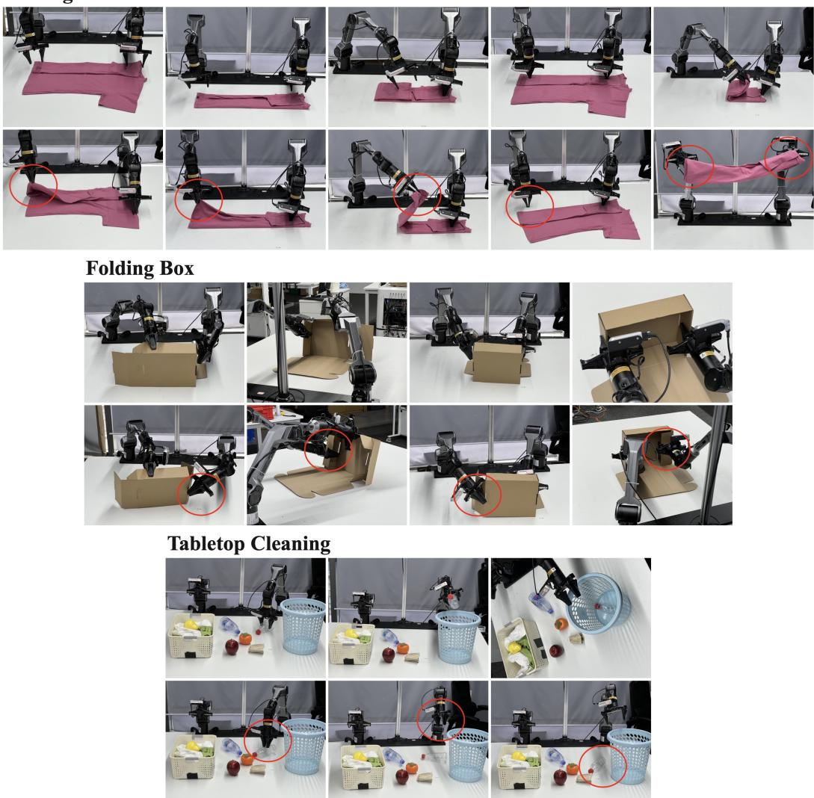  
Figure 16: Case study of critical operations in Folding Clothes, Folding Box, and Tabletop Cleaning. Within each task group, the upper row shows successful operations and the lower row shows corresponding failure cases, with red circles highlighting the affected interactions. Columns represent distinct cases, read from left to right. The examples illustrate local execution errors that motivate adapting the WAM interface at chunk boundaries.

## E SIMULATION BENCHMARK RESULTS

This section supplements the real-world comparisons in Section 4.2 with simulation benchmark results. The benchmark definitions and evaluation settings are described in Appendix C.

LIBERO. Table 10 reports success rates across the four LIBERO suites. UniW(A)M achieves an average success rate of 97.5%, with success rates above 95% in every suite. It obtains the highest Spatial success rate among the compared methods at 99.2% and exceeds the strongest listed VLA baseline, $\pi _ { 0 . 5 }$ , by 0.6 percentage points in average success. Compared with strong WAM baselines, including Motus, LingBot-VA, and Fast-WAM, UniW(A)M maintains competitive performance while supporting action-conditioned world modeling and multiple action-generation interfaces within a unified framework. These results demonstrate effective action generation in simulation alongside the model’s broader predictive capabilities.  
Table 10: Success rates (%) on the four LIBERO suites and their arithmetic mean. The best and second-best results in each column are shown in bold and underlined, respectively.
<table><tr><td colspan="4">Model Spatial Object</td></tr><tr><td>Average</td><td>Vision-Language-Action Models</td><td>Goal</td><td>Long</td></tr><tr><td colspan="2">OpenVLA (Kim et al., 2024) 84.7</td><td>88.4</td><td>79.2</td><td>53.7</td><td>76.5</td></tr><tr><td colspan="2">π0 (Black et al., 2024) 96.8</td><td>98.8</td><td>95.8</td><td>85.2</td><td>94.1</td></tr><tr><td colspan="2">π0.5 (Physical Intelligence et al., 2025)</td><td>98.8 98.2</td><td>98.0</td><td>92.4</td><td>96.9</td></tr><tr><td colspan="6">World Action Models</td></tr><tr><td colspan="2">Motus (Bi et al., 2025)</td><td>96.8 99.8</td><td>96.6</td><td>97.6</td><td>97.7</td></tr><tr><td colspan="2">LingBot-VA (Li et al., 2026a) 98.5</td><td>99.6</td><td>97.2</td><td>98.5</td><td>98.5</td></tr><tr><td colspan="2">Fast-WAM (Yuan et al., 2026)</td><td>98.2 100.0</td><td>97.0</td><td>95.2</td><td>97.6</td></tr><tr><td colspan="2">UniW(A)M</td><td>99.2 99.0</td><td>96.6</td><td>95.2</td><td>97.5</td></tr></table>

RoboTwin 2.0. Table 11 gives the values visualized in Figure 4. UniW(A)M attains 84.38% C2C success, close to WorldScape Policy 2.0’s 84.92%, and the highest C2R success among the compared methods at 66.60%. Its C2R score exceeds $\pi _ { 0 . 5 }$ by 20.60 percentage points, supporting generalization when scene randomization is introduced only at evaluation.

Table 11: RoboTwin 2.0 success rates (%) with clean-only training, averaged across 50 tasks separately for C2C and C2R. Official leaderboard baselines (RoboTwin Team, 2026) use co-training except $\pi _ { 0 } ,$ , which uses single-task fine-tuning. Best and second-best scores are bold and underlined.
<table><tr><td>Model</td><td>C2C</td><td>C2R</td></tr><tr><td> $\pi _ { 0 }$  (Black et al., 2024) (single-task) π0.5 (Physical Intelligence et al., 2025)</td><td>46.42</td><td>16.34</td></tr><tr><td rowspan="2">Fast-WAM (Yuan et al., 2026) WorldScape Policy 2.0 (Su et al., 2026)</td><td>70.7 77.8</td><td>46.0</td></tr><tr><td>84.92</td><td>1.9 38.5</td></tr><tr><td>UniW(A)M</td><td>84.38</td><td>66.60</td></tr></table>

## F WORLDARENA EVALUATION AND FUTURE-WORLD PREDICTION

## F.1 RESULTS BY EVALUATION METRIC

Tables 12 and 13 report the complete set of component scores for the three real-world tasks evaluated with WorldArena, grouped into six evaluation dimensions. We retain the original 0–1 scale and follow the task and model order in Table 3, which reports the aggregate EWMScore-P scores.

Table 12: WorldArena component scores for visual quality, motion quality, and content consistency. The highest score for each metric within each task is shown in bold, including ties.
<table><tr><td rowspan="2">Model</td><td colspan="3">Visual Quality</td><td colspan="3">Motion Quality</td><td colspan="3">Content Consistency</td></tr><tr><td>Image Quality</td><td>Aesthetic Quality</td><td>JEPA Similarity</td><td>Dynamic Degree</td><td>Flow Score</td><td>Motion Smoothness</td><td>Subject Consistency</td><td>Backgrd. Consistency</td><td>Photom. Consistency</td></tr><tr><td colspan="10">Task 1: Folding Clothes (Deformable)</td></tr><tr><td>Cosmos-Predict 2.5 (NVIDIA et al., 2025)</td><td>0.3623</td><td>0.2389</td><td>0.2186</td><td>0.3057</td><td>0.1940</td><td>0.6070</td><td>0.7122</td><td>0.8976</td><td>0.2339</td></tr><tr><td>CtrlWorld (Guo et al., 2025)</td><td>0.3237</td><td>0.2549</td><td>0.1757</td><td>0.6430</td><td>0.6827</td><td>0.7821</td><td>0.6917</td><td>0.8932</td><td>0.0469</td></tr><tr><td>UniW(A)M (Ours)</td><td>0.3158</td><td>0.2189</td><td>0.4439</td><td>0.6778</td><td>0.8025</td><td>0.8777</td><td>0.6924</td><td>0.8772</td><td>0.0177</td></tr><tr><td>Task 2: Folding Box (Contact-Rich)</td><td></td><td></td><td></td><td></td><td></td><td></td><td></td><td></td><td></td></tr><tr><td colspan="10"></td></tr><tr><td>Cosmos-Predict 2.5 (NVIDIA et al., 2025)</td><td></td><td></td><td></td><td></td><td></td><td></td><td></td><td></td><td></td></tr><tr><td></td><td>0.3414</td><td>0.2403</td><td>0.4027</td><td>0.1439</td><td>0.0847</td><td>0.5247</td><td>0.6797</td><td>0.7887</td><td>0.3798</td></tr><tr><td>CtrlWorld (Guo et al., 2025)</td><td>0.3179</td><td>0.2442</td><td>0.6381</td><td>0.4236</td><td>0.2647</td><td>0.6656</td><td>0.7407</td><td>0.8795</td><td>0.1597</td></tr><tr><td>UniW(A)M (Ours)</td><td>0.3235</td><td>0.2373</td><td>0.6541</td><td>0.3755</td><td>0.2290</td><td>0.6869</td><td>0.7396</td><td>0.8845</td><td>0.1459</td></tr><tr><td></td><td colspan="10">Task 3: Tabletop Clean. (Long-Horizon)</td></tr><tr><td>Cosmos-Predict 2.5 (NVIDIA et al., 2025)</td><td></td><td></td><td></td><td></td><td></td><td></td><td></td><td></td><td></td></tr><tr><td></td><td>0.4224</td><td>0.2264</td><td>0.0463</td><td>0.0922</td><td>0.0318</td><td>0.4849</td><td>0.1672</td><td>0.1885</td><td>0.2691</td></tr><tr><td>CtrlWorld (Guo et al., 2025)</td><td>0.3472</td><td>0.3696</td><td>0.3376</td><td>0.3118</td><td>0.1329</td><td>0.5793</td><td>0.8706</td><td>0.9350</td><td>0.3125</td></tr><tr><td>UniW(A)M (Ours)</td><td>0.3838</td><td>0.3681</td><td>0.5030</td><td>0.2742</td><td>0.1083</td><td>0.6310</td><td>0.8914</td><td>0.9353</td><td>0.2769</td></tr></table>

Table 13: WorldArena component scores for physics adherence, 3D accuracy, and controllability. The highest score for each metric within each task is shown in bold, including ties.
<table><tr><td rowspan="2">Model</td><td colspan="2">Physics Adherence</td><td colspan="2">3D Accuracy</td><td colspan="2">Controllability</td></tr><tr><td>Interaction Quality</td><td>Trajectory Accuracy</td><td>Depth Accuracy</td><td>Perspectivity</td><td>Instruction Following</td><td>Semantic Alignment</td></tr><tr><td colspan="7">Task 1: Folding Clothes (Deformable)</td></tr><tr><td>Cosmos-Predict 2.5 (NVIDIA et al., 2025)</td><td>0.6400</td><td>0.0720</td><td>0.5474</td><td>0.8000</td><td>0.5650</td><td>0.8175</td></tr><tr><td>CtrlWorld (Guo et al., 2025)</td><td>0.6350</td><td>0.1856</td><td>0.4754</td><td>0.8000</td><td>0.5150</td><td>0.8593</td></tr><tr><td>UniW(A)M (Ours)</td><td>0.8000</td><td>0.2287</td><td>0.6460</td><td>0.8000</td><td>0.9350</td><td>0.8929</td></tr><tr><td colspan="7">Task 2: Folding Box (Contact-Rich)</td></tr><tr><td>Cosmos-Predict 2.5</td><td></td><td></td><td></td><td></td><td></td><td></td></tr><tr><td>(NVIDIA et al., 2025)</td><td>0.7650</td><td>0.1091</td><td>0.6825</td><td>0.8150</td><td>0.9500</td><td>0.7537</td></tr><tr><td>CtrlWorld (Guo et al., 2025)</td><td>0.6450</td><td>0.1473</td><td>0.8754</td><td>0.8000</td><td>0.7800</td><td>0.7407</td></tr><tr><td>UniW(A)M (Ours)</td><td>0.7050</td><td>0.1728</td><td>0.8464</td><td>0.8000</td><td>0.8400</td><td>0.7431</td></tr><tr><td colspan="7">Task 3: Tabletop Clean. (Long-Horizon)</td></tr><tr><td>Cosmos-Predict 2.5 (NVIDIA et al., 2025)</td><td>0.5400</td><td></td><td>0.5741</td><td>0.5800</td><td></td><td></td></tr><tr><td>CtrlWorld (Guo et al., 2025)</td><td>0.6000</td><td>0.0288 0.0594</td><td>0.5653</td><td>0.8000</td><td>0.4100 0.5900</td><td>0.7009 0.7234</td></tr><tr><td>UniW(A)M (Ours)</td><td></td><td></td><td>0.5773</td><td>0.8000</td><td>0.6850</td><td>0.7077</td></tr><tr><td></td><td>0.6650</td><td>0.0726</td><td></td><td></td><td></td><td></td></tr></table>

## F.2 QUALITATIVE COMPARISON OF FUTURE-WORLD PREDICTION

We compare videos generated by UniW(A)M in its AC-WM mode with CtrlWorld (Guo et al., 2025) and Cosmos-Predict 2.5 (NVIDIA et al., 2025) to examine whether unified training preserves action-conditioned scene evolution and fine visual details. Figures 17–19 present three task-specific comparisons. Each model has eight frames arranged in two rows of four, read left to right and then top to bottom; corresponding positions use matched video timestamps. Red circles mark selected prediction errors in the baselines. These qualitative examples complement the component scores by exposing differences in object persistence, appearance consistency, and local interaction details.

Folding Clothes. In the highlighted CtrlWorld predictions, portions of the garment disappear from the head or wrist view, and different regions of the garment acquire inconsistent colors. Cosmos-Predict 2.5 changes the dark garment to a pale, bluish appearance and distorts its local folds. UniW(A)M more consistently retains the dark fabric, a connected garment silhouette, and visible folds around the grippers. Preserving these features makes the predicted deformation easier to follow as the arms manipulate the cloth.

Folding Clothes  
UniW(A)M  
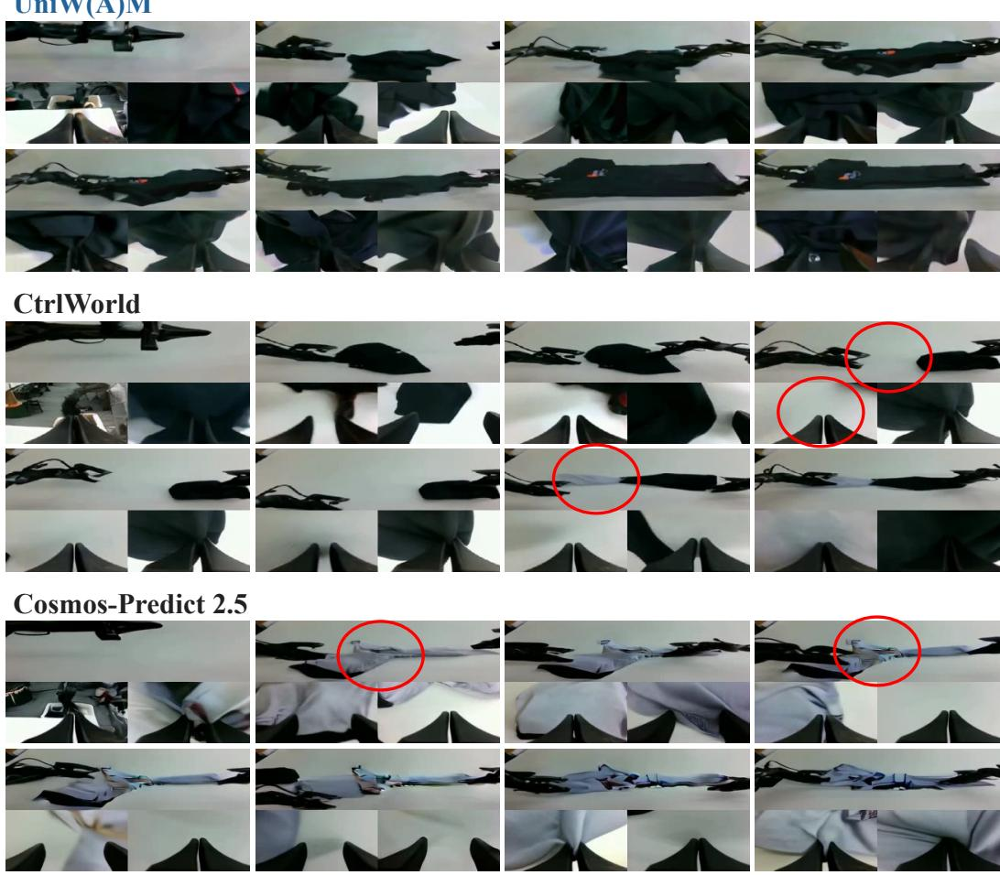  
Figure 17: Action-conditioned future-world prediction on Folding Clothes. UniW(A)M in AC-WM mode better preserves garment visibility and appearance in this early-sequence comparison. Red circles highlight missing garment regions and inconsistent fabric appearance in the baselines.

UniW(A)M

Folding Box  
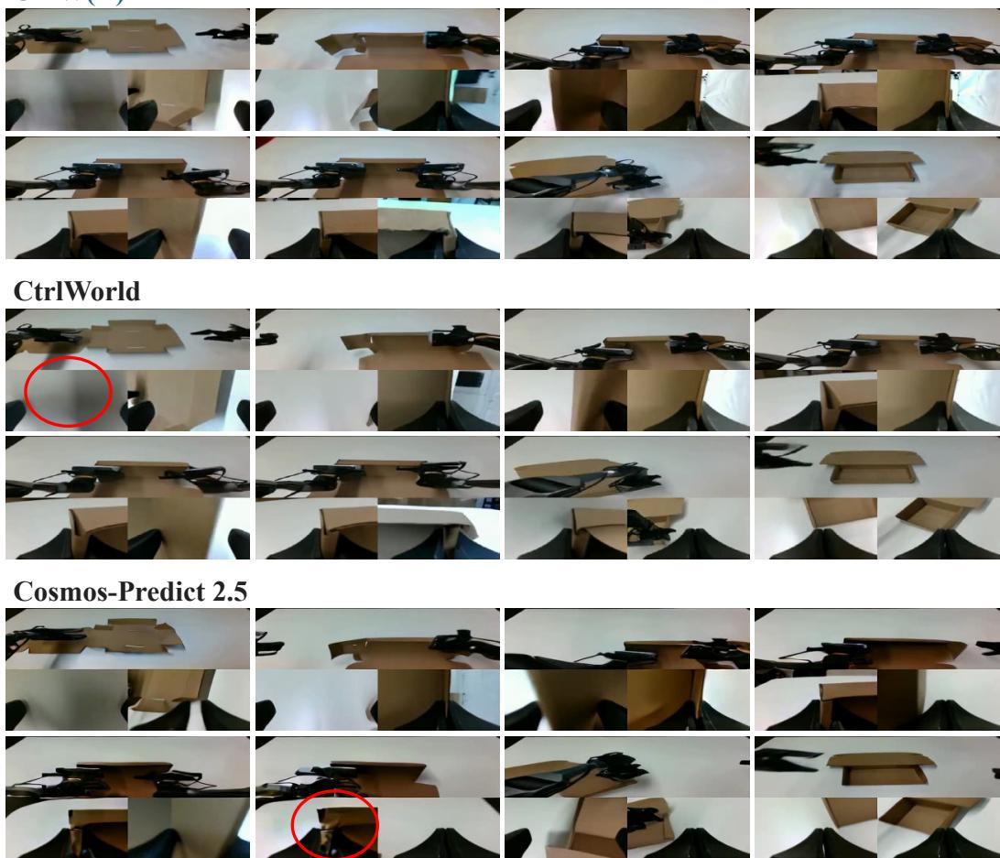  
Figure 18: Action-conditioned future-world prediction on Folding Box. The comparison emphasizes cardboard structure and wrist-view contact details. Red circles identify localized blur and poorly resolved boundaries in baseline predictions.

Tabletop Cleaning. Bottle pickup and transfer expose differences in fine texture and object identity. UniW(A)M preserves more recognizable red lettering and label structure on the bottles as they approach the wrist cameras. CtrlWorld retains the coarse bottle shape but loses or smears much of the label detail in the highlighted frames. Cosmos-Predict 2.5 exhibits stronger color drift and shape distortion, affecting both manipulated objects and the surrounding scene; some regions develop vivid, fragmented textures. By maintaining more stable bottle appearance, basket structure, and background content, UniW(A)M provides a more coherent visual account of the manipulation. Together, these selected comparisons support the unified framework’s ability to retain useful futureworld modeling capabilities alongside action generation.

## Tabletop Cleaning

UniW(A)M  
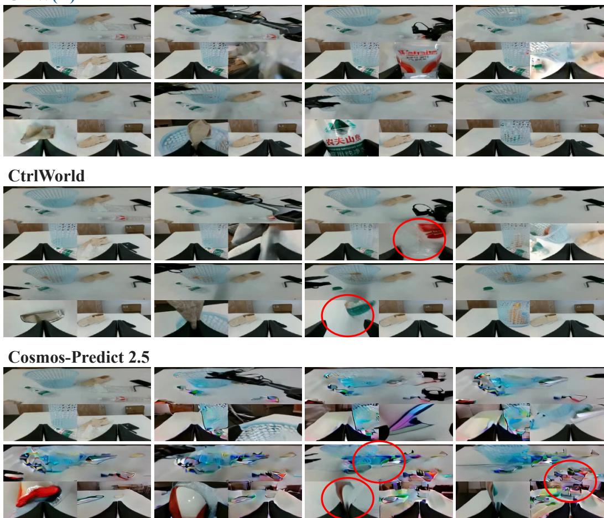  
Figure 19: Action-conditioned future-world prediction on Tabletop Cleaning. UniW(A)M retains more recognizable bottle-label details and scene appearance. Red circles highlight lost label texture, color drift, and distorted object or background regions in the baselines.

## G TRAINING DETAILS AND ABLATION STUDIES

## G.1 UNIFORM INTERFACE SAMPLING

During joint training, the five interfaces are sampled uniformly with probability 0.2 each, corresponding to the ratio 1:1:1:1:1, without a manually tuned sampling schedule. For the four-WAMonly ablation, AC-WM is omitted and the remaining interfaces are sampled uniformly with probability 0.25 each. With the total number of optimization steps fixed, each WAM interface therefore receives 25% more updates in expectation than under five-paradigm sampling. These sampling probabilities are distinct from the relative weighting of video and action losses within each interface, specified below.

## G.2 INTERFACE-SPECIFIC TRAINING OBJECTIVES

Shared flow-matching formulation. All five interfaces use flow matching, with their conditioning pathways determined by the visibility masks in Appendix A.2. Let $x _ { \mathrm { v i d } }$ denote future video latents produced by the video encoder and $x _ { \mathrm { a c t } }$ the corresponding action sequence. For each modality m ∈ {vid, act} to be predicted, Gaussian noise is interpolated with the training target:

$$
x _ { m , \sigma _ { m } } = \left( 1 - \sigma _ { m } \right) \odot x _ { m } + \sigma _ { m } \odot \epsilon _ { m } , \qquad \epsilon _ { m } \sim \mathcal { N } ( 0 , I ) , \qquad u _ { m } ^ { \star } = \epsilon _ { m } - x _ { m } .\tag{19}
$$

Here, ⊙ denotes elementwise multiplication with broadcasting over feature dimensions. Noise levels are sampled per temporal chunk and shared by the video and action targets within that chunk. The training scheduler samples uniformly over 1,000 discrete indices and applies a shifted noise schedule with shift parameter 5; thus, the resulting noise levels $\sigma _ { m }$ are not uniformly distributed on [0, 1].

For interface $p ,$ let $\hat { u } _ { \theta , m , j } ^ { ( p ) }$ be its predicted velocity for target unit $j ,$ , conditioned on the available trajectory context and the interface-specific mask. A target unit is a video latent frame or an action vector. We define the modality loss as

$$
\mathcal { L } _ { m } ^ { ( p ) } = \mathbb { E } \left[ \frac { 1 } { N _ { m } D _ { m } } \sum _ { j = 1 } ^ { N _ { m } } w ( \sigma _ { m , j } ) \left| \left| b _ { m , j } \odot \left( \hat { u } _ { \theta , m , j } ^ { ( p ) } - u _ { m , j } ^ { \star } \right) \right| \right| _ { 2 } ^ { 2 } \right] .\tag{20}
$$

The expectation covers training trajectories, Gaussian noise, and sampled noise levels. Here, $N _ { m }$ is the number of target units, $D _ { m }$ their feature dimensionality, and w the scheduler’s time-dependent loss weight. The binary mask $b _ { m , j }$ excludes unavailable actions and invalid action dimensions; it is identically one for video targets. The clean initial video frame is excluded from the video target set. Both modality losses average over their respective target elements before being combined.

Joint-WAM and IDM-WAM. These interfaces use the same loss composition:

$$
\begin{array} { r l r } { \mathcal { L } ^ { ( p ) } = \mathcal { L } _ { \mathrm { v i d } } ^ { ( p ) } + \mathcal { L } _ { \mathrm { a c t } } ^ { ( p ) } , } & { { } } & { p \in \{ \mathrm { J o i n t - W A M , I D M - W A M } \} . } \end{array}\tag{21}
$$

Their conditional prediction problems nevertheless differ. Joint-WAM permits joint video–action denoising, whereas IDM-WAM uses interleaved teacher forcing: action denoising can access the preceding video condition under the video-to-action ordering. IDM-WAM maintains separate target and conditioning copies, and only the noisy target copies receive denoising supervision. With probability 0.5 per training forward pass, its video conditioning copies receive additional noise augmentation; action conditioning copies remain clean.

Action-Centric-WAM and Action-Only-WAM. Both interfaces retain video supervision while placing greater weight on action prediction:

$$
\begin{array} { r l } & { \mathcal { L } ^ { ( p ) } = \mathcal { L } _ { \mathrm { v i d } } ^ { ( p ) } + \lambda _ { \mathrm { a c t } } \mathcal { L } _ { \mathrm { a c t } } ^ { ( p ) } , \qquad \lambda _ { \mathrm { a c t } } = 5 , } \\ & { \qquad p \in \{ \mathrm { A c t i o n - C e n t r i c - W A M , A c t i o n - O n l y - W A M } \} . } \end{array}\tag{22}
$$

In Action-Centric-WAM, the video branch attends to the current noisy action sequence, while action prediction does not access the current future-video targets. Action-Only-WAM also blocks the action-to-video direction, so video prediction provides auxiliary supervision without current-chunk cross-modal attention. Both objectives include video loss during training. At deployment, neither interface predicts future video. WM is inactive in Action-Centric-WAM, whereas VGM remains active for the initial conditioning frame in Action-Only-WAM; shared and VLA experts process future action tokens in both interfaces.

AC-WM. This interface predicts future video with the ground-truth action sequence supplied as a clean condition:

$$
\begin{array} { r } { \mathcal { L } ^ { ( \mathrm { A C - W M } ) } = \mathcal { L } _ { \mathrm { v i d } } ^ { ( \mathrm { A C - W M } ) } . } \end{array}\tag{23}
$$

Only the future video targets are noised and supervised. The action sequence is neither corrupted nor assigned an action-denoising loss.

Combining these objectives with uniform interface sampling yields

$$
\mathcal { L } _ { \mathrm { t r a i n } } = \frac { 1 } { 5 } \sum _ { p \in \mathcal { P } } \mathcal { L } ^ { ( p ) } ,\tag{24}
$$

where $\mathcal { P }$ contains the five interfaces above. Each optimization step uses the loss of one sampled interface, providing a stochastic estimate of this mixed objective.

## G.3 INITIALIZATION AND OPTIMIZATION SETTINGS

Each MoE sublayer is initialized from its corresponding pretrained dense feed-forward network. Its parameters are copied into five independently trainable experts: shared, VGM, VLA, WM, and IDM. The bias-free router matrix $W _ { r }$ is initialized to zero, assigning equal initial weights to the experts allowed for each group. Because these weights sum to one and every expert initially implements the same dense function, the replacement preserves the feed-forward output at initialization:

$$
\mathrm { M o E } ^ { ( 0 ) } ( h ) = \sum _ { e \in { \mathscr { E } _ { g } } } \frac { 1 } { | { \mathscr { E } _ { g } } | } f _ { \mathrm { d e n s e } } ( h ) = f _ { \mathrm { d e n s e } } ( h ) .\tag{25}
$$

This identity also holds for shared-only groups and is understood up to numerical precision. It concerns the feed-forward replacement under identical inputs, not equivalence between interfaces with different attention masks. Subsequent training updates the copied experts independently, while the learned router adjusts their relative contributions within the permitted sets.

Optimization settings. Table 14 summarizes the optimization settings for backbone training and PAIR adaptation. The backbone batch size is the effective global batch across devices and gradient accumulation. Each PAIR classification head is trained independently with a batch size of 128; this batch size is not multiplied by the number of ensemble members. The backbone weight decay applies to the decay parameter group, while parameters assigned to the no-decay group, including biases, use zero weight decay.

Table 14: Optimization settings for backbone training and PAIR classification-head training.
<table><tr><td>Configuration</td><td>Backbone</td><td>PAIR classification head</td></tr><tr><td>Optimizer</td><td>AdamW</td><td>AdamW</td></tr><tr><td>Learning rate</td><td> $1 \times 1 0 ^ { - 5 }$ </td><td> $1 \times 1 0 ^ { - 3 }$ </td></tr><tr><td>Learning-rate schedule</td><td>Constant</td><td>Constant, no warm-up</td></tr><tr><td>Weight decay</td><td> $1 \times 1 0 ^ { - 5 }$ </td><td> $1 \times 1 0 ^ { - 2 }$ </td></tr><tr><td>Global batch size</td><td>192</td><td>128 per head</td></tr></table>

## G.4 ARCHITECTURE, ROUTING, AND TRAINING-PARADIGM ABLATIONS

Table 15 compares a single dense DiT, MoE with sample-level routing, and UniW(A)M with CATR. All three use the same training steps, learning-rate settings, and training data volume. The single DiT is initialized from Wan2.1-I2V-14B-480P (Team Wan et al., 2025). We report its approximate scale as 16.4B parameters based on the pretrained DiT, omitting the action/state adapters from this estimate. The MoE configurations use a Wan2.2-TI2V-5B backbone with five FFN experts per block and approximately 16.2B parameters. Both figures exclude external encoders and VAE. This is not a strictly parameter-matched comparison, and backbone configurations and initialization sources also differ. In contrast, sample-level routing and CATR use identical expert counts, network structures, and parameter counts. They differ in routing organization: CATR assigns eligible expert sets and learned mixture weights to modality- and role-specific token groups, whereas sample-level routing applies the active expert ensemble to the entire sample. This comparison evaluates the combined token-group routing design, rather than isolating pooling granularity alone.

Table 15: Architecture, routing, and training-paradigm ablations on three real-world tasks. The dense, sample-level routing, and full five-paradigm CATR configurations use the same training steps, learning-rate settings, and training data volume; the latter two have identical expert architectures and parameter counts. The four-WAM-only CATR variant shares the full model’s initialization, training steps, learning-rate settings, batch size, and dataset, but samples only the four WAMs uniformly. Success rates are reported in percentage (%).
<table><tr><td>Interface</td><td>Folding Clothes (Deformable)</td><td>Folding Box (Contact-Rich)</td><td>Tabletop Clean. (Long-Horizon)</td><td>Average</td></tr><tr><td colspan="5">Single DiT (Dense)</td></tr><tr><td>Joint-WAM</td><td>10</td><td>10</td><td>20</td><td>13.3</td></tr><tr><td>IDM-WAM</td><td>20</td><td>0</td><td>30</td><td>16.7</td></tr><tr><td>Action-Centric-WAM</td><td>0</td><td>0</td><td>10</td><td>3.3</td></tr><tr><td>Action-Only-WAM</td><td>0</td><td>0</td><td>5</td><td>1.7</td></tr><tr><td colspan="5">MoE with Sample-Level Routing</td></tr><tr><td>Joint-WAM</td><td>50</td><td>45</td><td>60</td><td>51.7</td></tr><tr><td>IDM-WAM</td><td>80</td><td>30</td><td>70</td><td>60.0</td></tr><tr><td>Action-Centric-WAM</td><td>10</td><td>0</td><td>20</td><td>10.0</td></tr><tr><td>Action-Only-WAM</td><td>10</td><td>0</td><td>20</td><td>10.0</td></tr><tr><td colspan="5">UniW(A)M with CATR: Four WAMs Only (w/o AC-WM)</td></tr><tr><td>Joint-WAM</td><td>75</td><td>60</td><td>80</td><td>71.7</td></tr><tr><td>IDM-WAM</td><td>80</td><td>60</td><td>80</td><td>73.3</td></tr><tr><td>Action-Centric-WAM</td><td>55</td><td>30</td><td>65</td><td>50.0</td></tr><tr><td>Action-Only-WAM</td><td>50</td><td>10</td><td>50</td><td>36.7</td></tr><tr><td colspan="5">UniW(A)M with CATR: All Five Paradigms (Ours)</td></tr><tr><td>Joint-WAM</td><td>90</td><td>80</td><td>90</td><td>86.7</td></tr><tr><td>IDM-WAM</td><td>90</td><td>85</td><td>90</td><td>88.3</td></tr><tr><td>Action-Centric-WAM</td><td>85</td><td>75</td><td>85</td><td>81.7</td></tr><tr><td>Action-Only-WAM</td><td>85</td><td>70</td><td>85</td><td>80.0</td></tr></table>

The dense configuration reaches at most 16.7% average success. MoE with sample-level routing improves Joint-WAM and IDM-WAM to 51.7% and 60.0%, but both action-only inference pathways remain at 10.0%. CATR raises the four interfaces to 80.0%–88.3%, including 81.7% and 80.0% for Action-Centric-WAM and Action-Only-WAM. Thus, an expert architecture alone is insufficient to sustain all interfaces in this setting, while token-group alignment improves joint-training performance. These comparisons do not isolate the contributions of gradient interference or other optimization mechanisms.

Contribution of AC-WM co-training. The four-WAM-only variant retains UniW(A)M with CATR but omits AC-WM from the training paradigm set. It uses the same initialization, total training steps, learning-rate settings, batch size, and dataset as the full five-paradigm model. Each retained interface is sampled with probability 0.25, compared with 0.2 in the full model. Thus, the full model’s gains occur despite allocating fewer expected training updates to each WAM interface. As shown in Table 15, its average success rates are 71.7%, 73.3%, 50.0%, and 36.7% for Joint-WAM, IDM-WAM, Action-Centric-WAM, and Action-Only-WAM, respectively, compared with 86.7%, 88.3%, 81.7%, and 80.0% under full five-paradigm training. Every interface–task pair improves when AC-WM is included. The largest task-level gains occur on box folding: Action-Centric-WAM increases from 30% to 75%, and Action-Only-WAM from 10% to 70%. These interfaces omit future-video prediction at deployment, so the observed benefit is not restricted to execution paths that explicitly generate visual rollouts. The comparison supports a positive contribution of AC-WM co-training to WAM action generation, while not isolating the optimization mechanism or establishing the reverse effect of WAM training on AC-WM quality.