# Urbex: Agentic Spatial Grounding for City-Scale 3D Scenes

Yu Wang1,2, Rui Dai2,†, Wei Chen1, Yi Wang2, Bo Dang1 Kaikui Liu2, Xiangxiang Chu2,‡, Yansheng Li1,‡

1Wuhan University, 2DreamX Team, Alibaba Group †Project leader, ‡Corresponding authors

City-scale 3D grounding is commonly formulated as candidate ranking, which requires precomputed instance proposals and becomes ineficient in large outdoor scenes. We propose Urbex, an agentic vision-language framework that instead casts grounding as active spatial search. Urbex represents a city-scale 3D scene as an interactive multi-view environment, allowing a VLM agent to query landmarks, zoom into local regions, render oblique views, and commit a grounded bounding box. We optimize this tool-use policy with reinforcement learning on CityRefer, using smooth localization rewards and lightweight shaping rewards for eficient exploration. Experiments show that Urbex achieves the best Hit@1 and IoU on CityRefer, supports candidate-free grounding without groundtruth boxes, and is substantially faster than the strongest city-scale ranking baseline. Zero-shot results on STPLS3D-Refer further indicate improved cross-scene robustness.

Code: https://github.com/AMAP-ML/Urbex Date: October 14, 2026

## 1 Introduction

Grounding objects in 3D scenes from natural language descriptions (Liu et al., 2025a) is a core capability for embodied intelligence, with applications in autonomous driving (Cheng et al., 2023), robotic navigation (Roh et al., 2022), and aerial inspection (Li et al., 2025b). While indoor 3D grounding has been extensively studied (Chen et al., 2020; Achlioptas et al., 2020), city-scale 3D grounding is still underexplored (Miyanishi et al., 2023). Outdoor urban scenes are much larger than indoor scans, often containing hundreds of thousands to tens of millions of points per scene (Hu et al., 2022). The associated referring expressions are also more abstract, as a query may describe a small object through a named building, a road direction, or a distant landmark, e.g., “a white car parked next to the orange car to the left of the West Midlands Police Custody Suite.” Solving such queries requires both fine-grained visual recognition and reasoning over long-range spatial cues.

Existing 3D grounding methods designed for indoor scenes (Chen et al., 2020; Wu et al., 2023) typically downsample raw point clouds to a fixed size, such as 50,000 points. When applied to city-scale scenes, this strategy discards substantial fine-grained geometry and often leads to suboptimal performance, as illustrated in Figure 1b. To avoid processing the entire point cloud, recent city-scale methods instead formulate grounding as candidate ranking (Miyanishi et al., 2023; Li et al., 2025a), as shown in Figure 1c. They first obtain object proposals from ground-truth annotations or an of-the-shelf instance segmentation pipeline (Jiang et al., 2020), and then compute text-instance matching scores for each candidate. Although efective in reducing input scale, this formulation remains tightly coupled to precomputed candidates: its accuracy depends on proposal quality, while its inference cost grows with the number of candidates to be scored (Luo et al., 2022). More importantly, it reduces grounding to a static retrieval problem, whereas localization in a vast urban environment is naturally sequential and exploratory (Chaplot et al., 2020; Chen et al., 2019).

In this work, we instead formulate city-scale grounding as an active spatial search problem. Given a referring expression and an initial global observation, a model should parse the target attributes and spatial cues, choose where to inspect next, acquire new evidence, and decide when the evidence is suficient to commit an answer. Recent tool-using language and vision-language agents (Bai et al., 2025; Achiam et al., 2023) provide a natural substrate for this formulation, as they can reason over visual observations and interact with external tools (Yao et al., 2023; Schick et al., 2023; Ji et al., 2026). However, generic tool use is not suficient. City-scale 3D grounding requires a task-specific interface that exposes the scene at the right level of abstraction, allowing the agent to move between global context and local detail without exhaustively enumerating all 3D instances.

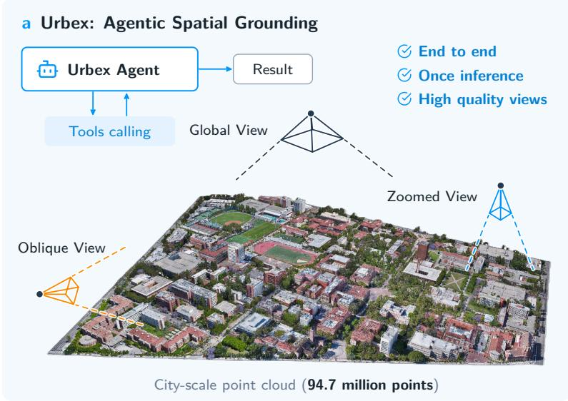

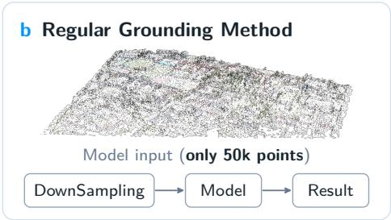

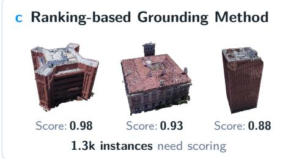  
Figure 1 Overview of Urbex. Unlike regular grounding methods that downsample city-scale point clouds or rankingbased methods that score many precomputed instances, Urbex formulates grounding as agentic spatial search. A VLM agent actively interacts with the scene through tool calls, moving between global, zoomed, and oblique views before committing the final target location.

We propose Urbex, an agentic spatial grounding framework for city-scale 3D scenes. As illustrated in Figure 1a, Urbex starts from a global bird’s-eye view (BEV), uses landmark queries to establish coarse spatial anchors, zooms into promising regions for fine-grained inspection, renders oblique views for 3D confirmation, and finally commits a box that is projected back to world coordinates. Urbex represents each scene as an interactive multi-view environment built around a BEV image and a consistent view-to-world coordinate mapping. The VLM reasons over the accumulated interaction history and either calls another tool or commits a final bounding box in a known BEV-aligned view. The system then projects the box back to world coordinates and evaluates it against the target instance. We train Urbex with reinforcement learning on CityRefer (Miyanishi et al., 2023). The grounding episode is modeled as a multi-step decision process. A terminal reward encourages high overlap with the target and provides a dense center-distance signal when overlap is initially sparse. In addition, tool-level shaping rewards guide intermediate behavior, such as zooming toward the target region. This objective optimizes both final localization accuracy and the agent’s intermediate search policy. Our contributions are summarized as follows:

• We propose Urbex, an agentic framework that reformulates city-scale 3D grounding from exhaustive candidate ranking to active spatial search.

• We design a city-aware interactive tool interface that enables a VLM agent to search large urban scenes through landmark querying, local zooming, and oblique-view verification, and optimize this multi-step policy with reinforcement learning.

• Urbex achieves the best Hit@1 and IoU on CityRefer, substantially improves online inference eficiency over the strongest ranking baseline, and demonstrates strong zero-shot robustness on STPLS3D-Refer.

## 2 Related work

## 2.1 3D Scene Grounding

3D scene grounding aims to localize a specific object within a 3D environment based on a natural-language referring expression. A large body of prior work has predominantly focused on indoor scenes, where early methods typically encode entire point clouds or multi-view images, fuse them with a language encoder, and rank candidate instances via cross-modal matching (Chen et al., 2020; Achlioptas et al., 2020; Huang et al., 2022). Subsequent research has significantly advanced this paradigm by incorporating relation modeling, multi-view context, and transformer-based architectures (Yuan et al., 2021; Wu et al., 2023), and exploring proposal-free, bottom-up localization to avoid error accumulation from segmentation models (Luo et al., 2022; Chen et al., 2022b). Recent zero-shot and open-world methods further exploit foundation models, scene parsing, multi-view reasoning, or scene graphs to reduce dependence on task-specific supervised training (Huang et al., 2025; Liu et al., 2025b; Zhang et al., 2026; Gu et al., 2024). These methods are highly relevant to the goal of reducing proposal dependence, but they are primarily designed for indoor or object-centric 3D scenes and do not directly address city-scale landmark reasoning, very large search spaces, or online eficiency over dense urban instances.

City-scale 3D grounding presents challenges that are substantially diferent from those in indoor scenes. Outdoor urban environments cover much larger spatial extents, contain many repetitive instances such as vehicles and buildings, and often require reasoning over long-range spatial cues and named landmarks. As a result, existing city-scale methods typically adopt a static candidate-ranking pipeline, where instance boxes are obtained in advance, multimodal features are extracted ofline, and a scoring model ranks all candidates during inference (Miyanishi et al., 2023; Li et al., 2025a). Although this formulation avoids directly processing the entire city-scale point cloud, it remains constrained by the quality of precomputed proposals, requires costly feature preprocessing, and becomes ineficient when many candidates must be scored. More importantly, it treats localization as a one-shot retrieval problem. In contrast, Urbex frames city-scale grounding as sequential spatial interaction, actively searching the scene through a small number of targeted observations

## 2.2 Agentic Vision-Language Models

Modern vision-language models (VLMs) have demonstrated exceptional capabilities in visual question answering, fine-grained reasoning, and instruction following (Zheng et al., 2026; Liu et al., 2023; Chu et al., 2024; Bai et al., 2025; Achiam et al., 2023). RL further improves reasoning capabilities (Chu et al., 2026). Building upon these foundation models, recent research has evolved from passive perception to active, agentic systems capable of calling tools, manipulating graphical interfaces, and interpreting complex visual environments (Surís et al., 2023; Gupta and Kembhavi, 2023; Xie et al., 2024; Ji et al., 2026). Instead of outputting a single-pass prediction, such agentic frameworks interact with their surroundings through a continuous loop of observation, reasoning, action, and feedback (Yao et al., 2023; Schick et al., 2023; Ma et al., 2026; Yuan et al., 2026; Wang et al., 2026c,b).

However, much of the agentic VLM literature focuses either on 2D tasks, such as web navigation and openended image reasoning, or on indoor embodied navigation (Ma et al., 2023; Huang et al., 2024). Recent work has begun to formulate 3D grounding itself as an agentic or sequential process, including dynamic 2D-to-3D reconstruction with visual tools (Wang et al., 2026a), active cognition over open-world object lookup structures (Huang et al., 2025), graph-guided VLM reasoning over 3D scene structure (Liu et al., 2025b), and task-oriented sequential grounding in indoor scenes (Zhang et al., 2024). While conceptually close to our active-search view, these works operate in indoor RGB-D or graph-structured settings and are not optimized for city-scale 3D environments. Urbex specializes the agentic VLM paradigm for this challenging domain by providing city-aware spatial tools and an RL objective tailored for eficient exploration.

## 3 Method

Urbex formulates city-scale 3D grounding as active spatial search rather than static candidate retrieval. The central design choice is to expose a large 3D scene through a small number of coordinate-aligned visual observations that a VLM can inspect and act upon. We first describe how the environment converts city-scale geometry into a VLM-operable multi-view space, then define the tool-use reasoning loop over these views, and finally present the reinforcement learning objective that turns prompted tool use into a learned search policy.

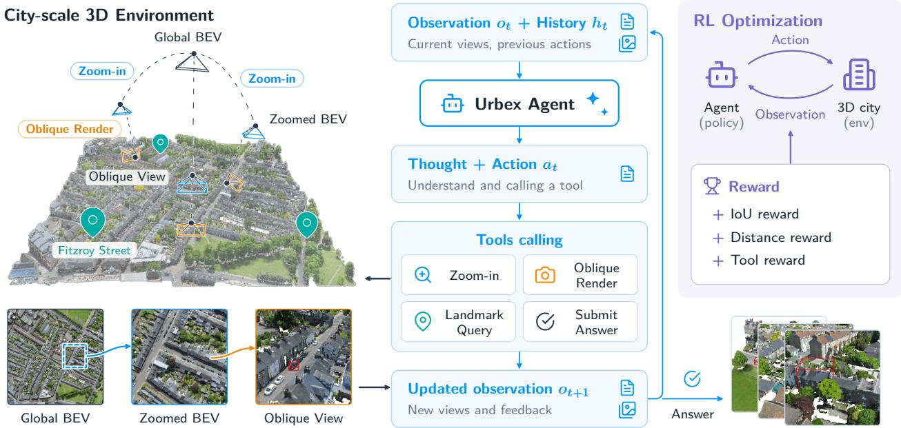  
Figure 2 Architecture of Urbex: (left) a multi-view environment exposing global BEV, zoomed, and oblique views; (middle) the policy’s reasoning trace and tool calls over observation $o _ { t }$ and interaction history $h _ { t } ;$ (right) RL under a terminal reward (IoU and center-distance) plus tool-level shaping.

## 3.1 Interactive environment for city-scale 3D grounding

Given a city-scale 3D scene S and a natural-language query q, the goal is to localize the referred object $o ^ { \star }$ and output its spatial extent. A conventional candidate-ranking method assumes a candidate set $\mathcal { C } = \{ o _ { i } \} _ { i = 1 } ^ { N }$ and learns a score $s ( q , o _ { i } )$ for each candidate, making the quality and size of C central to both accuracy and eficiency (Li et al., 2025a; Miyanishi et al., 2023). In contrast, Urbex receives no candidate set and exposes the scene through views V that the agent can extend through tool calls. It predicts a free-form box $\hat { b } _ { v }$ in a known BEV-aligned view v, which the environment maps to a world-space extent. Ground-truth boxes provide training rewards and evaluation targets, but are not inference inputs.

View representation. The initial view is a global bird’s-eye-view image $I _ { \mathrm { g l o b a l } }$ . Each BEV-aligned view $v \in \mathcal V$ contains an image observation $I _ { v }$ and a mapping $T _ { v }$ from the view coordinate frame to world coordinates. The agent expresses boxes in a normalized 2D coordinate frame. The environment maintains the corresponding view-to-world transform, so a box predicted in any such view can be projected back to world coordinates. This design gives the VLM a simple and consistent spatial interface while preserving metric grounding in the original 3D scene.

City-aware tools. The environment provides three complementary tools for global anchoring, local detail recovery, and 3D verification, keeping the action space compact. Landmark Query resolves a named landmark from the query, such as a building or road name, and returns its world position and its projection in a selected view. This tool provides global spatial anchors when the expression contains proper nouns. This design is motivated by the geography-aware nature of city-scale referring expressions, where named buildings, roads, and other landmarks provide strong global anchors (Miyanishi et al., 2023; Li et al., 2025a; OpenStreetMap contributors, 2026). Zoom-in maps a selected box to the original high-resolution BEV and returns a local crop with a new view identifier and transform. The original BEV has a long side typically exceeding 10,000 pixels, so cropping recovers genuine detail absent from the downsampled global observation, where small objects occupy only a few pixels. Oblique Rendering renders a selected candidate region from a specified cardinal direction, producing a 3D-aware view that helps verify object shape, height, and spatial placement. The oblique image is used as supporting evidence rather than as the coordinate frame for the final submission. Detailed tool definitions and argument schemas are provided in Table 5.

## 3.2 Agentic reasoning with multi-view tool use

The policy $\pi _ { \theta }$ is a VLM that receives the current observation $o _ { t }$ and the interaction history $h _ { t }$ . The history contains the original query, previous tool calls, returned view identifiers, coordinate conventions, and visual observations. At step t, the policy produces a reasoning trace and an action:

$$
\mathrm { ( t h o u g h t } _ { t } , a _ { t } ) \sim \pi _ { \theta } ( o _ { t } , h _ { t } ) .\tag{1}
$$

The action $a _ { t }$ is either a tool call with structured arguments or a final answer. A tool call may specify landmark names, a source view, a 2D crop box, a candidate box, or an oblique rendering direction. The environment executes the tool and appends a textual response and, when applicable, a new image observation to the history.

The resulting inference procedure naturally decomposes into global search, local observation, and candidate confirmation. The agent first parses the expression to identify target attributes and spatial anchors in the BEV, then zooms into promising regions to resolve small objects or dense local context, and finally renders oblique views when top-down evidence is insuficient to verify the 3D object. Because every tool response is appended to the interaction history, the model can refer back to previous views and maintain coordinate consistency while switching between global and local evidence. This protocol can be used directly with a prompted VLM, yielding a zero-shot tool-use baseline, but the search space remains large. The model must learn not only how to interpret each view, but also when to query, zoom, render, or stop, which motivates the RL training described next.

## 3.3 Reinforcement learning for active spatial search

We model an episode as a finite-horizon Markov decision process (Sutton and Barto, 2018). The state st consists of the dialogue history, the current set of views, and tool feedback. The action space includes valid tool invocations and final answer submission. Given an action and a scene, the environment transition is deterministic; trajectory-level stochasticity comes from policy sampling. The episode terminates when the agent submits an answer or reaches the maximum number of assistant turns.

Terminal reward. Let $\hat { b }$ be the submitted world-space box and $b ^ { \star }$ be the ground-truth target box. We use a smooth terminal reward:

$$
R _ { \mathrm { t e r m } } = \lambda _ { \mathrm { i o u } } \operatorname { I o U } ( { \hat { b } } , b ^ { \star } ) + \lambda _ { \mathrm { d i s t } } \exp \left( - { \frac { d ( { \hat { b } } , b ^ { \star } ) } { \tau } } \right) - \lambda _ { \mathrm { s t e p } } { \frac { T } { T _ { \operatorname* { m a x } } } } ,\tag{2}
$$

where $d ( \hat { b } , b ^ { \star } )$ is the center distance in the ground plane, $T$ is the number of assistant turns, and $T _ { \mathrm { m a x } }$ is the interaction budget. The IoU term rewards precise localization. The distance term provides a continuous learning signal even when overlap is zero, which is common early in training for vast city-scale scenes and has been shown to be useful in spatial navigation tasks (Savva et al., 2019). The step cost discourages unnecessarily long trajectories. We do not use a discrete success bonus; the reward grows smoothly with localization quality rather than introducing a threshold clif.

Tool-level shaping. In addition to the terminal reward, we employ lightweight process rewards (Lightman et al., 2023) to shape the intermediate tool-calling behavior (Ng et al., 1999):

$$
R ( \tau ) = R _ { \mathrm { t e r m } } + \sum _ { t = 1 } ^ { T } R _ { \mathrm { t o o l } } ( s _ { t } , a _ { t } ) .\tag{3}
$$

For Zoom-in, the reward is positive when the zoom center moves closer to the target compared with the previous zoom and negative when it moves away, with a small cap to prevent it from dominating the terminal objective. For Oblique Rendering, the reward is proportional to the overlap between the rendered candidate region and the target region, again capped to keep it as a shaping signal. Invalid tool names, malformed arguments, impossible boxes, or tool execution errors receive negative rewards. These rewards are privileged training signals derived from ground-truth annotations, analogous to reward functions used in simulated navigation or RLVR settings. They are used only for policy optimization and are never included in the agent’s text observation, so they do not leak target information at inference time.

Optimization. We train Urbex on CityRefer (Miyanishi et al., 2023) entirely via reinforcement learning using Group Relative Policy Optimization (Shao et al., 2024). To circumvent the prohibitive memory overhead of a separate value network (critic), it estimates the baseline directly from multiple concurrent rollouts. Specifically, for each input query and initial environment state, the behavior policy $\pi _ { \theta _ { \mathrm { o l d } } }$ samples a group of G trajectories $\{ \tau _ { 1 } , \tau _ { 2 } , \dots , \tau _ { G } \}$ . After evaluating the cumulative reward $R ( \tau _ { i } )$ for each trajectory, we compute the group-relative advantage:

$$
A _ { i } = \frac { R ( \tau _ { i } ) - \mu _ { R } } { \sigma _ { R } + \epsilon } ,\tag{4}
$$

where $\mu _ { R }$ and $\sigma _ { R }$ are the mean and standard deviation of the group’s rewards. The policy is then optimized by maximizing the clipped GRPO objective:

$$
\mathcal { I } _ { \mathrm { G R P O } } ( \theta ) = \frac { 1 } { G } \sum _ { i = 1 } ^ { G } \frac { 1 } { T _ { i } } \sum _ { t = 1 } ^ { T _ { i } } \left[ \operatorname* { m i n } ( r _ { i , t } ( \theta ) A _ { i } , \exp ( r _ { i , t } ( \theta ) , 1 - \epsilon _ { c } , 1 + \epsilon _ { c } ) A _ { i } ) - \beta D _ { \mathrm { K L } } ^ { i , t } \right] .\tag{5}
$$

where $r _ { i , t } ( \theta ) = \pi _ { \theta } ( a _ { i , t } \mid s _ { i , t } ) / \pi _ { \theta _ { \mathrm { o l d } } } ( a _ { i , t } \mid s _ { i , t } ) , \epsilon _ { c }$ is the clipping threshold, and $\beta$ controls the token-level KL penalty to the reference policy $\pi _ { \mathrm { r e f } }$ . By relying solely on this RL objective without supervised trajectory demonstrations, the model explores the multi-view environment and learns a task-specific tool-use policy, including when to query landmarks, how large a zoom region should be, whether an oblique view justifies its step cost, and when the accumulated evidence is suficient to commit a final bounding box.

## 4 Experiments

## 4.1 Experimental setup

We evaluate Urbex along three axes, namely in-domain performance, cross-scene generalization, and component sensitivity. CityRefer (Miyanishi et al., 2023) is used as the main benchmark for comparing grounding accuracy and inference eficiency, while STPLS3D-Refer, our evaluation set constructed from STPLS3D (Chen et al., 2022a), tests whether the learned policy transfers to scenes with diferent geometry and visual appearance. We convert both datasets into the same BEV-based interactive environment and use the same action protocol and evaluation code for all tool-using models. Detailed dataset statistics are provided in Appendix B, while training and inference protocols, hyperparameters, and other implementation details are provided in Appendix A.

Baselines. We compare three groups of methods that stress diferent aspects of the problem. General-purpose multimodal models, including GPT-5.4 and Qwen3.6-plus, provide strong visual reasoning priors. We connect them to the same Urbex tool environment to test whether a powerful of-the-shelf VLM can solve the task through prompting alone, without task-specific policy optimization. Indoor 3D grounding methods reveal two diferent failure modes when moved to city-scale scenes. EDA follows the common indoor practice of processing a downsampled point cloud, which discards much of the fine-grained geometry needed for small urban objects (Wu et al., 2023). InstanceRefer instead operates in a candidate-ranking setting with provided instances, which is easier than direct full-scene localization and therefore performs more reasonably than dense point-cloud grounding methods (Yuan et al., 2021). City-scale methods such as CityRefer and CityAnchor are closer to our setting, but they still primarily rely on ranking precomputed candidates rather than actively searching the scene (Miyanishi et al., 2023; Li et al., 2025a). Details on each baseline implementation are provided in Appendix A.3.

Evaluation settings and metrics. We report results on the novel description (ND) and novel object (NO) splits: ND uses unseen descriptions in scenes observed during training, while NO uses targets from held-out scenes that do not appear in training. In With GT, candidate-ranking baselines may use the ground-truth candidate instance set and are evaluated with Hit@1, Hit@3, and Hit@5. Urbex does not use candidate boxes during inference even in this setting; it always outputs a free-form BEV box, which is matched to candidates only after prediction: candidates are ranked by 2D IoU with the predicted box, and Hit@k records whether the target is among the top k, without a minimum overlap requirement. This measures target identification; thresholded Hit@1 and direct overlap metrics additionally assess box quality (Appendix D.5). In Without GT, methods cannot access ground-truth candidate boxes and must directly output a spatial prediction; we therefore report 2D IoU, 3D IoU, and point-level F1 against the target. This setting is closer to deployment, where complete and accurate instance boundaries are rarely available. Rows whose metrics would all be inapplicable are omitted from the corresponding subtable; otherwise inapplicable cells are marked as n/a. GPT-5.4 and Qwen3.6-plus do not expose comparable timing measurements, while InstanceRefer, CityRefer, and CityAnchor require candidate instances; we separately test CityAnchor with predicted proposals in Appendix D.4. Accuracy metrics are percentages. We report inference time per example on a single GPU, including model generation and online tool execution, while excluding ofline scene preparation and cached rendering construction for all methods.

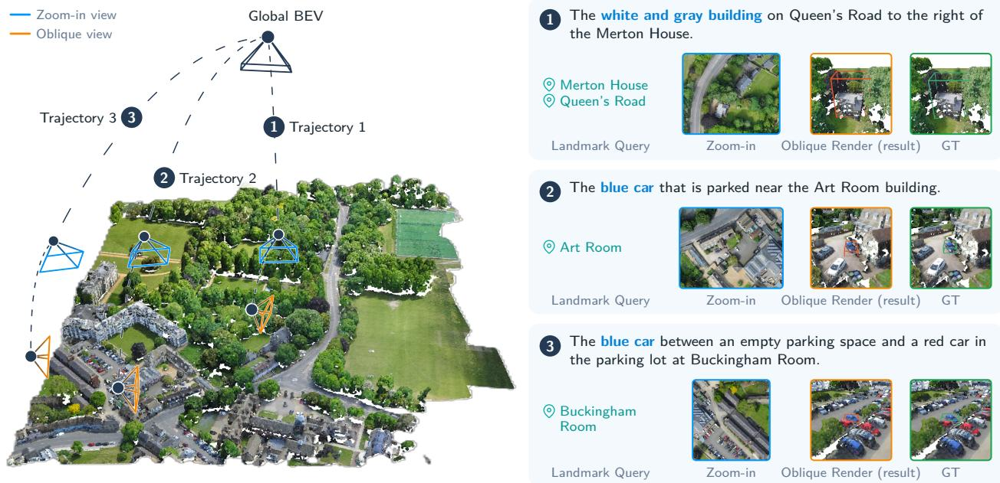  
Figure 3 Qualitative examples on CityRefer. The visualization shows how Urbex moves from global BEV search to local zoom-in and final grounding in city-scale scenes with dense repeated objects and landmark-based references.

## 4.2 Main results on CityRefer

Table 1 reports the main CityRefer results. GPT-5.4 and Qwen3.6-plus obtain non-trivial accuracy after being connected to the Urbex tool environment, showing that strong VLMs can exploit the interactive views and tool feedback to perform partial active search. However, their performance remains far below Urbex, showing that these prompted tool-use baselines do not recover the accuracy of the trained policy. The indoor baselines illustrate why directly transferring indoor 3D grounding pipelines is also insuficient. EDA almost fails on both splits, consistent with the severe information loss caused by downsampling city-scale point clouds before grounding. InstanceRefer performs better because it is evaluated as a simpler candidate-ranking problem with provided instances, but it still remains far below city-scale methods and cannot directly solve candidate-free localization.

Among city-scale baselines, CityRefer is limited when evaluated as a full ranking problem because its original setting assumes that the target appears in a small 10-instance candidate pool rather than requiring discrimination over all scene instances (Miyanishi et al., 2023). CityAnchor is much stronger because it scores candidates with multimodal large language models, but this design requires applying the scoring model to many instances and therefore incurs high inference cost. In the With-GT setting, Urbex achieves the best Hit@1 and Hit@3 on both test splits and the best Hit@5 on NO. CityAnchor retains the highest Hit@5 on ND: exhaustive ranking can retain several plausible GT candidates, including a target that Urbex misses during regional search or confuses with a local distractor. Thus, broader candidate recall and precise single-box search have diferent failure modes (Appendix D.6).

The advantage becomes clearer in the Without-GT setting, where candidate-ranking methods require a proposal-generation stage. General multimodal models can use the same prompted tool interface, but their

Table 1 Main results on CityRefer. Urbex supports candidate-free grounding and eficient inference. Five-run Hit@1 statistics are reported in Table 8.
<table><tr><td rowspan="2">Method</td><td colspan="3">ND With GT</td><td colspan="3">NO With GT</td><td rowspan="2">Time (s)</td></tr><tr><td>Hit@1</td><td>Hit@3</td><td>Hit@5</td><td>Hit@1</td><td>Hit@3</td><td>Hit@5</td></tr><tr><td colspan="8">Closed-source VLMs w/ Urbex tools</td></tr><tr><td>GPT-5.4</td><td>9.3</td><td>12.4</td><td>15.7</td><td>13.1</td><td>18.6</td><td>20.1</td><td>n/a</td></tr><tr><td>Qwen3.6-plus</td><td>6.4</td><td>9.6</td><td>11.9</td><td>11.5</td><td>16.2</td><td>16.8</td><td>n/a</td></tr><tr><td colspan="8">Indoor 3D grounding methods</td></tr><tr><td>InstanceRefer (Yuan et al., 2021)</td><td>1.6</td><td>5.0</td><td>10.5</td><td>4.9</td><td>15.9</td><td>24.5</td><td>0.6</td></tr><tr><td>EDA (Wu et al., 2023)</td><td>0.1</td><td>0.1</td><td>0.2</td><td>0.2</td><td>0.3</td><td>0.4</td><td>3.0</td></tr><tr><td colspan="8">Ranking-based city-scale methods</td></tr><tr><td>CityRefer (Miyanishi et al., 2023)</td><td>1.6</td><td>3.9</td><td>4.8</td><td>0.6</td><td>2.1</td><td>3.4</td><td>0.7</td></tr><tr><td>CityAnchor (Li et al., 2025a)</td><td>23.4</td><td>35.3</td><td>45.4</td><td>14.2</td><td>22.4</td><td>31.0</td><td>32.1</td></tr><tr><td>Urbex</td><td>25.8</td><td>39.2</td><td>42.3</td><td>23.9</td><td>36.9</td><td>40.7</td><td>3.2</td></tr></table>

<table><tr><td rowspan="2">Method</td><td colspan="3">ND Without GT</td><td colspan="3">NO Without GT</td></tr><tr><td>2D IoU</td><td>3D IoU</td><td>Point F1</td><td>2D IoU</td><td>3D IoU</td><td>Point F1</td></tr><tr><td colspan="7">Closed-source VLMs w/ Urbex tools</td></tr><tr><td>GPT-5.4</td><td>4.4</td><td>2.2</td><td>9.4</td><td>4.6</td><td>1.9</td><td>10.4</td></tr><tr><td>Qwen3.6-plus</td><td>3.0</td><td>1.8</td><td>9.5</td><td>4.3</td><td>2.1</td><td>12.1</td></tr><tr><td colspan="7">Indoor 3D grounding methods</td></tr><tr><td>EDA (Wu et al., 2023)</td><td>0.2</td><td>0.2</td><td>0.3</td><td>0.5</td><td>0.4</td><td>0.8</td></tr><tr><td>Urbex</td><td>15.6</td><td>11.0</td><td>20.1</td><td>14.6</td><td>7.7</td><td>17.8</td></tr></table>

2D and 3D IoU remain substantially lower than Urbex. To test a complete proposal-based pipeline, we train SoftGroup (Vu et al., 2022) on 15 non-CityRefer SensatUrban scenes and supply its proposals to CityAnchor. On NO, this pipeline reaches 4.2/2.4/4.7 in BEV IoU/3D IoU/point F1, versus 14.6/7.7/17.8 for Urbex (Appendix D.4), showing the practical gap for this proposal-based pipeline.

Inference eficiency. Urbex is also substantially more eficient than the strongest ranking baseline under the online timing protocol above. CityAnchor, the second-best-performing method in the With-GT comparison, requires about 32.1 seconds per example because it scores many candidate instances, whereas Urbex takes about 3.2 seconds. This amounts to an order-of-magnitude inference-speed improvement, since Urbex inspects a small number of informative regions rather than exhaustively scoring all instances. The tools account for about 0.36 s/query. Building the optional oblique cache takes approximately 2.3 hours across 12 CityRefer scenes; rendering on demand instead gives an estimated 4.4 s/query (7.3× faster). These comparisons exclude ofline scene preparation; Appendix D.7 separates the measured cache cost from other, unmeasured preparation components.

## 4.3 Zero-shot generalization on STPLS3D-Refer

We next evaluate zero-shot transfer to STPLS3D-Refer. The agent is trained only on CityRefer and is directly applied to STPLS3D-Refer after converting scenes into the same BEV-based interactive environment. This setting tests whether the model has learned a reusable spatial search strategy rather than a dataset-specific ranking function. As shown in Table 2, the new scenes are challenging for all compared methods: indoor grounding methods are sensitive to domain shift, and city-scale ranking models degrade when candidate distributions and visual statistics difer from CityRefer. GPT-5.4 and Qwen3.6-plus perform reasonably wel after being connected to the Urbex tool environment, again showing that strong VLM reasoning can exploit interactive observations even without task-specific training. However, Urbex achieves the best score on every reported accuracy metric. These aggregate results suggest, but do not by themselves prove, that the RL-trained policy learns reusable search behaviors such as anchoring, zooming, verifying, and stopping. To examine transfer beyond named geographic anchors, we additionally evaluate 30 manually verified landmark-free

The red car parked along the east side of South Vermont Avenue, situated north of two yellow cars and near the Scene Dock Theatre.

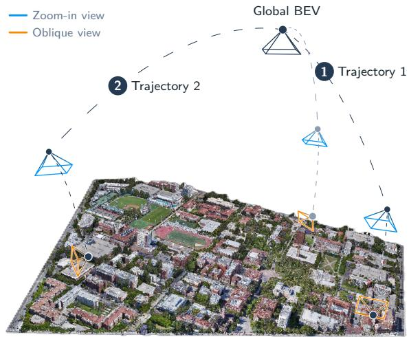

1 The small white building with a flat roof situated just north of the Widney Alumni House, distinguishing it from the red-roofed buildings to the west and the large gray complex to the east.

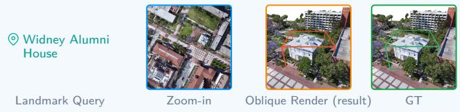

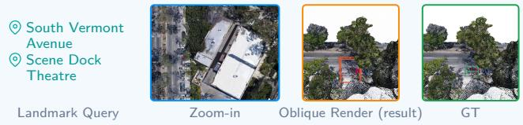  
Figure 4 Qualitative examples on STPLS3D-Refer. The visualization highlights zero-shot transfer cases where the same active-search policy anchors, zooms, verifies, and grounds targets in scenes with diferent geometry and object distributions from CityRefer.

Table 2 Zero-shot generalization on STPLS3D-Refer. Table 8 reports five-run Hit@1 statistics.
<table><tr><td rowspan="2">Method</td><td colspan="3">With GT</td><td colspan="3">Without GT</td><td rowspan="2">Time (s)</td></tr><tr><td>Hit@1</td><td>Hit@3</td><td>Hit@5</td><td>2D IoU</td><td>3D IoU</td><td>Point F1</td></tr><tr><td colspan="8">Closed-source VLMs w/ Urbex tools</td></tr><tr><td>GPT-5.4</td><td>16.3</td><td>17.8</td><td>19.1</td><td>8.0</td><td>5.3</td><td>12.1</td><td>n/a</td></tr><tr><td>Qwen3.6-plus</td><td>12.0</td><td>13.8</td><td>14.3</td><td>8.1</td><td>6.4</td><td>12.2</td><td>n/a</td></tr><tr><td colspan="8">Indoor 3D grounding methods</td></tr><tr><td>InstanceRefer (Yuan et al., 2021)</td><td>3.8</td><td>7.8</td><td>12.3</td><td>n/a</td><td>n/a</td><td>n/a</td><td>0.6</td></tr><tr><td>EDA (Wu et al., 2023)</td><td>0.0</td><td>0.0</td><td>0.5</td><td>0.4</td><td>0.2</td><td>0.4</td><td>2.9</td></tr><tr><td colspan="8">Candidate-dependent city-scale methods</td></tr><tr><td>CityRefer (Miyanishi et al., 2023)</td><td>1.4</td><td>2.5</td><td>3.8</td><td>n/a</td><td>n/a</td><td>n/a</td><td>1.4</td></tr><tr><td>CityAnchor (Li et al., 2025a)</td><td>2.1</td><td>4.2</td><td>6.0</td><td>n/a</td><td>n/a</td><td>n/a</td><td>47.2</td></tr><tr><td>Urbex</td><td>27.2</td><td>32.1</td><td>33.4</td><td>13.0</td><td>10.0</td><td>16.2</td><td>4.8</td></tr></table>

re-annotations of STPLS3D-Refer. Without further training, Urbex achieves 23.3 Hit@1 on these expressions, providing complementary evidence that the learned policy transfers to queries expressed through visual attributes and local spatial relations. Appendix D.3 details this evaluation and the landmark-robustness experiments; Figure 4 illustrates the agent’s spatial search and grounding trajectories in the new scenes.

## 4.4 Ablation studies

Tables 3 and 4 ablate the tool interface and the reward design. Tool variants add Landmark Query and Oblique Rendering on top of Zoom-in, while reward variants retain terminal IoU and progressively add distance and tool-level shaping terms.

Table 3 Tool and budget ablation for Urbex.
<table><tr><td>Zoom</td><td>Landmark</td><td>Oblique</td><td>Turns</td><td>Hit@3</td><td>2D IoU</td></tr><tr><td>一</td><td></td><td></td><td>0</td><td>10.5</td><td>2.1</td></tr><tr><td>√</td><td>一</td><td></td><td>8</td><td>15.5</td><td>4.1</td></tr><tr><td>√</td><td>√</td><td>一</td><td>8</td><td>28.2</td><td>8.9</td></tr><tr><td>√</td><td>√</td><td>√</td><td>7</td><td>34.8</td><td>11.0</td></tr><tr><td>√</td><td>√</td><td>√</td><td>8</td><td>36.9</td><td>14.6</td></tr><tr><td>√</td><td>√</td><td>√</td><td>9</td><td>36.8</td><td>13.2</td></tr></table>

Table 4 Reward ablation for Urbex.
<table><tr><td>Reward setting</td><td>Hit@3</td><td>2D IoU</td></tr><tr><td>IoU only</td><td>22.8</td><td>6.7</td></tr><tr><td>IoU + Distance</td><td>30.6</td><td>10.9</td></tr><tr><td>IoU + Tool-level</td><td>28.4</td><td>9.6</td></tr><tr><td>Full reward</td><td>36.9</td><td>14.6</td></tr></table>

The ablation results show that each component contributes a distinct part of the active-search behavior. Without tools, the agent sees the entire downsampled global map but reaches only 10.5 Hit@3 and 2.1 2D

IoU, compared with 36.9 and 14.6 using all tools. Adding Zoom-in improves both metrics, confirming that high-resolution local evidence is important for small and densely arranged urban objects. The largest tool gain comes from adding Landmark Query: Hit@3 rises from 15.5 to 28.2, and 2D IoU more than doubles from 4.1 to 8.9. This supports our premise that named buildings, roads, and other geographic anchors are central to city-scale referring expressions. In contrast to indoor scenes where a local crop may already contain most relevant context, city-scale queries often require first locating the correct neighborhood before fine-grained recognition becomes meaningful.

Oblique Rendering further improves the result by helping the agent verify candidate regions with 3D-aware visual evidence. With all tools enabled, increasing the budget from 7 to 8 turns improves Hit@3 from 34.8 to 36.9 and 2D IoU from 11.0 to 14.6, suggesting that one additional interaction is often useful for confirmation before submission. Increasing the budget to 9 turns does not improve Hit@3 and slightly lowers 2D IoU, indicating that excessive interaction can introduce unnecessary exploration or late-stage box adjustments. We therefore use the 8-turn setting as the main configuration, which provides the best accuracy-eficiency trade-of in this ablation. This also suggests that Urbex benefits from a bounded search process rather than unbounded deliberation.

The reward ablation confirms the same pattern. Terminal IoU alone reaches 22.8 Hit@3 and 6.7 2D IoU; adding distance shaping improves them to 30.6 and 10.9, tool-level shaping is also beneficial, and the full reward performs best. Distance shaping is especially useful when early predictions have no overlap with the target, while tool-level rewards make tool use more stable. Their combination shows that localization quality, distance progress, and eficient tool use are complementary.

## 4.5 Analysis

Tool-use policy. We further examine the learned policy using a fixed Landmark Query → Zoom-in → Oblique Rendering → Answer workflow (Appendix D.2). In the reported experiments, the base Qwen model reaches only 2.7 Hit@1, whereas RL-trained Urbex reaches 10.0 under the same tool order. The fixed workflow still requires the model to predict tool arguments and the final box. The improvement therefore suggests that training helps the model use the observed scene to make spatial decisions, such as selecting a crop and locating the target within it. The workflow is also useful for a stronger prompted VLM: GPT-5.4 maintains similar Hit@1 while reducing token use from 16,321 to 7,734. This suggests that the learned tool sequence provides an eficient way to organize search, while the trained model contributes to how the tools are used.

Spatial search. The landmark experiments further show the importance of geographic cues for city-scale search. On CityRefer-NO expressions with named landmarks, the 10 m coordinate-noise setting lowers Hit@1 by only 1.2 points, whereas missing or incorrect landmarks cause drops exceeding ten points (Appendix D.3). This suggests that a moderately inaccurate anchor can still guide the search, but losing the reference required by the expression is substantially more harmful. Figure 10 illustrates errors at diferent stages of this process. In (a), the first zoom excludes the target, and the agent selects another car within the crop. In (b), the zoom contains the target, but the agent selects vehicles in a diferent parking row. Both predictions remain unchanged after oblique inspection. The first case calls for revisiting the search region, while the second requires closer comparison of nearby instances using the query’s spatial relations. These examples motivate improving both region selection and local verification (Appendix D.6).

Localization quality. We also examine the quality of the free-form boxes produced by Urbex (Appendix D.5). On CityRefer-NO, replacing the original IoU matching rule with positive-overlap filtering or CIoU changes Hit@1 by at most 0.29 points, indicating that target identification is stable under these matching rules. However, additionally requiring the first-ranked target to have BEV IoU ≥ 0.25 reduces Hit@1 from 23.53 to 18.71. A prediction can therefore identify the correct candidate while still including substantial surrounding context. The area-ratio statistics show the same issue: the predicted-to-target area ratio has median 1.40 and P90 9.92, indicating that some boxes are considerably larger than the target. These results suggest that refining the box after target selection could further improve localization. We report direct IoU and point F1 alongside Hit@k to assess both target identification and the accuracy of the predicted spatial extent.

## 5 Conclusion

We presented Urbex, an agentic framework for city-scale 3D grounding. Rather than ranking a large set of precomputed candidates, Urbex formulates grounding as active spatial search in an interactive multi-view environment. We further optimize this tool-use policy with reinforcement learning under a limited interaction budget, encouraging accurate and eficient exploration. Experiments on CityRefer show that Urbex achieves strong grounding accuracy, supports candidate-free localization, and substantially improves online inference eficiency over ranking-based baselines. Zero-shot results on STPLS3D-Refer further suggest that active spatial search provides a robust alternative to static candidate retrieval for large-scale 3D scene understanding.

## References

Josh Achiam, Steven Adler, Sandhini Agarwal, Lama Ahmad, Ilge Akkaya, Florencia Leoni Aleman, Diogo Almeida, Janko Altenschmidt, Sam Altman, Shyamal Anadkat, et al. Gpt-4 technical report. arXiv preprint arXiv:2303.08774, 2023.

Panos Achlioptas, Ahmed Abdelreheem, Fei Xia, Mohamed Elhoseiny, and Leonidas Guibas. Referit3d: Neural listeners for fine-grained 3d object identification in real-world scenes. In European conference on computer vision, pages 422–440. Springer, 2020.

Shuai Bai, Yuxuan Cai, Ruizhe Chen, Keqin Chen, Xionghui Chen, Zesen Cheng, Lianghao Deng, Wei Ding, Chang Gao, Chunjiang Ge, et al. Qwen3-vl technical report. arXiv preprint arXiv:2511.21631, 2025.

Devendra Singh Chaplot, Dhiraj Prakashchand Gandhi, Abhinav Gupta, and Russ R Salakhutdinov. Object goal navigation using goal-oriented semantic exploration. Advances in Neural Information Processing Systems, 33:4247–4258, 2020.

Dave Zhenyu Chen, Angel X Chang, and Matthias Nießner. Scanrefer: 3d object localization in rgb-d scans using natural language. In European conference on computer vision, pages 202–221. Springer, 2020.

Howard Chen, Alane Suhr, Dipendra Misra, Noah Snavely, and Yoav Artzi. Touchdown: Natural language navigation and spatial reasoning in visual street environments. In Proceedings of the IEEE/CVF conference on computer vision and pattern recognition, pages 12538–12547, 2019.

Meida Chen, Qingyong Hu, Zifan Yu, Hugues Thomas, Andrew Feng, Yu Hou, Kyle McCullough, Fengbo Ren, and Lucio Soibelman. Stpls3d: A large-scale synthetic and real aerial photogrammetry 3d point cloud dataset. In 33rd British Machine Vision Conference, 2022a.

Shizhe Chen, Pierre-Louis Guhur, Makarand Tapaswi, Cordelia Schmid, and Ivan Laptev. Language conditioned spatial relation reasoning for 3d object grounding. Advances in neural information processing systems, 35:20522–20535, 2022b.

Wenhao Cheng, Junbo Yin, Wei Li, Ruigang Yang, and Jianbing Shen. Language-guided 3d object detection in point cloud for autonomous driving. arXiv preprint arXiv:2305.15765, 2023.

Xiangxiang Chu, Limeng Qiao, Xinyu Zhang, Shuang Xu, Fei Wei, Yang Yang, Xiaofei Sun, Yiming Hu, Xinyang Lin, and Bo Zhang. Mobilevlm v2: Faster and stronger baseline for vision language model. arXiv preprint arXiv:2402.03766, 2024.

Xiangxiang Chu, Hailang Huang, Xiao Zhang, Fei Wei, and Yong Wang. GPG: A simple and strong reinforcement learning baseline for model reasoning. In The Fourteenth International Conference on Learning Representations, 2026.

Qiao Gu, Ali Kuwajerwala, Sacha Morin, Krishna Murthy Jatavallabhula, Bipasha Sen, Aditya Agarwal, Corban Rivera, William Paul, Kirsty Ellis, Rama Chellappa, Chuang Gan, Celso Miguel De Melo, Joshua B. Tenenbaum, Antonio Torralba, Florian Shkurti, and Liam Paull. Conceptgraphs: Open-vocabulary 3d scene graphs for perception and planning. In 2024 IEEE International Conference on Robotics and Automation (ICRA), pages 5021–5028, 2024.

Tanmay Gupta and Aniruddha Kembhavi. Visual programming: Compositional visual reasoning without training. In Proceedings of the IEEE/CVF conference on computer vision and pattern recognition, pages 14953–14962, 2023.

Qingyong Hu, Bo Yang, Sheikh Khalid, Wen Xiao, Niki Trigoni, and Andrew Markham. Sensaturban: Learning semantics from urban-scale photogrammetric point clouds. International Journal of Computer Vision, 130(2):316–343, 2022.

Jiangyong Huang, Silong Yong, Xiaojian Ma, Xiongkun Linghu, Puhao Li, Yan Wang, Qing Li, Song-Chun Zhu, Baoxiong Jia, and Siyuan Huang. An embodied generalist agent in 3d world. In The Twelfth International Conference on Learning Representations, 2024.

Shijia Huang, Yilun Chen, Jiaya Jia, and Liwei Wang. Multi-view transformer for 3d visual grounding. In Proceedings of the IEEE/CVF Conference on Computer Vision and Pattern Recognition, pages 15524–15533, 2022.

Wenyuan Huang, Zhao Wang, Zhou Wei, Ting Huang, Fang Zhao, Jian Yang, and Zhenyu Zhang. Openground: Active cognition-based reasoning for open-world 3d visual grounding. arXiv preprint arXiv:2512.23020, 2025.

Yuxiang Ji, Yong Wang, Ziyu Ma, Yiming Hu, Hailang Huang, Xuecai Hu, Guanhua Chen, Liaoni Wu, and Xiangxiang Chu. Thinking with map: Reinforced parallel map-augmented agent for geolocalization. arXiv preprint arXiv:2601.05432, 2026.

Li Jiang, Hengshuang Zhao, Shaoshuai Shi, Shu Liu, Chi-Wing Fu, and Jiaya Jia. Pointgroup: Dual-set point grouping for 3d instance segmentation. In Proceedings of the IEEE/CVF conference on computer vision and Pattern recognition, pages 4867–4876, 2020.

Jinpeng Li, Haiping Wang, Jiabin Chen, Yuan Liu, Zhiyang Dou, Yuexin Ma, Sibei Yang, Yuan Li, Wenping Wang, Zhen Dong, and Bisheng Yang. Cityanchor: City-scale 3d visual grounding with multi-modality LLMs. In The Thirteenth International Conference on Learning Representations, 2025a.

Rong Li, Yuhao Dong, Tianshuai Hu, Ao Liang, Youquan Liu, Dongyue Lu, Liang Pan, Lingdong Kong, Junwei Liang, and Ziwei Liu. 3eed: Ground everything everywhere in 3d. arXiv preprint arXiv:2511.01755, 2025b.

Hunter Lightman, Vineet Kosaraju, Yuri Burda, Harrison Edwards, Bowen Baker, Teddy Lee, Jan Leike, John Schulman, Ilya

Sutskever, and Karl Cobbe. Let’s verify step by step. In The twelfth international conference on learning representations, 2023.

Daizong Liu, Yang Liu, Wencan Huang, and Wei Hu. A survey on text-guided 3-d visual grounding: Elements, recent advances, and future directions. IEEE Transactions on Neural Networks and Learning Systems, 2025a.

Haotian Liu, Chunyuan Li, Qingyang Wu, and Yong Jae Lee. Visual instruction tuning. Advances in neural information processing systems, 36:34892–34916, 2023.

Yuanyuan Liu, Haiyang Mei, Dongyang Zhan, Jiayue Zhao, Dongsheng Zhou, Bo Dong, and Xin Yang. View-on-graph: Zero-shot 3d visual grounding via vision-language reasoning on scene graphs. arXiv preprint arXiv:2512.09215, 2025b.

Junyu Luo, Jiahui Fu, Xianghao Kong, Chen Gao, Haibing Ren, Hao Shen, Huaxia Xia, and Si Liu. 3d-sps: Single-stage 3d visual grounding via referred point progressive selection. In Proceedings of the IEEE/CVF Conference on Computer Vision and Pattern Recognition, pages 16454–16463, 2022.

Xiaojian Ma, Silong Yong, Zilong Zheng, Qing Li, Yitao Liang, Song-Chun Zhu, and Siyuan Huang. Sqa3d: Situated question answering in 3d scenes. The Eleventh International Conference on Learning Representations, 2023.

Ziyu Ma, Shidong Yang, Yuxiang Ji, Xucong Wang, Yong Wang, Yiming Hu, Tongwen Huang, and Xiangxiang Chu. Skillclaw: Let skills evolve collectively with agentic evolver. arXiv preprint arXiv:2604.08377, 2026.

Taiki Miyanishi, Fumiya Kitamori, Shuhei Kurita, Jungdae Lee, Motoaki Kawanabe, and Nakamasa Inoue. Cityrefer: Geographyaware 3d visual grounding dataset on city-scale point cloud data. In Advances in Neural Information Processing Systems, volume 36, 2023.

Andrew Y Ng, Daishi Harada, and Stuart Russell. Policy invariance under reward transformations: Theory and application to reward shaping. In Icml, volume 99, pages 278–287. Citeseer, 1999.

OpenStreetMap contributors. Planet dump retrieved from https://planet.osm.org. https://www.openstreetmap.org, 2026.

Junha Roh, Karthik Desingh, Ali Farhadi, and Dieter Fox. Languagerefer: Spatial-language model for 3d visual grounding. In Conference on Robot Learning, pages 1046–1056. PMLR, 2022.

Manolis Savva, Abhishek Kadian, Oleksandr Maksymets, Yili Zhao, Erik Wijmans, Bhavana Jain, Julian Straub, Jia Liu, Vladlen Koltun, Jitendra Malik, et al. Habitat: A platform for embodied ai research. In Proceedings of the IEEE/CVF international conference on computer vision, pages 9339–9347, 2019.

Timo Schick, Jane Dwivedi-Yu, Roberto Dessi, Roberta Raileanu, Maria Lomeli, Eric Hambro, Luke Zettlemoyer, Nicola Cancedda, and Thomas Scialom. Toolformer: Language models can teach themselves to use tools. In Advances in Neural Information Processing Systems, volume 36, 2023.

Zhihong Shao, Peiyi Wang, Qihao Zhu, Runxin Xu, Junxiao Song, Xiao Bi, Haowei Zhang, Mingchuan Zhang, YK Li, Yang Wu, et al. Deepseekmath: Pushing the limits of mathematical reasoning in open language models. arXiv preprint arXiv:2402.03300, 2024.

Dídac Surís, Sachit Menon, and Carl Vondrick. Vipergpt: Visual inference via python execution for reasoning. In Proceedings of the IEEE/CVF international conference on computer vision, pages 11888–11898, 2023.

Richard S. Sutton and Andrew G. Barto. Reinforcement Learning: An Introduction. MIT Press, 2 edition, 2018.

Thang Vu, Kookhoi Kim, Tung M. Luu, Thanh Nguyen, and Chang D. Yoo. SoftGroup for 3D instance segmentation on point clouds. In Proceedings of the IEEE/CVF Conference on Computer Vision and Pattern Recognition (CVPR), pages 2708–2717, 2022.

Haibo Wang, Zihao Lin, Zhiyang Xu, and Lifu Huang. Think, act, build: An agentic framework with vision language models for zero-shot 3d visual grounding. arXiv preprint arXiv:2604.00528, 2026a.

Yi Wang, Haopeng Zhang, Chengxiang Huang, Rui Dai, Kaikui Liu, Piotr Koniusz, and Xiangxiang Chu. LoopArena: Benchmarking models as runtime controllers for loop engineering. arXiv preprint arXiv:2608.28281, 2026b.

Yu Wang, Yi Wang, Rui Dai, Yujie Wang, Kaikui Liu, Xiangxiang Chu, and Yansheng Li. Urban socio-semantic segmentation with vision-language reasoning. In The Fourteenth International Conference on Learning Representations, 2026c.

Yanmin Wu, Xinhua Cheng, Renrui Zhang, Zesen Cheng, and Jian Zhang. Eda: Explicit text-decoupling and dense alignment for 3d visual grounding. In Proceedings of the IEEE/CVF conference on computer vision and pattern recognition, pages 19231–19242, 2023.

Tianbao Xie, Danyang Zhang, Jixuan Chen, Xiaochuan Li, Siheng Zhao, Ruisheng Cao, Toh J Hua, Zhoujun Cheng, Dongchan Shin, Fangyu Lei, et al. Osworld: Benchmarking multimodal agents for open-ended tasks in real computer environments Advances in Neural Information Processing Systems, 37:52040–52094, 2024.

Shunyu Yao, Jefrey Zhao, Dian Yu, Nan Du, Izhak Shafran, Karthik R. Narasimhan, and Yuan Cao. React: Synergizing reasoning and acting in language models. In International Conference on Learning Representations, 2023.

Zhenlong Yuan, Xiangyan Qu, Chengxuan Qian, Rui Chen, Jing Tang, Lei Sun, Xiangxiang Chu, Dapeng Zhang, Yiwei Wang, Yujun Cai, and Shuo Li. Video-STAR: Reinforcing open-vocabulary action recognition with tools. In The Fourteenth International Conference on Learning Representations, 2026.

Zhihao Yuan, Xu Yan, Yinghong Liao, Ruimao Zhang, Sheng Wang, Zhen Li, and Shuguang Cui. Instancerefer: Cooperative holistic understanding for visual grounding on point clouds through instance multi-level contextual referring. In Proceedings of the IEEE/CVF International Conference on Computer Vision, pages 1791–1800, 2021.

Jiaxi Zhang, Yunheng Wang, Wei Lu, Taowen Wang, Weisheng Xu, Shuning Zhang, Yixiao Feng, Yuetong Fang, and Renjing Xu. Uniground: Universal 3d visual grounding via training-free scene parsing. arXiv preprint arXiv:2603.08131, 2026.

Zhuofan Zhang, Ziyu Zhu, Pengxiang Li, Tengyu Liu, Xiaojian Ma, Yixin Chen, Baoxiong Jia, Siyuan Huang, and Qing Li. Task-oriented sequential grounding in 3d scenes. arXiv preprint arXiv:2408.04034, 2024.

Yuhao Zheng, Li’an Zhong, Yi Wang, Rui Dai, Kaikui Liu, Xiangxiang Chu, Linyuan Lv, Philip Torr, and Kevin Qinghong Lin. Code2world: A gui world model via renderable code generation. arXiv preprint arXiv:2602.09856, 2026.

## Appendix

## A Implementation Details

## A.1 Hyperparameters and Hardware

Urbex is initialized from Qwen3-VL-4B-Instruct (Bai et al., 2025). Training and evaluation use the same city-tool interface, action schema, coordinate convention, and execution code for both CityRefer and STPLS3D-Refer. Unless otherwise specified, each trajectory allows at most eight assistant turns: up to seven tool calls and one final answer turn.

Training configuration. Urbex is trained on the CityRefer training split with GRPO (Shao et al., 2024): rollout batch size 256, group size 8, 300 optimization steps, and one PPO epoch per rollout batch. The actor learning rate is $1 \times 1 0 ^ { - 6 }$ , the KL coeficient is 0.001, and bf16 training freezes the vision encoder. The reward combines final IoU, center-distance shaping, a step cost, and tool-level shaping rewards, with $\lambda _ { \mathrm { i o u } } = 1 . 0 $ $\lambda _ { \mathrm { d i s t } } = 0 . 3 , \tau = 8 0 \mathrm { m }$ , and $\lambda _ { \mathrm { s t e p } } = 0 . 0 5$ in Equation 2.

Hardware and timing protocol. Training uses 16 NVIDIA H20 GPUs. Local-model inference and timing use a single NVIDIA H20 GPU; closed-source VLMs are accessed through their APIs. We report average online inference time per query, including model generation and online tool execution, while excluding ofline scene preprocessing such as cached renderings and candidate-pool preparation for all methods.

## A.2 Tool Interface

Table 5 summarizes the tool interface shared by prompted VLM baselines and Urbex. Before execution, the environment validates tool names, argument types, box bounds, and view identifiers.

Table 5 Definitions, inputs, and outputs of the city-aware tools.
<table><tr><td>Tool</td><td>Definition</td><td>Inputs</td><td>Outputs</td></tr><tr><td>Landmark Query</td><td>Resolves a named urban landmark, landmark_name: text span or such as a building, road, or facility, proper noun; source_view_id: view and uses it as a global spatial anchor.</td><td>in which the returned projection should be expressed; optional landmark_type when the name is ambiguous.</td><td>Match status; matched landmark name and type; world-space center or footprint when available; projection of the landmark into the requested view.</td></tr><tr><td>Zoom-in</td><td>Maps a region from an existing BEV view to the original exposing detail absent from the global observation.</td><td>source_view_id: global or local BEV view; crop_box: normalized high-resolution image and crops it, 2D box; optional scale or requested output resolution.</td><td>Local BEV image; new view_id; updated view-to-world transform; crop extent in the source and world coordinate frames.</td></tr><tr><td>Oblique Rendering</td><td>Renders an agent-selected candidate region from a cardinal direction to provide 3D-aware verification of shape, height, facade appearance, and spatial placement.</td><td>source_view_id: BEV view containing the candidate; candidate_box: normalized 2D region; direction: one of north, south, east, or west; optional margin around the region.</td><td>Oblique image observation; rendering metadata including direction and covered world region; supporting evidence for verification. The oblique view is not used as the coordinate frame for final box submission.</td></tr></table>

## A.3 Baseline Settings

Closed-source VLMs use the same Urbex tool environment and maximum-turn budget but no task-specific policy optimization. GPT-5.4 and Qwen3.6-plus receive the same action format, coordinate convention, tool descriptions, final-answer format, and tool-output history, then submit a final BEV-aligned box. These baselines test whether strong of-the-shelf VLMs can solve city-scale grounding with prompting and tool access alone.

InstanceRefer (Yuan et al., 2021) and EDA (Wu et al., 2023) are adapted from indoor 3D grounding pipelines by following their released preprocessing and downsampling each city-scale point cloud to 40,000 points.

InstanceRefer is evaluated with provided instances in its native candidate-ranking setting and is therefore omitted from candidate-free Without-GT evaluation; EDA uses the same point budget. This preserves the indoor pipelines while exposing the loss of fine-grained geometry needed for small or repetitive urban objects.

CityRefer and CityAnchor (Miyanishi et al., 2023; Li et al., 2025a) are retrained on our CityRefer split with the original hyperparameters, optimizer, schedule, and loss weights unless noted. For CityAnchor, we use the released ROI-localization and candidate-scoring pipeline, lower the ROI threshold to 0.1 to retain candidates under our larger pool, use landmark features from the retrained CityRefer language module as oficially recommended, and include online candidate scoring in its timing.

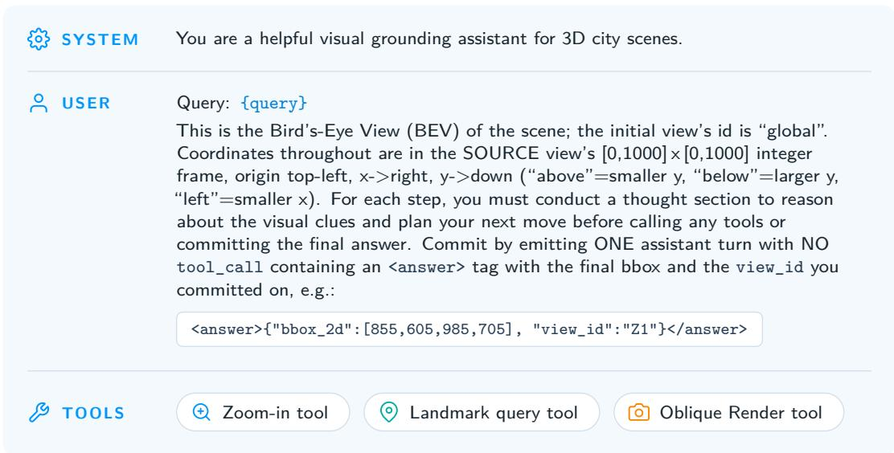  
Figure 5 Prompt template for tool-using VLM agents, specifying the task, tools, coordinates, action format, and final box format shared by prompted VLM baselines and Urbex.

## B Dataset Details

## B.1 CityRefer Data Preparation

CityRefer (Miyanishi et al., 2023), built on SensatUrban (Hu et al., 2022), is our in-domain benchmark. We remove duplicate (scene, query) rows and low-quality annotations with visibly incorrect instance labels or boxes, then create train, validation, ND, and NO splits. ND contains unseen descriptions in training scenes; NO tests held-out-scene generalization. Seven scenes are reserved for NO, and the remaining five are split across train, validation, and ND with a fixed random seed, yielding 2,744 training, 549 validation, 1,098 ND, and 1,396 NO queries.

Table 6 Scale of the 12 CityRefer scenes used in our experiments. Test queries combine ND and NO.
<table><tr><td>Statistic</td><td>Total across 12 scenes</td><td>Per-scene range</td></tr><tr><td>Area  $( \mathrm { k m } ^ { 2 } )$ </td><td>1.594</td><td>0.029–0.165</td></tr><tr><td>Points (millions)</td><td>877.4</td><td>12.1-116.3</td></tr><tr><td>GT candidate objects</td><td>2,234</td><td>31-367</td></tr><tr><td>OSM landmarks</td><td>299</td><td>9-51</td></tr><tr><td>Test queries</td><td>2,494</td><td>14-556</td></tr></table>

Small objects are dificult to distinguish in a downsampled global BEV. We therefore retain a high-resolution BEV for each scene and use Zoom-in to retrieve detailed local crops during search.

## B.2 STPLS3D-Refer Construction

STPLS3D-Refer is a cross-domain zero-shot benchmark for testing whether a CityRefer-trained policy transfers to new urban geometry, appearance, and geography. It is derived from public STPLS3D RealWorld photogrammetry point clouds (Chen et al., 2022a) and used only for evaluation. Because STPLS3D lacks CityRefer-style expressions and object instances, we combine geometric instance extraction, geographic registration, OpenStreetMap landmarks (OpenStreetMap contributors, 2026), and VLM-assisted expression generation to build a diagnostic, semi-automatic benchmark.

Source scenes and target categories. From four STPLS3D drone-photogrammetry scenes, we retain the two with reliable public geographic context: University of Southern California Park Campus (USC, 94.7M points, 1083×807m) and Wrigley Marine Science Center (WMSC, 9.98M points, 490×293m). We exclude one scene dominated by a single mega-building and one without verifiable public geographic context. Targets are limited to Building and Vehicle.

Instance extraction. Since STPLS3D provides semantic labels but not instances, we cluster semantic masks with DBSCAN: buildings use planar xy coordinates with eps= 2.0m, min\_samples= 80, and footprint filter $[ 4 , 5 0 0 0 ] \mathrm { m ^ { 2 } } ;$ vehicles use xyz with eps= 0.6m, min\_samples= 30, and footprint filter $[ 1 . 5 , 3 0 ] \mathrm { m } ^ { 2 }$ . From more than 1,000 pseudo-instances, we remove fragmented clusters, merged objects, ground/noise artifacts, and projection-ambiguous candidates through geometric filters and manual inspection. The verified pool contains 59 buildings/62 vehicles in USC and 11 buildings/17 vehicles in WMSC, with axis-aligned 3D boxes and point masks computed for each retained cluster.

Geo-registration and landmarks. Each scene is registered to WGS-84 by fitting a first-order afine transform from 5–7 ground-control points selected against recent satellite imagery, with RMS residuals of 0.72m for USC and 2.19m for WMSC. We query OpenStreetMap features using tags including building, amenity, highway, leisure, tourism, ofice, and natural, project them back to local coordinates, and match landmarks to building instances when applicable. The two scenes contain 278 real OSM landmarks.

Scene conversion and baseline compatibility. Each scene is converted to the CityRefer interface: global BEV image, view-to-world mapping, Zoom-in crops, optional oblique renderings, and annotations for candidatebased and candidate-free evaluation. We also export candidate metadata and per-instance features required by CityAnchor-style pipelines (Li et al., 2025a); ranking methods use explicit candidates, while Urbex receives only the visual tool environment and submits a free-form BEV box.

Referring-expression generation and filtering. For each target, we render a centered BEV crop together with oblique side views from the four cardinal directions, mark the target and nearby same-class distractors in all rendered views, and give the target color, size, distractor relations, and nearest OSM landmarks to Qwen3.6-plus to generate three concise CityRefer-style expressions. The oblique views supply 3D-aware cues such as building height, facade appearance, and relative layout that are dificult to disambiguate from the BEV alone. Automatic filters check length, meta-language, landmark-name validity, projection validity, and token-level duplication. The pipeline first yields more than 1,000 preliminary target-expression samples; manual inspection then removes unclear targets, incorrect landmarks, severe instance artifacts, and ambiguous descriptions, leaving 445 high-confidence landmark-grounded samples.

Table 7 Statistics of STPLS3D-Refer. “Inst.” counts unique candidate instances, and “Lndmk.” counts named OSM landmarks.
<table><tr><td>Scene</td><td>Inst. (Bldg./Veh.)</td><td>Building Expr.</td><td>Vehicle Expr.</td><td>Total Expr.</td><td>Lndmk.</td></tr><tr><td>USC</td><td>59/62</td><td>177</td><td>184</td><td>361</td><td>272</td></tr><tr><td>WMSC</td><td>11/17</td><td>33</td><td>51</td><td>84</td><td>6</td></tr><tr><td>Total</td><td>70/79</td><td>210</td><td>235</td><td>445</td><td>278</td></tr></table>

## C Additional Qualitative Examples

Figure 6 provides additional CityRefer examples, and Figure 8 shows full agent trajectories from query and global BEV observation to Landmark Query, Local Zoom-in, Oblique Rendering, and final box prediction.

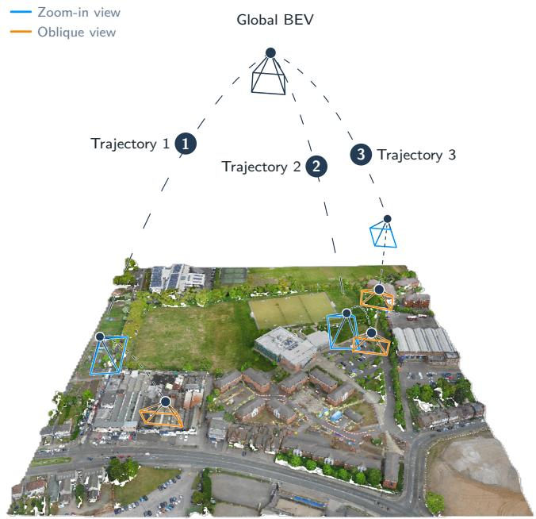

The large gray triangular parking lot next to the large green yard on Aldridge Road.

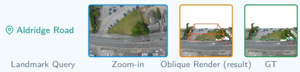

2 This is a residential house close to the Coppice. There is a big blue RV parked behind it.

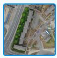  
Zoom-in

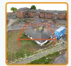

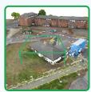  
Oblique Render (result) GT

3 Blue car in between a gray car and an empty spot, with an empty spot behind it, in the shortest row of a triangular parking lot that is a cross from the Perry Barr bus depot

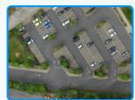  
Landmark Query

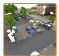

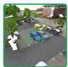  
Zoom-in Oblique Render (result) GT

Figure 6 Additional qualitative examples on the CityRefer NO split.

## a Total reward

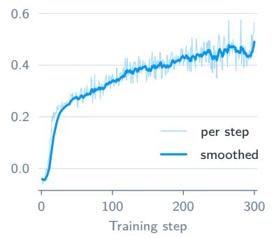

b City IoU (2D)  
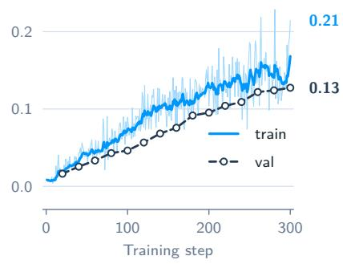

c Tool calls per episode  
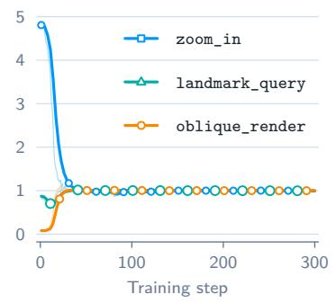  
Figure 7 Training dynamics on CityRefer. (a) Total task reward. (b) Train/validation 2D grounding IoU with periodic validation markers and final-value annotations. (c) Per-episode tool-call frequency, showing convergence from over-calling zoom\_in and under-using oblique\_render to one call per tool.

Figure 7 summarizes the first 300 CityRefer optimization steps. Total reward rises from slightly negative values to a stable positive regime, while train and validation 2D IoU improve together with a small, stable gap, suggesting generalization rather than memorization. Tool-use statistics show the policy moving from ineficient exploration to a disciplined sequence: early training overuses zoom\_in (peak ≈ 4.7 calls, first-30-step mean 2.6) and underuses oblique\_render (mean ≈ 0.6), but later converges to using each tool roughly once per episode. This matches the Landmark Query → Local Zoom-in → Oblique Rendering pattern shown in Figure 8.

The blue car between an empty parking space and a red car in the parking lot at Buckingham Room.

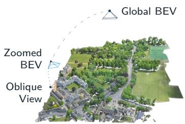

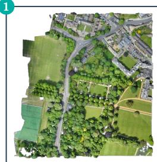  
Global BEV

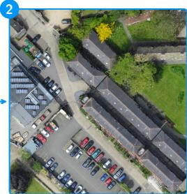  
Zoomed BEV (Z1)

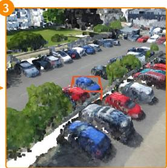  
Oblique View

## 1 Landmark Query

look up a named landmark on the global BEV

THOUGHT

To locate the blue car between an empty parking space and a red car, I should first identify the Buckingham Room, as it is likely to be near the parking lot mentioned. Using the landmark lookup tool, I can find the coordinates of the Buckingham Room to narrow down the area where the blue car might be.

ACT ION

landmark\_query(names=[Buckingham Room] view\_id="global")

RESULT

get\_landmark\_xy results:

\- 'Buckingham Room' world (360.0,1528.3); on view global at (897,179)

## 3 Oblique Render

verifies a candidate bbox in 3D · prediction (red)

THOUGHT

Now that I’ve zoomed in to view Z1, I can clearly see the parking lot near the Buckingham Room. The description mentions a blue car between an empty parking space and a red car. In the zoomed-in view, I can identify a row of parked cars, including red and blue vehicles. The blue car in question is likely to be adjacent to a red car and an empty space. I will now use the render\_oblique tool to visually confirm the 3D structure of the blue car and its surroundings, ensuring it matches the description.

oblique\_render(view\_id="Z1" bbox\_2d=[515, 890, 565, 935] direction="east")

RESULT

ACT ION

render\_oblique ok

## 2 Zoom In

agent crops a region of interest

THOUGHT

Now that I have the coordinates of the Buckingham Room at (897, 179) on the global view, I can focus on this area to locate the blue car between an empty parking space and a red car. The next step is to zoom in on this region to better visualize the parking lot and identify the specific car mentioned.

ACT ION

zoom\_in(view\_id="global" bbox\_2d=[800, 100, 1000, 300])

RESULT

zoom\_in ok new view 'Z1'

## 4 Submit Answer

agent’s final answer (no tool call)

THOUGHT

The 3D oblique view has successfully highlighted the blue car, which is positioned between an empty parking space and a red car, matching the query’s description. The red 3D wireframe in the oblique view confirms the correct location of the blue car. Now, I will commit to the final answer using the specified format, as the visual confirmation has been achieved.

ACT ION

answer = {"bbox\_2d": [515, 890, 565, 935], "view\_id": "Z1"}

RESULT

2D IoU = 0.678 ✓ success

Figure 8 Example agent reasoning processes from the initial query and global scene observation to landmark anchoring, local zoom-in, oblique verification, and final box commitment.

## D Controlled Experiments and Diagnostic Analysis

We report additional experiments on policy execution, landmark robustness, proposal dependence, matching rules, localization quality, and scene preparation. Unless stated otherwise, accuracy values are percentages. Tables 1 and 2 retain the original evaluation run; repeated-run summaries below are reported separately rather than mixing means with single-run metrics.

## D.1 Repeated Decoding Runs

Table 8 summarizes five stochastic decoding runs of the same trained checkpoint on fixed test sets. The reported uncertainty is the sample standard deviation across runs, in percentage points. It measures inferencetime sampling variation, not variability across independently trained GRPO policies. An approximate 95% Student-t interval for the ND mean is $2 5 . 6 2 \pm t _ { 4 , 0 . 9 7 5 } ( 0 . 3 3 / \sqrt { 5 } ) = [ 2 5 . 2 1 , 2 6 . 0 3 ]$ , using $t _ { 4 , 0 . 9 7 5 } \simeq 2 . 7 7 6$ . This interval lies above CityAnchor’s reported 23.4, supporting a margin relative to the observed decoding variation. It is not a paired significance test: it neither captures test-sample uncertainty nor accounts for training or evaluation variation in the baseline. Independent training seeds and paired per-query comparisons would be needed to assess those sources of uncertainty.

Table 8 Hit@1 over five decoding runs of one checkpoint (mean ± sample standard deviation). Baselines are the strongest comparison results in the original main tables.
<table><tr><td>Dataset</td><td>Urbex Hit@1</td><td>Comparison Hit@1</td><td>Comparison method</td></tr><tr><td>CityRefer-ND</td><td> $2 5 . 6 2 \pm 0 . 3 3$ </td><td>23.4</td><td>CityAnchor</td></tr><tr><td>CityRefer-NO</td><td> $2 3 . 5 3 \pm 0 . 7 3$ </td><td>14.2</td><td>CityAnchor</td></tr><tr><td>STPLS3D-Refer</td><td> $2 6 . 3 4 \pm 0 . 5 8$ </td><td>16.3</td><td>GPT-5.4</td></tr></table>

## D.2 Fixed Tool Workflows and Learned Execution

After RL training, a common trajectory follows Landmark Query → Zoom-in → Oblique Rendering → Answer (L-Z-O). This order emerges during learning rather than being prescribed in the training protocol. We extract it and enforce it at inference to form a scripted baseline with the same tool interface. The model still predicts tool arguments and the final box; “fixed” constrains the tool sequence, not the spatial coordinates. Table 9 compares the reported free and fixed-policy results.

Table 9 Free and fixed L-Z-O tool policies. The fixed workflow is extracted from the learned policy; tokens are reported per query.
<table><tr><td>Model</td><td>Policy</td><td>Hit@1</td><td>Hit@3</td><td>Hit@5</td><td>Tokens/query</td></tr><tr><td>Qwen3-VL-4B base</td><td>Fixed</td><td>2.7</td><td>5.0</td><td>6.0</td><td>6,576</td></tr><tr><td>Urbex RL</td><td>Free</td><td>23.5</td><td>37.0</td><td>40.9</td><td>7,187</td></tr><tr><td>Urbex RL</td><td>Fixed</td><td>10.0</td><td>16.0</td><td>22.0</td><td>6,786</td></tr><tr><td>GPT-5.4</td><td>Free</td><td>13.1</td><td>18.6</td><td>20.1</td><td>16,321</td></tr><tr><td>GPT-5.4</td><td>Fixed</td><td>13.5</td><td>23.0</td><td>26.5</td><td>7,734</td></tr></table>

Under the fixed workflow, RL-trained Urbex reaches 10.0 Hit@1 versus 2.7 for the base model, indicating that the trained model contributes beyond access to a useful tool sequence. Free Urbex reaches 23.5, but this gap should not be attributed solely to choosing a diferent order: most free trajectories already follow L-Z-O. Externally forcing the sequence also changes the interaction context in which arguments and answers are generated. The comparison shows that replaying a tool order does not recover the full learned execution policy; it does not isolate tool ordering from argument generation or prompting efects.

For GPT-5.4, the fixed workflow maintains similar Hit@1 (13.5 versus 13.1), improves Hit@3/5 from 18.6/20.1 to 23.0/26.5, and reduces token use from 16,321 to 7,734. Thus, the discovered workflow is also a useful eficiency prior for an untuned VLM, even though it does not reproduce Urbex’s full accuracy.

## D.3 Landmark Availability and Construction Bias

We separate CityRefer-NO into 1,302 expressions with named landmarks and 94 without them. For landmarkguided expressions, Missing returns no match, Noisy 10 m perturbs the correct coordinate by 10 m, and Wrong returns a same-scene landmark at least 50 m away. Table 10 reports the resulting Hit@1. Landmark-free rows use their own expressions and are not perturbations of the same queries.

Table 10 Landmark robustness (Hit@1, %). Dashes denote inapplicable landmark perturbations. The 30-example landmark-free STPLS3D set is a separate diagnostic.
<table><tr><td>Model / expression subset</td><td>N</td><td>Clean</td><td></td><td>Missing Noisy 10 m Wrong</td><td></td></tr><tr><td>CityRefer-NO</td><td></td><td></td><td></td><td></td><td></td></tr><tr><td>Urbex, with landmarks</td><td>1,302</td><td>23.5</td><td>12.7</td><td>22.3</td><td>11.3</td></tr><tr><td>Urbex, without landmarks</td><td>94</td><td>31.2</td><td></td><td></td><td></td></tr><tr><td>STPLS3D-Refer</td><td></td><td></td><td></td><td></td><td></td></tr><tr><td>GPT-5.4, with landmarks</td><td>445</td><td>16.3</td><td>5.7</td><td>15.3</td><td>7.3</td></tr><tr><td>Urbex, with landmarks</td><td>445</td><td>26.3</td><td>10.7</td><td>25.8</td><td>13.9</td></tr><tr><td>Urbex, landmark-free diagnostic</td><td>30</td><td>23.3</td><td></td><td></td><td></td></tr></table>

On CityRefer-NO, 10 m coordinate noise changes landmark-guided Hit@1 by 1.2 points, while missing or wrong matches cause much larger reductions of 10.8 and 12.2 points. Accurate retrieval remains important when a landmark is needed to distinguish similar targets across a scene. The 31.2 Hit@1 on expressions without named landmarks shows that some targets can instead be identified through visual attributes and local relations; it does not imply that removing necessary landmarks from the other expressions is harmless.

All original STPLS3D-Refer expressions are landmark-grounded because both generation and filtering use OSM cues. To probe this construction bias, we re-annotate 30 targets without named landmarks and manually verify that each expression uniquely identifies its target among same-class instances. Urbex reaches 23.3 Hit@1 on this separate diagnostic. On the original 445 expressions, it exceeds GPT-5.4 under each matched perturbation, although missing and wrong landmarks substantially degrade both models. These results provide limited evidence of landmark-free transfer; a 30-example targeted set does not establish general robustness on an independently constructed, landmark-independent benchmark.

## D.4 Grounding with Predicted Instance Proposals

A practical ranking pipeline can replace ground-truth candidates with predicted instances. We train Soft-Group (Vu et al., 2022) on 15 non-CityRefer SensatUrban scenes and use its proposals as CityAnchor’s candidate pool. The reported CityRefer-NO proposal recall is 35.6% at IoU ≥ 0.25. Table 11 reports the resulting pipeline alongside the GT-candidate reference and proposal-free Urbex.

Table 11 CityRefer-NO proposal comparison. All metrics, including overlap and point F1, are percentages. Hit@k uses method-dependent candidate matching; direct IoU/F1 assess localization without a GT candidate pool.
<table><tr><td>Method</td><td>Proposals</td><td>Hit@1</td><td>Hit@3</td><td>Hit@5</td><td>BEV IoU</td><td>3D IoU</td><td>Point F1</td></tr><tr><td>CityAnchor</td><td>Ground truth</td><td>14.2</td><td>22.4</td><td>31.0</td><td></td><td></td><td></td></tr><tr><td>CityAnchor</td><td>SoftGroup</td><td>6.5</td><td>13.0</td><td>15.0</td><td>4.2</td><td>2.4</td><td>4.7</td></tr><tr><td>Urbex</td><td>None</td><td>23.5</td><td>37.0</td><td>40.9</td><td>14.6</td><td>7.7</td><td>17.8</td></tr></table>

The proposal pipeline has substantially lower direct localization quality than Urbex: BEV IoU is 4.2 versus 14.6, 3D IoU is 2.4 versus 7.7, and point F1 is 4.7 versus 17.8. Its Hit@1/3/5 are 6.5/13.0/15.0, compared with 14.2/22.4/31.0 for CityAnchor supplied with GT candidates. Predicted candidates lack GT instance identities, so their success requires geometric matching; these Hit@k values should not be conflated with the GT-identity protocol. The direct IoU/F1 comparison provides complementary evidence that Urbex avoids the proposal-quality bottleneck. It does not imply that all proposal generators would have the same recall.

## D.5 Candidate Matching and Box-Extent Diagnostics

For a free-form prediction $\hat { b }$ and GT candidate boxes $\{ b _ { i } \} _ { i = 1 } ^ { N }$ , standard With-GT evaluation ranks candidates in descending order of $\mathrm { I o U _ { B E V } } ( \hat { b } , b _ { i } )$ . A hit occurs when the target’s identity is among the top k. GT boxes are used only for this post-inference scoring; Urbex neither selects from them nor receives them as input. Ranking alone imposes no minimum target overlap, so it primarily measures identification rather than precise extent.

Sensitivity to the ranking rule. Table 12 re-scores predictions from the five decoding runs on CityRefer-NO using the original IoU rule, a variant that excludes zero-overlap candidates, and CIoU, which adds centerdistance and aspect-ratio penalties. Hit@1 varies by at most 0.29 points and Hit@3 by at most 0.22. This supports stability of identification under the tested ranking rules. Positive-overlap filtering removes zero-IoU ties, but it does not directly diagnose oversized boxes; stable ranking alone cannot establish tight localization.

Table 12 Matching-rule sensitivity on CityRefer-NO (five-run mean, %).
<table><tr><td>Matching rule</td><td>Hit@1</td><td>Hit@3</td><td>Hit@5</td></tr><tr><td>Original IoU</td><td>23.53</td><td>36.97</td><td>40.86</td></tr><tr><td>IoU with positive-overlap filtering</td><td>23.53</td><td>36.87</td><td>40.49</td></tr><tr><td>CIoU</td><td>23.24</td><td>36.75</td><td>43.18</td></tr></table>

Target-IoU-thresholded Hit@1. We additionally require the target to rank first and the free-form box to satisfy $\mathrm { I o U } _ { \mathrm { B E V } } ( \hat { b } , b ^ { \star } ) \geq \eta ,$ for $\eta \in \{ 0 . 2 5 , 0 . 5 \}$ :

$$
\mathrm { H i t @ 1 } _ { \eta } = \frac { 1 0 0 } { Q } \sum _ { j = 1 } ^ { Q } \mathbf { 1 } \big [ \mathrm { r a n k } _ { j } ( o _ { j } ^ { \star } ) = 1 \big ] \mathbf { 1 } \left[ \mathrm { I o U } _ { \mathrm { B E V } } ( \hat { b } _ { j } , b _ { j } ^ { \star } ) \geq \eta \right] .\tag{6}
$$

Here $Q$ is the number of test queries. Table 13 shows that imposing 0.25 target IoU reduces Hit@1 by 4.82 points on NO and 5.24 points on ND. Loose extents therefore have a measurable efect. These are thresholded Hit@1 diagnostics, not thresholded Hit@3/5 results.

Table 13 Target-IoU-thresholded Hit@1 (%). The target must rank first under the original IoU matching rule.
<table><tr><td>Split</td><td>No IoU threshold</td><td>Target IoU  $\geq 0 . 2 5$ </td><td>Target  $\mathrm { I o U } \geq 0 . 5$ </td></tr><tr><td>CityRefer-NO</td><td>23.53</td><td>18.71</td><td>11.46</td></tr><tr><td>CityRefer-ND</td><td>25.62</td><td>20.38</td><td>12.61</td></tr></table>

Candidate overlap and area ratio. We count candidates overlapped by each free-form prediction, first at any positive IoU and then at IoU ≥ 0.25 (Table 14). The mean number of positive overlaps is 6.5 on NO and 4.6 on ND, but the median number reaching 0.25 IoU is one on both splits. Thus, multiple weak overlaps are common, whereas a typical prediction does not strongly overlap multiple candidates. The predicted-to-target area ratio area $( \hat { b } ) / \mathrm { a r e a } ( b ^ { \star } )$ has medians of 1.40 and 1.56, with P90 values of 9.92 and 7.21 (Table 15). This reveals a tail of oversized predictions, particularly consequential for small targets. These diagnostics support separating target identification from box quality; they do not establish that oversizing is absent.

Table 14 Number of candidate boxes overlapped per prediction.  
Table 15 Predicted-to-target BEV area ratio (unitless).
<table><tr><td rowspan="2"></td><td colspan="2"> $\mathrm { I o U } > 0$ </td><td colspan="2"> $\mathrm { I o U } \geq 0 . 2 5$ </td></tr><tr><td>Mean</td><td>Median</td><td>Mean</td><td>Median</td></tr><tr><td>Split CityRefer-NO</td><td>6.5</td><td>4</td><td>0.93</td><td>1</td></tr><tr><td>CityRefer-ND</td><td>4.6</td><td>4</td><td>0.82</td><td>1</td></tr></table>

<table><tr><td>Split</td><td>Median</td><td>P75</td><td>P90</td></tr><tr><td>CityRefer-NO</td><td>1.40</td><td>3.39</td><td>9.92</td></tr><tr><td>CityRefer-ND</td><td>1.56</td><td>3.48</td><td>7.21</td></tr></table>

## D.6 City-Scale Search and Disambiguation Failures

We analyze two factors that complicate city-scale grounding: the distance between the target and its landmark, and the number of same-class distractors within 50 m. Table 16 reports the trajectory analysis, visualized in Figure 9. Regional-search success measures whether the selected Zoom-in region reaches the target area before local disambiguation. Local-disambiguation success measures correct identification among nearby instances after the correct area is reached.

Table 16 Reported trajectory diagnostics (success, %). The two panels measure diferent stages of grounding.
<table><tr><td>Target-landmark distance Regional-search success</td><td>ND</td><td>NO</td><td>STPLS3D</td></tr><tr><td>&lt; 50 m</td><td>40.0</td><td>34.3</td><td>42.2</td></tr><tr><td>50-100 m</td><td>31.1</td><td>32.6</td><td>26.6</td></tr><tr><td>100–200 m</td><td>27.3</td><td>29.1</td><td>21.7</td></tr><tr><td>≥ 200 m</td><td>14.3</td><td>22.5</td><td>10.0</td></tr><tr><td>Same-class distractors within 50 m Local-disambiguation success</td><td>ND</td><td>NO</td><td>STPLS3D</td></tr><tr><td>0</td><td>64.7</td><td>56.7</td><td>29.5</td></tr><tr><td>1-3</td><td>43.1</td><td>39.1</td><td>31.2</td></tr><tr><td>4-9</td><td>41.8</td><td>36.5</td><td>2.4</td></tr><tr><td>≥ 10</td><td>25.1</td><td>14.4</td><td>0.0</td></tr><tr><td></td><td></td><td></td><td></td></tr></table>

Regional-search success decreases with landmark distance on all three datasets. A distant landmark gives a less precise cue when an expression describes qualitative spatial relations rather than a metric displacement. Local-disambiguation success also falls markedly in dense same-class neighborhoods: on ND it drops from 64.7% without nearby same-class distractors to 25.1% with at least ten. The STPLS3D trend is not monotonic in the first two bins (29.5% versus 31.2%), but the dense bins are substantially harder. These are associations across query groups; they do not isolate a causal efect of distance or density, and no bin-level uncertainty is reported.

These factors help explain the ND Hit@5 gap. CityAnchor can keep several plausible GT candidates in its top five, including a target that Urbex misses during regional search. Even after reaching the correct region, Urbex can confuse nearby repeated instances. This is consistent with search and disambiguation errors rather than evidence of a fixed visual-recognition ceiling. Adaptive initial crops, distractor-aware verification, and boundary refinement target diferent parts of this failure process.

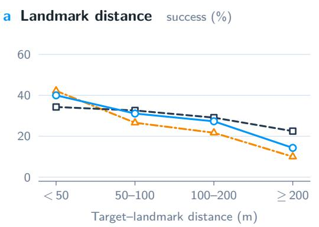

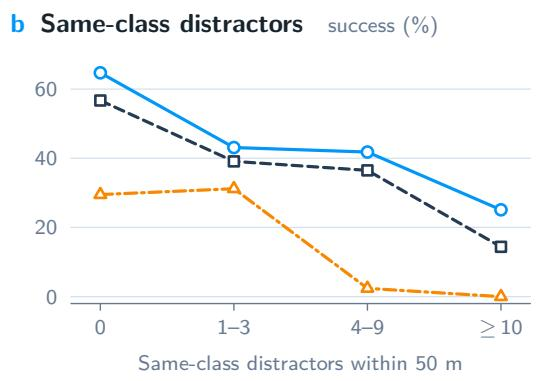  
Figure 9 Aggregate trajectory diagnostics from Table 16. Left: success versus target–landmark distance. Right: success versus same-class distractor count within 50 m. These curves visualize the reported bin rates, not individual failure trajectories; per-bin sample counts and error bars are unavailable.

Representative failure trajectories. Figure 10 shows two saved CityRefer-NO trajectories: a zoom that excludes the target and a wrong-row prediction despite a zoom containing the target. In both cases, the agent commits the same box after one oblique inspection. These selected zero-IoU examples illustrate distinct failure stages; they do not estimate failure frequencies or establish the causes of the aggregate trends.

## D.7 Inference eficiency

Table 17 separates online tool costs, full-query latency, and the one-time oblique-cache construction cost. Cached Landmark Query, Zoom-in, and Oblique Rendering together take about 0.36 s, included in Urbex’s 3.2 s/query. CityAnchor’s 32.1 s/query also excludes ofline preparation and uses pre-extracted point-cloud and landmark features. The approximately 10× ratio therefore compares warm online inference under the same accounting scope.

Table 17 CityRefer latency and optional scene-cache preparation. The on-demand total is an estimate; cache construction covers all 12 scenes.
<table><tr><td>Component</td><td>Latency / preparation time</td></tr><tr><td>Landmark Query</td><td>&lt; 1 ms</td></tr><tr><td>Zoom-in from high-resolution BEV</td><td>70 ms</td></tr><tr><td>Oblique Rendering from cache</td><td>292 ms</td></tr><tr><td>All three tools</td><td>≈ 0.36 s</td></tr><tr><td>Urbex, full model and cached tools</td><td>3.2 s/query</td></tr><tr><td>CityAnchor, warm online inference</td><td>32.1 s/query</td></tr><tr><td>Optional oblique cache, all 12 scenes</td><td>≈ 2.3 hours (one time)</td></tr><tr><td>Additional latency with on-demand oblique views</td><td>≈ 1.2 s/query</td></tr><tr><td>Urbex, estimated on-demand total</td><td>≈ 4.4 s/query</td></tr></table>

The cache primarily makes RL rollouts eficient and is optional at inference. Rendering oblique views on demand increases the estimated total to 4.4 s/query, still about 7.3× faster than CityAnchor’s reported online latency. The 2.3-hour figure covers oblique-cache construction only, not the complete deployment pipeline: BEV generation, view-to-world calibration, and landmark registration are additional scene-preparation steps whose individual construction times are not reported. These costs depend on the scene and are amortized over queries; neither online ratio should be interpreted as an end-to-end deployment speedup.

## E Limitations

Urbex depends on a task-specific interactive environment: reliable BEV rendering and view-to-world calibration. Errors in calibration or rendering can project a plausible 2D box to the wrong world location, while absent, ambiguous, outdated, or missing landmarks force the agent to rely more on visual search and local context, reducing eficiency.

The current policy submits a BEV-aligned bounding box, which is eficient and compatible with city-scale search but still leaves room for improving fine-grained 3D segmentation accuracy. A natural extension is to expose multi-view 3D instance segmentation models as additional tools, allowing the agent to refine the final prediction from a localized 2D region into a more accurate 3D instance mask or box.

Broader impacts and mitigation. Beyond beneficial applications such as navigation, urban planning, and accessibility, accurate language-driven localization at city scale risks misuse for surveillance, persistent target tracking, sensitive-site identification, or automated monitoring. We mitigate these risks by training only on public benchmarks (CityRefer, STPLS3D) without personal identifiers, releasing code, checkpoints, and STPLS3D-Refer under a research-only license that prohibits unconsented surveillance and individual tracking, and recommending privacy-preserving preprocessing (e.g., blurring faces and license plates) for downstream adaptations.

Observed failure. Z1 excludes the target car. The agent retains its proposed box after oblique inspection. Birmingham block 12, object 14 BEV IoU = 0.00 Center error = 34.2 m

Prediction

First zoom extent

## a Initial crop excludes the target

QUERY The white car that is 9th from the left in the 2nd row of cars in the massive parking lot for the West Midlands Police Custody Suite, when viewed aerially with Holford Drive to the right.

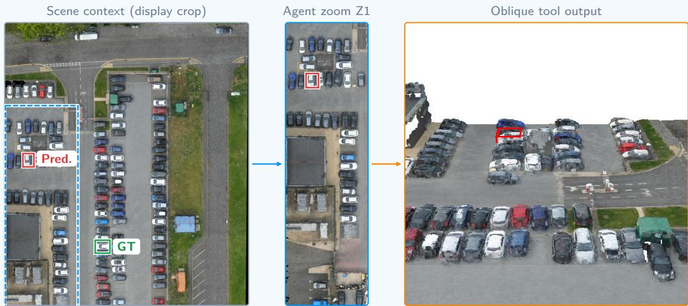

## b Wrong row after reaching the target area

QUERY Black car in the elevated rectangular car park along salmon lane footpath on the third lane from the blue/grey buildings. It has a red car to the left and a white car to the right.

Agent zoom Z1 (complete view)  
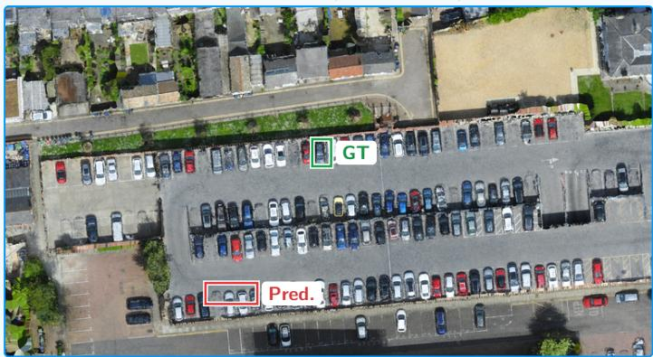

Oblique tool output  
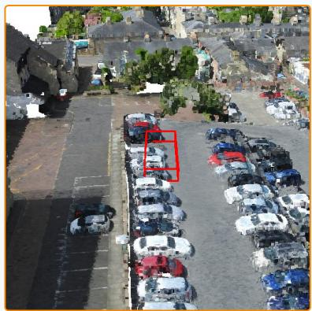

Observed failure. Z1 contains the target, but the prediction selects vehicles in another row and remains unchanged after oblique inspection.

Figure 10 Qualitative failure trajectories on CityRefer-NO. (a) The first zoom excludes the annotated target. (b) The zoom includes the target, but the prediction selects vehicles in a diferent parking row. Scene context in (a) is an ofline display crop of the high-resolution BEV. Zoom and oblique panels preserve the complete recorded tool images; GT and prediction overlays on BEV views are added for diagnosis. Green denotes GT, red denotes the prediction, and dashed blue denotes the first zoom extent. Both runs retain their proposed box after oblique inspection and obtain zero BEV IoU.