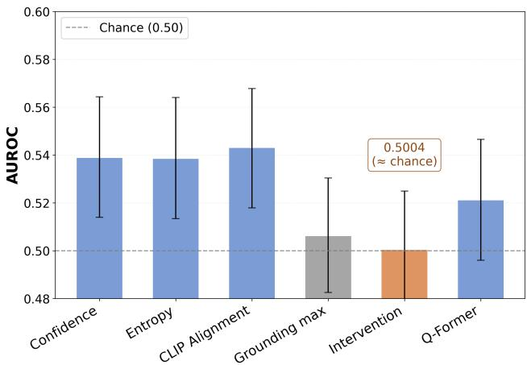
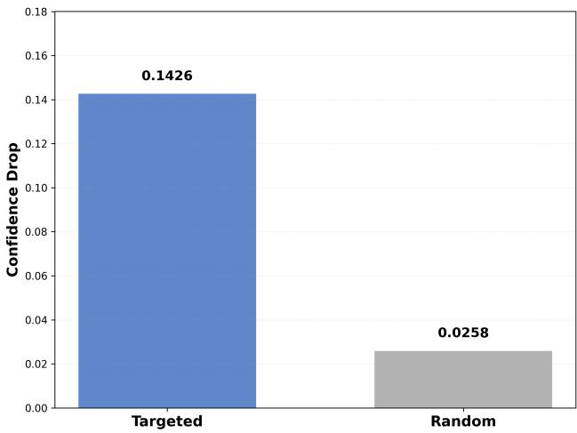
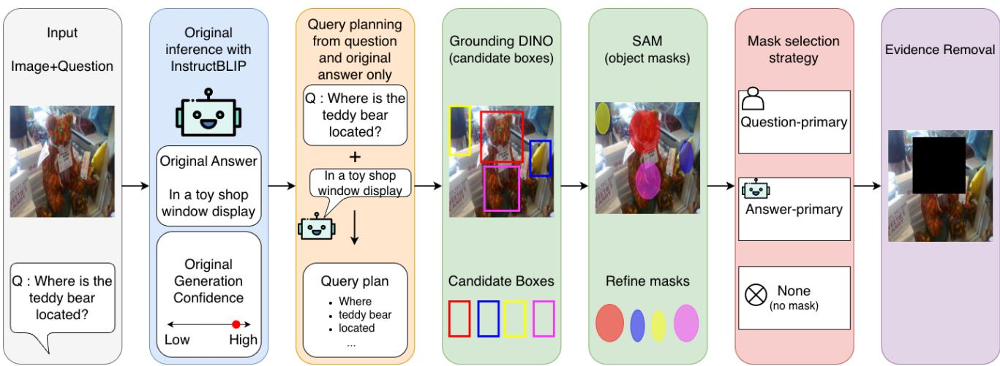

# Visual Dependence Does Not Imply Answerability: A Systematic Analysis of Answerability Signals in Frozen InstructBLIP

Minjun Kim\* Hyunmin Song \* Changwon Lim† Chung-Ang University {goodwill1669, hmkate, clim}@cau.ac.kr \*Equal contribution. †Corresponding author.

## Abstract

Visual question answering models often produce plausible responses even when the available visual evidence is insuffi cient to support a valid answer. Although prior work has introduced benchmarks and abstention mechanismsfor unanswerable visual questions, it remains unclear which signals derived from a frozen vision-language model reliably indicate answerability and generalize to unseen image– question pairs. We systematically evaluate candidate answerability signals on a stratified 10K subset of UNK-VQA using frozen InstructBLIP, covering predictive uncertainty, cross-modal alignment, visual grounding, visual dependence, internal representations, and learned probes. Across the evaluated methods, answerability discrimination remains weak, with test AUROC largely confined to 0.50– 0.54. CLIP alignment yields the highest point estimate, but does not significantly outperform generation confidence under paired bootstrap analysis. More strikingly, targeted re moval of question-relevant visual evidence causes substantially larger changes in answer confidence than same-size random masking, yet the resulting intervention sensitivity provides essentially no answerability discrimination. Increasing probe capacity, combining multiple signals, and adding reason-aware supervision do not provide robust im provements, while post-freeze cross-validation yields similarly weak discrimination. Selective-answering analysis further shows that these weak discrimination scores translate into limited usable coverage under low-risk operating criteria. Failure-mode analysis also shows that the relative utility of individual signals varies substantially across per turbation mechanisms. Taken together, these results show that, on our UNK-VQA subset with frozen InstructBLIP, visual dependence, uncertainty, semantic alignment, and static representations are not robust standalone proxies for answerability. Our findings emphasize the need to distinguish a model’s reliance on visual evidence from whether that evidence is sufficient to support an answer.

## 1. Introduction

Vision-language models (VLMs) have achieved strong performance on visual question answering (VQA), generating fluent and plausible answers to a wide range of image– question pairs [7, 21]. However, the ability to generate a plausible answer does not guarantee that the answer is supported by sufficient visual evidence. When an image is ambiguous, relevant information is missing, or a question cannot be resolved from the available input, a VLM may still produce a confident response rather than reliably recognizing its uncertainty [5]. Such overconfident answering limits the reliability of VLMs in settings where knowing when not to answer is as important as generating the answer itself [36].

A central challenge is that confidence and answerability describe different properties. Confidence measures how strongly a model favors its prediction, whereas answerability concerns whether the available image–question pair contains sufficient evidence to support a valid answer. A model can therefore be confident even when the evidence needed to justify its answer is incomplete, ambiguous, or unavailable. Reliable answerability estimation consequently requires understanding whether the available evidence is sufficient, rather than relying on prediction confidence alone.

This distinction motivates us to examine visual dependence as a candidate answerability signal. If a question is answerable from an image, the model’s prediction may depend on question-relevant visual evidence, and removing that evidence should produce a measurable change in model behavior. This leads to a natural hypothesis: stronger dependence on question-relevant visual evidence may indicate that an image–question pair is answerable. However, visual dependence and evidence sufficiency need not be equivalent. A model may rely strongly on the visual information that is available while still lacking other evidence required for a valid answer. Whether visual dependence provides a reliable proxy for answerability is therefore an empirical question.

Rather than treating answerability detection as another model-design problem, we treat candidate answerability proxies themselves as objects of evaluation. Our goal is to audit whether commonly used model-side signals support the evaluative claim that an image–question pair is answerable, and whether such conclusions remain stable across controlled perturbations, resampling, and heterogeneous failure modes.

We investigate this question on UNK-VQA [12], a benchmark containing both answerable and unanswerable image–question pairs, using a common frozen-VLM evaluation framework. Beyond visual dependence, we examine predictive uncertainty, cross-modal alignment, visual grounding, and internal representations, together with feature transformation, feature fusion, nonlinear probing, and reason-aware supervision. Our study addresses three main questions: (1) How reliably do uncertainty, cross-modal alignment, visual grounding, visual dependence, and internal representations distinguish answerable from unanswerable inputs? (2) Can representation transformation, feature fusion, increased probe capacity, or reason-aware supervision improve answerability generalization? (3) Do these signals remain reliable across different perturbation mechanisms and semantic reasonsfor unanswerability? We additionally evaluate statistical robustness and selectiveanswering behavior to determine whether the observed discrimination translates into reliable operating behavior.

Our experiments reveal consistently weak answerability discrimination. Across the evaluated signals and probes, test AUROC remains approximately 0.50–0.54. Targeted removal of question-relevant visual evidence affects model confidence substantially more than same-size random removal (0.1426 vs. 0.0258), yet the resulting intervention sensitivity remains near chance for answerability discrimination (AUROC 0.5004). Representation transformation, feature fusion, nonlinear probing, reason-aware supervision, and selective-answering analysis do not yield robust or practically useful answerability behavior, and failuremode analysis shows that signal utility varies across forms of unanswerability.

Our contributions are threefold. First, we conduct a systematic validity audit of candidate answerability proxies within a common frozen-VLM framework, spanning predictive uncertainty, cross-modal alignment, visual ground ing, visual dependence, internal representations, feature fusion, nonlinear probing, and reason-aware supervision. Second, through targeted evidence removal, we empirically show that measurable visual dependence does not translate into answerability: intervention sensitivity remains near chance for answerable–unanswerable discrimination, separating model reliance from evidence sufficiency. Third, we conduct a generalization and failure-mode audit using paired bootstrap analysis, multiple seeds, post-freeze crossvalidation, and perturbation- and reason-wise evaluation, showing that no evaluated signal or probe provides consistently robust discrimination across heterogeneous forms of unanswerability.

Together, these findings suggest that reliable answerability estimation requires reasoning about whether the evidence required by a question is actually available and sufficient, rather than relying on model confidence, visual dependence, or static representation separability alone.

## 2. Related Work

## 2.1. Reliable VQA and Selective Prediction

Visual Question Answering (VQA) requires models to answer natural-language questions based on visual content [2, 11], and recent VLMs have improved VQA by integrating pretrained visual and language representations [7, 21]. However, strong answer generation does not guarantee reliable answering: models may produce plausible responses that are not visually supported, motivating work on hallucination, selective prediction, and abstention [8, 9, 22, 33, 36]. These approaches primarily concern prediction reliability, whereas answerability concerns whether the available evidence supports a valid answer.

## 2.2. Unanswerable VQA and UNK-VQA

Unanswerable VQA explicitly considers cases in which an image–question pair does not provide sufficient evidence for a valid answer [13, 27]. UNK-VQA [12] provides a controlled benchmark with answerable and unanswerable image–question pairs annotated by different causes of unanswerability. Recent studies further show that such refusal behavior is strongly influenced by the available visual input and remains challenging for current multimodal models [39]. Concurrent work also separates visual modality dependency from evidence sufficiency when constructing unanswerable instances [25]. Whereas that work uses the distinction to build a benchmark and evaluate prompted abstention behavior, we test the distinction directly at the signal level: we measure whether an intervention-based dependence score, computed from a frozen VLM, actually discriminates answerability.

Our work builds on this setting but focuses on the signals underlying answerability decisions. Rather than proposing a new abstention mechanism, we systematically examine whether signals available from a frozen VLM can distinguish answerable from unanswerable inputs across different forms of unanswerability.

## 2.3. Answerability Signals and Evidence Sufficiency

Predictive uncertainty provides a natural signal for estimating whether a model should answer [14]. Generation confidence reflects the probability assigned to a generated response, while predictive entropy characterizes uncertainty in the predictive distribution [26]. Such signals are commonly used for selective prediction, but they characterize uncertainty in model predictions rather than directly measuring the sufficiency of the available evidence.

Cross-modal alignment provides another potential signal. CLIP-based similarity has been used to measure semantic compatibility between visual and textual content [16, 30]. More directly, CLIP-UP [35] combines CLIPderived image–question alignment with lightweight learned layers on a frozen VLM to detect unanswerable questions. In contrast, we examine whether cross-modal alignment itself serves as a robust standalone proxy for answerability across heterogeneous controlled perturbations. Visual grounding provides a related perspective by localizing image regions associated with textual concepts [23]. Alignment and grounding therefore characterize the relationship between the question and visual content, but their relationship to answerability and evidence sufficiency remains unclear; prior work has questioned whether improvements associated with visual grounding necessarily reflect stronger use of the correct visual evidence [32].

Counterfactual evidence intervention provides a more direct way to examine visual dependence. By removing or modifying question-relevant visual evidence and measuring the resulting change in model behavior, intervention-based analysis can test whether a prediction depends on particular image regions [20, 28]. EVICT [19] applies counterfactual evidence dropout for selective VQA by masking cited visual evidence and measuring the resulting answer change, reporting improvements in some visually grounded QA settings but weaker behavior on hard-negative cases. Related analyses similarly suggest that apparent reliance on visual content does not necessarily imply reliable visual understanding or answer correctness [4, 24]. This motivates a distinction between visual dependence and evidence sufficiency: the former concerns how model behavior changes when relevant visual evidence is altered, whereas the latter concerns whether the available evidence is adequate to support a valid answer. We therefore ask whether intervention sensitivity itself generalizes as a robust proxy for answerability across heterogeneous unanswerability mechanisms.

Frozen multimodal representations may also contain answerability information that is not directly captured by uncertainty, alignment, grounding, or intervention scores. Probing these representations can test whether answerable and unanswerable inputs are separable in the learned feature space [1]. Recent analyses of language models nonetheless caution that internal states may reflect knowledge recall rather than a reliable notion of what a model does not know [3]. Feature combinations and nonlinear probes further provide a way to test whether answerability information can be recovered from multiple signals.

Overall, these approaches capture different aspects of model uncertainty, cross-modal compatibility, visual grounding, evidence sensitivity, and representation structure. However, it remains unclear whether any of these signals provides a reliable proxy for evidence sufficiency under a common evaluation setting. Our work addresses this question through a systematic evaluation of answerability signals extracted from a frozen VLM.

## 3. Evaluation Framework

## 3.1. UNK-VQA Benchmark

UNK-VQA [12] applies controlled perturbations to VQA v2 [11] and annotates the resulting image–question pairs for answerability. Its five perturbations are word replacement (T-1), semantic negation (T-2), image replacement (I-1), image masking (I-2), and copy-and-move (I-3). Unanswerable examples are further labeled with one of four official UNK-VQA reasons: it has multiple plausible answers (R1), it is difficult to understand (R2), the image lacks important concepts/information (R3), or it requires higher-level knowledge to answer (R4); both taxonomies are analyzed in Sec. 5.

## Experimental subset construction.

The full release contains 99,996 examples and is imbalanced in answerability and perturbation type. To compare heterogeneous failure modes, we draw a stratified 10K subset from the released splits, balancing answerability and perturbation type within 7,000/1,000/2,000 train/validation/test examples (Table 1).

We enforce source-question disjointness across splits using the dataset’s question id origin field. Reasons are not stratified, preserving their natural imbalance: among the 5,000 unanswerable examples, R1–R4 account for 19.2%, 34.9%, 22.6%, and 23.4%, respectively.

## 3.2. Frozen VLM and Answerability Signals

We keep InstructBLIP [7] with Flan-T5-XL [6] fully frozen and test signals from its outputs, visual evidence, and internal representations.

## Predictive uncertainty.

Generation confidence is the geometric mean of the probabilities of greedily selected answer tokens, excluding special tokens. Confidence (1-D LR) is an L2-regularized onedimensional logistic-regression probe on this scalar; we also use negative predictive entropy, so larger scores indicate answerability.

## Cross-modal alignment.

We use CLIP ViT-B/32 [30] image–question cosine similarity directly as an alignment score.

## Visual grounding.

Grounding DINO [23] and SAM [18] localize questionrelevant regions. Grounding max is the maximum grounding score; Grounding features (3-D) adds required-entity coverage and mask-area ratio. Grounding features are computed from Question-Query detections only; the optional Answer Query is used solely to refine the intervention target when the question alone does not identify a stable objectlevel target.

<table><tr><td>Split</td><td>Total</td><td>A/U</td><td>T-1</td><td>T-2</td><td>I-1</td><td>I-2</td><td>I-3</td></tr><tr><td>Train</td><td>7,000</td><td>3,500/3,500</td><td>700/700</td><td>700/700</td><td>700/700</td><td>700/700</td><td>700/700</td></tr><tr><td>Validation</td><td>1,000</td><td>500/500</td><td>100/100</td><td>100/100</td><td>100/100</td><td>100/100</td><td>100/100</td></tr><tr><td>Test</td><td>2,000</td><td>1,000/1,000</td><td>200/200</td><td>200/200</td><td>200/200</td><td>200/200</td><td>200/200</td></tr><tr><td>Total</td><td>10,000</td><td>5,000/5,000</td><td>1,000/1,000</td><td>1,000/1,000</td><td>1,000/1,000</td><td>1,000/1,000</td><td>1,000/1,000</td></tr></table>

Table 1. Statistics of the stratified UNK-VQA subset used in our experiments. Each split is balanced across binary answerability (A/U) and the five perturbation types; cell entries report answerable/unanswerable counts.

## Visual dependence under evidence intervention.

We remove question-relevant visual evidence and measure the resulting change in model confidence. We first analyze each question to identify its question type, required visual entities, relations, and potential target, and determine whether the visual target can be specified from the question alone. Based on this analysis, we construct either a Question Query from directly identifiable visual entities or, only when the target cannot be sufficiently specified from the question, an Answer Query that uses InstructBLIP’s original generated answer to refine the target. Dataset groundtruth answers are never used.

Before grounding, each example is assigned one of three mask strategies: question-primary, when the target can be identified from the question alone; answer-primary, when the original generated answer is required to refine the target; or none, when no stable object-level target can be identified. This strategy is fixed before Grounding DINO [23] detection rather than selected post hoc from grounding or intervention outcomes.

Grounding DINO localizes the query-relevant object, and the selected bounding box is refined into a pixel-level mask using SAM [18]. The masked region is replaced with the image mean pixel value to construct the evidenceremoved image $I _ { \mathrm { r e m } }$ When no valid target mask is obtained, a zero mask is used and the example remains in the evaluation.

Let $A _ { \mathrm { o r i g } }$ denote the answer generated from the original image I and question q. We keep $A _ { \mathrm { o r i g } }$ fixed and define intervention sensitivity as

$$
s _ { \mathrm { i n t } } = c ( A _ { \mathrm { o r i g } } \mid I , q ) - c ( A _ { \mathrm { o r i g } } \mid I _ { \mathrm { r e m } } , q ) ,\tag{1}
$$

where larger values indicate stronger visual dependence. We denote this score Intervention. A same-size random mask is used as a control for generic sensitivity to image removal [28]. For the multi-signal probe, we separately regenerate an answer from $I _ { \mathrm { r e m } } ;$ these consistency features are distinct from fixed-answer rescoring.

<table><tr><td>Signal type</td><td>Method</td><td>Score</td></tr><tr><td>Predictive uncertainty</td><td>Confidence (1-D LR) Entropy</td><td>1-D LR prob. Neg. entropy</td></tr><tr><td>Cross-modal alignment</td><td>CLIP Alignment</td><td>Cosine sim.</td></tr><tr><td>Visual grounding Visual dependence</td><td>Grounding max Intervention</td><td>Max grounding Conf. drop</td></tr><tr><td>Multi-signal</td><td>7-feature LR</td><td>LR score</td></tr><tr><td>Internal representation</td><td>Q-Former Question</td><td>Probe score</td></tr><tr><td>Feature</td><td>Q-Former + Question</td><td>LR score</td></tr><tr><td>fusion</td><td>+ Confidence + Grounding features (3-D)</td><td></td></tr><tr><td>Nonlinear probe Reason-aware probe Reason-aware MTL</td><td>Binary MLP</td><td>Probe score</td></tr></table>

Table 2. Answerability signals and probe configurations evaluated in our framework.

## Internal representations.

We also probe frozen Q-Former [21] and question representations, their PCA reductions, and their combinations with other signals.

Table 2 summarizes the answerability signals and probe configurations evaluated in our framework.

## 3.3. Answerability Probes

We use L2-regularized logistic regression unless otherwise stated to test whether individual or combined frozen features encode answerability [1].

## Multi-signal probe.

The 7-feature LR combines generation confidence, fixedanswer confidence drop, exact and semantic consistency between the original and removal-generated answers, maximum grounding score, required-entity coverage, and maskarea ratio. The consistency features use generated answers, never dataset ground truth, and are distinct from the confidence drop obtained by re-scoring the fixed original answer.

## Representation and feature-fusion probes.

We probe Q-Former and question representations individually and jointly, incrementally add confidence and Grounding features (3-D), and test PCA reduction.

## Nonlinear and reason-aware probes.

We also test a binary MLP [17] and a reason-aware MTL probe [31] that jointly predicts answerability and unanswerability reason. All configurations are selected on validation data.

## 3.4. Evaluation Protocol

We treat answerable examples as positive and primarily report AUROC, where 0.5 is random ranking. All parameters, scaling, and PCA are fitted on training data; hyperparameters are selected on validation data.

Feature extraction is complete for validation and test; all primary analyses use the complete 2,000-example test subset.

## Threshold-dependent evaluation.

One global validation threshold maximizing balanced accuracy is applied unchanged to the full test set and perturbation subsets for unanswerable recall (U-Recall).

## Statistical evaluation.

We estimate 95% bootstrap confidence intervals for test AUROC and paired bootstrap differences relative to the Confidence baseline. Nonlinear probes are additionally evaluated across three random seeds. Because the experimental test subset was inspected during analysis development, we perform a post-freeze 5-fold cross-validation robustness check on the training subset after fixing all evaluated methods and hyperparameters; these results are not used for additional model or hyperparameter selection.

## Failure-mode evaluation.

We report perturbation-wise AUROC and U-Recall and reason-wise AUROC. Reason-wise AUROC compares each unanswerable group with the common 1,000 answerable examples.

## Selective answering.

Test examples are ranked in descending order of answerability score. For the top-k retained subset $S _ { k }$ , we define coverage as $C ( k ) = k / N$ and selective risk as the fraction of unanswerable examples among retained examples,

$$
R ( k ) = \frac { 1 } { k } \sum _ { i \in S _ { k } } \mathcal { H } ( y _ { i } = U ) .\tag{2}
$$

We evaluate all $k = 1 , \ldots , N .$ , report area under the risk– coverage curve (AURC; lower is better), and report the maximum coverage satisfying $R ( k ) \leq 0 . 3 [ 1 0 , 3 4 ]$

## 4. Systematic Evaluation

We evaluate whether signals available from a frozen VLM can reliably distinguish answerable from unanswerable image–question pairs. We first compare candidate answerability signals under a common protocol, then examine visual dependence, representation and probe capacity, statistical robustness, and selective-answering behavior.

  
Figure 1. Test AUROC with 95% bootstrap confidence intervals for representative standalone signals on the 2,000-example test subset. The dashed line marks chance (0.50).

<table><tr><td>Signal type</td><td>Method</td><td>Test AUROC</td></tr><tr><td rowspan="2">Predictive uncertainty</td><td>Confidence (1-D LR)</td><td>0.5388</td></tr><tr><td>Entropy</td><td>0.5384</td></tr><tr><td>Cross-modal alignment</td><td></td><td>0.5430</td></tr><tr><td rowspan="2">Visual grounding</td><td>CLIP Alignment</td><td></td></tr><tr><td>Grounding max</td><td>0.5061</td></tr><tr><td>Visual dependence</td><td>Intervention</td><td>0.5004</td></tr><tr><td>Multi-signal</td><td>7-feature LR</td><td>0.5296</td></tr><tr><td>Internal representation</td><td>Q-Former Question</td><td>0.5210 0.5111</td></tr><tr><td>Feature fusion</td><td>Q-Former + Question + Confidence</td><td>0.5293</td></tr><tr><td></td><td>+ Grounding features (3-D)</td><td>0.5300 0.5300</td></tr><tr><td>Nonlinear probe</td><td>Binary MLP</td><td>0.5147</td></tr><tr><td>Reason-aware probe Reason-aware MTL</td><td></td><td>0.5204</td></tr></table>

Table 3. Overall answerability discrimination on the complete 2,000-example experimental test subset.

## 4.1. Overall Answerability Signal Benchmark

Table 3 summarizes the discriminative ability of the candidate answerability proxies on the complete 2,000-example experimental test subset. Fig. 1 reports bootstrap confidence intervals for representative standalone signals. Across all evaluated signal families, performance remains close to random ranking, with AUROC ranging from 0.5004 to 0.5430. CLIP Alignment yields the highest point estimate (0.5430), followed closely by the Confidence baseline (0.5388) and Entropy (0.5384). In contrast, Grounding max (0.5061) and Intervention (0.5004) provide little standalone discrimination.

Combining heterogeneous signals does not recover substantially stronger answerability information. The 7-feature LR obtains 0.5296 AUROC, while combining Q-Former and Question representations reaches 0.5293; adding Confidence and Grounding features increases performance only marginally to 0.5300. Increasing probe capacity also fails to improve generalization, with Binary MLP and reason-aware MTL obtaining 0.5147 and 0.5204 AUROC, respectively.

  
Figure 2. Mean fixed-answer confidence drop under targeted versus same-size random masking on the 2,000-example test subset. Both bars use the same intervention protocol; only the masking condition differs.

Taken together, these results provide little evidence that any single evaluated proxy, representation, or lightweight combination offers robust standalone answerability discrimination in this frozen-InstructBLIP setting. We examine the statistical support for the small differences among the strongest methods in Sec. 4.4.

## 4.2. Visual Dependence Does Not Imply Answerability

We next examine whether sensitivity to question-relevant visual evidence provides a useful proxy for answerability. Under the fixed-answer intervention protocol in Sec. 3.2, we apply the same pipeline to the test subset under two masking conditions: question-relevant targeted removal and a same-size random mask control. In each run, we keep the original generated answer fixed and measure the resulting confidence drop.

Fig. 2 compares the two conditions. When evidence is removed with targeted masking, the mean fixed-answer confidence drop is 0.1426; under the random control, it is 0.0258. The frozen VLM is therefore measurably more sensitive to removal of question-relevant regions than to arbitrary regions of the same size, indicating that the intervention captures a form of visual dependence.

Fig. 3 summarizes the full procedure used for both runs. Crucially, however, this dependence does not translate into answerability discrimination: using the targeted fixedanswer confidence drop as an answerability score yields AUROC 0.5004, effectively corresponding to random ranking. Both answerable and unanswerable examples can exhibit strong sensitivity to removal of question-relevant visual evidence.

A valid target mask is obtained for 54.7% of the experimental test subset. Under our predefined protocol, invalid localizations are assigned zero masks and remain in the evaluation; therefore, the reported AUROC over all 2,000 test examples measures the end-to-end discriminative utility of the complete intervention pipeline, including localization failure.

Thus, within the evaluated intervention pipeline, measurable visual dependence is not a reliable standalone proxy for answerability.

## 4.3. Representation and Learned-Probe Analysis

We next test whether the weak discrimination can be improved through representation transformation, feature fusion, increased nonlinear capacity, or explicit supervision over reasons for unanswerability.

## Representation reduction and feature fusion.

PCA provides no meaningful improvement, and feature fusion improves only marginally over individual frozen representations. These results suggest that the weak discrimination is not explained simply by high representation dimensionality or the absence of a particular signal.

## Nonlinear and reason-aware probes.

The binary MLP reaches training, validation, and test AU-ROCs of 0.7718, 0.5585, and 0.5147, respectively. The large train–test gap is consistent with substantial overfitting rather than improved generalizable answerability discrimination.

Reason-aware MTL similarly provides no clear advantage, while its auxiliary reason predictions are strongly concentrated on Unclear/Difficult (R2), indicating poor separation among unanswerability reasons.

Overall, dimensionality reduction, feature fusion, nonlinear capacity, and reason-aware supervision do not resolve the weak generalization of the evaluated frozen-VLM signals.

## 4.4. Statistical Robustness

Because the differences among the strongest methods are small, we examine whether the conclusions persist under bootstrap resampling, random initialization, and alternative training partitions.

## Paired bootstrap.

CLIP Alignment has the highest point estimate, but its AUROC difference relative to Confidence is only +0.0042, with a 95% paired bootstrap confidence interval of [−0.0298, 0.0377]. Thus, the observed improvement over Confidence is not statistically supported. The paired intervals for the other evaluated alternatives also include zero, except for Intervention, which is lower than Confidence by −0.0384 (95% CI [−0.0698, −0.0061]).

  
Figure 3. Full evidence-intervention pipeline shared by both masking conditions (Sec. 3.2). InstructBLIP generates a fixed original answer and confidence score from the unmodified image. Each example is assigned a question-primary, answer-primary, or no-mask strategy before detection; Grounding DINO [23] and SAM [18] localize the query-relevant region, which is removed via mean-pixel replacement to form the evidence-removed image $I _ { \mathrm { r e m } }$ . The same fixed answer is re-scored on $I _ { \mathrm { r e m } } .$ . Dataset ground-truth answers are never used.

## Multiple seeds and post-freeze cross-validation.

Across seeds 42, 43, and 44, Binary MLP obtains 0.5153 ± 0.0059 test AUROC and reason-aware MTL obtains $0 . 5 1 5 3 \pm 0 . 0 0 5 0$ , providing no evidence of a seeddependent improvement.

After freezing the evaluated methods and hyperparameters, a post-freeze 5-fold cross-validation robustness check on the training subset yields mean AUROCs from 0.5144 to 0.5290. The similarly weak cross-validation results support the conclusion that the observed limitation is not specific to a single experimental partition.

## 4.5. Selective Answering under Risk–Coverage

Finally, we examine whether the strongest simple answerability scores provide useful operating points for selective answering [33]. Entropy, Confidence, and CLIP Alignment obtain AURCs of 0.4577, 0.4626, and 0.4641, respectively. At risk ≤ 0.3, Confidence retains only 2.85% of the test examples, Entropy retains 0.20%, and CLIP Alignment provides no feasible operating point.

Thus, the weak AUROC discrimination also translates into limited practical selective-answering behavior: the evaluated simple signals cannot identify a substantial subset of examples that can be retained under the specified lowrisk criterion.

## 5. Failure-Mode Analysis

We evaluate five representative methods—Confidence, CLIP Alignment, Intervention, Q-Former, and Binary MLP—across perturbation and reason categories using the

same frozen scores and validation-selected thresholds; no model or threshold is fitted to a test subgroup.

## 5.1. Perturbation-Wise Performance

Table 4 reports AUROC and U-Recall for each method and perturbation type.

No method dominates all perturbations, and all are near chance on I-2. Intervention combines high fixed-threshold U-Recall with near-chance AUROC, showing that rejecting many unanswerable cases at one operating point does not imply reliable ranking.

## 5.2. Reason-Wise Performance

Reason groups retain their natural imbalance; each is compared with the common set of 1,000 answerable test examples.

Reason-wise AUROC remains weak, with no method consistently reliable across R1–R4. Intervention stays near chance for every reason, reinforcing that visual dependence is not a reliable answerability signal.

## 6. Discussion & Limitations

## Visual dependence is not evidence sufficiency.

Targeted removal of question-relevant visual evidence produces a substantially larger confidence drop than same-size random masking, confirming that the frozen VLM is sensitive to localized visual evidence. Yet intervention sensitivity remains near chance for answerability discrimination. Thus, detecting whether a model relies on visual evidence and determining whether that evidence is sufficient to support a valid answer are distinct problems. This does not imply that visual evidence is irrelevant to answerability; rather, visual dependence alone is insufficient as an answerability criterion. A model may strongly rely on available visual content while still lacking other information required to justify its answer.

<table><tr><td>Method</td><td>T-1</td><td>T-2</td><td>I-1</td><td>I-2</td><td>I-3</td></tr><tr><td>Confidence</td><td>0.521/0.275</td><td>0.579/0.555</td><td>0.601/0.395</td><td>0.478/0.285</td><td>0.517/0.245</td></tr><tr><td>CLIP Alignment</td><td>0.561/0.725</td><td>0.539/0.590</td><td>0.550/0.890</td><td>0.498/0.520</td><td>0.571/0.655</td></tr><tr><td>Intervention</td><td>0.488/0.780</td><td>0.487/0.850</td><td>0.528/0.835</td><td>0.482/0.795</td><td>0.519/0.745</td></tr><tr><td>Q-Former</td><td>0.470/0.210</td><td>0.553/0.250</td><td>0.555/0.290</td><td>0.510/0.430</td><td>0.519/0.295</td></tr><tr><td>Binary MLP</td><td>0.527/0.345</td><td>0.495/0.315</td><td>0.556/0.405</td><td>0.508/0.450</td><td>0.485/0.390</td></tr></table>

Table 4. Perturbation-wise answerability performance. Each entry reports AUROC / U-Recall. U-Recall is computed using the single global threshold selected on the validation subset; no threshold is re-selected for a perturbation type.

<table><tr><td>Method</td><td>R1</td><td>R2</td><td>R3</td><td>R4</td></tr><tr><td>Confidence</td><td>0.550</td><td>0.530</td><td>0.558</td><td>0.520</td></tr><tr><td>CLIP Alignment</td><td>0.538</td><td>0.551</td><td>0.549</td><td>0.527</td></tr><tr><td>Intervention</td><td>0.511</td><td>0.493</td><td>0.532</td><td>0.465</td></tr><tr><td>Q-Former</td><td>0.493</td><td>0.522</td><td>0.539</td><td>0.524</td></tr><tr><td>Binary MLP</td><td>0.498</td><td>0.518</td><td>0.533</td><td>0.503</td></tr></table>

Table 5. Reason-wise answerability AUROC by unanswerability reason (R1–R4).

## Frozen signals are weak standalone proxies for answerability.

Across uncertainty, alignment, grounding, visual dependence, and frozen representations, answerability discrimination remains weak. Feature fusion provides little improvement, while nonlinear probing improves training separation without corresponding test gains, and reason-aware supervision provides no consistent advantage. These trends persist across bootstrap, multiple seeds, and post-freeze cross-validation. This does not imply that answerability information is absent from the VLM; rather, it is not robustly recoverable from the static signals and probe families evaluated here.

## Answerability failures are heterogeneous.

Relative performance changes across perturbations and reasons; unanswerability is not a uniform state. Robust mechanisms may need to identify required evidence and verify its availability rather than rely on one global score.

## Implications for selective answering.

Weak discrimination yields little feasible low-risk coverage, consistent with evidence that calibration need not improve failure separation [37]. Future selective answering should model evidence sufficiency explicitly and abstain or request clarification when required evidence is absent.

## Limitations.

We study one frozen backbone and a balanced UNK-VQA subset, so conclusions may not transfer to architectures with different visual pathways [29, 38] or naturally occurring unanswerability. Accordingly, our results should be interpreted as controlled comparisons of proxy validity across balanced failure conditions, rather than as estimates of performance under natural deployment prevalence. The results cover only the tested frozen signals and probes. Although the random-mask control shares masking distribution shift [15], better evidence verification or jointly trained abstention models may behave differently. Finally, the test subset was inspected during development; frozen-method crossvalidation supports the trend, but a fully unseen benchmark would provide stronger evidence.

## 7. Conclusion

We systematically evaluated whether signals available from a frozen VLM can reliably distinguish answerable from unanswerable visual questions. Across predictive uncertainty, cross-modal alignment, visual grounding, visual dependence, internal representations, and learned probes, answerability discrimination remained consistently weak. Increasing probe capacity, combining multiple answerability signals, and adding reason-aware supervision did not provide robust improvements, and the same overall pattern persisted across robustness and failure-mode analyses.

Most importantly, removing question-relevant visual evidence produced a substantially larger confidence change than random removal, yet this intervention signal remained near chance for answerability discrimination. This distinction shows that visual dependence is not evidence sufficiency: a model may rely on relevant visual content without having enough evidence to support a valid answer. More broadly, our results expose a gap between signals that indicate model reliance and signals that provide evidence for the evaluative claim of answerability. Our findings therefore motivate answerability methods that directly assess whether the evidence required by a question is available and sufficient for answering.

## References

[1] Guillaume Alain and Yoshua Bengio. Understanding intermediate layers using linear classifier probes. In ICLR Workshop, 2017.

[2] Stanislaw Antol, Aishwarya Agrawal, Jiasen Lu, Margaret Mitchell, Dhruv Batra, C. Lawrence Zitnick, and Devi Parikh. VQA: Visual question answering. In ICCV, 2015.

[3] Chi Seng Cheang, Hou Pong Chan, Wenxuan Zhang, and Yang Deng. Do LLMs really know what they don’t know? internal states mainly reflect knowledge recall rather than truthfulness. In Findings Assoc. Comput. Linguist. (ACL Findings), 2026.

[4] Lin Chen, Jinsong Li, Xiaoyi Dong, Pan Zhang, Yuhang Zang, Zehui Chen, Haodong Duan, Jiaqi Wang, Yu Qiao, Dahua Lin, and Feng Zhao. Are we on the right way for evaluating large vision-language models? In NeurIPS, 2024.

[5] Zijun Chen, Wenbo Hu, Guande He, Zhijie Deng, Zheng Zhang, and Richang Hong. Unveiling uncertainty: A deep dive into calibration and performance of multimodal large language models. In Int. Conf. Comput. Linguist. (COLING), 2025.

[6] Hyung Won Chung, Le Hou, Shayne Longpre, Barret Zoph, Yi Tay, William Fedus, Yunxuan Li, Xuezhi Wang, Mostafa Dehghani, Siddhartha Brahma, et al. Scaling instructionfinetuned language models. J. Mach. Learn. Res. (JMLR), 2024.

[7] Wenliang Dai, Junnan Li, Dongxu Li, Anthony Meng Huat Tiong, Junqi Zhao, Weisheng Wang, Boyang Li, Pascale Fung, and Steven Hoi. InstructBLIP: Towards generalpurpose vision-language models with instruction tuning. In NeurIPS, 2023.

[8] Corentin Dancette, Spencer Whitehead, Rishabh Maheshwary, Ramakrishna Vedantam, Stefan Scherer, Xinlei Chen, Matthieu Cord, and Marcus Rohrbach. Improving selective visual question answering by learning from your peers. In CVPR, 2023.

[9] Yonatan Geifman and Ran El-Yaniv. Selective classification for deep neural networks. In NeurIPS, 2017.

[10] Yonatan Geifman, Guy Uziel, and Ran El-Yaniv. Biasreduced uncertainty estimation for deep neural classifiers. In ICLR, 2019.

[11] Yash Goyal, Tejas Khot, Douglas Summers-Stay, Dhruv Batra, and Devi Parikh. Making the V in VQA matter: Elevating the role of image understanding in visual question answering. In CVPR, 2017.

[12] Yangyang Guo, Fangkai Jiao, Zhiqi Shen, Liqiang Nie, and Mohan S. Kankanhalli. UNK-VQA: A dataset and a probe into the abstention ability of multi-modal large models. IEEE Transactions on Pattern Analysis and Machine Intelligence, 46(12):10284–10296, 2024.

[13] Danna Gurari, Qing Li, Abigale J. Stangl, Anhong Guo, Chi Lin, Kristen Grauman, Jiebo Luo, and Jeffrey P. Bigham. VizWiz grand challenge: Answering visual questions from blind people. In CVPR, 2018.

[14] Dan Hendrycks and Kevin Gimpel. A baseline for detecting misclassified and out-of-distribution examples in neural networks. In ICLR, 2017.

[15] Robin Hesse, Simone Schaub-Meyer, and Stefan Roth. Benchmarking the attribution quality of vision models. In NeurIPS, 2024.

[16] Jack Hessel, Ari Holtzman, Maxwell Forbes, Ronan Le Bras, and Yejin Choi. CLIPScore: A reference-free evaluation metric for image captioning. In Conf. Empirical Methods Nat. Lang. Process. (EMNLP), 2021.

[17] John Hewitt and Percy Liang. Designing and interpreting probes with control tasks. In Conf. Empirical Methods Nat. Lang. Process. (EMNLP), 2019.

[18] Alexander Kirillov, Eric Mintun, Nikhila Ravi, Hanzi Mao, Chloe Rolland, Laura Gustafson, Tete Xiao, Spencer Whitehead, Alexander C. Berg, Wan-Yen Lo, Piotr Dollar, and´ Ross Girshick. Segment anything. In ICCV, 2023.

[19] Varun Kotte. EVICT: Evidence-sufficiency verification via counterfactual dropout for visually-grounded selective question answering. In Proc. IEEE/CVF Conf. Comput. Vis. Pattern Recognit. Workshops (CVPRW), pages 11251–11259, 2026.

[20] Sicong Leng, Hang Zhang, Guanzheng Chen, Xin Li, Shijian Lu, Chunyan Miao, and Lidong Bing. Mitigating object hallucinations in large vision-language models through visual contrastive decoding. In CVPR, 2024.

[21] Junnan Li, Dongxu Li, Silvio Savarese, and Steven Hoi. BLIP-2: Bootstrapping language-image pre-training with frozen image encoders and large language models. In Int. Conf. Mach. Learn. (ICML), 2023.

[22] Yifan Li, Yifan Du, Kun Zhou, Jinpeng Wang, Wayne Xin Zhao, and Ji-Rong Wen. Evaluating object hallucination in large vision-language models. In Conf. Empirical Methods Nat. Lang. Process. (EMNLP), 2023.

[23] Shilong Liu, Zhaoyang Zeng, Tianhe Ren, Feng Li, Hao Zhang, Jie Yang, Chunyuan Li, Jianwei Yang, Hang Su, Jun Zhu, and Lei Zhang. Grounding DINO: Marrying DINO with grounded pre-training for open-set object detection. In ECCV, 2024.

[24] Zhining Liu, Ziyi Chen, Hui Liu, Chen Luo, Xianfeng Tang, Suhang Wang, Jingying Zeng, Zhenwei Dai, Zhan Shi, Tianxin Wei, Hanqing Lu, Benoit Dumoulin, and Hanghang Tong. Seeing but not believing: Probing the disconnect between visual attention and answer correctness in VLMs. In Int. Conf. Learn. Represent. (ICLR), 2026.

[25] Nishanth Madhusudhan, Vikas Yadav, and Alexandre Lacoste. Knowing when not to answer: Evaluating ab stention in multimodal reasoning systems. arXiv preprint arXiv:2604.14799, 2026.

[26] Andrey Malinin and Mark Gales. Uncertainty estimation in autoregressive structured prediction. In ICLR, 2021.

[27] Atsuyuki Miyai, Jingkang Yang, Jingyang Zhang, Yifei Ming, Qing Yu, Go Irie, Yixuan Li, Hai Li, Ziwei Liu, and Kiyoharu Aizawa. Unsolvable problem detection: Robust understanding evaluation for large multimodal models. In Annu. Meeting Assoc. Comput. Linguist. (ACL), 2025.

[28] Vitali Petsiuk, Abir Das, and Kate Saenko. RISE: Randomized input sampling for explanation of black-box models. In BMVC, 2018.

[29] Qwen Team. Qwen2.5-VL technical report. arXiv preprint arXiv:2502.13923, 2025.

[30] Alec Radford, Jong Wook Kim, Chris Hallacy, Aditya Ramesh, Gabriel Goh, Sandhini Agarwal, Girish Sastry, Amanda Askell, Pamela Mishkin, Jack Clark, Gretchen Krueger, and Ilya Sutskever. Learning transferable visual models from natural language supervision. In Int. Conf. Mach. Learn. (ICML), 2021.

[31] Sebastian Ruder. An overview of multi-task learning in deep neural networks. arXiv preprint arXiv:1706.05098, 2017.

[32] Robik Shrestha, Kushal Kafle, and Christopher Kanan. A negative case analysis of visual grounding methods for VQA. In Annu. Meeting Assoc. Comput. Linguist. (ACL), 2020.

[33] Tejas Srinivasan, Jack Hessel, Tanmay Gupta, Bill Yuchen Lin, Yejin Choi, Jesse Thomason, and Khyathi Raghavi Chandu. Selective “selective prediction”: Reducing unnecessary abstention in vision-language reasoning. In Findings Assoc. Comput. Linguist. (ACL Findings), 2024.

[34] Jeremias Traub, Till J. Bungert, Carsten T. Luth, Michael¨ Baumgartner, Klaus H. Maier-Hein, Lena Maier-Hein, and Paul F. Jaeger. Overcoming common flaws in the evaluation of selective classification systems. In NeurIPS, 2024.

[35] Ben Vardi, Oron Nir, and Ariel Shamir. CLIP-UP: CLIPbased unanswerable problem detection for visual question answering. In IEEE Winter Conf. Appl. Comput. Vis. (WACV), 2026.

[36] Spencer Whitehead, Suzanne Petryk, Vedaad Shakib, Joseph Gonzalez, Trevor Darrell, Anna Rohrbach, and Marcus Rohrbach. Reliable visual question answering: Abstain rather than answer incorrectly. In ECCV, 2022.

[37] Fei Zhu, Xu-Yao Zhang, Zhen Cheng, and Cheng-Lin Liu. Revisiting confidence estimation: Towards reliable failure prediction. IEEE TPAMI, 2024.

[38] Jinguo Zhu et al. InternVL3: Exploring advanced training and test-time recipes for open-source multimodal models. arXiv preprint arXiv:2504.10479, 2025.

[39] Yanxu Zhu, Shitong Duan, Xiangxu Zhang, Jitao Sang, Peng Zhang, Tun Lu, Xiao Zhou, Jing Yao, Xiaoyuan Yi, and Xing Xie. MoHoBench: Assessing honesty of multimodal large language models via unanswerable visual questions. In AAAI, 2026.