# Visual Servoing from Lines

Nicolas Andreff1, Bernard Espiau2 and Radu Horaud2

## Abstract

In this work, we present a fundamentally new approach to visual servoing using lines. It is based on a theoretical and geometrical study of the main line representations which allowed us to define a new representation, the so-called binormalized Plucker coordinates. They are particularly well suited to visual servoing. Indeed, they allow the definition¨ of a proper image line alignment concept. The control law which realizes such an alignment has moreover severa properties: partial decoupling between rotation and translation, analytical inversion of the motion equations and global asymptotic stability conditions. This control law was validated both in simulation and experimentally in the specific case of an orthogonal trihedron.

## 1 Motivation

In this section we set the contribution of the paper in the general framework of visual servoing. After a brief analysis of the evolution of the domain, we emphasize the need for considering more systematically geometrical issues as a way of improving the control.

## 1.1 A Short Critical History of Visual Servoing

The story of visual servoing goes back to the seventies. At this time, the concept of robot began to to be commonly accepted as the one of a machine liable to interact (sense and act) with its external environment with some degree of autonomy. Among the sensors allowing to deliver the required measurements, cameras have immediatly fascinated researchers for two reasons: the information which could potentially be extracted from a set of images seemed almost without limits; the capacity of providing a robot with vision fonctionnalities brought it nearer from human skills. Owing to this dramatic amount of information provided by cameras, the initial ambition in robotics was generally to understand the world, in order to decide, through symbolic approaches, how to act. The idea of using cameras inside a control loop came later from a rather different point of view: by selecting adequate ”signals” in an image, a camera becomes a sensor associated with a dynamical system, providing at every time it is needed with a kind of error measurement with respect to a goal value. These two approaches grew separatly from the eighties: the first was linked to the computer vision domain, mainly leaded by computer scientists and applied mathematicians, while the second gave rise to the so-called visual servoing approach, investigated by people from the automatic control area\*. Formally, visual servoing is the art of designing a control loop based on camera measurements, in the following way:

• the control is the input u of a system producing a relative euclidean motion (in SE(3)), between one or several camera(s) and an observed target. The considered order of the system (1st or 2nd) and the nature of the input space $( T \in T S E ( 3 ) )$ , velocities or accelerations in a parametrized configuration space {q}, actuator torques) depend on the type of used robot, on the assumptions made about the overall dynamics and on the possible existence of internal loops;

• the output space is the one in which the task to achieve, $y ^ { * }$ is specified, and in which the actual measurement y is computed from image features, denoted as s, which can be in addition a function of time. It should be emphasized that whatever this final variable is (geometric figures in a image, estimated pose, etc...), the specifity of the domain is that, somewhere in the process, a projective transformation is involved.

The domain is now rich of some hundreds of references and our goal is not to produce here an exhaustive survey (one of the first reviews on the subject is (Corke 1993) and a tutorial may be found in (Hutchinson et al 1996)). We will only focus at the end of this section on the matter which is central to this paper, illustrated with a few references. For the moment, let us briefly evoke the main paths followed by the researchers this two last decades. They belong to three main classes: defining the output function, finding its variation and synthetizing the control.

1. Task specification was one of the earliest addressed problem and we can nevertheless say that it is still object of attention, a recent attempt to formalize it properly being found in (Hespanha et al 1999). The basic concern lies in the fact that there are many ways of defining y from s, with very different properties: the trajectories in the various involved spaces can have extremely different shapes even if the convergence is ensured; the existence and the nature of possible singularities strongly depends on the choice of the output function; the positionning accuracy is linked to the sensitivity of y with respect to u. This is at the origin of numerous works, that are usually classified in two basic categories: 2D (image-based - working directly on s) or 3D (euclidean position - based - requiring reconstruction or pose estimation). Roughly, the first one is supposed to be less sensitive to calibration uncertainties, the counterpart being that trajectories of the moving system in the 3D space may be unpredictible. The second involves more calculations and is less robust, but trajectories can be specified in the euclidean space such that, for example, obstacles can be avoided. However, in that approach, the relevant image features may leave the vision field. To overcome these difficulties, researchers have imagined several methods, among them:

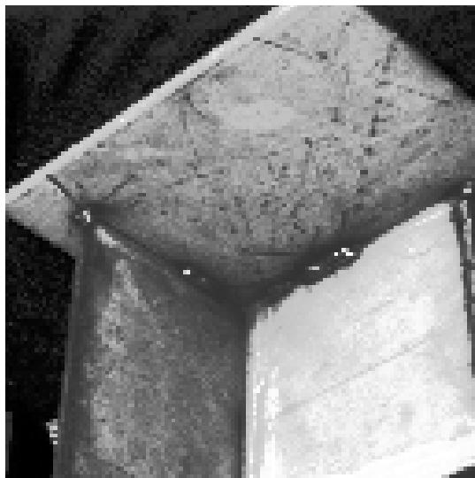  
Figure 1. Detail of a part to be welded.

• to define optimal image features for a given application or find adequate representations (C. Fermuller 1998);

• to specify goal image trajectories $s ^ { * } ( t )$ instead of goal positions (Martinet et al 1997). The idea is based on the fact that the transient trajectories are not predictible since the initial errors are large. Following a feasible output trajectory with small errors is a way of being sure to stay in a true regulation framework with better properties;

• to use dynamical information (Cretual and´ Chaumette 1997; Sundareswaran et al 1994);

• to combine specifications in 2D and 3D (Malis et al 1999) or other spaces (Deguchi and Noguchi 1996). We will see that the approach we propose fall in this category.

2. A second issue in the area was soon recognized as of critical importance: the study of the variation of $y .$ If we denote as r¯ an element of $S E ( 3 )$ , and recalling that q is the parametrization of the space of actuation, we have

$$
\frac { \partial y } { \partial q } = \frac { \partial y } { \partial s } \frac { \partial s } { \partial \bar { r } } \frac { \partial \bar { r } } { \partial q }\tag{1}
$$

and the usual question is: what do we know about this expression? Note that the more relevant question, what do we really need to know, is in fact related to robustness of the control. The last term refers to the physical system and its knowledge involves robot calibration aspects. It should be ignored if the control is defined only as the desired velocity screw of the camera frame. The first term is supposed to involve analytic transformations from the image space to the output space, which are user-defined and in principle liable to be properly specified. The main concern lies in the expression $\overline { { \frac { \partial s } { \partial \bar { r } } } }$ called feature Jacobian, interaction matrix or image jacobian. Since this matrix, denoted as $L ,$ results from the differentiation of a mapping from $S E ( 3 )$ to some subset of $R ^ { n }$ , each of its columns is an element of the cotangent space of $S E ( 3 )$ , in other terms a screw. It can therefore be systematically expressed in various frames using an adjoint operator. As shown in (Espiau et al 1992a), where a general method of computation was proposed, it is also in general an explicit function of image measurements, camera calibration parameters and euclidean features. Since it is rarely possible to capture all the theoretically involved variables, a great effort has been put for finding approximate expressions, Lˆ: off-line estimation by learning the matrix entries in suitable regions of the workspace (Hosoda et al 1995; Jagersand and Nelson¨ 1996; Deguchi and Noguchi 1996; Sutanto et al 1998); on-line identification of some constant parameters related to the calibration (Kinoshita and Deguchi 1994); use of the value of L computed at the goal position, etc... Besides, the euclidean variables are set to “reasonnable” estimated values.

3. The third research direction is closely related to the previous one. Indeed, when the system is controlled through a feedback loop, the positioning accuracy mainly depends on the capacity of the proportional gain to compensate for sources of steady-state errors, like unmodelled potential-based terms, friction forces or unknown autonomous feature motion. Besides, the effect of the more or less good knowledge of L concerns the transient stage: rate of convergence and decoupling. In fact, intuitively speaking, stability is ensured if Lˆ is such that the generated motion has a component in the direction of the goal. This refers to robustness issues, which were implicitly the main concerns of researchers from the automatic control side in visual servoing†: study of the sensitivity to calibration errors (Espiau 1993; Miyazaki and Masutani 1991), H-infinity control, adaptive control, besides more classical approaches like LQ optimal synthesis (Hashimoto et al 1996).

Finally, up to the nineties, and but a few exceptions, works in visual servoing were mainly characterized by:

1. the use of a single camera linked to the controlled moving system;

2. an approach of the problem focused on automatic control aspects and based on simple task definition ;

3. a system calibration assumed to be good enough to avoid disturbing the control too much;

4. the absence of a geometrical analysis deep enough to exploit the specificity of the domain.

This point of view culminated with the 1992 synthesis paper (Espiau et al 1992a). In the meantime, very relevant progresses in understanding the geometry of vision began to inseminate the community. The use of projective and affine geometry began to appear rich of potentialities in visual servoing, mainly because it allows to relax in some sense the problem of calibration and to obtain easily nonmetric or quasi-metric information very useful in all the three previously described issues.

Since 1993, more and more papers began to incorporate these new approaches (see for example (Hollinghurst and Cipolla 1994; Grosso et al 1995; Joshi and Sanderson 1996; Hosoda et al 1995; Hager et al 1995; Maru et al 1993; Soatto and Perona 1994; Hager 1997; Horaud et al 1998) for stereovision).

## 1.2 Geometry as a Central Issue in Visual Servoing

But we can find also in the literature recent works where a single camera is used, either in an eye-in-hand approach (Yoshimi and Allen 1995; Spratling and Cipolla 1996; Cross and Cipolla 1996; Colombo et al 1995; Malis et al 1999) or as a global scene sensor (Ghosh et al 1996). Affine geometry is used in (Cross and Cipolla 1996; Colombo et al 1995) and (Spratling and Cipolla 1996) considers a weak perspective model. In (Malis et al 1999), a partial pose computation allows the authors to propose a control scheme mixing image features and quasi-geometric issues. It should be noticed that, like in the case of stereovision, sensitivity to calibration uncertainties is here also a major concern. Many of the cited references claim their robustness, obtained either by using a few specific motions for self-calibration (Spratling and Cipolla 1996; Cross and Cipolla 1996) or intrinsically, in general implicitly thanks to the use of some geometric properties (Malis et al 1999; Yoshimi and Allen 1995)). Clearly, we can understand this need for considering explicitely geometrical aspects from the following facts:

1. when using camera(s), the process for obtaining the data used in the feedback involves always a projective transformation which confers particular characteristics to the models;

2. the efficiency of control loops is often better if some information about the euclidean space can be recovered from image data, which requires dedicated geometrical methods like reconstruction or pose estimation;

3. as soon as we use structures richest than simple points, features in the image result from 3D entities which belong to particular manifolds. The choice of the parametrization of these manifolds (and of the projected structures) strongly influences the design of the control law. Among the expected benefits are the better decoupling, the easier design and stability analysis of the control.

## 1.3 Motivation of this Work

The present paper is mainly concerned with this last aspect, and more precisely with the use of lines. At the origin of the problem is the fact that when dealing with industrial parts, the extraction and the tracking of lines is natural and, now, feasible in real time thanks to new efficient algorithms from computer vision (Lowe 1991; Marchand et al 1999; Tonko and Nagel 2000; Armstrong and Zisserman 1995; Drummond and Cipolla 200). Nevertheless, only a few works have really explored the use of lines in visual servoing: (Rives and Espiau 1987; Espiau et al 1992a; Motyl 1992; Debain 1996; Hager 1997) are examples we find in robotics. Tracking of lines was also considered for the automatic road following of autonomous vehicles, like in (Lutzeler and¨ Dickmanns 1998), but without deriving generic approaches.

As explained in section 4, the experimental setup we considered in the framework of the european project VIGOR was a ship part provided by the Odense Steel Shipyard in Denmark for which it was required to accurately position a welding tool. Several intersecting planes were present in the part, making the extraction of lines easier than that of points. The question which rapidly occured was then: what representation for these lines?

Coming back to geometrical aspects, it should be recalled that the 3D Euclidean lines form a 4-dimensional manifold the properties of which are described by the Grassman’s geometry. One of the most noticeable property is the absence of a natural (Riemanian) distance. Since such a distance is somewhere needed for defining a feedback control, the choice of the parametrisation is crucial. Among the classical ones, the Plucker coordinates look particularly interesting¨ since they come from the embedding of the line manifold in a projective space in which things are linear. More, recalling that the camera transformation is also projective, we understand intuitively that some nice properties could be expected. In this framework, the main original contributions of the paper are the following. First, we propose and discuss a restriction on classical Plucker coordinates, which looks very¨ pertinent in visual servoing. Secondly, we design a control law on this submanifold and prove its stability. Then we apply the method to an orthogonal trihedron, and extend it to a control scheme including a laser beam.

• Vectors are denoted with lower case upright bold letters (e.g.u). Unit vectors are denoted as underlined vectors (e.g. u).

• Points in the 3D space are written with upper case bold letters (P) while points in the image are written with lower-case bold characters (p).

• 3D Lines are noted with calligraphic upper case letters (e.g. L) and image lines with calligraphic lower case letters (e.g. ℓ).

• Angular velocity is written Ω and linear velocity V.

• The scalar product is noted with the transpose formalism (e.g. aT b) and the cross product of a by b is written a × b.

• The notation ∗ (e.g. u∗) denotes a desired value and the notation $( t = 0 ) \ ( \mathbf { e . g . \ } \underline { { \mathbf { u } } } ( t = 0 ) )$ represents an initial value.

Table 1. Notations used in this paper

## 2 Line parameterization

## 2.1 Binormalized Plucker coordinates¨

2.1.1 Recalls on Plucker coordinates¨ In (Plucker¨ 1865), Plucker derived 8 kinds of coordinates for a line in space¨ (or 3D line) from the equations, in the projective space $\mathcal { P } ^ { 3 }$ , of two intersecting planes. Among these 8 kinds of coordinates, the so-called Plucker coordinates are defined as¨ follows (Bottema and Roth 1979; Faugeras 1993; Semple and Kneebone 1952).

Consider any two points, in the projective space, $P =$ $( x _ { 1 } , x _ { 2 } , x _ { 3 } , x _ { 4 } )$ and $\bar { P ^ { \prime } } = ( x _ { 1 } ^ { \prime } , x _ { 2 } ^ { \prime } , x _ { 3 } ^ { \prime } , x _ { 4 } ^ { \prime } )$ a the 3D line $( \mathcal { L } )$ The latter is uniquely defined by these two points. However, this representation is far from being minimal since it makes use of 8 values to parameterize the 4-dimensional manifold of lines.

To reduce the amount of parameters, one considers the 12 $( 2 \times 2 )$ minors of the matrix $\left( \begin{array} { l } { x _ { 1 } \ x _ { 2 } \ x _ { 3 } \ x _ { 4 } } \\ { x _ { 1 } ^ { \prime } \ x _ { 2 } ^ { \prime } \ x _ { 3 } ^ { \prime } \ x _ { 4 } ^ { \prime } } \end{array} \right)$ . Six of them can be chosen independent. Moreover, they are unique up to a single scale factor for every choice of the two points $P$ and P′(Faugeras 1993, p24).

Thus, the projective Plucker coordinates are defined by:¨

$$
{ \mathcal { L } } = { \binom { \mathbf { u } } { \mathbf { v } } } \quad w i t h \quad { \mathbf { u } } = ( p _ { 4 1 } , p _ { 4 2 } , p _ { 4 3 } ) ^ { T } \quad p _ { i j } = x _ { i } x _ { j } ^ { \prime } - x _ { i } ^ { \prime } x _ { j }\tag{2}
$$

Notice that this is a bivector as McCarthy defined it(MacCarthy 1990) to represent kinematic screws. Consequently, as for se(3)(Murray et al 1994, p. 427), there does not exist a bi-invariant Riemannian metric on the manifold of 3D lines.

One recognizes in u the first 3 coefficients of the 4-vector $x _ { 4 } P ^ { \prime } - x _ { 4 } ^ { \prime } P$ , the fourth one being zero. It is a classical result in projective geometry that this 4-vector is the point on $( \mathcal { L } )$ which lies at the infinite, and thus represents its direction. Hence, u corresponds to the direction of (L).

The 6 homogeneous coordinates in (2) define a point, sometimes called the Plucker point¨ (Goodman and O’Rourke 1997), in the 5 dimensional projective space. Consequently, 5 of these coordinates are independent. Hence, one extra relation is needed to turn down to the 4-dimensional manifold of lines. The usual extra relation expresses that a line intersects itself.

Consider two lines $( \mathcal { L } _ { 1 } )$ and $( \mathcal { L } _ { 2 } )$ respectively defined by the pairs of points $( P , P ^ { \prime } )$ and $( Q , Q ^ { \prime } ) . \ ( { \mathcal { L } } _ { 1 } )$ and $( \mathcal { L } _ { 2 } )$ intersect if $P , P ^ { \prime } , Q$ and $Q ^ { \prime }$ are coplanar:

$$
\left| { \begin{array} { c c c c } { x _ { 1 } } & { x _ { 2 } } & { x _ { 3 } } & { x _ { 4 } } \\ { x _ { 1 } ^ { \prime } } & { x _ { 2 } ^ { \prime } } & { x _ { 3 } ^ { \prime } } & { x _ { 4 } ^ { \prime } } \\ { y _ { 1 } } & { y _ { 2 } } & { y _ { 3 } } & { y _ { 4 } } \\ { y _ { 1 } ^ { \prime } } & { y _ { 2 } ^ { \prime } } & { y _ { 3 } ^ { \prime } } & { y _ { 4 } ^ { \prime } } \end{array} } \right| = 0
$$

Expanding this determinant, called Grassmannian, one obtains:

$$
p _ { 4 1 } q _ { 2 3 } + p _ { 4 2 } q _ { 3 1 } + p _ { 4 3 } q _ { 1 2 } + p _ { 2 3 } q _ { 4 1 } + p _ { 3 1 } q _ { 4 2 } + p _ { 1 2 } q _ { 4 3 } = 0
$$

or, with our notations:

(3)

$$
\mathbf { u } _ { 1 } ^ { T } \mathbf { v } _ { 2 } + \mathbf { u } _ { 2 } ^ { T } \mathbf { v } _ { 3 } = 0\tag{4}
$$

The missing relation is thus:

$$
\mathbf { u } ^ { T } \mathbf { v } = 0\tag{5}
$$

which defines a 4-dimensional manifold of $\mathcal { P } ^ { 5 }$ , called the Klein quadric(Pottmann et al 1998) or the Plucker¨ hypersurface(Chazelle et al 1996). Thus, any point on this quadric corresponds to a projective line in the physical world and reciprocally. This correspondence is unique if the lines and the projective space are given an orientation, as suggested by Stolfi(Stolfi 1991).

As for points, the upgrade from projective to Euclidean coordinates of a 3D line is obtained by normalization. Thus, the Euclidean Plucker coordinates of a 3¨ D line can be seen as normalized Plucker coordinates¨ (Pottmann et al 1998). The normalization which is commonly chosen is that u should be a unit vector. Therefore, the normalized Plucker coordinates¨ of a 3D line defined by the (projective) Plucker coordinates¨ $( \mathbf { u } , \mathbf { v } )$ are:

$$
\mathcal { L } = ( \underline { { \mathbf { u } } } , \mathbf { h } )
$$

$$
\underline { { \mathbf { u } } } ^ { T } \mathbf { h } = 0\tag{6}
$$

$$
\underline { { \mathbf { u } } } ^ { T } \underline { { \mathbf { u } } } = 1\tag{7}
$$

(8)

where $\underline { { \mathbf { u } } } = \mathbf { u } / \lVert \mathbf { u } \rVert$ and $\mathbf { h } = \mathbf { v } / \lVert \mathbf { u } \rVert$ . It can easily be shown that, given any 3D point $P$ on (L), one has:

$$
\mathbf { h } = { \cal P } \times \underline { { \mathbf { u } } }\tag{9}
$$

Consequently, the following equivalence holds:

$$
\mathbf { h } = 0 \Leftrightarrow ( \mathcal { L } ) p a s s e s t h r o u g h t h e o r i g i n\tag{10}
$$

Working assumption – Since the case where a line passes through the center of projection is degenerate in computer vision, we will assume in the remainder of this paper that it never occurs.

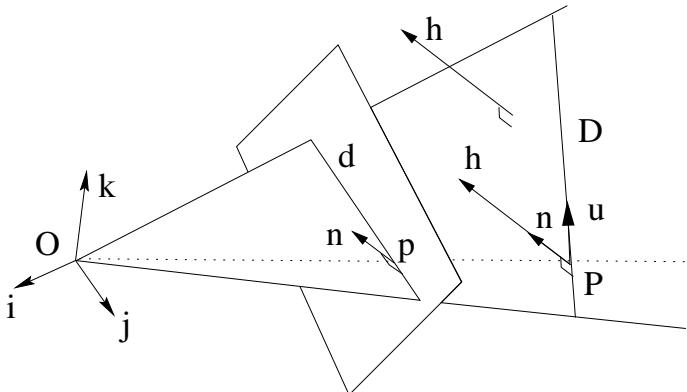  
Figure 2. Geometric interpretation of the normalized Plucker¨ coordinates of a line.

Geometric interpretation In the computer vision community, the geometrical interpretation of the normalized Plucker¨ coordinates is the following (see Figure 2): (L) is the line oriented by the unit vector u and passing through $H =$ $\underline { { \mathbf { u } } } \times \mathbf { h }$ , which is the closest point to the origin on (L)(Navab 1993a). It can also be noticed from (9) that h is orthogonal to the plane passing through the origin and containing $( \mathcal { L } )$ This plane also contains the projection (ℓ) of $( \mathcal { L } )$ onto the image plane and is referred to as the interpretation plane of (ℓ). As the interpretation plane passes through the origin, it is defined by:

$$
a x + b y + c z = 0\tag{11}
$$

Considering any point in the interpretation plane, such that its z coordinate is not zero, one can rewrite the previous equation as:

$$
a { \frac { x } { z } } + b { \frac { y } { z } } + c = 0\tag{12}
$$

where we recognize the equation of a line in the image plane. This line is thus the intersection of the image plane and the interpretation plane, hence (ℓ).

Therefore, (ℓ) is uniquely defined by the interpretation plane, hence by its unit normal vector $\underline { { \mathbf { h } } } = \mathbf { h } / h$ where $h =$ ∥h∥. Consequently, the normalized Plucker coordinates of a¨ line (L) can be expressed as:

$$
{ \mathcal { L } } = \left( { \underline { { \mathbf { u } } } } , h { \underline { { \mathbf { h } } } } \right)\tag{13}
$$

with the following constraints:

$$
\underline { { \mathbf { u } } } ^ { T } \underline { { \mathbf { h } } } = 0\tag{14}
$$

$$
\underline { { \mathbf { u } } } ^ { T } \underline { { \mathbf { u } } } = \underline { { \mathbf { h } } } ^ { T } \underline { { \mathbf { h } } } = 1\tag{15}
$$

Since the projection (ℓ) of $( \mathcal { L } )$ onto the image defines the interpretation plane, it has for coordinates those of the normal 3-vector to this plane:

$$
\ell = \underline { { \mathbf { h } } }\tag{16}
$$

## 2.1.2 Binormalized Plucker coordinates¨

Line parameterization From the previous section, we are now ready to define the binormalized Plucker coordinates, as¨ a way to parameterize 3D lines, and to give some properties of these coordinates.

Definition 1. The binormalized Plucker coordinates of the¨ pencil of all the 3D lines oriented by the unit vector u and lying in the plane of unit normal vector h are the couple (u, h) where

$$
\underline { { \mathbf { u } } } ^ { T } \underline { { \mathbf { h } } } = 0\tag{17}
$$

$$
\underline { { \mathbf { u } } } ^ { T } \underline { { \mathbf { u } } } = \underline { { \mathbf { h } } } ^ { T } \underline { { \mathbf { h } } } = 1\tag{18}
$$

By extension, we will call binormalized Plucker coordi-¨ nates of a 3D line the binormalized Plucker coordinates of the¨ pencil it defines. With this definition, we can trivially state the following proposition:

Proposition 1. 3D line representation. A 3D line (L) is uniquely defined by its binormalized Plucker coordinates¨ (u, h) and its depth h:

$$
\mathscr { L } = \left( \frac { \mathbf { h } } { \mathbf { u } } \right)\tag{19}
$$

Notice that, as we consider (L) lying in a pencil of parallel lines, h is not only a distance but also becomes a depth.

Geometrical interpretation Our representation yields a sequential interpretation (Figure 3): (L) is the line in the interpretation plane of (ℓ) (defined by its normal vector h) with orientation u and lying at depth h. This interpretation corresponds to the usual sequence followed in image analysis to determine a 3D line from one or several images: extraction of (ℓ) from the image, then computation of the orientation of (L), and finally, computation of the 3D position of (L).

Before going further let us notice that from the definition of the binormalized Plucker coordinates, we can make the¨ following two remarks:

Remark 1. The triple $( { \underline { { \mathbf { u } } } } , { \underline { { \mathbf { h } } } } , { \underline { { \mathbf { u } } } } \times { \underline { { \mathbf { h } } } } )$ forms an orthonormal basis ofthe 3D space.

Remark 2. Let H be the closest point to the origin n a line $\mathcal { L } = ( \underline { { \mathbf { h } } } ^ { T } , \underline { { \mathbf { u } } } ^ { T } , h )$ . Then, $H = h \underline { { \mathbf { u } } } \times \underline { { \mathbf { h } } }$

Finally, representing lines with binormalized Plucker¨ coordinates and depth allows to generate some well-known geometrical objects from lines, by fixing one or several components to a given value. For instance, the lines with a given depth h generates a sphere of radius h. Figure 4 gathers the other cases.

2.1.3 Image alignment of a 3D line Among the previous cases, we are interested in those where the image projection h is given. Indeed, visual servoing consists in defining the goal position of a moving system by an image, in our case, by the projection of a set of lines into the image. On the opposite to the case where visual servoing is based on points, here we do not have a simple answer to the question: “What are the configurations in 3D space that give the same image $? ^ { \mathfrak { s } }$ As seen in Figure 4, there are four cases: only h is given; h and h are given; h and u are given; h, u and h are given. The first case corresponds to the requirement used by Chaumette et al(Chaumette 1990; Espiau et al 1992b; Motyl 1992; Debain 1996). The second and fourth ones are not very interesting since they require the estimation of the depth, always hard to accurately achieve.

On the opposite, the third case is highly interesting. The 3D line is constrained by its image projection and its alignment on a given direction. Hence, we call this the image alignment of a 3D line. It corresponds to fixing the binormalized Plucker coordinates of the 3¨ D line to a given value. As stated before, the only remaining degree of freedom is depth. Hence, this brings us back to the case of points, where the image of a point defines a 1-dimensional manifold in the 3D space.

In addition to this elegant similarity with the case of points, the image alignment matches the property of partial decoupling given below, which allows the definition of a control law with global convergence proof (see section 3).

2.1.4 Motion ofa line vs. motion ofthe camera Here, we relate the instantaneous camera motion to the 3D line motion (expressed in our formalism) and recall the apparent motion in the image of this line.

The instantaneous motion of a camera is defined by its velocity screw $\tau = ( V , \Omega )$ , where Ω is the instantaneous angular velocity and V the instantaneous linear velocity of a given point. They are usually expressed in the camera frame.

Let $L = ( \underline { { \mathbf { h } } } ^ { T } , \underline { { \mathbf { u } } } ^ { T } , h ) ^ { T }$ be a 3D line. Then its motion is the vector $( \underline { { \hat { \mathbf { h } } } } ^ { T } , \dot { \underline { { \mathbf { u } } } } ^ { T } , \dot { h } ) ^ { T }$ . Rives et al (Rives and Espiau 1987) recall the derivative (u˙ , h˙ ) of the normalized Plucker¨ coordinates (u, h) of a 3D line (20)–(21)

$$
\dot { \mathbf { u } } = \boldsymbol { \Omega } \times \underline { { \mathbf { u } } }
$$

$$
\dot { \mathbf { h } } = \Omega \times \mathbf { h } + V \times \mathbf { u }\tag{20}
$$

(21)

The null space of this mapping is given by

$$
\Omega _ { n s } = \lambda \mathbf { u }\tag{22}
$$

$$
V _ { n s } = \mu \underline { { { \bf u } } } + \lambda \mathbf { h }\tag{23}
$$

where $\mu$ and λ are real numbers.

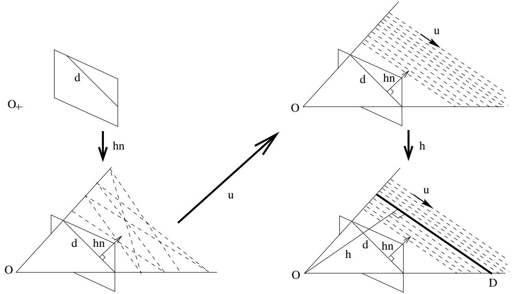  
Figure 3. The binormalized Plucker coordinates have a sequential interpretation: from image measurements to the estimation of¨ 3D components.

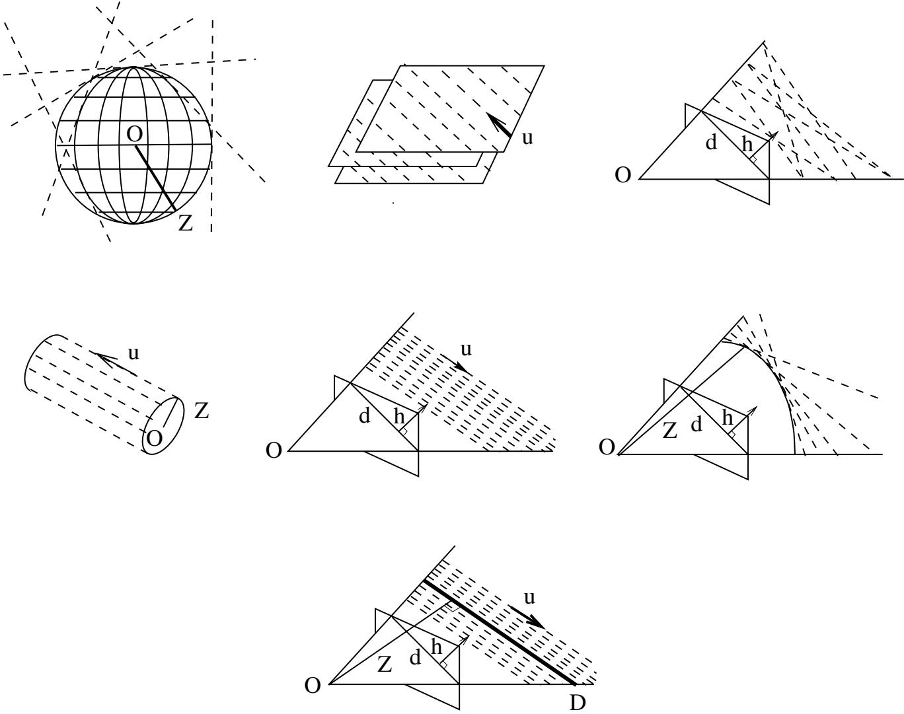  
Figure 4. Geometrical objects generated by lines with fixed components of their binormalized Plucker coordinates¨

From the definition of h, we have:

$$
{ \dot { h } } = { \frac { d } { d t } } ( { \sqrt { \mathbf { h } ^ { T } \mathbf { h } } } ) = { \frac { 1 } { h } } ( \mathbf { h } ^ { T } { \dot { \mathbf { h } } } ) = { \underline { { \mathbf { h } } } } ^ { T } { \dot { \mathbf { h } } }
$$

Then, inserting h˙ from (21) into (24) yields:

(24)

$$
{ \dot { h } } = \mathbf { \underline { { h } } } ^ { T } ( { \boldsymbol { \Omega } } \times \mathbf { h } + V \times \mathbf { \underline { { u } } } ) = { \boldsymbol { \Omega } } ^ { T } ( \mathbf { h } \times \mathbf { \underline { { h } } } ) + V ^ { T } ( \mathbf { \underline { { u } } } \times \mathbf { \underline { { h } } } )\tag{25}
$$

Since h $\mathbf { \nabla } \times \mathbf { \underline { { h } } } = 0$ , we finally obtain:

$$
{ \dot { h } } = V ^ { T } ( \underline { { \mathbf { u } } } \times \underline { { \mathbf { h } } } )\tag{26}
$$

Then, one can obtain $\underline { { \dot { \mathbf { h } } } } ,$ , which Navab (Navab 1993a) calls the line motion field equation. Indeed, it can be interpreted as the relation between the camera motion and the apparent motion of a 3D line in the image. It is obtained by:

$$
\underline { { \dot { \mathbf { h } } } } = \frac { d } { d t } ( \frac { \mathbf { h } } { h } ) = \frac { 1 } { h } \dot { \mathbf { h } } - \frac { \mathbf { h } } { h ^ { 2 } } \dot { h }\tag{27}
$$

Then, insert $\dot { h }$ from (25), h˙ from (21) and replace $\mathbf { h } / h$ by h whenever it is possible:

$$
\underline { { \dot { \mathbf { h } } } } = \frac { 1 } { h } ( \mathbf { I } _ { 3 } - \underline { { \mathbf { h } } } \mathbf { h } ^ { T } ) ( \boldsymbol { \Omega } \times \mathbf { h } + V \times \underline { { \mathbf { u } } } )\tag{28}
$$

which simplifies into

$$
\dot { \underline { { \mathbf { h } } } } = \boldsymbol { \Omega \times \underline { { \mathbf { h } } } } - \frac { V ^ { T } \underline { { \mathbf { h } } } } { h } ( \underline { { \mathbf { u } } } \times \underline { { \mathbf { h } } } )\tag{29}
$$

Finally, the Jacobian, or interaction matrix in the task function approach(Samson et al 1990; Espiau et al 1992b), associated to our parameterization is the matrix in:

$$
\left( \frac { \dot { \mathbf { h } } } { \dot { \mathbf { u } } } \right) = \left( \begin{array} { c c } { - \frac { 1 } { h } ( \underline { { \mathbf { u } } } \times \underline { { \mathbf { h } } } ) \underline { { \mathbf { h } } } ^ { T } } & { - A s ( \underline { { \mathbf { h } } } ) } \\ { \ \mathbf { 0 } _ { 3 \times 3 } } & { - A s ( \underline { { \mathbf { u } } } ) } \\ { ( \underline { { \mathbf { u } } } \times \underline { { \mathbf { h } } } ) ^ { T } } & { \ \mathbf { 0 } _ { 1 \times 3 } } \end{array} \right) \left( \begin{array} { c } { \mathbf { V } } \\ { \boldsymbol { \Omega } } \end{array} \right)\tag{30}
$$

exhibiting a partial decoupling between rotation and translation.

## 2.2 Discussion

The parameterization we propose, based on binormalized Plucker coordinates, has some advantages, from the control¨ point of view, over the parameterizations found in the litterature. Before we go on with the description of the drawbacks we found in other representations, let us recall these advantages:

• Our representation is continuous and covers the whole space, except the case of lines going through the optical center.

• It is coherent in the 3D space and the image.

• It is unique provided that some constraints, easy to satisfy, hold.

• It exhibits a partial decoupling between rotation and translation.

2.2.1 In the 3D space Apart from the Plucker coordinates,¨ one usually finds three other representations of a 3D line. All of them have their drawbacks.

1. A line is defined by a point and a direction.

The first drawback of this representation is that it requires to select a point on the 3D line. This is troublesome in the visual guidance framework since there may not be any distinguishable physical point on the line which is observed by the camera. Moreover, it turns down to extracting a point in the image, which is what we want to avoid by using lines.

Even though one could use points on the line, the choice of the point is not unique. Consequently, there may be some discrepancy between the point chosen to define the desired position of the line and the point chosen to define the current position of the same line. Even if the same point were used, this would require some matching process.

Finally, this representation is deconnected from what can be directly extracted from the image.

In fact, to make this representation point independent, or unique, or to relate it to the image, is to come back to Plucker coordinates. We remarked that Hager(¨ Hager 1997) represents lines with a point and a direction, but comes to the Plucker coordinates as soon as control is¨ involved.

2. A line is the intersection of two planes.

The main drawback is that this representation is implicit since it defines a line as the set of points verifying two plane equations:

$$
\left\{ { \begin{array} { l } { a _ { 1 } x + b _ { 1 } y + c _ { 1 } z + d _ { 1 } = 0 } \\ { a _ { 2 } x + b _ { 2 } y + c _ { 2 } z + d _ { 2 } = 0 } \end{array} } \right.
$$

Control is much easier with an explicit parameterization ! Nevertheless, Chaumette(Chaumette 1990; Espiau et al 1992b) used it, together with the $( \rho , \theta )$ representation of an image line (see below), but to the cost of motion equations with no specific structure. In particular, rotation and translation are highly coupled.

3. The $( a , b , p , q )$ representation(Faugeras 1993; Navab 1993b; Plucker¨ 1865)

This representation is a minimal variant of the previous one:

$$
\left\{ { x = a z + p } \right. 
$$

It represents the lines that are neither parallel to the optical axis, nor parallel to the image plane. To take into account all the lines in the 3D space, one has to make permutations over $x ,$ y and z. One thus obtains three overlapping but nevertheless discontinuous representations that gather all the lines in space. However, the discontinuity of the representation would require switches in the control law, that may have destabilizing effects or, at least lead to unacceptable transient behaviors.

2.2.2 In the image Consider a 3D line (L) with binormalized Plucker coordinates¨ $( \underline { { \mathbf { h } } } ^ { T } , \underline { { \mathbf { u } } } ^ { T } , h )$ and projecting into the image as the line (ℓ). Recall that we represent (ℓ) by the unit vector h. This corresponds to the normalization of the 3-vector containing the line equation coefficients $( a , b , c )$ in the 3D space.

We give now the other usual representations of a line and show why they are not as well suited to the visual servoing problem as the one we chose.

1. The unnormalized triple $( a , b , c )$ of its equation coefficients.

Let us discard it immediately since it is not uniquely defined for a given line, which is hard to handle from the control point of view.

2. The normalized triple ${ \bf d } = ( a , b , c ) = ( \cos \theta , \sin \theta , \rho )$ This parameterization is used in visual servoing by Hager(Hager 1997). It corresponds to the normalization of the line equation coefficients on a subspace of

dimension 2, i.e.

$$
\mathbf { d } ^ { T } \mathbf { N } \mathbf { d } = 1 w i t h \mathbf { N } = \left( { \begin{array} { c c c } { 1 } & { 0 } & { 0 } \\ { 0 } & { 1 } & { 0 } \\ { 0 } & { 0 } & { 0 } \end{array} } \right)\tag{31}
$$

Hence,

$$
\mathbf { d } = { \frac { \mathbf { h } } { \sqrt { \mathbf { h } ^ { T } \mathbf { N } \mathbf { h } } } }\tag{32}
$$

The first drawback of this parameterization is that d is not a unit vector in the 3D space since its norm equals $\sqrt { 1 + \rho ^ { 2 } }$ . Consequently, one does not have the opportunity to later build upon it an orthonormal basis as we did (Remark 1). This results in an heterogeneity between image and space parameterizations, especially as far as metric information is concerned. Indeed, if one can, in some way, obtain the orthogonal distance z of the line to the origin, then, one has to perform an “unnormalization” in order to reconstruct the point of the line H which is the closest to the origin:

$$
H = { \frac { z } { \left\| \mathbf { d } \right\| } } \mathbf { \underline { { u } } } \times \mathbf { d }
$$

Moreover, the unnormalization factor is not constant but depends on the projection of the line onto the image. On the opposite, with our parameterization, we can immediately, and independently from the image information, obtain H since, from Remark 2,

$$
H = z { \underline { { \mathbf { u } } } } \times { \underline { { \mathbf { h } } } }
$$

A second drawback is that the consequent motion line equation is more complex than ours. Indeed, rewriting the Jacobian associated with this parameterization with our notation, one obtains the following motion line equation instead of (28):

$$
\dot { \mathbf { d } } = \frac { 1 } { d } ( \mathbf { I } _ { 3 } - \mathbf { d d } ^ { T } \mathbf { N } ) ( \boldsymbol { \Omega } \times \mathbf { h } + V \times \underline { { \mathbf { u } } } )
$$

where $d = \sqrt { \mathbf { h } ^ { T } \mathbf { N } \mathbf { h } }$ . Thus, the presence of N does not allow such a simplification of this expression as from (28) to (29). In particular, the term $\mathbf { d } ^ { \hat { T } } \mathbf { N } ( \Omega \times \mathbf { h } )$ does not vanish, preventing from expressing the rotation effects in the image as a simple cross-product.

3. The minimal representation $( \rho , \theta )$

This representation is the other representation used in visual servoing(Chaumette 1990; Espiau et al 1992b; Motyl 1992; Debain 1996). It has the advantage of being minimal. However, it is periodic. Thus, the angle θ is defined either in $( - \pi , \pi ]$ or in $[ 0 , 2 \pi )$ . This is troublesome in two ways.

Firstly, the choice of the definition interval of $\theta$ is not generic. It depends indeed of initial $( \theta _ { 0 } )$ and desired $( \theta ^ { * } )$ values of θ. Take two examples (Figure 5). When $\theta _ { 0 } > 0$ and $\theta ^ { * } < 0$ are close to 0, it is clear that one should chose $\theta \in ( - \pi , \pi ]$ , otherwise it would travel almost the whole unit circle. On the opposite, when $\theta _ { 0 }$ and $\theta ^ { * }$ are close to π, the choice is trivially $\theta \in [ 0 , 2 \pi )$ This ad hoc choice does not prevent from the second drawback of this representation: it restricts the variations of θ. Indeed, if the line in the image rotates too much, then θ may reach one of its bounds or, even worse, go beyond it. Then, it should have to switch to the other bound. This, in turn, would generate a discontinuity in the control law.

## 3 Control

## 3.1 Introduction

Let us consider a fixed reference frame $F _ { r }$ and a moving object with associated frame $F _ { 0 }$ (here the camera frame). We define a goal frame $F ^ { * }$ in $F _ { r }$ and the control problem we consider is to drive $F _ { 0 }$ from its initial value $F _ { 0 } ( 0 )$ to $F ^ { * }$ in a stable way from image information. If the controlled variables are a parametrization of the euclidean transformation (pose) between $F _ { 0 } ( t )$ and $F ^ { * }$ , the control is called 3D visual servoing. When using a rigid set of n 3D lines $( \mathcal { L } _ { i } )$ , this requires to use a dedicated pose computation method, like in (Dhome et al 1989; Chen 1991). On the contrary, when using only an image-based parametrization of the projected lines, as done in (Chaumette 1990), we fall in the category of 2D visual servoing. The first approach allows to accurately control the trajectories in space, making for example easy the avoidance of obstacles. However, this may lead to loosing the features in the image. Moreover, the analysis of the control performances is uneasy because of the insertion of the pose computation algorithm in the loop. The pure 2D control scheme has of course opposite characteristics and may further exhibit singularities. In order to overcome these drawbacks, the method we propose is a combination of the two approaches, which could be called 2D 1/2 visual line servoing. Indeed, for every line, the representation we use allows to extract directly 2 parameters from the image, i.e. h, the normal to the interpretation plane. The remaining 2 parameters may be considered as 3D ones: the depth h and the last component of u. We will see later how to take them into account. Finally, our goal will therefore be defined as the set $\{ \underline { { \mathbf { u } } } _ { i } ^ { * } , \underline { { \mathbf { h } } } _ { i } ^ { * } , h _ { i } ^ { * } ~ ; ~ i = 1 \ldots n \}$

We will firstly demonstrate the principle of the control scheme we propose by using a single line. We will then consider the more general case of the n lines as just defined, and finally focus on the particular situation of the orthogonal trihedron. Before, let us set the assumptions which will be used in all the following.

• The set of goal lines $\mathcal { L } _ { i } ^ { * }$ corresponds to a fixed achievable configuration of the system (i.e. the displacement between the current position and the goal one is a rigid motion).

• All 3D trajectories of the camera which are needed are feasible (no obstacles, no joint limits neither geometrical singularities are reached by the device which moves the camera).

• During all the motion, no line $( \mathcal { L } _ { i } )$ goes through the optical center of the camera.

• The camera is fully calibrated.

• All the needed variables but the depth are exactly known or measured.

• The velocity screw (Ω, V) of the camera is the control variable (i.e. dynamical effects are neglected).

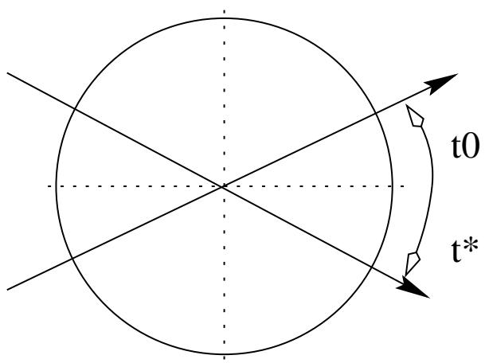  
Figure 5. Two different choices for the definition interval of θ

## 3.2 The Example ofa Single Line

Let us consider a single target line specified by the set $\{ \underline { { \mathbf { u } } } ^ { * } , \underline { { \mathbf { h } } } ^ { * } , h ^ { * } \}$ and forget for the moment the depth h. The state equations of this subsystem are given by eqs (20) and (29) only. We may remark that the orientation part is independent from the translation part, which allows to consider that this system is in cascaded form. Since the manifold of lines does not exhibit natural metric we have to define convenient errors. By exploiting the above mentioned partial decoupling, we set

$$
\mathbf { e _ { u } } = \underline { { \mathbf { u } } } \times \underline { { \mathbf { u } } } ^ { * }\tag{33}
$$

and

$$
{ \bf e _ { h } } = { \bf \underline { { u } } } \times ( { \bf \underline { { h } } } - { \bf \underline { { h } } } ^ { * } )\tag{34}
$$

We can therefore set the following cascaded control:

$$
\left\{ \begin{array} { l l } { \Omega = \mu _ { u } \mathbf { e _ { u } } } \\ { V = - \mu _ { h } \mathbf { e _ { h } } \vert _ { \Omega = \mathbf { 0 } ; \underline { { \mathbf { u } } } = \underline { { \mathbf { u } } } ^ { * } } } \end{array} \right.\tag{35}
$$

where $\mu _ { u } > 0 , \mu _ { h } > 0$ . Remarks:

1. $\mathbf { e _ { u } }$ is the classical error on the sphere; it allows to move on a geodesics.

2. $\mathbf { e _ { h } }$ is a better choice than simply $\left( \underline { { \mathbf { h } } } - \underline { { \mathbf { h } } } ^ { * } \right)$ since it can be shown that it ensures that h $\times \mathbf { \mu _ { h } } ^ { * }$ is minimum even if Ω vanishes without the right equilibrium reached $( \underline { { \mathbf { u } } } _ { e q } \neq \underline { { \mathbf { u } } } ^ { * } )$ (see (Andreff 1999)). Moreover, since h is a unit vector, it is constrained to move on a sphere. Thus, $\mathbf { e _ { h } }$ allows to move on this sphere using translational degrees of freedom only (figure 6).

3. The evolution equation of (29) under the control (35) is:

$$
\dot { \mathbf { \underline { { h } } } } = \frac { \mu _ { h } } { h } \mathbf { e _ { h } } ^ { T } \mathbf { \underline { { h } } } ( \mathbf { \underline { { u } } } \times \mathbf { \underline { { h } } } )\tag{36}
$$

This shows that the unknown depth‡, h, acts only as a variable unknown positive gain, which has no consequence on the stability in continuous time.

4. Since we don’t consider h, the null space of the system is 3-dimensional. Instead of (22), (23), it is given by

$$
\Omega _ { n s } = \lambda \underline { { \mathbf { u } } }\tag{37}
$$

$$
V _ { n s } = \mu \underline { { \mathbf { u } } } + \lambda h \underline { { \mathbf { h } } } + \nu ( \underline { { \mathbf { u } } } \times \underline { { \mathbf { h } } } )\tag{38}
$$

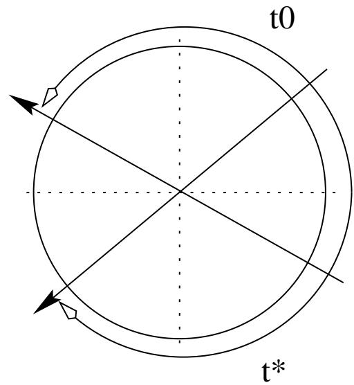

where $\mu , \lambda$ and ν are real numbers. Any motion within this subspace will not affect the stabilization.

Considering the latter remark, we notice that the translation control in (35) may have components in the two dimensions of the null space $( \mu , \nu )$ that are independent from the rotation control. These motions are useless disturbances unless they are used for complementary tasks (see section 4.2). It is therefore pertinent to project the linear velocity on the only relevant component, i.e. h when $\Omega = 0$ . Hence, we obtain the final cascaded control for one line:

$$
\left\{ \begin{array} { l l } { \Omega = \mu _ { u } \mathbf { e _ { u } } } \\ { V = - \mu _ { h } \epsilon _ { h } \underline { { \mathbf { h } } } | _ { \Omega = 0 ; \underline { { \mathbf { u } } } = \underline { { \mathbf { u } } } ^ { * } } } \end{array} \right.\tag{39}
$$

where ${ \boldsymbol { \epsilon } } _ { h } = ( \underline { { \mathbf { u } } } \times \underline { { \mathbf { h } } } ) ^ { T } \underline { { \mathbf { h } } } ^ { * } , \mu _ { u } > 0 , \mu _ { h } > 0$ . We have the following result:

Proposition 2. The control (39) is such that:

$l - i f \underline { { \mathbf { u } } } ( t = 0 ) \neq - \underline { { \mathbf { u } } } ^ { * }$ , then u(t) asymptotically converges to $\mathbf { u } ^ { * } ,$

$\begin{array} { l } { { 2 \cdot \ i f \ \underline { { { \bf h } } } ( t = 0 | \underline { { { \boldsymbol \Omega } } } _ { = 0 ; \underline { { { \bf u } } } = \underline { { { \bf u } } } ^ { * } } ) \not = - \underline { { { \bf h } } } ^ { * } } } \\ { { c o n \nu e r g e s \ t o \underline { { { \bf h } } } ^ { * } . } } \end{array}$ , then h(t) asymptotically

The proof is easy (see (Andreff 1999)) using $\frac { 1 } { 2 } | | \underline { { \mathbf { u } } } - \underline { { \mathbf { u } } } ^ { * } | | ^ { 2 }$ and $\frac { 1 } { 2 } | | \underline { { \mathbf { h } } } - \underline { { \mathbf { h } } } ^ { * } | | ^ { 2 }$ as Lyapunov functions respectively.

In practice, the stabilization in orientation can be considered as “sufficiently” achieved after a finite time $T _ { \Omega }$ The translation control then writes as

$$
V = - \mu _ { h } s ( t - T _ { \Omega } ) \epsilon _ { h } \mathbf { \mathbf { \mathbf { \mathbf { h } } } }\tag{40}
$$

where $s ( t )$ is the Heaviside step function, and the convergence condition becomes $\underline { { \mathbf { h } } } ( t = T _ { \Omega } ) \neq - \underline { { \mathbf { h } } } ^ { * }$ . Further remarks:

1. In practice, the two control vectors may not be fully cascaded: the control in orientation should be activated all the time, because of unmodelled coupling effects between translational and rotational motions; the control in translation can be progressively activated using a transition function smoother than the step one, in order to avoid unexpected large motions. This is the reason why we wrote u instead of $\underline { { \mathbf { u } } } ^ { * }$ in the proposition.

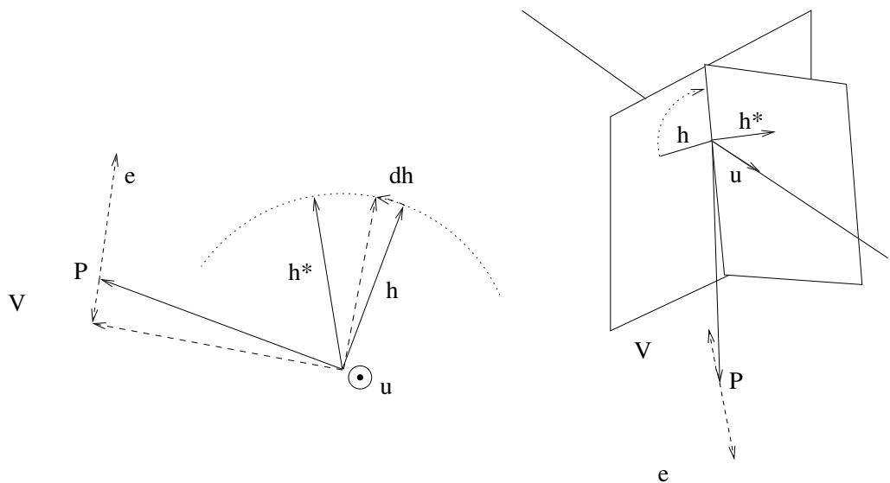  
Figure 6. The action of the translation contro $\mathbf { V } = - \mu _ { h } \underline { { \mathbf { u } } } \times \left( \underline { { \mathbf { h } } } - \underline { { \mathbf { h } } } ^ { * } \right)$ : in the case where $\underline { { \mathbf { u } } } = \underline { { \mathbf { u } } } ^ { * }$ (left) and in the general case (right).

2. The forbidden initial conditions in the proposition are unstable equilibriums. They are easy to avoid.

## 3.3 General Case

We now consider the case of a set of $n > 1$ distinct lines, rigidly linked, and for the moment we do not assume further properties on their configuration. Let us recall that the equations of their motion are, for $i = 1 \dots n \colon$

$$
\underline { { \dot { \mathbf { u } } } } _ { i } = \boldsymbol { \Omega } \times \underline { { \mathbf { u } } } _ { i }\tag{41}
$$

$$
\dot { \underline { { \mathbf { h } } } _ { i } } = \boldsymbol { \Omega \times \underline { { \mathbf { h } } } _ { i } } - \frac { V ^ { T } \underline { { \mathbf { h } } } _ { i } } { h _ { i } } ( \underline { { \mathbf { u } } } _ { i } \times \underline { { \mathbf { h } } } _ { i } )\tag{42}
$$

Again, we left the $h _ { i } \ ' \mathbf { s } ,$ the dynamics of which are given by eq (29), free to evolve. Like previously, we define an ideal cascaded control, allowing us therefore to split it in two parts: the rotational, then the translational, provided that the former is stabilized.

3.3.1 Control in Rotation It is a straightforward generalization of the single line case which results in

$$
\begin{array} { l } { { \bf { \cal { T h e o r e m 1 . } } } \ ( p r o o f i n a p p e n d i x A . l ) } \\ { { \cal { I f } } \underline { { { \bf { u } } } } _ { i } ( t = 0 ) \neq - \underline { { { \bf { u } } } } _ { i } ^ { * } , \ \forall i = 1 \dots n , } \\ { { \cal { T h e n } } , t h e c o n t r o l } \end{array}
$$

$$
\Omega = \mu _ { u } \sum _ { i = 1 } ^ { n } \mathbf { \underline { { u } } } _ { i } \times \mathbf { \underline { { u } } } _ { i } ^ { * } , \mu _ { u } > 0\tag{43}
$$

asymptotically stabilizes the equilibrium of the system $( 4 I ) ,$ $i = 1 \ldots n \colon$

$$
\underline { { \mathbf { u } } } _ { i } = \underline { { \mathbf { u } } } _ { i } ^ { * } , ~ i = 1 \dots n\tag{44}
$$

3.3.2 Control in Translation The translational control presented for a single line can be generalized in a similar way. The following result holds:

Theorem 2. (proof in appendix A.2)

If for all $i = 1 . . n ,$ , the vectors $\underline { { \mathbf { u } } } _ { i }$ are constant (but not necessarily equal to the vectors $\underline { { \mathbf { u } } } _ { i } ^ { * } )$

Then:

1. the control

$$
V = - \mu _ { h } \sum _ { i = 1 } ^ { n } \mathbf { B } _ { i } \epsilon _ { i } \mathbf { \underline { { h } } } _ { i } \mid _ { \Omega = 0 ; \mathbf { \underline { { u } } } _ { i } = \mathbf { \underline { { u } } } _ { i } ^ { * } \forall i } , \quad \mu _ { h } > 0\tag{45}
$$

$\mathbf { B } _ { i }$ being $\left( 3 \times 3 \right)$ weighting matrices. stabilizes equilibrium points under the condition:

$$
\left( \sum _ { i = 1 } ^ { n } \mathbf { B } _ { i } \epsilon _ { i } \underline { { \mathbf { h } } } _ { i } \right) ^ { T } \left( \sum _ { i = 1 } ^ { n } \frac { \epsilon _ { i } \underline { { \mathbf { h } } } _ { i } } { h _ { i } } \right) > 0\tag{46}
$$

2. the choice $\begin{array} { r } { { \bf B } _ { i } = \frac { 1 } { h _ { i } } { \bf I } _ { 3 } , \forall i = 1 . . n , } \end{array}$ , which corresponds to the control:

$$
V = - \mu _ { h } \sum _ { i = 1 } ^ { n } \frac { 1 } { h _ { i } } \epsilon _ { i } { \bf { \underline { { h } } } } _ { i } \mid _ { \Omega = 0 ; { \bf { \underline { { u } } } } _ { i } = { \bf { \underline { { u } } } } _ { i } ^ { * } \forall i } , \quad \mu _ { h } > 0 ,\tag{47}
$$

stabilizes the stationnary points:

$$
\sum _ { i = 1 } ^ { n } { \frac { \epsilon _ { i } { \bf h } _ { i } } { h _ { i } } } = 0\tag{48}
$$

whatever the line configuration.

However, the analytical expression of the stationnary points cannot have an easy geometrical interpretation in any line configuration. Additionnal knowledge on the system geometry is therefore required. We will see in the following that the choice of a particular object, the orthogonal trihedron, will allow us to obtain results stronger than in the general case.

## 3.4 Case ofthe Orthogonal Trihedron

The trihedral configuration of lines is of particular interest since it is very often present in structured environments like in buildings or in manufactured systems. However, from the image point of view, it has been shown (see (Dhome et al 1989)) that any pencil of lines (i.e. with a common intersection) is degenerated for pose computation. Indeed, for example, it is intuitive that observing an ideal infinite trihedron with a single camera doesn’t allow to recover its depth: imagine that the projected trihedron is centered in the image; then any translation along the optical axis leaves the projection unchanged. In the next section, we will propose a practical solution to this problem. For the moment, let us study the control without taking the depth into account. The final equilibrium will therefore have a single degree of freedom left.

With respect to the general case, the following constraints have to be considered for the orthogonal trihedron:

$n = 3$

$\underline { { \mathbf { u } } } _ { i } ^ { T } \underline { { \mathbf { u } } } _ { j } = 0 \forall i \neq j$ (orthogonality)

$$
\bullet \ \mathbf { h } _ { i } ^ { T } \mathbf { \underline { { u _ { j } } } } + \mathbf { h } _ { j } ^ { T } \mathbf { \underline { { u } } } _ { i } = 0 \forall ~ i , j ~ ( \mathrm { i n t e r s e c t i o n } )
$$

Taking these constraints into account allows to set the following results

• Rotation: theorem 1 is still true.

• Translation: It can be shown (cf (Andreff 1999)) that the stationnary points of the control (47) are the configurations where a plane of the trihedron intersects the optical center of the camera. As a consequence, the control is asymptotically stable provided that the trajectory of the camera stays in a single octant.

However, it can be shown that the control (47) is inversely proportionnal to the depth of the trihedron center. Since this depth can not be observed, we can set it to an arbitrary value (for instance, the desired depth after convergence). But, in the particular case of the orthogonal trihedron a simpler control law can be used:

Theorem 3. In the case of the orthogonal trihedron and if $\underline { { \mathbf { h } } } _ { i } ( t = 0 ) \not = - \underline { { \mathbf { h } } } _ { i } ^ { * }$ , then the following control

$$
V = - \mu _ { h } \sum _ { i = 1 } ^ { n } \epsilon _ { i } { \underline { { \mathbf { h } } } } _ { i } \mid _ { \Omega = 0 ; { \underline { { \mathbf { u } } } } _ { i } = { \underline { { \mathbf { u } } } } _ { i } ^ { * } \forall i } , \quad \mu _ { h } > 0\tag{49}
$$

is independent from the depth and asymptotically stabilizes the equilibrium ofthe system (42)

The proof of this theorem is given in Appendix A.3.

Let us mention that, like in the case of a single line, the practical implementation of these control schemes can be achieved using some overlapping of the rotational and translational parts. Simulations of section 4 will provide some results concerning this matter.

## 4 Practical Achievements

## 4.1 Background: a Welding Application

This work was performed in the framework of a European project, VIGOR (VIGOR 1998–2001). The main industrial partner was the Odense Steel Shipyard in Denmark and a major concern of the project was to improve the automatic welding of ship parts. In particular, it was required to accurately move a welding tool with respect to a ship part, the position of which is not exactly known.

The state-of-the-practice combines off-line trajectory generation based on CAD models and on-line following of the generated trajectory. This requires that the CAD models are perfect and that there is no discrepancy between the position of the part with respect to the robot base at trajectory generation time and at trajectory following time. This is a strong constraint in the case of ship welding since the size and the weight of the parts to be welded prevent from achieving an accurate positioning of these parts. Consequently, it was necessary to use sensor-based techniques, such as visual servoing.

Since 75% of the parts to be welded are composed of three intersecting orthogonal planes (see Figure 1), we put the emphasis of the application of our studies to this junction of three orthogonal lines.

With respect to the theoretical control schemes previously presented, the following problems had to be solved in order to achieve the implementation:

1. how to extract and track the lines in the image in a fast and robust way?

2. how to compute the orientations $\underline { { \mathbf { u } } } _ { i } 2$

3. how to cope with the missing depth?

We briefly present in the following the solutions we choose for all these issues, before giving some simulation and experimental results.

## 4.2 Adding Depth Control

Dhome et al.(Dhome et al 1989) showed that a line junction is a degenerated case of pose estimation in the sense that it is impossible to estimate the distance from the camera center point to the junction center (i.e. the intersection of the 3D lines) from a single image. Thus, one can only estimate a partial pose of the camera: the 3D orientation of the lines and the line of sight passing through the junction center.

From the control point of view, this degeneracy means that the distance from the robot to the ship part cannot be measured neither controlled. Consequently, we need to add some other sensor to the camera in order to observe the depth of the junction center.

We rejected the use of stereovision for several reasons. Firstly, one can verify that the line junction configuration requires the stereo pair to be calibrated, which we would like to avoid, in order to estimate the line junction depth. Secondly, to achieve a good accuracy in this depth estimation, one should have an accurate calibration and a wide baseline, which increases the bulk of the robot endeffector. Finally, even though the depth were not to be estimated but instead the two images were to be used to implicitly define a depth, we would fall back into the troubles of stereo visual servoing(Lamiroy et al 2000).

The solution we chose was to use a commercial laser pointer (cheap and simple) that we rigidly linked to the camera (figure 7). In this configuration the image of the laser spot moves on a given straight line whatever the observed scene and the motion of the set {camera-laser}. This can be easily understood if we consider the laser beam as the optical axis of a virtual camera. The line in the image is therefore an epipolar line of this particular stereo rig.

Remark 3. Ifwe calibrate the laser-camera system, we can recover the depth by triangulation. In order to avoid this step and for improving robustness, we will not consider that the laser-camera system is calibrated. We will only need to know the laser epipolar line, which is straightforward to obtain by recording the image spot position while moving, whatever the target.

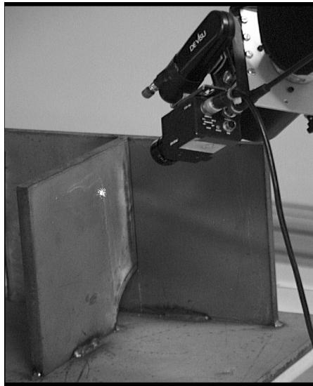  
Figure 7. A laser pointer is rigidly linked to the camera

Let us now address the problem of depth control. In fact, we have up to now one dimension free. We therefore need to add to the control scheme one variable only, which should be an image of the depth. Since the image laser spot moves on a line, it looks natural to choose the signed distance of the spot from a given origin of the line, denoted as s, as the variable to control. When the target is a plane, s is a monotonic function of the true depth. In order to design the control, we now need to know the variation of s, i.e its interaction screw. We have the following results:

Proposition 3. If the laser spot moves in a single 3D plane, then the variation ofs is:

$$
\begin{array} { r l r } { \dot { s } = - \frac { h _ { L } \cos \theta _ { z } } { z _ { L } ^ { 2 } } } & { ( 5 0 ) } \\ { \times \left( \tan \alpha _ { x } \quad \tan \alpha _ { y } \quad 1 - \frac { z _ { L } } { \cos \theta _ { z } } \quad \tan \alpha _ { y } \quad \frac { z _ { L } } { \cos \theta _ { z } } \quad \tan \alpha _ { x } 0 \right) } \\ { \times \Theta _ { L } \tau } \end{array}
$$

where $\textit { \tau } i s$ the velocity screw $( V , \Omega ) , \ \Theta _ { L }$ is the adjoint operator involving the rigid transformation $R _ { L } , t _ { L }$ between the camera frame and the laser frame, $z _ { L }$ is the depth of the laser spot along its view line, $\alpha _ { x }$ and $\alpha _ { y }$ are two angles defining the normal to the 3D plane in the laser frame, $h _ { L }$ is the distance between the camera center ofprojection to the intersection between the laser beam and the image plane, and $\theta _ { z }$ is the angle between the laser beam and the optical axis.

Notice that this equation can be derived from eq. (7.1.48) in (Samson et al 1991, pp 273–274), obtained while defining the interaction screw of general thin-field range-sensors. An alternative proof of those results is given in (Andreff 1999), with explicit references to the present case.

Proposition 4. In addition, ifthe rotational velocity is zero, and if the translational velocity is such that $V _ { l } = v \mathbf { \underline { { u } } } _ { l }$ where $\underline { { \mathbf { u } } } _ { l }$ is a constant unit vector, then

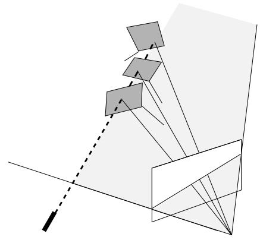

$$
\dot { s } = \frac { v } { z ^ { 2 } } \left( - h _ { L } k _ { z } ( \tan \alpha _ { x } ~ \tan \alpha _ { y } ~ 1 ~ ) R _ { l } \underline { { \mathbf { u } } } _ { l } \right)\tag{51}
$$

where the term in brackets is a constant, noted k.

From this result, it is now straightforward to design the depth control. In order to take benefit of the last proposition, the depth control will be also cascaded with the rotational one. Let us therefore assume that the desired orientation has been reached. Then, $\Omega = 0 ,$ even though it is highly advisable to keep this control activated in order to ensure that the orientation remains constant all the time despite disturbances. Let us choose as $\underline { { \mathbf { u } } } _ { l }$ the direction of the view line going through the trihedron center. An image of the depth error is $e _ { s } = s - s ^ { * }$ where $s ^ { * }$ is the desired image spot position on the laser epipolar line, and with, from $( 5 1 ) , \dot { e } _ { s } =$ $k v / z ^ { 2 }$ . An ideal exponential behavior would be reached by choosing v as

$$
v = - \lambda \frac { z ^ { 2 } } { k } ( s - s ^ { * } ) , \lambda > 0\tag{52}
$$

Since z is unknown, but is always nonzero, it is possible to fix its value to an arbitrary one. Stability will not be affected, but the convergence will no more be exponential. The depth control part is finally:

$$
V _ { l } = - \frac { \mu _ { l } } { k } ( s - s ^ { * } ) \underline { { \mathbf { u } } } _ { l } , \quad \mu _ { l } > 0\tag{53}
$$

It remains only now to integrate this control in the translational one. Recall that we had the following control:

$$
V _ { h } = - \mu _ { h } \sum _ { i = 1 } ^ { 3 } ( ( \underline { { \mathbf { u } } } _ { i } \times \underline { { \mathbf { h } } } _ { i } ) ^ { T } \underline { { \mathbf { h } } } _ { i } ^ { * } ) \underline { { \mathbf { h } } } _ { i } , \mu _ { h } > 0\tag{54}
$$

The final translational velocity control is simply $V = V _ { h } +$ $V _ { l } .$ It can indeed be seen that the control $V _ { h }$ is a combination of the $\underline { { \mathbf { h } } } _ { i } \mathbf { \bar { s } } ,$ , which are all orthogonal to $\underline { { \mathbf { u } } } _ { l }$ owing to the trihedron geometry (intersection). Therefore $V _ { l }$ is in the null space of $V _ { h }$ and can run simultaneously with it.

## 4.3 Line Extraction and Tracking

To extract the lines and track them in the image along the motion, we used an adapted version of the 2D-3D modelbased approach proposed in (Marchand et al 1999) and which is summarized by their authors as: “in a first step, the object image motion is represented by a 2D affine motion model, and is estimated, using a robust statistical method, from the computation of the normal displacements evaluated along the projected model contours. [...] The 2D affine motion model does not always match the real displacement of the object. A second step that consists in fitting the projection of the object model on the intensity gradients in the image is necessary. This is achieved using an iterative minimization of a non-linear energy function with respect to 3D pose parameters.”

## 4.4 Computation ofthe Line Orientations

To compute the line orientations, we based ourselves on the analytic solution to the perspective 4 point problem proposed in (Horaud et al 1989). Indeed, the orthogonal trihedron is a particular case of the 4 point problem where 3 of the points lie at the infinite.

Thus, using u the unit vector of the view line going through the trihedron center, we define $\underline { { \mathbf { v } } } _ { i } = \underline { { \mathbf { u } } } _ { l } \times \underline { { \mathbf { h } } } _ { i }$ . Recall that the $\underline { { \mathbf { h } } } _ { i } \mathbf { \bar { s } }$ can be expressed as:

$$
\underline { { \mathbf { h } } } _ { i } = \frac { \underline { { \mathbf { u } } } _ { l } \times \underline { { \mathbf { u } } } _ { i } } { \lVert \underline { { \mathbf { u } } } _ { l } \times \underline { { \mathbf { u } } } _ { i } \rVert } , \quad i = 1 . . 3\tag{55}
$$

Consequently, if we give the same orientation to the 3D lines and to their projections, we obtain the following system:

$$
\underline { { \mathbf { u } } } _ { i } = \cos \theta _ { i } \underline { { \mathbf { u } } } _ { l } + \sin \theta _ { i } \underline { { \mathbf { v } } } _ { i } , \quad i = 1 . . 3 , \quad \sin \theta _ { i } > 0
$$

where the unknowns are the angles $\theta _ { i } , i = 1 . . 3$ . This system is similar to the one obtained in (Horaud et al 1989) and its solution is of the form:

$$
\begin{array} { r c l } { \cos \theta _ { i } } & { = } & { \epsilon _ { i } \sqrt { \frac { \mathbf { v } _ { i - 1 } ^ { T } \mathbf { v } _ { i + 1 } } { \mathbf { v } _ { i - 1 } ^ { T } \mathbf { v } _ { i } \mathbf { v } _ { i } ^ { T } \\\mathbf { v } _ { i + 1 } + \mathbf { v } _ { i - 1 } ^ { T } \mathbf { v } _ { i + 1 } } } } \\ { \sin \theta _ { i } } & { = } & { \sqrt { \frac { \mathbf { v } _ { i - 1 } ^ { T } \mathbf { v } _ { i } \mathbf { v } _ { i } ^ { T } \mathbf { v } _ { i + 1 } } { \mathbf { v } _ { i - 1 } ^ { T } \mathbf { v } _ { i } \mathbf { v } _ { i } ^ { T } \mathbf { v } _ { i + 1 } + \mathbf { v } _ { i - 1 } ^ { T } \mathbf { v } _ { i + 1 } } } } \end{array}
$$

where $\epsilon _ { i } = \pm 1$ depending on whether the visible half of the 3D line points inwards or outwards. In the case we deal with, where the trihedron faces are opaque, this sign is identical for all the 3 lines. Notice finally that to simplify the notation, the operations i + 1 and i − 1 represent the addition and substraction modulo 3.

## 4.5 Simulation Results

We present here some simulation results to show the behaviour of the control law we proposed with both the use of lines and the depth control. We compare the sequential activation of the control in rotation and then in translation (Figures 8, 9 and 10) to their simultaneous activation (Figure 11, 12 and 13). In both cases, depth control is always activated after the desired partial pose is obtained.

Let us first consider the case of the sequential activation. In a first time, only rotation control is activated (Figure 8).

It results in an exponential decay of the error in orientation together with an increase of the errors on the image line projections and on the laser spot positions (Figure 9). Then, control in translation is activated, yielding the convergence of the image line projection errors towards 0, without any influence on the orientation. This can be seen in the image (Figure 10): the trihedron drifts to the left while orientation control is activated and then is brought back to its desired position (large trihedron) by the control in translation. Finally, depth control is activated, bringing the laser spot to its desired position in the image (Figure 9), without the partial pose to be modified. One can verify (Figure 10) that this depth control yields a straight line in the 3D space.

Simultaneous activation of the control in rotation and translation can be easily seen in Figure 11. The partial decoupling of the control law makes that the convergence in orientation is unchanged. On the opposite, the simultaneous activation suppresses the drifting of the trihedron (Figure 12). This results in a smaller amplitude of the image motion but in a larger one in the 3D space (Figure 13). Finally, one can see that the desired partial pose is obtained sooner than in the sequential case and that the depth control is thus activated sooner (Figure 12).

## 4.6 Experimental Results

In this section, we focus on the experimental validation of the control law bases on lines. Thus, we disabled the depth control using the laser beam and we simplified the visual tracking by using a trihedron with sharp contrast rather than the ship part.

In all the experiments we led, the task was to bring back the camera to a prerecorded position.

Pure translation – In the first experiment, we took the camera some ten centimeters away from its goal position (Figure 14). Notice first that during the realization of the task, a slight tracking error occured (Figure 15, left), which yields perturbations on the following curves. Notice also that the computation of the 3D line orientations is stable since the tracking error does not affect it much (Figure 15, right). Moreover, these orientations are constant, yielding a zero control in orientation (Figure 16, right). Hence, the controlled motion is a pure translation as expected. This exhibits the partial decoupling of our control law between translation and rotation. The convergence in translation is here exponential (Figure 16, left). As expected the error in the image $( { \sum _ { i = 1 } ^ { 3 } \| \underline { { \mathbf { h } } } _ { i } - \underline { { \mathbf { h } } } _ { i } ^ { * } \| } )$ decreases and the orientation error is zero up to noise (Figure 17, left). Finally, notice the almost straight image trajectory of the trihedron center (Figure 17, right).

Pure rotation – In the same experimental conditions, we rotated the camera 100deg along its optical axis away from its desired position. One can notice that the orientation control operates, as expected, solely along the optical axis (Figure 18, left) and yields an asymptotically stable translation control (Figure 18, right), which keeps the trihedron visible (Figure 19, right).

It is noticeable that the rotation control does not immediately converge exponentially but starts with a slight acceleration (Figure 18, left). Nevertheless, both orientation error and error in the image decrease (Figure 19, left).

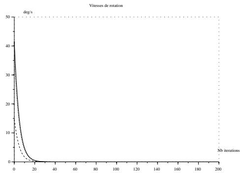

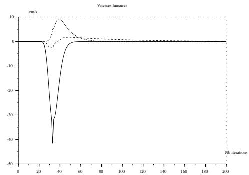  
Figure 8. Sequential activation of the control in rotation and then in translation: Rotation (left) and translation (right) control.

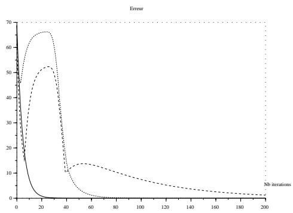  
Figure 9. Sequential activation of the control in rotation and then in translation: Errors in orientation (solid line), on the image line projections (dotted line) and on the laser spot position (dashed line).

Indeed, the residual angle between the initial and desired orientations is larger than $\pi / 2 .$ Hence, the orientation control, which is of the form $\mathbf { u } \times \underline { { \mathbf { u } } } ^ { * }$ and thus proportionnal to the sine of the residual angle, will increase in norm until the residual angle reaches $\pi / 2$ and then will decrease exponentially.

Complex motion – We end up this experimental section with a complex motion, in the sense that it is composed of a translation of some 50cm and a rotation of about 80deg (Figure 20). Since the initial camera position is close to one the trihedron edges, it is challenging both for the tracking and the control algorithms. Indeed, the tracking algorithm must avoid confusing the two image lines that are close to each other. As for the control point of view, the difficulty comes from the fact that this initial position is close to a singularity (§ 3.4).

The orientation control is now again strictly decreasing (Figure 21, left) since the residual angle is lower than $\pi / 2 .$ On the opposite, the translation control is disturbed by the orientation control (Figure 21, right) but still converges. Both orientation errors and errors in the image are strictly decreasing (Figure 22, left). As for the image trajectory of the trihedron center, it is not as nice as in the previous cases (Figure 22, right) and depends on the relative choice of the control gains, $\mu _ { u }$ and $\mu _ { h }$ . Indeed, this trajectory was obtained with $\mu _ { u } = 0 . 0 0 8$ and $\mu _ { h } = 0 . 0 1$ while the choice $\mu _ { u } = \mu _ { h } = 0 . 0 1$ did not keep the trihedron visible.

## 5 Conclusion and Perspectives

In this work, we achieved a theoretical and geometrical study of several line representations in order to determine the one which is best suited to visual servoing. This led us to define a new representation, the so-called binormalized Plucker¨ coordinates, which has two advantages from the control point of view. The first one is that it allowed us to define properly the concept of image line alignment, which gathers both 2D and 3D information. The second one is that we could define a control law which realizes such an image line alignment with some very interesting properties. First, the proposed law is an analytic inversion of the motion equations and does not need any numerical inversion of a Jacobian. Second, it shows a partial decoupling between translation and rotation. Third, global asymptotic stability conditions could be found, with a geometrical interpretation in the particular case of the orthogonal trihedron. This control law was validated both in simulation and experimentally.

However, there still remain several issues to be developed. In a first time, stability conditions should be extended to the case where orientation and translation controls are activated simultaneously. This may be eased by recent results in the field of cascaded systems(Panteley and Loria 1998). In parallel, one could think of studying the robustness of the proposed control law to measurement and/or calibration errors. Another point to be adressed consists of the line orientation computation in the general case, one simple way being to extend our result to the stereoscopic case. As for the practical side, we still need to reduce drastically the cycle time of the control loop.

## A Proofs

## A.1 Theorem 1

Firstly, let us state the following lemma:

Lemma 1. For all configurations ofrigidly linked lines:

$$
\sum _ { i = 1 } ^ { n } { \underline { { \mathbf { u } } } } _ { i } \times { \underline { { \mathbf { u } } } } _ { i } ^ { * } = 0 \Rightarrow { \underline { { \mathbf { u } } } } _ { i } = \pm { \underline { { \mathbf { u } } } } _ { i } ^ { * } , i = 1 . . n\tag{56}
$$

Proof : Recall the Rodrigues formula, which gives the image $\mathbf { v } ^ { \prime }$ of a vector v by a rotation of axis n and angle θ:

$$
\mathbf { v } ^ { \prime } = \mathbf { v } + \sin \theta ( { \underline { { \mathbf { n } } } } \times \mathbf { v } ) + ( 1 - \cos \theta ) { \underline { { \mathbf { n } } } } \times ( { \underline { { \mathbf { n } } } } \times \mathbf { v } )\tag{57}
$$

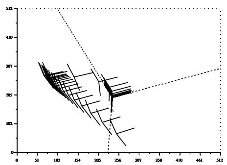

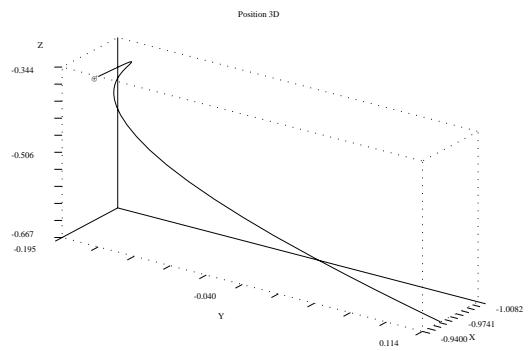

Figure 10. Sequential activation of the control in rotation and then in translation: Trajectory of the trihedron in the image (left) and in the 3D space (right).  
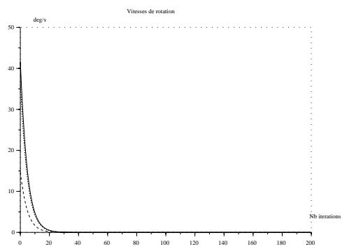

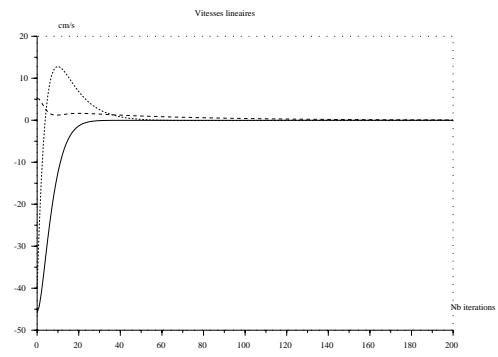  
Figure 11. Simultaneous activation of the control in rotation and then in translation: Rotation (left) and translation (right) control.

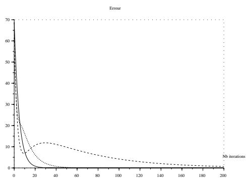  
Figure 12. Simultaneous activation of the control in rotation and then in translation: Errors in orientation (solid line), on the image line projections (dotted line) and on the laser spot position (dashed line).

Since we consider a set of rigidly linked lines, the $\underline { { \mathbf { u } } } _ { i } \mathbf { \bar { s } }$ differ from the $\underline { { \mathbf { u } } } _ { i } ^ { * } \mathbf { \bar { s } }$ by a unique rotation. Hence, we can apply (57) for all $i = 1 . . n \colon$

$$
\underline { { \mathbf { u } } } _ { i } = \underline { { \mathbf { u } } } _ { i } ^ { * } + \sin \theta ( \underline { { \mathbf { n } } } \times \underline { { \mathbf { u } } } _ { i } ^ { * } ) + ( 1 - \cos \theta ) \underline { { \mathbf { n } } } \times ( \underline { { \mathbf { n } } } \times \underline { { \mathbf { u } } } _ { i } ^ { * } ) ,
$$

Building for all $i = 1 . . n$ , the crossproduct $\underline { { \mathbf { u } } } _ { i } \times \underline { { \mathbf { u } } } _ { i } ^ { * }$ and expressing $\underline { { \mathbf { u } } } _ { i } ^ { * }$ on the orthogonal basis $( \underline { { \mathbf { n } } } , \underline { { \mathbf { n } } } \times \underline { { \mathbf { u } } } _ { i } ^ { * } , \underline { { \mathbf { n } } } \times \left( \underline { { \mathbf { n } } } \times \right.$

u∗i )) yields:

$$
\begin{array} { r l } { \underline { { \mathbf { u } } } _ { i } \times \underline { { \mathbf { u } } } _ { i } ^ { * } } & { = ~ \mathrm { s i n } \theta \Big [ ( \underline { { \mathbf { n } } } ^ { T } \underline { { \mathbf { u } } } _ { i } ^ { * } ) ^ { 2 } - 1 \Big ] \underline { { \mathbf { n } } } } \\ & { + ~ \Big [ ( 1 - \cos \theta ) \underline { { \mathbf { n } } } ^ { T } \underline { { \mathbf { u } } } _ { i } ^ { * } + \alpha _ { i } \underline { { \mathbf { n } } } ^ { T } \underline { { \mathbf { u } } } _ { i } ^ { * } \Big ] \underbrace { ( \underline { { \mathbf { n } } } \times \underline { { \mathbf { u } } } _ { i } ^ { * } ) } _ { \perp \underline { { \mathbf { n } } } } } \\ & { + ~ \Big [ \beta _ { i } \underline { { \mathbf { n } } } ^ { T } \underline { { \mathbf { u } } } _ { i } ^ { * } \Big ] \underbrace { \underline { { \mathbf { n } } } \times ( \underline { { \mathbf { n } } } \times \underline { { \mathbf { u } } } _ { i } ^ { * } ) } _ { \perp \underline { { \mathbf { n } } } } } \end{array}
$$

Consequently, if the sum of these crossproducts is zero, then

$$
\sum _ { i = 1 } ^ { n } \sin \theta \left[ ( \underline { { \mathbf { n } } } ^ { T } \underline { { \mathbf { u } } } _ { i } ^ { * } ) ^ { 2 } - 1 \right] = 0\tag{59}
$$

From this equation, we deduce immediately that either sin $\theta = 0 \mathrm { o r } \underline { { \mathbf { u } } } _ { i } ^ { * } = \pm \underline { { \mathbf { n } } } , \forall i = 1 . . n$ . Discarding the second case which can be shown to be a degenerate case of the first one, we obtain the final result as an interpretation of the first case. ✷

Now, let us prove Theorem 1.

Consider the Lyapunov function $\begin{array} { r } { L = \frac { 1 } { 2 } \sum _ { i = 1 } ^ { n } \Vert \underline { { \mathbf { u } } } _ { i } - } \end{array}$ $\underline { { \mathbf { u } } } _ { i } ^ { * } \rVert ^ { 2 }$ . Its derivative is:

$$
\dot { L } _ { u } = - \sum _ { j = 1 } ^ { n } \dot { \mathbf { u } } _ { j } ^ { T } \mathbf { u } _ { j } ^ { * }\tag{60}
$$

i = 1..nFrom the dynamical equation (41) and the control (58) definition (43), we can write (60) as:

$$
\dot { L } _ { u } = - \mu _ { u } \sum _ { j = 1 } ^ { n } \left( \left( \sum _ { i = 1 } ^ { n } \underline { { \mathbf { u } } } _ { i } \times \underline { { \mathbf { u } } } _ { i } ^ { * } \right) \times \underline { { \mathbf { u } } } _ { j } \right) ^ { T } \underline { { \mathbf { u } } } _ { j } ^ { * }\tag{61}
$$

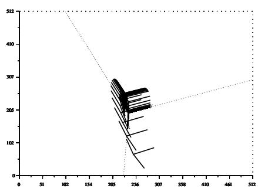

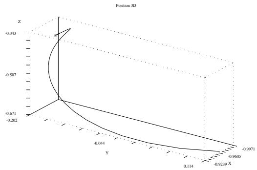

Figure 13. Simultaneous activation of the control in rotation and then in translation: Trajectory of the trihedron in the image (left) and in the 3D space (right).  
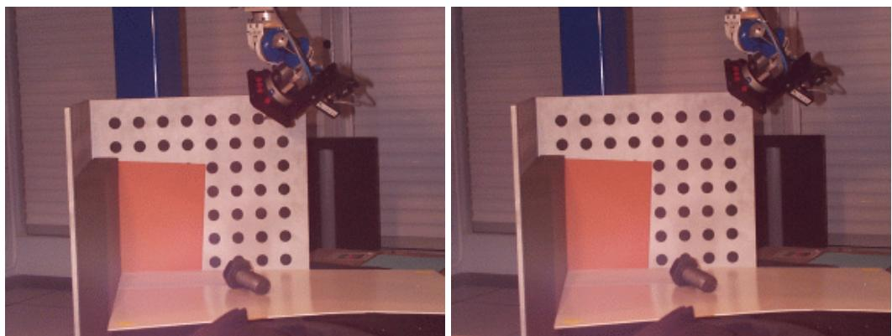  
Figure 14. Pure translation: Desired (left) and initial (right) positions of the robot.

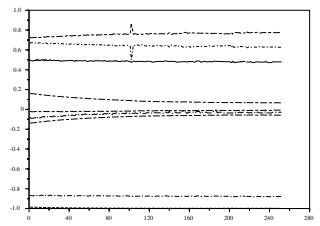

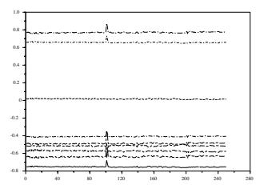

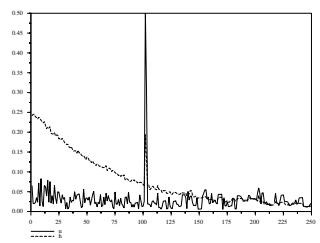

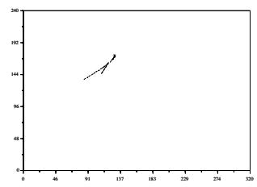  
Figure 17. Pure translation: Errors (left) and image trajectory of the trihedron center (right).

Figure 15. Pure translation: coefficients of the vectors $\underline { { \mathbf { h } } } _ { i }$ (left) and $\underline { { \mathbf { u } } } _ { i }$ (right) along the control.  
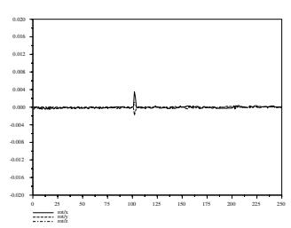

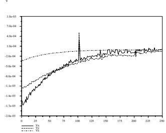  
Figure 16. Pure translation: Rotation (left) and translation (right) control.

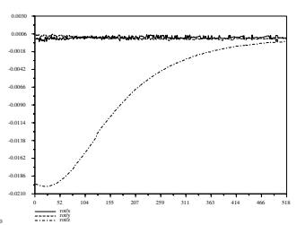

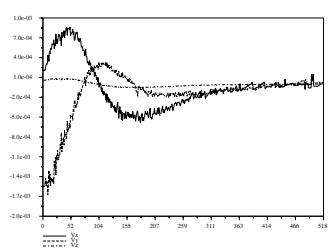  
Figure 18. Pure rotation: Rotation (left) and translation (right) control.

Using the following property of the mixt product:

$$
( \mathbf { u } \times \mathbf { v } ) ^ { T } \mathbf { w } = ( \mathbf { v } \times \mathbf { w } ) ^ { T } \mathbf { u }\tag{62}
$$

we obtain:

$$
\dot { L } _ { u } = - \mu _ { u } \left( \sum _ { j = 1 } ^ { n } \mathbf { \underline { { u } } } _ { j } \times \mathbf { \underline { { u } } } _ { j } ^ { * } \right) ^ { T } \left( \sum _ { i = 1 } ^ { n } \mathbf { \underline { { u } } } _ { i } \times \mathbf { \underline { { u } } } _ { i } ^ { * } \right)\tag{63}
$$

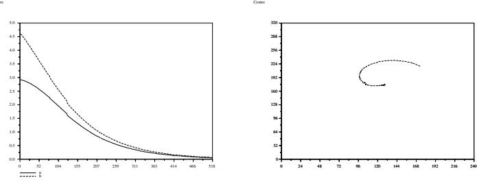  
Figure 19. Pure rotation: Errors (left) and image trajectory of the trihedron center (right).

Consequently, $\dot { L }$ is strictly negative unless $\textstyle \sum _ { i = 1 } ^ { n } { \underline { { \mathbf { u } } } } _ { i } \times$ $\underline { { \mathbf { u } } } _ { i } ^ { * } = 0$ . From Lemma 1, this means that L˙ is strictly negative unless $\underline { { \mathbf { u } } } _ { i } \neq \pm \underline { { \mathbf { u } } } _ { i } ^ { * }$ . We find here again the same unstable initial stationnary point as in the single line case. Thus, the control (43) is asymptotically stable provided that $\underline { { \mathbf { u } } } _ { i } ( t =$ $0 ) \neq - \underline { { \mathbf { u } } } _ { i } ^ { * } , \forall i = 1 . . n$ ✷

## A.2 Theorem 2

Consider the Lyapunov function defined by:

$$
L _ { h } = \frac { 1 } { 2 } \sum _ { j = 1 } ^ { n } \| \mathbf { \underline { { h } } } _ { j } - \mathbf { \underline { { h } } } _ { j } ^ { * } \| ^ { 2 }\tag{64}
$$

the derivative of which is:

$$
\dot { L } _ { h } = - \sum _ { j = 1 } ^ { n } \dot { \underline { { { \bf { h } } } } } _ { j } ^ { T } \underline { { { \bf { h } } } } _ { j } ^ { * }\tag{65}
$$

From (42), where $\pmb { \Omega } = 0 ,$ , we have:

$$
\dot { L } _ { h } = - \sum _ { j = 1 } ^ { n } \left( - \frac { \mathbf { V } ^ { T } \mathbf { \underline { { h } } } _ { j } } { h _ { j } } ( \mathbf { \underline { { u } } } _ { j } \times \mathbf { \underline { { h } } } _ { j } ) \right) ^ { T } \mathbf { \underline { { h } } } _ { j } ^ { * }\tag{66}
$$

which rewrites:

$$
\dot { L } _ { h } = \sum _ { j = 1 } ^ { n } \frac { \mathbf { V } ^ { T } \underline { { \mathbf { h } } } _ { j } } { h _ { j } } \epsilon _ { j }\tag{67}
$$

Inserting the control (45) yields:

$$
\dot { L } _ { h } = - \mu _ { h } \sum _ { j = 1 } ^ { n } \frac { ( \sum _ { i = 1 } ^ { n } \mathbf { B } _ { i } \epsilon _ { i } \underline { { \mathbf { h } _ { i } } } ) ^ { T } \underline { { \mathbf { h } _ { j } } } } { h _ { j } } \epsilon _ { j }\tag{68}
$$

This expression also rewrites under the following form which gives the analytic condition for stationnary points to exist (i.e. when $\dot { L } _ { h } = 0 )$ :

$$
\dot { L } _ { h } = - \mu _ { h } \left( \sum _ { i = 1 } ^ { n } \mathbf { B } _ { i } \epsilon _ { i } \underline { { \mathbf { h } } } _ { i } \right) ^ { T } \left( \sum _ { i = 1 } ^ { n } \frac { \epsilon _ { i } \underline { { \mathbf { h } } } _ { i } } { h _ { i } } \right)\tag{69}
$$

## A.3 Theorem 3

Consider the same Lyapunov function L as in the previous proof. Then its derivative is given by (67) independently from the translation control (provided that rotation control

has converged). Inserting the control (49) in (67) gives

$$
\dot { L } _ { h } = - \mu _ { h } \sum _ { j = 1 } ^ { 3 } \frac { \left( \sum _ { i = 1 } ^ { 3 } \epsilon _ { i } \mathbf { \underline { { h } } } _ { i } \right) ^ { T } \mathbf { \underline { { h } } } _ { j } } { h _ { j } } \epsilon _ { j }\tag{70}
$$

Noting $\mathbf { P } _ { j } = \mathbf { I } _ { 3 } - \underline { { \mathbf { h } } } _ { j } \underline { { \mathbf { h } } } _ { j } ^ { T }$ , the projection operator orthogonal to $\underline { { \mathbf { h } } } _ { j }$ , and $\mathbf { e } _ { j } = \underline { { \mathbf { h } } } _ { j } - \underline { { \mathbf { h } } } _ { j } ^ { * }$ , we remark that:

$$
\epsilon _ { j } \underline { { \mathbf { h } } } _ { j } = \underline { { \mathbf { u } } } _ { j } \times ( \mathbf { P } _ { j } \mathbf { e } _ { j } ) , \forall j\tag{71}
$$

Then, using this equation, we can rewrite the expression of L˙ as

$$
\dot { L } _ { h } = - \mu _ { h } \sum _ { j = 1 } ^ { 3 } \frac { 1 } { h _ { j } } \left( \sum _ { i = 1 } ^ { 3 } \mathbf { u } _ { i } \times \left( \mathbf { P } _ { i } \mathbf { e } _ { i } \right) \right) ^ { T } \left( \underline { { \mathbf { u } } } _ { j } \times \left( \mathbf { P } _ { j } \mathbf { e } _ { j } \right) \right)\tag{72}
$$

$$
= - \mu _ { h } \sum _ { j = 1 } ^ { 3 } \frac { 1 } { h _ { j } } \sum _ { i = 1 } ^ { 3 } \left( \underline { { \mathbf { u } } } _ { i } \times \left( \mathbf { P } _ { i } \mathbf { e } _ { i } \right) \right) ^ { T } \left( \underline { { \mathbf { u } } } _ { j } \times \left( \mathbf { P } _ { j } \mathbf { e } _ { j } \right) \right)\tag{73}
$$

$$
= - \mu _ { h } \sum _ { j = 1 } ^ { 3 } \frac { 1 } { h _ { j } } \sum _ { i = 1 } ^ { 3 } \left[ \left( \underline { { \mathbf { u } } } _ { i } \times \left( \mathbf { P } _ { i } \mathbf { e } _ { i } \right) \right) \times \underline { { \mathbf { u } } } _ { j } \right] ^ { T } \left( \mathbf { P } _ { j } \mathbf { e } _ { j } \right)\tag{74}
$$

$$
= - \mu _ { h } \sum _ { j = 1 } ^ { 3 } \frac { 1 } { h _ { j } } \sum _ { i = 1 } ^ { 3 } \left[ ( \underline { { \mathbf { u } } } _ { i } ^ { T } \underline { { \mathbf { u } } } _ { j } ) ( \mathbf { P } _ { i } \mathbf { e } _ { i } ) - \underline { { \mathbf { u } } } _ { j } ^ { T } ( \mathbf { P } _ { i } \mathbf { e } _ { i } ) \underline { { \mathbf { u } } } _ { i } \right] ^ { T } ( \mathbf { P } _ { j } \mathbf { e } _ { j } )\tag{75}
$$

which finally gives:

$$
\dot { L } _ { h } = - \mu _ { h } \sum _ { j = 1 } ^ { 3 } \frac { 1 } { h _ { j } } \sum _ { i = 1 } ^ { 3 } \left[ ( \underline { { \mathbf { u } } } _ { i } ^ { T } \underline { { \mathbf { u } } } _ { j } - \underline { { \mathbf { u } } } _ { i } \underline { { \mathbf { u } } } _ { j } ^ { T } ) ( \mathbf { P } _ { i } \mathbf { e } _ { i } ) \right] ^ { T } ( \mathbf { P } _ { j } \mathbf { e } _ { j } )
$$

Define now

$$
E = \left( { \bf P } _ { 1 } { \bf e } _ { 1 } \right) , \quad U = \left( { \frac { { \bf u } _ { 1 } } { { \bf u } _ { 2 } } } \right)\tag{76}
$$

and the operator:

$$
\begin{array}{c} \begin{array} { c c c } { { \bf P } _ { U } = \displaystyle \frac { 1 } { 2 } ( { \bf I } _ { 9 } - U \otimes U ^ { T } ) }  \\ { { \mathrm {  ~ \sigma ~ } } } \\ { { \mathrm {  ~ \sigma ~ } } } \end{array} - \frac { { \bf u } _ { 2 } } { { \bf u } _ { 1 } } { \bf u } _ { 1 } ^ { T }  & { - \underline { { { \bf u } _ { 2 } } } \underline { { { \bf u } } } _ { 1 } ^ { T } } & { - \underline { { { \bf u } _ { 3 } } } \underline { { { \bf u } } } _ { 1 } ^ { T } } \\ { { \mathrm {  ~ \sigma ~ } } } & { { \mathrm { \bf I } _ { 3 } } - \underline { { { \bf u } _ { 1 } } } \underline { { { \bf u } } } _ { 2 } ^ { T } } & { { \mathrm { \bf I } _ { 3 } } - \underline { { { \bf u } _ { 2 } } } \underline { { { \bf u } } } _ { 2 } ^ { T } } \\ { { \mathrm {  ~ \sigma ~ } } } & { { - \underline { { { \bf u } } } _ { 1 } \underline { { { \bf u } } } _ { 3 } ^ { T } } } & { { - \underline { { { \bf u } } } _ { 2 } \underline { { { \bf u } } } _ { 3 } ^ { T } } } & { { { \bf I } _ { 3 } - \underline { { { \bf u } } } _ { 3 } \underline { { { \bf u } } } _ { 3 } ^ { T } } } \end{array}
$$

One can easily prove that $\mathbf { P } _ { U }$ is an orthogonal projection onto the kernel of $U ^ { T }$ , hence on the hyperplane Π orthogonal to $U .$

After convergence of the rotational control, we have

$$
\underline { { \mathbf { u } } } _ { j } = \underline { { \mathbf { u } } } _ { j } ^ { * } , \quad j = 1 . . 3
$$

from which we deduce that

$$
\underline { { \mathbf { u } } } _ { j } ^ { T } ( \mathbf { P } _ { j } \mathbf { e } _ { j } ) = 0 , \quad j = 1 . . 3\tag{77}
$$

Using this result and the trihedron orthogonality, we obtain

$$
\dot { L } = - 2 \mu _ { h } \tilde { E } ^ { T } \mathbf { P } _ { U } E\tag{78}
$$

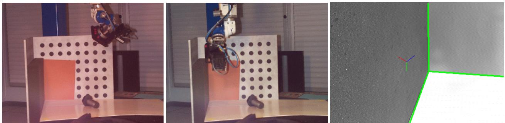  
Figure 20. Complex motion. Left: robot desired position. Center: robot initial position. Right: initial image (superimposed: desired image of the trihedron).

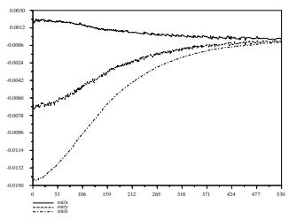

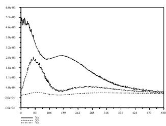  
Figure 21. Complex motion: Rotation (left) and translation (right) control.

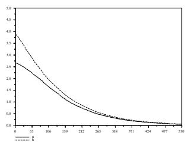

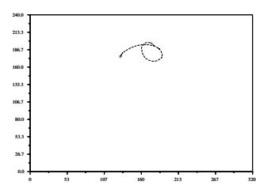  
Figure 22. Complex motion: Errors (left) and image trajectory of the trihedron center (right).

where $\tilde { E }$ is the vector obtained by concatenating the $\tilde { \mathbf { e } } _ { j } =$ $\begin{array} { r } { { \frac { 1 } { h _ { j } } } { \bf P } _ { j } { \bf e } _ { j } } \end{array}$ for all $j = 1 . . 3$

From (77), we find that E and U are orthogonal, hence $E \in \Pi$ and $\mathbf { P } _ { U } E = E$ . This simplifies the expression of $\dot { L }$ into:

$$
\dot { L } = - 2 \mu _ { h } \tilde { E } ^ { T } E = - 2 \mu _ { h } \sum _ { j = 1 } ^ { 3 } \frac { 1 } { h _ { j } } \mathbf { e } _ { \ j } ^ { \prime T } \mathbf { e } _ { j } ^ { \prime }
$$

where $\mathbf { e } _ { j } ^ { \prime } = \mathbf { P } _ { j } \mathbf { e } _ { j }$

Consequently, this sum is negative and only vanishes when all ${ \bf e } _ { j } ^ { \prime }$ are zero. After the convergence of the rotation control, this is only possible when $\underline { { \mathbf { h } } } _ { j } = \pm \underline { { \mathbf { h } } } _ { j } ^ { * }$

## Acknowledgments

This work was supported by the European Community through the Esprit-IV reactive LTR project number 26247 (VIGOR). This work was completed while Nicolas Andreff was a Ph.D. student at INRIA Rhone-Alpes.ˆ

## References

Andreff N (1999) Asservissement visuel a partir de droites et auto-\` etalonnage pince-cam ´ era. Th ´ ese de doctorat, Institut National\` Polytechnique de Grenoble, France

Armstrong M, Zisserman A (1995) Robust object tracking. In: Proc. Asian Conference on Computer Vision, vol I, pp 58–61

Bottema O, Roth B (1979) Theoretical Kinematics. Dover Publications

C Fermuller YA LF Cheong (1998) 3D Motion and Shape Representations in Visual Servo Control. Int J of Robotics Research 17(1):4–18

Chaumette F (1990) La relation vision-commande : theorie et´ application a des t \` aches robotiques. Th ˆ ese, Universit \` e de´ Rennes I

Chazelle B, Edelsbrunner H, Guibas LJ, Sharir M, Stolfi J (1996) Lines in space : Combinatorics and algorithms. Algorithmica 15:428–447

Chen H (1991) Pose determination from line-to-plane correspondences: Existence solutions and closed-form solutions. IEEE Transactions on Pattern Analysis and Machine Intelligence 13(6):530–541

Colombo C, Allota B, Dario P (1995) Affine Visual Servoing: A Framework for Relative Positionning with a Robot. In: Proc. IEEE International Conference on Robotics and Automation

Corke PI (1993) Visual control of robot manipulators — a review. In: Hashimoto K (ed) Visual Servoing — Real-Time Control of Robot Manipulators Based on Visual Sensory Feedback, World Scientific, pp 33–70

Corke PI, Good MC (1996) Dynamic effects in visual closedloop systems. IEEE Transactions on Robotics and Automation 12(5):671–683

Cretual A, Chaumette F (1997) Positioning a camera parallel to´ a plane using dynamic visual servoing. In: IEEE/RSJ/INRIA Workshop On New Trends in Image-based Robot Servoing, Grenoble, pp 43–48

Cross GMT, Cipolla R (1996) Affine Visual Servoing. In: British Machine Vision Conference, pp 425–434

Debain C (1996) Lois de commande pour le controle et laˆ mobilite des machines agricoles. Th´ ese, Universit\` e Blaise´ Pascal (Clermont-Ferrand)

Deguchi K, Noguchi T (1996) Visual servoing using eigenspace method and dynamic calculation of interaction matrices. In: Proc. IAPR International Conference on Pattern Recognition, pp 302–309

Dhome M, Richetin M, Lapreste J, Rives G (1989) Determination of´ the attitude of 3D objects from a single perspective view. IEEE

Transactions on Pattern Analysis and Machine Intelligence 11(12):1265–1278

Drummond T, Cipolla R (200) Real-time tracking of multiple articulated structures in multiple views. In: 6th European Conference on Computer Vision

Espiau B (1993) Effect of Camera Calibration Errors on Visual Servoing in Robotics. In: Third International Symposium on Experimental Robotics

Espiau B, Chaumette F, Rives P (1992a) A New Approach To Visual Servoing in Robotics. IEEE Trans on Robotics and Automation 8(3)

Espiau B, Chaumette F, Rives P (1992b) A new approach to visual servoing in robotics. IEEE Transactions on Robotics and Automation 8(3):313–326

Faugeras O (1993) Three-Dimensional Computer Vision - A Geometric Viewpoint. Artificial intelligence, The MIT Press, Cambridge, MA, USA, Cambridge, MA

Ghosh BK, Tarn TJ, Xi N, Yu Z, Xiao D (1996) Calibration Free Visually Controlled Manipulation of Parts in a Robotic Manufacturing Workcell. In: Proc. IEEE International Conference on Robotics and Automation, pp 3197–3202

Goodman J, O’Rourke J (eds) (1997) Handbook of Discrete and Computational Geometry. CRC Press

Grosso E, Metta G, Oddera A, Sandini G (1995) Uncalibrated Visual Servoing in Reaching Tasks. Rapport de Recherche 3/95, LIRA-Lab - DIST University of Genova

Hager GD (1997) A modular system for robust positioning using feedback from stereo vision. IEEE Transactions on Robotics and Automation 13(4):582–595

Hager GD, Chang WC, Morse AS (1995) Robot Hand-Eye Coordination based on Stereo Vision. IEEE Control Syst Mag 15:30–39

Hashimoto K, Ebine T, Kimura H (1996) Visual Servoing with Hand-Eye Manipulator – Optimal Control Approach. In: Proc. IEEE International Conference on Robotics and Automation, pp 766–774

Hespanha JP, Dodds Z, Hager GD, Morse AS (1999) What tasks can be performed with an uncalibrated stereo vision system ? International Journal on Computer Vision

Hollinghurst N, Cipolla R (1994) Uncalibrated Stereo Hand-Eye Coordination. Image and Vision Computing 12(3):187–192

Horaud R, Conio B, Leboulleux O, Lacolle B (1989) An analytic solution for the perspective 4-point problem. Computer Vision, Graphics and Image Processing 47:33–44

Horaud R, Dornaika F, Espiau B (1998) Visually Guided Object Grasping. IEEE Transactions on Robotics and Automation 14(4):525–532

Hosoda K, Sakamoto K, Asada M (1995) Trajectory Generation for Obstacle Avoidance of Uncalibrated Stereo Visual Servoing without 3D Reconstruction. In: Proc. IEEE/RSJ International Conference on Intelligent Robots and Systems, pp 29–34

Hutchinson S, Hager GD, Corke PI (1996) A Tutorial on Visual Servo Control. IEEE Transactions on Robotics and Automation 12(5):651–670

Jagersand M, Nelson R (1996) On-line Estimation of Visual-¨ Motor Models using Active Vision. In: Proc. ARPA Image Understanding Workshop

Joshi R, Sanderson AC (1996) Application of feature-based multiview servoing for lamp filament alignment. In: Proc. IEEE

International Conference on Robotics and Automation, pp 1306–1313

Kinoshita K, Deguchi K (1994) Simultaneous Determination of Camera Pose and Intrinsic Parameters by Visual Servoing. In: Proc. IAPR International Conference on Pattern Recognition, pp 285–289

Lamiroy B, Espiau B, Andreff N, Horaud R (2000) Controlling robots with two cameras: How to do it properly. In: Proc. IEEE Int. Conf. on Robotics and Automation, San Fransisco, California, USA

Lowe D (1991) Fitting parameterized three-dimensional models to images. IEEE Transactions on Pattern Analysis and Machine Intelligence 13(5):441–450

Lutzeler M, Dickmanns E (1998) Road Recognition with MarVEye.¨ In: Int. Conf. on Intelligent Vehicles

MacCarthy JM (1990) Introduction to Theoretical Kinematics. MIT Press

Malis E, Chaumette F, Boudet S (1999) 2-1/2-D visual servoing. IEEE Transactions on Robotics and Automation 15(2):238–250

Marchand E, Bouthemy P, Chaumette F, Moreau V (1999) Robust´ real-time visual tracking using a 2D-3D model-based approach. In: International Conference on Computer Vision, Kerkira, Greece, vol 1, pp 262–268

Martinet P, Daucher N, Gallice J, Dhome M (1997) Robot control using monocular pose estimation. In: IEEE/RSJ/INRIA Workshop On New Trends in Image-based Robot Servoing, Grenoble, pp 1–12

Maru N, Kase H, Nishikawa A, Miyazaki F (1993) Manipulator Control by Visual Servoing with the Stereo Vision. In: Proc. IEEE/RSJ International Conference on Intelligent Robots and Systems, pp 1866–1870

Miyazaki F, Masutani Y (1991) Robustness of sensory feedback control based on imperfect Jacobian. In: Proc. International Symposium on Robotics Research, pp 201–208

Motyl G (1992) Couplage d’une camera et d’un faisceau laser en´ commande ref´ erenc´ ee vision. Th´ ese, Universit\` e Blaise Pascal´ (Clermont-Ferrand)

Murray RM, Li Z, Sastry SS (1994) A Mathematical Introduction to Robotic Manipulation. CRC Press

Navab N (1993a) Visual motion of lines and cooperation between motion and stereo. PhD thesis, Universite de Paris-Sud, Centre´ d’Orsay

Navab N (1993b) Visual motion of lines and cooperation between motion and stereo. These de doctorat, Universit\` e Paris-Sud´

Panteley E, Loria A (1998) On global uniform asymptotic stability of nonlinear time-varying systems in cascade. Systems and Control Letters 33(2):131

Plucker J (1865) On a new geometry of space. Philosophical¨ Transactions of the Royal Society of London 155:725–791

Pottmann H, Peternell M, Ravani B (1998) Approximation in line space – applications in robot kinematics and surface reconstruction. In: Lenarˇciˇc J, Husty ML (eds) Advances in Robot Kinematics: Analysis and Control, Kluwer Academic Publishers, pp 403–412

Rives P, Espiau B (1987) Estimation recursive de primitives 3D au moyen d’une camera mobile. Traitement du Signal 4:259–272

Samson C, Borgne ML, Espiau B (1990) Robot Control: the Task Function Approach. Clarendron Press, Oxford University Press, Oxford, UK

Samson C, Le Borgne M, Espiau B (1991) Robot Control : The Task Function Approach . Clarendon Press, Oxford

Semple J, Kneebone G (1952) Algebraic Projective Geometry. Oxford Science Publication

Soatto S, Perona P (1994) Structure-Independant Visual Motion Control on the Essential Manifold . In: Preprints of the Fourth IFAC Symposium on Robot Control

Spratling M, Cipolla R (1996) Uncalibrated Visual Servoing. In: British Machine Vision Conference, pp 545–554

Stolfi J (1991) Oriented Projective Geometry. Academic Press

Sundareswaran V, Bouthemy P, Chaumette F (1994) Visual servoing using dynamic image parameters. Rapport de Recherche 2336, INRIA

Sutanto H, Sharma R, Varma V (1998) The role of exploratory movement in visual servoing without calibration. Robotics and Autonomous Systems 23:153–169

Tonko M, Nagel HH (2000) Model-based stereo-tracking of nonpolyhedral objects for automatic disassembly experiments. International Journal on Computer Vision ??

VIGOR (1998–2001) Visually Guided Robots Using Uncalibrated Cameras, ESPRIT–IV reactive LTR project number 26247. http://www.inrialpes.fr/VIGOR

Weiss LE, Sanderson AC, Neuman CP (1987) Dynamic sensorbased control of robots with visual feedback. IEEE Journal of Robotics and Automation RA-3(5):404–417

Yoshimi B, Allen P (1995) Alignment using an uncalibrated camera system. IEEE Transactions on Robotics and Automation 11(4):516–521