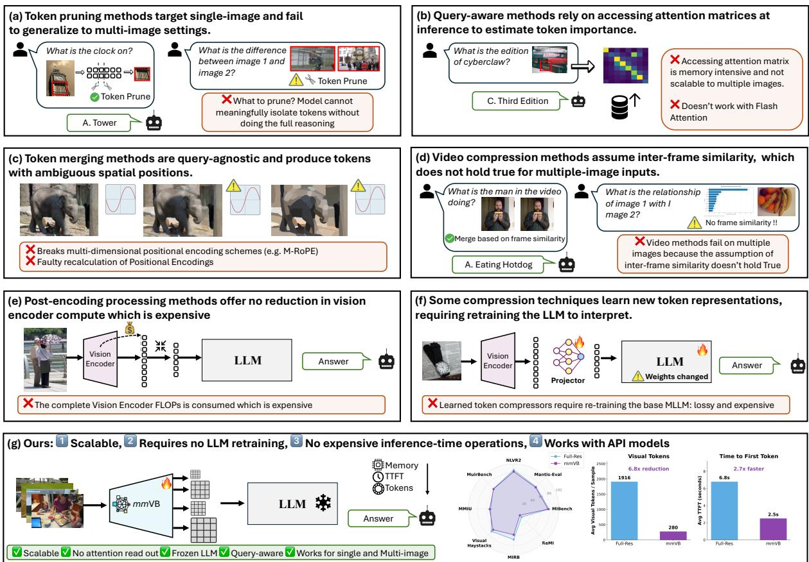
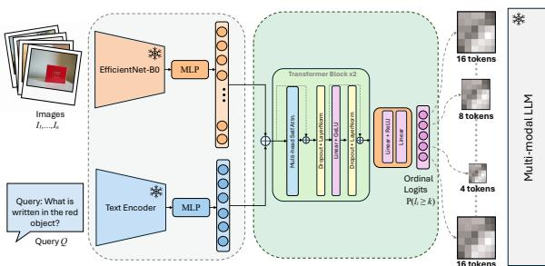
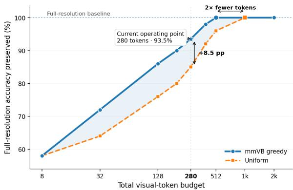
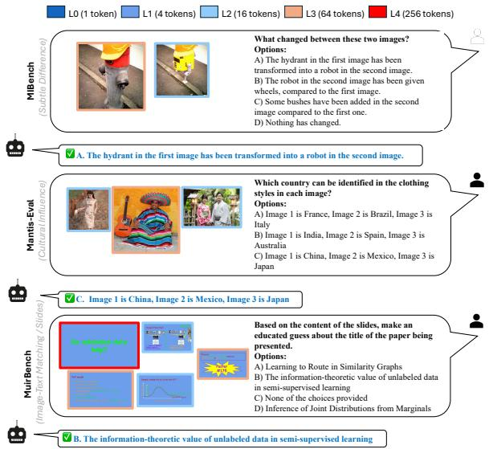
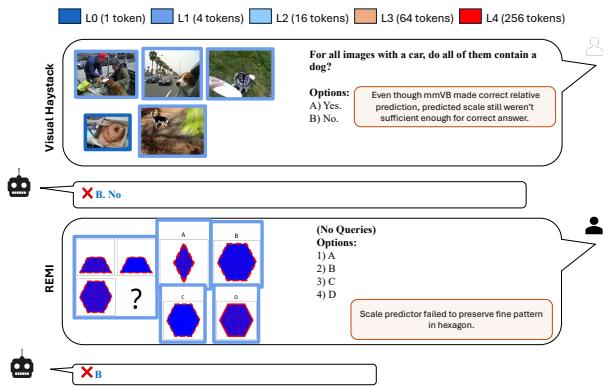
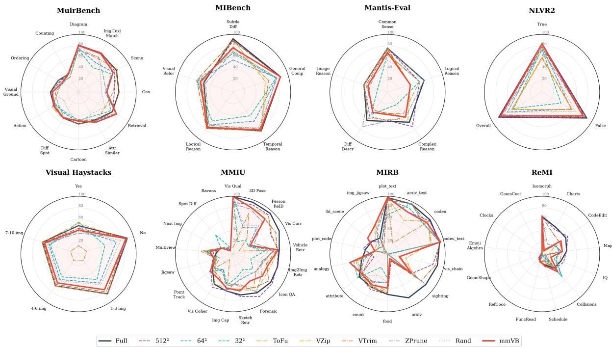

# Visual Tokens on Demand: Visual Budgeting for Scalable and Efficient Multi-Image Reasoning in Multimodal LLMs

Aimon Rahman, Joymallya Chakraborty, Vidit Bansal, Abhishek Dan

Amazon

{aimonrah, joymally, bansalv, abhidan}@amazon.com

## Abstract

Multimodal large language models (MLLMs) have advanced rapidly, but most remain opti mized for single-image inputs. Multi-image reasoning is costly because each image adds many visual tokens, increasing encoding and attention demands. Existing techniques that ad dress the above issue, including visual token pruning, token merging, visual token compression, learned resampling, hierarchical compres sion, retrieval-augmented visual reasoning, and memory-based architectures, have largely been designed for single-image scenarios, where re dundancy is primarily spatial and local. Multi image reasoning introduces additional chal lenges: redundancy may occur across images, task-relevant evidence may be sparse or dis tributed, and aggressive per-image compression can remove details needed for comparison, counting, temporal reasoning, retrieval, or evidence grounding. Moreover, existing token reduction methods are often either (i) training free but inference-inefficient, typically relying on accessing attention matrices to get token importance that may be impractical to access with memory-efficient attention implementa tions such as FlashAttention, or (ii) trainingdependent, requiring the base MLLM to be re trained or adapted to a new compressed-token paradigm. In this work, we study scalable multi-image reasoning and understanding with out retraining the base model and without ac cessing attention matrices at inference time. To this end, we propose mmVB (multi-modal Visual Budgeter), a lightweight plug-and-play module that assigns query-conditioned per image token budgets via cross-image context, adding only 1.6M trainable parameters while reducing visual input tokens by 9×. This re duction yields 5× faster time-to-first-token and 7× fewer prefill FLOPs, while maintaining 94.4% of full-resolution accuracy across eight multi-image reasoning benchmarks (geometric mean of per-benchmark ratios). These results show that input-aware visual scaling can sub

stantially improve efficiency while preserving multi-image reasoning performance.

## 1 Introduction

Although current multimodal large language models (MLLMs) can accept multiple images as input, the problem of scaling them efficiently to manyimage settings remains underexplored. Multiimage understanding and reasoning is inherently challenging: the model must identify relevant visual evidence, compare information across images, and aggregate details that may be distributed over the input set. Scaling this capability further increases the difficulty, as every additional image contributes visual tokens and raises memory, latency, and compute costs. This limitation is especially important in real-world applications. For instance, a catalog-oriented LLM may need to process multiple product images to understand item attributes, compare variants, and answer user queries, while operating within a constrained inference budget.

Visual token redundancy has been widely studied, with many works showing that multimodal language models can operate effectively, and in some cases even better, with fewer visual tokens. Existing approaches typically reduce tokens through pruning, merging, or learned compression, either in a training-free manner or by training additional modules. However, applying these methods to scalable multi-image reasoning presents three key challenges: i) Limited systems scalability. Many training-free methods rely on accessing attention matrices, often across multiple layers, to estimate token importance. This can be memory-intensive and difficult to integrate with optimized inference kernels such as FlashAttention, which avoid materializing dense attention maps. Production systems often depend on such kernels for speed and memory efficiency, meaning that methods requiring explicit access to dense attention matrices may be impractical at scale. Token merging can also disrupt positional structure, and correcting the resulting positional encoding mismatch often requires additional architectural changes. ii) Insufficient study of multi-image reasoning. Most tokenreduction methods are designed for single-image inputs, where task-relevant regions are often spatially localized. For example, when answering “What is the species ofthe animal in this image?”, attention may concentrate on the animal region, making pruning or merging relatively effective, often even from early layers. In the multi-image reasoning case, questions such as “What is the difference between image 1 and image 2?” may require preserving fine-grained details across both images until later stages of reasoning. In such cases, aggressive early pruning can remove evidence that only becomes important after cross-image comparison. iii) Training dependence and distribution shift. Some approaches require training adapters, compressed tokens, or modified visual-language interfaces, which can change the input distribution seen by the language model or require adapting its weights. This is problematic when the goal is to scale existing MLLMs without retraining the base model, not overfitting to a particular dataset, or altering the model’s original reasoning behavior. Moreover, recent evidence shows that simple image downsampling consistently outperforms sophisticated post-encoding compression methods at matched token budgets (Liao et al., 2026), questioning the fundamental value of operating after the vision encoder. Together, these limitations suggest the need for a token-reduction strategy that is scalable, compatible with efficient inference, applicable to multi-image inputs, and usable with frozen multimodal language models.

  
Figure 1: Introduction and Motivation. Existing multi-image methods scale poorly: dense attention breaks FlashAttention and excludes API-only models, token merging disrupts positional encodings and cross-image reasoning, and video-style compression assumes frame similarity. Our pre-encoding predictor instead assigns query-conditioned token budgets using only pixels, enabling compatibility with any MLLM, including closed models.

A natural solution is to reduce the number of visual tokens before language-model processing, and ideally even before the visual encoder incurs the full cost of processing all image content. Under a constrained-budget setting, we formulate the problem as estimating the minimum relative visual scale needed for the downstream language model to answer a visual question correctly. The scale estimator must itself be lightweight and avoid introducing additional memory overhead, since the goal is to enable efficient reasoning at scale. To this end, we propose mmVB, a lightweight plug-and-play module that assigns input-dependent visual budgets across images conditioned on both the image set and the question. Rather than applying a fixed resolution or token budget to every image, Visual Budgeter estimates how much visual detail each image requires for the downstream reasoning task. The motivation of this work is illustrated in Figure 1. Our main contributions are:

  
Figure 2: mmVB architecture. Frozen EfficientNet-B0 encodes N images, while frozen LLM embeddings encode the query through mean pooling and a 64- dimensional bottleneck. A two-layer, four-head Transformer processes all N+1 tokens, after which a shared MLP maps each image token to four ordinal logits.

\- We formulate scalable multi-image reasoning as a visual budget allocation problem, where the goal is to estimate the minimum image scale needed for accurate downstream reasoning under a constrained compute budget. We propose mmVB, a scalable, lightweight plugand-play module with only 1.6M trainable parameters that assigns question-conditioned visual budgets across images without retraining the base MLLM.

\- This Visual Budgeter reduces visual input tokens by 9×, yielding 5× faster time-to-firsttoken and 7× fewer prefill FLOPs.

\- We evaluate Visual Budgeter across eight multi-image reasoning benchmarks and show that it preserves 94.4% of full-resolution accuracy, demonstrating that input-aware visual scaling can substantially improve efficiency while maintaining strong multi-image reasoning performance.

## 2 Proposed mmVB Method

## 2.1 Architecture

Given N images $\{ I _ { 1 } , \ldots , I _ { N } \}$ of arbitrary resolutions and a text query Q, the Visual Budgeter assigns each image a token-allocation level $\ell _ { i } \in$ $\{ 0 , 1 , 2 , 3 , 4 \}$ that approximates the minimum number of visual tokens the MLLM needs to answer correctly. In doing so, the budgeter also learns each image’s relative relevance to the query. The full architecture is shown in Fig. 2.

Encoding and Context Fusion. Each image is encoded by a frozen EfficientNet-B0 (Tan and Le, 2019) and linearly projected to $d = 2 5 6$ . The query is embedded with the frozen MLLM embedding layer, mean-pooled, and mapped to the same space through a 64-dimensional bottleneck. The query token and N image tokens are then processed by a two-layer, four-head Transformer encoder, which performs query-conditioned, cross-image reasoning about each image’s required detail and relative importance.

Resolution Head and Inference. A shared MLP $( 2 5 6 \to 6 4 \to 4 )$ maps each image representation to four ordinal logits with $P ( \ell _ { i } \geq k ) = \sigma ( z _ { i , k } )$ for $k ~ \in ~ \{ 1 , 2 , 3 , 4 \}$ , and the predicted level is $\begin{array} { r } { \hat { \ell } _ { i } = \sum _ { k = 1 } ^ { 4 } \mathbb { I } [ \sigma ( z _ { i , k } ) > 0 . 5 ] } \end{array}$ . Each image is then resized to its predicted level (never upscaled) before being passed to the MLLM. The budgeter has about 1.6M trainable parameters and adds roughly 2 ms of overhead. Layer specifications, parameter counts, design choices, and an architecture ablation are given in Appendix A.

## 2.2 Training

Loss Function. We train the model using ordinal binary cross-entropy. For a ground-truth level $\ell _ { i } ^ { * } \in$ 0, 1, 2, 3, 4, the cumulative targets are

$$
y _ { i , k } = \mathbf { 1 } \left[ \ell _ { i } ^ { * } \geq k \right] , \qquad k \in { 1 , 2 , 3 , 4 } .\tag{1}
$$

Given predicted logits $z _ { i , k }$ , the threshold probabilities are

$$
p _ { i , k } = \sigma \left( z _ { i , k } \right) ,\tag{2}
$$

where $p _ { i , k }$ estimates $P ( \ell _ { i } \geq k )$ . The loss for image i is

$$
\mathcal { L } _ { i } ^ { \mathrm { o r d } } = - \sum _ { k = 1 } ^ { 4 } \left[ y _ { i , k } \log \left( p _ { i , k } \right) + \left( 1 - y _ { i , k } \right) \log \left( 1 - p _ { i , k } \right) \right] .\tag{3}
$$

This formulation preserves the ordering of the levels: predictions closer to $\ell _ { i } ^ { * }$ violate fewer thresholds and incur a smaller loss. For example, when $\ell _ { i } ^ { * } = 3 .$ predicting 2 violates one threshold, while predicting 0 violates three. Full training details (optimizer, learning rate, schedule, and batch configuration) are provided in the supplementary material.

## 2.3 Training-data Generation

We address image interactions using a three-round procedure: independent ascending search, joint verification, and iterative relaxation (Algorithm 1). For each image, we sweep Levels 0–4 and select the first level that yields a correct MLLM response, without assuming monotonic accuracy across resolutions. Single-image samples require at most five forward passes plus a pre-check, while multi-image samples cost $O ( 5 N + K N )$ in the worst case. With $K = 5$ , joint verification succeeds without relaxation for most samples, so the average cost remains close to independent search. Label generation is performed once offline, and the resulting labels are reused across training runs and hyperparameter sweeps. A text-only ablation assigns nearly uniform levels, showing that meaningful allocation requires modeling the query×image-content interaction through multi-resolution MLLM evaluation.

Label Interpretation. The labels produced by Algorithm 1 are sufficient feasible allocations, not provably minimal ones. The ascending sweep finds the first working level per image without assuming that correctness is monotonic in resolution; even if a higher level were to fail due to MLLM stochasticity, the returned level is verified correct. Note that the pre-check (line 1) guarantees that full resolution produces the correct answer; consequently, both the Round 1 sweep (which tests each image at level 4 while others remain at full resolution) and the line 29 fallback to $( 4 , \ldots , 4 )$ are guaranteed to be valid. No sample that fails at full resolution enters the label generation pipeline. For multi-image samples, the greedy relaxation in Round 3 searches single-image increments and then uniform increments, which may not discover the cheapest subset combination (e.g., two images needing simultaneous promotion). This means the returned allocation can over-allocate relative to the true joint minimum. Crucially, this bias is conservative: labels may assign more tokens than strictly necessary but never fewer, since every returned vector is verified to produce the correct answer. For training, conservative labels are preferable to aggressive ones they train the predictor toward accuracy preservation rather than over-compression. The ordinal loss further tolerates label noise: a label of Level 3 when the true minimum is Level 2 incurs only one incorrect threshold, producing a mild penalty rather than a catastrophic gradient signal.

Algorithm 1 Training Label Generation   
Require: Sample $( Q , \{ I _ { 1 } , \dots , I _ { N } \} , A )$ , MLLM M   
Ensure: Resolution levels $\ell _ { 1 } , \ldots , \ell _ { N }$   
1: Pre-check: If $\mathcal { M } ( Q , I _ { 1 } , \ldots , I _ { N } ) \neq A ,$ , discard sample   
2: Round 1: Independent Ascending Search   
3: for $i = 1 \mathrm { t o } \ N$ do   
4: for $\ell = 0 \mathrm { t o } 4$ do   
5: if $\cdot \mathcal { M } ( Q , I _ { 1 } , \dots , R _ { \ell } ( I _ { i } ) , \dots , I _ { N } ) = A$ then   
6: $\ell _ { i } \gets \ell ;$ break ▷ First sufficient level   
7: end if   
8: end for   
9: end for   
10: Round 2: Joint Verification   
11: if $\mathcal { M } ( Q , R _ { \ell _ { 1 } } ( I _ { 1 } ) , \ldots , R _ { \ell _ { N } } ( I _ { N } ) ) = A$ then   
12: return $\ell _ { 1 } , \ldots , \ell _ { N }$   
13: end if   
14: Round 3: Iterative Relaxation   
15: for $k = 1$ to K do   
16: for $i = 1$ to N do   
17: if $\ell _ { i } < 4$ then   
18: $\ell _ { i } ^ { \prime } \gets \ell _ { i } + 1$   
19: if $\mathcal { M } ( \bar { Q } , \dots , R _ { \ell _ { i } ^ { \prime } } ( I _ { i } ) , \dots ) = A$ then   
20: return $\ell _ { 1 } , \dots , \ell _ { i } ^ { \prime } , \dots , \ell _ { N }$   
21: end if   
22: end if   
23: end for   
24: $\ell _ { i } \gets \operatorname* { m i n } ( \ell _ { i } + 1 , 4 )$ for all i ▷ Bump all   
25: if M(Q, ${ \dot { R } } _ { { \ell } _ { 1 } } ( I _ { 1 } ) , \ldots , R _ { { \ell } _ { N } } ( I _ { N } ) ) = A$ then   
26: return $\ell _ { 1 } , \ldots , \ell _ { N }$   
27: end if   
28: end for   
29: return $( 4 , \ldots , 4 )$ ▷ Safe: pre-check verified full res.

Dataset. The single-image training set contains 484k samples from 30k images drawn from VQAv2, TextVQA, and GQA. Pairing each image with multiple queries provides a contrastive signal, as its optimal token level may vary by question, encouraging the predictor to model query×image interactions rather than memorize image-specific levels. We also generate 50k multi-image samples from Mantis-Instruct (Jiang et al., 2024) and train with a curriculum that introduces multi-image data after single-image training. Mantis-Eval is a separate 217-sample benchmark released by the same authors.

## 3 Experiments

Benchmarks and Settings. We evaluate on eight multi-image reasoning benchmarks spanning diverse task types and image counts: Muir-

<table><tr><td>Method Samples</td><td>Muir 2,600</td><td>MIB 5,000</td><td>Mantis 217</td><td>NLVR2 6,967</td><td>VHay 20,100</td><td>MMIU 93,584</td><td>MIRB 1,124</td><td>ReMI 2,600</td></tr><tr><td colspan="9">Accuracy (%) ↑</td></tr><tr><td>Full Res.</td><td>63.6</td><td>78.1</td><td>69.9</td><td>86.5</td><td>69.5</td><td>50.9</td><td>67.2</td><td>24.7</td></tr><tr><td>VisionZip (CVPR&#x27;25)</td><td>63.6</td><td>72.8</td><td>69.6</td><td>59.3</td><td>69.6</td><td>48.3</td><td>48.7</td><td>13.8</td></tr><tr><td>ToFu (arXiv)</td><td>42.6</td><td>71.2</td><td>56.7</td><td>60.7</td><td>14.6</td><td>11.2</td><td>42.1</td><td>18.6</td></tr><tr><td>VisionTrim (ICLR’26)</td><td>63.6</td><td>80.4</td><td>67.7</td><td>80.6</td><td>64.2</td><td>52.5</td><td>59.6</td><td>19.3</td></tr><tr><td>ZooPrune (CVPR’26)</td><td>57.0</td><td>69.9</td><td>65.4</td><td>78.3</td><td>63.4</td><td>49.6</td><td>49.5</td><td>16.8</td></tr><tr><td>mmVB (Ours)</td><td>62.9</td><td>77.9</td><td>68.2</td><td>82.8</td><td>69.6</td><td>53.2</td><td>56.5</td><td>19.2</td></tr><tr><td colspan="9">Visual tokens/sample ↓</td></tr><tr><td>Full Res.</td><td>3,236</td><td>1,237</td><td>2,119</td><td>1,649</td><td>2,187</td><td>2,980</td><td>1,756</td><td>2,573</td></tr><tr><td>VisionZip (CVPR&#x27;25)</td><td>2,265</td><td>462</td><td>2,024</td><td>199</td><td>1,836</td><td>712</td><td>891</td><td>286</td></tr><tr><td>ToFu (arXiv)</td><td>1,731</td><td>1,122</td><td>2,050</td><td>1,171</td><td>1,557</td><td>522</td><td>1,391</td><td>2,177</td></tr><tr><td>VisionTrim (ICLR’26)</td><td>3,531</td><td>370</td><td>634</td><td>494</td><td>1,165</td><td>1,532</td><td>865</td><td>770</td></tr><tr><td>ZooPrune (CVPR’26)</td><td>356</td><td>136</td><td>182</td><td>95</td><td>239</td><td>300</td><td>159</td><td>99</td></tr><tr><td>mmVB (Ours)</td><td>389</td><td>248</td><td>118</td><td>89</td><td>594</td><td>453</td><td>193</td><td>155</td></tr><tr><td colspan="9">Prefill computation (TFLOP) ↓</td></tr><tr><td>Full Res.</td><td>22,300</td><td>18,507</td><td>1,170</td><td>48,969</td><td>10,828</td><td>138,050</td><td>6,049</td><td>44,360</td></tr><tr><td>VisionZip (CVPR&#x27;25)</td><td>20,835</td><td>12,329</td><td>1,282</td><td>14,997</td><td>9,523</td><td>79,901</td><td>4,898</td><td>8,118</td></tr><tr><td>ToFu (arXiv)</td><td>9,189</td><td>13,623</td><td>1,129</td><td>24,054</td><td>1,687</td><td>4,358</td><td>3,339</td><td>33,084</td></tr><tr><td>VisionTrim (ICLR’26)</td><td>83,339</td><td>16,720</td><td>1,052</td><td>27,379</td><td>5,600</td><td>120,409</td><td>13,686</td><td>15,273</td></tr><tr><td>ZooPrune (CVPR’26) mmVB (Ours)</td><td>9,148</td><td>6,441</td><td>422</td><td>9,097</td><td>42,408</td><td>40,554</td><td>7,039</td><td>3,534</td></tr><tr><td></td><td>2,830</td><td>4,698</td><td>129</td><td>3,146</td><td>2,761</td><td>11,429</td><td>2,265</td><td>3,042</td></tr><tr><td colspan="9">Time to first token (TTFT, seconds) ↓</td></tr><tr><td>Full Res. VisionZip (CVPR&#x27;25)</td><td>3.5</td><td>1.6</td><td>2.2</td><td>2.8</td><td>11.8</td><td>7.9</td><td>2.5</td><td>22.2</td></tr><tr><td>ToFu (arXiv)</td><td>1.1 7.3</td><td>1.3</td><td>2.6 9.9</td><td>1.6</td><td>0.8</td><td>1.1 15.5</td><td>2.3 6.8</td><td>17.9</td></tr><tr><td>VisionTrim (ICLR’26)</td><td></td><td>5.5 0.6</td><td>0.7</td><td>6.5 0.6</td><td>27.3 1.2</td><td>1.2</td><td>1.0</td><td>22.5</td></tr><tr><td>ZooPrune (CVPR’26)</td><td>1.2 0.5</td><td></td><td></td><td>0.5</td><td>0.6</td><td>0.8</td><td></td><td>11.4</td></tr><tr><td>mmVB (Ours)</td><td>0.5</td><td>0.7</td><td>0.5</td><td></td><td></td><td></td><td>0.7</td><td>11.6</td></tr><tr><td></td><td></td><td>0.7</td><td>0.6</td><td>0.6</td><td>0.6</td><td>0.6</td><td>1.3</td><td>15.2</td></tr><tr><td colspan="9">Harmonic mean (HM) ↑</td></tr><tr><td>VisionZip (CVPR’25)</td><td>0.46</td><td>0.75</td><td>0.09</td><td>0.77</td><td>0.28</td><td>0.84</td><td>0.59</td><td>0.69</td></tr><tr><td>ToFu (arXiv)</td><td>0.55</td><td>0.17</td><td>0.06</td><td>0.41</td><td>0.24</td><td>0.35</td><td>0.31</td><td>0.26</td></tr><tr><td>VisionTrim (ICLR’26)</td><td>0.00</td><td>0.83</td><td>0.81</td><td>0.80</td><td>0.62</td><td>0.66</td><td>0.65</td><td>0.74</td></tr><tr><td>ZooPrune (CVPR&#x27;26)</td><td>0.89</td><td>0.89</td><td>0.92</td><td>0.92</td><td>0.90</td><td>0.94</td><td>0.81</td><td>0.80</td></tr><tr><td>mmVB (Ours)</td><td>0.93</td><td>0.89</td><td>0.96</td><td>0.95</td><td>0.82</td><td>0.94</td><td>0.86</td><td>0.85</td></tr></table>

Notes. Muir = MuirBench; MIB = MIBench; Mantis = Mantis-Eval; VHay = Visual Haystacks. VisionTrim uses DVTS + TGVC post-encoding token selection with approximately 30% token retention. mmVB uses combined single- and multi-image training. HM is the harmonic mean of accuracy retention, acc/acc , and token compression, 1 − tok/tok . Full Res. has an HM of 0.00 because its token compression is zero. Best and second-best results, excluding Full Res., are indicated by boldface and underlining, respectively.

Table 1: Comparison of predictive performance, visual-token efficiency, and computational efficiency across eight multi-image benchmarks.

Bench (Wang et al., 2025) (2.6k, 2–7 imgs), MIBench (Liu et al., 2024) (5k, 2–14 imgs), Mantis-Eval (Jiang et al., 2024) (217, 2–5 imgs), NLVR2 (Suhr et al., 2019) (7k, 2 imgs), Visual Haystacks (Wu et al., 2025) (20k, up to 10 imgs), MMIU (Meng et al., 2025) (93k, 1–62 imgs), MIRB (Zhao et al., 2024) (1.1k, 2–6 imgs), and ReMI (Kazemi et al., 2024) (2.6k, 2–6 imgs). We use Qwen3.5-4B as the base MLLM with greedy decoding and thinking mode disabled. Full dataset descriptions and training details are provided in the supplementary material.

Baselines and Ablations. We compare against four post-encoding token-reduction baselines: VisionZip (Yang et al., 2026) (attention-based, 65% dominant + 5% contextual tokens), ToFu (Pippi et al., 2025) (dynamic token fusion via similarity merging), VisionTrim (Yu et al., 2026) (dominant selection + text-guided complement, retaining ∼30%), and ZooPrune (Kim et al., 2026) (zerothorder gradient token pruning with keep ratio 0.11). All operate after the full ViT forward pass and cannot reduce encoder compute. We also report Full Res. (upper bound), Uniform (all images at 512×512), Lower Bound (all images at 32×32), Random (levels sampled from GT distribution), and mmVBSI (our predictor trained on single-image VQA only, to quantify the benefit of multi-image

training data).

Main Results. Table 1 compares mmVB against post-encoding baselines. mmVB achieves the highest harmonic mean on six of eight benchmarks (average HM of 0.90), retaining 94.4% of fullresolution accuracy while reducing visual tokens by 9.2× and prefill FLOPs by 7.3× (geometric mean across benchmarks). ZooPrune attains the best HM on MIBench and Visual Haystacks, where its aggressive token pruning (keep ratio 0.11) yields strong accuracy–compression trade offs; however, it still requires a full ViT forward pass and cannot reduce encoder compute. VisionTrim is the strongest post-encoding baseline in accuracy, matching or exceeding mmVB on MIBench and MIRB, but it consumes 1.5–9.1× more tokens per sample than mmVB to achieve comparable accuracy. Even on benchmarks where mmVB trails VisionTrim by 1–4 points in accuracy, mmVB uses 4–9× fewer tokens and 4–7× fewer prefill FLOPs, yielding substantially higher HM. VisionZip achieves strong compression on few-image benchmarks (e.g., 8.3× on NLVR2) but retains most tokens on multi-image inputs (1.2× on Visual Haystacks), yielding inconsistent effi ciency. ToFu collapses on benchmarks requiring cross-image reasoning (Visual Haystacks, MMIU) where query-unaware merging discards discriminative content. Critically, all post-encoding methods pay full ViT cost regardless of predicted importance; mmVB’s pre-encoding resolution selection saves both encoder and LLM compute, aligning with findings that resolution reduction outperforms post-encoding compression at matched budgets (Liao et al., 2026).

Ablation Study. Table 3 isolates each component’s contribution. The Random baseline samples levels from the ground-truth distribution but assigns them without regard to image content or query; it uses fewer tokens than mmVB on every benchmark because it randomly under-allocates to query-relevant images, but this results in substantially lower accuracy (e.g., 58.3% vs. 62.9% on MuirBench, 70.0% vs. 82.8% on NLVR2). The accuracy gap confirms that mmVB’s higher token usage reflects meaningful allocation to images that need it, not inefficiency. For a controlled comparison at matched budgets, see Figure 3. Adding multi-image training data (MI vs. SI) improves accuracy on all benchmarks except ReMI, with the largest gains on Visual Haystacks (+5.7pp) and NLVR2 (+3.6pp), where cross-image reasoning is critical.

  
Figure 3: Budget-constrained visual-token allocation. Accuracy retention (mean across all eight benchmarks) as a function of average visual tokens per image. At matched budgets, query-conditioned greedy allocation consistently outperforms uniform allocation.

mmVB for Budget-Constrained Token Allocation. The default mmVB pipeline predicts the minimum token level for each image independently. In deployment, however, the total visual-token budget may be fixed by latency, memory, throughput, or cost constraints. We therefore extend mmVB to distribute an arbitrary total budget across all input images using its ordinal predictions. Let $b _ { i } \in  { b _ { 0 } } ,  { b _ { 1 } } ,  { b _ { 2 } } ,  { b _ { 3 } } ,  { b _ { 4 } }$ denote the token allocation for image $I _ { i } ,$ where each $b _ { k }$ corresponds to one of five resolution levels. Given a total budget B, the allocation must satisfy

$$
\sum _ { i = 1 } ^ { N } b _ { i } \leq B .\tag{4}
$$

Each promotion of image $I _ { i }$ from level k−1 to level k has utility $u _ { i , k } = \sigma ( z _ { i , k } )$ and token cost $\Delta b _ { k } \ = \ b _ { k } - b _ { k - 1 }$ , where $\sigma ( z _ { i , k } )$ is the ordinal probability from the resolution head. Starting from the lowest level for all images, we greedily select the promotion with the highest $u _ { i , k } / \Delta b _ { k }$ and repeat until the budget is exhausted. This training-free procedure approximates a multiple-choice knapsack solution, prioritizing query-relevant images while leaving less relevant images at lower resolutions. As shown in Figure 3, this query-conditioned allocation consistently outperforms uniform allocation under the same total budget and can recover full accuracy with substantially fewer tokens. These results show that visual-token efficiency depends not only on how many tokens are retained, but also on how they are distributed across images.

Black-box transfer. To test whether mmVB’s learned resolution decisions reflect task-relevant visual information needs rather than model-specific artifacts, we evaluate with three black-box models that mmVB has never seen during training: Qwen3.5-27B, Claude Opus 4.6, and Pixtral Large. Images are resized according to mmVB’s predicted levels (trained solely on Qwen3.5-4B), then passed directly to each model’s API with no adaptation or fine-tuning. Qwen3.5-27B preserves 92.9% accuracy with 9.1× visual token reduction; Claude Opus 4.6 preserves 89.8% with 3.9× input token reduction; Pixtral Large preserves 89.9% with 4.8× input token reduction (geometric means across benchmarks). This demonstrates that the resolution decisions generalize across architectures and scales, suggesting mmVB captures intrinsic image– query complexity rather than overfitting to the training model’s visual encoder. We note that these results represent a lower bound on achievable performance: training a model-specific predictor (e.g., distilling from Qwen3.5-27B’s own responses) would likely yield tighter accuracy retention, as the predictor could learn that model’s particular sensitivity to resolution changes.

<table><tr><td rowspan="3">Benchmark</td><td colspan="4">Qwen3.5-27B</td><td colspan="4">Claude Opus 4.6</td><td colspan="4">Pixtral Large</td></tr><tr><td colspan="2">Acc (%)</td><td colspan="2">Tok/S</td><td colspan="2">Acc (%)</td><td colspan="2">Tok/S</td><td colspan="2">Acc (%)</td><td colspan="2">Tok/S</td></tr><tr><td>Full</td><td>mmVB</td><td>Full</td><td>mmVB</td><td>Full</td><td>mmVB</td><td>Full</td><td>mmVB</td><td>Full</td><td>mmVB</td><td>Full</td><td>mmVB</td></tr><tr><td>MuirBench</td><td>72.7</td><td>68.3</td><td>3,048</td><td>256</td><td>69.6</td><td>64.5</td><td>3,074</td><td>519</td><td>45.0</td><td>42.3</td><td>3,891</td><td>905</td></tr><tr><td>MIBench</td><td>80.8</td><td>78.7</td><td>1,611</td><td>211</td><td>77.1</td><td>70.5</td><td>1,617</td><td>547</td><td>67.5</td><td>58.2</td><td>2,048</td><td>846</td></tr><tr><td>Mantis-Eval</td><td>82.0</td><td>82.0</td><td>2,119</td><td>270</td><td>86.1</td><td>78.7</td><td>2,581</td><td>298</td><td>81.0</td><td>79.2</td><td>2,488</td><td>374</td></tr><tr><td>NLVR2</td><td>93.8</td><td>88.8</td><td>1,649</td><td>70</td><td>91.2</td><td>86.1</td><td>1,368</td><td>250</td><td>83.7</td><td>78.6</td><td>2,048</td><td>281</td></tr><tr><td>Vis. Haystacks</td><td>77.6</td><td>68.8</td><td>2,187</td><td>358</td><td>71.6</td><td>69.3</td><td>3,586</td><td>1,908</td><td>78.9</td><td>77.4</td><td>7,987</td><td>2,392</td></tr><tr><td>MMIU</td><td>66.9</td><td>61.7</td><td>2,950</td><td>360</td><td>63.9</td><td>64.8</td><td>3,787</td><td>1,314</td><td>53.2</td><td>49.3</td><td>4,096</td><td>944</td></tr><tr><td>MIRB</td><td>70.7</td><td>70.5</td><td>1,794</td><td>690</td><td>76.2</td><td>62.8</td><td>2,584</td><td>951</td><td>66.5</td><td>64.1</td><td>4,966</td><td>668</td></tr><tr><td>ReMI</td><td>23.0</td><td>18.0</td><td>2,561</td><td>118</td><td>32.2</td><td>23.0</td><td>1,472</td><td>356</td><td>27.7</td><td>18.1</td><td>2,417</td><td>474</td></tr></table>

Table 2: Black-box transfer: mmVB predictions (trained on Qwen3.5-4B) applied to unseen models without retraining.

Does the mmVB learn per-image relevance? Yes. By assigning the lowest token budget to images irrelevant to the query, the predictor implicitly learns a relevance signal. On Visual Haystacks, a needle-in-haystack benchmark where only 1 of up to 10 images contains the answer mmVB assigns Level 0 to 87% of images and reserves higher levels for the target. This emergent behavior arises without explicit relevance supervision: the GT generation procedure finds that irrelevant images can be maximally compressed without affecting correctness, so the predictor learns to map “irrelevant to query” directly onto minimal resolution. Examples are illustrated in Figure 4.

## 4 Related Work

Our work relates to visual token compression, visual resampling, multi-image reasoning, and efficient attention. Prior methods reduce visual-token cost through pruning, merging, or compact representations (Rao et al., 2021; Bolya et al., 2023; Chen et al., 2024; Yang et al., 2026; Zhang et al., 2025; Shang et al., 2026; Li et al., 2024c,b; Cai et al., 2024; Xing et al., 2025; Hu et al., 2026; Shen et al., 2024; Han et al., 2025; Renggli et al., 2022). However, recent work suggests that simple input downsampling can outperform several postencoding compression methods at matched compression ratios (Liao et al., 2026). Most approaches also process each image independently, rather than allocating a shared, question-conditioned token budget across multiple images. Latent resampling methods such as BLIP-2, Perceiver IO, and Flamingo map visual inputs into compact token sets (Li et al., 2023; Jaegle et al., 2022; Alayrac et al., 2022), but typically use a fixed budget per image. Multi-image models, including Mantis, LLaVA-NeXT-Interleave, LLaVA-OneVision, LongVA, and MuRAG, improve reasoning over multiple images or long multimodal contexts (Jiang et al., 2024; Li et al., 2024a; Zhang et al., 2024a; Chen et al., 2022), but do not explicitly adapt token allocation to question relevance. AVAM (Zeng et al., 2025) introduces query-conditioned visual anchoring for multi-image QA, but targets accuracy improvement rather than efficiency: its collaborative decoding mechanism runs both global and compressed visual branches, increasing inference cost. In contrast, mmVB operates before encoding and reduces both vision-encoder and LLM compute in a single forward pass. MIRAGE (Wu et al., 2025) uses visual retrieval to select which images to process, scaling to thousands of images by discarding irrelevant ones entirely; mmVB instead retains all images but allocates different token budgets, which is necessary for tasks where every image may contribute (e.g., comparison, counting). Efficient attention methods such as FlashAttention and FlashAttention-2 reduce long-context memory and computation (Dao et al., 2022; Dao, 2023), although they make attention-map-based pruning less practical. Overall, existing methods often use fixed budgets, operate on images independently, require attention-score access, or train new visuallanguage interfaces (Lee et al., 2026; Kim et al., 2026; Alvar et al., 2025; Kimhi et al., 2025; Zhang et al., 2024b; Ye et al., 2025; Lee et al., 2024; Choudhury et al., 2024; Wei et al., 2023; Zhou et al., 2026; Xie et al., 2026; Rubab et al., 2026; Ding et al., 2023; Chen et al., 2023; Ryoo et al., 2021; Lei et al., 2025; Eliopoulos et al., 2025). In contrast, we introduce lightweight, plug-and-play visual budgeting for multi-image reasoning that is question-conditioned, requires no base-model retraining, and avoids dense attention-map access at inference time.

  
Figure 4: Qualitative Examples from the benchmark.

<table><tr><td></td><td></td><td colspan="6">Accuracy (%) ↑</td><td colspan="6">Vis Tok/Samp ↓</td><td colspan="6">TTFT (s) ↓</td></tr><tr><td>Benchmark</td><td>N</td><td>Full</td><td>Uni</td><td>Low</td><td>Rand</td><td>SI</td><td>MI</td><td>Full</td><td>Uni</td><td>Low</td><td>Rand</td><td>SI</td><td>MI</td><td>Full</td><td>Uni</td><td>Low</td><td>Rand</td><td>SI</td></tr><tr><td>Muir</td><td>2,600</td><td>63.6</td><td>63.8</td><td>52.7</td><td>58.3</td><td>61.7</td><td>62.9</td><td>3,236</td><td>1,109</td><td>370</td><td>388</td><td>389</td><td>3.5</td><td>0.6</td><td>0.6</td><td>0.7</td><td>0.8</td><td>0.5</td></tr><tr><td>MIB</td><td>5,000</td><td>78.1</td><td>77.4</td><td>64.7</td><td>72.6</td><td>74.6</td><td>77.9</td><td>1,237</td><td>1,178</td><td>125</td><td>231</td><td>248</td><td>1.6</td><td>1.0</td><td>0.5</td><td>0.5</td><td>0.7</td><td>0.7</td></tr><tr><td>Mantis</td><td>217</td><td>69.9</td><td>69.1</td><td>49.3</td><td>59.9</td><td>65.4</td><td>68.2</td><td>2,119</td><td>637</td><td>73</td><td>103</td><td>118</td><td>2.2</td><td>0.9</td><td>0.5</td><td>0.6</td><td>0.6</td><td>0.6</td></tr><tr><td>NLVR2</td><td>6,967</td><td>86.5</td><td>86.9</td><td>56.8</td><td>70.0</td><td>79.2</td><td>82.8</td><td>1,649</td><td>512</td><td>63</td><td>75</td><td>89</td><td>2.8</td><td>0.6</td><td>0.5</td><td>0.5</td><td>0.5</td><td>0.6</td></tr><tr><td>VHay</td><td>20,100</td><td>69.5</td><td>69.5</td><td>51.7</td><td>58.5</td><td>63.9</td><td>69.6</td><td>2,187 2,090</td><td></td><td>271</td><td>571</td><td>594</td><td>11.8</td><td>0.7</td><td>1.2</td><td>4.0</td><td>6.0</td><td>0.6</td></tr><tr><td>MMIU</td><td>93,584</td><td>50.9</td><td>58.7</td><td>37.3</td><td>46.4</td><td>50.1</td><td>53.2</td><td>2,980</td><td>1,735</td><td>203</td><td>217</td><td>453</td><td>7.9</td><td>0.7</td><td>2.1</td><td>0.6</td><td>0.6</td><td>0.6</td></tr><tr><td>MIRB</td><td>1,124</td><td>67.2</td><td>63.0</td><td>40.2</td><td>45.7</td><td>53.3</td><td>56.5</td><td>1,756</td><td>791</td><td>123</td><td>182</td><td>193</td><td>2.5</td><td>1.5</td><td>1.1</td><td>1.1</td><td>1.2</td><td>1.3</td></tr><tr><td>ReMI</td><td>2,600</td><td>24.7</td><td>25.7</td><td>17.1</td><td>18.4</td><td>20.0</td><td>19.2</td><td>2,573</td><td>638</td><td>87</td><td>143</td><td>155</td><td>22.2</td><td>16.4</td><td>15.7</td><td>14.2</td><td>14.2</td><td>15.2</td></tr></table>

Table 3: Ablation: accuracy and efficiency across eight multi-image benchmarks. Full = native resolution (reference). Uni = all images at $5 1 2 \times 5 1 2$ . Low = all images at 32×32 (lower bound). Rand = random level (distributionmatched). SI = mmVB single-image training. MI = mmVB single+multi-image training. Bold = best (excl. Full/Low).

## 5 Conclusion

We presented mmVB, a plug-and-play module that assigns query-aware token budgets before visual encoding. It achieves 9× token reduction, 7× fewer prefill FLOPs, and 5× faster TTFT while retaining 94.4% accuracy, with negligible latency and strong cross-model transfer.

## 6 Limitations

The scale predictor is trained exclusively on naturalimage QA datasets (VQAv2, TextVQA, GQA). Domains with fundamentally different resolution requirements, such as medical imaging where diagnostically relevant features may occupy only a few pixels within a high-resolution scan, are not represented in the training distribution. In such domains, the predictor may under-allocate tokens because it has not learned that subtle fine-grained features (e.g., lesion boundaries, microcalcifications) require full resolution regardless of query type. See Figure 5 for examples.

  
Figure 5: Limitations. Scale predictor may underestimate tokens needed to answer questions. May also fail when there’s no text query.

## References

Jean-Baptiste Alayrac, Jeff Donahue, Pauline Luc, Antoine Miech, Iain Barr, Yana Hasson, Karel Lenc, Arthur Mensch, Katie Millican, Malcolm Reynolds, Roman Ring, Eliza Rutherford, Serkan Cabi, Tengda Han, Zhitao Gong, Sina Samangooei, Marianne Monteiro, Jacob Menick, Sebastian Borgeaud, and 8 others. 2022. Flamingo: a visual language model for few-shot learning. Preprint, arXiv:2204.14198.

Saeed Ranjbar Alvar, Gursimran Singh, Mohammad Akbari, and Yong Zhang. 2025. Divprune: Diversitybased visual token pruning for large multimodal models. In Proceedings ofthe Computer Vision and Pattern Recognition Conference, pages 9392–9401.

Daniel Bolya, Cheng-Yang Fu, Xiaoliang Dai, Peizhao Zhang, Christoph Feichtenhofer, and Judy Hoffman.

2023. Token merging: Your vit but faster. Preprint, arXiv:2210.09461.

Mu Cai, Jianwei Yang, Jianfeng Gao, and Yong Jae Lee. 2024. Matryoshka multimodal models. Preprint, arXiv:2405.17430.

Lei Chen, Zhan Tong, Yibing Song, Gangshan Wu, and Limin Wang. 2023. Efficient video action detection with token dropout and context refinement. In Proceedings ofthe IEEE/CVF International Conference on Computer Vision, pages 10388–10399.

Liang Chen, Haozhe Zhao, Tianyu Liu, Shuai Bai, Junyang Lin, Chang Zhou, and Baobao Chang. 2024. An image is worth 1/2 tokens after layer 2: Plug-andplay inference acceleration for large vision-language models. Preprint, arXiv:2403.06764.

Wenhu Chen, Hexiang Hu, Xi Chen, Pat Verga, and William W. Cohen. 2022. MuRAG: Multimodal retrieval-augmented generator for open question answering over images and text.

Rohan Choudhury, Guanglei Zhu, Sihan Liu, Koichiro Niinuma, Kris M Kitani, and Laszlo Attila Jeni. 2024. Don’t look twice: Faster video transformers with runlength tokenization. In The Thirty-eighth Annual Conference on Neural Information Processing Systems.

Tri Dao. 2023. Flashattention-2: Faster attention with better parallelism and work partitioning. Preprint, arXiv:2307.08691.

Tri Dao, Daniel Y. Fu, Stefano Ermon, Atri Rudra, and Christopher Ré. 2022. Flashattention: Fast and memory-efficient exact attention with io-awareness. Preprint, arXiv:2205.14135.

Shuangrui Ding, Peisen Zhao, Xiaopeng Zhang, Rui Qian, Hongkai Xiong, and Qi Tian. 2023. Prune spatio-temporal tokens by semantic-aware temporal accumulation. In Proceedings ofthe IEEE/CVF International Conference on Computer Vision, pages 16945–16956.

Nicholas John Eliopoulos, Purvish Jajal, James C Davis, Gaowen Liu, George K Thiravathukal, and Yung-Hsiang Lu. 2025. Pruning one more token is enough: Leveraging latency-workload non-linearities for vision transformers on the edge. In 2025 IEEE/CVF Winter Conference on Applications of Computer Vision (WACV), pages 7153–7162. IEEE.

Yuhang Han, Xuyang Liu, Zihan Zhang, Pengxiang Ding, Junjie Chen, Donglin Wang, Honggang Chen, Qingsen Yan, and Siteng Huang. 2025. Filter, correlate, compress: Training-free token reduction for mllm acceleration. Preprint, arXiv:2411.17686.

Lianyu Hu, Liqing Gao, Fanhua Shang, Liang Wan, and Wei Feng. 2026. iLLaVA: An image is worth fewer than 1/3 input tokens in large multimodal models. In The Fourteenth International Conference on Learning Representations.

Andrew Jaegle, Sebastian Borgeaud, Jean-Baptiste Alayrac, Carl Doersch, Catalin Ionescu, David Ding, Skanda Koppula, Daniel Zoran, Andrew Brock, Evan Shelhamer, Olivier Hénaff, Matthew M. Botvinick, Andrew Zisserman, Oriol Vinyals, and Joao Car-¯ reira. 2022. Perceiver io: A general architecture for structured inputs and outputs. Preprint, arXiv:2107.14795.

Dongfu Jiang, Xuan He, Huaye Zeng, Cong Wei, Max Ku, Qian Liu, and Wenhu Chen. 2024. Mantis: Interleaved multi-image instruction tuning. arXiv preprint arXiv:2405.01483.

Mehran Kazemi, Nishanth Dikkala, Ankit Anand, Petar Devic, Ishita Dasgupta, Fangyu Liu, Bahare Fatemi, Pranjal Awasthi, Dee Guo, Sreenivas Gollapudi, et al. 2024. Remi: A dataset for reasoning with multiple images. Advances in Neural Information Processing Systems, 37:60088–60109.

Youngeun Kim, Youjia Zhang, Huiling Liu, Aecheon Jung, Sunwoo Lee, and Sungeun Hong. 2026. Zooprune: Training-free token pruning via zeroth-order gradient estimation in vision-language models. In Proceedings ofthe IEEE/CVF Conference on Computer Vision and Pattern Recognition, pages 39572– 39582.

Moshe Kimhi, Nimrod Shabtay, Raja Giryes, Chaim Baskin, and Eli Schwartz. 2025. Cares: Contextaware resolution selector for vlms. arXiv preprint arXiv:2510.19496.

DongJae Lee, Jiwan Hur, Jaehyun Choi, Jaemyung Yu, and Junmo Kim. 2026. Frequency-aware token reduction for efficient vision transformer. Advances in Neural Information Processing Systems, 38:34058– 34083.

Seon-Ho Lee, Jue Wang, Zhikang Zhang, David Fan, and Xinyu Li. 2024. Video token merging for long-form video understanding. arXiv preprint arXiv:2410.23782.

Cheng Lei, Ao Li, Hu Yao, Ce Zhu, and Le Zhang. 2025. Rethinking token reduction with parameter-efficient fine-tuning in vit for pixel-level tasks. In Proceedings of the IEEE/CVF Conference on Computer Vision and Pattern Recognition, pages 14954–14964.

Feng Li, Renrui Zhang, Hao Zhang, Yuanhan Zhang, Bo Li, Wei Li, Zejun Ma, and Chunyuan Li. 2024a. Llava-next-interleave: Tackling multi-image, video, and 3d in large multimodal models. Preprint, arXiv:2407.07895.

Junnan Li, Dongxu Li, Silvio Savarese, and Steven Hoi. 2023. Blip-2: Bootstrapping language-image pretraining with frozen image encoders and large language models. Preprint, arXiv:2301.12597.

Wentong Li, Yuqian Yuan, Jian Liu, Dongqi Tang, Song Wang, Jie Qin, Jianke Zhu, and Lei Zhang. 2024b. Tokenpacker: Efficient visual projector for multimodal llm. Preprint, arXiv:2407.02392.

Yanwei Li, Yuechen Zhang, Chengyao Wang, Zhisheng Zhong, Yixin Chen, Ruihang Chu, Shaoteng Liu, and Jiaya Jia. 2024c. Mini-gemini: Mining the potential of multi-modality vision language models. Preprint, arXiv:2403.18814.

Chenfei Liao, Wensong Wang, Zichen Wen, Xu Zheng, Yiyu Wang, Haocong He, Yuanhuiyi Lyu, Lutao Jiang, Xin Zou, Yuqian Fu, et al. 2026. Are we using the right benchmark: An evaluation framework for visual token compression methods. In Proceedings of the 64th Annual Meeting of the Association for Computational Linguistics (Volume 1: Long Papers), pages 4236–4253.

Haowei Liu, Xi Zhang, Haiyang Xu, Yaya Shi, Chaoya Jiang, Ming Yan, Ji Zhang, Fei Huang, Chunfeng Yuan, Bing Li, et al. 2024. Mibench: Evaluating multimodal large language models over multiple images. In Proceedings of the 2024 Conference on Empirical Methods in Natural Language Processing, pages 22417–22428.

Fanqing Meng, Jin Wang, Chuanhao Li, Quanfeng Lu, Hao Tian, Tianshuo Yang, Jiaqi Liao, Xizhou Zhu, Jifeng Dai, Yu Qiao, et al. 2025. Mmiu: Multimodal multi-image understanding for evaluating large vision-language models. In International Conference on Learning Representations, volume 2025, pages 38405–38453.

Vittorio Pippi, Matthieu Guillaumin, Silvia Cascianelli, Rita Cucchiara, Maximilian Jaritz, and Loris Bazzani. 2025. Tofu: Visual tokens reduction via fusion for multi-modal, multi-patch, multi-image task. arXiv preprint arXiv:2503.04444.

Yongming Rao, Wenliang Zhao, Benlin Liu, Jiwen Lu, Jie Zhou, and Cho-Jui Hsieh. 2021. Dynamicvit: Efficient vision transformers with dynamic token sparsification. Preprint, arXiv:2106.02034.

Cedric Renggli, André Susano Pinto, Neil Houlsby, Basil Mustafa, Joan Puigcerver, and Carlos Riquelme. 2022. Learning to merge tokens in vision transformers. arXiv preprint arXiv:2202.12015.

Syeda Fiza Rubab, Arslan Abdul Ghaffar, Malik Junaid Jami Gul, Sheriff Murtala, Ingyu Lee, and Gyu Sang Choi. 2026. Dyna-vit: Parameter-free pre-encoder token pruning for efficient vision transformers. In Proceedings of the IEEE/CVF Conference on Computer Vision and Pattern Recognition, pages 2844–2851.

Michael Ryoo, AJ Piergiovanni, Anurag Arnab, Mostafa Dehghani, and Anelia Angelova. 2021. Tokenlearner: Adaptive space-time tokenization for videos. Advances in neural information processing systems, 34:12786–12797.

Yuzhang Shang, Mu Cai, Bingxin Xu, Yong Jae Lee, and Yan Yan. 2026. Llava-prumerge: Adaptive token reduction for efficient large multimodal models. Preprint, arXiv:2403.15388.

Xiaoqian Shen, Yunyang Xiong, Changsheng Zhao, Lemeng Wu, Jun Chen, Chenchen Zhu, Zechun Liu, Fanyi Xiao, Balakrishnan Varadarajan, Florian Bordes, Zhuang Liu, Hu Xu, Hyunwoo J. Kim, Bilge Soran, Raghuraman Krishnamoorthi, Mohamed Elhoseiny, and Vikas Chandra. 2024. Longvu: Spatiotemporal adaptive compression for long video-language understanding. Preprint, arXiv:2410.17434.

Alane Suhr, Stephanie Zhou, Ally Zhang, Iris Zhang, Huajun Bai, and Yoav Artzi. 2019. A corpus for reasoning about natural language grounded in photographs. In Proceedings of the 57th annual meeting of the association for computational linguistics, pages 6418–6428.

Mingxing Tan and Quoc Le. 2019. Efficientnet: Rethinking model scaling for convolutional neural networks. In International conference on machine learning, pages 6105–6114. PMLR.

Fei Wang, Xingyu Fu, James Y Huang, Zekun Li, Qin Liu, Xiaogeng Liu, Mingyu Derek Ma, Nan Xu, Wenxuan Zhou, Kai Zhang, et al. 2025. Muirbench: A comprehensive benchmark for robust multiimage understanding. In International Conference on Learning Representations, volume 2025, pages 62624–62650.

Siyuan Wei, Tianzhu Ye, Shen Zhang, Yao Tang, and Jiajun Liang. 2023. Joint token pruning and squeezing towards more aggressive compression of vision transformers. In Proceedings ofthe IEEE/CVF conference on computer vision and pattern recognition, pages 2092–2101.

Tsung-Han Wu, Giscard Biamby, Jerome Quenum, Ritwik Gupta, Joseph E Gonzalez, David Chan, et al. 2025. Visual haystacks: A vision-centric needle-ina-haystack benchmark. In International Conference on Learning Representations, volume 2025, pages 64592–64615.

Weiying Xie, Xiaoyu Chen, Xin Zhang, Chenhe Hao, Jitao Ma, Yunsong Li, and Leyuan Fang. 2026. Saliency-driven token merging for vision transformers. In Proceedings of the IEEE/CVF Conference on Computer Vision and Pattern Recognition, pages 32184–32193.

Long Xing, Qidong Huang, Xiaoyi Dong, Jiajie Lu, Pan Zhang, Yuhang Zang, Yuhang Cao, Conghui He, Jiaqi Wang, Feng Wu, and Dahua Lin. 2025. Pyramiddrop: Accelerating your large vision-language models via pyramid visual redundancy reduction. Preprint, arXiv:2410.17247.

Senqiao Yang, Yukang Chen, Zhuotao Tian, Chengyao Wang, Jingyao Li, Bei Yu, and Jiaya Jia. 2026. Visionzip: Longer is better but not necessary in vision language models. Preprint, arXiv:2412.04467.

Haotian Ye, Qiyuan He, Jiaqi Han, Puheng Li, Jiaojiao Fan, Zekun Hao, Fitsum Reda, Yogesh Balaji, Huayu Chen, Sheng Liu, et al. 2025. Infotok: Adaptive discrete video tokenizer via information-theoretic compression. arXiv preprint arXiv:2512.16975.

Hanxun Yu, Wentong Li, Xuan Qu, Song Wang, Junbo Chen, and Jianke Zhu. 2026. Visiontrim: Unified vision token compression for training-free mllm acceleration. arXiv preprint arXiv:2601.22674.

Weihao Yu, Zhengyuan Yang, Linjie Li, Jianfeng Wang, Kevin Lin, Zicheng Liu, Xinchao Wang, and Lijuan Wang. 2023. Mm-vet: Evaluating large multimodal models for integrated capabilities. Preprint, arXiv:2308.02490.

Kang Zeng, Guojin Zhong, Jintao Cheng, Jin Yuan, and Zhiyong Li. 2025. Avam: a universal training-free adaptive visual anchoring embedded into multimodal large language model for multi-image question answering. In 2025 IEEE/CVF International Conference on Computer Vision (ICCV), pages 2292–2302. IEEE.

Peiyuan Zhang, Kaichen Zhang, Bo Li, Guangtao Zeng, Jingkang Yang, Yuanhan Zhang, Ziyue Wang, Haoran Tan, Chunyuan Li, and Ziwei Liu. 2024a. Long context transfer from language to vision. Preprint, arXiv:2406.16852.

Yuan Zhang, Chun-Kai Fan, Junpeng Ma, Wenzhao Zheng, Tao Huang, Kuan Cheng, Denis Gudovskiy, Tomoyuki Okuno, Yohei Nakata, Kurt Keutzer, and Shanghang Zhang. 2025. Sparsevlm: Visual token sparsification for efficient vision-language model inference. Preprint, arXiv:2410.04417.

Yuyao Zhang, Lan Wei, and Nikolaos Freris. 2024b. Synergistic patch pruning for vision transformer: Unifying intra- and inter-layer patch importance. In The Twelfth International Conference on Learning Representations.

Bingchen Zhao, Yongshuo Zong, Letian Zhang, and Timothy Hospedales. 2024. Benchmarking multiimage understanding in vision and language models: Perception, knowledge, reasoning, and multi-hop reasoning. arXiv preprint arXiv:2406.12742.

Qing Zhou, Hongyuan Zhang, Tao Yang, Junyu Gao, and Qi Wang. 2026. Statistically calibrated scaling for token merging in transformers. In Forty-third International Conference on Machine Learning.

## A Architecture Details

Image Encoding. Each image is encoded by a frozen ImageNet-pretrained EfficientNet-B0 backbone (Tan and Le, 2019). Its 1280-dimensional feature is projected to the shared dimension d = 256 using a linear layer and dropout. Processing lowresolution thumbnails with EfficientNet-B0 is substantially cheaper than applying the MLLM vision encoder to every image.

Text Encoding. The query $Q$ is tokenized and passed through the frozen MLLM embedding layer. The resulting $d _ { \mathrm { L L M } } .$ -dimensional token representations are mean-pooled and projected to the shared space by Linear $\cdot ( d _ { \mathrm { L L M } } , 6 4 )$ , ReLU, Dropout(0.3), Linear(64, 256), and LayerNorm. The narrow bottleneck limits memorization and encourages the retention of task-relevant query information.

Context Fusion. The query embedding and N image embeddings form a sequence of N+1 tokens with dimension 256. A two-layer Transformer encoder with four attention heads and a feed-forward dimension of 512 performs query-conditioned and cross-image reasoning, allowing each image to estimate both its required visual detail and its relative importance.

Resolution Head. Each image representation is passed through an MLP with dimensions 256 → 64 → 4. The four outputs define cumulative ordinal-regression thresholds

$$
P ( \ell _ { i } \geq k ) = \sigma ( z _ { i , k } ) , \qquad k \in \{ 1 , 2 , 3 , 4 \} ,
$$

and the predicted level is

$$
\hat { \ell } _ { i } = \sum _ { k = 1 } ^ { 4 } \mathbb { I } \left[ \sigma ( z _ { i , k } ) > 0 . 5 \right] .
$$

The four thresholds are trained independently without an explicit monotonicity constraint. While independent sigmoids can produce non-monotone probabilities, the thresholding rule above always yields a valid level; in practice, violations are infrequent because the ordinal loss encourages consistent threshold ordering.

Inference and Parameter Count. Each image is resized according to its predicted token level, with the target resolution capped at the original dimensions to avoid upscaling. The budgeter processes only N + 1 tokens through two Transformer layers, adding approximately 2ms of overhead. It contains about 1.6 million trainable parameters: 328k in the image projection, 181k in the text encoder, 1,054k in the Transformer, and 17k in the resolution head. The frozen EfficientNet-B0 adds 5.3 million parameters. The MLLM embedding layer must also remain in memory, but introduces no additional cost when co-deployed with the target MLLM.

Design Choices. We select EfficientNet-B0 as the frozen image encoder because it offers the best accuracy among models at the ∼5M parameter scale (77.1% ImageNet top-1), outperforming MobileNetV2 (72.0%), MobileNetV3-Large (75.2%), and DeiT-Tiny (72.2%). TinyViT-5M achieves higher accuracy (79.1%) but requires 3.3× more compute; since the encoder processes N thumbnails per sample, this overhead compounds. Because the backbone is frozen, parameter count is immaterial; only representation quality matters for downstream level prediction. The remaining hyperparameters were selected via validation performance on the token-based training set (Table 4). Two Transformer layers provide sufficient capacity for cross-image reasoning without overfitting; a single layer under-performs on multi-image benchmarks where relative importance must be inferred. Five ordinal levels match the natural 4× token gaps in vision encoders, providing meaningful resolution distinctions at each step. The 64-dim text bottleneck restricts information flow from the 2560- dim LLM embeddings; wider bottlenecks memorize per-sample query identity while narrower ones discard task-type signal.

<table><tr><td>Component</td><td>Variant</td><td>bal_acc</td><td>±1 acc</td><td></td></tr><tr><td rowspan="3">Levels</td><td>3 levels</td><td></td><td>65</td><td>79</td></tr><tr><td>5 levels (ours)</td><td></td><td>71</td><td>86</td></tr><tr><td>7 levels</td><td></td><td>70</td><td>86</td></tr><tr><td rowspan="3">Text bottleneck</td><td>None 2560→256)</td><td>(direct</td><td>55</td><td>71</td></tr><tr><td>64-dim (ours)</td><td></td><td>71</td><td>86</td></tr><tr><td>16-dim</td><td></td><td>50</td><td>71</td></tr><tr><td rowspan="2">Cross-image</td><td>Text-only (no Trans- former)</td><td></td><td>51</td><td>55</td></tr><tr><td>2-layer (ours)</td><td>Transformer</td><td>71</td><td>86</td></tr></table>

Table 4: Architecture ablation on the validation set. bal\_acc = balanced accuracy across levels; ±1 = fraction of predictions within one level of ground truth.

## B Additional Results

## B.1 Per-task performance breakdown

Figure 6 shows that mmVB closely follows Full-res across most tasks for every benchmarks. Uniform downsampling causes uneven degradation, with the largest drops on detail-sensitive tasks such as Charts, 3D Pose, Person ReID, and visual chain reasoning. Coarser tasks remain relatively stable even at lower resolutions. Post-encoding baselines show greater task-level variation and occasional failures, while ReMI remains challenging for all methods, especially on numerical reasoning tasks. Overall, mmVB preserves most of the Full-res performance while using substantially fewer visual tokens.

<table><tr><td>Method</td><td>Score (%)</td><td>Vis tok/samp</td></tr><tr><td>Full Res.</td><td>59.8</td><td>1,146</td></tr><tr><td>mmVB</td><td>53.3</td><td>63</td></tr></table>

Table 5: MM-Vet results (Qwen3.5-4B, Claude judge)

## B.2 mmVB performance on Single Image

In this section, we evaluate mmVB on single-image tasks. Since many standard benchmarks, such as VQAv2 and TextVQA, focus on general visual question answering, we select MM-Vet and POPE to assess transferability to single-image settings. MM-Vet evaluates the integration of core visionlanguage capabilities, including recognition, OCR, knowledge, language generation, spatial reasoning, and mathematics. Table 5 reports results on MM-Vet (Yu et al., 2023), a single-image open-ended VQA benchmark (218 samples) scored by an LLM judge.

## C Dataset Details

## C.1 Benchmark details

We evaluate multi-image reasoning on eight complementary benchmarks spanning diverse tasks, image counts, and reasoning demands. Table 6 summarizes the eight benchmarks.

## C.2 MuirBench

MuirBench (Wang et al., 2025) contains 11,264 images and 2,600 multiple-choice questions across 12 tasks. Each question requires joint reasoning over 2–7 images and covers relations such as narrative, temporal, complementary, cropped or zoomed, and multi-view scenes. Tasks include geographic and diagram understanding, retrieval, counting, difference spotting, and action understanding. The benchmark tests whether models reason across images rather than rely on single-image shortcuts.

## C.3 MIBench

MIBench (Liu et al., 2024) contains 5,000 multiplechoice questions across five categories: comparison, subtle difference detection, temporal reasoning, logical reasoning, and visual referring. Samples use text-rich documents, natural photographs, and synthetic scenes. The benchmark evaluates whether multi-image models can follow varied instructions over image sets.

Figure 6: Per-task accuracy across eight benchmarks. Each subplot represents one benchmark. Solid lines show Full-res and mmVB; dashed lines show uniform resolutions; dash-dot lines show post-encoding baselines; and dotted lines show the distribution-matched random baseline. mmVB closely tracks Full-res while using 9.2× fewer visual tokens (geometric mean across benchmarks).
<table><tr><td></td><td>MuirBench</td><td>MIBench</td><td>Mantis</td><td>NLVR2</td><td>VHs</td><td>MMIU</td><td>MIRB</td><td>ReMI</td></tr><tr><td>Samples</td><td>2,600</td><td>5,000</td><td>217</td><td>6,967</td><td>20,100</td><td>93,584</td><td>1,124</td><td>2,600</td></tr><tr><td>Images/sample</td><td>2-7</td><td>2-14</td><td>2-5</td><td>2</td><td>1-10</td><td>1-62</td><td>2-6</td><td>2-6</td></tr><tr><td>Tasks</td><td>12</td><td>5</td><td>6+</td><td>1</td><td>1</td><td>52</td><td>14</td><td>13</td></tr><tr><td>Format</td><td>MC</td><td>MC</td><td>MC+SA</td><td>T/F</td><td>Y/N</td><td>MC</td><td>Mixed</td><td>Free-form</td></tr></table>

Table 6: Overview of the evaluation benchmarks. MC = multiple-choice, SA = short-answer, T/F = true/false, and $\mathrm { Y / N } = \mathrm { y e s / n o }$ . Mixed includes multiple-choice, yes/no, counting, and free-form answers. VHs denotes Visual Haystacks.

## C.4 Mantis-Eval

Mantis-Eval (Jiang et al., 2024) contains 217 human-annotated problems in multiple-choice and short-answer formats. Each sample includes 2–5 images and covers common-sense, complex, logical, and fine-grained visual reasoning. Despite its small size, the benchmark is difficult: GPT-4V achieves 62.67%.

## C.5 NLVR2

NLVR2 (Suhr et al., 2019) evaluates reasoning over image pairs. Each sample presents two photographs and a natural-language statement that must be classified as True or False. The statements require reasoning about object properties, spatial relations, comparison, counting, and set-level quantification. The test set contains 6,967 samples, including 3,558 true and 3,409 false instances.

## C.6 Visual Haystacks

Visual Haystacks (Wu et al., 2025) is a visioncentric Needle-In-A-Haystack benchmark for large multimodal models. Each sample mixes a small set of “needle” images with distractors and asks whether all or any needle images also contain a target object. The full dataset contains 20,100 samples with 1 to more than 10,000 images. We cap each haystack at 10 images by retaining all positives and randomly sampling negatives. The benchmark tests retrieval and reasoning over large image sets.

## C.7 MMIU

MMIU (Meng et al., 2025) contains 93,584 samples, 77,659 images, and about 52 tasks spanning semantic, temporal, and spatial relations. Tasks include forensic detection, correspondence, temporal ordering, action assessment, jigsaw solving, 3D pose estimation, and Raven’s matrices. Each sample contains 1–62 images and a multiple-choice question with up to 10 options. The random baseline is 27.4%, and the best reported model, GPT-4o, achieves 55.7%.

## C.8 MIRB

MIRB (Zhao et al., 2024) contains 1,124 samples across 14 tasks covering perception, knowledge, reasoning, and multi-hop reasoning. Tasks include visual analogy, cross-image counting, multi-view 3D understanding, code and paper comprehension, ingredient analysis, jigsaw puzzles, plot interpretation, landmark recognition, and visual chain reasoning. Answer formats include multiple-choice, yes/no, counting, and free-form extraction.

## C.9 ReMI

ReMI (Kazemi et al., 2024) contains 2,600 samples across 13 mathematical, spatial, temporal, and logical reasoning tasks. These include Charts, Clocks, CodeEdit, Collisions, EmojiAlgebra, FuncRead, GeomCost, GeomShape, IQ, Isomorphism, Maps, RefCoco, and Schedule. Each sample contains 2– 6 images and requires a short free-form answer. ReMI emphasizes quantitative and structured reasoning rather than visual matching alone.

## C.10 mmVB Training Data Composition

We generate resolution labels over a diverse training set combining single-image and multi-image sources:

Single-image (484k samples): VQAv2, TextVQA, GQA covering natural scenes, text-heavy images, and compositional reasoning respectively.

Multi-image (50k samples from Mantis-Instruct): 17 subsets including NLVR2, LLaVA-multi, spotthe-diff, visual storytelling, coinstruct, and others, covering 2–10+ images per sample with diverse multi-image reasoning tasks.

Samples where the MLLM answers incorrectly at full resolution are discarded, as they provide no valid signal for minimum-resolution search. Generation is parallelized across 8 GPUs with manifest sharding for throughput.