# WEB SCALE ON A BUDGET: TAIL-AWARE RETRIEVAL EVALUATION

Boaz Meivar   
Tel Aviv University   
boazmeivar@mail.tau.ac.il

Shai Avidan Tel Aviv University avidan@eng.tau.ac.il

## ABSTRACT

A common practice in instance retrieval is to grow the gallery size to improve a benchmark’s discrimination capability. One prominent example is ILIAS, which adds up to 100 million distractor images. The prevailing assumption is that faithful evaluation demands web scale, and that indexing all 100M images through the backbone is the unavoidable price of a comparable number. That price is steep: hundreds of GPU-hours and ∼200 GB of descriptors per model, paid again for every method or ablation. We show the web-scale indexing price is largely avoidable: evaluation itselfobeys a scaling law. The number of distractors that outrank a positive is Binomial in the gallery size. We define the per-query retrieval hardness, a gallery-scale agnostic quantity that yields a retrieval metric at any scale, and demonstrate it can be derived from a small random sample. The underlying sampled-rank machinery is long established in recommender-system and biometric evaluation, but to our knowledge has never been adapted to visual retrieval. We make the law per-query and estimable, and validate it at true 100M scale on ILIAS and INSTRE, and on the full 759k-distractor Google Landmarks v2 pool. Concretely, within a 5% sample (a flat 20× less indexing), every backbone’s tailaware (EVT) estimate has converged onto the large-scale mAP, to within ∼0.01 (mean absolute error 0.005), across five backbones, three benchmarks, and two distractor pools (mAP@1000 at 100M on ILIAS/INSTRE; the official mAP@100 at the full 759k pool on GLDv2); the recommender-systems count baseline overpredicts everywhere (+0.037 to +0.068). This is an order of magnitude better than naively reporting the metric on the same subset (+0.08 to +0.13). We release code and the per-query hardness to facilitate faster, cheaper, and greener retrieval evaluation.

## 1 INTRODUCTION

Progress in instance-level image retrieval is measured by growing the gallery. To separate strong embeddings from weak ones, benchmarks add large sets of distractor images: revisited Oxford/Paris add a million (R1M) (Radenovic et al., 2018), Google Landmarks indexes millions (Weyand et al.,´ 2020), and ILIAS (Kordopatis-Zilos et al., 2025) adds one hundred million. This works: performance keeps dropping as the gallery grows, which is exactly what makes these benchmarks discriminative. The price, however, is paid in indexing. Encoding 100M images through a ViT-L backbone costs on the order of 556 GPU-hours and produces ∼200 GB of descriptorsfor one model. The field treats this as the unavoidable cost of a meaningful comparison. That cost is paid again for every method, ablation, resolution, or backbone.

Most of that cost is unnecessary. A natural shortcut is to evaluate against a small random subset of the distractors. This shortcut is distrusted because the resulting number is optimistic and, taken at face value, can mis-rank methods. So practitioners either pay the full price or retreat to smaller galleries. These are either ad-hoc random subsets, which are optimistic and not comparable across papers, or hand-built proxies such as mini-ILIAS (Kordopatis-Zilos et al., 2025), which report their own number rather than the web-scale one.

The shortcut is salvageable because the gap between the small- and large-scale metric is not mysterious. For a fixed query, the number of distractors that score above the positive is a sum of independent indicators, hence Binomial in the gallery size N. The probability the positive holds rank one is $( 1 - x ) ^ { N }$ , where the single per-query hardness x is the fraction of the distractor similarity distribution above the positive. This x is size-independent. It is a property of the model and the distractor source, and it does not depend on how many distractors one draws. From it, the metric at any scale follows in closed form. The corollary that matters in practice: a small random sample suffices to estimate x, and the large-scale number can be predicted rather than measured.

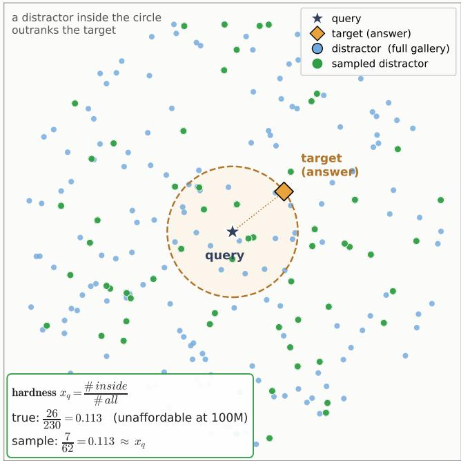  
Figure 1: Why web-scale evaluation is predictable—and how a small sample makes it cheap. Retrieval in embedding space for one query (⋆); its target/answer (the ♦) sits at a fixed distance (dashed circle). A distractor inside the circle scores above the target and outranks it, so over N distractors the number beating the target is $\operatorname { B i n o m i a l } ( N , x _ { q } )$ and the target’s rank is $1 + \mathrm { B i n o m i a l } ( N , x _ { q } )$ . The per-query hardness $x _ { q } = \# \mathrm { i n s i d e } / \# \mathrm { a l l \mathrm { \mathrm { - } t h e } }$ fraction of the distractor distribution inside the circle—is size-independent. Measuring it on the full gallery (every blue point) is the unaffordable 100M indexing; instead we draw a small random sample (green, inside and outside) and estimate $x _ { q }$ from the green points alone $( \hat { x } _ { q } \approx x _ { q } )$ . That one number fixes mAP at any gallery size N, so a 5% sample predicts the 100M-scale result without indexing 100M distractors. (Illustrative 2-D points; the sample is drawn larger than 5% for legibility.)

Why has retrieval not been doing this? The sampled-rank machinery is mature, but it has lived elsewhere: classical IR (Madigan et al., 2003; Hawking & Robertson, 2003), recommender systems (Krichene & Rendle, 2020; Jin et al., 2021), and biometrics (NIST, 2022; Scheirer et al., 2011; Grother & Phillips, 2004; Slavutsky & Benjamini, 2021; Rocher et al., 2025). That machinery has been used with a single assumed score distribution and no sample-based estimation (e.g. Madigan et al. (2003) analyze one shared relevant/irrelevant score pair); what has been missing for visual retrieval is estimating, per query and from a small sample, these extremely rare exceedance probabilities and validating the resulting metric against a real system at web scale. We turn that machinery into a practical, validated evaluation framework for web-scale instance retrieval: per-query hardness estimated from a small sample with a tail-aware estimator, validated at genuine 100M scale, and turned into a low-cost protocol.

## Contributions.

1. We bring the distractor-scaling law to instance retrieval and derive its retrieval form. The positive’s rank is $1 + \mathrm { B i n o m i a l } ( N , x _ { q } )$ with per-query hardness $x _ { q } = 1 - F _ { q } ( s ^ { \star } )$ , so the reported metric m $\mathrm { A P @ } k ( N )$ follows in closed form. This is an exact identity in the realized per-query exceedance fractions $\{ K _ { q , j } / M \}$ , since the gallery’s ranks are deterministic. A small sample turns it into a predictor through the population hardness, with error we quantify for the smooth term and evaluate empirically at the top-k boundary (App. C). The mechanism is broad, multi-decade (approximately power-law) hardness ⇒ near-logarithmic, non-saturating decay (log-uniform is the idealized limit).

2. A low-cost web-scale evaluation. From an affordable $1 / 2 0$ distractor subset a tail-aware (EVT) estimate predicts the web-scale metric. The estimate recovers the large-scale metric to mean absolute error 0.005 on ILIAS and ≤0.008 on INSTRE and GLDv2, beating curvefit and recommender-systems baselines.

3. Validation at true 100M scale. On ILIAS and INSTRE the estimator reproduces the official mAP over all 100M YFCC distractors; on Google Landmarks $\mathbf { v } 2$ (a different domain with a separate 759k pool) it recovers the official mAP@100. It holds across all five tested backbones and every benchmark.

4. A public release. We release code and per-query hardness so results on these benchmarks can be compared at any gallery size without re-indexing.

## 2 RELATED WORK

We organize prior work by which axis of cost it addresses. Training-side scaling laws predict error from training data/compute. Evaluation-side work either subsamples the query axis or estimates metrics from sampled judgments. We occupy a different cell: predicting the metric along the dis tractor/gallery axis.

Distractor-scaling benchmarks (the cost we remove). Revisited Oxford/Paris add the R1M hard-distractor set (Radenovic et al., 2018), Google Landmarks indexes millions (Weyand et al.,´ 2020), and ILIAS scales to 100M distractors (Kordopatis-Zilos et al., 2025). These works measure how accuracy falls as the gallery grows and report a few fixed operating points. None make the metric-versus-scale curve estimable from a sample or use it to cut evaluation cost. We do. The ILIAS authors do release mini-ILIAS, a VLM-mined 5M-distractor proxy that retains the hardest distractors as a cheaper stand-in for the full pool (Kordopatis-Zilos et al., 2025). It reports a number on a deliberately harder subset, whereas we predict the true 100M number from a uniform random sample. A hard-mined subset is non-uniform by design, so it does not yield the size-independent hardness our estimator needs.

Collection-size analysis in classical IR (closest in spirit). The relationship between collection size and retrieval effectiveness was modeled analytically two decades ago. Madigan et al. (2003) derive the distribution of irrelevant documents outscoring the relevant ones (“contamination at $K ^ { \mathfrak { N } } )$ This is a Binomial/Poisson sampled-rank model whose K=1 case is our Theorem 1. Theirs assumes a single score distribution shared by all queries, with no sample-based estimation (which they pose as future work). The same authors later applied extreme-value theory to the growing-collection asymptotics of retrieval effectiveness (Madigan et al., 2006), still for a single shared score distribution and without sample-based estimation or 100M-scale validation. Hawking & Robertson (2003) empirically observe that mAP rankings are largely preserved between a sample and the full collection. We supply what this line lacked: the heterogeneous per-query law, a sample-based tail-aware estimator, and validation at 100M.

Sampled / low-cost retrieval evaluation (judgment axis). A long IR tradition estimates metrics from incomplete or sampled relevance judgments: bpref (Buckley & Voorhees, 2004), statAP/infAP (Yilmaz et al., 2008; Yilmaz & Aslam, 2006), and minimal test collections (Carterette et al., 2006). In recommendation, Krichene and Rendle (Krichene & Rendle, 2020) show sampled top-k metrics are biased and collapse toward AUC, and propose corrected estimators (an unbiased rank estimator and a bias–variance variant); a subsequent line learns the global rank distribution by maximum likelihood (Jin et al., 2021; Li et al., 2023). These estimate an aggregate rank distribution (Recall/NDCG@k over a catalogue) and cure the sampling “blind spot” by sampling more items, not by extrapolating the unobserved tail. Our count baseline (Sec. 5) is the Krichene–Rendle unbiased estimator specialized to the top rank; because mAP depends on the per-positive hard tail (invisible below $1 / \bar { S ) }$ it fails to recover the large-N value, and enlarging the sample to resolve that tail is exactly the web-scale indexing we avoid—which is why we instead extrapolate it.

Efficient benchmarking (query axis). tinyBenchmarks (Polo et al., 2024) and Anchor Points (Vivek et al., 2024) rank models from a handful of test items via item-response theory or clustering. These reduce the number of queries. We reduce the number of distractors, an orthogonal and, at web scale, dominant cost.

Identification scaling in biometrics. Identification rates scale with gallery size (NIST, 2022), and the MegaFace benchmark measures face-identification accuracy as the gallery grows to a million distractors (Kemelmacher-Shlizerman et al., 2016). Meta-recognition fits an extreme-value tail to match scores (Scheirer et al., 2011). The same generalized-Pareto peaks-over-threshold object appears in IR for list truncation (Bahri et al., 2023), where the tail exceedance probability is exactly our $x _ { q }$ . The distinction is what the fit is for: prior work uses it at a fixed scale, whereas we use it as an extrapolation engine to a far larger gallery. Most related, Rocher et al. (2025) forecast largepopulation identification correctness from small experiments with a Pitman–Yor law. We differ in task (instance retrieval vs. closed-set identification), model, and scale (100M images). We read their result as concurrent evidence that evaluation-side scaling laws are learnable.

Training-side scaling laws (contrast). Power-law generalization in training data and model size (Hestness et al., 2017; Kaplan et al., 2020), including for dense retrieval (Fang et al., 2024), brought predictive discipline to training budgets. We bring the same discipline to the evaluation budget, treating evaluation scaling as a first-class problem in its own right, analogous to training scaling laws. A parallel line extrapolates multi-class classification accuracy to larger label sets from a subset of classes (Zheng et al., 2018), the class-axis analogue of our gallery-axis extrapolation.

## 3 A SCALING LAW FOR RETRIEVAL UNDER DISTRACTORS

Setup. Fix a query q and rank all gallery items by descending cosine similarity to q. Let $s ^ { \star }$ be the similarity of the query’s best positive (the maximum over its relevant images). Let $d _ { 1 } , \ldots , d _ { N }$ be N distractors drawn i.i.d. from the distractor source, with similarities $S _ { i } = \sin ( q , d _ { i } )$ and common CDF $F _ { q }$ . Define the per-query hardness

$$
x _ { q } : = \mathrm { P r } \lbrack \sin ( q , d ) > s ^ { \star } \rbrack = 1 - F _ { q } ( s ^ { \star } ) ,\tag{1}
$$

the fraction of the distractor similarity distribution lying above the best positive. The hardness $x _ { q }$ is a population quantity: a property of the model and the distractor source, not of the number $\overset { \triangledown } { N }$ of distractors drawn. It is distinct from the realized exceedance fraction in a particular gallery. We make that distinction precise below, and it governs when the law is exact.

Theorem 1 (Distractor scaling). 1 Let $K = \# \{ i : S _ { i } > s ^ { \star } \}$ be the number ofdistractors outranking the positive. Then $K \sim$ Binomial $( N , x _ { q } )$ , the positive sits at rank $1 + K$ , and

$$
\mathrm { P r } [ p o s i t i \nu e r a n k e d f i r s t ] = ( 1 - x _ { q } ) ^ { N } ,\tag{2}
$$

$$
\mathbb { E } [ \mathrm { r a n k } ] = 1 + N x _ { q } .
$$

For a query with positives $1 , \ldots , n _ { q }$ at descending similarity, let $x _ { q , j } = \operatorname* { P r } [ \sin ( q , d ) > s _ { j } ]$ be the per-positive (population) hardness. Collecting these, define the hardness-to-metric map

$$
\begin{array} { l } { { \displaystyle R _ { k } \big ( \{ u _ { q , j } \} , N \big ) = \frac { 1 } { | Q | } \sum _ { q } \frac { 1 } { \operatorname* { m i n } ( k , n _ { q } ) } } } \\ { { \displaystyle ~ \times \sum _ { j = 1 } ^ { n _ { q } } \mathbf { 1 } \{ r _ { j } \leq k \} \frac { j } { r _ { j } } , } } \\ { { \displaystyle r _ { j } = j + N u _ { q , j } } . } \end{array}\tag{3}
$$

As shown next (and in App. C), $R _ { k }$ is an exact identity for the realized gallery when fed its realized exceedance fractions, and a predictor when fed the population hardness $\{ x _ { q , j } \}$ —one whose smoothprecision error we quantify and whose top-k truncation error we evaluate empirically (App. C).

Each summand ${ \mathrm { \Omega } } _ { j / r _ { j } }$ is non-increasing in N, so m $\mathrm { A P @ } k ( N )$ is non-increasing: a larger gallery never raises the metric (by coupling, every K only grows as distractors are added). In the rareevent regime (N large, $x _ { q }$ small, $N x _ { q } = O ( 1 ) )$ , $K $ Poisson $( N x _ { q } )$ and the top-rank survival Pr[positive rankedfirst] $\begin{array} { r } { \approx e ^ { - N x _ { q } } . } \end{array}$ . A positive holds the top-k until $N \approx k / x _ { q , j } .$

Proof. The indicators $\begin{array} { c c c c c } { { B _ { i } } } & { { = } } & { { { \bf 1 } \{ S _ { i } } }  & { { > } } & { { s ^ { \star } \} } } \end{array}$ are i.i.d. Bernoulli(xq), so their sum $K$ Binomial $( N , x _ { q } )$ The positive is at rank $1 \dot { + } K$ , so it is ranked first iff $K { = } 0$ , with probability $( 1 - x _ { q } ) ^ { \top }$ . By linearity of expectation (which requires no independence), $\mathbb { E } [ \mathrm { r a n k } ] ~ =$ $\begin{array} { r } { 1 + \mathbb { E } [ K ] = { \small \mathrm { \ ' ~ 1 } } + \sum _ { i } \mathbb { E } [ B _ { i } ] = 1 + N x _ { q } , } \end{array}$ , and more generally the j-th positive (already preceded by $j - 1$ better positives) sits at expected rank $j + N x _ { q , j }$ The map (3) assembles these per-positive ranks into the metric. Whether it equals the realized mAP exactly or only predicts it depends on which hardness it is fed, which we make precise after the proof. The Poisson limit is the standard convergence Binomial $( N , x _ { q } ) $ Poisson $( N x _ { q } )$ . Monotonicity follows by coupling $K _ { N + 1 } = K _ { N } + B _ { N + 1 } \geq K _ { N }$ , so each rank $r _ { j }$ only grows and each ${ \mathrm { \Omega } } _ { j / r _ { j } }$ only shrinks. □

Exact identity vs. prediction. The map (3) is used two ways, and separating them is what makes “exact law” precise. (i) Identity: a benchmark pool is one fixed set, and the j-th positive’s rank is the deterministic $r _ { j } = j + K _ { q , j }$ , where $K _ { q , j }$ counts the distractors outscoring it. With the realized fraction $\bar { x } _ { q , j } : = K _ { q , j } / N$ we have $j + \mathrm { \bar { \it { N x } } } _ { q , j } = r _ { j }$ , so $R _ { k } ( \{ \bar { x } _ { q , j } \} , N )$ is that gallery’s mAP exactly: truncation included, no expectation, no linearization (App. C). (ii) Prediction: the population hardness $x _ { q , j }$ of Eq. (1) differs. Since $K _ { q , j } \sim$ Binomia $( N , x _ { q , j } ) , \bar { x } _ { q , j }$ concentrates on it with standard deviation $\sqrt { x _ { q , j } ( 1 - x _ { q , j } ) / N }$ , so feeding $\{ x _ { q , j } \}$ predicts the realized mAP. That prediction error is empirically $\leq 0 . 0 0 6$ at 100M. The $\mathbb { E } [ 1 / r ] \ – \mathrm { v s - } 1 / \mathbb { E } [ r ]$ gap concerns only the neverreported pool-resampling average $\mathbb { E } [ \mathrm { A P } ]$ , which we compute exactly (the per-positive Binomial sum $\begin{array} { r } { \sum _ { m } \frac { j } { j + m } \operatorname* { P r } [ K _ { q , j } = m ] ) } \end{array}$ and find sits ≈0.005 above the realized value: since a benchmark reports the realized number, targeting it with the expected-rank map—as we do—is more accurate than targeting $\mathbb { E } [ \mathrm { A P } ]$ , not less. Our estimator plugs in a size-S sample estimate $\hat { x } _ { q , j }$ , splitting the error into estimation (sample→population) and concentration (population→realized), both quantified in App. C.

Remarks. The expected-rank result $1 + N x _ { q }$ holds under arbitrary dependence between distractors. The exact $( 1 - x _ { q } ) ^ { N }$ /Poisson forms assume independence, which holds for i.i.d. random distractors and which we find empirically tight at 100M (Sec. 5). The theorem models N i.i.d. draws from a distractor source. Evaluating on a fixed release (e.g. the official 100M set) is one realiza tion, for which the law is the with-replacement approximation of the finite-pool (hypergeometric) outcome. The two coincide at sampling fractions $\ll 1$ , and the full-pool value is the N → pool-size limit. Everything hinges on the single per-query scalar: the law is an exact identity at the realized exceedance fractions and a concentration-tight predictor at the population hardness (above), and all of the empirical content lives in how that hardness is distributed across queries.

## Logarithmic decay under log-uniform hardness.

Corollary 1 (Log-uniform hardness ⇒ logarithmic decay). If the hardness density is log-uniform, $g ( x ) \propto 1 / x o n \left[ a , b \right]$ , then the aggregate top-rank survival

$$
\begin{array} { r l r } {  { \mathbb { E } _ { q } \big [ ( 1 - x _ { q } ) ^ { N } \big ] = \int ( 1 - x ) ^ { N } g ( x ) d x } } \\ & { } & { \approx \frac { E _ { 1 } ( N a ) - E _ { 1 } ( N b ) } { \ln ( b / a ) } \approx A - B \ln N } \end{array}\tag{4}
$$

for $1 / b \ll N \ll 1 / a ,$ , where $E _ { 1 }$ is the exponential integral. Each $j / r _ { j }$ term in (3) decays the same way, so m $\mathrm { A P @ } k ( { \dot { N } } )$ inherits the logarithmic profile. Accuracy therefore decays logarithmically and never plateaus over the relevant range.

This is an empirical regularity of the datasets we study, not a universal law. Across all of them the per-query hardness is approximately a power law $x ^ { - \alpha }$ with $\alpha \approx 1 . 2 ( 1 . 1 6 \mathrm { - } 1 . 3 2$ across our backbones and benchmarks; Sec. 5, Fig. 2); the log-uniform case above $( \alpha { = } 1 )$ is its idealized limit, and the mild power law induces the observed near-logarithmic decay: mAP falls by a roughly constant amount per decade of distractors all the way to 100M, with a large fraction of mass near the detection floor $x \approx 1 / N$ . It is the precise sense in which evaluating on a small subset is optimistic: the subset has not yet revealed the slow bleed of the hardness tail.

## 4 FROM LAW TO PROTOCOL

Theorem 1 says a model’s behavior at any gallery size is determined by the size-independent hardness distribution $\{ x _ { q } \}$ . Evaluation therefore need not scale with the distractor set: estimate $\{ x _ { q } \}$ from a small random sample and report the metric (mAP@k) at a standardized target $N ^ { \star }$ via Eq. (3), so numbers obtained with different distractor budgets become directly comparable.

Estimating hardness from a size-S sample. Draw S random distractors and, per query, record $s ^ { \star }$ and the sample similarities. The difficulty is that the queries which dominate large-N accuracy have hardness $\bar { x } _ { q } { \lesssim } 1 / S$ and are invisible in the sample. We consider: (i) Count $\hat { x } _ { q } = \mathbf { \bar { \Phi } } _ { S } ^ { 1 } \# \{ S _ { i } > s ^ { \star } \}$ – unbiased but quantized at $1 / S ;$ it returns 0 for the invisible tail and so predicts those queries survive forever. This is exactly the Krichene–Rendle unbiased rank estimator specialized to the top rank, and it is over-optimistic. (ii) Tail extrapolation via extreme-value theory (EVT) (Scheirer et al., 2011; Bahri et al., 2023) – for these queries no sampled distractor reaches $s ^ { \star }$ , so counting is blind to them. Extreme-value theory states that above a high threshold the far tail of essentially any continuous score distribution converges to a universal two-parameter shape, a generalized Pareto. We fit that shape to the highest-scoring distractors we do observe and extend it out to $s ^ { \star }$ , recovering a small nonzero hardness. The move is the same one used to estimate a never-observed “100-year flood” from the tail of recorded flood heights (full procedure in App. B). (iii) Survival-curve $\mathit { f i t } - \mathit { f i t }$ the mechanism of Cor. 1, the log-uniform survival model $S _ { 1 } ( \bar { N } ) = w _ { \mathrm { i m m } } + w _ { c } [ E _ { 1 } ( N a ) - E _ { 1 } ( N b ) ] / \ln ( b / a )$ for the top-rank survival, to the measured survival curve $S _ { 1 } ( N { \leq } S )$ and extrapolate.

The estimate and its interval. The two families fail on the same object, the hardness mass below the sample floor $1 / S ,$ in opposite one-sided ways. Counting and curve fits assign that mass zero, so they can only over-predict, with positive error in every one of our five backbone cases. Tail extrapolation instead assigns the mass a fitted value and recovers it. Because mAP integrates marginal positives whose hardness lives precisely in that unobserved tail, we take the tail-aware (EVT) estimate $\hat { R } _ { \mathrm { t a i l } }$ as the point estimate. It is accurate across three benchmarks, two distractor pools, and five backbones. The count estimate $\hat { R } _ { \mathrm { c o u n t } }$ zeroes the unresolved sub-1/S tail mass, which can only raise the predicted metric—a one-sided bias on that mass, not a deterministic per-sample guarantee; the tail estimate has no matching bias in the other direction, so we treat the gap $B = \hat { R } _ { \mathrm { c o u n t } } - \hat { R } _ { \mathrm { t a i l } }$ as an empirical diagnostic—computable from the sample and shrinking as S grows—not a coverage interval. Empirically the truth sits at the tail edge in every case we measure, but a misspecified tail could in principle err either way. Alongside it we report a query-bootstrap confidence interval that captures sampling noise. Judged against this interval, the estimate enters the metric’s own noise from a small sample (Sec. 5). An error analysis (App. C) shows the AP law is exact in the hardnesses for the realized gallery, so the error is entirely the sampling term. That term concentrates for sample-resolved positives and is governed by extreme-value consistency for the unresolved tail.

The recipe, summarized in Alg. 1: sample S, fit the per-query EVT tail, report $\begin{array} { r } { \frac { 1 } { | Q | } \sum _ { q } \mathrm { A } \mathbf { \bar { P } } _ { q } ( N ^ { \star } ; \hat { x } _ { q , \cdot } ) } \end{array}$ at the target scale via Eq. (3) with the empirical count/tail diagnostic and a query-bootstrap confidence interval.

Requirement: the sample must be i.i.d. The law assumes the S distractors are drawn uniformly at random from the pool. This is the one assumption a practitioner can silently violate. A convenience sample, such as the first S files of a pool ordered by crawl date, cluster, or upload, is not uniform: correlated images concentrate the score tail and bias the hardness estimate. Hash-based or shuffled sampling is the actual guarantee that the drawn sample represents the omitted pool. The per-shard check—split the sample into feature shards and confirm per-shard accuracy is constant (Sec. 5)—is a diagnostic that catches drift within the drawn sample (visible as shard-to-shard variation), not a proof of representativeness.

Algorithm 1 Predicting the web-scale metric from a small distractor sample. A correct answer’s   
rank grows by the number of distractors that outscore it—about N times its per-query hardness x,   
the fraction of all distractors scoring above the answer. Estimating x from a small sample therefore   
fixes mAP at any gallery size N, with no full-scale indexing.   
Require: query set Q with correct answers; a uniform random sample of S distractors; target gallery size N;   
rank cutoff k   
Ensure: predicted mAP@k at gallery size N   
1: construct a uniform (hash-random) sample; optionally check shard consistency for drift   
2: for each query $q$ do   
3: for each correct answer $p$ of $q ,$ with similarity $s _ { p }$ do   
4: estimate the hardness x from the fraction of sampled distractors scoring above $s _ { p }$ ▷ exact   
rule—count edge with a bounded-EVT tail—in §4 / App. B   
5: $r _ { p } \gets ( p ^ { \prime } \mathrm { { s } }$ rank among the answers) $+ \textit { N x }$   
6: end for   
7: $\operatorname { A P } _ { q }$ ← average precision from the ranks $\{ r _ { p } \}$ [Eq. (3)]   
8: end for   
9: return m $\begin{array} { r } { \mathrm { A P @ } k = \frac { 1 } { | Q | } \sum _ { q } \mathrm { A P } _ { q } } \end{array}$ with a query-bootstrap confidence interval

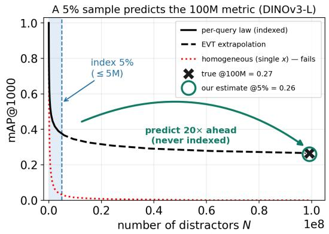

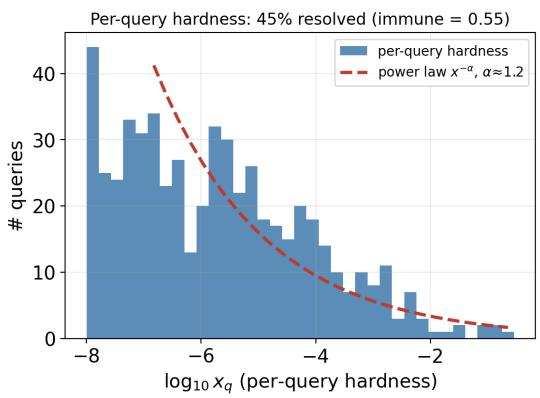  
Figure 2: A 5% sample predicts the 100M metric. Left: mAP@1000 against gallery size N for DINOv3-L on ILIAS. Only the shaded 5% is indexed $( N \leq 5 \mathrm { { M } }$ , solid law); past it the per-query law of Eq. (3) is pure EVT extrapolation (dashed), carrying the metric 20× to the true 100M value (X, 0.27), which the 5% estimate recovers (0.26)—while a homogeneous single-x model collapses to zero. Right: the per-query hardness distribution—55% of queries stay immune (never outranked even at 100M) and the resolved rest follow an approximate power law $x ^ { - \alpha }$ , α≈1.2 (dashed) across ∼6 decades toward the $1 / N$ floor.

When extrapolation is needed. The estimator’s job is to recover the unobserved hard tail, so its value scales with how much that tail matters. With a hard pool (large decay), the count estimate is badly optimistic and tail modeling is essential. With an easy pool (little decay), there is almost nothing to extrapolate and counting already suffices. Across our datasets a random small sample recovers mAP to within ∼0.01.

## 5 EXPERIMENTS

Setup. We evaluate on three benchmarks across two distractor pools. ILIAS (Kordopatis-Zilos et al., 2025): 1,232 instance queries against 100M YFCC distractors, using the official precomputed features for 5 backbones (DINOv2-L, DINOv3-L, SigLIP-L, SigLIP2-L, PE-core-L), which we reproduce to cosine 1.00; we report the official mAP@1000. INSTRE (Wang & Jiang, 2015): 1,250 object queries with the same 100M pool appended. Google Landmarks v2 (Weyand et al., 2020): 1,129 retrieval queries against the 759k-image index pool—a different domain, its own ground truth, and a same-domain (landmark-vs-landmark) distractor distribution—encoded with the same five backbones at their native preprocessing; we report the official mAP@100. Samples are uniformrandom, verified with the per-shard diagnostic of Sec. 4.

The law holds (Fig. 2). For DINOv3-L the per-query prediction tracks measured mAP across eight decades to 0.266 at 100M (the value computed on the full official feature release). By contrast, a homogeneous single-x model collapses to zero. Recovering the official number end-to-end validates the pipeline and the law at ground truth. Hardness follows an approximate power law $x ^ { - \alpha } \left( \alpha \approx 1 . 2 ; \right.$ 1.16–1.32 across the five backbones and three benchmarks): a large fraction of queries stay nearimmune even at 100M, and the resolved rest bleed accuracy at a near-constant rate per decade—loguniform (α=1) is the idealized limit of Cor. 1 and gives exactly that. This never-saturating decay is also why reading the metric off a 50k subset is optimistic by +0.34 at 100M (Fig. 2).

The independence assumption is benign in practice (Fig. 3). The exact $( 1 - x ) ^ { N }$ form assumes independent distractors. Empirically the residual between the independent prediction and the measured incremental curve is at most a few percent at 100M across all 5 backbones, and the prediction is stable to 0.004 across three disjoint 5M sub-pools (App. B). Analytically, near-duplicate clusters of size c leave the expected rank unchanged $( 1 + N x _ { q } ,$ clustering-invariant by linearity) and inflate only its variance by ∼c; on the real crawl ordering the measured curve sits at $c \approx 1$ , so we do not claim i.i.d. is conservative for mAP in general—only that the residual is small here (Fig. 3, App. B).

Predicting mAP@100M (Tab. 1). Because mAP@1000 depends on the rank of every positive and marginal positives have hardness in the unobserved tail, recovering it takes tail extrapolation rather than counting (closed form Eq. (3), exact in the realized hardnesses; derivation in App. A, C). From a 5% sample (5M for ILIAS, a 20× reduction), the tail-aware (EVT) estimator recovers true mAP@100M to mean error 0.005 (max 0.008) across the five ILIAS backbones. The querybootstrap interval’s overlap with the true interval for every backbone (App. C, Tab. 6) is a weaker check, since prediction and truth share the same queries and their intervals are correlated. Two stronger checks (App. C) agree: the estimate preserves the backbone ranking exactly (Kendall $\tau = 1 . 0 $ , no pairwise sign flip; gaps down to ≈0.013 mAP are resolved, and the closest pair— PE-core vs. SigLIP2, gap 0.010—is within the extrapolation error and should be read as a statistical tie), and the paired per-query error has pooled 95% CI [−0.001, +0.004]. At this same 5M cost, naively evaluating on the subset is optimistic by mean 0.11, whereas our prediction is within 0.005, roughly 22× more accurate (App. C, Tab. 8). For DINOv3-L the estimator gives 0.260 vs. 0.266 (err 0.006), while the count estimator over-predicts (+0.050). The estimate is stable across sample size (Fig. 6), and 5% (5M) is accurate for every backbone across all three benchmarks.

These intervals resample queries only. Folding in the other two noise sources, namely which distractors land in the sample and the per-query EVT refit, needs a nested bootstrap over all five backbones. It adds only $\sigma \approx 0 . 0 0 3$ of distractor-sample-plus-fit noise, so the intervals shift slightly rather than widen, and still covers the true 100M value in $5 / 5$ cases (App. C, Tab. 7). Query sampling dominates the uncertainty. Resampling the distractors directly—20 disjoint 5% draws per backbone—places all 100 predictions inside the reported interval (coverage 100/100; std 0.003, worst error 0.013; App. D). The reported interval is a query confidence interval; the remaining noise sources are quantified in App. C.

We compare against the baselines a practitioner would reach for, all from the same 5% sample. Three fail on the unresolved tail: reporting the metric on the sample (“evaluate-at-S”) is optimistic by 0.08–0.13 (Tab. 8); the tail-blind count (the Krichene–Rendle unbiased estimator), which assigns the tail below 1/S zero mass, over-predicts by 0.037–0.068; and power-law (0.120) and log-uniform survival (0.038) curve fits do no better. The tail-aware estimate (mean error 0.005; the headline paired mean of Tab. 1 is 0.005) beats all of them—only the bounded GPD $( \xi \ \le \ 0$ , free scale) excludes the power-law regime and recovers the tail.

Generalization across pools (Tab. 5, 3, Fig. 5). The estimator is not tuned to ILIAS: its configuration $( T { = } 4 0 0 0 , q { = } 0 . 9 5 , \xi \le 0 )$ is fixed once, so INSTRE and GLDv2 are held-out tests (App. B). On INSTRE (mAP@1000 at 100M, all 5 backbones) it recovers the 100M value to within 0.007 for every backbone (mean |err| 0.005, Tab. 4), preserving the ranking, while the count edge overpredicts (mean +0.008). GLDv2 —a different domain with 759k same-domain landmark distractors and official mAP@100—is a held-out test of comparable difficulty (immune fraction—queries never outranked even at 100M—0.40–0.64, vs. 0.37–0.55 on ILIAS): the law holds (proof-vs-measured $\mathbf { M A E } \leq 0 . 0 1 0 )$ , the truth lies inside the interval 5/5, and a 5% sample recovers mAP@100 to mean error 0.008 (Fig. 5), while count and curve fits over-predict (Tab. 3)—it still holds. Across all three benchmarks and two pools the recovery stays within ∼0.01 (Tab. 5).

<table><tr><td rowspan="2">backbone</td><td rowspan="2">true mAP@100M</td><td colspan="4">estimate from a 5% (5M) sample</td></tr><tr><td>official 5M (hard-mined)</td><td>naive 5M (random)</td><td>count</td><td>EVT (ours)</td></tr><tr><td>DINOv3-L</td><td>0.266</td><td>0.311</td><td>0.374</td><td>0.317</td><td>0.260</td></tr><tr><td>PE-core-L</td><td>0.223</td><td>0.271</td><td>0.355</td><td>0.287</td><td>0.225</td></tr><tr><td>SigLIP2-L</td><td>0.213</td><td>0.253</td><td>0.341</td><td>0.280</td><td>0.221</td></tr><tr><td>SigLIP-L</td><td>0.200</td><td>0.242</td><td>0.324</td><td>0.268</td><td>0.208</td></tr><tr><td>DINOv2-L</td><td>0.154</td><td>0.185</td><td>0.230</td><td>0.191</td><td>0.153</td></tr><tr><td>mean |err|</td><td></td><td>+0.041</td><td>+0.113</td><td>+0.057</td><td>0.005</td></tr></table>

Table 1: Recovering the 100M metric from a 5% (5M) sample. For each backbone: the true mAP@1000 at 100M (our recompute, matching the official ILIAS leaderboard to ≤0.001), and four numbers obtainable at a 5M (20× smaller) budget—the leaderboard’s official hard-mined 5M column, a naive uniform-random 5M evaluation, the tail-blind count baseline, and our tail-aware EVT estimate. All three baselines over-predict (mean +0.041/+0.113/+0.057); only EVT recovers the true value (mean |err| 0.005), and it needs no reference 100M numbers—unlike a fixed 5M-to-100M rescaling of the leaderboard column, which INSTRE and GLDv2 lack. All differences are statistically significant: each baseline’s 95% query-bootstrap interval lies above the truth (0/5) and every EVT interval overlaps it (5/5); detailed intervals in App. C (Tab. 6).

Faster, cheaper, greener (Fig. 7). Indexing 100M images through a ViT-L costs ≈556 GPU-hours and ≈89 kg CO2eq per backbone (A100, 0.4 kg/kWh (Lacoste et al., 2019)), rising to ≈622 kg for a 7-backbone sweep; the 5% protocol cuts this 20× (Fig. 7).

## 6 DISCUSSION AND CONCLUSION

The per-query hardness $\{ x _ { q } \}$ is itself a reusable artifact: specific to a model and its distractor source, it lets that method’s metric be read off at any gallery size in closed form and makes results obtained with different distractor budgets commensurable. We release it for our backbones on ILIAS.

Conclusion. Web-scale retrieval evaluation is largely predictable: a per-query tail-aware estimator recovers 100M-scale accuracy from a small random distractor sample to 0.005 mean error, covering the truth for every backbone we test on ILIAS, INSTRE, and GLDv2. Validated across five backbones, three benchmarks, and two distractor pools, it turns web-scale evaluation from an indexing problem into a prediction problem—for method comparisons whose margins exceed the extrapolation error.

## REPRODUCIBILITY STATEMENT

All code will be made publicly available.

## USE OF LARGE LANGUAGE MODELS

Large language models were used during the preparation of this paper: to aid and polish the writing, to draft sections of the paper, to aid retrieval and discovery of related work, and to aid in proving the paper’s mathematical claims. We have reviewed all AI-assisted work and take responsibility for the final content of this work, including text, claims, and artifacts produced with the aid of generative AI.

## REFERENCES

Dara Bahri, Che Zheng, Yi Tay, Donald Metzler, and Andrew Tomkins. Surprise: Result list truncation via extreme value theory. In SIGIR, pp. 2404–2408, 2023.

Chris Buckley and Ellen M Voorhees. Retrieval evaluation with incomplete information. In SIGIR, 2004.

Ben Carterette, James Allan, and Ramesh Sitaraman. Minimal test collections for retrieval evalua tion. In SIGIR, 2006.

Yan Fang, Jingtao Zhan, Qingyao Ai, Jiaxin Mao, Weihang Su, Jia Chen, and Yiqun Liu. Scaling laws for dense retrieval. In SIGIR, 2024.

Teddy Furon and Herve J ´ egou. Using extreme value theory for image detection. Technical Report ´ RR-8244, INRIA, 2013.

Patrick Grother and P. Jonathon Phillips. Models of large population recognition performance. In CVPR, 2004.

David Hawking and Stephen Robertson. On collection size and retrieval effectiveness. Information Retrieval, 6(1):99–150, 2003.

Joel Hestness, Sharan Narang, Newsha Ardalani, Gregory Diamos, Heewoo Jun, Hassan Kianinejad, Md. Mostofa Ali Patwary, Yang Yang, and Yanqi Zhou. Deep learning scaling is predictable, empirically. arXiv:1712.00409, 2017.

Ruoming Jin, Dong Li, Benjamin Mudrak, Jing Gao, and Zhi Liu. On estimating recommendation evaluation metrics under sampling. In AAAI, 2021.

Jared Kaplan, Sam McCandlish, Tom Henighan, Tom B. Brown, Benjamin Chess, Rewon Child, Scott Gray, Alec Radford, Jeffrey Wu, and Dario Amodei. Scaling laws for neural language models. arXiv:2001.08361, 2020.

Ira Kemelmacher-Shlizerman, Steven M. Seitz, Daniel Miller, and Evan Brossard. The MegaFace benchmark: 1 million faces for recognition at scale. In CVPR, 2016.

Giorgos Kordopatis-Zilos, Vladan Stojnic, Anna Manko, Pavel ´ Suma, Nikolaos-Antonios Ypsilan- ˇ tis, Nikos Efthymiadis, Zakaria Laskar, Jiˇr´ı Matas, Ondˇrej Chum, and Giorgos Tolias. ILIAS: Instance-level image retrieval at scale. In CVPR, 2025.

Walid Krichene and Steffen Rendle. On sampled metrics for item recommendation. In KDD, 2020.

Alexandre Lacoste, Alexandra Luccioni, Victor Schmidt, and Thomas Dandres. Quantifying the carbon emissions of machine learning. arXiv:1910.09700, 2019.

Dong Li, Ruoming Jin, Zhenming Liu, Bin Ren, Jing Gao, and Zhi Liu. Towards reliable item sampling for recommendation evaluation. In AAAI, 2023.

David Madigan, Yehuda Vardi, and Ishay Weissman. On retrieval properties of samples of large collections. In AISTATS, 2003.

David Madigan, Yehuda Vardi, and Ishay Weissman. Extreme value theory applied to document retrieval from large collections. Information Retrieval, 9:273–294, 2006.

NIST. Face recognition vendor test (FRVT): Relating 1:1 and 1:n false positive rates. Technical report, National Institute of Standards and Technology, 2022. FRVT report card. https:// pages.nist.gov/frvt/reports/demographics/implications\_for\_1N.pdf.

Felipe Maia Polo, Lucas Weber, Leshem Choshen, Yuekai Sun, Gongjun Xu, and Mikhail Yurochkin. tinyBenchmarks: Evaluating LLMs with fewer examples. In ICML, 2024.

Filip Radenovic, Ahmet Iscen, Giorgos Tolias, Yannis Avrithis, and Ond ´ ˇrej Chum. Revisiting Oxford and Paris: Large-scale image retrieval benchmarking. In CVPR, 2018.

Luc Rocher, Julien M Hendrickx, and Yves-Alexandre de Montjoye. A scaling law to model the effectiveness of identification techniques. Nature Communications, 2025.

Walter J Scheirer, Anderson Rocha, Ross J Micheals, and Terrance E Boult. Meta-recognition: The theory and practice of recognition score analysis. IEEE TPAMI, 33(8), 2011.

Yuli Slavutsky and Yuval Benjamini. Predicting classification accuracy when adding new unobserved classes. In ICLR, 2021.

Rajan Vivek, Kawin Ethayarajh, Diyi Yang, and Douwe Kiela. Anchor points: Benchmarking models with much fewer examples. In EACL, 2024.

Shuang Wang and Shuqiang Jiang. INSTRE: A new benchmark for instance-level object retrieval and recognition. ACM Transactions on Multimedia Computing, Communications, and Applications, 11(3), 2015.

Tobias Weyand, Andre Araujo, Bingyi Cao, and Jack Sim. Google Landmarks Dataset v2: A largescale benchmark for instance-level recognition and retrieval. In CVPR, 2020.

Emine Yilmaz and Javed A Aslam. Estimating average precision with incomplete and imperfect judgments. In CIKM, 2006.

Emine Yilmaz, Evangelos Kanoulas, and Javed A Aslam. A simple and efficient sampling method for estimating AP and NDCG. In SIGIR, 2008.

Charles Zheng, Rakesh Achanta, and Yuval Benjamini. Extrapolating expected accuracies for large multi-class problems. Journal ofMachine Learning Research, 19(65):1–30, 2018.

## A DERIVATION OF MAP UNDER DISTRACTORS

Fix a query q with $n _ { q }$ positives sorted by similarity, $s _ { p _ { 1 } } \geq \cdot \cdot \cdot \geq s _ { p _ { n _ { a } } } , \mathrm { s o } p _ { j }$ is the j-th best positive. Adding N i.i.d. distractors, the number scoring above $p _ { j }$ is $K _ { j } \sim$ Binomia $\ l _ { 1 } ( N , x _ { q , j } )$ with perpositive hardness $x _ { q , j } = 1 - F _ { q } ( s _ { p _ { j } } )$ (Thm. 1 applied at threshold $s _ { p _ { j } } )$ . The rank of $p _ { j }$ in the full list is the count of items at least as similar—the j positives $p _ { 1 } , \ldots , p _ { j }$ plus the $K _ { j }$ distractors above it:

$$
\mathrm { r a n k } _ { j } \ = \ j + { \cal K } _ { j } , \qquad \mathbb { E } [ \mathrm { r a n k } _ { j } ] = j + N x _ { q , j } .\tag{5}
$$

Average precision truncated at k is, since exactly j positives have rank $\leq$ rankj,

$$
\mathrm { A P } _ { q } = \frac { 1 } { \mathrm { m i n } ( k , n _ { q } ) } \sum _ { j : \mathrm { r a n k } _ { j } \leq k } \frac { j } { \mathrm { r a n k } _ { j } } .\tag{6}
$$

Evaluating the map $R _ { k }$ of Eq. (3) at the realized fraction $\bar { x } _ { q , j } = K _ { j } / N$ gives rank ${ \bf \Phi } _ { j } = j + { \cal K } _ { j }$ and reproduces this gallery’s mAP@k exactly (no expectation, no Taylor remainder; App. C). Feeding instead the population hardness $x _ { q , j } - - \mathrm { o r }$ its sample estimate $\dot { { \hat { x } } } _ { q , j } - p r e d i c t s$ the metric, with the population→realized concentration error analyzed in App. C. We confirm the identity numerically by evaluating rank $_ j ~ = ~ j + K _ { j }$ with the observed $K _ { j } .$ —counting each positive’s distractor exceedances in one streamed pass—and find the analytic form matches the measured mAP (Tab. 1). The protocol substitutes the sampled hardness estimate $\hat { x } _ { q , j }$ (count or tail-aware) for $x _ { q , j }$ and reports the tail-aware estimate with its bracket. Unlike the top-rank survival’s exponential $( 1 - x _ { q } ) ^ { N }$ , the per-positive precision $j / ( j + N \hat { x } _ { q , j } )$ is a gently varying rational response that damps errors in $\hat { x } _ { q , j } \colon$ the tail estimate’s over-shoot becomes negligible, whereas the count estimate stays structurally overoptimistic (it cannot report hardness below the sample floor $1 / S )$ . Empirically the truth therefore sits at the tail edge of the interval for mAP@1000—the tail-aware estimate alone is nearly exact, while the count edge over-predicts (Tab. 1).

## B THE TAIL-AWARE (EVT) ESTIMATOR

For a query whose best positive has similarity $s ^ { \star }$ , the hardness $x _ { q } = \operatorname* { P r } [ \sin ( q , d ) > s ^ { \star } ]$ is the probability that a random distractor outscores the answer. When $x _ { q }$ is small—the regime that dominates large-N accuracy—no distractor in a size-S sample reaches $\bar { s } ^ { \star }$ , so the empirical count returns $x _ { q } = 0$ and we must estimate the probability of an event that did not occur in the sample.

Extreme-value theory makes this possible without knowing the full score distribution. The Pickands–Balkema–de Haan theorem states that, for any distribution in an extreme-value domain of attraction (essentially all continuous distributions), the excesses over a high threshold u (the amounts sim − u by which scores exceed u) converge to a generalized-Pareto distribution (GPD) as u grows. In words: the far tail has a universal two-parameter shape, independent of the bulk, so we can fit it from the part of the tail we observe and extend it.

Per query we (1) retain the top ${ \cal T } \mathrm { = } 4 0 0 0$ distractor similarities—all that bear on the upper tail, the rest falling far below $s ^ { \star } -$ and set the threshold u to their 95th percentile, i.e. the top ≈200 scores; because $\bar { T }$ is fixed, this is a fixed exceedance count independent of $S$ (the same ≈200 at S=50k or $5 \mathbf { M } ) ; ( 2 )$ fit the GPD shape $\xi$ and scale σ to the excesses $\{ \sin _ { i } - u : \sin _ { i } > u \}$ by maximum likelihood; and (3) set the exceedance rate $\zeta _ { u } = \# \{ \mathrm { s i m } > u \} \big / S -$ —the ≈200 exceedances normalized by thefull sample size $S ,$ , not by T, so $\zeta _ { u }$ shrinks as $S$ grows. The hardness estimate is

$$
\hat { x } _ { q } = \zeta _ { u } \big ( 1 - \mathrm { G P D } _ { \xi , \sigma } \big ( s ^ { \star } - u \big ) \big ) ,\tag{7}
$$

the rate of exceeding u times the fitted-tail probability of reaching all the way to $s ^ { \star }$ —read off the curve beyond the observed range. We use the empirical count when at least $c { = } 5$ sampled distractors exceed $s ^ { \star } \left( \mathsf { A l g } \right.$ . 1); with fewer, the count is too noisy (and c=0 would force $x _ { q } = 0 )$ , so we read the hardness off the fitted tail instead. This is the standard peaks-over-threshold construction, used by meta-recognition (Scheirer et al., 2011; Furon & Jegou, 2013) on recognition scores; the intuition ´ is estimating a never-observed “100-year flood” by fitting the tail of recorded flood heights and extrapolating.

The tail shape must exclude power-law growth. The GPD shape $\xi$ sets how heavy the tail is: $\xi >$ 0 is an infinite, power-law tail, whereas cosine similarities cannot exceed 1, so the distractor-score distribution has bounded support. By extreme-value theory a distribution with bounded support lies in the Weibull/Gumbel domain, $\xi \le 0 ;$ a positive $\xi$ would model a physically impossible power-law tail. We therefore cap $\xi \le 0$ (refitting the scale at the boundary when the unconstrained maximumlikelihood fit returns $\xi > 0 )$ . This excludes the over-stated hard mass that otherwise inflates hardness on exactly the near-immune queries that dominate large-N accuracy. Everything else stays fully adaptive: the threshold $u ,$ scale σ, and exceedance rate $\zeta _ { u }$ are fit per query from its own scores.

Robustness to the threshold. The estimator’s most consequential knob is the peaks-overthreshold quantile q (we use the 95th percentile; T and $\xi \le 0$ are fixed once, below). Sweeping it across the five ILIAS backbones, the mAP@100M error is essentially flat—mean error 0.006– 0.009 for every $q \in \{ 0 . 9 0 , 0 . 9 5 , 0 . 9 7 5 , 0 . 9 9 \}$ , always below the metric noise—so the protocol is robust to this choice rather than tuned to it. We fix the full configuration $( T { = } 4 0 0 0 , q { = } 0 . { \overset { \cdot } { 9 } } 5 , \xi \leq 0 )$ once and apply it unchanged to every backbone, dataset, and pool: it is a single setting, not tuned per benchmark. This estimator configuration is not selected against any full-scale (100M) ground truth; the 5% sample fraction, separately, is validated against it $( \mathrm { A p p . ~ D } )$ . The bounded constraint $\xi \le 0$ is dictated by the geometry (cosine similarity is bounded above by 1), not fit to the targets; $T$ and q are set on ILIAS and frozen, so INSTRE and GLDv2 are evaluated with a held-out configuration.

<table><tr><td>threshold q</td><td>0.90</td><td>0.95</td><td>0.975</td><td>0.99</td></tr><tr><td>mAP MAE</td><td>0.007</td><td>0.006</td><td>0.009</td><td>0.007</td></tr><tr><td>max error</td><td>0.014</td><td>0.010</td><td>0.016</td><td>0.014</td></tr></table>

Small samples, exceedances, and sampling (DINOv3/ILIAS). Three further diagnostics. (i) Sample size. The estimate is accurate from $S \approx$ 50k distractors (mAP@100M error 0.005 at 50k, $\leq 0 . 0 1 1$ for all $S \geq 5 0 \mathrm { k } )$ and degrades below it (0.09 at 10k, 0.15 at 5k)—so below ∼50k the tail is too sparsely sampled to trust; ∼50k is the smallest sample at which the estimate is reliable for DINOv3. (ii) Tail data per query. The per-query GPD fit is well-conditioned: every query supplies ≈200 exceedances above the threshold (the 95th percentile of the retained top-4000 tail)—far above the 50-point minimum, and by construction the same count at $S = 5 0 \mathrm { k }$ or S = 5M—so per-query EVT is never data-starved. (iii) Which distractors. The prediction is insensitive to where the sample is drawn: across three disjoint 5M blocks of the 100M pool it varies by only 0.004, confirming the pool is well-mixed and the uniform-sample requirement holds in practice.

<table><tr><td>backbone</td><td>fit fail</td><td> $\xi > 0$  (cap)</td><td>med  $\hat { \xi }$ </td><td>med endpt</td><td>endpt  $< s ^ { \star }$ </td></tr><tr><td>DINOv2-L</td><td>0.0%</td><td>10%</td><td>-0.14</td><td>0.77</td><td>22%</td></tr><tr><td>SigLIP-L</td><td>0.0%</td><td>29%</td><td>-0.06</td><td>0.86</td><td>22%</td></tr><tr><td>SigLIP2-L</td><td>0.0%</td><td>30%</td><td>-0.06</td><td>0.89</td><td>20%</td></tr><tr><td>PE-core-L</td><td>0.0%</td><td>21%</td><td>-0.09</td><td>0.84</td><td>25%</td></tr><tr><td>DINOv3-L</td><td>0.0%</td><td>14%</td><td>-0.11</td><td>0.75</td><td>31%</td></tr></table>

Table 2: Per-query GPD fit diagnostics on a 5% sample: fraction of queries whose tail is too small to fit (fail), fraction where the unconstrained MLE wants $\xi > 0$ so the cap binds, the median fitted shape $\hat { \xi }$ and upper endpoint, and the fraction whose endpoint falls below the positive’s score $s ^ { \star }$
<table><tr><td>estimator</td><td>mAP@100 MAE</td></tr><tr><td>raw / evaluate-at-S</td><td>0.038</td></tr><tr><td>count (K-R)</td><td>0.038</td></tr><tr><td>log-linear</td><td>0.111</td></tr><tr><td>log-quadratic</td><td>0.095</td></tr><tr><td>power-law</td><td>0.117</td></tr><tr><td>log-uniform fit</td><td>0.075</td></tr><tr><td>spline survival (PCHIP)</td><td>0.043</td></tr><tr><td>Beta-Binomial (emp. Bayes)</td><td>0.164</td></tr><tr><td>Weibull tail, endpoint= 1</td><td>0.012</td></tr><tr><td>EVT (ours) ★</td><td>0.008</td></tr></table>

Table 3: Estimators vs. baselines, MAE of the official GLDv2 mAP@100 at its full 759k landmark pool, recovered from a 5% sample and averaged over the 5 GLDv2 backbones. The recsys (K-R) count estimator and curve fits trail tail-aware (EVT) extrapolation.

GPD goodness of fit (Tab. 2). We audit the per-query fit directly on a 5% sample. The fit never falls back to counting for lack of tail data (failure rate $\leq 0 . 0 \% )$ The bounded constraint is not doing all the work: the unconstrained maximum-likelihood shape is already $\xi \le 0$ for most queries, and the cap $\xi \le 0$ binds in only 10%–30% of them (more often for the heavier-tailed backbones), where it prevents a physically impossible power-law tail. The median fitted shape is negative and the median fitted upper endpoint is ≈0.84—safely below the cosine ceiling 1, and query-specific rather than pinned. The one residual concern is the ∼20–30% of fits whose endpoint falls below the positive’s own score $s ^ { \star }$ (Tab. 2): there the tail model treats the positive as effectively immune, which is right for well-separated positives but a coarse approximation for marginal ones—an error absorbed, like the top-k truncation term, into the end-to-end 100M validation rather than bounded in closed form.

Why the tail estimate suffices for mAP. Empirically the truth sits at the tail edge of the count/tail bracket (Sec. 4), and the metric’s response to hardness error explains why. The top-rank survival $( 1 - x _ { q } ) ^ { N }$ is exponential and amplifies error in $\hat { x } _ { q } ; \mathrm { m A P ^ { * } s }$ per-positive precision $j / ( j + N \hat { x } _ { q , j } )$ is a gently varying rational response that damps the tail estimate’s over-shoot, so for tail-dominated reporting scales (mAP@1000 at 100M) the tail estimate alone is nearly exact (Tab. 1), while on shallower pools the count edge over-predicts from above.

## C ERROR ANALYSIS OF THE MAP ESTIMATOR

The AP law is exact for the realized gallery. A benchmark’s distractor pool is onefixed set of N items, and its mAP is a deterministic number. The j-th positive’s rank is exactly $r _ { j } = j + K _ { j }$ , where

<table><tr><td>backbone</td><td>true@100M</td><td>EVT-at-5%</td><td>count-at-5%</td></tr><tr><td>PE-core-L</td><td>0.613</td><td>0.607 (-0.006)</td><td>0.621 (+0.008)</td></tr><tr><td>DINOv3-L</td><td>0.547</td><td>0.540(−0.007)</td><td>0.555(+0.008)</td></tr><tr><td>SigLIP-L</td><td>0.532</td><td>0.528(−0.004)</td><td>0.541 (+0.009)</td></tr><tr><td>SigLIP2-L</td><td>0.460</td><td>0.454(-0.006)</td><td>0.469 (+0.009)</td></tr><tr><td>DINOv2-L</td><td>0.355</td><td>0.352(−0.003)</td><td>0.363 (+0.008)</td></tr><tr><td>mean |err|</td><td></td><td>0.005</td><td>0.008</td></tr></table>

Table 4: INSTRE at true 100M, all 5 backbones. True mAP@1000 at the full YFCC-100M pool and its recovery from a 5% sample. The tail-aware (EVT) estimate is within 0.007 for every backbone (mean |err| 0.005) and preserves the full ranking, while the recommender-systems count edge over-predicts throughout (mean +0.008). Same frozen configuration $( T { = } 4 0 0 0 , q { = } 0 . 9 5 , \xi \leq$ 0) as ILIAS and GLDv2.

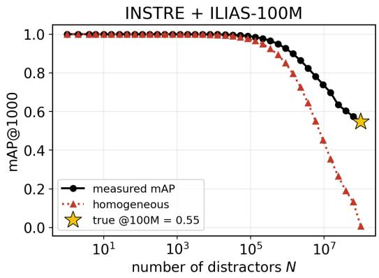

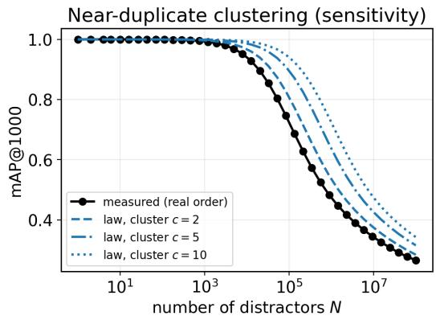

Figure 3: A second query set and the independence assumption. Left: mAP@1000 (vertical) vs. number of distractors N (horizontal, log) for INSTRE against the ILIAS-100M pool—the law tracks the truth on a different query set. Right: sensitivity to near-duplicate clustering on ILIAS; treating each cluster of size c as one effective item (top-rank survival $( 1 - x ) ^ { N / c } )$ shifts accuracy up— an illustrative case (a deduplicated gallery), not a general bound on truncated mAP under retained duplicates. The measured real-order curve sits at c≈1, so clustering is mild.
<table><tr><td>dataset</td><td>pool</td><td>metric @full pool</td><td>EVT err</td></tr><tr><td>ILIAS</td><td>YFCC-100M</td><td>0.266</td><td>0.005</td></tr><tr><td>INSTRE</td><td>YFCC-100M</td><td>0.547</td><td>0.005</td></tr><tr><td>GLDv2</td><td>index-759k</td><td>0.31</td><td>0.008</td></tr></table>

Table 5: Three benchmarks, two distractor pools. A small random sample recovers the large-N mAP within ∼0.01 with the tail-aware estimator; ILIAS/INSTRE are mAP@1000, GLDv2 is the official mAP@100. The metric column is DINOv3-L; error is the mean over each pool’s 5 backbones (per-backbone detail in Tab. 8 for ILIAS, Tab. 4 for INSTRE, Tab. 3 for GLDv2).

$K _ { j }$ is the actual count of distractors that outscore it; writing the realized exceedance fraction $\scriptstyle { \bar { x } } _ { q , j } : =$ $\dot { K _ { j } } / N$ (distinct from the population hardness $x _ { q , j }$ of Eq. (1)), we have $j + N \bar { x } _ { q , j } = j + K _ { j } \stackrel { \sim } { = } r _ { j }$ so

$$
\mathrm { m A P } ( N ) = \frac { 1 } { | Q | } \sum _ { q } \frac { 1 } { \operatorname* { m i n } ( k , n _ { q } ) } \sum _ { j : j + N \bar { x } _ { q , j } \leq k } \frac { j } { j + N \bar { x } _ { q , j } }\tag{8}
$$

is precisely the map $R _ { k }$ of Eq. (3) evaluated at the realized fractions—an exact identity, truncation included, with no linearization term. The $\mathbb { E } [ 1 / r ]$ vs. $1 / \mathbb { E } [ r ]$ contrast arises only if one treats $K _ { j }$ as a fresh Poisson $( N x _ { q , j } )$ draw and asks for the mAP averaged over hypothetical re-samplings of the pool—a different quantity that no benchmark reports, and one Jensen’s inequality places slightly above the realized value. Confirming this across all five backbones: the expected-rank map reproduces the realized mAP@100M to within 0.001 (it matches the true value of Tab. 1 to three decimals), whereas the exact Binomial $\mathbb { E } [ \mathrm { A P } ] \cdot$ —the per-positive sum $\begin{array} { r } { \sum _ { m } \frac { j } { j + m } \operatorname* { P r } [ K _ { q , j } = m ] } \end{array}$ evaluated in full—sits +0.004 to +0.006 above it. Targeting the realized number with the expectedrank map, as we do, is therefore the more accurate choice, not an approximation we settle for. The prediction error therefore splits into two terms,

From a 5% sample the tail-aware estimate recovers each 100M value (× on ); naive subset evaluation there (curves at the line) overstates it by +0.08 to +0.13  
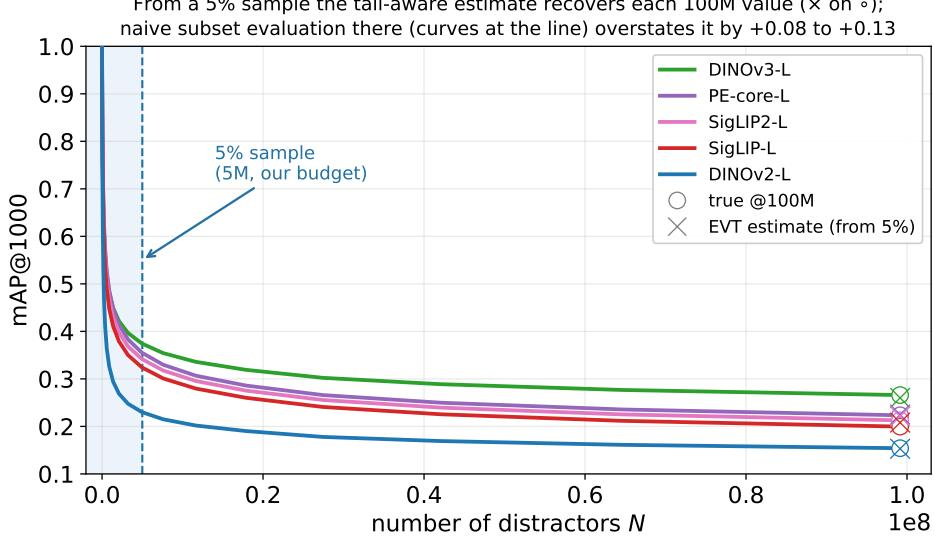

Figure 4: Recovering mAP@100M from a 5% sample, all five ILIAS backbones. True mAP@1000 vs. number of distractors N (linear axis); each solid curve grows to its true 100M value (◦). Reading the metric at the 5% (5M) sample (dashed line; shaded) overstates the 100M value by +0.08 to +0.13; the tail-aware (EVT) estimate from that same sample (×) recovers each true value to within ∼0.01. Estimate markers are the 20-draw means of Tab. 9.  
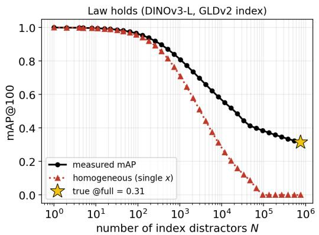

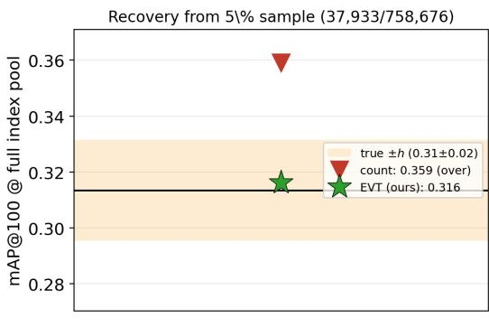  
Figure 5: GLDv2. Left: mAP@100 (vertical) vs. number of index distractors N (horizontal, log) for DINOv3-L—the per-query law (dashed) tracks the measured curve (MAE 0.010). Right: recovery of the official mAP@100 at the full 759k pool from a 5% sample: the count edge over-predicts (lands above the band), while the tail-aware (EVT) estimate lands on the truth (black line), inside the ±h query-bootstrap noise band (shaded).

$$
\begin{array} { r } { \begin{array} { r } { \bigl | \widehat { \operatorname* { m A P } } ( N ) - \operatorname* { m A P } ( N ) \bigr | \ \leq \underbrace { E _ { \mathrm { e s t } } \bigl ( \{ \hat { x } _ { q , j } \} \bigr ) } _ { \mathrm { s a m p l e \to p o p . , ~ a t } S } } \\ { + \underbrace { E _ { \mathrm { c o n c } } } _ { \mathrm { p o p . } \to \mathrm { r e a l i z e d , ~ a t } N } , } \end{array} } \end{array}\tag{9}
$$

and the concentration term is negligible: the realized fraction $\bar { x } _ { q , j } = K _ { j } / N$ has standard deviation $\sqrt { x _ { q , j } ( 1 - x _ { q , j } ) / N }$ about $x _ { q , j } - a$ relative fluctuation $\sqrt { ( 1 - x ) / ( N x ) }$ that at $N { = } 1 0 0 \mathbf { M }$ and transition-zone hardness $x \sim 1 0 ^ { - 5 } ~ \mathrm { i s } \sim 3 \%$ per positive and averages down across positives and queries. The estimation term, at the far smaller sample size S, dominates; we bound it next, separating sample-resolved positives from the unresolved tail.

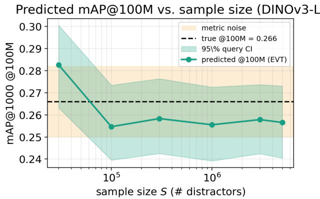  
Figure 6: Predicted mAP@100M (vertical) vs. sample size S (horizontal, log scale) for DINOv3-L, with a 95% query-bootstrap band; dashed line is the true 100M value.

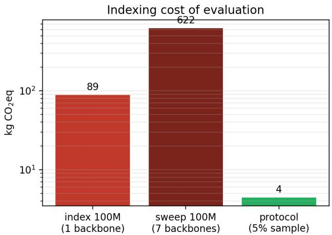  
Figure 7: Estimated indexing carbon, kg CO2eq (vertical, log scale): indexing 100M for one backbone (≈89 kg), a 7-backbone sweep (≈622 kg), and our 5% protocol (≈4.4 kg per backbone, 20× less). Illustrative estimate under the named hardware assumptions.

Estimation term: the visible mass concentrates. For a positive whose hardness the sample resolves, the count estimate $\hat { x } _ { q , j } = K / S$ has $K \sim$ Binomia $\dot { \left[ ( S , x _ { q , j } \right) }$ , so by Hoeffding’s inequality $| \hat { x } _ { q , j } - x _ { q , j } | \leq \sqrt { \ln ( 2 / \delta ) / ( 2 S ) }$ with probability $\geq 1 - \delta .$ . This deviation propagates benignly: the top-rank survival $( 1 - x ) ^ { N }$ is N-Lipschitz in x $\begin{array} { r } { ( | \frac { d } { d x } ( 1 - x ) ^ { N } | = N ( 1 - x ) ^ { N - 1 } \leq N ) } \end{array}$ , and each AP precision $j / ( j + N x )$ is 1 -Lipschitz (by AM–GM on $( j + N x ) ^ { 2 } \geq 4 j N x )$ , so resolved positives contribute error controlled by the bound above, and the end-to-end error stays $\leq 0 . 0 0 8$ across all five backbones.

Estimation term: the unresolved tail needs the model. The queries that dominate large-N accuracy have $x _ { q } \lesssim 1 / S$ and are invisible in the sample (K=0); counting returns 0, so we estimate their hardness from the fitted upper tail—the gap posed as open by Madigan et al. (2003). The bounded GPD is well-suited: by the Pickands–Balkema–de Haan theorem the threshold-excess distribution approaches a generalized Pareto, and the cosine ceiling forces $\xi \le 0 \ ( \mathrm { A p p . \ B } )$ , so the survival decays at least exponentially and the extrapolated mass $\bar { \zeta } _ { u } \left( 1 - \mathrm { G P D } _ { \xi , \sigma } ( s ^ { \star } - u ) \right)$ cannot diverge. We validate the tail estimate empirically—the threshold sweep $( \mathrm { A p p . ~ } \mathbf { \bar { B } } )$ , the sample-size and endpoint diagnostics, and the direct 100M validation. We report the count/tail gap B as an empirical diagnostic of estimator bias, not a guaranteed bound: counting zeroes the unresolved tail and is thus upward-biased on that mass (a one-sided bias, not a deterministic per-sample bound), while the tail estimate has no such bias in either direction, so although the truth sits at the tail edge of $[ \hat { R } _ { \mathrm { t a i l } } , \hat { R } _ { \mathrm { c o u n t } } ]$ in every case we measure, a misspecified tail could err either way.

<table><tr><td>backbone</td><td>true mAP@100M</td><td>count (5%)</td><td>EVT (5%)</td></tr><tr><td>DINOv2-L</td><td>0.154[0.141,0.167]</td><td>0.191 [0.177,0.205]</td><td>0.153 [0.140,0.166]</td></tr><tr><td>SigLIP-L</td><td>0.200 [0.185,0.214]</td><td>0.268 [0.252,0.285]</td><td>0.208 [0.193,0.222]</td></tr><tr><td>SigLIP2-L</td><td>0.213 [0.199,0.228]</td><td>0.280 [0.263,0.297]</td><td>0.221 [0.207,0.236]</td></tr><tr><td>PE-core-L</td><td>0.223 [0.209,0.238]</td><td>0.287 [0.271,0.304]</td><td>0.225 [0.211,0.240]</td></tr><tr><td>DINOv3-L</td><td>0.266 [0.250,0.283]</td><td>0.317 [0.300,0.335]</td><td>0.260 [0.244,0.277]</td></tr></table>

Table 6: Detailed 95% query-bootstrap intervals for Tab. 1. The true value, the tail-blind count estimate, and our tail-aware EVT estimate, each with a 95% query-bootstrap interval (resampling the 1,232 queries). The EVT interval overlaps the true interval for every backbone (5/5 coverage); the count interval lies entirely above the truth for every backbone $( 0 / { \dot { 5 } } ) \cdot$ —its error is a systematic bias, not query-sampling noise.
<table><tr><td>backbone</td><td>true mAP@100M</td><td>query-only 95%</td><td>full 95% (q+samp+fit)</td><td>σsamp+fit</td></tr><tr><td>DINOv3-L</td><td>0.266</td><td>[0.240,0.273]</td><td>[0.243,0.277]</td><td>0.002</td></tr><tr><td>DINOv2-L</td><td>0.154</td><td>[0.140,0.166]</td><td>[0.139,0.167]</td><td>0.003</td></tr><tr><td>SigLIP-L</td><td>0.200</td><td>[0.193,0.221]</td><td>[0.192,0.223]</td><td>0.003</td></tr><tr><td>SigLIP2-L</td><td>0.213</td><td>[0.207,0.238]</td><td>[0.203,0.236]</td><td>0.004</td></tr><tr><td>PE-core-L</td><td>0.223</td><td>[0.209,0.238]</td><td>[0.209,0.240]</td><td>0.003</td></tr></table>

Table 7: Full predictive interval (nested bootstrap). Folding distractor-sample and EVT-fit noise into the query-bootstrap interval (via K=8 disjoint 5M redraws with per-draw tail refits) adds only $\sigma _ { \mathrm { s a m p + f i t } }$ ≈ 0.003 std—the endpoints shift slightly rather than always widen—and still covers the true 100M mAP for every backbone (5/5).

Full uncertainty interval: a nested bootstrap that covers $5 / 5 .$ The interval reported in the main text (Tab. 1) resamples the query set only. To fold in the other two sources—which distractors land in the sample, and the per-query EVT refit on that sample—we run a nested bootstrap on all five ILIAS backbones: draw K=8 disjoint 5M sub-pools of the 100M stream (disjoint uniform distractor samples), refit the per-query tail on each, and form the prediction; each bootstrap iteration then picks a random draw (sample + fit noise) and resamples queries with replacement (query noise). Table 7 reports the resulting 95% interval against the query-only interval. The added noise is small— the distractor-sample+fit standard deviation is $\sigma _ { \mathrm { s a m p + f i t } } \approx 0 . 0 0 3$ (median), well below the query component $( h / 1 . 9 6 \approx 0 . 0 0 8 ) \mathrm { - s o }$ the full interval changes little (endpoints shift more than they widen), and it brackets the held-out true mAP@100M for all five backbones. Query sampling, not distractor sampling or tail-fit, is the dominant uncertainty at the 5% budget.

Ranking preservation and paired error. Interval overlap (Tab. 1) is a weak coverage test, since prediction and truth share the same queries. Two stronger statistics confirm the estimate. (i) Ranking. Across the five backbones the predicted and true mAP@1000 induce the same ordering for the reported estimate: Kendall $\tau = 1 . 0$ , Spearman $\rho = 1 . 0 \mathrm { { ; } }$ , no sign flip among the ten pairwise margins. Across 20 disjoint distractor samples this holds for the nine pairs separated by more than the prediction error (preserved in every draw); only the tightest pair (PE-core vs. SigLIP2, true gap 0.010, within the error) is not reliably resolved, being statistically tied at 100M (App. D). Ranking is recovered down to a margin of ≈0.013 mAP. (ii) Paired error. The per-query difference $\mathrm { A } \bar { \mathrm { P } } _ { q } ^ { \mathrm { E V T } } - \mathrm { A P } _ { q } ^ { \mathrm { t r u e } }$ has pooled mean +0.002 with a 95% bootstrap CI of [−0.001, +0.004] over the 6160 query-backbone cells; per backbone the bias stays within ±0.008 (largest SigLIP/SigLIP2 +0.008, DINOv3 −0.006).

Equal-cost comparison: evaluate at 5M vs. predict from 5M. At the same 5M indexing cost (5% of the pool), a practitioner can either evaluate on the 5M subset (the incumbent cheap practice, e.g. the hard-mined mini-ILIAS (Kordopatis-Zilos et al., 2025)) or predict the 100M metric from it (ours). Naive evaluation is optimistic by +0.08 to +0.13 (mean |err| 0.113), because 5M distractors under-rank the positives. The tail-aware prediction is within 0.005 mean (Tab. 8). At identical cost, predicting is roughly 22× more accurate than evaluating. Evaluate-at-5M is the expected value of a uniform 5M subset (the AP law at N=5M, which reproduces the measured DINOv2 curve to 0.006); a hard-mined 5M set such as mini-ILIAS is non-uniform and reports a different biased number still short of the 100M value.

<table><tr><td>backbone</td><td>eval-at-5M</td><td>EVT-at-5M</td><td>true@100M</td></tr><tr><td>DINOv2-L</td><td>0.230 (+0.076)</td><td>0.153(–0.001)</td><td>0.154</td></tr><tr><td>SigLIP-L</td><td>0.324(+0.124)</td><td>0.208 (+0.008)</td><td>0.200</td></tr><tr><td>SigLIP2-L</td><td>0.341 (+0.128)</td><td>0.221 (+0.008)</td><td>0.213</td></tr><tr><td>PE-core-L</td><td>0.355(+0.131)</td><td>0.225 (+0.002)</td><td>0.223</td></tr><tr><td>DINOv3-L</td><td>0.374(+0.108)</td><td>0.260(−0.006)</td><td>0.266</td></tr><tr><td>mean |err|</td><td>0.113</td><td>0.005</td><td></td></tr></table>

Table 8: At equal 5M cost, predict beats evaluate. Naive mAP@1000 measured on a uniform 5M subset (evaluate-at-5M) is optimistic by +0.08 to +0.13; the tail-aware prediction from the same 5M sample (EVT-at-5M) is within 0.005 of the true 100M value. Parentheses are signed error vs. true@100M.
<table><tr><td>backbone</td><td>true mAP@100M</td><td>mean pred (5%)</td><td>MAE</td><td>std</td><td>worst |err|</td><td>cover  $| \mathrm { e r r } | { \le } h$ </td></tr><tr><td>DINOv2-L</td><td>0.154</td><td>0.153</td><td>0.002</td><td>0.002</td><td>0.007</td><td>20/20</td></tr><tr><td>SigLIP-L</td><td>0.200</td><td>0.208</td><td>0.008</td><td>0.003</td><td>0.013</td><td>20/20</td></tr><tr><td>SigLIP2-L</td><td>0.213</td><td>0.221</td><td>0.008</td><td>0.003</td><td>0.012</td><td>20/20</td></tr><tr><td>PE-core-L</td><td>0.223</td><td>0.225</td><td>0.002</td><td>0.003</td><td>0.008</td><td>20/20</td></tr><tr><td>DINOv3-L</td><td>0.266</td><td>0.260</td><td>0.006</td><td>0.002</td><td>0.010</td><td>20/20</td></tr></table>

Table 9: Interval coverage over 20 disjoint 5% samples. Each backbone’s 99M pool is split into 20 disjoint 5% blocks; mean prediction, MAE, draw-to-draw std, worst error, and the number of draws inside the reported interval (|err|≤h). Coverage is 100/100 overall.

## D REPEATED-SAMPLE VALIDATION: SAMPLING DISTRIBUTION, COVERAGE, AND CALIBRATION

The interval in the main text is a query bootstrap from a single distractor sample; the stronger test resamples the distractors. We partition each backbone’s 99M pool into K=20 disjoint, pool-spread blocks at a given sample fraction and predict mAP@100M on each—20 genuinely disjoint draws (not a single-sample bootstrap; disjoint blocks of a finite pool are negatively dependent under the finite-population constraint), using the paper’s estimator $( \bar { T } { = } 4 0 0 0 , q { = } 0 . 9 5 , \bar { \xi } \leq \bar { 0 } )$

Coverage at the 5% operating point (Tab. 9). Over the 20 disjoint 5% draws per backbone the mean MAE is 0.005 (0.002–0.008 across backbones), the draw-to-draw standard deviation is 0.003—matching the nested-bootstrap $\sigma _ { \mathrm { s a m p + f i t } }$ of App. C—and the worst single error is 0.013. Every draw lands inside the reported query-bootstrap interval: coverage is 100/100 (all 100 backbonedraws). The interval is, if anything, conservative—its half-width is set by the larger query-sampling uncertainty, whereas the distractor-sample spread measured directly here is only ≈0.003.

The evaluation converges within a 5% subset (Tab. 10). 5% is a result, not a tuned operating point: as the sample grows, every backbone’s estimate converges onto its 100M value. Mean MAE falls from 0.020 at 0.5% to 0.005 at 5%. The well-separated backbones (DINOv2, DINOv3) converge by 0.5%; the heavy-tailed backbones (SigLIP, SigLIP2), whose deeper tail a smaller sample cannot yet resolve, converge later—their interval reaches the true value only by 5% (0/20 covered at 0.5–1%). Every tested model converges within a mere 5% of the pool.

<table><tr><td>fraction</td><td>n</td><td>draws (disjoint)</td><td>mean MAE (5 bb)</td><td>worst |err|</td><td>mean std</td></tr><tr><td>0.5%</td><td>0.50M</td><td>12</td><td>0.020</td><td>0.039</td><td>0.003</td></tr><tr><td>1.0%</td><td>0.99M</td><td>12</td><td>0.015</td><td>0.031</td><td>0.003</td></tr><tr><td>2.0%</td><td>1.98M</td><td>12</td><td>0.010</td><td>0.023</td><td>0.003</td></tr><tr><td>5.0%</td><td>4.96M</td><td>20</td><td>0.005</td><td>0.013</td><td>0.003</td></tr></table>

Table 10: Accuracy vs. sample fraction (mean over the five backbones, disjoint draws per row, at the paper’s T=4000). Error and worst case shrink monotonically with the sample; 5% is the point at which every backbone is covered.  
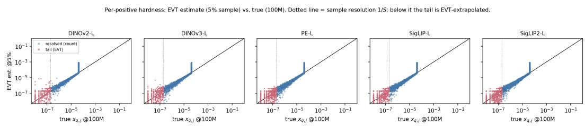  
Figure 8: Per-positive hardness: estimate vs. truth. EVT estimate from a 5% sample (vertical) vs. the true value at 100M (horizontal), per backbone, log–log. Blue: positives the sample resolves by counting; red: the deep tail $( x < 1 / \bar { S }$ , dotted line) reached only by EVT extrapolation. The tail scatters about the diagonal—noisy per positive, unbiased in the median—so the aggregated mAP is accurate.

The sufficient budget. Choose a resolution τ. Growing the distractor sample in geometric steps, we predict mAP@100M with the estimator at each size and stop once doubling from $n / 2$ to n moves the prediction by no more than τ; that sample size is the sufficient budget. Taking τ at the metric’s own query-sampling noise $h { = } 1 . 9 6 \mathrm { s t d } _ { q } ( \dot { \mathrm { A P } } _ { q } ) / \sqrt { n _ { q } } ( 0 . 0 1 3 { - } 0 . 0 1 9 )$ and running against the 100M ground truth across the ten web-scale cells (ILIAS and INSTRE, five backbones each, $1 0 ^ { 8 }$ distractors), the estimate reaches its sufficient budget within 1% of the pool, and at 5% it matches the true 100M mAP to a mean absolute error of 0.005. The 5% budget is more than sufficient to predict the 100M metric, and the information that determines it is present in a much smaller sample.

Per-positive calibration (Fig. 8). Fig. 8 plots the estimated per-positive hardness $\hat { x } _ { q , j }$ (from a 5% sample) against the true $x _ { q , j } \left( 1 0 0 \mathrm { M } \right)$ . Where the sample resolves the positive (count ≥5) the estimate sits on the diagonal; in the deep tail $( x < 1 / S )$ the EVT extrapolation is noisier per positive (logcorrelation ≈0.4) but unbiased in the median (median ${ \hat { x } } / x$ between 0.9 and 1.3 across backbones). Because mAP averages over ∼6000 positives, this per-positive tail noise cancels and the metric is recovered to 0.005.

Ranking resolution. Across the 20 disjoint draws, 9/10 of the ten backbone pairs are ordered correctly in every draw; the smallest true gap resolved in all draws is 0.013. The only pair that ever swaps is PE-core vs. SigLIP2 (true gap 0.010, below the prediction error), which are statistically tied at 100M. The method thus resolves rankings down to a margin of ≈0.013 mAP: pairs wider than that are preserved across disjoint samples; pairs within the error are not, and should be reported as ties.