# What Makes a Good Visual Representation for Spatial Understanding in MLLMs?

Xiaohu Huang, Yumin Guo, and Kai Han

Abstract—Spatial understanding is a necessary step in moving multimodal large language models (MLLMs) toward reasoning about the 3D physical world. Their visual pretraining data, however, is almost entirely 2D, so the visual tokens processed by MLLMs often lack inherent 3D structural information. A growing number of methods inject such structure by transferring representations from external vision or geometry models, and collectively establish that such transfer helps. Behind these methods lies a largely underexplored question: what makes a visual representation good for spatial understanding? To answer it, we first separate what is transferred from how it is transferred, and then trace the resulting differences back to properties of the representations themselves. What we transfer comes from 3D geometry models, self-supervised image and video models, vision-language models, and generative models, in the form of latent features or explicit depth and point maps. We transfer it either by distillation, using it as a supervision target, or

by fusion, feeding it as an additional input. We find that a representation’s 3D structure correlates strongly with how much it helps, measured by cross-view consistency for latent features and by depth and reconstruction accuracy for explicit geometry. We further show that the form of a representation dictates the mechanism it needs. Latent features gain as much from fusion as from distillation; explicit geometry gains little from fusion, and most of its distillation gain depends on a geometry decoding head. Guided by these findings, we distill both latent features and explicit geometry into a single MLLM. Taking only RGB video as input, it consistently improves over its base model on both static 3D and dynamic 4D spatial reasoning benchmarks. Project page: https://visual-ai.github.io/3drs

Index Terms—Multimodal large language models, spatial understanding, representation learning.

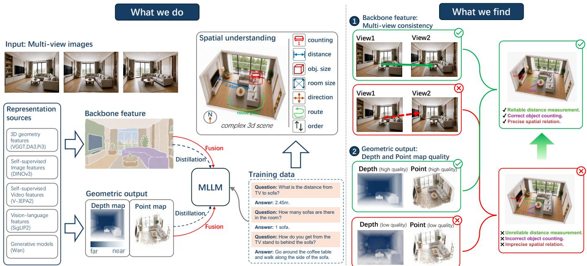  
Fig. 1. What makes a visual representation good for spatial understanding? Left (what we do): holding everything else fixed, we vary the representation transferred into the MLLM—where it is drawn from, what form it takes, and how it enters the model. Right (what we find): the gain a representation brings tracks the 3D structure it carries, measured as cross-view consistency for backbone features and as depth and reconstruction accuracy for geometric outputs.

## I. INTRODUCTION

PATIAL understanding aims to extend multimodal large S language models (MLLMs) from 2D perception to reasoning about 3D scenes. Modern MLLMs have made rapid progress by aligning large language models with powerful image and video encoders [1], [4], [15], [19], [37], [40], [42], [47], [53], [63], [86], [92]. These models are effective at recognizing visual content, but recognizing what is present is not the same as understanding how a scene is structured in 3D space.

The difficulty lies in what the language model receives. Spatial reasoning requires visual tokens that preserve 3D scene structure, not only object semantics. Recent benchmarks consistently identify this as a persistent weakness of current MLLMs [3], [38], [44], [58], [69], [73], [82], [88], [90]. A root cause of this deficiency is the training supervision: most MLLMs are pretrained predominantly on 2D image-text pairs. Consequently, their visual encoders target 2D semantic recognition, and the models receive little direct 3D supervision. Spatial structure is often absent from the tokens on which the language model operates. Improving spatial reasoning therefore requires improving the visual representation itself.

A growing body of work seeks to supply this missing structure. Early methods build the language interface on explicit 3D inputs, such as point clouds [24], [51], [71], RGB-D scans [52], [88], [91], object proposals [14], [30], [80], or reconstructed scene representations [13], [23], [28]. These inputs expose geometry directly, but they depend on 3D sensing or reconstruction that is costly and often unavailable at inference. Recent work therefore favors MLLMs that operate on plain image or video. Such methods incorporate spatial information through auxiliary visual models or representations: spatial instruction data [6], [9], [17], [82], geometry-aware encoders [68], [87], reconstruction tokens [20], progressive spatial training [39], or geometry-language modules [29], [60], [83]. Despite their differences, these methods share a common move: they bring an external visual representation, sometimes an explicit geometric one, into the MLLM.

Taken together, these methods have shown that an external representation can supply the structure an MLLM lacks. However, the intrinsic properties of the representations themselves remain largely underexplored. The critical question, therefore, is not whether transfer is beneficial, but rather what intrinsically makes a visual representation effective for spatial understanding. Addressing this necessitates a rigorously controlled study.

In this paper, we conduct such a systematic investigation (Fig. 1, left). Our study proceeds in two phases. First, we decouple what is transferred from how it is transferred, holding the underlying architecture and training recipe constant. This ensures that any variance in spatial reasoning performance can be strictly attributed to these specific choices. Second, we evaluate each representation offline—without downstream training—to identify which intrinsic metrics correlate with downstream performance gains. The content of the transfer (“what”) comprises two dimensions. The first is the source model: candidates include visual geometry models [41], [62], [67], self-supervised image models [55], vision-language models [59], generative models [57], and self-supervised video models [2], each encoding 3D structure to varying degrees. The second is the representation form: latent features extracted from model backbones, versus explicit depth and point maps predicted exclusively by geometry models. The transfer mechanism (“how”) involves a choice between distillation (utilizing the representation as a supervision target during training) and fusion (providing it as an auxiliary input during both training and inference).

On what to transfer, we find that a model’s usefulness correlates strongly with the 3D structure its representation carries (Fig. 1, right). For latent features, we measure it as cross-view consistency [5], [33], [46], [79]; features that stay consistent across viewpoints bring larger downstream gains, whereas 2D feature-structure metrics correlate only weakly. For explicit geometry, we measure it as depth and reconstruction accuracy; models that reconstruct a scene more accurately yield larger gains once transferred. The two forms, in turn, specialize rather than substitute: geometry contributes most on single-object metric questions such as counting, object size, and absolute distance, while features contribute most on multi-object relational and temporal ones. A candidate can therefore be assessed before it is ever transferred.

On how to transfer it, we find that the form of a representation decides which mechanism works: backbone features benefit similarly from distillation and fusion, whereas explicit geometry is transferred far better by distillation, especially when a Dense Prediction Transformer (DPT)-style head from VGGT decodes the MLLM’s own features into depth and point maps.

Synthesizing these insights, we propose a unified design: transferring both representation forms simultaneously via distillation, utilizing the decoding head for geometry. The resulting model requires no external auxiliary models during inference and achieves consistent improvements across all benchmarks compared to its base model.

A preliminary version of this work appeared as 3DRS [33] at NeurIPS 2025, where we showed that the 3D-awareness of an MLLM’s visual tokens correlates with scene understanding, and that distilling features from a 3D foundation model strengthens it. This paper extends that study in five aspects. First, we move from a single 3D foundation model to representations drawn from five families of pretrained model. Second, we cover both backbone features and explicit geometric outputs. Third, we compare distillation and fusion, including the effect of the pretrained VGGT DPT-style decoding head. Fourth, we relate representation traits—cross-view 3D correspondence for features and depth and reconstruction accuracy for geometric outputs—to downstream performance. Fifth, we broaden the evaluation with dynamic (4D) spatial reasoning on DSR-Bench [90] and comparisons with recent spatial MLLMs.

The contributions of this paper are summarized as follows:

• We cast spatial representation transfer for MLLMs as a controlled study. A transfer involves three decisions at once—which pretrained model supplies the spatial signal, what form that signal takes, and how it enters the MLLM. We separate them into three axes of a single framework, in which each can be varied while the others are held fixed, so that the effect of each becomes measurable on its own.

• Within this framework, we compare backbone-feature transfer against explicit geometric transfer, each through both distillation and fusion. Distillation is clearly the stronger mechanism for geometric representations, especially when paired with a pretrained geometry decoding head, whereas for backbone features the two mechanisms perform comparably. The two forms also specialize by spatial skill, which is why we transfer both rather than choose between them.

• We identify measurable properties that go with a visual representation being useful for spatial understanding. For backbone features, cross-view consistency correlates strongly with downstream spatial gains, while standard 2D feature-structure metrics correlate only weakly. For explicit geometry, the depth and reconstruction accuracy of the pretrained model tracks the gain it transfers.

• Guided by these empirical findings, we instantiate an optimal configuration that jointly distills latent features and explicit geometry into a single MLLM. This unified model leverages the complementary strengths of both forms without incurring additional inference costs: it strictly consumes RGB video, requires no auxiliary depth sensors or geometry models, and consistently outperforms its base model across both static 3D and dynamic 4D reasoning benchmarks.

## II. RELATED WORK

## A. Spatial Understanding Benchmarks

A growing set of benchmarks pushes the evaluation of MLLMs beyond object-level semantics toward metric, relational, and viewpoint-dependent reasoning. Early efforts ground language in 3D scenes through object localization and dense captioning on ScanNet [18], as in ScanRefer [10], Multi3DRefer [85], and Scan2Cap [11]. Question-answering suites built on indoor scans, such as ScanQA [3] and SQA3D [44], probe situated reasoning over 3D scenes, while VSI-Bench [73] targets visual spatial intelligence from video. Real-3DQA [45] further shows that SQA3D-style evaluation can contain textual shortcuts, and proposes a filtered benchmark for testing 3D evidence use. CV-Bench [58], SPAR-Bench [82], and ViewSpatial-Bench [38] isolate 2D/3D spatial relations and cross-view localization, and SpatialScore [69] and MMSI-Bench [76] aggregate diverse spatial skills into single corpora. More recently, dynamic spatial reasoning has been formalized by DSR-Bench [90], which evaluates reasoning over moving objects and changing viewpoints. Across this suite, spatial reasoning remains among the least reliable abilities of current MLLMs, motivating methods that make visual tokens carry richer spatial structure. We adopt a representative subset of them as a fixed evaluation suite so that different representation and transfer choices can be compared under identical conditions.

## B. Scene Understanding with Explicit 3D Inputs

One line of work equips language models with explicit 3D inputs. Early methods align point-cloud and text features for 3D comprehension, including PointLLM [71], Point-Bind [24], and GPT4Point [51]. Building on this, 3D-LLM [28], LL3DA [13], Grounded 3D-LLM [14], Inst3D-LLM [80], and Scene-LLM [23] design cross-modal interfaces over reconstructed scenes, object proposals, or scene graphs, while Chat-Scene [30] exploits complementary 2D and 3D features. A related thread pre-trains aligned 3D visionlanguage representations or builds embodied agents over 3D scenes, including 3D-VisTA [93], SceneVerse [34], and the embodied generalist LEO [32]. MLLM-style pipelines such as

LLaVA-3D [91], Video-3D LLM [88], and GPT4Scene [52] inherit the image/video backbone but still rely on 3D priors derived from depth, camera pose, point clouds, or voxelized scans. These methods establish that explicit geometry is highly informative for scene understanding; however, they assume access to external 3D or 2.5D inputs at inference, placing them in a different input regime from methods that operate purely from RGB video. We therefore treat them as a separate setting rather than as direct comparisons, and report the input protocol explicitly to keep comparisons fair.

## C. Spatial MLLMs with Internal Geometry Priors

A second line keeps the input close to RGB images or video but strengthens the model with internally estimated geometry. Spatial-MLLM [68] couples a semantic encoder with a geometry encoder initialized from a visual geometry model, and VG-LLM [87] integrates 3D vision-geometry priors learned from monocular video. VLM-3R [20] augments the language model with instruction-aligned reconstruction tokens, while SpatialStack [83], GUIDE [60], and G2VLM [29] explore layered or layer-wise geometry-language fusion and unified reconstruction-and-reasoning objectives. Although these methods differ in architecture and supervision, they share a common ingredient: external visual or geometric representations are brought into the MLLM, as additional tokens, fused features, or supervision targets. Each, however, is evaluated within its own architecture and training recipe, so the contribution of the representation itself is left open. Our study is complementary: rather than proposing one more recipe, we hold the base model and protocol fixed and vary these factors one at a time.

## D. Spatial Instruction Data and Training

Spatial ability can also be improved through training data and recipes. SpatialVLM [9], SpatialRGPT [17], and Spatial-Bot [6] construct large-scale spatial instruction data for supervised fine-tuning, and SpatialLadder [39] adopts progressive spatial training. Like these methods, our study stays within a standard supervised fine-tuning regime, and is orthogonal to lines that instead rely on reinforcement learning or inferencetime reasoning—such as SpaceR [49], ViLaSR [70], Video-R1 [21], and 3DThinker [16]—or that target robotic affordance prediction [81]. Our contribution is complementary to all of these: under a fixed training recipe, we ask which pretrained representation should be transferred, and how.

## E. 3D-Aware Representation Transfer

Our study builds on visual foundation models and analyses of their 3D-awareness. Image-level foundation models— CLIP [53], DINO [8], MAE [26], DINOv2 [48], DINOv3 [55], SigLIP2 [59], and SAM [35]—provide strong but largely 2Dsemantic features, while self-supervised video models such as V-JEPA2 [2] and generative models such as Wan [57] supply representations from two further pretraining paradigms. In parallel, visual geometry models predict explicit geometry from images or video, ranging from monocular depth and geometry estimators such as MiDaS [54], Metric3D [78], UniDepth [50], MoGe [65], and Depth Anything [74], [75], to multi-view reconstruction models such as DUSt3R [66], MASt3R [36], Spann3R [61], Fast3R [72], CUT3R [64], VGGT [62], FLARE [84], $\pi ^ { 3 }$ [67], and DA3 [41]. Probe3D [5], Lexicon3D [46], and multi-view analyses [79] measure how much 3D structure such representations encode, mostly for pure vision models. Transferring knowledge across models by distillation [27] is a classic tool; the open question we study is which of these representations are worth transferring for spatial understanding, and how. Our conference paper 3DRS [33] extended this view to MLLMs, supervising their visual tokens with a pretrained 3D foundation model and linking the resulting 3D-awareness to downstream performance. This journal version generalizes that single supervision setting into a controlled comparison across representation families, representation forms (backbone features vs. explicit geometric outputs), and transfer mechanisms (distillation vs. fusion), and it analyzes which measurable representation traits track the gains.

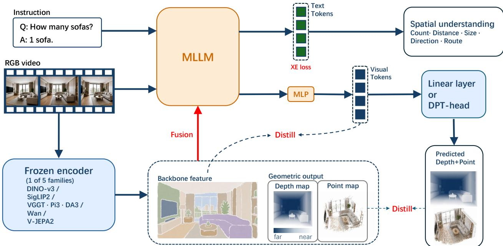  
Fig. 2. Overview of the study. We transfer a representation from a pretrained model—one of five families—into an MLLM whose base model is fixed across all variants. The representation takes one of two forms, backbone features or explicit geometric outputs, and enters the MLLM by one of two mechanisms, distillation or fusion. The MLLM itself takes only RGB video and is evaluated on spatial understanding.

## III. SPATIAL REPRESENTATION LEARNING: FROM ANALYSIS TO DESIGN

An MLLM’s spatial reasoning capability is fundamentally constrained by the degree of 3D structure encoded within its visual tokens. While external representations can compensate for this structural deficit, the extent of the enhancement varies significantly across different representations. This section investigates the underlying drivers of this variation.

Specifically, this variance stems from three design choices that fully define a transfer: the source pretrained model, the representation form (i.e., latent backbone features versus explicit geometric outputs such as depth or point maps), and the integration mechanism (distillation versus fusion). By systematically varying each dimension while holding the others constant (Fig. 2), we identify the intrinsic properties of a representation that dictate its downstream performance.

The remainder of this section is structured as follows. Section III-B addresses the selection of the pretrained model through offline measurements conducted on the representations prior to any downstream training. Section III-C delineates the distinct spatial contributions of the two representation forms. Subsequently, Section III-D evaluates the transfer mechanisms, revealing that the optimal choice is inherently constrained by the representation’s form. Finally, Section III-E synthesizes these empirical insights into a unified, optimal architectural design.

## A. Setup and Protocol

An MLLM consists of a visual encoder $\mathcal { E } _ { \mathrm { i m g } }$ and a language decoder T . Given a video or multi-view image sequence $\mathcal { T } =$ $\{ I _ { 1 } , \ldots , I _ { N } \}$ and a language instruction, the encoder produces per-frame visual features $\mathbf { \bar { F } } _ { i } ~ \in ~ \mathbb { R } ^ { H \times W \times d }$ that the decoder consumes together with the instruction tokens to generate the answer. We denote an external pretrained model by g, which maps the same input $\mathcal { T }$ to a representation $\mathbf { R } = g ( \mathcal { T } )$

Fixed protocol. We keep the base MLLM, the optimizer and schedule, the visual-token budget, the training data, and the evaluation suite identical across all variants; each experiment changes one of the three choices at a time, so that any difference in downstream performance can be attributed to that choice. Training stays within a standard supervised fine-tuning (SFT) regime: the MLLM is optimized with the autoregressive cross-entropy loss ${ \mathcal { L } } _ { \mathrm { C E } } ,$ , to which a transfer-specific term is added as defined below. We deliberately avoid reinforcement learning and inference-time reasoning, so that the comparison reflects the transferred representation rather than the training paradigm. Unless stated otherwise, representations are transferred by distillation; the choice of mechanism is itself examined in Section III-D.

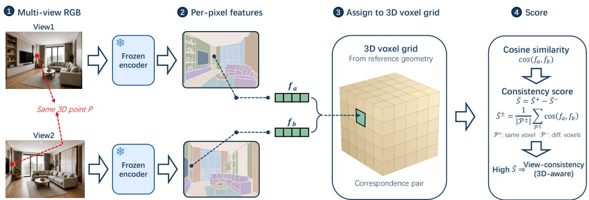  
Fig. 3. Measuring 3D-aware cross-view consistency. Per-pixel features from different views are binned into a shared 3D voxel grid. The score S¯ is how far genuine correspondences stand above mismatched pairs in mean cosine similarity, so a representation that fails to distinguish locations scores near zero.

Pure-2D input. The MLLM receives only RGB video. Any geometry is either internalized through distillation (and thus unnecessary at inference) or produced on the fly by a visual geometry model from the same RGB frames. Depth and pose, when used, enter only the offline diagnostics of Section III-B, never the model input.

Decoding geometric outputs. Backbone features can be matched to the MLLM’s tokens directly, but depth and point maps cannot: they must be decoded from those tokens. We use a pretrained DPT-style decoding head from VGGT [62]. A DPT decoder consumes multi-layer features rather than a single layer, so we feed it four evenly spaced MLLM layers ({2, 10, 18, 31}) as its input. We keep the head at its pretrained weights, so the MLLM is trained to produce features that this geometry decoder can turn into depth and point maps, leaving fine-grained geometry to the decoder. The same head serves every geometry model we transfer from: it decodes the MLLM’s own features rather than the teacher’s, so it is not tied to the model supplying the target. As an alternative we replace it with a learnable lightweight linear head, which must instead force the MLLM features themselves to carry metric depth and 3D position.

Reporting. Throughout this section a gain is reported as relative improvement over the base model, (variant − base)/base, averaged over the evaluation suite; the comparison tables of Section IV report absolute scores instead.

## B. 3D Structure Tracks What a Model Contributes

We draw pretrained models g from five families that span the pretraining paradigms used by recent spatial MLLMs: (1) visual geometry models—VGGT [62], $\pi ^ { 3 }$ [67], and DA3 [41]; (2) self-supervised image models—DINOv3 [55]; (3) vision-language models—SigLIP2 [59]; (4) generative models—Wan [57]; and (5) self-supervised video models— V-JEPA2 [2]. Their gains differ widely. To find what those differences track, we measure intrinsic traits of each representation offline—never feeding them to the MLLM—and relate those measurements to the downstream gain, separately for the two forms.

Backbone features: 3D-aware cross-view consistency. For a backbonefeature, we measure 3D structure through cross-view correspondence, a fundamental property of 3D geometry [25] whose consistency can be computed directly from a representation’s features, without training any probe. Concretely, we voxelize each scene using the sensor depth and camera poses that ship with the source scans, and assign every perpixel feature to a voxel by its 3D location (Fig. 3). Features from different views that fall into the same voxel are genuine correspondences ${ \mathcal { P } } ^ { + } ;$ ; features drawn from different voxels are mismatches $\mathcal { P } ^ { - }$ . Mean same-voxel similarity alone would not measure 3D structure: a representation that returned one constant vector everywhere would attain the maximum without distinguishing any two locations. We therefore score a representation by how far genuine correspondences stand above mismatched ones,

$$
\bar { S } = \underbrace { \frac { 1 } { | \mathcal { P } ^ { + } | } \sum _ { ( \mathbf { f } _ { a } , \mathbf { f } _ { b } ) \in \mathcal { P } ^ { + } } S ( \mathbf { f } _ { a } , \mathbf { f } _ { b } ) } _ { \bar { S } ^ { + } } - \underbrace { \frac { 1 } { | \mathcal { P } ^ { - } | } \sum _ { ( \mathbf { f } _ { a } , \mathbf { f } _ { b } ) \in \mathcal { P } ^ { - } } S ( \mathbf { f } _ { a } , \mathbf { f } _ { b } ) } _ { \bar { S } ^ { - } } ,\tag{1}
$$

evaluated at several voxel resolutions. A higher $\bar { S }$ means the same 3D point is represented consistently as the camera moves and distinguishably from other points. Wan, for instance, reaches $\bar { S } ^ { + } = 0 . 9 0$ yet scores $\bar { S } = 0 . 0 3$ , being nearly as similar across different 3D points as across the same one. As a further control, we compute three 2D feature-structure metrics [56] that ignore 3D correspondence—local-distance, cross-distance, and relative-magnitude structure consistency (LDS/CDS/RMSC)—which we return to below.

Finding 1: 3D-aware consistency tracks feature gains. Across the seven models, this cross-view consistency score is strongly correlated with the spatial gain obtained by distilling the corresponding feature (Fig. 4, Pearson $r \approx 0 . 8 3$ , Spearman $\rho = 0 . 7 5 )$ , and the relationship is stable across voxel resolutions. No single model carries it: removing any one of the seven leaves r between 0.74 and 0.95. What tracks usefulness is therefore cross-view 3D consistency, a property of the representation itself. Such consistency is not the preserve of geometry models: DINOv3 [55], a leading large-scale selfsupervised image model, learns highly discriminative features that are also strongly 3D-consistent, and it delivers one of the largest feature-transfer gains among the non-geometry models. Large-scale self-supervised pretraining can therefore yield features that serve spatial understanding well, and the diagnostic picks them out without reference to how they were trained.

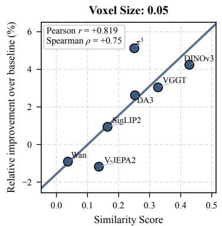

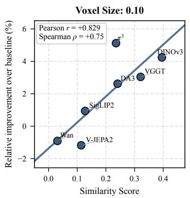

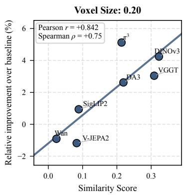  
Fig. 4. Backbone features: 3D-aware consistency tracks the gain. Across models, the cross-view consistency score correlates strongly with the gain from distilling the feature (Pearson r ≈ 0.83), and the trend holds across voxel resolutions.

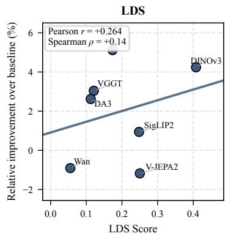

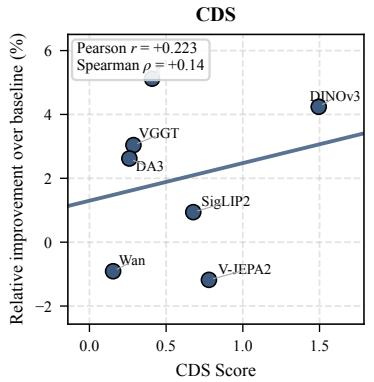

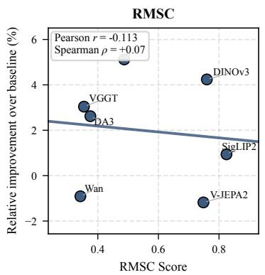  
Fig. 5. 2D feature-structure metrics do not track the gain. Unlike 3D-aware cross-view consistency (Fig. 4), the three 2D metrics (LDS/CDS/RMSC) are at most weakly correlated with the gain (r ≈ 0.26, 0.22, −0.11).

The 2D control introduced above shows the correlation to be specific to 3D structure (Fig. 5). The three 2D feature-structure metrics (LDS/CDS/RMSC), which capture how regular a feature map is within each view but ignore cross-view 3D correspondence, are at most weakly correlated with the downstream gain (r ≈ 0.26, 0.22, −0.11). The contrast with the cross-view result (Fig. 4) is the crux of the feature analysis: the gains track 3D-aware structure, not generic feature regularity.

Geometric outputs: depth and reconstruction quality. The same question has a different measurement for explicit geometry. Here the counterpart of cross-view consistency is how faithfully a model actually recovers 3D structure: one whose predicted depth and point maps are more accurate carries more reliable 3D information to transfer. We quantify this offline—again without feeding any geometry to the MLLM— by scoring each model’s native predictions on standard benchmarks with two depth metrics (AbsRel on 7Scenes and an indoor average) and two reconstruction metrics (F-Score on ScanNet++, F1 on ETH3D), and relate each score to the spatial gain from distilling that model.

Finding 2: Reconstruction quality tracks geometry gains. The three geometry models rank identically on all four depth and reconstruction metrics, and in that same order by downstream gain (Fig. 6). With three models the ordering is what the comparison supports, and it is the recurrence of one ordering over four independent metrics—rather than any single fit—that carries the point. The metrics are dense depth and reconstruction ones, matched to the kind of output the DPT head has to produce. Reconstruction accuracy also organises performance inside the transferred model itself: the scenes whose geometry it decodes most accurately are the ones it answers most accurately, with QA accuracy falling from 64.0% on the bestreconstructed quarter of the evaluation scenes to 53.9% on the worst (Fig. 9c).

Although they measure different quantities, the two diagnostics play the same role. Cross-view correspondence assesses backbone features, while depth and reconstruction accuracy gauge geometric outputs. Both confirm that representations with stronger inherent 3D structure yield larger downstream benefits.

## C. The Two Forms Overlap but Specialize

Knowing that what matters is the 3D structure a representation carries, we next ask in which form that structure is better delivered. A backbone feature and a geometric output drawn from the same model describe the same scene, so a natural question is whether they strengthen the same spatial skills or different ones. Holding the mechanism fixed to distillation, we compare a backbone feature against an explicit geometric output decoded by the DPT head, broken down by VSI-Bench task category and averaged over the three geometry models (VGGT/DA3/π3). The breakdown uses the ten task types the benchmark scores separately; Table III reports eight categories, the difference being that the three difficulty splits of relative direction are averaged into one there. We group the ten as single-object metric (counting, object size, room size, absolute distance), multi-object relational (relative distance, and the three relative-direction splits), temporal sequence (appearance order), and long-horizon (route planning).

Backbone Feature Δ vs baseline (RELATIVE %)  
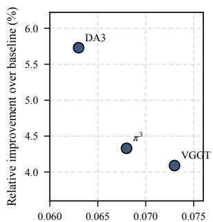  
Depth AbsRel, 7Scenes ( ↓ )

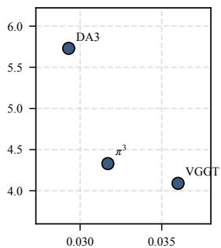  
Depth AbsRel, indoor-avg ( ↓ )

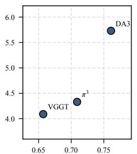  
Recon. F-Score, ScanNet++ ( ↑ )

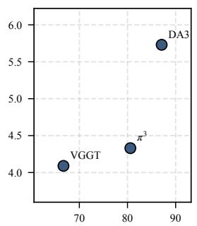  
Recon. F1, ETH3D ( ↑ )  
Fig. 6. Explicit geometry: depth and reconstruction quality track the gain. Each panel scores the three geometry models’ own predictions on a standard depth or reconstruction benchmark against the gain from distilling them. The three fall in the same order on all four.

(a)  
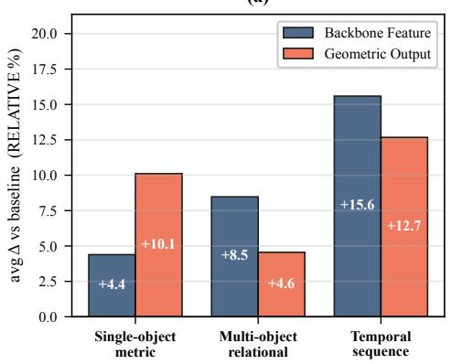

(b)  
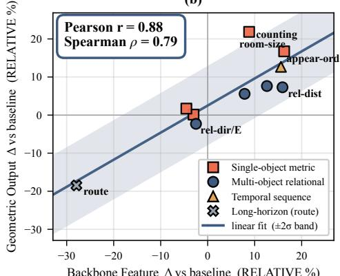  
Fig. 7. Backbone features and geometric outputs specialize by task. Using distillation, we compare backbone features against geometric outputs across tasks, averaged over three geometry models (VGGT/DA3/π3). (a) Mean relative improvement over the base model by VSI-Bench task category. (b) The two forms’ per-task gains are strongly correlated (Pearson r = 0.88): single-object tasks favor geometric outputs (above the diagonal), relational/temporal tasks favor backbone features (below).

Finding 3: Backbone features and geometric outputs specialize $b y$ spatial skill. Across the ten task categories (Fig. 7), the two forms are strongly correlated (Pearson $r \ = \ 0 . 8 8 .$ Spearman $\rho ~ = ~ 0 . 7 9 )$ : they help and hurt largely the same tasks. A shared task profile is consistent with the two forms carrying much the same geometry, though it does not establish it; what the correlation rules out is that they act as independent cues. What separates them is the systematic deviation from that trend. Geometric outputs, which carry pixel-accurate decoded depth and point maps, give the larger gain on single-object metric tasks (counting, object and room size, absolute distance: +10.1% vs. +4.4%). Backbone features, being free-form and composable by the language model, instead win multi-object relational reasoning (relative distance and direction: +8.5% vs. +4.6%) and temporal-sequence reasoning (appearance

order: +15.6% vs. +12.7%).

The form decides not only how much a representation helps, but which spatial ability it strengthens. Neither form covers what the other does best, so we transfer both.

## D. The Form Dictates the Mechanism

If both forms are worth transferring, the remaining choice is how each should enter the MLLM. We compare the two mechanisms defined above, applying each to both forms. Distillation. Following 3DRS [33], we align the MLLM’s per-pixel visual features with the transferred representation. Each MLLM feature $\mathbf { f } _ { i } ( p )$ is projected by a lightweight head $\mathrm { M L P _ { a l i g n } }$ and matched to the target $\mathbf { r } _ { i } ( p )$ with a Smooth L1 regression objective,

$$
\mathcal { L } _ { \mathrm { d i s t i l l } } = \frac { 1 } { N H W } \sum _ { i = 1 } ^ { N } \sum _ { p \in I _ { i } } \ell _ { \mathrm { S L 1 } } ( \mathrm { M L P } _ { \mathrm { a l i g n } } ( \mathbf { f } _ { i } ( p ) ) , \mathbf { r } _ { i } ( p ) ) ,\tag{2}
$$

where $\ell _ { \mathrm { S L 1 } }$ denotes the Smooth L1 loss, applied elementwise and averaged over feature channels. For geometric outputs, $\mathbf { r } _ { i } ( p )$ is the depth or point-map value predicted by the geometry model and the MLLM side is the corresponding output of the DPT head. The targets are precomputed offline, so distillation adds no inference-time cost and needs no external representation at test time; the total objective is $\mathcal { L } = \mathcal { L } _ { \mathrm { C E } } + \mathcal { L } _ { \mathrm { d i s t i l l } }$

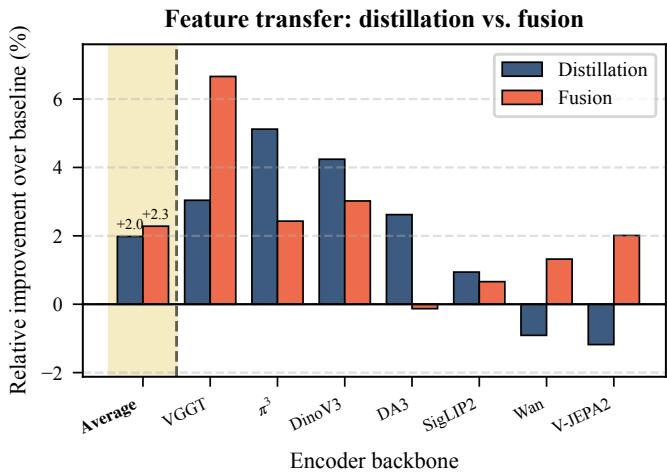  
Fig. 8. Backbone-feature transfer: distillation vs. fusion. Bars are relative improvement over the base model, per model. The two mechanisms yield broadly similar gains for backbone features, with no consistent winner.

Fusion. Under fusion, the representation is supplied to the MLLM at both training and inference through a learned gating interface. Let $\mathbf { v } _ { i } ( p )$ be the vision-encoder token at pixel p of frame i and let $\mathbf { r } _ { i } ( p )$ be the external representation projected into the token space by a linear map W. We form a gate from both streams and add the gated external representation back to the vision token as a residual,

$$
\mathbf { a } _ { i } ( p ) = \sigma \big ( \mathrm { M L P } \big ( [ \mathbf { v } _ { i } ( p ) ; W \mathbf { r } _ { i } ( p ) ] \big ) \big ) ,\tag{3}
$$

$$
\tilde { \mathbf { v } } _ { i } ( p ) = \mathbf { v } _ { i } ( p ) + \mathbf { a } _ { i } ( p ) \odot W \mathbf { r } _ { i } ( p ) ,\tag{4}
$$

where [· ; ·] denotes concatenation, σ the logistic function, and ⊙ the elementwise product. The gated tokens v˜ replace v as input to the decoder, so the model learns—per token and per channel—how much of the external representation to admit. Unlike distillation, fusion keeps the external representation available at test time, but it requires the external model (or its geometry head) to run at inference.

Finding 4: For backbone features, the two mechanisms are broadly comparable. For backbone features (Fig. 8), distillation and fusion give comparable spatial gains once averaged over the evaluation suite, and which of the two wins is a property of the model rather than of the mechanism: fusion is slightly ahead for some backbones (e.g., VGGT) and distillation for others $( \mathrm { e . g . , ~ } \pi ^ { 3 } )$ , with no systematic gap between the two columns. The practical consequence is that distillation—which needs no external model at inference— is the cheaper default for backbone features, and fusion is worth its added test-time cost only when the external model is already available at inference for other reasons.

Finding 5: Explicit geometry is best transferred by distillation through a decoding head. For explicit geometric outputs, the two mechanisms behave very differently (Fig. 9). Distillation lifts spatial accuracy by ≈+4.7% on average, whereas fusing the same geometry adds only ≈+0.6% and can even hurt (panel a): handing raw depth and point maps to the language model as an input stream forces it to parse a representation it is poorly equipped to use, while distillation lets it absorb that geometry into its own tokens during training and then discard the external model. The benefit further hinges on the pretrained VGGT DPT-style decoding head: replacing it with the learnable linear head reduces the distillation gain to ≈+1.4% (panel b). A linear prediction head places the burden of low-level, metric regression—precise depth values and 3D point coordinates—inside the MLLM features themselves. The pretrained DPT head instead performs this finegrained geometry decoding from multi-layer MLLM features, so the MLLM can supply higher-level visual representations without directly solving dense geometric regression. The two heads differ in architecture, initialization and trainability at once, so this comparison shows that the pretrained decoder configuration matters without isolating which of the three is responsible.

The mechanism is therefore not a free choice. Backbone features can be distilled or fused with similar effect, so we distill them, which costs nothing at inference. For geometric outputs the two routes are far apart: among the interfaces we implement, distillation through the pretrained decoding head is the only one that delivers most of the available gain.

## E. The Resulting Model

Across the three analyses one picture emerges. What a transfer contributes is the 3D structure the representation carries; the two forms carry that structure in overlapping but not interchangeable ways; and the mechanism that suits a form is not the same for both. An effective design therefore has to do three things at once: draw on representations rich in 3D structure, use both forms rather than one, and route each by the mechanism that works for it.

Our model does exactly this. Both transferred representations are taken from VGGT [62]: a backbone feature and an explicit geometric output (Section III-C), transferred by distillation, geometry through the pretrained DPT-style head (Section III-D), so that no external model is needed at inference.

Concretely, the objective adds two transfer terms to the autoregressive loss,

$$
\mathcal { L } = \mathcal { L } _ { \mathrm { C E } } + \mathcal { L } _ { \mathrm { d i s t i l l } } ^ { \mathrm { f e a t } } + \mathcal { L } _ { \mathrm { d i s t i l l } } ^ { \mathrm { g e o } } ,\tag{5}
$$

where $\mathcal { L } _ { \mathrm { d i s t i l l } } ^ { \mathrm { f e a t } }$ aligns the MLLM’s visual tokens with a backbone feature and $\mathcal { L } _ { \mathrm { d i s t i l l } } ^ { \mathrm { g e o } }$ aligns the depth and point maps decoded from those tokens with a geometry model’s predictions. The targets are precomputed offline, so the resulting model consumes only RGB video at inference. This is the configuration reported as Ours throughout Section IV.

## IV. EXPERIMENTS

## A. Experimental Setup

Implementation details. All variants are fine-tuned from the same base MLLM within the LLaMA-Factory framework under the identical configuration summarized in Table I. The important point for the comparisons is that every run starts from the same checkpoint, uses the same data, optimizer, schedule, visual-token budget, and tap layers, and changes only the transferred representation or its transfer mechanism.

Reconstruction quality quartile

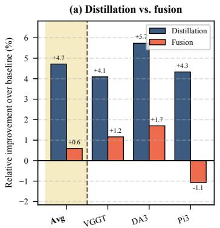

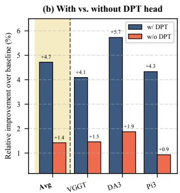

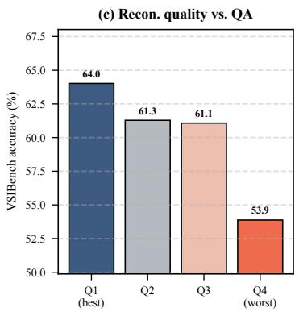  
Fig. 9. Explicit-geometry transfer and its quality. (a) Distillation far outperforms fusion for geometric outputs (≈+4.7% vs. +0.6%). (b) Without the pretrained DPT-style decoding head, the gain falls to ≈+1.4%. (c) Sorting the 288 VSI-Bench evaluation scenes (150 from ARKitScenes, 88 from ScanNet, 50 from ScanNet++) by depth+point reconstruction error into quartiles, QA accuracy falls from Q1 (64.0%) to Q4 (53.9%).

TABLE I  
SHARED TRAINING CONFIGURATION FOR THE CONTROLLED COMPARISONS; ACROSS VARIANTS, ONLY THE TRANSFERRED REPRESENTATION OR TRANSFER MECHANISM CHANGES.
<table><tr><td>Setting</td><td>Value</td></tr><tr><td>Base MLLM</td><td>Qwen3-VL-8B-Instruct</td></tr><tr><td>Framework</td><td>LLaMA-Factory</td></tr><tr><td>Optimizer</td><td> $\mathrm { A d a m W } \left( \beta _ { 1 } { = } 0 . 9 , \beta _ { 2 } { = } 0 . 9 9 9 \right)$ </td></tr><tr><td>Adam €</td><td> $1 \times 1 0 ^ { - 8 }$ </td></tr><tr><td>Weight decay</td><td>0</td></tr><tr><td>Gradient clipping</td><td>1.0</td></tr><tr><td>Peak learning rate</td><td> $1 \times 1 0 ^ { - 5 }$ </td></tr><tr><td>LR schedule</td><td>cosine (→ 0)</td></tr><tr><td>Warmup ratio</td><td>0.02</td></tr><tr><td>Epochs</td><td>1</td></tr><tr><td>GPUs</td><td>64</td></tr><tr><td>Per-device batch</td><td>1</td></tr><tr><td>Total batch size</td><td>64</td></tr><tr><td>Precision</td><td>bf16</td></tr><tr><td>Transfer tap layers</td><td>{2, 10, 18, 31}</td></tr><tr><td>Adapter width</td><td>2048</td></tr></table>

For explicit geometric outputs, the pretrained DPT-style decoding head produces depth and point maps from the tapped features.

Training data. Every variant shares the same corpus of approximately 852,000 examples: about 800,000 image- and video-based spatial instruction samples drawn from a mixture of OneThinker [22], SenseNova [7], and VSI-590K [77], together with ≈52,000 indoor 3D question–answering samples from ScanQA [3] and SQA3D [44].

Evaluation benchmarks and metrics. We evaluate on eight benchmarks, spanning video spatial intelligence (VSI-Bench [73]), indoor 3D scene QA (ScanQA [3], SQA3D [44]), image and multi-view spatial reasoning (SPAR-Bench [82], ViewSpatial-Bench [38], CV-Bench [58], SPBench [39]), and dynamic 4D reasoning (DSR-Bench [90]). All evaluation uses pure RGB video or images with no depth or camera pose at inference (Section III-A), and we report each benchmark’s standard metric.

TABLE II  
COMPONENT ABLATION UNDER THE SHARED TRAINING RECIPE. “FEAT. DISTILL” DISTILLS A BACKBONE FEATURE; “GEO. DISTILL” DISTILLS A GEOMETRIC OUTPUT THROUGH THE DPT HEAD; “BOTH” COMBINES THE TWO AND IS THE MODEL REPORTED AS Ours. ALL VALUES ARE ACCURACY (%) EXCEPT SCANQA (CIDER); AVG. EXCLUDES SCANQA. BEST PER ROW IN BOLD.
<table><tr><td>Benchmark</td><td>Base</td><td>Feat. distill</td><td>Geo. distill</td><td>Both</td></tr><tr><td>VSI-Bench</td><td>57.64</td><td>60.17</td><td>60.42</td><td>62.15</td></tr><tr><td>ScanQA (CIDEr)</td><td>84.61</td><td>89.41</td><td>93.13</td><td>93.15</td></tr><tr><td>SQA3D</td><td>54.53</td><td>54.93</td><td>56.58</td><td>56.44</td></tr><tr><td>SPAR-Bench</td><td>39.02</td><td>38.58</td><td>39.40</td><td>39.67</td></tr><tr><td>SPBench-SI</td><td>57.07</td><td>62.11</td><td>59.00</td><td>59.95</td></tr><tr><td>SPBench-MV</td><td>56.58</td><td>67.34</td><td>61.35</td><td>65.08</td></tr><tr><td>ViewSpatial</td><td>50.04</td><td>52.68</td><td>49.70</td><td>50.60</td></tr><tr><td>CV-Bench-2D</td><td>74.34</td><td>76.08</td><td>77.26</td><td>78.93</td></tr><tr><td>CV-Bench-3D</td><td>80.88</td><td>79.55</td><td>81.14</td><td>83.06</td></tr><tr><td>Avg. (8 acc.)</td><td>58.76</td><td>61.43</td><td>60.61</td><td>61.98</td></tr></table>

## B. Ablation: Contribution of Each Transfer Component

Holding the base model, data, and recipe fixed, Table II isolates the two transfer components. Each helps on its own, and each helps in a different place: backbone-feature distillation (“Feat. distill”) is strongest on the multi-view and single-image SPBench splits and on ViewSpatial—benchmarks that stress relational, viewpoint-dependent cues that a free-form feature carries well—whereas geometric-output distillation (“Geo. distill”) contributes most where metric structure dominates, such as SQA3D. This mirrors the form-specialization finding of Section III-C.

Combining the two (“Both”) gives the best average, but the more informative fact is where the single components fail. Feature distillation alone falls below the base model on SPAR-Bench and CV-Bench-3D; geometric distillation alone falls below it on ViewSpatial. The combination improves on the base in every column. Each single form has a benchmark it costs something on, and the other form covers it—which is what it means for the two to be more than substitutes. We therefore report “Both” throughout the comparison tables, so that every benchmark is evaluated with one model rather than a component chosen per benchmark.

TABLE III  
VSI-BENCH PER-CATEGORY ACCURACY (%). ALL METHODS USE 2D VIDEO INPUT. CATEGORIES ARE OBJECT COUNTING (COUNT), ABSOLUTE DISTANCE (ABS.DIST), OBJECT SIZE (OBJ.SIZE), ROOM SIZE (ROOM), RELATIVE DISTANCE (REL.DIST), RELATIVE DIRECTION (REL.DIR), ROUTE PLANNING (ROUTE), AND APPEARANCE ORDER (APPR.ORDER). BEST AMONG REPORTED ENTRIES IN BOLD. †NUMBERS ARE REPORTED BY GUIDE [60]; OTHER BASELINE CATEGORY SCORES ARE FROM THE VSI-BENCH [73], VLM-3R [20], AND 3DRS [33] PAPERS, OR THE METHODS’ OWN PAPERS.
<table><tr><td>Method</td><td>Avg.</td><td>Count</td><td>Abs. Dist</td><td>Obj. Size</td><td>Room Size</td><td>Rel. Dist</td><td>Rel. Dir</td><td>Route</td><td>Appr. Order</td></tr><tr><td></td><td></td><td></td><td></td><td></td><td></td><td></td><td></td><td></td><td></td></tr><tr><td>Proprietary GPT-40 [47]</td><td>34.0</td><td>46.2</td><td>5.3</td><td>43.8</td><td>38.2</td><td>37.0</td><td>41.3</td><td>31.5</td><td>28.5</td></tr><tr><td>Gemini-1.5 Flash</td><td>42.1</td><td>49.8</td><td>30.8</td><td>53.5</td><td>54.4</td><td>37.7</td><td>41.0</td><td>31.5</td><td>37.8</td></tr><tr><td>Gemini-1.5 Pro</td><td>45.4</td><td>56.2</td><td>30.9</td><td>64.1</td><td>43.6</td><td>51.3</td><td>46.3</td><td>36.0</td><td>34.6</td></tr><tr><td>Gemini-2.5 Pro†</td><td>53.6</td><td>46.0</td><td>37.4</td><td>68.7</td><td>54.4</td><td>62.0</td><td>43.9</td><td>47.4</td><td>68.8</td></tr><tr><td>GPT-5†</td><td>55.0</td><td>53.3</td><td>34.5</td><td>73.3</td><td>47.5</td><td>63.7</td><td>48.7</td><td>50.3</td><td>68.9</td></tr><tr><td>Open-source generalist MLLMs</td><td></td><td></td><td></td><td></td><td></td><td></td><td></td><td></td><td></td></tr><tr><td>LongVA-7B</td><td>29.2</td><td>38.0</td><td>16.6</td><td>38.9</td><td>22.2</td><td>33.1</td><td>43.3</td><td>25.4</td><td>15.7</td></tr><tr><td>VILA-1.5-8B</td><td>28.9</td><td>17.4</td><td>21.8</td><td>50.3</td><td>18.8</td><td>32.1</td><td>34.8</td><td>31.0</td><td>24.8</td></tr><tr><td>VILA-1.5-40B</td><td>31.2</td><td>22.4</td><td>24.8</td><td>48.7</td><td>22.7</td><td>40.5</td><td>25.7</td><td>31.5</td><td>32.9</td></tr><tr><td>LongVILA-8B</td><td>21.6</td><td>29.1</td><td>9.1</td><td>16.7</td><td>0.0</td><td>29.6</td><td>30.7</td><td>32.5</td><td>25.5</td></tr><tr><td>Qwen2.5-VL-7B [4]</td><td>29.2</td><td>25.2</td><td>10.9</td><td>35.8</td><td>29.2</td><td>38.7</td><td>37.5</td><td>29.4</td><td>26.7</td></tr><tr><td>InternVL2-2B [15]</td><td>26.5</td><td>25.7</td><td>24.0</td><td>20.0</td><td>29.2</td><td>32.1</td><td>44.1</td><td>30.4</td><td>6.3</td></tr><tr><td>InternVL2-8B [15]</td><td>37.5</td><td>31.3</td><td>29.0</td><td>48.9</td><td>44.2</td><td>38.0</td><td>33.4</td><td>28.9</td><td>46.4</td></tr><tr><td>InternVL2-40B [15]</td><td>37.0</td><td>41.3</td><td>26.2</td><td>48.2</td><td>27.5</td><td>47.6</td><td>32.7</td><td>27.8</td><td>44.7</td></tr><tr><td>LLaVA-OneVision-7B [37]</td><td>32.4</td><td>47.7</td><td>20.2</td><td>47.4</td><td>12.3</td><td>42.5</td><td>35.2</td><td>29.4</td><td>24.4</td></tr><tr><td>LLaVA-OneVision-72B [37]</td><td>40.2</td><td>43.5</td><td>23.9</td><td>57.6</td><td>37.5</td><td>42.5</td><td>39.9</td><td>32.5</td><td>44.6</td></tr><tr><td>LLaVA-Video-7B [86]</td><td>35.6</td><td>48.5</td><td>14.0</td><td>47.8</td><td>24.2</td><td>43.5</td><td>42.4</td><td>34.0</td><td>30.6</td></tr><tr><td>LLaVA-Video-72B [86]</td><td>40.9</td><td>48.9</td><td>22.8</td><td>57.4</td><td>35.3</td><td>42.4</td><td>36.7</td><td>35.0</td><td>48.6</td></tr><tr><td>Spatial MLLMs</td><td></td><td></td><td></td><td></td><td></td><td></td><td></td><td></td><td></td></tr><tr><td>Spatial-MLLM [68]</td><td>47.0</td><td>65.3</td><td>34.8</td><td>63.1</td><td>45.1</td><td>41.3</td><td>46.2</td><td>33.5</td><td>46.3</td></tr><tr><td>VG-LLM [87]</td><td>47.3</td><td>66.0</td><td>37.8</td><td>55.2</td><td>59.2</td><td>44.6</td><td>45.6</td><td>33.5</td><td>36.4</td></tr><tr><td>ViLaSR [70]</td><td>45.4</td><td>63.5</td><td>34.4</td><td>60.6</td><td>30.9</td><td>48.9</td><td>45.2</td><td>30.4</td><td>49.2</td></tr><tr><td>SpatialLadder-3B [39]</td><td>45.7</td><td>63.5</td><td>34.3</td><td>61.7</td><td>43.9</td><td>45.4</td><td>44.8</td><td>35.6</td><td>36.4</td></tr><tr><td>VLM-3R [20]</td><td>60.9</td><td>70.2</td><td>49.4</td><td>69.2</td><td>67.1</td><td>65.4</td><td>80.5</td><td>45.4</td><td>40.1</td></tr><tr><td>VST-7B-SFT†</td><td>60.6</td><td>72.0</td><td>44.4</td><td>74.3</td><td>68.3</td><td>59.7</td><td>55.8</td><td>44.9</td><td>65.2</td></tr><tr><td>Cambrian-S† [77]</td><td>57.3</td><td>70.7</td><td>40.6</td><td>68.0</td><td>46.3</td><td>64.8</td><td>61.9</td><td>27.3</td><td>78.8</td></tr><tr><td>3DRS [33]</td><td>45.9</td><td>68.7</td><td>34.8</td><td>53.6</td><td>56.6</td><td>40.9</td><td>43.2</td><td>30.4</td><td>39.2</td></tr><tr><td>Ours</td><td>62.2</td><td>75.4</td><td>51.6</td><td>67.0</td><td>54.7</td><td>64.7</td><td>82.1</td><td>39.2</td><td>62.5</td></tr></table>

The pattern also matches the diagnostics of Section III-B. The largest gain from feature distillation is on the multiview split of SPBench (+10.8), the setting that most directly rewards representing the same 3D point consistently across viewpoints—the very quantity the feature diagnostic measures. The largest gain from geometric distillation is on ScanQA (+8.5 CIDEr), where answers depend on metric scene structure, which is what the geometry diagnostic measures. The two diagnostics therefore do more than rank candidate models: each one lines up with the benchmarks its form moves most.

## C. Main Results and Comparisons

The controlled comparisons that constitute our main analysis—across the choice of pretrained model, the representation form, and the transfer mechanism, together with the diagnostics that explain them—are reported inline with their evidence in Section III (Figs. 3–9).

Visual-spatial intelligence (VSI-Bench). On our primary benchmark (Table III), the model reaches 62.2% overall, ahead of recent spatial MLLMs such as VLM-3R (60.9), VG-LLM (47.3), and Spatial-MLLM (47.0), as well as far larger general models such as Gemini-2.5 Pro (53.6) and LLaVA-Video-72B (40.9), using only RGB video. All scores follow the benchmark’s own protocol, which averages the eight reporting categories with equal weight. Per category, the model leads all reported methods on three of them, and they divide along the two transferred forms. Counting (75.4) and absolute distance (51.6) are single-object metric judgments, precisely what distilled depth and point maps supply. Relative direction (82.1) requires relating objects seen from different viewpoints, precisely what cross-view-consistent features supply. The design of Section III-E is thus visible in the category breakdown, not only in the average.

Dynamic 4D reasoning (DSR-Bench). DSR-Bench targets dynamic, 4D spatial reasoning, a setting distinct from the static benchmarks above. Following the DSR-Suite protocol, we take our spatially-trained model and further fine-tune it on the DSR-Bench training split before evaluation; the remaining rows are as reported in the DSR-Suite paper, where the general and proprietary models are evaluated zero-shot. DSR-Suite is therefore the directly comparable entry, being trained on the same split. Across the 13 subtasks under absolute and relative viewpoints (Table IV), our model reaches 70.7% overall, +11.8 over the official DSR-Suite (58.9) and far above the zero-shot general and proprietary models (e.g., Gemini-2.5-Pro 31.7, GPT-5 30.8, VG-LLM 38.4). The gains hold across every subtask and are largest on the dynamic ones—relative speed (+26.1), relative speed comparison (+20.0), absolute direction (+18.5), and relative direction (+17.1)—showing that a model built by transferring 3D structure carries that advantage into reasoning about motion and changing viewpoints, not only static scenes.

TABLE IV  
DYNAMIC 4D SPATIAL REASONING ON DSR-BENCH. BASELINES ARE FROM THE DSR-SUITE PAPER. FOLLOWING THAT SETTING, OUR ENTRY ISFURTHER FINE-TUNED ON THE DSR-BENCH TRAINING SPLIT; THIS IS THE ONLY BENCHMARK-SPECIFIC FINE-TUNING SETTING IN OUR EVALUATION.AVG. IS SAMPLE-WEIGHTED ACCURACY (%). BEST IN BOLD.
<table><tr><td>Method</td><td colspan="6">Absolute Viewpoint</td><td colspan="6">Relative Viewpoint</td><td>Non- Temp.</td><td>Avg.</td></tr><tr><td></td><td>Dis.</td><td>Dir.</td><td></td><td>Ori. Spd.</td><td>Spd. Comp.</td><td>Dir. Pred.</td><td>Dis.</td><td>Dir.</td><td>Ori. Spd.</td><td></td><td>Spd. Comp.</td><td>Dir. Pred.</td><td></td><td></td></tr><tr><td>Proprietary Models</td><td></td><td></td><td></td><td></td><td></td><td></td><td></td><td></td><td></td><td></td><td></td><td></td><td></td><td></td></tr><tr><td>GPT-40 [47]</td><td>18.8</td><td>29.2</td><td>26.8</td><td>29.7</td><td>21.5</td><td>26.2</td><td>24.1</td><td>23.8</td><td>17.2</td><td>32.3</td><td>22.8</td><td>24.4</td><td>34.7</td><td>26.4</td></tr><tr><td>GPT-5</td><td>21.1</td><td>41.5</td><td>48.7</td><td>34.5</td><td>33.3</td><td>34.7</td><td>17.2</td><td>44.3</td><td>41.9</td><td>21.2</td><td>25.0</td><td>30.9</td><td>26.7</td><td>30.8</td></tr><tr><td>Gemini-2.5-Flash</td><td>18.8</td><td>27.6</td><td>19.5</td><td>25.0</td><td>23.6</td><td>22.0</td><td>11.2</td><td>28.4</td><td>30.8</td><td>23.2</td><td>17.1</td><td>22.6</td><td>38.8</td><td>24.9</td></tr><tr><td>Gemini-2.5-Pro</td><td>20.0</td><td>44.6</td><td>53.6</td><td>27.3</td><td>38.7</td><td>30.5</td><td>23.2</td><td>32.9</td><td>43.2</td><td>17.1</td><td>28.5</td><td>27.9</td><td>34.3</td><td>31.7</td></tr><tr><td>Video Understanding Models</td><td></td><td></td><td></td><td></td><td></td><td></td><td></td><td></td><td></td><td></td><td></td><td></td><td></td><td></td></tr><tr><td>LLaVA-Video-7B [86]</td><td>22.3</td><td>16.9</td><td>25.6</td><td>33.3</td><td>45.1</td><td>24.5</td><td>24.1</td><td>15.9</td><td>17.2</td><td>19.1</td><td>24.2</td><td>21.4</td><td>33.9</td><td>25.9</td></tr><tr><td>VideoRefer</td><td>23.5</td><td>18.4</td><td>25.6</td><td>33.5</td><td>45.4</td><td>27.1</td><td>25.0</td><td>16.1</td><td>18.5</td><td>20.2</td><td>26.4</td><td>22.6</td><td>34.7</td><td>26.9</td></tr><tr><td>LongVILA-R1</td><td>20.0</td><td>21.5</td><td>23.1</td><td>21.4</td><td>37.6</td><td>22.8</td><td>24.1</td><td>26.1</td><td>28.3</td><td>22.2</td><td>17.8</td><td>20.8</td><td>33.9</td><td>25.3</td></tr><tr><td>General-Purpose Models</td><td></td><td></td><td></td><td></td><td></td><td></td><td></td><td></td><td></td><td></td><td></td><td></td><td></td><td></td></tr><tr><td>Qwen2.5-VL-7B [4]</td><td>18.8</td><td>15.3</td><td>14.6</td><td>42.8</td><td>29.0</td><td>19.4</td><td>31.8</td><td>19.3</td><td>11.1</td><td>22.2</td><td>19.2</td><td>20.2</td><td>30.1</td><td>23.5</td></tr><tr><td>Qwen2.5-VL-32B [4]</td><td>31.7</td><td>21.5</td><td>23.1</td><td>44.0</td><td>36.5</td><td>25.4</td><td>27.5</td><td>23.8</td><td>37.0</td><td>27.2</td><td>29.2</td><td>21.4</td><td>36.2</td><td>29.9</td></tr><tr><td>Qwen3-VL-8B-Instruct</td><td>23.5</td><td>24.6</td><td>42.6</td><td>29.7</td><td>27.9</td><td>33.8</td><td>18.1</td><td>28.4</td><td>34.5</td><td>24.2</td><td>22.1</td><td>27.9</td><td>33.5</td><td>28.7</td></tr><tr><td>Qwen3-VL-30B-A3B-Instruct</td><td>25.8</td><td>27.6</td><td>46.3</td><td>30.9</td><td>31.1</td><td>34.7</td><td>20.6</td><td>29.5</td><td>37.0</td><td>28.2</td><td>24.2</td><td>31.5</td><td>35.4</td><td>31.1</td></tr><tr><td>InternVL3.5-8B [15]</td><td>23.5</td><td>27.6</td><td>28.0</td><td>34.5</td><td>24.7</td><td>27.9</td><td>22.4</td><td>17.0</td><td>19.7</td><td>28.2</td><td>30.0</td><td>14.2</td><td>30.1</td><td>25.4</td></tr><tr><td>InternVL3.5-38B [15]</td><td>25.8</td><td>27.8</td><td>29.2</td><td>34.2</td><td>24.7</td><td>28.5</td><td>26.7</td><td>16.3</td><td>23.4</td><td>29.2</td><td>32.1</td><td>15.4</td><td>31.3</td><td>26.7</td></tr><tr><td>Spatial Reasoning Models</td><td></td><td></td><td></td><td></td><td></td><td></td><td></td><td></td><td></td><td></td><td></td><td></td><td></td><td></td></tr><tr><td>VG-LLM [87]</td><td>55.2</td><td>32.3</td><td>58.5</td><td>57.1</td><td>51.6</td><td>32.2</td><td>56.0</td><td>36.3</td><td>32.0</td><td>30.3</td><td>32.1</td><td>29.1</td><td>27.9</td><td>38.4</td></tr><tr><td>DSR-Suite [90]</td><td>87.0</td><td>73.8</td><td>84.1</td><td>73.8</td><td>72.0</td><td>35.5</td><td>75.8</td><td>76.1</td><td>77.7</td><td>60.6</td><td>37.1</td><td>35.1</td><td>46.4</td><td>58.9</td></tr><tr><td>Ours</td><td>91.8</td><td>92.3</td><td>92.7</td><td>81.0</td><td>86.0</td><td>46.2</td><td>86.6</td><td>93.2</td><td>92.5</td><td>86.7</td><td>57.1</td><td>43.1</td><td>49.8</td><td>70.7</td></tr></table>

TABLE V

INDOOR 3D SCENE QUESTION ANSWERING ON SCANQA VAL AND SQA3D TEST. SCANQA REPORTS CIDER (C) AND EXACT MATCH (EM); SQA3D REPORTS ACCURACY (%). INPUT INDICATES EXPLICIT 3D/POSED RGB-D, RECONSTRUCTED BEV FROM 3D GEOMETRY, OR RGB VIDEO. BEST PER COLUMN IN BOLD; “–” DENOTES NOT REPORTED.
<table><tr><td>Method</td><td>Input</td><td>C</td><td>EM</td><td>SQA3D</td></tr><tr><td>ScanQA [3]</td><td>3D</td><td>64.9</td><td>21.1</td><td>47.2</td></tr><tr><td>3D-LLM (FlanT5) [28]</td><td>3D</td><td>69.4</td><td>20.5</td><td></td></tr><tr><td>3D-VisTA [93]</td><td>3D</td><td>69.6</td><td>22.4</td><td>48.5</td></tr><tr><td>Grounded 3D-LLM [14]</td><td>3D</td><td>75.9</td><td>一</td><td>一</td></tr><tr><td>LL3DA [13]</td><td>3D</td><td>76.8</td><td></td><td></td></tr><tr><td>Scene-LLM [23]</td><td>3D</td><td>80.0</td><td>27.2</td><td>54.2</td></tr><tr><td>Chat-Scene [30]</td><td>3D</td><td>87.7</td><td>21.6</td><td>54.6</td></tr><tr><td>LLaVA-3D [91]</td><td>3D</td><td>91.7</td><td>27.0</td><td>55.6</td></tr><tr><td>LEO-VL [31]</td><td>3D</td><td>101.1</td><td></td><td>58.7</td></tr><tr><td>LEO [32]</td><td>3D</td><td>101.4</td><td>24.5</td><td>50.0</td></tr><tr><td>Video-3D LLM [88]</td><td>3D</td><td>102.1</td><td>30.1</td><td>58.6</td></tr><tr><td>GPT4Scene [52]</td><td>3D-BEV</td><td>96.3</td><td>28.2</td><td>59.4</td></tr><tr><td>Qwen2-VL-7B [63]</td><td>2D</td><td>53.9</td><td>19.0</td><td>40.7</td></tr><tr><td>Oryx-34B [43]</td><td>2D</td><td>72.3</td><td>一</td><td>50.9</td></tr><tr><td>LLaVA-Video-7B [86]</td><td>2D</td><td>88.7</td><td></td><td>48.5</td></tr><tr><td>Spatial-MLLM [68]</td><td>2D</td><td>91.8</td><td>26.3</td><td>55.9</td></tr><tr><td>Ours</td><td>2D</td><td>93.2</td><td>26.6</td><td>56.4</td></tr></table>

Indoor 3D scene QA (ScanQA, SQA3D). Although these benchmarks are usually addressed with explicit 3D input, our pure-RGB model is highly competitive with both 3D-input and

TABLE VI  
IMAGE AND MULTI-VIEW SPATIAL REASONING (2D INPUT). SPAR/VIEWSPATIAL: OVERALL ACCURACY; CV-BENCH: 2D/3D SPLITS; SPBENCH: SINGLE-IMAGE (SI)/MULTI-VIEW (MV) SPLITS (ALL %).  
SPAR USES THE FULL BENCHMARK WHERE REPORTED; CLAUDE-3.7-SONNET IS THE TINY/API RESULT REPORTED BY SPAR BECAUSE THE FULL RESULT IS UNAVAILABLE. BEST PER COLUMN IN BOLD; “–” NOT REPORTED.
<table><tr><td rowspan="2">Method</td><td>SPAR</td><td>View- Spatial</td><td colspan="2">CV-Bench</td><td colspan="2">SPBench</td></tr><tr><td>Avg</td><td>Overall</td><td>2D</td><td>3D</td><td>SI</td><td>MV</td></tr><tr><td>LLaVA-OneVision-7B [37]</td><td>31.2</td><td>27.5</td><td>53.2</td><td>63.5</td><td>33.2</td><td>32.2</td></tr><tr><td>Llama-3.2-Vision-11B [38]</td><td></td><td>28.8</td><td></td><td></td><td></td><td></td></tr><tr><td>LLaVA-NeXT-Video-7B [38]</td><td></td><td>30.6</td><td></td><td></td><td></td><td></td></tr><tr><td>GPT-40 [47]</td><td>38.1</td><td>35.0</td><td></td><td>69.4 81.3</td><td>42.4 48.2</td><td></td></tr><tr><td>Claude-3.7-Sonnet [82]</td><td>21.8</td><td></td><td></td><td></td><td></td><td></td></tr><tr><td>Gemini-2.0 Flash</td><td></td><td>32.6</td><td></td><td></td><td>54.7</td><td>51.4</td></tr><tr><td>Qwen2.5-VL-3B [4]</td><td>24.6</td><td>35.9</td><td>69.1</td><td>72.2</td><td>40.3</td><td>36.6</td></tr><tr><td>Qwen2.5-VL-7B [4]</td><td>33.1</td><td>36.9</td><td>75.0</td><td>83.1</td><td></td><td>48.4 37.3</td></tr><tr><td>Qwen2.5-VL-72B [4]</td><td>37.0</td><td></td><td></td><td></td><td></td><td></td></tr><tr><td>InternVL2.5-4B [15]</td><td>30.6</td><td>37.9</td><td>73.5</td><td>75.1</td><td>42.5</td><td>43.2</td></tr><tr><td>InternVL2.5-8B [15]</td><td>36.3</td><td>43.2</td><td></td><td></td><td>42.3</td><td>41.4</td></tr><tr><td>InternVL3-14B [15]</td><td></td><td>40.3</td><td></td><td></td><td></td><td></td></tr><tr><td>Kimi-VL-A3B [39]</td><td>29.4</td><td>33.6</td><td>41.9</td><td>54.7</td><td>35.3 37.0</td><td></td></tr><tr><td>Cambrian-8B [58] Video-R1 [21]</td><td></td><td></td><td>72.3</td><td>72.0</td><td></td><td></td></tr><tr><td>Spatial-MLLM [68]</td><td></td><td></td><td></td><td></td><td>44.840.7</td><td></td></tr><tr><td></td><td></td><td></td><td></td><td></td><td>43.7</td><td>61.8</td></tr><tr><td>ViLaSR [70]</td><td>37.6</td><td></td><td></td><td></td><td>50.2</td><td>61.8</td></tr><tr><td>SpaceR [49]</td><td>37.6</td><td></td><td></td><td></td><td>48.6</td><td>59.4</td></tr><tr><td>Ours</td><td>39.7</td><td>50.6</td><td>78.9</td><td></td><td>83.1 60.0 65.1</td><td></td></tr></table>

2D methods (Table V). It reaches 93.2 CIDEr on ScanQA and 56.4% on SQA3D. On ScanQA, it exceeds older 3Dinput LLMs such as 3D-LLM, LL3DA, Grounded 3D-LLM, Scene-LLM, Chat-Scene, and LLaVA-3D; on SQA3D, it is above the reported results of Scene-LLM, Chat-Scene, and LLaVA-3D. Methods built specifically for 3D scene QA— via explicit 3D input, object-centric scene tokens, or reconstruction supervision—can report higher scores (e.g., Video-3D LLM, LEO-VL, VLM-3R, and recent reconstruction-tuned models [12], [89]), but they rely on geometry or reconstruction that our pure-RGB setting does not use. Three regimes are worth keeping apart here: methods given external 3D at inference, methods that infer geometry from RGB at inference, and methods for which geometry appears only as training supervision. Ours is the last; the entries above belong to the first two, so this table positions the finished system against the literature rather than isolating the effect of transfer, which Table II measures directly. Among general 2D video models it leads clearly (e.g., LLaVA-Video-7B 88.7 / 48.5, Oryx-34B 72.3 / 50.9), and it is slightly above the video-input Spatial-MLLM (91.8 / 55.9). This supports the paper’s claim that an RGB model carrying enough 3D structure can rival methods given geometry directly.

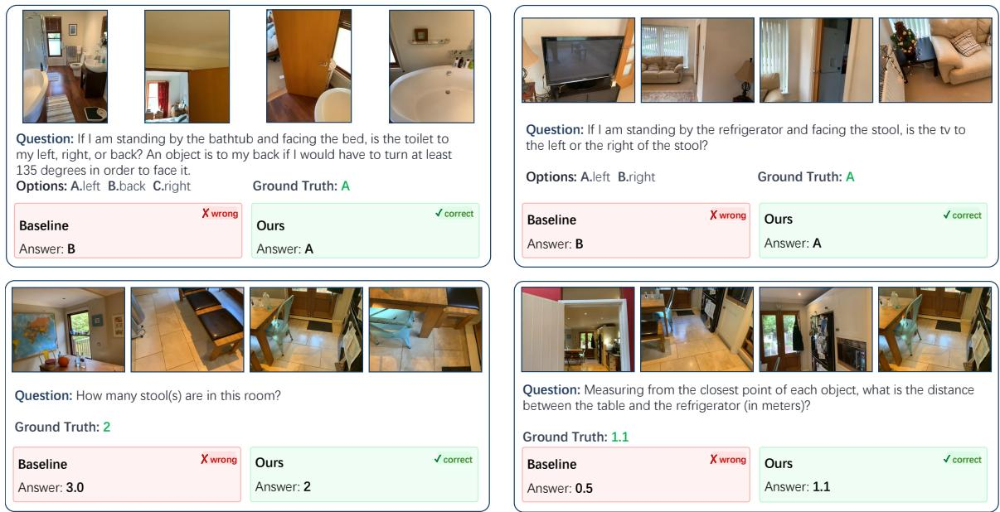  
Fig. 10. Qualitative spatial QA examples. Each panel shows input views, the question, ground truth, and answers from the base model and our model. The examples show cases where the base model’s answer is inconsistent with the depicted scene layout, whereas our transferred-representation model recovers the annotated answer under the same RGB input.

Image and multi-view spatial reasoning. Across the four image/multi-view benchmarks in Table VI, our model is best or tied-best on every column. On SPAR-Bench it reaches 39.7, above GPT-4o (38.1), Qwen2.5-VL-72B (37.0), and all 7B/8B baselines; on ViewSpatial-Bench it scores 50.6, well above the best general model InternVL2.5-8B (43.2); on CV-Bench it is best on the 2D split (78.9) and ties the best on the 3D split (83.1); and on SPBench it attains 60.0/65.1 (SI/MV), above the general models and recent 7B spatial baselines such as SpaceR (48.6/59.4), ViLaSR (50.2/61.8), and Spatial-MLLM (43.7/61.8).

## D. Qualitative Analysis

Spatial QA examples. Fig. 10 complements the aggregate benchmark results with representative held-out QA cases. The comparison is between the base model and our final transferred-representation model. In these examples, the relevant scene content is visible in the RGB views, but the answer requires organizing that content into a 3D layout. The base model’s answers are inconsistent with the layout the views depict, whereas the transferred model recovers the annotated relation from the same frames.

Decoded geometric outputs. Because our geometric variant is trained to decode explicit depth and point maps through the DPT-style decoding head (Section III), we can inspect the geometry it learns directly. Figs. 11 and 12 compare these decoded outputs against VGGT [62] on held-out indoor scenes, illustrating the geometry that the transferred representation makes available to the MLLM.

## V. CONCLUSION

We have studied which visual representations serve spatial understanding in multimodal large language models, and why. Holding the base model, data, and protocol fixed, we varied where a representation comes from, what form it takes, and how it is transferred, and asked what property of a representation explains the differences. Two regularities emerged. The amount of 3D structure a representation carries correlates with the gain it delivers, measured as cross-view consistency for latent features and as depth and reconstruction accuracy for explicit geometry. The appropriate transfer mechanism, in turn, follows from the representation’s form. Guided by these regularities, we distilled both forms into one model, which runs on RGB video alone and improves on every benchmark of the shared-recipe comparison.

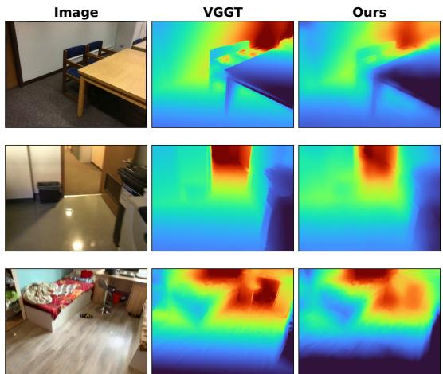

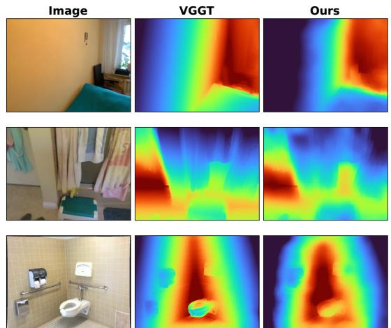  
Fig. 11. Qualitative depth estimation. Each triplet: input image, VGGT [62] depth, and our DPT-decoded depth. Our output has the same geometric form as VGGT’s depth prediction, but the model is trained primarily to improve spatial understanding rather than to serve as a standalone geometry predictor; the decoded depth is therefore smoother, while still preserving plausible depth ordering.

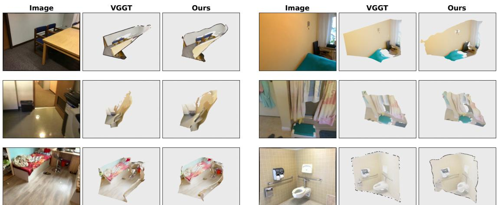  
Fig. 12. Qualitative 3D reconstruction (point maps). Layout as in Fig. 11: input image, VGGT [62] reconstruction, and our DPT-decoded point map. The point map is analogous to VGGT’s geometric output but is produced by a spatial-understanding model rather than a dedicated reconstruction model, so it is coarser while still recovering coherent room-level structure

The practical value of the first regularity is that it can be evaluated before any MLLM is trained. Choosing a representation is otherwise an expensive search, since each candidate costs a full fine-tuning run; a property computed from the representation alone reduces that search to a measurement, and the same measurement anticipates which spatial skills the resulting model will be strongest at. The second regularity is a design rule rather than a measurement: the two forms are not interchangeable inputs to a common interface, and explicit geometry in particular is best internalized during training rather than handed to the language model at inference.

Limitations and future work. Our diagnostics are established on a moderate pool of pretrained models and on static indoor scenes; extending them to more representations and to dynamic scenes, for instance with a 4D counterpart of cross-view consistency, would test how far the regularities generalize. Our decoding-head comparison also shows that the pretrained DPTstyle configuration matters without isolating whether architecture, initialization, or trainability is responsible. More broadly, as in most work on spatial representations for MLLMs, 3D structure here enters only at the fine-tuning stage. With sufficient compute, data, and high-quality 3D annotation, the same learning could instead take place during pretraining, so that a multimodal model acquires 3D perception and reasoning natively, rather than having them added afterwards.

## ACKNOWLEDGMENT

This work was supported by the Hong Kong Research Grants Council (General Research Fund, Project No. 17213825), the Hong Kong Innovation and Technology Commission (Innovation and Technology Fund, Project No. ITS/488/24FP), and the HKU Seed Fund for PI Research.

## REFERENCES

[1] J. Alayrac, J. Donahue, P. Luc, A. Miech, I. Barr, Y. Hasson, et al. Flamingo: A visual language model for few-shot learning. arXiv preprint arXiv:2204.14198, 2022.

[2] M. Assran, A. Bardes, D. Fan, Q. Garrido, R. Howes, et al. V-JEPA 2: Self-supervised video models enable understanding, prediction and planning. arXiv preprint arXiv:2506.09985, 2025.

[3] D. Azuma, T. Miyanishi, S. Kurita, and M. Kawanabe. ScanQA: 3D question answering for spatial scene understanding. In CVPR, 2022.

[4] S. Bai, K. Chen, X. Liu, J. Wang, W. Ge, S. Song, et al. Qwen2.5-VL technical report. arXiv preprint arXiv:2502.13923, 2025.

[5] M. El Banani, A. Raj, K.-K. Maninis, A. Kar, Y. Li, M. Rubinstein, D. Sun, L. Guibas, J. Johnson, and V. Jampani. Probing the 3D awareness of visual foundation models. In CVPR, 2024.

[6] W. Cai, I. Ponomarenko, J. Yuan, X. Li, W. Yang, H. Dong, and B. Zhao. SpatialBot: Precise spatial understanding with vision language models. arXiv preprint arXiv:2406.13642, 2024.

[7] Z. Cai, R. Wang, C. Gu, F. Pu, et al. Scaling spatial intelligence with multimodal foundation models. arXiv preprint arXiv:2511.13719, 2025.

[8] M. Caron, H. Touvron, I. Misra, H. Jegou, J. Mairal, P. Bojanowski,´ et al. Emerging properties in self-supervised vision transformers. arXiv preprint arXiv:2104.14294, 2021.

[9] B. Chen, Z. Xu, S. Kirmani, B. Ichter, D. Driess, P. Florence, D. Sadigh, L. Guibas, and F. Xia. SpatialVLM: Endowing vision-language models with spatial reasoning capabilities. In CVPR, 2024.

[10] D. Z. Chen, A. X. Chang, and M. Nießner. ScanRefer: 3D object localization in RGB-D scans using natural language. arXiv preprint arXiv:1912.08830, 2019.

[11] D. Z. Chen, A. Gholami, M. Nießner, and A. X. Chang. Scan2Cap: Context-aware dense captioning in RGB-D scans. arXiv preprint arXiv:2012.02206, 2020.

[12] H. Chen, B. Xu, S. Zhang, H. Liu, J. Lin, and J. Wang. Vid-LLM: A Compact Video-based 3D Multimodal LLM with Reconstruction-Reasoning Synergy. arXiv preprint arXiv:2509.24385, 2025.

[13] Y. Chen, S. Yang, H. Huang, T. Chen, R. Wang, and L. Guibas. LL3DA: Visual interactive instruction tuning for omni-3D understanding, reasoning, and planning. In CVPR, 2024.

[14] Y. Chen, S. Yang, H. Huang, T. Wang, R. Xu, R. Lyu, D. Lin, and J. Pang. Grounded 3D-LLM with referent tokens. arXiv preprint arXiv:2405.10370, 2024.

[15] Z. Chen, J. Wu, W. Wang, W. Su, G. Chen, S. Xing, et al. InternVL: Scaling up vision foundation models and aligning for generic visuallinguistic tasks. arXiv preprint arXiv:2312.14238, 2023.

[16] Z. Chen, M. Zhang, X. Yu, X. Luo, M. Sun, Z. Pan, X. An, and Y. Feng. Think with 3D: Geometric imagination grounded spatial reasoning from limited views. arXiv preprint arXiv:2510.18632, 2025.

[17] A. Cheng, H. Yin, Y. Fu, Q. Guo, R. Yang, J. Kautz, X. Wang, and S. Liu. SpatialRGPT: Grounded spatial reasoning in vision-language models. In NeurIPS, 2024.

[18] A. Dai, A. X. Chang, M. Savva, M. Halber, T. Funkhouser, and M. Nießner. ScanNet: Richly-annotated 3D reconstructions of indoor scenes. arXiv preprint arXiv:1702.04405, 2017.

[19] W. Dai, J. Li, D. Li, A. M. H. Tiong, J. Zhao, W. Wang, et al. InstructBLIP: Towards general-purpose vision-language models with instruction tuning. arXiv preprint arXiv:2305.06500, 2023.

[20] Z. Fan, J. Zhang, R. Li, J. Zhang, R. Chen, H. Hu, K. Wang, H. Qu, S. Zhou, D. Wang, et al. VLM-3R: Vision-language models augmented with instruction-aligned 3D reconstruction. arXiv preprint arXiv:2505.20279, 2025.

[21] K. Feng, K. Gong, B. Li, Z. Guo, Y. Wang, T. Peng, J. Wu, and X. Zhang. Video-R1: Reinforcing video reasoning in MLLMs. arXiv preprint arXiv:2503.21776, 2025.

[22] K. Feng, M. Zhang, H. Li, K. Fan, et al. OneThinker: All-in-one reasoning model for image and video. arXiv preprint arXiv:2512.03043, 2025.

[23] R. Fu, J. Liu, X. Chen, Y. Nie, and W. Xiong. Scene-LLM: Extending language model for 3D visual understanding and reasoning. arXiv preprint arXiv:2403.11401, 2024.

[24] Z. Guo, R. Zhang, X. Zhu, Y. Tang, X. Ma, J. Han, K. Chen, P. Gao, X. Li, H. Li, et al. Point-Bind & Point-LLM: Aligning point cloud with multi-modality for 3D understanding, generation, and instruction following. arXiv preprint arXiv:2309.00615, 2023.

[25] R. Hartley and A. Zisserman. Multiple View Geometry in Computer Vision. Cambridge University Press, 2nd edition, 2004.

[26] K. He, X. Chen, S. Xie, Y. Li, P. Dollar, and R. Girshick. Masked autoen-´ coders are scalable vision learners. arXiv preprint arXiv:2111.06377, 2021.

[27] G. Hinton, O. Vinyals, and J. Dean. Distilling the knowledge in a neural network. arXiv preprint arXiv:1503.02531, 2015.

[28] Y. Hong, Z. Zhen, P. Chen, S. Zheng, Y. Du, Z. Chen, and C. Gan. 3D-LLM: Injecting the 3D world into large language models. In NeurIPS, 2023.

[29] W. Hu, J. Lin, Y. Long, Y. Ran, L. Jiang, Y. Wang, C. Zhu, R. Xu, T. Wang, and J. Pang. G2VLM: Geometry grounded vision language model with unified 3D reconstruction and spatial reasoning. arXiv preprint arXiv:2511.21688, 2025.

[30] H. Huang, Z. Wang, R. Huang, L. Liu, X. Cheng, Y. Zhao, T. Jin, and Z. Zhao. Chat-Scene: Bridging 3D scene and large language models with object identifiers. arXiv preprint arXiv:2312.08168, 2023.

[31] J. Huang, X. Ma, X. Linghu, J. He, Q. Li, S.-C. Zhu, Y. Chen, B. Jia, and S. Huang. LEO-VL: Efficient Scene Representation for Scalable 3D Vision-Language Learning. arXiv preprint arXiv:2506.09935, 2025.

[32] J. Huang, S. Yong, X. Ma, X. Linghu, P. Li, Y. Wang, et al. An embodied generalist agent in 3D world. arXiv preprint arXiv:2311.12871, 2023.

[33] X. Huang, J. Wu, Q. Xie, and K. Han. 3DRS: MLLMs need 3D-aware representation supervision for scene understanding. In NeurIPS, 2025.

[34] B. Jia, Y. Chen, H. Yu, Y. Wang, X. Niu, T. Liu, et al. SceneVerse: Scaling 3D vision-language learning for grounded scene understanding. arXiv preprint arXiv:2401.09340, 2024.

[35] A. Kirillov, E. Mintun, N. Ravi, H. Mao, C. Rolland, L. Gustafson, et al. Segment Anything. arXiv preprint arXiv:2304.02643, 2023.

[36] V. Leroy, Y. Cabon, and J. Revaud. Grounding image matching in 3D with MASt3R. arXiv preprint arXiv:2406.09756, 2024.

[37] B. Li, Y. Zhang, D. Guo, R. Zhang, F. Li, H. Zhang, K. Zhang, P. Zhang, Y. Li, Z. Liu, et al. LLaVA-OneVision: Easy visual task transfer. arXiv preprint arXiv:2408.03326, 2024.

[38] D. Li, H. Li, Z. Wang, Y. Yan, H. Zhang, S. Chen, G. Hou, S. Jiang, W. Zhang, Y. Shen, et al. ViewSpatial-Bench: Evaluating multiperspective spatial localization in vision-language models. arXiv preprint arXiv:2505.21500, 2025.

[39] H. Li, D. Li, Z. Wang, Y. Yan, H. Wu, W. Zhang, Y. Shen, W. Lu, J. Xiao, and Y. Zhuang. SpatialLadder: Progressive training for spatial reasoning in vision-language models. arXiv preprint arXiv:2510.08531, 2025.

[40] J. Li, D. Li, S. Savarese, and S. Hoi. BLIP-2: Bootstrapping languageimage pre-training with frozen image encoders and large language models. arXiv preprint arXiv:2301.12597, 2023.

[41] H. Lin, S. Chen, J. Liew, D. Y. Chen, Z. Li, G. Shi, J. Feng, and B. Kang. Depth Anything 3: Recovering the visual space from any views. arXiv preprint arXiv:2511.10647, 2025.

[42] H. Liu, C. Li, Q. Wu, and Y. J. Lee. Visual instruction tuning. In NeurIPS, 2023.

[43] Z. Liu, Y. Dong, Z. Liu, W. Hu, J. Lu, and Y. Rao. Oryx MLLM: Ondemand spatial-temporal understanding at arbitrary resolution. arXiv preprint arXiv:2409.12961, 2024.

[44] S. Ma, Y. Yang, L. Wang, S. Huang, Q. Shen, R. Wu, and L. Guibas. SQA3D: Situated question answering in 3D scenes. In ICLR, 2023.

[45] X. Ma, T. Sun, S. Chen, Y. Bhalgat, J. Gu, A. X. Chang, I. Armeni, I. Laina, S. Peng, and V. A. Prisacariu. Do 3D large language models really understand 3D spatial relationships? In ICLR, 2026.

[46] Y. Man, S. Zheng, Z. Bao, M. Hebert, L. Gui, and Y.-X. Wang. Lexicon3D: Probing visual foundation models for complex 3D scene understanding. In NeurIPS, 2024.

[47] OpenAI. GPT-4 technical report. arXiv preprint arXiv:2303.08774, 2023.

[48] M. Oquab, T. Darcet, T. Moutakanni, H. Vo, M. Szafraniec, V. Khalidov, P. Fernandez, D. Haziza, F. Massa, A. El-Nouby, et al. DINOv2: Learning robust visual features without supervision. arXiv preprint arXiv:2304.07193, 2023.

[49] K. Ouyang, Y. Liu, H. Wu, Y. Liu, H. Zhou, J. Zhou, F. Meng, and X. Sun. SpaceR: Reinforcing MLLMs in video spatial reasoning. arXiv preprint arXiv:2504.01805, 2025.

[50] L. Piccinelli, Y. Yang, C. Sakaridis, M. Segu, S. Li, L. Van Gool, et al. UniDepth: Universal monocular metric depth estimation. arXiv preprint arXiv:2403.18913, 2024.

[51] Z. Qi, Y. Fang, Z. Sun, X. Wu, T. Wu, J. Wang, D. Lin, and H. Zhao. GPT4Point: A unified framework for point-language understanding and generation. In CVPR, 2024.

[52] Z. Qi, Z. Zhang, Y. Fang, J. Wang, and H. Zhao. GPT4Scene: Understand 3D scenes from videos with vision-language models. arXiv preprint arXiv:2501.01428, 2025.

[53] A. Radford, J. W. Kim, C. Hallacy, A. Ramesh, G. Goh, S. Agarwal, et al. Learning transferable visual models from natural language supervision. arXiv preprint arXiv:2103.00020, 2021.

[54] R. Ranftl, K. Lasinger, D. Hafner, K. Schindler, and V. Koltun. Towards robust monocular depth estimation: Mixing datasets for zero-shot crossdataset transfer. arXiv preprint arXiv:1907.01341, 2019.

[55] O. Simeoni, H. V. Vo, M. Seitzer, F. Baldassarre, M. Oquab, et al.´ DINOv3. arXiv preprint arXiv:2508.10104, 2025.

[56] J. Singh, X. Leng, Z. Wu, L. Zheng, R. Zhang, E. Shechtman, and S. Xie. What matters for representation alignment: Global information or spatial structure? arXiv preprint arXiv:2512.10794, 2025.

[57] Team Wan, A. Wang, B. Ai, B. Wen, C. Mao, et al. Wan: Open and advanced large-scale video generative models. arXiv preprint arXiv:2503.20314, 2025.

[58] S. Tong, E. Brown, P. Wu, S. Woo, M. Middepogu, S. C. Akula, J. Yang, S. Yang, A. Iyer, X. Pan, et al. Cambrian-1: A fully open, vision-centric exploration of multimodal LLMs. In NeurIPS, 2024.

[59] M. Tschannen, A. Gritsenko, X. Wang, M. F. Naeem, I. Alabdulmohsin, N. Parthasarathy, T. Evans, L. Beyer, Y. Xia, B. Mustafa, et al. SigLIP 2: Multilingual vision-language encoders with improved semantic understanding, localization, and dense features. arXiv preprint arXiv:2502.14786, 2025.

[60] C. Wang, T. Huang, C. Sun, X. Ning, D. Wang, and H. Tang. Let Geometry GUIDE: Layer-wise unrolling of geometric priors in multimodal LLMs. arXiv preprint arXiv:2604.05695, 2026.

[61] H. Wang and L. Agapito. 3D reconstruction with spatial memory. arXiv preprint arXiv:2408.16061, 2024.

[62] J. Wang, M. Chen, N. Karaev, A. Vedaldi, C. Rupprecht, and D. Novotny. VGGT: Visual geometry grounded transformer. In CVPR, 2025.

[63] P. Wang, S. Bai, S. Tan, S. Wang, Z. Fan, J. Bai, K. Chen, X. Liu, J. Wang, W. Ge, et al. Qwen2-VL: Enhancing vision-language model’s perception of the world at any resolution. arXiv preprint arXiv:2409.12191, 2024.

[64] Q. Wang, Y. Zhang, A. Holynski, A. A. Efros, and A. Kanazawa. Continuous 3D perception model with persistent state. In CVPR, 2025.

[65] R. Wang, S. Xu, C. Dai, J. Xiang, Y. Deng, X. Tong, et al. MoGe: Unlocking accurate monocular geometry estimation for opendomain images with optimal training supervision. arXiv preprint arXiv:2410.19115, 2024.

[66] S. Wang, V. Leroy, Y. Cabon, B. Chidlovskii, and J. Revaud. DUSt3R: Geometric 3D vision made easy. In CVPR, 2024.

[67] Y. Wang, J. Zhou, H. Zhu, W. Chang, Y. Zhou, et al. π3: Permutationequivariant visual geometry learning. arXiv preprint arXiv:2507.13347, 2025.

[68] D. Wu, F. Liu, Y.-H. Hung, and Y. Duan. Spatial-MLLM: Boosting MLLM capabilities in visual-based spatial intelligence. arXiv preprint arXiv:2505.23747, 2025.

[69] H. Wu, X. Huang, Y. Chen, Y. Zhang, Y. Wang, and W. Xie. SpatialScore: Towards comprehensive evaluation for spatial intelligence. arXiv preprint arXiv:2505.17012, 2025.

[70] J. Wu, J. Guan, K. Feng, Q. Liu, S. Wu, L. Wang, W. Wu, and T. Tan. Reinforcing spatial reasoning in vision-language models with interwoven thinking and visual drawing. arXiv preprint arXiv:2506.09965, 2025.

[71] R. Xu, X. Wang, T. Wang, Y. Chen, J. Pang, and D. Lin. PointLLM: Empowering large language models to understand point clouds. In ECCV, 2024.

[72] J. Yang, A. Sax, K. J. Liang, M. Henaff, H. Tang, A. Cao, et al. Fast3R: Towards 3D reconstruction of 1000+ images in one forward pass. arXiv preprint arXiv:2501.13928, 2025.

[73] J. Yang, S. Yang, A. W. Gupta, R. Han, L. Fei-Fei, and S. Xie. Thinking in space: How multimodal large language models see, remember, and recall spaces. In CVPR, 2025.

[74] L. Yang, B. Kang, Z. Huang, X. Xu, J. Feng, and H. Zhao. Depth Anything: Unleashing the power of large-scale unlabeled data. In CVPR, 2024.

[75] L. Yang, B. Kang, Z. Huang, Z. Zhao, X. Xu, J. Feng, et al. Depth Anything V2. arXiv preprint arXiv:2406.09414, 2024.

[76] S. Yang, R. Xu, Y. Xie, S. Yang, M. Li, J. Lin, C. Zhu, and X. Chen. MMSI-Bench: A benchmark for multi-image spatial intelligence. arXiv preprint arXiv:2505.23764, 2025.

[77] S. Yang, J. Yang, P. Huang, E. Brown, et al. Cambrian-S: Towards spatial supersensing in video. arXiv preprint arXiv:2511.04670, 2025.

[78] W. Yin, C. Zhang, H. Chen, Z. Cai, G. Yu, K. Wang, et al. Metric3D: Towards zero-shot metric 3D prediction from a single image. arXiv preprint arXiv:2307.10984, 2023.

[79] Y. You, Y. Li, C. Deng, Y. Wang, and L. Guibas. Multiview equivariance improves 3D correspondence understanding with minimal feature finetuning. arXiv preprint arXiv:2411.19458, 2024.

[80] H. Yu, W. Li, S. Wang, J. Chen, and J. Zhu. Inst3D-LMM: Instanceaware 3D scene understanding with multi-modal instruction tuning. In CVPR, 2025.

[81] W. Yuan, J. Duan, V. Blukis, W. Pumacay, R. Krishna, A. Murali, et al. RoboPoint: A vision-language model for spatial affordance prediction for robotics. arXiv preprint arXiv:2406.10721, 2024.

[82] J. Zhang, Y. Chen, Y. Zhou, Y. Xu, Z. Huang, J. Mei, J. Chen, Y.- J. Yuan, X. Cai, G. Huang, et al. From flatland to space: Teaching vision-language models to perceive and reason in 3D. arXiv preprint arXiv:2503.22976, 2025.

[83] J. Zhang, S. Zhou, B. Liu, A. Kadambi, and Z. Fan. SpatialStack: Layered geometry-language fusion for 3D VLM spatial reasoning. In CVPR, 2026.

[84] S. Zhang, J. Wang, Y. Xu, N. Xue, C. Rupprecht, X. Zhou, Y. Shen, and G. Wetzstein. FLARE: Feed-forward geometry, appearance and camera estimation from uncalibrated sparse views. In CVPR, 2025.

[85] Y. Zhang, Z. Gong, and A. X. Chang. Multi3DRefer: Grounding text description to multiple 3D objects. arXiv preprint arXiv:2309.05251, 2023.

[86] Y. Zhang, J. Wu, W. Li, B. Li, Z. Ma, Z. Liu, and C. Li. LLaVA-Video: Video instruction tuning with synthetic data. Transactions on Machine Learning Research, 2025.

[87] D. Zheng, S. Huang, Y. Li, and L. Wang. Learning from videos for 3D world: Enhancing MLLMs with 3D vision geometry priors. In NeurIPS, 2025.

[88] D. Zheng, S. Huang, and L. Wang. Video-3D LLM: Learning positionaware video representation for 3D scene understanding. In CVPR, 2025.

[89] H. Zheng, L. Xiang, Q. Yang, Q. Lin, and H. Yin. Reg3D: Reconstructive Geometry Instruction Tuning for 3D Scene Understanding. arXiv preprint arXiv:2509.03635, 2025.

[90] S. Zhou, Y. Chen, Y. Ge, W. Huang, J. Lin, Y. Shan, and X. Qi. Learning to reason in 4D: Dynamic spatial understanding for vision language models. arXiv preprint arXiv:2512.20557, 2025.

[91] C. Zhu, T. Wang, W. Zhang, J. Pang, and X. Liu. LLaVA-3D: A simple yet effective pathway to empowering LMMs with 3D-awareness. arXiv preprint arXiv:2409.18125, 2024.

[92] D. Zhu, J. Chen, X. Shen, X. Li, and M. Elhoseiny. MiniGPT-4: Enhancing vision-language understanding with advanced large language models. arXiv preprint arXiv:2304.10592, 2023.

[93] Z. Zhu, X. Ma, Y. Chen, Z. Deng, S. Huang, and Q. Li. 3D-VisTA: Pre-trained transformer for 3D vision and text alignment. arXiv preprint arXiv:2308.04352, 2023.