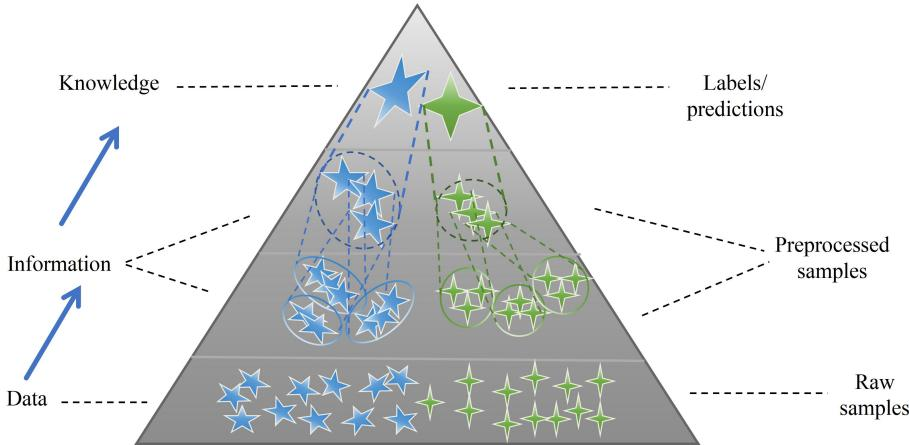
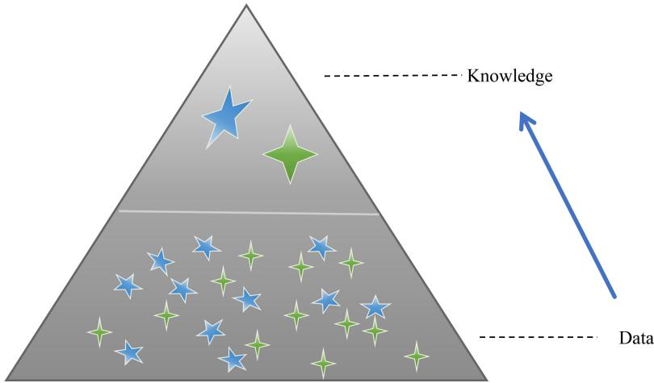
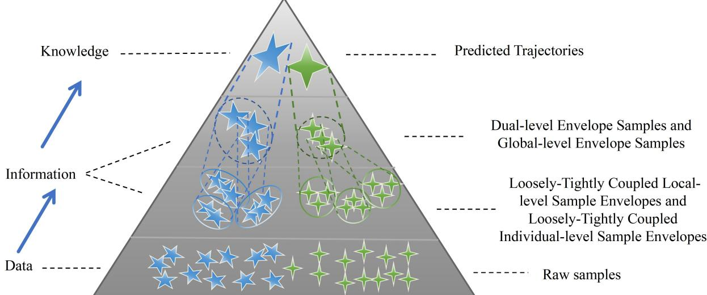
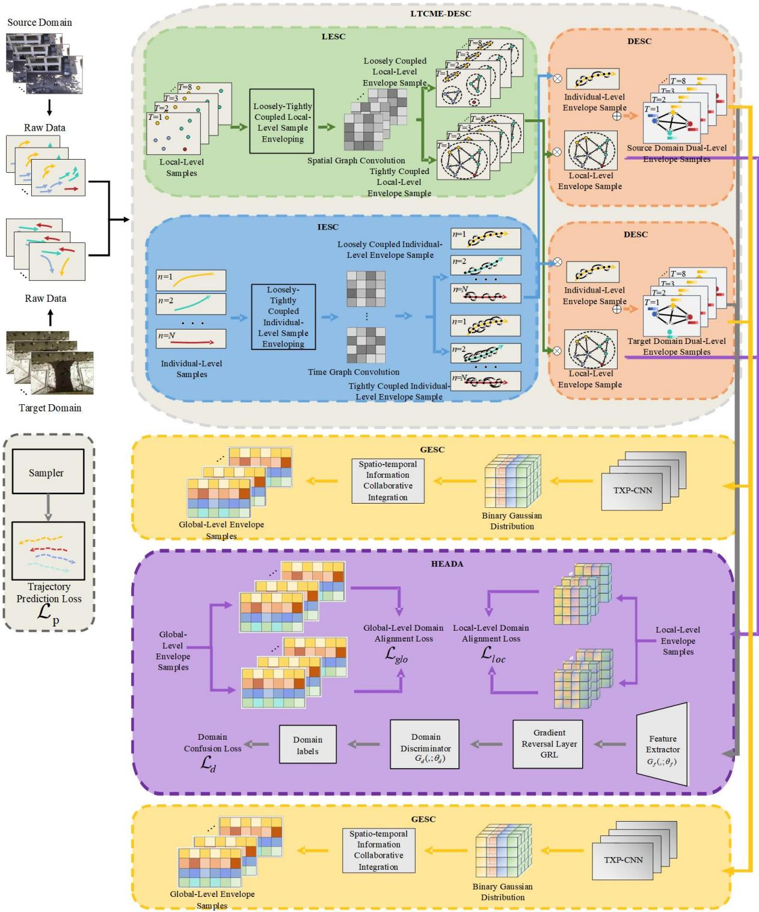
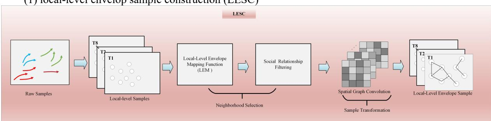
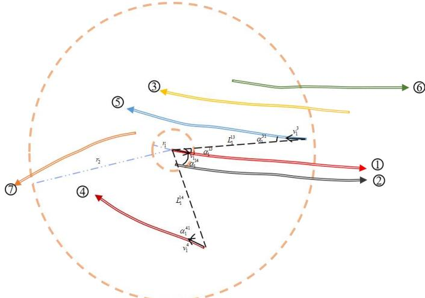
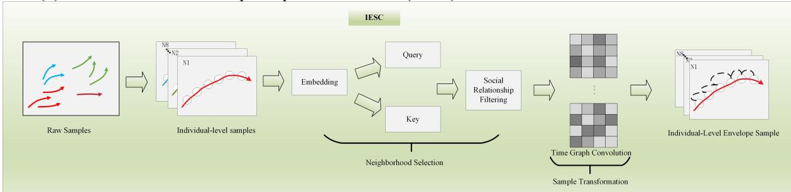
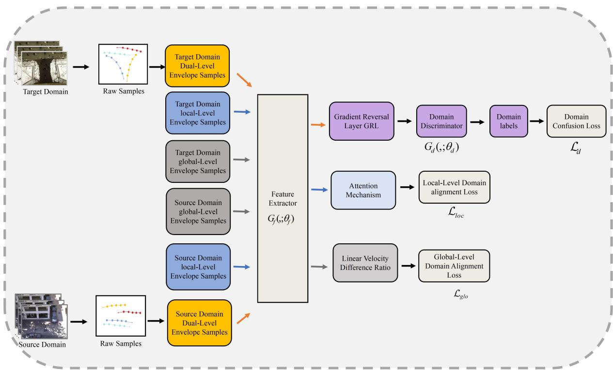
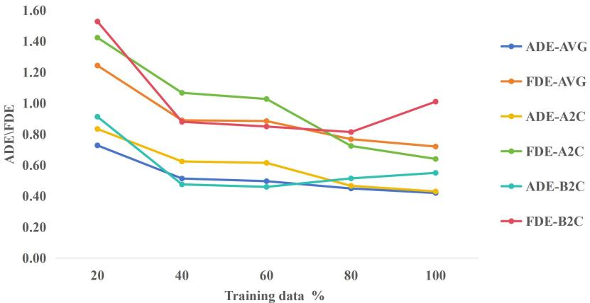

# Trajectory Prediction Method for person under WSN with Hierarchical Envelope Adversarial Domain Adaptation

Wenqian Jiang1, Qifeng Sun2 \*, Xiaosong Gao³, Xin Zou2 , Xingrui Ni2 , Yuan Hu2, Yongming Li³

(1. Guangxi Power Grid Co., Ltd., Nanning, Guangxi 530000, China;

2.Chongqing Liangjiang Satellite Mobile Communication Co., Ltd., Chongqing 400004, China;

3.School of Microelectronics and Communication Engineering, Chongqing University, Chongqing 400044, China)

Abstract ： Pedestrian trajectory prediction holds significant applications across autonomous driving, intelligent surveillance, and smart cities. However, the complexity and unpredictability of pedestrian interactions make this task a persistent challenge. Current models face two common limitations: 1) Consider only a single type of social coupling. This introduces redundant interactions. More critically, it fails to account for the varying nature oftrajectory coupled across different scenarios and between different pedestrians. Consequently, models cannot deeply adapt to diverse scenes. 2) Inadequate domain shift handling. Although very few methods address domain shift, they rely on statistical criterion-based domain distribution alignment. Such approaches exhibit strong dependency on predefined statistical metrics. This leads to significant limitations in complex and dynamic environments. To address these problems, a Hierarchical Envelope Adversarial Domain Adaptation with Loosely-Tightly coupled model (HEADA-LTCTPM) is proposed. First, an envelope sample construction mechanism was proposed. It constructs envelope samples and extends them into graph structures. Secondly, an adversarial domain adaptation module was proposed. This integrates both local and global domain adaptation strategies. It dynamically adapts to diverse coupled relationships across scenarios. These innovations collectively enhance prediction accuracy and robustness. In the experimental section, two representative public datasets were employed for validation and comprehensive comparisons with six relevant baseline algorithms were conducted. Results demonstrate that our model achieves significantly higher accuracy compared to existing methods, with the ADE and FDE metrics reduced by 17.6% and 19.1% respectively. The time overhead meets practical requirements, which verifies the effectiveness of our key innovations.

Key words：pedestrian trajectory prediction; adversarial domain adaptation; envelope sample transformation; looselytightly coupled

## 1 Introduction

Pedestrian trajectory prediction refers to the process of analyzing and anticipating a pedestrian's future movement path through technical means. As a critical component of autonomous driving systems, effective trajectory prediction significantly enhances obstacle avoidance capabilities. By proactively anticipating pedestrian behavior, this technology helps reduce traffic accident risks. Consequently, pedestrian trajectory prediction models remain a key research focus in the field.

Pedestrian trajectory prediction in complex environments presents significant challenges due to multiple influencing factors [1]. These include intrinsic pedestrian attributes (e.g., motion state, destination, age, and gender) [2] and multi-pedestrian interactions [3]. Individual trajectories are governed not only by personal movement intent but also by heterogeneous social coupled relationships with surrounding pedestrians, where influence degrees vary continuously. Early methods used rule-based models like social force and constant velocity models [4][5]. These had limited success, struggled with nonlinear interactions and complex realworld factors. Recently, deep learning has improved prediction accuracy[6-8]. However, most of these models overlook the distribution differences between different trajectory domains. Zhang et al. [9] used spatial, temporal, and spectral domain information to represent more general pedestrian movement patterns, reducing the gap between learning from the source dataset and transferring to the target dataset. Zhi et al. [10] and Liu et al. [11] employed the MMD loss function to align differences between the two domains. Poibrenski et al. [12] used a pseudo-label-based domain adaptation method, training with both labeled and unlabeled data in a supervised manner. Although these studies consider the issue of domain distribution differences, they still have the following main limitations: (1) They only consider a single type of social coupled relationship, ignoring the heterogeneity of social coupled relationships among pedestrians in a scene. This simplified modeling approach not only introduces redundant interaction relationships but also fails to fully consider the characteristics of trajectory social coupled in different scenarios, thereby limiting the model's ability to deeply explore and effectively utilize scene features. (2) The domain shift problem is not sufficiently addressed. Existing domain adaptation-based pedestrian trajectory models mainly rely on statistical criterionbased methods, which depend on predefined statistical measures, limiting the model's generalization ability. (3) They only consider a single granularity— modeling directly on the individual pedestrian, not consider

modeling on the correlation of pedestrians.

To overcome these problems, this paper introduces the following major contributions and innovations:

(1) Construct an envelope sample construction mechanism for pedestrian trajectory prediction. We construct multi-level envelope samples at the individual-level, local-level, and global-level to extract more abundant spatiotemporal feature representations of pedestrian trajectory data at different levels.

(2) Construct a loosely-tightly coupled mechanism. We design a hybrid coupled mechanism that combines both loosely and tightly coupled relationships. This approach adaptively models heterogeneous social interactions by generating envelope samples that reflect varying coupled strengths, followed by decision fusion for trajectory prediction.

(3) Construct a hierarchical envelope adversarial domain adaptation module. Unlike only manually designed distance metrics, our adversarial learning framework is introduced to dynamically extract domaininvariant features across complex scenarios. The generator-discriminator game mechanism enhances feature discriminability and robustness.

(4) Extensive experiments validate our method’s effectiveness, including: ablation studies, algorithm comparisons, parameter analysis, trajectory visualization, feature distribution visualization. Our work advances existing “single social-coupled domain adaptation framework” to “envelope-based adversarial adaptation framework with loosely-tightly coupled”, offering valuable insights for future research.

## 2 Related works

## 2.1 Non-Domain-Adaptive Pedestrian Trajectory Prediction Models

Most existing pedestrian trajectory prediction methods are non-domain-adaptive models. Traditional approaches include the Social Force Model (SFM) [13], Kalman filters, and extended Kalman filter models [14]. However, as interaction patterns between pedestrians and other agents become increasingly complex, physics-based and statistical models face significant challenges in representation capability. The rapid development ofdeep learning has spawned numerous models for processing sequential data. These emerging approaches can effectively extract rich spatiotemporal features while modeling complex interactions between pedestrians. They demonstrate notable advantages in handling nonlinear data, thereby improving prediction accuracy for future trajectories. Currently, deep learning-based pedestrian trajectory prediction models primarily adopt three architectures: Recurrent Neural Networks (RNNs), Generative Adversarial Networks (GANs), Graph Neural Networks (GNNs)

In RNN-related approaches, Alahi et al. [15] proposed Social-LSTM, which was the first to characterize pedestrian interactions. Xue et al. [16] employed three LSTM encoders at different scales to encode individual, neighboring, and scene information. Hug et al. [17] introduced an LSTM-based multi-model pedestrian trajectory prediction model that combines a mixture density layer with particle filtering. Bisagno et al. [18] placed greater emphasis on the key characteristics ofpedestrian group clustering within their social interaction modeling framework. Yao et al. [19] proposed a gated recurrent unit-based encoder-decoder model. However, the recursive computation in RNN methods makes parallelization difficult, limiting both training efficiency and prediction timeliness.

In GAN-related approaches, Gupta et al. [20] used improved diversity loss and max-pooling to analyze interactions. Sadeghian et al. [21] integrated attention mechanisms to aggregate agent information. Amirian et al. [22] introduced additional information to constrain samples and maximized mutual information between the generator and encoder to alleviate training instability in Social-GAN. Jun et al. [23] combined individual and group information, achieving high-precision and diverse predictions through joint training. However, GAN methods suffer from issues such as training instability (e.g., mode collapse), high computational resource consumption, and poor interpretability.

In GNN-related approaches, Mohamed et al. [24] proposed Social-STGCNN. It extracts spatiotemporal information through spatiotemporal graph convolution. It also combines temporal extrapolator convolution for trajectory prediction. Li et al. [25] assigned attention weights to graph edges. They introduced a new attention function for nearby pedestrians. This function calculates the weighted adjacency matrix. Chen et al. [26] proposed DSTCNN. It overcomes the limitations of entangled spatiotemporal features and fixed convolution kernels. Zhang et al. [27] proposed Social-IWSTCNN. It uses a pooling mechanism and attention weights. This simulates interactions between pedestrians and others. Lv et al. [28] proposed SSAGCN, the social soft attention graph convolutional network. It handles interactions between pedestrians and their environment. Chen et al. [29] proposed IMGCN. It uses interpretable information like pedestrian field of view, distance, and movement direction. This intelligently masks interaction features. Pi et al. [30] used predicted future trajectories. This extracts interaction features and models them. Chen et al. [31] proposed DSTIGCN. It uses multiple asymmetric deformable convolution kernels. These kernels learn spatiotemporal interactions autonomously through offsets in spatial and temporal dimensions. They also introduced Latin hypercube sampling. This improves the model's multimodal prediction performance. Mi et al. [32] allowed nodes with different timestamps to interact with each other. Chen et al. [33] modeled the relative importance of pedestrians.

In summary, graph convolutional network-based pedestrian trajectory prediction models offer significant advantages. Their key strength lies in using graph-structured adjacency relations to quantitatively represent real-world social interactions. By modeling edge connections between nodes, these methods accurately capture complex group behavior patterns and achieve dynamic spatial relationship modeling, resulting in high prediction accuracy.

## 2.2 Domain-Adaptive Pedestrian Trajectory Prediction Models

Existing models exhibit notable limitations in their learning strategies: They primarily focus on general motion patterns while neglecting potential distribution shifts between training sets and test sets [34]. Early approaches trained models on mixed-distribution samples without accounting for these differences, inevitably introducing domain bias.

Recent domain adaptation methods have made progress in pedestrian trajectory prediction, though research remains limited. Xu et al. [34] proposed T-GNN, a transferable graph neural network framework that performs parallel trajectory prediction and domain alignment using domain-invariant GNNs. Zhi et al. [10] pioneered the integration of domain adaptation with continual learning. The adaptation module analyzes distribution shifts while the continual learning component prevents catastrophic forgetting. Huang et al. [35] developed CTP-Net, an encoder-decoder network that maps target domain data to the source domain. Liu et al. [11] used the MMD loss function to align differences between the two domains. Poibrenski et al. [12] employed a pseudo-label-based domain adaptation method, training with both labeled and unlabeled data in a supervised manner. Huang et al. [36] leveraged the inherent invariance of motion selection to mitigate the adverse effects of domain shift caused by environmental changes. Tang et al. [37] designed an evolutionary algorithm that encourages sharing consensus across different scenarios while conducting neural architecture search for optimal parameters in each scenario. Geng et al. [38] proposed a hierarchical siamese network called T-HSTN, filling the gap in solutions and benchmarks for multi-source transfer learning tasks in heterogeneous agent trajectory prediction. Yang et al. [39] aligned feature distributions based on behavioral patterns to reduce domain differences.

## 3 Motivation

Research demonstrates that generating transformed samples can enhance model performance [40]. This approach aligns with the "Knowledge Pyramid" theory [41], which outlines a hierarchical data processing flow from raw data to information then to knowledge. Rowley et al. [42] elaborate this structure: the data layer contains abundant but redundant raw inputs (original samples); the information layer filters valuable patterns (preprocessed samples); while the knowledge layer enables behavioral prediction (labels). Cognitive studies reveal humans recognize samples through both intrinsic features and inter-sample relationships [43]. As Bosancic et al. [44] emphasize, the information layer critically bridges raw data and actionable knowledge (Fig.1(a)).

  
(a)Modeling based on Knowledge Pyramid

  
Figure 1. the diagram of two modeling approaches

Current deep learning approaches primarily are modeled based on raw data (original samples) to automatically extract deep-level features, ignoring the role of information (Fig.1(b)). As a reuslt, it is significant to construct the information layer to improve prediction accuracy. Meanwhile, one of the most efficient way to construct information layer is to mine relational information between original samples [45]. So we proposed envelope sample transformation mechanism to mine relational information between original samples and transform them into new samples (call envelope samples), thereby mapping raw data into multilevel envelope samples. The envelope samples not only preserve original information but incorporate hidden inter-sample relationships. Comparative studies demonstrate that hierarchical envelope sample modeling achieves higher accuracy than conventional raw sample modeling [45-46].

The envelope sample construction mechanism for pedestrian trajectory prediction operates as follows: Given a dataset $\mathbf { X } = \left[ \mathbf { x } _ { 1 } , \mathbf { x } _ { 2 } , . . . , \mathbf { x } _ { n } \right] ^ { \mathrm { T } }$ , for any $\mathbf { X } _ { i } \in \mathbf { X }$ , search its near neighbor samples through operators and form a set of near neighbor samples $\mathbf { N } \big ( \mathbf { x } _ { i } \big )$ . This near neighbor sample set $\mathbf { N } \big ( \mathbf { x } _ { i } \big )$ is then merged with $\mathbf { X } _ { i }$ to create a new sample set $\mathbf { X } _ { c } = \left. \mathbf { x } _ { i } , \mathbf { N } \left( \mathbf { x } _ { i } \right) \right. ^ { \mathrm { T } }$ (called sample envelope), while an adjacency matrix $\mathbf { A } ( \mathbf { X } _ { c } )$ encodes their topological relationships. The process of abtaining a sample set $\left[ { \bf X } _ { c } , { \bf A } ( { \bf X } _ { c } ) \right]$ is called sample enveloping process. Subsequently, applying transformation operator $\Gamma$ to transform the sample set $\left[ { \bf X } _ { c } , { \bf A } ( { \bf X } _ { c } ) \right]$ to generate envelope samples $\mathbf { X } _ { e }$ . The process of transforming from X to $\mathbf { X } _ { e }$ is called envelope sample transformation. By combining envelope sample sets $( \mathbf { X } _ { e } ^ { l } ) _ { l = 1 } ^ { L }$ and original samples X , a multi-level envelope space $\left[ \mathbf { X } , ( \mathbf { X } _ { e } ^ { l } ) _ { l = 1 } ^ { L } \right]$ is constructed. The model based on the original samples H(X) is transformed into a new model based on multi-level envelope samples $\mathrm { H } \left\{ \left[ \mathbf { X } , ( \mathbf { X } _ { e } ^ { l } ) _ { l = 1 } ^ { L } \right] \right\}$ , which achieves the construction of multi-level envelope samples with graph structure.

To address the issue that current pedestrian trajectory methods fail to adequately mine correlation information between samples for constructing information hierarchies, this paper firstly propose the envelope sample construction mechanism to form multi-level envelope samples including local-level, individual-level and global-level information, thereby converting raw data to information. Secondly, we design a hybrid coupled mechanism that combines both loosely and tightly coupled relationships to mine more adequate relational information. Finally, we introduce the adversarial domain adaption to solve domain shift problem.

## 4 Proposed Model

## 4.1 Problem Definition

The observation trajectory representation of N pedestrians in the given scene during the time period $T _ { 1 }$ to $T _ { o b s }$ is shown in Equation (1).

$$
\mathbf { T } \mathbf { R } _ { o b s } = \{ \mathbf { t r } _ { 1 } ^ { i } , \mathbf { t r } _ { 2 } ^ { i } , . . . , \mathbf { t r } _ { o b s } ^ { i } \mid \forall i \in \{ 1 , 2 , . . . , N \} \}\tag{1}
$$

Through the model $f ( \cdot )$ with the learnable parameter $\mathbf { W } ^ { * }$ , the trajectories of N pedestrians within the time period $T _ { o b s + 1 }$ to $T _ { p r e }$ in the future are predicted, as shown in Equation (2).

$$
\mathbf { T R } _ { p r e } = \{ f ( \mathbf { T R } _ { o b s } ) | \mathbf { W } ^ { * } \} = \{ \mathbf { \hat { t } r } _ { o b s + 1 } ^ { i } , \mathbf { \hat { t } r } _ { o b s + 2 } ^ { i } , . . . , \mathbf { \hat { t } r } _ { p r e } ^ { i } | \forall i \in \{ 1 , 2 , . . . , N \} \}\tag{2}
$$

$\mathbf { t r } _ { t } ^ { i } = ( x _ { t } ^ { i } , y _ { t } ^ { i } )$ represents the true two-dimensional spatial coordinates of the pedestrian i at the moment t , and $\mathbf { \hat { t r } } _ { t } ^ { i } = ( \hat { x } _ { t } ^ { i } , \hat { y } _ { t } ^ { i } )$ represents the predicted two-dimensional spatial coordinates of the pedestrian i at the moment t .

## 4.2 Model description

## 4.2.1 Overall structure of the proposed model

As shown in Fig. 2, connected with knowledge pyramid theory, we construct the loosely-tightly coupled local-level envelope samples and loose-tight coupled individual-level sample envelopes to extract the temporal and spatial information respectively from raw data. Then, based on the local-level sample envelopes and individual-level sample envelopes, the dual-level envelope samples and global-level envelope samples are constructed to utilize more information. And the target/knowledge is the predicted future trajectores.

  
Figure 2. Overall rationale of the HEADA-LTCTPM model

The structure of the proposed model HEADA-LTCTPM is shown in Fig. 3. Based on the envelope sample transformation mechanism, it first transforms raw trajectory data from source and target domains into loosely coupled and tightly coupled individual-level envelope samples and local-level envelope samples. These samples undergo feature extraction and fusion to generate loosely coupled and tightly coupled duallevel envelope samples. Then, introduce an adversarial adaptation module where generator-discriminator adversarial training automatically learns domain-invariant features without manual metric design. Finally, a decision fusion mechanism integrates both coupled types to enhance prediction robustness across varying scenarios.

  
Figure 3. Structure of the HEADA-LTCTPM model

## 4.2.2 Dual-level Envelope Sample Construction Mechanism

The envelope sample construction mechanism mainly consists of two parts: neighborhood selection and sample transformation. For each node, neighboring nodes are found through specific operators to form a neighboring sample envelope, and then the envelope samples are constructed by transforming through transformation operators.

To fully exploit the spatio-temporal information in trajectory data, we have respectively constructed samples at the local-level and the individual-level. For local-level samples, we construct the neighborhood by combining the composite operator of velocity, distance and direction, and select the nearest neighbor samples to build the local-level sample envelope. Then, we perform sample transformation through the spatial graph convolution operator to construct the local-level envelope sample. For individual-level samples, we construct the neighborhood through the attention mechanism and select neighboring samples to build the individual-level sample envelope. Then, we perform sample transformation through the time graph convolution operator to construct the individual-level envelope samples. Finally, through feature splicing and fusion, the dual-level envelope sample was constructed.

(1) local-level envelop sample construction (LESC)

  
Figure 4. Process of local-level envelop sample construction

The process of construction of local-level envelop sample is constructed spatially as shown in Figure 4. For pedestrians in the same scene at the same timestep, we construct a spatial graph to model their local interactions. This graph represents trajectory samples at the local level. The coordinate $\mathbf { T } \mathbf { R } _ { t } = \{ \mathbf { t r } _ { t } ^ { i } | \forall i \in \{ 1 , 2 , . . . , N \} \}$ of each pedestrian at the time axis is processed as a graph representation $\mathbf { G } _ { l o c } = ( \mathbf { V } _ { l o c } , \mathbf { E } _ { l o c } )$ , where $\mathbf { E } _ { l o c } = \{ e _ { T _ { 1 } } ^ { i j } , e _ { T _ { 2 } } ^ { i j } , . . . , e _ { T _ { o b s } } ^ { i j } \mid \forall i , j \in \{ 1 , 2 , . . . , N \} \}$ is the edge set of $\mathbf { G } _ { l o c }$ , and each edge in $\mathbf { E } _ { l o c }$ is represented by the local-level pedestrian adjacency relationship matrix $\mathbf { R } _ { l o c }$ and the adjacency matrix $\mathbf { A } _ { l o c }$ , and ${ \bf V } _ { l o c } = \{ { \bf t r } _ { T _ { 1 } } ^ { i } , { \bf t r } _ { T _ { 2 } } ^ { i } , . . . , { \bf t r } _ { T _ { o b s } } ^ { i } \mid \forall i \in \{ 1 , 2 , . . . , N \} \}$ is the node set represented by the graph $\mathbf { { G } } _ { l o c } \ . \ \mathbf { { F } } _ { l o c } = \{ \mathbf { { v } } _ { T _ { 1 } } ^ { i } , \mathbf { { v } } _ { T _ { 2 } } ^ { i } , . . . , \mathbf { { v } } _ { T _ { o b s } } ^ { i } \ | \ \forall i \in \{ 1 , 2 , . . . , N \} \}$ represents the eigenvectors corresponding to each pedestrian, where $\mathbf { v } _ { t } ^ { i } = [ x _ { t } ^ { i } - x _ { t - 1 } ^ { i } , y _ { t } ^ { i } - y _ { t - 1 } ^ { i } ]$ represents the velocity vector of the pedestrian at the moment of the time axis.

  
Figure 5. Schematic diagram of interaction of local-level envelope samples

The local-level sample enveloping, that is the process of construction of local-level neighborhoods and selection of neighbors, is constructed by combining the composite operator of velocity, distance and direction.

As shown in Figure 5, numbers $\textcircled{1} - \textcircled{7}$ represent the trajectories of 7 pedestrians. A local-level pedestrian adjacency relationship matrix $\mathbf { R } _ { l o c }$ is constructed by comprehensively considering the locallevel interaction relationship of the pedestrian group. First, define two local-level pedestrian group envelope circles with radii of $r _ { 1 }$ and $r _ { 2 }$ respectively. When the distance between pedestrians is less than $r _ { 1 }$ , the target pedestrians are in a state of walking in pairs and can be regarded as a whole. There is no local-level interaction relationship among pedestrians within this group (such as pedestrian ① and pedestrian ②). When the distance between pedestrians is greater than $r _ { 2 }$ , it is considered that there is no interaction between the target pedestrians and the pedestrians who are too far away (such as pedestrians $\textcircled{2}$ and $\textcircled{3} \textcircled{3}$ . $L _ { t } ^ { i j }$ represents the reciprocal ofthe Euclidean distances between pedestrians within the envelope ofthe pedestrian group at the moment t.

$$
L _ { t } ^ { i j } = \left\{ \begin{array} { l l } { \displaystyle \frac { 1 } { \sqrt { ( x _ { t } ^ { i } - x _ { t } ^ { j } ) ^ { 2 } + ( y _ { t } ^ { i } - y _ { t } ^ { j } ) ^ { 2 } } } , } & { \displaystyle r _ { 1 } < \sqrt { ( x _ { t } ^ { i } - x _ { t } ^ { j } ) ^ { 2 } + ( y _ { t } ^ { i } - y _ { t } ^ { j } ) ^ { 2 } } < r _ { 2 } } \\ { 0 , } & { \mathrm { ~ O t h e r w i s e } } \end{array} \right.\tag{3}
$$

$\boldsymbol { \alpha } _ { t } ^ { i j }$ represents the angle between the velocity direction of pedestrian i at moment t and the current position of pedestrian $j$ . Taking the cosine function of the angle $\boldsymbol { \alpha } _ { t } ^ { i j }$ gives $c _ { t } ^ { i j } = \cos \alpha _ { t } ^ { i j } \cdot H _ { t } ^ { i j }$ represents the comprehensive measurement of the speed Angle between pedestrian i and pedestrian j at the moment t .

$$
H _ { t } ^ { i j } = \operatorname* { m a x } ( 0 , | \mathbf { v } _ { t } ^ { i } | c _ { t } ^ { i j } + | \mathbf { v } _ { t } ^ { j } | c _ { t } ^ { j i } )\tag{4}
$$

When pedestrians walk towards each other, both the included angles $\boldsymbol { \alpha } _ { t } ^ { i j }$ and $\alpha _ { t } ^ { j i }$ are acute angles, and the resulting $H _ { t } ^ { i j }$ is greater than 0, indicating that there is a local-level interaction relationship of mutual influence between pedestrians (such as pedestrian ① and pedestrian ⑤). When pedestrians walk in the same direction, the angle $\boldsymbol { \alpha } _ { t } ^ { i j }$ is an acute Angle and $\alpha _ { t } ^ { j i }$ is an obtuse Angle. The speed of pedestrian j is greater than that of pedestrian i , resulting in $H _ { t } ^ { i j }$ equal to 0. At this point, there is no local-level interaction relationship between pedestrians (such as pedestrian ① and pedestrian ⑥). When pedestrians walk in opposite directions, both the included angles $\boldsymbol { \alpha } _ { t } ^ { i j }$ and $\alpha _ { t } ^ { j i }$ are obtuse angles, resulting in $H _ { t } ^ { i j }$ equal to 0, indicating that there is no local-level interaction relationship between pedestrians (such as pedestrian ① and pedestrian ⑦).

To distinguish pedestrians who stop and linger in the scene, $\tau _ { t } ^ { i j } = \operatorname* { m i n } ( 1 , \mid \mathbf { v } _ { t } ^ { i } \mid / \mid \mathbf { v } _ { t } ^ { j } \mid )$ is defined to ensure that pedestrians who stop and linger are less likely to be affected by the local level of pedestrian groups, and that pedestrians with faster speeds are more susceptible to the influence of the local-level pedestrian groups. Overall, the local-level envelope sample mapping function $F _ { L E M } ( \bullet )$ incorporates multiple factors such as the speed, distance, and the angle in the relative movement direction of pedestrians in the group. The calculation of each element $r _ { t } ^ { i j }$ of the local-level pedestrian adjacency relationship matrix $\mathbf { R } _ { l o c }$ is shown in Equation (5).

$$
r _ { t } ^ { i j } = F _ { L E M } ( \mathbf { v } _ { t } ^ { i } , \mathbf { v } _ { t } ^ { j } , \mathbf { t r } _ { t } ^ { i } , \mathbf { t r } _ { t } ^ { j } ) = { \left\{ \begin{array} { l l } { L _ { t } ^ { i j } H _ { t } ^ { i j } \tau _ { t } ^ { i j } , } & { i \not = j } \\ { 0 , } & { { \mathrm { O t h e r w i s e } } } \end{array} \right. }\tag{5}
$$

Then, the threshold hyperparameters  is introduced to screen the social relationships and generate the local-level mask matrices $\mathbf { M } _ { l o c }$ , where Ⅱ(·) is an indicator function. When $\mathbf { R } _ { l o c } \geq \eta$ , it outputs 1; otherwise, it outputs 0.

$$
\mathbf { M } _ { l o c } = \mathbb { I } ( \mathbf { R } _ { l o c } \geq \eta )\tag{6}
$$

Then, the screening of the local-level pedestrian adjacency matrix $\mathbf { R } _ { l o c }$ is achieved through elementby-element multiplication, and then the identity matrix I is superimposed to obtain the local-level adjacency matrices $\mathbf { A } _ { l o c }$ , where  represents element-by-element multiplication.

$$
\begin{array} { r } { \mathbf { A } _ { l o c } = \mathbf { M } _ { l o c } \odot \mathbf { R } _ { l o c } + \mathbf { I } = \mathbf { M } _ { l o c } \odot \left( \begin{array} { l l l l } { 0 } & { L _ { t } ^ { 1 2 } H _ { t } ^ { 1 2 } \tau _ { t } ^ { 1 2 } } & { \cdots } & { L _ { t } ^ { 1 } H _ { t } ^ { 1 } \tau _ { t } ^ { 1 / p } } \\ { L _ { t } ^ { 2 1 } H _ { t } ^ { 2 1 } \tau _ { t } ^ { 2 1 } } & { 0 } & { \cdots } & { L _ { t } ^ { 2 } H _ { t } ^ { 2 } \tau _ { t } ^ { 2 / p } } \\ { L _ { t } ^ { 3 1 } H _ { t } ^ { 3 1 } \tau ^ { 3 1 } } & { L ^ { 3 2 } H ^ { 3 2 } \tau ^ { 3 2 } } & { \cdots } & { L ^ { 3 } H ^ { 3 } \tau _ { t } ^ { 3 / 2 } } \\ { \cdots } & { \cdots } & { \ddots } & { \cdots } \\ { L _ { t } ^ { i 1 } H _ { t } ^ { i 1 } \tau _ { t } ^ { i 1 } } & { L _ { t } ^ { i 2 } H _ { t } ^ { i 2 } \tau _ { t } ^ { i 2 } } & { \cdots } & { 0 } \end{array} \right) + \mathbf { I } } \end{array}\tag{7}
$$

Then, the Zero-Softmax method is adopted to normalize each element $a _ { t } ^ { i j }$ in the adjacency matrices $\mathbf { A } _ { l o c }$ . Finally, the normalized adjacency matrix $\mathbf { A } _ { l o c } ^ { \prime } = \mathrm { Z e r o - S o f t m a x }$ $\left( \mathbf { A } _ { l o c } \right)$ is obtained. By stacking the adjacency matrices ${ \bf A } _ { l o c } ^ { \prime }$ at different times and the corresponding pedestrian feature matrices $\mathbf { F } _ { l o c }$ , the local-level sample envelope $[ \mathbf { F } _ { l o c } , \mathbf { A } _ { l o c } ^ { \prime } ]$ is ultimately constructed.

Based on local-level sample envelope $[ \mathbf { F } _ { l o c } , \mathbf { A } _ { l o c } ^ { \prime } ]$ , the ${ \bf A } _ { l o c } ^ { \prime }$ from time $T _ { \scriptscriptstyle 1 }$ to time $T _ { o b s }$ along the time axis are stacked to form $\mathbf { A } _ { \mathrm { L o c } } = \{ \mathbf { A } _ { 1 } ^ { \prime } , \mathbf { A } _ { 2 } ^ { \prime } , . . . , \mathbf { A } _ { o b s } ^ { \prime } \}$ . Stack the feature matrices $\mathbf { F } _ { l o c }$ of each node from time $T _ { 1 }$ to time $T _ { o b s }$ on the timeline as $\mathbf { F } _ { \mathrm { L o c } } = \{ \mathbf { F } _ { 1 } , \mathbf { F } _ { 2 } , . . . , \mathbf { F } _ { o b s } \}$ . Then, the graph convolution operation is performed to obtain the local-level envelope samples. $\mathbf { W } _ { \mathrm { L o c } }$ is a learnable parameter and $\sigma ( \cdot )$ is a nonlinear activation function. The number of layers of the graph convolution network of the local-level envelope samples is $L _ { 1 } , \ l _ { 1 }$ representing the corresponding network layer.

$$
\mathbf { F } _ { \mathrm { L o c } } ^ { ( l _ { 1 } + 1 ) } = \sigma ( \mathbf { A } _ { \mathrm { L o c } } \mathbf { F } _ { \mathrm { L o c } } ^ { ( l _ { 1 } ) } \mathbf { W } _ { \mathrm { L o c } } ^ { ( l _ { 1 } ) } )\tag{8}
$$

(2) Individual-level envelop sample construction (IESC)

  
Figure 6. Process of the individual-level envelop sample construction

Construct the individual-level sample envelope from the temporal dimension, as shown in Figure 6. For the trajectory of the same pedestrian at different times in the same scene, the individual-level samples of the pedestrian's trajectory are represented by constructing a time graph structure. The coordinates $\mathbf { T } \mathbf { R } ^ { i } = \{ \mathbf { t r } _ { t } ^ { i } | \forall t \in \{ T _ { 1 } , T _ { 2 } , . . . , T _ { o b s } \} \}$ of the pedestrians observed within time periods $T _ { \iota }$ to $T _ { o b s }$ are processed into a graph representation $\mathbf { G } _ { i n d } = ( \mathbf { V } _ { i n d } , \mathbf { E } _ { i n d } )$ where ${ \mathbf E } _ { i n d } = \{ e _ { p , q } ^ { 1 } , e _ { p , q } ^ { 2 } , . . . , e _ { p , q } ^ { N } \mid \forall p , q \in \{ T _ { 1 } , T _ { 2 } , . . . , T _ { o b s } \} \}$ is the edge set of $\mathbf { G } _ { i n d }$ , and each edge in $\mathbf { E } _ { { \scriptscriptstyle i n d } }$ is represented by the individual-level pedestrian adjacency relationship matrix $\mathbf { R } _ { i n d }$ and adjacency matrix $\mathbf { A } _ { i n d }$ , and ${ \bf V } _ { i n d } = \{ { \bf t r } _ { t } ^ { 1 } , { \bf t r } _ { t } ^ { 2 } , . . . , { \bf t r } _ { t } ^ { N } | \forall t \in \{ T _ { 1 } , T _ { 2 } , . . . , T _ { o b s } \} \}$ is the node set of ${ \bf { G } } _ { i n d } \mathrm { ~  ~ \Omega ~ } .$ ${ \bf { F } } _ { i n d } = \{ { \bf v } _ { t } ^ { 1 } , { \bf v } _ { t } ^ { 2 } , . . . , { \bf v } _ { t } ^ { N } | \forall t \in \{ T _ { 1 } , T _ { 2 } , . . . , T _ { o b s } \} \}$ is the eigenvector corresponding to the pedestrian within the time period $T _ { I } \mathrm { ~ \ t o ~ \ } T _ { o b s }$ , and $\mathbf { v } _ { t } ^ { i } = [ x _ { t } ^ { i } - x _ { t - 1 } ^ { i } , y _ { t } ^ { i } - y _ { t - 1 } ^ { i } ]$ represents the velocity vector of the pedestrian i at the moment t .

The individual-level sample enveloping, that is the process of construction of individual-level neighborhoods and selection of neighbors, is obtained by the attention mechanism.

$\mathbf { P E } = [ F r a _ { T _ { 1 } } , F r a _ { T _ { 2 } } , . . . , F r a _ { T _ { o b s } } ]$ corresponds to the positional encoding tensor of a single pedestrian trajectory $\mathbf { t r } _ { t } ^ { i }$ within the time period $T _ { I }$ to $T _ { o b s }$ , where $F r a _ { t }$ represents the number of time frames at the moment t . The original individual-level sample feature vector $\mathbf { F } _ { i n d }$ is concatenated with the corresponding position-encoded tensor PE , and a linear transformation is performed through the learnable parameter $\mathbf { W } _ { i n d }$ to obtain a high-dimensional tensor with position-encoded information ${ \bf { F } } _ { i n d } ^ { ' }$

$$
\mathbf { F } _ { i n d } ^ { ' } = ( \mathbf { F } _ { i n d } \oplus \mathbf { P } \mathbf { E } ) \mathbf { W } _ { i n d } ^ { ' }\tag{9}
$$

Then, the query and key of the self-attention mechanism are obtained respectively through learnable parameters $\mathbf { W } _ { \boldsymbol { Q } }$ and $\mathbf { W } _ { K }$ . By scaling the product of query and key with a scale factor $D$ to maintain stability and normalizing it with the Softmax function, the individual-level pedestrian adjacency relationship matrix $\mathbf { R } _ { i n d }$ can be obtained.

$$
\mathbf { Q } _ { i n d } = \mathbf { F } _ { i n d } ^ { ' } \mathbf { W } _ { Q }\tag{10}
$$

$$
{ \bf K } _ { i n d } = { \bf F } _ { i n d } ^ { ' } { \bf W } _ { K }\tag{11}
$$

$$
\mathbf { R } _ { i n d } ^ { \phantom { } } = \mathrm { s o f t m a x } \left( \frac { \mathbf { Q } _ { i n d } \mathbf { K } _ { i n d } ^ { \mathrm { T } } } { D } \right)\tag{12}
$$

Then, the threshold hyperparameters $\psi$ is introduced to screen the social relationships at each pedestrian time level, generating the individual-level mask matrix $\mathbf { M } _ { i n d }$

$$
\mathbf { M } _ { i n d } = \mathbb { I } ( \mathbf { R } _ { i n d } \geq \psi )\tag{13}
$$

Through element-by-element multiplication operations, the screening of individual-level pedestrian adjacency relationship matrices $\mathbf { R } _ { i n d }$ will be achieved, and the individual-level adjacency matrices $\mathbf { A } _ { i n d }$ will be obtained.

$$
\mathbf { A } _ { i n d } = \mathbf { M } _ { i n d } \odot \mathbf { R } _ { i n d } = \mathbf { M } _ { i n d } \odot \mathrm { s o f t m a x } \left[ \left( \begin{array} { l l l l } { \mathbf { Q } _ { 1 } \mathbf { K } _ { 1 } ^ { \mathrm { T } } } & { \mathbf { Q } _ { 1 } \mathbf { K } _ { 2 } ^ { \mathrm { T } } } & { \cdots } & { \mathbf { Q } _ { 1 } \mathbf { K } _ { 8 } ^ { \mathrm { T } } } \\ { \mathbf { Q } _ { 2 } \mathbf { K } _ { 1 } ^ { \mathrm { T } } } & { \mathbf { Q } _ { 2 } \mathbf { K } _ { 2 } ^ { \mathrm { T } } } & { \cdots } & { \mathbf { Q } _ { 2 } \mathbf { K } _ { 8 } ^ { \mathrm { T } } } \\ { \mathbf { Q } _ { 3 } \mathbf { K } _ { 1 } ^ { \mathrm { T } } } & { \mathbf { Q } _ { 3 } \mathbf { K } _ { 2 } ^ { \mathrm { T } } } & { \cdots } & { \mathbf { Q } _ { 3 } \mathbf { K } _ { 8 } ^ { \mathrm { T } } } \\ { \cdots } & { \cdots } & { \ddots } & { \cdots } \\ { \mathbf { Q } _ { 8 } \mathbf { K } _ { 1 } ^ { \mathrm { T } } } & { \mathbf { Q } _ { 8 } \mathbf { K } _ { 2 } ^ { \mathrm { T } } } & { \cdots } & { \mathbf { Q } _ { 8 } \mathbf { K } _ { 8 } ^ { \mathrm { T } } } \end{array} \right) / D \right]\tag{14}
$$

The Zero-Softmax method is adopted to normalize the adjacency matrix $\mathbf { A } _ { i n d }$ to obtain the normalized adjacency matrix ${ \bf A } _ { i n d } ^ { \prime }$ . By stacking the adjacency matrices of different pedestrians and the corresponding pedestrian feature matrices $\mathbf { F } _ { i n d }$ , the individual-level sample envelope $[ { \bf { F } } _ { i n d } , { \bf { A } } _ { i n d } ^ { \prime } ]$ is ultimately constructed.

Based on the individual-level sample envelope $[ { \bf { F } } _ { i n d } , { \bf { A } } _ { i n d } ^ { \prime } ]$ , the ${ \bf A } _ { i n d } ^ { \prime }$ of all pedestrians are stacked to form $\mathbf { A } _ { \mathrm { I n d } } = \{ \mathbf { A } _ { 1 } ^ { \prime } , \mathbf { A } _ { 2 } ^ { \prime } , . . . , \mathbf { A } _ { N } ^ { \prime } \}$ . Stack the feature matrices $\mathbf { F } _ { i n d }$ of all pedestrians as $\mathbf { F } _ { \mathrm { I n d } } = \{ \mathbf { F } _ { 1 } , \mathbf { F } _ { 2 } , . . . , \mathbf { F } _ { N } \}$ . Then, the graph convolution operation is performed to obtain the individual-level envelope samples. $\mathbf { W } _ { \mathrm { I n d } }$ is a learnable parameter and $\sigma ( \cdot )$ is a nonlinear activation function. The number of layers of the graph convolution network of the individual-level envelope samples is $L _ { 2 } , \ l _ { 2 }$ representing the corresponding network layer.

$$
\mathbf { F } _ { \mathrm { I n d } } ^ { ( l _ { 2 } + 1 ) } = \sigma ( \mathbf { A } _ { \mathrm { I n d } } \mathbf { F } _ { \mathrm { I n d } } ^ { ( l _ { 2 } ) } \mathbf { W } _ { \mathrm { I n d } } ^ { ( l _ { 2 } ) } )\tag{15}
$$

(3) Dual-level envelope sample construction (DESC)

To characterize the spatiotemporal features of pedestrian trajectory data at different levels, the locallevel and individual-level feature representations $\mathbf { F } _ { \mathrm { L o c } } ^ { L _ { 1 } }$ and $\mathbf { F } _ { \mathrm { I n d } } ^ { L _ { 2 } }$ are finally concatenated and fused, yielding the feature representation of the dual-level envelope samples $\mathbf { F } _ { \mathrm { t e f } }$

$$
\mathbf { F } _ { \mathrm { t e f } } = \mathbf { F } _ { \mathrm { I n d } } ^ { L _ { 2 } } \oplus \mathbf { F } _ { \mathrm { L o c } } ^ { L _ { 1 } } \in \mathbb { R } ^ { N \times L _ { \mathrm { o b s } } \times 2 D }\tag{16}
$$

4.2.3 Loosely-tightly coupled mechanism

Current methods lack adaptable coupled mechanisms to handle complex and dynamic scenarios. To address this, a loosely-tightly coupled mechanism is proposed. First, two types of samples with loose and tight hierarchical structures are constructed. These samples are then used to train the same model architecture separately, yielding a loose model predictions $\mathbf { P } _ { l o o p r e }$ and a tight model predictions $\mathbf { P } _ { t i g p r e }$ . Finally, decision fusion is applied to enhance the overall model performance.

Overall, the prediction model based on loosely coupled samples mainly captures the relatively weak interaction relationships among pedestrians, so it is suitable for sparse pedestrian scenarios. The prediction model based on tightly coupled envelope samples focuses more on depicting the complex interaction relationships among pedestrians, so it is suitable for scenarios with dense interaction. By dynamically adjusting the values of $w _ { \mathrm { l } }$ and $w _ { 2 }$ , the model can adaptively balance the weights of the two coupled relationships, better adapting to the diverse scene requirements.

$$
\mathbf { P } _ { p r e } = w _ { 1 } \mathbf { P } _ { l o o p r e } + w _ { 2 } \mathbf { P } _ { t i g p r e }
$$

$$
\begin{array} { r l } { s . t . } & { { } w _ { 1 } + w _ { 2 } = 1 } \end{array}\tag{17}
$$

4.2.4 The loosely-tightly coupled dual-level envelope sample construction module (LTCME-DESC)

According to dual-level envelope sample construction mechanism and loosely-tightly coupled mechanism, first of all, construct the loosely coupled local-level envelope samples and loosely couple individual-level envelope samples respectively. Then, fused them to obtain the loosely coupled dual-level envelope samples. Following the same procedure, we can obtain the tightly coupled dual-level envelope samples.

(1) Loosely-tightly coupled local-level envelope sample construction

construct the local-level sample neighborhood and obtain the local-level pedestrian adjacency relationship matrix $\mathbf { R } _ { l o c }$ according to Formula 5 for source domain samples. To distinguish the loosely and tightly coupled relationships, different threshold hyperparameters $\eta _ { 1 }$ and $\eta _ { 2 }$ are introduced to screen the social coupled relationships and generate the loosely and tightly coupled local-level mask matrices $\mathbf { M } _ { l o c l o o }$ and $\mathbf { M } _ { l o c t i g }$

$$
\mathbf { M } _ { l o c l o o } = \mathbb { I } ( \mathbf { R } _ { l o c } \geq \boldsymbol { \eta } _ { 1 } )\tag{18}
$$

$$
\mathbf { M } _ { l o c t i g } = \mathbb { I } ( \mathbf { R } _ { l o c } \geq \eta _ { 2 } )\tag{19}
$$

Then, according to Formula 7, neighbors are selected and its own influence is introduced, thereby obtaining the loosely coupled local-level adjacency matrix $\mathbf { A } _ { l o c l o o }$ and the tightly coupled local-level adjacency matrix $\mathbf { A } _ { l o c t i g }$ respectively.

$$
{ \bf A } _ { l o c l o o } = { \bf M } _ { l o c l o o } \odot { \bf R } _ { l o c } + { \bf I }\tag{20}
$$

$$
\mathbf { A } _ { l o c t i g } = \mathbf { M } _ { l o c t i g } \odot \mathbf { R } _ { l o c } + \mathbf { I }\tag{21}
$$

Then, the Zero-Softmax method is adopted to normalize each element $a _ { t } ^ { i j }$ in the adjacency matrices $\mathbf { A } _ { l o c l o o }$ and $\mathbf { A } _ { l o c t i g }$ . Therefore, the normalized adjacency matrix $\mathbf { A } _ { l o c l o o } ^ { \prime } = \mathrm { Z e r o - S o f t m a x }$ $\left( { \bf A } _ { l o c l o o } \right)$ ， $\mathbf { A } _ { l o c t i g } ^ { \prime } = \mathsf { Z e r o - S o f t m a x }$ $\left( { \bf A } _ { l o c t i g } \right)$ is obtained. By stacking the adjacency matrices $\mathbf { A } _ { l o c l o o } ^ { \prime }$ and $\mathbf { A } _ { l o c t i g } ^ { \prime }$ at different times and the corresponding pedestrian feature matrices $\mathbf { F } _ { l o c l o o }$ and $\mathbf { F } _ { l o c t i g }$ , the loosely coupled local-level sample envelope $[ { \bf { F } } _ { l o c l o o } , { \bf { A } } _ { l o c l o o } ^ { \prime } ]$ and the tightly coupled local-level sample envelope $[ { \bf { F } } _ { l o c t i g } , { \bf { A } } _ { l o c t i g } ^ { \prime } ]$ are ultimately constructed.

Fanally, stack the $\mathbf { A } _ { l o c l o o } ^ { \prime }$ and $\mathbf { A } _ { l o c t i g } ^ { \prime }$ from time $T _ { \mathrm { 1 } }$ to time $T _ { o b s }$ along the time axis to form $\mathbf { A } _ { \mathrm { L o c L o o } } = \{ \mathbf { A } _ { l o c l o o , 1 } ^ { \prime } , \mathbf { A } _ { l o c l o o , 2 } ^ { \prime } , . . . , \mathbf { A } _ { l o c l o o , o b s } ^ { \prime } \}$ and $\mathbf { A } _ { \mathrm { L o c T i g } } = \{ \mathbf { A } _ { l o c t i g , 1 } ^ { \prime } , \mathbf { A } _ { l o c t i g , 2 } ^ { \prime } , . . . , \mathbf { A } _ { l o c t i g , o b s } ^ { \prime } \}$ . Stack the feature matrices $\mathbf { F } _ { l o c }$ of each node from time $T _ { 1 }$ to time $T _ { o b s }$ on the timeline as $\mathbf { F } _ { \mathrm { L o c L o o } } = \{ \mathbf { F } _ { l o c l o o , 1 } , \mathbf { F } _ { l o c l o o , 2 } , . . . , \mathbf { F } _ { l o c l o o , o b s } \}$ and $\mathbf { F } _ { \mathrm { L o c T i g } } = \{ \mathbf { F } _ { l o c t i g , 1 } , \mathbf { F } _ { l o c t i g , 2 } , . . . , \mathbf { F } _ { l o c t i g , o b s } \}$ . Graph convolution operation is performed to obtain the loosely coupled local-level envelope samples and the tightly coupled local-level envelope samples respectively as shown in Formula 8.

$$
\mathbf { F } _ { \mathrm { L o c L o o } } ^ { ( l _ { 1 } + 1 ) } = \sigma ( \mathbf { A } _ { \mathrm { L o c L o o } } ^ { \prime } \mathbf { F } _ { \mathrm { L o c L o o } } ^ { ( l _ { 1 } ) } \mathbf { W } _ { \mathrm { L o c L o o } } ^ { ( l _ { 1 } ) } )\tag{22}
$$

$$
\mathbf { F } _ { \mathrm { L o c L o o } } ^ { ( l _ { 1 } + 1 ) } = \sigma ( \mathbf { A } _ { \mathrm { L o c L o o } } ^ { \prime } \mathbf { F } _ { \mathrm { L o c L o o } } ^ { ( l _ { 1 } ) } \mathbf { W } _ { \mathrm { L o c L o o } } ^ { ( l _ { 1 } ) } )\tag{23}
$$

(2) Loosely-tightly coupled individual-level envelope sample construction

construct the individual-level sample neighborhood and obtain the individual-level pedestrian adjacency relationship matrix $\mathbf { R } _ { i n d }$ according to Formula 9 to Formula 12 for source domain samples.To distinguish the loosely-tightly coupled relationship at the individual-level, different threshold hyperparameters $\psi _ { 1 }$ and $\psi _ { 2 }$ are introduced to screen the coupling relationship at each pedestrian level, generating the loosely-tightly coupled individual-level mask matrix $\mathbf { M } _ { i n d l o o }$ and ${ \mathbf { M } } _ { i n d t i g }$

$$
\mathbf { M } _ { i n d l o o } = \mathbb { I } ( \mathbf { R } _ { i n d } \geq \psi _ { 1 } )\tag{24}
$$

$$
\mathbf { M } _ { i n d t i g } = \mathbb { I } ( \mathbf { R } _ { i n d } \geq \psi _ { 2 } )\tag{25}
$$

Then, according to Formula 14, neighbors are selected, thereby obtaining the loosely coupled individuallevel adjacency matrix $\mathbf { A } _ { i n d l o o }$ and the tightly coupled individual-level adjacency matrix ${ \bf A } _ { i n d t i g }$ respectively.

$$
{ \bf A } _ { i n d l o o } = { \bf M } _ { i n d l o o } \odot { \bf R } _ { i n d }\tag{26}
$$

$$
{ \bf A } _ { i n d t i g } = { \bf M } _ { i n d t i g } \odot { \bf R } _ { i n d }\tag{27}
$$

The Zero-Softmax method is adopted to normalize the adjacency matrix $\mathbf { A } _ { i n d l o o }$ and $\mathbf { F } _ { i n d t i g }$ to obtain the normalized adjacency matrix ${ \bf A } _ { i n d l o o } ^ { \prime }$ and ${ \bf A } _ { i n d t i g } ^ { \prime }$ . By stacking the adjacency matrices of different pedestrians and the corresponding pedestrian feature matrices $\mathbf { F } _ { i n d l o o }$ and $\mathbf { F } _ { i n d t i g }$ , the loosely coupled individual-level envelope samples $[ { \bf { F } } _ { i n d l o o } , { \bf { A } } _ { i n d l o o } ^ { \prime } ]$ and the tightly coupled individual-level envelope samples $[ { \bf { F } } _ { I n d T i g } , { \bf { A } } _ { I n d T i g } ^ { \prime } ]$ are ultimately constructed.

Fanally, stack the ${ \bf A } _ { i n d l o o } ^ { \prime }$ and indtigA of all pedestrians to form $\mathbf { A } _ { _ { \mathrm { I n d L o o } } } = \{ \mathbf { A } _ { i n d l o o , 1 } ^ { \prime } , \mathbf { A } _ { i n d l o o , 2 } ^ { \prime } , . . . , \mathbf { A } _ { i n d l o o , N } ^ { \prime } \}$ and $\mathbf { A } _ { \mathrm { I n d T i g } } = \{ \mathbf { A } _ { i n d t i g , 1 } ^ { \prime } , \mathbf { A } _ { i n d t i g , 2 } ^ { \prime } , . . . , \mathbf { A } _ { i n d t i g , N } ^ { \prime } \}$ . Stack the feature matrices $\mathbf { F } _ { l o c }$ of all pedestrians as $\mathbf { F } _ { _ { \mathrm { I n d L o o } } } = \{ \mathbf { F } _ { { i n d l o o } , 1 } , \mathbf { F } _ { { i n d l o o } , 2 } , . . . , \mathbf { F } _ { { i n d l o o } , N } \}$ and ${ \bf F } _ { \mathrm { I n d T i g } } = \{ { \bf F } _ { i n d t i g , 1 } , { \bf F } _ { i n d t i g , 2 } , . . . , { \bf F } _ { i n d t i g , N } \}$ . Graph convolution operation is performed to obtain the loosely coupled individual-level envelope samples and the tightly coupled individual-level envelope samples respectively as shown in Formula 8.

$$
\mathbf { F } _ { \mathrm { I n d L o o } } ^ { ( l _ { 2 } + 1 ) } = \sigma ( \mathbf { A } _ { \mathrm { I n d L o o } } ^ { \prime } \mathbf { F } _ { \mathrm { I n d L o o } } ^ { ( l _ { 2 } ) } \mathbf { W } _ { \mathrm { I n d L o o } } ^ { ( l _ { 2 } ) } )\tag{28}
$$

$$
\mathbf { F } _ { \mathrm { I n d T i g } } ^ { ( l _ { 2 } + 1 ) } = \sigma \big ( \mathbf { A } _ { \mathrm { I n d T i g } } ^ { \prime } \mathbf { F } _ { \mathrm { I n d T i g } } ^ { ( l _ { 2 } ) } \mathbf { W } _ { \mathrm { I n d T i g } } ^ { ( l _ { 2 } ) } \big )\tag{29}
$$

(3) Loosely-tightly coupled dual-level envelope sample construction

According to Formula 16, the loosely coupled local-level and the loosely coupled individual-level feature representations $\mathbf { F } _ { \mathrm { L o c L o o } } ^ { L _ { 1 } }$ and $\mathbf { F } _ { \mathrm { I n d L o o } } ^ { L _ { 2 } }$ are finally concatenated and fused, yielding the feature representation of the loosely coupled dual-level envelope samples $\mathbf { F } _ { \mathrm { t e f L o o } }$ . Following the same procedure, we can obtain the tightly coupled dual-level envelope samples $\mathbf { F } _ { \mathrm { t e f T i g } } .$

$$
\mathbf { F } _ { \mathrm { t e f l } _ { \mathrm { 0 0 } } } = \mathbf { F } _ { \mathrm { I n d L o o } } ^ { L _ { 2 } } \oplus \mathbf { F } _ { \mathrm { L o c L o o } } ^ { L _ { 1 } } \in \mathbb { R } ^ { N \times L _ { \mathrm { o b s } } \times 2 D }\tag{30}
$$

$$
\mathbf { F } _ { \mathrm { t e f f i g } } = \mathbf { F } _ { \mathrm { I n d T i g } } ^ { L _ { 2 } } \oplus \mathbf { F } _ { \mathrm { L o c T i g } } ^ { L _ { 1 } } \in \mathbb { R } ^ { N \times L _ { \mathrm { o b s } } \times 2 D }\tag{31}
$$

Following the same procedure, we can obtain the loosely-tightly coupled dual-level envelope samples for target domain data.

4.2.5 Global-level envelope sample construction module (GESC)

The fused features of the dual-level envelope samples $\mathbf { F } _ { \mathrm { t e f } }$ are fed into a multi-layer TXP-CNN to obtain the predicted trajectory. Formally, for the l-th layer of the TXP-CNN:

$$
\mathbf { F } _ { \mathrm { t e f } } ^ { ( l + 1 ) } = \mathrm { T X P - C N N } \left( \mathbf { F } _ { \mathrm { t e f } } ^ { ( l ) } ; \mathbf { W } ^ { ( l ) } \right)\tag{32}
$$

$\mathbf { W } ^ { ( l ) }$ represents the learnable parameters of the l-th layer, and $\mathbf { F } _ { \mathrm { t e f } } ^ { ( l + 1 ) } \in \mathbb { R } ^ { N \times L _ { \mathrm { p r e } } \times 2 D }$ denotes the output of that layer. The output $\mathbf { F } _ { \mathrm { t e f } } ^ { ( l + 1 ) }$ is then passed through a linear layer to determine the five parameters of the bivariate Gaussian distribution for the predicted trajectory coordinates, where $\mathbf { W } _ { l }$ represents the learnable parameters of this linear layer.

$$
\mathbf { F } _ { \mathrm { f i n a l } } = \mathrm { L i n e a r } \left( \mathbf { F } _ { \mathrm { t e f } } ^ { ( l + 1 ) } ; \mathbf { W } _ { l } \right) = \left( \hat { \mu } _ { t } ^ { i } , \hat { \sigma } _ { t } ^ { i } , \hat { \rho } _ { t } ^ { i } \right)\tag{33}
$$

Based on the trajectory mean parameters $\hat { \pmb { \mu } } _ { t } ^ { i } = \left( \hat { \mu } _ { x } ^ { i } , \hat { \mu } _ { y } ^ { i } \right) _ { t } ^ { i }$ from the bivariate Gaussian distribution, global-level envelope samples are constructed. The linear velocity $u _ { t } ^ { i }$ of each pedestrian at each time frame is calculated, and their velocity vectors over the time period from $T _ { o b s + 1 }$ to $T _ { p r e }$ are formed as $\mathbf { U } ^ { i }$ . These vectors are then concatenated for all pedestrians in the scene to form the global sample $\mathbf { F } _ { \mathrm { g l o } } \in \mathbf { R } ^ { N \times L _ { p r e } }$ , where $L _ { p r e }$ represents the predicted trajectory length.

$$
\begin{array} { c } { { u _ { t } ^ { i } = \sqrt { ( \hat { \mu } _ { x } ^ { i } ) _ { t } ^ { 2 } + ( \hat { \mu } _ { y } ^ { i } ) _ { t } ^ { 2 } } } } \\ { { { \bf U } ^ { i } = [ u _ { o b s + 1 } ^ { i } , u _ { o b s + 2 } ^ { i } , . . . , u _ { p r e } ^ { i } ] ^ { T } \in { \bf R } ^ { L _ { p r e } \times 1 } } } \\ { { { \bf F } _ { \mathrm { g l o } } = [ { \bf U } ^ { 1 } , { \bf U } ^ { 2 } , . . . , { \bf U } ^ { N } ] ^ { T } \in { \bf R } ^ { N \times L _ { p r e } } } } \end{array}\tag{34}
$$

## 4.2.6 Hierarchical envelope adversarial domain adaptation module (HEADA)

To address the distribution discrepancy of trajectory features between source and target domains, we constructs a hierarchical envelope adversarial domain adaptation module (Fig. 7). We have developed domain adaptation methods for local-level envelope samples, global-level envelope samples, and dual-level envelope samples, which collectively form the overall domain alignment loss. A key challenge in pedestrian trajectory prediction is that each sample consists of trajectory combinations with varying numbers of pedestrians, resulting in scale mismatch issues that prevent direct domain adaptation of feature distributions across differently scaled samples. To address this, our approach employs an attention-based feature extraction method, which effectively adapts to varying sample scales and mitigates inaccuracies in local-level domain adaptation caused by feature scale misrepresentation. Furthermore, building upon traditional MMD domain adaptation that relies on predefined statistical metrics, we introduce an adversarial domain adaptation approach to automatically learn domain-invariant features.

  
Figure 7. Hierarchical envelope adversarial domain adaptation module

(1) Dual-level envelope samples adversarial domain adaptation

The feature representation $\mathbf { F } _ { t e f S } \in \mathbb { R } ^ { N _ { S } \times L _ { o b s } \times 2 D }$ of the source domain dual-level envelope sample and the feature representation $\mathbf { F } _ { t e f T } \in \mathbb { R } ^ { N _ { T } \times L _ { o b s } \times 2 D }$ of the target domain dual-level envelope sample are obtained by the dual-level envelope sample feature fusion module, where $N _ { s }$ is the number of pedestrians in the source domain data sample, $N _ { \scriptscriptstyle T }$ is the number of pedestrians in the target domain data sample, and $L _ { o b s }$ is the length of the observed trajectory. To focus on the feature distribution set representation of dual-level envelope samples, the dual-level feature representations $\mathbf { F } _ { t e f \mathrm { S } }$ and $\mathbf { F } _ { t e f T }$ in the source domain and target domain are decomposed according to different pedestrians.

$$
\mathbf { F } _ { t e f S } = \left[ \mathbf { f } _ { t e f S } ^ { 1 } , \mathbf { f } _ { t e f S } ^ { 2 } , . . . , \mathbf { f } _ { t e f S } ^ { N _ { S } } \right]\tag{35}
$$

$$
\mathbf { F } _ { t e f T } = \left[ \mathbf { f } _ { t e f T } ^ { 1 } , \mathbf { f } _ { t e f T } ^ { 2 } , . . . , \mathbf { f } _ { t e f T } ^ { N _ { T } } \right]\tag{36}
$$

$\mathbf { f } _ { t e f \mathrm { S } } ^ { i }$ and $\mathbf { f } _ { t e f T } ^ { i }$ respectively correspond to the feature of pedestrian i of the dual-level envelope sample in the source domain and the target domain, $\mathbf { f } _ { t e f S } ^ { i } \in \mathbb { R } ^ { L _ { o b s } \times 2 D } , \mathbf { f } _ { t e f T } ^ { i } \in \mathbb { R } ^ { L _ { o b s } \times 2 D }$ . Flatten them into an eigenvector of size $D _ { a }$ $D _ { \phantom { } _ { a } } = L _ { \phantom { } _ { o b s } } \times 2 D$

The feature vector $\mathbf { f } _ { t e f } ^ { i }$ contains the spatio-temporal information of the pedestrian i . However, there are scale differences in the feature representations of the source domain and the target domain, making it difficult for traditional domain adaptation methods to directly align features. Therefore, an attention mechanism is adopted to learn the correlation between the target pedestrian and the pedestrians around them, and to ensure that the feature representations in different domains have the same dimension. The calculation methods of each element $g _ { S } ^ { i , j }$ and $g _ { T } ^ { i , j }$ of the attention score matrices $\mathbf { G } _ { s }$ and ${ \bf G } _ { T }$ are shown in Equations (37) and (38) respectively.

$$
g _ { S } ^ { i , j } = \frac { ( \mathbf { f } _ { t e f S } ^ { i } ( \mathbf { f } _ { t e f S } ^ { j } ) ^ { \mathrm { T } } / \sqrt { D _ { a } } ) } { \displaystyle \sum _ { j = 1 } ^ { N _ { S } } ( \mathbf { f } _ { t e f S } ^ { i } ( \mathbf { f } _ { t e f S } ^ { j } ) ^ { \mathrm { T } } / \sqrt { D _ { a } } ) }\tag{37}
$$

$$
g _ { T } ^ { i , j } = \frac { ( \mathbf { f } _ { t e f T } ^ { i } ( \mathbf { f } _ { t e f T } ^ { j } ) ^ { \mathrm { T } } / \sqrt { D _ { a } } ) } { \displaystyle \sum _ { j = 1 } ^ { N _ { T } } ( \mathbf { f } _ { t e f T } ^ { i } ( \mathbf { f } _ { t e f T } ^ { j } ) ^ { \mathrm { T } } / \sqrt { D _ { a } } ) }\tag{38}
$$

The weight of the interaction between pedestrians is represented by calculating the product of feature $\mathbf { f } _ { t e f } ^ { i }$ and $\mathbf { f } _ { t e f } ^ { j }$ of each pedestrian in the dual-level envelope sample. Specifically, calculate the inner product of the eigenvectors to obtain the association strength between pedestrians. Then calculate the cumulative sum of the interaction relationships between each pair of pedestrians, and take the ratio of the interaction weights between specific two pedestrians to the total as the attention score. Multiply the corresponding pedestrian attention score by the local-level features of the target pedestrian, and finally obtain the domain-invariant feature representation $\mathbf { J } _ { t e f S }$ and $\mathbf { J } _ { t e f T }$ of the source domain and the target domain.

$$
\mathbf { J } _ { t e f S } = \frac { \displaystyle \sum _ { i = 1 } ^ { N _ { S } } \left( \sum _ { j = 1 } ^ { N _ { S } } \left( g _ { S } ^ { i , j } \mathbf { f } _ { t e f S } ^ { i } \right) \right) } { N _ { S } }\tag{39}
$$

$$
\mathbf { J } _ { t e f T } = \frac { \displaystyle \sum _ { i = 1 } ^ { N _ { T } } \left( \sum _ { j = 1 } ^ { N _ { T } } \left( g _ { T } ^ { i , j } \mathbf { f } _ { t e f T } ^ { i } \right) \right) } { N _ { T } }\tag{40}
$$

Then, dimensionality reduction is carried out through two fully connected layers and the Sigmoid activation function, and it is represented as a domain label.

$$
d = \mathrm { S i g m o i d } ( \mathrm { R e L U } ( { \bf J } _ { t e f } { \bf W } _ { 1 } \mathrm { + } { \bf b } _ { 1 } ) { \bf W } _ { 2 } \mathrm { + } { \bf b } _ { 2 } )\tag{41}
$$

The gradient reversal layer (GRL) is a critical component for domain adversarial learning in adaptation tasks. The function $R _ { \lambda } ( x )$ is introduced to formally describe the role of GRL. Equations (42)and (43) specify GRL's behavior during forward and backward propagation respectively, where I represents the identity matrix.

$$
R _ { \lambda } ( x ) = x\tag{42}
$$

$$
\frac { d R _ { \lambda } } { d x } = - \mathbf { I }\tag{43}
$$

For the input x , the domain discriminator $G _ { d } ( \mathfrak { d } _ { d } )$ is used to determine whether the feature $G _ { f } ( x ; \theta _ { f } )$ comes from the source domain distribution $P _ { s } ( G _ { f } ( x ) )$ or the target domain distribution $P _ { t } ( G _ { f } ( x ) )$ , that is, to classify the domain source of x . The domain label $d$ is represented by 1 (source domain data) and 0 (target domain data). The domain discrimination loss are respectively defined as shown in Equations (44).

$$
\begin{array} { r } { \mathcal { L } _ { d } ^ { i } \left( \boldsymbol { \theta } _ { f } , \boldsymbol { \theta } _ { d } \right) = \mathcal { L } _ { d } \left( G _ { d } \left( G _ { f } \left( \boldsymbol { x } _ { i } ; \boldsymbol { \theta } _ { f } \right) ; \boldsymbol { \theta } _ { d } \right) , d _ { i } \right) } \end{array}\tag{44}
$$

(2) Local-level domain adaptation

Similarly, by leveraging the attention mechanism to process the feature representations of local-level envelope samples $\mathbf { F } _ { l o c S } \in \mathbb { R } ^ { N _ { S } \times L _ { o b s } \times 2 D }$ and $\mathbf { F } _ { l o c T } \in \mathbb { R } ^ { N _ { T } \times L _ { o b s } \times 2 D }$ from both the source and target domains, domain-invariant feature representations $\mathbf { J } _ { l o c S }$ and $\mathbf { J } _ { l o c T }$ for the source and target domains are obtained.

Assuming the source domain trajectories and target domain trajectories contain n and m local-level samples respectively, the overall local-level feature distributions of the source and target domains can be represented as $\mathbf { M } _ { l o c S }$ 和 $\mathbf { M } _ { l o c T }$

$$
\begin{array} { r } { \mathbf { M } _ { l o c S } = \left[ \mathbf { J } _ { l o c S } ^ { 1 } , \mathbf { J } _ { l o c S } ^ { 2 } , . . . , \mathbf { J } _ { l o c S } ^ { n } \right] } \\ { \mathbf { M } _ { l } = \left[ \mathbf { J } ^ { 1 } \quad , \mathbf { J } ^ { 2 } \quad , . . . , \mathbf { J } _ { o T } ^ { m } \right] } \end{array}\tag{45}
$$

Based on the above local-level attention-based feature distribution representations, a local-level domain

distribution alignment loss can be introduced as follows:

$$
L _ { l o c } = \mathrm { M M D } ( \mathbf { M } _ { l o c s } , \mathbf { M } _ { l o c t } )\tag{46}
$$

## (3) Global-level domain adaptation

First, calculate the linear velocity difference ratios  between the source and target domain trajectories over the observed trajectory length. Then, for the global-level envelope sample features of the source and target domains, denoted as $\mathbf { F } _ { g l o S }$ and $\mathbf { F } _ { g l o T }$ , the global-level domain distribution alignment loss $L _ { g l o }$ is introduced as follows:

$$
L _ { g l o } = \mathrm { M M D } ( \mathbf { F } _ { g l o S } , \kappa \times \mathbf { F } _ { g l o T } )\tag{47}
$$

## 4.2.7 The loosely-tightly coupled trajectory fusion module

Assume the predicted pedestrian trajectories follow a bivariate normal distribution [16], with the probability density function given by Equation (48).

$$
f \left( x , y \mid \mu , \sigma , \rho \right) = \frac { \exp \left\{ - \frac { 1 } { 2 \left( 1 - \rho ^ { 2 } \right) } \left[ \left( \frac { x - \mu _ { x } } { \sigma _ { x } } \right) ^ { 2 } - 2 \rho \frac { x - \mu _ { x } } { \sigma _ { x } } \frac { y - \mu _ { y } } { \sigma _ { y } } + \left( \frac { y - \mu _ { y } } { \sigma _ { y } } \right) ^ { 2 } \right] \right\} } { \Gamma \left( x , y \mid \mu , \sigma , \rho \right) } ,\tag{48}
$$

$$
2 \pi \sigma _ { { } _ { x } } \sigma _ { { y } } \sqrt { 1 - \rho ^ { 2 } }
$$

Sample from the binary normal distribution to generate loosely coupled prediction trajectories $\hat { \mathbf { T } } \mathbf { R } _ { l o o p r e }$ and tightly coupled prediction trajectories $\mathrm { \hat { T } R } _ { t i g p r e }$ $\hat { \mathbf { T } } \mathbf { R } _ { l o o p r e } \sim \mathcal { N } \big ( \hat { \mu } _ { 1 } , \hat { \sigma } _ { 1 } , \hat { \rho } _ { 1 } \big ) , \hat { \mathbf { T } } \mathbf { R } _ { t i g p r e } \sim \mathcal { N } \big ( \hat { \mu } _ { 2 } , \hat { \sigma } _ { 2 } , \hat { \rho } _ { 2 } \big )$ , Where $\pmb { \mu } = \left[ \mu _ { x } , \mu _ { y } \right]$ is the mean, $\pmb { \sigma } = [ \sigma _ { x } , \sigma _ { y } ]$ is the standard deviation, and $\rho$ is the correlation coefficient

According to the loosely and tightly coupled mechanism, The final pedestrian trajectory prediction result is obtained through weighted fusion, as shown in Equation (25).

$$
\hat { \mathbf { T } } \mathbf { R } _ { p r e } = w _ { 1 } \hat { \mathbf { T } } \mathbf { R } _ { l o o p r e } + w _ { 2 } \hat { \mathbf { T } } \mathbf { R } _ { t i g p r e }\tag{49}
$$

$$
\begin{array} { r l } { s . t . } & { { } w _ { 1 } + w _ { 2 } = 1 } \end{array}
$$

In Equation (49), $\hat { \mathbf { T } } \mathbf { R } _ { l o o p r e }$ and $\mathrm { \hat { T } R } _ { t i g p r e }$ respectively represent the predicted trajectories of the loosely coupled model and the tightly coupled model. Through the weighted fusion mechanism, the model can fully utilize the complementary advantages of loosely and tightly coupled envelope samples, improving the prediction accuracy and robustness of the model.

## 5 Experiments

To validate the proposed method, we conduct comprehensive quantitative and qualitative experiments. Section 5.2 presents ablation studies verifying the contribution of each technical innovation. Section 5.3 analyzes parameter-performance relationships to guide practical implementation. Section 5.4 benchmarks against six state-of-the-art models across five public datasets, demonstrating superior accuracy. Section 5.5 provides trajectory visualizations showing prediction plausibility in real scenarios. Section 5.6 visualizes feature space distributions before/after domain adaptation, confirming module effectiveness. Section 4.7 compares computational efficiency, proving our model meets real-time requirements while maintaining high performance.

## 5.1 Experiment settings

Datasets: The experiments are conducted on representative public datasets ETH [47] and UCY [48], which cover diverse urban scenarios including commercial streets, public squares, and university areas. Specifically, the ETH dataset contains two scenarios (ETH and HOTEL), while the UCY dataset includes three scenarios (UNIV, ZARA1, and ZARA2). The datasets undergo standardized processing: first annotating pedestrian positions frame-by-frame, then converting to real-world coordinates, and finally storing in standardized text format.

Evaluation Metrics: The experiments employ two standard metrics - Average Displacement Error (ADE) and Final Displacement Error (FDE) - to assess trajectory prediction performance. ADE measures the mean Euclidean distance between all predicted and ground truth trajectory points. FDE specifically evaluates endpoint prediction accuracy by calculating the Euclidean distance between the final predicted position and

actual destination.

$$
A D E = \frac { 1 } { N \times ( T _ { p r e } - T _ { p r e } ) } \sum _ { i = 1 } ^ { N } \sum _ { t = T _ { o b s } + 1 } ^ { T _ { p r e } } \sqrt { \left( \hat { x } _ { t } ^ { i } - x _ { t } ^ { i } \right) ^ { 2 } + \left( \hat { y } _ { t } ^ { i } - y _ { t } ^ { i } \right) ^ { 2 } }\tag{51}
$$

$$
F D E = \frac { 1 } { N } \sum _ { i = 1 } ^ { N } { \sqrt { \left( { \hat { x } } _ { { T } _ { p r e } } ^ { i } - x _ { { T } _ { p r e } } ^ { i } \right) ^ { 2 } + \left( { \hat { y } } _ { { T } _ { p r e } } ^ { i } - y _ { { T } _ { p r e } } ^ { i } \right) ^ { 2 } } }\tag{52}
$$

N represents the number of pedestrians, $T _ { o b s }$ represents the observed time frame, $T _ { p r e }$ represents the predicted time frame, x, y represents the true coordinates of the two-dimensional spatial trajectory, and $\hat { x } , \hat { y }$ represents the predicted coordinates of the two-dimensional spatial trajectory. ADE and FDE not only quantify the geometric accuracy of trajectory prediction but also reflect the adaptability of the model in complex interactive scenarios.

Experimental environments: Both the proposed HEADA-LTCTPM model and all baseline models were implemented in Python 3.8. The hardware platform consisted of an Intel i9-13900H CPU, NVIDIA RTX A3000 GPU, and 64GB RAM. All experiments were conducted under identical environmental conditions to ensure fair comparison.

Experimental Setup: Following established practices in domain-adaptive trajectory prediction research, each scene is treated as a distinct trajectory domain. The model is trained on one scene, validated on the observation sets of the other four scenes, and finally tested separately on each of these four scenes. We represent the five datasets with letters: A (ETH), B (HOTEL), C (UNIV), D (ZARA1), and E (ZARA2), creating a total of20 trajectory prediction tasks: A→B/C/D/E, B→A/C/D/E, C→A/B/D/E, D→A/B/C/E, and E→A/B/C/D. During training, the model only accesses observed trajectories from validation sets for domain adaption.

Parameter Settings: The local-level envelope samples use 1 GCN layer with loosely/tightly coupled thresholds set at 0.1 and 0.5 respectively. Individual-level envelope samples employ 2 GCN layers with corresponding thresholds of 0.8 and 0.7. The fused dual-level features process through 5 TXP-CNN layers with 64 feature dimensions. Training uses batch size 16 and SGD optimization for 200 epochs, with initial learning rate 0.01 halved to 0.005 after epoch 100.

The study uses 8 consecutive frames (3.2 seconds at 0.4s/frame) as observed trajectories, with subsequent 12 frames (4.8 seconds) serving as ground truth for prediction.

## 5.2 Ablation experiments

To verify the effectiveness of each module, ablation experiments were conducted on the HEADA-LTCTPM model proposed in this paper.

(1) LESC(Local Envelope Sample Construction): A pedestrian trajectory prediction model based on local-level envelope samples.

(2) HESC(Hierarchical Envelope Sample Construction): Based on LESC, a hierarchical envelope sample construction module is introduced.

(3) HESC-HEADA （ Multilevel Envelope Sample Construction-Hierarchical Envelope Adversarial Domain Adaptation）: Based on HESC, the adversarial domain adaptation module is introduced.

(4) HEADA-LTCTPM （ Loosely-Tightly coupled-Hierarchical Envelope Adversarial Domain Adaptation）: Based on HESC-HEADA, a loosely and tightly coupled envelope sample construction module is introduced.

The results of the ablation experiment are shown in Table 1, where the module was not used and the module was used. The data in bold is the optimal result.

Table1 Ablation experiments
<table><tr><td rowspan="2">Variants</td><td colspan="3">Modules</td><td rowspan="2">AVE</td></tr><tr><td>Hierarchical envelope sample construction module</td><td>Hierarchica envelope adversarial domain adaptation module</td><td>Loosely and tightly coupled Mechanism</td></tr><tr><td>LESC</td><td></td><td>X</td><td>X</td><td>0.65/1.13</td></tr><tr><td>HESC</td><td>× &gt; &gt;</td><td></td><td>X</td><td>0.62/1.06</td></tr><tr><td>HESC-HEADA</td><td></td><td>× &gt;</td><td>X</td><td>0.47/0.82</td></tr></table>

Leveraging the sample envelope transformation mechanism, the HESC model demonstrates enhanced capability in mining relational information at all of individual, local and global levels among pedestrians. Compared to the LESC model constructed from raw samples, the trajectory prediction performance of HESC shows significant improvement, with an 4.6% reduction in Average Displacement Error (ADE) and a 6.2% reduction in Final Displacement Error (FDE).

The HESC-HEADA model's Hierarchica envelope adversarial domain adaptation module significantly enhances cross-domain performance by learning domain-invariant feature representations. Compared to the HESC model that does not incorporate domain adaptation, HESC-HEADA achieves a 24.2% reduction in Average Displacement Error (ADE) and 22.6% improvement in Final Displacement Error (FDE).

The HEADA-LTCTPM model achieves significant performance gains through its loosely-tightly coupled envelope sample construction module. The module generates diverse interaction samples and fuses decisions to reduce redundant information and adapt to varied scenarios. Compared to the single-coupled HESC-HEADA model, HEADA-LTCTPM demonstrates superior prediction accuracy across all tested scenarios, with a 10.6% reduction in Average Displacement Error (ADE) and 12.2% improvement in Final Displacement Error (FDE).

In summary, the integration of both the adversarial domain adaptation module and the loosely-tightly coupled envelope sample construction module significantly enhances model performance by effectively reducing distribution discrepancies between source and target domains while improving adaptability in complex scenarios.

## 5.3 Parameter Analysis

5.3.1 The different screening threshold for coupled strength of loosely-tightly coupled local-level envelope samples

The larger the screening threshold for coupled strength of local-level envelope samples is, the fewer social interactions are retained among pedestrians, and the less redundant information there is. The smaller the screening threshold for coupled strength of local-level envelope samples, the more social interactions are retained among pedestrians, and the more fully the interaction information among pedestrians is utilized. Keeping the screening threshold for coupled strength of loosely-tightly coupled individual-level envelope samples the same, we designs different combinations of screening thresholds for coupled strength of looselytightly coupled local-level envelope samples to explore the impact of different screening intensities on the model. The experimental results are shown in Table 2. When the screening thresholds for coupled strength of loosely-tightly coupled local-level envelope samples are set to 0.10 and 0.05 respectively, the looselytightly coupled local-level envelope samples retain approximately 10% and 20% of social relationships respectively, and the ADE and FDE indicators are the smallest. When the tightly coupled interaction threshold is too small, such as 0.001 (approximately retaining 50% of social relationships), the model learns a large amount of redundant information, which instead affects the prediction performance of the model. When the loosely coupled interaction threshold is too large, such as 0.12 (approximately retaining 8% of social relationships), the model cannot fully learn the interaction effects among pedestrians.

Table 2 Results of the loosely and tightly coupled social force screening experiment for local-level envelope samples（ADE/FDE）
<table><tr><td>Tightly coupled interaction threshold Loosely coupled interaction threshold</td><td>0.06</td><td>0.08</td><td>0.10</td><td>0.12</td></tr><tr><td>0.001</td><td>0.47/0.82</td><td>0.44/0.77</td><td>0.43/0.75</td><td>0.48/0.82</td></tr><tr><td>0.01</td><td>0.45/0.78</td><td>0.43/0.75</td><td>0.42/0.73</td><td>0.46/0.77</td></tr><tr><td>0.03</td><td>0.45/0.78</td><td>0.43/0.75</td><td>0.43/0.73</td><td>0.45/0.77</td></tr><tr><td>0.05</td><td>0.46/0.80</td><td>0.42/0.74</td><td>0.42/0.72</td><td>0.46/0.78</td></tr></table>

5.3.2 The different screening threshold for coupled strength of loosely-tightly coupled individual-level envelope samples.

The larger the screening threshold for coupled strength of individual-level envelope samples, the smaller time dependence of each pedestrian and the less redundant information. The smaller the screening threshold for coupled strength ofindividual-level envelope samples is, the greater the dependence ofpedestrians motion state at different time frame is, and the more fully the interaction information of pedestrians in each time frame is utilized. Keeping the screening threshold for coupled strength of loosely-tightly coupled local-level envelope samples the same, we designs different combinations of screening thresholds for coupled strength of loosely-tightly coupled individual-level envelope samples to explore the impact of different screening intensities on the model. The experimental results are shown in Table 3. When the screening thresholds for coupled strength of loosely-tightly coupled individual-level envelope samples are set to 0.8 and 0.7 respectively, the loosely-tightly coupled individual-level envelope samples retain approximately 10% and 50% of interactions respectively, and the ADE and FDE indicators are the smallest. When the tightly coupled interaction threshold is too small, such as 0.5 (approximately retaining 99% of interactions), the model learns a large amount of redundant information, which instead affects the prediction performance of the model. When the loosely coupled interaction threshold is too large, such as 0.9 (approximately retaining 2% of interactions), the model cannot fully learn the interaction information of pedestrians at each time frame.

Table 3 Results of the loosely and tightly coupled social force screening experiment for individual-level envelope samples（ADE/FDE）
<table><tr><td>Tightly coupled interaction threshold Loosely coupled interaction threshold</td><td>0.75</td><td>0.8</td><td>0.9</td><td>1.0</td></tr><tr><td>0.5</td><td>0.45/0.78</td><td>0.43/0.73</td><td>0.46/0.80</td><td>0.45/0.78</td></tr><tr><td>0.6</td><td>0.49/0.83</td><td>0.43/0.73</td><td>0.46/0.80</td><td>0.46/0.78</td></tr><tr><td>0.65</td><td>0.46/0.77</td><td>0.42/0.73</td><td>0.46/0.78</td><td>0.49/0.84</td></tr><tr><td>0.7</td><td>0.45/0.77</td><td>0.42/0.72</td><td>0.45/0.79</td><td>0.46/0.79</td></tr></table>

## 5.3.3 The different weight hyperparameters  , $\sigma$ and $\beta$ in the loss function

are used to balance the trajectory loss and adversarial domain adaptation loss in the loss function. When the model only introduces adversarial domain adaptation, the performance of different values for task A → D is compared as shown in Table 4. By setting groups of values {0.1,0.15, 0.2, 0.25, 0.3} for the experiment, the better value can be found. The experimental results show that when set  to 0.2, the model can achieve the best performance, with the ADE of 0.53 and the FDE of 0.94. Then, considering both locallevel domain adaptation and adversarial domain adaptation simultaneously, with a fixed value  of 9, performance comparisons are made for different values as shown in Table 5. When set $\sigma$ to 6, the model could achieve the best performance, with the ADE of 0.45 and the FDE of0.72. Then, global-level adaptation is introduced, with a fixed value $\sigma$ of $^ { 6 , }$ and performance comparisons are made for different values as shown in Table 6. When set $\beta$ to 2, the model could achieve the best performance, with the ADE of 0.43 and the FDE of 0.72.

Table 4 Comparison of Average Performance for Different  Values
<table><tr><td>λ</td><td>0.1</td><td>0.15</td><td>0.2</td><td>0.25</td><td>0.3</td></tr><tr><td>ADE</td><td>0.53</td><td>0.54</td><td>0.53</td><td>0.54</td><td>0.54</td></tr><tr><td>FDE</td><td>0.96</td><td>1.02</td><td>0.94</td><td>0.97</td><td>0.95</td></tr></table>

Table 5 Comparison of Average Performance for Different  Values
<table><tr><td>σ</td><td>0.1</td><td>1.0</td><td>2.0</td><td>3.0</td><td>6.0</td></tr><tr><td>ADE</td><td>0.50</td><td>0.45</td><td>0.47</td><td>0.48</td><td>0.45</td></tr><tr><td>FDE</td><td>0.86</td><td>0.75</td><td>0.83</td><td>0.84</td><td>0.72</td></tr></table>

Table 6 Comparison of Average Performance for Different  Values
<table><tr><td>β</td><td>0.1</td><td>1.0</td><td>2.0</td><td>3.0</td><td>4.0</td></tr><tr><td>ADE</td><td>0.49</td><td>0.48</td><td>0.43</td><td>0.45</td><td>0.47</td></tr><tr><td>FDE</td><td>0.86</td><td>0.85</td><td>0.72</td><td>0.83</td><td>0.85</td></tr></table>

## 5.3.4 The impact of training sample size on model performance

In order to explore the impact of training sample size on Model Performance, We ran a series of experiments where 20%, 40%, 60%, 80% and 100% of the training data. Experimental results show that (Fig. 8), overall, as the sample size increases, the model's ADE and FDE gradually decrease. However, it is noteworthy that this simple linear negative correlation does not hold across all datasets. For example, in the scenario where hotel is the source domain and univ is the target domain, such a trend is not clearly observed. We assume that it is due to the fact that When the amount of data is small, randomness has a significant

impact on the model.

  
Figure 8. ADE/FDE of different training sample size

## 5.4 Algorithm comparisons

Under identical experimental conditions, we compare the proposed HEADA-LTCTPM model with six state-of-the-art approaches: STGAT [51], Transformer [52], Social-STGCNN [25], SGCN [50], T-GNN [35], and MESC-HEDA [53]. Tables 7 and 8 present the comprehensive ADE and FDE results across all 20 crossdomain scenario combinations, demonstrating consistent superiority of our method.

The proposed HEADA-LTCTPM model demonstrates superior performance across all evaluation metrics, achieving an ADE of 0.42 (36.3% lower than T-GNN and 17.6% better than MESC-HEDA) and FDE of0.72 (35.1% improvement over T-GNN and 19.1% reduction versus MESC-HEDA). The model ranks first in ADE for 18 out of 20 cross-domain tasks and achieves the best FDE performance in 17 scenarios.

Table 7 Comparison of ADE between the HEADA-LTCTPM model and the reference model
<table><tr><td>Source</td><td>Target</td><td>STGAT [50]</td><td>Transformer [51]</td><td>Social- STGCNN [24]</td><td>SGCN [49]</td><td>T-GNN [34]</td><td>MESC-HEDA [53]</td><td>HEADA-LTCTPM</td></tr><tr><td rowspan="4">A</td><td>B</td><td>1.19</td><td>1.04</td><td>1.13</td><td>0.84</td><td>0.92</td><td>0.90</td><td>0.63</td></tr><tr><td>C</td><td>0.82</td><td>0.84</td><td>0.72</td><td>0.57</td><td>0.99</td><td>0.53</td><td>0.43</td></tr><tr><td>D</td><td>0.54</td><td>0.65</td><td>0.67</td><td>0.45</td><td>0.77</td><td>0.44</td><td>0.37</td></tr><tr><td>E</td><td>0.52</td><td>0.49</td><td>0.62</td><td>0.35</td><td>0.79</td><td>0.40</td><td>0.32</td></tr><tr><td rowspan="4">B</td><td>A</td><td>1.42</td><td>1.41</td><td>1.86</td><td>2.17</td><td>1.39</td><td>1.12</td><td>0.80</td></tr><tr><td>C</td><td>0.84</td><td>1.04</td><td>0.97</td><td>0.81</td><td>0.83</td><td>0.56</td><td>0.55</td></tr><tr><td>D</td><td>1.47</td><td>2.14</td><td>1.64</td><td>1.76</td><td>1.17</td><td>0.53</td><td>0.51</td></tr><tr><td>E</td><td>0.95</td><td>1.29</td><td>1.10</td><td>1.06</td><td>0.88</td><td>0.79</td><td>0.56</td></tr><tr><td rowspan="4">C</td><td>A</td><td>0.88</td><td>0.53</td><td>0.68</td><td>0.79</td><td>0.66</td><td>0.66</td><td>0.57</td></tr><tr><td>B</td><td>0.42</td><td>0.48</td><td>0.33</td><td>0.31</td><td>0.31</td><td>0.31</td><td>0.24</td></tr><tr><td>D</td><td>0.39</td><td>0.27</td><td>0.33</td><td>0.30</td><td>0.33</td><td>0.29</td><td>0.25</td></tr><tr><td>E</td><td>0.34</td><td>0.23</td><td>0.27</td><td>0.25</td><td>0.28</td><td>0.25</td><td>0.22</td></tr><tr><td rowspan="3"></td><td>A</td><td>0.83</td><td>0.69</td><td>0.80</td><td>0.75</td><td>0.74</td><td>0.67</td><td>0.56</td></tr><tr><td>B</td><td>0.73</td><td>0.81</td><td>0.67</td><td>0.59</td><td>0.48</td><td>0.42</td><td>0.35</td></tr><tr><td>C</td><td>0.60</td><td>0.50</td><td>0.48</td><td>0.40</td><td>0.46</td><td>0.38</td><td>0.34</td></tr><tr><td rowspan="4"></td><td>E</td><td>0.34</td><td>0.22</td><td>0.36</td><td>0.28</td><td>0.32</td><td>0.26</td><td>0.23</td></tr><tr><td>A</td><td>0.65</td><td>0.70</td><td>0.70</td><td>0.75</td><td>0.72</td><td>0.60</td><td>0.51</td></tr><tr><td>B</td><td>0.40</td><td>0.43</td><td>0.46</td><td>0.51</td><td>0.45</td><td>0.41</td><td>0.36</td></tr><tr><td>C</td><td>0.60</td><td>0.41</td><td>0.45</td><td>0.41</td><td>0.42</td><td>0.39</td><td>0.34</td></tr><tr><td rowspan="2"></td><td>D</td><td>0.46</td><td>0.31</td><td>0.36</td><td>0.29</td><td>0.36</td><td>0.29</td><td>0.24</td></tr><tr><td>average</td><td>0.72</td><td>0.72</td><td>0.73</td><td>0.68</td><td>0.66</td><td>0.51</td><td>0.42</td></tr></table>

Table 8 Comparison of FDE between the HEADA-LTCTPM model and the reference model
<table><tr><td>Source</td><td>Target</td><td>STGAT [50]</td><td>Transformer [51]</td><td>Social- STGCNN [24]</td><td>SGCN [49]</td><td>T-GNN [34]</td><td>MESC- HEDA[53]</td><td colspan="2">HEADA-LTCTPM</td></tr><tr><td rowspan="4">A</td><td>B</td><td>2.22</td><td>1.77</td><td>1.71</td><td>1.47</td><td>1.38</td><td>1.43</td><td colspan="2">1.04</td></tr><tr><td>C</td><td>1.61</td><td>1.16</td><td>0.85</td><td>0.93</td><td>1.56</td><td>0.78</td><td colspan="2">0.64</td></tr><tr><td>D</td><td>1.08</td><td>0.93</td><td>0.96</td><td>0.58</td><td>1.14</td><td>0.66</td><td colspan="2">0.57</td></tr><tr><td>E</td><td>1.05</td><td>0.64</td><td>0.78</td><td>0.56</td><td>1.13</td><td>0.56</td><td colspan="2">0.53</td></tr><tr><td rowspan="4">B</td><td>A</td><td>2.18</td><td>2.25</td><td>2.61</td><td>3.01</td><td>2.40</td><td>1.89</td><td colspan="2">1.42</td></tr><tr><td>C</td><td>1.65</td><td>1.84</td><td>1.59</td><td>1.49</td><td>1.48</td><td>1.02</td><td colspan="2">1.01</td></tr><tr><td>D</td><td>2.76</td><td>3.91</td><td>2.93</td><td>3.31</td><td>2.02</td><td>0.98</td><td colspan="2">0.92</td></tr><tr><td>E</td><td>1.75</td><td>2.32</td><td>1.97</td><td>2.00</td><td>1.63</td><td>1.45</td><td colspan="2">1.02</td></tr><tr><td rowspan="2">C</td><td>A</td><td>1.67</td><td>0.83</td><td>1.17</td><td>1.38</td><td>1.11</td><td>1.12</td><td colspan="2">0.90</td></tr><tr><td>B</td><td>0.88</td><td>0.73</td><td>0.55</td><td>0.59</td><td>0.53</td><td>0.51</td><td colspan="2">0.37</td></tr><tr><td rowspan="2"></td><td rowspan="2">D E</td><td rowspan="2">0.79 0.71</td><td rowspan="2">0.48 0.35</td><td rowspan="2">0.59 0.49</td><td rowspan="2">0.56 0.50</td><td rowspan="2">0.58 0.52</td><td rowspan="2">0.54</td><td rowspan="2">0.45 0.39</td></tr><tr><td>0.45</td></tr><tr><td></td><td>A</td><td>1.55</td><td>1.03</td><td>1.28</td><td>1.27</td><td>1.23</td><td>1.28</td><td></td><td>1.01</td></tr><tr><td rowspan="3">D</td><td>B</td><td>1.37</td><td>1.39</td><td>1.15</td><td>1.06</td><td>0.79</td><td>0.77</td><td></td><td>0.58</td></tr><tr><td>C</td><td>1.24</td><td>0.84</td><td>0.82</td><td>0.73</td><td>0.84</td><td></td><td>0.72</td><td>0.60</td></tr><tr><td>E</td><td>0.70</td><td>0.37</td><td>0.60</td><td>0.48</td><td>0.52</td><td>0.45</td><td></td><td>0.39</td></tr><tr><td></td><td>A</td><td>1.16</td><td>1.24</td><td>1.13</td><td>1.24</td><td>1.22</td><td>1.11</td><td></td><td>0.84</td></tr><tr><td rowspan="3">E</td><td>B</td><td>0.79</td><td>0.79</td><td></td><td></td><td></td><td>0.75</td><td></td><td>0.68</td></tr><tr><td>C</td><td></td><td></td><td>0.77</td><td>0.85</td><td>0.77</td><td></td><td></td><td></td></tr><tr><td>D</td><td>1.26 0.88</td><td>0.71 0.55</td><td>0.85 0.63</td><td>0.63 0.52</td><td>0.76 0.64</td><td>0.74 0.51</td><td></td><td>0.63 0.42</td></tr><tr><td>average</td><td></td><td>1.36</td><td>1.21</td><td>1.17</td><td>1.16</td><td>1.11</td><td>0.89</td><td></td><td>0.72</td></tr></table>

From the target domain perspective, HEADA-LTCTPM demonstrates consistent superiority across both sparse and crowded scenarios. In sparse environments (HOTEL as target), it achieves optimal ADE (0.40) and FDE (0.67) across all four tasks, outperforming the suboptimal MESC-HEDA by 22.0% and 22.1% respectively. For dense scenarios (ZARA1 as target), the model maintains leading performance with average ADE 0.34 and FDE 0.59 across four tasks, representing 12.9% and 11.9% improvements over MESC-HEDA. These results confirm HEADA-LTCTPM's robust prediction accuracy and generalization capability whether for sparsely populated or densely populated scenarios.

From the source domain perspective, HEADA-LTCTPM maintains strong cross-domain performance regardless of scene density. When using sparse HOTEL scenes as source data, it achieves optimal results across all four tasks (average ADE 0.61, FDE 1.09), surpassing MESC-HEDA by 17.6% and 18.7% respectively. For dense ZARA1 source scenes, it delivers optimal performance in three out of four tasks, demonstrating 14.0% ADE and 19.8% FDE improvements over MESC-HEDA.

Furthermore, in experiments using the UNIV scene as the source domain - a dense and complex environment with substantial data volume - HEADA-LTCTPM achieves optimal performance in three out of four tasks, delivering average ADE of 0.32 and FDE of 0.53. Compared to the Transformer model, these results represent 15.8% and 11.7% improvements respectively. This demonstrates that even against Transformer's strong spatiotemporal feature extraction capabilities, HEADA-LTCTPM's adversarial domain adaptation module and loosely-tightly coupled decision fusion mechanism provide superior adaptability across varying crowd densities, consistently outperforming the Transformer baseline.

To sum up, the HEADA-LTCTPM model demonstrates superior performance in both sparse and crowded environments compared to Transformer, achieving significant improvements through two key innovations. By constructing loosely coupled and tightly coupled envelope samples, the intrinsic spatiotemporal patterns of the data can be captured to better adapt to complex and changeable scenarios. The introduction of adversarial domain adaptation effectively alleviates the deep-level feature distribution differences between the source domain and the target domain, and enhances the transfer learning ability of the model. It resolves the limitations of the previously proposed MESC-HEDA model in complex and dense scenarios, and further verifies the effectiveness of loosely and tightly coupled envelope samples and adversarial domain adaptation.

## 6 Conclusion

To address key limitations in current pedestrian trajectory prediction methods, particularly heterogeneous social coupled relationships and reliance on predefined statistical metrics, we proposes HEADA-LTCTPM (Hierarchical Envelope Adversarial Domain Adaptation and Loosely-Tightly coupled Trajectory Prediction Model). The model constructs both loosely-coupled and tightly-coupled envelope samples at individual and local levels, and performs decision fusion for trajectory prediction. It enables better adaptation to diverse scenarios while effectively handling social coupled heterogeneity. This approach significantly improves prediction accuracy and robustness in crowded environments. The method further incorporates an adversarial domain adaptation module that automatically learns domain-invariant features, eliminating the limitations ofmanually designed distance metrics. Through adversarial training, the generator and discriminator interact to systematically extract domain-invariant deep features, achieving cross-domain distribution alignment at the feature level.

Experimental results demonstrate HEADA-LTCTPM's superior accuracy over MESC-HEDA with 17.6% lower ADE and 19.1% reduced FDE while meeting real-time requirements. Qualitative analyses confirm higher trajectory alignment with ground truth versus Social-STGCNN and T-GCN in complex crowded scenarios featuring parallel movement, encounters, stationary states, and abrupt stops. The adversarial adaptation module substantially increases feature distribution overlap between domains, effectively mitigating cross-domain discrepancies. Quantitatively, HEADA-LTCTPM achieves optimal ADE in 18/20 cross-domain tasks, outperforming MESC-HEDA by 17.6% (ADE) and 19.1% (FDE), and surpassing T-GCN by 36.3% (ADE) and 35.1% (FDE). Computationally, it demonstrates significant efficiency gains with substantially faster training and inference than Transformer while maintaining real-time capability in challenging dense scenarios. The model's balanced precision-efficiency profile represents stateof-the-art comprehensive performance.

Future work will focus on two key extensions: First, shift from overhead to first-person perspective prediction to enhance applicability across diverse scenarios. Second, develop heterogeneous agent trajectory models that incorporate interactions beyond pedestrians to cope with the complex and ever-changing real environment.

## Acknowledgments

We are grateful for the support of the Science and Technology Project of Guangxi Power Grid Corporation (Grant No. GXKJXM20240261), and the Key Project of the National Natural Science Foundation of China (Grant No. U21A20448): Research on Electromagnetic Transmission Characteristics and Network Optimization Theory and Method in Mountainous Large-City Environments.

## Authors contribution statement

Qifeng Sun & Yongming Li: Supervision, Conceptualization, Methodology, Software, Writing-Reviewing and Editing, Writing-Original draft preparation;

Wenqian Jiang: Visualization, Software, Investigation, Data curation, Writing-Original draft preparation, Methodology;

Xiaosong Gao: Supervision, Methodology, Writing-Reviewing and Editing;

Xin Zou: Supervision, Methodology, Writing-Reviewing and Editing;

Xingrui Ni & Yuan Hu: Writing-Reviewing and Editing, Writing-Original draft preparation;

## Conflict of interest

The authors declare that they have no known competing financial interests or personal relationships that could have appeared to influence the work reported in this paper.

\* Corresponding author: Qifeng Sun, Email: qifengs0716@163.com

## References

[1] KONG W, LIU Y, LI H, et al. Pedestrian trajectory prediction based on global adaptive directed graphs[J]. Chinese Journal of Electronics, 2022, 50(8): 1905-1916.

[2] ZHANG H, LIU Y, WANG C, et al. Research on a Pedestrian Crossing Intention Recognition Model Based on Natural Observation Data[J]. Sensors, 2020, 20(6), 1776: 1-21.

[3] MOUSSAID M, PEROZO N, GARNIER S, et al. The Walking Behaviour of Pedestrian Social Groups and Its Impact on Crowd Dynamics[J]. PloS one, 2010, 5(4): e10047. 1-7.

[4] HELBING D, MOLNAR P. Social Force Model for Pedestrian Dynamics[J]. Physical Review E, 1995, 51(5): 4282-4286.

[5] SCHNEIDER N, GAVRILA D. Pedestrian Path Prediction with Recursive Bayesian Filters: A Comparative Study[C]. German Conference on Pattern Recognition. Berlin, Heidelberg. Springer, 2013: 174-183.

[6] ZHU W, LIU Y, ZHANG M, et al. Reciprocal Consistency Prediction Network for Multi-step Human Trajectory Prediction[J]. IEEE Transactions on Intelligent Transportation Systems, 2023, 24(6): 6042- 6052.

[7] LI Y, LIANG R, WEI W, et al. Temporal Pyramid Network with Spatial-temporal Attention for Pedestrian Trajectory Prediction[J]. IEEE Transactions on Network Science and Engineering, 2021, 9(3): 1006-1019.

[8] SANG H F, CHEN W X, WANG H F, et al. Pedestrian trajectory prediction model based on multimode spatio-temporal interaction[J]. Chinese Journal of Electronics, 2022, 50(11): 2806-2812.

[9] ZHANG C, NI Z, BERGER C. Spatial-temporal-spectral lstm: A transferable model for pedestrian trajectory prediction[J]. IEEE Transactions on Intelligent Vehicles, 2023, 9(1): 2836-2849.

[10] ZHI C, SUN H, XU T. Adaptive Trajectory Prediction without Catastrophic Forgetting[J]. The Journal of Supercomputing, 2023, 79(14): 15579-15596.

[11] LIU Y, ZHANG Y, LI K, et al. Knowledge-aware graph transformer for pedestrian trajectory prediction[C]//2023 IEEE 26th International Conference on Intelligent Transportation Systems (ITSC). IEEE, 2023: 4360-4366.

[12] POIBRENSKI A, NOZARIAN F, REZAEIANARAN F, et al. Uncertainty-aware pseudo labels for domain adaptation in pedestrian trajectory prediction[C]//2023 IEEE 26th International Conference on Intelligent Transportation Systems (ITSC). IEEE, 2023: 5771-5777.

[13] FERRER G, SANFELIU A. Behavior Estimation for a Complete Framework for Human Motion Prediction in Crowded Environments[C]. 2014 IEEE International Conference on Robotics and Automation (ICRA). Hong Kong, China. IEEE, 2014: 5940-5945.

[14] YANG B, ZHU J, HU C, et al. Faster Pedestrian Crossing Intention Prediction Based on Efficient Fusion of Diverse Intention Influencing Factors[J]. IEEE Transactions on Transportation Electrification, 2024, 10(4): 9071-9087.

[15] ALAHI A, GOEL K, RAMANATHAN V, et al. Social Lstm: Human Trajectory Prediction in Crowded Spaces[C]. Proceedings of the IEEE Conference on Computer Vision and Pattern Recognition. Las Vegas, NV, United states. IEEE, 2016: 961-971.

[16] XUE H, HUYNH D Q, REYNOLDS M. SS-LSTM: A Hierarchical LSTM Model for Pedestrian Trajectory Prediction[C]. 2018 IEEE Winter Conference on Applications ofComputer Vision (WACV). Lake Tahoe, NV, United states. IEEE, 2018: 1186-1194.

[17] HUG R, BECKER S, HÜBNER W, et al. Particle-based Pedestrian Path Prediction Using LSTM-MDL Models[C]. 2018 21st International Conference on Intelligent Transportation Systems (ITSC). Maui, HI, United states. IEEE, 2018: 2684-2691.

[18] BISAGNO N, ZHANG B, CONCI N. Group LSTM: Group Trajectory Prediction in Crowded Scenarios[C]. Proceedings of the European Conference on Computer Vision (ECCV) Workshops. Munich, Germany. Springer, 2018: 1-13.

[19] YAO Y, ATKINS E, JOHNSON-ROBERSON M, et al. Bitrap: Bi-directional Pedestrian Trajectory Prediction with Multi-modal Goal Estimation[J]. IEEE Robotics and Automation Letters, 2021, 6(2): 1463-1470.

[20] GUPTA A, JOHNSON J, FEI-FEI L, et al. Social Gan: Socially Acceptable Trajectories with Generative Adversarial Networks[C]. Proceedings of the IEEE Conference on Computer Vision and Pattern Recognition. United states. IEEE, 2018: 2255-2264.

[21] SADEGHIAN A, KOSARAJU V, SADEGHIAN A, et al. Sophie: An Attentive Gan for Predicting Paths Compliant to Social and Physical Constraints[C]. Proceedings of the IEEE/CVF Conference on Computer Vision and Pattern Recognition. Long Beach, CA, United states. IEEE, 2019: 1349-1358.

[22] AMIRIAN J, HAYET J B, PETTRE J. Social Ways: Learning Multi-modal Distributions of Pedestrian Trajectories with Gans[C]. Proceedings of the IEEE/CVF Conference on Computer Vision and Pattern Recognition Workshops. Long Beach, CA, United states. IEEE, 2019: 2964-2972.

[23] JUN O, QINGWEI S, XINXIN W, et al. Pedestrian Trajectory Prediction Based on GAN and Attention Mechanism[J]. Laser Optoelectron. Prog, 2019, 57: 161-172.

[24] MOHAMED A, QIAN K, ELHOSEINY M, et al. Social-stgcnn: A Social Spatio-temporal Graph Convolutional Neural Network for Human Trajectory Prediction[C]. Proceedings of the IEEE/CVF Conference on Computer Vision and Pattern Recognition. United states. IEEE, 2020: 14424-14432.

[25] LI K, EIFFERT S, SHAN M, et al. Attentional-GCNN: Adaptive Pedestrian Trajectory Prediction Towards Generic Autonomous Vehicle Use Cases[C]. 2021 IEEE International Conference on Robotics and Automation (ICRA). Xi’an, China. IEEE, 2021: 14241-14247.

[26] CHEN W, SANG H, WANG J, et al. DSTCNN: Deformable spatial-temporal convolutional neural network for pedestrian trajectory prediction[J]. Information Sciences, 2024, 666: 120455.

[27] ZHANG C, BERGER C, DOZZA M. Social-IWSTCNN: A Social Interaction-weighted Spatio-Temporal Convolutional Neural Network for Pedestrian Trajectory Prediction in Urban Traffic Scenarios[C]. 2021 IEEE Intelligent Vehicles Symposium (IV). Nagoya, Japan. IEEE, 2021: 1515-1522.

[28] LV P, WANG W, WANG Y, et al. SSAGCN: Social Soft Attention Graph Convolution Network for Pedestrian Trajectory Prediction[J]. IEEE Transactions on Neural Networks and Learning Systems, 2023, 35(9): 11989-12003.

[29] CHEN W, SANG H, WANG J, et al. IMGCN: interpretable masked graph convolution network for pedestrian trajectory prediction[J]. Transportmetrica B: Transport Dynamics, 2024, 12(1): 2389896.

[30] PI L, ZHANG Q, YANG L, et al. Social interaction model enhanced with speculation stage for human trajectory prediction[J]. Robotics and Autonomous Systems, 2023, 161: 104352.

[31] CHEN W, SANG H, WANG J, et al. DSTIGCN: Deformable Spatial-Temporal Interaction Graph

Convolution Network for Pedestrian Trajectory Prediction[J]. IEEE Transactions on Intelligent Transportation Systems, 2025.

[32] MI J, ZHANG X, ZENG H, et al. DERGCN: Dynamic-evolving graph convolutional networks for human trajectory prediction[J]. Neurocomputing, 2024, 569: 127117.

[33] CHEN W, SANG H, WANG J, et al. IGGCN: Individual-guided graph convolution network for pedestrian trajectory prediction[J]. Digital Signal Processing, 2025, 156: 104862.

[34] XU Y, WANG L, WANG Y, et al. Adaptive Trajectory Prediction via Transferable Gnn[C]. Proceedings of the IEEE/CVF Conference on Computer Vision and Pattern Recognition. New Orleans, LA, United states. IEEE, 2022: 6520-6531.

[35] HUANG P, CUI Z, LI J, et al. Cross-domain Trajectory Prediction with CTP-Net[C]. CAAI International Conference on Artificial Intelligence. Beijing, China. Springer, 2022: 80-92.

[36] HUANG R, TOMPKINS A, PAGNUCCO M, et al. Towards single source domain generalisation in trajectory prediction: A motion prior based approach[C]//Conference on Lifelong Learning Agents. PMLR, 2023: 227-243.

[37] TANG X, SUN W, HU S, et al. MS-Net: A Multi-Path Sparse Model for Motion Prediction in Multi-Scenes[J]. IEEE Robotics and Automation Letters, 2023, 9(1): 891-898.

[38] GENG M, LI J, LI C, et al. Adaptive and Simultaneous Trajectory Prediction for Heterogeneous Agents via Transferable Hierarchical Transformer Network[J]. IEEE Transactions on Intelligent Transportation Systems, 2023, 24(10): 11479-11492.

[39] YANG H, CHEN Y, CAI J, et al. Cross-Domain Pedestrian Trajectory Prediction via Behavioral Pattern-Aware Multi-Instance GCN[J]. Knowledge-Based Systems, 2025: 114266.

[40] MA J, ZHANG Y, LI Y M, et al. Deep Dual-Side Learning Ensemble Model for Parkinson Speech Recognition[J]. Biomedical Signal Processing and Control, 2021, 69: 102849.1-102849.11.

[41] MCCANDLESS D. Knowledge Is Beautiful[M]. London: William Collins, 2014.

[42] ROWLEY J. The Wisdom Hierarchy: Representations of the DIKW Hierarchy[J]. Journal of Information Sciences, 2007, 33(2): 163-180.

[43] XIA S Y, LIU Y S, DING X, ET AL. Granular Ball Computing Classifiers for Efficient, Scalable and Robust Learning[J]. Information Sciences, 2019, 483: 136-152.

[44] BOSANCIC B. Information in the Knowledge Acquisition Process[J]. Journal of Documentation, 2016, 72(5): 930-960.

[45] LI F, ZHANG X, WANG P, et al. Deep Instance Envelope Network-based Imbalance Learning Algorithm with Multilayer Fuzzy C-means Clustering and Minimum Interlayer Discrepancy[J]. Applied Soft Computing, 2022, 123, 108846: 1-18.

[46] LI F, LI Y, SHEN Y, et al. Deep Fuzzy Envelope Sample Generation Mechanism for Imbalanced Ensemble Classification[J]. IEEE Transactions on Fuzzy Systems, 2024, 32(3): 1248-1262.

[47] PELLEGRINI S, ESS A, SCHINDLER K, et al. You'll Never Walk Alone: Modeling Social Behavior for Multi-target Tracking[C]. 2009 IEEE 12th International Conference on Computer Vision. Kyoto, Japan. IEEE, 2009: 261-268.

[48] LERNER A, CHRYSANTHOU Y, LISCHINSKI D. Crowds by Example[C]. Computer Graphics Forum. Oxford, UK. Wiley, 2007, 26(3): 655-664.

[49] SHI L, WANG L, LONG C, et al. SGCN: Sparse Graph Convolution Network for Pedestrian Trajectory Prediction[C]. Proceedings of the IEEE/CVF Conference on Computer Vision and Pattern Recognition. Virtual, Online, United states. IEEE, 2021: 8994-9003.

[50] HUANG Y, BI H, LI Z, et al. Stgat: Modeling Spatial-temporal Interactions for Human Trajectory Prediction[C]. Proceedings of the IEEE/CVF International Conference on Computer Vision. Seoul, Korea. IEEE, 2019: 6272-6281.

[51] GIULIARI F, HASAN I, CRISTANI M, et al. Transformer Networks for Trajectory Forecasting[C]. 2020 25th International Conference on Pattern Recognition (ICPR). Virtual, Milan, Italy. IEEE, 2021: 10335-10342.

[52] VAN DER MAATEN L, HINTON G. Visualizing Data Using t-SNE[J]. Journal of Machine Learning Research, 2008, 9(11): 2579-2605.

[53] LI Y M, LI W Z, ZHANG X H, et al. The Pedestrian Trajectory Prediction Model Based on Hierarchical Envelope Domain Adaptation[J]. Chinese Journal of Electronics, 2025, 53(04): 1308-1321.