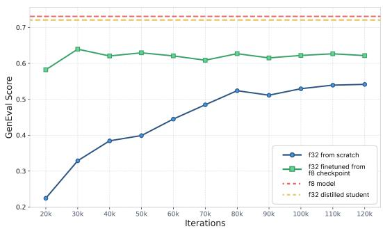
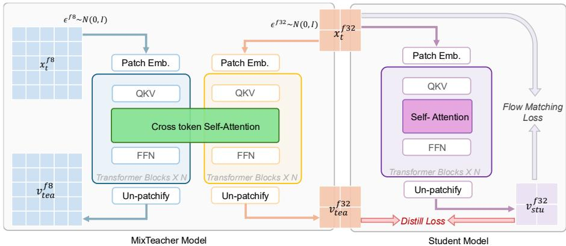
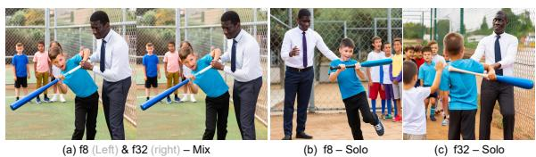
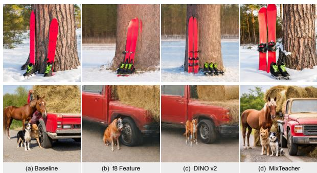
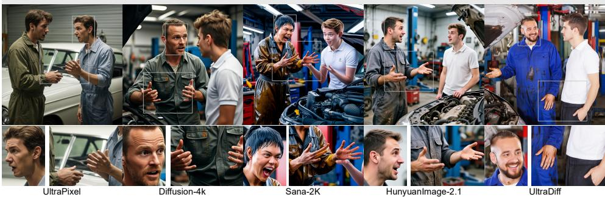
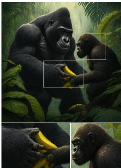
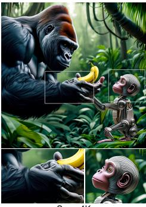
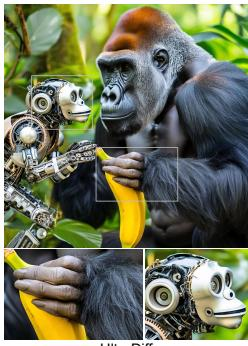

# UltraDiff: Transferring High-Fidelity Priors to Compressed Latent Spaces for High-Resolution Image Generation

Jingjing Ren1,\* Haitian Zheng2,\* Haoyu Chen1 Connelly Barnes2 Zhifei Zhang2 Yuqian Zhou2 Zhe Lin2 Lei Zhu1,†

1The Hong Kong University of Science and Technology (Guangzhou) 2Adobe Research

Equal contribution †Corresponding author

## Abstract

High-resolution synthesis with Latent Diffusion Models (LDMs) faces a fundamental trade-off between computational cost and generative fidelity. This trade-off is largely governed by the latent compression factor f (e.g. f8: f=8 and f32: f=32). While aggressive compression (f32) significantly improves efficiency, it suffers from severe information loss and ambiguity compared to standard f8 models. We propose UltraDiff, a framework that reformulates this challenge as joint-latent diffusion learning followed by marginal score distillation. We introduce MixTeacher, a dual-branch DiT that models the joint f8-f32 distribution, utilizing shared attention to resolve the ambiguity of the compressed space with high-fidelity f8 priors. Crucially, we propose vector field distillation in the native f32 space. Theoretically, this compels the student to learn the conditional expectation of the teacher’s trajectory, effectively filtering out compression artifacts. Across the evaluated 1K–4K settings, UltraDiff approaches f8-level quality while preserving f32 efficiency. With 20 sampling steps on a single A100 GPU, it generates a 2K image in 6.2 seconds—over 40× faster than our f8 baseline.

## 1 Introduction

The demand for ultra-high-definition (UHD) image and video synthesis has surged across streaming, gaming, and VR applications. While recent Diffusion Transformers (DiTs) [Esser et al., 2024, Chen et al., 2023, Podell et al., 2023, Black Forest Labs, 2024] excel at high-fidelity generation, selfattention dominates their compute and scales quadratically with the token count (O(N2)), making UHD synthesis prohibitively expensive. To mitigate this, recent works [Team, 2025, Xie et al., 2024] explore VAEs with more aggressive spatial downsampling, i.e., increasing the latent downsampling factor from f8 (f=8) to f32 (f=32), reducing the 2D latent token count by 16× compared to a standard f8 VAE, offering substantial efficiency gains.

However, the efficiency of aggressive downsampling comes at the cost of a substantially harder diffusion problem [Skorokhodov et al., 2025]. With f32 compression, the diffusion model must synthesize complex scenes from far fewer spatial tokens, yielding an ambiguous target distribution for the diffusion model to learn. This makes it difficult for the model to capture fine-grained details and precise spatial layout, leading to degraded perceptual fidelity and weaker prompt adherence compared to f8-based models [Black Forest Labs, 2024, Li et al., 2024, Kong et al., 2024].

Given the superior fidelity and detail generation capacity of f8 models, a natural question arises: Can we transfer the rich generative knowledge of a pre-trained f8 model to guide the training of an efficient f32 model? To study this, we conduct a controlled comparison between an f32 DiT trained from scratch and one initialized from a pre-trained f8 model. As shown in Fig. 2, f8 initialization consistently improves performance, indicating that generative knowledge indeed transfers across diffusion model with two latent spaces, despite the mismatch in latent representation, dimensionality and resolution. However, from Fig. 2, the benefit of initialization quickly saturates, leaving a substantial performance gap between the two models. This suggests that static parameter initialization alone is insufficient; and effective training requires dynamic, state-dependent guidance. Instead, a more natural solution is generative knowledge distillation where most existing methods [Leng et al., 2025, Ren et al., 2025a] rely on feature alignment, forcing a student to match intermediate representations of a trained teacher model. However, we argue that static feature alignment are suboptimal when distilling across mismatched latent resolutions, as aligning an f32 student to an f8 teacher requires interpolating feature grids, leading to quantization artifacts and checkerboard patterns. Moreover, such implicit feature-level regularization does not provide explicit distillation supervision, which limits their ability to transfer generative knowledge from a pre-trained diffusion teacher.

  
Figure 1: Our UltraDiff generates high-quality images across a variety of scenes, showcasing rich details and diverse content. Please zoom in to view the details. Additional images are provided in the supplementary materials.

To address these challenges for efficient UHD synthesis, we propose UltraDiff, a new framework that learns diffusion in a joint f8–f32 latent space and then distills the resulting score to the f32 latent space, yielding the final diffusion model in the f32 marginal for efficient sampling. Specifically, instead of treating the diffusion modeling in f8 and f32 spaces as two separate tasks, we introduce MixTeacher, a dual-branch DiT that models the joint distribution $p ( \boldsymbol { x } ^ { \mathrm { f 8 } ^ { \mathrm { a } } } , \boldsymbol { x } ^ { \mathrm { f 3 2 } } )$ where $\scriptstyle { \pmb { x } } ^ { \mathrm { f } 8 }$ and $\pmb { x } ^ { \mathrm { f } 3 2 }$ are extracted from the same image. Architecturally, MixTeacher comprises two DiT branches with separate parameters to accommodate the distinct feature distributions in the f8 and f32 latent spaces, while sharing self-attention layers within each block to enable dense cross-space interaction. With f8 initialization and layer-wise attention sharing, MixTeacher effectively learns a joint denoising model over paired f8 and f32 latents, effectively transferring generative knowledge from the pre-trained f8 branch to the f32 branch. Crucially, unlike other implicit feature distillation methods [Leng et al., 2025, Ren et al., 2025a], it enables direct distilling supervision in the f32 space. Specifically, our teacher projects its high-fidelity guidance into the student’s f32 space. Theoretically, this forces the student to learn the marginal vector field, effectively approximating the conditional expectation of the high-fidelity trajectory. This process “integrates out” the ambiguity inherent to compressed generation, guiding the student toward structurally coherent manifolds while operating strictly within the efficient f32 latent space.

## Our contributions are summarized as follows:

• We introduce MixTeacher, a unified architecture that learns the joint score function of f8 and f32 latents. Through a stochastic routing strategy and shared attention mechanism, it captures cross-space correlations while maintaining the marginal generation capabilities of each branch.

• We develop a marginal score distillation strategy that aligns the vector field directly in the native f32 space. By learning the conditional expectation of the teacher’s trajectory, the student model effectively resolves the inherent ambiguity and difficulty of modeling complex dependencies in the compressed f32 space.

• Our method, UltraDiff, achieves a strong trade-off between quality and efficiency. It produces detail-rich 4K images with strong semantic alignment shown in Figure 1, approaches the fidelity of the evaluated f8 systems, and generates a 2K image in 6.2 seconds using 20 sampling steps on a single NVIDIA A100 GPU—40.3× faster than our f8 anchor. UltraDiff also scales to 4K generation, where the f8 anchor runs out of memory.

## 2 Related Work

## 2.1 Diffusion Transformer

Diffusion Transformers (DiTs) have become a widely used backbone for image and video synthesis [Chen et al., 2023, 2024, 2025, Black Forest Labs, 2025, Team, 2025, Li et al., 2024, 2026, Xiao et al., 2026, Ren et al., 2025b] because of their scaling behavior and strong generative performance [Peebles and $\mathrm { X i e , }$ 2023]. A typical system pairs a DiT with a variational autoencoder (VAE), which maps an image of size $3 \times H \times W$ to a latent tensor of size $c \times H / f \times W / f$ Self-attention then operates on the latent tokens, with computational and memory costs that grow quadratically with the sequence length [Chen et al., 2023, Ren et al., 2025a, Esser et al., 2024, Team, 2025, Ren et al., 2025c, 2026, Tian et al., 2024].

  
Figure 2: Effectiveness of Cross-Space Knowledge Transfer. GenEval scores during training. UltraDiff bridges the gap to the f8 teacher.

Most systems use an $8 \times$ spatial compression factor and often reduce the token count further with $2 \times 2$ patch embedding [Podell et al., 2023, Chen et al., 2023, 2024, Li et al., 2024, Esser et al., 2024,

Black Forest Labs, 2024]. More aggressive compression, such as f = 32, improves efficiency for high-resolution and long-sequence generation [Xie et al., 2024, HaCohen et al., 2024, Team, 2025]. However, the smaller spatial grid makes structure and semantic alignment harder to learn [Xie et al., 2024, HaCohen et al., 2024, Pernias et al., 2023]. UltraDiff addresses this problem by transferring knowledge from a strong f8 model to an f32 model through initialization and cross-latent distillation, followed by mixed-resolution training.

Recent work has also explored making one autoencoder latent space explicitly compatible with another during VAE training [Yi et al., 2025, Zhao et al., 2024]. UltraDiff addresses a complementary setting: our f8 and f32 VAEs are trained independently and then kept fixed, while their relationship is learned at the diffusion vector-field level through shared attention in MixTeacher. Explicit compatible-VAE training may further simplify cross-space transfer and is an interesting direction for future work.

## 2.2 Diffusion Distillation

Distillation has become a general mechanism for adapting diffusion models to diverse objectives and deployment constraints. For acceleration, progressive and distribution–matching distillation compress long sampling trajectories into few- or even one-step generators while maintaining competitive fidelity [Salimans and Ho, 2022, Yin et al., 2024a,b, Kang et al., 2024]. Related consistency and rectifiedflow formulations further enable fast sampling and have been applied in high-resolution restoration pipelines [Xu et al., 2025, Sun et al., 2025, Wang et al., 2024b]. Beyond speed, distillation can change the inference pattern or model architecture. For example, a bidirectional teacher can supervise a causal student for streaming video generation [Yin et al., 2024c, Huang et al., 2025, Novack et al., 2024, Shin et al., 2025, Kodaira et al., 2025]. Distillation also supports modality transfer and prior reuse; score-distillation techniques leverage strong 2D text-to-image priors to supervise 3D synthesis, with recent work addressing stability and mode collapse [Yu et al., 2023, Ma et al., 2024, Wang et al., 2024a, 2025]. Another class of methods aligns semantic features from external encoders, such as DINOv2 or other diffusion networks, with a model’s internal representations to accelerate training and improve image fidelity [Yu et al., 2024, Leng et al., 2025, Ren et al., 2025a]. We adopt the spirit of distillation to bridge a latent-scale mismatch: a strong f8 teacher guides an f32 DiT via initialization and cross-latent supervision, yielding a high-compression student that retains fidelity while benefiting from the computational savings of far fewer tokens.

## 3 Method

  
Figure 3: Overview of UltraDiff. (Left) The MixTeacher models the joint distribution of f8 and f32 latents via a dual-branch DiT with shared attention. It acts as an omniscient supervisor that sees both high-fidelity (f8) and high-efficiency (f32) views of the data. (Right) The Student is a standard f32 DiT trained via Marginal Score Distillation. It learns to approximate the teacher’s optimal denoising direction projected onto the f32 subspace with a flow-matching objective.

We formulate the problem of high-efficiency, high-fidelity synthesis as joint-latent diffusion learning followed by marginal score distillation. Our goal is to train an efficient student model that operates in the high-compression space but inherits the generative vector field of the high-fidelity joint distribution.

Motivation: Feasibility of Cross-Space Transfer. Before detailing our framework, we first empirically validate the hypothesis that the generative representations of f8 (high-fidelity) and f32 (high-efficiency) latent spaces share transferable structural patterns, despite their representation and dimensional mismatch. We conducted a pilot study comparing a baseline f32 DiT model trained from scratch against one initialized with parameters from a pre-trained f8 model (excluding latentdependent layers). As shown in Fig. 2, the f8-initialized model consistently outperforms the randomly initialized baseline. This confirms that priors learned in the f8 space are transferable. However, a persistent performance gap remains. This saturation suggests that static parameter initialization is insufficient. This motivates our proposal of MixTeacher, which enables dynamic, interaction-based knowledge transfer via joint latent modeling.

## 3.1 Joint-Latent Modeling via MixTeacher

To capture the correlation between high-frequency details (f8) and compact semantics (f32), we introduce MixTeacher, a unified diffusion model parameterized by Φ. We consider the data as tuples in a product space $\mathcal { X } _ { \mathrm { j o i n t } } = \mathcal { X } _ { \mathrm { f 8 } } \times \mathcal { X } _ { \mathrm { f 3 2 } }$ . The MixTeacher approximates the joint score function $\nabla \log p ( \mathbf { x } ^ { \mathrm { { f } 8 } } , \mathbf { x } ^ { \mathrm { { f } 3 2 } } )$ . To provide reliable cross-space guidance, we design MixTeacher as a mixed-token dual-branch DiT. As illustrated in Fig. 3, the f8 and f32 branches maintain separate parameters— including QKV projections, FFNs, normalization layers, patch embeddings, and output heads—but share the self-attention mechanism across tokens in each layer. This design enables cross-latent space interaction while respecting the distinct distributions of each space.

Formally, given an input image $\mathbf { I } \in \mathbb { R } ^ { 3 \times H \times W }$ , we extract its f8 and f32 latents via respective VAE encoders: $\mathbf { \bar { x } } _ { 0 } ^ { \mathrm { f 8 } } \in \mathbb { R } ^ { C _ { 8 } \times \frac { H } { 8 } \times \frac { W } { 8 } }$ and $\mathbf { x } _ { 0 } ^ { \mathrm { f 3 2 } } \in \mathbb { R } ^ { C _ { 3 2 } \times \frac { H } { 3 2 } \times \frac { W } { 3 2 } }$ . During training, the noisy latents $\mathbf { x } _ { t } ^ { \mathrm { f 8 } }$ and $\mathbf { x } _ { t } ^ { \mathrm { f 3 2 } }$ are fed to the MixTeacher. Inside the model, each branch processes its own tokens using its specific parameters. Crucially, the resulting token sets are concatenated and passed through the shared self-attention at every layer. This enables dense interaction between the two modalities, allowing the f32 tokens to incorporate fine-grained structural details in the f8 tokens. The model output is formulated as the predicted velocity field v, which is supervised by the target vector field u derived from the forward flow matching process.

Training Objective and Stochastic Routing. We train the MixTeacher using a flow-matching objective [Lipman et al., 2022]. To capture the joint distribution while maintaining generative capabilities of individual branches over the f8 or f32 marginals, we employ a stochastic routing strategy. Formally, we optimize a weighted objective across three topological configurations defined by a branch indicator mask $( m _ { \mathbf { f } 8 } , m _ { \mathbf { f } 3 2 } ) \in \{ ( \bar { 1 } , 1 ) , ( 1 , 0 ) , ( 0 , 1 ) \}$ }, indicating the activation status of the f8 and f32 branches, respectively. The unified loss function is:

$$
\mathcal { L } = \mathbb { E } _ { t , \mathbf { x } , ( m _ { \mathrm { f s } } , m _ { \mathrm { f 3 2 } } ) } \left[ \sum _ { k \in \{ \mathbf { f 8 } , \mathbf { f 3 2 } \} } m _ { k } \cdot \lVert \mathbf { v } _ { \Phi } ^ { k } ( \mathbf { x } _ { t } ^ { k } ) - \mathbf { u } _ { t } ^ { k } \rVert ^ { 2 } \right] ,\tag{1}
$$

where $m _ { k } \in \{ 0 , 1 \}$ controls whether loss is applied on the specified latent space, $\mathbf { v } _ { \Phi } ^ { k }$ is the vector field predictor parametrized by Φ and $\mathbf { u } _ { t } ^ { k }$ is the target vector field.

More specifically, we sample among: (i) Joint Mode $( m _ { \mathbf { f } 8 } = 1 , m _ { \mathbf { f } 3 2 } = 1 )$ while self-attention between two branches is enabled to learn the score jointly; (ii) f8-Solo $( m _ { \mathbf { f } 8 } = 1 , m _ { \mathbf { f } 3 2 } = 0 )$ preserving valid generation in the original f8 space; and (iii) f32-Solo $( m _ { \mathbf { f } 8 } = 0 , m _ { \mathbf { f } 3 2 } = 1 )$ , which is crucial for ensuring the generation capability of the f32 branch without conditioning on f8 tokens. The final optimization objective is the expectation over these routing modes, governed by the sampling probabilities $p _ { \mathrm { j o i n t } } , p _ { \mathrm { f 8 } } , p _ { \mathrm { f 3 2 } }$ . This strategy prevents the "co-adaptation" pitfall where the f32 branch might become overly reliant on f8 features, ensuring that the structural knowledge transfer is robust and generalizable.

## 3.2 Distilling the Marginal Score

Once trained, MixTeacher provides a strong teacher signal for supervising the f32 student. Specifically, we aim to distill the knowledge of MixTeacher into a student model θ that operates only in the f32 marginal space, while the student aims to mimic the vector field predicted by the teacher’s f32 branch. However, since the student lacks access to the high-fidelity f8 latent ${ \bf x } _ { t } ^ { \mathrm { f 8 } }$ utilized by the teacher, the distillation target is inherently stochastic from the student’s perspective. We formulate the objective as minimizing the expected discrepancy over the joint distribution of the f8 and f32 latents:

$$
\begin{array} { r } { \mathcal { L } _ { \mathrm { d i s t i l l } } ( \theta ) = \mathbb { E } _ { t , ( \mathbf { x } _ { t } ^ { \mathrm { f 3 2 } } , \mathbf { x } _ { t } ^ { \mathrm { f 8 } } ) \sim q _ { t } } \left[ \left\| \mathbf { v } _ { \theta } ( \mathbf { x } _ { t } ^ { \mathrm { f 3 2 } } , t ) - \mathbf { v } _ { \Phi } ^ { \mathrm { f 3 2 } } ( \mathbf { x } _ { t } ^ { \mathrm { f 3 2 } } , \mathbf { x } _ { t } ^ { \mathrm { f 8 } } , t ) \right\| ^ { 2 } \right] . } \end{array}\tag{2}
$$

Minimizing this $L _ { 2 }$ objective inherently forces the student to approximate the conditional expectation of the teacher’s output given the f32 observation, i.e., the optimal estimator $\mathbf { v } _ { \theta } ^ { * }$ is thus given by:

$$
\begin{array} { r } { \mathbf { v } _ { \theta } ^ { * } ( \mathbf { x } _ { t } ^ { \mathrm { f 3 2 } } , t ) = \mathbb { E } _ { q ( \mathbf { x } ^ { \mathrm { f 8 } } \mid \mathbf { x } ^ { \mathrm { f 3 2 } } ) } \left[ \mathbf { v } _ { \Phi } ^ { \mathrm { f 3 2 } } ( \mathbf { x } _ { t } ^ { \mathrm { f 3 2 } } , \mathbf { x } _ { t } ^ { \mathrm { f 8 } } , t ) \right] . } \end{array}\tag{3}
$$

The student learns the marginal vector field projected from the joint space. By aggregating supervision over the coherent f8 priors provided by the teacher, this projection acts as a structural filter that effectively “integrates out” the ambiguity and stochastic aliasing artifacts inherent to the f32 space. The student is thus guided toward a structurally consistent manifold rather than fitting the noisy, underspecified f32 distribution directly.

Crucially, this projection does not result in a blurry average. As visualized in Fig. 4, in the mixed routing mode, the output of the teacher’s f32 branch is visually sharp and indistinguishable from the f8 branch. This indicates that the teacher’s attention sharing mechanism successfully resolves ambiguity, collapsing the conditional distribution into a highly peaked, determinate signal. Consequently, the distillation target ${ \bf v } _ { \Phi } ^ { \mathrm { f } 3 2 }$ serves as a structurally determinate vector field, providing a clean supervision signal that enables the student to recover fine details despite the high compression ratio. We train the student model using a composite objective of distillation loss and flow matching loss:

$$
\begin{array} { r } { \mathcal { L } _ { \mathrm { t o t a l } } = \lambda \mathcal { L } _ { \mathrm { d i s t i l l } } + \mathbb { E } _ { t , { \bf x } } \left[ \| { \bf v } _ { \boldsymbol { \theta } } ( { \bf x } _ { t } ^ { \mathrm { f } 3 2 } ) - { \bf u } _ { t } ^ { \mathrm { f } 3 2 } \| ^ { 2 } \right] . } \end{array}\tag{4}
$$

This comparison separates the effect of the proposed training procedure from the strength of the pretrained f8 anchor. Directly reusing the f8 parameters improves the f32 model from 0.54 to 0.61 GenEval, but leaves a substantial gap to the 0.73 f8 anchor. With the same f8 initialization, f32 VAE, and DiT backbone, UltraDiff reaches 0.72. The gain from 0.61 to 0.72 therefore cannot be explained by initialization or VAE quality alone and instead measures the contribution of joint-latent modeling and marginal score distillation.

Table 1: Controlled comparison under the same framework. All f32 variants use the same f32 VAE and DiT backbone. Initialization alone transfers part of the f8 prior, whereas marginal score distillation recovers most of the left gap.
<table><tr><td>Method</td><td>CLIP↑</td><td>IR↑</td><td>GenEval↑</td><td>Token</td><td></td></tr><tr><td>f32 from scratch</td><td>27.21</td><td>0.70</td><td>0.54</td><td> $\textstyle { \frac { H } { 3 2 } } \times { \frac { W } { 3 2 } }$ </td><td></td></tr><tr><td>f32 after f8 initialization</td><td>28.91</td><td>0.91</td><td>0.61</td><td> $\underline { { \underline { { 3 2 } } } } _ { \mathrm { ~ Y ~ } } \overset { \cdot \cdot } { \underline { { W } } }$   $\frac { H } { 3 2 } \times \frac { W } { 3 2 }$ </td><td></td></tr><tr><td>UltraDiff f32 student</td><td>29.27</td><td>0.98</td><td>0.72</td><td> $\frac { H } { 3 2 } \times \frac { W } { 3 2 }$  32</td><td>32</td></tr><tr><td>f8 anchor</td><td>29.25</td><td>1.08</td><td>0.73</td><td> ${ \frac { H } { 8 } } \times { \frac { W } { 8 } }$ </td><td></td></tr></table>

## 4 Experiment

## 4.1 Implementation Details

We employ a Diffusion Transformer (DiT) architecture that models text and image tokens as a unified sequence. Specifically, text embeddings (via T5-XXL [Raffel et al., 2020]) and image latents are concatenated along the sequence dimension and processed through a shared bidirectional transformer backbone. We use a patch size of 1 for image embeddings. For latent encoding, we utilize highcapacity VAEs with latent channel dimensions of $C _ { \mathrm { f 8 } } = \bar { 1 6 }$ and $C _ { \mathrm { f } 3 2 } = 6 4$ , corresponding to 8× and 32× downsampling factors, respectively. We apply channel-wise unit-variance normalization to both f8 and f32 latents before they enter the DiT backbone. We first train a DiT in the f32 latent space under two settings: (i) from scratch, and (ii) initialized from the f8 model’s weights, except for the shape-dependent patch embedding and output heads, which are randomly initialized. For MixTeacher, the f8 branch is initialized from a strong pretrained f8 T2I model, and the f32 branch is initialized from the previously trained f32 model with f8 initialization. We train the teacher at 512 and 1024 resolutions with varying aspect ratios. All UltraDiff stages use 64 NVIDIA A100 GPUs with FSDP. After filtering and deduplication, the available corpus contains approximately 0.37B text–image pairs. Table 2 reports the optimization steps and aggregate compute for each stage. The three stages consume 463.0 GPU-days in total, about 26% of the 1792 GPU-days required to train our lower-quality f32 baseline directly. These costs treat the fixed f8/f32 VAEs and pretrained f8 anchor as available components; further optimization settings are provided in the appendix.

Table 2: Stage-wise training resources. Compute is aggregated over 64 NVIDIA A100 GPUs.
<table><tr><td>Stage</td><td>Steps</td><td>Compute</td><td>Output</td></tr><tr><td>f32 transfer</td><td>120K</td><td>66.7 GPU-days</td><td>f32 initialization</td></tr><tr><td>MixTeacher training</td><td>5K</td><td>29.6 GPU-days</td><td>Joint f8–f32 teacher</td></tr><tr><td>Student distillation and scaling</td><td>50K + 10K</td><td>366.7 GPU-days</td><td>Standalone f32 student</td></tr><tr><td>UltraDiff adaptation total</td><td>185K</td><td>463.0 GPU-days</td><td>Final UltraDiff model</td></tr></table>

  
Figure 4: Visual results of different inference modes of the MixTeacher.

Table 3: MJHQ-3K and GenEval results for different MixTeacher modes. The f32 branch in mixed mode matches the performance of the base f8 model.
<table><tr><td>Method</td><td>CLIP↑</td><td>IR↑</td><td>GenEval↑</td><td>Token</td></tr><tr><td>f8 &amp; f32 Mixed (f8 Branch)</td><td>29.27</td><td>1.05</td><td>0.74</td><td></td></tr><tr><td>f8 &amp; f32 Mixed (f32 Branch)</td><td>29.24</td><td>1.02</td><td>0.74</td><td>#x W8W2 X</td></tr><tr><td>f8-Solo</td><td>29.26</td><td>1.06</td><td>0.73</td><td>H × w</td></tr><tr><td>f32-Solo</td><td>28.88</td><td>0.85</td><td>0.62</td><td>H X 3</td></tr></table>

## 4.2 Ablation Study

Evaluation criteria. We evaluate models using GenEval [Ghosh et al., 2023], CLIP similarity [Rad ford et al., 2021], and ImageReward (IR) [Xu et al., 2023] at a resolution of 512 × 512 for fast iteration. CLIP and IR are computed on a 3k subset of MJHQ-30k [Li et al., 2024] to further reduce evaluation cost.

Train in f32 space. We train the T2I model in the f32 latent space for 120k iterations until convergence. The results show that the model with f8 initialization exhibits much better performance than the model trained from scratch. As shown in Figure 2, the model initialized from f8 (green curve) consistently outperforms the scratch-trained model (blue curve) according to GenEval [Ghosh et al., 2023] throughout training. Table 1 reports similar gains on CLIP and IR metrics, showing the benefit of transferring parameters from the f8 model. However, simple initialization still leaves a large gap compared with the f8 model, as shown in Figure 2 and Table 1. This suggests that, in the highly compressed f32 space, good initialization helps but is not sufficient. Even with f8 initialization, optimization remains difficult, and the model cannot fully match the f8 teacher under a purely datadriven objective. Leveraging the strong f8 model, we distill its behavior to enhance f32 performance.

Exploration of MixTeacher Routing Strategy. To identify the optimal strategy for training the MixTeacher, we evaluate three routing configurations in Table 5. First, exclusive joint training $( p _ { j o i n t } = 1 . 0 )$ performs poorly; the lack of single-branch constraints causes the f32 branch to exploit f8 shortcuts, leading to representation collapse. Second, mixing only Joint and f8-Solo modes (e.g., $p _ { j o i n t } = 0 . 5 , p _ { f 8 } = 0 . 5 )$ also fails, as the f32 branch remains under-trained, creating a bottleneck that drags down the joint performance. These results underscore a critical insight: maintaining the independent generative capability of each branch is a prerequisite for learning a robust joint distribution. Consequently, we adopt a balanced configuration $( p _ { j o i n t } = 0 . 4 , p _ { f 3 2 } = 0 . 4 , p _ { f 8 } = 0 . 2 )$ This strategy explicitly enforces the marginal capability of the f32 branch, ensuring it provides a high-quality supervision target. We assign a lower weight to f8-Solo (0.2) since the strong pre-trained f8 branch requires less tuning, allowing us to allocate more budget to the f32 and joint objectives.

Analysis of MixTeacher Inference. Having determined the suitable routing configuration, we further analyze the inference behavior of the MixTeacher (Table 3). By comparing the inference modes, we observe that the Mixed Mode effectively bridges the gap between the coarse f32 latent space and the high-fidelity target. While the f32-Solo baseline (0.62 GenEval) yields suboptimal performance due to the aggressive compression, the Mixed Mode (0.74 GenEval) demonstrates that the teacher successfully utilizes the f8 context to resolve structural ambiguities. Crucially, as visualized in Figure 4, the images generated by the f32 and f8 branches in Mixed Mode are visually indistinguishable, matching in both high-frequency details and semantic alignment. This indicates that although the two branches reside in distinct latent spaces, the MixTeacher successfully projects the high-fidelity priors into the compressed f32 representation. Consequently, this f32 output serves as a high-quality, structurally determinate distillation signal directly within the student’s native space.

  
Table 4: Results on MJHQ-3K and GenEval for different distillation methods.

<table><tr><td>Teacher</td><td>CLIP↑</td><td>IR↑</td><td>GenEval↑</td></tr><tr><td>Baseline</td><td>28.91</td><td>0.91</td><td>0.61</td></tr><tr><td>DINO v2 [Leng et al., 2025]</td><td>27.53</td><td>0.06</td><td>0.33</td></tr><tr><td>f8 model [Ren et al., 2025a]</td><td>27.87</td><td>0.05</td><td>0.31</td></tr><tr><td>MixTeacher (Ours)</td><td>29.27</td><td>0.98</td><td>0.72</td></tr></table>

Table 5: Impact of routing strategy on GenEval across inference modes.  
Figure 5: Visual comparison of (a) the f8 base model, (b) f32 model distilled from an f8 teacher [Ren et al., 2025a], (c) f32 model distilled from DINOv2 features via REPA [Yu et al., 2024], and (d) f32 model distilled from our MixTeacher.
<table><tr><td colspan="3">Routing Strategy</td><td colspan="4">Inference Mode (GenEval ↑)</td></tr><tr><td>Pmix</td><td>Pf32</td><td>Pf8</td><td>f8-Solo</td><td>f32-Solo</td><td>Mix(f8)</td><td>Mix(f32)</td></tr><tr><td>1.0</td><td>0.0</td><td>0.0</td><td>0.56</td><td>0.28</td><td>0.68</td><td>0.68</td></tr><tr><td>0.5</td><td>0.0</td><td>0.5</td><td>0.65</td><td>0.15</td><td>0.65</td><td>0.64</td></tr><tr><td>0.4</td><td>0.4</td><td>0.2</td><td>0.73</td><td>0.62</td><td>0.74</td><td>0.74</td></tr></table>

Table 6: Controlled attribution of the high-resolution gains. Both models use the same f8- initialized f32 backbone and the same mixed-resolution scaling stage. DPG, GenEval, and HPSv3 are evaluated at 1K; FID, aesthetic score, and CLIP similarity are evaluated at 4K.
<table><tr><td>Model</td><td>DPG↑</td><td>GenEval↑</td><td>HPSv3↑</td><td>FID↓</td><td>Aesthetic↑</td><td>CLIP↑</td></tr><tr><td>No distillation + high-res</td><td>74.02</td><td>0.602</td><td>7.68</td><td>149.59</td><td>6.16</td><td>29.31</td></tr><tr><td>UltraDiff</td><td>85.40</td><td>0.680</td><td>9.39</td><td>146.60</td><td>6.34</td><td>30.14</td></tr></table>

Distillation strategy We explore four strategies in Table 4 and Fig. 5: (1) Baseline — an f32 model initialized from the f8 model (no distillation). (2) DINOv2 teacher — align the DiT’s internal features to DINOv2 following REPA [Leng et al., 2025]. (3) f8 feature teacher — align f32 features to those from the f8 model following Ren et al. [2025a]. (4) MixTeacher (ours) — process f8 and f32 tokens together and use the f32 branch as the distillation signal. External semantic guidance from DINOv2 brings little gain. Our baseline has already been pre-trained in f8 and then fine-tuned in f32, so semantic priors are strong; additional supervision from a generic image encoder is redundant and not matched to the diffusion objective. Moreover, feature alignment to DINOv2 requires grid upsampling from f32, which induces checkerboard/ringing even with learned convolutional mapping. The problem is amplified under variable aspect ratios (tall/wide samples), where DINOv2 offers limited spatial guidance for the diffusion trajectories. Directly aligning to the f8 feature grid performs similarly or worse for the same reason: the f8 lattice is 4× finer per dimension than f32, so supervision again depends on learned upsampling across mismatched token layouts, introducing aliasing and bias. In contrast, ours supervises in the f32 space using the f32 branch’s v-prediction. This avoids crossgrid interpolation, matches the denoising objective, and yields sharper details and better text–image consistency, as seen qualitatively in Figure 5 and quantitatively in Table 4.

Distillation versus high-resolution training. To isolate the effect of marginal score distillation, we train a same-backbone control from the same f8-initialized f32 checkpoint, using identical highresolution scaling but without distillation. During scaling, 1K samples use both distillation and flow matching, while 2K–4K samples use flow matching only. As shown in Table 6, UltraDiff improves DPG, GenEval, and HPSv3 by 11.38, 0.078, and 1.71 at 1K, respectively, while also achieving better FID, aesthetic score, and CLIP similarity at 4K. These results highlight the complementary roles of distillation in transferring the f8 prior and high-resolution flow matching in adapting to larger spatial scales.

## 4.3 Comparative Study

Evaluation Criteria We evaluate our UltraDiff and other methods using DPG Bench [Hu et al., 2024], GenEval [Ghosh et al., 2023] and human preference score (HPSV3) [Ma et al., 2025]. For quantitative evaluation, we adopt the protocols from Diffusion-4K [Zhang et al., 2025]. FID is computed on the entire Aesthetic-4K [Zhang et al., 2025] evaluation set, with images resized to

## Resolution 2048 X 2048

Prompt: A person wearing a greasy jumpsuit, indicative of his hands-on work. The individual exudes confidence and expertise while gesturing towards a visible car engine. Opposite him, a curious individual in a pristine white polo shirt listens intently…The scene is set in a bustling auto repair shop with tools and equipment surrounding them..

  
Resolution: 4096 X 4096

Prompt: In a dense jungle setting, a massive and powerful gorilla, characterized by its thick, dark fur, reaches out with a gentle and massive hand to offer a bright yellow banana to a smaller, intricately designed mechanical monkey. The mechanical monkey, with shiny metallic parts and gears visible, extends its tiny, articulated fingers to accept the fruit  

Figure 6: High-resolution image synthesis comparison at 2K and 4K. UltraDiff produces sharper details, cleaner textures, and stronger text–image alignment than competing high-resolution models. Table 7: Comparison with other T2I models on higher resolution of 2048 × 2048 and $4 0 9 6 \times 4 0 9 6$
<table><tr><td>Resolution</td><td>Method</td><td>Params(B)</td><td>Latent(C × H × W)</td><td></td><td>Latency(s) / Step</td><td>FID↓</td><td>pFID↓</td><td>Aesthetic↑</td><td>CLIP↑</td></tr><tr><td rowspan="4">20482</td><td>Ultrapixel [Ren et al., 2024]</td><td>5.1</td><td> $1 6 \times \textstyle { \frac { H } { 3 2 } } \times \frac { W } { 3 2 }$ </td><td></td><td>12/20</td><td>46.60</td><td>43.03</td><td>6.24</td><td>30.21</td></tr><tr><td>Diffusion-4k [Zhang et al., 2025]</td><td>12</td><td> $1 6 \times \frac { \tilde { H } } { 4 2 } \times \frac { \tilde { W } } { 4 2 }$  42</td><td>42</td><td>23 / 50</td><td>37.79</td><td>42.43</td><td>6.28</td><td>29.21</td></tr><tr><td>Sana-2K [Xie et al., 2024]</td><td>1.6</td><td> $3 2 \times \textstyle { \frac { H } { 3 2 } } \times \textstyle { \frac { W } { 3 2 } }$ </td><td></td><td>5.8 / 20</td><td>45.99</td><td>42.99</td><td>6.18</td><td>30.13</td></tr><tr><td>Hunyuan-2.1 [Team, 2025]</td><td>17</td><td> $6 4 \times \frac { \tilde { H } } { 3 2 } \times \frac { \tilde { W } } { 3 2 }$  32</td><td></td><td>82/50</td><td>43.45</td><td>48.72</td><td>6.44</td><td>30.17</td></tr><tr><td></td><td>Ours</td><td>2.0</td><td> $6 4 \times \frac { H } { 3 2 } \times \frac { W } { 3 2 }$ </td><td></td><td>6.2/20</td><td>39.52</td><td>42.17</td><td>6.40</td><td>30.53</td></tr><tr><td rowspan="4">40962</td><td>Ultrapixel [Ren et al., 2024]</td><td>5.1</td><td> $1 6 \times \textstyle { \frac { H } { 4 2 } } \times \frac { W } { 4 2 }$ </td><td></td><td>73 /20</td><td>155.17</td><td>57.14</td><td>5.91</td><td>27.39</td></tr><tr><td>Diffusion-4k [Zhang et al., 2025]</td><td>12.0</td><td> $1 6 \times \textstyle { \frac { \tilde { H } } { 3 2 } } \times \frac { \tilde { W } } { 3 2 }$ </td><td></td><td>122 /50</td><td>162.94</td><td>75.70</td><td>5.68</td><td>27.20</td></tr><tr><td>Sana-4K [Xie et al., 2024]</td><td>1.6</td><td> $3 2 \times \frac { \stackrel { \triangledown } { \scriptscriptstyle H } } { 3 2 } \times \frac { \stackrel { \triangledown } { \scriptscriptstyle W } } { 3 2 }$ </td><td></td><td>21.3 / 20</td><td>149.20</td><td>56.25</td><td>6.12</td><td>29.97</td></tr><tr><td>Ours</td><td>2.0</td><td> $\begin{array} { r } { 6 4 \times \frac { H } { 3 2 } \times \frac { W } { 3 2 } } \end{array}$ </td><td></td><td>28.3 /20</td><td>146.60</td><td>54.27</td><td>6.34</td><td>30.14</td></tr></table>

$2 9 9 \times 2 9 9$ . To assess high-frequency details, we report pFID, calculated by extracting 4 random non-overlapping patches from each ground truth and generated image.

Results at $1 0 2 4 ^ { 2 } .$ . We compare UltraDiff with complete T2I systems based on f8 VAEs [Black Forest Labs, 2024, Podell et al., 2023, Chen et al., 2024, Li et al., 2024] and with the f32-based Sana system [Xie et al., 2024]. Table 8 shows that UltraDiff offers a strong practical quality–efficiency trade-off, ranking at or near the top among models of similar size on DPG and GenEval while remaining competitive on HPSv3. These cross-system results provide deployment-oriented context rather than a controlled causal comparison: the systems differ in backbone architecture, parameter count, training data, text encoders, autoencoders, optimization recipes, and inference infrastructure. We therefore establish the contribution of UltraDiff using the within-framework controls in Tables 1 and 6, where the relevant f32 models share the same VAE, DiT backbone, initialization, and highresolution training protocol.

Results of $2 0 4 8 ^ { 2 }$ and $4 0 9 6 ^ { 2 }$ . UltraDiff uses a high VAE compression ratio $( \frac { H } { 3 2 } \times \frac { W } { 3 2 } )$ , which enables 2K and 4K synthesis within one checkpoint that supports multiple resolutions natively. We compare 2K and 4K results against methods capable of high-resolution output, including approaches that scale pretrained models through architectural or inference-time adjustments, such as UltraPixe and Diffusion-4K, and systems that natively support such resolutions, such as Sana-2K, Sana-4K, and HunyuanImage-2.1, as shown in Figure 6 and Table 7. At 2K the post adjusted methods are competitive and UltraDiff maintains strong metrics with fast inference, while at 4K these adjusted methods degrade in quality, for example Ultrapixel struggles to preserve semantic alignment and Diffusion-4K begins to produce blurred results. Hunyuan-2.1, which employs a larger parameter budget with the same f32 compression, also performs well, suggesting that high compression scales effectively when paired with sufficient capacity. Both Sana and UltraDiff are efficient at high resolution. Sana is faster because it employs linear attention, whereas UltraDiff uses self-attention at a similar parameter scale and compression ratio. Under the reported system-level evaluation, UltraDiff obtains stronger overall image-quality and semantic-alignment metrics. Because the two systems differ in more than the attention mechanism, we do not interpret this comparison as isolating the effect of any single component.

Table 8: Comparison with other T2I models on 10242.
<table><tr><td>Method</td><td>Token</td><td>Params(B)</td><td>DPG↑</td><td>GenEval↑</td><td>HPSv3↑</td></tr><tr><td>SDXL [Podell et al., 2023]</td><td>H-8-8H16-1616H-16H-3232 × × × ×× × W-8W-8W16W|6W|6W</td><td>2.6</td><td>74.6</td><td>0.55</td><td>7.87</td></tr><tr><td>PlayGroundv2.5 [Li et al., 2024]</td><td></td><td>2.6</td><td>75.5</td><td>0.56</td><td>9.90</td></tr><tr><td>PixArtΣ [Chen et al., 2024]</td><td></td><td>0.6</td><td>80.5</td><td>0.54</td><td>9.20</td></tr><tr><td>SD3-medium [Esser et al., 2024]</td><td></td><td>2.0</td><td>84.1</td><td>0.62</td><td>9.08</td></tr><tr><td>FLUX-dev [Black Forest Labs, 2024]</td><td></td><td>12</td><td>83.8</td><td>0.67</td><td>10.15</td></tr><tr><td>FLUX-schnell [Black Forest Labs, 2024]</td><td></td><td>12</td><td>84.8</td><td>0.71</td><td>9.37</td></tr><tr><td>Sana [Xie et al., 2024]</td><td>×</td><td>16 1.6</td><td>84.5</td><td>0.66</td><td>8.92</td></tr><tr><td>UltraDiff (Ours)</td><td>X</td><td>W32W32 2.0</td><td>85.4</td><td>0.68</td><td>9.39</td></tr></table>

Controlled inference efficiency. We compare the final f32 student with the f8 anchor using 20 sampling steps on a single NVIDIA A100 GPU. As shown in Table 9, f32 compression reduces the time per image from 27.3s to 3.2s at 10242 (8.5×) and from 249.8s to 6.2s at 20482 (40.3×). At 40962, the f8 model runs out of memory, whereas UltraDiff completes generation in 28.3s. Because both models use the same sampling setup, this comparison isolates the efficiency gained from the smaller f32 latent grid.

Table 9: Controlled inference efficiency. Time per image with 20 sampling steps on one NVIDIA A100 GPU.
<table><tr><td>Resolution</td><td>f8 anchor</td><td>UltraDiff</td><td>Speedup</td></tr><tr><td>10242</td><td>27.3s</td><td>3.2s</td><td>8.5×</td></tr><tr><td>20482</td><td>249.8s</td><td>6.2s</td><td>40.3×</td></tr><tr><td>40962</td><td>00M</td><td>28.3s</td><td>一</td></tr></table>

## 5 Conclusion

In this work, we presented UltraDiff, a novel distillation framework designed to enable high-fidelity image synthesis within highly compressed latent spaces (e.g., f32). To overcome the inherent difficulty of training in such compact representations, we introduced MixTeacher, a dual-branch architecture that establishes a direct, grid-aligned supervision signal for the student model. By distilling the marginal vector field from a high-quality anchor directly into the target latent space, our method effectively transfers complex structural details. Extensive experiments demonstrate that UltraDiff substantially narrows the quality gap between f8 and f32 generation in the evaluated DiT pipeline while retaining the inference efficiency of f32 architectures. With 20 sampling steps on a single A100 GPU, UltraDiff generates a 2K image in 6.2 seconds, a 40.3× speedup over the f8 anchor, and remains practical at 4K where the anchor runs out of memory. We hope this streamlined distillation paradigm paves the way for more scalable and efficient generative models in the future.

Acknowledgment. This work is supported by the National Natural Science Foundation of China (Project No.82572383), Adobe Research Gift Grant, and Guangdong Basic and Applied Basic Research Foundation (No.2025A1515140021).

Impact Statement. UltraDiff enables efficient, high-quality text-to-image generation in highly compressed latent spaces, potentially reducing the computational and energy costs of 2K–4K image synthesis and broadening access to high-resolution generative models. However, this efficiency may also facilitate the creation of misleading or harmful content. We therefore encourage responsible deployment with appropriate safeguards, including safety evaluation, watermarking, and provenance tracking.

## References

Black Forest Labs. Flux.1 [schnell]. https://github.com/black-forest-labs/flux, 2024. Accessed: 2024-08-01.

Black Forest Labs. Flux.2. https://github.com/black-forest-labs/flux2, 2025.

Junsong Chen, Jincheng Yu, Chongjian Ge, Lewei Yao, Enze Xie, Yue Wu, Zhongdao Wang, James Kwok, Ping Luo, Huchuan Lu, et al. PixArt-α: Fast training of diffusion transformer for photorealistic text-to-image synthesis. arXiv preprint arXiv:2310.00426, 2023.

Junsong Chen, Chongjian Ge, Enze Xie, Yue Wu, Lewei Yao, Xiaozhe Ren, Zhongdao Wang, Ping Luo, Huchuan Lu, and Zhenguo Li. PixArt-σ: Weak-to-strong training of diffusion transformer for 4k text-to-image generation. In European Conference on Computer Vision, pages 74–91. Springer, 2024.

Junsong Chen, Yuyang Zhao, Jincheng Yu, Ruihang Chu, Junyu Chen, Shuai Yang, Xianbang Wang, Yicheng Pan, Daquan Zhou, Huan Ling, et al. Sana-video: Efficient video generation with block linear diffusion transformer. arXiv preprint arXiv:2509.24695, 2025.

Patrick Esser, Sumith Kulal, Andreas Blattmann, Rahim Entezari, Jonas Müller, Harry Saini, Yam Levi, Dominik Lorenz, Axel Sauer, Frederic Boesel, et al. Scaling rectified flow transformers for high-resolution image synthesis. In Forty-first international conference on machine learning, 2024.

Dhruba Ghosh, Hannaneh Hajishirzi, and Ludwig Schmidt. Geneval: An object-focused framework for evaluating text-to-image alignment. Advances in Neural Information Processing Systems, 36: 52132–52152, 2023.

Yoav HaCohen, Nisan Chiprut, Benny Brazowski, Daniel Shalem, Dudu Moshe, Eitan Richardson, Eran Levin, Guy Shiran, Nir Zabari, Ori Gordon, et al. Ltx-video: Realtime video latent diffusion. arXiv preprint arXiv:2501.00103, 2024.

Xiwei Hu, Rui Wang, Yixiao Fang, Bin Fu, Pei Cheng, and Gang Yu. Ella: Equip diffusion models with llm for enhanced semantic alignment, 2024.

Xun Huang, Zhengqi Li, Guande He, Mingyuan Zhou, and Eli Shechtman. Self forcing: Bridging the train-test gap in autoregressive video diffusion. arXiv preprint arXiv:2506.08009, 2025.

Minguk Kang, Richard Zhang, Connelly Barnes, Sylvain Paris, Suha Kwak, Jaesik Park, Eli Shechtman, Jun-Yan Zhu, and Taesung Park. Distilling diffusion models into conditional gans. In European Conference on Computer Vision, pages 428–447. Springer, 2024.

Akio Kodaira, Tingbo Hou, Ji Hou, Masayoshi Tomizuka, and Yue Zhao. Streamdit: Real-time streaming text-to-video generation. arXiv preprint arXiv:2507.03745, 2025.

Weijie Kong, Qi Tian, Zijian Zhang, Rox Min, Zuozhuo Dai, Jin Zhou, Jiangfeng Xiong, Xin Li, Bo Wu, Jianwei Zhang, et al. Hunyuanvideo: A systematic framework for large video generative models. arXiv preprint arXiv:2412.03603, 2024.

Xingjian Leng, Jaskirat Singh, Yunzhong Hou, Zhenchang Xing, Saining Xie, and Liang Zheng. Repa-e: Unlocking vae for end-to-end tuning with latent diffusion transformers. arXiv preprint arXiv:2504.10483, 2025.

Daiqing Li, Aleks Kamko, Ehsan Akhgari, Ali Sabet, Linmiao Xu, and Suhail Doshi. Playground v2. 5: Three insights towards enhancing aesthetic quality in text-to-image generation. arXiv preprint arXiv:2402.17245, 2024.

Fan Li, Chonghuinan Wang, Lina Lei, Yuping Qiu, Jiaqi Xu, Jiaxiu Jiang, Xinran Qin, Zhikai Chen, Fenglong Song, Zhixin Wang, et al. Hp-edit: A human-preference post-training framework for image editing. arXiv preprint arXiv:2604.19406, 2026.

Yaron Lipman, Ricky TQ Chen, Heli Ben-Hamu, Maximilian Nickel, and Matt Le. Flow matching for generative modeling. arXiv preprint arXiv:2210.02747, 2022.

Yuhang Ma, Xiaoshi Wu, Keqiang Sun, and Hongsheng Li. Hpsv3: Towards wide-spectrum human preference score, 2025. URL https://arxiv.org/abs/2508.03789.

Zhiyuan Ma, Yuxiang Wei, Yabin Zhang, Xiangyu Zhu, Zhen Lei, and Lei Zhang. Scaledreamer: Scalable text-to-3d synthesis with asynchronous score distillation. In European Conference on Computer Vision, pages 1–19. Springer, 2024.

Zachary Novack, Ge Zhu, Jonah Casebeer, Julian McAuley, Taylor Berg-Kirkpatrick, and Nicholas J Bryan. Presto! distilling steps and layers for accelerating music generation. arXiv preprint arXiv:2410.05167, 2024.

William Peebles and Saining Xie. Scalable diffusion models with transformers. In Proceedings of the IEEE/CVF international conference on computer vision, pages 4195–4205, 2023.

Pablo Pernias, Dominic Rampas, Mats L Richter, Christopher J Pal, and Marc Aubreville. Würstchen: An efficient architecture for large-scale text-to-image diffusion models. arXiv preprint arXiv:2306.00637, 2023.

Dustin Podell, Zion English, Kyle Lacey, Andreas Blattmann, Tim Dockhorn, Jonas Müller, Joe Penna, and Robin Rombach. Sdxl: Improving latent diffusion models for high-resolution image synthesis. arXiv preprint arXiv:2307.01952, 2023.

Alec Radford, Jong Wook Kim, Chris Hallacy, Aditya Ramesh, Gabriel Goh, Sandhini Agarwal, Girish Sastry, Amanda Askell, Pamela Mishkin, Jack Clark, et al. Learning transferable visual models from natural language supervision. In International conference on machine learning, pages 8748–8763. PmLR, 2021.

Colin Raffel, Noam Shazeer, Adam Roberts, Katherine Lee, Sharan Narang, Michael Matena, Yanqi Zhou, Wei Li, and Peter J Liu. Exploring the limits of transfer learning with a unified text-to-text transformer. Journal of machine learning research, 21(140):1–67, 2020.

Jingjing Ren, Wenbo Li, Haoyu Chen, Renjing Pei, Bin Shao, Yong Guo, Long Peng, Fenglong Song, and Lei Zhu. Ultrapixel: Advancing ultra high-resolution image synthesis to new peaks. Advances in Neural Information Processing Systems, 37:111131–111171, 2024.

Jingjing Ren, Wenbo Li, Zhongdao Wang, Haoze Sun, Bangzhen Liu, Haoyu Chen, Jiaqi Xu, Aoxue Li, Shifeng Zhang, Bin Shao, et al. Turbo2k: Towards ultra-efficient and high-quality 2k video synthesis. In Proceedings of the IEEE/CVF International Conference on Computer Vision, pages 18155–18165, 2025a.

Sucheng Ren, Qihang Yu, Ju He, Xiaohui Shen, Alan Yuille, and Liang-Chieh Chen. Flowar: Scale-wise autoregressive image generation meets flow matching. In ICML, 2025b.

Sucheng Ren, Qihang Yu, Ju He, Xiaohui Shen, Alan Yuille, and Liang-Chieh Chen. Beyond next-token: Next-x prediction for autoregressive visual generation. In ICCV, 2025c.

Sucheng Ren, Yaodong Yu, Nataniel Ruiz, Feng Wang, and Cihang Xie. Decoupled scale-wise autoregressive modeling for visual generation. In Proceedings ofthe IEEE/CVF Conference on Computer Vision and Pattern Recognition, pages 4506–4515, 2026.

Tim Salimans and Jonathan Ho. Progressive distillation for fast sampling of diffusion models. arXiv preprint arXiv:2202.00512, 2022.

Joonghyuk Shin, Zhengqi Li, Richard Zhang, Jun-Yan Zhu, Jaesik Park, Eli Schechtman, and Xun Huang. Motionstream: Real-time video generation with interactive motion controls. arXiv preprint arXiv:2511.01266, 2025.

Ivan Skorokhodov, Sharath Girish, Benran Hu, Willi Menapace, Yanyu Li, Rameen Abdal, Sergey Tulyakov, and Aliaksandr Siarohin. Improving the diffusability of autoencoders. arXiv preprint arXiv:2502.14831, 2025.

Haoze Sun, Linfeng Jiang, Fan Li, Renjing Pei, Zhixin Wang, Yong Guo, Jiaqi Xu, Haoyu Chen, Jin Han, Fenglong Song, et al. Pocketsr: The super-resolution expert in your pocket mobiles. arXiv preprint arXiv:2510.03012, 2025.

Tencent Hunyuan Team. Hunyuanimage 2.1, 2025. URL https://github.com/ Tencent-Hunyuan/HunyuanImage-2.1. Accessed 2025-10-27.

Keyu Tian, Yi Jiang, Zehuan Yuan, Bingyue Peng, and Liwei Wang. Visual autoregressive modeling: Scalable image generation via next-scale prediction. Advances in neural information processing systems, 37:84839–84865, 2024.

Hanyang Wang, Fangfu Liu, Jiawei Chi, and Yueqi Duan. Videoscene: Distilling video diffusion model to generate 3d scenes in one step. In 2025 IEEE/CVF Conference on Computer Vision and Pattern Recognition (CVPR), pages 16475–16485. IEEE, 2025.

Peihao Wang, Dejia Xu, Zhiwen Fan, Dilin Wang, Sreyas Mohan, Forrest Iandola, Rakesh Ranjan, Yilei Li, Qiang Liu, Zhangyang Wang, et al. Taming mode collapse in score distillation for textto-3d generation. In Proceedings of the IEEE/CVF Conference on Computer Vision and Pattern Recognition, pages 9037–9047, 2024a.

Yufei Wang, Wenhan Yang, Xinyuan Chen, Yaohui Wang, Lanqing Guo, Lap-Pui Chau, Ziwei Liu, Yu Qiao, Alex C Kot, and Bihan Wen. Sinsr: diffusion-based image super-resolution in a single step. In Proceedings of the IEEE/CVF conference on computer vision and pattern recognition, pages 25796–25805, 2024b.

Yicheng Xiao, Wenxun Dai, Xinran Qin, Lin Song, Maoquan Zhang, Hang Xu, Yukang Chen, Yitong Li, Guohui Zhang, Yuan Zhang, et al. Joyai-video-edit: Real-time open-ended video editing with autoregressive diffusion. arXiv preprint arXiv:2608.03974, 2026.

Enze Xie, Junsong Chen, Junyu Chen, Han Cai, Haotian Tang, Yujun Lin, Zhekai Zhang, Muyang Li, Ligeng Zhu, Yao Lu, et al. Sana: Efficient high-resolution image synthesis with linear diffusion transformers. arXiv preprint arXiv:2410.10629, 2024.

Jiaqi Xu, Wenbo Li, Haoze Sun, Fan Li, Zhixin Wang, Long Peng, Jingjing Ren, Haoran Yang, Xiaowei Hu, Renjing Pei, et al. Fast image super-resolution via consistency rectified flow. In Proceedings of the IEEE/CVF International Conference on Computer Vision, pages 11755–11765, 2025.

Jiazheng Xu, Xiao Liu, Yuchen Wu, Yuxuan Tong, Qinkai Li, Ming Ding, Jie Tang, and Yuxiao Dong. Imagereward: Learning and evaluating human preferences for text-to-image generation. Advances in Neural Information Processing Systems, 36:15903–15935, 2023.

Qiaosi Yi et al. Fine-structure preserved real-world image super-resolution via transfer vae training. In Proceedings of the IEEE/CVF International Conference on Computer Vision, 2025.

Tianwei Yin, Michaël Gharbi, Taesung Park, Richard Zhang, Eli Shechtman, Fredo Durand, and Bill Freeman. Improved distribution matching distillation for fast image synthesis. Advances in neural information processing systems, 37:47455–47487, 2024a.

Tianwei Yin, Michaël Gharbi, Richard Zhang, Eli Shechtman, Fredo Durand, William T Freeman, and Taesung Park. One-step diffusion with distribution matching distillation. In Proceedings of the IEEE/CVF conference on computer vision and pattern recognition, pages 6613–6623, 2024b.

Tianwei Yin, Qiang Zhang, Richard Zhang, William T Freeman, Fredo Durand, Eli Shechtman, and Xun Huang. From slow bidirectional to fast causal video generators. arXiv e-prints, pages arXiv–2412, 2024c.

Sihyun Yu, Sangkyung Kwak, Huiwon Jang, Jongheon Jeong, Jonathan Huang, Jinwoo Shin, and Saining Xie. Representation alignment for generation: Training diffusion transformers is easier than you think. arXiv preprint arXiv:2410.06940, 2024.

Xin Yu, Yuan-Chen Guo, Yangguang Li, Ding Liang, Song-Hai Zhang, and Xiaojuan Qi. Text-to-3d with classifier score distillation. arXiv preprint arXiv:2310.19415, 2023.

Jinjin Zhang, Qiuyu Huang, Junjie Liu, Xiefan Guo, and Di Huang. Diffusion-4k: Ultra-highresolution image synthesis with latent diffusion models. In IEEE/CVF Conference on Computer Vision and Pattern Recognition (CVPR), 2025.

Sijie Zhao et al. Cv-vae: A compatible video vae for latent generative video models. Advances in Neural Information Processing Systems, 2024.

# Supplementary Material

# UltraDiff: Transferring High-Fidelity Priors to Compressed Latent Spaces for High-resolution Image Generation

This supplementary material provides comprehensive implementation details and additional results to support the main paper. We organize the content as follows:

• Section A discusses limitation and future work.

• Section B provides implementation and reproducibility details, including training protocols, data/model disclosure, and the open-source plan.

• Section C provides the specific architectural specifications and hyperparameters for the DiT backbone, VAEs, and training settings.

• Additional Visual Results. Due to the strict file size limit of the PDF submission, we provide extensive visual comparisons and a gallery of high-resolution results in the separate attached supplementary files.

## A Limitations and Future Work

While UltraDiff demonstrates the effectiveness of joint-latent distillation for efficient high-fidelity synthesis, several limitations define the scope of the current evidence.

Architecture scope. We evaluate UltraDiff on one autoencoder–DiT pipeline. The method only adds latent-specific branches and shared attention during teacher training, and the distilled student remains a standard single-branch DiT. This makes the framework compatible in principle with other DiT-based pipelines, but this architectural compatibility should not be interpreted as empirical validation across backbones. Substantially different denoising architectures remain untested.

Dependence on pretrained components and multi-stage training. UltraDiff assumes access to a strong f8 text-to-image anchor and fixed f8/f32 VAEs. Its f32-transfer, MixTeacher, and distillation stages add training complexity, although their combined adaptation cost is lower than directly training our f32 baseline (Section B). This complexity is confined to training; inference uses only the final single-branch f32 student.

Independent latent spaces. The f8 and f32 VAEs are trained independently and are frozen during UltraDiff training. MixTeacher therefore learns their relationship at the diffusion vector-field level rather than enforcing explicit compatibility between their latent spaces. Combining UltraDiff with compatible-VAE training [Yi et al., 2025, Zhao et al., 2024] may further improve transfer.

Reproducibility and data access. The training data and f8 anchor are proprietary, which limits exact reproduction of the reported checkpoint. We provide the architecture, objectives, stage-wise optimization settings, data scale, and compute cost so that the method itself can be implemented and evaluated with alternative components. Validation with a fully open-source teacher–student pipeline remains important future work.

Model scaling and conditioning. We have not explored very large f32 backbones $( \mathrm { e . g . , > 1 0 B }$ parameters), and the current model uses T5-XXL rather than a modern vision-language model for conditioning. Studying larger backbones, stronger multimodal conditioning, and additional DiT families is left for future work.

## B Implementation Details

## B.1 Training Strategy

To train our model, we employ a multi-stage training strategy designed to stabilize the learning process.

Phase 1: F32 Pre-training. We first train the DiT model in the f32 latent space for 120,000 iterations. This model is initialized from an f8 model, while the patch embedding and output prediction heads are randomly initialized. We refer to this checkpoint asf32-phase1.

Phase 2: Teacher Preparation. For the teacher model training, we utilize a dual-branch initialization: the f8 branch is initialized with the f8 model, and the f32 branch is initialized with thef32-phase1 checkpoint. We train this teacher model for 5,000 iterations at resolutions of $5 1 2 ^ { 2 }$ and $1 0 2 4 ^ { 2 }$ of varying aspect ratio.

Phase 3: Distillation and Scaling. Following teacher preparation, we freeze the teacher model and initialize a student model usingf32-phase1 to perform distillation. The student model is first trained at resolutions of 512 and 1024 for 50,000 iterations. Subsequently, we scale the training resolution to 1K, 2K, 3K, and 4K mixed resolution for 10,000 iterations.

High-resolution distillation protocol. Our MixTeacher is prepared at 512 and 1024 resolutions, where the teacher provides stable and reliable supervision. We therefore apply the distillation loss only during the 512–1K training stage. For higher resolutions, including 2K, 3K, and 4K, we disable the teacher-based distillation loss and continue training the student using the standard flow-matching objective. This design avoids relying on an unstable or prohibitively expensive high-resolution teacher. In practice, the 1K distillation stage transfers the high-fidelity f8 priors into the f32 student, while the subsequent high-resolution flow-matching stage adapts the same student to larger resolution efficiently.

Loss Function: For 1K resolution, we employ a distillation loss and flow matching loss. For higher resolutions (2K, 3K, 4K), we exclusively calculate the flow matching loss to maximize computational efficiency.

Distributed Training. All training is conducted on 64 NVIDIA A100 GPUs. We utilize Fully Sharded Data Parallel (FSDP) with a hybrid sharding strategy to manage memory consumption effectively during distributed training.

## B.2 Training Cost and Practical Setup

The f8/f32 VAEs are trained separately before UltraDiff and then kept fixed, while the f8 text-toimage anchor is treated as an available pretrained component. Table 2 in the main paper reports the stage-wise optimization steps and aggregate GPU-days required to adapt these fixed components into the final f32 student. The multi-stage process is used only during model development; inference uses the final standalone f32 student without the teacher or f8 branch.

## B.3 Model, Data, and Open-source Plan

The strong f8 text-to-image model used in our pipeline is an internal proprietary model. The filtered corpus size is reported in the main paper, and stage-wise training resources are summarized in Table 2. All data were collected and curated under copyright-compliant data governance.

For scale context, SD3-medium reports 1B pretraining images followed by 30M aesthetic fine-tuning images and 3M preference images [Esser et al., 2024]. PixArt-Σ reports a 33M-image high-resolution corpus and is initialized from PixArt-α, whose pretraining used 25M images [Chen et al., 2024, 2023]. SDXL, Playground v2.5, FLUX.1, and Sana do not disclose directly comparable unique-image counts in their primary reports. Because filtering criteria, repeated sampling, and training stages differ across systems, these figures provide scale context rather than a controlled data-efficiency comparison.

We plan to release the training and inference code for UltraDiff, including the MixTeacher training pipeline and marginal score distillation procedure. However, since the current implementation relies on internal teacher/student backbones and proprietary training data, the exact pretrained weights used in this work may not be releasable.

UltraDiff is not tied to a specific proprietary implementation, but the present experiments validate only one DiT family. The framework can in principle be instantiated with open-source f8 text-to-image models and compressed-latent f32-style DiT backbones without changing the student’s inference architecture. Empirical validation on fully open-source and substantially different backbones remains future work.

## C Detailed Model Architectures and Hyperparameters

In this section, we provide the specific architectural hyperparameters for the Diffusion Transformer (DiT), the Variational Autoencoders (VAEs), and the conditioning models used in UltraDiff.

## C.1 Diffusion Transformer (DiT) Architecture

We employ a shared DiT backbone for both the teacher (dual-branch) and the student (single-branch). The model processes text embeddings (from T5-XXL) and image latents as a concatenated sequence. Crucially, since the f32 latent space is highly compressed, we utilize a patch size p = 1 for patch embedding layer.

Table 10 summarizes the configuration of our DiT backbone.

Table 10: UltraDiff DiT Architecture Specifications. The model follows a standard Transformer backbone with Rotary Positional Embeddings (RoPE) and QK-Norm.
<table><tr><td rowspan=1 colspan=1>Hyperparameter</td><td rowspan=1 colspan=1>Value</td></tr><tr><td rowspan=1 colspan=1>Model Depth (N)Hidden Dimension (D)Attention HeadsKV HeadsHead DimensionFFN Multiplier</td><td rowspan=1 colspan=1>28 layers204816162048/16 = 1281.3 (SwiGLU variant)</td></tr><tr><td rowspan=1 colspan=1>Input ProcessingInput Patch SizeLatent Channels (f8 branch)Latent Channels (f32 branch)Positional EmbeddingRoPE Base (θ)</td><td rowspan=1 colspan=1>1 × 116643D Rotary (RoPE)10,000</td></tr><tr><td rowspan=1 colspan=1>ConditioningText EncoderText Embedding Dim</td><td rowspan=1 colspan=1>T5-XXL4096</td></tr></table>

## C.2 VAE Architectures and Training Details

We use two KL-regularized continuous VAEs. Each encoder predicts the mean and variance of a diagonal Gaussian distribution. Table 12 compares their architectures.

VAE reconstruction quality. Both VAEs are trained from scratch and then frozen during diffusionmodel training. Table 11 compares them with public autoencoders under the same held-out reconstruction protocol. The scale and channel count refer to each VAE’s native latent output, before any model-specific patchification. FLUX.2 is therefore listed as f8/C32; its subsequent 2×2 patchification is part of the DiT input pipeline, not the VAE.

Our f32 VAE has lower reconstruction fidelity than our f8 VAE, consistent with its stronger information bottleneck. Results among public f32 VAEs are mixed: HunyuanImage-2.1 has higher PSNR and SSIM than our f32 VAE, but worse LPIPS, rFID, and PatchFID. Reconstruction quality is an important constraint, but it does not fully determine downstream generation quality; the diffusability of the latent space also matters [Skorokhodov et al., 2025].

All f32 variants in Table 1 use the same f32 VAE. The GenEval gain from 0.61 with f8 initialization to 0.72 with UltraDiff therefore reflects better modeling of the same compressed latent space, rather than a change in autoencoder reconstruction quality.

f8 VAE. For the f8 branch, we utilize a standard 2D KL-VAE architecture.

Table 11: VAE reconstruction quality. Scale and channels describe the native VAE latent output. All models are evaluated under the same reconstruction protocol.
<table><tr><td>VAE</td><td>Scale</td><td>Channels</td><td>PSNR↑</td><td>SSIM↑</td><td>LPIPS↓</td><td>rFID↓</td><td>PatchFID↓</td></tr><tr><td>Ours (f8)</td><td>f8</td><td>16</td><td>30.9588</td><td>0.8719</td><td>0.0343</td><td>2.1645</td><td>3.7048</td></tr><tr><td>Ours (f32)</td><td>f32</td><td>64</td><td>26.6258</td><td>0.7416</td><td>0.0681</td><td>6.7395</td><td>3.2330</td></tr><tr><td>SANA 1.5 DC-AE [Xie et al., 2024]</td><td>f32</td><td>32</td><td>25.3647</td><td>0.6888</td><td>0.0930</td><td>7.8557</td><td>4.2969</td></tr><tr><td>FLUX.2 autoencoder [Black Forest Labs, 2025]</td><td>f8</td><td>32</td><td>33.8557</td><td>0.9242</td><td>0.0144</td><td>1.1360</td><td>0.9926</td></tr><tr><td>HunyuanImage-2.1 VAE [Team, 2025]</td><td>f32</td><td>64</td><td>29.4606</td><td>0.8217</td><td>0.1111</td><td>9.7390</td><td>10.1938</td></tr><tr><td>Stable Diffusion 3.5 VAE [Esser et al., 2024]</td><td>f8</td><td>16</td><td>30.6493</td><td>0.8609</td><td>0.0298</td><td>2.4047</td><td>1.3692</td></tr></table>

• Encoder & Decoder: The encoder downsamples the input by a factor of 8 spatially. It utilizes a channel multiplier strategy of [1, 2, 4, 6] with a base channel width of 128.

• Continuous Latent Space: The encoder outputs a distribution parameters map with z = 16 channels. We apply a slight KL-divergence penalty to regularize this continuous space towards a standard normal distribution.

• Upsampling: The decoder employs a PixelShuffle strategy for upsampling, preserving high-frequency details.

f32 VAE. The f32 VAE is a specialized deep 2D KL-VAE designed for extreme spatial compression (32×).

• Encoder & Decoder: The encoder achieves a 32× downsampling factor through a deep 6-stage network with channel multipliers [1, 2, 4, 6, 8, 8]. It uses standard 2D Convolutions and GroupNorm.

• Latent Space: To compensate for the significant loss of spatial resolution, the continuous latent dimension is increased to z = 64.

• Upsampling: The decoder uses a Nearest+Conv upsampling strategy, providing robust reconstruction for the highly compressed latent grid.

Table 12: Detailed Hyperparameters for f8 and f32 VAEs. Both models utilize 2D KL-regularized architectures with continuous latent spaces. The f32 model features a deeper network and larger latent channels to handle the 32× compression rate.
<table><tr><td rowspan=1 colspan=1>Configuration</td><td rowspan=1 colspan=1>f8 VAE (Teacher Anchor)</td><td rowspan=1 colspan=1>f32 VAE (Target)</td></tr><tr><td rowspan=1 colspan=1>TypeLatent SpaceDownsampling FactorLatent Channels (C)</td><td rowspan=1 colspan=1>2D KL-VAEContinuous (Gaussian)8×16</td><td rowspan=1 colspan=1>2D KL-VAEContinuous (Gaussian)32×64</td></tr><tr><td rowspan=1 colspan=1>EncoderChannel BaseChannel MultipliersResBlocks per Level</td><td rowspan=1 colspan=1>128[1, 2, 4, 6]2</td><td rowspan=1 colspan=1>128[1, 2, 4, 6, 8, 8]2</td></tr><tr><td rowspan=1 colspan=1>DecoderChannel MultipliersUpsampling Method</td><td rowspan=1 colspan=1>[6, 4, 2, 1]Residual PixelŚhuffle</td><td rowspan=1 colspan=1>[8, 8, 6, 4, 2, 1]Nearest + Conv</td></tr><tr><td rowspan=1 colspan=1>Loss weightingPerceptual Loss (LPIPS)KL WeightLoss Formulation</td><td rowspan=1 colspan=1> $\stackrel { 1 . 0 } { 1 \times 1 0 ^ { - 1 2 } }$ LPVAE</td><td rowspan=1 colspan=1>0.51 × 10−12LPVAE</td></tr></table>

## C.3 Latent Normalization

A critical component of our method is addressing the distribution shift between the two continuous latent spaces. We apply channel-wise normalization before feeding latents into the DiT.

## C.4 Training Hyperparameters

We train the models using the AdamW optimizer with a linear warmup and cosine decay scheduler.   
The specific training settings are detailed in Table 13.

Table 13: Training hyperparameters. Common optimizer settings and stage-specific training lengths used in the UltraDiff pipeline.
<table><tr><td rowspan=1 colspan=1>Parameter</td><td rowspan=1 colspan=1>Value</td></tr><tr><td rowspan=1 colspan=1>OptimizerAdam $\beta _ { 1 } , \beta _ { 2 }$ Learning Rate (LR)Weight DecayLR ScheduleWarmup StepsMin LR</td><td rowspan=1 colspan=1>AdamW0.9,0.95 $1 \times 1 0 ^ { - 4 }$ 0.01Linear Warmup + Cosine Decay500 $1 \times 1 0 ^ { - 5 }$ </td></tr><tr><td rowspan=1 colspan=1>Gradient ClippingEMA DecayEMA Start StepBatch SizeTraining Steps</td><td rowspan=1 colspan=1>1.00.99992,0002048 (Global)Phase 1: 120K; Phase 2: 5K; Phase 3: 50K + 10K</td></tr><tr><td rowspan=1 colspan=1>Loss WeightingPrediction TargetLoss TypeNoise Scheduler</td><td rowspan=1 colspan=1>Velocity (v-prediction)MSE $( L _ { 2 } )$ Linear Interpolant Scheduler</td></tr></table>

## NeurIPS Paper Checklist

The checklist is designed to encourage best practices for responsible machine learning research, addressing issues of reproducibility, transparency, research ethics, and societal impact. Do not remove the checklist: The papers not including the checklist will be desk rejected. The checklist should follow the references and follow the (optional) supplemental material. The checklist does NOT count towards the page limit.

Please read the checklist guidelines carefully for information on how to answer these questions. For each question in the checklist:

• You should answer [Yes], [No], or [N/A].

• [N/A] means either that the question is Not Applicable for that particular paper or the relevant information is Not Available.

• Please provide a short (1–2 sentence) justification right after your answer (even for [N/A]).

The checklist answers are an integral part of your paper submission. They are visible to the reviewers, area chairs, senior area chairs, and ethics reviewers. You will also be asked to include it (after eventual revisions) with the final version of your paper, and its final version will be published with the paper.

The reviewers of your paper will be asked to use the checklist as one of the factors in their evaluation. While [Yes] is generally preferable to [No], it is perfectly acceptable to answer [No] provided a proper justification is given (e.g., error bars are not reported because it would be too computationally expensive” or “we were unable to find the license for the dataset we used”). In general, answering [No] or [N/A] is not grounds for rejection. While the questions are phrased in a binary way, we acknowledge that the true answer is often more nuanced, so please just use your best judgment and write a justification to elaborate. All supporting evidence can appear either in the main paper or the supplemental material, provided in appendix. If you answer [Yes] to a question, in the justification please point to the section(s) where related material for the question can be found.

## IMPORTANT, please:

• Delete this instruction block, but keep the section heading “NeurIPS Paper Checklist",

• Keep the checklist subsection headings, questions/answers and guidelines below.

• Do not modify the questions and only use the provided macros for your answers.

## 1. Claims

Question: Do the main claims made in the abstract and introduction accurately reflect the paper’s contributions and scope?

Answer: [Yes]

Justification: See abstract and introduction.

Guidelines:

• The answer [N/A] means that the abstract and introduction do not include the claims made in the paper.

• The abstract and/or introduction should clearly state the claims made, including the contributions made in the paper and important assumptions and limitations. A [No] or [N/A] answer to this question will not be perceived well by the reviewers.

• The claims made should match theoretical and experimental results, and reflect how much the results can be expected to generalize to other settings.

• It is fine to include aspirational goals as motivation as long as it is clear that these goals are not attained by the paper.

## 2. Limitations

Question: Does the paper discuss the limitations of the work performed by the authors?

Answer: [Yes]

Justification: See Section A

## Guidelines:

• The answer [N/A] means that the paper has no limitation while the answer [No] means that the paper has limitations, but those are not discussed in the paper.

• The authors are encouraged to create a separate “Limitations” section in their paper.

• The paper should point out any strong assumptions and how robust the results are to violations of these assumptions (e.g., independence assumptions, noiseless settings, model well-specification, asymptotic approximations only holding locally). The authors should reflect on how these assumptions might be violated in practice and what the implications would be.

• The authors should reflect on the scope of the claims made, e.g., if the approach was only tested on a few datasets or with a few runs. In general, empirical results often depend on implicit assumptions, which should be articulated.

• The authors should reflect on the factors that influence the performance of the approach. For example, a facial recognition algorithm may perform poorly when image resolution is low or images are taken in low lighting. Or a speech-to-text system might not be used reliably to provide closed captions for online lectures because it fails to handle technical jargon.

• The authors should discuss the computational efficiency of the proposed algorithms and how they scale with dataset size.

• If applicable, the authors should discuss possible limitations of their approach to address problems of privacy and fairness.

• While the authors might fear that complete honesty about limitations might be used by reviewers as grounds for rejection, a worse outcome might be that reviewers discover limitations that aren’t acknowledged in the paper. The authors should use their best judgment and recognize that individual actions in favor of transparency play an important role in developing norms that preserve the integrity of the community. Reviewers will be specifically instructed to not penalize honesty concerning limitations.

## 3. Theory assumptions and proofs

Question: For each theoretical result, does the paper provide the full set of assumptions and a complete (and correct) proof?

Answer: [N/A]

Justification: [N/A]

Guidelines:

• The answer [N/A] means that the paper does not include theoretical results.

• All the theorems, formulas, and proofs in the paper should be numbered and crossreferenced.

• All assumptions should be clearly stated or referenced in the statement of any theorems.

• The proofs can either appear in the main paper or the supplemental material, but if they appear in the supplemental material, the authors are encouraged to provide a short proof sketch to provide intuition.

• Inversely, any informal proof provided in the core of the paper should be complemented by formal proofs provided in appendix or supplemental material.

• Theorems and Lemmas that the proof relies upon should be properly referenced.

## 4. Experimental result reproducibility

Question: Does the paper fully disclose all the information needed to reproduce the main experimental results of the paper to the extent that it affects the main claims and/or conclusions of the paper (regardless of whether the code and data are provided or not)?

Answer: [Yes]

Justification: See Section 4.2 and appendix

Guidelines:

• The answer [N/A] means that the paper does not include experiments.

• If the paper includes experiments, a [No] answer to this question will not be perceived well by the reviewers: Making the paper reproducible is important, regardless of whether the code and data are provided or not.

• If the contribution is a dataset and/or model, the authors should describe the steps taken to make their results reproducible or verifiable.

• Depending on the contribution, reproducibility can be accomplished in various ways. For example, if the contribution is a novel architecture, describing the architecture fully might suffice, or if the contribution is a specific model and empirical evaluation, it may be necessary to either make it possible for others to replicate the model with the same dataset, or provide access to the model. In general. releasing code and data is often one good way to accomplish this, but reproducibility can also be provided via detailed instructions for how to replicate the results, access to a hosted model (e.g., in the case of a large language model), releasing of a model checkpoint, or other means that are appropriate to the research performed.

• While NeurIPS does not require releasing code, the conference does require all submissions to provide some reasonable avenue for reproducibility, which may depend on the nature of the contribution. For example

(a) If the contribution is primarily a new algorithm, the paper should make it clear how to reproduce that algorithm.

(b) If the contribution is primarily a new model architecture, the paper should describe the architecture clearly and fully.

(c) If the contribution is a new model (e.g., a large language model), then there should either be a way to access this model for reproducing the results or a way to reproduce the model (e.g., with an open-source dataset or instructions for how to construct the dataset).

(d) We recognize that reproducibility may be tricky in some cases, in which case authors are welcome to describe the particular way they provide for reproducibility. In the case of closed-source models, it may be that access to the model is limited in some way (e.g., to registered users), but it should be possible for other researchers to have some path to reproducing or verifying the results.

## 5. Open access to data and code

Question: Does the paper provide open access to the data and code, with sufficient instructions to faithfully reproduce the main experimental results, as described in supplemental material?

Answer: [N/A]

Justification: We will opensource upon acceptance of this manuscript.

Guidelines:

• The answer [N/A] means that paper does not include experiments requiring code.

• Please see the NeurIPS code and data submission guidelines (https://neurips.cc/ public/guides/CodeSubmissionPolicy) for more details.

• While we encourage the release of code and data, we understand that this might not be possible, so [No] is an acceptable answer. Papers cannot be rejected simply for not including code, unless this is central to the contribution (e.g., for a new open-source benchmark).

• The instructions should contain the exact command and environment needed to run to reproduce the results. See the NeurIPS code and data submission guidelines (https: //neurips.cc/public/guides/CodeSubmissionPolicy) for more details.

• The authors should provide instructions on data access and preparation, including how to access the raw data, preprocessed data, intermediate data, and generated data, etc.

• The authors should provide scripts to reproduce all experimental results for the new proposed method and baselines. If only a subset of experiments are reproducible, they should state which ones are omitted from the script and why.

• At submission time, to preserve anonymity, the authors should release anonymized versions (if applicable).

• Providing as much information as possible in supplemental material (appended to the paper) is recommended, but including URLs to data and code is permitted.

## 6. Experimental setting/details

Question: Does the paper specify all the training and test details (e.g., data splits, hyperparameters, how they were chosen, type of optimizer) necessary to understand the results?

Answer: [Yes]

Justification: See experiment.

Guidelines:

• The answer [N/A] means that the paper does not include experiments.

• The experimental setting should be presented in the core of the paper to a level of detail that is necessary to appreciate the results and make sense of them.

• The full details can be provided either with the code, in appendix, or as supplemental material.

## 7. Experiment statistical significance

Question: Does the paper report error bars suitably and correctly defined or other appropriate information about the statistical significance of the experiments?

Answer: [Yes]

Justification: See experiment.

Guidelines:

• The answer [N/A] means that the paper does not include experiments.

• The authors should answer [Yes] if the results are accompanied by error bars, confidence intervals, or statistical significance tests, at least for the experiments that support the main claims of the paper.

• The factors of variability that the error bars are capturing should be clearly stated (for example, train/test split, initialization, random drawing of some parameter, or overall run with given experimental conditions).

• The method for calculating the error bars should be explained (closed form formula, call to a library function, bootstrap, etc.)

• The assumptions made should be given (e.g., Normally distributed errors).

• It should be clear whether the error bar is the standard deviation or the standard error of the mean.

• It is OK to report 1-sigma error bars, but one should state it. The authors should preferably report a 2-sigma error bar than state that they have a 96% CI, if the hypothesis of Normality of errors is not verified.

• For asymmetric distributions, the authors should be careful not to show in tables or figures symmetric error bars that would yield results that are out of range (e.g., negative error rates).

• If error bars are reported in tables or plots, the authors should explain in the text how they were calculated and reference the corresponding figures or tables in the text.

## 8. Experiments compute resources

Question: For each experiment, does the paper provide sufficient information on the computer resources (type of compute workers, memory, time of execution) needed to reproduce the experiments?

Answer: [Yes]

Justification: See experiment

Guidelines:

• The answer [N/A] means that the paper does not include experiments.

• The paper should indicate the type of compute workers CPU or GPU, internal cluster, or cloud provider, including relevant memory and storage.

• The paper should provide the amount of compute required for each of the individual experimental runs as well as estimate the total compute.

• The paper should disclose whether the full research project required more compute than the experiments reported in the paper (e.g., preliminary or failed experiments that didn’t make it into the paper).

## 9. Code of ethics

Question: Does the research conducted in the paper conform, in every respect, with the NeurIPS Code of Ethics https://neurips.cc/public/EthicsGuidelines?

Answer: [Yes]

Justification: [N/A]

Guidelines:

• The answer [N/A] means that the authors have not reviewed the NeurIPS Code of Ethics.

• If the authors answer [No], they should explain the special circumstances that require a deviation from the Code of Ethics.

• The authors should make sure to preserve anonymity (e.g., if there is a special consideration due to laws or regulations in their jurisdiction).

## 10. Broader impacts

Question: Does the paper discuss both potential positive societal impacts and negative societal impacts of the work performed?

Answer: [N/A]

Justification: See Broader impacts

Guidelines:

• The answer [N/A] means that there is no societal impact of the work performed.

• If the authors answer [N/A] or [No], they should explain why their work has no societal impact or why the paper does not address societal impact.

• Examples of negative societal impacts include potential malicious or unintended uses (e.g., disinformation, generating fake profiles, surveillance), fairness considerations (e.g., deployment of technologies that could make decisions that unfairly impact specific groups), privacy considerations, and security considerations.

• The conference expects that many papers will be foundational research and not tied to particular applications, let alone deployments. However, if there is a direct path to any negative applications, the authors should point it out. For example, it is legitimate to point out that an improvement in the quality of generative models could be used to generate Deepfakes for disinformation. On the other hand, it is not needed to point out that a generic algorithm for optimizing neural networks could enable people to train models that generate Deepfakes faster.

• The authors should consider possible harms that could arise when the technology is being used as intended and functioning correctly, harms that could arise when the technology is being used as intended but gives incorrect results, and harms following from (intentional or unintentional) misuse of the technology.

• If there are negative societal impacts, the authors could also discuss possible mitigation strategies (e.g., gated release of models, providing defenses in addition to attacks, mechanisms for monitoring misuse, mechanisms to monitor how a system learns from feedback over time, improving the efficiency and accessibility of ML).

## 11. Safeguards

Question: Does the paper describe safeguards that have been put in place for responsible release of data or models that have a high risk for misuse (e.g., pre-trained language models, image generators, or scraped datasets)?

Answer: [No]

Justification: [No]

Guidelines:

• The answer [N/A] means that the paper poses no such risks.

• Released models that have a high risk for misuse or dual-use should be released with necessary safeguards to allow for controlled use of the model, for example by requiring that users adhere to usage guidelines or restrictions to access the model or implementing safety filters.

• Datasets that have been scraped from the Internet could pose safety risks. The authors should describe how they avoided releasing unsafe images.

• We recognize that providing effective safeguards is challenging, and many papers do not require this, but we encourage authors to take this into account and make a best faith effort.

## 12. Licenses for existing assets

Question: Are the creators or original owners of assets (e.g., code, data, models), used in the paper, properly credited and are the license and terms of use explicitly mentioned and properly respected?

Answer: [Yes]

Justification: [No]

Guidelines:

• The answer [N/A] means that the paper does not use existing assets.

• The authors should cite the original paper that produced the code package or dataset.

• The authors should state which version of the asset is used and, if possible, include a URL.

• The name of the license (e.g., CC-BY 4.0) should be included for each asset.

• For scraped data from a particular source (e.g., website), the copyright and terms of service of that source should be provided.

• If assets are released, the license, copyright information, and terms of use in the package should be provided. For popular datasets, paperswithcode.com/datasets has curated licenses for some datasets. Their licensing guide can help determine the license of a dataset.

• For existing datasets that are re-packaged, both the original license and the license of the derived asset (if it has changed) should be provided.

• If this information is not available online, the authors are encouraged to reach out to the asset’s creators.

## 13. New assets

Question: Are new assets introduced in the paper well documented and is the documentation provided alongside the assets?

Answer: [No]

Justification: [No]

Guidelines:

• The answer [N/A] means that the paper does not release new assets.

• Researchers should communicate the details of the dataset/code/model as part of their submissions via structured templates. This includes details about training, license, limitations, etc.

• The paper should discuss whether and how consent was obtained from people whose asset is used.

• At submission time, remember to anonymize your assets (if applicable). You can either create an anonymized URL or include an anonymized zip file.

## 14. Crowdsourcing and research with human subjects

Question: For crowdsourcing experiments and research with human subjects, does the paper include the full text of instructions given to participants and screenshots, if applicable, as well as details about compensation (if any)?

Answer: [N/A]

Justification: [N/A]

## Guidelines:

• The answer [N/A] means that the paper does not involve crowdsourcing nor research with human subjects.

• Including this information in the supplemental material is fine, but if the main contribution of the paper involves human subjects, then as much detail as possible should be included in the main paper.

• According to the NeurIPS Code of Ethics, workers involved in data collection, curation, or other labor should be paid at least the minimum wage in the country of the data collector.

## 15. Institutional review board (IRB) approvals or equivalent for research with human subjects

Question: Does the paper describe potential risks incurred by study participants, whether such risks were disclosed to the subjects, and whether Institutional Review Board (IRB) approvals (or an equivalent approval/review based on the requirements of your country or institution) were obtained?

Answer: [N/A]

Justification:

Guidelines:

• The answer [N/A] means that the paper does not involve crowdsourcing nor research with human subjects.

• Depending on the country in which research is conducted, IRB approval (or equivalent) may be required for any human subjects research. If you obtained IRB approval, you should clearly state this in the paper.

• We recognize that the procedures for this may vary significantly between institutions and locations, and we expect authors to adhere to the NeurIPS Code of Ethics and the guidelines for their institution.

• For initial submissions, do not include any information that would break anonymity (if applicable), such as the institution conducting the review.

## 16. Declaration of LLM usage

Question: Does the paper describe the usage of LLMs if it is an important, original, or non-standard component of the core methods in this research? Note that if the LLM is used only for writing, editing, or formatting purposes and does not impact the core methodology, scientific rigor, or originality of the research, declaration is not required.

Answer: [N/A]

Justification:

Guidelines:

• The answer [N/A] means that the core method development in this research does not involve LLMs as any important, original, or non-standard components.

• Please refer to our LLM policy in the NeurIPS handbook for what should or should not be described.