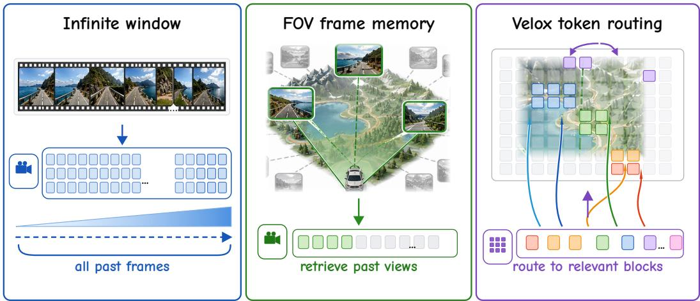
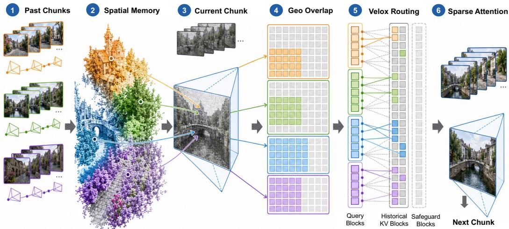
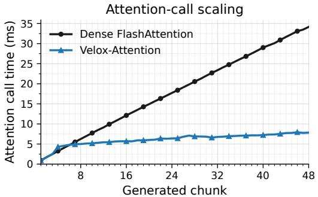
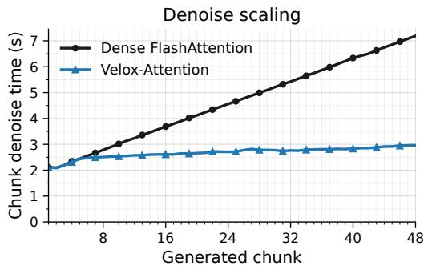
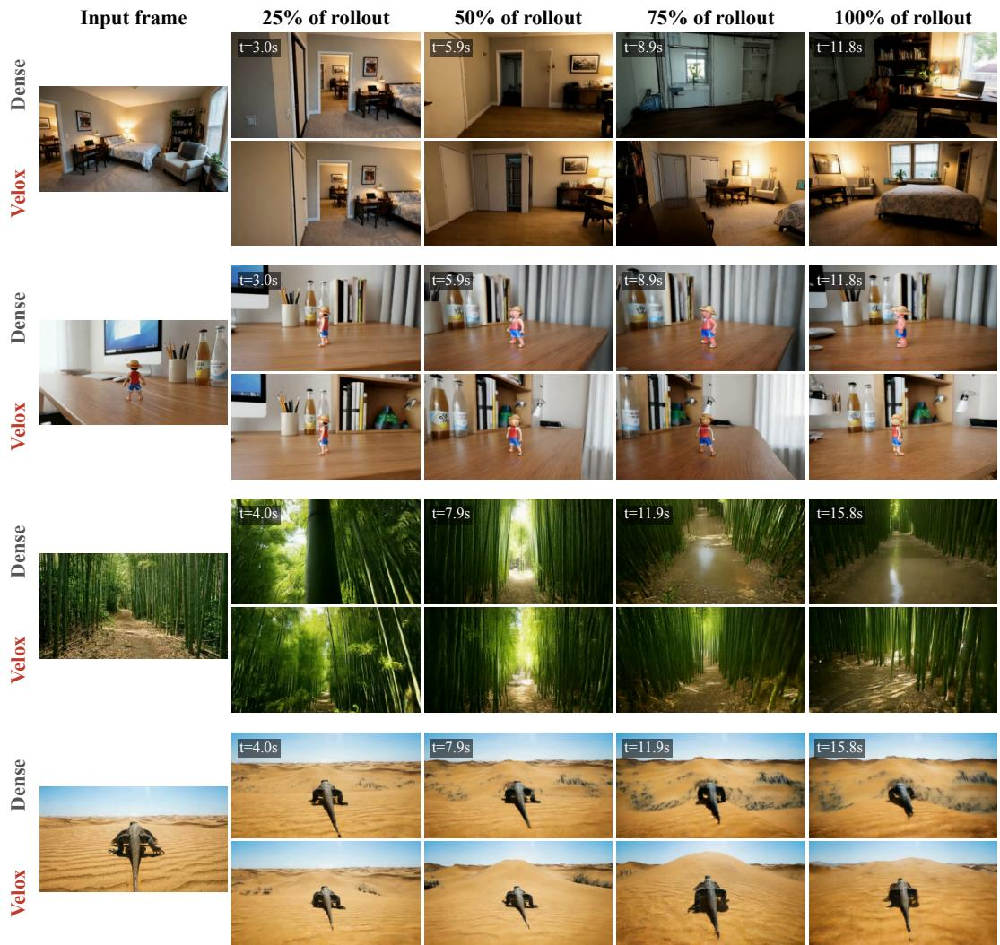
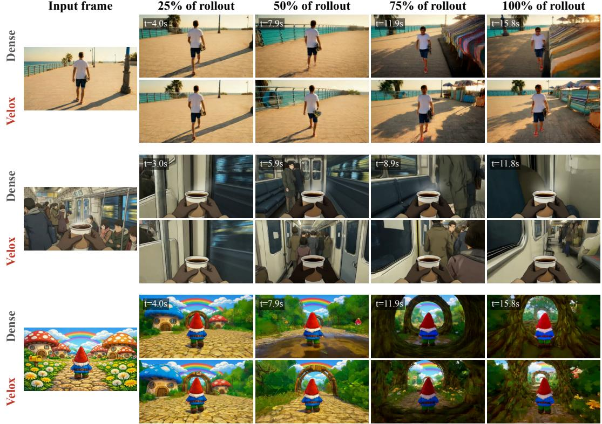
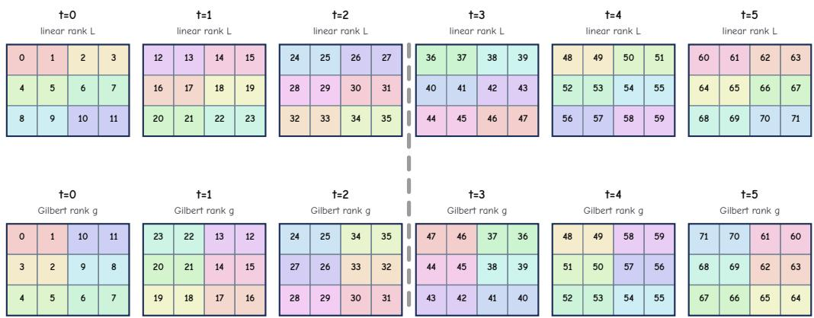
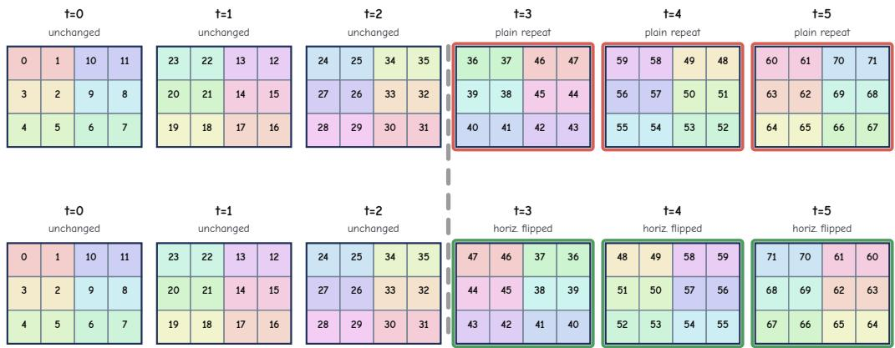

# VELOX: SPATIAL MEMORY MAKES WORLD MODELS EFFICIENT

Qiuhong Shen Shizun Wang Xinchao Wang National University of Singapore

## ABSTRACT

Video world models turn actions and camera motion into long visual rollouts, making video a natural interface for interactive simulation. Such interaction requires responsive generation, yet coherent rollouts must retain visual memory of what has already been generated. Chunked video diffusion models usually keep this context in growing KV caches, so later chunks become progressively slower. To address this bottleneck, we introduce Velox, a training-free attention router for region-level context selection using frustum slab correspondences from streaming geometry. Velox represents historical blocks as camera frustum slabs with depth intervals and obtains current-block depth through recency-priority multiwarp. For well-covered regions, frustum slab overlap softly modulates each layer’s modelderived block importance. Uncovered regions retain the model-derived route without geometric bias. The fixed token-block granularity matches FlashAttentionstyle tiled execution and reduces the attention term that grows with rollout length. Frustum slab construction runs asynchronously with denoising on the same H200. At chunk 48, Velox accelerates attention by 4.36× and denoising by 2.43×. On the full 158-case WBench navigation split, it remains within 0.15 API-free average points of dense LingBot-Fast-Cam. Please see our project page for more details.

## 1 INTRODUCTION

Video world models are emerging as a practical interface for interactive simulation. A user specifies an action trajectory or camera motion, and the model rolls the world forward by generating future video frames. This direction builds on rapid progress in video diffusion transformers and large video foundation models (Ho et al., 2020; Rombach et al., 2022; Peebles & Xie, 2023; Blattmann et al., 2023; Chen et al., 2024b; Yang et al., 2024b; Kong et al., 2024; Wan et al., 2025; Ma et al., 2025). Recent works increasingly target controllable long video worlds rather than isolated short clips (Alonso et al., 2024; Valevski et al., 2024; Bruce et al., 2024; Parker-Holder et al., 2024; Sand.ai, 2025; Gao et al., 2026; HY-World et al., 2026). For these models, context management is a central methodological challenge. Past frames carry the appearance, geometry, and object state that future frames must respect. Without access to the right history, long rollouts drift, forget revisited regions, or re-synthesize the same scene inconsistently.

The most direct way to preserve this history is to retain an ever-growing visual context. Chunked or causal video diffusion models let each new chunk attend to historical frame tokens through a KV cache. Dense FlashAttention makes this practical at moderate lengths (Dao et al., 2022; Dao, 2023), and causal diffusion or self-forcing training makes long rollouts natural (Chen et al., 2024a; Huang et al., 2025b). The cost, however, grows with the number of generated chunks. Later chunks inherit larger context even when the current camera overlaps only a small part of the past scene. As a result, chunk-wise generation becomes progressively slower exactly when long-horizon consistency matters most.

This motivates context selection rather than naive context accumulation. Frame- and view-memory methods select a smaller set of relevant past observations. Context-as-Memory retrieves historical views by camera field-of-view overlap, and VMem stores surfel-indexed views for consistent revisits (Yu et al., 2025a; Li et al., 2025). AnchorWeave and related works (Xiao et al., 2025; Wu et al., 2025; Wang et al., 2026) further inject warped renderings from persistent memory through ControlNet (Zhang et al., 2023a) to stabilize camera-controlled generation. These methods show that not all past frames are equally useful, and figure 1 summarizes this progression from dense history to view-level retrieval. Yet frame-level selection remains coarse for transformer attention. It provides the same selected context to all regions in the active chunk, although dynamic scenes often need local temporal continuity and different regions in the same noisy chunk can depend on different parts of the past. Methods that inject warped point renderings into the model input can also require architectural adaptation or fine-tuning, which limits direct reuse of a pretrained video generator.

  
Figure 1: Three context-management paradigms for long-horizon world generation. Dense chunked generation keeps an ever-growing visual context. Frame-memory methods retrieve a small set of past views using camera overlap. Velox routes each current latent region to compact, geometryrelevant history blocks using frustum slab correspondences.

Inspired by inverse rendering works (Kerbl et al., 2023; Mildenhall et al., 2021), we observe that regions whose geometry has already been observed should primarily attend to their corresponding past regions. Newly revealed or uncertain regions, in contrast, may require model-derived semantic context and local temporal neighbors. A road block, a facade block, and newly revealed sky in the same noisy chunk should therefore not necessarily attend to the same past views. The question, then, is no longer only which frames to retrieve, but whether long-context video generation can assign each region its own relevant history while preserving local motion continuity and leaving the pretrained generator unchanged.

We consider this question at the token-block level in the block-wise execution model of FlashAttention (Dao, 2023). Our key insight is that camera frustum slabs with depth intervals can provide region-specific routing signals at the same granularity used by tiled attention. Instead of adding a new conditioning branch or fine-tuning the video generator, Velox summarizes generated history as per-block frustum slabs and uses their overlap to guide which historical KV token blocks each current region should see. For each target chunk, Velox obtains query-side depth through recency-priority multiwarp and scores query and historical blocks by world-space OBB frustum slab overlap. In well-covered regions, this score softly reweights each layer’s model-derived block importance before selection. Uncovered regions retain the model-derived route without geometric bias. Previouschunk retention and global-aligned Gilbert neighborhoods preserve local motion continuity without a separate cross-chunk seam table.

Across 48-chunk timing traces and the 158-case WBench navigation split (Ying et al., 2026), Velox reduces the growing long-context attention cost while preserving aggregate quality near dense attention. Its advantage grows with the number of generated chunks. At chunk 48, attention latency decreases from approximately 34.2 ms with dense FlashAttention to 7.8 ms, a 4.36× speedup. Denoising time decreases from approximately 7.19 s to 2.96 s under the same single-H200 asynchronous setting. Built on LingBot-Fast-Cam (Gao et al., 2026), Velox remains within 0.15 points of dense attention on the WBench API-free average and improves the 19-metric overall average from 75.52 to 75.60. These results support the scoped claim that soft frustum slab routing can alleviate the late-chunk attention bottleneck without materially degrading benchmark quality.

Our contributions can be summarized as:

• We introduce Velox, a training-free framework that uses frustum slab correspondences to reduce growing KV attention cost in chunked video world models.

• We devise a soft geometric fusion rule that uses OBB frustum slab overlap to modulate each layer’s model-derived block importance while preserving an unbiased fallback for uncovered regions.

• We implement Velox with global-aligned Gilbert KV storage, an optimized sparse attention kernel, and asynchronous frustum slab construction on the same H200 as denoising, reaching a 4.36× attention speedup and a 2.43× denoising speedup at chunk 48.

## 2 RELATED WORK

## 2.1 VIDEO WORLD MODELS AND SPATIAL MEMORY

Video generation has progressed from latent diffusion to scalable diffusion transformers and rectified flow (Ho et al., 2020; Rombach et al., 2022; Blattmann et al., 2023; Peebles & Xie, 2023; Esser et al., 2024), with foundation models supplying strong visual priors (Yang et al., 2024b; Kong et al., 2024; Wan et al., 2025; HaCohen et al., 2024; Ma et al., 2025; Gao et al., 2025; Team et al., 2025). Long-video methods extend these priors through progressive generation, self-rollout training, and causal chunking (Kim et al., 2024; Jin et al., 2024; Henschel et al., 2024; Xie et al., 2024; Gu et al., 2025; Chen et al., 2024a; Huang et al., 2025b; Sand.ai, 2025; Chen et al., 2025a; Liu et al., 2025a), while interactive models target controllable persistent worlds (Bruce et al., 2024; Parker-Holder et al., 2024; Alonso et al., 2024; Valevski et al., 2024; Feng et al., 2024; Zhang et al., 2025d; Che et al., 2024; Yang et al., 2024a; Yu et al., 2025b; Decart et al., 2024; Gao et al., 2026; HY-World et al., 2026; Shen et al., 2026). These directions make history management central: more context supports consistency but makes dense attention increasingly expensive. Spatial-memory methods address this tension by retrieving views, preserving revisits, or expanding reconstructed worlds (Yu et al., 2025a; Li et al., 2025; Xiao et al., 2025; Wu et al., 2025; Huang et al., 2025a; Chen et al., 2025b; Yu et al., 2024b;a; Engstler et al., 2024). Camera-aware and controllable generation (Yu et al., 2024c; YU et al., 2025; Bai et al., 2025; He et al., 2024; 2025; Yang et al., 2025c; Ren et al., 2025; Yu et al., 2026) and streaming reconstruction (Wang et al., 2024b; Leroy et al., 2024; Cabon et al., 2025; Yang et al., 2025a; Wang et al., 2024a; 2025a;b; Keetha et al., 2025) further make projectable memory practical. Velox uses this memory to route pretrained attention rather than adding a conditioning pathway or retrained memory module.

## 2.2 EFFICIENT ATTENTION AND CONTEXT ROUTING

Long-context transformers reduce attention cost through sparsity, locality, compression, state reuse, heavy-hitter selection, and KV eviction (Kitaev et al., 2020; Zaheer et al., 2020; Beltagy et al., 2020; Wang et al., 2020; Dai et al., 2019; Liu et al., 2023; Lee et al., 2025; Jiang et al., 2024; Li et al., 2024; Zhang et al., 2023b; Kwon et al., 2023; Li & Wang, 2026), while FlashAttention is the dense IO-aware baseline (Dao et al., 2022; Dao, 2023). Video accelerators additionally exploit spatial, temporal, denoising-step, and feature regularity through adaptive sparsity, caching, and quantized attention (Zhang et al., 2025c; Xi et al., 2025; Yang et al., 2025b; Zhang et al., 2025b; Xia et al., 2025; Ding et al., 2025; Zhang et al., 2024; 2025a; Liu et al., 2024b; 2025b; 2024a; Guo et al., 2024; Nawaz et al., 2026; Feng et al., 2026). These approaches usually derive sparsity from position, cached features, or attention statistics, whereas frame-memory methods select views but retain dense attention within them. Velox connects both directions by using projective correspondence as a soft prior for region-specific attention routes, with model-derived fallback and temporal safeguards.

## 3 METHOD

Overview. Long-horizon generation requires persistent visual history, yet dense KV attention makes every current region process all retained blocks. Velox keeps the pretrained generator and conditioning interface unchanged and modifies only the inference-time visibility relation between current query blocks and historical KV blocks. It represents history as camera frustum slabs with depth intervals, uses their overlap as a soft prior over each layer’s model-derived block importance, and exposes each current region to a compact route. Figure 2 summarizes this training-free pipeline.

## 3.1 PRELIMINARIES: CHUNKED WORLD GENERATION

Consider a video world model that generates chunks $\pmb { x } _ { 0 } , \pmb { x } _ { 1 } , . . .$ . autoregressively. At denoising step s, chunk c has noisy latent tokens $\mathbf { \mathcal { z } } _ { c } \in \mathbb { R } ^ { T \times H \times W \times d }$ , text/action controls $( y _ { c } , a _ { c } )$ , and a camera sequence $\pi _ { c } = \{ \pi _ { c , t } \} _ { t = 1 } ^ { T }$ , where $T$ is the number of latent frames, $H \times W$ is the latent spatial grid, d is the channel dimension, and each $\pi _ { c , t }$ maps 3D scene locations to the corresponding latent/image view. A pretrained diffusion transformer with parameters θ predicts

$$
\begin{array} { r } { \hat { \epsilon } _ { c } = f _ { \theta } ( z _ { c } , s , y _ { c } , a _ { c } , \pi _ { c } , \mathcal { C } _ { < c } ) , } \end{array}\tag{1}
$$

where $\scriptstyle { \mathcal { C } } _ { < c }$ is the retained historical context, implemented as a visual KV cache in the transformer. If $\scriptstyle { \mathcal { C } } _ { < c }$ contains all previous chunks, the attention cost grows with history length even when only a small part of the past scene is visible from the current camera.

We operate at block granularity. Let $\sigma$ be the global-aligned Gilbert order, and let $\mathcal { B } _ { c } = \{ B _ { i } \} _ { i = 1 } ^ { N }$ partition the current chunk into blocks of $b _ { \mathrm { t o k } }$ tokens. Historical KV blocks use the same size, and $M _ { c }$ denotes their visible count before chunk c. For fixed chunk c and layer ℓ, write $Q _ { i }$ for current block $B _ { i }$ and $( K _ { r } , V _ { r } )$ for visible KV block $r \in \{ 1 , \ldots , M _ { c } \}$

This block size matches FlashAttention-style execution (Dao et al., 2022; Dao, 2023), which streams fixed query and KV tiles. Abstractly, history attention decomposes into

$$
\sum _ { i = 1 } ^ { N } \sum _ { r = 1 } ^ { M _ { c } } \mathrm { T i l e A t t n } ( Q _ { i } , K _ { r } , V _ { r } ) \ : ,\tag{2}
$$

where each interaction computes $Q _ { i } K _ { r } ^ { \top }$ , updates online softmax, and applies $V _ { r }$ . Dense FlashAttention still schedules every current-history pair. A fixed route removes entire KV tiles before launch while preserving block-contiguous gathers. Token-level or variable-size sparsity would require irregular row-wise indexing.

The active attention window is ordered by global-aligned Gilbert rank. Dense visual attention for block i uses every visible block:

$$
\mathrm { A t t n } _ { \mathrm { d e n s e } } ( Q _ { i } ) = \mathrm { s o f t m a x } \Big ( Q _ { i } K _ { 1 : M _ { c } } ^ { \top } / \sqrt { d } \Big ) V _ { 1 : M _ { c } } .\tag{3}
$$

Velox replaces 1:M by a route $\mathcal { R } _ { i } ^ { \ell } \subseteq \{ 1 , \dots , M _ { c } \}$ at each transformer layer ℓ. The layer index matters because every layer produces its own pooled query-key importance distribution, while the geometric correspondence is shared across layers within a denoising step.

## 3.2 FRUSTUM SLAB CORRESPONDENCE

Velox does not route by brittle reconstructed sample identity. Instead, it stores each historical KV block as one or morefrustum slab primitives, each comprising a source-camera token rectangle and robust depth interval:

$$
\psi _ { j , r , m } = \left( r , t , \mathbf { R } _ { j , r , m } , \lbrack z _ { j , r , m } ^ { - } , z _ { j , r , m } ^ { + } \rbrack , \nu _ { j , r , m } \right) ,\tag{4}
$$

Here $j , r , m$ , and t index the source chunk, global Gilbert block, primitive, and latent frame. The source-camera token rectangle is $\mathbf { R } _ { j , r , m } .$ , its percentile depth interval is $[ z _ { j , r , m } ^ { - } , z _ { j , r , m } ^ { + } ]$ , and $\nu _ { j , r , m }$ stores validity statistics. Blocks crossing frame or chunk boundaries have multiple primitives, aggregated by source chunk before scoring.

Historical frustum slab construction. After chunk $j$ is decoded, the reconstruction backend produces depth, confidence, masks, and camera poses for the generated frames. Velox transiently unprojects reliable depth samples into 3D, projects them into the chunk’s latent cameras, buckets them by global Gilbert block, and computes a depth quantile ladder for each block fragment. Let $\mathrm { Q u a n t i l e } _ { p } ( \cdot )$ denote the empirical p-th percentile over valid source-camera depths, and let $p _ { \mathrm { l o } }$ and $p _ { \mathrm { h i } }$ be fixed low and high percentile levels. The frustum slab interval is:

$$
z _ { j , r , m } ^ { - } = \mathrm { Q u a n t i l e } _ { p _ { \mathrm { l o } } } ( \mathcal { Z } _ { j , r , m } ) , \qquad z _ { j , r , m } ^ { + } = \mathrm { Q u a n t i l e } _ { p _ { \mathrm { h i } } } ( \mathcal { Z } _ { j , r , m } ) ,\tag{5}
$$

  
Figure 2: Velox overview. Velox leaves the pretrained chunked video generator unchanged and replaces dense historical attention with frustum slab routed attention. Historical chunks are summarized by per-block frustum slabs with depth intervals, target query blocks obtain depth through multiwarp, and block routes softly fuse frustum slab overlap with layer-specific model importance before adding temporal and global Gilbert safeguards. Indexed sparse attention then produces the next chunk.

where $\mathcal { Z } _ { j , r , m }$ is the set of valid source-camera depths collected for that primitive. Validity gates require enough samples, enough covered tokens, bounded relative depth spread, and a minimum frustum slab thickness. This yields a compact frustum slab table for stored history without carrying dense reconstructed geometry in the routing score.

Target-side multiwarp depth. To score a current query block, Velox also needs a depth interval in the target camera. The current implementation obtains this Q-depth with recency-priority multiwarp. It caches the first and last pixel-frame depths of recent reconstructed chunks, then forward-warps all cached frames into the target chunk’s latent cameras. For each target token $u ,$ let $f$ index cached source frames, let $n _ { f } ( u )$ be the number of warped depth samples that land on $u ,$ and let $k _ { \mathrm { w a r p } }$ be the sample floor. The newest cached frame with at least $k _ { \mathrm { w a r p } }$ samples wins:

$$
\begin{array} { r } { f ^ { \star } ( u ) = \operatorname* { m a x } \{ f \mid n _ { f } ( u ) \geq k _ { \mathrm { w a r p } } \} , \qquad z _ { Q } ( u ) = \mathrm { Q u a n t i l e } _ { 5 0 } \big ( \mathcal { Z } _ { f ^ { \star } ( u ) , u } \big ) . } \end{array}\tag{6}
$$

Here $\mathcal { Z } _ { f , u }$ is the depth sample set warped from cached frame $f$ to target token $u ,$ and Quantil $^ { \mathrm { { 3 } } } 5 0$ is the median depth. If no cached frame reaches the sample floor, $f ^ { \bar { \star } } ( u )$ is undefined, the token has no Q-depth, and the row can fall back to model-derived routing. Intuitively, this rule favors the most recent reliable geometry, while still allowing revisits to be filled by older observations when the current camera returns to a previously seen surface. Appendix B.3 formalizes source filtering, target-camera reprojection, winner selection, and query-block aggregation.

World-space frustum slab overlap. Given a query block i with multiwarp depth and the historical primitives attached to KV block r, Velox approximates each camera frustum slab by a camera-facing oriented bounding box. Let $\Psi _ { r } = \{ \psi _ { j , r , m } \}$ be the primitive set attached to historical block $r ,$ and let $\mathcal { O } _ { i } ^ { Q }$ and $\mathcal { O } _ { j , r , m } ^ { K }$ denote the query and historical OBBs in world coordinates. The geometric score is:

$$
g _ { i , r } = \operatorname* { m a x } _ { \psi _ { j , r , m } \in \Psi _ { r } } \frac { \mathrm { V o l } \Big ( \mathcal { O } _ { i } ^ { Q } \cap \mathcal { O } _ { j , r , m } ^ { K } \Big ) } { \mathrm { V o l } \Big ( \mathcal { O } _ { i } ^ { Q } \Big ) + \mathrm { V o l } \big ( \mathcal { O } _ { j , r , m } ^ { K } \big ) - \mathrm { V o l } \Big ( \mathcal { O } _ { i } ^ { Q } \cap \mathcal { O } _ { j , r , m } ^ { K } \Big ) + \epsilon } .\tag{7}
$$

Here $\epsilon > 0$ prevents division by zero. The implementation estimates the intersection with a deterministic OBB grid after a separating-axis test, then applies grouped fragment aggregation for multi-fragment KV columns. This score is view-aware because both the target and historical block carry camera orientation, token footprint, and depth extent. It also avoids tying correspondence to exact reconstructed sample identities, which are brittle under generated-video artifacts.

Coverage. The router separates geometric score from geometric trust. A token is covered when its multiwarp depth lies inside at least one valid historical frustum slab that contains the token ray within a spatial and depth margin. The block coverage is:

$$
\rho _ { i } = \frac { 1 } { | B _ { i } | } \sum _ { u \in B _ { i } } \mathbf { 1 } \bigl [ \exists r , \ \exists \psi _ { j , r , m } \in \Psi _ { r } : \ u \in \Pi _ { c } ( \psi _ { j , r , m } ) \land z _ { Q } ( u ) \in [ z _ { j , r , m } ^ { - } , z _ { j , r , m } ^ { + } ] \bigr ] ,\tag{8}
$$

where $\Pi _ { c } ( \psi _ { j , r , m } )$ denotes the projection footprint of the frustum slab primitive in the current target view, and $\eta _ { \mathrm { c o v } }$ is the coverage threshold. A block is covered when $\rho _ { i } \geq \eta _ { \mathrm { c o v } }$ . Thus ${ { g } _ { i , * } }$ identifies which historical KV blocks overlap the current frustum, while $\rho _ { i }$ decides whether geometry is reliable enough to drive the route.

## 3.3 VELOX ATTENTION FROM FRUSTUM SLAB CORRESPONDENCE

The geometric score should guide a route without imposing the same hard block set on every layer. Reconstruction can leave Q-depth holes, stale warped depths can survive disocclusions, and different transformer layers can favor different visual evidence. A hard geometric top-K route would override these layer-specific preferences. Velox instead uses frustum slab overlap to modulate the model’s own block importance.

Layer-specific model importance. Let $\bar { q } _ { i } ^ { \ell }$ be the mean query vector in block i at layer $\ell ,$ and let $\bar { k } _ { r } ^ { \ell }$ be the mean key vector in visible KV block r. We compute:

$$
\begin{array} { r } { p _ { i , r } ^ { \ell } = \mathrm { s o f t m a x } _ { r } \left( \bar { q } _ { i } ^ { \ell } \left( \bar { k } _ { r } ^ { \ell } \right) ^ { \top } / \sqrt { d } \right) , } \end{array}\tag{9}
$$

where the softmax is normalized over all visible KV blocks. This distribution preserves the pretrained transformer’s layer-specific notion of useful context.

Soft geometric fusion. For a well-covered query block with $\rho _ { i } \geq \eta _ { \mathrm { c o v } }$ , we first suppress overlap values at or below the noise threshold τ and rescale the remaining values:

$$
\widehat { g } _ { i , r } = { \bf 1 } [ g _ { i , r } > \tau ] \operatorname* { m i n } \left( \frac { g _ { i , r } } { g _ { \mathrm { r e f } } } , 1 \right) ,\tag{10}
$$

where $g _ { \mathrm { r e f } }$ maps the observed frustum slab IoU range to a bounded boost. We then multiply the model importance by this geometric prior and renormalize:

$$
\widetilde { p } _ { i , r } ^ { \ell } = \frac { p _ { i , r } ^ { \ell } \left( 1 + \lambda \widehat { g } _ { i , r } \right) } { \sum _ { r ^ { \prime } = 1 } ^ { M _ { c } } p _ { i , r ^ { \prime } } ^ { \ell } \left( 1 + \lambda \widehat { g } _ { i , r ^ { \prime } } \right) } .\tag{11}
$$

Here $\lambda > 0$ controls the fusion strength. A block with $g _ { i , r } \geq g _ { \mathrm { r e f } }$ receives the maximum multiplier $1 + \lambda ,$ , while a block without vetted geometric overlap retains its original model importance. Because the multiplication acts on $p _ { i , r } ^ { \ell } ,$ geometry can promote a model-supported correspondence without assigning every layer an identical route.

Covered and uncovered routes. Let $\mathcal { P } _ { c - 1 }$ denote the previous chunk’s KV blocks. The route materializer reserves these blocks before selecting older history, so local temporal evidence consumes the same bounded budget as the long-range route. For well-covered blocks, Velox fills the remaining $K _ { \mathrm { c o v } } - | \mathcal { P } _ { c - 1 } |$ positions with the largest fused scores:

$$
\begin{array} { r } { \mathcal { R } _ { i } ^ { \ell } = \mathcal { P } _ { c - 1 } \cup \mathrm { T o p } _ { K _ { \mathrm { c o v } } - | \mathcal { P } _ { c - 1 } | } \left( \left\{ \widetilde { p } _ { i , r } ^ { \ell } : r \notin \mathcal { P } _ { c - 1 } \right\} \right) , \qquad \rho _ { i } \geq \eta _ { \mathrm { c o v } } . } \end{array}\tag{12}
$$

For blocks with insufficient geometric coverage, Velox leaves the model distribution unchanged. It sorts $\{ p _ { i , r } ^ { \ell } \}$ and takes the smallest prefix whose cumulative mass reaches $\eta _ { \mathrm { i m p } }$ , subject to a route cap $K _ { \mathrm { u n c } } \mathrm { : }$

$$
\mathscr { R } _ { i } ^ { \ell } = \mathscr { P } _ { { c } - 1 } \cup \mathrm { P r e f i x } _ { \eta _ { \mathrm { i m p } } , K _ { \mathrm { u n c } } - | \mathscr { P } _ { c - 1 } | } \left( \{ p _ { i , r } ^ { \ell } : r \notin \mathscr { P } _ { c - 1 } \} \right) , \qquad \rho _ { i } < \eta _ { \mathrm { c o v } } .\tag{13}
$$

This branch lets the pretrained attention signal handle sky, newly exposed regions, and holes in the frustum slab table. The calibrated configuration uses $\tau = 0 . 1 , g _ { \mathrm { r e f } } = 0 . 2 , \lambda = 2 , \eta _ { \mathrm { c o v } } = 0 . 9$ $K _ { \mathrm { c o v } } = 8 0$ , and $K _ { \mathrm { u n c } } = 1 5 0$

Global-aligned Gilbert neighborhoods. Velox preserves short-range video continuity through a global/window 26-neighbor adjacency over Gilbert blocks. Earlier versions used a repeated chunklocal Gilbert order and a separate cross-chunk seam table. The current implementation instead builds a single global-aligned Gilbert block domain incrementally. It constructs the single-chunk Gilbert curve once, flips chunk-local coordinates according to chunk parity and the base-frame exit quadrant, and thereby matches the full-sequence Gilbert prefix for every generated chunk. Cross-chunk boundary neighbors become ordinary temporal neighbors in the visible global window. No separate seam table is needed.

Let $\mathcal { L } _ { i } ^ { \mathrm { g l o b } }$ denote the visible 26-neighborhood of query block i in this global Gilbert block domain, and let $\mathcal { F } _ { 0 }$ denote optional reference-frame blocks. The materialized route is:

$$
{ \overline { { \mathcal { R } } } } _ { i } ^ { \ell } = { \mathcal { R } } _ { i } ^ { \ell } \cup { \mathcal { L } } _ { i } ^ { \mathrm { g l o b } } \cup { \mathcal { F } } _ { 0 } .\tag{14}
$$

The spatial neighbors and optional reference blocks are added as deterministic safeguards outside the route budget. The sparse visual-attention output is

$$
\mathrm { A t t n } _ { V e l o x } ( Q _ { i } ) = \mathrm { s o f t m a x } \Big ( Q _ { i } K _ { \overline { { \mathcal { R } } } _ { i } ^ { \ell } } ^ { \top } / \sqrt { d } \Big ) V _ { \overline { { \mathcal { R } } } _ { i } ^ { \ell } } ,\tag{15}
$$

at every transformer layer. With this formulation, Velox preserves each layer’s model-derived ranking, injects geometry only where correspondence is reliable, and still exposes the sparse kernel to a bounded block list.

Gilbert KV layout. Velox stores current and historical visual KV blocks in the same global-aligned Gilbert order used by the route. This keeps neighboring image regions close in memory and reduces per-call permutation overhead. The layout is an implementation optimization. The soft route in Eqs. (11) and (15) is independent of the particular space-filling curve, but global-aligned Gilbert makes local neighborhood preservation and block-contiguous $\mathrm { \ K V }$ storage share one coordinate frame.

## 3.4 COMPLEXITY AND DESIGN RATIONALE

The benefit of Velox comes from separating two quantities that dense attention couples together: the amount of visual memory retained by the world model and the number of KV blocks exposed to each query block. With the fixed block size $b _ { \mathrm { t o k } }$ , dense attention between $N$ current blocks and $M _ { c }$ visible KV blocks has cost

$$
\mathcal { O } \left( N M _ { c } b _ { \mathrm { t o k } } ^ { 2 } d \right) .\tag{16}
$$

As more chunks are retained, $M _ { c }$ grows even when the current camera needs only a small part of the past. Velox keeps the memory available but caps the exposed route. Let $K _ { \mathrm { m a x } } \doteq \operatorname* { m a x } ( K _ { \mathrm { c o v } } , K _ { \mathrm { u n c } } )$ and let $\Delta _ { \mathrm { s a f e } } = | \mathcal { L } _ { i } ^ { \mathrm { g l o b } } \cup \mathcal { F } _ { 0 } |$ denote the small add-on safeguard budget:

$$
\mathcal { O } \left( \sum _ { i = 1 } ^ { N } | \overline { { \mathcal { R } } } _ { i } ^ { \ell } | b _ { \mathrm { t o k } } ^ { 2 } d \right) \approx \mathcal { O } \big ( N ( K _ { \mathrm { m a x } } + \Delta _ { \mathrm { s a f e } } ) b _ { \mathrm { t o k } } ^ { 2 } d \big ) \quad \mathrm { p e r ~ s p a r s e ~ a t t e n t i o n ~ l a y e r } .\tag{17}
$$

The approximation highlights the intended regime: the route and safeguard budgets are fixed, while $M _ { c }$ grows with history length.

The same block unit also matches FlashAttention-style execution. Dense FlashAttention evaluates each query-key tile efficiently, but it still schedules all $N M _ { c }$ tile pairs. Velox changes the tile schedule to $\textstyle \sum _ { i } | { \overline { { \mathcal { R } } } } _ { i } ^ { \ell } |$ . A skipped block removes both the $Q K ^ { \top }$ tile product and the KV tile load. Thus, routing reduces KV traffic when attention is memory-bound, and it reduces tile matrix products when attention is compute-bound. The calibrated route applies at every transformer layer, so the growing historical term is bounded throughout the denoising network.

## 4 EXPERIMENTS

## 4.1 IMPLEMENTATION DETAILS

We instantiate Velox on the LingBot-Fast-Cam inference stack (Gao et al., 2026) with a Wan-style video diffusion transformer. The reported configuration uses recency-priority multiwarp Q-depth, world-space OBB frustum slab IoU, grouped fragment aggregation, and global-aligned Gilbert KV storage. We apply fixed soft geometric fusion to well-covered rows at every transformer layer, with $\tau = \bar { 0 } . 1 , g _ { \mathrm { r e f } } \stackrel { - } { = } \bar { 0 } . 2 , \lambda = 2$ , and $\eta _ { \mathrm { c o v } } = 0 . 9$ . Covered rows retain $K _ { \mathrm { c o v } } \doteq 8 0$ blocks. Uncovered rows use the model-derived cumulative-mass route with $K _ { \mathrm { u n c } } = 1 5 0$ and no route-size floor.

The measured sparse path is a native Triton indexed block-sparse attention implementation rather than a dense call with a Python mask. Current queries are reordered once per chunk, KV caches are stored in global-aligned Gilbert order, and the kernel consumes routed block lists with a runtime route-length bound. The previous chunk is always retained within the route budget, while current-chunk local neighbors and reference-frame blocks act as deterministic safeguards. Frustum slab state is prepared asynchronously with a two-chunk freshness lag, so chunk c normally consumes geometry through chunk c − 2. In the reported timing traces, DiT denoising and asynchronous geometry construction run concurrently on one H200.

We evaluate quality on all 158 cases of the WBench navigation split (Ying et al., 2026). The three LingBot-based rows use identical generated cases and the Gemini judge for VLM-scored metrics. Published WBench rows use the official Doubao judge, so judge-dependent values should not be compared across these two groups. We therefore include an API-free average that excludes VLM-scored setting metrics and is comparable across judge backends.

## 4.2 ATTENTION SCALING OVER 48 CHUNKS

Figure 3 reports 48-chunk timing traces. Dense FlashAttention grows with the retained context, while Velox remains nearly flat because each query block receives a bounded route. At chunk 48, per-call attention latency decreases from approximately 34.2 ms to 7.8 ms, corresponding to a 4.36× speedup. Under the same single-H200 asynchronous setting, chunk denoising time decreases from approximately 7.19 s to 2.96 s, corresponding to a 2.43× speedup. The widening separation across the rollout shows that the gain stems from bounding the growing historical attention term rather than from a fixed short-context overhead.

  
(a) Per-call attention time.

  
(b) Chunk denoising time.  
Figure 3: Runtime scaling over a 48-chunk rollout. The left plot measures per-call visual-attention latency. The right plot measures per-chunk DiT denoising time while asynchronous geometry construction shares the same H200. Velox increasingly separates from dense FlashAttention as the retained context grows.

## 4.3 COMPARISON ON WBENCH

Table 1 compares dense LingBot-Fast-Cam, model-only block-sparse routing, and Velox under the same 158-case protocol. Velox remains within 0.15 points of dense attention on the API-free average and improves the 19-metric overall average from 75.52 to 75.60. Against the block-sparse baseline, soft geometric fusion raises the API-free average from 73.11 to 73.51, the overall average from 75.01 to 75.60, and spatial consistency from 71.8 to 74.3. Thus, geometry adds value beyond the matched sparse routing budget while preserving aggregate quality near dense attention.

## 4.4 GEOMETRY AND MODEL-IMPORTANCE AGREEMENT

Soft fusion assumes that frustum slab overlap identifies useful history without imposing a hard replacement set. We audit this relation using offline affinity dumps. For layer ℓ, threshold τ, and well-covered query block i, let $\mathcal { H } _ { i }$ be the $K _ { \mathrm { h i s t } }$ candidate history blocks after removing the self block, $\mathcal { G } _ { i } ( \tau ) = \{ h \in \mathcal { H } _ { i } : g _ { i , h } > \tau \}$ the $n _ { i } ( \tau )$ positive-overlap blocks, and $\mathcal { P } _ { i } ^ { 5 0 } ( \ell )$ the model-preferred top-50 after averaging affinity over batch and heads.

Table 1: WBench navigation results on 158 cases. Scores are in [0, 100]. Published baselines use Doubao, and the final three rows use Gemini for VLM-scored metrics. API-free excludes Setting, while Overall averages all 19 metrics.
<table><tr><td rowspan="2">Method</td><td colspan="2">Average</td><td rowspan="2"></td><td rowspan="2">Adh.</td><td rowspan="2">Quality Setting Interaction Physical</td><td rowspan="2">Score</td><td colspan="8">Consistency</td></tr><tr><td>API-free Oyerall Avg.</td><td>Score Avg.</td><td>Adh.</td><td>Back. Const.</td><td>Spatial Const.</td><td>Gated Spatial</td><td>Persp. Const.</td><td>Segment Cont.</td><td>Geom. Photo. Const. Const.</td><td>Subject Const.</td></tr><tr><td>Text-driven video generation models</td><td></td><td></td><td></td><td></td><td></td><td></td><td></td><td></td><td></td><td></td><td></td><td></td><td></td><td></td></tr><tr><td>Seedance 1.5</td><td>73.03</td><td>79.68</td><td>82.1</td><td>82.9</td><td>68.0</td><td>68.4</td><td>89.6</td><td>72.7</td><td>72.4</td><td>70.5</td><td>96.2</td><td>82.4</td><td>76.8</td><td>90.1</td></tr><tr><td>Wan 2.7</td><td>72.35</td><td>80.76</td><td>81.5</td><td>91.4</td><td>66.0</td><td>71.8</td><td>89.4</td><td>71.0</td><td>71.0</td><td>78.2</td><td>92.4</td><td>83.7</td><td>76.4</td><td>90.7</td></tr><tr><td>Kling 3.0</td><td>74.03</td><td>81.53</td><td>81.4</td><td>91.0</td><td>70.3</td><td>69.3</td><td>92.3</td><td>75.2</td><td>75.1</td><td>76.8</td><td>93.0</td><td>88.9</td><td>79.9</td><td>88.5</td></tr><tr><td>YUME 1.5</td><td>71.87</td><td>76.51</td><td>77.7</td><td>72.4</td><td>72.0</td><td>65.2</td><td>90.3</td><td>71.5</td><td>71.4</td><td>48.0</td><td>99.4</td><td>88.0</td><td>83.3</td><td>88.8</td></tr><tr><td>HY-Video 1.5</td><td>74.12</td><td>81.16</td><td>77.6</td><td>85.6</td><td>71.8</td><td>67.4</td><td>92.1</td><td>79.2</td><td>75.1</td><td>86.6</td><td>99.4</td><td>94.6</td><td>80.3</td><td>91.6</td></tr><tr><td>LTX 2.3</td><td>69.42</td><td>76.21</td><td>77.1</td><td>85.2</td><td>67.6</td><td>64.9</td><td>88.3</td><td>70.2</td><td>70.2</td><td>69.8</td><td>75.8</td><td>76.9</td><td>79.2</td><td>87.2</td></tr><tr><td>LongCat-Video</td><td>71.83</td><td>78.65</td><td>75.4</td><td>72.3</td><td>63.1</td><td>68.9</td><td>95.1</td><td>83.3</td><td>66.2</td><td>81.5</td><td>99.4</td><td>95.4</td><td>82.2</td><td>93.4</td></tr><tr><td>Kairos 3.0</td><td>69.93</td><td>75.34</td><td>74.0</td><td>70.3</td><td>65.1</td><td>60.4</td><td>91.1</td><td>76.8</td><td>62.0</td><td>76.3</td><td>94.3</td><td>89.0</td><td>80.8</td><td>90.8</td></tr><tr><td>Camera-controlled world models</td><td></td><td></td><td></td><td></td><td></td><td></td><td></td><td></td><td></td><td></td><td></td><td></td><td></td><td></td></tr><tr><td>SANA-WM</td><td>74.65</td><td>77.86</td><td>79.3</td><td>76.1</td><td>82.1</td><td>61.9</td><td>90.5</td><td>77.1</td><td>76.4</td><td>49.0</td><td>97.5</td><td>88.7</td><td>81.2</td><td>85.4</td></tr><tr><td>HY-World 1.5</td><td>77.78</td><td>80.43</td><td>78.1</td><td>72.2</td><td>87.5</td><td>66.3</td><td>92.7</td><td>90.6</td><td>84.9</td><td>62.5</td><td>100.0</td><td>92.0</td><td>83.1</td><td>89.1</td></tr><tr><td>Fantasy-World</td><td>72.65</td><td>77.58</td><td>72.4</td><td>71.3</td><td>72.1</td><td>66.8</td><td>94.2</td><td>80.6</td><td>64.2</td><td>79.8</td><td>100.0</td><td>95.3</td><td>84.8</td><td>92.5</td></tr><tr><td>InSpatio-World</td><td>73.95</td><td>77.99</td><td>71.5</td><td>71.4</td><td>72.8</td><td>65.2</td><td>95.0</td><td>93.8</td><td>66.5</td><td>72.5</td><td>100.0</td><td>97.3</td><td>87.4</td><td>94.4</td></tr><tr><td>Astra</td><td>65.67</td><td>67.31</td><td>67.1</td><td>59.6</td><td>67.7</td><td>51.4</td><td>85.3</td><td>64.7</td><td>63.3</td><td>30.0</td><td>86.6</td><td>85.6</td><td>87.5</td><td>83.5</td></tr><tr><td>Ours built on LingBot-Fast-Cam (Gemini judge)</td><td></td><td></td><td></td><td></td><td></td><td></td><td></td><td></td><td></td><td></td><td></td><td></td><td></td><td></td></tr><tr><td>LingBot-Fast-Cam (Gao et al., 2026)</td><td>73.66</td><td>75.52</td><td>77.7</td><td>79.9</td><td>79.4</td><td>39.0</td><td>87.9</td><td>73.0</td><td>73.0</td><td>81.7</td><td>90.5</td><td>80.5</td><td>77.6</td><td>87.2</td></tr><tr><td>Block-Sparse</td><td>73.11</td><td>75.01</td><td>77.9</td><td>79.1</td><td>78.0</td><td>38.6</td><td>87.6</td><td>71.8</td><td>71.8</td><td>75.7</td><td>94.3</td><td>80.4</td><td>77.1</td><td>85.8</td></tr><tr><td>Velox</td><td>73.51</td><td>75.60</td><td>78.1</td><td>80.3</td><td>78.8</td><td>38.8</td><td>88.0</td><td>74.3</td><td>74.3</td><td>77.0</td><td>92.4</td><td>80.5</td><td>78.0</td><td>86.4</td></tr></table>

With $a _ { i } ( \ell , \tau ) = | \mathcal { G } _ { i } ( \tau ) \cap \mathcal { P } _ { i } ^ { 5 0 } ( \ell ) |$ , geometric recall is $R _ { \mathrm { g e o } } ( \ell , \tau ) = \mathbb { E } _ { i } [ a _ { i } ( \ell , \tau ) / n _ { i } ( \tau ) ]$ , against the random expectation $5 0 / 1 4 3 \ : = \ : 0 . 3 5 0$ . The fixed-budget set $\mathcal { U } _ { i } ^ { 5 0 } ( \ell , \tau )$ contains all positiveoverlap blocks and the highest-importance outside blocks needed to reach 50. Its agreement is $R _ { 5 0 } ( \ell , \tau ) = \mathbb { E } _ { i } [ | \mathcal { P } _ { i } ^ { 5 0 } ( \ell ) \cap \breve { \mathcal { U } } _ { i } ^ { 5 0 } ( \ell , \tau ) \dot { | } / 5 0 ]$ . We omit rows with no positive overlap or non-finite scores and average over rows with at least 0.9 coverage from the last chunk of four calibration scenes and four denoising steps.

$\mathrm { \bf A t } ~ \tau ~ = ~ 0 . 1$ , Table 2 shows agreement above the random expectation, with layer 14 reaching $R _ { \mathrm { g e o } } = 0 . 7 3 0 2$ and $R _ { 5 0 } = 0 . 8 9 0 9$ . The layer variation motivates retaining each model-derived distribution instead of imposing a layer-invariant geometric set. In a separate calibration over 48 pooled-importance grids, $\lambda = 2$ and $g _ { \mathrm { r e f } } = 0 . 2$ raise fused top-80 positive-overlap recall from 0.602 to 0.852 while changing 9.0% of selected blocks. This operating point adds a measured geometric bias without replacing the model ranking.

Table 2: Geometry and model-importance agreement at $\tau = 0 . 1 . ~ R _ { \mathrm { g e o } }$ , lift over the random expectation, and fixed-budget overlap $R _ { 5 0 }$ are defined in the text.
<table><tr><td>Layer</td><td> $R _ { \mathrm { g e o } }$ </td><td>Lift</td><td> $R _ { 5 0 }$ </td></tr><tr><td>10</td><td>0.6812</td><td>+0.3315</td><td>0.8723</td></tr><tr><td>14</td><td>0.7302</td><td>+0.3806</td><td>0.8909</td></tr><tr><td>19</td><td>0.6929</td><td>+0.3433</td><td>0.8770</td></tr><tr><td>23</td><td>0.6729</td><td>+0.3233</td><td>0.8716</td></tr><tr><td>24</td><td>0.6848</td><td>+0.3351</td><td>0.8739</td></tr><tr><td>25</td><td>0.6652</td><td>+0.3155</td><td>0.8666</td></tr></table>

## 4.5 QUALITATIVE COMPARISON

Aggregate scores do not show how a rollout evolves over time, so we also compare the two models visually. Figure 4 shows rollouts from dense LingBot-Fast-Cam and Velox that start from the same input frame and follow the same camera trajectory. We sample frames at fixed fractions of each rollout rather than choosing a moment for each case. Appendix A.2 provides additional cases.

The two models are visually close early in the rollout and separate as it grows. Dense attention gradually departs from the input frame. In the bedroom case, it replaces the room with an unrelated dark interior. In the figurine case, the red outfit fades to pale pink. In the bamboo case, the path degrades into a puddle and then a featureless surface, and in the desert case dark artifacts spread across the dunes. Velox stays close to the input frame in all four cases. It revisits the same bedroom with the same bedspread, desk, and armchair, and it keeps the figurine colors, the bamboo path, and the sand ripples intact. This agrees with the higher spatial consistency of Velox in Table 1 (74.3 versus 73.0). These cases are selected for illustration, and the benchmark scores remain the primary evidence of aggregate quality.

  
Figure 4: Qualitative comparison with dense attention. For each case, we show the shared input frame, followed by dense LingBot-Fast-Cam (top row) and Velox (bottom row) at 25%, 50%, 75%, and 100% of the rollout. Both models receive the same input frame and camera trajectory, and timestamps are given in seconds. The two rollouts are similar early on. In later frames, dense attention drifts away from the input, as the bedroom is replaced by an unrelated dark room, the figurine fades to pale pink, the bamboo path degrades into a puddle and then a featureless surface, and dark artifacts spread across the dunes. Velox remains consistent with the input frame and preserves fine appearance details through the end of the rollout. Cases are selected for illustration, and Table 1 reports aggregate quality.

## 5 CONCLUSION

We present Velox, a training-free router that projects spatial memory into the current latent camera view and uses frustum slab overlap to modulate layer-specific block importance while retaining model-derived fallback and local temporal safeguards. At chunk 48, Velox accelerates attention by 4.36× and denoising by 2.43× with asynchronous geometry construction on one H200. Across all 158 WBench navigation cases, it remains within 0.15 API-free average points of dense LingBot-Fast-Cam and slightly improves the 19-metric overall average. These results show that region-level spatial correspondence can turn persistent world memory into a practical routing signal for long-horizon generation.

## REFERENCES

Eloi Alonso, Adam Jelley, Vincent Micheli, Anssi Kanervisto, Amos J. Storkey, Tim Pearce, and François Fleuret. Diffusion for world modeling: Visual details matter in atari. Advances in Neural Information Processing Systems, 37:58757–58791, 2024.

Jianhong Bai, Menghan Xia, Xiao Fu, Xintao Wang, Lianrui Mu, Jinwen Cao, Zuozhu Liu, Haoji Hu, Xiang Bai, Pengfei Wan, et al. Recammaster: Camera-controlled generative rendering from a single video. arXiv preprint arXiv:2503.11647, 2025.

Iz Beltagy, Matthew E Peters, and Arman Cohan. Longformer: The long-document transformer. arXiv preprint arXiv:2004.05150, 2020.

Andreas Blattmann, Tim Dockhorn, Sumith Kulal, Daniel Mendelevitch, Maciej Kilian, Dominik Lorenz, Yam Levi, Zion English, Vikram Voleti, Adam Letts, et al. Stable video diffusion: Scaling latent video diffusion models to large datasets. arXiv preprint arXiv:2311.15127, 2023.

Jake Bruce, Michael D Dennis, Ashley Edwards, Jack Parker-Holder, Yuge Shi, Edward Hughes, Matthew Lai, Aditi Mavalankar, Richie Steigerwald, Chris Apps, et al. Genie: Generative interactive environments. In Forty-first International Conference on Machine Learning, 2024.

Yohann Cabon, Lucas Stoffl, Leonid Antsfeld, Gabriela Csurka, Boris Chidlovskii, Jerome Revaud, and Vincent Leroy. Must3r: Multi-view network for stereo 3d reconstruction. In Proceedings ofthe Computer Vision and Pattern Recognition Conference, pp. 1050–1060, 2025.

Haoxuan Che, Xuanhua He, Quande Liu, Cheng Jin, and Hao Chen. Gamegen-x: Interactive open-world game video generation. arXiv preprint arXiv:2411.00769, 2024.

Boyuan Chen, Diego Martí Monsó, Yilun Du, Max Simchowitz, Russ Tedrake, and Vincent Sitzmann. Diffusion forcing: Next-token prediction meets full-sequence diffusion. Advances in Neural Information Processing Systems, 37:24081–24125, 2024a.

Guibin Chen, Dixuan Lin, Jiangping Yang, Chunze Lin, Juncheng Zhu, Mingyuan Fan, Hao Zhang, Sheng Chen, Zheng Chen, Chengchen Ma, et al. Skyreels-v2: Infinite-length film generative model. arXiv preprint arXiv:2504.13074, 2025a.

Haoxin Chen, Yong Zhang, Xiaodong Cun, Menghan Xia, Xintao Wang, Chao Weng, and Ying Shan. Videocrafter2: Overcoming data limitations for high-quality video diffusion models. In Proceedings of the IEEE/CVF Conference on Computer Vision and Pattern Recognition, pp. 7310–7320, 2024b.

Luxi Chen, Zihan Zhou, Min Zhao, Yikai Wang, Ge Zhang, Wenhao Huang, Hao Sun, Ji-Rong Wen, and Chongxuan Li. Flexworld: Progressively expanding 3d scenes for flexible-view synthesis. arXiv preprint arXiv:2503.13265, 2025b.

Zihang Dai, Zhilin Yang, Yiming Yang, Jaime Carbonell, Quoc V Le, and Ruslan Salakhutdinov. Transformer-xl: Attentive language models beyond a fixed-length context. arXiv preprint arXiv:1901.02860, 2019.

Tri Dao. Flashattention-2: Faster attention with better parallelism and work partitioning. arXiv preprint arXiv:2307.08691, 2023.

Tri Dao, Dan Fu, Stefano Ermon, Atri Rudra, and Christopher Ré. Flashattention: Fast and memory-efficient exact attention with io-awareness. Advances in Neural Information Processing Systems, 35:16344–16359, 2022.

Etched Decart, Quinn McIntyre, Spruce Campbell, Xinlei Chen, and Robert Wachen. Oasis: A universe in a transformer. URL: https://oasis-model. github. io, 2024.

Hangliang Ding, Dacheng Li, Runlong Su, Peiyuan Zhang, Zhijie Deng, Ion Stoica, and Hao Zhang. Efficientvdit: Efficient video diffusion transformers with attention tile, 2025. URL https://arxiv.org/abs/ 2502.06155.

Paul Engstler, Andrea Vedaldi, Iro Laina, and Christian Rupprecht. Invisible stitch: Generating smooth 3d scenes with depth inpainting. In Arxiv, 2024.

Patrick Esser, Sumith Kulal, Andreas Blattmann, Rahim Entezari, Jonas Müller, Harry Saini, Yam Levi, Dominik Lorenz, Axel Sauer, Frederic Boesel, et al. Scaling rectified flow transformers for high-resolution image synthesis. In Forty-first international conference on machine learning, 2024.

Ruili Feng, Han Zhang, Zhantao Yang, Jie Xiao, Zhilei Shu, Zhiheng Liu, Andy Zheng, Yukun Huang, Yu Liu, and Hongyang Zhang. The matrix: Infinite-horizon world generation with real-time moving control. arXiv preprint arXiv:2412.03568, 2024.

Weilun Feng, Guoxin Fan, Haotong Qin, Chuanguang Yang, Mingqiang Wu, Yuqi Li, Xiangqi Li, Zhulin An, Libo Huang, Dingrui Wang, et al. Worldcache: Accelerating world models for free via heterogeneous token caching. arXiv preprint arXiv:2603.06331, 2026.

Yu Gao, Haoyuan Guo, Tuyen Hoang, Weilin Huang, Lu Jiang, Fangyuan Kong, Huixia Li, Jiashi Li, Liang Li, Xiaojie Li, et al. Seedance 1.0: Exploring the boundaries of video generation models. arXiv preprint arXiv:2506.09113, 2025.

Zelin Gao, Qiuyu Wang, Yanhong Zeng, Jiapeng Zhu, Ka Leong Cheng, Yixuan Li, Hanlin Wang, Yinghao Xu, Shuailei Ma, Yihang Chen, et al. Advancing open-source world models. arXiv preprint arXiv:2601.20540, 2026.

Yuchao Gu, Weijia Mao, and Mike Zheng Shou. Long-context autoregressive video modeling with next-frame prediction. arXiv preprint arXiv:2503.19325, 2025.

Junxian Guo, Haotian Tang, Shang Yang, Zhekai Zhang, Zhijian Liu, and Song Han. Block Sparse Attention. https://github.com/mit-han-lab/Block-Sparse-Attention, 2024.

Yoav HaCohen, Nisan Chiprut, Benny Brazowski, Daniel Shalem, Dudu Moshe, Eitan Richardson, Eran Levin, Guy Shiran, Nir Zabari, Ori Gordon, et al. Ltx-video: Realtime video latent diffusion. arXiv preprint arXiv:2501.00103, 2024.

Hao He, Yinghao Xu, Yuwei Guo, Gordon Wetzstein, Bo Dai, Hongsheng Li, and Ceyuan Yang. Cameractrl: Enabling camera control for text-to-video generation. arXiv preprint arXiv:2404.02101, 2024.

Hao He, Ceyuan Yang, Shanchuan Lin, Yinghao Xu, Meng Wei, Liangke Gui, Qi Zhao, Gordon Wetzstein, Lu Jiang, and Hongsheng Li. Cameractrl ii: Dynamic scene exploration via camera-controlled video diffusion models. arXiv preprint arXiv:2503.10592, 2025.

Roberto Henschel, Levon Khachatryan, Hayk Poghosyan, Daniil Hayrapetyan, Vahram Tadevosyan, Zhangyang Wang, Shant Navasardyan, and Humphrey Shi. Streamingt2v: Consistent, dynamic, and extendable long video generation from text. arXiv preprint arXiv:2403.14773, 2024.

Jonathan Ho, Ajay Jain, and Pieter Abbeel. Denoising diffusion probabilistic models. NeurIPS, 33:6840–6851, 2020.

Tianyu Huang, Wangguandong Zheng, Tengfei Wang, Yuhao Liu, Zhenwei Wang, Junta Wu, Jie Jiang, Hui Li, Rynson W. H. Lau, Wangmeng Zuo, et al. Voyager: Long-range and world-consistent video diffusion for explorable 3d scene generation. arXiv preprint arXiv:2506.04225, 2025a.

Xun Huang, Zhengqi Li, Guande He, Mingyuan Zhou, and Eli Shechtman. Self forcing: Bridging the train-test gap in autoregressive video diffusion. arXiv preprint arXiv:2506.08009, 2025b.

Team HY-World, Chenjie Cao, Xuhui Zuo, Zhenwei Wang, Yisu Zhang, Junta Wu, Zhenyang Liu, Yuning Gong, Yang Liu, Bo Yuan, et al. Hy-world 2.0: A multi-modal world model for reconstructing, generating, and simulating 3d worlds. arXiv preprint arXiv:2604.14268, 2026.

Huiqiang Jiang, Yucheng Li, Chengruidong Zhang, Qianhui Wu, Xufang Luo, Surin Ahn, Zhenhua Han, Amir Abdi, Dongsheng Li, Chin-Yew Lin, et al. Minference 1.0: Accelerating pre-filling for long-context llms via dynamic sparse attention. NeurIPS, 37:52481–52515, 2024.

Yang Jin, Zhicheng Sun, Ningyuan Li, Kun Xu, Hao Jiang, Nan Zhuang, Quzhe Huang, Yang Song, Yadong Mu, and Zhouchen Lin. Pyramidal flow matching for efficient video generative modeling. arXiv preprint arXiv:2410.05954, 2024.

Nikhil Keetha, Norman Müller, Johannes Schönberger, Lorenzo Porzi, Yuchen Zhang, Tobias Fischer, Arno Knapitsch, Duncan Zauss, Ethan Weber, Nelson Antunes, et al. MapAnything: Universal feed-forward metric 3D reconstruction, 2025. arXiv preprint arXiv:2509.13414.

Bernhard Kerbl, Georgios Kopanas, Thomas Leimkühler, and George Drettakis. 3d gaussian splatting for real-time radiance field rendering. ACM Trans. Graph., 42(4):1–14, 2023.

Jihwan Kim, Junoh Kang, Jinyoung Choi, and Bohyung Han. Fifo-diffusion: Generating infinite videos from text without training. arXiv preprint arXiv:2405.11473, 2024.

Nikita Kitaev, Łukasz Kaiser, and Anselm Levskaya. Reformer: The efficient transformer. ICLR, 2020.

Weijie Kong, Qi Tian, Zijian Zhang, Rox Min, Zuozhuo Dai, Jin Zhou, Jiangfeng Xiong, Xin Li, Bo Wu, Jianwei Zhang, et al. Hunyuanvideo: A systematic framework for large video generative models. arXiv preprint arXiv:2412.03603, 2024.

Woosuk Kwon, Zhuohan Li, Siyuan Zhuang, Ying Sheng, Lianmin Zheng, Cody Hao Yu, Joseph Gonzalez, Hao Zhang, and Ion Stoica. Efficient memory management for large language model serving with pagedattention. In Proceedings of the 29th symposium on operating systems principles, pp. 611–626, 2023.

Heejun Lee, Geon Park, Jaduk Suh, and Sung Ju Hwang. Infinitehip: Extending language model context up to 3 million tokens on a single gpu. arXiv preprint arXiv:2502.08910, 2025.

Vincent Leroy, Yohann Cabon, and Jerome Revaud. Grounding image matching in 3d with mast3r, 2024.

Qi Li and Xinchao Wang. Jeva: System one models from first principles. arXiv preprint arXiv:2610.18773, 2026.

Runjia Li, Philip Torr, Andrea Vedaldi, and Tomas Jakab. Vmem: Consistent interactive video scene generation with surfel-indexed view memory. arXiv preprint arXiv:2506.18903, 2025.

Yuhong Li, Yingbing Huang, Bowen Yang, Bharat Venkitesh, Acyr Locatelli, Hanchen Ye, Tianle Cai, Patrick Lewis, and Deming Chen. Snapkv: Llm knows what you are looking for before generation. Advances in Neural Information Processing Systems, 37:22947–22970, 2024.

Feng Liu, Shiwei Zhang, Xiaofeng Wang, Yujie Wei, Haonan Qiu, Yuzhong Zhao, Yingya Zhang, Qixiang Ye, and Fang Wan. Timestep embedding tells: It’s time to cache for video diffusion model. arXiv preprint arXiv:2411.19108, 2024a.

Hao Liu, Matei Zaharia, and Pieter Abbeel. Ring attention with blockwise transformers for near-infinite context. arXiv preprint arXiv:2310.01889, 2023.

Jinlai Liu, Jian Han, Bin Yan, Hui Wu, Fengda Zhu, Xing Wang, Yi Jiang, Bingyue Peng, and Zehuan Yuan. Infinitystar: Unified spacetime autoregressive modeling for visual generation. arXiv preprint arXiv:2511.04675, 2025a.

Songhua Liu, Zhenxiong Tan, and Xinchao Wang. Clear: Conv-like linearization revs pre-trained diffusion transformers up. arXiv preprint arXiv:2412.16112, 2024b.

Ziming Liu, Yifan Yang, Chengruidong Zhang, Yiqi Zhang, Lili Qiu, Yang You, and Yuqing Yang. Regionadaptive sampling for diffusion transformers. arXiv preprint arXiv:2502.10389, 2025b.

Guoqing Ma, Haoyang Huang, Kun Yan, Liangyu Chen, Nan Duan, Shengming Yin, Changyi Wan, Ranchen Ming, Xiaoniu Song, Xing Chen, et al. Step-video-t2v technical report: The practice, challenges, and future of video foundation model. arXiv preprint arXiv:2502.10248, 2025.

Ben Mildenhall, Pratul P Srinivasan, Matthew Tancik, Jonathan T Barron, Ravi Ramamoorthi, and Ren Ng. Nerf: Representing scenes as neural radiance fields for view synthesis. Communications of the ACM, 65(1): 99–106, 2021.

Umair Nawaz, Ahmed Heakl, Ufaq Khan, Abdelrahman Shaker, Salman Khan, and Fahad Shahbaz Khan. Worldcache: Content-aware caching for accelerated video world models. arXiv preprint arXiv:2603.22286, 2026.

Jack Parker-Holder, Philip Ball, Jake Bruce, Vibhavari Dasagi, Kristian Holsheimer, Christos Kaplanis, Alexandre Moufarek, Guy Scully, Jeremy Shar, Jimmy Shi, Stephen Spencer, Jessica Yung, Michael Dennis, Sultan Kenjeyev, Shangbang Long, Vlad Mnih, Harris Chan, Maxime Gazeau, Bonnie Li, Fabio Pardo, Luyu Wang, Lei Zhang, Frederic Besse, Tim Harley, Anna Mitenkova, Jane Wang, Jeff Clune, Demis Hassabis, Raia Hadsell, Adrian Bolton, Satinder Singh, and Tim Rocktäschel. Genie 2: A large-scale foundation world model, 2024. URL https://deepmind.google/discover/blog/ genie-2-a-large-scale-foundation-world-model/.

William Peebles and Saining Xie. Scalable diffusion models with transformers. In Proceedings ofthe IEEE/CVF international conference on computer vision, pp. 4195–4205, 2023.

Xuanchi Ren, Tianchang Shen, Jiahui Huang, Huan Ling, Yifan Lu, Merlin Nimier-David, Thomas Müller, Alexander Keller, Sanja Fidler, and Jun Gao. Gen3c: 3d-informed world-consistent video generation with precise camera control. In Proceedings of the IEEE/CVF Conference on Computer Vision and Pattern Recognition, 2025.

Robin Rombach, Andreas Blattmann, Dominik Lorenz, Patrick Esser, and Björn Ommer. High-resolution image synthesis with latent diffusion models. In IEEE Conf. Comput. Vis. Pattern Recog., 2022.

Sand.ai. Magi-1: Autoregressive video generation at scale. arXiv preprint arXiv:2505.13211, 2025.

Qiuhong Shen, Shihua Zhang, Yue Liao, Qi Li, Zhenxiong Tan, Shizun Wang, Shuicheng Yan, and Xinchao Wang. World action models: A survey. arXiv preprint arXiv:2606.20781, 2026.

Meituan LongCat Team, Xunliang Cai, Qilong Huang, Zhuoliang Kang, Hongyu Li, Shijun Liang, Liya Ma, Siyu Ren, Xiaoming Wei, Rixu Xie, et al. Longcat-video technical report. arXiv preprint arXiv:2510.22200, 2025.

Dani Valevski, Yaniv Leviathan, Moab Arar, and Shlomi Fruchter. Diffusion models are real-time game engines. arXiv preprint arXiv:2408.14837, 2024.

Team Wan, Ang Wang, Baole Ai, Bin Wen, Chaojie Mao, Chen-Wei Xie, Di Chen, Feiwu Yu, Haiming Zhao, Jianxiao Yang, Jianyuan Zeng, Jiayu Wang, Jingfeng Zhang, Jingren Zhou, Jinkai Wang, Jixuan Chen, Kai Zhu, Kang Zhao, Keyu Yan, Lianghua Huang, Mengyang Feng, Ningyi Zhang, Pandeng Li, Pingyu Wu, Ruihang Chu, Ruili Feng, Shiwei Zhang, Siyang Sun, Tao Fang, Tianxing Wang, Tianyi Gui, Tingyu Weng, Tong Shen, Wei Lin, Wei Wang, Wei Wang, Wenmeng Zhou, Wente Wang, Wenting Shen, Wenyuan Yu, Xianzhong Shi, Xiaoming Huang, Xin Xu, Yan Kou, Yangyu Lv, Yifei Li, Yijing Liu, Yiming Wang, Yingya Zhang, Yitong Huang, Yong Li, You Wu, Yu Liu, Yulin Pan, Yun Zheng, Yuntao Hong, Yupeng Shi, Yutong Feng, Zeyinzi Jiang, Zhen Han, Zhi-Fan Wu, and Ziyu Liu. Wan: Open and advanced large-scale video generative models. arXiv preprint arXiv:2503.20314, 2025.

Jianyuan Wang, Nikita Karaev, Christian Rupprecht, and David Novotny. Vggsfm: Visual geometry grounded deep structure from motion. In Proceedings ofthe IEEE/CVF Conference on Computer Vision and Pattern Recognition, pp. 21686–21697, 2024a.

Jianyuan Wang, Minghao Chen, Nikita Karaev, Andrea Vedaldi, Christian Rupprecht, and David Novotny. Vggt: Visual geometry grounded transformer. In Proceedings ofthe IEEE/CVF Conference on Computer Vision and Pattern Recognition, 2025a.

Qianqian Wang, Yifei Zhang, Aleksander Holynski, Alexei A Efros, and Angjoo Kanazawa. Continuous 3d perception model with persistent state. arXiv preprint arXiv:2501.12387, 2025b.

Shuzhe Wang, Vincent Leroy, Yohann Cabon, Boris Chidlovskii, and Jerome Revaud. Dust3r: Geometric 3d vision made easy. In Proceedings ofthe IEEE/CVF Conference on Computer Vision and Pattern Recognition, pp. 20697–20709, 2024b.

Sinong Wang, Belinda Z Li, Madian Khabsa, Han Fang, and Hao Ma. Linformer: Self-attention with linear complexity. arXiv preprint arXiv:2006.04768, 2020.

Zun Wang, Han Lin, Jaehong Yoon, Jaemin Cho, Yue Zhang, and Mohit Bansal. Anchorweave: World-consistent video generation with retrieved local spatial memories. arXiv preprint arXiv:2602.14941, 2026.

Tong Wu, Shuai Yang, Ryan Po, Yinghao Xu, Ziwei Liu, Dahua Lin, and Gordon Wetzstein. Video world models with long-term spatial memory. arXiv preprint arXiv:2506.05284, 2025.

Haocheng Xi, Shuo Yang, Yilong Zhao, Chenfeng Xu, Muyang Li, Xiuyu Li, Yujun Lin, Han Cai, Jintao Zhang, Dacheng Li, et al. Sparse videogen: Accelerating video diffusion transformers with spatial-temporal sparsity. arXiv preprint arXiv:2502.01776, 2025.

Yifei Xia, Suhan Ling, Fangcheng Fu, Yujie Wang, Huixia Li, Xuefeng Xiao, and Bin Cui. Training-free and adaptive sparse attention for efficient long video generation. arXiv preprint arXiv:2502.21079, 2025.

Zeqi Xiao, Yushi Lan, Yifan Zhou, Wenqi Ouyang, Shuai Yang, Yanhong Zeng, and Xingang Pan. Worldmem: Long-term consistent world simulation with memory. arXiv preprint arXiv:2504.12369, 2025.

Desai Xie, Zhan Xu, Yicong Hong, Hao Tan, Difan Liu, Feng Liu, Arie Kaufman, and Yang Zhou. Progressive autoregressive video diffusion models. arXiv preprint arXiv:2410.08151, 2024.

Jianing Yang, Alexander Sax, Kevin J. Liang, Mikael Henaff, Hao Tang, Ang Cao, Joyce Chai, Franziska Meier, and Matt Feiszli. Fast3r: Towards 3d reconstruction of 1000+ images in one forward pass. In Proceedings of the IEEE/CVF Conference on Computer Vision and Pattern Recognition (CVPR), June 2025a.

Mingyu Yang, Junyou Li, Zhongbin Fang, Sheng Chen, Yangbin Yu, Qiang Fu, Wei Yang, and Deheng Ye. Playable game generation. arXiv preprint arXiv:2412.00887, 2024a.

Shuo Yang, Haocheng Xi, Yilong Zhao, Muyang Li, Jintao Zhang, Han Cai, Yujun Lin, Xiuyu Li, Chenfeng Xu, Kelly Peng, et al. Sparse videogen2: Accelerate video generation with sparse attention via semantic-aware permutation. arXiv preprint arXiv:2505.18875, 2025b.

Xiaoda Yang, Jiayang Xu, Kaixuan Luan, Xinyu Zhan, Hongshun Qiu, Shijun Shi, Hao Li, Shuai Yang, Li Zhang, Checheng Yu, et al. Omnicam: Unified multimodal video generation via camera control. arXiv preprint arXiv:2504.02312, 2025c.

Zhuoyi Yang, Jiayan Teng, Wendi Zheng, Ming Ding, Shiyu Huang, Jiazheng Xu, Yuanming Yang, Wenyi Hong, Xiaohan Zhang, Guanyu Feng, et al. Cogvideox: Text-to-video diffusion models with an expert transformer. arXiv preprint arXiv:2408.06072, 2024b.

Kaining Ying, Hengrui Hu, Siyu Ren, Jiamu Li, Fengjiao Chen, Ziwen Wang, Xuezhi Cao, Xunliang Cai, and Henghui Ding. Wbench: A comprehensive multi-turn benchmark for interactive video world model evaluation. arXiv preprint arXiv:2605.25874, 2026.

Hong-Xing Yu, Haoyi Duan, Charles Herrmann, William T. Freeman, and Jiajun Wu. Wonderworld: Interactive 3d scene generation from a single image. arXiv:2406.09394, 2024a.

Hong-Xing Yu, Haoyi Duan, Junhwa Hur, Kyle Sargent, Michael Rubinstein, William T Freeman, Forrester Cole, Deqing Sun, Noah Snavely, Jiajun Wu, et al. Wonderjourney: Going from anywhere to everywhere. In Proceedings of the IEEE/CVF Conference on Computer Vision and Pattern Recognition, pp. 6658–6667, 2024b.

Jiwen Yu, Jianhong Bai, Yiran Qin, Quande Liu, Xintao Wang, Pengfei Wan, Di Zhang, and Xihui Liu. Context as memory: Scene-consistent interactive long video generation with memory retrieval. arXiv preprint arXiv:2506.03141, 2025a.

Jiwen Yu, Yiran Qin, Xintao Wang, Pengfei Wan, Di Zhang, and Xihui Liu. Gamefactory: Creating new games with generative interactive videos. arXiv preprint arXiv:2501.08325, 2025b.

Mark YU, Wenbo Hu, Jinbo Xing, and Ying Shan. Trajectorycrafter: Redirecting camera trajectory for monocular videos via diffusion models. arXiv preprint arXiv:2503.05638, 2025.

Ruonan Yu, Zhenxiong Tan, Zigeng Chen, Songhua Liu, and Xinchao Wang. Vifeedit: A video-free tuner of your video diffusion transformer. arXiv preprint arXiv:2603.15478, 2026.

Wangbo Yu, Jinbo Xing, Li Yuan, Wenbo Hu, Xiaoyu Li, Zhipeng Huang, Xiangjun Gao, Tien-Tsin Wong, Ying Shan, and Yonghong Tian. Viewcrafter: Taming video diffusion models for high-fidelity novel view synthesis. arXiv preprint arXiv:2409.02048, 2024c.

Manzil Zaheer, Guru Guruganesh, Kumar Avinava Dubey, Joshua Ainslie, Chris Alberti, Santiago Ontanon, Philip Pham, Anirudh Ravula, Qifan Wang, Li Yang, et al. Big bird: Transformers for longer sequences. Advances in neural information processing systems, 33:17283–17297, 2020.

Haiyu Zhang, Xinyuan Chen, Yaohui Wang, Xihui Liu, Yunhong Wang, and Yu Qiao. Accvideo: Accelerating video diffusion model with synthetic dataset. arXiv preprint arXiv:2503.19462, 2025a.

Jintao Zhang, Haofeng Huang, Pengle Zhang, Jun Zhu, Jianfei Chen, et al. Sageattention: Accurate 8-bit attention for plug-and-play inference acceleration. arXiv preprint arXiv:2410.02367, 2024.

Jintao Zhang, Chendong Xiang, Haofeng Huang, Jia Wei, Haocheng Xi, Jun Zhu, and Jianfei Chen. Spargeattention: Accurate and training-free sparse attention accelerating any model inference. Proceedings ofthe 42nd International Conference on Machine Learning, 2025b.

Lvmin Zhang, Anyi Rao, and Maneesh Agrawala. Adding conditional control to text-to-image diffusion models. In Proceedings ofthe IEEE/CVF international conference on computer vision, pp. 3836–3847, 2023a.

Peiyuan Zhang, Yongqi Chen, Runlong Su, Hangliang Ding, Ion Stoica, Zhenghong Liu, and Hao Zhang. Fast video generation with sliding tile attention. arXiv preprint arXiv:2502.04507, 2025c.

Yifan Zhang, Chunli Peng, Boyang Wang, Puyi Wang, Qingcheng Zhu, Zedong Gao, Eric Li, Yang Liu, and Yahui Zhou. Matrix-game: Interactive world foundation model. arXiv, 2025d.

Zhenyu Zhang, Ying Sheng, Tianyi Zhou, Tianlong Chen, Lianmin Zheng, Ruisi Cai, Zhao Song, Yuandong Tian, Christopher Ré, Clark Barrett, et al. H2o: Heavy-hitter oracle for efficient generative inference of large language models. Advances in Neural Information Processing Systems, 36:34661–34710, 2023b.

## Appendices

## A ADDITIONAL EXPERIMENTAL EVIDENCE

## A.1 SOFT-FUSION CALIBRATION

We calibrate the fixed fusion strength on pooled query-key distributions and frustum slab overlap matrices from two navigation trajectories. The calibration contains 48 grids spanning four representative layers, two denoising steps, and three rollout lengths. Positive overlap values have median 0.211, which motivates rescaling rather than multiplying by raw IoU. Among the tested settings, $\lambda = 2$ and $g _ { \mathrm { r e f } } = 0 . 2$ are the weakest pair that recovers at least 85% of positive-overlap blocks in the fused top-80 while changing at most 25% of the model-only selections. Concretely, positive-overlap recall increases from 0.602 to 0.852, and the selected set changes by 9.0% on average. Values at or below $\tau = 0 . 1$ receive no boost.

## A.2 ADDITIONAL QUALITATIVE COMPARISONS

Figure 5 extends the comparison in Figure 4 to three more cases under the same protocol. In the beach case, dense attention renders the towel stalls as smeared texture and distorts the face of the subject in late frames, while Velox keeps both clean. In the subway case, Velox retains the crowd and the line-art style of the input frame, whereas dense attention ends on a blurred surface. In the gnome case, both models eventually enter a tunnel of roots. Velox keeps the cobblestone path and the arch along the way, whereas dense attention turns the path into a puddle.

  
Figure 5: Additional qualitative comparisons. Same protocol as Figure 4. Dense attention smears texture and distorts the subject in the beach case, loses the crowd and ends on a blurred surface in the subway case, and turns the cobblestone path into a puddle in the gnome case. Velox stays closer to the input frame in all three cases.

## B EXPERIMENTAL IMPLEMENTATION DETAILS

Velox is instantiated on the LingBot-Fast-Cam inference stack (Gao et al., 2026) with a Wan-style video diffusion transformer. Its routing backend uses frustum slab matching: stored chunks provide source-camera token rectangles and robust depth intervals, target query blocks obtain Q-depth through multiwarp, and Eq. (7) provides the world-space OBB overlap score.

## B.1 REPORTED ROUTING CONFIGURATION

The reported configuration applies the fixed fusion in Eq. (11) only when $\rho _ { i } \geq 0 . 9$ . It uses $\lambda = 2$ $g _ { \mathrm { r e f } } = 0 . 2 , \tau = 0 . 1$ , and $K _ { \mathrm { c o v } } = 8 0$ . Rows below the coverage threshold retain the model-only cumulative-mass route and are capped at $K _ { \mathrm { u n c } } = 1 5 0$ without a minimum route-size floor. The previous chunk is reserved inside these budgets. Global Gilbert neighbors and reference-frame blocks are then added as safeguards. The same sparse routing rule is applied at every transformer layer.

## B.2 CAMERA POSE ALIGNMENT FOR FRUSTUM SLAB GEOMETRY

The frustum slab table is reconstructed in the LingBot-map camera-to-world frame, while the chunk cameras used by the video generator come from ViPE poses. LingBot-map does not accept external camera poses during streaming reconstruction. Velox therefore maps each target ViPE camera into the reconstructed coordinate frame before multiwarp, OBB construction, frustum slab IoU, and coverage estimation.

Let $( R _ { * } ^ { V } , p _ { * } ^ { V } )$ and $( R _ { * } ^ { L } , p _ { * } ^ { L } )$ denote the most recent matched ViPE and LingBot-map camera-to-world poses. The alignment fit over seen camera centers supplies a positive scale $\alpha ,$ and the latest pose pair defines the bridge rotation $R _ { b } = R _ { * } ^ { L } ( R _ { * } ^ { V } ) ^ { \top }$ . For a target ViPE camera $( R _ { q } ^ { V } , p _ { q } ^ { V } )$ , the reported relative alignment constructs

$$
\widehat { R } _ { q } = R _ { b } R _ { q } ^ { V } , \qquad \widehat { p } _ { q } = p _ { * } ^ { L } + R _ { b } \big ( \alpha ( p _ { q } ^ { V } - p _ { * } ^ { V } ) \big ) .\tag{18}
$$

This construction maps the latest ViPE pose exactly to the latest LingBot-map pose. It also preserves the target camera’s relative rotation and scaled translation from that anchor. The frustum slab builder consumes $\widehat { C } _ { q } ^ { - 1 }$ , where $\widehat { C } _ { q } = [ \widehat { R } _ { q } \ | \ \widehat { p } _ { q } ]$ , as the target world-to-camera matrix. Before scoring, the implementation refreshes historical slab cameras under the current bridge so that cached geometry and target queries share one coordinate frame.

## B.3 RECENCY-PRIORITY MULTIWARP FOR QUERY-BLOCK DEPTH

The current noisy chunk does not provide a reconstructed depth map, yet each query block needs a target-camera depth interval for geometric matching. Using only the latest reconstructed frame leaves holes after camera rotation or scene revisitation. Pooling all historical warps is also undesirable because stale and recent observations can place different surfaces in the same target token. Multiwarp resolves this ambiguity by selecting the newest source frame with enough support before computing any depth statistic.

Bounded source cache. For each reconstructed chunk, Velox caches the pixel depths, camera poses, intrinsics, confidence values, and validity masks of its first and last frames. A ring buffer retains the most recent K chunks, giving at most $2 K$ source frames. For source frame $f ,$ a pixel $p$ is retained only when its depth $D _ { f } ( p )$ is finite and exceeds $\epsilon _ { z } .$ its confidence lies above the configured lower-percentile cutoff, and it passes the available static-region mask. An optional sky mask can further reject unreliable distant regions. The reported configuration uses $K = 3 0 , \epsilon _ { z } = 0 . 0 1$ , and no sky rejection. It drops the bottom 20% of confidence values among pixels with valid depth. Each cached depth map remains paired with its own LingBot-map pose, which is the camera pose under which that depth was reconstructed.

Warping into target latent cameras. Let $\mathbf { K } _ { f }$ and $[ R _ { f } \ | \ \mathbf { t } _ { f } ]$ be the source intrinsics and world-tocamera pose. For a valid source pixel with homogeneous coordinate p¯, multiwarp first recovers its world point:

$$
{ \bf x } _ { p } ^ { f } = D _ { f } ( p ) { \bf K } _ { f } ^ { - 1 } \bar { \bf p } , \qquad { \bf X } _ { f , p } ^ { w } = R _ { f } ^ { \top } \left( { \bf x } _ { p } ^ { f } - { \bf t } _ { f } \right) .\tag{19}
$$

For target latent frame t, let $\mathbf { K } _ { t } ^ { Q }$ and $[ R _ { t } ^ { Q } \ | \ \mathbf { t } _ { t } ^ { Q } ]$ denote the intrinsics and aligned world-to-camera pose from Eq. (18). The source point becomes

$$
\begin{array} { r } { { \mathbf { x } } _ { f , p , t } ^ { Q } = R _ { t } ^ { Q } { \mathbf { X } } _ { f , p } ^ { w } + { \mathbf { t } } _ { t } ^ { Q } , \qquad { \widetilde { \mathbf { p } } } _ { f , p , t } ^ { Q } = \pi \Big ( { \mathbf { K } } _ { t } ^ { Q } { \mathbf { x } } _ { f , p , t } ^ { Q } \Big ) , } \end{array}\tag{20}
$$

where π applies perspective division. Samples behind the target camera or outside the target image are discarded. If one latent token spans $h _ { c } \times w _ { c }$ target-image pixels, a projected pixel $( \widetilde { x } , \bar { \widetilde { y } } )$ is assigned to token coordinates $( \lfloor \widetilde { y } / h _ { c } \rfloor , \lfloor \widetilde { x } / w _ { c } \rfloor )$ . The third coordinate of $\mathbf { x } _ { f , p , t } ^ { Q }$ supplies its target-camera depth. We write the depth multiset assigned to token u as $\mathcal { Z } _ { f , t , u }$ and its size as $n _ { f , t , u }$

Newest reliable source. Cached frames are ordered from oldest to newest. Multiwarp selects the newest frame that contributes at least $k _ { \mathrm { w a r p } }$ samples to a target token:

$$
f _ { t , u } ^ { \star } = \operatorname* { m a x } \left\{ f \mid n _ { f , t , u } \geq k _ { \mathrm { w a r p } } \right\} .\tag{21}
$$

Only samples from $f _ { t , u } ^ { \star }$ contribute to that token’s statistics. The implementation records the quantile ladder

$$
z _ { Q } ^ { \tau } ( t , u ) = \mathrm { Q u a n t i l e } _ { \tau } \left( \mathcal { Z } _ { f _ { t , u } ^ { \star } , t , u } \right) , \quad \tau \in \{ 5 , 1 0 , 2 0 , 5 0 , 8 0 , 9 0 , 9 5 \} ,\tag{22}
$$

and uses $z _ { Q } ( t , u ) = z _ { Q } ^ { 5 0 } ( t , u )$ as the token depth. If the newest frame lacks enough samples, an older frame may fill the hole. If no source reaches the sample floor, the token remains invalid. Selecting the source before taking quantiles prevents depth samples from different observations and surfaces from being mixed.

From token depth to a query frustum slab. A global Gilbert query block can cross latent-frame boundaries, so Velox first divides it into frame-local rectangular fragments. For fragment $B _ { i , t }$ , define its valid token set as $\mathcal { V } _ { i , t } = \{ u \in B _ { i , t } \ | \ f _ { t , u } ^ { \star }$ exists}. Its target-camera depth interval is

$$
z _ { i , t } ^ { - } = \mathrm { Q u a n t i l e } _ { p _ { \mathrm { l o } } } \bigl ( \{ z _ { Q } ( t , u ) : u \in \mathscr { V } _ { i , t } \} \bigr ) , \qquad z _ { i , t } ^ { + } = \mathrm { Q u a n t i l e } _ { p _ { \mathrm { h i } } } \bigl ( \{ z _ { Q } ( t , u ) : u \in \mathscr { V } _ { i , t } \} \bigr ) .\tag{23}
$$

The implementation enforces $z _ { i , t } ^ { + } \geq z _ { i , t } ^ { - } + \epsilon _ { \mathrm { s l a b } }$ . The fragment’s token rectangle and this robust interval define the query frustum slab used for world-space OBB matching. An empty $\mathcal { V } _ { i , t }$ contributes no geometric evidence. If the resulting query block does not reach the coverage threshold, the router follows the model-derived path in Eq. (13).

Implementation path. The GPU procedure has two logical passes. The first counts valid samples for every source-frame, target-frame, and target-token tuple and selects $f _ { t , u } ^ { \star } .$ . The second compacts only winner-frame samples and computes segmented quantiles. This ordering makes the source cache bounded, avoids cross-frame depth mixing, and supplies block-aligned Q-depth without reconstructing the noisy target chunk. The reported configuration uses $k _ { \mathrm { w a r p } } = 2$ and $( p _ { \mathrm { l o } } , p _ { \mathrm { h i } } ) = ( 1 0 , 9 0 )$ . It does not apply the optional source-to-target pose gate or the experimental warp occluder.

## B.4 RUNTIME PATH AND TIMING SCOPE

The measured sparse path is a Triton indexed block-sparse attention implementation, not a Python masking wrapper around dense attention. Queries are reordered once per chunk into the globalaligned Gilbert token order, and KV caches are written directly in that layout so that the hot kernel loads contiguous KV tiles without a per-call host permutation. The kernel supports rectangular current-query versus growing-history attention, consumes the routed block lists produced by the fused-score scheduler, and uses a runtime route-length bound so later chunks do not trigger new compiler specializations. Section D gives the full kernel path.

Frustum slab geometry is built asynchronously. After a chunk is decoded, a worker thread on a dedicated CUDA stream updates reconstruction state, records chunk cameras, builds stored frustum slabs, refreshes multiwarp frame caches, and prepares the Velox state for a later chunk while the main stream continues DiT denoising. The implementation uses a two-chunk freshness lag. Chunk c normally consumes geometry through chunk $c - 2$ , which is sufficient because frustum slab overlap changes gradually. The worker is the sole writer to the geometry objects. The main stream waits only on a completion event when a future state is needed. Section C gives the full implementation path, including the worker stream, VAE side stream, prewarming, and tail handling.

All speed numbers are measured on one H200 from the 48-chunk timing traces in Figure 3. We report per-chunk attention-call latency and per-chunk denoising critical-path time rather than a single aggregate wall-clock number because early chunks have small dense-attention baseline cost, while late chunks expose the scaling behavior that matters for long video generation.

## C ASYNCHRONOUS FRUSTUM SLAB CONSTRUCTION

The geometry pipeline would be expensive if it were inserted serially between generated chunks. In a synchronous implementation, chunk c must be denoised, decoded, reconstructed into depth and pose state, inserted into the frustum slab table and multiwarp cache, aligned with the next target cameras, and scored before chunk c + 1 can denoise. The reconstruction and frustum slab preparation path is on the same order as one DiT denoise step in our setting, so serial execution would hide the attention-kernel gains.

Velox relaxes this dependency with a two-chunk freshness lag. Target chunk c consumes a Velox state built from frustum slabs through chunk c − 2, while the worker prepares states for later chunks. The state remains self-consistent: each worker task first inserts exactly one decoded chunk into the frustum slab table and multiwarp cache, then scores that table against the target chunk’s latent cameras. Chunks before the first available Velox state run dense attention, so the method never consumes an uninitialized route.

The implementation uses one Python worker thread and one dedicated CUDA stream. The worker is the sole writer to the frustum slab table, pose aligner, multiwarp frame cache, and sparse-attention context. The main denoising thread submits a geometry task after a chunk decode and receives a future keyed by the target chunk. Immediately before chunk c denoises, the main stream waits on the future’s CUDA event if the worker has not already finished, then consumes the prepared geometric and importance states. This wait is a device-side stream dependency. There is no host-wide synchronization in the hot path.

Each geometry task performs four operations. First, the reconstructed frames are passed through the streaming reconstruction backend to update depths, poses, confidence, and masks. Second, the relative alignment maps target camera-control poses into the reconstructed frame and refreshes stored slab cameras under the current bridge. Third, valid depth samples are converted into per-block frustum slab primitives and inserted into the versioned frustum slab table, while first and last frame depths are cached for multiwarp. Fourth, the sparse context warps cached depths into the target cameras, builds Q frustum slabs, scores OBB overlap against historical frustum slabs, computes coverage, and materializes the geometric state consumed by soft fusion at each attention layer.

The implementation also moves VAE decode off the denoise critical path with a side stream, prewarms the worker thread’s cuDNN handle, prewarms segmentation and sparse-attention kernels outside the measured interval, and skips frustum slab scoring for the final chunk because no later denoise consumes it. Frames are moved to CPU after decode and copied back on the worker stream, avoiding extra GPU residency while the main stream denoises.

All reported timing results use a single NVIDIA H200. The async worker and the DiT denoiser share that one GPU. Memory reconstruction is not offloaded to a second device. A second GPU could reduce CUDA-stream contention and further improve end-to-end time, but it is not part of the reported measurement protocol.

## D VELOX ATTENTION KERNEL AND GLOBAL GILBERT LAYOUT

The sparse route is implemented as a native indexed attention path. The router produces block lists, the KV cache is stored in the order consumed by those lists, and the Triton kernel performs only the selected block interactions.

## D.1 GLOBAL-ALIGNED GILBERT TOKEN ORDER

Let a latent chunk contain T frames, spatial grid height H, spatial grid width $W ,$ , and $S = T H W$ tokens. The row-major token index is

$$
\lambda ( t , y , x ) = t H W + y W + x , \qquad 0 \leq t < T , 0 \leq y < H , 0 \leq x < W .
$$

Here t, y, and x are the frame, row, and column indices within the chunk. Velox uses a global-aligned Gilbert map $\Gamma : \{ 0 , \dots , ( c + 1 ) S - 1 \} \to \{ 0 , \dots , ( c + 1 ) S - 1 \}$ over the visible prefix, where Γ maps a global row-major token index to its global Gilbert rank. The implementation builds a single-chunk Gilbert rank map γ once, then fills each chunk with a parity-dependent reflection. $\operatorname { I f } \left( c { \check { T } } \right)$ is even, chunk c uses the single-chunk map directly. If (cT) is odd, the chunk-local coordinates are reflected by the base-frame exit quadrant before ranks are offset by cS. For the chunk-local reflection $F _ { c } ,$ , the global rank is:

$$
\Gamma ( c S + \lambda ( t , y , x ) ) = c S + \gamma ( F _ { c } ( \lambda ( t , y , x ) ) ) .
$$

This incremental rule is rank-identical to building the full-sequence Gilbert curve over all visible frames. With the same token block size $b _ { \mathrm { t o k } } = 1 2 8$ used in Section 3.1, the global block id is:

$$
\beta _ { \mathrm { g l o b } } ( c , \lambda ) = \left\lfloor \frac { \Gamma ( c S + \lambda ) } { b _ { \mathrm { t o k } } } \right\rfloor .
$$

  
Figure 6: THW linear order versus global Gilbert order. Row-major THW ranking scans each frame independently, whereas a single global Gilbert curve preserves spatial locality across six frames and continues across the chunk boundary.

## D.2 GLOBAL GILBERT KV STORAGE

Velox writes each chunk’s KV cache directly in its global-aligned Gilbert order. Let ${ \bf K } _ { c , \lambda , a , }$ : and ${ \mathbf V } _ { c , \lambda , a , }$ denote the linear-layout key and value vectors for chunk $c ,$ token $\lambda ,$ and attention head a. Let κ denote a within-chunk Gilbert rank, and let $G _ { c } ( \kappa )$ be the gather index that maps κ back to the corresponding chunk-local linear token. The stored tensors are:

$$
\begin{array} { r } { \widetilde { \mathbf { K } } _ { c , \kappa , a , : } = \mathbf { K } _ { c , G _ { c } ( \kappa ) , a , : } , \qquad \widetilde { \mathbf { V } } _ { c , \kappa , a , : } = \mathbf { V } _ { c , G _ { c } ( \kappa ) , a , : } , \qquad 0 \le \kappa < S . } \end{array}
$$

Each chunk slot is front-padded as needed so the current chunk’s query blocks align to the global block ids in the visible prefix, and padded positions are zero-filled. The sparse kernel therefore sees a chunked contiguous address range whose block boundaries match $\beta _ { \mathrm { g l o b } }$

The implementation uses separate query and KV sequence lengths, because current-chunk queries attend to a growing history cache. This rectangular interface is what lets Velox replace only historical visual attention while leaving the pretrained chunked generator interface unchanged.

  
Figure 7: Chunk-wise construction of the global Gilbert order. Repeating the single-chunk order without reorientation creates a mismatch after the chunk boundary. Applying the parity-dependent horizontal reflection to the second chunk reproduces the corresponding segment of the full-sequence Gilbert order.

## D.3 INDEXED SPARSE ATTENTION KERNEL

Fix a current chunk c and layer ℓ. Let $\mathcal { I } _ { i } ^ { \ell }$ be the materialized block list consumed by the kernel for query block i. It is the implementation-level form of $\overline { { \mathcal { R } } } _ { i } ^ { \ell }$ in Eq. (14). For the query tokens in block i, the kernel computes:

$$
\mathbf { O } _ { i } = \mathrm { s o f t m a x } \left( \frac { \mathbf { Q } _ { i } \mathbf { K } _ { \mathcal { I } _ { i } ^ { \ell } } ^ { \top } } { \sqrt { d } } \right) \mathbf { V } _ { \mathcal { I } _ { i } ^ { \ell } } .
$$

The block list is different for each query block, but the route-length bound is a runtime value rather than a compiler specialization. This avoids per-chunk Triton recompilation as the retained history grows.

The kernel evaluates the softmax with online normalization. For routed KV tile step $q$ with score matrix $\mathbf { S } ^ { \left( q \right) }$ , let $m ^ { ( q ) } , w ^ { ( q ) }$ , and $\mathbf { A } ^ { \left( q \right) }$ denote the row-wise maximum, softmax normalizer, and value accumulator before processing that tile. The update is:

$$
\begin{array} { c } { { m ^ { ( q + 1 ) } = \displaystyle \operatorname* { m a x } \biggl ( m ^ { ( q ) } , \underset { v } { \operatorname* { m a x } } { \mathbf { S } } _ { v } ^ { ( q ) } \biggr ) \ : , \qquad \alpha ^ { ( q ) } = \exp \biggl ( m ^ { ( q ) } - m ^ { ( q + 1 ) } \biggr ) \ : , } } \\ { { w ^ { ( q + 1 ) } = \alpha ^ { ( q ) } w ^ { ( q ) } + \displaystyle \sum _ { v } \exp \biggl ( { \mathbf { S } } _ { v } ^ { ( q ) } - m ^ { ( q + 1 ) } \biggr ) \ : , } } \\ { { { \mathbf { A } } ^ { ( q + 1 ) } = \alpha ^ { ( q ) } { \mathbf { A } } ^ { ( q ) } + \exp \biggl ( { \mathbf { S } } ^ { ( q ) } - m ^ { ( q + 1 ) } \biggr ) { \mathbf { V } } ^ { ( q ) } . } } \end{array}
$$

After the final routed tile, $\mathbf { O } = \mathbf { A } / w$ . In the Gilbert-storage path, KV columns are contiguous, so the kernel can use contiguous memory hints and fuse the accumulator scaling into the matrix multiply update. The gathered linear-storage path remains available for validation and ablation, but the reported timings use the contiguous Gilbert-storage path.

Velox uses a small routed-tile group in the inner loop. If $L _ { i } = | \mathcal { J } _ { i } ^ { \ell } |$ and $B _ { \mathrm { g r p } } = 4 .$ , the loop has $\lfloor { L _ { i } / B _ { \mathrm { g r p } } } \rfloor$ full groups and $L _ { i }$ mod $B _ { \mathrm { g r p } }$ tail blocks. The full groups are predicate-free, and only the final tail is masked. This two-phase loop recovered the runtime-bound implementation from the scheduling overhead caused by checking the tail predicate in every unrolled group.

## D.4 ROUTE MATERIALIZATION AND CACHES

The route materializer reserves the previous chunk before selecting older history. For covered rows, it ranks the remaining blocks by the fused distribution:

$$
\mathcal { I } _ { i } ^ { \ell } = \mathrm { u n i q u e } \Bigl ( \mathcal { P } _ { c - 1 } \cup \mathrm { T o p } _ { K _ { \mathrm { c o v } } - | \mathcal { P } _ { c - 1 } | } \left( \left\{ \tilde { p } _ { i , r } ^ { \ell } : r \notin \mathcal { P } _ { c - 1 } \right\} \right) \cup \mathcal { L } _ { i } ^ { \mathrm { g l o b } } \cup \mathcal { F } _ { 0 } \Bigr ) , \qquad \rho _ { i } \geq \eta _ { \mathrm { c o v } } .
$$

For uncovered rows, it applies the same reservation to the capped model-only route:

$$
\mathcal { I } _ { i } ^ { \ell } = \mathrm { u n i q u e } \left( \mathcal { P } _ { c - 1 } \cup \mathrm { P r e f i x } _ { \eta _ { \mathrm { l i m p } } , K _ { \mathrm { u n c } } - \vert } \mathcal { P } _ { c - 1 } \vert \left( \{ p _ { i , r } ^ { \ell } : r \notin \mathcal { P } _ { c - 1 } \} \right) \cup \mathcal { L } _ { i } ^ { \mathrm { g l o b } } \cup \mathcal { F } _ { 0 } \right) , \qquad \rho _ { i } < \eta _ { \mathrm { c o v } } .
$$

The implementation floors the remaining selection budget to avoid an empty older-history route. The global-neighbor and reference-frame safeguards are added outside the long-history budget, which is why a materialized route can contain more than $K _ { \mathrm { c o v } }$ blocks.

The route builder memoizes frustum slab overlap tables, coverage, global/window local-neighbor adjacency, and pooled historical key summaries. It builds the block mask by direct indexed scatter from row and column tensors, avoiding synchronization-heavy coordinate extraction. Cross-chunk boundary neighbors are already present in the global/window 26-neighbor adjacency, so no separate seam stamping appears in the current route materialization.

## D.5 FAILURE MODES AND VALIDATION SCOPE

Velox is most reliable when the frustum slab table and multiwarp Q-depth explain the current view. The expected failure cases are therefore geometry-driven. If reconstructed depth drifts, if the multiwarp cache fills a newly disoccluded token with stale far geometry, or if OBB approximation overestimates overlap for a thin structure, soft fusion can promote stale or misleading history. The current router mitigates these cases by applying geometry only to well-covered rows, bounding the geometric multiplier, retaining the layer-specific model distribution, and preserving previous-chunk and local-neighbor safeguards. The goal is to remove history that is spatially irrelevant while retaining enough model evidence for noisy generated-video geometry.

The WBench evaluation also suggests where future quality regressions should be inspected. Velox improves spatial and photometric consistency over dense attention, but perspective and subject consistency decrease. This is consistent with the design risk: static background regions are usually supported by frustum slabs, while object- or camera-sensitive regions can be dynamic, partially reconstructed, or semantically important despite weak geometric correspondence. A stronger quality study should therefore report object-centric cases separately from background revisits and regions where Q-depth or frustum slab overlap assumptions are stressed.

Finally, speed and quality should be validated under matched budgets. A random same-size route can test whether any sparsity helps. A recent-window route can test whether temporal locality is enough. A frame/FOV route can test whether view-level retrieval is sufficient. A model-derived route can test whether geometry adds value beyond attention statistics. Velox should outperform these baselines specifically when current regions have different relevant histories. This validation target is sharper than only comparing against dense attention, because it isolates the contribution of frustum slab geometry as the routing signal.