OmniAI Group of ZJU ACES Lab Zhejiang University

# VLA-∆: Learning Physical State Transition for Vision-Language-Action Models

Qi Lu1, Jiarun Li1, Ce Zhang2, Miao Pan1, Yi Pan1, Xu Wang1, Wenqi Zhang1, Xuhong Zhang1

1Zhejiang University (zju.edu.cn) 2Central South University (csu.edu.cn)

Vision-language-action (VLA) models transfer semantic knowledge acquired through vision-language pretraining to robot control, achieving strong performance across various benchmarks. However, most VLAs directly map observations to demonstrated actions without explicit supervision of intermediate physical state changes, making them prone to overfitting observation–action correspondences. Some methods introduce intermediate reasoning or future-state prediction in language, visual, or latent spaces to guide action generation, but do not explicitly supervise the physical state transition itself. We therefore propose VLA-∆, a general framework that uses physical changes between current and future states as explicit learning targets. To support this objective, we construct a large-scale pretraining dataset and derive physical state-transition annotations covering taskrelevant semantics and visual motion changes, providing more direct supervision for continuous action generation. During inference, the model generates actions directly from current observations without additional inference overhead. VLA-∆ achieves performance competitive with the state of the art on LIBERO and RoboTwin, and outperforms $\pi _ { 0 . 5 }$ in real-robot experiments. Our code is available at https://github.com/ZJU-OmniAI/VLA-Delta.

Correspondence: {lu\_qi,zhangwenqi,zhangxuhong}@zju.edu.cn Date: September 2026

## 1 Introduction

Building generalist robot policies that follow natural-language instructions in diverse environments is a long-standing goal of embodied intelligence. Vision-language-action (VLA) models (Brohan et al., 2023; Kim et al., 2024; Bjorck et al., 2025; Black et al., 2024; Intelligence et al., 2025; Zheng et al., 2026; Community, 2026; Li et al., 2024a) have recently emerged as a promising paradigm toward this goal. Built on pretrained vision-language models (VLMs), VLAs inherit rich semantic knowledge and visual understanding from large-scale vision-language pretraining. They use the VLM backbone to encode task instructions and visual observations, mapping these representations to robot actions and achieving strong performance across diverse benchmarks.

Despite this progress, VLAs often exhibit failures revealing a limited understanding of physical dynamics. For example, a policy may close its gripper before reaching the target object, or continue toward the placement location after a failed grasp. In such cases, the policy appears to replay a memorized trajectory rather than respond to the evolving scene. These failures suggest that reliable manipulation requires reasoning about how the robot and its environment should change as the task progresses. A key reason is that most VLAs directly map observations to demonstrated actions and lack explicit supervision of the intermediate physical state changes. They tend to overfit observation–action correspondences instead of capturing how physical states change over time.

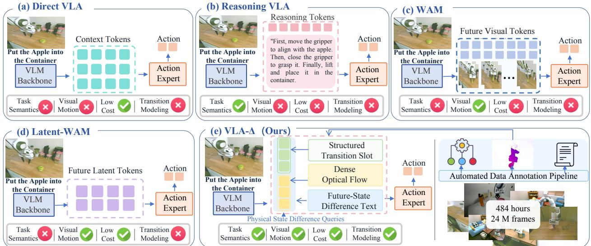  
Figure 1 Comparison of transition modeling paradigms in vision–language–action policies. (a) Direct VLA maps observations and instructions directly to actions. (b) Reasoning VLA describes task plans and subgoals in language space. (c) WAM predicts future visual states, while (d) Latent-WAM predicts future latent representations. (e) VLA-∆ models physical state changes through multilevel supervision.

state changes. (b) Reasoning VLAs such as ECoT (Zawalski et al., 2024) autoregressively infer task plans and object locations before generating actions. However, their chain-of-thought supervision focuses on high-level task planning and state reasoning, together with sparse visual localization. It describes what should be done next, but not how the physical states of the robot and objects change between current and future states. (c) World Action Models (WAMs) (Cai et al., 2026) model state changes by generating future images. These methods provide denser visual details, but future-image reconstruction mainly enforces consistency in scene appearance and does not explicitly identify which changes are necessary for task completion. Moreover, generating future images typically introduces additional inference cost. (d) Latent-WAMs (Chen et al., 2026) move future prediction into a latent space, reducing the cost of visual reconstruction. However, their latent representations still model only future visual states, rather than signals tied to physical states and motion interactions. Overall, these approaches supervise either high-level task semantics or future visual appearance, but rarely supervise the physical state transition itself, i.e., how object poses, spatial relations, and robot–object contacts change from the current state to the future. Yet it is precisely these physical changes that directly define which actions the robot must take.

To bridge this gap, we propose to explicitly model physical state transitions as learning targets. Such transitions should be both linked to task intent and grounded in concrete visual information: task semantics alone cannot specify how objects move, while visual appearance alone cannot indicate which changes matter for the task. Our core design is to extract physical state-transition information between the current and future states, encompassing both task-relevant semantics and visual motion changes. We aim to learn transition representations that capture task semantics while preserving motion details, providing more direct supervision for continuous action generation.

We therefore introduce VLA-∆, a general framework using physical state transitions as explicit learning targets. The framework incorporates learnable Physical State Diference Queries into the vision-language backbone to form a unified transition representation conditioned on current observations and task instructions. We shape this representation through two supervision pathways: direct prediction and autoregressive generation. ○1 Structured Transition Slots provide structured supervision for variables including spatial positions and contact states, encouraging a semantic division of labor among Queries and giving the transition representation clear physical meaning. ○2 Optical Flow provides dense visual motion supervision, encouraging the representation to preserve motion details of objects and grippers. ○3 Future-State Difference Text provides coherent semantic supervision for task progress, spatial displacement, contact changes, and associated physica constraints through autoregressive generation. Together, these three signals guide the Query representations to jointly encode task semantics and visual motion changes, supporting continuous action generation.

We construct a pretraining dataset comprising approximately 484 hours and 24 million frames and derive physical state-transition supervision signals from it. The three supervision signals are introduced only during pretraining, while downstream fine-tuning uses only the action-learning objective. This training scheme allows the physical state-transition knowledge acquired during pretraining to provide a representational foundation for downstream policy learning and adapt to the continuous control requirements of specific tasks. During deployment, the model directly generates actions without decoding intermediate supervision targets.

VLA-∆ achieves strong performance in both simulation and real-robot experiments. VLA-∆ achieves a success rate of 98.40% on LIBERO and outperforms all compared methods under both the Clean and Random settings on RoboTwin. In real-robot experiments, it outperforms $\pi _ { 0 . 5 }$ by 5.5%. These results suggest that physical state-transition supervision during pretraining helps the model focus on task-relevant motion changes, enabling it to benefit from pretrained transition representations during downstream fine-tuning.

Our main contributions are as follows:

1. We propose VLA-∆, a general framework using physical state transitions as explicit learning targets. By explicitly modeling task semantics and visual motion changes, it provides more direct supervision for continuous action generation.

2. We curate approximately 484 hours and 24 million frames of robot demonstrations and develop a complete automated data annotation pipeline to generate large-scale, multilevel physical state-transition annotations for model pretraining.

3. VLA-∆ achieves the highest success rates among the compared methods on LIBERO and RoboTwin and outperforms $\pi _ { 0 . 5 }$ in real-robot experiments.

## 2 Method

## 2.1 Overall Architecture of VLA-∆

As illustrated in Fig. 2, VLA-∆ employs learnable Physical State Diference Queries to organize vision-language information into a physical state-transition representation for continuous action generation. The overall architecture follows the vision-language backbone and action-expert design of GR00T N1 (Bjorck et al., 2025), using Qwen3-VL-2B-Instruct and a 9-layer Difusion Transformer.

At time t, the model receives multi-view visual observations $o _ { t } ,$ , a task instruction ℓ, and the robot proprioceptive state $r _ { t } ,$ and predicts a continuous action chunk of length $H _ { a } , A _ { t } = ( a _ { t } , \dots , a _ { t + H _ { a } - 1 } )$ . The visual observations and task instruction are first encoded into a contextual sequence $C _ { t } .$ , which is then fed into the vision-language backbone $F _ { \theta }$ together with the learnable Query parameters $Q \in \mathbb { R } ^ { N _ { q } \times d }$ . We extract the final-layer hidden states at the Query positions to obtain the transition representation $Z _ { t } \mathrm { { : } }$

$$
Z _ { t } = \operatorname { R e a d o u t } _ { Q } ( F _ { \theta } ( [ C _ { t } ; Q ] ) ) \in \mathbb { R } ^ { N _ { q } \times d } .\tag{1}
$$

We shape this representation through two pathways: direct prediction and autoregressive generation. The direct prediction pathway reads the designated Query hidden states to predict structured variables, $\hat { y } _ { t } = h _ { \mathrm { s l o t } } ( Z _ { t } ^ { \mathrm { s l o t } } )$ ， where $\hat { y } _ { t } = ( \hat { y } _ { t , 1 } , \dots , \hat { y } _ { t , 9 } )$ , and dense optical flow, $\hat { U } _ { t } = h _ { \mathrm { f l o w } } ( Z _ { t } ^ { \mathrm { f l o w } } )$

The autoregressive generation pathway predicts Future-State Diference Text, $\hat { T } _ { t } = \mathrm { A R D e c o d e } _ { \theta } ( Q ; M _ { \mathrm { a t t n } } )$ Under the attention constraints illustrated in the right panel of Fig. 2, text positions can attend only to the Queries and preceding text, and cannot directly attend to the context $C _ { t }$ . Therefore, information from the current observations and task instruction must pass through the Query representation before contributing to diference-text prediction.

The action expert attends to $Z _ { t }$ through cross-attention and combines it with the independently encoded robot proprioceptive state ${ E } _ { \eta } ( r _ { t } )$ . It then transforms Gaussian noise into a continuous action chunk through flow matching: $\hat { A } _ { t } = \mathrm { F M D e c o d e } _ { \psi } ( \xi ; Z _ { t } , E _ { \eta } ( r _ { t } ) ) , \xi \sim \mathcal { N } ( 0 , I )$

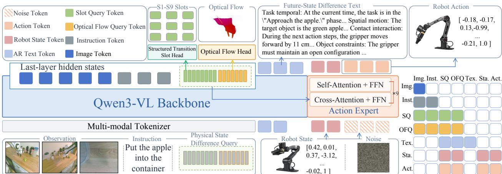  
Figure 2 Overall architecture of VLA-∆. Given multi-view observations, a task instruction, and the robot state, the model jointly learns a physical state transition representation from Structured Transition Slots, Optical Flow, and Future-State Diference Text supervision, and uses these representations to condition continuous action generation. The right panel illustrates the attention-visibility constraints among the diferent information streams.

The three auxiliary supervision signals are used jointly with action learning only during pretraining, while downstream fine-tuning optimizes only the action-learning objective. During deployment, the model retains the Query representation extraction and action-generation pathways without decoding the auxiliary supervision targets.

## 2.2 Multilevel Physical State Transition Learning

Structured Transition Slots Supervision. Physical State Diference Queries lack explicit constraints on their semantic roles when trained solely through action prediction. To encourage transition representations to encode physically meaningful information, we introduce Structured Transition Slots, which organize task-relevant state variables and their changes into nine categories of supervision targets with predefined semantic roles: task progress, task phase, target position, gripper position, motion and relative displacement, interactable position, gripper state transitions, contact transitions, and obstacle risk. This supervision encourages the assigned Queries to develop a soft semantic division of labor while preserving information exchange among Queries, allowing them to jointly support action generation. Figure 3 presents an example of Structured Transition Slot annotations for a complete manipulation episode. Further details appear in Appendix B.2.

We assign a subset of Queries to these structured targets. For each slot category, a lightweight prediction head reads the corresponding Query hidden representations to output $\hat { y } _ { i }$ . The overall structured objective is $\begin{array} { r } { \mathcal { L } _ { \mathrm { s l o t } } = \sum _ { i = 1 } ^ { 9 } w _ { i } \mathcal { L } _ { i } ( \hat { y } _ { i } , y _ { i } ) } \end{array}$ , where $w _ { i }$ denotes the weight assigned to each target category. These structured targets provide direct supervision for learning key state variables.

Dense Optical Flow Supervision. Structured Transition Slots supervise predefined state variables and their changes, but do not fully capture fine-grained visual motion during object movement, gripper approach, and local alignment. To complement this information, we introduce Optical Flow supervision using dense twodimensional displacements between current and subsequent observations from the same viewpoint, encouraging Query representations to preserve local motion details in the image plane. We use a lightweight optical flow decoder that reads only the final hidden states of the last $N _ { \mathrm { H o w } }$ diference queries and decodes their motion information into dense optical flow.

The total loss is defined as $\mathcal { L } _ { \mathrm { f l o w } } = \mathcal { L } _ { \mathrm { a l l } } + \beta _ { \mathrm { m o t i o n } } \mathcal { L } _ { \mathrm { m o t i o n } }$ , where $\mathcal { L } _ { \mathrm { a l l } }$ is the average error over all valid pixels, and ${ \mathcal { L } } _ { \mathrm { m o t i o n } }$ is the average error over motion pixels whose target flow magnitude exceeds a predefined threshold.

Optical flow alone does not distinguish task-relevant motion from other image motion. We therefore combine it with Structured Transition Slots and Future-State Diference Text, jointly constraining transition representations through state semantics and visual motion objectives.

Future-State Difference Text Supervision. Structured Transition Slots and Optical Flow supervise physical state changes through predefined state variables and dense visual displacements, respectively. To better support action generation, transition representations also need to capture the relationships among these changes, including how object motion and contact transitions jointly advance the current subgoal and which physical constraints must be satisfied throughout this process. We therefore introduce Future-State Diference Text, which uses coherent natural language to jointly describe task progress, spatial changes, contact transitions, and associated constraints between current and future states. Figure 3(b) presents an example of Future-State Diference Text.

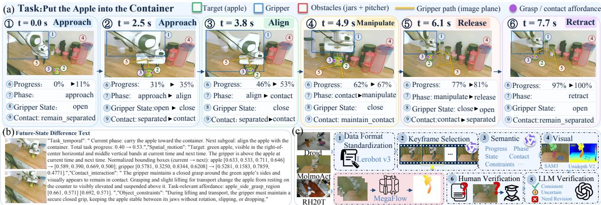  
Figure 3 Physical state-transition annotations and the automated data annotation pipeline.

We use the VLM’s native autoregressive objective to learn Future-State Diference Text T. Cross-entropy is computed only over valid target text positions ΩT: $\begin{array} { r } { \mathcal { L } _ { \mathrm { T e x t } } = - \frac { 1 } { | \Omega _ { T } | } \sum _ { j \in \Omega _ { T } } \log p _ { \theta } ( t _ { j } \mid C , Q , t _ { < j } ; M _ { \mathrm { a t t n } } ) } \end{array}$ . Current vision-language information is routed exclusively through Queries for diference text prediction.

This supervision encourages Queries to capture the relationships between local state changes and overall task progression, providing transition representations with coherent task semantics for continuous action generation.

Action Generation Conditioned on the Transition Representation. The action expert combines the transition representation $Z _ { t }$ with the independently encoded proprioceptive state $E _ { \eta } ( r _ { t } )$ to predict a continuous action chunk. We adopt the Flow Matching objective for continuous actions. Given a normalized demonstration action chunk $A _ { t } ,$ we sample Gaussian noise ξ of the same shape and an interpolation time $\tau \in [ 0 , 1 ]$ , and construct $A _ { t } ^ { \tau } = ( 1 - \tau ) \xi + \tau A _ { t } , v _ { t } ^ { \star } = A _ { t } - \xi , \xi \sim { \mathcal { N } } ( 0 , I )$

The action expert $v _ { \psi }$ predicts the vector field from the noisy action, time, and conditional representation, optimized by $\begin{array} { r } { \mathcal { L } _ { \mathrm { a c t } } = \mathbb { E } \left[ \frac { 1 } { \left. \Omega _ { a } \right. } \sum _ { k \in \Omega _ { a } } \left( \left[ v _ { \psi } ( A _ { t } ^ { \tau } , \tau \mid Z _ { t } , E _ { \eta } ( r _ { t } ) ) \right] _ { k } - \left[ v _ { t } ^ { \star } \right] _ { k } \right) ^ { 2 } \right] } \end{array}$

Training and Inference. During joint pretraining, we optimize physical state-transition prediction and continuous action generation using the following objective:

$$
\mathcal { L } = \lambda _ { \mathrm { T e x t } } \mathcal { L } _ { \mathrm { T e x t } } + \lambda _ { \mathrm { s l o t } } \mathcal { L } _ { \mathrm { s l o t } } + \lambda _ { \mathrm { f l o w } } \mathcal { L } _ { \mathrm { f l o w } } + \lambda _ { \mathrm { a c t } } \mathcal { L } _ { \mathrm { a c t } } .\tag{2}
$$

When fine-tuning on demonstrations from downstream benchmarks, we optimize only the flow-matching action objective, $\mathcal { L } = \mathcal { L } _ { \mathrm { a c t } }$ . This allows the transition representations learned during pretraining to adapt to downstream tasks through action supervision, without requiring additional transition annotations for downstream demonstrations.

During inference, the VLM extracts the transition representation $Z _ { t }$ from the current visual observations and task instruction. The action expert then generates continuous action chunks via flow matching, conditioned on $Z _ { t }$ and the robot proprioceptive state.

Table 1 Performance comparison on LIBERO (Success Rates,%).
<table><tr><td>Methods</td><td>VLM Size</td><td>Spatial</td><td>Object</td><td>Goal</td><td>Long</td><td>Average</td></tr><tr><td>TraceVLA</td><td>7B</td><td>84.6</td><td>85.2</td><td>75.1</td><td>54.1</td><td>74.8</td></tr><tr><td>openVLA</td><td>7B</td><td>84.7</td><td>88.4</td><td>79.2</td><td>53.7</td><td>76.5</td></tr><tr><td>SpatialVLA</td><td>4B</td><td>88.2</td><td>89.9</td><td>78.6</td><td>55.5</td><td>78.1</td></tr><tr><td>WorldVLA</td><td>7B</td><td>87.6</td><td>96.2</td><td>83.4</td><td>60.0</td><td>81.8</td></tr><tr><td>CoT-VLA</td><td>7B</td><td>87.5</td><td>91.6</td><td>87.6</td><td>69.0</td><td>83.9</td></tr><tr><td>ThinkAct</td><td>7B</td><td>88.3</td><td>91.4</td><td>87.1</td><td>70.9</td><td>84.4</td></tr><tr><td>SmolVLA</td><td>500M</td><td>93.0</td><td>94.0</td><td>91.0</td><td>77.0</td><td>88.8</td></tr><tr><td>DreamVLA</td><td>345M</td><td>97.5</td><td>94.0</td><td>89.5</td><td>89.5</td><td>92.6</td></tr><tr><td>π0</td><td>3B</td><td>96.8</td><td>98.8</td><td>95.8</td><td>85.2</td><td>94.2</td></tr><tr><td>UniVLA</td><td>7B</td><td>95.4</td><td>98.8</td><td>93.6</td><td>94.0</td><td>95.5</td></tr><tr><td>π0.5</td><td>3B</td><td>98.8</td><td>98.2</td><td>98.0</td><td>92.4</td><td>96.9</td></tr><tr><td>GR00T-N1.7</td><td>2B</td><td>97.7</td><td>97.5</td><td>98.5</td><td>94.4</td><td>97.0</td></tr><tr><td>openVLA-OFT VLA-Adapter</td><td>7B 0.5B</td><td>97.6 97.8</td><td>98.4</td><td>97.9</td><td>94.6</td><td>97.1</td></tr><tr><td>ZR-0</td><td>2B</td><td>97.4</td><td>99.2 99.4</td><td>97.2 97.8</td><td>95.0 96.4</td><td>97.3</td></tr><tr><td></td><td></td><td></td><td></td><td></td><td></td><td>97.8</td></tr><tr><td>VLA-∆</td><td>2B</td><td>98.8</td><td>99.8</td><td>98.6</td><td>96.4</td><td>98.4</td></tr></table>

## 2.3 Automated Data Annotation Pipeline

As shown in Figure 3(c), we develop an automated annotation pipeline to produce standardized physical statetransition annotations for robot demonstrations from multiple sources. First, we convert all data sources into the unified LeRobot v3 trajectory format. For keyframe selection, we use Qwen3.8 to segment demonstration videos into manipulation stages based on task instructions, identifying processes such as approaching, aligning, and grasping. Stage boundaries serve as keyframe candidates, and additional keyframes are sampled adaptively according to the complexity of the operations within each stage. For semantic annotation, we use Qwen3.8 to generate structured semantic labels. For visual annotation, we use the object descriptions in these labels to prompt SAM 3 (Carion et al., 2025) to obtain bounding boxes and segmentation masks for target objects, grippers, and obstacles. We then use UniDepth V2 (Piccinelli et al., 2025) to estimate image depth and extract depth information near the center of each target object. Finally, we align and integrate semantic and geometric information from current and future time steps according to predefined rules, producing unified physical state-transition annotations and constructing training samples from them. For optical flow annotation, we use MegaFlow (Zhang et al., 2026a) to estimate dense two-dimensional displacements ofline between the current and subsequent frames from the same camera view.

Quality control is integrated throughout the pipeline. We first use automated checks to identify formatting errors, temporal misalignment, invalid coordinates, inconsistent object identities, and depth anomalies. GPT-5.6 then reviews complex cases or conflicting annotations against visual evidence on a field-by-field basis and flags uncertain information. Finally, we conduct a stratified manual audit to assess annotation quality. We describe the annotation pipeline in detail in Appendix B.3.

## 3 Experiments

## 3.1 Experimental Setup

Implementation and training. VLA-∆ is built on the GR00T N1 architecture. The vision-language model is initialized with the weights of $\mathrm { Z R ^ { - } O _ { b a s e } }$ (Li et al., 2026). We pretrain the model with the joint training objective on demonstrations from DROID, MolmoAct, and RH20T, annotated using the automated annotation pipeline described in Section 2.3.

Simulation and real-world platforms. We evaluate VLA-∆ on the LIBERO (Liu et al., 2023) and RoboTwin 2.0 (Chen et al., 2025) and assess its generalization on LIBERO-Plus (Fei et al., 2025). We further conduct real-world experiments on the AgileX PiPER 6-DoF dual-arm robot platform. Task success rate serves as the primary evaluation metric. Detailed training and evaluation settings are provided in Appendix C.

Table 2 Performance comparison on RoboTwin 2.0 (Success Rates, %) under Clean and Random settings. Full results are provided in Appendix C.2.
<table><tr><td rowspan="2">Method</td><td colspan="2">AdjustBottle</td><td colspan="2">BeatBlockHammer</td><td colspan="2">BlocksRankingSize</td><td colspan="2">ClickAlarmclock</td><td colspan="2">HangingMug</td><td colspan="2">AVG</td></tr><tr><td>Clean</td><td>Random</td><td>Clean</td><td>Random</td><td>Clean</td><td>Random</td><td>Clean</td><td>Random</td><td>Clean Random</td><td></td><td>Clean</td><td>Random</td></tr><tr><td>X-VLA</td><td>100</td><td>99</td><td>92</td><td>88</td><td>67</td><td>74</td><td>99</td><td>99</td><td>23</td><td>27</td><td>72.88</td><td>72.84</td></tr><tr><td>π0</td><td>99</td><td>95</td><td>79</td><td>84</td><td>14</td><td>5</td><td>77 98</td><td>68</td><td>14</td><td>11</td><td>65.92</td><td>58.4</td></tr><tr><td>π0.5</td><td>100</td><td>99</td><td>96</td><td>93</td><td>49</td><td>26</td><td>89</td><td>18</td><td>17</td><td></td><td>82.74</td><td>76.76</td></tr><tr><td>Motus</td><td>89</td><td>93</td><td>95</td><td>88</td><td>75</td><td>63</td><td>100 100</td><td>38</td><td>38</td><td></td><td>88.52</td><td>87.02</td></tr><tr><td>ZR-0</td><td>100</td><td>99</td><td>85</td><td>88</td><td>70</td><td>81</td><td>96 82</td><td>35</td><td>33</td><td></td><td>88.70</td><td>87.98</td></tr><tr><td>VLA-∆</td><td>100</td><td>98</td><td>90</td><td>86</td><td>80</td><td>74</td><td>94</td><td>40</td><td>34</td><td>...</td><td>90.06</td><td>89.74</td></tr></table>

## 3.2 Simulation Benchmark Evaluation

LIBERO and LIBERO-Plus. We first evaluate the model on LIBERO. As shown in Table 1, VLA-∆ achieves an average success rate of 98.4%, the highest among all compared methods. To further evaluate generalization under out-of-distribution environmental changes, we test the model on four perturbation types in LIBERO-Plus: Language, Light, Background, and Layout.

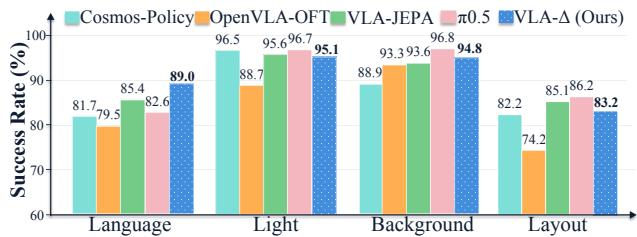  
Figure 4 LIBERO-Plus performance under four diferent perturbations.

As shown in Figure 4, VLA-∆ maintains a high task success rate across all perturbation settings and remains competitive with leading methods. These results indicate that VLA-∆ achieves strong performance on the standard LIBERO benchmark without substantially compromising its ability to adapt to changes in visual appearance, background, and layout.

Notably, under the Language perturbation, VLA-∆ achieves 89.0%, outperforming $\pi _ { 0 . 5 }$ at 82.6% by 6.4 percentage points. This result suggests that the explicit semantic information provided by the Future-State Diference Text enables the policy to rely more on task-relevant state transitions when interpreting instructions, thereby reducing its sensitivity to superficial variations in language.

RoboTwin 2.0. We further evaluate VLA-∆ on RoboTwin 2.0. As shown in Table 2, VLA-∆ achieves average success rates of 90.06% and 89.74% under the Clean and Random settings, respectively, outperforming all compared methods in both settings. These results exceed those of ZR-0, the strongest baseline in both settings, by 1.36 and 1.76 percentage points. From Clean to Random, the average success rate of VLA-∆ decreases by only 0.32 percentage points, compared with 0.72 for ZR-0 and 1.50 for Motus. This indicates that the mode achieves higher success rates while adapting efectively to scene randomization.

Under the Clean setting, VLA-∆ achieves the highest success rates on BlocksRankingSize and HangingMug among all compared methods. BlocksRankingSize requires arranging three blocks by size through repeated grasping, transport, and placement, with successive operations adjusting spatial relations according to earlier placement outcomes. HangingMug involves rotation, regrasping, and hanging, requiring coordinated changes in object poses and transitions among tabletop support, gripper grasping, and rack support. The state reached at each stage influences the conditions for subsequent operations. These two tasks therefore emphasize progressive spatial rearrangement and contact transitions across multiple stages, respectively. The observed gains support our central premise that explicitly learning changes in task progress, spatial motion, and interaction states helps connect task semantics with continuous action generation.

Overall, VLA-∆ outperforms the compared approaches that use intermediate reasoning or future visual state prediction on downstream tasks. These results suggest that treating task-relevant motion and interaction changes as explicit learning targets guides action generation more efectively.

T5 Generalization  
(a) Real-Robot Platform  
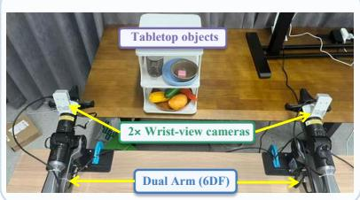

(b) Experimental Results  
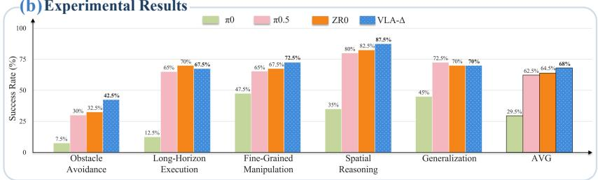

(c) Five Real-Robot Task Scenarios  
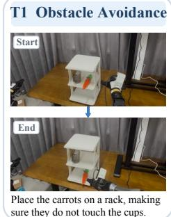

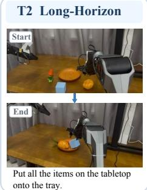

T3 Fine-Grained  
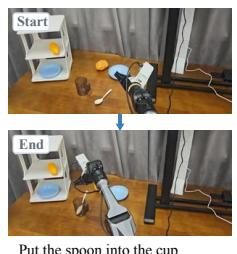

T4 Spatial Reasoning  
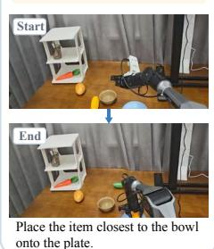

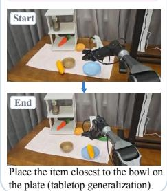  
Figure 5 Real-robot evaluation on the AgileX PiPER 6-DoF platform. (a) Dual-arm robot platform. (b) Real-robot experimental results (Success Rates, %). (c) Overview of the five tasks.

## 3.3 Real-Robot Evaluation

Figure 5 presents the real-robot platform, task scenarios, and experimental results. We design five manipulation tasks to evaluate obstacle avoidance, long-horizon execution, fine-grained manipulation, spatial reasoning, and generalization under environmental changes. Each task is evaluated over 40 independent episodes, for a total of 200 trials.

Task success rates are reported in Figure 5(b). VLA-∆ achieves an average success rate of 68.0% across the five tasks. On the obstacle avoidance task, it achieves 42.5%, the highest success rate among all compared methods. This result is consistent with the explicit Object Constraints supervision in Future-State Diference Text. These annotations describe obstacles to avoid and object relationships to preserve, helping the model account for manipulation constraints and potential collision risks during action generation.

VLA-∆ also achieves the highest success rates among compared methods on the spatial reasoning and finegrained manipulation tasks. This advantage may reflect spatial position annotations in Structured Transition Slots and visual details from optical flow. On the long-horizon execution and environmental generalization tasks, VLA-∆ achieves the second-highest success rates. These results indicate continued efectiveness on complex long-horizon tasks and under environmental changes.

Overall, the experimental results support the efectiveness of multilevel physical state-transition supervision in helping policies learn task-relevant state changes and their constraints, and translate this information into continuous control in real-world environments.

## 3.4 Ablation Experiments

To analyze the contributions of Physical State Diference Queries, Future-State Diference Text, Structured Transition Slots, and Dense Optical Flow, we conduct ablation experiments on LIBERO. All variants use only the action-learning objective during downstream fine-tuning.

As shown in Table 3, compared with the baseline using dense vision-language features, introducing the query mechanism improves the success rate by 0.55 percentage points, indicating that compact query representations support action generation. To distinguish the efects of pretraining data from those of auxiliary supervision, we further pretrain both configurations using only action supervision, which yields limited performance gains.

We then introduce Future-State Diference Text, Structured Transition Slots, and Dense Optical Flow separately, and all three configurations yield further performance improvements. We investigate why Structured Transition Slots improve model performance by extracting the hidden states of Slot Queries from models pretrained with and without structured slot supervision and projecting them into two dimensions using t-SNE. The nine slot targets use seven fixed Query groups. Task progress and phase share G12, while gripper state and contact transitions share G78, with separate output branches for each target. Appendix D.1 details the grouping, prediction heads, and supervision objectives. As shown in Figures 6(a) and 6(b), query representations are relatively dispersed without structured supervision during pretraining. With Structured Transition Slots, the query groups form more compact clusters with clearer boundaries. This observation suggests that structured slot supervision enhances the semantic separability of query representations.

Table 3 Ablation results on 40 LIBERO tasks.
<table><tr><td>Variant</td><td>Query</td><td>Pretraining</td><td>Difference Text</td><td>Slots</td><td>Optical Flow</td><td>LIBERO Avg. (%)</td></tr><tr><td>Dense VLM Features</td><td>No</td><td>No</td><td>No</td><td>No</td><td>No</td><td>95.70</td></tr><tr><td>Dense VLM Features</td><td>No</td><td>Yes</td><td>No</td><td>No</td><td>No</td><td>95.85</td></tr><tr><td>Difference Queries Only</td><td>Yes</td><td>No</td><td>No</td><td>No</td><td>No</td><td>96.25</td></tr><tr><td>Difference Queries Only</td><td>Yes</td><td>Yes</td><td>No</td><td>No</td><td>No</td><td>96.45</td></tr><tr><td>Query + Difference Text</td><td>Yes</td><td>Yes</td><td>Yes</td><td>No</td><td>No</td><td>97.20</td></tr><tr><td>Query + Structured Slots</td><td>Yes</td><td>Yes</td><td>No</td><td>Yes</td><td>No</td><td>96.90</td></tr><tr><td>Query + Optical Flow</td><td>Yes</td><td>Yes</td><td>No</td><td>No</td><td>Yes</td><td>97.35</td></tr><tr><td>VLA-△ (Full)</td><td>Yes</td><td>Yes</td><td>Yes</td><td>Yes</td><td>Yes</td><td>98.40</td></tr></table>

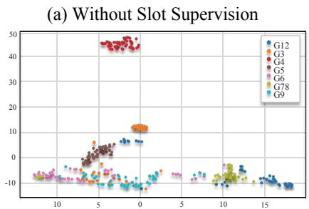

(b) With Slot Supervision  
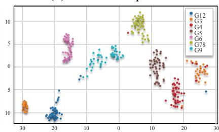

(c) After LIBERO Fine-Tuning  
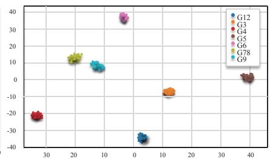  
Figure 6 t-SNE visualization of Slot Query hidden states.

To examine whether this structure transfers to downstream tasks, we extract the Slot Query hidden states after task-specific fine-tuning on LIBERO. As shown in Figure 6(c), the Slot Queries still form seven compact, well-separated clusters, although fine-tuning uses only the action-generation objective. This indicates that the query grouping structure established during pretraining persists through downstream finetuning, suggesting that the semantic prior introduced by Structured Transition Slots can continue to guide the learning of task-relevant transition representations.

Finally, the complete VLA-∆ model combines all three supervision types, achieving an average success rate of 98.4%. This result suggests that multilevel physical state-transition supervision jointly shapes more comprehensive transition representations, improving task execution.

Fold the towel  
Hang the mug  
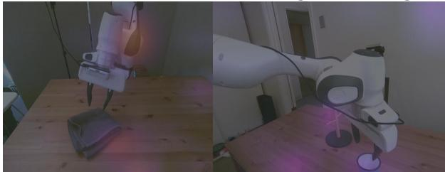

w/o multilevel surpervion  
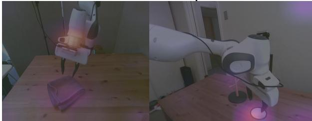  
w multilevel surpervion  
Figure 7 Query attention maps for towel folding and mug hanging.

We also visualize query attention distributions over the input images for the complete VLA-∆ model and the variant without the three transition-supervision signals. As shown in Figure 7, queries trained with all three types of supervision attend more strongly to the target object, gripper, contact regions, and other task-relevant objects. In contrast, the model without transition supervision exhibits more difuse attention and assigns greater attention to task-irrelevant background regions.

## 4 Conclusion

We propose VLA-∆, a general framework that uses physical changes between current and future states as explicit learning targets. Using robot demonstrations from multiple sources, we develop an automated annotation pipeline to construct Future-State Diference Text, Structured Transition Slots, and Optical Flow annotations, supervising transition representations through task semantics, structured state variables, and dense visual motion. These supervision signals are used only during pretraining to learn representations that support downstream policy learning through action-only fine-tuning, while deployment requires no decoding of intermediate supervision targets. Experiments demonstrate that VLA-∆ achieves competitive performance on LIBERO and RoboTwin and the highest average success rate among the compared methods in real-robot experiments. Ablation studies further validate the contributions of individual supervision signals, indicating that explicitly learning physical state changes provides an efective representational foundation for downstream continuous action generation.

## AI use statement

Generative AI tools were used for language editing and polishing, translation, LaTeX formatting, compilation troubleshooting, and the retrieval and discovery of related work. AI tools also supported data annotation and quality auditing, including semantic annotation generation, review of ambiguous or conflicting annotations against visual evidence, and bounding-box reference generation for selected audit fields, as detailed in Appendix B.3. The authors reviewed all AI-assisted work and take responsibility for the accuracy and integrity of the final manuscript, references, data, results, and claims.

## References

Michael Ahn, Anthony Brohan, Noah Brown, Yevgen Chebotar, Omar Cortes, Byron David, Chelsea Finn, Chuyuan Fu, Keerthana Gopalakrishnan, Karol Hausman, and 1 others. 2022. Do as i can, not as i say: Grounding language in robotic afordances. arXiv preprint arXiv:2204.01691.

Suneel Belkhale, Tianli Ding, Ted Xiao, Pierre Sermanet, Quon Vuong, Jonathan Tompson, Yevgen Chebotar, Debidatta Dwibedi, and Dorsa Sadigh. 2024. Rt-h: Action hierarchies using language. arXiv preprint arXiv:2403.01823.

Homanga Bharadhwaj, Debidatta Dwibedi, Abhinav Gupta, Shubham Tulsiani, Carl Doersch, Ted Xiao, Dhruv Shah, Fei Xia, Dorsa Sadigh, and Sean Kirmani. 2024a. Gen2act: Human video generation in novel scenarios enables generalizable robot manipulation. arXiv preprint arXiv:2409.16283.

Homanga Bharadhwaj, Roozbeh Mottaghi, Abhinav Gupta, and Shubham Tulsiani. 2024b. Track2act: Predicting point tracks from internet videos enables generalizable robot manipulation. In European Conference on Computer Vision, pages 306–324. Springer.

Hongzhe Bi, Hengkai Tan, Shenghao Xie, Zeyuan Wang, Shuhe Huang, Haitian Liu, Ruowen Zhao, Yao Feng, Chendong Xiang, Yinze Rong, and 1 others. 2026. Motus: A unified latent action world model. In Proceedings of the IEEE/CVF Conference on Computer Vision and Pattern Recognition, pages 35101–35113.

Johan Bjorck, Fernando Castañeda, Nikita Cherniadev, Xingye Da, Runyu Ding, Linxi Fan, Yu Fang, Dieter Fox, Fengyuan Hu, Spencer Huang, and 1 others. 2025. Gr00t n1: An open foundation model for generalist humanoid robots. arXiv preprint arXiv:2503.14734.

Kevin Black, Noah Brown, Danny Driess, Adnan Esmail, Michael Equi, Chelsea Finn, Niccolo Fusai, Lachy Groom, Karol Hausman, Brian Ichter, and 1 others. 2024. π : A vision-language-action flow model for general robot control. arXiv preprint arXiv:2410.24164.

Konstantinos Bousmalis, Giulia Vezzani, Dushyant Rao, Coline Devin, Alex X Lee, Maria Bauzá, Todor Davchev, Yuxiang Zhou, Agrim Gupta, Akhil Raju, and 1 others. 2023. Robocat: A self-improving generalist agent for robotic manipulation. arXiv preprint arXiv:2306.11706.

Anthony Brohan, Noah Brown, Justice Carbajal, Yevgen Chebotar, Xi Chen, Krzysztof Choromanski, Tianli Ding, Danny Driess, Avinava Dubey, Chelsea Finn, and 1 others. 2023. Rt-2: Vision-language-action models transfer web knowledge to robotic control. arXiv preprint arXiv:2307.15818.

Anthony Brohan, Noah Brown, Justice Carbajal, Yevgen Chebotar, Joseph Dabis, Chelsea Finn, Keerthana Gopalakrishnan, Karol Hausman, Alex Herzog, Jasmine Hsu, and 1 others. 2022. Rt-1: Robotics transformer for real-world control at scale. arXiv preprint arXiv:2212.06817.

Qingwen Bu, Jisong Cai, Li Chen, Xiuqi Cui, Yan Ding, Siyuan Feng, Shenyuan Gao, Xindong He, Xuan Hu, Xu Huang, and 1 others. 2025a. Agibot world colosseo: A large-scale manipulation platform for scalable and intelligent embodied systems. arXiv preprint arXiv:2503.06669.

Qingwen Bu, Yanting Yang, Jisong Cai, Shenyuan Gao, Guanghui Ren, Maoqing Yao, Ping Luo, and Hongyang Li. 2025b. Univla: Learning to act anywhere with task-centric latent actions. arXiv preprint arXiv:2505.06111.

Junhao Cai, Zetao Cai, Jiafei Cao, Yilun Chen, Zeyu He, Lei Jiang, Hang Li, Hengjie Li, Yang Li, Yufei Liu, and 1 others. 2026. Internvla-a1: Unifying understanding, generation and action for robotic manipulation. arXiv preprint arXiv:2601.02456.

Nicolas Carion, Laura Gustafson, Yuan-Ting Hu, Shoubhik Debnath, Ronghang Hu, Didac Suris, Chaitanya Ryali, Kalyan Vasudev Alwala, Haitham Khedr, Andrew Huang, and 1 others. 2025. Sam 3: Segment anything with concepts. arXiv preprint arXiv:2511.16719.

Jun Cen, Chaohui Yu, Hangjie Yuan, Yuming Jiang, Siteng Huang, Jiayan Guo, Xin Li, Yibing Song, Hao Luo, Fan Wang, and 1 others. 2025. Worldvla: Towards autoregressive action world model. arXiv preprint arXiv:2506.21539.

Chi-Lam Cheang, Guangzeng Chen, Ya Jing, Tao Kong, Hang Li, Yifeng Li, Yuxiao Liu, Hongtao Wu, Jiafeng Xu, Yichu Yang, and 1 others. 2024. Gr-2: A generative video-language-action model with web-scale knowledge for robot manipulation. arXiv preprint arXiv:2410.06158.

Jialei Chen, Kai Wang, Kang Chen, Shuaihang Chen, Feng Gao, Wenhao Tang, Zhiyuan Li, Weilin Liu, Zhuyu Yao, Boxun Li, and 1 others. 2026. Lawam: Latent world action models for eficient dynamics-aware robot policies. arXiv preprint arXiv:2606.15768.

Tianxing Chen, Zanxin Chen, Baijun Chen, Zijian Cai, Yibin Liu, Zixuan Li, Qiwei Liang, Xianliang Lin, Yiheng Ge, Zhenyu Gu, and 1 others. 2025. Robotwin 2.0: A scalable data generator and benchmark with strong domain randomization for robust bimanual robotic manipulation. arXiv preprint arXiv:2506.18088.

Cheng Chi, Zhenjia Xu, Siyuan Feng, Eric Cousineau, Yilun Du, Benjamin Burchfiel, Russ Tedrake, and Shuran Song. 2025. Difusion policy: Visuomotor policy learning via action difusion. The International Journal of Robotics Research, 44(10-11):1684–1704.

StarVLA Community. 2026. Starvla: A lego-like codebase for vision-language-action model developing. arXiv preprint arXiv:2604.05014.

Shengliang Deng, Mi Yan, Songlin Wei, Haixin Ma, Yuxin Yang, Jiayi Chen, Zhiqi Zhang, Taoyu Yang, Xuheng Zhang, Wenhao Zhang, and 1 others. 2025. Graspvla: a grasping foundation model pre-trained on billion-scale synthetic action data. arXiv preprint arXiv:2505.03233.

Danny Driess, Fei Xia, Mehdi SM Sajjadi, Corey Lynch, Aakanksha Chowdhery, Brian Ichter, Ayzaan Wahid, Jonathan Tompson, Quan Vuong, Tianhe Yu, and 1 others. 2023. Palm-e: An embodied multimodal language model. arXiv preprint arXiv:2303.03378.

Jiafei Duan, Wentao Yuan, Wilbert Pumacay, Yi Ru Wang, Kiana Ehsani, Dieter Fox, and Ranjay Krishna. 2024. Manipulate-anything: Automating real-world robots using vision-language models. arXiv preprint arXiv:2406.18915.

Haoquan Fang, Jiafei Duan, Donovan Clay, Sam Wang, Shuo Liu, Weikai Huang, Xiang Fan, Wei-Chuan Tsai, Shirui Chen, Yi Ru Wang, and 1 others. 2026. Molmoact2: Action reasoning models for real-world deployment. arXiv preprint arXiv:2605.02881.

Senyu Fei, Siyin Wang, Junhao Shi, Zihao Dai, Jikun Cai, Pengfang Qian, Li Ji, Xinzhe He, Shiduo Zhang, Zhaoye Fei, and 1 others. 2025. Libero-plus: In-depth robustness analysis of vision-language-action models. arXiv preprint arXiv:2510.13626.

Chi-Pin Huang, Yueh-Hua Wu, Min-Hung Chen, Yu-Chiang Frank Wang, and Fu-En Yang. 2025. Thinkact: Visionlanguage-action reasoning via reinforced visual latent planning, 2025. URL https: //arxiv. org/abs/2507. 16815 .

Wenlong Huang, Chen Wang, Yunzhu Li, Ruohan Zhang, and Li Fei-Fei. 2024. Rekep: Spatio-temporal reasoning of relational keypoint constraints for robotic manipulation. arXiv preprint arXiv:2409.01652.

Wenlong Huang, Chen Wang, Ruohan Zhang, Yunzhu Li, Jiajun Wu, and Li Fei-Fei. 2023. Voxposer: Composable 3d value maps for robotic manipulation with language models. arXiv preprint arXiv:2307.05973.

Physical Intelligence, Bo Ai, Ali Amin, Raichelle Aniceto, Ashwin Balakrishna, Greg Balke, Kevin Black, George Bokinsky, Shihao Cao, Thomas Charbonnier, and 1 others. 2026. π0.7: a steerable generalist robotic foundation model with emergent capabilities. arXiv preprint arXiv:2604.15483.

Physical Intelligence, Kevin Black, Noah Brown, James Darpinian, Karan Dhabalia, Danny Driess, Adnan Esmail, Michael Equi, Chelsea Finn, Niccolo Fusai, and 1 others. 2025. π : A vision-language-action model with open-world generalization. arXiv preprint arXiv:2504.16054.

Moo Jin Kim, Chelsea Finn, and Percy Liang. 2025. Fine-tuning vision-language-action models: Optimizing speed and success. arXiv preprint arXiv:2502.19645.

Moo Jin Kim, Karl Pertsch, Siddharth Karamcheti, Ted Xiao, Ashwin Balakrishna, Suraj Nair, Rafael Rafailov, Ethan Foster, Grace Lam, Pannag Sanketi, and 1 others. 2024. Openvla: An open-source vision-language-action model. arXiv preprint arXiv:2406.09246.

Haoyang Li, Guanlin Li, Youhe Feng, Chen Zhao, Zhuoran Wang, Yang Li, Qizhe Wei, Shifeng Bao, Haitao Shen, Yihan Zhao, and 1 others. 2026. Training vision-language-action models with dense embodied chain-of-thought supervision. arXiv preprint arXiv:2606.30552.

Qixiu Li, Yaobo Liang, Zeyu Wang, Lin Luo, Xi Chen, Mozheng Liao, Fangyun Wei, Yu Deng, Sicheng Xu, Yizhong Zhang, and 1 others. 2024a. Cogact: A foundational vision-language-action model for synergizing cognition and action in robotic manipulation. arXiv preprint arXiv:2411.19650.

Xiaoqi Li, Mingxu Zhang, Yiran Geng, Haoran Geng, Yuxing Long, Yan Shen, Renrui Zhang, Jiaming Liu, and Hao Dong. 2024b. Manipllm: Embodied multimodal large language model for object-centric robotic manipulation. In 2024 IEEE/CVF Conference on Computer Vision and Pattern Recognition (CVPR), pages 18061–18070. IEEE.

Xinghang Li, Peiyan Li, Minghuan Liu, Dong Wang, Jirong Liu, Bingyi Kang, Xiao Ma, Tao Kong, Hanbo Zhang, and Huaping Liu. 2024c. Towards generalist robot policies: What matters in building vision-language-action models. arXiv preprint arXiv:2412.14058, 3(7):8.

Xinghang Li, Minghuan Liu, Hanbo Zhang, Cunjun Yu, Jie Xu, Hongtao Wu, Chilam Cheang, Ya Jing, Weinan Zhang, Huaping Liu, and 1 others. 2024d. Vision-language foundation models as efective robot imitators. In International Conference on Learning Representations, volume 2024, pages 26703–26721.

Yihan Lin, Jiawei He, Shifeng Bao, Chen Zhao, Yang Li, Xiaobo Wang, Yan Wang, Cheng Chi, and Jing Zhang. 2026. Jepa-wam: Learning vision-language-action policies with joint-embedding world modeling. arXiv preprint arXiv:2608.09381.

Yaron Lipman, Ricky TQ Chen, Heli Ben-Hamu, Maximilian Nickel, and Matt Le. 2022. Flow matching for generative modeling. arXiv preprint arXiv:2210.02747.

Bo Liu, Yifeng Zhu, Chongkai Gao, Yihao Feng, Qiang Liu, Yuke Zhu, and Peter Stone. 2023. Libero: Benchmarking knowledge transfer for lifelong robot learning. Advances in Neural Information Processing Systems, 36:44776–44791.

Songming Liu, Lingxuan Wu, Bangguo Li, Hengkai Tan, Huayu Chen, Zhengyi Wang, Ke Xu, Hang Su, and Jun Zhu. 2025. Rdt-1b: a difusion foundation model for bimanual manipulation. In International Conference on Learning Representations, volume 2025, pages 29982–30009.

Tianyi Lu, Hui Zhang, Zijie Diao, Junke Wang, Shengqi Xu, Xingyao Lin, Guojin Zhong, Ziyi Ye, Peng Wang, Zuxuan Wu, and 1 others. 2026. Thinkingvla: Interleaved vision and language reasoning for robotic manipulation. arXiv preprint arXiv:2606.17937.

William Peebles and Saining Xie. 2023. Scalable difusion models with transformers. In 2023 IEEE/CVF International Conference on Computer Vision (ICCV), pages 4172–4182. IEEE.

Karl Pertsch, Kyle Stachowicz, Brian Ichter, Danny Driess, Suraj Nair, Quan Vuong, Oier Mees, Chelsea Finn, and Sergey Levine. 2025. Fast: Eficient action tokenization for vision-language-action models. arXiv preprint arXiv:2501.09747.

Luigi Piccinelli, Christos Sakaridis, Yung-Hsu Yang, Mattia Segu, Siyuan Li, Wim Abbeloos, and Luc Van Gool. 2025. Unidepthv2: Universal monocular metric depth estimation made simpler. arXiv preprint arXiv:2502.20110.

Delin Qu, Haoming Song, Qizhi Chen, Yuanqi Yao, Xinyi Ye, Yan Ding, Zhigang Wang, JiaYuan Gu, Bin Zhao, Dong Wang, and 1 others. 2025. Spatialvla: Exploring spatial representations for visual-language-action model. arXiv preprint arXiv:2501.15830.

Hao Shi, Bin Xie, Yingfei Liu, Lin Sun, Fengrong Liu, Tiancai Wang, Erjin Zhou, Haoqiang Fan, Xiangyu Zhang, and Gao Huang. 2026. Memoryvla: Perceptual-cognitive memory in vision-language-action models for robotic manipulation. In International Conference on Learning Representations, volume 2026, pages 18567–18602.

Mustafa Shukor, Dana Aubakirova, Francesco Capuano, Pepijn Kooijmans, Steven Palma, Adil Zouitine, Michel Aractingi, Caroline Pascal, Martino Russi, Andres Marafioti, and 1 others. 2025. Smolvla: A vision-language-action model for afordable and eficient robotics. arXiv preprint arXiv:2506.01844.

Jingwen Sun, Wenyao Zhang, Zekun Qi, Shaojie Ren, Zezhi Liu, Hanxin Zhu, Guangzhong Sun, Xin Jin, and Zhibo Chen. 2026. Vla-jepa: Enhancing vision-language-action model with latent world model. In European Conference on Computer Vision, pages 478–497. Springer.

Octo Model Team, Dibya Ghosh, Homer Walke, Karl Pertsch, Kevin Black, Oier Mees, Sudeep Dasari, Joey Hejna, Tobias Kreiman, Charles Xu, and 1 others. 2024. Octo: An open-source generalist robot policy. arXiv preprint arXiv:2405.12213.

Chuan Wen, Xingyu Lin, John So, Kai Chen, Qi Dou, Yang Gao, and Pieter Abbeel. 2023. Any-point trajectory modeling for policy learning. arXiv preprint arXiv:2401.00025.

Junjie Wen, Yichen Zhu, Jinming Li, Zhibin Tang, Chaomin Shen, and Feifei Feng. 2025. Dexvla: Vision-language model with plug-in difusion expert for general robot control. arXiv preprint arXiv:2502.05855.

Hongtao Wu, Ya Jing, Chilam Cheang, Guangzeng Chen, Jiafeng Xu, Xinghang Li, Minghuan Liu, Hang Li, and Tao Kong. 2024. Unleashing large-scale video generative pre-training for visual robot manipulation. In International Conference on Learning Representations, volume 2024, pages 10641–10662.

Wei Wu, Fan Lu, Yunnan Wang, Shuai Yang, Shi Liu, Fangjing Wang, Qian Zhu, He Sun, Yong Wang, Shuailei Ma, and 1 others. 2026. A pragmatic vla foundation model. arXiv preprint arXiv:2601.18692.

Yandan Yang, Shuang Zeng, Tong Lin, Xinyuan Chang, Dekang Qi, Junjin Xiao, Haoyun Liu, Ronghan Chen, Yuzh Chen, Dongjie Huo, and 1 others. 2026. Abot-m0: Vla foundation model for robotic manipulation with action manifold learning. arXiv preprint arXiv:2602.11236.

Chengbo Yuan, Chuan Wen, Tong Zhang, and Yang Gao. 2024a. General flow as foundation afordance for scalable robot learning. arXiv preprint arXiv:2401.11439.

Wentao Yuan, Jiafei Duan, Valts Blukis, Wilbert Pumacay, Ranjay Krishna, Adithyavairavan Murali, Arsalan Mousavian, and Dieter Fox. 2024b. Robopoint: A vision-language model for spatial afordance prediction for robotics. arXiv preprint arXiv:2406.10721.

Michał Zawalski, William Chen, Karl Pertsch, Oier Mees, Chelsea Finn, and Sergey Levine. 2024. Robotic control via embodied chain-of-thought reasoning. arXiv preprint arXiv:2407.08693.

Dingxi Zhang, Fangjinhua Wang, Marc Pollefeys, and Haofei Xu. 2026a. Megaflow: Zero-shot large displacement optical flow. arXiv preprint arXiv:2603.25739.

Jianke Zhang, Yanjiang Guo, Yucheng Hu, Xiaoyu Chen, Xiang Zhu, and Jianyu Chen. 2025. Up-vla: A unified understanding and prediction model for embodied agent. arXiv preprint arXiv:2501.18867.

Wenyao Zhang, Hongsi Liu, Zekun Qi, Yunnan Wang, Xinqiang Yu, Jiazhao Zhang, Runpei Dong, Jiawei He, He Wang, Zhizheng Zhang, and 1 others. 2026b. Dreamvla: a vision-language-action model dreamed with comprehensive world knowledge. Advances in Neural Information Processing Systems, 38:24195–24228.

Qingqing Zhao, Yao Lu, Moo Jin Kim, Zipeng Fu, Zhuoyang Zhang, Yecheng Wu, Zhaoshuo Li, Qianli Ma, Song Han, Chelsea Finn, and 1 others. 2025. Cot-vla: Visual chain-of-thought reasoning for vision-language-action models. In 2025 IEEE/CVF Conference on Computer Vision and Pattern Recognition (CVPR), pages 1702–1713. IEEE.

Tony Z Zhao, Vikash Kumar, Sergey Levine, and Chelsea Finn. 2023. Learning fine-grained bimanual manipulation with low-cost hardware. arXiv preprint arXiv:2304.13705.

Haoyu Zhen, Xiaowen Qiu, Peihao Chen, Jincheng Yang, Xin Yan, Yilun Du, Yining Hong, and Chuang Gan. 2024. 3d-vla: A 3d vision-language-action generative world model. arXiv preprint arXiv:2403.09631.

Jinliang Zheng, Jianxiong Li, Zhihao Wang, Dongxiu Liu, Xirui Kang, Yuchun Feng, Yinan Zheng, Jiayin Zou, Yilun Chen, Jia Zeng, and 1 others. 2026. X-vla: Soft-prompted transformer as scalable cross-embodiment vision-languageaction model. In International Conference on Learning Representations, volume 2026, pages 60580–60606.

Ruijie Zheng, Yongyuan Liang, Shuaiyi Huang, Jianfeng Gao, Hal Daumé III, Andrey Kolobov, Furong Huang, and Jianwei Yang. 2025. Tracevla: Visual trace prompting enhances spatial-temporal awareness for generalist robotic policies. In International Conference on Learning Representations, volume 2025, pages 54277–54296.

## Appendix

## A Related Work

## A.1 Vision-Language-Action Models

Vision-language-action (VLA) models combine pretrained vision-language models with robot demonstrations to connect multimodal understanding with action generation. Related research provides complementary foundations for generalist robot policy learning (Brohan et al., 2022; Li et al., 2024a; Wen et al., 2025; Qu et al., 2025; Li et al., 2024d; Team et al., 2024; Bousmalis et al., 2023; Li et al., 2024c; Bu et al., 2025a; Deng et al., 2025; Bu et al., 2025b; Wu et al., 2026; Shukor et al., 2025; Intelligence et al., 2026). RT-2 (Brohan et al., 2023) encodes actions as discrete tokens and jointly trains on robot trajectories and vision-language tasks. This formulation enables semantic knowledge from visual and linguistic pretraining to support robot control. OpenVLA (Kim et al., 2024) trains an open generalist policy on large-scale robot demonstrations, demonstrating the value of vision-language pretraining for multitask manipulation and policy adaptation. For continuous control, $\pi _ { 0 }$ and $\pi _ { 0 . 5 }$ (Black et al., 2024; Intelligence et al., 2025) combine vision-language pretraining with flow matching to generate continuous action chunks. GR00T N1 (Bjorck et al., 2025) combines a vision-language backbone with a flow-matching action expert, providing the architectural basis for our model. Action representations and generative policy learning provide complementary foundations for continuous control (Peebles and Xie, 2023; Lipman et al., 2022; Chi et al., 2025; Zhao et al., 2023; Liu et al., 2025; Kim et al., 2025; Pertsch et al., 2025; Yang et al., 2026).

VLA-∆ focuses on explicit supervision of physical changes between current and future states to shape transition representations for continuous action generation. These supervision signals are used only during pretraining, while downstream fine-tuning relies on action supervision.

## A.2 Embodied Reasoning

Embodied reasoning links high-level task semantics with action execution through intermediate plans, spatial reasoning, and grounded representations (Ahn et al., 2022; Belkhale et al., 2024; Huang et al., 2023; Yuan et al., 2024b; Driess et al., 2023; Li et al., 2024b; Huang et al., 2024; Duan et al., 2024; Fang et al., 2026; Zheng et al., 2025; Shi et al., 2026). ECoT (Zawalski et al., 2024) generates task plans, subgoals, and motion descriptions before action prediction, grounding reasoning in the robot state. ThinkAct (Huang et al., 2025) uses goal-completion and trajectory-consistency rewards to learn embodied reasoning and compresses plans into latent representations that guide action policies. ZR-0 (Li et al., 2026) learns cross-embodiment representations through dense embodied chain-of-thought supervision and can skip reasoning generation during deployment. ThinkingVLA (Lu et al., 2026) interleaves forward textual reasoning, future-image prediction, and inverse reasoning within a unified autoregressive architecture. Forward reasoning selects a subgoal and guides visual forecasting, while inverse reasoning uses the predicted target state to infer spatial relations and action intent. Actions are generated from the combined reasoning context.

These methods show how explicit reasoning can relate task goals and spatial information to robot control. VLA-∆ focuses on task-relevant physical changes between current and future states, combining Future-State Diference Text, Structured Transition Slots, and optical flow to connect coherent semantic descriptions with dense visual motion supervision.

## A.3 World Action Models

In robotic manipulation, world action models connect predictions of future observations or latent states with action generation. Broader work on predictive representations and policy learning provides complementary ways to condition actions on anticipated outcomes (Zhen et al., 2024; Cheang et al., 2024; Bharadhwaj et al., 2024a; Wu et al., 2024; Zhao et al., 2025; Zhang et al., 2025; Chen et al., 2026; Lin et al., 2026; Wen et al., 2023; Bharadhwaj et al., 2024b; Yuan et al., 2024a). WorldVLA (Cen et al., 2025) unifies action generation and future-image generation within an autoregressive framework, allowing information sharing between policy learning and world modeling. VLA-JEPA (Sun et al., 2026) predicts latent representations of future observations, learning transition information while reducing sensitivity to appearance and background variations. DreamVLA (Zhang et al., 2026b) forecasts dynamic, spatial, and semantic information to guide action prediction. Motus (Bi et al., 2026) unifies understanding, video generation, and action experts, using optical flow to learn latent actions. These approaches difer in whether future information is represented by reconstructed images, latent features, or complementary prediction targets, but all use predictive learning to support action generation beyond the current observation. Generating future images online, however, adds visual-token decoding or video-denoising costs.

VLA-∆ combines readable descriptions of task progress, spatial and contact changes, and physical constraints with structured transition slots and dense optical flow supervision. This joint supervision shapes a shared transition representation for action generation without requiring future-image or diference-text generation at deployment.

## B Pretraining Dataset and Data Annotations

## B.1 Pretraining Dataset

To learn visual, language, and physical state-transition representations for robot manipulation, we construct a pretraining dataset by selecting demonstrations from DROID, MolmoAct, and RH20T. We first convert all data sources into a unified trajectory format, then filter samples based on the completeness of visual observations, language instructions, robot states, and action records. The resulting dataset covers diverse tasks, scene layouts, robot configurations, and interaction types.

Table 4 summarizes the scale and collection characteristics of the three source datasets.

Table 4 Overview of the datasets used to construct the pretraining corpus.
<table><tr><td colspan="4"></td></tr><tr><td>Dataset</td><td>Frames</td><td>Hours</td><td>Tasks Introduction</td></tr><tr><td>MolmoAct (Household +</td><td>1,104,942</td><td>30.693</td><td>96 Everyday household and tabletop manipulation with a Franka robot, covering organizing, cleaning, opening and closing,</td></tr><tr><td>Tabletop)</td><td></td><td></td><td>grasping, and placement tasks; includes a fixed external view, a second external view, and a wrist-camera view.</td></tr><tr><td>DROID</td><td></td><td></td><td>27,630,375 511.674 49,630 Open-ended everyday manipulation with Franka robots across different data collectors, buildings, and real-world scenes; includes</td></tr><tr><td>RH20T</td><td></td><td></td><td>two external views and a wrist-camera view.</td></tr><tr><td></td><td>3,898,056108.279</td><td></td><td>141 Multi-robot real-world manipulation. The Stage05 release subset covers Flexiv, Franka, KUKA, and UR5 across seven configurations, 19 users, and 21 scene IDs; includes two external</td></tr></table>

DROID contains approximately 76,000 demonstration trajectories across 564 scenes and 84 task categories, totaling approximately 350 hours of interaction. We retain demonstrations with complete timestamps, valid visual frames, and continuous action records, prioritizing trajectories that include approaching, grasping, transporting, placing, and releasing objects. These demonstrations increase the diversity of environments, objects, and tasks in the pretraining data.

MolmoAct contains over 10,000 high-quality manipulation trajectories covering household and tabletop settings. We extract visual observations, language instructions, robot states, and actions, retaining trajectories that clearly reflect task progress and subgoal changes. These data provide additional information about language conditioning, spatial relations, and multistage manipulation.

RH20T contains over 110,000 contact-rich manipulation sequences spanning multiple robot platforms, sensor configurations, and manipulation skills, with modalities including vision, force sensing, and audio. We use its visual observations, proprioceptive states, and continuous action records; the remaining modalities are not directly provided to the policy network. Grasping, pushing, insertion, and release sequences in this dataset provide additional examples of contact interactions, object state changes, and fine-grained manipulation.

# Examples of Future-State Difference Annotations

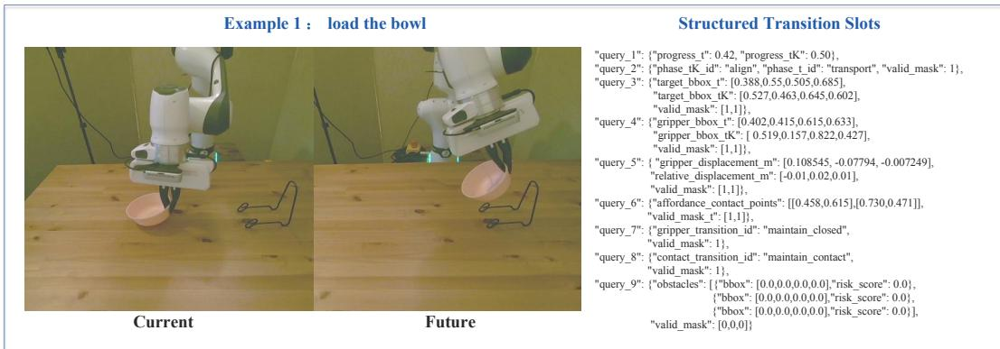

Slot State Transitions | Load the Plate into a Metal Rack  
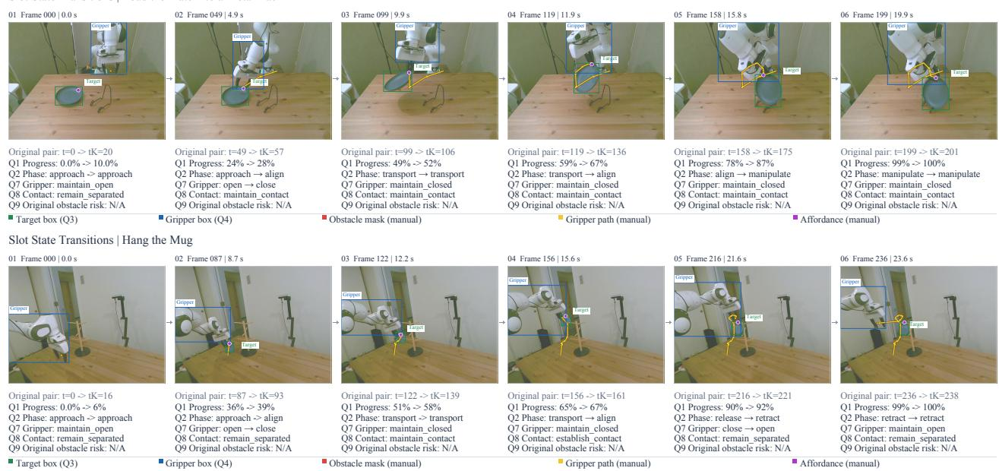  
Figure 8 Physical state-transition annotation examples: a current–future observation pair with Future-State Diference Text and Structured Transition Slots (top), and slot annotations for loading a plate into a metal rack (middle) and hanging a mug (bottom).

The three data sources complement one another in scene diversity, task semantics, and physical interaction. After format standardization and filtering, the pretraining data cover diverse spatial layouts, motion patterns, and manipulation constraints, providing a foundation for learning multilevel physical state-transition representations across tasks and robot configurations.

## B.2 Physical State-Transition Annotations

Figure 8 presents examples of physical state-transition annotations.

## B.3 Automated Data Annotation Pipeline

(1) Data Selection Strategy. We select demonstrations with clear goals, valid observations, complete state and action records, and reliable temporal alignment, considering diversity in tasks, objects, scenes, robot configurations, and viewpoints. Operations cover approaching, aligning, grasping, transporting, placing, releasing, pushing, and insertion. For partially corrupted trajectories, we retain continuous, semantically coherent segments and discard records with ambiguous target identities, action meanings, or temporal correspondences.

(2) Unified Trajectory Format. We convert all sources to LeRobot v3, organizing instructions, multiview images, proprioceptive states, actions, and timestamps. Time-series data are stored in Parquet and visual observations in videos, with metadata specifying features, frame rates, and trajectory boundaries. We retain source and trajectory identifiers, robot and camera configurations, calibration information, and field dimensions, units, coordinate frames, and validity indicators. Modalities are aligned by timestamps; missing or unreliably aligned fields are marked invalid.

(3) Data Cleaning. Language instruction checks. We identify empty, garbled, truncated, or inconsistent descriptions, correcting recoverable instructions and excluding unrecoverable records from language-conditioned training. Language standardization preserves original text and verifies semantic consistency. Future-state diference descriptions remain supervision labels, separate from input instructions.

Temporal consistency checks. We inspect timestamp ordering, duplicates, missing frames, and cross-modal ofsets. Diferent video and control frequencies are permitted when reliably aligned. Temporal gaps define segment boundaries.

Visual quality checks. We identify undecodable, black, overexposed, blurred, or uninformative views. Brief occlusions are retained when neighboring frames or other views provide evidence; otherwise, afected annotations or segments are excluded.

State and action checks. We inspect missing dimensions, non-finite values, jumps, and out-of-range records using sampling intervals and robot configurations. Unclear action types, rotation representations, units, or coordinate frames are not speculatively converted.

Trajectory integrity checks. We identify abnormal lengths, duplicates, and truncation, distinguishing valid waiting and sustained contact from recording stalls. When applicable, training and validation sets are split by trajectory before extracting windows to prevent leakage.

(4) Adaptive Keyframe Selection and Semantic Annotation. Qwen3.8-27B identifies operation phases from instructions and videos, selecting boundaries and surrounding frames. Sampling is denser for precise alignment, insertion, gripper changes, and contact transitions, and sparser for smooth transport, while preserving task-critical events.

Using keyframes and neighboring clips, the model annotates objects, phases, contact relations, interaction regions, state changes, constraints, and obstacles. Annotations distinguish current states, observed future changes, and goals, as well as explicit and inferred constraints. Fields retain object identifiers, timestamps, supporting frames, and uncertainty indicators.

(5) Visual Localization, Depth, and Optical Flow Annotation. SAM 3 produces bounding boxes and masks for targets, grippers, and obstacles. Neighboring frames and tracks maintain object identities through similar-instance ambiguity and occlusion.

UniDepth V2 estimates depth, summarized by the local median within valid target-mask regions near the two-dimensional center. This measures visible-surface depth, not the object’s geometric center. Severe occlusion or unstable estimates invalidate the field.

MegaFlow estimates dense two-dimensional displacement ofline between current and subsequent frames from the same viewpoint. Frame identifiers and intervals maintain correspondence with transition descriptions.

(6) Annotation Integration and Training Sample Construction. Shared records for current–future state pairs contain intervals, object identities, phases, positions, contacts, changes, and constraints. They generate Future-State Diference Text and Structured Transition Slots, providing semantic descriptions and structured categories, values, and validity indicators. Optical flow supplies dense motion information, with all annotations sharing temporal and object correspondences.

Table 5 Counts and proportions from the audit of physical state-transition annotations.
<table><tr><td>Evaluation target</td><td>Reference criteria</td><td>Valid count</td><td>Percentage</td></tr><tr><td>Text: Task Temporal</td><td>Human-verified task phases, task progress, and subgoal changes</td><td>290</td><td>96.67%</td></tr><tr><td>Text: Spatial Motion</td><td>Human-verified object and gripper positions, relative relations, and their changes</td><td>289</td><td>96.33%</td></tr><tr><td>Text: Contact Interaction</td><td>Gripper opening and closing, contact establishment, maintenance, and release confirmed in video</td><td>293</td><td>97.67%</td></tr><tr><td>Text: Object Constraints</td><td>Manipulation constraints specified by task instructions or supported by visual evidence</td><td>298</td><td>99.33%</td></tr><tr><td>Slot 1: Task progress</td><td>Human reference values in [0, 1] based on a consistent</td><td>292</td><td>97.33%</td></tr><tr><td>Slot 2: Task phase</td><td>definition of progress Human labels based on predefined phase categories</td><td>293</td><td>97.67%</td></tr><tr><td>Slot 3: Target position</td><td>Target-object bounding boxes annotated by GPT-5.6</td><td>298</td><td>99.33%</td></tr><tr><td>Slot 4: Gripper position</td><td>Gripper bounding boxes annotated by GPT-5.6</td><td>288</td><td>96.00%</td></tr><tr><td>Slot 5: Motion and relative displacement</td><td>Reference displacements from manually matched points or reliable calibration, in the same coordinate</td><td>279</td><td>93.00%</td></tr><tr><td>Slot 6: Interactable position</td><td>frame as the predictions</td><td></td><td></td></tr><tr><td>Slot 7: Gripper state transitions</td><td>Human-annotated regions for grasping, contact, or insertion Human-verified gripper opening and closing</td><td>294 298</td><td>98.00% 99.33%</td></tr><tr><td>Slot 8: Contact transitions</td><td>transition labels Human-verified labels for contact establishment,</td><td>296</td><td></td></tr><tr><td></td><td>maintenance, and release</td><td></td><td>98.67%</td></tr><tr><td>Slot 9: Obstacles and risk</td><td>Human-annotated obstacle boxes and risk labels based on consistent risk criteria</td><td>287</td><td>95.67%</td></tr></table>

Note: The audit includes 300 current–future state pairs, with 100 each from DROID, MolmoAct, and RH20T. Percentages equal the valid count divided by 300, rounded to two decimal places. Rows assess diferent aspects of the same samples, so their counts are not additive. Reference boxes for Slots 3 and 4 are generated by GPT-5.6 and do not constitute independent human ground truth. These percentages do not represent bounding-box intersection over union or displacement error.

Keyframes locate events, while the model’s prediction horizon determines future endpoints. Information derived from future observations serves only as pretraining supervision, never as input for current action prediction.

(7) Stratified Quality Review and Traceability. Programmatic checks verify completeness, timing, coordinates, identities, and cross-annotation consistency. An independent multimodal model reviews dificult or conflicting samples field by field against visual evidence, retaining uncertainty where necessary. Correctable errors are reannotated, invalid fields are masked, and entire samples are discarded only when essential timing or target identities cannot be established.

Manual inspections are stratified by source, task, phase, and quality level, with random checks of automatically accepted samples to estimate missed errors. Findings guide revisions to prompts, rules, and guidelines and reprocessing of afected data. Sources, model versions, evidence frames, review decisions, and revision histories support traceability and reproducibility.

(8) Annotation Audit Statistics. We sample 300 current–future state pairs, with 100 each from DROID, MolmoAct, and RH20T, and audit the four aspects of Future-State Diference Text and the nine Structured Transition Slot categories. Table 5 summarizes the reference criteria, valid counts, and corresponding proportions of the sampled pairs for each category.

## C Evaluation Protocol

## C.1 LIBERO and LIBERO-Plus

Benchmark overview. LIBERO is a simulation benchmark for evaluating knowledge transfer and multitask manipulation in robotics. It includes four task suites, Spatial, Object, Goal, and Long, which assess spatial understanding, object manipulation, goal-conditioned task completion, and long-horizon execution, respectively. The benchmark provides diverse tabletop manipulation tasks with language instructions, covering grasping, placing, moving, stacking, opening, and combinations of these operations.

## The four suites emphasize different capabilities.

• Spatial evaluates the model’s understanding of relative positions, orientations, and spatial relations, such as placing an object to the left or right of another.

• Object evaluates target identification and object recognition, requiring the policy to select the correct object and perform the specified operation.

• Goal assesses whether the model achieves the target state specified by a language instruction, such as placing an object inside a container or moving it to a designated location.

• Long comprises sequences of subgoals, requiring the model to track task progress, execution history, and intermediate states over extended horizons.

Training data and fine-tuning. We perform multitask training using demonstrations from all four LIBERO task suites, with a total of 1,693 training trajectories.

Standard LIBERO evaluation. We evaluate the model on each of the four suites and report both suite-level and overall average success rates. Each task is evaluated over 50 independent episodes, yielding 2,000 evaluation episodes in total. Each episode uses a predefined initial scene configuration and random state. The model performs closed-loop control using only the current observations, task instruction, and robot state.

LIBERO-Plus generalization evaluation. To assess adaptation to out-of-distribution environmental changes, we further evaluate the model on LIBERO-Plus. We select four perturbation types and evaluate them across all four task suites, running 50 episodes per task under each perturbation type for a total of 8,000 episodes. These perturbations preserve the task goals and underlying manipulation logic while modifying the instructions or environment.

• Language varies instruction wording, sentence structure, or phrasing.

• Light changes lighting direction, brightness, or color.

• Background modifies background objects, tabletop textures, or scene appearance.

• Layout changes initial object configurations, relative positions, or scene arrangements.

We use no additional demonstrations from perturbed environments and perform no perturbation-specific fine-tuning for LIBERO-Plus. The model retains the parameters learned on standard LIBERO and uses the same input interface, action space, and maximum execution steps.

## C.2 RoboTwin 2.0

Benchmark overview. RoboTwin 2.0 is a simulation benchmark for dual-arm robot manipulation, focusing on bimanual coordination, object interaction, spatial manipulation, and policy generalization under environmental changes. It includes 50 dual-arm manipulation tasks and supports multiple robot configurations and scene randomization. Scene generation covers diverse object categories and instances, tabletop layouts, backgrounds, lighting conditions, and language instructions. The oficial dataset provides a large object library and multiple structured domain randomization settings.

## RoboTwin 2.0 provides two main settings.

• Clean uses relatively fixed scene appearances and object layouts to evaluate basic dual-arm manipulation in standard environments.

• Random introduces variations in object instances, initial positions, lighting, backgrounds, tabletop layouts, and instruction phrasing to assess generalization under distribution shifts.

The tasks involve bimanual grasping, coordinated transport, object arrangement, container manipulation, tool use, and multi-object organization, placing substantial demands on bimanual coordination, temporal planning, and contact control.

Training data. We train on 27,500 demonstration trajectories across all 50 tasks. Each task contributes 50 Clean demonstrations and 500 Random demonstrations.

Evaluation protocol. We evaluate all 50 tasks under both Clean and Random settings, running 100 episodes per task in each setting for a total of 10,000 evaluation episodes. During inference, the action chunk length is set to 16. The policy executes the first eight actions of each predicted chunk before generating a new chunk from updated observations, enabling closed-loop control.

Table 6 reports the complete per-task results under the Clean and Random settings of RoboTwin 2.0.

Table 6 Per-task success rates (%) on RoboTwin 2.0 under the Clean and Random settings.
<table><tr><td rowspan=1 colspan=15>π0       π0.5      X-VLA     Motus     ZR-0    VLA-∆TaskCle Ran.  CleRan.  CleRan.  CleRan. CleRan.  CleRan.</td></tr><tr><td rowspan=1 colspan=15>AdjustBottle              99  95 100  99 100  99  89   93100  99 100  98</td></tr><tr><td rowspan=1 colspan=7>BeatBlockHammer        79  84  96  93  92  88</td><td rowspan=1 colspan=8>95   88 85   88   90  86</td></tr><tr><td rowspan=1 colspan=7>BlocksRankingRGB       80  63  92  85  83  83</td><td rowspan=1 colspan=8>99   97 92  91   95  94</td></tr><tr><td rowspan=1 colspan=7>BlocksRankingSize        14   5   49  26  67   74</td><td rowspan=1 colspan=8>75   63 70   81   80   74</td></tr><tr><td rowspan=1 colspan=7>ClickAlarmclock          77  68   98   89   99   99</td><td rowspan=1 colspan=6>100 100 96   82</td><td rowspan=1 colspan=2>92  94</td></tr><tr><td rowspan=1 colspan=7>ClickBell                  71  48   99  66 100 100</td><td rowspan=1 colspan=6>100 100 90   83</td><td rowspan=1 colspan=2>100 100</td></tr><tr><td rowspan=1 colspan=7>DumpBinBigbin           88  83  92  97  79  77</td><td rowspan=1 colspan=6>95  91 94  93</td><td rowspan=1 colspan=2>97  96</td></tr><tr><td rowspan=1 colspan=7>GrabRoller               98  94 100 100 100 100</td><td rowspan=1 colspan=6>100  100100 100</td><td rowspan=1 colspan=2>98  94</td></tr><tr><td rowspan=1 colspan=1>HandoverBlock</td><td rowspan=1 colspan=6>47  31   66  57  73  37</td><td rowspan=1 colspan=2>86</td><td rowspan=1 colspan=2>73</td><td rowspan=1 colspan=2>93   87</td><td rowspan=1 colspan=2>93  92</td></tr><tr><td rowspan=1 colspan=1>HandoverMic</td><td rowspan=1 colspan=2>97  97</td><td rowspan=1 colspan=2>98   97</td><td rowspan=1 colspan=1>0</td><td rowspan=1 colspan=1>0</td><td rowspan=1 colspan=2>78</td><td rowspan=1 colspan=2>63</td><td rowspan=1 colspan=2>100  99</td><td rowspan=1 colspan=2>95   98</td></tr><tr><td rowspan=1 colspan=1>HangingMug</td><td rowspan=1 colspan=2>14  11</td><td rowspan=1 colspan=2>18  17</td><td rowspan=1 colspan=1>23</td><td rowspan=1 colspan=1>27</td><td rowspan=1 colspan=2>38</td><td rowspan=1 colspan=2>38</td><td rowspan=1 colspan=2>35  33</td><td rowspan=1 colspan=2>40  34</td></tr><tr><td rowspan=1 colspan=1>LiftPot</td><td rowspan=1 colspan=2>80  72</td><td rowspan=1 colspan=2>96  85</td><td rowspan=1 colspan=1>99</td><td rowspan=1 colspan=1>100</td><td rowspan=1 colspan=2>96</td><td rowspan=1 colspan=2>99</td><td rowspan=1 colspan=2>96  98</td><td rowspan=1 colspan=2>96 100</td></tr><tr><td rowspan=1 colspan=1>MoveCanPot</td><td rowspan=1 colspan=2>68  48</td><td rowspan=1 colspan=2>51  55</td><td rowspan=1 colspan=1>89</td><td rowspan=1 colspan=1>86</td><td rowspan=1 colspan=2>34</td><td rowspan=1 colspan=2>74</td><td rowspan=1 colspan=2>85  81</td><td rowspan=1 colspan=2>94  78</td></tr><tr><td rowspan=1 colspan=1>MovePillbottlePad</td><td rowspan=1 colspan=2>67  46</td><td rowspan=1 colspan=2>84  61</td><td rowspan=1 colspan=1>73</td><td rowspan=1 colspan=1>71</td><td rowspan=1 colspan=2>93</td><td rowspan=1 colspan=2>96</td><td rowspan=1 colspan=2>98  99</td><td rowspan=1 colspan=1>97</td><td rowspan=1 colspan=1>100</td></tr><tr><td rowspan=1 colspan=1>MovePlayingcardAway</td><td rowspan=1 colspan=2>74  65</td><td rowspan=1 colspan=2>96  84</td><td rowspan=1 colspan=1>93</td><td rowspan=1 colspan=1>98</td><td rowspan=1 colspan=2>100</td><td rowspan=1 colspan=2>96</td><td rowspan=1 colspan=2>99  94</td><td rowspan=1 colspan=1>96</td><td rowspan=1 colspan=1>98</td></tr><tr><td rowspan=1 colspan=1>MoveStaplerPad</td><td rowspan=1 colspan=2>41  24</td><td rowspan=1 colspan=2>56   42</td><td rowspan=1 colspan=1>78</td><td rowspan=1 colspan=1>73</td><td rowspan=1 colspan=2>83</td><td rowspan=1 colspan=2>85</td><td rowspan=1 colspan=2>85   92</td><td rowspan=1 colspan=1>87</td><td rowspan=1 colspan=1>91</td></tr><tr><td rowspan=1 colspan=1>OpenLaptop</td><td rowspan=1 colspan=2>71  81</td><td rowspan=1 colspan=1>90</td><td rowspan=1 colspan=2>96   93</td><td rowspan=1 colspan=1>100</td><td rowspan=1 colspan=2>95</td><td rowspan=1 colspan=2>91</td><td rowspan=1 colspan=3>96   99   98</td><td rowspan=1 colspan=1>90</td></tr><tr><td rowspan=1 colspan=1>OpenMicrowave</td><td rowspan=1 colspan=2>4  32</td><td rowspan=1 colspan=1>34</td><td rowspan=1 colspan=2>77  79</td><td rowspan=1 colspan=1>71</td><td rowspan=1 colspan=2>95</td><td rowspan=1 colspan=2>91</td><td rowspan=1 colspan=3>94   92   95</td><td rowspan=1 colspan=1>94</td></tr><tr><td rowspan=1 colspan=1>PickDiverseBottles</td><td rowspan=1 colspan=2>69  31</td><td rowspan=1 colspan=1>81</td><td rowspan=1 colspan=1>71</td><td rowspan=1 colspan=1>58</td><td rowspan=1 colspan=1>36</td><td rowspan=1 colspan=4>90   91</td><td rowspan=1 colspan=4>90   88   93  92</td></tr><tr><td rowspan=1 colspan=1>PickDualBottles</td><td rowspan=1 colspan=2>59  37</td><td rowspan=1 colspan=1>93</td><td rowspan=1 colspan=1>63</td><td rowspan=1 colspan=1>47</td><td rowspan=1 colspan=1>36</td><td rowspan=1 colspan=2>96</td><td rowspan=1 colspan=2>90</td><td rowspan=1 colspan=1>97</td><td rowspan=1 colspan=2>98   92</td><td rowspan=1 colspan=1>92</td></tr><tr><td rowspan=1 colspan=1>PlaceA2BLeft</td><td rowspan=1 colspan=2>43  47</td><td rowspan=1 colspan=1>87</td><td rowspan=1 colspan=1>82</td><td rowspan=1 colspan=1>48</td><td rowspan=1 colspan=1>49</td><td rowspan=1 colspan=2>82</td><td rowspan=1 colspan=2>79</td><td rowspan=1 colspan=1>83</td><td rowspan=1 colspan=1>80</td><td rowspan=1 colspan=1>85</td><td rowspan=1 colspan=1>84</td></tr><tr><td rowspan=1 colspan=1>PlaceA2BRight</td><td rowspan=1 colspan=2>39  34</td><td rowspan=1 colspan=1>87</td><td rowspan=1 colspan=1>84</td><td rowspan=1 colspan=1>36</td><td rowspan=1 colspan=1>36</td><td rowspan=1 colspan=2>90</td><td rowspan=1 colspan=2>87</td><td rowspan=1 colspan=1>86</td><td rowspan=1 colspan=1>87</td><td rowspan=1 colspan=1>85</td><td rowspan=1 colspan=1>89</td></tr><tr><td rowspan=1 colspan=1>PlaceBreadBasket</td><td rowspan=1 colspan=1>62</td><td rowspan=1 colspan=1>46</td><td rowspan=1 colspan=1>77</td><td rowspan=1 colspan=1>64</td><td rowspan=1 colspan=1>81</td><td rowspan=1 colspan=1>71</td><td rowspan=1 colspan=2>91</td><td rowspan=1 colspan=2>94</td><td rowspan=1 colspan=1>90</td><td rowspan=1 colspan=1>93</td><td rowspan=1 colspan=1>91</td><td rowspan=1 colspan=1>95</td></tr><tr><td rowspan=1 colspan=1>PlaceBreadSkillet</td><td rowspan=1 colspan=1>66</td><td rowspan=1 colspan=1>49</td><td rowspan=1 colspan=1>85</td><td rowspan=1 colspan=1>66</td><td rowspan=1 colspan=1>77</td><td rowspan=1 colspan=1>67</td><td rowspan=1 colspan=2>86</td><td rowspan=1 colspan=2>83</td><td rowspan=1 colspan=1>92</td><td rowspan=1 colspan=1>85</td><td rowspan=1 colspan=1>90</td><td rowspan=1 colspan=1>89</td></tr><tr><td rowspan=1 colspan=1>PlaceBurgerFries</td><td rowspan=1 colspan=1>81</td><td rowspan=1 colspan=1>76</td><td rowspan=1 colspan=1>94</td><td rowspan=1 colspan=1>87</td><td rowspan=1 colspan=1>94</td><td rowspan=1 colspan=1>94</td><td rowspan=1 colspan=2>98</td><td rowspan=1 colspan=2>98</td><td rowspan=1 colspan=1>98</td><td rowspan=1 colspan=1>98</td><td rowspan=1 colspan=1>96</td><td rowspan=1 colspan=1>100</td></tr><tr><td rowspan=1 colspan=1>PlaceCanBasket</td><td rowspan=1 colspan=1>55</td><td rowspan=1 colspan=1>46</td><td rowspan=1 colspan=1>62</td><td rowspan=1 colspan=1>62</td><td rowspan=1 colspan=1>49</td><td rowspan=1 colspan=1>52</td><td rowspan=1 colspan=2>81</td><td rowspan=1 colspan=2>76</td><td rowspan=1 colspan=1>66</td><td rowspan=1 colspan=1>62</td><td rowspan=1 colspan=1>80</td><td rowspan=1 colspan=1>64</td></tr><tr><td rowspan=1 colspan=1>PlaceCansPlasticbox</td><td rowspan=1 colspan=1>63</td><td rowspan=1 colspan=1>45</td><td rowspan=1 colspan=1>94</td><td rowspan=1 colspan=1>84</td><td rowspan=1 colspan=1>97</td><td rowspan=1 colspan=1>98</td><td rowspan=1 colspan=2>98</td><td rowspan=1 colspan=2>94</td><td rowspan=1 colspan=1>86</td><td rowspan=1 colspan=1>85</td><td rowspan=1 colspan=1>94</td><td rowspan=1 colspan=1>96</td></tr><tr><td rowspan=1 colspan=1>PlaceContainerPlate</td><td rowspan=1 colspan=1>97</td><td rowspan=1 colspan=1>92</td><td rowspan=1 colspan=1>99</td><td rowspan=1 colspan=1>95</td><td rowspan=1 colspan=1>97</td><td rowspan=1 colspan=1>95</td><td rowspan=1 colspan=2>98</td><td rowspan=1 colspan=2>99</td><td rowspan=1 colspan=1>99</td><td rowspan=1 colspan=1>98</td><td rowspan=1 colspan=1>97</td><td rowspan=1 colspan=1>100</td></tr><tr><td rowspan=1 colspan=1>PlaceDualShoes</td><td rowspan=1 colspan=1>59</td><td rowspan=1 colspan=1>51</td><td rowspan=1 colspan=1>75</td><td rowspan=1 colspan=1>75</td><td rowspan=1 colspan=1>79</td><td rowspan=1 colspan=1>88</td><td rowspan=1 colspan=2>93</td><td rowspan=1 colspan=2>87</td><td rowspan=1 colspan=1>90</td><td rowspan=1 colspan=1>95</td><td rowspan=1 colspan=1>92</td><td rowspan=1 colspan=1>96</td></tr><tr><td rowspan=1 colspan=1>PlaceEmptyCup</td><td rowspan=1 colspan=1>91</td><td rowspan=1 colspan=1>85</td><td rowspan=1 colspan=1>100</td><td rowspan=1 colspan=1>99</td><td rowspan=1 colspan=1>100</td><td rowspan=1 colspan=1>98</td><td rowspan=1 colspan=2>99</td><td rowspan=1 colspan=2>98</td><td rowspan=1 colspan=1>97</td><td rowspan=1 colspan=1>97</td><td rowspan=1 colspan=1>96</td><td rowspan=1 colspan=1>99</td></tr><tr><td rowspan=1 colspan=1>PlaceFan</td><td rowspan=1 colspan=1>66</td><td rowspan=1 colspan=1>71</td><td rowspan=1 colspan=1>87</td><td rowspan=1 colspan=1>85</td><td rowspan=1 colspan=1>80</td><td rowspan=1 colspan=1>75</td><td rowspan=1 colspan=2>91</td><td rowspan=1 colspan=2>87</td><td rowspan=1 colspan=1>85</td><td rowspan=1 colspan=1>78</td><td rowspan=1 colspan=1>84</td><td rowspan=1 colspan=1>83</td></tr><tr><td rowspan=1 colspan=1>PlaceMousePad</td><td rowspan=1 colspan=2>20  20</td><td rowspan=1 colspan=1>60</td><td rowspan=1 colspan=2>39  70</td><td rowspan=1 colspan=1>70</td><td rowspan=1 colspan=2>66</td><td rowspan=1 colspan=2>68</td><td rowspan=1 colspan=1>85</td><td rowspan=1 colspan=2>83   87</td><td rowspan=1 colspan=1>86</td></tr><tr><td rowspan=1 colspan=1>PlaceObjectBasket</td><td rowspan=1 colspan=2>67  70</td><td rowspan=1 colspan=1>80</td><td rowspan=1 colspan=2>76  44</td><td rowspan=1 colspan=1>39</td><td rowspan=1 colspan=2>81</td><td rowspan=1 colspan=2>87</td><td rowspan=1 colspan=3>75   77   75</td><td rowspan=1 colspan=1>79</td></tr><tr><td rowspan=1 colspan=1>PlaceObjectScale</td><td rowspan=1 colspan=2>57  52</td><td rowspan=1 colspan=1>86</td><td rowspan=1 colspan=2>80  52</td><td rowspan=1 colspan=1>74</td><td rowspan=1 colspan=2>88</td><td rowspan=1 colspan=1></td><td rowspan=1 colspan=1>85</td><td rowspan=1 colspan=3>88   89  89</td><td rowspan=1 colspan=1>93</td></tr><tr><td rowspan=1 colspan=1>PlaceObjectStand</td><td rowspan=1 colspan=2>82  68</td><td rowspan=1 colspan=1>91</td><td rowspan=1 colspan=2>85  86</td><td rowspan=1 colspan=1>88</td><td rowspan=1 colspan=2>98</td><td rowspan=1 colspan=1></td><td rowspan=1 colspan=1>97</td><td rowspan=1 colspan=1>90</td><td rowspan=1 colspan=3>91   90   88</td></tr><tr><td rowspan=1 colspan=1>PlacePhoneStand</td><td rowspan=1 colspan=2>49  53</td><td rowspan=1 colspan=1>81</td><td rowspan=1 colspan=2>81   88</td><td rowspan=1 colspan=1>87</td><td rowspan=1 colspan=2>87</td><td rowspan=1 colspan=1></td><td rowspan=1 colspan=1>86</td><td rowspan=1 colspan=1>85</td><td rowspan=1 colspan=2>81   84</td><td rowspan=1 colspan=1>83</td></tr><tr><td rowspan=1 colspan=1>PlaceShoe</td><td rowspan=1 colspan=2>76  76</td><td rowspan=1 colspan=1>92</td><td rowspan=1 colspan=2>93  96</td><td rowspan=1 colspan=1>95</td><td rowspan=1 colspan=1></td><td rowspan=1 colspan=1>99</td><td rowspan=1 colspan=1></td><td rowspan=1 colspan=1>97</td><td rowspan=1 colspan=1>98</td><td rowspan=1 colspan=2>97  97</td><td rowspan=1 colspan=1>100</td></tr><tr><td rowspan=1 colspan=1>PressStapler</td><td rowspan=1 colspan=2>44  37</td><td rowspan=1 colspan=1>87</td><td rowspan=1 colspan=2>83  92</td><td rowspan=1 colspan=1>98</td><td rowspan=1 colspan=1></td><td rowspan=1 colspan=1>93</td><td rowspan=1 colspan=1></td><td rowspan=1 colspan=1>98</td><td rowspan=1 colspan=1>90</td><td rowspan=1 colspan=3>92  92  90</td></tr><tr><td rowspan=1 colspan=1>PutBottlesDustbin</td><td rowspan=1 colspan=2>65 56</td><td rowspan=1 colspan=1>84</td><td rowspan=1 colspan=2>79  74</td><td rowspan=1 colspan=1>77</td><td rowspan=1 colspan=1></td><td rowspan=1 colspan=1>81</td><td rowspan=1 colspan=1></td><td rowspan=1 colspan=2>79 82</td><td rowspan=1 colspan=3>79   82  81</td></tr><tr><td rowspan=1 colspan=1>PutObjectCabinet</td><td rowspan=1 colspan=3>73  60   80</td><td rowspan=1 colspan=2>79  46</td><td rowspan=1 colspan=1>48</td><td rowspan=1 colspan=1></td><td rowspan=1 colspan=1>88</td><td rowspan=1 colspan=1></td><td rowspan=1 colspan=1>71</td><td rowspan=1 colspan=4>82   76  81   80</td></tr><tr><td rowspan=1 colspan=1>RotateQRCode</td><td rowspan=1 colspan=3>74  70  89</td><td rowspan=1 colspan=2>87  34</td><td rowspan=1 colspan=1>33</td><td rowspan=1 colspan=2>89</td><td rowspan=1 colspan=1></td><td rowspan=1 colspan=1>73</td><td rowspan=1 colspan=4>78  85   83  87</td></tr><tr><td rowspan=1 colspan=1>ScanObject</td><td rowspan=1 colspan=3>55  42   72</td><td rowspan=1 colspan=2>65   14</td><td rowspan=1 colspan=1>36</td><td rowspan=1 colspan=2>67</td><td rowspan=1 colspan=1></td><td rowspan=1 colspan=1>66</td><td rowspan=1 colspan=4>86   85   88  87</td></tr><tr><td rowspan=2 colspan=1>ShakeBottleHorizontallyShakeBottle</td><td rowspan=1 colspan=3>98  92   99</td><td rowspan=1 colspan=3>99 100 100</td><td rowspan=1 colspan=2>100</td><td rowspan=1 colspan=1></td><td rowspan=1 colspan=5>98100 100 100  98</td></tr><tr><td rowspan=1 colspan=2>94  91</td><td rowspan=1 colspan=1>99</td><td rowspan=1 colspan=3>97  99  100</td><td rowspan=1 colspan=2>100</td><td rowspan=1 colspan=1></td><td rowspan=1 colspan=3>97100 100</td><td rowspan=1 colspan=2>100 100</td></tr><tr><td rowspan=1 colspan=1>StackBlocksThree</td><td rowspan=1 colspan=2>72  52</td><td rowspan=1 colspan=1>91</td><td rowspan=1 colspan=1>76</td><td rowspan=1 colspan=1>6</td><td rowspan=1 colspan=1>10</td><td rowspan=1 colspan=2>91</td><td rowspan=1 colspan=4>95 86   88</td><td rowspan=1 colspan=2>88  92</td></tr><tr><td rowspan=1 colspan=1>StackBlocksTwo</td><td rowspan=1 colspan=2>93  79</td><td rowspan=1 colspan=1>97</td><td rowspan=1 colspan=1>100</td><td rowspan=1 colspan=1>92</td><td rowspan=1 colspan=1>87</td><td rowspan=1 colspan=2>100</td><td rowspan=1 colspan=1></td><td rowspan=1 colspan=3>98 95  91</td><td rowspan=1 colspan=2>94  93</td></tr><tr><td rowspan=1 colspan=1>StackBowlsThree</td><td rowspan=1 colspan=2>77  75</td><td rowspan=1 colspan=1>77</td><td rowspan=1 colspan=1>71</td><td rowspan=1 colspan=1>76</td><td rowspan=1 colspan=1>86</td><td rowspan=1 colspan=2>79</td><td rowspan=1 colspan=1></td><td rowspan=1 colspan=3>87 79  88</td><td rowspan=1 colspan=2>83   87</td></tr><tr><td rowspan=1 colspan=1>StackBowlsTwo</td><td rowspan=1 colspan=4>94  95   95  96</td><td rowspan=1 colspan=1>96</td><td rowspan=1 colspan=1>93</td><td rowspan=1 colspan=2>98</td><td rowspan=1 colspan=1></td><td rowspan=1 colspan=3>98 94  92</td><td rowspan=1 colspan=2>97   96</td></tr><tr><td rowspan=1 colspan=1>StampSeal</td><td rowspan=1 colspan=4>46 33  79  55</td><td rowspan=1 colspan=1>76</td><td rowspan=1 colspan=1>82</td><td rowspan=1 colspan=2>93</td><td rowspan=1 colspan=1></td><td rowspan=1 colspan=3>92 92  92</td><td rowspan=1 colspan=2>92   95</td></tr><tr><td rowspan=1 colspan=1>TurnŠwitch</td><td rowspan=1 colspan=14>41  42  62  54  40  61  84  78 83  78  83  82</td></tr><tr><td rowspan=1 colspan=15>Average                65.9258.4 82.74 76.76 72.88 72.8488.5287.02 88.7 87.98 90.06 89.74</td></tr></table>

## C.3 Real-Robot Evaluation

Experimental platform. To evaluate the efectiveness of VLA-∆ in real-world environments, we conduct experiments on the AgileX PiPER 6-DoF dual-arm robot platform. The platform comprises left and right robotic arms with end efectors, three cameras (one head camera and two wrist cameras), and robot proprioceptive state feedback.

Task setup. We design five tasks to evaluate physical constraint compliance, long-horizon execution, finegrained manipulation, spatial-relation reasoning, and generalization under environmental changes, respectively.

The first four tasks are performed in a standard tabletop environment. The fifth task keeps the language instruction and task goal unchanged while modifying only the tablecloth or tabletop appearance to evaluate generalization to visual background changes.

Table 7 Capability dimensions and task instructions for real-robot evaluation.
<table><tr><td>Capability Dimension</td><td>Task Instruction</td></tr><tr><td>Obstacle Avoidance and Physical Constraint Compliance</td><td>Place the carrots on a rack, making sure they do not touch the cups.</td></tr><tr><td>Long-Horizon Execution</td><td>Put all the items on the tabletop onto the tray.</td></tr><tr><td>Fine-Grained Manipulation</td><td>Put the spoon into the cup.</td></tr><tr><td>Spatial Reasoning</td><td>Place the item closest to the bowl onto the plate.</td></tr><tr><td>Generalization under Changed Tablecloth</td><td>Place the item closest to the bowl onto the plate.</td></tr></table>

Evaluation protocol. Each task is evaluated over 40 independent episodes, for a total of 200 real-robot trials. For each task, all episodes use the same task instruction and a predefined distribution of initial scene configurations, while specific object positions, poses, or background conditions may vary according to the experimental setup.

## D Training Details

## D.1 Structured Slot Heads and Supervision Objectives

Prediction head architecture and outputs. Each prediction branch consists of LayerNorm followed by a single linear projection:

$$
u _ { t , i } = W _ { i } \ \mathrm { L N } _ { i } \left( \bar { z } _ { t , g ( i ) } \right) + b _ { i } ,\tag{3}
$$

where $g ( i )$ identifies the Query group assigned to target $S _ { i }$ , and $\bar { z } _ { t , g ( i ) }$ is the mean-pooled final Query representation of that group. Depending on the target type, the output is then reshaped, passed through a sigmoid function, or transformed using a valid bounding-box parameterization.

$S _ { 1 }$ and $S _ { 2 }$ share the pooled representation but have separate LayerNorm and linear layers. $S _ { 7 }$ and $S _ { 8 }$ share both the pooled representation and LayerNorm, i.e., $\mathrm { L N } _ { 7 } = \mathrm { L N } _ { 8 }$ , while using two independent linear layers. The remaining branches each have their own normalization and linear projection parameters. The complete module contains nine linear layers and eight LayerNorm layers, with no additional activation function or dropout between normalization and linear projection.

Task progress $( S _ { 1 } )$ and task phase $( S _ { 2 } )$ describe task progression through continuous completion levels and discrete manipulation stages, respectively, and therefore share the Query representation of G12. Gripper state transitions $( S _ { 7 } )$ and contact transitions $( S _ { 8 } )$ both describe interaction events during manipulation and therefore share the Query representation of G78. By assigning semantically related supervision targets to the same Query group, we encourage the model to jointly encode task progression and interaction changes while retaining target-specific prediction capabilities through separate output branches. This sharing provides a soft semantic division of labor without requiring a deterministic one-to-one correspondence between related targets.

Table 8 summarizes the outputs of the nine target categories. All output shapes exclude the batch dimension.

Table 8 Structured Transition Slot outputs, Query groups, and supervision. Output shapes exclude the batch dimension.
<table><tr><td>Supervision Target</td><td>Query Group</td><td>Output Content</td><td>Output Shape</td><td>Output Constraints and Supervision</td></tr><tr><td> $S _ { 1 } \colon$  Task progress</td><td>G12</td><td>Task progress at the current and next keyframes</td><td>2</td><td>Sigmoid; Smooth L1 and a progress monotonicity penalty</td></tr><tr><td> $S _ { 2 } { \mathrm { : } }$  Task phase</td><td>G12</td><td>Seven manipulation phases at two time steps</td><td> $2 \times 7$ </td><td>Classification logits; class-weighted cross-entropy with label smoothing</td></tr><tr><td>S3: Target position</td><td>G3</td><td>Target-object boxes at two time steps</td><td> $2 \times 4$ </td><td>Valid box parameterization; Smooth L1 and GIoU</td></tr><tr><td>S4: Gripper position</td><td>G4</td><td>Gripper boxes at two time steps</td><td> $2 \times 4$ </td><td>Valid box parameterization; Smooth L1 and GIoU</td></tr><tr><td>S5: Motion and relative displacement</td><td>G5</td><td>Target, gripper, and relative 3D displacements</td><td> $3 \times 3$ </td><td>Standardized regression and displacement consistency in meters</td></tr><tr><td> $S _ { 6 } { \mathrm { : } }$  Interactable position</td><td>G6</td><td>Two affordance contact points in the current frame</td><td> $2 \times 2$ </td><td>Sigmoid; pointwise Smooth L1</td></tr><tr><td> $S _ { 7 } { \mathrm { : } }$  Gripper state transitions</td><td>G78</td><td>Four gripper opening/closing transition</td><td>4</td><td>Classification logits; class-weighted cross-entropy with label smoothing</td></tr><tr><td> $S _ { 8 } { \mathrm { : } }$  Contact transitions</td><td>G78</td><td>classes Four contact-transition classes</td><td>4</td><td>Classification logits; class-weighted cross-entropy with label smoothing</td></tr><tr><td> $S _ { 9 } { \mathrm { : } }$  Obstacles and risk</td><td>G9</td><td>Boxes, risk scores, and validity for three ordered annotation positions</td><td> $3 \times 6$ </td><td>Box loss, risk regression, and binary validity classification</td></tr></table>

Because Queries within each group are mean-pooled, all output components are jointly predicted from the same group representation. For example, the target-position branch predicts bounding boxes at two time steps, but no Query is exclusively assigned to the current box or the future box. Contact points, three-dimensional displacements, and obstacle positions follow the same readout scheme.

Task phase (S ), gripper state transitions $( S _ { 7 } )$ , and contact transitions $( S _ { 8 } )$ use fixed class vocabularies.   
Table 9 lists the classes in the order of their zero-based class IDs.

Table 9 Fixed class vocabularies for task phase, gripper state transitions, and contact transitions. Class IDs start at zero.
<table><tr><td>Target</td><td>Classes in ID Order and Meanings</td></tr><tr><td> $S _ { 2 } { \mathrm { : } }$  Task phase</td><td>0: align (alignment); 1: approach (approaching); 2: contact (contact); 3: manipulate (object manipulation); 4: release (release); 5: retract (retraction); 6: transport (transport)</td></tr><tr><td></td><td>S7: Gripper state transitions 0: closed_to_open (closed to open); 1: maintain_closed (remaining closed); 2: maintain_open (remaining open); 3: open_to_closed (open to closed)</td></tr><tr><td> $S _ { 8 } { \mathrm { : } }$  Contact transitions</td><td>0: break_contact (breaking contact); 1: establish_contact (establishing contact); 2: maintain_contact (maintaining contact); 3: remain_separated (remaining separated)</td></tr></table>