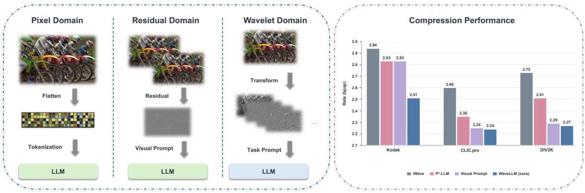
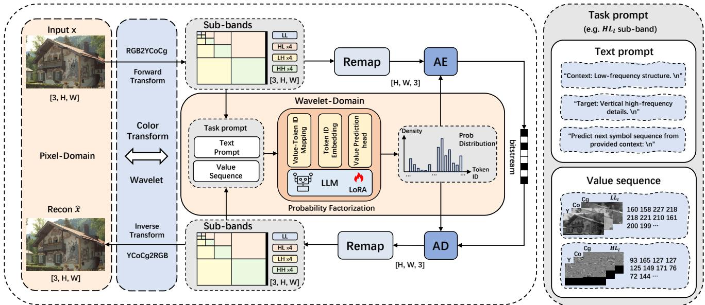
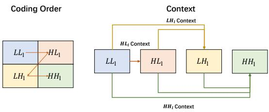
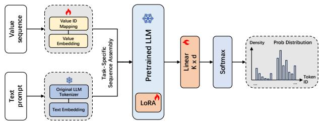
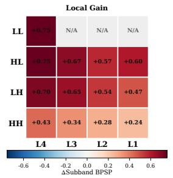
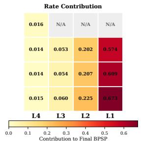
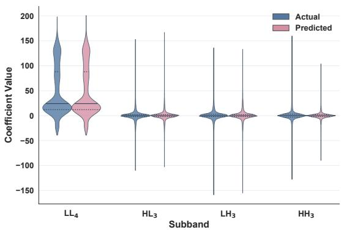

# WaveLLM: Wavelet-Domain LLM Entropy Modeling for Lossless Image Compression

Yue Yu University of Science and Technology of China Hefei, China yuyue02@mail.ustc.edu.cn

Bowei Kang   
MOE Key Laboratory of   
Brain-Inspired Intelligent Perception   
and Cognition   
University of Science and Technology   
of China   
Hefei, China   
kbw2000@mail.ustc.edu.cn   
Dong Liu   
MOE Key Laboratory of   
Brain-Inspired Intelligent Perception   
and Cognition   
University of Science and Technology   
of China   
Hefei, China   
dongeliu@ustc.edu.cn

Changsheng Gao Nanyang Technological University Singapore, Singapore changsheng.gao@ntu.edu.sg

Xiaoyan Sun✉∗   
National Engineering Laboratory for   
Brain-inspired Intelligence   
Technology and Application; MoE   
Key Laboratory of Brain-inspired   
Intelligent Perception and Cognition   
University of Science and Technology   
of China   
Hefei, China   
sunxiaoyan@ustc.edu.cn

## Abstract

Lossless image compression fundamentally relies on accurate entropy modeling, driving a recent shift toward large language model (LLM)-based methods. However, existing approaches mainly emphasize the modeling capacity of LLMs while directly serializing images into pixel or residual sequences, leaving heterogeneous signal patterns entangled within a single prediction stream. In this paper, we argue that efective entropy modeling depends not only on model capacity, but also on the predictability of the input representation. Motivated by this insight, we propose WaveLLM, a wavelet-domain LLM-based entropy model for lossless image compression. By decomposing an image into multi-level wavelet subbands, WaveLLM converts a heterogeneous prediction problem into a set of more structured and statistically homogeneous subproblems that are more amenable to autoregressive probability estimation. To bridge numerical coding symbols with the LLM’s native text token space, we introduce a dedicated numerical interface featuring value embeddings and a coeficient prediction head. Furthermore, a task-adaptive prompting strategy is designed to enable a single shared model to adapt to diverse subbands within a unified framework. Built on Llama-3.2-3B with LoRA adaptation, WaveLLM achieves 2.51, 2.24, and 2.27 bpsp on Kodak, CLIC.pro, and DIV2K,

respectively, outperforming the PixelCNN-based codec using the same wavelet transform by 0.43, 0.36, and 0.46 bpsp, and surpassing recent LLM-based lossless compressors on all three benchmarks.

## CCS Concepts

• Computing methodologies → Image compression.

## Keywords

lossless image compression, large language model, wavelet transform, entropy modeling

ACM Reference Format: Yue Yu, Bowei Kang, Changsheng Gao, Dong Liu, and Xiaoyan Sun. 2026. WaveLLM: Wavelet-Domain LLM Entropy Modeling for Lossless Image Compression. In Proceedings ofthe 34th ACM International Conference on Multimedia (MM ’26), November 10–14, 2026, Rio de Janeiro, Brazil. ACM, New York, NY, USA, 10 pages. https://doi.org/10.1145/3767308.3836432

## 1 Introduction

Unlike lossy compression, which can trade distortion for bitrate, lossless image compression fundamentally relies on entropy coding. Classical codecs improve this process through carefully designed predictors, reversible transforms, and context models [2, 4, 19, 33, 34, 39], while learned methods have further advanced coding eficiency by using neural networks to capture more complex dependencies [3, 15, 20, 28, 36, 42–44]. Related work spans image and video coding, feature and representation compression, and other structured signals, with associated datasets, benchmarks, and quality assessments [10–13, 17, 18, 21, 22, 31, 32]. These directions provide broader context for our setting, while recent lossless image coding explores large language models (LLMs) as entropy models [5, 7, 8].

  
Figure 1: Three paradigms for LLM-based lossless image compression and their performance. Left: pixel-domain methods [5] linearize the image into a pixel sequence, residual-domain methods [8] code residuals from a lossy reconstruction, and WaveLLM decomposes the image into multiresolution wavelet subbands and models their coeficients. Right: lossless coding rates (bpsp, lower is better) on three benchmarks.

In this paper, we argue that the accuracy of probability modeling is determined not only by the modeling capacity of the entropy model itself, but also by the predictability of its input. In other words, better entropy coding should not be attributed solely to a stronger model. It also requires an input representation that is more structured, more homogeneous, and thus easier to predict. When heterogeneous signal patterns are entangled within a single sequence, the entropy model must continuously adapt to sharply diferent statistical regimes, which makes accurate probability estimation intrinsically more dificult. By contrast, when the input is reorganized into simpler components with clearer statistical regularity, the same model can solve a substantially easier prediction problem.

Based on this insight, we propose to perform probability prediction and entropy coding in the wavelet domain. As the work most closely related to ours, we compare three LLM-based methods in Fig. 1. The pixel-domain method directly models pixels [5], requiring the entropy model to handle pixel distributions from diferent frequency components. The residual-domain method models residuals instead [8], which reduces the dificulty of probability modeling to some extent. In our method, we first transform the image into the wavelet domain and decompose it into progressively organized frequency subbands [6, 26, 34]. This decomposition separates coarse low-frequency structures from directional high-frequency details across multiple resolutions [26, 34], thereby converting a highly heterogeneous prediction problem into a collection of more structured and statistically homogeneous subproblems.

Nevertheless, combining the wavelet domain with an LLM is far from natural. Pretrained LLMs are designed for discrete text tokens, whereas wavelet coeficients are numerical symbols from visual sig nals. To bridge this gap, we design a dedicated interface that makes wavelet-domain entropy coding compatible with the LLM backbone. Specifically, we introduce a coding-oriented numerical adaptation mechanism that maps wavelet coeficients into a compact local symbol space, equips them with trainable value embeddings, and predicts valid coeficient values through a dedicated value prediction head. This design preserves numerical validity while enabling the pretrained LLM to operate efectively on wavelet-domain symbols.

Another challenge arises from the fact that diferent wavelet subbands still exhibit distinct statistical characteristics [34, 38]. Training an independent entropy model for each subband would significantly increase model complexity and undermine the practicality of LLM-based coding. To address this issue, we further propose a prompt-based adaptive entropy coding strategy, where one shared entropy model is reused across diferent subbands through task prompts. By conditioning the shared backbone on subband identity and decoded context, the same model adapts its probability predictions to diferent subband distributions without requiring separate models. In this way, the proposed framework achieves both subband-specific modeling flexibility and parameter eficiency.

Building on the above designs, we present WaveLLM, a waveletdomain LLM-based entropy model for lossless image compression. The contributions of this work are threefold.

• We note the importance of input predictability in lossless image compression and decompose each image into multiple wavelet subbands. The resulting subbands have distinct coeficient statistics that can be modeled separately.

• We design a dedicated interface between wavelet-domain signals and an LLM pretrained on language data. It maps coeficients to compact local IDs, uses a dedicated value embedding module, and predicts valid coeficient values over the local range through a dedicated value head.

• We propose a task-prompt mechanism for adaptive modeling of diferent subbands. By conditioning the shared backbone on subband identity and decoded context, WaveLLM adapts to distinct subband statistics without requiring separate models.

As shown in Fig. 1, WaveLLM achieves 2.51, 2.24, and 2.27 bpsp on Kodak, CLIC.pro, and DIV2K, respectively. Despite using only a 3B backbone, it outperforms recent 8B LLM-based compressors on all three benchmarks while remaining competitive with strong learned lossless codecs.

## 2 Related Work

## 2.1 Lossless Image Compression

Classical lossless codecs rely on predictive filtering and entropy coding. PNG [4], JPEG-LS [19, 39], FLIF [33], JPEG2000 [34], and JPEG XL [2] represent widely used designs. The reversible 5/3 lifting transform in JPEG2000 provides a practical route to lossless wavelet coding [6, 34]. Learned compression methods have explored causal autoregressive models such as PixelCNN and PixelCNN++ [30, 37], hierarchical latent-variable models [15, 28, 36], invertible flows [42, 43], residual coding [3, 29], and bit-plane decompositions [44]. Across these approaches, the central challenge remains accurate probability estimation over high-dimensional discrete image signals. CALLIC [20] reports strong learned-method results through content-adaptive per-image optimization.

## 2.2 Wavelet-Domain Codecs

Wavelets decompose an image into low-frequency structure and high-frequency detail at multiple resolutions [6, 26]. Natural-image wavelet coeficients are non-Gaussian and subband dependent [34, 38], with broader low-frequency responses and sparse, sharply peaked high-frequency coeficients. This separation makes the wavelet domain attractive for entropy modeling. WaveFormer and BVINet incorporate wavelet modules into Transformer-based video inpainting [40, 41]. Unlike these restoration models, WaveLLM uses a reversible wavelet decomposition and decoded same-level subbands for lossless entropy coding. In lossless coding, JPEG2000 established the canonical framework by combining the reversible 5/3 integer lifting transform with wavelet-domain context modeling and arithmetic coding [34]. The lossless branches of iWave and iWave++ use reversible 5/3 wavelet coding with learned PixelCNN entropy models [24, 25]. WaveLLM studies this setting and replaces the PixelCNN-style entropy model with a shared prompted LLM over codec-defined subband tasks.

## 2.3 LLMs for Lossless Image Compression

Beyond compressing intermediate representations produced by large models [10–13], recent LLM-based image compression directly employs pretrained language models as entropy models [5, 7, 8]. Delétang et al. demonstrated that autoregressive language modeling can be interpreted directly as compression [7]. In image coding, two recent methods apply pretrained LLMs to lossless compression. $\mathrm { P } ^ { 2 } { \mathrm { - L L M } }$ keeps the problem in the pixel domain and frames compression as next-pixel prediction [5]. The visual-prompt method introduces a lossy reconstruction as an auxiliary cue and codes the residual with an LLM [8]. Both papers report Llama-3-8B backbones. WaveLLM takes a diferent route. It introduces LLM-based entropy modeling into a reversible 5/3 wavelet codec, using a 3B backbone adapted through LoRA [16]. Unlike P2-LLM, which processes a rasterized pixel stream without codec-defined structure, and the visual-prompt method, which requires an auxiliary lossy codec to generate visual embeddings, WaveLLM operates within the causal structure of the wavelet codec. It relies on decoded context that is already available at each coding stage. At the coeficient interface, it also difers from the reserved-vocabulary strategy used by $\mathrm { P ^ { 2 } } .$ LLM by introducing a dedicated local value-ID space together with separate value embedding and prediction modules.

## 3 Method

## 3.1 Overall Framework

WaveLLM uses a reversible color transform, a fixed 5/3 wavelet transform, a causal coding order, and arithmetic coding, while the learnable part focuses on wavelet-domain probability factorization over codec-defined subbands. Figure 2 summarizes this workflow and highlights the entropy-modeling core composed of task prompts, the coding-oriented numerical interface, and the LLM probability model.

Concretely, an 8-bit RGB image is first converted to YCoCg and decomposed by a four-level fixed 5/3 integer wavelet transform. This produces 13 subbands: the deepest low-frequency band $L L _ { 4 }$ and three directional high-frequency bands $( H L _ { l } , L H _ { l } , H H _ { l } )$ at each of four levels. The reversible 5/3 lifting transform maps integers to integers for lossless coding. Table 5 fixes the transform, coding order, and arithmetic coder while varying only the entropy model. These subbands are coded in a fixed causal order. $L L _ { 4 }$ is coded first, followed by the three high-frequency bands at each level from the deepest level to the shallowest. For each subband, WaveLLM forms a task prompt, maps the resulting value sequence through the coding-oriented numerical interface, and uses the LLM to produce a probability distribution over coeficient values for arithmetic coding. The decoder entropy-decodes these subbands in the same order as the encoder. After each level is decoded, the inverse wavelet transform synthesizes the next shallower low-frequency band, ultimately reconstructing the original image exactly.

Before entering the LLM, integer coeficient values are remapped to local value IDs to bridge the gap between wavelet-coeficient arithmetic and the language model’s embedding space. For a threechannel subband tensor $u = [ Y , C o , C g ] \in \mathbb { Z } ^ { 3 \times h \times w }$ , the serialization uses raster order with channel interleaving:

$$
\boldsymbol { s } ( \boldsymbol { u } ) = \left[ Y _ { 1 , 1 } , C o _ { 1 , 1 } , C g _ { 1 , 1 } , Y _ { 1 , 2 } , C o _ { 1 , 2 } , C g _ { 1 , 2 } , \dots , Y _ { h , w } , C o _ { h , w } , C g _ { h , w } \right] .\tag{1}
$$

The same rule is applied to both context and target bands, ensuring that the autoregressive model always scans spatial positions in a consistent Y/Co/Cg order. Within the WaveLLM framework, the learnable part highlighted in Figure 2 is organized around the same three components emphasized in the Introduction. The following subsections detail these three components: Wavelet-Domain Probability Factorization (Section 3.2), Task Prompt Design (Section 3.3), and Value Interface and Model Training (Section 3.4).

## 3.2 Wavelet-Domain Probability Factorization

Let $x \in \mathbb { Z } ^ { 3 \times H \times W }$ be an 8-bit RGB image. WaveLLM applies a reversible color transform C from RGB to YCoCg [27] and a four-level fixed 5/3 lifting wavelet transform $\mathcal { W }$ [34]:

$$
\{ L L _ { 4 } , \{ H L _ { l } , L H _ { l } , H H _ { l } \} _ { l = 1 } ^ { 4 } \} = \mathcal { W } ( C ( x ) ) .\tag{2}
$$

Both transforms are lossless.

This decomposition restructures the entropy-modeling problem in a way favorable to autoregressive modeling. High-frequency sub bands are dominated by near-zero coeficients with sharply peaked distributions, while the low-frequency $L L _ { 4 }$ band carries the bulk of image energy with broader, more structured statistics. Separating these two regimes into distinct prediction tasks with explicit causal context removes the need for a single model to simultaneously track coarse structure and fine detail. This challenge is inherent in flat pixel streams. Section 4.3.1 provides direct experimental evidence for this advantage.

  
Figure 2: WaveLLM framework. Left: WaveLLM converts the input image to $\mathbf { Y C o C g } ,$ performs wavelet decomposition, and entropy-codes the resulting subbands using arithmetic coding. Within this coding pipeline, the learnable entropy-modeling core consists of task prompt construction, the coding-oriented numerical interface, and a shared LoRA-adapted LLM that outputs coeficient probability distributions. Decoding follows the symmetric path for exact reconstruction. Right: expanded task prompt for a representative $H L _ { l }$ task, including the natural-language text prompt and the serialized value sequence formed by same-level $L L _ { l }$ context and $H L _ { l }$ target values.

  
Figure 3: Within-level coding order and same-level context at level �. The red arrows indicate $L L _ { l }  H L _ { l }  L H _ { l }  H H _ { l } ;$ correspondingly, ��� uses $L L _ { l } ,$ , ��� uses $[ L L _ { l } , H L _ { l } ]$ , and ��� uses $[ L L _ { l } , H L _ { l } , L H _ { l } ]$ .

The coding order follows the lossless wavelet factorization. $L L _ { 4 }$ is coded first. Then, from the deepest level to the shallowest, $H L _ { l } ,$ $L H _ { l } ,$ and $H H _ { l }$ are coded in sequence, and the inverse wavelet step at each level reconstructs the next finer-resolution $L L _ { l - 1 }$ band for use as decoded context. In detail, the codec first models $L L _ { 4 }$ and then, at each level, predicts $H L _ { l } , L H _ { l } ,$ , and $H H _ { l }$ from the already de coded same-level context bands. Using $C _ { l } ^ { b }$ to denote the same-level context for band � at level �, Figure 3 illustrates this within-level ordering and dependency pattern. The left panel shows the spatial arrangement of the four subbands, and the red arrows indicate the coding order $L L _ { l } \to H L _ { l } \to L H _ { l } \to H H _ { l }$ . The right panel presents the same structure as a dependency graph: $C _ { I } ^ { H L } = L L _ { l }$ $C _ { I } ^ { L H } = [ L L _ { l } , H L _ { l } ]$ , and $C _ { l } ^ { H H } = [ L L _ { l } , H L _ { l } , L H _ { l } ]$ . Through this design, the entropy model remains causal.

The deepest $L L _ { 4 }$ band receives special treatment. The MED predictor from JPEG-LS [39] is applied first, and the LLM models the prediction residuals rather than raw coeficient values. The MED predictor concentrates the $L L _ { 4 }$ distribution near zero, making the subsequent autoregressive prediction easier. For high-frequency bands, integer wavelet coeficients are modeled directly.

## 3.3 Task Prompt Design

The LLM processes each subband as a one-dimensional sequence. Each context or target band uses the same raster-order, channelinterleaved serialization defined in Section 3.1. Let $y _ { I } ^ { b }$ denote the serialized target sequence for subband $b \in \{ H L , L H , \dot { H H } \}$ at level �, and let $r _ { L L }$ denote the serialized MED residuals for $L L _ { 4 }$

As illustrated in the right panel of Figure 2, the LLM input for each subband is organized as a task prompt with two components. Rather than reusing one generic instruction across all coding steps, WaveLLM assigns each subband a task-specific prompt. The text prompt is a task-specific natural-language string that identifies the subband type, describes the available context, and states the prediction objective (e.g., “Context: Low-frequency structure. Target: Vertical high-frequency details. Predict:\n”). These tokens are produced by the native Llama tokenizer and processed through the frozen text embedding module. The text prompt serves not only as a label but as the primary mechanism through which the shared backbone activates diferent statistical priors for diferent subbands. Ablation results in Section 4.4 show that removing prompts causes the largest single-component degradation. The value sequence con tains the serialized integer values of the decoded context and target bands, arranged in causal order and processed through the dedicated value embedding module described in Section 3.4. In the representative $H L _ { l }$ example shown in Figure 2, same-level $L L _ { l }$ serves as context and $H L _ { l }$ is the target band. Tasks with multiple context bands follow the same template with additional serialized context segments separated by delimiter tokens. For $L L _ { 4 } ,$ , only the text prompt and target MED residuals are needed.

## 3.4 Value Interface and Model Training

3.4.1 Coding-Oriented Numerical Interface. Integer wavelet coeficients should not be represented as ordinary text tokens for two reasons. First, although the native Llama vocabulary is indexed by consecutive token IDs, those IDs do not encode numerical locality. Neighboring token IDs correspond to neighboring text symbols rather than neighboring coeficient values. Second, raw coeficient values include negative integers and therefore cannot be used directly as valid embedding indices or classification labels. To bridge this gap, each integer symbol � is mapped to a local value ID

$$
z = v + o ,\tag{3}
$$

where � denotes the mapped local value ID, and $o = 5 1 2$ is a fixed ofset that shifts the observed coeficient range into the valid local range $\{ 0 , \ldots , K - 1 \}$ with � = 2048 while preserving numerical ordering. Near-zero coeficients, which are the most common values in high-frequency subbands, therefore fall near the center of this local space. Statistics show that valid coeficients satisfy � ∈ [−512, 1535].

Text prompt tokens and the delimiter token sep pass through the frozen text embedding module $E _ { \mathrm { t e x t } }$ (Figure 4, lower path). Coeficient and residual values pass through a trainable value embedding module $E _ { \mathrm { v a l } } ~ \in ~ \mathbb { R } ^ { K \times d }$ (upper path), where � is the LLM hidden dimension. This separation ensures that text semantics and coefficient numerics are processed through independent embedding pathways, avoiding the vocabulary mismatch that arises when coeficient values are treated as ordinary text tokens. It also difers from the reserved-vocabulary design in $\mathrm { P } ^ { 2 } .$ -LLM. WaveLLM defines a dedicated local value space with its own value embedding and value prediction head. The two embedding streams are then merged in a task-specific sequence assembly step:

$$
X = \left\{ \begin{array} { l l } { [ E _ { \mathrm { t e x t } } ( p _ { L L } ) , E _ { \mathrm { v a l } } ( z ( r _ { L L } ) ) ] , } & { L L _ { 4 } \mathrm { t a s k } , } \\ { [ E _ { \mathrm { t e x t } } ( p _ { b } ) , E _ { \mathrm { v a l } } ( z ( C _ { l } ^ { b } ) ) , E _ { \mathrm { t e x t } } ( s e p ) , E _ { \mathrm { v a l } } ( z ( y _ { l } ^ { b } ) ) ] , } & { \mathrm { H F ~ t a s k } , } \end{array} \right.\tag{4}
$$

where $\scriptstyle { \mathcal { P } } b$ denotes the text prompt for subband $b , \ y _ { l } ^ { b }$ denotes the serialized target sequence for subband � at level $l , C _ { l } ^ { b }$ denotes the decoded same-level context sequence, and sep is a delimiter token between context and target segments. When $\hat { \phantom { \left| \mathbf { \Omega } \right| } } C _ { l } ^ { b }$ contains multiple context bands, the same delimiter token is inserted between successive context segments in the same causal order. On the output side, a trainable value prediction head $W _ { \mathrm { v a l } } \in \mathbb { R } ^ { K \times d }$ (i.e., 2048 × �) replaces the full-vocabulary LM head for target positions. For more stable training, both $E _ { \mathrm { v a l } }$ and $W _ { \mathrm { v a l } }$ are initialized from a consecutive block of pretrained Llama parameters. This keeps the scale of the pretrained parameters, while the actual prediction space remains the local value vocabulary rather than the native full text vocabulary.

  
Figure 4: LLM entropy model. Text prompts use the frozen text embedding module, while coeficients are remapped to local IDs and embedded by a dedicated value embedding module. The assembled task sequence is processed by the LoRA-adapted backbone, and a value prediction head outputs probabilities over the local value range for arithmetic coding.

3.4.2 Backbone Adaptation and Training. The frozen backbone is Llama-3.2-3B [14], adapted via LoRA [16] inserted into attention and MLP projections. A single set of adapters is shared across all subband tasks and all four decomposition levels. This sharedadapter design uses fewer trainable parameters, reduces training cost, and improves stability.

Given input embeddings � with sequence length� , the backbone produces hidden states $h _ { 1 : T } .$ . At each target position � ∈ Ω, the value prediction head computes logits $\ell _ { i } = \bar { W _ { \mathrm { v a l } } } \bar { h _ { i } } \in \mathbb { R } ^ { K }$ , and the training loss is standard cross-entropy over the local value range:

$$
\mathcal { L } _ { \mathrm { C E } } = - \frac { 1 } { | \Omega | } \sum _ { i \in \Omega } \log \operatorname { s o f t m a x } ( \ell _ { i } ) _ { z _ { i } } .\tag{5}
$$

The estimated coding rate in bits per symbol is $\mathcal { L } _ { \mathrm { C E } } / \ln 2$ . During actual coding, the arithmetic coder uses the same distributions in the same order.

Training and testing are both patch based. After wavelet transformation, a patch from subband � at level � is denoted by

$$
P _ { l } ^ { b } \in \mathbb { Z } ^ { 3 \times h _ { p } \times w _ { p } } .\tag{6}
$$

Each training image is first wavelet transformed at full resolution to produce subbands, and patches are then cropped on the resulting wavelet-domain subbands. Training samples the 13 subband tasks through an epoch-wise shufled task queue:

$$
Q = \{ ( 4 , L L ) \} \cup \{ ( l , H L ) , ( l , L H ) , ( l , H H ) \} _ { l = 1 } ^ { 4 } .\tag{7}
$$

For each sampled task in $\scriptstyle Q ,$ a random patch is drawn from the corresponding subband. This random patch training still covers all 13 subband modeling tasks.

## 4 Experiments

## 4.1 Experimental Settings

4.1.1 Datasets. Training uses three natural-image datasets: the NIC training set (607,715 images at 256 × 256), the DIV2K training split (800 images at approximately 2K resolution) [1], and the

Table 1: Implementation settings.
<table><tr><td>Item</td><td>Setting</td></tr><tr><td>Backbone</td><td>Llama-3.2-3B (frozen)</td></tr><tr><td>Adaptation</td><td>LoRA (shared across all tasks)</td></tr><tr><td>LoRA rank / alpha / dropout</td><td>128 / 256 / 0.05</td></tr><tr><td>Target modules</td><td>q/k/v/o + gate/up/down proj</td></tr><tr><td>Color transform</td><td>reversible YCoCg</td></tr><tr><td>Wavelet transform</td><td>4-level fixed 5/3 lifting</td></tr><tr><td>Value range K / offset o</td><td>2048 / 512</td></tr><tr><td>Value embedding init</td><td>consecutive pretrained block</td></tr><tr><td>Patch size / batch / grad. accum.</td><td>48 /  1  /  16</td></tr><tr><td>Optimizer / learning rate</td><td> $\mathrm { A d a m W } / 1 0 ^ { - 5 }$ </td></tr><tr><td>Hardware</td><td>8×RTX 3090 (bf16)</td></tr><tr><td>Peak memory (single card)</td><td>16.2 GB (Kodak) / 20.9 GB (DIV2K)</td></tr></table>

Flickr2K training split (2,650 images) [23]. We use a two-stage schedule. The model is first pretrained on the lower-resolution NIC corpus and then finetuned on the higher-resolution DIV2K and Flickr2K images. All training images are disjoint from the held-out evaluation sets. Model selection uses a separate validation split.

Evaluation is performed on three standard benchmarks: Kodak [9] (24 images, 768 × 512), the professional track of CLIC [35] (41 images), and the DIV2K validation set [1] (100 images). Images are converted to YCoCg and padded to multiples of 16 for four-level wavelet decomposition. The rates reported for WaveLLM are measured from the written bitstreams and normalized by the original image dimensions before padding

4.1.2 Training Details. Detailed implementation settings are summarized in Table 1. The backbone is Llama-3.2-3B with frozen pretrained weights, and LoRA is applied to the q\_proj, k\_proj, v\_proj, o\_proj, gate\_proj, up\_proj, and down\_proj modules. The rank, alpha, and dropout are 128, 256, and 0.05, respectively. The local value range uses � = 2048 with ofset � = 512. The patch size in Table 1 refers to crops taken from wavelet-domain subbands after full-image transformation. Training uses batch size 1 with gradient accumulation 16, AdamW, and a learning rate of $1 0 ^ { - 5 }$ on 8 RTX 3090 GPUs in bf16.

4.1.3 Baseline Codecs. The baselines cover three groups. Traditional codecs include PNG, JPEG2000, JPEG-LS, FLIF, and JPEG XL [2, 4, 19, 33, 34, 39]. Learned lossless codecs include L3C, RC, iWave, iVPF, DLPR, ArIB-BPS, and CALLIC [3, 20, 24, 28, 29, 43, 44]. LLM-based baselines include Delétang et al., P2-LLM, and the visualprompt method [5, 7, 8].

## 4.2 Main Results

4.2.1 Comparison with Existing Methods. Table 2 presents a comparison between WaveLLM and traditional, learned, and LLM-based methods. Table 2 reports WaveLLM rates alongside rates quoted from prior work. Table 3 combines our iWave and WaveLLM measurements with runtime figures quoted from prior work; Tables 4 and 5 report measurements from our setup.

WaveLLM with a 3B backbone yields lower rates than both $\mathrm { P } ^ { 2 } \cdot$ LLM and the visual-prompt method, even though both employ 8B backbones. On Kodak, WaveLLM achieves 2.51 bpsp versus 2.83 bpsp for both LLM competitors, a reduction of 11.3%. On CLIC.pro and DIV2K, it reaches 2.24 and 2.27 bpsp versus 2.35/2.25 and 2.51/2.29 bpsp, respectively. WaveLLM is also competitive with CALLIC [20], a strong learned method that uses contentadaptive per-image fine-tuning. Among strong non-LLM baselines, WaveLLM also improves over JPEG XL, the strongest traditional codec in Table 2, and the lossless iWave codec in the matched 5/3 setting, by 0.36 and 0.43 bpsp on Kodak. Exact reconstruction was verified on all reported test sets, with no observed value-range overflow or out-of-range input or label indices.

4.2.2 Computational Cost. Table 3 reports runtime and computational cost on Kodak. Because hardware, implementation details, and model sizes difer across papers, we interpret these numbers qualitatively. WaveLLM requires about 2.6 × 107 kMACs/pixel and takes 65.1 s to encode and 152.8 s to decode each Kodak image in our implementation. Although its 3B backbone is smaller than the 8B backbones used by prior LLM-based methods, end-to-end runtime remains hardware- and implementation-dependent. WaveLLM parallelizes its 13 subband tasks across 8 RTX 3090 GPUs, and its peak memory of about 16.2 GB per card allows the full pipeline to fit on 24 GB consumer GPUs. This implementation also benefits from patch-wise parallel processing and an optimized arithmetic coder. By contrast, the iWave baseline follows serial pixel-wise inference and is measured on a single RTX 3090 in our environment. The complexity and timing figures for Delétang et al. are quoted from [8] rather than measured by us, as the original model weights are not publicly available. These measurements describe the current implementation; runtime reduction remains future work.

## 4.3 Analysis of the Proposed Design

4.3.1 Why the Wavelet Domain. To test directly whether the coding domain matters for LLM-based entropy modeling, we implement two alternative variants under the same general paradigm: a pixel-domain variant that performs next-token prediction on rasterized RGB values, and a residual-based variant that encodes the residual between the original image and a lossy reconstruction, using the global lossy image and the corresponding local reconstruction patch as visual prompts. Table 4 summarizes results across all three benchmarks. Under the same Llama-3.2-3B backbone and next-token entropy-modeling framework, the wavelet-domain formulation is consistently the strongest. This comparison is especially relevant because WaveLLM is, to the best ofour knowledge, the first LLM-based lossless compressor formulated directly in the wavelet domain.

The pixel-domain variant is already competitive, indicating that the value interface and autoregressive LLM framework remain effective beyond the wavelet setting. However, the wavelet-domain formulation outperforms it by 0.21, 0.11, and 0.17 bpsp on Kodak, CLIC.pro, and DIV2K, respectively. The residual-based variant yields higher rates under our implementation, and its total rate includes both the lossy base bits and the coded residual bits. We do not introduce an explicit parametric density model in the residual domain, which may limit how fully the model capacity is used in that setting. Overall, the wavelet-domain formulation performs best among the tested variants.

4.3.2 Wavelet-Domain Backbone-Scale Analysis. Table 5 shows coding performance for entropy models within the same 5/3 wavelet codec. The first row uses PixelCNN to autoregressively model the coeficients, while the other rows use LLM backbones ofdiferent sizes. Compared with PixelCNN, WaveLLM-3B reduces the rate from 2.94 to 2.51 bpsp on Kodak (−0.43, −14.6%), from 2.60 to 2.24 bpsp on CLIC.pro (−0.36, −13.8%), and from 2.73 to 2.27 bpsp on DIV2K $( - 0 . 4 6 , - 1 6 . 8 \% )$ . WaveLLM-1B already outperforms the PixelCNN baseline, showing that the wavelet-domain formulation remains efective at a smaller backbone scale. Scaling from 1B to 3B yields further gains of 0.37/0.17/0.23 bpsp, indicating that model capacity still matters within this formulation. The larger backbone provides more capacity for the shared adapters to specialize across all 13 subband types. Figure 5 shows each subband’s local gain and contribution to the Kodak01 bitrate. At every subband, the LLM yields a positive local gain over iWave, which indicates more accurate probability prediction throughout the hierarchy. Low-frequency and coarse high-frequency bands benefit most, whereas shallow Level-1 bands dominate the total rate because they contain most coded symbols.

Table 2: Lossless coding performance (bpsp) under reported settings; green percentages show bitrate increase over WaveLLM. Training data and auxiliary signals difer across papers.
<table><tr><td>Category</td><td>Codec</td><td>Kodak</td><td> $\mathrm { C L I C . p r o }$ </td><td>DIV2K</td></tr><tr><td rowspan="5">Traditional</td><td>PNG</td><td> $4 . 3 5 ~ { + 7 3 . 3 \% }$ </td><td> $3 . 9 3 + 7 5 . 4 \%$ </td><td> $4 . 2 3 + 8 6 . 3 \%$ </td></tr><tr><td>JPEG2000</td><td> $3 . 1 9 \ + 2 7 . 1 \%$ </td><td> $2 . 9 3 + 3 0 . 8 \%$ </td><td> $3 . 1 2 \ + 3 7 . 4 \%$ </td></tr><tr><td>JPEG-LS</td><td> $3 . 1 6 ~ + 2 5 . 9 \%$ </td><td> $2 . 8 2 \substack { + 2 5 . 9 \% }$ </td><td> $2 . 9 9 + 3 1 . 7 \%$ </td></tr><tr><td>FLIF</td><td> $2 . 9 0 + 1 5 . 5 \%$ </td><td> $2 . 7 2 \ + 2 1 . 4 \%$ </td><td> $2 . 9 1 \substack { + 2 8 . 2 \% }$ </td></tr><tr><td>JPEG XL</td><td> $2 . 8 7 \ + 1 4 . 3 \%$ </td><td> $2 . 6 3 + 1 7 . 4 \%$ </td><td> $2 . 7 9 \ + 2 2 . 9 \%$ </td></tr><tr><td rowspan="8">Learned</td><td>L3C [28]</td><td> $3 . 2 6 ~ { + 2 9 . 9 \% }$ </td><td> $2 . 9 4 \ + 3 1 . 2 \%$ </td><td> $3 . 0 9 + 3 6 . 1 \%$ </td></tr><tr><td>RC [29]</td><td> $3 . 3 8 ~ + 3 4 . 7 \%$ </td><td> $2 . 9 3 + 3 0 . 8 \%$ </td><td> $3 . 0 8 ~ { + 3 5 . 7 \% }$ </td></tr><tr><td>iWave [24]</td><td> $2 . 9 4 + 1 7 . 1 \%$ </td><td> $2 . 6 0 + 1 6 . 1 \%$ </td><td> $2 . 7 3 + 2 0 . 3 \%$ </td></tr><tr><td>iVPF [43]</td><td></td><td> $2 . 5 4 + 1 3 . 4 \%$ </td><td> $2 . 6 8 + 1 8 . 1 \%$ </td></tr><tr><td>DLPR [3]</td><td> $2 . 8 6 ~ { + } 1 3 . 9 \%$ </td><td> $2 . 4 2 \ + 8 . 0 \%$ </td><td> $2 . 5 5 + 1 2 . 3 \%$ </td></tr><tr><td>ArIB-BPS [44]</td><td> $2 . 7 8 \ + 1 0 . 8 \%$ </td><td> $2 . 4 2 \ + 8 . 0 \%$ </td><td> $2 . 5 5 + 1 2 . 3 \%$ </td></tr><tr><td>CALLIC [20]</td><td> $2 . 5 4 \ + 1 . 2 \%$ </td><td> $2 . 3 0 \ { + 2 . 7 \% }$ </td><td> $2 . 4 6 \ + 8 . 4 \%$ </td></tr><tr><td></td><td></td><td></td><td></td></tr><tr><td rowspan="4">LLM-based</td><td>Delétang et al. [7]</td><td> $3 . 9 6 ~ + 5 7 . 8 \%$ </td><td> $3 . 8 9 + 7 3 . 7 \%$ </td><td> $4 . 1 7 ~ + 8 3 . 7 \%$ </td></tr><tr><td>P²-LLM (8B) [5]</td><td> $2 . 8 3 + 1 2 . 7 \%$ </td><td> $2 . 3 5 ~ { + 4 . 9 \% }$ </td><td> $2 . 5 1 + 1 0 . 6 \%$ </td></tr><tr><td>Visual Prompt (8B) [8]</td><td> $2 . 8 3 + 1 2 . 7 \%$ </td><td> $2 . 2 5 ~ { + 0 . 4 \% }$ </td><td> $2 . 2 9 \ { _ { + 0 . 9 \% } }$ </td></tr><tr><td>WaveLLM (3B, ours)</td><td>2.51</td><td>2.24</td><td>2.27</td></tr></table>

Table 3: Per-image runtime on Kodak $( 7 6 8 \times 5 1 2 ) ,$ including arithmetic coding and I/O. iWave and WaveLLM are measured in our environment; other entries are quoted from prior work on diferent hardware. The kMACs/pixel column reports multiply-accumulate operations per output pixel where available.
<table><tr><td>Method</td><td> $\operatorname { k M A C s } / \operatorname { p x }$ </td><td>Enc. (s)</td><td>Dec. (s)</td><td>Hardware</td></tr><tr><td>iWave (PixelCNN)</td><td></td><td>582.9</td><td>611.6</td><td>RTX3090</td></tr><tr><td>Delétang et al. (8B)</td><td> $2 . 1 \times 1 0 ^ { 7 }$ </td><td>10.44</td><td>288.0</td><td>4×A100</td></tr><tr><td> $\mathrm { P ^ { 2 } \mathrm { - L L M \left( 8 B \right) } }$ </td><td></td><td>14.9</td><td>273.1</td><td>8×A800</td></tr><tr><td>Visual Prompt (8B)</td><td> $4 . 2 \times 1 0 ^ { 7 }$ </td><td>21.1</td><td>495.6</td><td>4×A100</td></tr><tr><td>WaveLLM (3B)</td><td> $2 . 6 \times 1 0 ^ { 7 }$ </td><td>65.1</td><td>152.8</td><td>8×RTX3090</td></tr></table>

Table 4: Coding-domain comparison under the same 3B setup. Pixel uses rasterized RGB; Residual codes residuals using the global lossy image and corresponding local reconstruction patch as prompts; Wavelet codes integer subband coeficients with same-level context. Green percentages indicate relative bitrate increase over Wavelet. Lower is better.
<table><tr><td>Domain</td><td>Side information</td><td>Kodak</td><td>CLIC.pro</td><td>DIV2K</td></tr><tr><td>Pixel</td><td>none</td><td> $2 . 7 2 \ + 8 . 4 \%$ </td><td> $2 . 3 5 ~ { + 4 . 9 \% }$ </td><td> $2 . 4 4 \substack { + 7 . 5 \% }$ </td></tr><tr><td>Residual</td><td>lossy thumb.</td><td> $2 . 9 7 \ + 1 8 . 3 \%$ </td><td> $2 . 4 3 ~ + 8 . 5 \%$ </td><td> $2 . 4 8 \ + 9 . 3 \%$ </td></tr><tr><td>Wavelet</td><td>same-level context</td><td>2.51</td><td>2.24</td><td>2.27</td></tr></table>

Table 5: Lossless coding performance (bpsp) within the same reversible wavelet codec. The transform, coding order, and arithmetic coder are fixed; only the entropy model changes. Green percentages indicate the relative bitrate increase over WaveLLM-3B. Lower is better.
<table><tr><td>Entropy model / Backbone</td><td>Kodak</td><td> $\mathrm { C L I C . p r o }$ </td><td>DIV2K</td></tr><tr><td>PixelCNN (iWave)</td><td> $2 . 9 4 + 1 7 . 1 \%$ </td><td> $2 . 6 0 \ { + } 1 6 . 1 \%$ </td><td> $2 . 7 3 \ + 2 0 . 3 \%$ </td></tr><tr><td>WaveLLM-1B</td><td>2.88 +14.7%</td><td> $2 . 4 1 ~ { + } 7 . 6 \%$ </td><td>2.50 +10.1%</td></tr><tr><td>WaveLLM-3B</td><td>2.51</td><td>2.24</td><td>2.27</td></tr></table>

4.3.3 Task-Specific Distribution Analysis. Figure 6 compares actual and LLM-predicted peak-value distributions for four subbands: $L L _ { 4 } ,$ $H L _ { 3 } , L H _ { 3 } ,$ and $H H _ { 3 } ,$ . Predicted peaks are task-specific and align with actual distributions, indicating that one shared LoRA-adapted backbone learns subband-specific statistics. For $L L _ { 4 } ,$ the plotted distributions are shown in coeficient space after converting the MED-based coding results back from residual representation. The

  
Figure 5: Wavelet-domain local gain and rate contribution on Kodak01. Rows follow LL/HL/LH/HH and columns follow Levels 4 to 1. Left: ΔSubband $\mathbf { B P S P } = \mathbf { B P S P _ { i W a v e } } -$ $\mathbf { B P S P _ { W a v e L L M } ; }$ right: each subband’s absolute contribution to the final WaveLLM bitrate. Warmer colors indicate larger values.

  
Figure 6: Actual coeficient and LLM-predicted peak-value distributions for four Kodak01 subbands. Each pair compares the two distributions at matched positions. $L L _ { 4 }$ is shown in coeficient space after converting MED residuals back; the remaining pairs show $H L _ { 3 } , L H _ { 3 } ,$ and �� .

$L L _ { 4 }$ coeficients follow a much broader distribution, while $H L _ { 3 } , L H _ { 3 } ,$ and ��3 remain sharply peaked around zero. Predictions for the three high-frequency bands difer in tails and spread despite similar overall shapes. Task prompts and decoded context steer the shared backbone toward subband-specific distributions rather than a single generic prior across the 13 entropy-modeling tasks. This lets one shared backbone model all 13 subband tasks.

## 4.4 Ablation Study

Table 6 isolates four design choices on Kodak and CLIC.pro; each row changes one component relative to the full system (a). The ablations address four themes: task identity, the numerical interface, context design, and low-frequency residual modeling.

4.4.1 Task Identity and Prompt. Removing text prompts causes the largest single-component degradation (row b, +0.11/+0.21 bpsp on Kodak/CLIC.pro). Without task-specific instructions, the shared backbone lacks an explicit task-identity signal and tends to approximate an average distribution across the 13 subband tasks. These results support the efectiveness of the proposed task prompt.

Table 6: Ablations of WaveLLM (bpsp). Each row changes one design choice relative to the full system (a). Δ: rate increase (positive = worse). Val. IF: value interface. HF scope: same = same-level, LL = LL-only, +par. = same + parent-level.
<table><tr><td></td><td>Prompt Val. IF</td><td></td><td>HF scope</td><td>MED</td><td>Kodak (∆)</td><td> ${ \mathrm { C L I C . p r o ~ } } ( \Delta )$ </td></tr><tr><td>(a) Full system</td><td>√</td><td>ded.</td><td>same</td><td>√</td><td>2.51</td><td>2.24</td></tr><tr><td>(b) − prompt</td><td>X</td><td>ded.</td><td>same</td><td>√</td><td>2.62 (+0.11)</td><td>2.45 (+0.21)</td></tr><tr><td>(c) − val. IF</td><td>√</td><td>res.</td><td>same</td><td>√</td><td>2.58 (+0.07)</td><td>2.32 (+0.08)</td></tr><tr><td>(d) − HF ctx</td><td>√</td><td>ded.</td><td>LL</td><td>√</td><td>2.54 (+0.03)</td><td>2.30 (+0.06)</td></tr><tr><td>(e) + parent HF</td><td>√</td><td>ded.</td><td>same+par.</td><td>√</td><td>2.74 (+0.23)</td><td>2.51 (+0.27)</td></tr><tr><td> $\mathrm { ( f ) - M E D }$ </td><td>√</td><td>ded.</td><td>same</td><td>X</td><td>2.52 (+0.01)</td><td>2.27 (+0.03)</td></tr></table>

4.4.2 Numerical Interface. Using the native Llama vocabulary in place of the value interface increases the rate by +0.07/+0.08 bpsp (row c). Neighboring coeficients may map to distant token IDs, and language-trained embeddings introduce a domain gap. The native 128K vocabulary also defines a less compact probability space. The proposed local value interface avoids these issues and yields more stable coeficient modeling.

4.4.3 Context Design. We test two context variants: same-level $L L _ { l }$ only (row $\mathrm { d } , + 0 . 0 3 / + 0 . 0 6$ bpsp on Kodak/CLIC.pro) and samelevel plus parent HF bands (row e, +0.23/+0.27 bpsp). Using only $L L _ { l }$ causes a small loss because it provides most of the useful lowfrequency context. Adding parent-level HF bands is more harmful, likely because the longer sequence weakens local attention and the coarser scale is less aligned with the target statistics. These results support the current design based on same-level decoded context.

4.4.4 Low-Frequency MED Residuals. Omitting MED residual coding for $L L _ { 4 }$ (row $\mathrm { f } , + 0 . 0 1 / + 0 . 0 3$ bpsp on Kodak/CLIC.pro) causes a small but consistent loss. Figure 5 shows that $L L _ { 4 }$ itself contributes only about 0.016 bpsp to the Kodak01 total rate. Even so, MED makes the $L L _ { 4 }$ representation more concentrated and closer to the high-frequency subbands, which appears to benefit end-to-end training.

## 5 Conclusion

We presented WaveLLM, a wavelet-domain LLM entropy modeling framework for lossless image compression. It combines a codingoriented numerical interface, task prompts, and same-level decoded context within a LoRA-adapted Llama-3.2-3B backbone. WaveLLM achieves 2.51, 2.24, and 2.27 bpsp on Kodak, CLIC.pro, and DIV2K, respectively, outperforming existing LLM-based compressors on all three benchmarks while remaining competitive with strong lossless codecs. These results suggest that wavelet subbands provide a more suitable representation for LLM-based probability modeling than the tested flat pixel and residual sequences. By separating image content into wavelet subbands and guiding each prediction with task prompts and decoded context, WaveLLM enables more accurate entropy estimation. Future work will consider distillation, quantization, and near-lossless coding.

## Acknowledgments

This work was in part supported by the National Natural Science Foundation of China under grants 62472399 and Open Fund of APKL of BIIP, IAI, Hefei Comprehensive National Science Center under grants 24YGXT003.

## References

[1] Eirikur Agustsson and Radu Timofte. 2017. NTIRE 2017 Challenge on Single Image Super-Resolution: Dataset and Study. In 2017 IEEE Conference on Computer Vision and Pattern Recognition Workshops (CVPRW). 1122–1131. doi:10.1109 CVPRW.2017.150

[2] Jyrki Alakuijala, Ruud van Asseldonk, Sami Boukortt, Martin Bruse, Iulia-Maria Comşa, Moritz Firsching, Thomas Fischbacher, Evgenii Kliuchnikov, Sebastian Gomez, Robert Obryk, Krzysztof Potempa, Alexander Rhatushnyak, Jon Sneyers, Zoltan Szabadka, Lode Vandevenne, Luca Versari, and Jan Wassenberg. 2019. JPEG XL next-generation image compression architecture and coding tools. In Applications ofDigital Image Processing XLII, Andrew G. Tescher and Touradj Ebrahimi (Eds.), Vol. 11137. International Society for Optics and Photonics, SPIE 111370K. doi:10.1117/12.2529237

[3] Yuanchao Bai, Xianming Liu, Kai Wang, Xiangyang Ji, Xiaolin Wu, and Wen Gao. 2024. Deep Lossy Plus Residual Coding for Lossless and Near-Lossless Image Compression. IEEE Transactions on Pattern Analysis and Machine Intelligence 46, 5 (2024), 3577–3594. doi:10.1109/TPAMI.2023.3348486

[4] Thomas Boutell. 1997. PNG (Portable Network Graphics) Specification Version 1.0. Technical report. https://www.w3.org/TR/REC-png-multi.html

[5] Kecheng Chen, Pingping Zhang, Hui Liu, Jie Liu, Yibing Liu, Jiaxin Huang, Shiqi Wang, Hong Yan, and Haoliang Li. 2025. Large Language Models for Lossless Image Compression: Next-Pixel Prediction in Language Space is All You Need. In Advances in Neural Information Processing Systems, D. Belgrave, C. Zhang, H. Lin, R. Pascanu, P. Koniusz, M. Ghassemi, and N. Chen (Eds.), Vol. 38. Curran Associates, Inc., 157548–157569. doi:10.52202/085713-5264

[6] Ingrid Daubechies and Wim Sweldens. 1998. Factoring wavelet transforms into lifting steps. Journal of Fourier Analysis and Applications 4, 3 (1998), 247–269. doi:10.1007/BF02476026

[7] Gregoire Deletang, Anian Ruoss, Paul-Ambroise Duquenne, Elliot Catt, Tim Genewein, Christopher Mattern, Jordi Grau-Moya, Li Kevin Wenliang, Matthew Aitchison, Laurent Orseau, Marcus Hutter, and Joel Veness. 2024. Language Modeling Is Compression. In International Conference on Learning Representations, B. Kim, Y. Yue, S. Chaudhuri, K. Fragkiadaki, M. Khan, and Y. Sun (Eds.), Vol. 2024. 14165–14181. https://proceedings.iclr.cc/paper\_files/paper/2024/file/ 3cbf627fa24fb6cb576e04e689b9428b-Paper-Conference.pdf

[8] Junhao Du, Chuqin Zhou, Ning Cao, Gang Chen, Yunuo Chen, Zhengxue Cheng, Li Song, Guo Lu, and Wenjun Zhang. 2025. Large Language Model for Lossless Image Compression with Visual Prompts. arXiv:2502.16163 [eess.IV] https: //arxiv.org/abs/2502.16163

[9] Eastman Kodak. 1993. Kodak Lossless True Color Image Suite (PhotoCD PCD0992). https://r0k.us/graphics/kodak/

[10] Changsheng Gao, Shan Liu, Feng Wu, and Weisi Lin. 2025. Cross-Architecture Universal Feature Coding Via Distribution Alignment. In 2025 IEEE International Conference on Image Processing Workshops (ICIPW). 428–433. doi:10.1109/ ICIPW68931.2025.11386173

[11] Changsheng Gao, Zijie Liu, Li Li, Dong Liu, Xiaoyan Sun, and Weisi Lin. 2025. DT-UFC: Universal Large Model Feature Coding via Peaky-to-Balanced Distribution Transformation. In Proceedings of the 33rd ACM International Conference on Multimedia (Dublin, Ireland) (MM ’25). Association for Computing Machinery, New York, NY, USA, 5198–5207. doi:10.1145/3746027.3755814

[12] Changsheng Gao, Yifan Ma, Qiaoxi Chen, Yenan Xu, Dong Liu, and Weisi Lin. 2025. Feature Coding in the Era of Large Models: Dataset, Test Conditions, and Benchmark. In 2025 IEEE/CVFInternational Conference on Computer Vision (ICCV). 1068–1077. doi:10.1109/ICCV51701.2025.00107

[13] Changsheng Gao, Wei Zhou, Guosheng Lin, and Weisi Lin. 2025. Compressed Feature Quality Assessment: Dataset and Baselines. In Proceedings ofthe 33rd ACM International Conference on Multimedia (Dublin, Ireland) (MM ’25). Association for Computing Machinery, New York, NY, USA, 13450–13456. doi:10.1145/3746027. 3758309

[14] Aaron Grattafiori, Abhimanyu Dubey, Abhinav Jauhri, et al. 2024. The Llama 3 Herd of Models. arXiv:2407.21783 [cs.AI] https://arxiv.org/abs/2407.21783

[15] Emiel Hoogeboom, Jorn Peters, Rianne van den Berg, and Max Welling. 2019. Integer Discrete Flows and Lossless Compression. In Advances in Neural Information Processing Systems, H. Wallach, H. Larochelle, A. Beygelzimer, F. d'Alché-Buc, E. Fox, and R. Garnett (Eds.), Vol. 32. Curran Associates, Inc. https://proceedings.neurips.cc/paper\_files/paper/2019/file 9e9a30b74c49d07d8150c8c83b1ccf07-Paper.pdf

[16] Edward J Hu, yelong shen, Phillip Wallis, Zeyuan Allen-Zhu, Yuanzhi Li, Shean Wang, Lu Wang, and Weizhu Chen. 2022. LoRA: Low-Rank Adaptation of Large

Language Models. In International Conference on Learning Representations. https: //openreview.net/forum?id=nZeVKeeFYf9

[17] Zhimeng Huang, Chuanmin Jia, Shanshe Wang, and Siwei Ma. 2021. Visual Analysis Motivated Rate-Distortion Model for Image Coding. In 2021 IEEE International Conference on Multimedia and Expo (ICME). 1–6. doi:10.1109/ICME51207. 2021.9428417

[18] Zhimeng Huang, Rongao Yuan, Junlong Gao, Qi Mao, Siwei Ma, Wen Gao, and Chuanmin Jia. 2026. Discovering Adaptive Task Dependencies for Eficient Multi-Task Representation Compression. In Proceedings of the IEEE/CVF Conference on Computer Vision and Pattern Recognition (CVPR). 5326–5336.

[19] ITU-T and ISO/IEC JTC 1. 1998. ITU-T Recommendation T.87: Information Technology — Lossless and Near-lossless Compression of Continuous-tone Still Images (JPEG-LS Baseline).

[20] Daxin Li, Yuanchao Bai, Kai Wang, Junjun Jiang, Xianming Liu, and Wen Gao. 2025. CALLIC: Content Adaptive Learning for Lossless Image Compression. In Proceedings ofthe AAAI Conference on Artificial Intelligence, Vol. 39. 4679–4688. doi:10.1609/aaai.v39i5.32494

[21] Zhuoyuan Li, Junqi Liao, Chuanbo Tang, Haotian Zhang, Yuqi Li, Yifan Bian, Xihua Sheng, Xinmin Feng, Yao Li, Changsheng Gao, Li Li, Dong Liu, and Feng Wu. 2026. USTC-TD: A Test Dataset and Benchmark for Image and Video Coding in 2020s. IEEE Transactions on Multimedia 28 (2026), 269–284. doi:10.1109/TMM. 2025.3608643

[22] Zhuoyuan Li, Zikun Yuan, Li Li, Dong Liu, Xiaohu Tang, and Feng Wu. 2024. Object Segmentation-Assisted Inter Prediction for Versatile Video Coding. IEEE Transactions on Broadcasting 70, 4 (2024), 1236–1253. doi:10.1109/TBC.2024. 3434520

[23] Bee Lim, Sanghyun Son, Heewon Kim, Seungjun Nah, and Kyoung Mu Lee. 2017. Enhanced Deep Residual Networks for Single Image Super-Resolution. In Proceedings ofthe IEEE Conference on Computer Vision and Pattern Recognition (CVPR) Workshops.

[24] Haichuan Ma, Dong Liu, Ruiqin Xiong, and Feng Wu. 2020. iWave: CNN-Based Wavelet-Like Transform for Image Compression. IEEE Transactions on Multimedia 22, 7 (2020), 1667–1679. doi:10.1109/TMM.2019.2957990

[25] Haichuan Ma, Dong Liu, Ning Yan, Houqiang Li, and Feng Wu. 2022. End-to-End Optimized Versatile Image Compression With Wavelet-Like Transform. IEEE Transactions on Pattern Analysis and Machine Intelligence 44, 3 (2022), 1247–1263. doi:10.1109/TPAMI.2020.3026003

[26] S.G. Mallat. 1989. A theory for multiresolution signal decomposition: the wavelet representation. IEEE Transactions on Pattern Analysis and Machine Intelligence 11, 7 (1989), 674–693. doi:10.1109/34.192463

[27] Henrique S. Malvar, Gary J. Sullivan, and Sridhar Srinivasan. 2008. Lifting-based reversible color transformations for image compression. In Applications of Digital Image Processing XXXI, Andrew G. Tescher (Ed.), Vol. 7073. International Society for Optics and Photonics, SPIE, 707307. doi:10.1117/12.797091

[28] Fabian Mentzer, Eirikur Agustsson, Michael Tschannen, Radu Timofte, and Luc Van Gool. 2019. Practical Full Resolution Learned Lossless Image Compression. In Proceedings of the IEEE/CVF Conference on Computer Vision and Pattern Recognition (CVPR).

[29] Fabian Mentzer, Luc Van Gool, and Michael Tschannen. 2020. Learning Better Lossless Compression Using Lossy Compression. In Proceedings ofthe IEEE/CVF Conference on Computer Vision and Pattern Recognition (CVPR).

[30] Tim Salimans, Andrej Karpathy, Xi Chen, and Diederik P. Kingma. 2017. Pixel-CNN++: Improving the PixelCNN with Discretized Logistic Mixture Likelihood and Other Modifications. In International Conference on Learning Representations. https://openreview.net/forum?id=BJrFC6ceg

[31] Xihua Sheng, Peilin Chen, Shiqi Wang, and Dapeng Oliver Wu. 2026. DRFC: An End-to-End Deep Dynamic RF Signal Compression Framework. IEEE Transactions on Circuits and Systems for Video Technology 36, 1 (2026), 1104–1116. doi:10.1109/ TCSVT.2025.3596840

[32] Xihua Sheng, Li Li, Dong Liu, and Houqiang Li. 2024. Spatial Decomposition and Temporal Fusion Based Inter Prediction for Learned Video Compression. IEEE Transactions on Circuits and Systems for Video Technology 34, 7 (2024), 6460–6473. doi:10.1109/TCSVT.2024.3360248

[33] Jon Sneyers and Pieter Wuille. 2016. FLIF: Free lossless image format based on MANIAC compression. In 2016 IEEE International Conference on Image Processing (ICIP). 66–70. doi:10.1109/ICIP.2016.753232

[34] David S. Taubman and Michael W. Marcellin. 2002. JPEG2000: Image Compression Fundamentals, Standards and Practice. Springer.

[35] George Toderici, Wenzhe Shi, Radu Timofte, Lucas Theis, Johannes Balle, Eirikur Agustsson, Nick Johnston, and Fabian Mentzer. 2020. Workshop and Challenge on Learned Image Compression (CLIC2020). https://archive.compression.cc/.

[36] James Townsend, Thomas Bird, Julius Kunze, and David Barber. 2020. HiLLoC: lossless image compression with hierarchical latent variable models. In International Conference on Learning Representations. https://openreview.net/forum?id= r1lZgyBYwS

[37] Aaron van den Oord, Nal Kalchbrenner, Lasse Espeholt, koray kavukcuoglu, Oriol Vinyals, and Alex Graves. 2016. Conditional Image Generation with PixelCNN Decoders. In Advances in Neural Information Processing Systems,

D. Lee, M. Sugiyama, U. Luxburg, I. Guyon, and R. Garnett (Eds.), Vol. 29. Cur ran Associates, Inc. https://proceedings.neurips.cc/paper\_files/paper/2016/file/ b1301141fefabac455e1f90a7de2054-Paper.pdf

[38] Martin J Wainwright and Eero Simoncelli. 1999. Scale Mixtures of Gaussians and the Statistics of Natural Images. In Advances in Neural Information Processing Systems, S. Solla, T. Leen, and K. Müller (Eds.), Vol. 12. MIT Press. https://proceedings.neurips.cc/paper\_files/paper/1999/file/ 6a5dfac4be1502501489fc0f5a24b667-Paper.pdf

[39] M.J. Weinberger, G. Seroussi, and G. Sapiro. 2000. The LOCO-I lossless image compression algorithm: principles and standardization into JPEG-LS. IEEE Transactions on Image Processing 9, 8 (2000), 1309–1324. doi:10.1109/83.855427

[40] Zhiliang Wu, Kerui Chen, Kun Li, Hehe Fan, and Yi Yang. 2025. BVINet: Unlocking Blind Video Inpainting with Zero Annotations. In Proceedings ofthe IEEE/CVF International Conference on Computer Vision (ICCV). 14017–14027.

[41] Zhiliang Wu, Changchang Sun, Hanyu Xuan, Gaowen Liu, and Yan Yan. 2024. WaveFormer: Wavelet Transformer for Noise-Robust Video Inpainting. In Proceedings of the AAAI Conference on Artificial Intelligence, Vol. 38. 6180–6188.

doi:10.1609/aaai.v38i6.28435

[42] Shifeng Zhang, Ning Kang, Tom Ryder, and Zhenguo Li. 2021. iFlow: Numeri cally Invertible Flows for Eficient Lossless Compression via a Uniform Coder. In Advances in Neural Information Processing Systems, M. Ranzato, A. Beygelzimer, Y. Dauphin, P.S. Liang, and J. Wortman Vaughan (Eds.), Vol. 34. Curran Associates, Inc., 5822–5833. https://proceedings.neurips.cc/paper\_files/paper/2021/ file/2e3d2c4f33a7a1f58bc6c81cacd21e9c-Paper.pdf

[43] Shifeng Zhang, Chen Zhang, Ning Kang, and Zhenguo Li. 2021. iVPF: Numerical Invertible Volume Preserving Flow for Eficient Lossless Compression. In Proceedings ofthe IEEE/CVF Conference on Computer Vision and Pattern Recognition (CVPR). CVF, 620–629. https://openaccess.thecvf.com/content/CVPR2021/html/ Zhang\_iVPF\_Numerical\_Invertible\_Volume\_Preserving\_Flow\_for\_Eficient\_ Lossless\_Compression\_CVPR\_2021\_paper.html

[44] Zhe Zhang, Huairui Wang, Zhenzhong Chen, and Shan Liu. 2024. Learned Lossless Image Compression based on Bit Plane Slicing. In Proceedings of the IEEE/CVF Conference on Computer Vision and Pattern Recognition (CVPR). 27579– 27588.