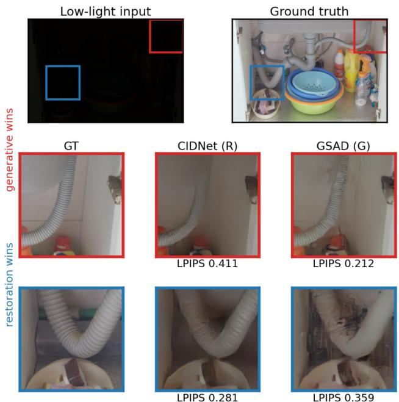
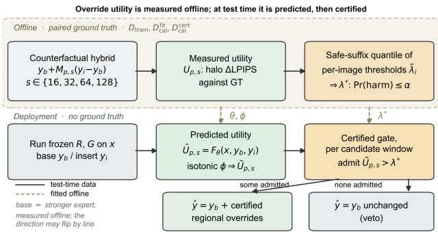
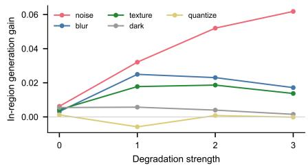
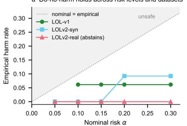
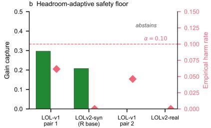
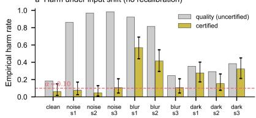
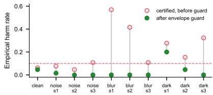
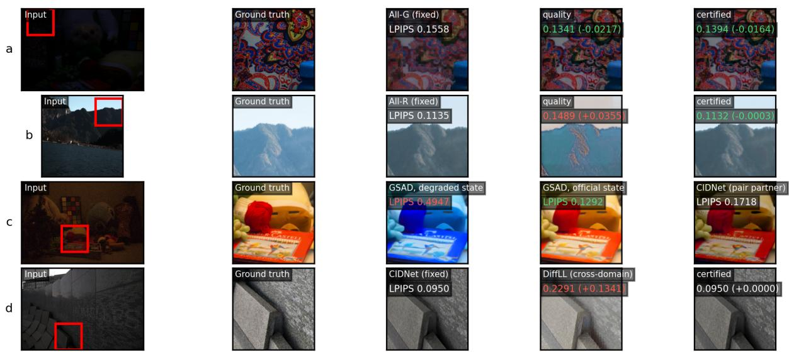

# When Should a Low-Light Pipeline Generate? Auditable Risk Control for Selective Generative Enhancement

Qiyi Xie1,2, Wei Chen Ng2,3, Suyang Xi4 Xicheng Wang1, Ziyao Li3, Bohong Xu1, Wenyi Liu1, Jian Ding Tan2,3,\* 1School of Engineering and Applied Science, University of Pennsylvania 2S.M.A.R.T. Nexus Center of Excellence, Xiamen University Malaysia 3School of Artificial Intelligence and Robotics, Xiamen University Malaysia 4Emory College of Arts and Sciences Computer Science, Emory University

xieqiyi@engineering.upenn.edu, mcs2509006@xmu.edu.my, sxi5@emory.edu, wangxc6@engineering.upenn.edu, EEE2409020@xmu.edu.my, xu35@engineering.upenn.edu, liu50@engineering.upenn.edu, jianding.tan@xmu.edu.my Corresponding author

## Abstract

Generative low-light enhancers recover plausible texture but may hallucinate structure; restoration networks preserve structure but can leave regions under-enhanced, and neither advantage is spatially uniform. Therefore, we formulate selective generative enhancement as a decision problem: determine where overriding a frozen base expert is beneficial and refuse to switch when the evidence is insufficient. We propose VetoNet, an auditable regional routing framework centered on a certified veto. Itfirst measures the complementary strengths and routing direction of a frozen restoration–generative pair, then predicts the utility of regional overrides from deployment-available signals alone and admits an override only when a distribution-free harmbudget certificate says the perceptual (LPIPS) risk budget allows it. Experiments across multiple expert pairs and domains show that VetoNet adapts its routing behavior to the strength and reliability of the available evidence. When expert complementarity is sufficiently predictable, it achieves statistically significant certified gains; when the relative strengths ofthe experts change, it correspondingly reverses the routing direction; and when routing evidence is weak or affected by cross-domain shift, it conservatively vetoes switching. On every pre-registered final test the certified mode stayed within its harm budget; per-image records and a consumption ledger will be released.

## 1. Introduction

Low-light image enhancement (LLIE) has commonly been considered a restoration problem, aiming to recover the illumination conditions of a given degraded low-light image while preserving the underlying scene content and structure [30, 36]. Recently, more generative methods have been proposed, as they can produce perceptually plausible textures and details that may be difficult to recover with restoration methods [41, 47]. However, most existing LLIE methods enhance the entire image with a single model, implicitly assuming that the selected enhancement algorithm is equally suitable for different regions. They may overlook the possibility that restoration and generative models may have complementary effects within the same image. For example, as shown in Fig. 1, the generative model produces richer details in the red-boxed region, the folds on the pipe, while it introduces noticeable hallucinated structures in the blueboxed region. Thus, the generative output is preferred for the red region, while the restoration output is selected for the blue region to better preserve reliable scene content. Therefore, the key question is not which expert is overall better but whether overriding one frozen expert with the other (candidate) has positive gain and whether that decision can be made safely, in a defined perceptual sense, without ground truth at test time.

A simple idea is to selectively switch experts only where doing so is beneficial, but this raises three difficulties. First, the routing direction cannot be fixed in advance: depending on the dataset and expert pair, either the generative or restoration expert may serve as the stronger base. We observe that the preferred base/override direction can reverse when the dataset or expert pair changes. Second, it is hard to judge the benefit of an override directly. Simply comparing the outputs of two experts on a local patch may be misleading because it ignores color differences, boundary interactions, overlapping regions, and the perceptual effect of being placed back into the full image. Third, a router optimized only for average quality can make harmful local decisions. A selective pipeline therefore needs not only to predict where switching may help but also to determine when the evidence is insufficient to justify the switch.

  
Figure 1. An example illustrating that different LLIE methods may exhibit complementary effects.

To address the problems, we propose VetoNet, an auditable framework for selective generative enhancement built around a certified veto. Given two frozen experts, VetoNet first compares their outputs to decide which expert should be the fixed base and whether the other candidate can improve specific regions. Candidate regions are then compared with the output of the base model and evaluated after insertion. These comparisons provide supervision for training a lightweight router. At deployment, the router predicts which regions may benefit from an expert override without using the ground truth. Importantly, the area budget is an upper bound rather than a quota. If the candidate is not reliable enough, VetoNet will leave the base output unchanged.

In our implementation, we use two deployment modes with different objectives. Both modes admit an override when the calibrated router score exceeds a threshold λ; increasing λ produces increasingly more conservative routing policies. The quality mode (λ = 0) accepts windows with positive predicted utility, aiming to improve average perceptual quality without an explicit harm constraint. The certified mode instead calibrates λ to control the probability of degrading an image relative to the fixed base expert. Because an image that is safe at one threshold need not remain safe at all more conservative thresholds, we assign each image the smallest threshold above which it remains unharmed for every more conservative policy. We call this quantity the safe-suffix score (Sec. 3). Under exchangeability, split conformal prediction over these scores provides finite-sample marginal control of LPIPS-defined harm at level α, and vetoes all overrides when no threshold can be certified. The guarantee is narrow by design: marginal rather than perimage, perceptual rather than semantic, and silent under arbitrary distribution shift.

This paper treats the question as an evaluation problem before a modeling problem, and its contributions are methodological:

• A counterfactual measurement protocol: overlapping regions are counterfactually swapped between two frozen experts and scored against paired ground truth, giving a per-region net-utility label that a 4.1M U-Net router learns from deployment-available inputs alone (Sec. 3);

• VetoNet, a certified veto: an image-level, distributionfree risk-control rule for LPIPS-defined non-degradation rule that admits a routed override only when a conformally calibrated threshold says the risk budget allows it, and otherwise vetoes generation entirely, returning the fixed base expert (Sec. 3);

• An audit trail as a first-class result: four selectionindependent pre-registered single-shot final tests, together with a disclosed modern-pair audit; an adversarial audit that retired our own earlier calibration rule and repaired a real 16.9% coverage failure, with rule baselines showing why naive calibration fails there (Sec. 5); stress tests mapping where the guarantee breaks and a label-free guard for the detectable part; a process-state reproducibility hazard in a public diffusion enhancer, caught by a deferred audit and repaired in the official process form; and a leak-free cross-domain terminal test in which calibrated abstention generalizes exactly (Sec. 6).

## 2. Related Work

Low-light image enhancement has been studied through Retinex decomposition [36, 37, 46], end-to-end regression [35, 38, 43], transformer-based architectures [9, 44], colorspace formulations [39], unpaired and zero-reference learning [15, 20], and raw-image pipelines [10]. More recently, diffusion-based methods such as DiffLL [19], Diff-Retinex [41], and GSAD [17], building on the DDPM family [16, 29], have reported strong perceptual performance. We take five public checkpoints as frozen experts.

## 2.1. Perception distortion and generative fidelity

Perceptual quality and reconstruction fidelity are different operating objectives [6], and generative models can produce visually convincing outputs without preserving the underlying structure, as illustrated by PULSE [25]. Our evaluation therefore requires a full-reference metric when determining whether an intervention improves or degrades a paired sample. We use LPIPS [45] as the primary perceptual measure and consider DISTS [12] as an alternative. In an additional no-reference evaluation using [21, 26, 27, 32, 34, 40], generative outputs can be ranked above ground truth on two of the three examined datasets. Thus, we do not use these no-reference metrics to define fidelity-sensitive routing decisions in the present protocol.

## 2.2. Regional routing and mixtures

Mixture-of-experts methods [18, 31] and spatial routing approaches for restoration [22, 42] typically decide where computation or model capacity should be allocated. Our setting instead treats routing as a decision about which expert output should be trusted. The router predicts counterfactual regional utility measured against paired ground truth during development, while the deployed decision is additionally constrained by a statistical certificate rather than by an unconstrained heuristic threshold.

## 2.3. Conformal prediction and risk control

Split conformal prediction provides finite-sample marginal guarantees under exchangeability [1, 23, 33], while riskcontrolling prediction sets [5], Learn-then-Test [4], and conformal risk control [3] extend related ideas to broader risk functions. Distribution-free uncertainty has also been studied for image-to-image regression [2]. We adapt this machinery to a selective deployment decision between override and veto. A safe-suffix split-conformal rule is used as the deployed certificate, with a valid Learn-then-Test procedure serving as an auxiliary $( \alpha , \delta )$ check. As in selective classification [11, 13, 14], abstention is a valid output: when no non-trivial intervention can be certified, the system retains the fixed expert.

Our contribution is that we study how finite-sample riskcontrol machinery behaves when applied to regional generative enhancement, including cases in which simpler constructions fail, and how the resulting evaluation procedure can be audited under reproducibility and distribution-shift stress tests. The overall protocol follows reproducibility practices motivated by prior work [7, 24, 28], including preregistration, separated data roles, single-shot final tests, disclosed deviations, and explicit evaluation conventions.

## 3. Measurement Framework and Certificates

## 3.1. Problem Formulation

A frozen restoration expert R and a frozen generative expert G process the same low-light input x (Fig. 2). For each dataset line, a pre-registered rule selects one expert as the base, while the other provides candidate regional overrides. For overlapping windows $( p , s )$ with side $s \in$ {16, 32, 64, 128} and stride $s / 2 ,$ , a raised-cosine mask $M _ { p , s }$ defines the local counterfactual

$$
y _ { p , s } ^ { \mathrm { h y b } } = y _ { \mathrm { b a s e } } + M _ { p , s } \odot \big ( y _ { \mathrm { i n s } } - y _ { \mathrm { b a s e } } \big ) ,\tag{1}
$$

after deployment-consistent color alignment, and the utility $U _ { p , s }$ is defined as the halo-restricted LPIPS change against paired ground truth and normalized separately at each scale. For stochastic experts, we average three seeds. Candidate regions are pre-screened using an integral-image approximation, which achieves Spearman correlations of 0.57–0.94 with exact counterfactual scores. A greedy oracle then composes overrides under a 20% area budget to recompute marginal utilities as regions are added and to estimate the routing upper bound.

  
Figure 2. Overview of the VetoNet pipeline.

## 3.2. Direction by Measurement

We evaluate both possible routing directions, Restoration (R) → Generative (G) and $G  R ,$ , where the first model is the base and the second provides regional overrides. We applied a dual-direction oracle calibration on the first half of the calibration split $D _ { \mathrm { c a l } }$ to select the direction whose oracle result outperforms both experts on more images.

## 3.3. Router

A U-Net (4.09M parameters) $F _ { \theta }$ takes the low-light image and the two expert outputs as input,

$$
F _ { \theta } ( x , y _ { \mathrm { b a s e } } , y _ { \mathrm { i n s } } ) = \bigl ( \{ \hat { u } _ { s } \} _ { s \in \mathcal { S } } , \hat { D } \bigr ) , \quad \mathcal { S } = \{ 1 6 , 3 2 , 6 4 , 1 2 8 \}
$$

where $\hat { u } _ { s }$ is the predicted utility at scale s and $\hat { D }$ is an auxiliary dense map. Each scale uses a 1×1 prediction head and is resized to the corresponding window grid.

Let $\begin{array} { r } { u _ { p , s } = \frac { U _ { p , s } } { r _ { H , s } } } \end{array}$ be the normalized utility. The router is trained with

$$
\begin{array} { l } { \displaystyle \mathcal { L } _ { \mathrm { r o u t e r } } = \frac { 1 } { | \mathcal { S } | } \sum _ { s \in \mathcal { S } } \mathbb { E } _ { p } \Big [ ( | u | + 0 . 1 ) \ell _ { 1 } ^ { \mathrm { s m } } ( \hat { u } , u ) } \\ { \displaystyle + 0 . 5 | u | \big [ 0 . 5 - \mathrm { s i g n } ( u ) \hat { u } \big ] _ { + } \Big ] + 0 . 3 \| \hat { D } - D \| _ { 1 } , } \end{array}\tag{2}
$$

where $\ell _ { 1 } ^ { \mathrm { s m } }$ is the smooth $L _ { 1 }$ loss and D is the normalized spatial LPIPS-difference map. The |u| weighting gives more importance to regions with larger utility. Before routing, the predicted utility is mapped back to the original scale and calibrated separately for each scale:

$$
\begin{array} { r } { \hat { U } _ { p , s } = r _ { H , s } \hat { u } _ { p , s } , \qquad \widetilde { U } _ { p , s } = g _ { s } ( \hat { U } _ { p , s } ) , } \end{array}
$$

where $g _ { s }$ is an isotonic regressor fitted on $D _ { \mathrm { c a l } } ^ { \mathrm { f i t } }$ . The dense head is used only during training.

## 3.4. The Certified Veto (VetoNet)

We control deployment risk at the image level. An image is considered harmed if the routed output has higher LPIPS than the fixed base expert, with a strict tolerance of $\varepsilon ~ = ~ 0$ (see Sec. 7 for limitations). Using the second half of $D _ { \mathrm { c a l } } .$ , each calibration image i defines the smallest threshold $\lambda _ { i }$ such that all more conservative thresholds remain unharmed; if no such threshold exists, $\tilde { \lambda } _ { i } = + \infty$ . The deployed threshold is

$$
\lambda ^ { \star } = \tilde { \lambda } _ { ( \lceil ( 1 - \alpha ) ( n + 1 ) \rceil ) } .\tag{3}
$$

Under image-level exchangeability, this gives the marginal guarantee Pr(harm) $\leq \ \alpha$ without assuming monotonic harm in λ [23, 33]. This safe-suffix construction is important because per-image harm can be non-monotone in λ, and simpler rules that ignore such recurrences may over-certify unsafe thresholds (Sec. 5; per-line counts in the supplementary).

We also report an auxiliary Learn-then-Test (LTT) procedure [4], using exact binomial p-values, a fixed sequence from the most conservative threshold, and $\delta \ = \ 0 . 0 5$ . It either certifies the same or a more conservative threshold or abstains (Sec. 5). At deployment, only windows whose calibrated score exceeds $\lambda ^ { \star }$ are accepted. If no window is admitted, the system returns the base expert unchanged.

## 3.5. What the audit changed

Two earlier certificate designs were retired during the audit. A window-level certificate failed to control imagelevel harm, motivating the image-level formulation above. A later audit also found our previous $\left( V { + } 1 \right) / ( N { + } 1 )$ threshold-selection rule invalid as a risk-control procedure, so it was replaced by the safe-suffix rule. Details of the retired certificate designs are given in the supplementary material, while their audit outcomes are reported in Sec. 5.

  
Figure 3. Counterfactual gain under syn degradations of LOL-v1 inputs.

## 3.6. Evaluation Protocol

Each dataset was split once at the scene level (seed 2026) into mutually exclusive training, expert-selection, calibration, validation, and final-test roles. The calibration split was further partitioned into disjoint fit and certification subsets: direction selection, score calibration, and noise-floor estimation used only the former, while conformal certification used only the latter. Protocols, threshold grids, budgets, and endpoints were fixed before validation access on each line, except for two disclosed protocol deviations on LOLv2-synthetic. A pre-registered grid-cap correction clause was exercised once on SICE. Each preregistered final-test endpoint was executed once. The LOLv2-synthetic deviations are detailed in the supplementary: the router never saw $D _ { \mathrm { v a l } }$ before the lock, and a fithalf-only recomputation returned the same routing direction. Every non-endpoint read of the underlying image sets is itemized with role-membership hashes in the supplementary consumption ledger.

## 4. Result I: Routing Learns Complementarity

Premises. The following analysis is based on three observations (Table 2). First, oracle headroom exists on LOL-v1 but is pair-dependent: the budget curve is nearly flat on LOLv2-syn and negative on LOLv2-real. Second, the learned router outperforms trivial cues at equal budget and captures 57% of the available headroom, while darkness-based routing can be worse than no routing. On LOLv2-real, the headroom is too small to support deployment. Third, the routing signal tracks recoverable information loss; among five local synthetic degradations applied at three strengths, only some increase the in-region gain (Fig. 3; protocol in the supplementary).

Final tests. Table 1 reports the three pre-registered LOLfamily final tests. On LOL-v1, quality-mode routing improves LPIPS from 0.1183 to 0.1118 (+0.0065, 95% CI [+0.0030, +0.0102]), with 80% of images improved. The certified mode is more conservative, reaching 0.1156 with 6.7% empirical harm. On LOLv2-syn, raw routing does not retain its validation gain at test (−0.0002), while the certified mode provides the only significant deployable improvement (+0.0014, 95% CI $[ + 0 . 0 0 0 5 , + 0 . 0 0 2 5 ] )$ while keeping harm at 9%. On LOLv2-real, raw routing already showed significant harm on validation (−0.0051, 95% CI $[ - 0 . 0 0 6 9 , - 0 . 0 0 3 5 ] )$ . The certificate therefore does not allow overrides, making the test output the same as the fixed expert with 0% harm. The certified mode can remain consistent across datasets, seeds, and splits.

Table 1. Final-test outcomes on the LOL family. The first three rows are selection-independent pre-registered endpoints; the modern-pair row is reported as a disclosed audit outcome because the official test set informed expert-pair selection. Gains are mean per-image LPIPS relative to the fixed base expert (paired-bootstrap 95% CIs). Rf: Retinexformer; DiffRet: Diff-Retinex. SICE terminal test: Sec. 6.Sec. 6.
<table><tr><td>Dataset (test n)</td><td>Pair (base first)</td><td colspan="3">Quality-mode gain</td><td>Certified gain</td><td>Certified harm</td></tr><tr><td> $\mathsf { L O L - v 1 } ( 1 5 )$ </td><td> $\operatorname { D i f f L L } ( G ) \mid \operatorname { R f }$ </td><td></td><td> $+ 0 . 0 0 6 5 \ [ + 0 . 0 0 3 0 , + 0 . 0 1 0 2 ]$ </td><td> $+ 0 . 0 0 2 8 \ [ + 0 . 0 0 0 7 , + 0 . 0 0 5 4 ]$ </td><td></td><td>6.7%</td></tr><tr><td>LOLv2-syn (100)</td><td>Rf (R) | DiffRet</td><td>-0.0002</td><td> $\dot { [ - 0 . 0 0 1 8 , + 0 . 0 0 1 4 ] }$ </td><td> $\mathbf { + 0 . 0 0 1 4 \ [ + 0 . 0 0 0 5 , + 0 . 0 0 2 5 ] }$ </td><td></td><td>9.0%</td></tr><tr><td>LOLv2-real (100)</td><td>DiffRet (G) | Rf</td><td>+0.0006</td><td> $\left. - 0 . 0 0 2 6 , + 0 . 0 0 3 9 \right]$ </td><td></td><td>0 (abstains)</td><td>0.0%</td></tr><tr><td>LOLv2-real, modern pair modern-pair audit† (100)</td><td>GSAD (G) | CIDNet</td><td></td><td>-0.0043 [-0.0058, -0.0027]</td><td></td><td> $\mathbf { + 0 . 0 0 0 2 3 \ [ + 0 . 0 0 0 0 7 , + 0 . 0 0 0 4 4 ] }$ </td><td>0.0%</td></tr></table>

Table 2. Evidence-I premises (LOL-v1 validation, $n = 6 5 .$ , 20% area budget, paired-bootstrap 95% CIs; last row from LOLv2-real validation). Cue-by-cue tables are in the supplementary.
<table><tr><td>Premise</td><td>Value</td></tr><tr><td>Oracle headroom vs. fixed expert</td><td> $+ 0 . 0 1 0 6 \left[ + 0 . 0 0 9 2 , + 0 . 0 1 2 1 \right]$ </td></tr><tr><td>Area at which the oracle already wins</td><td> $2 . 5 \% ( \mathrm { s a t u r a t e s \ n e a r } 2 0 \% )$ </td></tr><tr><td>Router margin over random / darkness</td><td> $+ 0 . 0 1 0 9 / + 0 . 0 1 1 4 ( \mathrm { C I \ l o w e r \ b o u n d > 0 ) }$ </td></tr><tr><td>over residual / uncertainty</td><td>+0.0053 / +0.0101 (CI lower bound &gt; 0)</td></tr><tr><td>Gain capture / mean regret</td><td>57.2% / 0.0046</td></tr><tr><td>Darkness cue vs. no routing</td><td>LPIPS 0.1164 vs. 0.1110 (worse)</td></tr><tr><td>LOLv2-real: beats cues / raw beats fixed 75–88% / 11% of images</td><td></td></tr></table>

A modern pair under a disclosed selection leak. We additionally studied the HVI-CIDNet [39] and GSAD [17] pair on LOLv2-real as an audit case. This pair was initially chosen after diagnostics on the official test set showed different metric preferences: GSAD achieved lower LPIPS on 65% of the images, whereas CIDNet achieved higher PSNR on 75%. Because the test set influenced the choice of expert pair, this experiment contains a disclosed selection leak, and we do not use the initial test-set diagnostic as evidence of expert complementarity.

We therefore repeated the same comparison on the disjoint calibration ∪ validation dataset (125 images), with zero test overlap. In this leak-free analysis, correctly generated GSAD outperforms CIDNet on both LPIPS (0.107 vs. 0.143) and PSNR (23.8 vs. 18.2), showing that the apparent complementarity was specific to the data used for the initial diagnostic.

A second issue affected the first two of three runs: GSAD outputs had been generated from a degraded process basin (Sec. 6). With these incorrect outputs, the rule selected CIDNet as the base, and the pre-registered binary safety endpoint exceeded its target by one image $( 7 / 6 5 = \ 1 0 . 8 \% ) ;$ ; deterministic regeneration reduced this to 4/65. After GSAD was regenerated using the verified official procedure, the relative expert strengths reversed, and the rule correspondingly selected GSAD as the base with CIDNet providing candidate overrides. Under this corrected setting, both pre-registered safety endpoints pass, with validation harm of 3/65 (4.6%). The certified mode improves over both experts by +0.00298 LPIPS (95% CI $\left[ + 0 . 0 0 0 3 3 , + 0 . 0 0 6 7 0 \right] )$ , captures 38.5% of the available oracle headroom, and leaves 54/65 validation images unchanged.

For completeness, on the official test split $\begin{array} { r l } { ( n } & { { } = } \end{array}$ 100), the corrected certified policy produces zero empirical harm and a mean gain of +0.00023 LPIPS (95% CI $\left[ + 0 . 0 0 0 0 7 , + 0 . 0 0 0 4 4 \right] )$ , whereas raw routing is harmfu (−0.0043, 95% CI [−0.0058, −0.0027]) and improves only 20% of images. Because this test set influenced the original pair selection, we treat these numbers as audit outcomes rather than selection-independent confirmatory evidence. Despite the weak router correlation (Spearman $\rho = 0 . 1 1 6 )$ the certificate restricts intervention to a small subset of candidate overrides.

## 5. Result II: The Certificate Holds and Repairs

Overall certificate behavior. The results of safe-suffix and valid-LTT certificates on the LOL-family settings at $\alpha = 0 . 1 0 \mathrm { \ a n d \ } \varepsilon = 0$ are tabulated in Table 3. All four selection-independent final tests satisfy the nominal harm target. The disclosed modern-pair audit also yields zero empirical test harm but is treated separately because its test set informed expert-pair selection. On validation, two settings exceed 10% harm: v1 cid reaches 16.9% and is reduced to 4.6% by valid LTT, while the degraded-basin modern pair reaches 10.8% (7/65) and falls to 6.2% (4/65) after deterministic regeneration. Fig. 4 illustrates that sweeping α from 0.05 to 0.30 with frozen calibration scores and no refitting shows the same general behavior: capture increases only when usable headroom exists. It rises from 10% to 25% on LOLv2-synthetic and from 9.5% to 45.5% on the corrected modern pair, while remaining flat on LOL-v1 because tied scores keep $\lambda ^ { \star } = 0 . 0 1 9 7$ over $\alpha \in [ 0 . 1 0 , 0 . 3 0 ]$ Detailed sweep results are reported in the supplementary.

The audit repairs a real failure. On v1 cid, the safesuffix operating point produces $1 1 / 6 5 = 1 6 . 9 \%$ validation harm against the 10% target. Valid LTT rejects this point and moves to a more conservative threshold, reducing harm to $3 / 6 5 = 4 . 6 \%$ without reducing the measured quality gain. On the remaining settings, LTT either certifies the recorded point or selects a more conservative one, never with higher validation harm; on LOL-v1 it abstains entirely at $\delta = 0 . 0 5$ The audit therefore moves operating points only toward safety and repairs the one point that was not safe. It showed that the audit can change, rather than just confirm, the deployment decision.

Table 3. Certificate comparison on the LOL-family validation sets $( n = 6 5 , \alpha = 0 . 1 0 , \varepsilon = 0 )$ . We compare the deployed safe-suffix (SS) rule, valid LTT $( \delta = 0 . 0 5 )$ , and the ’first-safe’ conformal baseline. Bold highlights the LTT repair of v1 cid and the corrected official-state modern pair; degraded-basin runs are retained for audit completeness. v1 cid = CIDNet+DiffLL; v1 cgr = CIDNet+GSAD.
<table><tr><td>Setting</td><td>SS λ*</td><td>SS harm (CP95)</td><td>LTT λ*</td><td>LTT harm</td><td>first-safe λ*</td><td>harm</td></tr><tr><td>v1 (Rf+DiffLL)</td><td>0.0197</td><td> $\begin{array} { c } { 4 / 6 5 = 6 . 2 \% \ [ 1 . 7 , 1 5 . 0 ] } \\ { 0 / 6 5 } \end{array}$ </td><td>abstains (α=.15: 0.0236)</td><td></td><td>0.0197</td><td>4/65</td></tr><tr><td>v1_syn (Rf+DiffRet)</td><td>0.0133</td><td></td><td>0.0172</td><td>0/65</td><td>0.0133</td><td>0/65</td></tr><tr><td>v1_real (Rf+DiffRet)</td><td>0.0056</td><td>0/65 (abstains)</td><td>0.0056</td><td>0/65</td><td>0.0056</td><td>0/65</td></tr><tr><td>v1_cid (CIDNet+DiffLL)</td><td>0.0133</td><td>11/65 = 16.9%</td><td>0.0172</td><td> $\mathbf { 3 } / 6 5 = 4 . 6 \%$ </td><td>0.0108</td><td> $1 3 / 6 5 = 2 0 . 0 \%$ </td></tr><tr><td>v1_cgr (CIDNet+GSAD, degraded basin)</td><td>0.0069</td><td> $7 / 6 5 = 1 0 . 8 \% [ 4 . 4 , 2 0 . 9 ]$ </td><td>0.0069</td><td>7/65</td><td>0.0069</td><td>7/65</td></tr><tr><td>v1_cgr det-path regeneration</td><td>0.0069</td><td>4/65 = 6.2%</td><td>0.0069</td><td>4/65</td><td>0.0069</td><td>4/65</td></tr><tr><td>v1_cgr official state (G base)</td><td>0.0133</td><td> $\mathbf { 3 } / 6 5 = 4 . 6 \%$ </td><td>0.0185</td><td> $2 / 6 5 = 3 . 1 \%$ </td><td>0.0120</td><td>3/65</td></tr></table>

  
Figure 4. Certificate behavior across risk budgets. (a) Empirical harm versus nominal risk α for the three earliest settings using frozen calibration scores. (b) Certified capture and empirical harm at $\alpha = 0 . 1 0$ for the four early LOL-family settings; v1 cid is shown at the valid-LTT repaired point, and its negative capture $\left( - 0 . 0 4 \right)$ is clipped. Full sweeps are provided in the supplementary; modern-pair results are reported in Table 3.

Why simpler calibration is insufficient. We then use two simpler rules to re-evaluate the same frozen calibration scores, which are a plug-in threshold based directly on empirical calibration harm and a ’first-safe’ conformal rule that ignores later harm recurrences. When harm is approxi mately monotone, these rules select the same or nearby operating points. The difference appears when harm recurs as the threshold changes. On v1 cid, the plug-in and firstsafe rules produce 30.8% and 20.0% validation harm, respectively, compared with 16.9% for safe-suffix and 4.6% after the valid-LTT repair (Table 3). On SICE, both simpler rules also release overrides that harm 11–13% of validation images, whereas safe-suffix and LTT abstain (0/45). These cases show why calibration must account for non-monotone harm rather than selecting the first apparently safe threshold.

Abstention when headroom vanishes. On $_ \mathrm { L O L v 2 – r e a l . }$ the certificate admits no overrides at $\alpha = 0 . 1 0$ and continues to abstain throughout the sweep up to $\alpha = 0 . 3 0$ . This is because every threshold that allows routing is harmful on validation (61/65 images; mean gain $- 0 . 0 2 4 )$ , leaving no useful operating point. SICE also abstains at $\alpha = 0 . 1 0 \mathrm { { ; } }$ , but it begins to allow overrides at larger risk budgets. The reason for zero routing at $\alpha = 0 . 1 0$ is simple: the calibrated routing score has a fixed upper bound, and this maximum score is still below the certified threshold λ⋆ on both settings. Therefore, no window can be selected. These results show that abstention is the intended behavior when the available routing gain is too small to justify the risk.

Noise floors and ε-sensitivity. Finally, stochastic experts produce small run-to-run LPIPS variations. The p95 |∆LPIPS| noise floors are $4 \times 1 0 ^ { - 4 }$ for DiffLL, $6 . 7 \times 1 0 ^ { - 3 }$ for GSAD, and $3 . 0 { - } 3 . 7 { \times } 1 0 ^ { - 2 }$ for Diff-Retinex. Therefore, $\varepsilon ~ = ~ 0$ is a strict choice, because some small measured harms may come from the experts’ own randomness rather than routing itself. The registered ε sweep (supplementary) shows that allowing a small tolerance can account for this variability, but it does not remove the empirical validation target miss on v1 cid.

## 6. Result III: Boundaries and Reproducibility

Where the guarantee breaks. Conformal validity relies on exchangeability. We therefore stress-tested the frozen LOL-v1 certificate under a pre-registered grid of full-image noise, blur, and darkening shifts at three strengths, without recalibration (Table 4, Fig. 5a). As the results show, underscore-collapsing shifts such as noise, calibrated scores decrease, and most candidate overrides fall below λ⋆. The routed area therefore collapses, and harm remains close to the nominal level. In this situation, the routing rule becomes empirically self-protective by abstaining. In contrast, score-preserving shifts such as blur and darkening can leave the router confident while changing which expert is actually better. The certificate then fails, with harm reaching 56.9% under blur s1. Thus, abstention protects against shifts that are visible in the router scores but not against shifts that preserve those scores while changing the underlying utility. The uncertified quality mode is less stable under every tested shift, with harm ranging from 25% to 99%.

Table 4. Stress test on LOL-v1 validation under full-image distribution shifts with zero recalibration. The full per-condition grid is provided in the supplementary.
<table><tr><td>Condition</td><td>Cert. harm</td><td>Area</td><td>Qual. harm</td><td></td><td>Guard det. After guard</td></tr><tr><td>clean</td><td>6.2%</td><td>0.043</td><td>18.5%</td><td>6.2%</td><td>4.6%</td></tr><tr><td>noise s1  $- \mathbf { s } 3$ </td><td>4.6-10.8%</td><td>0.004–0.006</td><td>86-99%</td><td>51-100%</td><td>0-1.5%</td></tr><tr><td>blur s1–s3</td><td>10.8–56.9%</td><td>0.012-0.050</td><td>25-92%</td><td>100%</td><td>0%</td></tr><tr><td>dark s2–s3</td><td>15.4–32.3%</td><td>0.031-0.092</td><td>29-39%</td><td>86-100%</td><td>0-4.6%</td></tr><tr><td>dark s1 (residual)</td><td>27.7%</td><td>0.087</td><td>35.4%</td><td>32%</td><td>20.0%</td></tr></table>

a Harm under input shift (no recalibration)  

b Input-envelope guard restores the bounc  
  
Figure 5. Stress test under input shift on LOL-v1 validation with zero recalibration. (a) Harm of the certified and quality modes with CP95 intervals. (b) Harm after applying the input-envelope guard.

A label-free guard for detectable shifts. Therefore, we applied a simple input-envelope guard using three statistics, which are log-Laplacian energy, mean luminance, and their ratio. The accepted range of each statistic is defined only from the 60 clean calibration images, requiring neither labels nor retraining. Inputs outside this envelope are forced to abstain. The guard detects all tested blur shifts and 86– 100% of the stronger darkening shifts, reducing post-guard harm to 0% for blur and 0–4.6% for dark s2-s3 (Fig. 5b). It also reduces noise harm to 0–1.5%. On clean data, the guard has a 6.2% false-alarm rate while retaining 90.5% of the original certified gain. The main residual failure is mild darkening (dark s1): only 32% of these inputs fall outside the clean envelope, leaving 20.0% post-guard harm. This is a limitation of input-only detection when the shifted input distribution substantially overlaps the clean one.

Expert reproducibility is part of the audit. In the experiment, we found that GSAD [17] could enter two different process-dependent output states despite identical inputs, weights, and RNG states: the published state achieves LPIPS ≈ 0.11 on LOLv2-real, whereas the degraded state gives ≈ 0.26–0.30. Our original first-image self-check did not detect this failure because the state could change later during batch inference. A subsequent comparison against the official evaluator revealed that our stored batch outputs were indeed in the degraded state (mean LPIPS 0.259 vs. 0.113 on the same 100 images).

We verified that the difference was not caused by our evaluation harness: a deterministic HVI-CIDNet negative control differed from its official evaluator by only $7 \times 1 0 ^ { - 5 }$ mean LPIPS. We therefore regenerated GSAD using the verified official process configuration and replaced the single-image check with a batch-level distributional comparison against the official evaluator. The full regeneration audit, gate criteria, and amendment history are provided in the supplementary. Thus, expert-level reproducibility checks should be considered as part of an auditable evaluation protocol.

Cross-domain terminal test: exact abstention. To test the protocol beyond the LOL family, we pre-registered a complete setting on SICE [8] Part 2, using 229 sequences split into 40/104/45/40 for selection, calibration, validation, and test. Pair selection used only the 40 selection images and chose CIDNet+DiffLL, which showed 9.2% wholeimage complementarity, while CIDNet+GSAD showed almost none. The selected pair retained oracle headroom (0.0177 at a 20% area budget), and the router outperformed all four trivial cues (73–80%). However, at $\alpha = 0 . 1 0 ,$ no safe non-trivial threshold could be certified, so the certified output was identical to the fixed CIDNet expert on validation (harm 0/45). The sealed one-shot test reproduced the same behavior: the certified output was identical to CID-Net on all 40 test images, with zero routed area and harm 0/40 (Fig. 6d). We therefore report SICE as an abstention replication, rather than an enhancement gain.

## 7. Discussion and Limitations

Evaluation conventions and comparison scope. For context, same-pipeline comparisons with representative LLIE methods are reported in the supplementary using a single evaluation stack and without GT-mean brightness correction for any method. Published results that use different brightness-correction conventions are listed separately and are not mixed into the same comparison. These comparisons are provided for context rather than as a state-ofthe-art claim; our contribution is the certification and audit protocol, not the experts themselves.

  
Figure 6. Qualitative examples (red boxes indicate the displayed crops; stochastic experts are shown at seed 1). (a) LOL-v1: the certificate preserves useful refinement. (b) LOLv2-syn: the quality mode hallucinates structure and color, while the certificate vetoes the harmfu override. (c) GSAD process-state bistability: the same input and weights produce a degraded state and the published state. (d) SICE: the certificate admits no override, so the output matches the fixed CIDNet expert.

Scope of the guarantee. The certificate controls harm marginally over exchangeable deployment images. Thus, it is not a per-image or intervention-conditional guarantee: an individual routed output may still be worse than the fixed base expert. The guarantee also relies on deployment remaining sufficiently close to the calibrated regime; under substantial distribution shift, it no longer formally applies. Our stress tests characterize this boundary empirically, but the guard can only detect some forms of shift. In addition, harm is defined using LPIPS against paired ground truth. The certificate therefore controls perceptual degradation under this metric, not semantic hallucination.

Finite-sample certification. The available LLIE benchmarks provide relatively small calibration and test sets. For example, the main certificate uses only n = 30 calibration images, while some final test sets are also small. Harmrate estimates therefore have substantial statistical uncertainty, and a small number of harmful calibration examples can make the certificate conservative or force it to abstain. Larger calibration sets would allow more precise and potentially less conservative deployment decisions.

Magnitude of the gains. The certified improvements are modest when averaged over the full test set. This is partly expected because the certified policy modifies only a small fraction of images and abstains whenever the evidence for a safe improvement is insufficient. We therefore view the main contribution as reliable selective intervention under an explicit harm budget, rather than large average metric gains. Whether these small LPIPS improvements are consistently perceptible to human observers remains a question and would require a larger dedicated perceptual study.

Dependence on expert complementarity. VetoNet is useful only when the two frozen experts provide complementary outputs. If one expert consistently dominates the other, there is little useful routing opportunity, and the certified policy reduces to the base expert. Thus, the framework does not create complementarity; it identifies when available complementarity can be exploited without exceeding the prescribed harm budget. The current implementation also uses hard regional replacement and requires running both experts, which increases inference cost. Future work could extend the same risk-control framework to softer blending strategies and more efficient expert selection.

## 8. Conclusion

Selective generative enhancement can be evaluated counterfactually, routed adaptively, and controlled with a certified veto. Across expert pairs and domains, the proposed protocol adapted to the available evidence: it produced small but consistent gains when the experts were complementary, reversed the routing direction when their relative strengths changed, and abstained when no safe override could be certified. Across all four selection-independent pre-registered final tests, the certified mode remained within its nominal harm budget; the disclosed modern-pair audit also showed zero empirical test harm. The certified gains are modest, and abstention is frequent, but this is also the central finding: a selective enhancement system should be allowed to refuse intervention when the evidence is insufficient.

## References

[1] Anastasios N. Angelopoulos and Stephen Bates. Conformal prediction: A gentle introduction. Foundations and Trends in Machine Learning, 16(4):494–591, 2023. 3

[2] Anastasios N. Angelopoulos, Amit P. Kohli, Stephen Bates, Michael I. Jordan, Jitendra Malik, Thayer Alshaabi, Srigokul Upadhyayula, and Yaniv Romano. Image-to-image regression with distribution-free uncertainty quantification and applications in imaging. Proceedings of the 39th International Conference on Machine Learning (ICML), PMLR, 162:717– 730, 2022. 3

[3] Anastasios N. Angelopoulos, Stephen Bates, Adam Fisch, Lihua Lei, and Tal Schuster. Conformal risk control. International Conference on Learning Representations (ICLR), 2024. 3

[4] Anastasios N. Angelopoulos, Stephen Bates, Emmanuel J. Candes, Michael I. Jordan, and Lihua Lei. Learn then test:\` Calibrating predictive algorithms to achieve risk control. The Annals ofApplied Statistics, 19(2), 2025. 3, 4

[5] Stephen Bates, Anastasios Angelopoulos, Lihua Lei, Jitendra Malik, and Michael I. Jordan. Distribution-free, riskcontrolling prediction sets. Journal of the ACM, 68(6):1–34, 2021. 3

[6] Yochai Blau and Tomer Michaeli. The perception-distortion tradeoff. 2018 IEEE/CVF Conference on Computer Vision and Pattern Recognition (CVPR), pages 6228–6237, 2018. 3

[7] Xavier Bouthillier, Cesar Laurent, and Pascal Vincent. Unre-´ producible research is reproducible. Proceedings of the 36th International Conference on Machine Learning (ICML), PMLR, 97:725–734, 2019. 3

[8] Jianrui Cai, Shuhang Gu, and Lei Zhang. Learning a deep single image contrast enhancer from multi-exposure images. IEEE Transactions on Image Processing, 27(4):2049–2062, 2018. 7

[9] Yuanhao Cai, Hao Bian, Jing Lin, Haoqian Wang, Radu Timofte, and Yulun Zhang. Retinexformer: One-stage Retinexbased transformer for low-light image enhancement. 2023 IEEE/CVF International Conference on Computer Vision (ICCV), pages 12470–12479, 2023. 2

[10] Chen Chen, Qifeng Chen, Jia Xu, and Vladlen Koltun. Learning to see in the dark. 2018 IEEE/CVF Conference on Computer Vision and Pattern Recognition (CVPR), pages 3291–3300, 2018. 2

[11] C. K. Chow. On optimum recognition error and reject trade-

off. IEEE Transactions on Information Theory, 16(1):41–46, 1970. 3

[12] Keyan Ding, Kede Ma, Shiqi Wang, and Eero P. Simoncelli. Image quality assessment: Unifying structure and texture similarity. IEEE Transactions on Pattern Analysis and Ma chine Intelligence, 44(5):2567–2581, 2022. 3

[13] Ran El-Yaniv and Yair Wiener. On the foundations of noisefree selective classification. Journal of Machine Learning Research, 11:1605–1641, 2010. 3

[14] Yonatan Geifman and Ran El-Yaniv. Selective classification for deep neural networks. Advances in Neural Information Processing Systems 30 (NeurIPS), 2017. 3

[15] Chunle Guo, Chongyi Li, Jichang Guo, Chen Change Loy, Junhui Hou, Sam Kwong, and Runmin Cong. Zero-reference deep curve estimation for low-light image enhancement. 2020 IEEE/CVF Conference on Computer Vision and Pattern Recognition (CVPR), pages 1777–1786, 2020. 2

[16] Jonathan Ho, Ajay Jain, and Pieter Abbeel. Denoising diffu sion probabilistic models. Advances in Neural Information Processing Systems 33 (NeurIPS), 2020. 2

[17] Jinhui Hou, Zhiyu Zhu, Junhui Hou, Hui Liu, Huanqiang Zeng, and Hui Yuan. Global structure-aware diffusion process for low-light image enhancement. Advances in Neural Information Processing Systems 36 (NeurIPS), pages 79734– 79747, 2023. 2, 5, 7

[18] Robert A. Jacobs, Michael I. Jordan, Steven J. Nowlan, and Geoffrey E. Hinton. Adaptive mixtures of local experts. Neu ral Computation, 3(1):79–87, 1991. 3

[19] Hai Jiang, Ao Luo, Haoqiang Fan, Songchen Han, and Shuaicheng Liu. Low-light image enhancement with wavelet-based diffusion models. ACM Transactions on Graphics, 42(6):1–14, 2023. 2

[20] Yifan Jiang, Xinyu Gong, Ding Liu, Yu Cheng, Chen Fang, Xiaohui Shen, Jianchao Yang, Pan Zhou, and Zhangyang Wang. EnlightenGAN: Deep light enhancement without paired supervision. IEEE Transactions on Image Processing, 30:2340–2349, 2021. 2

[21] Junjie Ke, Qifei Wang, Yilin Wang, Peyman Milanfar, and Feng Yang. MUSIQ: Multi-scale image quality transformer. 2021 IEEE/CVF International Conference on Computer Vi sion (ICCV), pages 5128–5137, 2021. 3

[22] Xiangtao Kong, Hengyuan Zhao, Yu Qiao, and Chao Dong. ClassSR: A general framework to accelerate super-resolution networks by data characteristic. 2021 IEEE/CVF Conference on Computer Vision and Pattern Recognition (CVPR), pages 12011–12020, 2021. 3

[23] Jing Lei, Max G’Sell, Alessandro Rinaldo, Ryan J. Tibshirani, and Larry Wasserman. Distribution-free predictive inference for regression. Journal of the American Statistical Association, 113(523):1094–1111, 2018. 3, 4

[24] Mario Lucic, Karol Kurach, Marcin Michalski, Sylvain Gelly, and Olivier Bousquet. Are GANs created equal? a large-scale study. Advances in Neural Information Processing Systems 31 (NeurIPS), 2018. 3

[25] Sachit Menon, Alexandru Damian, Shijia Hu, Nikhil Ravi, and Cynthia Rudin. PULSE: Self-supervised photo upsampling via latent space exploration of generative models.

2020 IEEE/CVF Conference on Computer Vision and Pattern Recognition (CVPR), pages 2434–2442, 2020. 3

[26] Anish Mittal, Anush Krishna Moorthy, and Alan C. Bovik. No-reference image quality assessment in the spatial domain. IEEE Transactions on Image Processing, 21(12): 4695–4708, 2012. 3

[27] Anish Mittal, Rajiv Soundararajan, and Alan C. Bovik. Making a “completely blind” image quality analyzer. IEEE Signal Processing Letters, 20(3):209–212, 2013. 3

[28] Joelle Pineau, Philippe Vincent-Lamarre, Koustuv Sinha, Vincent Lariviere, Alina Beygelzimer, Florence d’Alch\` e´ Buc, Emily Fox, and Hugo Larochelle. Improving reproducibility in machine learning research (a report from the NeurIPS 2019 reproducibility program). Journal of Machine Learning Research, 22(164):1–20, 2021. 3

[29] Chitwan Saharia, Jonathan Ho, William Chan, Tim Salimans, David J. Fleet, and Mohammad Norouzi. Image super-resolution via iterative refinement. IEEE Transactions on Pattern Analysis and Machine Intelligence, 45(4):4713– 4726, 2023. 2

[30] Zhang Shansi and Lam Edmund Y. A deep retinex framework for light field restoration under low-light conditions. In 2022 26th International Conference on Pattern Recognition (ICPR), pages 2042–2048, 2022. 1

[31] Noam Shazeer, Azalia Mirhoseini, Krzysztof Maziarz, Andy Davis, Quoc Le, Geoffrey Hinton, and Jeff Dean. Outrageously large neural networks: The sparsely-gated mixtureof-experts layer. International Conference on Learning Representations (ICLR), 2017. 3

[32] Hossein Talebi and Peyman Milanfar. NIMA: Neural image assessment. IEEE Transactions on Image Processing, 27(8): 3998–4011, 2018. 3

[33] Vladimir Vovk, Alexander Gammerman, and Glenn Shafer. Algorithmic Learning in a Random World. Springer, 2005. 3, 4

[34] Jianyi Wang, Kelvin C. K. Chan, and Chen Change Loy. Exploring CLIP for assessing the look and feel of images. Proceedings of the AAAI Conference on Artificial Intelligence, 37(2):2555–2563, 2023. 3

[35] Yufei Wang, Renjie Wan, Wenhan Yang, Haoliang Li, Lap-Pui Chau, and Alex Kot. Low-light image enhancement with normalizing flow. Proceedings of the AAAI Conference on Artificial Intelligence, 36(3):2604–2612, 2022. 2

[36] Chen Wei, Wenjing Wang, Wenhan Yang, and Jiaying Liu. Deep retinex decomposition for low-light enhancement. In 2018 29th British Machine Vision Conference (BMVC), 2018. 1, 2

[37] Wenhui Wu, Jian Weng, Pingping Zhang, Xu Wang, Wenhan Yang, and Jianmin Jiang. URetinex-Net: Retinex-based deep unfolding network for low-light image enhancement. 2022 IEEE/CVF Conference on Computer Vision and Pattern Recognition (CVPR), pages 5891–5900, 2022. 2

[38] Xiaogang Xu, Ruixing Wang, Chi-Wing Fu, and Jiaya Jia. SNR-aware low-light image enhancement. 2022 IEEE/CVF Conference on Computer Vision and Pattern Recognition (CVPR), pages 17693–17703, 2022. 2

[39] Qingsen Yan, Yixu Feng, Cheng Zhang, Guansong Pang, Kangbiao Shi, Peng Wu, Wei Dong, Jinqiu Sun, and Yanning

Zhang. HVI: A new color space for low-light image enhancement. 2025 IEEE/CVF Conference on Computer Vision and Pattern Recognition (CVPR), pages 5678–5687, 2025. 2, 5

[40] Sidi Yang, Tianhe Wu, Shuwei Shi, Shanshan Lao, Yuan Gong, Mingdeng Cao, Jiahao Wang, and Yujiu Yang. MANIQA: Multi-dimension attention network for noreference image quality assessment. 2022 IEEE/CVF Con ference on Computer Vision and Pattern Recognition Work shops (CVPRW), pages 1190–1199, 2022. 3

[41] Xunpeng Yi, Han Xu, H. Zhang, Linfeng Tang, and Jiayi Ma. Diff-retinex: Rethinking low-light image enhancement with a generative diffusion model. 2023 IEEE/CVF International Conference on Computer Vision (ICCV), pages 12268–12277, 2023. 1, 2

[42] Ke Yu, Xintao Wang, Chao Dong, Xiaoou Tang, and Chen Change Loy. Path-Restore: Learning network path selection for image restoration. IEEE Transactions on Pattern Analysis and Machine Intelligence, 44(10):7078–7092, 2022. 3

[43] Syed Waqas Zamir, Aditya Arora, Salman Khan, Munawar Hayat, Fahad Shahbaz Khan, Ming-Hsuan Yang, and Ling Shao. Learning enriched features for real image restoration and enhancement. European Conference on Computer Vision (ECCV), Lecture Notes in Computer Science, pages 492–511, 2020. 2

[44] Syed Waqas Zamir, Aditya Arora, Salman Khan, Mu nawar Hayat, Fahad Shahbaz Khan, and Ming-Hsuan Yang. Restormer: Efficient transformer for high-resolution image restoration. 2022 IEEE/CVF Conference on Computer Vision and Pattern Recognition (CVPR), pages 5718–5729, 2022. 2

[45] Richard Zhang, Phillip Isola, Alexei A. Efros, Eli Shechtman, and Oliver Wang. The unreasonable effectiveness of deep features as a perceptual metric. 2018 IEEE/CVF Conference on Computer Vision and Pattern Recognition (CVPR), pages 586–595, 2018. 3

[46] Yonghua Zhang, Jiawan Zhang, and Xiaojie Guo. Kindling the darkness: A practical low-light image enhancer. Pro ceedings of the 27th ACM International Conference on Mul timedia (ACM MM), pages 1632–1640, 2019. 2

[47] Dewei Zhou, Zongxin Yang, and Yi Yang. Pyramid diffusion models for low-light image enhancement. In 2023 23rd International Joint Conference on Artificial Intelligence (IJ-CAI), 2023. 1