# Which Tokens to Merge? Diffusion Dynamics for Efficient Image Generation

SeungJu Cha Ye-Chan Kim HyunGee Kim Sungho Koh Dong-Jin Kim<sup>†</sup>

Hanyang University, South Korea

{sju9020, dpcksdl78, khjiiii2002, ksh000906, djdkim}@hanyang.ac.kr † Corresponding author

## Abstract

Token merging has emerged as an effective training-free strategy for accelerating diffusion models by reducing redundant token computation while minimizing generation degradation. A key challenge is determining which tokens can be safely merged and which should be preserved for subsequent computation. Existing method addresses this by preserving prompt-aligned foreground regions, thereby protecting semantically relevant structures. However, this text-relevance criterion overlooks background objects, local details that are not explicitly mentioned in the prompt, leading to degraded structural coherence. In this work, we propose Dynamics-aware Token Merging (DaTMe), a training-free framework that grounds token merging in the underlying diffusion dynamics. Our key insight is that token importance should reflect whether a token remains unresolved during denoising and whether it carries structural information. To this end, DaTMe constructs a dynamicsaware importance map from the Tweedie denoised estimate. The map combines a temporal signal, measuring inter-step changes in the predicted clean image, with a structural signal, capturing local high-frequency content such as boundaries and fine details. Using this map, DaTMe adaptively assigns tokens into merging roles under a given compression ratio: important tokens are preserved as anchors, while tokens that are both temporally stabilized and structurally homogeneous are selected as safe merge candidates. Experiments on PixArt-α and FLUX demonstrate that DaTMe maintains visual fidelity across the entire image, highlighting diffusion dynamics as an effective token-level merging decision in efficient generation. Our code is available at https://github.com/SeungJuCha/DaTMe.

## 1 Introduction

Diffusion models [1, 2] have become a dominant paradigm for high-quality image [3–5] and video synthesis [6–8], owing to their strong fidelity and scalability. However, their iterative denoising process incurs substantial computational cost, as a large number of tokens are repeatedly processed at every inference step [9]. To address this, token merging [10] has emerged as an effective training-free acceleration strategy that groups similar tokens, merges them into representative tokens, and uses the merged representations in subsequent layers [9–13]. For example, early token merging methods such as ToMeSD [10] first construct local merge candidate groups in a content-agnostic manner, and then form merge pairs simply based on feature similarity within each group. Consequently, content-relevant tokens can be selected as merge sources, causing local details to be absorbed and leading to visual distortion [9]. This raises a central challenge: which tokens should be absorbed through merging, and which must be retained as anchors for subsequent computation.

Prior work [9] leverages classifier-free guidance (CFG) [14] as a token importance signal, identifying tokens strongly steered by the text condition through the discrepancy between conditional and unconditional noise predictions as anchors to be retained. However, as shown in Fig. 1(a), CFGbased merging tends to underprotect non-prompt regions of the image, losing fine details and structural coherence. We attribute this to CFG’s prompt-centric bias: by focusing exclusively on text-conditioned influence, CFG overlooks two key aspects of how diffusion models generate images.

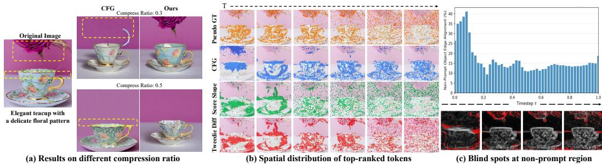  
Figure 1: (a) Comparison under different compression ratios. CFG-based merging [9] often overlooks background details and structures, whereas our method better preserves background integrity. (b) Spatial distribution of top-ranked tokens over denoising timesteps. CFG-based importance remains concentrated on the foreground object with limited temporal variation. In contrast, our score-based signals (Score Slope and Tweedie Diff) progressively shift from object regions to fine-grained spatial details, better matching the pseudo-GT pattern. Here, pseudo-GT is defined as the difference between the final denoised latent and the Tweedie estimate at each timestep. (c) Non-prompt region blind spot. Low-ranked tokens under the CFG-based signal consistently overlap with structurally salient regions in text-irrelevant areas (red).

First, CFG fails to capture time-varying token importance. Diffusion generation follows a coarse-tofine progression [15, 16], where tokens undergoing large inter-step changes represent regions in which the model is actively injecting details [17]. In this context, prematurely merging such still-evolving tokens directly attenuates their ongoing refinement by averaging their features with neighboring tokens. Crucially, the spatial distribution of these actively evolving tokens is time-varying: while it remains concentrated on foreground objects in early steps, it progressively expands toward broader spatial regions, including non-prompt areas, at later timesteps (Fig. 1(b)). High-ranked tokens in CFG importance signal, however, remain anchored to foreground objects throughout the entire timestep, confining its search for important tokens only to prompt-aligned regions. As a result, CFG fails to identify the very tokens that should be protected: actively evolving tokens outside the foreground are prematurely merged into nearby or similar tokens, suppressing their distinct updates.

Second, CFG is insensitive to prompt-independent structural importance. To produce natural and coherent images, diffusion models actively generate scene elements that are not directly mentioned in the prompt such as background objects and supporting structures [1, 2]. Although these promptindependent structures contribute little to text guidance, they carry essential structural information such as boundaries between homogeneous regions, edges of background objects, and fine textures that anchor visual coherence. However, because CFG only measures text-conditioned discrepancy, structural boundaries in such non-prompt regions tend to receive low scores across all timesteps (Fig. 1(c)), making them vulnerable to merging into neighboring homogeneous areas. Taken together, these observations indicate that token importance should not be defined solely by text relevance, but by diffusion dynamics: how unresolved a token remains and how much structural information it carries at the current denoising step [18].

To faithfully capture diffusion dynamics, we define two complementary signals that quantify the spatiotemporal dynamics of each token during denoising. For temporal dynamics, we start from the score function [19], which quantifies how each token is updated at the current denoising step. In particular, we project this score into clean-image space via the Tweedie denoised estimate [20, 21], and use its inter-step difference as the temporal signal, assigning high values to tokens that are unresolved. Unlike CFG, this score-derived signal reflects the actual update applied to every token, regardless of prompt relevance, providing an image-wide view of generative activity (Fig. 1(b)). For the structural signal, we measure the residual between the Tweedie estimate and its coarse-scale smoothed version, which acts as a high-pass filter highlighting structural components throughout the image. This captures prompt-independent structural boundaries, including weakly conditioned structures that CFG often underestimates. By jointly modeling temporal evolution and structural saliency, we obtain a dynamics-aware token importance signal that guides merging decisions.

Building on this dynamics-aware importance, we propose Dynamics-aware Token Merging (DaTMe), a training-free token merging framework for diffusion transformers [2, 5, 22]. At each denoising step, DaTMe assigns token roles at the intersection of the temporal and structural signals. High-scoring tokens are assigned as constraint tokens and excluded from merging as dynamically or structurally important regions, while low-scoring tokens are assigned as source tokens from relatively stable and homogeneous regions that can be safely merged. To meet the target compression budget, DaTMe supplements the source set with grid-based spatial sampling, preventing local collapse. The resulting source tokens are then merged only within nearby regions via locality-constrained matching, built upon [9]. We primarily evaluate DaTMe on PixArt-α and FLUX, where it outperforms prior methods while maintaining visual fidelity across the entire image. Our contributions are as follows:

• We introduce a dynamics-aware importance map derived from the Tweedie estimate, jointly capturing the temporal evolution and structural saliency of each token.

• We propose DaTMe, a training-free token merging framework that leverages the proposed temporal and spatial importance signals to identify safely mergeable tokens while preserving structurally critical regions.

• We validate DaTMe on DiT (PixArt-α) and MM-DiT (FLUX), showing strong preservation of image-wide details and state-of-the-art performance across most metrics.

## 2 Related Works

Token Reduction in Large Models. Token reduction is a widely used strategy for improving Transformer efficiency, mainly through token pruning or token merging [10, 23–26]. Representative methods such as ToMe [27] use training-free bipartite matching, while later approaches refine token selection using attention or frequency-domain cues [25, 26]. However, most of these methods target single-forward-pass architectures with relatively static token importance. Diffusion models, by contrast, update token representations over many steps, motivating diffusion-specific approaches such as ToMeSD [10].

Token Merging in Diffusion Models. A wide range of methods have been proposed to accelerate diffusion models, including improved samplers [28–32] and weight quantization [33, 34]. However, such approaches often require additional training or optimization, introducing non-trivial overhead. Training-free methods instead reduce the number of tokens processed during inference through pruning [18, 35], caching [36–38], or merging [9–13]. Among them, ToMeSD [10] extends token merging in ViTs [27] to diffusion models by grouping tokens based on feature similarity. Several subsequent methods [12, 13] leverage cross-attention maps to identify important tokens from semantically or structurally salient regions, aiming not merely to reduce computation but also to preserve informative representations during token reduction [39]. More recently, [9] uses classifier-free guidance (CFG) as a saliency signal without additional attention computation, but because CFG primarily reflects alignment with the conditioning signal, it fails to capture the spatially heterogeneous and temporally evolving dynamics of the full image. In contrast, our method leverages the Tweedie denoised estimate to construct a dynamics-aware importance map that captures both temporal evolution and spatial structure across the image.

## 3 Method

Our goal is to design a token merging strategy for efficient image generation by accounting for diffusion dynamics. To this end, we first define a dynamics-aware importance signal that characterizes token importance from two complementary perspectives: temporal dynamics and structural saliency. Based on this importance map, we assign tokens into functional roles for merging, distinguishing safe merge sources and structurally important constraint tokens. We then perform locality-constrained token merging, together with grid-based source completion to satisfy the target compression ratio. In the following, we first motivate our Tweedie-based spatiotemporal importance signals (Sec. 3.2), and then describe how they are used in our proposed DaTMe framework (Sec. 3.3).

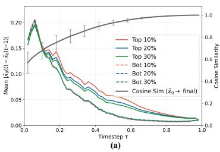

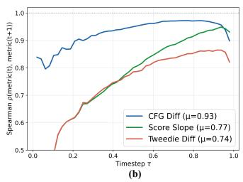

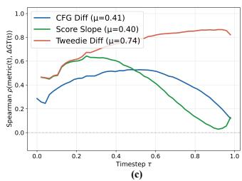  
Figure 2: (a) Cosine similarity and temporal trajectories of top- and bottom-ranked tokens. The Tweedie estimate progressively approaches the final latent over denoising. Meanwhile, tokens with high pseudo-GT magnitude $| x _ { 0 } - \hat { x } _ { 0 } ( t )$ exhibit consistently larger changes than low-ranked tokens. This indicates that the pseudo-GT effectively separates active tokens from converged ones. (b) Step-wise autocorrelation of token-importance signals. Computed between consecutive timesteps, lower values indicate more dynamic importance. The proposed Tweedie-based signal exhibits lower autocorrelation than CFG and score slope. (c) Correlation with the pseudo-GT change magnitude. The proposed Tweedie difference remains better aligned with actual token changes across timesteps than CFG or score slope. τ denotes the normalized timestep, scaled to the range [0, 1].

## 3.1 Preliminaries

Score Function. In diffusion models [1–3], the forward process gradually corrupts a clean image x<sub>0</sub> by adding Gaussian noise over $t \in [ 0 , T ]$ timesteps:

$$
\begin{array} { r } { x _ { t } = \alpha _ { t } x _ { 0 } + \sigma _ { t } \epsilon , \quad \epsilon \sim \mathcal { N } ( 0 , I ) , } \end{array}\tag{1}
$$

where $\alpha _ { t }$ and $\sigma _ { t }$ denote the signal and noise scales at timestep t, respectively, satisfying $\alpha _ { t } ^ { 2 } + \sigma _ { t } ^ { 2 } = 1$ The reverse process aims to recover $x _ { 0 }$ from $x _ { T }$ by iteratively denoising, guided by the score function $\nabla _ { x _ { t } } \log { p _ { t } ( x _ { t } ) }$ , which represents the gradient of the log-density of the noisy distribution $p _ { t } ( x _ { t } )$ with respect to $x _ { t } \ [ 1 9 ]$ . Intuitively, the score function defines a vector field that points toward regions of higher data likelihood, guiding the noisy sample toward the clean data manifold throughout the denoising process. In practice, the score function is estimated via a neural network $\epsilon _ { \theta }$ trained to predict the noise ϵ added at each timestep. The score is then obtained from the predicted noise as:

$$
s ( t ) = \nabla _ { x _ { t } } \log p _ { t } ( x _ { t } ) \approx - \frac { 1 } { \sigma _ { t } } \epsilon _ { \theta } ( x _ { t } , t , c ) ,\tag{2}
$$

where c denotes the conditioning signal (e.g., text prompt).

Tweedie’s Estimation. Tweedie’s formula [21] provides a closed-form expression for the posterior mean of the clean sample $x _ { 0 }$ given the noisy observation $x _ { t } .$

$$
\hat { x } _ { 0 } ( t ) = \mathbb { E } [ x _ { 0 } \mid x _ { t } ] = \frac { x _ { t } + \sigma _ { t } ^ { 2 } \nabla _ { x _ { t } } \log p _ { t } ( x _ { t } ) } { \alpha _ { t } } .\tag{3}
$$

Substituting the learned score estimator from Eq. 2, this becomes:

$$
\hat { x } _ { 0 } ( t ) \approx \frac { x _ { t } - \sigma _ { t } \epsilon _ { \theta } ( x _ { t } , t , c ) } { \alpha _ { t } } ,\tag{4}
$$

which gives a denoised estimate of $x _ { 0 }$ at timestep t, termed the Tweedie denoised estimate. Unlike the noisy sample $x _ { t } .$ , which is directly modulated by the noise level $\sigma _ { t } , { \hat { x } } _ { 0 } ( t )$ provides an estimate in the predicted clean image space [40], offering a noise-normalized view of the current generation state.

## 3.2 Spatiotemporal Tweedie Importance Signal

Theoretical Comparison of Temporal Signals. To characterize token-level evolution during denoising, we compare two temporal signals derived from the score function [19]: the raw score slope, $| s ( t ) - s ( t - 1 )$ |, and the Tweedie difference, $| \hat { x } _ { 0 } ( t ) - \hat { x } _ { 0 } ( t - 1 ) |$ |. As derived in Appendix A, the score slope can be decomposed into two components:

$$
s ( t ) - s ( t - 1 ) = \underbrace { \frac { \epsilon _ { \theta } ( t - 1 ) - \epsilon _ { \theta } ( t ) } { \sigma _ { t - 1 } } } _ { \mathrm { d i f f e r e n c e \ t e r m } } + \underbrace { \epsilon _ { \theta } ( t ) \left( \frac { 1 } { \sigma _ { t - 1 } } - \frac { 1 } { \sigma _ { t } } \right) } _ { \mathrm { s c a l e \ t e r m } } .\tag{5}
$$

The first term reflects changes in the model prediction across timesteps and is therefore associated with actual token-level evolution. In contrast, the second term arises purely from the predefined global noise schedule $\sigma _ { t }$ rather than changes in the model prediction itself. As denoising approaches the late steps $( \sigma _ { t }  0 )$ , the inverse difference $\begin{array} { r } { \left| \frac { 1 } { \sigma _ { t - 1 } } - \frac { 1 } { \sigma _ { t } } \right| } \end{array}$ grows rapidly. This suggests that the scale term can increasingly dominate the score slope in later stages, making the resulting signal less reliable. To obtain a cleaner temporal measure, we instead project the score into predicted clean-image space via the Tweedie estimate ${ \hat { x } } _ { 0 } ( t )$ [41] and consider its inter-step residual, $\bar { \hat { x } } _ { 0 } ( t ) - \hat { x } _ { 0 } ( t - 1 )$ . By algebraic decomposition (Appendix A), this residual reduces to:

$$
\hat { x } _ { 0 } ( t ) - \hat { x } _ { 0 } ( t - 1 ) = \frac { \sigma _ { t - 1 } } { \alpha _ { t - 1 } } \big ( \epsilon _ { \theta } ( t - 1 ) - \epsilon _ { \theta } ( t ) \big ) ,\tag{6}
$$

which removes the scale term that appears in the raw score slope and retains only the difference term update. Furthermore, the update is scaled by $\frac { \sigma _ { t - 1 } } { \alpha _ { t - 1 } }$ , and this factor decreases as denoising concludes, naturally attenuating the signal in late steps. These properties make the Tweedie difference a more stable temporal signal for measuring token evolution.

Empirical Validation of Temporal Signals. We validate the theoretical analysis above through two empirical tests: temporal autocorrelation and correlation with a pseudo-GT change measure.

We first examine temporal autocorrelation to assess whether each signal remains responsive to token-wise refinement over denoising steps (Fig. 2(b)). The CFG-based importance [9] exhibits consistently high autocorrelation across all timesteps, confirming its static nature and its bias toward fixed, prompt-aligned foreground regions, as previously observed in Fig. 1(b). In contrast, both score-based signals, namely the raw score slope and the Tweedie difference, initially show noticeably lower autocorrelation, indicating greater sensitivity to image-wide refinement than CFG. However, temporal autocorrelation alone does not naturally imply that a signal reflects token-level convergence.

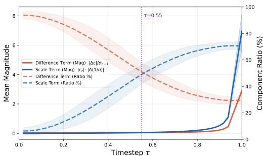

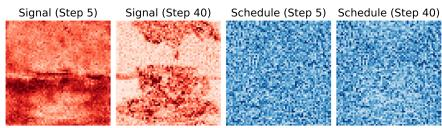

To evaluate whether a signal faithfully reflects token-level convergence, we measure its correlation with a reference signal constructed from the per-timestep Tweedie estimate ${ \hat { x } } _ { 0 } ( t )$ , which we treat as a proxy for the clean image following [41]. We then define the deviation between the final clean latent $x _ { 0 }$ and ${ \hat { x } } _ { 0 } ( t )$ , denoted as $| x _ { 0 } - \hat { x } _ { 0 } ( t ) |$ |, as a pseudo-GT measure of how much each token is still expected to change. As shown in Fig. 2(a),

Figure 3: Difference- and Scale- components of the score slope. (Top) Mean magnitude and contribution ratio of the two terms: the scale term becomes dominant in late steps. (Bottom) Spatial distributions: the difference term captures structured token-level changes, whereas the scale term remains spatially unstructured.

the cosine similarity between xˆ (t) and the final denoised latent steadily approaches 1.0 over time, indicating that ${ \hat { x } } _ { 0 } ( t )$ progressively approximates the final generation state. Moreover, when tokens are partitioned by their pseudo-GT magnitude, high-ranked tokens consistently exhibit larger changes across denoising steps than low-ranked ones, suggesting that this pseudo-GT provides a meaningful per-token reference for remaining change.

Using this pseudo-GT, a clear difference between the two score-based signals emerges (Fig. 2(c)). While both signals show high correlation with the pseudo-GT in the early stages, the correlation of the raw score slope drops sharply around normalized timestep 0.4–0.6. Consistent with our theoretical decomposition, this degradation closely matches the range where the scale term empirically overtakes the difference term (Fig. 3). At the same time, the autocorrelation of the score slope rises (Fig. 2(b)), indicating increasingly static behavior and reduced sensitivity to token-wise refinement. In contrast, by removing scale term interference, the Tweedie difference maintains both a higher correlation with the pseudo-GT and a consistently lower temporal autocorrelation throughout denoising. Taken together, these results suggest that the Tweedie difference provides a more reliable temporal signal for tracking token evolution than either the raw score slope or CFG.

Tweedie Importance Map. Building on this analysis, we define the temporal importance map as the inter-step residual in predicted clean-image space:

$$
\mathcal { M } _ { t e m p } ^ { ( t ) } = \vert \hat { x } _ { 0 } ( t ) - \hat { x } _ { 0 } ( t - 1 ) \vert ,\tag{7}
$$

which quantifies how much the predicted clean structure is still evolving at each spatial location. This temporal map captures when each token is actively changing during denoising.

However, as previously observed in Fig. 1(c), CFG also fails to protect structurally salient tokens in non-prompt regions—those carrying essential boundary and texture information. Under CFG-based importance, such tokens consistently receive low scores throughout denoising, leading them to be mistakenly treated as safe merge candidates and causing object boundaries to be diluted (Fig. 8).

To capture this structural property, we introduce a spatial axis derived from the same Tweedie estimate. Specifically, we use the spatial axis to distinguish structurally salient but temporally stable tokens from genuinely mergeable homogeneous regions. To this end, we define the spatial axis as the residual between ${ \hat { x } } _ { 0 } ( t )$ and its coarse-scale approximation obtained via interpolation-based transformation [42]:

$$
\mathcal { M } _ { s p a t } ^ { ( t ) } = \Big | \hat { x } _ { 0 } ( t ) - \mathrm { U p S a m p l e } _ { \times s } \Big ( \mathrm { D o w n S a m p l e } _ { \times s } \big ( \hat { x } _ { 0 } ( t ) \big ) \Big ) \Big | ,\tag{8}
$$

where s denotes the spatial scale used to construct the coarse approximation. This spatial map assigns high responses to contours, boundaries, and fine textures, while giving low responses to locally homogeneous regions. By combining the temporal and spatial axes, we obtain an importance signal that reflects both how tokens evolve over time and how much structural information they carry at each denoising step.

## 3.3 Dynamics-aware Token Merging (DaTMe)

At each timestep t, given a target compression ratio r, we denote the full token set as $S _ { t o t }$ with $\begin{array} { r c l } { N } & { = } & { \left| S _ { t o t } \right| } \end{array}$ , and aim to merge $\begin{array} { r c l } { n _ { t g t } } & { = } & { \lfloor r N \rfloor } \end{array}$ tokens. While featuresimilarity-based merging strategies work well in U-Net-based architectures [1, 3], directly applying them to Diffusion Transformers (DiTs) [2, 4] often causes severe structural distortion [9, 12]. To prevent such distortion, we propose Dynamics-aware Token Merging (DaTMe), which performs three steps: (1) assigning token roles based on the proposed spatiotemporal importance maps, (2) completing the source budget in a spatially distributed manner, and (3) performing locality-constrained spatial matching. A detailed step-by-step algorithm of DaTMe is provided in the Appendix B.

Dynamics-Aware Role Assignment. Rather than imposing a hand-crafted cutoff for what should be considered important, DaTMe adaptively assigns token roles at each denoising step based on their temporal and spatial responses under the given compression ratio r. To prevent quality degradation caused by merging temporally evolving or structurally salient tokens, we first define a conservative source set $\boldsymbol { S _ { s r c } } \subset \boldsymbol { S _ { t o t } }$ as the intersection of the lowest-r fractions of tokens ranked by $\mathcal { M } _ { t e m p }$ and $\mathcal { M } _ { s p a t }$ . Conversely, we define a constraint set,

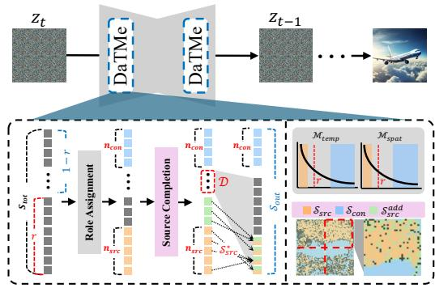  
Figure 4: Proposed DaTMe pipeline. Using the spatiotemporal axes, DaTMe assigns token roles and performs merging within diffusion layers.

$\hat { S } _ { c o n } \subset \mathbf { \hat { S } } _ { t o t }$ , as the intersection of the $\mathrm { t o p } { - } \big ( 1 - r \big )$ fractions of tokens on both axes, preserving tokens that are both temporally unstable and structurally salient. By preserving $S _ { c o n }$ throughout merging, we use them as structural anchors that keep critical boundaries from dissolving into surrounding regions.

Spatially Distributed Source Completion. Because $\mathcal { S } _ { s r c }$ is defined by the strict intersection of two conditions, its size $n _ { s r c } ~ = ~ | S _ { s r c } |$ is typically smaller than the target budget $n _ { t g t }$ (i.e., $n _ { s r c } < n _ { t g t } )$ . We therefore select an additional set $S _ { s r c } ^ { a d d }$ from the remaining unassigned tokens to satisfy $| S _ { s r c } \cup S _ { s r c } ^ { a d d } | = n _ { t g t } .$ . To avoid concentrating these additional source tokens in a specific region—which would lead to local information loss after merging—we adopt a grid-based spatia sampling strategy. Specifically, we reshape the token sequence into a spatial feature map, partition it into $P$ non-overlapping grid cells, and uniformly sample $( n _ { t g t } - n _ { s r c } ) / P$ tokens from each cell. The final source set is then given by $S _ { s r c } ^ { * } = S _ { s r c } \cup S _ { s r c } ^ { a d d }$

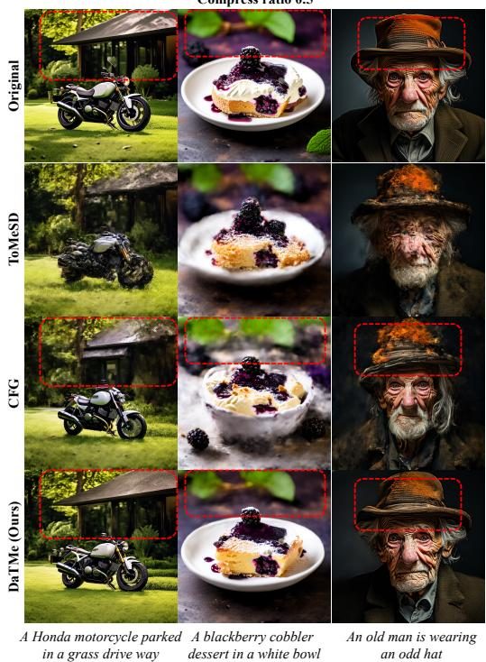

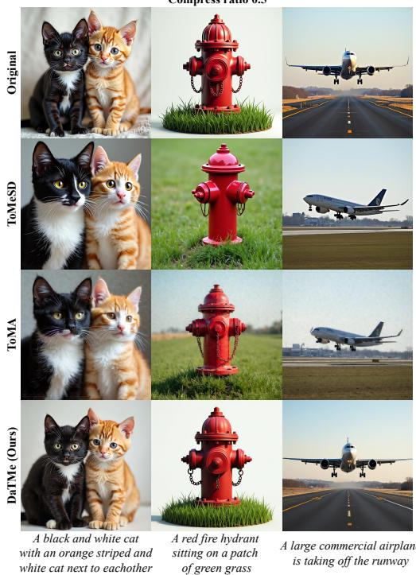  
Figure 5: Qualitative comparison under compression ratio 0.5 on PixArt-α. DaTMe better preserves structural details and background content.  
Figure 6: Qualitative comparison under compression ratio 0.5 on FLUX. DaTMe better preserves structural details with lower quality degradation.

Locality-Constrained Routing. The remaining tokens, those not assigned to $S _ { s r c } ^ { * } \ \mathrm { o r } \ S _ { c o n } ,$ , form the destination pool $\mathcal { D } \subset S _ { t o t }$ , into which $S _ { s r c } ^ { * }$ is merged via bipartite soft matching. Because DiTs process tokens as a sequence without inherent spatial inductive bias [43], relying purely on feature similarity can collapse spatially distant tokens and distort local spatial structure. We therefore use spatial adjacency as the matching criterion [9], pairing each source token with its spatially nearest destination and obtaining $\bar { S _ { m e r g e d } } = \mathrm { M e r g e } ( \bar { D , } \bar { S _ { s r c } ^ { * } } )$ . The final output token set is $\bar { S } _ { o u t } = \bar { S } _ { m e r g e d } \cup S _ { c o n } ,$ with $| S _ { o u t } | = \bar { N } - n _ { t g t }$ . By excluding $\scriptstyle { S _ { c o n } }$ from both pools and restricting merging to local neighborhoods, DaTMe compensates for the weak spatial inductive bias of DiTs and preserves visual fidelity throughout merging.

## 4 Experiments

Implementation Details and Evaluation Metrics. We primarily conduct experiments on PixArtα [5] using 10k image-prompt pairs sampled from the COCO 2014 validation set [44]. We set the interpolation scale to $s = 4$ , and for grid-based source completion, we use $P = 4$ grid cells. We evaluate three compression ratios: 0.3, 0.5, and 0.7. Following [9], we apply DaTMe to the middlerange self-attention layers of the DiT [2] backbone. To further evaluate scalability on a larger DiT model, we apply DaTMe to FLUX [22]. We use FLUX.1-dev and additionally apply DaTMe from the middle block to the final block within the joint-attention blocks using the same hyperparameters. More details are in the supplementary materials. For evaluation, we follow prior work [9, 10, 12, 13] and report CLIP-T and FID. In addition, we report HPSv2 [45], which complements CLIP-T by measuring preference-oriented prompt faithfulness and perceptual quality. We also report SSIM, PSNR, and LPIPS to measure image-level fidelity and detail preservation relative to the original output. We further report the Aesthetic score using Aesthetic Predictor V2.5, a SigLIP-based reference-free image aesthetic predictor. All experiments are conducted on a single RTX PRO 6000 Blackwell.

Table 1: Text alignment and efficiency scores on PixArt-α. DaTMe achieves the best overall qualityefficiency trade-off, preserving strong text alignment with minimal degradation under token compression.
<table><tr><td></td><td>CLIP-T↑</td><td>HPSv2↑</td><td>FID↓</td><td>Latency(s)↓</td><td>TFLOPs↓</td></tr><tr><td>PixArt-α (Base) [5]</td><td>31.2485</td><td>29.2780</td><td>42.1001</td><td>1.9417</td><td>183.45</td></tr><tr><td colspan="6">Compression ratio 0.3</td></tr><tr><td>ToMeSD [10]</td><td>30.5735</td><td>24.1699</td><td>61.5229</td><td>1.6917</td><td>172.514</td></tr><tr><td>CFG [9]</td><td>30.8801</td><td>27.7375</td><td>44.6070</td><td>1.7458</td><td>172.514</td></tr><tr><td>DaTMe (Ours)</td><td>31.1375</td><td>28.5591</td><td>42.4474</td><td>1.8030</td><td>175.631</td></tr><tr><td colspan="6">Compression ratio 0.5</td></tr><tr><td>ToMeSD</td><td>29.5178</td><td>21.3334</td><td>94.8901</td><td>1.5918</td><td>165.201</td></tr><tr><td>CFG</td><td>30.4645</td><td>25.8345</td><td>52.2912</td><td>1.6445</td><td>165.201</td></tr><tr><td>DaTMe (Ours)</td><td>31.0142</td><td>27.5174</td><td>43.4155</td><td>1.6884</td><td>170.410</td></tr><tr><td colspan="6">Compression ratio 0.7</td></tr><tr><td>ToMeSD</td><td>28.2805</td><td>18.9797</td><td>123.0139</td><td>1.5356</td><td>157.897</td></tr><tr><td>CFG</td><td>29.4543</td><td>22.6156</td><td>70.7062</td><td>1.5761</td><td>157.897</td></tr><tr><td>DaTMe (Ours)</td><td>30.6259</td><td>25.2393</td><td>47.0519</td><td>1.6426</td><td>165.193</td></tr></table>

Table 2: Image fidelity score on PixArtα. DaTMe achieves stronger structural preservation and image-level fidelity under token compression.
<table><tr><td>SSIM↑</td><td>PSNR↑</td><td>LPIPS↓</td><td>Aes.↑</td></tr><tr><td colspan="4">Compression ratio 0.3</td></tr><tr><td>ToMeSD [10] 0.7306 CFG [9] 0.7137</td><td>18.9748 17.8157</td><td>0.2433 0.2369</td><td>5.9906 6.1521</td></tr><tr><td>DaTMe (Ours) 0.8112</td><td>20.5136</td><td>0.1501</td><td>6.2014</td></tr><tr><td colspan="4">Compression ratio 0.5</td></tr><tr><td>ToMeSD 0.6737 CFG 0.6331 DaTMe (Ours) 0.7300</td><td>17.7161 16.2768 18.4277</td><td>0.3151 0.3254 0.2258</td><td>5.7739 6.1135 6.1695</td></tr><tr><td colspan="4">Compression ratio 0.7</td></tr><tr><td>ToMeSD 0.6301</td><td>16.8537</td><td>0.3682</td><td>5.5809</td></tr><tr><td>CFG 0.5695</td><td>15.2003</td><td>0.4129</td><td>5.9559</td></tr><tr><td>DaTMe (Ours) 0.6581</td><td>16.9048</td><td>0.3078</td><td>6.0544</td></tr></table>

Table 3: Text alignment and efficiency score on FLUX. DaTMe achieves stronger text alignment with comparable efficiency under token compression. † denotes our reproduced results.
<table><tr><td></td><td>CLIP-T↑</td><td>HPSv2↑</td><td>FID↓</td><td>Latency(s)↓</td><td>TFLOPs↓</td></tr><tr><td>FLUX.1-dev (Base) [22]</td><td>31.2274</td><td>29.6927</td><td>30.6141</td><td>14.601</td><td>2098</td></tr><tr><td colspan="6">Compression ratio 0.3</td></tr><tr><td>ToMeSD† [10]</td><td>31.3254</td><td>28.9339</td><td>30.4576</td><td>13.866</td><td>2046</td></tr><tr><td>ToMA [12]</td><td>31.1787</td><td>28.5153</td><td>30.6520</td><td>13.790</td><td>1971</td></tr><tr><td>DaTMe (Ours)</td><td>31.3524</td><td>29.5042</td><td>30.9258</td><td>13.772</td><td>2033</td></tr><tr><td colspan="6">Compression ratio 0.5</td></tr><tr><td>ToMeSD†</td><td>31.1852</td><td>28.3595</td><td>30.8491</td><td>13.278</td><td>2000</td></tr><tr><td>ToMA</td><td>31.2036</td><td>27.7566</td><td>30.9883</td><td>13.288</td><td>1895</td></tr><tr><td>DaTMe (Ours)</td><td>31.2621</td><td>28.9266</td><td>31.3423</td><td>13.271</td><td>1990</td></tr><tr><td colspan="6">Compression ratio 0.7</td></tr><tr><td>ToMeSD†</td><td>31.2045</td><td>27.6455</td><td>31.0033</td><td>12.728</td><td>1954</td></tr><tr><td>ToMA</td><td>31.2191</td><td>26.4796</td><td>35.0541</td><td>12.775</td><td>1793</td></tr><tr><td>DaTMe (Ours)</td><td>31.2415</td><td>27.9093</td><td>31.1585</td><td>12.737</td><td>1946</td></tr></table>

Table 4: Image fidelity score on FLUX. DaTMe achieves stronger structural preservation and image fidelity.
<table><tr><td>SSIM↑</td><td>PSNR↑</td><td>LPIPS↓</td><td>Aes.↑</td></tr><tr><td colspan="3">Compression ratio 0.3</td></tr><tr><td>ToMeSD† [10] 0.6402 ToMA [12] 0.7415</td><td>17.5070 20.6450</td><td>0.2616 0.1844</td><td>5.7626 6.0210</td></tr><tr><td colspan="3">DaTMe (Ours) 0.7737 21.6352 0.1694 Compression ratio 0.5</td><td>6.0318</td></tr><tr><td colspan="3">ToMeSD† 0.6166 16.9059</td></tr><tr><td colspan="3">ToMA 0.7009 DaTMe (Ours)</td></tr><tr><td colspan="3">20.0375</td></tr><tr><td colspan="3">5.9030 0.7087 20.2021 0.2176 6.0191</td></tr><tr><td colspan="3"></td></tr><tr><td colspan="3">Compression ratio 0.7</td></tr><tr><td colspan="3">ToMeSD† 0.3181 5.5739</td></tr><tr><td colspan="3">0.6032 16.6127</td></tr><tr><td colspan="3"></td></tr><tr><td colspan="3">0.6280 17.6972</td></tr><tr><td colspan="3">0.2835</td></tr><tr><td colspan="3"></td></tr><tr><td colspan="3"></td></tr><tr><td colspan="3"></td></tr><tr><td colspan="3">0.2877</td></tr><tr><td colspan="3"></td></tr><tr><td colspan="3"></td></tr><tr><td colspan="3"></td></tr><tr><td colspan="3"></td></tr><tr><td colspan="3"></td></tr><tr><td colspan="3"></td></tr><tr><td colspan="3"></td></tr><tr><td colspan="3"></td></tr><tr><td colspan="3"></td></tr><tr><td colspan="3"></td></tr><tr><td colspan="3">17.7655</td></tr><tr><td colspan="3"></td></tr><tr><td colspan="3"></td></tr><tr><td colspan="3"></td></tr><tr><td colspan="3"></td></tr><tr><td colspan="3"></td></tr><tr><td colspan="3"></td></tr><tr><td colspan="3"></td></tr><tr><td colspan="3"></td></tr><tr><td colspan="3"></td></tr><tr><td colspan="3"></td></tr><tr><td colspan="3"></td></tr><tr><td colspan="3">DaTMe (Ours)</td></tr><tr><td colspan="3"></td></tr><tr><td colspan="3"></td></tr><tr><td colspan="3"></td></tr><tr><td colspan="3">0.6378</td></tr><tr><td colspan="3"></td></tr></table>

## 4.1 Main Experiments

Qualitative Results. In Fig. 5 and Fig. 6, we compare qualitative results at a compression ratio of 0.5. On PixArt-α, directly merging tokens based on feature similarity (ToMeSD) severely disrupts spatial structure, often leading to obvious structural distortion. Although the CFG-based method preserves foreground structures that are explicitly described in the prompt, it shows noticeably weaker preservation in background and other weakly conditioned regions, as highlighted by the red boxes. This qualitatively supports our analysis that CFG-based importance is strongly biased toward prompt-conditioned content and is therefore less effective at preserving the full image context.

On FLUX, existing methods generally preserve the coarse prompt semantics, but still introduce noticeable deviations from the original generation. ToMeSD tends to alter the original composition, object geometry, or viewpoint, as seen in the relative arrangement of the cats, the fire hydrant structure, and the airplane viewpoint. ToMA shows similar structural drift while additionally introducing noisy visual degradation that weakens overall image quality. In contrast, DaTMe more faithfully preserves the original spatial configuration and object structure while maintaining the intended prompt semantics. These results demonstrate that DaTMe reduces both structural deviation and visual degradation across different architectures. Additional results under various compression ratios are in Appendix C.

Quantitative Results. In Tab. 1 and Tab. 2, we compare DaTMe with prior methods on PixArt-α [5] under various compression ratios. Although DaTMe is slightly slower than prior methods in terms of latency, the prior methods suffer from substantial quality degradation as the compression ratio increases, particularly in FID. In contrast, DaTMe remains much more robust under compression, consistently preserving image quality and achieving the most favorable overall quality-efficiency trade-off. Notably, DaTMe also attains substantially stronger structural preservation, which indicates that the proposed spatiotemporal importance signal effectively prevents structurally important tokens from being merged prematurely (Tab. 2).

Table 5: Ablation on temporal and spatial axes. We compare using only the temporal axis, only the spatial axis, both axes, and both axes with score slope instead of Tweedie difference.
<table><tr><td>Setting</td><td>CLIP-T↑</td><td>SSIM↑</td><td>PSNR↑</td><td>FID↓</td></tr><tr><td>CFG [9]</td><td>30.8801</td><td>0.7137</td><td>17.8157</td><td>44.6070</td></tr><tr><td>Only  $\overline { { \mathcal { M } _ { \mathrm { t e m p } } } }$ </td><td>31.0355</td><td>0.8109</td><td>20.5021</td><td>42.5269</td></tr><tr><td>Only Mspat</td><td>31.1318</td><td>0.8110</td><td>20.5029</td><td>42.5736</td></tr><tr><td>Ours (score slope)</td><td>31.1166</td><td>0.8028</td><td>20.3944</td><td>42.9554</td></tr><tr><td>Ours</td><td>31.1375</td><td>0.8112</td><td>20.5136</td><td>42.4474</td></tr></table>

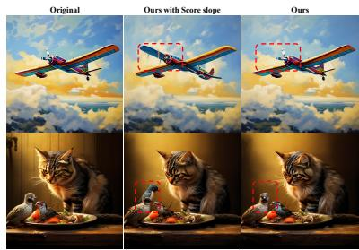

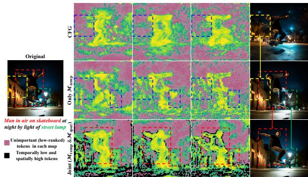  
Figure 8: Effect of different importance signals. Jointly using temporal and spatial signals, the proposed importance map preserves both structurally important object regions and unconditioned background content.

Table 6: Ablation on constraint-set definition $S _ { \mathrm { c o n } } .$ . We compare different choices for selecting constraint tokens.  
Figure 7: Qualitative comparison difference between score slope and Tweedie difference. Using the score slope introduces noticeable artifacts.
<table><tr><td>Setting</td><td>CLIP-T↑</td><td>SSIM↑</td><td>PSNR↑</td><td>LPIPS↓</td><td>FID↓</td></tr><tr><td>None</td><td>31.1419</td><td>0.8037</td><td>20.3736</td><td>0.1601</td><td>43.7692</td></tr><tr><td> $\mathcal { M } _ { \mathrm { t e m p } } \uparrow \cap \mathcal { M } _ { \mathrm { s p a t } }$ </td><td>31.1375</td><td>0.8112</td><td>20.5136</td><td>0.1501</td><td>42.4474</td></tr><tr><td> $\mathcal { M } _ { \mathrm { t e m p } } \downarrow \cap \mathcal { M } _ { \mathrm { s p a t } }$ </td><td>31.1372</td><td>0.8076</td><td>20.5027</td><td>0.1569</td><td>43.6605</td></tr><tr><td> $\mathcal { M } _ { \mathrm { t e m p } } \uparrow \cap \mathcal { M } _ { \mathrm { s p a t } } \downarrow$ </td><td>31.1250</td><td>0.8005</td><td>20.3459</td><td>0.1641</td><td>43.8062</td></tr></table>

In the FLUX results, CFG-based token selection is not applicable because FLUX does not employ CFG, whereas DaTMe remains directly applicable despite the architectural difference. Across all compression ratios, DaTMe consistently achieves the strongest CLIP-T and HPSv2 scores while maintaining comparable inference efficiency (Tab. 3). Although ToMeSD preserves reasonable text–image alignment, its substantially lower SSIM and PSNR and higher LPIPS indicate larger structural deviations from the original generation. ToMA better preserves the original structure than ToMeSD, but still exhibits noticeable visual degradation, particularly in fine details and overall image quality. In contrast, DaTMe achieves the strongest overall image fidelity, consistently improving SSIM, PSNR, and aesthetic quality while maintaining strong prompt alignment (Tab. 4). These quantitative trends are consistent with Fig. 6, where DaTMe more faithfully preserves the original image structure.

## 4.2 Additional Analysis

We conduct various ablation studies on PixArt-α. Additional experiments are in Appendix C.

Importance of Temporal and Spatial Signals. In Tab. 5, we ablate the two components of our importance map by using only the temporal axis, only the spatial axis, or both. Using both axes yields the best overall performance, confirming that temporal evolution and structural saliency provide complementary cues for token selection, whereas either axis alone is insufficient to fully characterize mergeability. We further replace our temporal signal with the raw score slope to evaluate its effectiveness in the actual merging process. As shown in Tab. 5, this substitution consistently degrades all evaluation metrics, and Fig. 7 shows that it also introduces noticeable visual artifacts. This is consistent with our earlier analysis that the score slope becomes increasingly contaminated by schedule-driven effects in later denoising steps, making it less reliable for token merging.

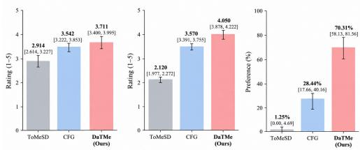  
Table 7: Effectiveness of the proposed importance signal on PixArt-α at $r = 0 . 3 .$ “Merging” indicates the merging strategy adopted from either [9] or ours, while “Signal” indicates whether token importance is determined by CFG [9] or our proposed importance map.

<table><tr><td>Merging</td><td>Signal</td><td>CLIP-T↑</td><td>HPSv2↑</td><td>SSIM↑</td><td>PSNR↑</td><td>LPIPS↓</td></tr><tr><td>CFG [9]</td><td>CFG [9]</td><td>30.8801</td><td>27.7375</td><td>0.7137</td><td>17.8157</td><td>0.2369</td></tr><tr><td>CFG [9]</td><td>Ours</td><td>31.0545</td><td>27.9366</td><td>0.7644</td><td>20.0917</td><td>0.1915</td></tr><tr><td>Ours</td><td>Ours</td><td>31.1375</td><td>28.5591</td><td>0.8112</td><td>20.5136</td><td>0.1501</td></tr></table>

Figure 9: Human preference study on PixArtα at $r \ = \ 0 . 3 .$ DaTMe receives the highest ratings for text alignment and visual quality, as well as the highest overall preference.

Fig. 8 further illustrates how different importance signals affect region preservation. The CFGbased signal [9] is strongly biased toward prompt-aligned foreground regions and therefore neglects unmentioned background content. Using only the temporal signal alleviates this issue by preserving evolving background regions (yellow box), but it still misses structurally important boundaries (black regions), leading to structural distortions (red box). By jointly modeling temporal and spatial signals, our importance map preserves both evolving background content and critical object boundaries, resulting in more faithful image structure and higher overall visual quality.

Constraint Token Selection. In Tab. 6, we ablate different definitions of the constraint set. The best results are obtained when the constraint tokens are selected from regions with both high temporal and high spatial responses. In particular, including spatially high-response tokens improves structural preservation, indicating that the spatial axis captures fine object details and structurally salient regions. By contrast, using spatially low-response tokens degrades performance because such tokens are biased toward homogeneous regions and therefore fail to protect meaningful object structure.

Effectiveness of the Importance Signal. To isolate the contribution of our importance signal, we keep the entire merging pipeline of [9] unchanged and replace only its CFG-based importance with ours. Since [9] requires a single token ranking, we combine our temporal and spatial rankings using rank-sum. As shown in Tab. 7, replacing only the CFG-based signal with ours improves CLIP-T, HPSv2, and all fidelity metrics, demonstrating that the proposed dynamics-aware importance more effectively identifies tokens to preserve or merge. Using the full DaTMe merging strategy further improves all metrics, indicating that the role-assignment and spatial merging design provides additional complementary benefits.

Preference Study. We evaluate perceptual quality at a compression ratio of r = 0.3 using human judgments. For 20 randomly sampled PixArt-α cases, 32 evaluators compare outputs from ToMeSD, CFG [9], and DaTMe without access to the uncompressed reference. Evaluators independently rate text alignment and visual quality, and select their overall preferred result. As shown in Fig. 9, DaTMe achieves the highest ratings for both text alignment and visual quality, while also being the most preferred method overall.

## 5 Conclusion

We presented DaTMe, a diffusion-dynamics-aware token merging framework for efficient image generation. By leveraging the Tweedie denoised estimate, DaTMe defines token importance along two complementary axes—temporal evolution and structural saliency—that reflect the image generation process. This allows DaTMe to identify safely mergeable tokens while preserving structurally critical regions, achieving strong image fidelity and favorable quality-efficiency trade-offs across DiT-based diffusion models. Our work shows that grounding token merging in the underlying generation dynamics is a key step toward faithful and efficient diffusion inference.

## Acknowledgments and Disclosure of Funding

This work was partly supported by the Institute of Information & Communications Technology Planning & Evaluation (IITP) grant funded by the Korean government (MSIT) (No. RS-2025-

25422680, Metacognitive AGI Framework) and the Institute of Information & Communications Technology Planning & Evaluation (IITP) grant funded by the Korean government (MSIT) (No.RS-2025-02215122, Development and Demonstration of Lightweight AI Model for Smart Homes).

## References

[1] Rombach, R., Blattmann, A., Lorenz, D., Esser, P. & Ommer, B. High-resolution image synthesis with latent diffusion models. In Proceedings of the IEEE/CVF conference on computer vision and pattern recognition, 10684–10695 (2022).

[2] Peebles, W. & Xie, S. Scalable diffusion models with transformers. In Proceedings of the IEEE/CVF international conference on computer vision, 4195–4205 (2023).

[3] Podell, D. et al. Sdxl: Improving latent diffusion models for high-resolution image synthesis. arXiv preprint arXiv:2307.01952 (2023).

[4] Esser, P. et al. Scaling rectified flow transformers for high-resolution image synthesis. In Forty-first international conference on machine learning (2024).

[5] Chen, J. et al. Pixart-α: Fast training of diffusion transformer for photorealistic text-to-image synthesis (2023). URL https://arxiv.org/abs/2310.00426. 2310.00426.

[6] Li, J. et al. T2v-turbo-v2: Enhancing video generation model post-training through data, reward, and conditional guidance design. arXiv preprint arXiv:2410.05677 (2024).

[7] Kong, W. et al. Hunyuanvideo: A systematic framework for large video generative models. arXiv preprint arXiv:2412.03603 (2024).

[8] Polyak, A. et al. Movie gen: A cast of media foundation models. arXiv preprint arXiv:2410.13720 (2024).

[9] Wu, H., Xu, J., Le, H. & Samaras, D. Importance-based token merging for efficient image and video generation. In Proceedings of the IEEE/CVF International Conference on Computer Vision (ICCV), 4983–4995 (2025).

[10] Bolya, D. & Hoffman, J. Token merging for fast stable diffusion. In Proceedings of the IEEE/CVF conference on computer vision and pattern recognition, 4599–4603 (2023).

[11] Zhang, E., Tang, J., Ning, X. & Zhang, L. Training-free and hardware-friendly acceleration for diffusion models via similarity-based token pruning. In Proceedings of the AAAI Conference on Artificial Intelligence, vol. 39, 9878–9886 (2025).

[12] Lu, W., Zheng, S., Xia, Y. & Wang, S. Toma: Token merge with attention for diffusion models. arXiv preprint arXiv:2509.10918 (2025).

[13] Fang, H. et al. Attend to not attended: Structure-then-detail token merging for post-training dit acceleration. In Proceedings of the Computer Vision and Pattern Recognition Conference, 18083–18092 (2025).

[14] Ho, J. & Salimans, T. Classifier-free diffusion guidance. arXiv preprint arXiv:2207.12598 (2022).

[15] Hertz, A. et al. Prompt-to-prompt image editing with cross attention control. arXiv preprint arXiv:2208.01626 (2022).

[16] Hwang, J., Park, Y.-H. & Jo, J. Resolution chromatography of diffusion models. arXiv preprint arXiv:2401.10247 (2023).

[17] Cao, Y., Zhao, Z., Patras, I. & Gong, S. Temporal score analysis for understanding and correcting diffusion artifacts. In Proceedings of the Computer Vision and Pattern Recognition Conference, 7707–7716 (2025).

[18] Zhao, W. et al. Dynamic diffusion transformer. arXiv preprint arXiv:2410.03456 (2024).

[19] Song, Y. et al. Score-based generative modeling through stochastic differential equations. arXiv preprint arXiv:2011.13456 (2020).

[20] Robbins, H. E. An empirical bayes approach to statistics. In Breakthroughs in Statistics: Foundations and basic theory, 388–394 (Springer, 1992).

[21] Efron, B. Tweedie’s formula and selection bias. Journal ofthe American Statistical Association 106, 1602–1614 (2011).

[22] Labs, B. F. Flux. https://github.com/black-forest-labs/flux (2024).

[23] Rao, Y. et al. Dynamicvit: Efficient vision transformers with dynamic token sparsification. Advances in neural information processing systems 34, 13937–13949 (2021).

[24] Chen, M. et al. Diffrate: Differentiable compression rate for efficient vision transformers. In Proceedings of the IEEE/CVF international conference on computer vision, 17164–17174 (2023).

[25] Yang, L. et al. Libra-merging: Importance-redundancy and pruning-merging trade-off for accel eration plug-in in large vision-language model. In Proceedings ofthe IEEE/CVF Conference on Computer Vision and Pattern Recognition, 9402–9412 (2025).

[26] Zhang, X. et al. Tf-atm: Training-free adaptive token merging. In Proceedings ofthe 33rd ACM International Conference on Multimedia, 7172–7180 (2025).

[27] Bolya, D. et al. Token merging: Your vit but faster. arXiv preprint arXiv:2210.09461 (2022).

[28] Luo, S., Tan, Y., Huang, L., Li, J. & Zhao, H. Latent consistency models: Synthesizing high-resolution images with few-step inference. arXiv preprint arXiv:2310.04378 (2023).

[29] Salimans, T. & Ho, J. Progressive distillation for fast sampling of diffusion models. arXiv preprint arXiv:2202.00512 (2022).

[30] Meng, C. et al. On distillation of guided diffusion models. In Proceedings ofthe IEEE/CVF conference on computer vision and pattern recognition, 14297–14306 (2023).

[31] Song, J., Meng, C. & Ermon, S. Denoising diffusion implicit models. arXiv preprint arXiv:2010.02502 (2020).

[32] Song, Y., Dhariwal, P., Chen, M. & Sutskever, I. Consistency models (2023).

[33] Li, X. et al. Q-diffusion: Quantizing diffusion models. In Proceedings of the IEEE/CVF International Conference on Computer Vision, 17535–17545 (2023).

[34] Shang, Y., Yuan, Z., Xie, B., Wu, B. & Yan, Y. Post-training quantization on diffusion models. In Proceedings of the IEEE/CVF conference on computer vision and pattern recognition, 1972–1981 (2023).

[35] Kim, M., Gao, S., Hsu, Y.-C., Shen, Y. & Jin, H. Token fusion: Bridging the gap between token pruning and token merging. In Proceedings of the IEEE/CVF Winter Conference on Applications of Computer Vision, 1383–1392 (2024).

[36] Ma, X., Fang, G. & Wang, X. Deepcache: Accelerating diffusion models for free. In Proceedings of the IEEE/CVF conference on computer vision and pattern recognition, 15762–15772 (2024).

[37] Wimbauer, F. et al. Cache me if you can: Accelerating diffusion models through block caching. In Proceedings of the IEEE/CVF Conference on Computer Vision and Pattern Recognition, 6211–6220 (2024).

[38] Liu, H. et al. Faster diffusion via temporal attention decomposition. arXiv preprint arXiv:2404.02747 (2024).

[39] Kong, Z. et al. Token reduction should go beyond efficiency in generative models–from vision, language to multimodality. arXiv preprint arXiv:2505.18227 (2025).

[40] Rout, L. et al. Beyond first-order tweedie: Solving inverse problems using latent diffusion. In Proceedings of the IEEE/CVF Conference on Computer Vision and Pattern Recognition, 9472–9481 (2024).

[41] Rout, L. et al. Solving linear inverse problems provably via posterior sampling with latent diffusion models. Advances in Neural Information Processing Systems 36, 49960–49990 (2023).

[42] Koh, S., Cha, S., Oh, H., Lee, K. & Kim, D.-J. Scalediff: Higher-resolution image synthesis via efficient and model-agnostic diffusion. arXiv preprint arXiv:2510.25818 (2025).

[43] d’Ascoli, S. et al. Convit: Improving vision transformers with soft convolutional inductive biases. In International conference on machine learning, 2286–2296 (PMLR, 2021).

[44] Lin, T.-Y. et al. Microsoft coco: Common objects in context. In European conference on computer vision, 740–755 (Springer, 2014).

[45] Wu, X. et al. Human preference score v2: A solid benchmark for evaluating human preferences of text-to-image synthesis. arXiv preprint arXiv:2306.09341 (2023).

[46] Ho, J., Jain, A. & Abbeel, P. Denoising diffusion probabilistic models. Advances in neural information processing systems 33, 6840–6851 (2020).

[47] Karras, T., Aittala, M., Aila, T. & Laine, S. Elucidating the design space of diffusion-based generative models. Advances in neural information processing systems 35, 26565–26577 (2022).

[48] Luo, C. Understanding diffusion models: A unified perspective (2022). 2208.11970.

## A Formal Decomposition of Score Slope Instability

We provide a formal analysis of why the score slope fails to reliably capture per-token convergence in late denoising steps.

Decomposition of score slope. Recall that the score function is estimated as:

$$
s _ { t } \approx - \frac { 1 } { \sigma _ { t } } \epsilon _ { \theta } ( x _ { t } , t , c ) .\tag{9}
$$

To understand the temporal variation of the score, we analyze the score slope between consecutive timesteps. For brevity, let $\epsilon _ { \theta } ( t )$ denote $\boldsymbol { \epsilon } _ { \boldsymbol { \theta } } ( x _ { t } , t , \boldsymbol { c } )$ . The score slope is:

$$
s _ { t } - s _ { t - 1 } = \frac { \epsilon _ { \theta } ( t - 1 ) } { \sigma _ { t - 1 } } - \frac { \epsilon _ { \theta } ( t ) } { \sigma _ { t } } .\tag{10}
$$

By adding and subtracting the term $\frac { \epsilon _ { \theta } ( t ) } { \sigma _ { t - 1 } }$

$$
s _ { t } - s _ { t - 1 } = \frac { \epsilon _ { \theta } ( t - 1 ) } { \sigma _ { t - 1 } } - \frac { \epsilon _ { \theta } ( t ) } { \sigma _ { t - 1 } } + \frac { \epsilon _ { \theta } ( t ) } { \sigma _ { t - 1 } } - \frac { \epsilon _ { \theta } ( t ) } { \sigma _ { t } } ,\tag{11}
$$

we can decouple this slope into two distinct components:

$$
s _ { t } - s _ { t - 1 } = \underbrace { \frac { \epsilon _ { \theta } ( t - 1 ) - \epsilon _ { \theta } ( t ) } { \sigma _ { t - 1 } } } _ { \mathrm { d i f f e r e n c e ~ t e r m } } + \underbrace { \epsilon _ { \theta } ( t ) \left( \frac { 1 } { \sigma _ { t - 1 } } - \frac { 1 } { \sigma _ { t } } \right) } _ { \mathrm { s c a l e ~ t e r m } } .\tag{12}
$$

This decomposition reveals a limitation. The first term captures the actual change in the model’s noise prediction, reflecting semantic token-level evolution. However, the second term is entirely dictated by the predefined noise schedule $\sigma _ { t } .$ , scaled by the current noise prediction $\epsilon _ { \theta } ( t )$

Behavior in late denoising steps. As generation progresses toward the final steps, the noise scale $\sigma _ { t }$ becomes extremely small. Because $\sigma _ { t }$ decays rapidly, the inverse difference $\begin{array} { r } { \left| \frac { 1 } { \sigma _ { t - 1 } } - \frac { 1 } { \sigma _ { t } } \right| } \end{array}$ grows disproportionately large. Meanwhile, since $\epsilon _ { \theta }$ is trained to match samples from $\mathcal { N } ( 0 , I ) \left[ 4 6 \right]$ , its norm is concentrated near $\sqrt { D }$ in expectation, where $D$ is the dimensionality [47]. Consequently, the scale term in Eq. (12) significantly amplifies the raw noise prediction $\epsilon _ { \theta } ( t )$ , eventually overshadowing the difference term. Therefore, in later denoising stages, the score slope $s _ { t } - s _ { t - 1 }$ is heavily dominated by the noise schedule scaling rather than actual changes in each token, which is consistent with the high autocorrelation and loss of discriminative power observed in Fig. 2.

Decomposition of Tweedie difference. To understand why the Tweedie difference avoids this scaleinduced amplification, we first define the Tweedie denoised estimate. Under variance-preserving diffusion (VP diffusion) [19, 46], the noisy state is $x _ { t } = \alpha _ { t } x _ { 0 } + \sigma _ { t } \epsilon$ , where the signal and noise schedules satisfy $\alpha _ { t } ^ { 2 } + \sigma _ { t } ^ { 2 } = 1$ . The posterior mean estimate of the clean data is [21]:

$$
\hat { x } _ { 0 } ( t ) = \mathbb { E } [ x _ { 0 } \mid x _ { t } ] \approx \frac { x _ { t } - \sigma _ { t } \epsilon _ { \theta } ( t ) } { \alpha _ { t } } ,\tag{13}
$$

where the approximation arises from using the learned $\epsilon _ { \theta } ( t )$ in place of the true noise. This cleanspace projection is embedded within the deterministic update rule (e.g., DDIM [31]). The latent transition from timestep t to t − 1 is:

$$
x _ { t - 1 } = \alpha _ { t - 1 } \underbrace { \left( \frac { x _ { t } - \sigma _ { t } \epsilon _ { \theta } ( t ) } { \alpha _ { t } } \right) } _ { \mathrm { T w e e d i e ~ e s t i m a t e } \hat { x } _ { 0 } ( t ) } + \sigma _ { t - 1 } \epsilon _ { \theta } ( t ) .\tag{14}
$$

Since the parenthesized term is exactly ${ \hat { x } } _ { 0 } ( t )$ , we can write:

$$
x _ { t - 1 } = \alpha _ { t - 1 } \hat { x } _ { 0 } ( t ) + \sigma _ { t - 1 } \epsilon _ { \theta } ( t ) .\tag{15}
$$

We decompose the inter-step difference by substituting this $x _ { t - 1 }$ into the Tweedie estimate at the next timestep, $\begin{array} { r } { \hat { x } _ { 0 } ( t - 1 ) = \frac { \bar { x } _ { t - 1 } - \sigma _ { t - 1 } \epsilon _ { \theta } ( t - 1 ) } { \alpha _ { t - 1 } } } \end{array}$ :

$$
\hat { x } _ { 0 } ( t - 1 ) = \frac { \big ( \alpha _ { t - 1 } \hat { x } _ { 0 } ( t ) + \sigma _ { t - 1 } \epsilon _ { \theta } ( t ) \big ) - \sigma _ { t - 1 } \epsilon _ { \theta } ( t - 1 ) } { \alpha _ { t - 1 } } .\tag{16}
$$

Simplifying yields:

$$
\hat { x } _ { 0 } ( t - 1 ) = \hat { x } _ { 0 } ( t ) + \frac { \sigma _ { t - 1 } } { \alpha _ { t - 1 } } \big ( \epsilon _ { \theta } ( t ) - \epsilon _ { \theta } ( t - 1 ) \big ) .\tag{17}
$$

Rearranging, the Tweedie inter-step difference reduces to:

$$
\hat { x } _ { 0 } ( t ) - \hat { x } _ { 0 } ( t - 1 ) = \frac { \sigma _ { t - 1 } } { \alpha _ { t - 1 } } \big ( \epsilon _ { \theta } ( t - 1 ) - \epsilon _ { \theta } ( t ) \big ) .\tag{18}
$$

Comparing Eq. (18) with Eq. (12) reveals a difference in how the noise schedule enters each formulation. First, the problematic scale term—the $1 / \sigma _ { t }$ scaling that overshadowed the genuine signal— no longer dominates the slope. The Tweedie difference cleanly isolates the difference term change, $\epsilon _ { \theta } ( t - 1 ) - \epsilon _ { \theta } ( t )$ . Second, instead of amplifying this change with a rapidly growing $1 / \sigma _ { t - 1 }$ multiplier, the Tweedie difference scales it by $\frac { \sigma _ { t - 1 } } { \alpha _ { t - 1 } } \dot { }$ (closely related to the inverse signal-to-noise ratio [48]). As $t \to 0$ , we have $\sigma _ { t - 1 } \to 0$ and $\begin{array} { r } { \alpha _ { t - 1 } \to 1 , \mathrm { s o } \ \frac { \sigma _ { t - 1 } } { \alpha _ { t - 1 } } \to 0 } \end{array}$ . This decays the variation as the network’s prediction stabilizes, ensuring that the Tweedie difference provides a stable metric for convergence without scale-induced amplification.

Extension to flow matching. The Tweedie formulation extends naturally to flow matching architectures such as FLUX [22]. While VP diffusion satisfies $\alpha _ { t } ^ { 2 } + \sigma _ { t } ^ { 2 } = 1$ , FLUX adopts the rectified flow schedule $\alpha _ { t } = 1 - t , \sigma _ { t } = t .$ , which does not satisfy the VP constraint. Both nonetheless share the general form $x _ { t } = \alpha _ { t } x _ { 0 } + \sigma _ { t } \epsilon$ , allowing the Tweedie derivation to proceed with FLUX-specific schedule values. Since rectified flow uses continuous time $t \in [ 0 , 1 ]$ , we denote the step size between consecutive sampling times by $\Delta t .$

Clean-image estimate under velocity parameterization. Unlike VP models that predict noise $\epsilon _ { \theta } ,$ rectified flow models predict the velocity field $v _ { \theta } ( t ) \approx \epsilon - x _ { 0 } \ [ 2 2 ]$ . From the forward process $x _ { t } = ( 1 - t ) x _ { 0 } + t \gets$ ϵ and the velocity definition $\epsilon = v _ { \theta } ( t ) + x _ { 0 }$ , we have:

$$
x _ { t } = ( 1 - t ) x _ { 0 } + t { \big ( } v _ { \theta } ( t ) + x _ { 0 } { \big ) } = x _ { 0 } + t \cdot v _ { \theta } ( t ) .\tag{19}
$$

Solving for $x _ { 0 }$ yields the FLUX clean-image estimate:

$$
\hat { x } _ { 0 } ( t ) = x _ { t } - t \cdot v _ { \theta } ( t ) ,\tag{20}
$$

which is the velocity-parameterization analog of Eq. (4).

Tweedie inter-step difference under Euler update. For rectified flow, the deterministic Euler step from time $t \tan t - \Delta t$ is:

$$
x _ { t - \Delta t } = x _ { t } - \Delta t \cdot v _ { \theta } ( t ) .\tag{21}
$$

Applying Eq. (20) at $t - \Delta t$ and substituting Eq. (21):

$$
\begin{array} { r l } & { \hat { x } _ { 0 } ( t - \Delta t ) = x _ { t - \Delta t } - ( t - \Delta t ) \cdot v _ { \theta } ( t - \Delta t ) } \\ & { \qquad = \big [ x _ { t } - \Delta t \cdot v _ { \theta } ( t ) \big ] - ( t - \Delta t ) \cdot v _ { \theta } ( t - \Delta t ) . } \end{array}\tag{22}
$$

Subtracting from $\hat { x } _ { 0 } ( t ) = x _ { t } - t \cdot v _ { \theta } ( t )$

$$
\begin{array} { r l } & { \hat { x } _ { 0 } ( t ) - \hat { x } _ { 0 } ( t - \Delta t ) = - t \cdot v _ { \theta } ( t ) + \Delta t \cdot v _ { \theta } ( t ) + ( t - \Delta t ) \cdot v _ { \theta } ( t - \Delta t ) } \\ & { \quad \quad \quad = - ( t - \Delta t ) \cdot v _ { \theta } ( t ) + ( t - \Delta t ) \cdot v _ { \theta } ( t - \Delta t ) } \\ & { \quad \quad \quad = ( t - \Delta t ) \big ( v _ { \theta } ( t - \Delta t ) - v _ { \theta } ( t ) \big ) . } \end{array}\tag{23}
$$

Eq. (23) mirrors Eq. (18): the Tweedie inter-step difference isolates the change in prediction—velocity rather than noise—scaled by the schedule factor $( t - \Delta t )$ , which decays to zero as $t  0$ . The Tweedie difference therefore remains a stable temporal signal under flow matching as well.

## B DaTMe Details

DaTMe Process. In Alg. 1, we show the detailed step-by-step process of our proposed DaTMe framework.

Additional Implementation Details. For $\operatorname { P i x A r t - } \alpha ,$ , we use 20 inference steps with a guidance scale of 4.5. Token merging is applied to transformer layers 9–19 starting from the second denoising step, since the temporal signal requires the previous Tweedie estimate, which is unavailable at the first step. For FLUX, images are generated using 35 inference steps with a guidance scale of 3.5. Within the FLUX architecture, we apply token merging to blocks 9 through 19 out of the 19 dual-stream blocks, and to blocks 7 through 22 out of the 38 single-stream blocks.

```tcl
Algorithm 1 Dynamics-Aware Token Merging (DaTMe) at timestep t
Require: token features $\mathbf { F } ^ { ( t ) }$ , temporal map $\mathcal { M } _ { \mathrm { t e m p } } ^ { ( t ) } ,$ spatial map $\mathcal { M } _ { \mathrm { s p a t } } ^ { ( t ) }$ , compression ratio $r ,$
number of grids $P$
Ensure: merged token features $\mathbf { F } ^ { \prime ( t ) }$
1: $N \gets H \stackrel { \smile } { \times } W , \quad S _ { \mathrm { t o t } } \gets \{ 1 , \dots , N \} , \quad n _ { \mathrm { t g t } } \gets \lfloor r N \rfloor$
2: // 1. Dynamics-Aware Role Assignment
3: $S _ { \mathrm { c o n } } \gets \mathrm { T o p F r a c } _ { 1 - r } \big ( \mathcal { M } _ { \mathrm { t e m p } } ^ { ( t ) } \big ) \cap \mathrm { T o p F r a c } _ { 1 - r } \big ( \mathcal { M } _ { \mathrm { s p a t } } ^ { ( t ) } \big )$ ▷ protected tokens
4: $S _ { \mathrm { s r c } } \gets \mathrm { B o t F r a c } _ { r } \left( \mathcal { M } _ { \mathrm { t e m p } } ^ { ( t ) } \right)$ ∩ BotFrac<sub>r</sub> $( \mathcal { M } _ { \mathrm { s p a t } } ^ { ( t ) } )$ ▷ safe merge sources
5: // 2. Spatially Distributed Source Completion
6: ${ \mathcal { U } } \gets \dot { \boldsymbol { S } } _ { \mathrm { t o t } } \setminus \left. \boldsymbol { \bar { S } } _ { \mathrm { c o n } } \cup \boldsymbol { S } _ { \mathrm { s r c } } \right.$
7: $S _ { \mathrm { s r c } } ^ { \mathrm { a d d } } \gets \mathrm { G r i d S a m p l e } \Big ( \mathcal { U } , n _ { \mathrm { t g t } } - | S _ { \mathrm { s r c } } | , P \Big )$
8: $S _ { \mathrm { s r c } } ^ { * }  S _ { \mathrm { s r c } } \cup S _ { \mathrm { s r c } } ^ { \mathrm { a d d } }$
9: // 3. Locality-Constrained Spatial Matching
10: ${ \mathcal { D } } \gets S _ { \mathrm { t o t } } \setminus \mathbf { \bar { ( } } S _ { \mathrm { c o n } } \cup S _ { \mathrm { s r c } } ^ { * } )$ ▷ destination tokens
11: for each $j \in \mathcal { S } _ { \mathrm { s r c } } ^ { * }$ do
12: $d ( j ) \stackrel { \cdot } {  } \arg \operatorname* { m i n } _ { k \in \mathcal { D } } \| \mathbf { p } _ { j } - \mathbf { p } _ { k } \| _ { 2 }$
13: end for
14: $\mathbf { F } ^ { \prime ( t ) } \gets \mathrm { M e r g e } \Big ( \mathbf { F } ^ { ( t ) } , \{ j \to d ( j ) \} _ { j \in S _ { \mathrm { s r c } } ^ { * } } \Big )$ ▷ $ { S _ { \mathrm { c o n } } }$ remains unchanged
15: return $\mathbf { F } ^ { \prime ( t ) }$
```

We further evaluate DaTMe on U-Net-based architectures, specifically Stable Diffusion 1.5 and SDXL. For these models, we set the interpolation scale to $s = 2$ and the number of grid cells to $P = 4$ . Images are generated using 50 inference steps, with a guidance scale of 7.5 for Stable Diffusion 1.5 and 5.0 for SDXL. Following [9, 10], we apply token merging at the $6 4 \times 6 4$ latent resolution in both architectures. Unlike in DiT-based models, we do not explicitly construct the constraint set $ { S _ { \mathrm { c o n } } }$ for U-Net backbones. Because U-Net architectures already possess a strong spatial inductive bias through convolutions, tokens with similar features are naturally organized in nearby spatial regions [43]. Consequently, spatial locality is implicitly preserved. We therefore only identify the source set $ { \boldsymbol { S } } _ { \mathrm { s r c } }$ and sample the remaining merge candidates without enforcing an additional constraint set. Finally, token merging begins at the same denoising step as in the DiT experiments.

## C Additional Experiments

Additional Comparison Results. We compare additional results on PixArt-α under different compression ratios in Fig. 10. While the CFG-based method degrades noticeably at higher compression ratios, DaTMe more faithfully preserves subject details and unconditioned content, such as the woman’s hat and the floor decoration beneath the cake (red boxes). On FLUX, existing methods increasingly deviate from the original generation as compression increases (Fig. 11). ToMeSD introduces changes in spatial composition and object structure, while ToMA additionally exhibits noisy visual degradation. In contrast, DaTMe more faithfully preserves the original composition and fine details across compression ratios.

Extended Experiments on U-Net Architecture. We further evaluate DaTMe on U-Net-based diffusion models under different compression ratios. For Stable Diffusion 1.5, Tab. 8 and Tab. 9 show that DaTMe better preserves structural fidelity while maintaining strong text alignment across compression ratios. A similar trend is observed on SDXL in Tab. 10 and Tab. 11, demonstrating the effectiveness of DaTMe beyond transformer-based diffusion architectures.

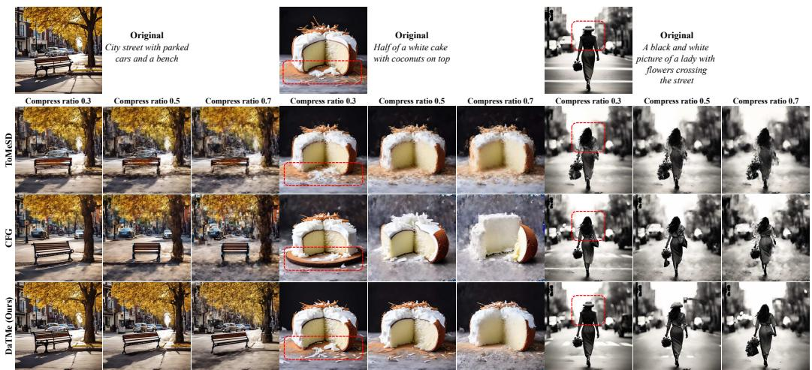  
Figure 10: Additional PixArt-α results under different compression ratios. Unlike prior methods, DaTMe more faithfully preserves the fine details present in the original image.

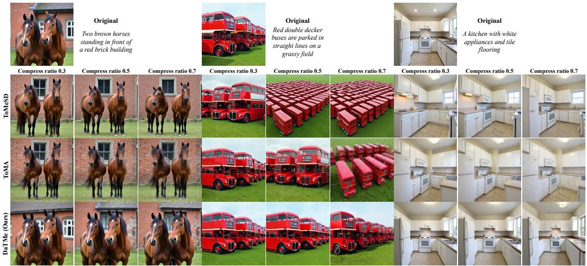  
Figure 11: Additional FLUX results under different compression ratios. Unlike prior methods, DaTMe more faithfully preserves the fine details present in the original image.

This is further supported by Fig. 12 and Fig. 13: prior methods often fail to preserve the original image structure, particularly in non-prompt regions highlighted by red boxes, whereas DaTMe maintains these regions more faithfully.

Additional Ablation Studies on PixArt-α. Tab. 12 studies the number of spatial grid cells used for grid-based source completion. Increasing the number of grid cells generally improves structure preservation by distributing additional source tokens more evenly across the image, but overly fine grids introduce extra latency. We therefore choose $P = 4 ,$ , which achieves the best overall quality while remaining faster than the unmerged PixArt-α baseline. Fig. 15 further visualizes this trend: denser grids better preserve structural details by preventing source tokens from concentrating in a limited region. Tab. 13 ablates the down/up-sampling scale used to construct the spatial axis. We vary the scale from 2 to 16 and set s = 4, which achieves the best overall trade-off across quality metrics.

Fig. 14 presents the merging maps over denoising timesteps. Our method better preserves structural details, such as the bowl shape and leaves, thereby yielding higher-fidelity images.

Ablation Studies on SD. We select the hyperparameters for U-Net based model based on Tab. 14, Tab. 15 and Tab. 16.

Table 8: Text alignment and efficiency score on SD 1.5.
<table><tr><td></td><td>CLIP-T↑</td><td>HPSv2↑</td><td>FID↓</td><td>Latency (s)↓</td><td>TFLOPs↓</td></tr><tr><td>SD 1.5 (Base)</td><td>31.2669</td><td>25.5643</td><td>33.2610</td><td>1.0186</td><td>70.396</td></tr><tr><td colspan="6">Compression ratio 0.3</td></tr><tr><td>ToMeSD</td><td>31.3262</td><td>25.1050</td><td>32.7718</td><td>1.0283</td><td>70.744</td></tr><tr><td>CFG</td><td>31.3453</td><td>25.1062</td><td>32.6889</td><td>1.0669</td><td>70.744</td></tr><tr><td>DaTMe (Ours)</td><td>31.3456</td><td>25.1185</td><td>33.3034</td><td>0.9155</td><td>70.849</td></tr><tr><td colspan="6">Compression ratio 0.5</td></tr><tr><td>ToMeSD</td><td>31.3212</td><td>24.6347</td><td>33.4531</td><td>1.0141</td><td>70.408</td></tr><tr><td>CFG</td><td>31.3631</td><td>24.6633</td><td>33.4947</td><td>1.0704</td><td>70.408</td></tr><tr><td>DaTMe (Ours)</td><td>31.3306</td><td>24.6682</td><td>34.3004</td><td>0.9138</td><td>70.727</td></tr><tr><td colspan="6">Compression ratio 0.7</td></tr><tr><td>ToMeSD</td><td>31.2225</td><td>23.6237</td><td>36.3672</td><td>1.0028</td><td>70.073</td></tr><tr><td>CFG</td><td>31.2227</td><td>23.7960</td><td>34.9584</td><td>1.0507</td><td>70.073</td></tr><tr><td>DaTMe (Ours)</td><td>31.2550</td><td>23.7728</td><td>35.7699</td><td>0.9025</td><td>70.192</td></tr></table>

Table 9: Image fidelity score on SD 1.5.
<table><tr><td>SSIM↑</td><td>PSNR↑</td><td>LPIPS↓</td></tr><tr><td colspan="3">Compression ratio 0.3</td></tr><tr><td>ToMeSD 0.8245</td><td>20.0186</td><td>0.1435</td></tr><tr><td>CFG 0.8265</td><td>20.1034</td><td>0.1448</td></tr><tr><td>DaTMe (Ours) 0.8579</td><td>21.2101</td><td>0.1171</td></tr><tr><td colspan="3">Compression ratio 0.5</td></tr><tr><td>ToMeSD 0.7575</td><td>18.4332</td><td>0.2038</td></tr><tr><td>CFG DaTMe (Ours) 0.7820</td><td>0.7596 18.4743 19.1236</td><td>0.2036 0.1842</td></tr><tr><td colspan="3">Compression ratio 0.7</td></tr><tr><td>ToMeSD 0.7001</td><td>17.2531</td><td>0.2648</td></tr><tr><td>CFG 0.6804 DaTMe (Ours) 0.7035</td><td>17.1733 17.5194</td><td>0.2730 0.2611</td></tr></table>

Table 10: Text alignment and efficiency score on SDXL.
<table><tr><td></td><td>CLIP-T↑</td><td>HPSv2↑</td><td>FID↓</td><td>Latency (s)↓</td><td>TFLOPs↓</td></tr><tr><td>SDXL (Base)</td><td>31.9501</td><td>27.0768</td><td>32.5454</td><td>5.0761</td><td>607.849</td></tr><tr><td colspan="6">Compression ratio 0.3</td></tr><tr><td>ToMeSD</td><td>31.9603</td><td>26.7230</td><td>32.4035</td><td>5.0839</td><td>607.851</td></tr><tr><td>CFG</td><td>31.9795</td><td>26.7159</td><td>32.3833</td><td>5.2559</td><td>607.851</td></tr><tr><td>DaTMe (Ours)</td><td>31.9622</td><td>26.9697</td><td>32.3880</td><td>4.2480</td><td>608.035</td></tr><tr><td colspan="6">Compression ratio 0.5</td></tr><tr><td>ToMeSD</td><td>31.9411</td><td>26.1445</td><td>33.3079</td><td>5.0216</td><td>605.164</td></tr><tr><td>CFG</td><td>32.0154</td><td>26.1695</td><td>32.8330</td><td>5.2054</td><td>605.164</td></tr><tr><td>DaTMe (Ours)</td><td>31.9604</td><td>26.8040</td><td>32.4385</td><td>4.2622</td><td>607.312</td></tr><tr><td colspan="6">Compression ratio 0.7</td></tr><tr><td>ToMeSD</td><td>31.6383</td><td>24.4532</td><td>39.8369</td><td>4.9837</td><td>602.481</td></tr><tr><td>CFG</td><td>31.9262</td><td>24.9657</td><td>36.0965</td><td>5.1569</td><td>602.481</td></tr><tr><td>DaTMe (Ours)</td><td>31.8824</td><td>25.1762</td><td>35.2577</td><td>4.2672</td><td>605.930</td></tr></table>

Table 11: Image fidelity score on SDXL.
<table><tr><td>SSIM↑</td><td>PSNR↑</td><td>LPIPS↓</td></tr><tr><td colspan="3">Compression ratio 0.3</td></tr><tr><td>ToMeSD 0.8076</td><td>21.1286</td><td>0.1715</td></tr><tr><td>CFG 0.8078</td><td>21.1278</td><td>0.1715</td></tr><tr><td>DaTMe (Ours)</td><td>0.8413 22.2688</td><td>0.1412</td></tr><tr><td colspan="3">Compression ratio 0.5</td></tr><tr><td>ToMeSD 0.7458</td><td>19.5331</td><td>0.2367</td></tr><tr><td>CFG 0.7408 DaTMe (Ours) 0.7801</td><td>19.3888 20.3747</td><td>0.2433 0.2007</td></tr><tr><td colspan="3">Compression ratio 0.7</td></tr><tr><td>ToMeSD 0.6942</td><td>18.5884</td><td>0.3097</td></tr><tr><td>CFG 0.6827 DaTMe (Ours) 0.7114</td><td>18.1728 18.8536</td><td>0.3194 0.2860</td></tr></table>

DaTMe Additional Results. In Fig. 16 and Fig. 17, we present additional samples under different compression ratios. DaTMe consistently preserves the structural details of the original generation while maintaining strong text alignment.

## D Limitations

Similar to prior token merging methods, DaTMe faces limitations under aggressive token compression.

In highly complex scenes with many objects or intricate backgrounds, excessive merging can inevitably remove necessary tokens, leading to degraded generation quality. In addition, the layer-wise roles of diffusion models remain underexplored, especially in DiT-based architectures. Understanding which layers contribute most to structural layout, fine details, or background refinement could further improve token merging by enabling layer-aware compression strategies.

  
Figure 18: Limitations. In highly complex images, aggressive compression adversely affects image quality, leading to loss of structural details and visual coherence.

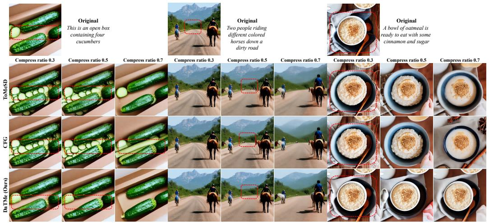  
Figure 12: SD 1.5 results under different compression ratios. Unlike prior methods, DaTMe more faithfully preserves the contents of the original image.

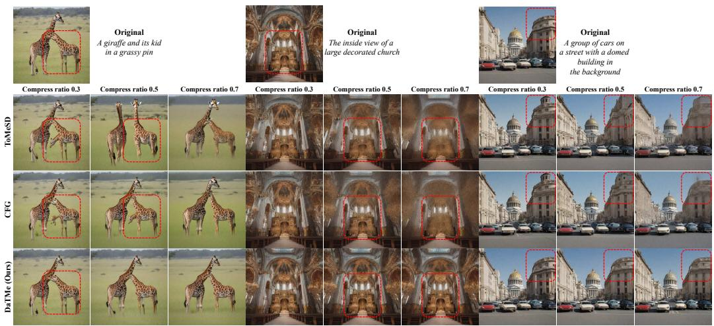  
Figure 13: SDXL results under different compression ratios. Unlike prior methods, DaTMe more faithfully preserves the contents of the original image especially background details.


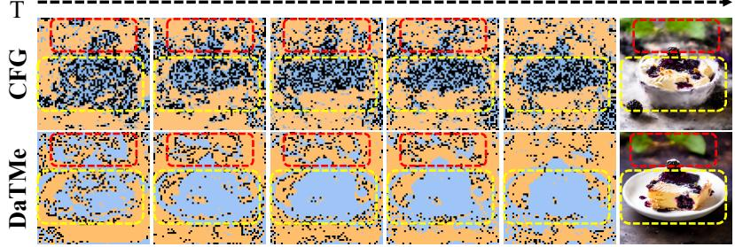  
Figure 14: Difference in merging maps. Black spots indicate the destinations of merged source tokens. Our method better preserves structurally important details across the entire image.

A giraffe standing in the grass neat trees

Table 12: Ablation on the number of spatial grids in PixArt-α. We vary the number of grid cells used for grid-based source completion and select P = 4 as the best trade-off between latency and performance.
<table><tr><td>Grid</td><td>CLIP-T↑</td><td>SSIM↑</td><td>PSNR↑</td><td>LPIPS↓</td><td>FID↓</td><td>Latency (s).↓</td></tr><tr><td>PixArt-α [5]</td><td>31.2485</td><td></td><td></td><td></td><td>42.1001</td><td>1.9417</td></tr><tr><td>CFG [9]</td><td>30.8801</td><td>0.7137</td><td>17.8157</td><td>0.2369</td><td>44.6070</td><td>1.7458</td></tr><tr><td>1</td><td>31.1426</td><td>0.8099</td><td>20.4707</td><td>0.1513</td><td>42.5585</td><td>1.7343-0.2074</td></tr><tr><td>4</td><td>31.1375</td><td>0.8112</td><td>20.5136</td><td>0.1501</td><td>42.4474</td><td>1.8030-0.1387</td></tr><tr><td>16</td><td>31.1374</td><td>0.8128</td><td>20.5705</td><td>0.1485</td><td>42.3615</td><td>1.9765+0.0348</td></tr><tr><td>64</td><td>31.1307</td><td>0.8140</td><td>20.6223</td><td>0.1477</td><td>42.3792</td><td>2.4443+0.5026</td></tr></table>

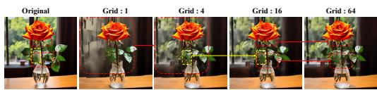  
Figure 15: Visualization of different grid sizes on PixArt-α. Denser grids better preserve structural details by preventing source tokens from concentrating in a limited region.

Table 15: Ablation on the interpolation scale in SD 1.5.
<table><tr><td>Scale</td><td>CLIP-T↑</td><td>SSIM↑</td><td>PSNR↑</td><td>LPIPS↓</td><td>FID↓</td></tr><tr><td>2</td><td>31.3456</td><td>0.8579</td><td>21.2101</td><td>0.1171</td><td>33.3034</td></tr><tr><td>4</td><td>31.3543</td><td>0.8569</td><td>21.1812</td><td>0.1182</td><td>33.4557</td></tr><tr><td>8</td><td>31.3468</td><td>0.8541</td><td>21.1044</td><td>0.1209</td><td>33.4293</td></tr><tr><td>16</td><td>31.3422</td><td>0.8514</td><td>21.0544</td><td>0.1237</td><td>33.4424</td></tr></table>

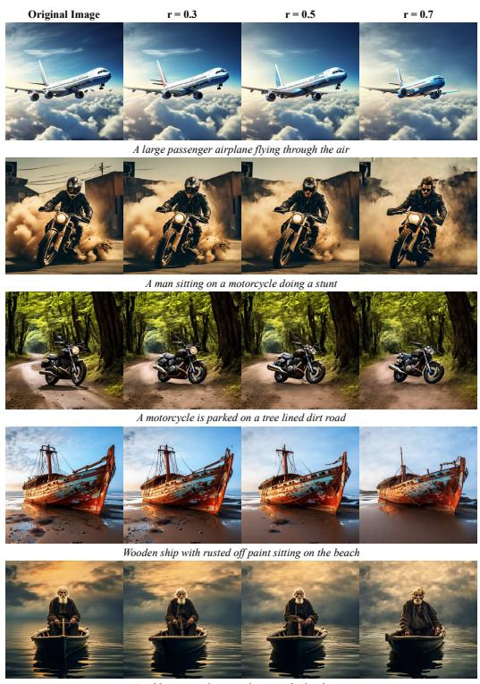  
An old man standing on a boat in a body of wate

Figure 16: Additional PixArt-α results.  
Table 13: Ablation on the interpolation scale. We vary the down/up-sampling scale used to construct the spatial axis in PixArt-α.
<table><tr><td>Scale</td><td>CLIP-T↑</td><td>SSIM↑</td><td>PSNR↑</td><td>LPIPS↓</td><td>FID↓</td></tr><tr><td>2</td><td>31.1368</td><td>0.8102</td><td>20.4854</td><td>0.1507</td><td>42.5226</td></tr><tr><td>4</td><td>31.1375</td><td>0.8112</td><td>20.5136</td><td>0.1501</td><td>42.4474</td></tr><tr><td>8</td><td>31.1445</td><td>0.8091</td><td>20.4785</td><td>0.1522</td><td>42.6547</td></tr><tr><td>16</td><td>31.1259</td><td>0.8016</td><td>20.2553</td><td>0.1596</td><td>42.7489</td></tr></table>

Table 14: Ablation on constraint token selection in SD 1.5.
<table><tr><td></td><td>CLIP-T↑</td><td>SSIM↑</td><td>PSNR↑</td><td>LPIPS↓</td><td>FID↓</td></tr><tr><td> $\mathcal { M } _ { \mathrm { t e m p } } \uparrow \cap \mathcal { M } _ { \mathrm { s p a t } } .$ </td><td>31.3346</td><td>0.8402</td><td>20.6266</td><td>0.1316</td><td>33.1811</td></tr><tr><td>Mtemp ↓ ∩Mspat ↑</td><td>31.3592</td><td>0.8529</td><td>21.0306</td><td>0.1214</td><td>33.4103</td></tr><tr><td> $\mathcal { M } _ { \mathrm { t e m p } } \uparrow \cap \mathcal { M } _ { \mathrm { s p a t } }$ </td><td>31.3527</td><td>0.8472</td><td>20.8985</td><td>0.1273</td><td>33.3237</td></tr><tr><td>None</td><td>31.3456</td><td>0.8579</td><td>21.2101</td><td>0.1171</td><td>33.3034</td></tr></table>

Table 16: Ablation on the number of spatial grids in SD 1.5.
<table><tr><td>Grid</td><td>CLIP-T↑</td><td>SSIM↑</td><td>PSNR↑</td><td>LPIPS↓</td><td>FID↓</td></tr><tr><td>1</td><td>31.3529</td><td>0.8571</td><td>21.1678</td><td>0.1178</td><td>33.3703</td></tr><tr><td>4</td><td>31.3456</td><td>0.8579</td><td>21.2101</td><td>0.1171</td><td>33.3034</td></tr><tr><td>16</td><td>31.3443</td><td>0.8576</td><td>21.1988</td><td>0.1176</td><td>33.3631</td></tr><tr><td>64</td><td>31.3365</td><td>0.8570</td><td>21.1814</td><td>0.1180</td><td>33.3841</td></tr></table>

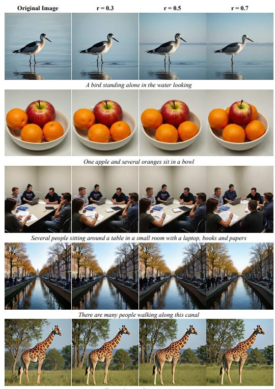  
Figure 17: Additional FLUX results.

Image A  
Image B  


<table><tr><td>1</td><td></td><td>2</td><td>3</td><td>4</td><td>5</td></tr><tr><td>Image A</td><td>O</td><td>O</td><td>O</td><td>O</td><td>O</td></tr><tr><td>Image B</td><td>O</td><td>O</td><td>O</td><td>O</td><td>O</td></tr><tr><td>Image C</td><td>O</td><td>O</td><td>O</td><td>O</td><td>O</td></tr><tr><td colspan="6">:::</td></tr><tr><td colspan="6">Item 01: Perceptual Quality * How visually coherent and artifact-free is each image? 1 = Very poor quality, 5 = Very high quality.</td></tr><tr><td colspan="6"></td></tr><tr><td></td><td>1</td><td>2</td><td>3</td><td>4</td><td>5</td></tr><tr><td>Image A</td><td>O</td><td>O</td><td>O</td><td>O</td><td>O</td></tr><tr><td>Image B</td><td>O</td><td>O</td><td>O</td><td>O</td><td>O</td></tr><tr><td>Image C</td><td>O</td><td>O</td><td>O</td><td>O</td><td>O</td></tr><tr><td colspan="6">Item 01: Overall Preference * Considering both prompt alignment and visual quality, which image do you prefer overall?</td></tr><tr><td colspan="6">Image A</td></tr><tr><td colspan="6">Image B</td></tr><tr><td colspan="6"></td></tr><tr><td colspan="6">Image C</td></tr><tr><td colspan="6"></td></tr></table>

Figure 19: Example questionnaire for the human preference study. Each evaluation sample includes three questions.