# ZoomCap: Evidence-Routed Visual Zooming for Recoverable Visual Information Transfer

Hao Shi1,2∗, Jiafeng Wang1∗, Yuzhuo Fu1, Tao Zhang1, Jian Bai2, Juelu Zhang1, Qing Cui1, Chao Huang1,†

1Ant Group 2Zhejiang University

## Abstract

Detailed captions transfer visual information into vision-language model supervision, but quality is easily conflated with length: long single-pass outputs still miss small objects, text, and spatial relations or promote uncertain observations into confident claims. We formulate fine-grained captioning as recoverable visual information transfer, in which a teacher acquires missing evidence under a finite observation budget and converts it into reusable supervision. ZoomCap uses a draft caption to route conditional knowledge retrieval, OCRsensitive reading, coverage-gap recovery, and adaptive visual zooming, allocating deeper crops only to the most complex eligible region, deriving spatial relations from grounded geometry, and fusing non-duplicate evidence. We also introduce FactCycle, which scores caption-derived atomic claims on two blind anchors—source image (truthfulness) and reconstruction (realizability)—separating fabrication from generator loss claim by claim; human and multi-judge comparisons complement this fact-level view. Against Qwen3.5- 397B-A17B captions, ZoomCap achieves an 81.9% human tie-adjusted preference score with a teacher over 10× smaller, and FactCycle counts 52.4 transferred claims per image vs. 31.5 for ScaleCap. The evidence also transfers: in continual pre-training, ZoomCap-450K improves the 11-benchmark average by 1.31–2.38 points over the strongest competing corpus and Ling-Tiny-VL-v3 gains 1.4 points on a production document/OCR monitor suite (1.5 on perception) at 60B tokens; in medical pre-training, 2.64M ZoomCap-captioned images improve five VQA benchmarks by 3.04 points (vs. 1.76 for same-image Gemini-3.1-Pro captions).

## 1 Introduction

In modern VLM training, captions are a textual bottleneck through which visual information becomes language-model supervision; dense synthetic-caption pipelines have shown that changing this supervision alone can improve downstream multimodal models even when architecture and recipe remain fixed (Chen et al., 2024a; Pi et al., 2024; Li et al., 2024d; Awadalla et al., 2024; Xing et al., 2025; Lei et al., 2026). The question is therefore whether captions transfer visual evidence that remains verifiable, recoverable, and useful, not merely whether they are fluent or long.

A single global VLM pass dilutes attention and misses small or peripheral evidence, while fixed highresolution crops spend the same budget on empty background (Liu et al., 2024a; Peng et al., 2025); retrieval and visual search recover open-world names or overlooked regions (Ramos et al., 2023; Li et al., 2024b; Wu & Xie, 2024), but applying every source to every image is inefficient, and more tokens, tools, or crops need not add trustworthy, geometry-supported information.

This creates a coupled acquisition-and-measurement problem: generation must decide which evidence source and region justify another observation and which candidate facts are safe to retain, while evaluation must quantify what survives once the caption becomes the only interface to the image. Reference overlap, image–text similarity, and downstream QA on selected question sets score surface match or backend-specific utility rather than transferred information (Hessel et al., 2021; Dong et al., 2024; Jing et al., 2024; Yang et al., 2026); reconstruction offers a direct test of what survives, yet existing cycle-consistent metrics collapse it into global, pixel-, semantic-, or object-level similarity, rewarding layout over individual content (Ge et al., 2024; Cui et al., 2025; Xu et al., 2026). The missing unit is the traceable visualfact: which atomic entities, attributes, relations, counts, small objects, and actions remain realizable after the caption-to-image round trip—the question FactCycle asks.

We introduce ZoomCap, an agentic teacher for budgeted evidence acquisition, whose captions retain targets that single-pass engines drop (Figure 1): from a draft caption it conditionally routes world-knowledge search, OCR for text-structured inputs, and re-observation of draft-omitted regions, expanding beyond first-level coverage only for the highest-scoring eligible region; geometry-grounded A-SPOE (attribute-augmented subject–predicate–object–environment) relations and duplication-avoiding fusion then merge only evidence the observations support.

We test this view with FactCycle and downstream transfer. FactCycle extracts atomic visual claims from the caption text alone and scores the same claim set with blind judges on two anchors—the source image (truthfulness) and a fixed text-to-image reconstruction (realizability)—separating what is true from what is merely renderable, and thus measuring transferred facts rather than surface similarity. ZoomCap captions contain 67.1 extracted facts per image (ScaleCap 41.9) and transfer 52.4 of them—1.7× the strongest baseline— with higher reconstruction similarity (0.696 vs. 0.620), and an 81.9% human tie-adjusted preference score against single-pass Qwen3.5-397B-A17B captions: a teacher over 10× smaller outperforms a one-pass flagship at comparable per-image cost (Appendix I). Controlled 450K continual pre-training improves the 11-benchmark mean by 1.31–2.38 points across three backbones, and production adoption (20% caption-group replacement in a matched 60B-token run; 2.64M medical images) adds 1.4 document/OCR, 1.5 perception, and 3.04 medical-VQA points (1.28 over same-image Gemini-3.1-Pro captions).

## Our contributions are:

1. We formulate fine-grained captioning as budgeted evidence acquisition and propose ZoomCap, which routes knowledge, OCR, coverage-gap recovery, adaptive zooming, geometry-grounded relations, and draft-anchored gated fusion under a draft caption.

2. We introduce FactCycle, extending cycle-consistent evaluation from global similarity to traceable atomic claims judged blind on two anchors—source truthfulness and reconstruction realizability—for claim level caption quality assessment.

3. We connect direct caption quality to reusable supervision through controlled ZoomCap-450K continual pre-training and production-scale adoption in general and medical domains.

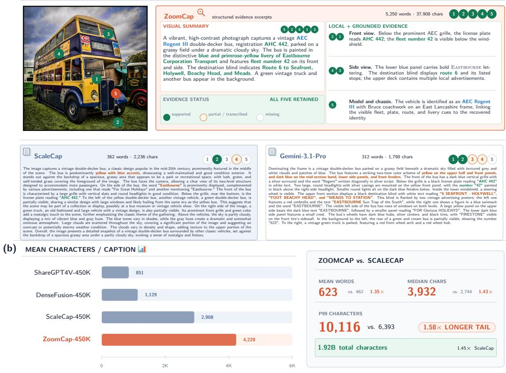  
Figure 1: Evidence preservation comparisons. (a) On the same image, five targets remain partial or missing from ScaleCap (Xing et al., 2025) and Gemini-3.1-Pro (Google DeepMind, 2026) but are retained by ZoomCap. (b) ZoomCap 450K has 1.45× ScaleCap’s total characters and a 1.58× larger P99 character length.

## 2 Related Work

Caption supervision and caption-data generation. Captions have evolved from a generation target (Xu et al., 2015) into VLM supervision (Li et al., 2020; Schuhmann et al., 2021; Li et al., 2022; 2023; Liu et al., 2023; Dai et al., 2023), and dense synthetic-caption pipelines now use strong MLLMs, vision experts, web knowledge, or scalable workflows (Chen et al., 2024a; Pi et al., 2024; Li et al., 2024d; Awadalla et al., 2024; Xing et al., 2025; Lei et al., 2026). ZoomCap instead routes search, OCR, geometry checks, and deeper crops conditionally on a grounded draft, spending budget only where the draft remains unexplained—bounded per-image cost with evidence beyond one global pass.

Fine-grained evidence for faithful detailed captioning. Region-grounded captioning ties descriptions and relations to local evidence (Johnson et al., 2016; Krishna et al., 2017), while detailed-caption data expose coverage and hallucination risks (Dong et al., 2024; Hua et al., 2025; Li et al., 2025). High-resolution search, retrieval, and scene graphs recover local details (Liu et al., 2024a; Peng et al., 2025; Wu & Xie, 2024; Ramos et al., 2023; Li et al., 2024b; Lu et al., 2016; Xu et al., 2017; Li et al., 2024c). ZoomCap unifies these channels under one finite observation budget, admitting spatial facts only when geometric margins support them and keeping spatial phrases auditable at full coverage.

Caption evaluation as factual and cycle-consistent measurement. Reference-free metrics measure alignment or source-grounded factuality (Hessel et al., 2021; Dong et al., 2024; Jing et al., 2024), and caption-asvisual-encoder protocols test downstream QA (Chen et al., 2025; Yang et al., 2026). Cycle metrics compare reconstructed images globally or by objects (Ge et al., 2024; Cui et al., 2025; Xu et al., 2026); text-to-image evaluation can decompose prompts into propositions (Hu et al., 2023; Cho et al., 2023). FactCycle instead scores caption-derived atomic claims on two blind anchors—the source image and a fixed reconstruction— separating truthfulness, realizability, and generator loss claim by claim.

## 3 ZoomCap Method

ZoomCap decouples what evidence to acquire from how to verbalize it (Figure 2): a global draft maps what the image already explains, routes only the necessary evidence streams, and conditions the final fusion.

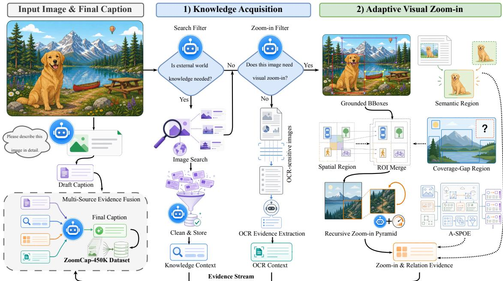  
Figure 2: ZoomCap overview. From a raw image and a draft caption, ZoomCap routes each sample through agentic evidence acquisition: external-knowledge search, OCR extraction for text-, chart-, and document-like images, and adaptive visual zoom-in for detail-rich scenes. The zoom-in branch combines grounded boxes, semantic regions, caption coverage gaps, recursive patch observations, and A-SPOE relation facts before multi-source fusion produces the final caption.

## 3.1 Evidence-Guided Captioning Objective

Let I be an image and O its acquired observations: draft $y _ { 0 } ,$ cleaned search context $y _ { k } ,$ OCR summary yocr, patch captions $\bigcup { \big \{ } y _ { p } { \big \} } _ { p \in \mathcal { P } . }$ , and geometry-derived A-SPOE facts R, which a draft-anchored gated operator F fuses into the final caption $\boldsymbol { y } = \mathcal { F } ( y _ { 0 } , y _ { k } , y _ { \mathrm { o c r } } , \{ y _ { p } \} _ { p \in \mathrm { \mathcal { P } } } , \mathcal { R } )$ . The teacher should maximize caption utility under a finite observation budget:

$$
y ^ { \star } = \arg \operatorname* { m a x } _ { y } U ( y ; I ) \quad \mathrm { s . t . } \quad \sum _ { o \in \mathcal { O } } c ( o ) \leq B ,\tag{1}
$$

where U captures coverage, factuality, spatial faithfulness, recoverability, and downstream usefulness. Rather than solving equation 1 exhaustively, a draft-conditioned policy identifies gaps and acquires repair streams; FactCycle (Section 3.6) and the preference/transfer studies instantiate these terms.

## 3.2 Draft-Conditioned Evidence Routing

The first teacher call produces a full-image draft that ZoomCap treats as a scaffold: it supplies the global scene, salient entities, and visible text while exposing what the global view failed to cover, and all routing is conditioned on it.

Three streams repair different gaps. The knowledge stream fires when world context unrecoverable from pixels is needed (products, landmarks, artworks, logos, diagrams): image search yields a cleaned context y that may name or explain entities but must not override the visual scaffold at fusion. The OCR stream serves text-, chart-, document-, and interface-like images, where arbitrary crops destroy reading order, summarizing recognized text into $y _ { \mathrm { { o c r } } } .$ . The zoom-in stream spends additional observations on regions of dense-object, localized-attribute, or spatially structured images that the draft is likely to under-describe.

When zoom-in is selected, ZoomCap extracts localized entities from the draft and image into $\mathcal { E } = \{ ( e _ { i } , b _ { i } , a _ { i } ) \} _ { i = 1 } ^ { n }$ (entity name, normalized box $b _ { i } = [ x _ { 1 } , y _ { 1 } , x _ { 2 } , y _ { 2 } ]$ , coarse attributes $a _ { i } ) ;$ this prior records what is already grounded, where coverage gaps remain, and which entity pairs can support geometry-verified relations.

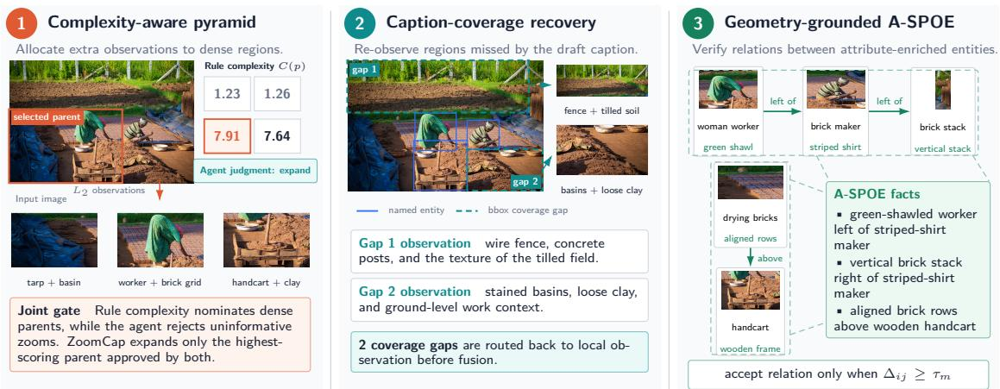  
Figure 3: Adaptive zoom-in mechanisms. Left: rule complexity nominates dense parents while the agent rejects uninformative zooms; only the highest-scoring parent approved by both expands. Center: caption-coverage gaps derived from draft-grounded entity boxes trigger targeted re-observation (example from PrefBench-456). Right: A-SPOE retains only relations supported by the geometric margin.

## 3.3 Coverage-Aware Visual Zooming

The zoom-in branch must recover missed evidence without turning every crop into a confident statement: a coverage-aware pyramid uses four quadrants for coarse coverage plus one semantic region when salient content is not quadrant-aligned; for a candidate pool Q of spatial, semantic, and gap regions, crop selection is

$$
\Phi ^ { \star } = \arg \operatorname* { m a x } _ { \substack { \mathbb { P } \subseteq \ b { \Omega } , | \mathbb { P } | \leq K } } \sum _ { p \in \mathbb { P } } \big ( C ( p ) + \alpha U _ { \mathrm { c o v } } ( p ) \big ) - \beta \sum _ { p \neq p ^ { \prime } } \mathrm { I o U } ( p , p ^ { \prime } ) ,\tag{2}
$$

spending observations on complex or draft-under-covered regions while suppressing overlap: quadrants expand around their assigned boxes, the semantic crop groups up to three salient entities, regions merge with grounded boxes and gaps by IoU, and near-duplicates are removed (Figure 3).

Caption-coverage gap (CCG) recovery. Let $\Omega _ { \mathcal { E } } = \cup _ { i } b _ { i }$ be the union of grounded boxes already explained by the draft caption. Gap recovery scores a candidate region q by its uncovered fraction $U _ { \mathrm { c o v } } ( q ) \stackrel {  } { = } | q \stackrel { \cdot } { \setminus } \Omega _ { \mathcal { E } } | / | q \stackrel { \cdot } { | }$ restricted to regions with $| q | \leq \eta _ { \mathrm { m a x } }$ and aspect ratio $\begin{array} { r } { \mathrm { a r } ( q ) \le \eta _ { \mathrm { a r } } , } \end{array}$ , and selects the largest qualifying gap rectangles (construction rules in Appendix B). Unlike generic saliency, $U _ { \mathrm { c o v } }$ is relative to what the draft already explains, not to pixel-level conspicuity.

Complexity-gated recursive zooming. Each first-level patch is captioned independently and retained with its source coordinates. A rule-based complexity score,

$$
C ( p ) = w _ { \mathrm { e n t } } N _ { \mathrm { e n t } } ( p ) + w _ { \mathrm { s m a l l } } N _ { \mathrm { s m a l l } } ( p ) + w _ { \mathrm { c l i p } } \rho _ { \mathrm { e n t } } ( p ) + w _ { \mathrm { a r e a } } r _ { \mathrm { a r e a } } ( p ) ,\tag{3}
$$

over entity count, small-object count, clipped entity density, and area ratio under empirically set non-negative weights (Appendix B), nominates dense candidates for a second observation, and an agent judgment vetoes the nominations it deems uninformative; only the highest-scoring parent approved by both expands, and that parent with its children passes to fusion. This gating cuts total patch inputs by 20.2% and second-level inputs by 39.8% (Table 2(b)).

## 3.4 Geometry-Grounded A-SPOE Relations

A-SPOE (attribute-augmented subject–predicate–object–environment) relations take their predicate-level motivation from relation-aware captioning (Long et al., 2025) and add two ingredients of our own: entity attributes carried on every node, and a geometric admission test that grounds each accepted spatial predicate in localized boxes. Each grounded entity becomes a node $\boldsymbol { v } _ { i } = \left( \bar { e } _ { i } , a _ { i } , b _ { i } \right)$ in a graph whose edges store accepted spatial relations and whose context node stores the scene, making spatial phrases auditable before they enter free-form text. For an entity pair $( i , j )$ , let $g _ { i j } ^ { x }$ and $g _ { i j } ^ { y }$ be the horizontal and vertical center gaps normalized by the pair’s mean box size; a candidate relation is retained only when its dominant geometric gap clears an explicit margin,

$$
\begin{array} { r } { r _ { i j } ^ { \star } = \operatorname { d i r } ( b _ { i } , b _ { j } ) \ \mathrm { i f } \ \operatorname* { m a x } ( g _ { i j } ^ { x } , g _ { i j } ^ { y } ) \geq \tau _ { g } , \ \frac { \operatorname* { m a x } ( g _ { i j } ^ { x } , g _ { i j } ^ { y } ) } { \operatorname* { m i n } ( g _ { i j } ^ { x } , g _ { i j } ^ { y } ) } \geq \tau _ { r } , \ \mathrm { I o U } ( b _ { i } , b _ { j } ) \leq \tau _ { i } ; \quad \mathcal { Q } \ \mathrm { o t h e r w i s e } , } \end{array}\tag{4}
$$

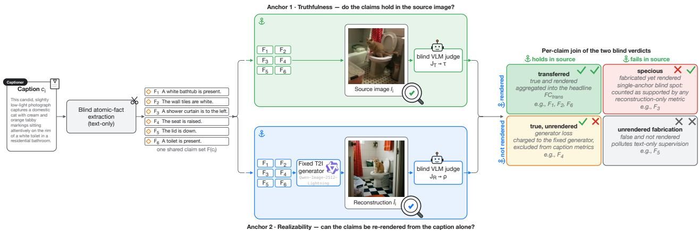  
Figure 4: FactCycle under its two blind anchors. The same blind-extracted claim set $\mathcal { F } ( c _ { i } )$ is scored against the source image (Truthfulness τ) and against the fixed-generator reconstruction (Realizability ρ); joining the two verdicts per claim yields four cells, and the headline FCtrans aggregates the transferred cell.

with dir(·) from the dominant axis (left/right or above/below). Appendix B instantiates thresholds, ranking, deduplication, and per-object caps, so spatial phrases stay grounded in box geometry rather than left to free-form generation.

## 3.5 Draft-Anchored Gated Fusion

Routing spends the budget; fusion decides which acquired evidence enters the caption, as statement-level admission control rather than concatenation: the draft remains the backbone, and a candidate statement s from any stream is admitted only when

$$
g ( s ) = \mathbf { 1 } \left[ \mathrm { N o v e l } ( s ; y _ { 0 } , y _ { k } , y _ { \mathrm { o c r } } ) \geq \tau _ { n } \land \mathrm { C o n s i s t e n t } ( s ; y _ { 0 } ) \geq \tau _ { c } \land \operatorname* { m a x } _ { s ^ { \prime } \in S _ { \mathrm { a c c } } } \mathrm { O v e r l a p } ( s , s ^ { \prime } ) \leq \tau _ { o } \right] ,\tag{5}
$$

i.e. novel relative to everything already verbalized, consistent with the visual scaffold, and non-redundant with accepted statements. The gates keep fusion aligned with equation 1: retained statements must increase transferred information, so uncertain local observations never become confident global claims, and admitted statements keep their provenance instead of dissolving into one opaque rewrite. They are realized training free at prompt level (Appendix B).

## 3.6 FactCycle: Two-Anchor, Fact-Level Measurement

Existing caption-to-image cycle metrics summarize reconstructions through global features, pixel differences, or detected objects (Ge et al., 2024; Cui et al., 2025; Xu et al., 2026), judging only what the reconstruction shows; FactCycle instead scores the same blind-extracted claims against two blind anchors (Figure 4): do they hold in the source, and do they re-render from the caption alone? A blind text-only extractor turns a caption $c _ { i }$ into atomic visual claims $\mathcal { F } \check { ( } c _ { i } )$ (entities, attributes, relations, counts, small objects, actions, and a residual other bucket); a fixed generator reconstructs $\hat { I } _ { i }$ from $c _ { i }$ alone. An independent judge pair—two VLMs, neither of which produces the reconstructions—applies an identical supported/unsupported/unverifiable rubric to the anonymized claims on each anchor: $J _ { T }$ sees only $I _ { i } , J _ { R }$ only $\hat { I } _ { i } ;$ neither sees the caption or the other anchor’s verdicts. Abbreviating supported as sup, let $\bar { a _ { f } } , b _ { f } \in [ 0 , 1 ]$ be the blind support scores of claim $f$ on the two anchors, i.e. the mean over that anchor’s judge pair of $\mathbf { 1 } [ J _ { T } ( I _ { i } , f ) = \operatorname { s u p } ]$ and of $\mathbf { 1 } [ J _ { R } ( \hat { I } _ { i } , f ) = \operatorname* { s u p } ]$ ] (a unanimous pair reduces them to single-judge indicators), and let $\begin{array} { r } { \mathfrak { D } _ { T } ( i ) , \mathfrak { D } _ { R } ( i ) , \dot { \mathfrak { D } } ( i ) = \dot { \mathfrak { D } _ { T } } ( i ) \cap \dot { \mathfrak { D } } _ { R } ( i ) } \end{array}$ be the claims each anchor, or both, finds decidable on image i. Truthfulness is the source-row marginal,

$$
\tau _ { i } = \frac { 1 } { | \mathcal { D } _ { T } ( i ) | } \sum _ { f \in \mathcal { D } _ { T } ( i ) } a _ { f } ,\tag{6}
$$

averaged over images; Realizability $\rho$ is the analogous supported share over $\mathcal { D } _ { R } ( i )$ . Because the anchors share one claim set, the products of $( \dot { a } _ { f } , b _ { f } )$ with their complements split every claim of $\mathcal { D } ( i )$ into four cells that sum to one; we report three of them as caption-quality rates: transferred (true and rendered), specious

(fabricated yet rendered), and unrendered fabrication (fabricated and unrendered):

$$
\mathrm { t r a n s f e r r e d } _ { i } = \frac { 1 } { | \mathscr { D } ( i ) | } \sum _ { f \in \mathscr { D } ( i ) } a _ { f } b _ { f } ,\tag{7}
$$

with specious and ufab from the substitutions $a _ { f }  ( 1 - a _ { f } )$ and, for ufab , $b _ { f } \to ( 1 - b _ { f } ) .$ ; the fourth cell $\begin{array} { r } { \frac { 1 } { | \mathcal { D } ( i ) | } \sum _ { \mathcal { D } ( i ) } a _ { f } ( 1 - b _ { f } ) } \end{array}$ is the excluded generator loss. All rates average over images. The headline score is the count form of the transferred rate,

$$
\mathrm { F C } _ { \mathrm { t r a n s } } = \frac { 1 } { N } \sum _ { i = 1 } ^ { N } | \mathscr { D } ( i ) | \mathrm { t r a n s f e r r e d } _ { i } .\tag{8}
$$

Reconstruction-only cycle metrics (Ge et al., 2024; Cui et al., 2025; Xu et al., 2026) instead score the rendered marginal $\begin{array} { r } { \frac { 1 } { N } \sum _ { i } \sum _ { f \in \mathcal { F } ( c _ { i } ) } b _ { f } } \end{array}$ —transferred plus specious, up to the unverifiable masses—crediting fabricatedbut-rendered claims as evidence; we therefore never report it as a caption score and use DINOv3 source– reconstruction similarity as the judge-independent global check (Simeoni et al.´ , 2025). Fact-level scoring makes verdicts attributable (each unsupported claim names the failing entity, attribute, relation, count, small object, or action) and debits generator failures (true but unrendered) to the generator, not the caption; FactCycle thus operationalizes the recoverability term of U in equation 1, instantiated in Section 4.

## 4 Experiments

We evaluate the complete evidence path: whether ZoomCap captions preserve more recoverable, sourcegrounded facts, which routed components produce the gain, and whether they improve later VLM training; unless otherwise stated captions use a Qwen3.5-35B-A3B teacher (Qwen Team, 2026a) (protocols in Appendix A).

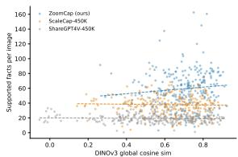  
(a) Per-image rendered claims—a correlate, not a caption score—vs. DINOv3 similarity.

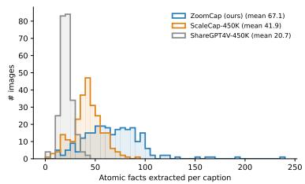  
(b) Atomic facts extracted per caption.

Figure 5: Information density and generative recoverability in FactCycle. (a) each point is one FactCycle-250 image with per-source linear fits; ZoomCap occupies the high-support, high-similarity corner. (b) mean extracted claims per caption: 67.1 vs. 41.9 and 20.7.

## 4.1 Direct Caption Quality

## 4.1.1 FactCycle: Fact-Level Truth and Realizability

FactCycle (Section 3.6) is instantiated on FactCycle-250, a paired evaluation pool of 250 source images shared by ZoomCap-450K, ScaleCap-450K (Xing et al., 2025), and ShareGPT4V-450K (Chen et al., 2024a), balanced across five scene types, all rendered by one fixed Qwen-Image-2512-Lightning generator (Wu et al., 2025) (only the caption varies; Figure 7 previews reconstructions). ZoomCap attains Truthfulness $\tau = 9 3 . 8 \%$ versus 88.9% and 81.4% (paired $\overset { \sim } { p } = 4 . 5 \overset { \sim } { 7 } \times 1 0 ^ { - 2 1 }$ and $1 . 6 9 \times 1 0 ^ { - 2 1 } )$ , and Table 1 shows where the anchors diverge: ZoomCap keeps 90.9% of its decidable claims transferred and admits only 3.4% specious ones against 16.6% for ShareGPT4V; aggregating the transferred quadrant, ZoomCap realizes 52.4 transferred facts per image $( \mathrm { F C } _ { \mathrm { t r a n s } } ) .$ , 1.7× ScaleCap and 3.5× ShareGPT4V. Realizability meanwhile reverses $( \rho = 9 2 . 3 / 9 3 . 6 / 9 \hat { 5 } . 7 )$ captions that state less render more completely, so single-anchor realizability ranks these captions backwards; the two anchors disentangle this by charging true-but-unrendered losses to the generator, not the caption (Figure 4). The higher claim count (67.1 per image versus 41.9 and 20.7) is corroborated by judge-independent DINOv3 (Simeoni et al. ´ , 2025) similarity (0.696 versus 0.620 and 0.566; Figures 5(a)–5(b)); counts scale with length but rates do not—ZoomCap is 1.45× longer than ScaleCap yet leads every rate column of Table 1. The gain is not confined to one slice: the $\mathrm { F C } _ { \mathrm { t r a n s } }$ ordering holds in every scene bucket (Table 7), and at category level ZoomCap keeps the lowest specious share in all seven categories and the highest transferred share in six, small objects being the single exception (Table 8); breakdowns, conservative accounting, and judge robustness are in Appendix E.

Table 1: FactCycle master table on FactCycle-250 (two anchors, one blind claim set). The same blind claim set is scored on both anchors by the same blind judge pair (Kimi-K3, Qwen3.8-Max) under one supported/unsupported/unverifiable rubric; neither judge sees the caption, its corpus identity, or the other anchor’s image (protocol in Appendix E). #Facts/img counts blind-extracted claims; τ and $\mathrm { F C } _ { \mathrm { t r a n s } }$ follow equation 6–equation 8; the transferred/specious/unrendered-fabrication shares, with the excluded true-but-unrendered generator cell, partition the claims decidable on both anchors. ρ is prose-only (Section 4.1.1). DINO is DINOv3 (Simeoni et al. ´ , 2025) source–reconstruction similarity, a judge-independent global check.
<table><tr><td>Caption source</td><td>#Facts/img ↑</td><td>τ: Truthfulness (%) ↑</td><td>transferred (%) ↑</td><td>specious (%) ↓</td><td>unrendered fab. (%) ↓</td><td> $\mathrm { F C } _ { \mathrm { t r a n s } } \uparrow$ </td><td>DINO↑</td></tr><tr><td>ShareGPT4V-450K (Chen et al., 2024a)</td><td>20.7</td><td>81.4</td><td>80.3</td><td>16.6</td><td>2.0</td><td>14.8</td><td>0.566</td></tr><tr><td>ScaleCap-450K (Xing et al., 2025)</td><td>41.9</td><td>88.9</td><td>88.2</td><td>7.4</td><td>2.6</td><td>31.5</td><td>0.620</td></tr><tr><td>ZoomCap-450K (Ours)</td><td>67.1</td><td>93.8</td><td>90.9</td><td>3.4</td><td>1.7</td><td>52.4</td><td>0.696</td></tr></table>

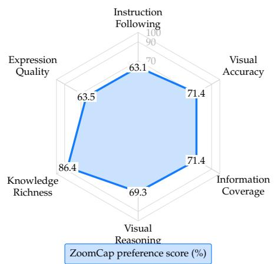  
(a) Human panel over six dimensions and six annotators.

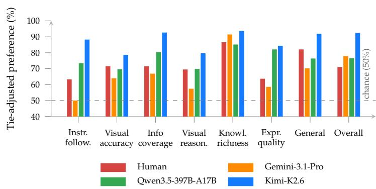  
(b) All evaluators; the dashed line marks 50%.  
Figure 6: Paired-preference evaluation against Qwen3.5-397B-A17B on PrefBench-456. ZoomCap’s largest gains are in knowledge richness and information coverage.

## 4.1.2 Source-Grounded Preference

We compare ZoomCap with Qwen3.5-397B-A17B on PrefBench-456, a human-annotated paired-preference benchmark of 456 images fixed-seed sampled from an internal business-image pool (anonymized pairs, randomized order). Six annotators and three VLM judges (Gemini-3.1-Pro (Google DeepMind, 2026); Qwen3.5-397B-A17B (Qwen Team, 2026a), which supplies the opposing captions; Kimi-K2.6 (Moonshot AI, 2026a)) score each pair on six axes (Table 6); we report tie-adjusted preference scores: the human generalperception verdict and each judge’s final overall verdict. Under this convention humans give ZoomCap 81.9% and every VLM judge agrees (76.4–92.2%); knowledge richness is strongest for all evaluators (85.0–93.5%) and coverage improves consistently (Figure 6, Table 6, Appendix Figure 8).

Table 2: Evidence-stream attribution (a) and zoom-budget policy (b) ablations on PrefBench-456; cells are tie-adjusted preference scores (%) (wins plus half ties; sides sum to 100). (a) judges each configuration against the same Qwen3.5- 397B-A17B single-pass caption (first-level crops only); (b) fixes the streams and pairs the two zoom policies directly (rows = two sides of one head-to-head; crops include the second level).
<table><tr><td>Configuration</td><td>Final score</td><td>Visual accuracy</td><td>Information coverage</td><td>Knowledge richness</td><td>Avg. local crops</td></tr><tr><td colspan="6">(a) Evidence streams — opponent: Qwen3.5-397B-A17B single-pass caption</td></tr><tr><td>Global draft only (no routed evidence)</td><td>55.9</td><td>57.9</td><td>41.6</td><td>47.6</td><td>0.0</td></tr><tr><td>Agentic evidence w/o retrieved knowledge</td><td>53.0</td><td>53.0</td><td>62.4</td><td>46.7</td><td>5.0</td></tr><tr><td>Agentic evidence w/ retrieved knowledge</td><td>74.2</td><td>58.0</td><td>69.8</td><td>92.3</td><td>5.0</td></tr><tr><td colspan="6">(b) Zoom budget — direct head-to-head; the two rows are its two sides</td></tr><tr><td>Full second-level pyramid</td><td>28.8</td><td>36.3</td><td>23.4</td><td>50.1</td><td>10.13</td></tr><tr><td>Complexity-gated pyramid (Ours, default)</td><td>71.2</td><td>63.7</td><td>76.6</td><td>49.9</td><td>8.08</td></tr></table>

Table 3: General-domain production adoption (Ling-Tiny-VL-v3). Matched 60B-token runs share checkpoint, hyperparameters, and seed; the experimental arm swaps the production vl caption snapshot (pretrain caption 20260623) for zoomcap pretrain 1600w (16M ZoomCap captions, up-sampled 4× to a 20% caption-group share); sub-items average the four common 40–55B checkpoints.
<table><tr><td>Doc &amp; OCR suite Bench.</td><td>Base</td><td>+ ZoomCap</td><td>Perception suite Bench.</td><td>Base</td><td>+ZoomCap</td></tr><tr><td>ChartQA (Masry et al., 2022)</td><td>83.7</td><td>83.9 (+0.2)</td><td>AI2D (Kembavi et al., 2016)</td><td>82.1</td><td>81.8 (-0.2)</td></tr><tr><td>DocVQA (Mathew et al., 2021)</td><td>95.4</td><td>95.6 (+0.1)</td><td>eyes-general</td><td>0.86</td><td>0.83 (-0.03)</td></tr><tr><td>InfoVQA (Mathew et al., 2022)</td><td>80.2</td><td>80.4(+0.2)</td><td>eyes_vertical</td><td>71.1</td><td>71.2(+0.1)</td></tr><tr><td>OCRBench (Liu et al., 2024c)</td><td>86.4</td><td>86.7 (+0.3)</td><td>hallusion_intern (Guan et al., 2024)</td><td>58.6</td><td>60.0 (+1.4)</td></tr><tr><td>OCRBenchV2-a (Fu et al., 2025)</td><td>40.1</td><td>40.1 (+0.1)</td><td>MMBench (Liu et al., 2024b)</td><td>78.6</td><td>79.1 (+0.5)</td></tr><tr><td>OCRBenchV2-b (Fu et al., 2025)</td><td>46.2</td><td>48.5(+2.2)</td><td>MMBench-V11 (Liu et al., 2024b)</td><td>84.5</td><td>84.9 (+0.4)</td></tr><tr><td>OmniDocBench (Ouyang et al., 2025)</td><td>78.0</td><td>87.9 (+9.8)</td><td>MMStar (Chen et al., 2024b)</td><td>63.9</td><td>63.3 (-0.6)</td></tr><tr><td>TableVQA-Bench</td><td>75.8</td><td>75.1 (-0.7)</td><td>MMVet (Yu et al., 2024)</td><td>49.9</td><td>61.7(+11.8)</td></tr><tr><td>TextVQA (Singh et al., 2019)</td><td>80.4</td><td>81.0(+0.6)</td><td>RefCOCO (Kazemzadeh et al., 2014; Yu et al., 2016)</td><td>87.5</td><td>87.1 (-0.5)</td></tr><tr><td>Suite mean (9)</td><td>74.0</td><td>75.4(+1.4)</td><td>Suite mean (9)</td><td>64.1</td><td>65.6(+1.5)</td></tr><tr><td>Knowledge VQA suite</td><td></td><td></td><td></td><td></td><td></td></tr><tr><td>SimpleVQA (Cheng et al., 2025)</td><td>52.4 34.0</td><td>52.9 (+0.5) 35.0(+1.0)</td><td></td><td></td><td></td></tr><tr><td>worldvqa_bench Suite mean (2)</td><td></td><td></td><td></td><td></td><td></td></tr><tr><td></td><td>43.2</td><td>43.9(+0.7)</td><td></td><td></td><td></td></tr></table>

Table 4: Medical-domain production adoption (Ling-Tiny-VL-v3). Gemini-3.1-Pro and ZoomCap caption the same 2.64M images under one 64-H800, ∼50B-token recipe (the 128-H800 reference is not compute-matched); Avg. gain covers the five medical VQAs.
<table><tr><td>Medical pretraining recipe</td><td>Medical images</td><td>Hallusion (intern) MMBench</td><td>GMAI</td><td>PathVQA</td><td>PMC VQA</td><td>SLAKE</td><td>VQA RAD</td><td>Avg. gain</td></tr><tr><td>Reference recipe (128×H800)</td><td>3.66M</td><td>60.9</td><td>55.3</td><td>39.4</td><td>60.9</td><td>68.6</td><td>64.3</td><td>一</td></tr><tr><td>+ Gemini-3.1-Pro captions (64×H800)</td><td>+2.64M</td><td>59.4</td><td>59.3</td><td>40.0</td><td>62.8</td><td>71.3</td><td>63.9</td><td>+1.76</td></tr><tr><td>+ ZoomCap captions (Ours; 64×H800)</td><td>+2.64M</td><td>60.4</td><td>61.4</td><td>39.7</td><td>64.2</td><td>71.0</td><td>67.4</td><td>+3.04</td></tr></table>

## 4.2 What Produces the Gain?

Table 2(a), against the single-pass opponent: the draft is visually accurate (57.9) but misses coverage (41.6); local observations lift coverage to 62.4 without stabilizing the verdict (53.0); retrieved knowledge then raises knowledge richness from 46.7 to 92.3 and the score to 74.2. Panel (b) varies only the zoom policy: in a direct head-to-head, complexity-gated zooming takes 71.2 of the score to the unrestricted pyramid’s 28.8 with 20.2% fewer local and 39.8% fewer second-level crops—gating removes unverified observations, not evidence.

## 4.3 Transfer to VLM Pre-Training

The general-domain pair shares checkpoint, hyperparameters, seed, and a 60B-token budget; the medical runs caption the same 2.64M images under a shared 64-GPU, ∼50B-token recipe (reference: 128 GPUs, ∼100B tokens). In production, ZoomCap captions improve document/OCR by 1.4 points and perception by 1.5 points (Table 3; Appendix Figure 10) and the medical five-VQA mean by 3.04 over the reference and 1.28 over same-image Gemini-3.1-Pro captions (Table 4, Appendix H); in controlled CPT they beat the strongest competing 450K corpus by 1.31–2.38 points on the 11-benchmark mean across all three backbones (Table 5), with matching gains in caption scale and entity density (Table 10).

Table 5: CPT comparison with different 450K caption datasets on 11 benchmarks. Within each backbone block only the CPT caption corpus varies; all methods are re-evaluated with Qwen3.5-397B-A17B for judge-dependent benchmarks.
<table><tr><td>Model</td><td>Pretraining Data</td><td>Info VQA</td><td>Doc VQA</td><td>Chart QA</td><td>MM Star</td><td>Math Vista</td><td>LLaVA Bench</td><td></td><td>MMVet MMB MMMU SEED AI2D</td><td></td><td></td><td></td><td>Avg.</td></tr><tr><td rowspan="4">Qwen2.5-7B + Qwen2.5-ViT</td><td>Vanilla</td><td>43.66</td><td>77.25</td><td>73.56</td><td>45.93</td><td>47.20</td><td>51.70</td><td>48.35</td><td>72.47</td><td>44.78</td><td>71.80</td><td>74.03</td><td>59.16</td></tr><tr><td>ShareGPT4V-450K</td><td>45.80</td><td>79.46</td><td>74.20</td><td>48.87</td><td>49.60</td><td>44.70</td><td>49.22</td><td>72.52</td><td>42.89</td><td>72.38</td><td>74.38</td><td>59.46</td></tr><tr><td>DenseFusion-450K</td><td>47.94</td><td>81.48</td><td>74.36</td><td>50.80</td><td>45.20</td><td>54.00</td><td>48.17</td><td>72.05</td><td>45.00</td><td>71.66</td><td>74.16</td><td>60.44</td></tr><tr><td>ScaleCap-450K</td><td>49.02 51.08</td><td>81.94 82.64</td><td>74.96 74.76</td><td>50.39 52.66</td><td>46.60 49.30</td><td>50.00 54.80</td><td>47.39 52.75</td><td>73.71 74.65</td><td>43.29 48.40</td><td>72.32 72.72</td><td>75.68 75.94</td><td>60.48 62.70</td></tr><tr><td rowspan="4"></td><td>ZoomCap-450K (Ours)</td><td></td><td></td><td></td><td></td><td></td><td></td><td></td><td></td><td></td><td></td><td></td><td></td></tr><tr><td>Vanilla</td><td>37.35</td><td>70.11</td><td>70.24</td><td>47.13</td><td>44.70</td><td>43.80</td><td>42.20</td><td>68.36</td><td>39.00</td><td>69.56</td><td>70.76</td><td>54.84</td></tr><tr><td>ShareGPT4V-450K</td><td>40.85</td><td>74.13</td><td>71.88</td><td>48.73</td><td>44.50</td><td>48.80</td><td>44.86</td><td>69.40</td><td>39.67</td><td>70.45</td><td>72.64</td><td>56.90</td></tr><tr><td>DenseFusion-450K ScaleCap-450K</td><td>45.16 45.63</td><td>77.78 80.04</td><td>71.88 73.04</td><td>48.33 44.13</td><td>46.40 45.80</td><td>52.20 50.70</td><td>46.61 49.27</td><td>70.81 71.53</td><td>39.33 41.22</td><td>70.90 70.05</td><td>73.19 69.01</td><td>58.42 58.22</td></tr><tr><td rowspan="5">Ling-mini-base-2.0</td><td>ZoomCap-450K (Ours)</td><td>49.71</td><td>81.43</td><td>74.24</td><td>48.93</td><td>46.90</td><td>55.80</td><td>51.83</td><td>72.05</td><td>41.78</td><td>71.90</td><td>74.26</td><td>60.80</td></tr><tr><td>Vanilla</td><td>38.39</td><td>69.38</td><td>70.96</td><td>46.40</td><td>47.30</td><td>43.10</td><td>39.82</td><td>69.82</td><td>42.78</td><td>69.62</td><td>72.86</td><td>55.49</td></tr><tr><td>ShareGPT4V-450K</td><td>42.71</td><td>72.67</td><td>72.52</td><td>47.53</td><td>47.20</td><td>45.60</td><td>49.13</td><td>70.58</td><td>43.11</td><td>70.48</td><td>73.42</td><td>57.72</td></tr><tr><td>DenseFusion-450K</td><td>46.47</td><td>76.14</td><td>74.16</td><td>48.00</td><td>47.90</td><td>48.90</td><td>49.50</td><td>69.24</td><td>43.04</td><td>71.61</td><td>72.90</td><td>58.90</td></tr><tr><td>ScaleCap-450K</td><td>46.55</td><td>75.50 ZoomCap-450K (Ours) 48.22 77.42</td><td>74.96 75.56</td><td>47.00 49.93</td><td>49.70 50.80</td><td>36.60 47.40</td><td>46.83 50.14</td><td>70.70 72.10</td><td>44.33 44.22</td><td>71.54 71.95</td><td>74.64</td><td>58.03 74.55 60.21</td></tr></table>

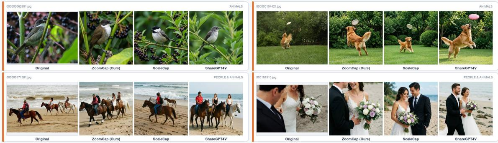  
Figure 7: Qualitative FactCycle reconstruction comparison. Each row uses captions of the same source image to condition the fixed text-to-image generator; ZoomCap reconstructions preserve more of the source composition and fine-grained content; the remaining fourteen FactCycle-250 pairs appear in Appendix Figure 9.

## 5 Conclusion

We formulated fine-grained captioning as recoverable visual information transfer and presented ZoomCap, an evidence-routed teacher that conditions on a global draft to acquire knowledge, OCR, and zoom-in evidence with geometry-grounded relations, then fuses only novel, consistent, non-duplicate evidence. To measure more than verbosity we introduced FactCycle, a two-anchor protocol scoring a caption’s atomic claims against the source image (truthfulness) and a fixed reconstruction (realizability), separating fabrication from generator loss claim by claim. On FactCycle-250 and PrefBench-456, with controlled pre-training and production adoption, these captions preserve more recoverable content than existing datasets and strong single-pass models and improve vision-language training across backbones and domains.

## AI use statement

Generative AI tools were used solely to aid and polish the writing of this manuscript, including drafting, revising, translating, and formatting text to meet publication guidelines. No AI tools were used to generate experimental data, conduct model calls, or produce scientific figures; all results and visuals are original. The authors manually verified all AI-assisted content and take full responsibility for the final manuscript.

## Ethics statement

We report only aggregate annotation results and no annotator identifiers; the evaluation-benchmark images, captions, and intermediate artifacts are not released, and any future release remains subject to the applicable privacy and licensing review. The medical-domain results are benchmark evaluations of pre-training recipes, not clinical validation; ZoomCap captions and the resulting models must not be used to make diagnostic or treatment decisions without domain-specific validation and oversight.

## Reproducibility statement

Section 3 specifies the evidence-routing workflow, and Appendix B records the implemented complexity and geometry rules. Section 3.6 defines the FactCycle metrics and Section 4 the comparisons. Appendix A records the FactCycle sampling, models, seeds, aggregation, human-evaluation protocol, and controlled continual-pre-training recipe; the multi-judge and corpus-statistics breakdowns appear in Appendices C and F. The controlled training comparisons use one fixed seed on the publicly released ZoomCap-450K corpus (page-1 footnote), while the internal production datasets cannot be redistributed; we state these constraints rather than claiming full public reproducibility.

## References

Anas Awadalla, Le Xue, Manli Shu, An Yan, Jun Wang, Senthil Purushwalkam, Sheng Shen, Hannah Lee, Oscar Lo, Jae Sung Park, Etash Guha, Silvio Savarese, Ludwig Schmidt, Yejin Choi, Caiming Xiong, and Ran Xu. BLIP3-KALE: Knowledge Augmented Large-Scale Dense Captions. arXiv:2411.07461, 2024.

Baidu. PaddleOCR-VL 1.5, 2026. URL https://github.com/PaddlePaddle/PaddleOCR-VL.

Delong Chen, Samuel Cahyawijaya, Etsuko Ishii, Ho Shu Chan, Yejin Bang, and Pascale Fung. What Makes for Good Image Captions? In Findings of the Association for Computational Linguistics: EMNLP, 2025.

Lin Chen, Jisong Li, Xiaoyi Dong, Pan Zhang, Conghui He, Jiaqi Wang, Feng Zhao, and Dahua Lin. ShareGPT4V: Improving Large Multi-Modal Models with Better Captions. In European Conference on Computer Vision (ECCV), pp. 370–387, 2024a.

Lin Chen, Jisong Li, Xiaoyi Dong, Pan Zhang, Conghui He, Jiaqi Wang, Feng Zhao, and Dahua Lin. Are We on the Right Way for Evaluating Large Vision-Language Models? In NeurIPS, 2024b.

Xianfu Cheng, Wei Zhang, Shiwei Zhang, Jian Yang, Xiangyuan Guan, Xianjie Wu, Xiang Li, Ge Zhang, Jiaheng Liu, Yuying Mai, Yutao Zeng, Zhoufutu Wen, Ke Jin, Baorui Wang, Weixiao Zhou, Yunhong Lu, Tongliang Li, Wenhao Huang, and Zhoujun Li. SimpleVQA: Multimodal Factuality Evaluation for Multimodal Large Language Models. arXiv:2502.13059, 2025.

Jaemin Cho, Yushi Hu, Roopal Garg, Peter Anderson, Ranjay Krishna, Jason Baldridge, Mohit Bansal, Jordi Pont-Tuset, and Su Wang. Davidsonian Scene Graph: Improving Reliability in Fine-grained Evaluation for Text-to-Image Generation. arXiv preprint arXiv:2310.18235, 2023. URL https://arxiv.org/abs/2310.18235.

Tianyu Cui, Jinbin Bai, Guo-Hua Wang, Qing-Guo Chen, Zhao Xu, Weihua Luo, Kaifu Zhang, and Ye Shi. Evaluating Image Caption via Cycle-consistent Text-to-Image Generation. arXiv preprint arXiv:2501.03567, 2025. URL https://arxiv.org/abs/2501.03567.

Wenliang Dai, Junnan Li, Dongxu Li, Anthony Meng Huat Tiong, Junqi Zhao, Weisheng Wang, Boyang Li, Pascale Fung, and Steven Hoi. InstructBLIP: Towards General-Purpose Vision-Language Models with Instruction Tuning. In Advances in Neural Information Processing Systems (NeurIPS), 2023.

Hongyuan Dong, Jiawen Li, Bohong Wu, Jiacong Wang, Yuan Zhang, and Haoyuan Guo. Benchmarking and Improving Detail Image Caption. arXiv:2405.19092, 2024.

Ling Fu, Zhebin Kuang, Jiajun Song, Mingxin Huang, Biao Yang, Yuzhe Li, Linghao Zhu, Qidi Luo, Xinyu Wang, Hao Lu, Zhang Li, Guozhi Tang, Bin Shan, Chunhui Lin, Qi Liu, Binghong Wu, Hao Feng, Hao Liu, Can Huang, Jingqun Tang, Wei Chen, Lianwen Jin, Yuliang Liu, and Xiang Bai. OCRBench v2: An Improved Benchmark for Evaluating Large Multimodal Models on Visual Text Localization and Reasoning. In Advances in Neural Information Processing Systems (NeurIPS) Datasets and Benchmarks Track, 2025.

Yunhao Ge, Xiaohui Zeng, Jacob Samuel Huffman, Tsung-Yi Lin, Ming-Yu Liu, and Yin Cui. Visual Fact Checker: Enabling High-Fidelity Detailed Caption Generation. In Proceedings of the IEEE/CVF Conference on Computer Vision and Pattern Recognition (CVPR), pp. 14033–14042, 2024. URL https://openaccess.thecvf.com/content/CVPR2024/html/Ge Visual Fact Checker Enabling High-Fidelity Detailed Caption Generation CVPR 2024 paper.html.

Google DeepMind. Gemini 3.1 Pro Model Card, 2026. URL https://deepmind.google/models/model-cards/ gemini-3-1-pro. Large multimodal model used as an automatic pairwise judge.

Tianrui Guan, Fuxiao Liu, Xiyang Wu, Ruiqi Xian, Zongxia Li, Xiaoyu Liu, Xijun Wang, Lichang Chen, Furong Huang, Yaser Yacoob, Dinesh Manocha, and Tianyi Zhou. HallusionBench: An Advanced Diagnostic Suite for Entangled Language Hallucination and Visual Illusion in Large Vision-Language Models. In Proceedings ofthe IEEE/CVF Conference on Computer Vision and Pattern Recognition (CVPR), pp. 14375–14385, 2024.

Jack Hessel, Ari Holtzman, Maxwell Forbes, Ronan Le Bras, and Yejin Choi. CLIPScore: A Reference-free Evaluation Metric for Image Captioning. In Proceedings of the 2021 Conference on Empirical Methods in Natural Language Processing (EMNLP), pp. 7514–7528, 2021. doi: 10.18653/v1/2021.emnlp-main.595. URL https://aclanthology.org/2021.emnlp-main.595/.

Yushi Hu, Benlin Liu, Jungo Kasai, Yizhong Wang, Mari Ostendorf, Ranjay Krishna, and Noah A. Smith. TIFA: Accurate and Interpretable Text-to-Image Faithfulness Evaluation with Question Answering. arXiv preprint arXiv:2303.11897, 2023. URL https://arxiv.org/abs/2303.11897.

Hang Hua, Qing Liu, Lingzhi Zhang, Jing Shi, Soo Ye Kim, Zhifei Zhang, Yilin Wang, Jianming Zhang, Zhe Lin, and Jiebo Luo. FINECAPTION: Compositional Image Captioning Focusing on Wherever You Want at Any Granularity. In Proceedings of the IEEE/CVF Conference on Computer Vision and Pattern Recognition (CVPR), 2025.

Liqiang Jing, Ruosen Li, Yunmo Chen, and Xinya Du. FaithScore: Fine-grained Evaluations of Hallucinations in Large Vision-Language Models. In Findings ofthe Associationfor Computational Linguistics: EMNLP 2024, pp. 5042–5063, 2024. doi: 10.18653/v1/2024.findings-emnlp.290. URL https://aclanthology.org/2024. findings-emnlp.290/.

Justin Johnson, Andrej Karpathy, and Li Fei-Fei. DenseCap: Fully Convolutional Localization Networks for Dense Captioning. In Proceedings of the IEEE Conference on Computer Vision and Pattern Recognition (CVPR), 2016.

Sahar Kazemzadeh, Vicente Ordonez, Mark Matten, and Tamara Berg. ReferItGame: Referring to Objects in Photographs of Natural Scenes. In EMNLP, 2014.

Aniruddha Kembavi, Mike Salvato, Eric Kolve, Minjoon Seo, Hannaneh Hajishirzi, and Ali Farhadi. A Diagram Is Worth A Dozen Images. In ECCV, 2016.

Ranjay Krishna, Yuke Zhu, Oliver Groth, Justin Johnson, Kenji Hata, Joshua Kravitz, Stephanie Chen, Yannis Kalantidis, Li-Jia Li, David A. Shamma, Michael S. Bernstein, and Li Fei-Fei. Visual Genome: Connecting Language and Vision Using Crowdsourced Dense Image Annotations. International Journal of Computer Vision, 2017.

Jason J. Lau, Soumya Gayen, Asma Ben Abacha, and Dina Demner-Fushman. A Dataset of Clinically Generated Visual Questions and Answers about Radiology Images. Scientific Data, 5:180251, 2018. doi: 10.1038/sdata.2018.251.

Zhenxin Lei, Zhangwei Gao, Changyao Tian, Erfei Cui, Guanzhou Chen, Danni Yang, Yuchen Duan, Zhaokai Wang, Wenhao Li, Weiyun Wang, Xiangyu Zhao, Jiayi Ji, Yu Qiao, Wenhai Wang, and Gen Luo. Meta-Captioner: Towards Generalist Visual Captioning with Open-source Suites. In International Conference on Learning Representations (ICLR), 2026.

Feng Li, Renrui Zhang, Hao Zhang, Yuanhan Zhang, Bo Li, Wei Li, Zejun Ma, and Chunyuan Li. LLaVA-NeXT-Interleave: Tackling Multi-image, Video, and 3D in Large Multimodal Models. arXiv:2407.07895, 2024a. URL https://huggingface.co/datasets/NeXT-Interleave/Open-LLaVA-NeXT-Instruct.

Jiaxuan Li, Duc Minh Vo, Akihiro Sugimoto, and Hideki Nakayama. EVCap: Retrieval-Augmented Image Captioning with External Visual-Name Memory for Open-World Comprehension. In Proceedings of the IEEE/CVF Conference on Computer Vision and Pattern Recognition (CVPR), 2024b.

Junnan Li, Dongxu Li, Caiming Xiong, and Steven Hoi. BLIP: Bootstrapping Language-Image Pre-training for Unified Vision-Language Understanding and Generation. In International Conference on Machine Learning (ICML), 2022.

Junnan Li, Dongxu Li, Silvio Savarese, and Steven Hoi. BLIP-2: Bootstrapping Language-Image Pre-training with Frozen Image Encoders and Large Language Models. In International Conference on Machine Learning (ICML), 2023.

Rongjie Li, Songyang Zhang, Dahua Lin, Kai Chen, and Xuming He. From Pixels to Graphs: Open-Vocabulary Scene Graph Generation with Vision-Language Models. In Proceedings of the IEEE/CVF Conference on Computer Vision and Pattern Recognition (CVPR), 2024c.

Xiangtai Li, Tao Zhang, Yanwei Li, Haobo Yuan, Shihao Chen, Yikang Zhou, Jiahao Meng, Yueyi Sun, Shilin Xu, Lu Qi, Tianheng Cheng, Yi Lin, Zilong Huang, Wenhao Huang, Jiashi Feng, and Guang Shi. DenseWorld-1M: Towards Detailed Dense Grounded Caption in the Real World. arXiv:2506.24102, 2025.

Xiaotong Li, Fan Zhang, Haiwen Diao, Yueze Wang, Xinlong Wang, and Ling-Yu Duan. DenseFusion-1M: Merging Vision Experts for Comprehensive Multimodal Perception. Advances in Neural Information Processing Systems, 2024d.

Xiujun Li, Xi Yin, Chunyuan Li, Pengchuan Zhang, Xiaowei Hu, Lei Zhang, Lijuan Wang, Houdong Hu, Li Dong, Furu Wei, Yejin Choi, and Jianfeng Gao. Oscar: Object-Semantics Aligned Pre-training for Vision-Language Tasks. In European Conference on Computer Vision (ECCV), 2020.

Haotian Liu, Chunyuan Li, Qingyang Wu, and Yong Jae Lee. Visual Instruction Tuning. In Advances in Neural Information Processing Systems (NeurIPS), 2023.

Haotian Liu, Chunyuan Li, Yuheng Li, and Yong Jae Lee. LLaVA-NeXT: Improved reasoning, OCR, and world knowledge. Blog post, 2024a.

Yuan Liu, Haodong Duan, Yuanhan Zhang, Bo Li, Songyang Zhang, Wangbo Zhao, Yike Yuan, Jiaqi Wang, Conghui He, Ziwei Liu, et al. MMBench: Is Your Multi-modal Model an All-around Player? In ECCV, 2024b.

Yuliang Liu, Zhang Li, Mingxin Huang, Biao Yang, Wenwen Yu, Chunyuan Li, Xu-Cheng Yin, Cheng-Lin Liu, Lianwen Jin, and Xiang Bai. OCRBench: On the Hidden Mystery of OCR in Large Multimodal Models. Science China Information Sciences, 67(12), 2024c. doi: 10.1007/s11432-024-4235-6.

Xiaosheng Long, Hanyu Wang, Zhentao Song, Kun Luo, and Hongde Liu. RACap: Relation-Aware Prompting for Lightweight Retrieval-Augmented Image Captioning. arXiv:2509.15883, 2025.

Cewu Lu, Ranjay Krishna, Michael Bernstein, and Li Fei-Fei. Visual Relationship Detection with Language Priors. In European Conference on Computer Vision (ECCV), 2016.

Ahmed Masry, Do Xh Long, Jia Qing Tan, Shafiq Jotty, and Enamul Hoque. ChartQA: A Benchmark for Question Answering about Charts with Visual and Logical Reasoning. In Findings of ACL, 2022.

Minesh Mathew, Dimosthenis Karatzas, and C. V. Jawahar. DocVQA: A Dataset for VQA on Document Images. In WACV, 2021.

Minesh Mathew, Viraj Bagal, Ruben Tito, Dimosthenis Karatzas, Ernest Valveny, and C. V. Jawahar. Info-\` graphicVQA. In IEEE/CVF Winter Conference on Applications of Computer Vision (WACV), pp. 1697–1706, 2022.

Moonshot AI. Kimi K2.6 Model Release, 2026a. URL https://www.kimi.ai/ai-models/kimi-k2-6.

Moonshot AI. Kimi K3 Model Release, 2026b. URL https://www.kimi.ai/ai-models/kimi-k3.

Linke Ouyang, Yuan Qu, Hongbin Zhou, Jiawei Zhu, Rui Zhang, Qunshu Lin, Bin Wang, Zhiyuan Zhao, Man Jiang, Xiaomeng Zhao, Jin Shi, Fan Wu, Pei Chu, Minghao Liu, Zhenxiang Li, Chao Xu, Bo Zhang, Botian Shi, Zhongying Tu, and Conghui He. OmniDocBench: Benchmarking Diverse PDF Document Parsing with Comprehensive Annotations. In Proceedings of the IEEE/CVF Conference on Computer Vision and Pattern Recognition (CVPR), 2025.

Ruotian Peng, Haiying He, Yake Wei, Yandong Wen, and Di Hu. Patch Matters: Training-Free Fine-Grained Image Caption Enhancement via Local Perception. In Proceedings of the IEEE/CVF Conference on Computer Vision and Pattern Recognition (CVPR), 2025.

Renjie Pi, Jianshu Zhang, Jipeng Zhang, Rui Pan, Zhekai Chen, and Tong Zhang. Image Textualization: An Automatic Framework for Creating Accurate and Detailed Image Descriptions. arXiv:2406.07502, 2024.

Qwen Team. Qwen3.5 Release, 2026a. URL https://qwen.ai/blog?id=qwen3.5.

Qwen Team. Qwen3.8-Max Model Release, 2026b. URL https://qwen.ai/blog?id=qwen3.8.

Rita Ramos, Bruno Martins, Desmond Elliott, and Yova Kementchedjhieva. SmallCap: Lightweight Image Captioning Prompted with Retrieval Augmentation. In Proceedings ofthe IEEE/CVF Conference on Computer Vision and Pattern Recognition (CVPR), 2023.

Christoph Schuhmann, Richard Vencu, Romain Beaumont, Robert Kaczmarczyk, Clayton Mullis, Aarush Katta, Theo Coombes, Jenia Jitsev, and Aran Komatsuzaki. LAION-400M: Open Dataset of CLIP-Filtered 400 Million Image-Text Pairs. arXiv:2111.02114, 2021.

Oriane Simeoni, Huy V. Vo, Maximilian Seitzer, Federico Baldassarre, Maxime Oquab, Cijo Jose, Vasil´ Khalidov, Marc Szafraniec, Seungeun Yi, Michael Ramamonjisoa, Francisco Massa, Daniel Haziza, Luca¨ Wehrstedt, Jianyuan Wang, Timothee Darcet, Th´ eo Moutakanni, Leonel Sentana, Claire Roberts, Andrea´

Vedaldi, Jamie Tolan, John Brandt, Camille Couprie, Julien Mairal, Herve J ´ egou, Patrick Labatut, and Piotr´ Bojanowski. DINOv3. arXiv:2508.10104, 2025.

Amanpreet Singh, Vivek Natarajan, Meet Shah, Yu Jiang, Xinlei Chen, Dhruv Batra, Devi Parikh, and Marcus Rohrbach. Towards VQA Models That Can Read. In CVPR, 2019.

Chenfei Wu, Jiahao Li, Jingren Zhou, Junyang Lin, Kaiyuan Gao, Kun Yan, Sheng-ming Yin, Shuai Bai, Xiao Xu, Yilei Chen, Yuxiang Chen, Zecheng Tang, Zekai Zhang, Zhengyi Wang, An Yang, Bowen Yu, Chen Cheng, Dayiheng Liu, Deqing Li, Hang Zhang, Hao Meng, Hu Wei, Jingyuan Ni, Kai Chen, Kuan Cao, Liang Peng, Lin Qu, Minggang Wu, Peng Wang, Shuting Yu, Tingkun Wen, Wensen Feng, Xiaoxiao Xu, Yi Wang, Yichang Zhang, Yongqiang Zhu, Yujia Wu, Yuxuan Cai, and Zenan Liu. Qwen-Image Technical Report. arXiv:2508.02324, 2025.

Penghao Wu and Saining Xie. V\*: Guided Visual Search as a Core Mechanism in Multimodal LLMs. In Proceedings of the IEEE/CVF Conference on Computer Vision and Pattern Recognition (CVPR), 2024.

Long Xing, Qidong Huang, Xiaoyi Dong, Pan Zhang, Yuhang Zang, Yuhang Cao, Jinsong Li, Shuangrui Ding, Weiming Zhang, Nenghai Yu, Jiaqi Wang, Feng Wu, and Dahua Lin. ScaleCap: Inference-Time Scalable Image Captioning via Dual-Modality Debiasing. arXiv:2506.19848, 2025.

Danfei Xu, Yuke Zhu, Christopher B Choy, and Li Fei-Fei. Scene Graph Generation by Iterative Message Passing. In Proceedings of the IEEE Conference on Computer Vision and Pattern Recognition (CVPR), 2017.

Kelvin Xu, Jimmy Ba, Ryan Kiros, Kyunghyun Cho, Aaron Courville, Ruslan Salakhutdinov, Richard Zemel, and Yoshua Bengio. Show, Attend and Tell: Neural Image Caption Generation with Visual Attention. In International Conference on Machine Learning (ICML), 2015.

Zitong Xu, Huiyu Duan, Shengyao Qin, Guangyu Yang, Guangji Ma, Xiongkuo Min, Ke Gu, Guangtao Zhai, and Patrick Le Callet. ITIScore: An Image-to-Text-to-Image Rating Framework for the Image Captioning Ability of MLLMs. arXiv preprint arXiv:2604.03765, 2026. URL https://arxiv.org/abs/2604.03765.

Shijia Yang, Yunong Liu, Bohan Zhai, Ximeng Sun, Zicheng Liu, Emad Barsoum, Manling Li, and Chenfeng Xu. CaptionQA: Is Your Caption as Useful as the Image Itself? In Proceedings of the IEEE/CVF Conference on Computer Vision and Pattern Recognition (CVPR), 2026.

Licheng Yu, Patrick Poirson, Shan Yang, Alexander C. Berg, and Tamara L. Berg. Modeling Context in Referring Expressions. In European Conference on Computer Vision (ECCV), pp. 69–85, 2016.

Weihao Yu, Zhengyuan Yang, Linjie Li, Jianfeng Wang, Kevin Lin, Zicheng Liu, Xinchao Wang, and Lijuan Wang. MM-Vet: Evaluating Large Multimodal Models for Integrated Capabilities. In ICML, 2024.

Deyao Zhu, Jun Chen, Xiaoqian Shen, Xiang Li, and Mohamed Elhoseiny. MiniGPT-4: Enhancing Vision-Language Understanding with Advanced Large Language Models, 2023. URL https://arxiv.org/abs/ 2304.10592.

## A Evaluation and Training Protocol Details

Teacher and recorded evidence. ZoomCap uses Qwen3.5-35B-A3B (Qwen Team, 2026a) as the teacher VLM and PaddleOCR-VL-1.5 (Baidu, 2026) as the OCR engine unless otherwise stated. The workflow in Figure 2 records its draft, search context, OCR summary, grounded boxes, patch coordinates and captions, attribute-augmented subject–predicate–object–environment (A-SPOE) facts, routing decisions, latency, and token use. These artifacts make the evidence stream auditable and modules individually ablatable.

Three evaluation levels. At the caption level, FactCycle measures claim-level truthfulness and generative recoverability on two blind anchors while human and multi-judge comparisons inspect captions against the source image; at the mechanism level, evidence-stream and zoom-budget ablations isolate why the workflow improves; at the data level, controlled 450K continual pre-training (CPT) changes only the caption corpus, and two production studies test transfer to general and medical pre-training mixtures.

From teacher workflow to reusable supervision. The workflow output can be used directly as a highfidelity caption, but its larger value in this paper is as reusable supervision: given images $\{ I _ { j } \} _ { j = 1 } ^ { M }$ , ZoomCap produces caption pairs $\{ ( I _ { j } , y _ { j } ) \}$ for continual pre-training. The controlled ZoomCap-450K comparison and production adoption studies (Section 4.3) therefore test whether the evidence acquired by the teacher remains useful after it is converted into training data.

FactCycle sampling and aggregation. We intersect the image pools underlying ZoomCap-450K, ScaleCap-450K (Xing et al., 2025), and ShareGPT4V-450K (Chen et al., 2024a), remove exact duplicate rows, shuffle with seed 42, and select the first 50 accepted examples in each of five categories: indoor, outdoor nature, urban/street, food, and people/animals, forming FactCycle-250. A text-only scene classifier sees only the ScaleCap caption during stratification. Screenshots, documents, charts, collages, artwork, and illustrations are excluded, so this experiment does not test the OCR branch. Every caption is reconstructed at 1024×1024 with Qwen-Image-2512-Lightning (Wu et al., 2025) and seed 42; the reconstruction prompt is truncated at 3,000 characters for every caption source, because in engineering sweeps of this generator renderable detail peaks near 2.8k prompt characters and falls off when less of the caption reaches it. The truncation binds asymmetrically—on 108 of 250 ZoomCap images, 14 of 250 ScaleCap images, and no ShareGPT4V image—so ρ and $\mathrm { F C } _ { \mathrm { t r a n s } }$ are conservative for ZoomCap: restricted to the 142 images whose ZoomCap prompt was not truncated, the ordering and both significance tests are unchanged $( \mathrm { F C _ { t r a n s } } ~ 4 9 . 4 / 3 0 . 7 / 1 4 . { \dot { 3 } } ;$ paired $p = 1 . 0 \times 1 0 ^ { - 8 }$ and $1 . 2 \times 1 0 ^ { - 1 2 } )$ , and the truncated images still transfer more claims per image than the untruncated ones (56.3 vs. 49.4). A text-only Kimi-K3 (Moonshot AI, 2026b) extractor produces the atomicclaim set; independent Kimi-K3 and Qwen3.8-Max (Qwen Team, 2026b) judges then see only the reconstruction and anonymized claims. The truthfulness anchor reuses the identical claim set, with the same Kimi-K3 and Qwen3.8-Max judges seeing only the source image and the anonymized claims (Section E). Metrics are computed per image by first averaging the two judges, then averaging over FactCycle-250. Across the three caption sources, the reconstruction anchor yields exact inter-judge agreement of 0.933 over the 32,205 claims both realizability judges verdicted (64,617 judgments).

Paired preference. The human study uses a two-alternative forced-choice protocol with randomized presentation order on PrefBench-456, our benchmark of 456 image–caption pairs fixed-seed sampled from an internal business-image pool (one anonymized caption pair per image, human-annotated). Six independent annotators assess each pair across six dimensions. Each VLM judge evaluates all 456 pairs with the same rubric. We report tie-adjusted preference scores (wins plus half the ties, so a pairing’s two sides sum to 100), matching the original ZoomCap evaluation. The ablations use the same convention, judged by Gemini-3.1- Pro (Google DeepMind, 2026) against the opponents named in Table $2 ;$ panel (b) pairs the two zoom policies directly, so its two rows are the two sides of one head-to-head over the same 456 pairs.

Controlled CPT recipe. All controlled 450K runs use a three-stage recipe: projector initialization on BLIP-558K (Zhu et al., 2023), one epoch of CPT on the indicated 450K caption corpus, and one epoch of instruction tuning on Open-LLaVA-NeXT-Instruct-1M (Li et al., 2024a). During CPT and instruction tuning the vision tower is frozen while the projector and full language model are trainable. Images use a 589,824-pixel maximum (a 768×768 equivalent). CPT uses learning rate $4 \times 1 0 ^ { - 5 }$ and effective batch size 256; instruction tuning uses $2 \times 1 0 ^ { - 5 }$ and effective batch size 128. All runs use seed 42. Within each backbone block, the initialization, training data outside the CPT caption corpus, resolution, and evaluation protocol are held fixed.

## B Routing and Zoom Implementation Details

Caption-coverage gap recovery. Let $\Omega _ { \mathcal { E } } = \cup _ { i } b _ { i }$ be the union of grounded boxes already explained by the draft caption. The implementation enumerates rectangles whose edges come from image and box boundaries and selects the largest rectangle that does not intersect $\Omega _ { \mathcal { E } } ;$ a second gap can be selected after the first is added to the covered set. Near-full-image entity boxes and extremely narrow gaps are rejected. Unlike generic saliency, these crops are defined relative to what the draft has already grounded.

Complexity-gated zooming. Each first-level patch is captioned independently and retained with its source coordinates. The complexity score $C ( \boldsymbol { p } )$ (equation 3 in the main text) nominates patches for a second observation. Here $N _ { \mathrm { e n t } }$ is the number of entity boxes with intersection-over-box at least 0.25, $N _ { \mathrm { s m a l l } }$ counts those covering at most 1.5% of the patch, $\rho _ { \mathrm { e n t } }$ is clipped entity-intersection area divided by patch area, and $r _ { \mathrm { a r e a } }$ is the patch-to-image area ratio. We set the score weights empirically to $w _ { \mathrm { e n t } } = 1 . 0 , \dot { w } _ { \mathrm { s m a l l } } = 0 . 8$ $w _ { \mathrm { c l i p } } = 2 . 0 $ , and $w _ { \mathrm { a r e a } } = 0 . 3 .$ A first-level patch is eligible when $\begin{array} { r } { N _ { \mathrm { e n t } } \dot { \ge } 6 , \dot { N } _ { \mathrm { s m a l l } } \ge 3 , } \end{array}$ or $N _ { \mathrm { { e n t } } } \geq 4$ and $\rho _ { \mathrm { e n t } } \geq 0 . 3 5 ;$ an agent judgment then vetoes nominations whose zoom it rates uninformative. The budgeted policy keeps broad first-level coverage and passes only the highest-scoring parent approved by both gates, with its already-generated children, to fusion, which isolates the fusion-time patch budget from generation randomness.

Attribute-augmented subject–predicate–object–environment (A-SPOE) acceptance rules. The implementation instantiates equation 4 in the main text: for each entity pair it normalizes horizontal and vertical center gaps by the pair’s mean box width and height, and rejects pairs with IoU above 0.5 (τi), maximum normalized gap below 0.5 (τ ), or dominant-to-minor gap ratio below 1.3 (τ ). Otherwise it assigns left/right or above/below from the dominant axis, ranks candidates by the dominant gap times this ratio, removes duplicate subject–relation edges, caps each object at two incoming relations, and retains at most eight relations. Thus the reported relations follow explicit box geometry rather than an unimplemented learned relation score.

Draft-anchored gated fusion. At temperature zero the fusion model receives the draft and the ordered patch descriptions and outputs only a new visual-details section (text, materials, colors, small objects, counts, local arrangements) that adds nothing already stated and excludes encyclopedic knowledge; the code appends this section to the draft, and geometry-derived relations pass through a constrained prompt that preserves their supplied direction. The novelty, consistency, and overlap gates of equation 5 are therefore realized training-free.

## C Multi-Judge Cross-Validation

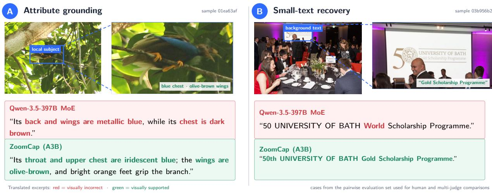  
Figure 8: Representative cases from PrefBench-456. The left case tests localized attribute grounding, the right tests small-text recovery (translated excerpts; red marks visually incorrect spans, green image-supported spans). ZoomCap preserves local evidence that Qwen3.5-397B-A17B reverses or misreads.

Table 6: Multi-judge cross-validation of ZoomCap vs. Qwen3.5-397B-A17B on PrefBench-456. The human row aggregates six annotators; cells are tie-adjusted preference scores (%, wins plus half ties, so a pairing’s sides sum to 100). General is the general-perception verdict and Overall the final paired-comparison verdict (human row: mean of the six dimension rates). Headline rates in Section 4.1.2 are the human General verdict (81.9) and each judge’s Overall verdict (76.4–92.2). Cell shading marks the rate bins: <50, 50–60, 60–70, 70–80, 80–90, ≥90.
<table><tr><td>Judge</td><td>Instr. follow.</td><td>Visual accuracy</td><td>Info coverage</td><td>Visual reasoning</td><td>Knowledge richness</td><td>Expr. quality</td><td>General</td><td>Overall</td></tr><tr><td>Human (6 annotators)</td><td>63.1</td><td>71.4</td><td>71.4</td><td>69.3</td><td>86.4</td><td>63.5</td><td>81.9</td><td>70.9</td></tr><tr><td>Gemini-3.1-Pro (Google DeepMind, 2026)</td><td>49.8</td><td>63.8</td><td>66.7</td><td>57.2</td><td>91.3</td><td>58.4</td><td>70.0</td><td>77.7</td></tr><tr><td>Qwen3.5-397B-A17B (Qwen Team, 2026a)</td><td>73.3</td><td>69.5</td><td>80.2</td><td>69.7</td><td>85.0</td><td>81.9</td><td>76.2</td><td>76.4</td></tr><tr><td>Kimi-K2.6 (Moonshot AI, 2026a)</td><td>88.1</td><td>78.5</td><td>92.5</td><td>79.5</td><td>93.5</td><td>84.2</td><td>91.7</td><td>92.2</td></tr></table>

## D More Qualitative FactCycle Reconstructions

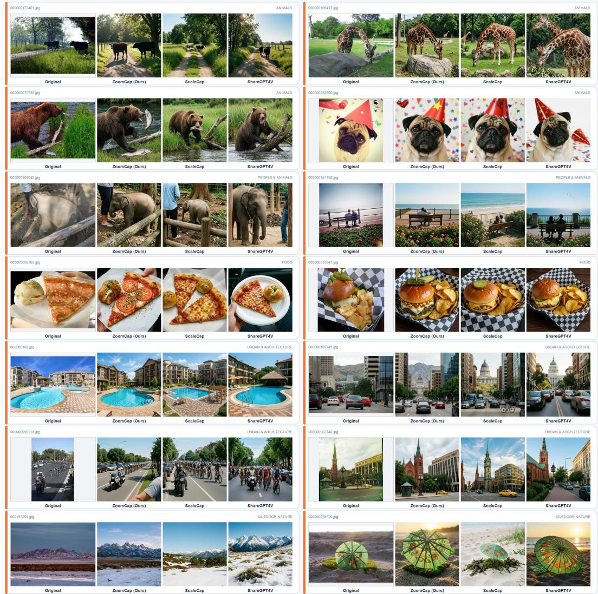  
Figure 9: Additional FactCycle reconstruction comparisons. The fourteen paired sources not shown in Figure 7, generated with the identical fixed generator and caption sources.

## E Additional FactCycle Breakdowns

On the 250 paired images (five scene buckets, 50 each) this appendix expands Table 1: each caption’s blind claim set is scored on two anchors, the source image (Truthfulness τ) and the fixed-generator reconstruction (Realizability ρ).

Aggregation. τ and ρ average the two judges within an image, then average over images (Appendix A). The quadrant rates of equation 7 and FCtrans of equation 8 come from one cross-tabulation of the same verdicts: truthfulness rows are pooled over judges, the reconstruction leg contributes its per-claim majority, and claims on which the two reconstruction judges split are dropped (2,462/1,301/444 rows). The denominator is thus the rows decidable on both anchors (28,794/17,854/9,226), the four cells—transferred, specious, unrendered fabrication, and the excluded true-but-unrendered generator cell—sum to 100%, and $\mathrm { F C } _ { \mathrm { t r a n s } }$ divides the both-supported rows (26,184/15,749/7,411) by 250 × 2. #Facts/img counts blind-extracted claims throughout; Table 9 instead keeps reconstruction-unverifiable rows in the unrealized denominator.

Robustness to the aggregation order. Averaging judge scores per claim before intersecting the anchors, and counting a claim as decidable if either judge decided it, moves the quadrant shares by at most 3.0 points and FC by 4.1 (transferred 88.0/85.3/79.3; specious 4.3/8.2/16.4; unrendered fabrication 2.2/3.5/2.7; FCtrans 56.5/33.7/15.6), preserving every ordering and both significance tests.

Breakdowns. Every scene bucket preserves the overall FCtrans ordering (Table 7); by category (Table 8) the transferred and specious shares differ in one cell only—small objects, where ScaleCap leads 85.4 vs. 84.2%.

Table 7: Two-anchor FactCycle scoring per scene bucket (50 images each). Columns follow Table 1: #Facts/img counts blind-extracted claims, Truthfulness τ is supported/(supported+unsupported) against the source image; the transferred, specious, and unrendered-fabrication shares cover claims decidable on both anchors and, with the excluded true-but-unrendered generator cell, sum to 100%. Per-bucket realizability is discussed in the Realizability accounting paragraph below.
<table><tr><td>Scene</td><td>Caption source</td><td>#Facts/img ↑</td><td>τ (%) ↑</td><td>transferred (%) ↑</td><td>specious (%) ↓</td><td>unrendered fab. (%) ↓</td><td>FCtrans ↑</td></tr><tr><td rowspan="3">Indoor</td><td>ShareGPT4V-450K (Chen et al., 2024a)</td><td>19.6</td><td>81.6</td><td>79.0</td><td>17.3</td><td>2.4</td><td>14.3</td></tr><tr><td>ScaleCap-450K (Xing et al., 2025)</td><td>40.2</td><td>88.6</td><td>87.1</td><td>8.3</td><td>2.6</td><td>30.3</td></tr><tr><td>ZoomCap-450K (Ours)</td><td>68.8</td><td>93.2</td><td>88.6</td><td>4.0</td><td>2.0</td><td>52.4</td></tr><tr><td rowspan="3">Outdoor</td><td>ShareGPT4V-450K (Chen et al., 2024a)</td><td>19.7</td><td>81.2</td><td>78.7</td><td>18.7</td><td>1.6</td><td>14.0</td></tr><tr><td>ScaleCap-450K (Xing et al., 2025)</td><td>39.0</td><td>89.5</td><td>89.5</td><td>6.3</td><td>2.5</td><td>30.1</td></tr><tr><td>ZoomCap-450K (Ours)</td><td>58.8</td><td>94.1</td><td>91.8</td><td>3.6</td><td>1.6</td><td>46.3</td></tr><tr><td rowspan="3">Urban</td><td>ShareGPT4V-450K (Chen et al., 2024a)</td><td>22.5</td><td>80.1</td><td>79.7</td><td>16.9</td><td>2.3</td><td>15.9</td></tr><tr><td>ScaleCap-450K (Xing et al., 2025)</td><td>45.3</td><td>87.8</td><td>88.5</td><td>7.4</td><td>2.5</td><td>33.8</td></tr><tr><td>ZoomCap-450K (Ours)</td><td>69.3</td><td>94.1</td><td>90.6</td><td>3.4</td><td>1.8</td><td>52.5</td></tr><tr><td rowspan="3">Food</td><td>ShareGPT4V-450K (Chen et al., 2024a)</td><td>22.4</td><td>81.7</td><td>80.7</td><td>15.9</td><td>2.2</td><td>15.9</td></tr><tr><td>ScaleCap-450K (Xing et al., 2025)</td><td>43.1</td><td>87.6</td><td>87.0</td><td>7.8</td><td>3.3</td><td>30.9</td></tr><tr><td>ZoomCap-450K (Ours)</td><td>74.0</td><td>94.1</td><td>92.1</td><td>3.0</td><td>1.5</td><td>58.6</td></tr><tr><td rowspan="3">People/ animals</td><td>ShareGPT4V-450K (Chen et al., 2024a)</td><td>19.1</td><td>82.6</td><td>83.8</td><td>13.9</td><td>1.</td><td>14.1</td></tr><tr><td>ScaleCap-450K (Xing et al., 2025)</td><td>41.8</td><td>90.7</td><td>89.0</td><td>7.1</td><td></td><td>32.4</td></tr><tr><td>ZoomCap-450K (Ours)</td><td>64.6</td><td>93.5</td><td>91.7</td><td>3.1</td><td>1.6</td><td>52.1</td></tr></table>

Table 8: Two-anchor FactCycle quadrant shares by fact category. Shares are computed over claims decidable on both anchors within each category: transferred (true and rendered), specious (fabricated yet rendered), and unrendered fabrication (fabricated and unrendered); the true-but-unrendered generator cell is excluded from caption metrics. Shading marks the best cell of each column (highest transferred, lowest specious and lowest unrendered fabrication).
<table><tr><td>Caption source</td><td>Metric</td><td>entity</td><td>attribute</td><td>spatial</td><td>count</td><td>small obj.</td><td>action</td><td>other</td></tr><tr><td rowspan="3">ShareGPT4V-450K</td><td>transferred (%) ↑</td><td>89.5</td><td>78.8</td><td>77.4</td><td>68.0</td><td>78.7</td><td>70.7</td><td>86.7</td></tr><tr><td>specious (%) ↓</td><td>10.1</td><td>18.5</td><td>18.5</td><td>20.1</td><td>19.8</td><td>24.1</td><td>8.6</td></tr><tr><td>unrendered fab. (%) ↓</td><td>0.1</td><td>1.5</td><td>3.1</td><td>6.4</td><td>0.9</td><td>3.3</td><td>3.6</td></tr><tr><td rowspan="3">ScaleCap-450K</td><td>transferred (%) ↑</td><td>94.2</td><td>87.8</td><td>82.8</td><td>83.8</td><td>85.4</td><td>84.8</td><td>93.6</td></tr><tr><td>specious (%) ↓</td><td>4.8</td><td>8.2</td><td>9.4</td><td>7.0</td><td>8.4</td><td>8.1</td><td>4.0</td></tr><tr><td>unrendered fab. (%) ↓</td><td>0.5</td><td>2.4</td><td>4.5</td><td>4.9</td><td>3.7</td><td>4.2</td><td>1.8</td></tr><tr><td rowspan="3">ZoomCap-450K (Ours)</td><td>transferred (%) ↑</td><td>95.8</td><td>91.0</td><td>87.3</td><td>84.8</td><td>84.2</td><td>86.1</td><td>94.6</td></tr><tr><td>specious (%)↓</td><td>1.6</td><td>3.3</td><td>4.9</td><td>3.6</td><td>5.9</td><td>5.4</td><td>2.4</td></tr><tr><td>unrendered fab. (%) ↓</td><td>0.6</td><td>1.7</td><td>2.2</td><td>3.2</td><td>3.0</td><td>3.8</td><td>1.3</td></tr></table>

Category-level readings. ZoomCap keeps the lowest specious share in all seven fact categories and the highest transferred share in six of them (Table 8). For ShareGPT4V-450K the fabrications concentrate on actions and counts, where 24.1% and 20.1% of decidable claims are specious—fabricated yet still rendered, so any reconstruction-only metric counts invented dynamics and quantities as supported content. ZoomCap’s true-but-unrendered share (generator-attributed, excluded from caption metrics) is slightly elevated on counts and spatial relations (8.5% and 5.6%), consistent with the fixed generator dropping specific highcardinality facts under dense captions; per the two-anchor attribution this is generator loss rather than caption error, and it enters FCtrans identically for all sources. The unrendered-fabrication share likewise peaks in the count column for ShareGPT4V (6.4%) and ScaleCap (4.9%) and, for ZoomCap, on actions (3.8%, against 3.2% on counts)—fabricated and unrenderable claims concentrate where rendering is hardest, reinforcing the reading that counting facts stress the fixed generator the most.

Table 9: Conservative dual-anchor accounting on FactCycle-250. In the conservative variant, reconstruction-leg unverifiable verdicts count toward the unrealized denominator. Fabricated-then-rendered: share of claims unsupported by the source image that the reconstruction nevertheless renders; true-among-rendered: share of rendered claims that the source image also supports; fabrication rate: share of claims unsupported by the source image under the conservative denominator. Lower is better for all three.
<table><tr><td>Caption source</td><td>Fabricated-then- rendered (%) ↓</td><td>True-among- rendered (%) ↑</td><td>Fabrication rate (%) ↓</td></tr><tr><td>ShareGPT4V-450K (Chen et al., 2024a)</td><td>88.1</td><td>79.7</td><td>18.4</td></tr><tr><td>ScaleCap-450K (Xing et al., 2025)</td><td>72.5</td><td>87.0</td><td>9.9</td></tr><tr><td>ZoomCap-450K (Ours)</td><td>64.7</td><td>92.9</td><td>5.1</td></tr></table>

Realizability accounting. The reported ρ drops reconstruction-unverifiable verdicts from both sides (supported over decidable claims): 92.3/93.6/95.7% for ZoomCap/ScaleCap/ShareGPT4V. The stricter variant that charges unverifiable verdicts to the caption (supported over all extracted claims) lowers these rates to 88.8/90.7/93.4%; the 3.5/2.9/2.3-point gaps are exactly each corpus’s unverifiable share, largest for ZoomCap because denser captions offer more claims the fixed renderer cannot make checkable. Per-bucket realizability (decidable-only) is highest for the shortest captions in every scene bucket (ZoomCap 90.9–93.7, ScaleCap 92.2–94.7, ShareGPT4V 95.3–96.5), which is why realizability alone cannot rank caption quality; the source ranking is identical under both accountings.

Judge configuration and robustness. Both anchors share the judge pair Kimi-K3 and Qwen3.8-Max; per-claim exact agreement is 0.933 over the 32,205 claims both realizability judges verdicted (64,617 judgments) and 0.877 over the 31,452 claims scored by both truthfulness judges.

## F Corpus Statistics

Table 10 gives the corpus side of the equal-scale comparison run in Table 5: caption length, entity density, and the image source of each 450K set.

Table 10: Caption-corpus statistics for equal-scale 450K datasets. ZoomCap-450K contains more text and named/object entities; downstream utility is evaluated in Table 5.
<table><tr><td>Dataset</td><td>#Images</td><td>Image source</td><td>Caption engine</td><td>Avg. chars</td><td>Avg. words</td><td>Avg. sents</td><td>Avg. entities</td></tr><tr><td>ShareGPT4V-450K (Chen et al., 2024a)</td><td>450K</td><td>ShareGPT4V-100K + sampled ShareGPT4V-PT</td><td>GPT-4V / Share-Captioner</td><td>850.7</td><td>147.6</td><td>8.4</td><td>2.3</td></tr><tr><td>DenseFusion-450K (Li et al., 2024d)</td><td>450K</td><td>Sampled from DenseFusion-1M</td><td>DenseFusion</td><td>1129.1</td><td>193.5</td><td>10.5</td><td>3.8</td></tr><tr><td>ScaleCap-450K (Xing et al., 2025)</td><td>450K</td><td>ShareGPT4V-100K + LAION-5B subset (Schuhmann et al., 2021)</td><td>ScaleCap</td><td>2907.8</td><td>462.2</td><td>21.5</td><td>5.8</td></tr><tr><td>ZoomCap-450K (Ours)</td><td>450K</td><td>ShareGPT4V-100K + LAION-5B subset (Schuhmann et al., 2021)</td><td>ZoomCap (Qwen3.5-35B-A3B)</td><td>4228.6</td><td>622.8</td><td>33.1</td><td>12.4</td></tr></table>

## G General-Domain Adoption Details

Table 3 compares two matched production runs of Ling-Tiny-VL-v3 under a common 60B-token budget: they share checkpoint, hyperparameters, and seed; the experimental arm swaps the production vl caption snapshot (pretrain caption 20260623) for zoomcap pretrain 1600w—16M ZoomCap captions up-sampled 4× to 60M and mixed with 240M base captions so that ZoomCap forms 20% of the caption group by count—and every sub-score averages the four checkpoints (40–55B tokens) common to both runs. The gain concentrates in the document/OCR suite (+1.4 on the nine-benchmark mean, driven by OmniDocBench +9.8 and OCRBenchV2-b +2.2) and is comparably large on the perception suite (+1.5, led by MMVet +11.8 and HallusionBench +1.4) and the knowledge-VQA suite (+0.7). Figure 10 reports the same suite means per checkpoint instead of averaged over them, so the document-structure and perception gains read as stable across the shared checkpoints rather than as a single-checkpoint artifact.

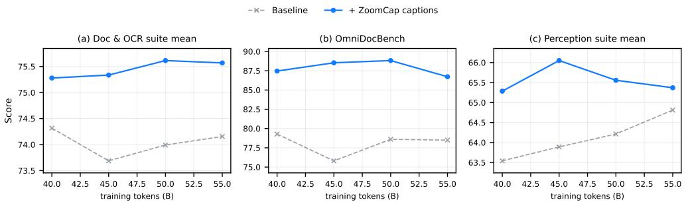  
Figure 10: Checkpoint-level curves for the general-domain adoption study. Suite means over the shared checkpoints (40–55B tokens) for the baseline mixture and the mixture with ZoomCap captions: (a) the nine-benchmark Doc & OCR suite, (b) OmniDocBench, (c) the nine-benchmark perception suite; the gains are stable across checkpoints.

## H Medical-Domain Adoption Details

In the medical-domain study (Table 4 in the main paper), the reference recipe is itself a medical-oriented pretraining mixture: the dedicated medical-image set (20260731 medical image, 3.66M images) and interleaved medical documents together account for 50% of the mixture. We introduce 2.64M medical-image captions as a dedicated group covering 20% of the mixture, rebalanced from the interleaved medical-document group; the reference recipe spends the same medical budget without this caption group, and the same image set is captioned either by Gemini-3.1-Pro (Google DeepMind, 2026) single-pass or by ZoomCap, so the two augmented runs isolate the caption engine under an otherwise identical recipe. Concretely, both augmented runs keep the original 3.66M-image stream and add the dedicated group on top: the 2.64M engine captions enter the mixture as 15.55M caption samples, expanding the medical-image stream from 3.66M samples (1.73B tokens) to 19.21M samples (8.58B tokens). ZoomCap captions improve the five medical benchmarks by +3.04 on average, versus +1.76 for single-pass Gemini-3.1-Pro captions, and turn VQA-RAD (Lau et al., 2018) from a slight regression into +3.1. ZoomCap also has the smaller change on the internal hallucination monitor (−0.5 vs. −1.5 on hallusion intern); this diagnostic does not by itself identify the cause of the difference. Both augmented runs train on 64 GPUs for ∼50B tokens against the 128-GPU, ∼100B-token baseline: at half the compute budget, both caption recipes outperform the reference, and ZoomCap outperforms the stronger captioning engine.

## I Efficiency and Auditability

In practice, the dominant cost is the number of observations rather than any single local call. This explains why budgeted zooming is part of the method: reducing unnecessary second-level patches improves efficiency while also reducing the chance of local hallucination. For token-metered systems, the normalized per-image cost is

$$
\mathrm { C o s t _ { i m a g e } } = \sum _ { s \in \mathcal { S } } n _ { s } \left( \frac { \mathbb { E } \left[ t _ { s } ^ { \mathrm { i n } } \right] } { 1 0 ^ { 6 } } P _ { \mathrm { i n } } + \frac { \mathbb { E } \left[ t _ { s } ^ { \mathrm { o u t } } \right] } { 1 0 ^ { 6 } } P _ { \mathrm { o u t } } \right) ,\tag{9}
$$

where $n _ { s }$ is the number of calls at stage $s , t _ { s } ^ { \mathrm { i n } }$ and $t _ { s } ^ { \mathrm { o u t } }$ are token counts, and $P _ { \mathrm { i n } } , P _ { \mathrm { o u t } }$ are prices per million tokens.

Table 11 instantiates this accounting for the engines. Measured over our production logs, the full ZoomCap evidence workflow costs \$0.0077 per image—of the same order as the logged single-pass Qwen3.5-397B-A17B (Qwen Team, 2026a) call, and $3 . 6 \times$ cheaper than the official ScaleCap (Xing et al., 2025) recipe measured on the same service and teacher, while transferring 1.66× more claims (Table 1); equivalently, each transferred claim costs about $\$ 1.5\times10^ { - 4 }$ for ZoomCap versus $\$ 8.7\times10^ { - 4 }$ for ScaleCap, $\mathrm { i . e . , } \sim 5 . 9 \times$ cheaper per unit of transferred evidence. The gap is robust to the remaining modeling assumptions: even halving ScaleCap’s measured input tokens would leave it ${ \sim } 2 . 0 \times$ more expensive per image than ZoomCap. At this rate, captioning the 2.64M medical images of Section 4.3 costs about \$20K.

Table 11: Per-image captioning cost. All rows caption one image at 768 pixels with a single teacher family; ZoomCap is measured from production workflow logs of the Qwen3.5-35B-A3B teacher, the ScaleCap row by running its official recipe and code (Xing et al., 2025) through the identical asynchronous service at the same teacher, and the Qwen3.5-397B-A17B row from the logged single-pass flagship run that supplies the PrefBench-456 opposing captions. Token prices are \$0.25/\$0.60 per 106 (Qwen3.5-35B-A3B) and \$1.20/\$6.00 (Qwen3.5-397B-A17B); output tokens count every generated text (drafts, evidence/question–answer streams, patch captions, final caption). Wall-clock is per image in the asynchronous service (ZoomCap: concurrent knowledge/grounding stages, five parallel patch workers; ScaleCap: heuristic rounds on the same workers). The final column divides \$/img by $\mathrm { F C } _ { \mathrm { t r a n s } } ^ { - }$ transferred claims (Table 1); single-pass rows are blank as those captions were not scored under that protocol.
<table><tr><td>Captioning engine</td><td>Teacher</td><td>Calls/img</td><td>Input tok/img</td><td>Output tok/img</td><td>$/img</td><td>Wall-clock (s)</td><td>$/transferred claim</td></tr><tr><td>Single-pass draft</td><td>Qwen3.5-35B-A3B (Qwen Team, 2026a)</td><td></td><td>1.3K</td><td>0.4K</td><td>0.0006</td><td>4.6</td><td></td></tr><tr><td>Single-pass flagship</td><td>Qwen3.5-397B-A17B (Qwen Team, 2026a)</td><td>11</td><td></td><td>0.7K</td><td>0.0067</td><td>~17</td><td></td></tr><tr><td>ScaleCap-450K recipe (Xing et al., 2025)</td><td>Qwen3.5-35B-A3B</td><td>~70</td><td>93.6K</td><td>6.6K</td><td>0.0274</td><td>~123</td><td> $8 . 7 \times 1 0 ^ { - 4 }$ </td></tr><tr><td>ZoomCap (Ours)</td><td>Qwen3.5-35B-A3B</td><td>~9</td><td>20.6K</td><td>4.3K</td><td>0.0077</td><td>~29</td><td>1.5 × 10−4</td></tr></table>

Concurrency in the serving pipeline. The workflow is implemented as an asynchronous FastAPI service: each image is an independent job served by a configurable worker pool. Once the global draft completes, the knowledge and grounding stages are dispatched concurrently, the local patch calls run in parallel over five workers, and distinct images are processed simultaneously, so per-image wall-clock follows the critical path rather than the sum of calls (the ∼29 s of Table 11, against the roughly 55 s that the same calls would take sequentially).

Because every stage writes intermediate evidence artifacts, the workflow is also auditable: failures can be traced to routing, search context, OCR, local patches, relation facts, or fusion rather than being hidden inside one opaque generation call.