# vil: Scaling Embodied Spatial Intelligence through Knowledge Recirculation

Weilin Ruan<sup>1,2</sup>, Bohan Zhou<sup>1,2</sup>, Jinghao Li<sup>1,2</sup>, Yangkai Wei<sup>2</sup>, Wenqian Li<sup>2</sup>, Peiran Dong<sup>2</sup>, Yingjie Xu<sup>2,3</sup>, Leyi Wu<sup>2,3</sup>, Haojian Huang<sup>2,3</sup>, Binghui Xie<sup>2</sup>, Han Yang<sup>2</sup>, Kaiwen Zhou<sup>2</sup>, Yinchuan Li<sup>2</sup>, Ying-Cong Chen<sup>3</sup>, James Cheng<sup>1,†</sup>

<sup>1</sup>The Chinese University of Hong Kong <sup>2</sup>Knowin.AI <sup>3</sup>The Hong Kong University of Science and Technology (Guangzhou)

<sup>†</sup>Corresponding author. <sup>#</sup> CONTACT: rwlinno@ gmail.com


香港中文大學The Chinese University of Hong Kong

KNOWIN

THE HONG KONG UNIVERSITY OF SCIENCE AND TECHNOLOGY (GUANGZHOU)

€ Project § Code õ Data ò Model

## ABSTRACT

Embodied spatial intelligence requires more than visual recognition: models must localize entities, reason about their relations, and express this knowledge in action-relevant forms. Yet joint training can conflate the knowledge needed at different stages because supervision is fragmented across incompatible geometric and semantic outputs. We introduce ANVIL, a unified framework for data generation, training, and benchmarking for embodied spatial intelligence. ❶ANVIL-GEN is a heterogeneous data flywheel that combines form-specific generation, cross-stage consistency verification, and failure-driven recollection across 11 Ground–Relation–Act forms. ❷ANVIL-BEN provides scene-aligned supervision for learning diverse embodied spatial capabilities and scene-linked assessments that distinguish stage competence from error propagation. ❸ANVIL-MOPD is a 9B student that consolidates heterogeneous spatial knowledge through distillation from specialist teachers. Semantic-firstfault routing targets teacher supervision to the student’s earliest decisive failure, while stage normalization controls the loss scale across native outputs of different lengths. We construct 5.8M source-grounded records spanning 160K images, reserving 580K spatial records for held-out evaluation and using the remaining 5.22M records for training. On average across seven public benchmarks, ANVIL-MOPD outperforms Qwen3.5-9B and RynnBrain-8B by 9.29 and 11.03 percentage points, respectively, while reaching 80.67% on VABench-Point. Controlled studies support targeted coverage, selective transfer, and feedback-guided repair as complementary framework components.

## 1 INTRODUCTION

Embodied spatial intelligence requires more than visual recognition: a model must localize entities, reason about relations, and identify possible interactions (Yuan et al., 2025; Zhou et al., 2025; Li et al., 2026c). Recognizing a coffee machine, for example, does not determine where a cup can be placed beside it. Learning these capabilities requires supervision that connects visual observations to precise, action-relevant spatial judgments. Web images, reconstructed scenes, and simulated environments offer complementary sources, but differ in their coverage and available geometry (Song et al., 2024; Chen et al., 2024; Zhi et al., 2025). Scaling embodied spatial intelligence therefore requires both broader supervision and a way to consolidate the knowledge expressed in different outputforms.

Recent data-driven approaches have advanced spatial grounding and reasoning through synthetic supervision, geometric reconstruction, and capability-diverse training (Chen et al., 2024; Zhou et al., 2025; Cai et al., 2026). Broader multimodal and embodied training also demonstrated the value of integrating diverse visual experience and tasks (Tong et al., 2024; Liu et al., 2025; 2026c; Zhang et al., 2026a; Tan et al., 2026; Li et al., 2026c). These studies support scaling spatial supervision, although gains vary across capabilities and transfer settings (Cai et al., 2026; Li et al., 2026c). Diagnostic benchmarks also revealed differences that aggregate scores can obscure (Du et al., 2024; Wu et al., 2025; Zhang et al., 2026e). Building on these advances, we investigate a data-centered question:

How can heterogeneous spatial expertise be turned into reliable supervision and consolidated in a model that also supports subsequent data verification?

We introduce ANVIL, which connects a spatial data flywheel and model training through knowledge recirculation (Figure 1): ANVIL-GEN operates as a heterogeneous data flywheel, where form-specific generation produces spatial supervision, cross-stage verification identifies inconsistencies, and failure feedback guides targeted data regeneration and collection. A shared Ground–Relation–Act interface connects 11 native output forms through common entities and explicit dependencies, allowing the same capabilities to be specified across generation, learning, and evaluation. ANVIL-BEN organizes the aligned supervision into ANVIL-TRAIN for learning and ANVIL-EVAL for held-out assessment through native-output and scene-linked tasks. ANVIL-MOPD integrates knowledge from specialists trained on this supervision through multi-teacher distillation, building on on-policy knowledge transfer (Agarwal et al., 2024; Ma et al., 2026a; Gao et al., 2026). Semantic-first-fault routing directs teacher supervision to the earliest decisive student error, while stage normalization controls the los scale across output lengths. Validated records can refresh specialists, while the distilled generalis returns verification signals to the data flywheel. Our contributions are threefold:

(i) ANVIL-GEN: a scene-aligned, cross-verified data flywheel. Shared scene and entity references align source annotations and specialist outputs, while geometry-aware CoT structures schemaconstrained generation. Cross-form adjudication turns dependencies among outputs into explicit verification constraints, and failure feedback guides targeted repair across sources and forms.

(ii) ANVIL-BEN: a scene-aligned benchmark for spatial learning and evaluation. Aligned scene images and 11 native annotation formats support training in ANVIL-TRAIN and held-out assessment in ANVIL-EVAL, covering spatial understanding, reasoning, and state-conditioned plan verification. Native-output tasks measure individual capabilities; linked assessments and controlled upstream substitutions measure how errors propagate across dependent stages.

(iii) ANVIL-MOPD: specialist-to-generalist transfer with multi-teacher distillation. Semanticfirst-fault routing jointly selects a specialist and correction span, while stage normalization balances supervision across heterogeneous outputs. The resulting generalist can assist ANVIL-GEN under evidence-backed verification. Benchmark comparisons and controlled studies demonstrate the benefits of structured supervision and selective specialist transfer.

## 2 RELATED WORK

Spatial intelligence. Spatial intelligence research spans relation recognition, geometric estimation, and reasoning about possible interactions. Early evaluations of relational understanding (Liu et al., 2023; Kamath et al., 2023) have been complemented by image-based, multi-view, and video-based benchmarks (Tong et al., 2024; Du et al., 2024; Fu et al., 2024; Yang et al., 2025b), with further emphasis on transformations, planning, and spatial-functional reasoning (Zhang et al., 2026e; Wu et al., 2025; Zhang et al., 2026b;c). Training has likewise moved beyond image–text pairs toward supervision derived from geometry and robot experience (Chen et al., 2024; Cheng et al., 2024; Chen et al., 2025), including precise, interaction-relevant grounding (Yuan et al., 2025; Zhou et al., 2025). Procedural geometry and executable representations broaden the available targets (Assouel et al., 2026; Liu et al., 2026a), while program execution and trajectory consistency help check automatically generated annotations (Zhi et al., 2025; Hu et al., 2024; Blank et al., 2026). This expanding coverage raises a broader evaluation question: when does success on a particular spatial task indicate competence that transfers to other tasks?

Embodied foundation models. Large-scale pretraining has connected visual–linguistic knowledge to embodied reasoning and robot control (Driess et al., 2023; Zitkovich et al., 2023; Kim et al., 2025). Autoregressive and diffusion policies provide alternative action interfaces, with generalist policies supporting adaptation across robot platforms (Octo Model Team et al., 2024). In parallel, spatially focused models develop geometric and spatiotemporal understanding (Cai et al., 2026; Tan et al., 2026; Li et al., 2026c), using structured scene representations, targeted supervision, or progressive

(a) Anvil-Gen: Spatial Data Flywheel

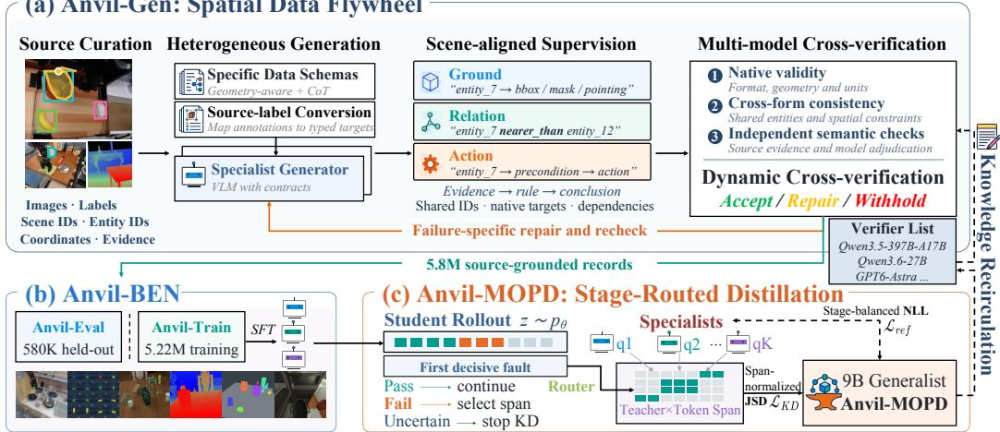  
Figure 1: Overview of the Anvil framework. Anvil-Gen produces spatial supervision through generation, cross-verification, and repair. Anvil-Ben curates verified records into training and held-out evaluation sets. Anvil-MOPD consolidates specialist knowledge into a generalist through teacher-andspan routing on student rollouts. The generalist then assists subsequent verification, returning learned knowledge to supervision production while evidence-backed checks retain acceptance authority.

curricula (Ju et al., 2026; Ray et al., 2025; Li et al., 2026b). Reasoning–action models increasingly connect these capabilities to action prediction (Liu et al., 2025; 2026c). The challenge is to turn diverse training signals into generalizable capabilities, rather than a collection oftask-specific skills.

Knowledge distillation. Distillation transfers teacher knowledge through output distributions or generated sequences (Hinton et al., 2015; Kim & Rush, 2016); subsequent language-model methods address student behavior through reverse-KL and on-policy learning (Gu et al., 2024; Agarwal et al., 2024). Multi-teacher extensions introduce choices about both knowledge sources and supervision budgets (Ma et al., 2026a; Gao et al., 2026). Selection can operate over examples and tasks through rationale consolidation, answer verification, or privileged context (Jin et al., 2026; He et al., 2026; Ma et al., 2026b), or within trajectories through discrepancy-triggered intervention and failed-prefix recovery (Koo et al., 2025; Xu et al., 2026). Related approaches target informative tokens (Liu et al., 2026b; Li et al., 2026a), cross-view representations (Nguyen et al., 2026), and intermediate reasoning steps (Lightman et al., 2024), while iterative bootstrapping reuses answer-checked model outputs for further training (Zelikman et al., 2022). Selective supervision thus raises a question of reliability: how can useful teacher knowledge be retained without also reinforcing its errors?

To address these gaps, ANVIL treats supervision reliability and knowledge transfer as coupled problems. Scene-aligned annotations support specialist-to-generalist distillation and held-out evaluation through knowledge recirculation; the resulting student can then assist further data verification. The knowledge recirculation mechanism links data refinement to model learning so that their effects on spatial competence can be studied together.

## 3 ANVIL: LEARNING THROUGH KNOWLEDGE RECIRCULATION

ANVIL connects spatial data production and model learning through knowledge recirculation (Figure 1). Shared entities and task dependencies align heterogeneous targets within a scene. These references support cross-form verification and localized repair in ANVIL-GEN, then identify the specialist and response span requiring correction during distillation. The resulting generalist assists subsequent verification, while evidence-backed checks retain acceptance authority and ANVIL-BEN reserves separate targets for evaluation.

## 3.1 SCENE-ALIGNED SUPERVISION

Let $I \in \mathbb { R } ^ { H \times W \times 3 }$ be an RGB image, with height H and width W, x an instruction, and E its entity inventory. Contract d specifies target space $\mathcal { D } _ { d } ,$ required fields, coordinates, and a semantic evaluator.

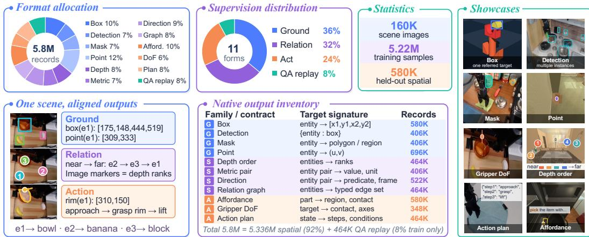  
Figure 2: Scene-aligned supervision and training interfaces. The distributions summarize the full pool, including training-only QA replay; the inventory lists eleven native spatial formats and their target signatures. Shared entities connect the left example, while the right gallery illustrates eight formats from different scenes. Appendix Table 5 describes source provenance.

Eleven contracts comprise four Ground forms (box, detection, mask, point), four Relation forms (depth order, metric comparison, direction, relation graph), and three Act forms (affordance, gripper configuration, action plan). A task graph $\mathcal { G } = ( \boldsymbol { \mathcal { S } } , \bar { \mathcal { E } } )$ declares active stages ${ \mathcal { S } } \subseteq \{ G , S , A \}$ and the upstream fields consumed along edges E.

Stage k has form $d _ { k }$ and candidate target $\tilde { y } _ { k } \in \mathcal { V } _ { d _ { k } }$ , giving $\boldsymbol { \tilde { r } } = ( I , x , E , \mathcal { G } , \{ d _ { k } , \tilde { y } _ { k } \} _ { k \in \mathcal { S } } )$ . Source annotations and specialist outputs are mapped to this interface using available coordinate and calibration metadata. Alignment preserves entity identities and supported units; it does not turn relative estimates into metric evidence. An atomic record contains one stage, whereas linked records expose the fields consumed downstream. Separating native representation from task dependency preserves the distinction between geometry and judgments derived from it, without requiring every scene to support all eleven forms (Appendix A).

## 3.2 GENERATION, VERIFICATION, AND FEEDBACK

Native targets are obtained through source-annotation conversion or schema-constrained specialist generation. Both paths retain scene and entity identities for the shared admission interface. For candidate r˜, binary $C _ { k } ( \tilde { r } )$ checks native fields and geometry. Let $\mathcal { P } ( \tilde { r } )$ contain its declared cross-form constraints, including dependency edges and available geometric anchors. Binary $C _ { c } ( \tilde { r } )$ checks constraint c: entity agreement, point–region containment, or mask–anchor consistency. Let $V ( \tilde { r } ) \in \{ \mathrm { p a s s } . $ , uncertain, fail} be the semantic decision supported by source annotations, calibrated measurements, action rules, or stronger-model adjudication. Admission requires

$$
\operatorname { A c c e p t } ( \tilde { r } ) = \underbrace { \prod _ { k \in \mathcal { S } } C _ { k } ( \tilde { r } ) } _ { \mathrm { n a t i v e ~ v a l i d i t y ~ c r o s s - f o r m ~ a g r e e m e n t } } \underbrace { \Pi [ V ( \tilde { r } ) = \mathrm { p a s s } ] } _ { \mathrm { s e m a n t i c ~ s u p p o r t } } .\tag{1}
$$

Here 1 is the indicator and empty products equal one. Mutually consistent outputs can still be wrong, motivating external evidence and explicit uncertainty rather than acceptance by agreement alone. Accepted targets become references $y _ { k } ^ { \star }$ in record r. Appendix A describes the native interfaces and the annotation review procedure. Rejected candidates receive a failure category, not the reference answer. Repair preserves the scene, instruction, and entity IDs; aggregate failures guide source–task sampling. Accepted training records supply supervised targets and distillation references, whereas evaluation targets remain outside this feedback path.

Constructing ANVIL-BEN. Figure 2 summarizes the eleven native spatial formats, their shared scene annotations, and the composition of the full data pool. We stratified the 5.8M source-grounded records by source and native form, assigning scene groups to disjoint partitions: 580K spatial records form ANVIL-EVAL, while ANVIL-TRAIN contains the remaining 5.22M records, including all 464K QA replay records.

Records sharing a scene identity remain in one partition; where scene identities are unavailable, grouping uses image identity. The 160K scene images cover the entire pool. Evaluation targets remain outside training and feedback. Native-output tasks assess geometric and relational correctness against reference annotations, while linked tasks vary upstream context with the downstream target held fixed. ANVIL-EVAL assesses both spatial intelligence and the reliability of model outputs as evidence for subsequent reasoning.

## 3.3 STAGE-ROUTED MULTI-TEACHER DISTILLATION

Student $p _ { \theta }$ , with parameters $\theta ,$ and specialists $q _ { G } , q _ { S } , q _ { A }$ derive from native-supervised QWEN3.5-9B checkpoints. Teachers share the student’s vocabulary and remain frozen within each distillation run. Following on-policy distillation (Agarwal et al., 2024; Ma et al., 2026a), they score student-generated prefixes. Rather than routing by prompt domain alone, we use stage references to choose both teacher and correction span. For a linked response $\hat { z } \sim p _ { \boldsymbol { \theta } } ( \cdot \mid I , x )$ , the evaluator assigns $a _ { k } \in \{ + 1 , 0 , - 1 \}$ for pass, uncertain, or fail; unreached stages receive zero. In a declared topological order ≺, the first decisive fault

$$
\rho ( r , \hat { z } ) = \operatorname* { m i n } _ { \prec } \big \{ k \in \mathcal { S } : a _ { k } = - 1 , a _ { j } = + 1 \forall j \prec k \big \} ,\tag{2}
$$

with $\rho = \emptyset$ when the set is empty; $j \prec k$ ranges over active stages. The selected teacher $q _ { \rho }$ supervises token positions $\widehat { T } _ { \rho }$ of that stage in $\hat { z } ;$ uncertainty stops downstream attribution. Atomic records bypass this search and use their declared family. Appendix B defines structural failures and thresholds.

Let $\ell _ { \mathrm { r e f } }$ be the average target-token negative log-likelihood within each stage, then averaged equally across active stages. Let $\boldsymbol { \ell _ { \mathrm { K D } } }$ average the teacher–student generalized Jensen–Shannon divergence over the selected span, with nonnegative token weights summing to one. Stage and span normalization prevent serialization length alone from setting supervision mass. Define $\hat { T } _ { \varnothing } = \varnothing$ and eligibility $e = \mathbb { 1 } [ | \widehat { T } _ { \rho } | > 0 ]$ . For the accepted native-task training distribution $\mathcal { D } _ { \mathrm { t r a i n } }$ , the objective is

$$
\operatorname* { m i n } _ { \theta } \ \mathcal { L } ( \theta ) = \lambda _ { \mathrm { { r e f } } } \mathbb { E } _ { r \sim \mathcal { D } _ { \mathrm { t r a i n } } } [ \ell _ { \mathrm { { r e f } } } ( r ) ] + \lambda _ { \mathrm { K D } } \mathbb { E } _ { r , \hat { z } } [ \ell _ { \mathrm { K D } } ( r , \hat { z } ) \mid e = 1 ] .\tag{3}
$$

Here $\lambda _ { \mathrm { r e f } } , \lambda _ { \mathrm { K D } } \ge 0$ set the loss scales; the second expectation uses training records and their studentsampled responses. Sampling, teachers, and routing are fixed during each update. With no eligible response, the transfer term is zero, but reference supervision remains active. Appendix B.1 gives the exact losses and shows how the selector induces a normalized teacher–token allocation.

The two objectives serve complementary roles: reference learning maintains supervision across all active stages, whereas routed distillation concentrates specialist guidance on the selected failure. This separation allows correction to be selective without discarding the remaining task supervision. Normalization also keeps a long action serialization from receiving greater loss weight solely because it contains more tokens than a compact spatial answer.

Knowledge recirculation. Verified scene structure guides model correction, while learned competence returns to supervision production:

$$
\begin{array} { r } { ( \mathscr { D } ^ { ( n ) } , Q ^ { ( n ) } ) \xrightarrow { \mathrm { d i s t i l l } _ { \rho , w } } p _ { \theta ^ { ( n ) } } \xrightarrow { \mathrm { a s s i s t v e r i f i c a t i o n } } \widetilde { \mathscr { D } } ^ { ( n + 1 ) } \xrightarrow { \mathrm { a c c e p t } \mathscr { E } \mathrm { m e r g e } } \mathscr { D } ^ { ( n + 1 ) } . } \end{array}\tag{4}
$$

Here ${ \mathcal { D } } ^ { ( n ) }$ denotes the accepted training set and $Q ^ { ( n ) }$ the specialists frozen within round n; $\rho$ selects the correction stage, and w specifies normalized token weights within its response span. The generalist supplies auxiliary signals for candidate verification and repair, producing $\widetilde { \mathcal { D } } ^ { ( n + 1 ) }$ Admission remains governed by Accept rather than student agreement alone; accepted records can support specialist updates before the next round. Shared scene references thereby connect data admission, selective transfer, and knowledge return, while ANVIL-EVAL remains outside training and feedback. Appendix B.3 formalizes this coupling. The following experiments quantify the contributions of verified supervision, selective transfer, and feedback-driven repair within this recirculation framework. At deployment, ANVIL-MOPD performs spatial inference without specialist teachers or reference-aware routing.

Table 1: Spatial and embodied-perception evaluation results (%, higher is better).
<table><tr><td></td><td>Benchmark</td><td rowspan="2">CV- Bench (2024)</td><td rowspan="2">Emb- Spatial (2024)</td><td rowspan="2">Ref- Spatial (2025)</td><td rowspan="2">W2P (2025)</td><td rowspan="2">BLINK Depth (2024)</td><td rowspan="2">ERQA (2025)</td><td rowspan="2">VABench Point (2026)</td><td rowspan="2">Avg.</td><td rowspan="2">Anvil -Eval</td></tr><tr><td rowspan="2">Model</td><td rowspan="2"></td></tr><tr><td></td><td></td><td></td><td></td><td></td><td></td><td></td><td></td><td></td></tr><tr><td>Spatial and embodied models Cosmos-Reason1-7B (2025)</td><td></td><td>77.10</td><td>68.87</td><td>0.54</td><td>3.21</td><td>69.35</td><td>40.07</td><td>0.00</td><td>37.02 2.80</td><td></td></tr><tr><td>Magma-8B (2025a)</td><td></td><td>60.98†</td><td>64.59†</td><td>4.50†</td><td>10.89†</td><td>65.32†</td><td>25.73†</td><td>8.20</td><td>34.32 15.18</td><td></td></tr><tr><td>RoboPoint-13B (2025)</td><td></td><td>79.68</td><td>49.31†</td><td>22.87†L</td><td>46.80†</td><td>61.29†</td><td>29.30</td><td>19.09</td><td>44.05 18.80</td><td></td></tr><tr><td>RoboBrain2.0-7B (2025)</td><td></td><td>85.75†</td><td>76.32†</td><td>32.50†</td><td>63.59†</td><td>84.68</td><td>30.31†</td><td>26.67†</td><td></td><td>57.12 45.94</td></tr><tr><td>MiMo-Embodied-7B (2025)</td><td></td><td>88.82†</td><td>76.24†</td><td>48.00†</td><td>63.60†</td><td>62.10</td><td>46.75†</td><td>46.93†</td><td></td><td>61.784.37</td></tr><tr><td>RynnBrain-8B (2026)</td><td></td><td>87.87</td><td>79.78</td><td>59.20†</td><td>67.00</td><td>90.32</td><td>46.80†</td><td>11.67</td><td></td><td>63.23 55.98</td></tr><tr><td colspan="2">RoboBrain2.5-8B-NV (2026)</td><td>94.58†</td><td>75.58†</td><td>60.50†</td><td>68.00</td><td>84.68</td><td>45.99</td><td>42.00</td><td></td><td>67.33 61.17</td></tr><tr><td colspan="2">RoboRefer-2B-RFT (2025)</td><td>92.20</td><td>75.34</td><td>52.00†L</td><td>71.00†</td><td>84.32</td><td>46.52</td><td>33.34</td><td></td><td>64.9639.25</td></tr><tr><td colspan="2">RoboRefer-8B-SFTD (2025)</td><td>96.24†S</td><td>72.53†</td><td>52.00†L</td><td>70.00†</td><td>92.74†</td><td>52.33</td><td>27.12</td><td></td><td>66.14 52.21</td></tr><tr><td colspan="2">General-purpose models</td><td></td><td></td><td></td><td></td><td></td><td></td><td></td><td></td><td></td></tr><tr><td colspan="2">GPT-4o (2025)</td><td>78.63†</td><td>71.92†</td><td>8.78†</td><td>20.41†</td><td>78.23†</td><td>32.48†</td><td>13.67†</td><td></td><td>43.45 29.67</td></tr><tr><td colspan="2">Gemini-2.5-Pro (2025)</td><td>84.59†</td><td>78.74†</td><td>38.16†</td><td>42.38†</td><td>87.90†</td><td>51.02†</td><td>27.92†</td><td></td><td>58.67 55.99</td></tr><tr><td colspan="2">Gemini-3-Pro-Preview (2026)</td><td>92.00†</td><td>76.62†</td><td>65.50†</td><td>61.52</td><td>90.30</td><td>66.00</td><td>32.34</td><td></td><td>69.18 57.94</td></tr><tr><td colspan="2">Qwen2.5-VL-7B (2025b)</td><td>75.40†</td><td>70.25†</td><td>38.00†</td><td>42.00†</td><td>79.00</td><td>38.80†</td><td>24.50†</td><td></td><td>52.563.21</td></tr><tr><td colspan="2">InternVL3.5-8B (2025)</td><td>81.46†</td><td>70.26†</td><td>16.80†</td><td>16.49†</td><td>79.84</td><td>41.00†</td><td>11.93†</td><td></td><td>45.4048.46</td></tr><tr><td colspan="2">Qwen3-VL-8B-Instruct (2025a)</td><td>86.69</td><td>78.87</td><td>53.50</td><td>34.32</td><td>87.90</td><td>44.25</td><td>46.33</td><td></td><td>61.6955.16</td></tr><tr><td colspan="2">QWEN3.5-9B (2026)</td><td>87.15</td><td>75.58</td><td>61.67</td><td>47.97</td><td>90.32</td><td>49.83</td><td>42.33</td><td></td><td>64.9856.87</td></tr><tr><td colspan="2">ANVIL-MOPD (ours)</td><td>88.21</td><td>82.34</td><td>59.00</td><td>68.00</td><td>91.13</td><td>50.52</td><td>80.67</td><td></td><td>74.27 65.35</td></tr></table>

Notes. Avg. is the mean of the seven public benchmarks, excluding our evaluation benchmark. <sup>†</sup>: published source-protocol results; <sup>D</sup>: supports RGB-D input; <sup>L</sup>: RefSpatial Location only; <sup>S</sup>: CV-Bench subset aggregate excluding counting.

## 4 EXPERIMENTS

We first evaluate ANVIL-MOPD against general-purpose and specialist models on public spatial benchmarks (RQ1: Performance). Controlled ablations and retention tests examine how supervision coverage and teacher allocation affect spatial learning and existing capabilities (RQ2: Learning mechanisms). We then measure the efficiency of source-based supervision construction and feedback driven repair (RQ3: Production efficiency). Finally, task-structure and input controls test whether predictions depend on relevant scene evidence and task dependencies (RQ4: Evaluation validity). Complete comparisons appear in Appendix D.

## 4.1 EXPERIMENTAL SETUP

Eight public benchmarks cover spatial understanding (CV-Bench (Tong et al., 2024), EmbSpatial (Du et al., 2024), BLINK (Fu et al., 2024)), referring and placement (RefSpatial (Zhou et al., 2025), Where2Place (Yuan et al., 2025), RoboSpatial (Song et al., 2024)), and embodied reasoning and pointing (ERQA (Google DeepMind, 2025), VABench (Yuan et al., 2026)). The baselines span general-purpose VLMs, spatial specialists, and embodied models. We train ANVIL-MOPD from QWEN3.5-9B using native spatial supervision and multi-teacher distillation, and report the final checkpoint in the main table. Local comparisons share task-specific prompts, decoding settings, and scorers; published scores retain their source protocols. Ablations control training updates and record exposures for coverage, initialization, teachers, and maximum rollout budgets for routing, and candidate pools and per-candidate call counts for repair. Coverage and routing comparisons each use two seeds; full settings appear in Appendix C. The main-table mean covers seven public tasks; RoboSpatial supplies an additional coverage control. Earlier source-filtered checkpoints support the intervention analyses, while linked-source models support the routing study. These studies test individual mechanisms rather than provide additional scores for the final model. Published cross-protocol averages are descriptive; within-protocol comparisons provide the controlled evidence.

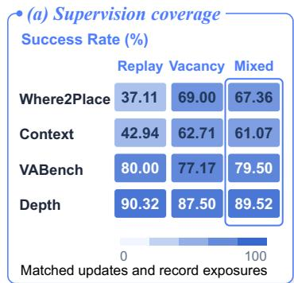

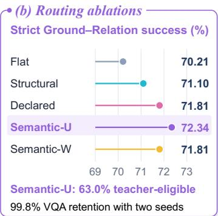

<table><tr><td colspan="4">(c) Failure-resolved repair 885 shared failures · one call each</td></tr><tr><td>Failure</td><td>Cases</td><td>Retry</td><td>Named</td></tr><tr><td>I Grounding</td><td>761</td><td>7</td><td>42</td></tr><tr><td>I Depth order</td><td>78</td><td>2</td><td>65</td></tr><tr><td>I Typed fields</td><td>33</td><td>2</td><td>3</td></tr><tr><td>I Serialization</td><td>13</td><td>0</td><td>1</td></tr><tr><td>Correct records</td><td></td><td>11</td><td>111</td></tr><tr><td>GPU-hours</td><td></td><td>2.77</td><td>2.82</td></tr><tr><td>Correct / GPU-h</td><td></td><td>3.98</td><td>39.38</td></tr></table>

Figure 3: Controlled tests of coverage, routing, and repair. (a) Coverage matrix at matched updates and record exposures (Context: RoboSpatial; Depth: BLINK). (b) Routing controls at matched maximum rollout budgets (U: uniform; W: weighted). (c) Correct repairs by failure type, using the same 885 candidates and one call each.

## 4.2 SPATIAL INTELLIGENCE ASSESSMENT AND COVERAGE

Observation 1: heterogeneous supervision transfers to spatial reasoning and pointing. We first ask whether ANVIL-MOPD improves both spatial understanding and interaction-relevant prediction (RQ1). Across the seven public benchmarks in Table 1, the final checkpoint achieves a 74.27% mean, exceeding QWEN3.5-9B by 9.29 points. On EmbSpatial, it outperforms Qwen3-VL-8B and RynnBrain-8B by 3.47 and 2.56 points, respectively, showing gains over both general-purpose and embodied baselines. Excluding VABench-Point, the mean improvement over the base is 4.45 points. The gains span spatial judgments and location prediction, with a regression on RefSpatial. In a preliminary control study with a source-filtered model, we test whether pointing gains rely on multiple predictions. Scoring only the first point on the common 286-item VABench subset retains a 34.62-point advantage over the base (Table 7), supporting a localization benefit beyond additional guesses.

## 4.3 MECHANISM ABLATIONS

Observation 2: targeted coverage improves adaptation, while replay mitigates forgetting. We use preliminary controlled studies to isolate three decisions: which supervision to add, where to apply teacher correction, and how to repair rejected outputs (RQ2). Mixed training improves Where2Place over replay by 30.25 points across two seeds and also benefits RoboSpatial context (Figure 3a). Fixed updates and exposures separate these gains from simply training longer; increasing the decoding budget alone does not recover placement performance. Vacancy-only training favors placement, while replay better preserves pointing and depth. This trade-off motivates targeting ANVIL-GEN at missing capabilities while retaining replay. Mixed training does not improve every task, and unique images and realized tokens remain unmatched (Appendix C).

Observation 3: selective teacher correction improves transfer with limited retention loss. We test where teachers should intervene. With common initialization and a matched maximum rollout budget, semantic-uniform routing improves strict Ground–Relation success over flat distillation by 2.13 points (Figure 3b). Semantic references expose incorrect but well-formed geometry that structural checks miss. Teacher supervision reaches 63.00% of sampled responses, while reference learning covers all active stages, with 99.83% general-VQA retention. The contrast supports selective correction over flat distillation.

Observation 4: failure-specific feedback improves repair yield at comparable cost. We test whether failure-specific information improves repair. Using Qwen3.6-27B as the repair model, both arms receive the same 885 rejected candidates and one call per candidate. Named feedback recovers 10.09× as many source-correct records as generic retry at comparable GPU cost (Figure 3c). It identifies the failed category without reference coordinates or ranks, preserving the task while localizing correction. Recovery concentrates on depth ordering; grounding remains harder to repair.

Together, these controls support organizing supervision around capability gaps, localizing teacher correction, and using explicit failure information to recover usable training targets.

## 4.4 QUALITATIVE ANALYSIS AND PRODUCTION EFFICIENCY

Figure 4 shows how the preceding mechanisms change individual outputs. In panel (a), adaptation moves placement predictions into the reference region; for the chair example, all three original predictions miss that region. In panel (b), feedback corrects the depth order of the coffee maker and sink while preserving their boxes. The latter case illustrates how an error can be localized to Relation while retaining the Ground output. These selected cases explain the form of the correction; the ablations measure its aggregate benefit, and Appendix E includes a placement regression.

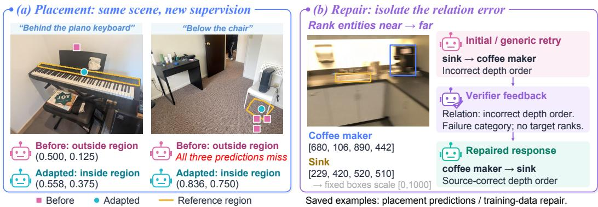  
Figure 4: Qualitative examples of coverage adaptation and targeted repair. (a) Saved placement predictions before and after adaptation (square: before; circle: adapted; yellow: reference region). (b) Verifier feedback guides a depth-order correction while object boxes remain unchanged. Selected successes illustrate the mechanisms, not their frequency.

Observation 5: source evidence amortizes supervision construction. We next examine where supervision production incurs computational cost (RQ3). From 9,608 prepared RGB-D frames, eight CPU workers construct 2,463 linked records in 325.25 seconds without generative annotation. Registered depth and instance geometry provide the shared references needed to link Ground and Relation targets. A separate pass rechecks 598,891 stored records in 13.26 seconds, covering reading, parsing, hashing, and rule evaluation across four shards (Appendix E). These measurements show that available source evidence supports both target construction and large-scale structural checking with CPU computation. They are component timings: source preparation, image loading during rechecking, and semantic review remain outside the measured scope.

For candidates requiring model-based repair, the relevant efficiency measure is source-correct output per unit of computation. Normalizing the repair comparison by allocated GPU time gives 39.38 correct records per GPU-hour for named feedback and 3.98 for generic retry, a 9.90× advantage. The images, questions, and candidate pool are fixed, so this gain reflects the value of localized error information under the same repair workload. Thus, we reuse source geometry, apply inexpensive structural checks, and direct model calls to unresolved semantic errors.

The practical implication is to allocate computation according to the evidence available for each record. Source-supported targets can be constructed and checked directly; unresolved candidates receive model-based adjudication or repair. This division makes heterogeneous sources useful for different parts of the production process, rather than requiring every annotation to pass through the same generative workflow.

## 4.5 TASK STRUCTURE AND EVIDENCE DEPENDENCE

We ask whether linked-task gains survive format correction, whether predictions depend on visual and upstream evidence, and whether action judgments distinguish plans containing the same actions (RQ4). Figure 5 addresses the question through composition, visual-input, and action-order controls.

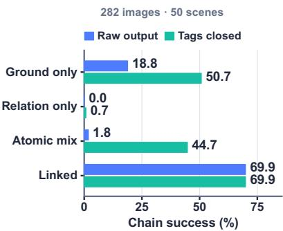  
(a) Composing spatial outputs

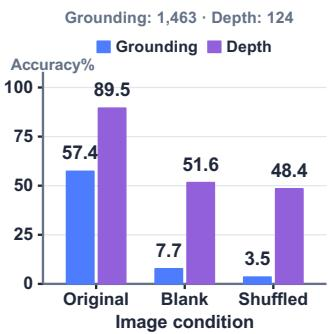  
(b) Using visual evidence

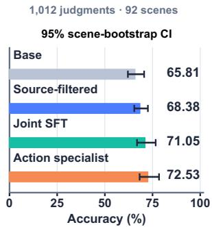  
(c) Verifying action plans  
Figure 5: Task structure and evidence dependence. (a) Linked-task success before and after closing missing stage tags, with JSON outputs unchanged. (b) Grounding and depth under original, blank, and shuffled images. (c) Plan-validity accuracy on 1,012 constructed judgments with 95% scene-bootstrap intervals. Panels use the study-specific checkpoints described in Appendix E.

Observation 6: scene-linked supervision substantially improves spatial composition. We first test whether independently learned Ground and Relation outputs compose under a shared interface. On 282 images from 50 held-out physical scenes, linked supervision reaches 69.86% strict Ground– Relation success, substantially exceeding the atomic mixture at matched updates (Figure 5a). To separate missing delimiters from errors in the predicted content, we close stage tags in the saved responses without changing their JSON outputs. This raises the atomic mixture to 44.68% while leaving linked performance unchanged. The remaining gap indicates that output syntax is only part of the composition problem. A downstream stage must also receive the correct entities and geometry from its predecessor. Scene-linked supervision trains this dependency explicitly, making intermediate outputs useful inputs to subsequent reasoning rather than merely separately correct answers.

Observation 7: spatial predictions depend on images and upstream geometry. We next examine dependence on the evidence supplied to these stages. With questions and targets fixed, blank images reduce the source-filtered model’s accuracy on the 1,463-example grounding panel from 57.35% to 7.66%. Cross-scene shuffling also degrades grounding, while BLINK-depth approaches chance (Figure 5b). Keeping images and depth targets fixed but shifting upstream boxes reduces the Relation specialist’s accuracy by 10.64 points (Table 18). In particular, errors in Ground can alter the context available to Relation even when the scene image remains fixed. These interventions establish sensitivity to both visual content and consumed geometry, motivating joint evaluation of stage accuracy and linked success.

Observation 8: action rules support state-conditioned plan verification. We extend the evaluation to action order under state constraints. From 506 ALFRED trajectories (Shridhar et al., 2020) across 92 scenes, we construct 1,012 balanced judgments, pairing each valid plan with an invalid permutation of the same actions. This fixes vocabulary and length, so action occurrence alone cannot distinguish the labels. Given the initial image, complete Boolean state, goal, and action rules, the Action specialist improves over the base by 6.72 points (Figure 5c). Class-wise results remain uneven: accuracy is 89.53% on invalid plans but only 55.53% on valid ones (Table 19). The improvement mainly comes from recognizing more valid plans, although many feasible sequences are still rejected.

Summary and discussion. The experiments suggest that spatial learning depends on how supervision is organized, not only how much is available. Coverage controls favor task-relevant additions with replay; routing controls favor localized specialist correction; and repair controls show the value of actionable failure feedback. Source-based construction complements these mechanisms by reusing available geometric evidence. Beyond aggregate benchmark gains, the composition, input, and action-order controls test whether predictions remain useful when later decisions depend on their content. These findings motivate scaling spatial supervision through capability coverage, selective correction, and explicit task dependencies.

## 5 CONCLUSION

We presented ANVIL, which connects spatial data generation, evaluation, and multi-teacher learning through knowledge recirculation. Shared scene references support cross-form verification, guide selective specialist transfer, and govern the acceptance of returned supervision. The final model improves the seven-benchmark mean by 9.29 points over its base; controlled studies support targeted coverage, selective transfer, and feedback-driven repair. Together, these findings support jointly designing reliable supervision and knowledge consolidation for embodied spatial intelligence.

## REFERENCES

Manoj Acharya, Kushal Kafle, and Christopher Kanan. TallyQA: Answering complex counting questions. In Proceedings of the AAAI Conference on Artificial Intelligence, volume 33, pp. 8076–8084, 2019. doi: 10.1609/aaai.v33i01.33018076.

Rishabh Agarwal, Nino Vieillard, Yongchao Zhou, Piotr Stanczyk, Sabela Ramos Garea, Matthieu Geist, and Olivier Bachem. On-policy distillation of language models: Learning from selfgenerated mistakes. In International Conference on Learning Representations (ICLR), 2024.

Rim Assouel, Amir Bar, Michal Drozdzal, and Adriana Romero-Soriano. PGT: Procedurally generated tasks for improving visual grounding in MLLMs. arXiv preprint arXiv:2605.23883, 2026.

BAAI RoboBrain Team, Mingyu Cao, Huajie Tan, Yuheng Ji, Minglan Lin, Zhiyu Li, Zhou Cao, Pengwei Wang, Enshen Zhou, Yi Han, Yingbo Tang, Xiangqi Xu, Wei Guo, Yaoxu Lyu, Yijie Xu, Jiayu Shi, Cheng Chi, Mengdi Zhao, Xiaoshuai Hao, Shanyu Rong, Zhengliang Cai, Bolun Zhang, Shuyi Zhang, Huaihai Lyu, Mengfei Du, Lingfeng Zhang, Xi Feng, Xiaodan Liu, Yance Jiao, Chenrui He, Mengsi Lyu, Zhuo Chen, Yulong Ao, Xue Sun, Zheqi He, Jingshu Zheng, Xi Yang, Donghai Shi, Kunchang Xie, Bochao Zhang, Shaokai Nie, Chunlei Men, Yonghua Lin, Zhongyuan Wang, Tiejun Huang, and Shanghang Zhang. RoboBrain 2.0 technical report. arXiv preprint arXiv:2507.02029, 2025. Spatial result locators use version 1, Tables 2 and 3.

Shuai Bai, Yuxuan Cai, Ruizhe Chen, Keqin Chen, Xionghui Chen, Zesen Cheng, Lianghao Deng, Wei Ding, Chang Gao, Chunjiang Ge, Wenbin Ge, Zhifang Guo, Qidong Huang, Jie Huang, Fei Huang, Binyuan Hui, Shutong Jiang, Zhaohai Li, Mingsheng Li, Mei Li, Kaixin Li, Zicheng Lin, Junyang Lin, Xuejing Liu, Jiawei Liu, Chenglong Liu, Yang Liu, Dayiheng Liu, Shixuan Liu, Dunjie Lu, Ruilin Luo, Chenxu Lv, Rui Men, Lingchen Meng, Xuancheng Ren, Xingzhang Ren, Sibo Song, Yuchong Sun, Jun Tang, Jianhong Tu, Jianqiang Wan, Peng Wang, Pengfei Wang, Qiuyue Wang, Yuxuan Wang, Tianbao Xie, Yiheng Xu, Haiyang Xu, Jin Xu, Zhibo Yang, Mingkun Yang, Jianxin Yang, An Yang, Bowen Yu, Fei Zhang, Hang Zhang, Xi Zhang, Bo Zheng, Humen Zhong, Jingren Zhou, Fan Zhou, Jing Zhou, Yuanzhi Zhu, and Ke Zhu. Qwen3-VL technical report. arXiv preprint arXiv:2511.21631, 2025a.

Shuai Bai, Keqin Chen, Xuejing Liu, Jialin Wang, Wenbin Ge, Sibo Song, Kai Dang, Peng Wang, Shijie Wang, Jun Tang, Humen Zhong, Yuanzhi Zhu, Mingkun Yang, Zhaohai Li, Jianqiang Wan, Pengfei Wang, Wei Ding, Zheren Fu, Yiheng Xu, Jiabo Ye, Xi Zhang, Tianbao Xie, Zesen Cheng, Hang Zhang, Zhibo Yang, Haiyang Xu, and Junyang Lin. Qwen2.5-VL technical report. arXiv preprint arXiv:2502.13923, 2025b.

Nils Blank, Paul Mattes, Maximilian Xiling Li, Jakub Suliga, Thomas Roth, Moritz Reuss, Pankhuri Vanjani, and Rudolf Lioutikov. SPARC: Reliable spatial annotations from robot demonstrations at scale. arXiv preprint arXiv:2606.13497, 2026.

Zhongang Cai, Ruisi Wang, Chenyang Gu, Fanyi Pu, Junxiang Xu, Yubo Wang, Wanqi Yin, Zhitao Yang, Chen Wei, Tongxi Zhou, Qingping Sun, Hui En Pang, Jiaqi Li, Oscar Qian, Zhiqian Lin, Xuanke Shi, Kewang Deng, Xiaoyang Han, Zukai Chen, Xiangyu Fan, Hanming Deng, Lewei Lu, Liang Pan, Bo Li, Ziwei Liu, Quan Wang, Dahua Lin, and Lei Yang. Scaling spatial intelligence with multimodal foundation models. In Proceedings ofthe IEEE/CVF Conference on Computer Vision and Pattern Recognition (CVPR), pp. 7879–7890, 2026.

Boyuan Chen, Zhuo Xu, Sean Kirmani, Brian Ichter, Dorsa Sadigh, Leonidas Guibas, and Fei Xia. SpatialVLM: Endowing vision-language models with spatial reasoning capabilities. In IEEE/CVF Conference on Computer Vision and Pattern Recognition (CVPR), pp. 14455–14465, 2024.

Kaiyuan Eric Chen, Shuangyu Xie, Zehan Ma, Pannag Sanketi, and Ken Goldberg. Robo2VLM: Improving visual question answering using large-scale robot manipulation data. In Advances in Neural Information Processing Systems (NeurIPS), Datasets and Benchmarks Track, 2025. doi: 10.52202/085713-0733.

An-Chieh Cheng, Hongxu Yin, Yang Fu, Qiushan Guo, Ruihan Yang, Jan Kautz, Xiaolong Wang, and Sifei Liu. SpatialRGPT: Grounded spatial reasoning in vision-language models. In Advances in Neural Information Processing Systems, volume 37, 2024. doi: 10.52202/079017-4293.

Ronghao Dang, Jiayan Guo, Bohan Hou, Sicong Leng, Kehan Li, Xin Li, Jiangpin Liu, Yunxuan Mao, Zhikai Wang, Yuqian Yuan, Minghao Zhu, Xiao Lin, Yang Bai, Qian Jiang, Yaxi Zhao, Minghua Zeng, Junlong Gao, Yuming Jiang, Jun Cen, Siteng Huang, Liuyi Wang, Wenqiao Zhang, Chengju Liu, Jianfei Yang, Shijian Lu, and Deli Zhao. RynnBrain: Open embodied foundation models. arXiv preprint arXiv:2602.14979, 2026. Result locators use version 1, Table 3.

Matt Deitke, Christopher Clark, Sangho Lee, Rohun Tripathi, Yue Yang, Jae Sung Park, Mohammadreza Salehi, Niklas Muennighoff, Kyle Lo, Luca Soldaini, Jiasen Lu, Taira Anderson, Erin Bransom, Kiana Ehsani, Huong Ngo, YenSung Chen, Ajay Patel, Mark Yatskar, Chris Callison-Burch, Andrew Head, Rose Hendrix, Favyen Bastani, Eli VanderBilt, Nathan Lambert, Yvonne Chou, Arnavi Chheda, Jenna Sparks, Sam Skjonsberg, Michael Schmitz, Aaron Sarnat, Byron Bischoff, Pete Walsh, Chris Newell, Piper Wolters, Tanmay Gupta, Kuo-Hao Zeng, Jon Borchardt, Dirk Groeneveld, Crystal Nam, Sophie Lebrecht, Caitlin Wittlif, Carissa Schoenick, Oscar Michel, Ranjay Krishna, Luca Weihs, Noah A. Smith, Hannaneh Hajishirzi, Ross Girshick, Ali Farhadi, and Aniruddha Kembhavi. Molmo and PixMo: Open Weights and Open Data for State-of-the-Art Vision-Language Models. In Proceedings ofthe IEEE/CVF Conference on Computer Vision and Pattern Recognition (CVPR), pp. 91–104, June 2025.

Danny Driess, Fei Xia, Mehdi S. M. Sajjadi, Corey Lynch, Aakanksha Chowdhery, Brian Ichter, Ayzaan Wahid, Jonathan Tompson, Quan Vuong, Tianhe Yu, Wenlong Huang, Yevgen Chebotar, Pierre Sermanet, Daniel Duckworth, Sergey Levine, Vincent Vanhoucke, Karol Hausman, Marc Toussaint, Klaus Greff, Andy Zeng, Igor Mordatch, and Pete Florence. PaLM-E: An embodied multimodal language model. In Proceedings of the 40th International Conference on Machine Learning, volume 202 of Proceedings ofMachine Learning Research, pp. 8469–8488. PMLR, 2023.

Mengfei Du, Binhao Wu, Zejun Li, Xuanjing Huang, and Zhongyu Wei. EmbSpatial-Bench: Benchmarking spatial understanding for embodied tasks with large vision-language models. Proceedings of the Annual Meeting of the Association for Computational Linguistics (ACL), 2024.

Xingyu Fu, Yushi Hu, Bangzheng Li, Yu Feng, Haoyu Wang, Xudong Lin, Dan Roth, Noah A. Smith, Wei-Chiu Ma, and Ranjay Krishna. Blink: Multimodal large language models can see but not perceive. In European Conference on Computer Vision, 2024.

Huan-ang Gao, Haohan Chi, Yong Yan, Shiyuan Feng, Hanlin Wu, Zheng Jiang, Bingxiang He, Wei-Ying Ma, Ya-Qin Zhang, and Hao Zhou. Open-MOPD: Diagnosing and fixing capability imbalance in multi-teacher on-policy distillation. arXiv preprint arXiv:2608.19098, 2026.

Google DeepMind. Embodied reasoning question answering benchmark. Official ERQA dataset and evaluation repository, 2025. URL https://github.com/embodiedreasoning/ERQA.

Yash Goyal, Tejas Khot, Douglas Summers-Stay, Dhruv Batra, and Devi Parikh. Making the v in VQA Matter: Elevating the Role of Image Understanding in Visual Question Answering. In Proceedings of the IEEE Conference on Computer Vision and Pattern Recognition (CVPR), July 2017.

Yuxian Gu, Li Dong, Furu Wei, and Minlie Huang. MiniLLM: Knowledge distillation of large language models. In International Conference on Learning Representations (ICLR), 2024.

Xiaoshuai Hao, Lei Zhou, Zhijian Huang, Zhiwen Hou, Yingbo Tang, Lingfeng Zhang, Guang Li, Zheng Lu, Shuhuai Ren, Xianhui Meng, Yuchen Zhang, Jing Wu, Jinghui Lu, Chenxu Dang, Jiayi Guan, Jianhua Wu, Zhiyi Hou, Hanbing Li, Shumeng Xia, Mingliang Zhou, Yinan Zheng, Zihao Yue, Shuhao Gu, Hao Tian, Yuannan Shen, Jianwei Cui, Wen Zhang, Shaoqing Xu, Bing Wang, Haiyang Sun, Zeyu Zhu, Yuncheng Jiang, Zibin Guo, Chuhong Gong, Chaofan Zhang, Wenbo Ding, Kun Ma, Guang Chen, Rui Cai, Diyun Xiang, Heng Qu, Fuli Luo, Hangjun Ye, and Long Chen. MiMo-Embodied: X-embodied foundation model technical report. arXiv preprint arXiv:2511.16518, 2025. Result locators use version 1, Tables 2 and 3.

Xixiang He, Xingming Li, Baiqi Wu, Qiyao Sun, Xuanyu Ji, Ao Cheng, and Qingyong Hu. Learn from whoever is right: Answer-verified multi-teacher distillation for multi-domain LLMs. arXiv preprint arXiv:2609.02548, 2026.

Geoffrey Hinton, Oriol Vinyals, and Jeff Dean. Distilling the knowledge in a neural network. arXiv preprint arXiv:1503.02531, 2015.

Yushi Hu, Otilia Stretcu, Chun-Ta Lu, Krishnamurthy Viswanathan, Kenji Hata, Enming Luo, Ranjay Krishna, and Ariel Fuxman. Visual program distillation: Distilling tools and programmatic reasoning into vision-language models. In IEEE/CVF Conference on Computer Vision and Pattern Recognition (CVPR), 2024.

Ruihan Jin, Pengpeng Shao, Zhengqi Wen, Jinyang Wu, Mingkuan Feng, Shuo Yang, Chu Yuan Zhang, and Jianhua Tao. Exploring knowledge purification in multi-teacher knowledge distillation for LLMs. In International Conference on Learning Representations (ICLR), 2026.

Justin Johnson, Bharath Hariharan, Laurens van der Maaten, Li Fei-Fei, C. Lawrence Zitnick, and Ross Girshick. CLEVR: A Diagnostic Dataset for Compositional Language and Elementary Visual Reasoning. In Proceedings ofthe IEEE Conference on Computer Vision and Pattern Recognition (CVPR), July 2017.

Yuanchen Ju, Yongyuan Liang, Yen-Jen Wang, Gireesh Nandiraju, Yuanliang Ju, Seungjae Lee, Qiao Gu, Elvis Hsieh, Furong Huang, and Koushil Sreenath. MomaGraph: State-aware unified scene graphs with vision-language models for embodied task planning. In International Conference on Learning Representations (ICLR), 2026. Oral.

Amita Kamath, Jack Hessel, and Kai-Wei Chang. What’s “up” with vision-language models? investigating their struggle with spatial reasoning. In Proceedings ofthe 2023 Conference on Empirical Methods in Natural Language Processing, pp. 9161–9175. Association for Computational Linguistics, 2023. doi: 10.18653/v1/2023.emnlp-main.568.

Moo Jin Kim, Karl Pertsch, Siddharth Karamcheti, Ted Xiao, Ashwin Balakrishna, Suraj Nair, Rafael Rafailov, Ethan P Foster, Pannag R Sanketi, Quan Vuong, Thomas Kollar, Benjamin Burchfiel, Russ Tedrake, Dorsa Sadigh, Sergey Levine, Percy Liang, and Chelsea Finn. OpenVLA: An opensource vision-language-action model. In Proceedings of The 8th Conference on Robot Learning, volume 270 of Proceedings ofMachine Learning Research, pp. 2679–2713. PMLR, 2025.

Yoon Kim and Alexander M. Rush. Sequence-level knowledge distillation. In Proceedings ofthe 2016 Conference on Empirical Methods in Natural Language Processing, pp. 1317–1327, Austin, Texas, November 2016. Association for Computational Linguistics. doi: 10.18653/v1/D16-1139.

Jahyun Koo, Yerin Hwang, Yongil Kim, Taegwan Kang, Hyunkyung Bae, and Kyomin Jung. SWITCH: Studying with teacher for knowledge distillation of large language models. In Findings of the Association for Computational Linguistics: NAACL 2025, pp. 3733–3746, 2025. doi: 10.18653/v1/2025.findings-naacl.206.

Bo Li, Yuanhan Zhang, Liangyu Chen, Jinghao Wang, Fanyi Pu, Jingkang Yang, Chunyuan Li, and Ziwei Liu. MIMIC-IT: Multi-Modal In-Context Instruction Tuning. arXiv preprint arXiv:2306.05425, 2023.

Enhan Li, Junhao He, and Hongyang Du. CROP: Task relevance via counterfactuals for selective on-policy distillation. arXiv preprint arXiv:2608.13387, 2026a.

Hongxing Li, Dingming Li, Zixuan Wang, Yuchen Yan, Hang Wu, Wenqi Zhang, Yongliang Shen, Weiming Lu, Jun Xiao, and Yueting Zhuang. SpatialLadder: Progressive training for spatial reasoning in vision-language models. In International Conference on Learning Representations (ICLR), 2026b.

Kehan Li, Bohan Hou, Minghao Zhu, Tianyi Zhang, Zesen Cheng, Zhikai Wang, Sicong Leng, Xin Li, Xiao Lin, Biying Yao, Minghua Zeng, Jiangpin Liu, Ronghao Dang, Jiayan Guo, Siteng Huang, Haoyu Zhao, Heng Ping, Yaxi Zhao, Tong Zhao, Kexiang Wang, Tong Lu, Shengke Xue, Jiahao Tang, Yulei Wang, Zejing Wang, Jianwei Gao, Shijian Lu, Chengju Liu, Jianfei Yang, Mingxiu Chen, and Deli Zhao. RynnBrain 1.1: Towards more capable and generalizable embodied foundation model. arXiv preprint arXiv:2607.17977, 2026c.

Hunter Lightman, Vineet Kosaraju, Yura Burda, Harri Edwards, Bowen Baker, Teddy Lee, Jan Leike, John Schulman, Ilya Sutskever, and Karl Cobbe. Let’s verify step by step. In International Conference on Learning Representations (ICLR), 2024.

Fangyu Liu, Guy Emerson, and Nigel Collier. Visual spatial reasoning. Transactions ofthe Association for Computational Linguistics, 11:635–651, 2023. doi: 10.1162/tacl\_a\_00566.

Junze Liu, Kun Qian, Florian Dubost, Kai Zhong, Arvind Srinivasan, Nan Chen, Anping Wang, Sam Zhang, Alejandro Mottini, Qingjun Cui, and Tian Wang. 3D primitives are a spatial language for VLMs. arXiv preprint arXiv:2605.12586, 2026a.

Ruiqi Liu, Xiaolei Lv, Gengsheng Li, Ximo Zhu, Zhiheng Wang, Zhengbo Zhang, Junkai Chen, Zhiheng Li, Bo Li, Jun Gao, and Shu Wu. Visual-advantage on-policy distillation for visionlanguage models. arXiv preprint arXiv:2605.21924, 2026b.

Yi Liu, Sukai Wang, Dafeng Wei, Xiaowei Cai, Linqing Zhong, Jiange Yang, Guanghui Ren, Jinyu Zhang, Maoqing Yao, Chuankang Li, Xindong He, Liliang Chen, and Jianlan Luo. Unified embodied VLM reasoning with robotic action via autoregressive discretized pre-training. arXiv preprint arXiv:2512.24125, 2025.

Yicheng Liu, Zibin Dong, Baijun Ye, Tianyuan Yuan, Tao Jiang, Anqi Yang, Shicheng Cao, Haonan Liu, Yue Sun, Zihan Guo, Xiao Liu, Dong Ke, Changxun Pan, Chenru Wu, Tailai Cheng, Xiaoshu Ren, Xinlei Zhang, Jianning Cui, Zijie Zhao, Haoyu Zhang, Kaiming Xu, Haodong Yang, Bowen Zhang, Jiahui Niu, Shaoting Zhu, Shiduo Zhang, and Hang Zhao. G0.5: One autoregressive stream for robot reasoning and action. arXiv preprint arXiv:2608.11739, 2026c.

Liang Ma, Jiajun Wen, Min Lin, Rongtao Xu, Xiwen Liang, Bingqian Lin, Jun Ma, Yongxin Wang, Ziming Wei, Haokun Lin, Mingfei Han, Meng Cao, Bokui Chen, Ivan Laptev, and Xiaodan Liang. Phyblock: A progressive benchmark for physical understanding and planning via 3d block assembly, 2025.

Wenhan Ma, Jianyu Wei, Liang Zhao, Hailin Zhang, Bangjun Xiao, Lei Li, Qibin Yang, Bofei Gao, Yudong Wang, Rang Li, Jinhao Dong, Zhifang Sui, and Fuli Luo. MOPD: Multi-teacher on-policy distillation for capability integration in LLM post-training. arXiv preprint arXiv:2606.30406, 2026a.

Yingzi Ma, Zichen Zhu, Ming Jiang, and Chaowei Xiao. One student, many teachers: Multi-task on-policy distillation via soft-prompt privileged context. arXiv preprint arXiv:2607.18293, 2026b.

Kenneth Marino, Mohammad Rastegari, Ali Farhadi, and Roozbeh Mottaghi. OK-VQA: A Visual Question Answering Benchmark Requiring External Knowledge. In Proceedings ofthe IEEE/CVF Conference on Computer Vision and Pattern Recognition (CVPR), June 2019.

Kiet T. Nguyen, Hanbo Shim, Jinwoo Kim, and Seunghoon Hong. Multi-view relational distillation for spatial reasoning with vision-language models. arXiv preprint arXiv:2608.10864, 2026.

NVIDIA. Cosmos-Reason1-7B: Physical AI common sense and embodied reasoning models. Official model card; August 2025 7B release, 2025. URL https://huggingface.co/nvidia/ Cosmos-Reason1-7B.

Octo Model Team, Dibya Ghosh, Homer Walke, Karl Pertsch, Kevin Black, Oier Mees, Sudeep Dasari, Joey Hejna, Tobias Kreiman, Charles Xu, Jianlan Luo, You Liang Tan, Lawrence Yunliang Chen, Pannag Sanketi, Quan Vuong, Ted Xiao, Dorsa Sadigh, Chelsea Finn, and Sergey Levine. Octo: An open-source generalist robot policy. In Proceedings ofRobotics: Science and Systems, Delft, Netherlands, 2024.

Jordi Pont-Tuset, Jasper Uijlings, Soravit Changpinyo, Radu Soricut, and Vittorio Ferrari. Connecting Vision and Language with Localized Narratives. In ECCV, 2020.

Qwen Team. Qwen3.5: Towards native multimodal agents. Official release and Qwen3.5-9B model card, 2026. URL https://huggingface.co/Qwen/Qwen3.5-9B.

Arijit Ray, Jiafei Duan, Ellis Brown, Reuben Tan, Dina Bashkirova, Rose Hendrix, Kiana Ehsani, Aniruddha Kembhavi, Bryan A. Plummer, Ranjay Krishna, Kuo-Hao Zeng, and Kate Saenko. SAT: Dynamic spatial aptitude training for multimodal language models. In Conference on Language Modeling, 2025.

Mengye Ren, Ryan Kiros, and Richard Zemel. Exploring Models and Data for Image Question Answering. In Advances in Neural Information Processing Systems, 2015.

Dustin Schwenk, Apoorv Khandelwal, Christopher Clark, Kenneth Marino, and Roozbeh Mottaghi. A-OKVQA: A benchmark for visual question answering using world knowledge. In European Conference on Computer Vision, 2022.

Mohit Shridhar, Jesse Thomason, Daniel Gordon, Yonatan Bisk, Winson Han, Roozbeh Mottaghi, Luke Zettlemoyer, and Dieter Fox. ALFRED: A benchmark for interpreting grounded instructions for everyday tasks. In Proceedings of the IEEE/CVF Conference on Computer Vision and Pattern Recognition, 2020.

Chan Hee Song, Valts Blukis, Jonathan Tremblay, Stephen Tyree, Yu Su, and Stan Birchfield. Robospatial: Teaching spatial understanding to 2d and 3d vision-language models for robotics. arXiv preprint arXiv:2411.16537, 2024.

Tomáš Soucek, Jean-Baptiste Alayrac, Antoine Miech, Ivan Laptev, and Josef Sivic. Look for theˇ Change: Learning Object States and State-Modifying Actions from Untrimmed Web Videos. In Proceedings ofthe IEEE Conference on Computer Vision and Pattern Recognition (CVPR), June 2022.

Alane Suhr, Stephanie Zhou, Ally Zhang, Iris Zhang, Huajun Bai, and Yoav Artzi. A corpus for reasoning about natural language grounded in photographs. In Anna Korhonen, David Traum, and Lluís Màrquez (eds.), Proceedings ofthe 57th Annual Meeting ofthe Associationfor Computational Linguistics, pp. 6418–6428, Florence, Italy, July 2019. Association for Computational Linguistics. doi: 10.18653/v1/P19-1644.

Huajie Tan, Enshen Zhou, Zhiyu Li, Yijie Xu, Yuheng Ji, Xiansheng Chen, Cheng Chi, Pengwei Wang, Huizhu Jia, Yulong Ao, Mingyu Cao, Sixiang Chen, Zhe Li, Mengzhen Liu, Zixiao Wang, Shanyu Rong, Yaoxu Lyu, Zhongxia Zhao, Peterson Co, Yibo Li, Yi Han, Shaoxuan Xie, Guocai Yao, Songjing Wang, Leiduo Zhang, Xi Yang, Yance Jiao, Donghai Shi, Kunchang Xie, Shaokai Nie, Chunlei Men, Yonghua Lin, Zhongyuan Wang, Tiejun Huang, and Shanghang Zhang. RoboBrain 2.5: Depth in sight, time in mind. arXiv preprint arXiv:2601.14352, 2026.

Shengbang Tong, Ellis Brown, Penghao Wu, Sanghyun Woo, Manoj Middepogu, Sai Charitha Akula, Jihan Yang, Shusheng Yang, Adithya Iyer, Xichen Pan, Austin Wang, Rob Fergus, Yann LeCun, and Saining Xie. Cambrian-1: A fully open, vision-centric exploration of multimodal LLMs. In Advances in Neural Information Processing Systems (NeurIPS), volume 37, pp. 87310–87356, 2024.

Homer Walke, Kevin Black, Abraham Lee, Moo Jin Kim, Max Du, Chongyi Zheng, Tony Zhao, Philippe Hansen-Estruch, Quan Vuong, Andre He, Vivek Myers, Kuan Fang, Chelsea Finn, and Sergey Levine. BridgeData V2: A dataset for robot learning at scale. In Conference on Robot Learning (CoRL), 2023.

Weiyun Wang, Zhangwei Gao, Lixin Gu, Hengjun Pu, Long Cui, Xingguang Wei, Zhaoyang Liu, Linglin Jing, Shenglong Ye, Jie Shao, Zhaokai Wang, Zhe Chen, Hongjie Zhang, Ganlin Yang, Haomin Wang, Qi Wei, Jinhui Yin, Wenhao Li, Erfei Cui, Guanzhou Chen, Zichen Ding, Changyao Tian, Zhenyu Wu, Jingjing Xie, Zehao Li, Bowen Yang, Yuchen Duan, Xuehui Wang, Zhi Hou, Haoran Hao, Tianyi Zhang, Songze Li, Xiangyu Zhao, Haodong Duan, Nianchen Deng, Bin Fu, Yinan He, Yi Wang, Conghui He, Botian Shi, Junjun He, Yingtong Xiong, Han Lv, Lijun Wu, Wenqi Shao, Kaipeng Zhang, Huipeng Deng, Biqing Qi, Jiaye Ge, Qipeng Guo, Wenwei Zhang, Songyang Zhang, Maosong Cao, Junyao Lin, Kexian Tang, Jianfei Gao, Haian Huang, Yuzhe Gu, Chengqi Lyu, Huanze Tang, Rui Wang, Haijun Lv, Wanli Ouyang, Limin Wang, Min Dou, Xizhou Zhu, Tong Lu, Dahua Lin, Jifeng Dai, Weijie Su, Bowen Zhou, Kai Chen, Yu Qiao, Wenhai Wang, and Gen Luo. InternVL3.5: Advancing open-source multimodal models in versatility, reasoning, and efficiency. arXiv preprint arXiv:2508.18265, 2025.

Ziming Wei, Bingqian Lin, Zijian Jiao, Yunshuang Nie, Liang Ma, Yuecheng Liu, Yuzheng Zhuang, and Xiaodan Liang. MineAnyBuild: Benchmarking Spatial Planning for Open-world AI Agents. In The Thirty-ninth Annual Conference on Neural Information Processing Systems Datasets and Benchmarks Track, 2025.

Qiucheng Wu, Handong Zhao, Michael Saxon, Trung Bui, William Yang Wang, Yang Zhang, and Shiyu Chang. VSP: Diagnosing the dual challenges of perception and reasoning in spatial planning tasks for MLLMs. In Proceedings ofthe IEEE/CVF International Conference on Computer Vision (ICCV), pp. 2270–2280, 2025.

Haolei Xu, Xiaowen Xu, Haiwen Hong, Zixuan Ni, Hongxing Li, Yiwen Qiu, Weiming Lu, and Yongliang Shen. Pass the baton: Trajectory-relayed on-policy distillation. arXiv preprint arXiv:2607.26057, 2026.

Jianwei Yang, Reuben Tan, Qianhui Wu, Ruijie Zheng, Baolin Peng, Yongyuan Liang, Yu Gu, Mu Cai, Seonghyeon Ye, Joel Jang, Yuquan Deng, and Jianfeng Gao. Magma: A foundation model for multimodal AI agents. In Proceedings of the IEEE/CVF Conference on Computer Vision and Pattern Recognition, pp. 14203–14214, 2025a.

Jihan Yang, Shusheng Yang, Anjali W. Gupta, Rilyn Han, Li Fei-Fei, and Saining Xie. Thinking in space: How multimodal large language models see, remember, and recall spaces. In IEEE/CVF Conference on Computer Vision and Pattern Recognition (CVPR), pp. 10632–10643, 2025b.

Kaiyu Yang, Olga Russakovsky, and Jia Deng. SpatialSense: An Adversarially Crowdsourced Benchmark for Spatial Relation Recognition. In Proceedings of the IEEE/CVF International Conference on Computer Vision (ICCV), October 2019.

Shusheng Yang, Jihan Yang, Pinzhi Huang, Ellis Brown, Zihao Yang, Yue Yu, Shengbang Tong, Zihan Zheng, Yifan Xu, Muhan Wang, Daohan Lu, Rob Fergus, Yann LeCun, Li Fei-Fei, and Saining Xie. Cambrian-S: Towards Spatial Supersensing in Video. arXiv preprint arXiv:2511.04670, 2025c.

Wentao Yuan, Jiafei Duan, Valts Blukis, Wilbert Pumacay, Ranjay Krishna, Adithyavairavan Murali, Arsalan Mousavian, and Dieter Fox. RoboPoint: A vision-language model for spatial affordance prediction in robotics. In Proceedings of The 8th Conference on Robot Learning, volume 270 of Proceedings ofMachine Learning Research, pp. 4005–4020. PMLR, 2025.

Yifu Yuan, Haiqin Cui, Yibin Chen, Zibin Dong, Fei Ni, Longxin Kou, Jinyi Liu, Pengyi Li, Yan Zheng, and Jianye Hao. From seeing to doing: Bridging reasoning and decision for robotic manipulation. In International Conference on Learning Representations, 2026.

Eric Zelikman, Yuhuai Wu, Jesse Mu, and Noah Goodman. STaR: Bootstrapping reasoning with reasoning. In Advances in Neural Information Processing Systems, volume 35, 2022.

He Zhang, Lingzhu Xiang, Haitao Lin, Zeyu Huang, Minghui Wang, Dingyan Zhong, Yubo Dong, Yihao Wu, Yongming Rao, Dongsheng Zhang, Wanjia He, Ling Chen, Kai Huang, Jiahao Chen, Sichang Su, Xumin Yu, Ziyi Wang, Chengwei Zhu, Xiao Teng, Yuchun Guo, Yufeng Zhang, Yuandong Liu, Rui Wang, Zisheng Lu, Han Hu, and Zhengyou Zhang. Hy-Embodied-0.5- VLA: From vision-language-action models to a real-world robot learning stack. arXiv preprint arXiv:2606.14409, 2026a.

Jiyao Zhang, Mingxu Zhang, Yitong Peng, Haoxuan Liu, Chenshuo Wang, Yuxing Long, Haoyang Huang, Dongjiang Li, Nan Duan, Hui Shen, and Hao Dong. Embodied3DBench: Benchmarking low-level embodied spatial intelligence of vision language models. arXiv preprint arXiv:2605.29074, 2026b.

Le Zhang, Jihan Yang, Soundarya Krishnan, Jimit Majmudar, Xiou Ge, Prasoon Puri, Prathamesh Nandkishor Saraf, Shruti Bhargava, Dhivya Piraviperumal, Yinan Ling, Cindy Pan, Hong Yu, Aishwarya Agrawal, and Bo-Hsiang Tseng. From where things are to what they are for: Benchmarking spatial-functional intelligence in multimodal LLMs. In IEEE/CVF Conference on Computer Vision and Pattern Recognition (CVPR), 2026c.

Wenqi Zhang, Mengna Wang, Gangao Liu, Huixin Xu, Yiwei Jiang, Yongliang Shen, Guiyang Hou, Zhe Zheng, Hang Zhang, Xin Li, Jiajun Liu, Weiming Lu, Peng Li, and Yueting Zhuang. Embodied-Reasoner: Synergizing Visual Search, Reasoning, and Action for Embodied Interactive Tasks. In Proceedings of the 64th Annual Meeting of the Association for Computational Linguistics (Volume 1: Long Papers), pp. 41178–41207. Association for Computational Linguistics, 2026d. doi: 10.18653/v1/2026.acl-long.1910.

Yuyou Zhang, Radu Corcodel, Chiori Hori, Anoop Cherian, and Ding Zhao. SpinBench: Perspective and rotation as a lens on spatial reasoning in VLMs. In International Conference on Learning Representations (ICLR), 2026e.

Helu Zhi, Jingjing Huang, Wang Xu, Yangbin Xu, Yibin Huang, Wanyue Zhang, Baoyang Jiang, Shirui Deng, Liang Zhu, Fangfang Li, Tiejun Zhao, Yankai Lin, and Yuan Yao. Scaling spatial reasoning in MLLMs through programmatic data synthesis. arXiv preprint arXiv:2512.16237, 2025.

Enshen Zhou, Jingkun An, Cheng Chi, Yi Han, Shanyu Rong, Chi Zhang, Pengwei Wang, Zhongyuan Wang, Tiejun Huang, Lu Sheng, and Shanghang Zhang. RoboRefer: Towards spatial referring with reasoning in vision-language models for robotics. In Advances in Neural Information Processing Systems (NeurIPS), 2025.

Yuke Zhu, Oliver Groth, Michael Bernstein, and Li Fei-Fei. Visual7W: Grounded Question Answering in Images. In Proceedings of the IEEE Conference on Computer Vision and Pattern Recognition (CVPR), June 2016.

Brianna Zitkovich, Tianhe Yu, Sichun Xu, Peng Xu, Ted Xiao, Fei Xia, Jialin Wu, Paul Wohlhart, Stefan Welker, Ayzaan Wahid, Quan Vuong, Vincent Vanhoucke, Huong Tran, Radu Soricut, Anikait Singh, Jaspiar Singh, Pierre Sermanet, Pannag R. Sanketi, Grecia Salazar, Michael S. Ryoo, Krista Reymann, Kanishka Rao, Karl Pertsch, Igor Mordatch, Henryk Michalewski, Yao Lu, Sergey Levine, Lisa Lee, Tsang-Wei Edward Lee, Isabel Leal, Yuheng Kuang, Dmitry Kalashnikov, Ryan Julian, Nikhil J. Joshi, Alex Irpan, Brian Ichter, Jasmine Hsu, Alexander Herzog, Karol Hausman, Keerthana Gopalakrishnan, Chuyuan Fu, Pete Florence, Chelsea Finn, Kumar Avinava Dubey, Danny Driess, Tianli Ding, Krzysztof Marcin Choromanski, Xi Chen, Yevgen Chebotar, Justice Carbajal, Noah Brown, Anthony Brohan, Montserrat Gonzalez Arenas, and Kehang Han. RT-2: Vision-language-action models transfer web knowledge to robotic control. In Proceedings of The 7th Conference on Robot Learning, volume 229 of Proceedings ofMachine Learning Research, pp. 2165–2183. PMLR, 2023.

## A SPATIAL DATA FLYWHEEL AND NATIVE SUPERVISION

This section details the supervision interfaces introduced in Section 3.1, including native representations, scene alignment, verification, and source provenance. Routing, training, and evaluation protocols are provided in Appendices B–E.

## A.1 NATIVE INTERFACES AND SCENE ALIGNMENT

Scene alignment. Each record retains the image, instruction, entity inventory, dependencies, and native references from Section 3.1. Conversion $\bar { \mathcal { A } _ { d } } ( \xi ; E , \kappa ) \in \mathcal { V } _ { d }$ maps annotation ξ to form d using entity identities E and calibration metadata κ. Image coordinates $( u , v )$ become (1000u/W, 1000v/H).

Metric targets require supported units and calibration; relative estimates remain relative. Shared identities connect available annotations without requiring every scene to support all eleven forms or a universal sequence. The reported $G  S$ score measures composition between the grounding and spatial relationship.

Table 2: Eleven native spatial interfaces. The symbols summarize output structure; colors and family letters identify Ground (G), Relation (S), and Act (A). Each form retains its own validity conditions, while shared entity references connect available forms.
<table><tr><td>Family</td><td>Form / structure</td><td>Native target and consistency requirement</td></tr><tr><td>G Ground</td><td>□ Box</td><td>Referred entity and bounded, ordered corners.</td></tr><tr><td></td><td> $\{ \boxed { \ d } _ { i } \}$  Detection</td><td>Entity-indexed boxes with non-duplicate instances.</td></tr><tr><td></td><td> $\{ ( x _ { i } , y _ { i } ) \}$  Mask</td><td>Instance or part region consistent with its anchor.</td></tr><tr><td></td><td>• Point</td><td>Object, contact, or free-space location in a declared frame.</td></tr><tr><td>S Relation</td><td> $i \prec j$  Depth order</td><td>Shared entity set and consistent near-far ordering.</td></tr><tr><td></td><td> $d ( i , j )$  Metric comparison</td><td>Distances or comparisons with supported units.</td></tr><tr><td></td><td> $i \to j$  Direction</td><td>Relative direction with an explicit reference frame.</td></tr><tr><td></td><td> $( E , \mathcal { R } )$  Relation graph</td><td>Typed edges over the shared entity inventory.</td></tr><tr><td>A Act</td><td> $( a , p )$  Affordance</td><td>Action, functional part, and compatible contact region.</td></tr><tr><td></td><td> $( p , \mathbf { v } )$  Gripper</td><td>Contact, approach, and jaw geometry.</td></tr><tr><td></td><td> $a _ { 1 }  a _ { 2 }  \cdots$  Plan</td><td>Goal, ordered steps, entity references, and state constraints.</td></tr></table>

Native supervision examples Figure 6 expands the compact examples in Figure 2. The eight stored forms contain object boxes, multiple detections, instance polygons, surface points, depth ordering, contact regions, gripper configurations, and action plans. These examples come from an earlier reviewed pilot and illustrate the supervision interfaces; they are not predictions of ANVIL-MOPD. Three additional panels illustrate relations derived from stored image-plane geometry. Their distances use normalized image coordinates, whereas physical distances require the calibration described in Appendix A.1.

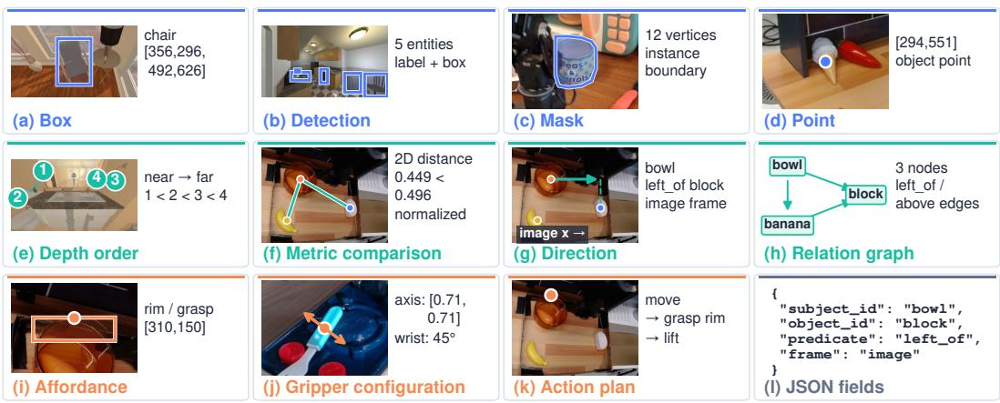  
Figure 6: Examples of native spatial supervision. Panels (a–e) and (i–k) show stored annotations from an earlier eight-form pilot. Panels (f–h) illustrate image-plane distance, direction, and graph relations derived from saved entity boxes; panel (l) shows fields rather than an additional task form. Coordinates refer to the original full image on a 0–1000 scale, including when a panel displays a crop. The examples illustrate recorded supervision and geometry-derived interfaces, rather than model predictions or executed robot trajectories.

A shared contact across native forms. The orange-bowl example links a functional region to a plan through the same contact point. The affordance record identifies the rim, while the plan names that part in its grasp step and retains the contact coordinates as its target. The following excerpts preserve the stored field values; plan preconditions and failure modes are omitted for brevity.

```jsonl
Affordance:
{"label": "rim", "affordance": "grasp",
"bbox_2d": [175,148,444,250],
"contact_point_2d": [310,150]}
Action plan:
{"goal": "pick up the orange bowl",
"steps": ["move to the orange bowl",
"grasp the rim of the bowl",
"lift the bowl upwards"],
"target_point_2d": [310,150]}
```

Matching coordinates make the dependency inspectable. Semantic review must additionally establish that the point lies on a visible contact surface and that the stated action is supported by the available evidence.

Generation constraints. The archived generation templates make geometric requirements explicit before requesting a native output. For example, the point template asks for visible object material and warns that a box center may lie in a hole or between chair legs. The mask template requires a silhouette of the same grounded entity and permits an empty output when a single polygon would include substantial background. The depth template requires visible ordering evidence and permits abstention for ambiguous pairs. These constraints provide concrete examples of how the interfaces in Table 2 enter generation.

Table 3: Representative generation constraints. Concise summaries of the archived templates; the requirements below are not additional experimental measurements.
<table><tr><td>Form</td><td>Constraint supplied to the generator</td></tr><tr><td>Visible point</td><td>Preserve the grounded entity label; select visible material rather than a box center by default; return an empty array if no unambiguous point exists.</td></tr><tr><td>Mask</td><td>Segment the same grounded entity with 8–16 nested coordinate pairs; follow its silhou- ette rather than returning box corners; abstain when one polygon cannot represent it</td></tr><tr><td>Depth order</td><td>adequately. Preserve the entity set and labels; rank near to far using visible evidence; image height or apparent size alone is insufficient.</td></tr><tr><td>Contact region</td><td>Specify a visible functional sub-part and compatible action; place the contact on material rather than an empty container interior.</td></tr><tr><td>Gripper</td><td>Use the contact proposal, an image-plane jaw axis, an approach class, and a consistent wrist angle; abstain if secure contact is unsupported.</td></tr></table>

Review interface and decision rules. The annotation tools pair the source image and spatial overlays with the candidate structured output. The review view exposes the relevant entity context and records a support decision, an error category, and an optional explanation. Unsupported decisions require an error category. Stable sample identifiers and saved label snapshots bind each decision to the image and candidate that were reviewed.

The archived review protocol specifies separate initial judgments followed by adjudication of disagreements. It also distinguishes operational inspection, which may display automatic verification status, from the initial review view, which omits model confidence and another reviewer’s decision. Updating an image, target, or task definition requires reviewing the affected candidate again rather than transferring its previous decision.

Review decisions and automatic admission results have different denominators. Stored pilot judgments describe the candidates in that pilot; a held-out audit must use the sample identities and protocol of that held-out partition.

Table 4: Decision rules used to inspect spatial candidates. The checks concern the visible evidence and the declared task. A valid serialization alone does not establish semantic support.
<table><tr><td>Target</td><td>Evidence to inspect</td><td>Reason to withhold or reject</td></tr><tr><td>Box / detection</td><td>Identity and visible extent of the requested entity.</td><td>Wrong instance, omitted material parts, or duplicated detections.</td></tr><tr><td>Mask / point</td><td>Visible object material and its boundary.</td><td>Background inside a polygon; a point in a hole or behind an occluder.</td></tr><tr><td>Depth order</td><td>Occlusion, contact layering, or a sup- ported perspective cue.</td><td>A reversed pair or insufficient evidence to order it.</td></tr><tr><td>Affordance / gripper</td><td>Named contact part, contact point, and jaw geometry.</td><td>A grasp in empty container space or on an unsupported contact surface.</td></tr><tr><td>Action plan</td><td>Referenced entities, stated preconditions, and ordered steps.</td><td>Inapplicable actions or a target inconsis- tent with the named contact.</td></tr></table>

Concrete rejection cases. The stored judgments include cases in which individually well-formed outputs fail a physical or semantic check. In one pot scene, an affordance names the rim while its contact point lies in the dark opening. The gripper record and action plan reuse that location. Agreement across the three outputs therefore preserves the same unsupported contact. In another scene, a proposed grasp targets the center of a sticker adhered to a board, without a pinchable edge. A grounding example identifies a lamp but omits its visible base. These cases motivate inspecting the referenced entity and contact surface in addition to checking the output fields.

Source provenance and benchmark scope. ANVIL-GEN constructs 5.8M source-grounded records over 160K images: 5.336M spatial records and 464K QA replay records. We reserve 580K spatial records for held-out evaluation and use 5.22M records for training, including all QA replay. Evaluation targets remain outside training and feedback. Table 5 summarizes the source families. The controlled studies use task-specific evaluation panels: 1,463 box/point examples, 1,024 masks, 282 linked images from 50 scenes, and 1,012 plan judgments from 92 scenes. Each reported score uses its panel’s denominator. Historical human review and the new source-grounded evaluation partition are distinct. The 1,463-example grounding panel is a model-evaluation panel, not a human audit of the 580K partition; its size does not establish a corpus-wide annotation-accuracy estimate.

Table 5: Source families and supervision roles. MIMIC-CGD denotes the CGD subset of MIMIC-IT; VSI-590K is the instruction-tuning corpus released with Cambrian-S.
<table><tr><td>Source family</td><td>Supervision role</td><td>Illustrative provenance</td></tr><tr><td>Robot video</td><td>Grounding, interaction</td><td>BridgeData V2 (Walke et al., 2023)</td></tr><tr><td>Embodied scenes</td><td>Spatial targets</td><td>RefSpatial (Zhou et al., 2025)</td></tr><tr><td>Simulation</td><td>Objects, actions, physical relations</td><td>Embodied-Reasoner (Zhang et al., 2026d); PhyBlock (Ma et al., 2025); MineAnyBuild (Wei et al., 2025)</td></tr><tr><td>Spatial imagery</td><td>Placement, spatial QA, relations</td><td>FSD (Yuan et al., 2026); SAT (Ray et al., 2025); VSI-590K (Yang et al., 2025c); SpatialSense (Yang et al., 2019)</td></tr><tr><td>Object states</td><td>State-conditioned grounding and actions</td><td>ChangeIt frames (Souček et al., 2022)</td></tr><tr><td>Pointing</td><td>Points and caption QA</td><td>PixMo (Deitke et al., 2025)</td></tr><tr><td rowspan="3">QA replay</td><td>Paired-image and compositional QA</td><td>MIMIC-CGD (Li et al., 2023); NLVR2 (Suhr et al., 2019); CLEVR (Johnson et al., 2017); TallyQA (Acharya et al.,</td></tr><tr><td>General visual QA</td><td>2019); VSR (Liu et al., 2023) Localized Narratives (Pont-Tuset et al., 2020); VQAv2 (Goyal et al., 2017); COCO-QA (Ren et al., 2015);</td></tr><tr><td></td><td>A-OKVQA (Schwenk et al., 2022); OK-VQA (Marino et al., 2019); Visual7W (Zhu et al., 2016)</td></tr></table>

Provenance, grouping, and record accounting Source conversion, model-generated candidates, and review decisions carry distinct provenance. A converted reference is supported by its source annotation or measurement; a generated candidate is associated with the generator and template version; a review decision is tied to a specific saved candidate. Geometry-derived examples additionally declare their coordinate frame and units. This distinction prevents an image-plane relation from being interpreted as a calibrated physical measurement.

Image identity, scene grouping, and target identity address different forms of duplication. Multiple native targets from the same scene remain associated with their shared group when a scene identity is available; otherwise, the grouping unit is the image, as specified in Section 3.2. A count of generated records can therefore exceed the number of images and does not count independent scenes. The figures illustrating formats are selected examples rather than a representative sample from which corpus proportions are estimated.

## B ROUTING, DISTILLATION, AND KNOWLEDGE RETURN

Stage decisions. A reached stage with malformed output or a violated native constraint has $a _ { k } = - 1$ Otherwise, its native score $s _ { k }$ fails below $\tau _ { k } - \delta _ { k }$ , passes at or above $\tau _ { k } + \delta _ { k }$ , and is uncertain between these bounds. The source-linked study uses $( \tau _ { G } , \delta _ { G } ) = ( 0 . 7 5 , 0 . 1 2 5 )$ and $( \tau _ { S } , \delta _ { S } ) = ( 0 . 5 , 0 . 2 5 )$ giving boundaries 0.625/0.875 and $0 . 2 5 / 0 . 7 5$ . Equality at the lower boundary is uncertain; equality at the upper boundary passes. Unreached stages are uncertain. The scan advances through passed stages. A definite failure selects that stage; uncertainty stops attribution without selecting a later stage. Malformed outputs use the nonempty suffix after the last valid boundary as the correction span. Reference learning remains active for every record. For linked records, distillation is omitted when the scan selects no stage or the selected correction span is empty. Atomic records use their declared family and sampled response span.

For linked tasks, a downstream stage consumes upstream fields, so an upstream error can invalidate its input context. First-fault routing therefore selects a downstream specialist only after preceding stages pass their checks. Once an upstream fault is selected, changing only later predictions cannot redirect correction.

## B.1 NORMALIZED TEACHER–TOKEN ALLOCATION

Let $\widehat { T } _ { k }$ be the sampled positions of stage $k ,$ and let $w _ { k , t }$ be nonnegative weights summing to one on a nonempty span and zero outside it. The selector jointly allocates a specialist and correction tokens:

$$
\Omega _ { k , t } = \mathbb { 1 } [ \rho ( r , \hat { z } ) = k ] w _ { k , t } , \qquad \ell _ { \mathrm { K D } } = \sum _ { k \in \mathcal { S } } \sum _ { t \in \hat { T } _ { k } } \Omega _ { k , t } D _ { \beta , t } ^ { ( k ) } .\tag{5}
$$

Here $D _ { \beta , t } ^ { ( k ) }$ compares student and teacher $q _ { k }$ on the same student prefix. The matrix $\Omega \in \mathbb { R } _ { > 0 } ^ { | \cal S | \times | \hat { z } | }$ has at most one nonzero row and total mass $e \in \{ 0 , 1 \}$ . This is the implemented allocation, not an additional trainable module.

Student and teacher distributions share the union $U _ { t }$ of teacher top-K vocabulary entries and structural tokens realized in the selected span. A residual category collects omitted probability. The resulting vectors $\tilde { p } _ { \theta , t } , \tilde { q } _ { k , t } \in \mathbb { R } ^ { | U _ { t } | + 1 }$ retain that mass. With stop-gradient sg and $m _ { t } = \beta \ : \mathrm { s g } [ \tilde { q } _ { k , t } ] + ( 1 - \beta ) \tilde { p } _ { \theta , t } ,$

$$
D _ { \beta , t } ^ { ( k ) } = \beta \operatorname { K L } ( \mathrm { s g } [ \tilde { q } _ { k , t } ] \| m _ { t } ) + ( 1 - \beta ) \operatorname { K L } ( \tilde { p } _ { \theta , t } \| m _ { t } ) , \qquad K = 1 2 8 , \quad \beta = 0 . 5 .\tag{6}
$$

Let $\kappa _ { k }$ contain structural positions (fields, coordinates, relation labels, action keywords, and delimiters). For $t \in \widehat { T } _ { k }$

$$
w _ { k , t } = \frac { 1 + \alpha \mathbb { 1 } [ t \in \mathcal { K } _ { k } ] } { \sum _ { j \in \widehat { T } _ { k } } ( 1 + \alpha \mathbb { 1 } [ j \in \mathcal { K } _ { k } ] ) } .\tag{7}
$$

Uniform and weighted variants use $\alpha = 0$ and $\alpha = 2 . \mathrm { ~ H ~ } z ^ { \star }$ serializes references and $T _ { k } ^ { \star }$ is its nonempty stage span,

$$
\ell _ { \mathrm { r e f } } ( r ) = - \frac { 1 } { | \mathcal { S } | } \sum _ { k \in \mathcal { S } } \frac { 1 } { | T _ { k } ^ { \star } | } \sum _ { t \in T _ { k } ^ { \star } } \log p _ { \theta } ( z _ { t } ^ { \star } \mid I , x , z _ { < t } ^ { \star } ) .\tag{8}
$$

The minibatch teacher loss is averaged over eligible examples and is zero when none qualify. Sampling, teachers, support selection, and routes are fixed within an update; no policy gradient passes through the sampled response. The residual probability $\textstyle 1 - \sum _ { v \in U _ { t } } p ( v )$ retains omitted mass. Teacher positions count scored logits, including distributed padding, separately from eligible responses, useful tokens, and wall time.

## B.2 WHY NORMALIZE THE CORRECTION SPAN?

For eligible responses, Ω has unit mass on the selected span. Reference learning assigns equal aggregate weight to active stages. Both normalizations control loss coefficients independently of serialization length.

The transfer term also has a length-independent bound. For $0 < \beta < 1$ , define $h ( \beta ) = - \beta \log \beta -$ $( 1 - \beta ) \log ( 1 - \beta )$ . Since $m _ { t } ( v ) \geq \beta \tilde { q } _ { k , t } ( v )$ and $m _ { t } ( v ) \geq ( 1 - \beta ) \tilde { p } _ { \theta , t } ( v )$ ,

$$
0 \leq D _ { \beta , t } ^ { ( k ) } \leq h ( \beta ) , \qquad 0 \leq \ell _ { \mathrm { K D } } \leq e h ( \beta ) .\tag{9}
$$

The upper bound follows by substituting the two mixture inequalities into the KL terms and using $\begin{array} { r } { \sum _ { k , t } \Omega _ { k , t } = e ; } \end{array}$ nonnegativity follows from KL nonnegativity. $\mathrm { \ A t \ } \beta = 0 . 5$ , it becomes e log 2 in natural-log units. This bounds loss magnitude, not gradient norms or downstream error.

## B.3 ROUND-LEVEL COUPLING

Let $\mathcal { U } _ { \mathrm { t 1 } }$ denote training sources and $\mathcal { V } ^ { ( n ) }$ the verification ensemble used in round n. The ensemble includes the strong-model verification stage and the generalist models used for cross-checking. Let $\mathcal { C } ^ { ( n + 1 ) }$ be the candidates generated or repaired with auxiliary student signals:

$$
\begin{array} { r l } & { \quad \mathcal { C } ^ { ( n + 1 ) } = \mathsf { G e n R e p a i r } ( \mathcal { U } _ { \mathrm { t r } } ; p _ { \theta ^ { ( n ) } } ) , } \\ & { \Delta \mathcal { D } ^ { ( n + 1 ) } = \{ \tilde { r } \in \mathcal { C } ^ { ( n + 1 ) } : \mathrm { A c c e p t } ( \tilde { r } ; \mathcal { V } ^ { ( n ) } ) = 1 \} , } \\ & { \quad \mathcal { D } ^ { ( n + 1 ) } = \mathcal { D } ^ { ( n ) } \cup \Delta \mathcal { D } ^ { ( n + 1 ) } , } \\ & { \quad \theta ^ { ( n + 1 ) } = \mathsf { T r a i n } _ { \Omega } \big ( \theta ^ { ( n ) } ; \mathcal { D } ^ { ( n + 1 ) } , Q ^ { ( n ) } \big ) . } \end{array}\tag{10}
$$

Here $\operatorname { A c c e p t } ( \cdot ; \mathcal { V } ^ { ( n ) } )$ applies Eq. 1 using the round’s verification ensemble, and the union counts unique records. Student signals assist candidate generation or repair, while admission remains governed by Eq. 1. The symbols distinguish the verification role of $\mathcal { V } ^ { ( n ) }$ from the distillation role of $Q ^ { ( n ) }$ . Distillation specialists remain frozen within each training run. Accepted records may support specialist refresh between runs. Evaluation targets remain outside this process; the experiments measure its component effects.

## C TRAINING AND EVALUATION PROTOCOLS

Checkpoints and study roles. The main table reports the final ANVIL-MOPD on seven public tasks; RoboSpatial provides an additional coverage control. The coverage study continues an earlier source-filtered checkpoint with replay, vacancy, or mixed supervision, while routing continues a common linked-SFT checkpoint. Composition and data-quality comparisons start from the base model. The image interventions compare the base and the earlier source-filtered ANVIL checkpoint; box interventions compare the Relation specialist and joint SFT. Plan verification additionally evaluates the Action specialist. Throughout the appendix, ANVIL <sup>†</sup> denotes the earlier source-filtered checkpoint, not thefinal main-table model. The Qwen3.6-27B repair model has a separate production role: both repair arms process the same 885 failures with one call per candidate.

Evaluation and uncertainty. Local comparisons fix prompts, decoding, and scorers; published values retain the modalities and subsets marked in the main table. Strict linked success requires valid serialization and correct dependent outputs; plan validity uses exact VALID/INVALID classification. Malformed or incomplete responses remain in the denominator. Paired scene-bootstrap intervals use 5,000 resamples, keeping all records from a sampled physical scene together and using identical scene draws for the compared models. For routing, per-image outcomes are first averaged across the two recorded seeds. The resulting intervals condition on those seeds and do not estimate variability over unobserved initializations.

Record-level aggregation on ANVIL-EVAL. The ANVIL-EVAL column in Table 1 reports the record-weighted mean over the held-out evaluation partition, excluding training-only QA replay. Let $\mathcal { D } _ { \mathrm { e v a l } } = \bar { \{ r _ { i } \} } _ { i = 1 } ^ { N _ { \mathrm { e v a l } } }$ contain $N _ { \mathrm { e v a l } } = 5 8 0 { , } 0 0 0$ records. For record $r _ { i } ,$ let $d _ { i }$ denote its native form, $\hat { y } _ { i }$ the model prediction, and $y _ { i } ^ { \star }$ the reference. Its score $s _ { i } = g _ { d _ { i } } ( \hat { y } _ { i } , y _ { i } ^ { \star } ) \in [ 0 , 1 ]$ is computed by the corresponding native-task evaluator. Malformed, missing, or incomplete predictions receive zero and remain in the denominator. The aggregate score is

$$
S _ { \mathrm { e v a l } } = \frac { 1 0 0 } { N _ { \mathrm { e v a l } } } \sum _ { i = 1 } ^ { N _ { \mathrm { e v a l } } } s _ { i } .\tag{11}
$$

Each record contributes equally, regardless of its output length. Consequently, forms contribute in proportion to their evaluated record counts; the score is not an unweighted average across the eleven forms or across scene images. The reported 65.35 for ANVIL-MOPD is this record-level aggregate, expressed on a 0–100 scale.

Controlled-panel metrics. The mechanism studies use separate task-specific panels, whose scores are reported with their own denominators rather than substituted for the aggregate ANVIL-EVAL score. For a linked evaluation of N images, strict success can be written as

$$
S _ { G  S } = { \frac { 1 0 0 } { N } } \sum _ { i = 1 } ^ { N } 1 [ \mathrm { v a l i d ~ s e r i a l i z a t i o n } _ { i } ] 1 [ \mathrm { G r o u n d ~ c o r r e c t } _ { i } ] 1 [ \mathrm { R e l a t i o n ~ c o r r e c t } _ { i } ] .\tag{12}
$$

Missing or incorrect stages contribute zero. Tag-closure analysis changes only recognition of the saved stage boundaries; it does not replace predicted geometry or relation labels. For pointing, any-point scoring succeeds when at least one returned point satisfies the task criterion, whereas first-point scoring evaluates only the first point in the same saved response. Plan accuracy uses all 1,012 judgments, with 506 examples in each class

Training configurations. Table 6 collects the optimization settings for the controlled studies. These local continuation and fresh-base runs are distinct from the final model reported in the main table.

Table 6: Optimization settings for the controlled training studies. Batch denotes the configured effective batch size in records. Coverage exposure counts and realized teacher positions are reported separately.
<table><tr><td>Study</td><td></td><td></td><td>Updates Batch Learning rate Seeds</td><td></td></tr><tr><td>Coverage continuation</td><td>303</td><td>24</td><td> $2 \times 1 0 ^ { - 5 }$ </td><td>43,44</td></tr><tr><td>Atomic / linked source SFT</td><td>512</td><td>4</td><td> $1 0 ^ { - 4 }$ </td><td>17</td></tr><tr><td>Routing continuation</td><td>256</td><td>4</td><td> $5 \times 1 0 ^ { - 6 }$ </td><td>17,23</td></tr><tr><td>Matched-size / nested-pool SFT</td><td>256</td><td>4</td><td> $1 0 ^ { - 4 }$ </td><td>17</td></tr></table>

Coverage controls. Coverage arms use LoRA rank/scaling 16/32 and share a 360-record development split. Single-source arms repeat 3,656 replay or 3,608 vacancy records to match the reported 7,264 mixed-arm row exposures. Terminal checkpoints are fixed before evaluation. Unique images and realized tokens are not matched. A representative mixed run takes 2.37 L20 GPU-hours. Repetition changes the source composition at the stated exposure budget.

Linked SFT and routing. Ground-only, Relation-only, atomic-mixture, and linked SFT use LoRA rank/scaling 64/128, dropout 0.05, a frozen vision encoder, a maximum sequence length of 3,072, and at most 1,536 image tokens. Cosine scheduling uses 3% warmup; checkpoint 512 is fixed for evaluation. Routing continues the common linked model with frozen Ground/Relation teachers, temperature 0.9, and a maximum response length of 256 tokens. Both loss coefficients equal one, $\lambda _ { \mathrm { r e f } } = \lambda _ { \mathrm { K D } } = 1$ . Flat and semantic-uniform allocation use $\alpha = 0 ;$ structural, declared, and semanticweighted variants use $\alpha = 2$ . Teacher-scored positions are measured separately (Table 10); the response-length limit is common across selectors.

Controlled repair and data-quality configurations. The local Qwen3.6-27B repair study uses greedy decoding and a 512-token limit. Both repair arms receive the original answer and one call per failed candidate. Named feedback additionally gives the first failed category, checked in the order serialization, typed fields, localization, and depth order, without reference coordinates or ranks. In the matched-size comparison, each training arm contains 1,137 records matched by physical-scene counts, with the fresh-base recipe in Table 6. Individual images and tokens can differ. The nested-pool subsets and their record counts are reported separately in Table 14.

Failure-localized repair prompt. In the controlled repair study, the named-feedback prompt appends the previous answer and the failed category to the original task. For a stored grounding failure, the added instruction is:

The verifier reports: G: localization does not match the requested entities. Correct this failure and return a complete response.

The generic-retry arm instead requests review and correction of the previous answer without naming the failed stage. Both retain the original task, and the feedback does not supply the reference boxes or target depth ranks. Aggregate repair results are reported in Table 12.

Table 7: Point-cardinality sensitivity on the common 286-item VABench subset with identical image exclusions and saved responses. †: earlier source-filtered ANVIL checkpoint.
<table><tr><td>Model</td><td>Any-point (%) First-point (%)</td><td></td></tr><tr><td>Base</td><td>42.31</td><td>36.71</td></tr><tr><td>ANVIL †</td><td>81.12</td><td>71.33</td></tr></table>

The subset excludes the union of 14 exact/near-image candidates identified against earlier corpora, identically for every model and without using correctness. This historical image-exclusion check is distinct from the scene/image partitioning used for the held-out corpus. On the full 300 cases, source-filtered and base models return 8.92 and 1.90 points per response on average, motivating the first-point comparison.

## D COMPLETE CONTROLLED COMPARISONS

## D.1 COVERAGE AND RETENTION

Table 8: Source-composition controls (%), seed 43 / seed 44. Updates and row exposures are matched; realized tokens are not. Bold identifies an arm that leads in both seeds.

<table><tr><td>Benchmark</td><td>Replay</td><td>Vacancy</td><td>Mixed</td></tr><tr><td>Where2Place</td><td>38.00 / 36.22</td><td>69.00 / 69.00</td><td>68.00 / 66.71</td></tr><tr><td>RoboSpatial context</td><td>44.14/41.74</td><td>63.11 / 62.30</td><td>62.30 / 59.84</td></tr><tr><td>VABench-Point</td><td>79.67 / 80.33</td><td>77.67 / 76.67</td><td>80.67 / 78.33</td></tr><tr><td>BLINK depth</td><td>90.32 / 90.32</td><td>86.29 / 88.71</td><td>89.52 / 89.52</td></tr><tr><td>ERQA</td><td>50.17 / 49.83</td><td>46.69 / 46.34</td><td>48.08 / 48.08</td></tr><tr><td>EmbSpatial</td><td>78.43 / 78.24</td><td>76.95 / 77.42</td><td>77.91 /77.77</td></tr></table>

Mixed supervision improves placement over replay in both runs; vacancy alone maximizes placement while weakening several retained capabilities. Mixed training does not dominate all tasks. Increasing only the source-filtered model’s Where2Place response budget from 256 to 512 changes success from 35.16% to 32.96% on the same 100 cases.

## D.2 CORRECTION-STAGE SELECTION

VQA retention compares post- and pre-distillation performance on AI2D, ScienceQA, and TextVQA panels of 309, 202, and 500 examples. A ratio can exceed 100% when a panel improves.

Semantic-uniform exceeds flat in both seeds, with a paired gain of 2.13 percentage points (95% CI: [0.39, 3.90]). Both use uniform token weights, supporting selective teacher–span allocation under common training settings. Table 9 additionally compares routing configurations and token-weighting choices; stage normalization is shared across configurations.

Table 9: Observed paired routing contrasts on strict Ground–Relation success. Differences are percentage points; 95% scene-bootstrap intervals condition on the two recorded training seeds. Per-seed values and teacher-position counts appear in Table 10.
<table><tr><td>Comparison</td><td>∆(pp)</td><td>95% CI</td></tr><tr><td>Semantic uniform — flat</td><td>+2.13</td><td>[0.39, 3.90]</td></tr><tr><td>Semantic uniform — declared</td><td>+0.53</td><td>[-0.61, 1.63]</td></tr><tr><td>Semantic weighted — uniform</td><td>-0.53</td><td>[-1.57, 0.42]</td></tr></table>

Table 10: Per-seed routing observations. Strict G→S success on 282 images / 50 scenes and sampled VQA retention, reported as seed 17 / seed 23. Teacher positions count scored logits including distributed padding; realized budgets are measured, not matched.
<table><tr><td>Method</td><td>G→S(%)</td><td>VQA ratio (%)</td><td>Teacher positions</td></tr><tr><td>Flat declared-teacher</td><td>69.50 / 70.92</td><td>100.32 / 99.96</td><td>131,334 / 131,704</td></tr><tr><td>Structural route</td><td>71.28 / 70.92</td><td>100.12 / 99.84</td><td>221 / 74</td></tr><tr><td>Declared route</td><td>71.63 / 71.99</td><td>100.43 / 99.70</td><td>56,267 / 56,449</td></tr><tr><td>Semantic (uniform)</td><td>72.70 / 71.99</td><td>99.70 / 99.97</td><td>47,648 / 48,213</td></tr><tr><td>Semantic (weighted)</td><td>71.99 / 71.63</td><td>99.77 / 99.85</td><td>48,066 / 48,130</td></tr></table>

## D.3 REPAIR YIELD AND DOWNSTREAM LEARNING

Table 11: Observed filtering counts in the shared 2,011-candidate pool. Each percentage uses all initial candidates as its denominator. Source correctness is evaluated against source references, not human precision.
<table><tr><td>Condition</td><td></td><td>Candidates retained Fraction of initial pool (%)</td></tr><tr><td>Initial candidates</td><td>2,011</td><td>100.00</td></tr><tr><td>Parseable</td><td>1,998</td><td>99.35</td></tr><tr><td>Pass typed checks</td><td>1,965</td><td>97.71</td></tr><tr><td>Source-correct</td><td>1,126</td><td>55.99</td></tr></table>

The filtering and repair denominators differ. Structural retention uses all 2,011 initial candidates; conditional source correctness after typed checks is 1,126/1,965 = 57.30%. The 885 initial failures form the repair pool. Accepting only source-correct outputs makes conditional acceptance precision 100% by construction, so that number cannot independently calibrate a verifier.

Table 12: Observed repair productivity. Both arms receive the same 885 rejected candidates and make one call per candidate. GPU-hours measure allocated accelerator time; source-correct recoveries supply the yield numerator.
<table><tr><td>Repair arm</td><td></td><td></td><td>Correct Yield (%) GPU-hours</td><td>Correct / GPU-hour</td></tr><tr><td>Generic retry</td><td>11</td><td>1.24</td><td>2.7664</td><td>3.98</td></tr><tr><td>Named feedback</td><td>111</td><td>12.54</td><td>2.8186</td><td>39.38</td></tr></table>

Named feedback recovers 111 correct records versus 11 for generic retry at similar GPU cost. Matched-size feedback training reaches 59.22% strict success versus 56.38% for raw data, a difference of 2.84 points [-1.41, 6.88]. Repair yield improves, but the downstream learning interval includes zero and nested-pool performance is nonmonotonic (Table 14).

Table 13 makes this concentration explicit: named feedback recovers 65/78 depth-order failures but only 42/761 grounding failures. The overall multiplier therefore depends on the composition and information content of the rejected pool.

A retained grounding failure. The repair logs also preserve an unsuccessful case with two picture instances. The initial response passes syntax and typed checks but fails the source-based grounding criterion, while its depth order passes. Both generic retry and named grounding feedback return the same boxes as the initial response. This case complements the successful relation repair in Figure 4: localizing a failure can guide another attempt without guaranteeing that the model will correct it. The selected cases illustrate failure modes; their frequency is assessed by the corresponding quantitative studies.

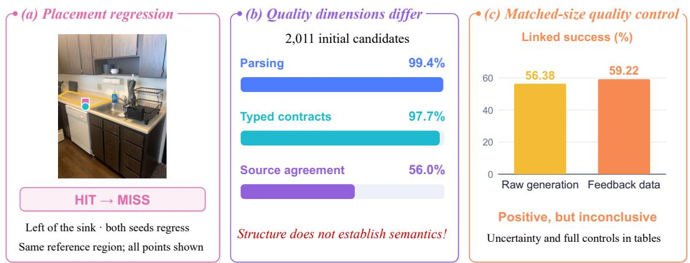

Table 13: Source-correct repairs by initial failure category. The categories partition the rejected pool according to the first failed check; each row reports recovery counts and within-category percentages in both arms.
<table><tr><td>Initial failure</td><td>Candidates</td><td>Generic retry</td><td>Named feedback</td></tr><tr><td>Serialization</td><td>13</td><td>0 (0.00%)</td><td>1 (7.69%)</td></tr><tr><td>Typed fields</td><td>33</td><td>2 (6.06%)</td><td>3 (9.09%)</td></tr><tr><td>Grounding</td><td>761</td><td>7 (0.92%)</td><td>42 (5.52%)</td></tr><tr><td>Depth order</td><td>78</td><td>2 (2.56%)</td><td>65 (83.33%)</td></tr><tr><td>Total</td><td>885</td><td>11 (1.24%)</td><td>111 (12.54%)</td></tr></table>

Cost accounting. With 885 calls per arm, the per-call yield ratio is 111/11 = 10.09. Allocated GPU time gives $( 1 1 1 / 2 . 8 1 8 6 ) / ( 1 1 \bar { / } 2 . 7 6 6 4 ) = \bar { 9 } . 9 0$ . These production costs exclude subsequent student training.

Table 14: Nested source coverage at fixed updates. Scene-stratified subsets share fresh-base initialization, 256 updates, 1,024 row exposures, and seed 17. Strict G→S success (%) uses 282 images / 50 scenes; brackets give 95% scene-bootstrap intervals. Tokens are measured.
<table><tr><td>Pool fraction</td><td>Unique records</td><td>Input tokens</td><td>Success (%)</td></tr><tr><td>25%</td><td>284</td><td>1,524,912</td><td>59.93 [49.47, 69.73]</td></tr><tr><td>50%</td><td>568</td><td>1,532,961</td><td>58.87 [48.28, 68.77]</td></tr><tr><td>100%</td><td>1,137</td><td>1,535,783</td><td>59.22 [50.00, 68.42]</td></tr></table>

At fixed updates and exposures, pool size changes the available unique records; realized tokens remain unmatched. The seed-17 results establish neither monotonic data scaling nor a reliable matched-size learning gain.

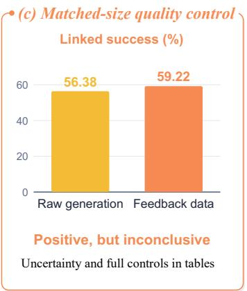  
Figure 7: Failure cases and limits of quality-based learning. (a) A saved placement example regresses after adaptation in both seeds; selected cases do not estimate failure frequency. (b) Parsing, typed validity, and source correctness all use the same 2,011 initial candidates as the denominator. Conditional source correctness among the 1,965 typed-valid records is reported separately in the text. (c) Matched-size feedback training improves the point estimate by 2.84 points, but the paired interval [−1.41, 6.88] includes zero.

## D.4 CONSTRUCTION AND RECHECKING COST

A single CPU pass reads 598,892 lines: 598,891 parse and one is malformed. Parsed records have no violations of the covered structural rules. The pass includes reading, parsing, hashing, and rule evaluation, but excludes image loading, generation, and semantic review. Conformance of retained records does not estimate raw-generation yield or corpus-wide semantic precision. Aggregate throughput is approximately 45.2K records/s. This timing study covers eight historical storage types and measures structural rechecking only. The current data flywheel generates and verifies eleven formats; model-based semantic verification is outside this CPU timing.

Table 15: Stored-record rechecking: single-run CPU wall time, no model calls.
<table><tr><td></td><td>Shard Parsed records Malformed lines</td><td></td><td>Time (s)</td></tr><tr><td>0</td><td>167,459</td><td>0</td><td>3.81</td></tr><tr><td>1</td><td>163,286</td><td>0</td><td>3.61</td></tr><tr><td>2</td><td>167,682</td><td>0</td><td>3.65</td></tr><tr><td>3</td><td>100,464</td><td>1</td><td>2.18</td></tr><tr><td>Total</td><td>598,891</td><td>1</td><td>13.26</td></tr></table>

## E TASK STRUCTURE AND EVIDENCE DEPENDENCE

Linked task construction. Eight frames from each of 1,201 ScanNet training scans give 9,608 candidates. After RGB-D extraction, eight CPU workers construct 2,463 linked records from 447 scenes in 325.25 seconds using registered depth and instance geometry. Other frames lack qualifying depth-separated pairs. Visible names identify 856 pairs; interior clicks disambiguate 1,607. Evaluation uses 282 images from 50 held-out scenes. Linked and atomic-mixture training use 3.07M and 2.79M tokens at equal updates. Closing saved stage delimiters preserves JSON contents, geometry, labels, ordering, and finish reasons. Atomic-mixture success rises from 1.77% to 44.68%; linked success remains 69.86%, leaving a 25.18-point gap. This linked-interface advantage coexists with weaker atomic-task performance (Table 16).

Table 16: Atomic and linked source training. All four arms use 512 updates and 2,048 row exposures; evaluation uses 282 images from 50 scenes. Detection and Depth use atomic-task prompts, whereas the linked columns use Ground–Relation prompts. Scores are percentages. Tags closed changes only saved closing delimiters; training tokens are recorded rather than matched. Bold marks the highest score in each column.
<table><tr><td rowspan="2">Training view</td><td colspan="2">Atomic tasks</td><td colspan="2">Linked tasks</td></tr><tr><td>Detection</td><td>Depth</td><td>Strict G→S</td><td>Tags closed</td></tr><tr><td>Ground only</td><td>84.75</td><td>0.00</td><td>18.79</td><td>50.71</td></tr><tr><td>Relation only</td><td>20.60</td><td>94.68</td><td>0.00</td><td>0.71</td></tr><tr><td>Atomic mix</td><td>84.04</td><td>94.33</td><td>1.77</td><td>44.68</td></tr><tr><td>Linked</td><td>25.71</td><td>0.00</td><td>69.86</td><td>69.86</td></tr></table>

Visual and upstream interventions. Blank inputs are constant-gray images; shuffled images come from another scene, with instructions and targets fixed. Upstream interventions replace reference boxes with predicted or shifted boxes while preserving images and depth targets. These controls establish dependence on supplied evidence, not an internal reasoning mechanism. Reference boxes provide clean context; predicted boxes expose upstream model errors; shifted boxes introduce a controlled perturbation. All three specialist–joint intervals include zero, so their point estimates do not establish a specialist advantage.

Action-order verification. Each of 506 ALFRED trajectories supplies a valid plan and an invalid permutation with identical actions and length. Models receive the initial image, complete Boolean state, goal, and source action rules. This pairing removes action occurrence as a sufficient label cue; class-wise scores expose the remaining invalid-answer bias. The Action specialist is separate from the final MOPD model. Because state and rules are supplied, the task measures state-conditioned validity rather than visual-only planning or standard ALFRED execution.

Table 17: Visual-input interventions. Full-split scores (%) with questions and targets fixed. Parentheses give sample counts; failures remain in the denominator. †: earlier source-filtered ANVIL checkpoint, not the final model.
<table><tr><td>Model</td><td>Benchmark</td><td>Original</td><td>Blank</td><td>Shuffled</td></tr><tr><td>Base</td><td>ANVIL-BENCH-G (1,463)</td><td>56.87</td><td>3.69</td><td>3.69</td></tr><tr><td>Base</td><td>BLINK (124)</td><td>90.32</td><td>48.39</td><td>47.58</td></tr><tr><td>Base</td><td>RoboSpatial (122)</td><td>44.12</td><td>2.79</td><td>1.80</td></tr><tr><td>ANVIL †</td><td>ANVIL-BENCH-G (1,463)</td><td>57.35</td><td>7.66</td><td>3.49</td></tr><tr><td>ANVIL †</td><td>BLINK (124)</td><td>89.52</td><td>51.61</td><td>48.39</td></tr><tr><td>ANVIL †</td><td>RoboSpatial (122)</td><td>33.60</td><td>0.30</td><td>4.50</td></tr></table>

Table 18: Upstream localization interventions. Depth accuracy (%) on 282 images from 50 scenes with fixed depth targets. Differences are specialist minus joint, with 95% paired scene-bootstrap intervals (5,000 draws). Both models use 512 source-SFT updates.
<table><tr><td>Upstream boxes</td><td>Relation specialist</td><td>Joint</td><td>Specialist — joint</td></tr><tr><td>Reference</td><td>94.68</td><td>94.33</td><td>+0.35 [-1.79, +2.43]</td></tr><tr><td>Student-produced</td><td>93.62</td><td>92.20</td><td>+1.42 [-1.54, +4.38]</td></tr><tr><td>Shifted</td><td>84.04</td><td>82.62</td><td>+1.42 [-2.13, +4.91]</td></tr></table>

Table 19: State-conditioned plan verification. Accuracy (%) on 1,012 balanced judgments from 506 ALFRED trajectories and 92 scenes. Each valid plan is paired with an invalid ordering of the same actions; 95% intervals resample scenes. State and rules are supplied. †: earlier source-filtered ANVIL checkpoint, not the final model. Bold marks the highest point estimate in each accuracy column.
<table><tr><td>Model</td><td>Valid</td><td>Invalid</td><td>Overall ↑</td><td>95% CI</td></tr><tr><td>Qwen3.5-9B</td><td>40.51</td><td>91.11</td><td>65.81</td><td>[62.07, 70.60]</td></tr><tr><td>ANVIL †</td><td>59.09</td><td>77.67</td><td>68.38</td><td>[65.42, 72.57]</td></tr><tr><td>Action specialist</td><td>55.53</td><td>89.53</td><td>72.53</td><td>[68.22, 78.41]</td></tr><tr><td>Joint SFT</td><td>53.56</td><td>88.54</td><td>71.05</td><td>[66.86, 76.65]</td></tr></table>

Qualitative failures and quality controls. In Figure 7, the saved “left of the sink” prediction regresses after adaptation in both seeds. The remaining panels separately measure structural validity, source correctness, and downstream learning.

## F SOURCE-NATIVE SPECIALIST PREPARATION

Table 20 compares terminal specialists with joint SFT after 1,024 LoRA updates from Qwen3.5-9B (seed 17), before MOPD. It covers all examples in the completed source-grounded forms (Appendix A.1), with matched inputs, greedy decoding, and scoring. Malformed or truncated outputs remain in the denominator. The pretrained baseline receives the same task inputs and generation budgets, with each checkpoint using its own chat template.

Depth and planning gains are task-specific. RoboBrain achieves 45/193 on affordance IoU50, above both preparation models, but all three fail the gripper-output contract. For Action, 653/3,327 baseline outputs are structurally valid; none matches the reference next-action label. Its 3,601 depth replies are JSON but fail the native contract. Strict scoring combines spatial prediction with interface and label adherence.

Table 20: Source-Native Preparation and Pretrained Baseline: Percentages, higher is better; Relation specialist for depth, Act otherwise. RoboBrain denotes RoboBrain2.5-8B-NV (Tan et al., 2026). The ALFRED rows share 3,327 examples. Reference agreement and output validity do not measure execution or grasp success.
<table><tr><td>Source</td><td>Metric ↑</td><td>N</td><td>Specialist</td><td>Joint</td><td>RoboBrain</td></tr><tr><td>PRISM</td><td>Depth agreement</td><td>3,601</td><td>91.67</td><td>88.14</td><td>0.00</td></tr><tr><td>ALFRED</td><td>Exact continuation</td><td>3,327</td><td>25.91</td><td>18.18</td><td>0.00</td></tr><tr><td>ALFRED</td><td>Next-action agreement</td><td>3,327</td><td>64.44</td><td>56.03</td><td>0.00</td></tr><tr><td>ShareRobot-Bench</td><td>Region IoU ≥ 0.5</td><td>193</td><td>5.70</td><td>6.74</td><td>23.32</td></tr><tr><td>PRISM</td><td>Valid gripper output</td><td>580</td><td>0.00</td><td>0.00</td><td>0.00</td></tr></table>

## G LIMITATIONS AND FUTURE WORK

From predefined interfaces to open-world spatial supervision. The current framework organizes supervision through eleven Ground–Relation–Act forms with explicit entities and dependencies. Open-world environments introduce spatial concepts and interaction requirements beyond this inventory. Extensible interfaces could incorporate new relations, affordances, and temporal dependencies while retaining a common basis for generation, verification, and learning. The challenge is to expand this vocabulary without losing the scene evidence supporting each target.

From specialist consolidation to compositional spatial competence. Anvil studies knowledge transfer within specified spatial tasks and stage dependencies. Future work could extend specialistto-generalist learning to unfamiliar combinations of goals, environments, and embodiments. The question is whether grounding, relational reasoning, and action knowledge can compose into reusable spatial expertise, supporting new tasks with less task-specific supervision.

From knowledge recirculation to learning through interaction. The present framework draws on curated sources and explicit verification signals. Spatial uncertainty and encountered failure could guide what an agent observes and attempts next, with physical interaction outcomes grounding the returned supervision. Connecting experience collection to specialist refinement and continued generalist learning remains a future direction: stronger spatial competence should support both better decisions and more informative data acquisition.