# SWIFT: Self-guided Weak-to-strong dIFfusion models via Target extrapolation

Yanjin He1,2,♯, Cuifeng Shen2, Wanzhou Lei2,3,♯, Maohua Li2,4,♯ Tao Lan2, Kan Liu2, Hanlin Tang†,2, Qing Qu1

1University of Michigan, Ann Arbor 2Alibaba Group 3University of California, Berkeley 4Nanjing University

## Abstract

Training high-quality difusion models is computationally expensive, and inference-time guidance often adds further sampling cost. In this work, we introduce Swift, a simple yet efective self-guided training method that uses a frozen weak denoiser to improve a stronger model without adding inference overhead. For each noisy input, Swift extrapolates the clean regression target away from the weak denoiser’s prediction, amplifying components that remain underfit. The weak guide can be an early training checkpoint, requires no backpropagation during main-model training, and is discarded afterward. The resulting model retains the original sampler and supports both conditional and unconditional generation without label dropout or an unconditional branch. We explain this mechanism through a spectral analysis of finite-time population gradient flow in an RKHS. With an early-stopped weak guide, we prove that a nonempty range of extrapolation strengths yields strictly lower posterior-mean error than matched standard training, despite shifting the regression target away from the posterior mean. Experiments on CIFAR-10 and ImageNet-256 demonstrate improvements across model scales and representations. In one ImageNet-256 configuration, Swift surpasses the baseline’s best FID using roughly half the total training compute, including guide preparation and training overhead. On RAEv2, it achieves FID 1.15 without inference-time guidance and 0.99 with guidance. These results establish target extrapolation as an efective approach to weak-to-strong difusion training with eficient single-model inference.

E-mail: yanjinhe@umich.edu, wanghaisheng.whs@alibaba-inc.com

## 1 Introduction

Difusion models have achieved strong generative performance across images, video, and audio [8, 9, 12]. They are typically trained with a simple denoising regression objective, yet many of the strongest generation results rely on guidance applied only at inference [7, 11]. In particular, autoguidance [11] shows that a deliberately weaker denoiser can improve a stronger one by defining an extrapolation direction during sampling. This suggests a broader role for weak models: rather than serving as teachers to imitate, they can provide directions along which a stronger predictor should move.

Autoguidance realizes this idea by extrapolating the strong model’s prediction away from that of a smaller or less-trained counterpart [11]. Related training-time approaches instead use evolving model predictions, intermediate supervision, or guidance-conditioned objectives [2, 28, 36, 39] (Section B). These developments motivate a simple question:

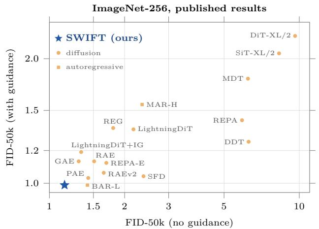

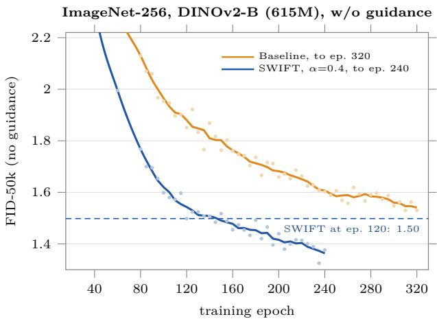  
Figure 1 Swift reaches sub-1.0 gFID on ImageNet-256. Left: FID-50K without and with inference-time guidance for representative published ImageNet-256 models and Swift (Table 8). Our RAEv2/DINOv3-L model reaches 1.15 gFID without inference-time guidance and 0.99 with retuned internal guidance (Section E.3). Right: on the matched RAE/DINOv2-B configuration [22, 30, 38], the advantage of Swift persists throughout extended training (Section E.4). Dots denote raw evaluations and lines show five-point moving averages.

## Can weak-to-strong extrapolation be moved from inference into training, so that the final denoiser itself benefits from the correction and the weak model can be discarded afterward?

We introduce Swift, a self-guided training method that uses a frozen weak denoiser to construct extrapolated regression targets. For each noisy input, instead of regressing directly toward the clean sample, Swift moves the target farther in the direction from the weak prediction toward and beyond the clean sample. The weak denoiser therefore acts as a directional reference, rather than a teacher whose output should be imitated. It can be obtained from an early checkpoint of ordinary denoising training, remains fixed during the main training run, and requires no backpropagation. After training, the guide is discarded, leaving a single denoiser and the original sampling procedure. The same construction applies to both conditional and unconditional generation.

Our motivation is finite-time underfitting: because a weak denoiser has learned less of the target function, extrapolating away from its prediction can amplify directions that remain underfit. We show theoretically that, for a nonempty range of positive extrapolation strengths, deliberately shifting the training target in this way can produce a predictor strictly closer to the original posterior mean than matched standard training (Theorem 1; proof in Section A.4).

Experiments on CIFAR-10 and ImageNet-256 show that the efect is not tied to a particular representation or model family. On ImageNet-256, Swift improves difusion models built on conventional VAE latents, representation-autoencoder latents [26, 38], end-to-end learned latent representations, and direct pixel-space generation. Across the evaluated DifusionBench configurations [16], the same fixed Swift recipe lowers unguided FID in every configuration, and the improvement persists under longer training. The complete ImageNet comparisons and training trajectories are in Sections E.1 and E.4, and the additional CIFAR-10 experiments are in Section F

Swift also remains complementary to inference-time guidance. When guidance is independently retuned for the baseline and Swift, the Swift model achieves lower FID in every tested configuration (Table 7 and Section D.2). Moreover, on RAEv2 the preferred internal-guidance scale decreases from 1.78 for the baseline to 1.20 after Swift training, while the best guided gFID improves from 1.04 to 0.99 (Figure 4(b); Section E.3). This is consistent with Swift internalizing part of the weak-to-strong correction during training while leaving additional room for inference-time guidance.

## Our contributions are:

• Weak-to-strong learning through target extrapolation. We introduce Swift, which uses a frozen weak denoiser as a directional reference to extrapolate clean-sample regression targets. The guide is fixed during main-model training and discarded at inference (Section 2.2).

• Broad improvements across diffusion representations. We demonstrate consistent gains across CIFAR-10 and ImageNet-256, spanning VAE, RAE, end-to-end latent, and pixel-space difusion models. The gains persist under longer training and remain after inference-time guidance is independently retuned (Sections 5.1 and 5.2).

• A finite-training explanation. We show theoretically that target extrapolation can strictly reduce posteriormean error relative to matched standard training over a nonempty range of positive extrapolation strengths (Section 4).

## 2 Swift: Self-Guided Training of Diffusion Models

## 2.1 Preliminaries

Denoising difusion models generate samples by reversing Gaussian corruption [8, 10]. Let $t \in [ 0 , 1 ]$ index the noise level, not the training iteration, and let $\sigma _ { t }$ increase with t. We use the additive-noise parameterization

$$
\begin{array} { r } { \pmb { x } _ { t } = \pmb { x } _ { 0 } + \pmb { \varepsilon } _ { t } , \qquad \pmb { x } _ { 0 } \sim p _ { \mathrm { d a t a } } , \qquad \pmb { \varepsilon } _ { t } \sim \mathcal { N } ( \mathbf { 0 } , \sigma _ { t } ^ { 2 } \mathbf { I } _ { d } ) . } \end{array}
$$

The noise $\varepsilon _ { t }$ is independent of $\scriptstyle { \mathbf { { \vec { x } } } } _ { 0 }$ . We write $p _ { t }$ for the distribution of $\mathbf { \Delta } _ { \mathbf { \mathcal { X } } _ { t } }$ at fixed t. When a condition c is present, it is an additional denoiser input; we suppress it below and discuss conditional and null-condition predictions in Section 3.

Training. Standard clean-sample prediction [10, 29] trains a denoiser $\mathcal { D } _ { \pmb { \theta } } ( \pmb { x } _ { t } , \sigma _ { t } )$ to predict $\scriptstyle { \mathbf { { \mathit { x } } } } _ { 0 }$ by minimizing

$$
\mathcal { L } _ { \mathrm { b a s e } } ( \pmb { \theta } ) = \mathbb { E } \left[ \lambda ( t ) \lVert \mathcal { D } _ { \pmb { \theta } } ( \pmb { x } _ { t } , \sigma _ { t } ) - \pmb { x } _ { 0 } \rVert _ { 2 } ^ { 2 } \right] ,\tag{1}
$$

where $t \sim p _ { \mathrm { n o i s e } }$ is sampled independently of $\begin{array} { r } { \pmb { x } _ { 0 } \ \sim \ p _ { \mathrm { d a t a } } . } \end{array}$ and $p _ { \mathrm { n o i s e } }$ is the distribution of noise levels used during training. The expectation also includes $\varepsilon _ { t }$ drawn as above, and $\lambda ( t ) > 0$ on the support of $p _ { \mathrm { n o i s e } }$ . With finite second moments, the unrestricted population minimizer of Eq. (1) is the posterior mean $\mathcal { D } ^ { \star } ( \pmb { x } _ { t } , \sigma _ { t } ) = \mathbb { E } [ \pmb { x } _ { 0 } \mid \pmb { x } _ { t } , t ]$ (Section A.1). For $\sigma _ { t } > 0$ , Tweedie’s formula relates it to the score [4]:

$$
\nabla _ { \pmb { x } _ { t } } \log { p _ { t } ( \pmb { x } _ { t } ) } = \frac { \mathcal { D } ^ { \star } ( \pmb { x } _ { t } , \sigma _ { t } ) - \pmb { x } _ { t } } { \sigma _ { t } ^ { 2 } } .\tag{2}
$$

Inference. With a diferentiable variance-exploding noise schedule, the probability-flow ODE is [27]

$$
d { \pmb x } _ { t } = - \dot { \sigma } _ { t } \sigma _ { t } \nabla _ { { \pmb x } _ { t } } \log p _ { t } ( { \pmb x } _ { t } ) d t .\tag{3}
$$

Sampling starts at a large noise level, where the noisy marginal can be approximated by a Gaussian, and integrates Eq. (3) toward smaller t. In practice, the score in Eq. (2) is formed using the trained denoiser $\mathcal { D } _ { \pmb { \theta } }$ in place of $\mathcal { D } ^ { \star }$ . Thus the sampler depends on the denoiser reached after finite training.

## 2.2 Proposed Method: Learning with a Frozen Weak Guide

Building on the preliminaries, we introduce Swift, which trains a denoiser using extrapolated regression targets. Instead of regressing directly onto the clean sample $\scriptstyle { \mathbf { { \mathit { x } } } } _ { 0 }$ as in Eq. (1), Swift minimizes

$$
\mathcal { L } _ { \mathrm { S W I F T } } ( \pmb { \theta } ) = \mathbb { E } \left[ \lambda ( t ) \left| \left| \mathcal { D } _ { \pmb { \theta } } ( \pmb { x } _ { t } , \sigma _ { t } ) - \pmb { y } _ { \alpha } \right| \right| _ { 2 } ^ { 2 } \right] ,\tag{4}
$$

with the same expectation and weighting as in Eq. (1), but using the extrapolated target:

$$
\boxed { y _ { \alpha } = \pmb { x } _ { 0 } + \alpha \big ( \pmb { x } _ { 0 } - \mathcal { D } _ { \mathrm { w e a k } } ( \pmb { x } _ { t } , \sigma _ { t } ) \big ) }\tag{5}
$$

Here, $\mathcal { D } _ { \mathrm { w e a k } }$ is a pretrained, frozen weak denoiser, and $\alpha \geq 0$ sets the extrapolation strength. Setting $\alpha = 0$ recovers standard denoising training. For $\alpha > 0$ , the target extends beyond the clean sample in the direction away from the weak denoiser’s prediction. Velocity-predicting models [18] apply the same extrapolation to the velocity, which is equivalent (Section D.1).

Constructing the frozen weak denoiser. We train $\mathcal { D } _ { \mathrm { w e a k } }$ in the ordinary way with Eq. (1) and freeze it before the main run. The default guide uses a smaller architecture; capacity and training-stage variants are studied separately. The default DifusionBench guide has approximately one quarter as many parameters as the main denoiser and is trained for half the main model’s standard training duration; the CIFAR-10 and RAEv2 guide checkpoints are specified in Section D.1. The method is self-guided because the correction comes from a weaker denoiser trained on the same task, without an external teacher, a separate guidance objective, or an auxiliary prediction head.

The intuition is to compensate for what ordinary training has not learned within a finite training budget. Extrapolating the clean target away from $\mathcal { D } _ { \mathrm { w e a k } }$ emphasizes directions in which the weak denoiser’s prediction remains inaccurate. Whether this improves the main denoiser’s approximation to the posterior mean depends on how those directions relate to its own finite-training error. For a frozen weak denoiser obtained by early stopping ordinary training, Section 4 and Theorem 1 establish conditions under which Swift achieves strictly lower posterior-mean error than baseline training (proofs in Section $\operatorname { A } ;$ a Gaussian-mixture illustration is in Section C).

Training and inference. During training, only the main denoiser $\mathcal { D } _ { \theta }$ is optimized with Eq. (4). The weak denoiser $\mathcal { D } _ { \mathrm { w e a k } }$ is evaluated without gradients and remains fixed. Thus, for a fixed clean sample, noise realization, and noise level, the regression target does not change as the main denoiser is updated. Beyond preparing the weak denoiser, each training step requires one additional weak-denoiser forward pass (about 9% more FLOPs on DifusionBench; Section D.3). After training, it is discarded; sampling uses the trained denoiser and the original sampler, with no additional inference-time model evaluation (Section D.2).

## 3 From Autoguidance to Self-Guided Training

A visual comparison. Following the fractal-like Gaussian-mixture example of Karras et al. [11], we compare how diferent methods reproduce a distribution with thin, branching support. In Figure 2, Swift has the lowest reported KL divergence and outlier rate and the highest reported log p among the seven methods. Relative to GFT, the strongest baseline on these three reported metrics, its KL decreases from 0.817 to 0.728, its outlier rate from 4.97% to 3.66%, and its log p increases from −0.40 to +0.08. The highlighted regions show how the generated samples follow the narrow branches.

Inference-time guidance includes classifier-free guidance (CFG) [7] and autoguidance (AG) [11]. Training-based approaches include Model Guidance (MG) [28], Segmented Guidance (SGG) [36], and Guidance-Free Training (GFT) [2]. Internal Guidance (IG) [39] trains an intermediate output for guidance at sampling time. Additional comparisons appear in Section B and Table 2.

## 3.1 From Sampling-Time Guidance to Training Targets

CFG combines conditional and unconditional predictions during sampling. AG is closer to Swift in its use of a weak denoiser. Let $\mathcal { D } _ { \mathrm { b a s e } }$ be a denoiser trained with the standard objective in Eq. (1). At the same noisy input and noise level, AG evaluates

$$
\mathcal { D } _ { \mathrm { A G } } = ( 1 + \alpha ) \mathcal { D } _ { \mathrm { b a s e } } - \alpha \mathcal { D } _ { \mathrm { w e a k } }
$$

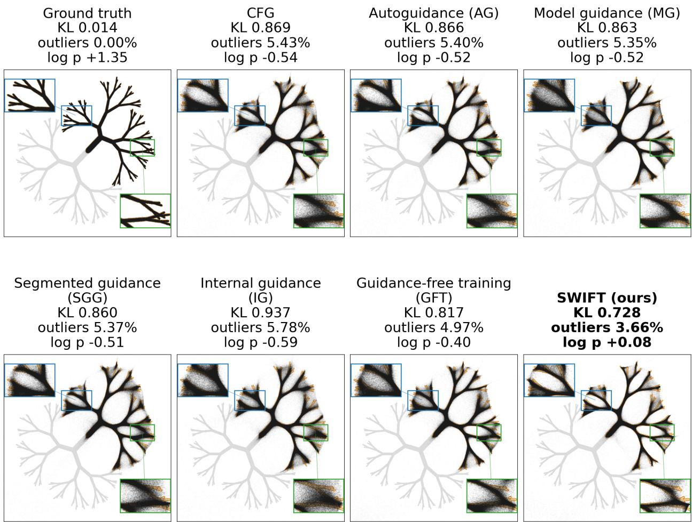  
Figure 2 Swift on a two-class, tree-shaped 2D toy distribution. Ground truth and samples from CFG, AG, MG, SGG, IG, GFT, and Swift. Each compared method uses independently tuned settings. Blue boxes mark corresponding branching regions. Lower KL and outlier rates and higher log p are better.

during sampling. This requires the weak prediction whenever AG is applied. In Eq. (5), Swift instead places the observed clean sample $\scriptstyle { \mathbf { { \mathit { x } } } } _ { 0 }$ in the position occupied by $\mathcal { D } _ { \mathrm { b a s e } }$ and uses the extrapolation as a training target. The weak denoiser is discarded after training.

Conditioned on $( \boldsymbol { x } _ { t } , t )$ , the expectation of the Swift target is

$$
( 1 + \alpha ) \mathcal { D } ^ { \star } ( { \pmb x } _ { t } , \sigma _ { t } ) - \alpha \mathcal { D } _ { \mathrm { w e a k } } ( { \pmb x } _ { t } , \sigma _ { t } ) ,
$$

the expression obtained by applying AG to the ideal posterior mean (Lemma A.1). AG extrapolates a baseline denoiser already trained for a finite time, while Swift changes the regression target before main-model training. Under the assumptions of Section 4, this change can improve approximation to the original posterior mean; it is not a guarantee for every weak denoiser.

## 3.2 Comparison with Training-Based Guidance

MG constructs a training correction using conditional and unconditional model predictions [28]. SGG studies incorporating guidance into training using an updated weak network or an intermediate prediction branch in its training-time variants [36]. GFT trains across guidance strengths using an unconditional prediction [2]. In these constructions, the auxiliary predictions can change as their models are trained. IG jointly supervises intermediate and final outputs for sampling-time guidance; it also studies training with a detached final-minus-intermediate EMA correction [39, Sec. 6].

These designs use a changing prediction in the training correction or supervise an additional output. Swift obtains $\mathcal { D } _ { \mathrm { w e a k } }$ by ordinary denoising training and freezes it before training the main denoiser. For a fixed training example and noise realization, its extrapolated target does not change as the main model is updated. This avoids joint optimization of the weak and main denoisers, which provided no clear additional endpoint benefit in our CIFAR-10 comparisons (Section F), and leaves a single denoiser at inference. Preparing and evaluating the weak denoiser still incur training compute, which our compute comparisons account for (Section D.3). Further methodological details appear in Section B and Eqs. (B.2) and (B.3).

## 4 Why Swift Can Help

We compare ordinary denoising and Swift after the same finite main-model training time. The analysis uses population gradient flow at one fixed noise level.

Assumption 1 (Population data and matched kernel training). Fix a noise level t and a noisy–clean pair $( \pmb { x } _ { 0 } , \pmb { x } _ { t } )$ with E $\| \pmb { x } _ { 0 } \| _ { 2 } ^ { 2 } < \infty$ . All runs use population expectations under the same joint law. The difusion case has ${ \pmb x } _ { t } = { \pmb x } _ { 0 } + { \pmb \varepsilon }$ , with independent $\boldsymbol \varepsilon \sim \mathcal { N } ( \mathbf 0 , \sigma _ { t } ^ { 2 } \mathbf I _ { d } )$ and $\sigma _ { t } > 0 ;$ the theorem only requires the joint law and moment condition above.

Fix a bounded, measurable, symmetric positive-semidefinite scalar kernel K. Every predictor starts from zero and follows population gradient flow for normalized squared loss in the same coordinate-wise RKHS $\mathcal { H } _ { \sf K } ^ { d }$ . Choose $0 \leq T _ { g } < T < \infty$ . An ordinary run on the clean label $\scriptstyle { \pmb x } _ { 0 } \  \}$ ields the guide at time $T _ { g } ;$ freeze it and continue the ordinary trajectory to $T$ for the baseline. Train a separate Swift predictor from zero to the same time $T ,$ , using the label $( 1 + \alpha ) \pmb { x } _ { 0 } - \alpha \pmb { { \mathcal { D } } } _ { \mathrm { w e a k } } ( \pmb { x } _ { t } )$ while the guide stays frozen. The two main runs thus share the data law, kernel, initialization, and optimization horizon.

Write $P _ { { \pmb x } _ { t } }$ for the noisy-input distribution and ${ \mathcal { D } } ^ { \star } ( { \boldsymbol { \mathbf { \mathit { x } } } } ) = \mathbb { E } [ { \boldsymbol { \mathbf { \mathit { x } } } } _ { 0 } \mid { \boldsymbol { \mathbf { \mathit { x } } } } _ { t } = { \boldsymbol { \mathbf { \mathit { x } } } } ]$ for the posterior mean. Prediction error is measured in $\mathcal { H } _ { 2 } = L ^ { 2 } ( P _ { \mathbf { x } _ { t } } ; \mathbb { R } ^ { d } )$ . The kernel couples predictions at diferent noisy inputs; a finite-feature linear predictor is one example.

Objectives and training dynamics. At the fixed noise level, ordinary training and Swift minimize

$$
\begin{array} { r l } & { \mathcal { I } _ { 0 } ( \pmb { d } ) = \frac { 1 } { 2 } \mathbb { E } \| \pmb { d } ( \pmb { x } _ { t } ) - \pmb { x } _ { 0 } \| _ { 2 } ^ { 2 } , } \\ & { \mathcal { I } _ { \alpha } ( \pmb { d } ) = \frac { 1 } { 2 } \mathbb { E } \left\| \pmb { d } ( \pmb { x } _ { t } ) - \left[ ( 1 + \alpha ) \pmb { x } _ { 0 } - \alpha \mathcal { D } _ { \mathrm { w e a k } } ( \pmb { x } _ { t } ) \right] \right\| _ { 2 } ^ { 2 } . } \end{array}\tag{6}
$$

For either loss, let y denote its regression label. Population gradient flow in the RKHS is

$$
\frac { d \pmb { d _ { s } } } { d s } = - \nabla _ { \mathcal { H } _ { \mathsf { K } } ^ { d } } \frac { 1 } { 2 } \mathbb { E } \| \pmb { d _ { s } } ( \pmb { x _ { t } } ) - \pmb { y } \| _ { 2 } ^ { 2 } , \qquad \pmb { d _ { 0 } } = \mathbf { 0 } .\tag{7}
$$

Here s is optimization time, distinct from noise level $t ;$ the fixed positive loss weight λ(t) is absorbed into s. The gradient has the explicit function form

$$
\nabla \mathcal { I } ( d ) ( \pmb { x } ) = \mathbb { E } [ \mathsf { K } ( \pmb { x } , \pmb { x } _ { t } ) ( d ( \pmb { x } _ { t } ) - \pmb { y } ) ] .\tag{8}
$$

The corresponding derivation, including the RKHS-to-prediction-space step, is in Lemma A.2.

The resulting predictors are denoted by $\mathcal { D } _ { \mathrm { w e a k } } , \mathcal { D } _ { \mathrm { b a s e } } .$ , and $\mathcal { D } _ { \mathrm { S W I F T } } ^ { ( \alpha ) }$ , respectively. The guide is weaker here through shorter training in the same RKHS; Corollary A.6 also treats a spectrally nested smaller guide.

Finite-time response. For any label y, let $\pmb { g } ( \pmb { x } ) = \mathbb { E } [ \pmb { y } \ | \ \pmb { x } _ { t } = \pmb { x } ]$ . The two conditional-mean targets are $g _ { 0 } = \mathcal { D } ^ { \star }$ and

$$
\begin{array} { r } { { \pmb g } _ { \alpha } = \mathcal { D } ^ { \star } + \alpha ( \mathcal { D } ^ { \star } - \mathcal { D } _ { \mathrm { w e a k } } ) . } \end{array}\tag{9}
$$

The latter identity and its denoising-MSE interpretation are proved in Lemma A.1. Define the population kernel operator on $\mathcal { H } _ { 2 }$ by

$$
( \pmb { \mathscr { L } } f ) ( \pmb { x } ) = \int \mathsf { K } ( \pmb { x } , \pmb { x } ^ { \prime } ) \pmb { f } ( \pmb { x } ^ { \prime } ) d P _ { \pmb { x } _ { t } } ( \pmb { x } ^ { \prime } ) .\tag{10}
$$

It is bounded, self-adjoint, and positive semidefinite. Kernel gradient flow yields

$$
\frac { d d _ { s } } { d s } = - \mathscr { L } ( d _ { s } - g ) , \qquad d _ { s } = \mathbf { H } _ { s } g , \quad \mathbf { H } _ { s } : = \mathbf { I } - e ^ { - s \mathscr { L } } .\tag{11}
$$

The response H learns a fraction $1 - e ^ { - s \kappa }$ of a kernel mode with eigenvalue $\kappa > 0$ . The operator construction and solution of the flow appear in Section A.2.

Theorem 1 (Finite-time improvement from a frozen weak denoiser). Under Assumption 1,

$$
\begin{array} { r } { \mathcal { D } _ { \mathrm { w e a k } } = \mathbf { H } _ { T _ { g } } \mathcal { D } ^ { \star } , \qquad \mathcal { D } _ { \mathrm { b a s e } } = \mathbf { H } _ { T } \mathcal { D } ^ { \star } , } \\ { \mathcal { D } _ { \mathrm { S W I F T } } ^ { ( \alpha ) } = \mathbf { H } _ { T } [ ( 1 + \alpha ) \mathcal { D } ^ { \star } - \alpha \mathcal { D } _ { \mathrm { w e a k } } ] . \qquad } \end{array}
$$

$I f \mathbf { H } _ { T } { \mathcal { D } } ^ { \star } \neq \mathbf { 0 }$ , the guide has strictly larger posterior-mean risk than the baseline. Moreover, for $R ( \alpha ) =$ $\lVert \mathcal { D } _ { \mathrm { S W I F T } } ^ { ( \alpha ) } - \mathcal { D } ^ { \star } \rVert _ { \mathcal { H } _ { 2 } } ^ { 2 }$ , there is an $\alpha ^ { \star } > 0$ such that

$$
R ( \alpha ) < R ( 0 ) \qquad ( 0 < \alpha < \alpha ^ { \star } ) .\tag{12}
$$

Section A.4 proves both claims using Theorem A.3. An earlier guide has learned less of each learnable mode; a small positive extrapolation partially cancels the baseline’s finite-time residual. The modewise calculation is Eq. (A.10), and a larger coeficient can overshoot. The result concerns population denoising MSE at equal main-model optimization time, with guide preparation excluded; it does not directly imply a FID improvement. A Gaussian-mixture example gives an explicit posterior mean (Lemma A.4), and for an RBF kernel Proposition A.5 verifies the nonzero-predictor condition. Sections A.7 and A.8 give complementary finite-step and finite-sample analyses.

## 5 Experiments

We evaluate Swift on ImageNet-256 [3] and CIFAR-10 [13]. In every experiment Swift changes only the regression target; architectures, training schedules, samplers, and evaluation pipelines are kept the same as the baseline. On ImageNet, Swift uses one fixed recipe unless stated otherwise: α=0.4 with a smaller pretrained guide frozen before main-model training. The default DifusionBench guide is trained for half the main model’s standard training duration (Section D.1).

Evaluation setup. Inspired by DifusionBench [16], we evaluate Swift across 19 ImageNet-256 model configurations. For each configuration, we compare the baseline and Swift with and without inference-time guidance, tuning both guidance strengths separately where checkpoints are available and identifying published baselines otherwise. We report FID [6], sFID [21], precision and recall [14], representation-space FDr [32], and MIND [1] where available. Table 1 shows selected results; training and evaluation settings are in Sections D.1 and D.2, with complete ImageNet-256 and CIFAR-10 results in Sections E and F.

## 5.1 Generation Quality and Transfer Across Representations

Matched improvements. Table 1 isolates the target change within each model configuration. On RAE/DINOv2-B features [22, 30, 38], Swift lowers unguided FID from 2.09 to 1.75 and the five-feature mean FDr from 4.13 to 3.69 after 80 epochs. The gain persists on the independent RAEv2/DINOv3-L configuration [26], where unguided FID improves from 1.56 to 1.15 within a 160-epoch training budget; the Swift value is selected at epoch 140 (Section D.2).

Transfer with one fixed recipe. Across 18 DifusionBench configurations spanning latent and pixel representations, one fixed recipe lowers unguided FID in every case, by 16.3%–49.4% (median 31.3%). Even the three lowest-FID baselines improve by 16.3%–17.4%. $\mathrm { F D } _ { r }$ and MIND each improve in at least 17 of 18 configurations in every feature space. Full results appear in Table 6.

Table 1 Representative ImageNet-256 results. Each pair uses the same model configuration and sampler. Guidance is tuned separately for re-evaluated pairs; source-reported guided baselines retain their published settings (Section D.2). FDr and MIND are arithmetic means across Inception, ConvNeXt, DINOv2, MAE, and SigLIP features.
<table><tr><td></td><td colspan="6">Without guidance</td><td colspan="6">With guidance</td></tr><tr><td>Family: representation</td><td>FID↓ sFID↓ FDr ↓ MIND ↓ Prec.↑ Rec.↑ FID↓ sFID↓</td><td></td><td></td><td></td><td></td><td></td><td></td><td></td><td></td><td>FDr ↓ MIND ↓ Prec.↑ Rec.↑</td><td></td><td></td></tr><tr><td colspan="9">615M parameters, 80 epochs; guidance = CFG</td><td></td><td></td><td></td><td></td></tr><tr><td>RAE: DINOv2-B</td><td>2.09</td><td>4.48</td><td>4.13</td><td>21.34</td><td>0.83</td><td></td><td>0.57 1.98</td><td>4.50</td><td>4.17</td><td>20.71</td><td>0.81</td><td>0.59</td></tr><tr><td>+ SWIFT</td><td>1.75</td><td>4.26</td><td>3.69</td><td>21.54</td><td>0.81</td><td></td><td>0.61 1.59</td><td>4.30</td><td>3.57</td><td>19.40</td><td>0.80</td><td>0.62</td></tr><tr><td>VAE: SD-VAE (EMA)+reg</td><td>5.49</td><td>5.52</td><td>11.08</td><td>87.84</td><td>0.71</td><td>0.66</td><td>2.32</td><td>4.70</td><td>7.39</td><td>32.52</td><td>0.80</td><td>0.60</td></tr><tr><td>+ SWIFT</td><td>3.77</td><td>5.06</td><td>8.44</td><td>57.83</td><td>0.73</td><td>0.66</td><td>1.81</td><td>4.42</td><td>5.93</td><td>26.15</td><td>0.80</td><td>0.61</td></tr><tr><td>E2E: Qwen-VAE</td><td>4.94</td><td>5.23</td><td>9.17</td><td>95.20</td><td>0.72</td><td>0.66</td><td>1.50</td><td>4.83</td><td>4.73</td><td>24.40</td><td>0.80</td><td>0.62</td></tr><tr><td>+ SWIFT</td><td>3.23</td><td>4.89</td><td>6.47</td><td>55.63</td><td>0.73</td><td></td><td>0.66 1.40</td><td>4.59</td><td>3.33</td><td>23.40</td><td>0.80</td><td>0.63</td></tr><tr><td>Pixel: PixNerd</td><td>20.37</td><td>6.14</td><td>24.52</td><td>384.17</td><td>0.61</td><td>0.63</td><td>4.17</td><td>5.50</td><td>9.50</td><td>42.66</td><td>0.65</td><td>0.63</td></tr><tr><td>+ SWIFT</td><td>10.31</td><td>5.38</td><td>15.28</td><td>197.54</td><td>0.70</td><td></td><td>0.61 3.38</td><td>4.95</td><td>7.75</td><td>35.12</td><td>0.68</td><td>0.62</td></tr><tr><td colspan="9">875M parameters, up to 160 epochs; guidance = i internal guidance</td><td></td><td></td><td></td><td></td></tr><tr><td>RAE: DINOv3-L</td><td>1.56</td><td>4.10</td><td>3.41</td><td>20.01</td><td>0.82</td><td>0.65</td><td>1.04</td><td>4.00</td><td>3.31</td><td>15.67</td><td>0.82</td><td>0.61</td></tr><tr><td>+ SWIFT</td><td>1.15</td><td>3.60</td><td>2.94</td><td>18.03</td><td>0.81</td><td>0.67 0.99</td><td></td><td>3.80</td><td>3.07</td><td>14.45</td><td>0.81</td><td>0.63</td></tr></table>

Compatibility with inference guidance. At the best available guidance settings, Swift also lowers guided FID in all 18 DifusionBench configurations (Table 7). On RAEv2, Swift improves internal-guidance FID from 1.04 to 0.99 (Table 1), while its unguided FID improves from 1.56 to 1.15. Representative samples from the 0.99-gFID model are shown in Figure 3; additional class-conditional samples appear in Section G.

  
Figure 3 ImageNet-256 samples from Swift on RAEv2/DINOv3-L (gFID-50K 0.99). Samples are generated with the Swift-trained model using retuned internal guidance and a 50-step ODE sampler (Section D.2).

## 5.2 Combining Swift with Inference-Time Guidance

We combine Swift with autoguidance [11] on the DifusionBench models and native internal REPA-head guidance on RAEv2 [26]. These mechanisms apply a weak-to-strong extrapolation at sampling time, whereas Swift learns a related correction during training and then discards its guide. We ask whether inference-time guidance still improves a Swift-trained model and whether Swift changes the preferred guidance strength.

(a) Guidance further improves Swift.
<table><tr><td colspan="3"></td><td rowspan="2">SWIFT+ guidance</td></tr><tr><td></td><td>Base</td><td>SWIFT Guided</td></tr><tr><td>DINOv2-B</td><td>2.09</td><td>1.75</td><td>1.70 1.63</td></tr><tr><td>SD-VAE</td><td>5.49</td><td>3.77 2.16</td><td>1.95</td></tr><tr><td>Qwen-VAE</td><td>4.94</td><td>3.23 1.79</td><td>1.62</td></tr><tr><td>PixNerd</td><td>20.37 10.31</td><td>4.02</td><td>3.77</td></tr><tr><td>RAEv2</td><td>1.56</td><td>1.15 1.04</td><td>0.99</td></tr></table>

(b) Swift shifts the guidance optimum left.  
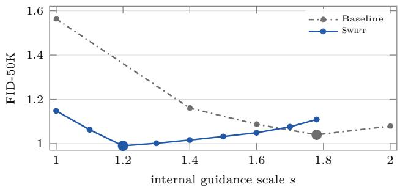  
Figure 4 Swift remains beneficial with inference-time guidance. (a) FID with autoguidance on the DifusionBench models and native internal REPA-head guidance on RAEv2. (b) On RAEv2, Swift shifts the preferred internalguidance scale from 1.78 to 1.20.

Across all five configurations in Figure 4(a), the same ordering appears. Swift improves the unguided baseline, inference-time guidance improves it further, and independently retuned guidance on top of Swift gives the best FID in every case. This shows that the improvement learned during training is not replaced by inference-time guidance: even after the baseline has been separately retuned for guidance, the Swift model retains an additional gain.

Swift also changes the preferred inference-time guidance strength. On RAEv2, the optimal internal-guidance scale shifts from 1.78 for the baseline to 1.20 for Swift, while the best guided FID improves from 1.04 to 0.99 (Figure 4(b); Section E.3). The lower preferred scale is consistent with overlap between the training-time and inference-time corrections. The remaining gain shows that inference-time guidance remains complementary to the correction learned during training.

## 5.3 Longer Training and Training Cost

The gain persists with longer training. We continue the matched DINOv2-B pair to 240 epochs. Swift is ahead at all 36 evaluations from epochs 20 to 240, with the gap growing from 0.12 to 0.26 FID, with the training-time evaluator giving 1.63 → 1.38 at epoch 240. A separate baseline continued to 320 epochs reaches at best 1.53, still above the 1.50 reached by Swift at epoch 120. The matched training-time FIDs are listed in Table 9 and plotted in Figure 10; four additional trajectories appear in Figure 9 and Section E.4.

Training cost. Swift adds 9% FLOPs per epoch for the frozen guide, plus roughly 10 baseline-equivalent epochs to pretrain it (Section D.3). For context, MG and SGG incur about 1.23× and 1.22× wall-clock time per training iteration in the unified SiT-B/2 comparison of Yuan et al. [36, Table 6], while GFT reports 10–20% additional computation per training update [2]. IG reports negligible extra sampling FLOPs [39,

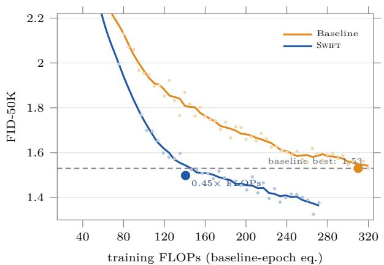  
Figure 5 Training-compute comparison on DINOv2-B. Swift surpasses the best baseline FID observed through 320 epochs using approximately 0.45× the FLOPs needed to reach that baseline checkpoint.

App. B]. Charging both of our costs, Swift at epoch 120 already surpasses the best DINOv2-B baseline result observed through 320 epochs (1.53), using approximately 0.45× the FLOPs needed to reach that baseline checkpoint (Figure 5). On RAEv2, epoch-50 Swift similarly improves on the epoch-160 baseline (1.34 vs. 1.56) at 0.44× the FLOPs (including guide preparation; Section D.3).

These time-to-quality ratios are conservative: within the observed training horizon, the baselines never reach the best Swift FID. No baseline time-to-quality is observed for those targets.

## 5.4 How to Choose α and the Weak Guide

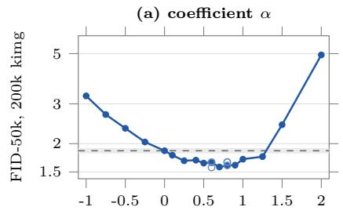

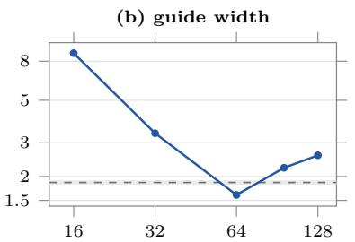  
guide channel base (student 128)

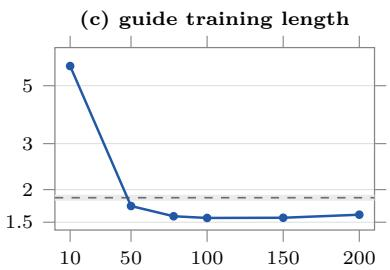  
guide snapshot (kimg, thousands)  
Figure 6 Choosing α and the weak guide on CIFAR-10. Moderate positive $\alpha , \mathrm { a }$ half-width guide, and a suficiently trained weak guide give the strongest results. The CIFAR-10 training and evaluation settings are in Sections D.1 and D.2.

Choosing α. Performance is broadly U-shaped in α (Figure 6(a)). On CIFAR-10, moderate positive values form a broad favorable region around $\alpha = 0 . 7 – 0 . 9$ , where diferences are comparable to replicate noise. ImageNet shows the same qualitative behavior: on DINOv2-B, $\alpha \in [ 0 . 5 , 1 . 0 ]$ substantially improves over the baseline. The precise optimum depends on the model, however, so our breadth experiments use the fixed default $\alpha = 0 . 4$ without tuning; in practice, a small sweep over moderate positive values is suficient. Negative α can accelerate the initial decrease in FID, but the tested negative warm starts provide no consistent final-quality advantage (Section F).

Choosing the weak guide. The guide should be weaker than the student, but still competent. At $\alpha = 0 . 8$ on CIFAR-10, reducing the channel base from the student’s 128 to 64 improves FID from 2.58 to 1.60, while substantially smaller guides degrade rapidly (Figure 6(b)). The half-width guide is also the best width across the tested α values on CIFAR-10 and consistently outperforms wider alternatives on ImageNet. Guide training length shows a similar pattern: once the guide crosses a competence threshold, performance is relatively insensitive over a broad range (Figure 6(c)). On ImageNet, freezing the guide earlier can even help, with an earlier guide outperforming the default guide in our 50k re-evaluation; the corresponding training trajectories are discussed in Section E.4.

A simple fixed recipe gives substantial gains. The full CIFAR-10 campaign also tests jointly trained guides, capacity switches, and coeficients that change with training time or noise level (Section F and Table 10). Co-training provides no clear additional endpoint benefit in the tested comparisons. Some early capacity switches and late coeficient profiles give useful CIFAR-10 refinements, whereas other schedules lose the gain; their efects depend on the guide and coeficient, and many small diferences remain unresolved by repetitions. We therefore retain a frozen half-width guide and a fixed, moderate positive α as the simple default for the broader experiments.

## 6 Conclusion

The regression target has received comparatively little attention as a design choice in difusion training, yet it turns out to be a simple and efective place to intervene. By carrying the clean target past itself and away from a frozen weak model, Swift moves a weak-to-strong correction from inference into training, leaving a single denoiser and the original sampler at deployment with only about 9% additional main-training FLOPs. Crucially, the modified target is not itself a better estimator of the posterior mean: it is deliberately biased, yet finite training on it can produce a better final predictor and better samples. This suggests a broader view of the regression target as a design interface rather than a fixed quantity—and raises the question of what other useful corrections can be written into it.

## Reproducibility statement

Swift changes only the regression target: the objective is Eqs. (4) and (5), the frozen weak denoiser is constructed as described in Section 2.2, and everything else is the training loop of the respective framework. Section D.1 specifies guide architectures, freezing points, coeficients, training budgets, and hardware for the EDM, DifusionBench, and RAEv2 models, and explains the velocity-target implementation. Section D.2 specifies samplers, guidance and checkpoint selection, and evaluation metrics, distinguishing re-evaluated pairs from published baselines; Section D.3 reports the GPU hours and the FLOPs accounting behind Figures 1 and 5. Section E gives all 19 ImageNet-256 configurations with and without guidance on all 15 metrics, and Section F the CIFAR-10 experiments, including an account of all 156 launched (152 scored) arms (Section F). The matched Gaussian-mixture comparison is specified in Section C, and all assumptions and proofs are in Section A. Our implementation will be made publicly available upon publication.

## AI use statement

We used large language models (LLMs) in preparing this paper. They edited the text for clarity; drafted parts of the text, including appendix sections, from our experiment logs and notes; generated LaTeX and TikZ code for tables and figures; computed summary statistics from our result files. The authors reviewed and revised all LLM-assisted content and take full responsibility for the paper.

## References

[1] Quentin Berthet, Yu-Han Wu, Clement Crepy, Romuald Elie, Klaus Gref, and Michael Eli Sander. MIND: Monge Inception Distance for Generative Models Evaluation. arXiv preprint arXiv:2605.06797, 2026. URL https://arxiv.org/abs/2605.06797.

[2] Huayu Chen, Kai Jiang, Kaiwen Zheng, Jianfei Chen, Hang Su, and Jun Zhu. Visual Generation Without Guidance. In International Conference on Machine Learning (ICML), volume 267 of Proceedings of Machine Learning Research, pages 8275–8295. PMLR, 2025. URL https://proceedings.mlr.press/v267/chen25ac.html.

[3] Jia Deng, Wei Dong, Richard Socher, Li-Jia Li, Kai Li, and Li Fei-Fei. ImageNet: A Large-Scale Hierarchical Image Database. In IEEE/CVF Conference on Computer Vision and Pattern Recognition (CVPR), 2009. URL https://www.image-net.org/static\_files/papers/imagenet\_cvpr09.pdf.

[4] Bradley Efron. Tweedie’s formula and selection bias. Journal of the American Statistical Association, 106(496): 1602–1614, 2011. doi: 10.1198/jasa.2011.tm11181. URL https://doi.org/10.1198/jasa.2011.tm11181.

[5] Shanghua Gao, Pan Zhou, Ming-Ming Cheng, and Shuicheng Yan. Masked Difusion Transformer is a Strong Image Synthesizer. In IEEE/CVF International Conference on Computer Vision (ICCV), pages 23164–23173, 2023. URL https://openaccess.thecvf.com/content/ICCV2023/papers/Gao\_Masked\_Diffusion\_ Transformer\_is\_a\_Strong\_Image\_Synthesizer\_ICCV\_2023\_paper.pdf.

[6] Martin Heusel, Hubert Ramsauer, Thomas Unterthiner, Bernhard Nessler, and Sepp Hochreiter. GANs Trained by a Two Time-Scale Update Rule Converge to a Local Nash Equilibrium. In Advances in Neural Information Processing Systems (NeurIPS), 2017. URL https://arxiv.org/abs/1706.08500.

[7] Jonathan Ho and Tim Salimans. Classifier-Free Difusion Guidance. arXiv preprint arXiv:2207.12598, 2022. URL https://arxiv.org/abs/2207.12598.

[8] Jonathan Ho, Ajay Jain, and Pieter Abbeel. Denoising Difusion Probabilistic Models. In Advances in Neural Information Processing Systems (NeurIPS), 2020. URL https://arxiv.org/abs/2006.11239.

[9] Jonathan Ho, Tim Salimans, Alexey Gritsenko, William Chan, Mohammad Norouzi, and David J. Fleet. Video Difusion Models. arXiv preprint arXiv:2204.03458, 2022. URL https://arxiv.org/abs/2204.03458.

[10] Tero Karras, Miika Aittala, Timo Aila, and Samuli Laine. Elucidating the Design Space of Difusion-Based Generative Models. In Advances in Neural Information Processing Systems (NeurIPS), 2022. URL https: //arxiv.org/abs/2206.00364

[11] Tero Karras, Miika Aittala, Tuomas Kynkäänniemi, Jaakko Lehtinen, Timo Aila, and Samuli Laine. Guiding a Difusion Model with a Bad Version of Itself. In Advances in Neural Information Processing Systems (NeurIPS), 2024. URL https://arxiv.org/abs/2406.02507.

[12] Zhifeng Kong, Wei Ping, Jiaji Huang, Kexin Zhao, and Bryan Catanzaro. DifWave: A versatile difusion model for audio synthesis. In International Conference on Learning Representations (ICLR), 2021. URL https://arxiv.org/abs/2009.09761.

[13] Alex Krizhevsky. Learning Multiple Layers of Features from Tiny Images. Technical report, University of Toronto, 2009. URL https://cave.cs.toronto.edu/kriz/learning-features-2009-TR.pdf.

[14] Tuomas Kynkäänniemi, Tero Karras, Samuli Laine, Jaakko Lehtinen, and Timo Aila. Improved Precision and Recall Metric for Assessing Generative Models. In Advances in Neural Information Processing Systems (NeurIPS), 2019. URL https://arxiv.org/abs/1904.06991.

[15] Xingjian Leng, Jaskirat Singh, Yunzhong Hou, Zhenchang Xing, Saining Xie, and Liang Zheng. REPA-E: Unlocking VAE for End-to-End Tuning with Latent Difusion Transformers. arXiv preprint arXiv:2504.10483, 2025. URL https://arxiv.org/abs/2504.10483.

[16] Xingjian Leng, Jaskirat Singh, Zhanhao Liang, Ethan Smith, Martin Bell, Aninda Saha, Yuhui Yuan, and Liang Zheng. DifusionBench: On Holistic Evaluation of Difusion Transformers. arXiv preprint arXiv:2606.24888, 2026. URL https://arxiv.org/abs/2606.24888.

[17] Tianhong Li, Yonglong Tian, He Li, Mingyang Deng, and Kaiming He. Autoregressive Image Generation without Vector Quantization. In Advances in Neural Information Processing Systems (NeurIPS), 2024. URL https://arxiv.org/abs/2406.11838.

[18] Yaron Lipman, Ricky T. Q. Chen, Heli Ben-Hamu, Maximilian Nickel, and Matt Le. Flow Matching for Generative Modeling. In International Conference on Learning Representations (ICLR), 2023. URL https: //openreview.net/forum?id=PqvMRDCJT9t.

[19] Hangyu Liu, Jianyong Wang, and Yutao Sun. Geometric Autoencoder for Difusion Models. arXiv preprint arXiv:2603.10365, 2026. URL https://arxiv.org/abs/2603.10365.

[20] Nanye Ma, Mark Goldstein, Michael S. Albergo, Nicholas M. Bofi, Eric Vanden-Eijnden, and Saining Xie. SiT: Exploring Flow and Difusion-based Generative Models with Scalable Interpolant Transformers. In European Conference on Computer Vision (ECCV), 2024. URL https://arxiv.org/abs/2401.08740.

[21] Charlie Nash, Jacob Menick, Sander Dieleman, and Peter Battaglia. Generating Images with Sparse Representations. In International Conference on Machine Learning (ICML), volume 139 of Proceedings of Machine Learning Research, pages 7958–7968. PMLR, 2021. URL https://proceedings.mlr.press/v139/nash21a.html.

[22] Maxime Oquab, Timothée Darcet, Théo Moutakanni, Huy Vo, Marc Szafraniec, Vasil Khalidov, Pierre Fernandez, Daniel Haziza, Francisco Massa, Alaaeldin El-Nouby, Mahmoud Assran, Nicolas Ballas, Wojciech Galuba, Russell Howes, Po-Yao Huang, Shang-Wen Li, Ishan Misra, Michael Rabbat, Vasu Sharma, Gabriel Synnaeve, Hu Xu, Hervé Jegou, Julien Mairal, Patrick Labatut, Armand Joulin, and Piotr Bojanowski. DINOv2: Learning Robust Visual Features without Supervision. Transactions on Machine Learning Research (TMLR), 2024. URL https://arxiv.org/abs/2304.07193.

[23] Yueming Pan, Ruoyu Feng, Qi Dai, Yuqi Wang, Wenfeng Lin, Mingyu Guo, Chong Luo, and Nanning Zheng. Semantics Lead the Way: Harmonizing Semantic and Texture Modeling with Asynchronous Latent Difusion. In IEEE/CVF Conference on Computer Vision and Pattern Recognition (CVPR), pages 43664–43674, 2026. URL https://arxiv.org/abs/2512.04926.

[24] William Peebles and Saining Xie. Scalable Difusion Models with Transformers. In IEEE/CVF International Conference on Computer Vision (ICCV), 2023. URL https://arxiv.org/abs/2212.09748.

[25] Tim Salimans, Ian Goodfellow, Wojciech Zaremba, Vicki Cheung, Alec Radford, and Xi Chen. Improved Techniques for Training GANs. In Advances in Neural Information Processing Systems (NeurIPS), 2016. URL https://arxiv.org/abs/1606.03498.

[26] Jaskirat Singh, Boyang Zheng, Zongze Wu, Richard Zhang, Eli Shechtman, and Saining Xie. Improved Baselines with Representation Autoencoders. arXiv preprint arXiv:2605.18324, 2026. URL https://arxiv.org/abs/2605. 18324.

[27] Yang Song, Jascha Sohl-Dickstein, Diederik P. Kingma, Abhishek Kumar, Stefano Ermon, and Ben Poole. Score-Based Generative Modeling through Stochastic Diferential Equations. In International Conference on Learning Representations (ICLR), 2021. URL https://arxiv.org/abs/2011.13456.

[28] Zhicong Tang, Jianmin Bao, Dong Chen, and Baining Guo. Difusion Models without Classifier-free Guidance. arXiv preprint arXiv:2502.12154, 2025. URL https://arxiv.org/abs/2502.12154.

[29] Pascal Vincent. A Connection Between Score Matching and Denoising Autoencoders. Neural Computation, 23(7): 1661–1674, 2011. doi: 10.1162/NECO\_a\_00142. URL https://doi.org/10.1162/NECO\_a\_00142.

[30] Shuai Wang, Zhi Tian, Weilin Huang, and Limin Wang. DDT: Decoupled Difusion Transformer. arXiv preprint arXiv:2504.05741, 2025. URL https://arxiv.org/abs/2504.05741.

[31] Ge Wu, Shen Zhang, Ruijing Shi, Shanghua Gao, Zhenyuan Chen, Lei Wang, Zhaowei Chen, Hongcheng Gao, Yao Tang, Jian Yang, Ming-Ming Cheng, and Xiang Li. Representation Entanglement for Generation: Training Difusion Transformers Is Much Easier Than You Think. In Advances in Neural Information Processing Systems (NeurIPS), 2025. URL https://arxiv.org/abs/2507.01467.

[32] Jiawei Yang, Zhengyang Geng, Xuan Ju, Yonglong Tian, and Yue Wang. Representation Fréchet Loss for Visual Generation. arXiv preprint arXiv:2604.28190, 2026. URL https://arxiv.org/abs/2604.28190.

[33] Jingfeng Yao, Bin Yang, and Xinggang Wang. Reconstruction vs. Generation: Taming Optimization Dilemma in Latent Difusion Models. In IEEE/CVF Conference on Computer Vision and Pattern Recognition (CVPR), 2025. URL https://openaccess.thecvf.com/content/CVPR2025/papers/Yao\_Reconstruction\_ vs.\_Generation\_Taming\_Optimization\_Dilemma\_in\_Latent\_Diffusion\_Models\_CVPR\_2025\_paper.pdf.

[34] Qihang Yu, Qihao Liu, Ju He, Xinyang Zhang, Yang Liu, Liang-Chieh Chen, and Xi Chen. Autoregressive Image Generation with Masked Bit Modeling. arXiv preprint arXiv:2602.09024, 2026. URL https://arxiv.org/abs/ 2602.09024.

[35] Sihyun Yu, Sangkyung Kwak, Huiwon Jang, Jongheon Jeong, Jonathan Huang, Jinwoo Shin, and Saining Xie. Representation Alignment for Generation: Training Difusion Transformers Is Easier Than You Think. In International Conference on Learning Representations (ICLR), 2025. URL https://arxiv.org/abs/2410.06940.

[36] Liangyu Yuan, Yufei Huang, Mingkun Lei, Tong Zhao, Ruoyu Wang, Changxi Chi, Yiwei Wang, and Chi Zhang. Improving Difusion Generalization with Weak-to-Strong Segmented Guidance. arXiv preprint arXiv:2603.20584, 2026. URL https://arxiv.org/abs/2603.20584.

[37] Zhengrong Yue, Taihang Hu, Mengting Chen, Haiyu Zhang, Zihao Pan, Tao Liu, Zikang Wang, Jinsong Lan, Xiaoyong Zhu, Bo Zheng, and Yali Wang. What Matters for Difusion-Friendly Latent Manifold? Prior-Aligned Autoencoders for Latent Difusion. arXiv preprint arXiv:2605.07915, 2026. URL https://arxiv.org/abs/2605. 07915.

[38] Boyang Zheng, Nanye Ma, Shengbang Tong, and Saining Xie. Difusion Transformers with Representation Autoencoders. In International Conference on Learning Representations (ICLR), 2026. URL https://openreview. net/forum?id=0u1LigJaab. arXiv:2510.11690.

[39] Xingyu Zhou, Qifan Li, Xiaobin Hu, Hai Chen, and Shuhang Gu. Guiding a Difusion Transformer with the Internal Dynamics of Itself. In IEEE/CVF Conference on Computer Vision and Pattern Recognition (CVPR), pages 11536–11545, 2026. URL https://openaccess.thecvf.com/content/CVPR2026/html/Zhou\_Guiding\_a\_ Diffusion\_Transformer\_with\_the\_Internal\_Dynamics\_of\_Itself\_CVPR\_2026\_paper.html.

## Appendix

Overview. Section A proves the results of Section 4. Section B extends the comparison with guidance methods in Section 3. Section C gives a matched Gaussian-mixture comparison in which the class-conditional posterior mean is known exactly; the separate tree-shaped example is shown in Figure 2. Section D gives the three models, the evaluation procedure, and the compute we used. Section E reports every ImageNet-256 result, Section F the CIFAR-10 experiments, and Section G additional samples.

## A Proofs and Extensions of the Finite-Time Analysis

We first establish the target and training-response identities, then prove Theorem 1 through a general operator comparison. The remaining subsections give the Gaussian-mixture posterior, verify learnability for Gaussian kernels, and extend the analysis to narrower guides and finite-sample fixed-feature training.

Throughout, the noise level t and the data law are those of Assumption 1. We suppress the noise argument of ${ \mathcal { D } } ^ { \star }$ and $\mathcal { D } _ { \mathrm { w e a k } }$ . The space $\mathcal { H } _ { 2 } ,$ its inner product, the kernel operator $\mathcal { L } ,$ and the response $\mathbf { H } _ { s }$ are defined in Section 4. Unsubscripted function norms and inner products refer to $\mathcal { H } _ { 2 }$ . Write $d _ { c } = \mathcal { D } _ { \mathrm { b a s e } }$ and $\begin{array} { r } { \pmb { d } _ { \alpha } = \mathcal { D } _ { \mathrm { S W I F T } } ^ { ( \alpha ) } . } \end{array}$ All regression targets and predictors are square integrable.

## A.1 Target identity and the quantity being compared

Write

$$
\begin{array} { r l r } & { \pmb { \xi } = \pmb { x } _ { 0 } - \mathcal { D } ^ { \star } ( \pmb { x } _ { t } ) , } & { \mathbb { E } [ \pmb { \xi } \mid \pmb { x } _ { t } ] = \mathbf { 0 } , } \\ & { \pmb { y } _ { \alpha } = ( 1 + \alpha ) \pmb { x } _ { 0 } - \alpha \mathcal { D } _ { \mathrm { w e a k } } ( \pmb { x } _ { t } ) . } & \end{array}
$$

Lemma A.1 (Swift target decomposition). For every fixed square-integrable guide $\mathcal { D } _ { \mathrm { w e a k } }$ ,

$$
\begin{array} { r } { y _ { \alpha } = \mathcal { D } ^ { \star } + \alpha ( \mathcal { D } ^ { \star } - \mathcal { D } _ { \mathrm { w e a k } } ) + ( 1 + \alpha ) \pmb { \xi } , } \end{array}\tag{A.1}
$$

$$
g _ { \alpha } ( \pmb { x } _ { t } ) : = \mathbb { E } [ \pmb { y } _ { \alpha } \ | \ \pmb { x } _ { t } ] = \mathcal { D } ^ { \star } ( \pmb { x } _ { t } ) + \alpha \big ( \mathcal { D } ^ { \star } ( \pmb { x } _ { t } ) - \mathcal { D } _ { \mathrm { w e a k } } ( \pmb { x } _ { t } ) \big ) .\tag{A.2}
$$

Moreover,

$$
\operatorname { C o v } ( { \pmb y } _ { \alpha } \mid { \pmb x } _ { t } ) = ( 1 + \alpha ) ^ { 2 } \operatorname { C o v } ( { \pmb x } _ { 0 } \mid { \pmb x } _ { t } ) .\tag{A.3}
$$

For every square-integrable predictor d,

$$
\begin{array} { r } { \mathbb { E } \| \pmb { d } ( \pmb { x } _ { t } ) - \pmb { y } _ { \alpha } \| _ { 2 } ^ { 2 } = \| \pmb { d } - \pmb { g } _ { \alpha } \| _ { \mathcal { H } _ { 2 } } ^ { 2 } + ( 1 + \alpha ) ^ { 2 } \mathbb { E } \| \pmb { x } _ { 0 } - \mathcal { D } ^ { \star } ( \pmb { x } _ { t } ) \| _ { 2 } ^ { 2 } . } \end{array}\tag{A.4}
$$

Consequently, the unrestricted population minimizer $o f$ the Swift regression loss is $\mathbf { \nabla } _ { \mathbf { \boldsymbol { { g } } } \alpha }$ , and its posteriormean risk is $\alpha ^ { 2 } \lVert \mathcal { D } _ { \mathrm { w e a k } } - \mathcal { D } ^ { \star } \rVert _ { \mathcal { H } _ { 2 } } ^ { 2 }$

Proof. Substituting $\pmb { x } _ { 0 } = \mathcal { D } ^ { \star } + \pmb { \xi }$ gives $\mathrm { E q . \ ( A . 1 ) }$ ; conditioning on $\mathbf { \Delta } _ { \mathbf { \mathcal { X } } _ { t } }$ gives Eq. (A.2). Since $\mathcal { D } _ { \mathrm { w e a k } } ( \pmb { x } _ { t } )$ is fixed after conditioning on $\mathbf { \Delta } \mathbf { x } _ { t } .$ , the same decomposition gives Eq. (A.3). Moreover, ${ \pmb y } _ { \alpha } - { \pmb g } _ { \alpha } = ( 1 + \alpha ) { \pmb \xi }$ and $d - g _ { \mathrm { o } }$ is $\mathbf { \Delta } \mathbf { x } _ { t } .$ -measurable, so

$$
\begin{array} { r } { \mathbb { E } \big [ ( { \pmb d } - { \pmb g } _ { \alpha } ) ^ { \top } { \pmb \xi } \big ] = \mathbb { E } \big [ ( { \pmb d } - { \pmb g } _ { \alpha } ) ^ { \top } \mathbb { E } [ { \pmb \xi } \mid { \pmb x } _ { t } ] \big ] = 0 . } \end{array}
$$

Expanding the square proves $\mathrm { E q . \ ( A . 4 ) } ;$ the remaining claims follow immediately.

The posterior-mean risk used in Theorem 1 is also exactly the reducible part of clean-sample denoising error: for every $^ { d , }$

$$
\begin{array} { r } { \mathbb { E } \| d ( { \pmb x } _ { t } ) - { \pmb x } _ { 0 } \| _ { 2 } ^ { 2 } = \| { \pmb d } - \mathcal { D } ^ { \star } \| _ { \mathcal { H } _ { 2 } } ^ { 2 } + \mathbb { E } \| { \pmb x } _ { 0 } - \mathcal { D } ^ { \star } ( { \pmb x } _ { t } ) \| _ { 2 } ^ { 2 } . } \end{array}
$$

Thus posterior-mean risk and population clean-target MSE induce the same ordering of predictors. The target shift is beneficial only through the training response; it does not improve the unrestricted population optimum.

## A.2 Kernel training response

The following lemma establishes the prediction-space equation and the operator properties needed for the spectral proof, without requiring finite-dimensional features or g to belong to the RKHS.

Lemma A.2 (Prediction-space kernel flow). Let y be a square-integrable vector regression target with conditional mean $\pmb { g } ( \pmb { x } _ { t } ) = \mathbb { E } [ \pmb { y } \mid \pmb { x } _ { t } ]$ Population gradient flow for the objective $\textstyle { \frac { 1 } { 2 } } \mathbb { E } \| d ( { \boldsymbol { x } } _ { t } ) - { \boldsymbol { y } } \| _ { 2 } ^ { 2 }$ in $\mathcal { H } _ { \sf K } ^ { d }$ from the zero predictor satisfies, in prediction space,

$$
\frac { d } { d s } d _ { s } = - \mathscr { L } ( d _ { s } - g ) , \qquad d _ { 0 } = \mathbf { 0 } ,\tag{A.5}
$$

and therefore

$$
d _ { s } = \mathbf { H } _ { s } \pmb { g } , \qquad \mathbf { H } _ { s } = \mathbf { I } - e ^ { - s \pmb { \mathcal { L } } } .
$$

The conditional variance of y afects the value of the loss but not this population trajectory.

Proof. Conditioning on $\mathbf { \Delta } _ { \mathbf { \mathcal { X } } _ { t } }$ gives the orthogonal decomposition

$$
\begin{array} { r } { \mathbb { E } \| d ( \pmb { x } _ { t } ) - \pmb { y } \| _ { 2 } ^ { 2 } = \| \pmb { d } - \pmb { g } \| _ { \mathcal { H } _ { 2 } } ^ { 2 } + \mathbb { E } \| \pmb { y } - \pmb { g } ( \pmb { x } _ { t } ) \| _ { 2 } ^ { 2 } . } \end{array}\tag{A.6}
$$

After multiplying $\mathrm { E q . \ ( A . 6 ) }$ by $1 / 2 ,$ , the second term is independent of d. If $\mathbf { J } : \mathcal { H } _ { \mathsf { K } } ^ { d } \to \mathcal { H } _ { 2 }$ sends an RKHS function to its $L ^ { 2 }$ prediction class, then J is bounded because $\begin{array} { r } { \| \mathbf { J } f \| _ { \mathcal { H } _ { 2 } } ^ { 2 } \le \operatorname* { s u p } _ { \pmb { x } } \mathsf { K } ( \pmb { \mathscr { x } } , \pmb { x } ) \| f \| _ { \mathcal { H } _ { \mathsf { K } } ^ { d } } ^ { 2 } . } \end{array}$ The adjoint $\mathbf { J } ^ { * } : \mathcal { H } _ { 2 } \to \mathcal { H } _ { \mathsf { K } } ^ { d }$ satisfies $\langle \mathbf { J } ^ { * } \pmb { v } , \pmb { u } \rangle _ { \mathcal { H } _ { \kappa } ^ { d } } = \langle \pmb { v } , \mathbf { J } \pmb { u } \rangle _ { \mathcal { H } _ { 2 } }$ . Testing this identity against a kernel section in coordinate i gives

$$
( \mathbf { J } ^ { * } \pmb { v } ) _ { i } ( \pmb { x } ) = \int \mathsf { K } ( \pmb { x } , \pmb { x } ^ { \prime } ) v _ { i } ( \pmb { x } ^ { \prime } ) d P _ { \pmb { x } _ { t } } ( \pmb { x } ^ { \prime } ) .
$$

Thus $\pmb { \mathcal { L } } = \mathbf { J } \mathbf { J } ^ { * }$ , which is bounded, self-adjoint, and positive, since $\langle v , \mathcal { L } v \rangle = \| \mathbf { J } ^ { * } v \| _ { \mathcal { H } _ { \kappa } ^ { d } } ^ { 2 } \geq 0$ . Boundedness of the kernel and the fact that $P _ { { \pmb x } _ { t } }$ is a probability measure also give $\begin{array} { r } { \int \int | { \mathsf K } ( { \pmb x } , { \pmb x } ^ { \prime } ) | ^ { 2 } d P _ { { \pmb x } _ { t } } ( { \pmb x } ) d P _ { { \pmb x } _ { t } } ( { \pmb x } ^ { \prime } ) < \infty } \end{array}$ . The scalar integral operator is therefore Hilbert–Schmidt and compact; its finite direct sum $\mathcal { L }$ is compact as well. For the RKHS-valued trajectory $\pmb { u } _ { s }$ , the gradient is $\mathbf { J } ^ { * } ( \mathbf { J } u _ { s } - g )$ . Hence

$$
\frac { d } { d s } \pmb { u } _ { s } = - \mathbf { J } ^ { * } ( \mathbf { J } \pmb { u } _ { s } - \pmb { g } ) , \qquad \pmb { u } _ { 0 } = \mathbf { 0 } .
$$

Because J∗J is bounded, this linear Hilbert-space ODE has a unique global solution. Applying J to the ODE and writing $\mathbf { } d _ { s } = \mathbf { J } \mathbf { u } _ { s }$ proves $\mathrm { E q . \ ( A . 5 ) }$ . This argument requires only $\pmb { \mathscr { g } } \in \mathcal { H } _ { 2 }$ , not membership in the RKHS. Since $\mathcal { L }$ is bounded and self-adjoint, functional calculus gives

$$
d _ { s } = e ^ { - s \mathscr { L } } d _ { 0 } + \int _ { 0 } ^ { s } e ^ { - ( s - u ) \mathscr { L } } \mathscr { L } g d u = ( \mathbf { I } - e ^ { - s \mathscr { L } } ) g .
$$

For finite features $\mathsf { K } ( \pmb { x } , \pmb { x } ^ { \prime } ) = \phi ( \pmb { x } ) ^ { \top } \phi ( \pmb { x } ^ { \prime } )$ , define $\textbf { V } : \mathbb { R } ^ { p } \to L ^ { 2 } ( P _ { \pmb { x } _ { t } } )$ by $( \mathbf { V } \pmb { a } ) ( \pmb { x } ) \ : = \ : \phi ( \pmb { x } ) ^ { \top } \pmb { a }$ Then $\mathbf { V } ^ { * } f = \mathbb { E } [ \phi ( { \pmb x } _ { t } ) f ( { \pmb x } _ { t } ) ] , \pmb { \mathscr { L } } _ { 0 } = \mathbf { V } \mathbf { V } ^ { * }$ , and $\mathbf { V } ^ { * } \mathbf { V } = \mathbb { E } [ \phi ( { \pmb x } _ { t } ) \phi ( { \pmb x } _ { t } ) ^ { \top } ]$ . For any eigenvalue $\kappa > 0$ , V and $\kappa ^ { - 1 } { \bf V } ^ { * }$ are inverse maps between the corresponding eigenspaces. Hence the two operators have the same nonzero eigenvalues, including multiplicities.

Each $\mathbf { H } _ { s }$ is self-adjoint with spectral multipliers in $[ 0 , 1 ] ;$ responses at diferent times commute because they are functions of the same operator. For the weighted difusion loss, the normalized time is $s = 2 \lambda ( t ) \tau$ , where τ is time under the unnormalized objective. This rescaling is the same for baseline and Swift training.

## A.3 A general commuting-response theorem

The following comparison applies to linear training responses and also yields the spectrally nested guide result in Corollary A.6.

Let $\mathbf { H } _ { c } , \mathbf { H } _ { g } : \mathcal { H } _ { 2 }  \mathcal { H } _ { 2 }$ denote the population responses of the main denoiser and the guide: training on a target with conditional mean g returns $\mathbf { H } _ { c } \pmb { g }$ under the main-denoiser training dynamics and $\mathbf { H } _ { g } \pmb { g }$ under the guide training dynamics. We require

$$
\begin{array} { r } { \mathbf { H } _ { c } = \mathbf { H } _ { c } ^ { * } , \qquad \mathbf { H } _ { g } = \mathbf { H } _ { g } ^ { * } , \qquad } \\ { \mathbf { 0 } \preceq \mathbf { H } _ { c } \preceq \mathbf { I } , \qquad \mathbf { 0 } \preceq \mathbf { H } _ { g } \preceq \mathbf { I } , } \\ { \mathbf { H } _ { c } \mathbf { H } _ { g } = \mathbf { H } _ { g } \mathbf { H } _ { c } . \qquad } \end{array}\tag{A.7}
$$

The bounds are in the quadratic-form sense. Self-adjointness and commutation give a common spectral representation, with each response multiplying target components by a factor in [0, 1].

Theorem A.3 (Commuting-response improvement). Suppose $E q . \ ( \mathrm { A } . 7 )$ holds. Let

$$
\begin{array} { r l r } & { \pmb { d } _ { c } = \mathbf { H } _ { c } \mathcal { D } ^ { \star } , } & { \mathcal { D } _ { \mathrm { w e a k } } = \mathbf { H } _ { g } \mathcal { D } ^ { \star } , } \\ & { \pmb { d } _ { \alpha } = \mathbf { H } _ { c } \big ( ( 1 + \alpha ) \mathcal { D } ^ { \star } - \alpha \mathcal { D } _ { \mathrm { w e a k } } \big ) . } \end{array}
$$

Define $R ( \alpha ) = \| d _ { \alpha } - \mathcal { D } ^ { \star } \| ^ { 2 }$ and

$$
\begin{array} { l l } { { e = ( { \bf I } - { \bf H } _ { c } ) \mathcal { D } ^ { \star } , } } & { { q = { \bf H } _ { c } ( { \bf I } - { \bf H } _ { g } ) \mathcal { D } ^ { \star } , } } \\ { { \displaystyle A = \langle e , q \rangle , } } & { { C = \| q \| ^ { 2 } . } } \end{array}
$$

Then

$$
d _ { \alpha } - { \mathcal { D } } ^ { \star } = - e + \alpha q , \qquad R ( \alpha ) = R ( 0 ) - 2 A \alpha + C \alpha ^ { 2 } ,\tag{A.8}
$$

and

$$
A = \langle { \mathcal { D } } ^ { \star } , ( { \bf I } - { \bf H } _ { c } ) { \bf H } _ { c } ( { \bf I } - { \bf H } _ { g } ) { \mathcal { D } } ^ { \star } \rangle \geq 0 .\tag{A.9}
$$

If $A > 0$ , then $C > 0$ , the unique minimizer is $\alpha _ { \mathrm { P M } } ^ { \star } = A / C > 0$ , and

$$
R ( \alpha ) < R ( 0 ) \quad \Longleftrightarrow \quad 0 < \alpha < 2 \alpha _ { \mathrm { P M } } ^ { \star } .
$$

Proof. Using $\mathcal { D } _ { \mathrm { w e a k } } = \mathbf { H } _ { g } \mathcal { D } ^ { \star }$ and linearity of $\mathbf { H } _ { c } .$

$$
\begin{array} { r l } & { \pmb { d } _ { \alpha } - \pmb { \mathcal { D } } ^ { \star } = \mathbf { H } _ { c } \pmb { \mathcal { D } } ^ { \star } + \alpha \mathbf { H } _ { c } ( \mathbf { I } - \mathbf { H } _ { g } ) \pmb { \mathcal { D } } ^ { \star } - \pmb { \mathcal { D } } ^ { \star } } \\ & { \qquad = - ( \mathbf { I } - \mathbf { H } _ { c } ) \pmb { \mathcal { D } } ^ { \star } + \alpha \mathbf { H } _ { c } ( \mathbf { I } - \mathbf { H } _ { g } ) \pmb { \mathcal { D } } ^ { \star } } \\ & { \qquad = - e + \alpha \pmb { q } . } \end{array}
$$

Taking the squared norm gives $\mathrm { E q . \ ( A . 8 ) }$ . By the spectral calculus, the commuting positive operators have commuting positive square roots. Thus

$$
A = \left\| ( \mathbf { I } - \mathbf { H } _ { g } ) ^ { 1 / 2 } [ \mathbf { H } _ { c } ( \mathbf { I } - \mathbf { H } _ { c } ) ] ^ { 1 / 2 } \mathcal { D } ^ { \star } \right\| ^ { 2 } \geq 0 ,
$$

proving $\mathrm { E q . ~ ( A . 9 ) }$ . When $A > 0 , q \neq \mathbf { 0 }$ and hence $C > 0$ . The remaining claims follow by minimizing the strictly convex quadratic ${ \cal R } ( 0 ) - 2 { \cal A } \alpha + { \cal C } \alpha ^ { 2 }$ □

## A.4 Spectral comparison and proof of Theorem 1

Let $\scriptstyle { \mathcal { L } } _ { 0 }$ be the scalar version of $\mathcal { L }$ on $L ^ { 2 } ( P _ { { \pmb x } _ { t } } )$ . Compactness and positivity give orthonormal eigenfunctions $u _ { j }$ with positive eigenvalues $\kappa _ { j }$ . Decompose

$$
\mathcal { D } ^ { \star } = d _ { 0 } ^ { \star } + \sum _ { j } d _ { j } ^ { \star } u _ { j } , \qquad d _ { 0 } ^ { \star } \in \ker \mathcal { L } , \qquad d _ { j } ^ { \star } = \mathbb { E } [ \mathcal { D } ^ { \star } ( x _ { t } ) u _ { j } ( x _ { t } ) ] .
$$

The series converges in $\mathcal { H } _ { 2 } ;$ the list may be finite. Set $h _ { j } = 1 - e ^ { - T \kappa _ { j } } , h _ { g , j } = 1 - e ^ { - T _ { g } \kappa _ { j } }$ , and $b _ { j } = h _ { j } ( 1 - h _ { g , j } )$ The response lemma and target identity give the baseline coeficient $h _ { j } d _ { j } ^ { \star }$ and the Swift coeficient $d _ { \alpha , j } =$ $h _ { j } [ 1 + \alpha ( 1 - h _ { g , j } ) ] { d } _ { j } ^ { \star }$ . Consequently,

$$
\begin{array} { r } { d _ { \alpha , j } - d _ { j } ^ { \star } = \underbrace { \Bigg [ \underbrace { - e ^ { - T \kappa _ { j } } } _ { \mathrm { f i n i t e - t i m e ~ r e s i d u a l } } + \underbrace { \alpha b _ { j } } _ { \mathrm { t a r g e t ~ c o r r e c t i o n } } \Bigg ] } _ { \mathrm { d r i t e - t i m e ~ r e s i d u a l } } d _ { j } ^ { \star } . } \end{array}\tag{A.10}
$$

All three trained predictors have zero projection onto ker ${ \mathcal { L } } ,$ so their error in that subspace is $- \mathbf { { d } } _ { 0 } ^ { \star }$ and receives no correction. These are function-space coeficients, not pointwise scaling of image pixels.

Proof of Theorem 1. Lemma $\mathrm { A . 1 }$ and Lemma A.2 yield the three predictor expressions in the main theorem. Apply Theorem A.3 with ${ \bf { H } } _ { c } = { \bf { H } } _ { T }$ and ${ \bf { H } } _ { g } = { \bf { H } } _ { T _ { g } }$ . The responses satisfy its assumptions because they are positive contractions and commute. In the notation of that theorem, Parseval’s identity gives

$$
\begin{array} { l } { { \displaystyle { \cal A } = \sum _ { j } \| { \cal d } _ { j } ^ { \star } \| _ { 2 } ^ { 2 } e ^ { - T \kappa _ { j } } b _ { j } , } } \\ { { \displaystyle { \cal C } = \sum _ { j } \| { \cal d } _ { j } ^ { \star } \| _ { 2 } ^ { 2 } b _ { j } ^ { 2 } . } } \end{array}\tag{A.11}
$$

Both sums converge because the spectral multipliers are bounded and $\begin{array} { r } { \sum _ { j } \| d _ { j } ^ { \star } \| _ { 2 } ^ { 2 } < \infty } \end{array}$ . The condition ${ \bf H } _ { T } { \mathcal { D } } ^ { \star } \ne { \bf 0 }$ means that at least one positive-eigenvalue coeficient is nonzero. Since $T > 0$ and $T _ { g } < T$ $e ^ { - T \kappa _ { j } } > 0$ and $b _ { j } > 0$ for every such mode, so $A > 0$ and $C > 0$ . The operator theorem therefore gives

$$
R ( \alpha ) < R ( 0 ) \quad \Longleftrightarrow \quad 0 < \alpha < 2 A / C .
$$

Taking $\alpha ^ { \star } = 2 A / C$ proves the improvement claim. The guide is strictly weaker because

$$
\| \mathcal { D } _ { \mathrm { w e a k } } - \mathcal { D } ^ { \star } \| ^ { 2 } - R ( 0 ) = \sum _ { j } \| d _ { j } ^ { \star } \| _ { 2 } ^ { 2 } ( e ^ { - 2 T _ { g } \kappa _ { j } } - e ^ { - 2 T \kappa _ { j } } ) > 0 .
$$

The summands are positive on every active mode, completing the proof.

For completeness, the same expansion gives the exact modal risk

$$
R ( \alpha ) = \| \pmb { d _ { 0 } ^ { \star } } \| ^ { 2 } + \sum _ { j } \| \pmb { d _ { j } ^ { \star } } \| _ { 2 } ^ { 2 } ( - e ^ { - T \kappa _ { j } } + \alpha b _ { j } ) ^ { 2 } .\tag{A.12}
$$

Its minimizing coeficient is $\alpha _ { \mathrm { P M } } ^ { \star } = A / C ;$ ; the beneficial interval extends to twice this value. If the nonzeropredictor condition fails, both population flows remain zero. More generally, when the main-model response is an exact orthogonal projection, its residual is orthogonal to every learned correction, giving $A = 0$ and $R ( \alpha ) = R ( 0 ) + \alpha ^ { 2 } C$ . Thus restricted expressivity alone does not establish the improvement; finite-time partial fitting supplies the positive alignment.

## A.5 Gaussian-mixture posterior and learnability

The main theorem applies to any square-integrable noisy–clean pair. As a concrete difusion example, take

$$
\pmb { x } _ { 0 } \sim \sum _ { k = 1 } ^ { K } \pi _ { k } \mathcal { N } ( \pmb { \mu } _ { k } , \pmb { \Sigma } ) , \qquad \pmb { x } _ { t } = \pmb { x } _ { 0 } + \pmb { \varepsilon } , \quad \pmb { \varepsilon } \sim \mathcal { N } ( \mathbf { 0 } , \sigma _ { t } ^ { 2 } \mathbf { I } _ { d } ) .\tag{A.13}
$$

Here $\begin{array} { r } { K < \infty , \pi _ { k } > 0 , \sum _ { k } \pi _ { k } = 1 , \Sigma \succ \mathbf { 0 } } \end{array}$ is shared across components, and ε is independent of $\scriptstyle { \mathbf { { \mathit { x } } } } _ { 0 }$ . The component means are arbitrary. This distribution satisfies the data and moment conditions in Assumption 1.

Let $I \in \{ 1 , \ldots , K \}$ denote the mixture component. For any component index $k \in \{ 1 , \ldots , K \}$ , conditional on $I = k$

$$
\begin{array} { c } { { { \pmb x } _ { 0 } \ | \ I = k \sim \mathcal { N } ( \pmb \mu _ { k } , \pmb \Sigma ) , } } \\ { { { \pmb x } _ { t } \ | \ I = k \sim \mathcal { N } ( \pmb \mu _ { k } , \pmb \Sigma _ { \mathrm { o b s } } ) , } } \\ { { { \pmb \Sigma } _ { \mathrm { o b s } } = \pmb \Sigma + \sigma _ { t } ^ { 2 } { \bf I } _ { d } . } } \end{array}
$$

Lemma A.4 (Gaussian-mixture posterior). Under Eq. (A.13), define

$$
\begin{array} { r } { \ell _ { k } ( { \pmb x } _ { t } ) = \pmb { \mu } _ { k } ^ { \top } \pmb { \Sigma } _ { \mathrm { o b s } } ^ { - 1 } { \pmb x } _ { t } - \frac { 1 } { 2 } \pmb { \mu } _ { k } ^ { \top } \pmb { \Sigma } _ { \mathrm { o b s } } ^ { - 1 } \pmb { \mu } _ { k } , } \end{array}
$$

$$
w _ { k } ( \pmb { x } _ { t } ) = \frac { \pi _ { k } e ^ { \ell _ { k } ( \pmb { x } _ { t } ) } } { \sum _ { j = 1 } ^ { K } \pi _ { j } e ^ { \ell _ { j } ( \pmb { x } _ { t } ) } } ,
$$

$$
\overline { { \pmb { \mu } } } ( \pmb { x } _ { t } ) = \sum _ { k = 1 } ^ { K } w _ { k } ( \pmb { x } _ { t } ) \pmb { \mu } _ { k } .
$$

Then $w _ { k } ( \pmb { x } _ { t } ) = \mathbb { P } ( \pmb { I } = k \mid \pmb { x } _ { t } )$ and

$$
\begin{array} { r } { \boldsymbol { \mathcal { D } } ^ { \star } ( \boldsymbol { x } _ { t } ) = \mathbb { E } [ \boldsymbol { x } _ { 0 } \mid \boldsymbol { x } _ { t } ] = \mathbf { B } \boldsymbol { x } _ { t } + ( \mathbf { I } _ { d } - \mathbf { B } ) \overline { { \boldsymbol \mu } } ( \boldsymbol { x } _ { t } ) , \qquad \mathbf { B } = \Sigma \Sigma _ { \mathrm { o b s } } ^ { - 1 } . } \end{array}\tag{A.14}
$$

Proof. For fixed $k , \ ( \pmb { x } _ { 0 } , \pmb { x } _ { t } )$ is jointly Gaussian with $\operatorname { C o v } ( \pmb { x } _ { 0 } , \pmb { x } _ { t } \mid I = k ) = \pmb { \Sigma }$ and Cov $\mathbf { \sigma } ( \mathbf { x } _ { t } \mid I = k ) = \Sigma _ { \mathrm { o b s } }$ Gaussian conditioning gives

$$
\begin{array} { r } { \mathbb { E } [ { \pmb x } _ { 0 } \mid { \pmb x } _ { t } , I = k ] = { \pmb \mu } _ { k } + \Sigma \Sigma _ { \mathrm { o b s } } ^ { - 1 } ( { \pmb x } _ { t } - { \pmb \mu } _ { k } ) } \\ { = { \bf B } { \pmb x } _ { t } + ( { \bf I } _ { d } - { \bf B } ) { \pmb \mu } _ { k } . \qquad } \end{array}\tag{A.15}
$$

Bayes’ rule yields

$$
\begin{array} { l } { \displaystyle \mathbb { P } ( I = k \mid \mathbf { x } _ { t } ) \propto \pi _ { k } \exp \left[ - \frac { 1 } { 2 } ( \mathbf { { x } } _ { t } - \mathbf { { \mu } } _ { k } ) ^ { \top } { { \boldsymbol \Sigma } } _ { \mathrm { o b s } } ^ { - 1 } ( \mathbf { { x } } _ { t } - \mathbf { { \mu } } _ { k } ) \right] } \\ { \propto \pi _ { k } \exp \left[ \mu _ { k } ^ { \top } { \boldsymbol \Sigma } _ { \mathrm { o b s } } ^ { - 1 } { { x } } _ { t } - \frac { 1 } { 2 } \mu _ { k } ^ { \top } { { \boldsymbol \Sigma } } _ { \mathrm { o b s } } ^ { - 1 } \mu _ { k } \right] , } \end{array}
$$

where the common term $- \pmb { x } _ { t } ^ { \top } \pmb { \Sigma } _ { \mathrm { o b s } } ^ { - 1 } \pmb { x } _ { t } / 2$ cancels. Averaging Eq. (A.15) over these weights proves Eq. (A.14). □

Learnability with a Gaussian kernel. Consider the Gaussian/RBF kernel

$$
\mathsf { K } _ { \ell } ( { \pmb x } _ { t } , { \pmb x } _ { t } ^ { \prime } ) = \mathrm { e x p } \left( - \frac { \| { \pmb x } _ { t } - { \pmb x } _ { t } ^ { \prime } \| _ { 2 } ^ { 2 } } { 2 \ell ^ { 2 } } \right) , \qquad \ell > 0 .\tag{A.16}
$$

Proposition A.5 (Injectivity of the Gaussian-kernel operator). For the mixture in $E q . \ \mathrm { ( A . 1 3 ) }$ , the marginal $P _ { { \pmb x } _ { t } }$ has a smooth, strictly positive density on $\mathbb { R } ^ { d }$ . The integral operator associated with $E q . \ ( \mathrm { A . 1 6 } )$ is injective on $L ^ { 2 } ( P _ { \mathbfit { x } _ { t } } ; \mathbb { R } ^ { d } )$ . Moreover, $\mathcal { D } ^ { \star } \neq \mathbf { 0 }$ Therefore, for every $T > 0$ , ordinary training produces a nonzero predictor in $\mathcal { H } _ { 2 }$ , as required by the nonzero-predictor condition of Theorem 1.

Proof. Each conditional law $\mathbf { x } _ { t } \mid I = k$ is Gaussian with covariance $\pmb { \Sigma } _ { \mathrm { o b s } } \succ \mathbf { 0 }$ , so its density is smooth and strictly positive; the same is true of their positive mixture.

It sufices to prove injectivity for one scalar coordinate. Let $f \in L ^ { 2 } ( P _ { \mathbf { x } _ { t } } )$ and suppose $ { \mathcal { L } } _ { 0 } f = 0$ . Then $\langle f , \pmb { \mathcal { L } } _ { 0 } f \rangle _ { L ^ { 2 } ( P _ { \pmb { x } _ { t } } ) } = 0$ . The signed measure $d { \boldsymbol { \eta } } ( \mathbf { x } _ { t } ) = f ( \mathbf { x } _ { t } ) d P _ { \mathbf { x } _ { t } } ( \mathbf { x } _ { t } )$ has finite total variation by Cauchy– Schwarz. Use the convention $\begin{array} { r } { \widehat { \eta } ( \omega ) = \int e ^ { - i \omega ^ { \top } x } d \eta ( { \pmb x } ) } \end{array}$ . The Gaussian Fourier identity is

$$
e ^ { - \| z \| _ { 2 } ^ { 2 } / ( 2 \ell ^ { 2 } ) } = c _ { d , \ell } \int _ { \mathbb { R } ^ { d } } e ^ { i \omega ^ { \top } z } e ^ { - \ell ^ { 2 } \| \omega \| _ { 2 } ^ { 2 } / 2 } d \omega , \qquad c _ { d , \ell } = \left( \frac { \ell } { \sqrt { 2 \pi } } \right) ^ { d } .
$$

The Gaussian multiplier is integrable and η has finite total variation, so Fubini’s theorem applies after integrating this identity against $d \eta ( \pmb { x } ) d \eta ( \pmb { x } ^ { \prime } )$ with $\pmb { z } = \pmb { x } - \pmb { x } ^ { \prime }$ . It gives

$$
\langle f , \mathcal { L } _ { 0 } f \rangle = c _ { d , \ell } \int _ { \mathbb { R } ^ { d } } | \widehat { \eta } ( \omega ) | ^ { 2 } e ^ { - \ell ^ { 2 } \| \omega \| _ { 2 } ^ { 2 } / 2 } d \omega ,
$$

The Gaussian Fourier multiplier is strictly positive everywhere, so zero energy implies that $\widehat { \eta } = 0$ Lebesguealmost everywhere. The Fourier transform of a finite signed measure is continuous, hence it vanishes everywhere; uniqueness of Fourier transforms of finite measures gives $\eta = 0$ . Since $d \eta = f d P _ { { \pmb x } _ { t } } , f = 0 P _ { { \pmb x } _ { t } }$ -almost surely. Applying this coordinatewise proves injectivity.

Finally, the tower property and independence of the corruption noise give

$$
\begin{array} { r } { \mathbb { E } [ \mathcal { D } ^ { \star } ( { \pmb x } _ { t } ) { \pmb x } _ { t } ^ { \top } ] = \mathbb { E } [ { \pmb x } _ { 0 } { \pmb x } _ { t } ^ { \top } ] = \mathbb { E } [ { \pmb x } _ { 0 } { \pmb x } _ { 0 } ^ { \top } ] \succeq \pmb { \Sigma } \succ \mathbf { 0 } . } \end{array}
$$

Thus $\mathcal { D } ^ { \star }$ cannot vanish in $\mathcal { H } _ { 2 }$ . Injectivity gives ker ${ \mathcal { L } } = \{ \mathbf { 0 } \}$ . For every $T > 0$ , spectral calculus implies

$$
\ker \mathbf { H } _ { T } = \ker ( \mathbf { I } - e ^ { - T \mathcal { L } } ) = \ker \mathcal { L } = \{ \mathbf { 0 } \} .
$$

Hence $\mathcal { D } _ { \mathrm { b a s e } } = \mathbf { H } _ { T } \mathcal { D } ^ { \star } \neq \mathbf { 0 }$ in $\mathcal { H } _ { 2 }$ , verifying the nonzero-predictor condition of Theorem 1.

The Gaussian kernel is injective, so every nonzero posterior mean has learnable signal. The theorem therefore does not require a deliberately underpowered function class.

## A.6 Reduced-rank and spectrally nested guides

A narrower guide can be modeled by retaining a subset of the main model’s learning directions. The projection below specifies the spectral nesting needed for this interpretation.

Let ${ \mathbf { P } } _ { g }$ be an orthogonal projection on $\mathcal { H } _ { 2 }$ satisfying

$$
\mathbf { P } _ { g } \pmb { { \mathcal { L } } } = \pmb { { \mathcal { L } } } \mathbf { P } _ { g } .
$$

For example, $\mathbf { P } _ { g }$ may retain any subset of the eigenfunctions of $\mathcal { L } ;$ if it retains finitely many, the guide response is finite rank. For $0 < T < \infty$ and $0 \leq T _ { g } < \infty$ , define

$$
\mathbf { H } _ { c } = \mathbf { I } - e ^ { - T \mathcal { L } } , \qquad \mathbf { H } _ { g } = \mathbf { P } _ { g } ( \mathbf { I } - e ^ { - T _ { g } \mathcal { L } } ) .\tag{A.17}
$$

Corollary A.6 (Reduced-rank guide). The operators in Eq. (A.17) satisfy Eq. (A.7). $I f \mathbf { H } _ { c } \mathcal { D } ^ { \star } \neq \mathbf { 0 }$ , then $A > 0$ and $C > 0$ in Theorem A.3. Consequently, the Swift predictor has smaller posterior-mean risk than the baseline exactly for $0 < \alpha < 2 A / C$

Proof. Because $\mathbf { P } _ { g }$ is an orthogonal projection commuting with $\mathcal { L } , \mathbf { H } _ { g }$ is a positive self-adjoint contraction and commutes with $\mathbf { H } _ { c }$ . Moreover,

$$
\mathbf { I } - \mathbf { H } _ { g } - e ^ { - T _ { g } \pmb { \mathcal { L } } } = ( \mathbf { I } - \mathbf { P } _ { g } ) ( \mathbf { I } - e ^ { - T _ { g } \pmb { \mathcal { L } } } ) \succeq \mathbf { 0 } .
$$

All factors commute, so the alignment obeys

$$
A \geq \left. { \mathcal { D } } ^ { \star } , e ^ { - ( T + T _ { g } ) { \mathcal { L } } } ( \mathbf { I } - e ^ { - T { \mathcal { L } } } ) { \mathcal { D } } ^ { \star } \right. > 0 .
$$

The strict inequality follows because the multiplier $e ^ { - ( T + T _ { g } ) \kappa } ( 1 - e ^ { - T \kappa } )$ is positive for every $\kappa > 0$ , and $\mathbf { H } _ { c } \mathcal { D } ^ { \star } \neq \mathbf { 0 }$ ensures a nonzero component in such a direction. Apply Theorem A.3. □

This corollary is the rigorous counterpart of a reduced-width guide only when the narrower model corresponds to a nested spectral subspace. Arbitrary architectural width reduction need not preserve the eigenfunctions and is not covered without an additional approximation argument.

## A.7 Exact label-affine response for finite-step training

We next separate a second exact statement from the population theorem. It applies to finite data and a finite number of optimization steps, provided the features are fixed. Let $\pmb { x } _ { t , 1 } , \ldots , \pmb { x } _ { t , n }$ be training inputs, let $\Phi \in \mathbb { R } ^ { n \times p }$ be a fixed design matrix, and train the vector-valued linear predictor ΦΘ with full-batch gradient descent:

$$
\Theta _ { s + 1 } = \Theta _ { s } - { \frac { \gamma _ { s } } { n } } \Phi ^ { \top } ( \Phi \Theta _ { s } - { \bf Y } ) , \qquad s = 0 , \ldots , S - 1 ,
$$

where $\mathbf { Y } \in \mathbb { R } ^ { n \times d }$ is the label matrix. The initialization $\Theta _ { 0 }$ and step sizes $\gamma _ { s }$ are fixed independently of the labels and held the same across target choices. No convergence assumption is made.

Proposition A.7 (Finite-step label afinity). For every $S \geq 0$ , there exist $\mathbf { U } _ { S } \in \mathbb { R } ^ { p \times d }$ and a linear operator $\mathbf { A } _ { S } : \mathbb { R } ^ { n \times d }  \mathbb { R } ^ { p \times d }$ , both independent of Y, such that

$$
\boldsymbol { \Theta } _ { S } = \mathbf { U } _ { S } + \mathbf { A } _ { S } ( \mathbf { Y } ) .\tag{A.18}
$$

Consequently, predictions under any fixed bounded linear evaluation map into a Hilbert prediction space are afine functions of the labels.

Proof. Set $\mathbf { Q } _ { s } = \mathbf { I } _ { p } - \gamma _ { s } \boldsymbol { \Phi } ^ { \top } \boldsymbol { \Phi } / n$ . Then

$$
\boldsymbol { \Theta } _ { s + 1 } = \mathbf { Q } _ { s } \boldsymbol { \Theta } _ { s } + \frac { \gamma _ { s } } { n } \boldsymbol { \Phi } ^ { \top } \mathbf { Y } .
$$

The assertion holds at $s = 0$ with $\mathbf { U } _ { 0 } = \mathbf { \Theta } \Theta _ { 0 }$ and ${ \bf A } _ { 0 } = { \bf 0 }$ . If it holds at step s, it holds at step $s + 1$ with

$$
\mathbf { U } _ { s + 1 } = \mathbf { Q } _ { s } \mathbf { U } _ { s } , \qquad \mathbf { A } _ { s + 1 } ( \mathbf { Y } ) = \mathbf { Q } _ { s } \mathbf { A } _ { s } ( \mathbf { Y } ) + { \frac { \gamma _ { s } } { n } } \Phi ^ { \top } \mathbf { Y } .
$$

Induction proves Eq. (A.18). Evaluation is linear in $\Theta _ { S } .$ , so it preserves afinity.

The same proof covers mini-batch schedules fixed in advance, fixed linear preconditioners, weight decay, and momentum after augmenting the state. It does not cover label-dependent feature learning without further assumptions. In particular, the fixed-feature response has the label-afine form assumed in Proposition A.8.

## A.8 Finite-sample bias–variance extension

For finite data, target extrapolation also amplifies the conditional label noise. The resulting risk depends on both residual alignment and variance inflation. The following result is exact under conditional centering, which holds in the independent-data example below but is not automatic for a guide trained on the same clean labels.

Let F be a sigma-algebra with respect to which the noisy training inputs, the response map, and the guide are measurable. It represents the information held fixed when averaging the remaining label randomness. Let M be the matrix of stacked posterior means and write the clean labels as

$$
\mathbf { M } = \left( \boldsymbol { D } ^ { \star } ( \boldsymbol { x } _ { t , 1 } ) , \ldots , \boldsymbol { D } ^ { \star } ( \boldsymbol { x } _ { t , n } ) \right) ^ { \top } \in \mathbb { R } ^ { n \times d } , \qquad \mathbf { X } _ { 0 } = \mathbf { M } + \mathbf { E } , \qquad \mathbb { E } [ \mathbf { E } \mid \mathcal { F } ] = \mathbf { 0 } .
$$

For example, the displayed conditional-centering assumption holds for i.i.d. training pairs when the guide is trained on an independent dataset and the response map and initialization depend only on the noisy inputs and independent algorithmic randomness, with F generated by these noisy inputs, auxiliary data, and randomness. With $\mathbf { Y } _ { g }$ the stacked guide predictions and $\Delta _ { g } = \mathbf { M } - \mathbf { Y } _ { g }$ , the Swift labels are

$$
\mathbf { Y } _ { \alpha } = ( 1 + \alpha ) \mathbf { X } _ { 0 } - \alpha \mathbf { Y } _ { g } = \mathbf { M } + \alpha \pmb { \Delta } _ { g } + ( 1 + \alpha ) \mathbf { E } .
$$

Let the trained predictor in a Hilbert space $\mathcal { V }$ have the exact label-afine form $\mathbf { \Delta } a + \mathcal { G } \mathbf { Y }$ , where a and the bounded linear operator $\mathfrak { s }$ are ${ \mathcal { F } } .$ -measurable, and $\mathcal { V }$ is separable. Let $d _ { \mathrm { e v } } ^ { \star } \in \mathcal { V }$ be a fixed (or ${ \mathcal { F } } .$ measurable) posterior-mean target on the evaluation distribution. Assume a, GM, $\mathcal { G } \Delta _ { g } , d _ { \mathrm { e v } } ^ { \star }$ , and $\mathcal { G } \mathbf { E }$ are square-integrable $\mathcal { V } ^ { . }$ -valued random variables, and set

$$
\begin{array} { r l r l } & { e = \pmb { d } _ { \mathrm { e v } } ^ { \star } - ( \pmb { a } + \mathcal { G } \mathbf { M } ) , } & { \pmb { q } = \mathcal { G } \Delta _ { g } , } \\ & { \eta = \mathcal { G } \mathbf { E } , } & { \pmb { A } = \langle e , \pmb { q } \rangle , } \\ & { C = \| \pmb { q } \| ^ { 2 } , } & { V = \mathbb { E } [ \| \pmb { \eta } \| ^ { 2 } \mid \mathcal { F } ] . } \end{array}
$$

These integrability assumptions make the conditional expectations well defined and ensure $V < \infty$ almost surely. Then $\mathbb { E } [ \eta \mid { \mathcal { F } } ] = \mathbf { 0 }$ and, exactly,

$$
\widehat { d } _ { \alpha } - d _ { \mathrm { e v } } ^ { \star } = - e + \alpha q + ( 1 + \alpha ) \eta .
$$

Proposition A.8 (Finite-sample variance tax). Under the preceding conditional label-afine model, define

$$
R _ { \mathcal { F } } ( \alpha ) : = \mathbb { E } [ \| \widehat { \pmb d } _ { \alpha } - { \pmb d } _ { \mathrm { e v } } ^ { \star } \| ^ { 2 } \ | \mathcal { F } ] .
$$

Then

$$
\mathbb { E } [ \| \widehat { \pmb { d } } _ { \alpha } - \pmb { d } _ { \mathrm { e v } } ^ { \star } \| ^ { 2 } \ | \mathcal { F } ] = \| e - \alpha \pmb { q } \| ^ { 2 } + ( 1 + \alpha ) ^ { 2 } V ,\tag{A.19}
$$

$$
\begin{array} { r } { R _ { \mathcal { F } } ( \alpha ) - R _ { \mathcal { F } } ( 0 ) = - 2 ( A - V ) \alpha + ( C + V ) \alpha ^ { 2 } . } \end{array}\tag{A.20}
$$

If $C + V > 0$ , the risk-minimizing coeficient over $\alpha \geq 0$ is

$$
\alpha _ { \mathrm { F S } } ^ { \star } = \biggl [ { \frac { A - V } { C + V } } \biggr ] _ { + } , \qquad [ u ] _ { + } = \mathrm { m a x } \{ u , 0 \} .\tag{A.21}
$$

There exists a strictly improving positive coeficient $i f$ and only $i f A > V ;$ in that case the complete improvement interval is

$$
0 < \alpha < { \frac { 2 ( A - V ) } { C + V } } ,
$$

and the maximal conditional risk reduction is $( A - V ) ^ { 2 } / ( C + V )$ $I f C + V = 0$ , then $\mathbf { \delta q } = \mathbf { 0 } , \eta = \mathbf { 0 }$ almost surely, and the risk is constant in $\alpha .$

Proof. Since $\mathfrak { g }$ is ${ \mathcal { F } } .$ -measurable, conditional centering gives $\mathbb { E } [ { \pmb { \mathscr { G } } } \mathbf { E } \ | \ { \pmb { \mathscr { F } } } ] = { \pmb { \mathscr { G } } } \mathbb { E } [ { \bf E } \ | \ { \pmb { \mathscr { F } } } ] = \mathbf { 0 }$ . For a random operator norm this follows first on the ${ \mathcal { F } } .$ -measurable events $\{ \| { \pmb { \mathscr { G } } } \| ~ \leq ~ m \}$ , then on their union; square integrability ensures the required expectations exist. Conditionally on $\mathcal { F }$ , e and $\pmb q$ are fixed. Thus the cross term between $- e + \alpha \pm$ and $( 1 + \alpha ) \eta$ has conditional expectation zero, proving $\mathrm { E q . \ ( A . 1 9 ) }$ . Expanding and subtracting the value at $\alpha = 0$ gives Eq. (A.20). If $C + V > 0$ , completing the square gives the unconstrained minimizer $( A - V ) / ( C + V )$ and hence Eq. (A.21). The quadratic diference has roots 0 and $2 ( A - V ) / ( C + V )$ when $A > V$ , yielding the interval and maximum reduction. Finally, $C + V = 0$ implies both nonnegative terms vanish. □

Setting $V = 0$ gives the same quadratic form as $\operatorname { E q . } \ ( \mathrm { A . 8 } )$ , with A and C determined by the finite-sample response. With finite label noise, a beneficial coeficient exists only when residual alignment exceeds variance inflation: $A > V$ . The optimizer in Eq. (A.21) is conditional on $\mathcal { F }$ and may vary with the realized inputs and guide.

## A.9 Scope of the analysis

The population improvement argument requires square-integrable targets, not Gaussianity. It compares fixed-noise denoising MSE at equal main-model optimization time; guide preparation and forward passes add compute. The finite-step result assumes fixed features, and the finite-sample result additionally requires conditional centering and integrability. Neural feature learning need not satisfy these conditions, and denoising MSE alone does not guarantee improved FID or iterative sampling.

## B Additional Comparisons with Diffusion Guidance Methods

Table 2 compares the six methods discussed in Section 3, including both IG formulations. We compare their guidance references, auxiliary training components, and sampling requirements.

Table 2 Training components and sampling. Checks indicate the stated property. Unconditional predictions omit the class label; extra heads are intermediate outputs with their own denoising loss. One pass means one backbone evaluation per sampling prediction, including both IG outputs. SGG is its conditional training variant. Optional backbone components and additional guidance are excluded.

<table><tr><td>Method</td><td>Guidance reference</td><td>No unconditional prediction</td><td>No extra denoising head</td><td>One forward pass per prediction</td></tr><tr><td>CFG [7]</td><td>unconditional prediction (same model)</td><td>X</td><td></td><td>X</td></tr><tr><td>AG [11]</td><td>frozen weak model (same conditioning)</td><td>√</td><td>√</td><td>X</td></tr><tr><td>MG [28]</td><td>conditional and unconditional EMA predictions</td><td>X</td><td></td><td></td></tr><tr><td>SGG (train) [36]</td><td>unconditional or intermediate prediction, depending on noise level</td><td>X</td><td>X</td><td></td></tr><tr><td>IG (main) [39]</td><td>supervised intermediate prediction</td><td>√</td><td>X</td><td></td></tr><tr><td>IG (training) [39]</td><td>final and intermediate EMA predictions</td><td>√</td><td>X</td><td></td></tr><tr><td>GFT [2]</td><td>unconditional prediction (current model)</td><td>X</td><td>√</td><td></td></tr><tr><td>SWIFT</td><td>pretrained, frozen weak model (same conditioning)</td><td>√</td><td>√</td><td></td></tr></table>

Common notation. We write the difusion objectives in one regression parameterization, suppressing inputs, expectations, and noise-dependent loss weights. Let q be the sample-wise label (clean sample, noise, or velocity), f the final conditional prediction, u the unconditional prediction, and h a supervised intermediate prediction. Bars denote EMA predictions and sg stops gradients. All outputs and labels in each expression use the same parameterization.

CFG and AG: extrapolation at sampling. CFG retains the ordinary denoising target and trains conditional and unconditional outputs through label dropout; sampling uses $\pmb { f } + w ( \pmb { f } - \pmb { u } )$ [7, Algorithms 1–2]. AG also retains ordinary denoising losses, but samples with $\pmb { f } + \alpha ( \pmb { f } - \pmb { g } )$ , where g is a separately trained, less accurate model with the same conditioning [11, Sec. 4]. AG’s frozen weak model is a sampling reference, not a target in main training.

MG, SGG, and IG’s training variant: prediction-gap targets. Their final-output losses have the form

$$
\begin{array} { r l } & { \mathbf { A } _ { \mathrm { M G } } \qquad = \bar { \pmb { f } } - \bar { \pmb { u } } , } \\ { \mathcal { L } _ { \Delta } = \| \pmb { f } - [ \pmb { q } + \lambda \mathrm { s g } ( \Delta ) ] \| _ { 2 } ^ { 2 } , \qquad \mathbf { A } _ { \mathrm { S G G } } \quad } & { = \left\{ \begin{array} { l l } { \pmb { f } - \pmb { u } , } & { \mathrm { h i g h ~ n o i s e } , } \\ { \pmb { f } - \pmb { h } , } & { \mathrm { l o w ~ n o i s e } , } \end{array} \right. } \\ & { \mathbf { B } _ { \mathrm { I G - t r a i n } } = \bar { \pmb { f } } - \bar { \pmb { h } } . } \end{array}\tag{B.1}
$$

MG uses conditional/unconditional EMA predictions [28, Eqs. 17–18]. SGG applies its correction within a chosen time interval, switches the weak source across noise levels, and supervises its intermediate branch against q [36, Sec. 4.3 and App. D.1]. The same paper’s training-time AG variant instead uses a separate small model, updated once per four main-model updates. Its strong-minus-weak correction therefore evolves during training. IG’s training variant also supervises the intermediate output and uses the EMA gap in $\operatorname { E q }$ . (B.1) [39, Sec. $6 , \mathrm { E q . } \ 7 ]$ . The entire gap, including its strong prediction, is detached in these target corrections.

IG’s main method: auxiliary supervision and shared-pass sampling. The main IG objective is $\| { \pmb f } - { \pmb q } \| _ { 2 } ^ { 2 } +$ $\gamma \| h - q \| _ { 2 } ^ { 2 }$ . Both losses update the shared backbone, but the final label remains q. Sampling extrapolates the final and intermediate outputs from the same backbone pass [39, Sec. 3.2, Eqs. 3–5]. Thus needing two outputs does not imply two full network passes.

GFT: regression through an unconditional mixture. GFT samples $\beta$ and conditions the shared model on it; its practical loss mixes the sampling prediction $f _ { \beta }$ with a detached unconditional output evaluated at $\beta = 1 ~ [ 2$ , Eq. 9 and Algorithm 1]:

$$
\| \beta f _ { \beta } + ( 1 - \beta ) \operatorname { s g } ( \pmb { u } ) - \pmb { q } \| _ { 2 } ^ { 2 } = \beta ^ { 2 } \| f _ { \beta } - [ \pmb { q } + \alpha ( \pmb { q } - \operatorname { s g } ( \pmb { u } ) ) ] \| _ { 2 } ^ { 2 } , \quad \alpha = \frac { 1 - \beta } { \beta } , \quad 0 < \beta \leq 1 .\tag{B.2}
$$

The unconditional evaluation has no gradient, but its shared parameters continue to change. This is a target-extrapolation identity for each update, with a $\beta ^ { 2 }$ loss weight; it does not make the reference frozen.

Where Swift difers. Swift uses $\lVert \pmb { f } - [ \pmb { q } + \alpha ( \pmb { q } - \pmb { g } ) ] \rVert _ { 2 } ^ { 2 }$ with a separately pretrained, frozen, class-matched   
$\mathbf { \pmb { g } } .$ . For fixed data and noise, the target is independent of the main parameters. There is also an update-level   
overlap with prediction-gap training: if the strong prediction inside the gap is the current $f$ and the weak g   
is fixed, then, for $0 \leq w < 1$ 2

$$
\nabla _ { \theta } \| f - q - w \operatorname { s g } ( { f - g } ) \| _ { 2 } ^ { 2 } = ( 1 - w ) \nabla _ { \theta } \| f - ( 1 + \alpha ) q + \alpha g \| _ { 2 } ^ { 2 } , \qquad \alpha = \frac { w } { 1 - w } .\tag{B.3}
$$

Together, these identities locate Swift’s distinction in its fixed class-matched training reference and the finite-budget analysis in Sections A and 4. The guide is discarded at sampling; its pretraining cost is included in Section D.3. Section C specifies the corresponding Gaussian-mixture adaptations rather than treating them as the original training recipes.

## C Distance to the optimal denoiser on a Gaussian mixture

This experiment compares what several finite-budget objectives learn about the class-A posterior mean $\mathcal { D } ^ { \star } = \mathbb { E } _ { A } [ \pmb { x } _ { 0 } \mid \pmb { x } _ { t } , \sigma ]$ . Every arm uses the same main backbone and class-A training data. We score each arm’s implied estimate of $\mathcal { D } ^ { \star }$ , since a guided network may have a diferent regression target.

Comparison metric. For Swift, the conditional-mean training target is ${ \bf g } _ { \alpha } = { \mathcal D } ^ { \star } + \alpha ( { \mathcal D } ^ { \star } - { \mathcal D } _ { \mathrm { w e a k } } )$ (Lemma A.1). The raw network output therefore targets $\mathbf { \nabla } _ { \mathbf { \boldsymbol { \mathbf { \mathit { g } } } } \alpha }$ rather than ${ \mathcal { D } } ^ { \star }$ . We invert that relation to obtain $\hat { \mathcal { D } } = ( \mathcal { D } _ { \theta } + \alpha \mathcal { D } _ { \mathrm { w e a k } } ) / ( 1 + \alpha )$ , which equals $\mathcal { D } ^ { \star }$ when $\mathcal { D } _ { \theta } = g _ { \alpha }$ . Table 3 gives the corresponding conversion for each arm. Conversions use only trained predictions; the known posterior mean is used for scoring. CFG and autoguidance change only sampling, so they are outside this training-objective comparison.

For each method, we report its best setting under the selection rule in Table 4. The MG and GFT arms use frozen references in place of the original evolving predictions; GFT trains a separate model for each setting rather than conditioning a single model on it. IG uses an output after the first hidden layer and the auxiliary-supervision objective, rather than IG’s target-correction variant in Section B. These are task-specific adaptations of the cited objectives, not full reproductions.

Setup. We draw eight component means and define class A by the first four components. Its clean distribution is $\begin{array} { r } { p _ { A } = \frac { \bar { 1 } } { 4 } \sum _ { j = 1 } ^ { 4 } \bar { \mathcal { N } } ( \mu _ { j } , s ^ { 2 } I _ { d } ) } \end{array}$ ; the unconditional distribution $\mathrm { A + B }$ uses all eight with weight $1 / 8$

Table 3 Pointwise training losses and evaluated estimates. The expectation over training examples and noise is implicit. Here $\mathcal { D } _ { \mathrm { w } }$ is the frozen class-A weak guide, $\mathcal { D } _ { \mathrm { c } }$ the frozen class-A baseline, and $\mathcal { D } _ { \mathbf { u } }$ the frozen $\mathrm { A + B }$ denoiser; sg denotes stop-gradient.
<table><tr><td>Arm</td><td>Pointwise loss</td><td>Estimate of  $\mathcal { D } ^ { \star }$ </td></tr><tr><td>baseline</td><td> $\| \mathcal { D } _ { \theta } - \pmb { x } _ { 0 } \| _ { 2 } ^ { 2 }$ </td><td> $\mathcal { D } _ { \theta }$ </td></tr><tr><td>SWIFT</td><td> $\| \mathcal D _ { \theta } - ( 1 + \alpha ) \pmb { x } _ { 0 } + \alpha \mathcal D _ { \mathrm { { w } } } \| _ { 2 } ^ { 2 }$ </td><td> $( { \mathcal { D } } _ { \theta } + \alpha { \mathcal { D } } _ { \mathrm { w } } ) / ( 1 + \alpha )$ </td></tr><tr><td>MG [28]</td><td> $\lVert \mathcal { D } _ { \theta } - \pmb { x } _ { 0 } - \boldsymbol { w } ( \mathcal { D } _ { \mathrm { c } } - \mathcal { D } _ { \mathrm { u } } ) \rVert _ { 2 } ^ { 2 }$ </td><td> $\mathcal { D } _ { \theta } - w ( \mathcal { D } _ { \mathrm { c } } - \mathcal { D } _ { \mathrm { u } } )$ </td></tr><tr><td>GFT [2]</td><td> $\| \beta \mathcal { D } _ { \theta } + \left( 1 - \beta \right) \mathrm { s g } [ \mathcal { D } _ { \mathrm { u } } ] - \pmb { x } _ { 0 } \| _ { 2 } ^ { 2 }$ </td><td> $\beta \mathcal { D } _ { \theta } + ( 1 - \beta ) \mathcal { D } _ { \mathrm { u } }$ </td></tr><tr><td>IG (aux. loss) [39]</td><td> $\lVert \mathcal { D } _ { \mathrm { f } } - \pmb { x } _ { 0 } \rVert _ { 2 } ^ { 2 } + \gamma \lVert \mathcal { D } _ { \mathrm { i } } - \pmb { x } _ { 0 } \rVert _ { 2 } ^ { 2 }$ </td><td> $\mathcal { D } _ { \mathrm { f } }$ </td></tr></table>

With ${ \pmb x } _ { t } = { \pmb x } _ { 0 } + \sigma { \pmb \epsilon }$ and $\epsilon \sim \mathcal { N } ( \mathbf { 0 } , \pmb { I } _ { d } )$ , the class-A posterior mean corresponding to this setup follows from Lemma A.4:

$$
\mathcal { D } _ { A } ^ { \star } ( { \pmb x } _ { t } , \sigma ) = \sum _ { j = 1 } ^ { 4 } r _ { j } ^ { A } ( { \pmb x } _ { t } ) \frac { s ^ { 2 } { \pmb x } _ { t } + \sigma ^ { 2 } \pmb \mu _ { j } } { s ^ { 2 } + \sigma ^ { 2 } } ,\tag{C.1}
$$

$$
r _ { j } ^ { A } ( \pmb { x } _ { t } ) = \frac { \mathcal { N } ( \pmb { x } _ { t } ; \pmb { \mu } _ { j } , ( s ^ { 2 } + \sigma ^ { 2 } ) \pmb { I } _ { d } ) } { \sum _ { \ell = 1 } ^ { 4 } \mathcal { N } ( \pmb { x } _ { t } ; \pmb { \mu } _ { \ell } , ( s ^ { 2 } + \sigma ^ { 2 } ) \pmb { I } _ { d } ) } .
$$

Thus $\mathcal { D } _ { A } ^ { \star } = \mathcal { D } ^ { \star }$ in this experiment. The eight-component distribution supplies the training data for $\mathcal { D } _ { \mathrm { u } } .$ , not the evaluation target. At both $d = 1 6$ and $d = 8 .$ , the eight means are drawn independently from $\mathcal { N } ( \mathbf { 0 } , 4 ^ { 2 } I _ { d } )$ for each seed, with $s = 0 . 5$ . Training samples log $\sigma \sim \mathcal { U } ( - 3 , 1 )$ . Every main arm uses a three-hidden-layer width-64 MLP with input [x , log σ], paired initialization and class-A training stream, and Adam for 20,000 steps (learning rate $2 \times 1 0 ^ { - 3 }$ , batch size 512). IG additionally trains an intermediate head after the first hidden layer.

The class-A weak guide and the $\mathrm { A + B }$ unconditional reference both regress $\scriptstyle { \pmb x } _ { 0 }$ for 4,000 steps with width-16 ${ \mathrm { M L P s } } ,$ then remain frozen. MG also uses the fixed width-64 class-A baseline as $\mathcal { D } _ { \mathrm { c } }$ . Thus the main backbone and training budget are matched; the auxiliary predictions used by each arm are specified in Table 3.

Evaluation. For each noise level $\sigma \in \{ 0 . 0 5 , 0 . 1 , 0 . 2 , 0 . 5 , 1 . 0 \}$ we draw 20,000 fresh samples of class A, noise them, and report the mean Euclidean distance $\begin{array} { r } { \frac { 1 } { N } \sum _ { i } \| \hat { \mathcal { D } } ( { \bf x } _ { t , i } ) - { \mathcal { D } } ^ { \star } ( { \bf x } _ { t , i } ) \| _ { 2 } } \end{array}$ . Each seed redraws the mixture means and retrains every arm: 40 seeds at d=16 and 5 at d=8. The table reports the mean across these independent mixture-and-training replicates, not the error of an ensemble predictor. These distances evaluate the implied estimates, which combine the main prediction with auxiliary predictions where specified in Table $_ { 3 ; }$ they are not distances of the standalone main network or measurements of sampling cost.

Table 4 Distance to the class-A posterior mean. For each method and dimension, its best setting is selected by the lowest arithmetic mean distance across the five noise levels; the whole row uses that one setting. Means are over independent seeds; all arms share the main backbone. Lower is better; bold marks the best displayed entry at each noise level.
<table><tr><td colspan="6">d = 16 (40 seeds)</td></tr><tr><td>Method</td><td>σ = 0.05</td><td>0.1</td><td>0.2</td><td>0.5</td><td>1.0</td></tr><tr><td>baseline</td><td>0.3100</td><td>0.2600</td><td>0.2311</td><td>0.2125</td><td>0.2272</td></tr><tr><td>SWIFT</td><td>0.2566</td><td>0.2175</td><td>0.1952</td><td>0.1865</td><td>0.1988</td></tr><tr><td>MG</td><td>0.3179</td><td>0.2685</td><td>0.2388</td><td>0.2216</td><td>0.2358</td></tr><tr><td>GFT</td><td>0.2617</td><td>0.2203</td><td>0.1972</td><td>0.1904</td><td>0.2075</td></tr><tr><td>IG</td><td>0.3418</td><td>0.2885</td><td>0.2522</td><td>0.2258</td><td>0.2312</td></tr><tr><td colspan="6">d = 8 (5 seeds)</td></tr><tr><td>Method</td><td>σ = 0.05</td><td>0.1</td><td>0.2</td><td>0.5</td><td>1.0</td></tr><tr><td>baseline</td><td>0.1853</td><td>0.1574</td><td>0.1378</td><td>0.1154</td><td>0.1232</td></tr><tr><td>SWIFT</td><td>0.1450</td><td>0.1202</td><td>0.1120</td><td>0.1018</td><td>0.1189</td></tr><tr><td>MG</td><td>0.1913</td><td>0.1659</td><td>0.1491</td><td>0.1246</td><td>0.1356</td></tr><tr><td>GFT</td><td>0.1544</td><td>0.1264</td><td>0.1195</td><td>0.1095</td><td>0.1257</td></tr><tr><td>IG</td><td>0.1976</td><td>0.1657</td><td>0.1468</td><td>0.1301</td><td>0.1330</td></tr></table>

Results. Table 4 reports the mean distances. At d=16, Swift is lowest at all five noise levels, reducing the baseline distance by 12.2–17.2%. GFT is the closest comparator; its distance exceeds Swift’s by 0.0020–0.0087. At d=8, the selected Swift row is lowest among the displayed methods at all five noise levels. MG and IG have larger errors than the baseline in both displayed comparisons. The small GFT margins and five-seed d=8 comparison should be read as outcomes of this matched setup, not a ranking of the original MG, GFT, and IG implementations.

## D Experimental Setup

We specify training (Section D.1), evaluation (Section D.2), and compute accounting (Section D.3). In matched comparisons, Swift changes only the training target, leaving the model’s architecture, optimizer, schedule, sampler, and evaluator fixed. In the default frozen-guide recipe, the guide receives the same noisy image (or latent), noise level, and class condition as the main denoiser. Its prediction is evaluated without gradients and used only to construct the target in Eq. (5); the original noise distribution, loss weighting, and optimizer update are retained. The frozen guide is not an inference-time component.

## D.1 Training Configurations

CIFAR-10. We use the EDM configuration of Karras et al. [10]: a class-conditional DDPM++ model at 32 × 32 resolution with EDM preconditioning and loss weighting, batch size 512, fp32 training, and a 200,000-kimg horizon (kimg = 103 training images). The main denoiser uses channel base 128 (cb128). Guide capacity is specified by channel base (cb16–cb128), with cb64 denoting the default half-width guide. NCSN++ and ADM-style guide variants use the corresponding channel bases; their full results are reported in Section F.

The default guide is a separately trained, class-conditional DDPM++ cb64 model frozen at 200,000 kimg. Unless a sweep changes it, α is a fixed scalar. The α = 0 arm (D0) is the ordinary-training reference at the same main-model budget and evaluation endpoint; it is not a new seed-matched baseline trained for every exploratory setting. Section F and the accompanying DATA/ ledger distinguish repeated runs, guide variants, and incomplete or extended runs.

ImageNet-256, DifusionBench. Our main DifusionBench model [16] uses a representation-autoencoder tokenizer [38] over frozen DINOv2-B features [22] and a 615M-parameter decoupled difusion transformer [30].

The breadth study keeps the 615M-parameter training recipe while varying the tokenizer or using a pixel-space model (Section E.1). The model is trained class-conditionally with global batch size 1024 for 80 epochs, corresponding to 1251 optimizer steps per epoch, and is evaluated every five epochs.

Unless stated otherwise, the 18 DifusionBench configurations use the same Swift recipe: $\alpha = 0 . 4$ and a separate guide for the corresponding model, pretrained for half the main model’s standard training duration and then frozen. Each half-width guide has about 155M parameters and approximately one quarter of the main denoiser’s forward-pass FLOPs. The short-guide ablation freezes the same architecture at an earlier checkpoint. CFG is used only at sampling time and is tuned independently for the baseline and Swift.

The ImageNet backends use linear flow matching, ${ \pmb x } _ { t } = ( 1 - t ) { \pmb x } _ { 0 } + t { \pmb \epsilon }$ and ${ \pmb v } = { \pmb \epsilon } - { \pmb x } _ { 0 }$ , with $\mathbf { \epsilon } \gets \mathcal { N } ( \mathbf { 0 } , \mathbf { I } )$ , rather than the additive-noise parameterization of Section 2.1. Most DifusionBench configurations predict velocity. At fixed noisy input and time, velocity is afine in the clean prediction. The implementation constructs the main loss target in velocity space:

$$
{ \pmb v } _ { \mathrm { S W I F T } } = ( 1 + \alpha ) { \pmb v } - \alpha { \pmb v } _ { \mathrm { g } } ,
$$

This is equivalent to extrapolating the clean-sample target and then converting it to velocity (apart from numerical clamping near a time endpoint). For clean-sample-prediction configurations, including RAEv2, the guide output $\widehat { \mathbf { x } } _ { \mathrm { g } }$ is first converted to ${ \pmb v } _ { \mathrm { g } } = ( { \pmb x } _ { t } - \widehat { { \pmb x } } _ { \mathrm { g } } ) / \operatorname* { m a x } ( t , \varepsilon ) ;$ the model likewise converts the main output before computing its velocity-space loss. The guide is detached, and $\mathrm { R A E v 2 ^ { \circ } s }$ internal-guidance auxiliary head retains its ordinary target.

The main DifusionBench sweep is trained on 4×B200 GPUs. Longer-training experiments use the same optimization configuration and are run on 8×H100 GPUs where noted.

ImageNet-256, RAEv2. We use the released 875M-parameter, class-conditional DINOv3-L configuration of Singh et al. [26] (dinov3l-k7) together with its native internal-guidance implementation. The k7 encoder sums layers 11, 13, 15, 17, 19, 21, 23. The main model predicts clean latents and trains for up to 160 epochs (global batch 1024, bf16, 8×B200 GPUs). The matched baseline keeps the model’s gMuon schedule (learning rate $2 \times 1 0 ^ { - 4 }$ , 25-epoch warmup, decay to $2 \times 1 0 ^ { - 5 }$ by epoch 50), latent preprocessing, and EMA decay 0.9995. The Swift guide is the model’s GUIDE-w05 weak-model configuration, loaded from a pretrained checkpoint and frozen before main-model training. Unless stated otherwise, we use α = 0.4.

The guide components use (width, depth, heads) = (720, 28, 10) and (1024, 2, 8); w05 denotes approximately half the model’s parameters, not half of every hidden width. All other architectural and optimization settings follow the released RAEv2 configuration.

## D.2 Sampling and Evaluation Settings

Table 5 summarizes our evaluation settings. Reported metrics use 50,000 generated samples per checkpoint. Published baselines, where used, retain the metrics and evaluation procedure reported by their authors rather than being described as our own re-evaluations.

Table 5 Sampling and evaluation settings used for our runs. Within a re-evaluated pair, the baseline and Swift use the same sampler, generated-sample count, and metric implementation. CIFAR-10’s 18 Heun steps use 35 denoiser evaluations; inference guidance may add network passes to the other models’ stated solver steps.
<table><tr><td></td><td>CIFAR-10 (EDM)</td><td>ImageNet-256 (DiffusionBench)</td><td>ImageNet-256 (RAEv2)</td></tr><tr><td>resolution / space sampler</td><td>32 × 32, pixels EDM deterministic (Heun) [10]</td><td>Euler [16]</td><td>256 × 256, latents or pixels 256 × 256, DINOv3-L latents Euler [26, App. A, Table 11]</td></tr><tr><td>solver steps guidance</td><td>18 none</td><td>50 CFG, tuned independently</td><td>50 internal guidance, tuned</td></tr><tr><td>generated samples</td><td>50k</td><td>50k</td><td>independently 50k</td></tr><tr><td>reference statistics metrics</td><td>CIFAR-10 training set FID</td><td>ImageNet-256 training set FID, sFID, IS, precision,</td><td>ImageNet-256 training set FID, sFID, IS, precision, recall, FDr, MIND</td></tr></table>

Guidance at sampling time. RAEv2’s native internal guidance obtains its weak prediction from the first 8 of the backbone’s 28 blocks (base\_model\_depth=8), rather than from the separately pretrained Swift guide.

For unguided Swift evaluation, the training guide is removed entirely. The evaluation script sets self\_- guide.k=0 and clears the guide list before checkpoint loading; the training guide is therefore absent from both unguided and natively guided sampling. For guided re-evaluations, CFG or internal-guidance strength is swept separately for each model; we report the best measured FID and compute other metrics on the samples from that setting. A published guided baseline is identified as such, without claiming that we retuned its scale (Figure 7).

Checkpoint selection. DifusionBench breadth results compare an 80-epoch Swift model with an 80-epoch baseline or source-reported baseline; the longer DINOv2-B pair shares an evaluation schedule. RAEv2 has a matched epoch-160 comparison, while its headline 1.15 unguided and 0.99 guided Swift values select the epoch-140 checkpoint within the 160-epoch budget (Section E.3), not a same-epoch causal comparison.

Metric computation. FID uses the training-set reference statistics of the corresponding dataset [6]. ImageNet 256 sFID, Inception Score [25], precision, recall, FD , and MIND use the same generated set as FID. FD and MIND cover Inception, ConvNeXt, DINOv2, MAE, and SigLIP; Table 1 averages the five spaces. Re-evaluated pairs share metric implementations and reference features. RAEv2’s FID uses the standard ImageNet statistics; its additional representation-space comparisons use our ImageNet training-set feature bank.

## D.3 Compute Accounting

We separate main-model training from the one-time guide pretraining, which can serve multiple Swift runs.

Wall-clock measurements. On 4×B200 GPUs, 80 DifusionBench baseline epochs take about 44 hours versus 49 hours for the Swift main run; guide pretraining takes another 12 hours once. We use FLOPs for hardware-independent comparison.

Per-step FLOPs. Analytical forward costs are 337.5 GFLOPs per sample for the main denoiser and 87.3 GFLOPs for its half-width guide, a ratio of 0.259. A baseline update uses a main-model forward pass and a backward pass estimated at twice that cost. Swift adds one frozen-guide forward pass without guide backpropagation. This raises main-training FLOPs by about 9% per update. A PyTorch FLOP counter agrees with the full-update estimate to within 0.5%.

Guide preparation. For the same number of samples per epoch and the same backward-to-forward ratio, pretraining the guide for half the standard main-model duration costs about 10.4 baseline-equivalent epochs. Charged to a single 80-epoch Swift run, the guide and main training together cost about 98 baseline-equivalent epochs, or 1.22 times an 80-epoch baseline. Once the guide is available, each additional main run incurs only the per-update increase of about 9%. These model-only counts exclude the frozen representation encoder, which is shared by both methods.

RAEv2 guide cost. The RAEv2 guide costs about 37% of a main-model forward pass, giving about 12% extra FLOPs per main-training update. Its pretraining costs about 15 baseline-equivalent epochs. Charging that once to a 50-epoch Swift model gives a total of about 71 baseline-equivalent epochs, or 0.44 times the cost of a 160-epoch baseline under the same assumptions.

## E ImageNet-256: complete results

This appendix provides the complete ImageNet-256 results. We first report the full 19-configuration comparison with and without inference-time guidance (Section E.1), followed by the published results used in Figure 1 (Section E.2), a detailed analysis of the 875M-parameter RAEv2 model (Section E.3), training trajectories (Section E.4). Training configurations, evaluation settings, and compute accounting are given in Sections D.1 to D.3.

## E.1 All configurations

The 19 configurations consist of 18 DifusionBench configurations (615M parameters, 80 epochs; six representation autoencoders, five VAEs, four end-to-end-tuned autoencoders, and three pixel-space models) together with the larger RAEv2 model. Across all configurations, Swift uses the same default coeficient, α=0.4, with a smaller pretrained guide frozen before main-model training; no coeficient is tuned per configuration. Each baseline is either a reference run trained with the same schedule or a released checkpoint. Our DifusionBench runs and available matched baselines are evaluated with 50k samples under one pipeline; published values remain as reported. RAEv2 uses its native evaluator.

Without guidance. Swift lowers FID in all 18 DifusionBench configurations (Table 6), by 16.3–49.4% (median 31.3%), and improves RAEv2 from 1.56 to 1.15. Across all 19 configurations, 269 of the 285 reported metric comparisons favor Swift, 7 are ties at the displayed precision, and 9 favor the baseline. The exceptions are limited to four precision entries, two Inception Scores, one recall entry, and one ConvNeXt-based FDr/MIND pair.

With guidance. Guidance is tuned separately where both checkpoints are available; source-reported guided baselines retain their reported settings (Table 7). Swift has the lower guided FID in all 19 configurations: by 0.10–1.31 (6.7–33.0%, median 21.9%) across DifusionBench with CFG, and from 1.04 to 0.99 on RAEv2 with its native internal guidance. Of the 270 DifusionBench metric comparisons, 252 favor Swift, 14 favor the baseline, and 4 are ties at the reported precision. Figure 7 illustrates six representative DifusionBench cases and also shows why the guidance scale must be tuned separately for the two models.

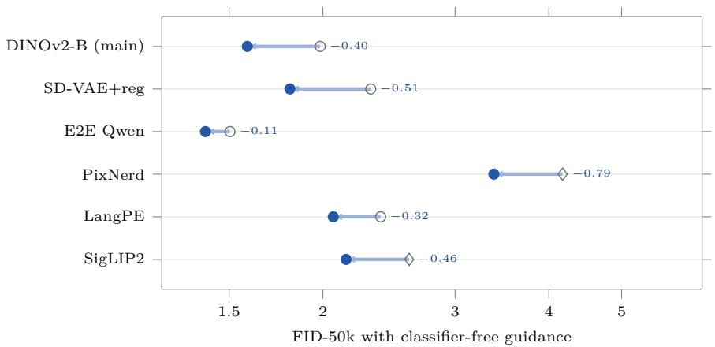  
baseline, its best scale source-reported baseline Swift, its best scale

Figure 7 Guided FID at each model’s best available CFG scale for six DifusionBench configurations from Table 7. Open circles denote matched baselines whose guidance scale is swept independently; open diamonds denote sourcereported guided baselines. Filled dots show Swift at its own best scale, and annotations give the FID change. The preferred scale can shift substantially (e.g., 2.2 → 1.8 for SD-VAE+reg and 2.4 → 1.8 for PixNerd), motivating separate tuning on the two sides.

Table 6 All 19 ImageNet-256 configurations without guidance. Swift uses the same default coeficient (α=0.4) with a smaller pretrained guide frozen before main-model training, without per-configuration coeficient tuning. FDr and MIND are reported in five feature spaces; the lower FID of each pair is bold.
<table><tr><td rowspan=1 colspan=16>FDr ↓                        MIND ↓Incption   ConXt                       Inception      ConXtDNOV2    DNONV2MAESiIP MAE  SIPConfiguration (baseline)FID↓sFID↓IS↑ Prec.↑ Rec.↑</td></tr><tr><td rowspan=1 colspan=6>Representation autoencoders (RAE); 615M, 80 epochs</td><td rowspan=1 colspan=2></td><td rowspan=1 colspan=1></td><td rowspan=1 colspan=1></td><td rowspan=1 colspan=1></td><td rowspan=1 colspan=4></td><td rowspan=1 colspan=1></td></tr><tr><td rowspan=1 colspan=4>DINOv2-B                2.09  4.48 210.6</td><td rowspan=1 colspan=2>0.83 0.57</td><td rowspan=1 colspan=1>1.32</td><td rowspan=1 colspan=1>2.34</td><td rowspan=1 colspan=1>3.19</td><td rowspan=1 colspan=1>6.25</td><td rowspan=1 colspan=1>7.57</td><td rowspan=1 colspan=2>2.45  70.70</td><td rowspan=1 colspan=2>26.72 0.44</td><td rowspan=1 colspan=1>6.41</td></tr><tr><td rowspan=1 colspan=4>+ SWIFT               1.75 4.26 202.8</td><td rowspan=1 colspan=2>0.81 0.61</td><td rowspan=1 colspan=1>1.09</td><td rowspan=1 colspan=1>2.43</td><td rowspan=1 colspan=1>2.87</td><td rowspan=1 colspan=1>5.18</td><td rowspan=1 colspan=1>6.89</td><td rowspan=1 colspan=2>1.55  76.44</td><td rowspan=1 colspan=2>23.60 0.35</td><td rowspan=1 colspan=1>5.76</td></tr><tr><td rowspan=1 colspan=2>DINOv2-B+reg          2.07</td><td rowspan=1 colspan=2>4.55 208.2</td><td rowspan=1 colspan=1>0.82</td><td rowspan=1 colspan=1>0.58</td><td rowspan=1 colspan=1>1.29</td><td rowspan=1 colspan=1>2.42</td><td rowspan=1 colspan=1>3.23</td><td rowspan=1 colspan=1>6.33</td><td rowspan=1 colspan=1>7.67</td><td rowspan=1 colspan=2>2.27 77.41</td><td rowspan=1 colspan=2>27.21 0.44</td><td rowspan=1 colspan=1>6.21</td></tr><tr><td rowspan=1 colspan=2>+ SWIFT               1.71</td><td rowspan=1 colspan=2>4.18 205.2</td><td rowspan=1 colspan=1>0.81</td><td rowspan=1 colspan=1>0.61</td><td rowspan=1 colspan=1>1.09</td><td rowspan=1 colspan=1>2.40</td><td rowspan=1 colspan=1>2.90</td><td rowspan=1 colspan=1>5.29</td><td rowspan=1 colspan=1>6.75</td><td rowspan=1 colspan=1>1.56</td><td rowspan=1 colspan=1>74.47</td><td rowspan=1 colspan=2>23.36 0.35</td><td rowspan=1 colspan=1>5.79</td></tr><tr><td rowspan=1 colspan=2>LangPE                  2.73</td><td rowspan=1 colspan=2>4.43183.2</td><td rowspan=1 colspan=1>0.80</td><td rowspan=1 colspan=1>0.60</td><td rowspan=1 colspan=1>1.62</td><td rowspan=1 colspan=1>3.41</td><td rowspan=1 colspan=1>6.57</td><td rowspan=1 colspan=1>9.00</td><td rowspan=1 colspan=1>10.10</td><td rowspan=1 colspan=1>2.55</td><td rowspan=1 colspan=1>135.04</td><td rowspan=1 colspan=2>63.77 0.69</td><td rowspan=1 colspan=1>8.79</td></tr><tr><td rowspan=1 colspan=2>+ SWIFT               2.27</td><td rowspan=1 colspan=2>4.01 184.6</td><td rowspan=1 colspan=1>0.79</td><td rowspan=1 colspan=1>0.61</td><td rowspan=1 colspan=1>1.36</td><td rowspan=1 colspan=1>3.32</td><td rowspan=1 colspan=1>5.71</td><td rowspan=1 colspan=1>7.60</td><td rowspan=1 colspan=1>9.29</td><td rowspan=1 colspan=1>1.77</td><td rowspan=1 colspan=1>126.68</td><td rowspan=1 colspan=2>55.29 0.56</td><td rowspan=1 colspan=1>8.40</td></tr><tr><td rowspan=1 colspan=2>PE                        3.11</td><td rowspan=1 colspan=2>6.15 205.1</td><td rowspan=1 colspan=1>0.81</td><td rowspan=1 colspan=1>0.56</td><td rowspan=1 colspan=1>1.88</td><td rowspan=1 colspan=1>3.12</td><td rowspan=1 colspan=1>6.121</td><td rowspan=1 colspan=1>1.01</td><td rowspan=1 colspan=1>9.83</td><td rowspan=1 colspan=1>3.20</td><td rowspan=1 colspan=1>97.46</td><td rowspan=1 colspan=2>58.28 0.88</td><td rowspan=1 colspan=1>8.07</td></tr><tr><td rowspan=1 colspan=1>+ SWIFT</td><td rowspan=1 colspan=1>2.34</td><td rowspan=1 colspan=2>5.02 209.6</td><td rowspan=1 colspan=1>0.81</td><td rowspan=1 colspan=1>0.60</td><td rowspan=1 colspan=1>1.43</td><td rowspan=1 colspan=1>2.71</td><td rowspan=1 colspan=1>4.76</td><td rowspan=1 colspan=1>9.18</td><td rowspan=1 colspan=1>7.74</td><td rowspan=1 colspan=1>2.47</td><td rowspan=1 colspan=1>86.73</td><td rowspan=1 colspan=2>44.90 0.70</td><td rowspan=1 colspan=1>6.39</td></tr><tr><td rowspan=1 colspan=1>SigLIP2</td><td rowspan=1 colspan=1>3.47</td><td rowspan=1 colspan=2>7.02 180.5</td><td rowspan=1 colspan=1>0.79</td><td rowspan=1 colspan=1>0.58</td><td rowspan=1 colspan=1>2.09</td><td rowspan=1 colspan=1>4.13</td><td rowspan=1 colspan=1>8.611</td><td rowspan=1 colspan=1>1.01</td><td rowspan=1 colspan=1>11.66</td><td rowspan=1 colspan=1>2.45</td><td rowspan=1 colspan=1>158.79</td><td rowspan=1 colspan=2>86.24 0.90</td><td rowspan=1 colspan=1>10.18</td></tr><tr><td rowspan=1 colspan=1>+ SWIFT</td><td rowspan=1 colspan=1>2.60</td><td rowspan=1 colspan=2>5.39 188.3</td><td rowspan=1 colspan=1>0.79</td><td rowspan=1 colspan=1>0.61</td><td rowspan=1 colspan=1>1.59</td><td rowspan=1 colspan=1>3.55</td><td rowspan=1 colspan=1>7.00</td><td rowspan=1 colspan=1>9.09</td><td rowspan=1 colspan=1>9.60</td><td rowspan=1 colspan=1>1.89</td><td rowspan=1 colspan=1>132.62</td><td rowspan=1 colspan=2>70.05 0.72</td><td rowspan=1 colspan=1>8.35</td></tr><tr><td rowspan=1 colspan=1>SpatialPE</td><td rowspan=1 colspan=1>3.60</td><td rowspan=1 colspan=2>5.20160.1</td><td rowspan=1 colspan=1>0.78</td><td rowspan=1 colspan=1>0.60</td><td rowspan=1 colspan=1>2.20</td><td rowspan=1 colspan=1>4.21</td><td rowspan=1 colspan=1>7.19</td><td rowspan=1 colspan=1>6.95</td><td rowspan=1 colspan=1>10.73</td><td rowspan=1 colspan=1>2.23</td><td rowspan=1 colspan=1>210.99</td><td rowspan=1 colspan=2>68.81 0.54</td><td rowspan=1 colspan=1>9.14</td></tr><tr><td rowspan=1 colspan=1>+ SWIFT</td><td rowspan=1 colspan=1>2.92</td><td rowspan=1 colspan=2>4.47165.8</td><td rowspan=1 colspan=1>0.78</td><td rowspan=1 colspan=1>0.62</td><td rowspan=1 colspan=1>1.78</td><td rowspan=1 colspan=1>3.70</td><td rowspan=1 colspan=1>6.07</td><td rowspan=1 colspan=1>5.60</td><td rowspan=1 colspan=1>9.27</td><td rowspan=1 colspan=1>1.60</td><td rowspan=1 colspan=1>174.36</td><td rowspan=1 colspan=2>57.57 0.43</td><td rowspan=1 colspan=1>8.02</td></tr><tr><td rowspan=1 colspan=1>VAEs; 615M, 80 epochs</td><td rowspan=1 colspan=1></td><td rowspan=1 colspan=2></td><td rowspan=1 colspan=1></td><td rowspan=1 colspan=1></td><td rowspan=1 colspan=1></td><td rowspan=1 colspan=1></td><td rowspan=1 colspan=1></td><td rowspan=1 colspan=1></td><td rowspan=1 colspan=1></td><td rowspan=1 colspan=1></td><td rowspan=1 colspan=1></td><td rowspan=1 colspan=2></td><td rowspan=1 colspan=1></td></tr><tr><td rowspan=1 colspan=1>SD-VAE (EMA)+reg</td><td rowspan=1 colspan=1>5.49</td><td rowspan=1 colspan=2>5.52 161.3</td><td rowspan=1 colspan=1>0.71</td><td rowspan=1 colspan=1>0.66</td><td rowspan=1 colspan=1>3.21</td><td rowspan=1 colspan=1>5.26</td><td rowspan=1 colspan=1>11.51</td><td rowspan=1 colspan=1>9.67</td><td rowspan=1 colspan=1>25.77</td><td rowspan=1 colspan=1>3.52</td><td rowspan=1 colspan=1>257.981</td><td rowspan=1 colspan=1>48.15 0</td><td rowspan=1 colspan=1>.87</td><td rowspan=1 colspan=1>28.66</td></tr><tr><td rowspan=1 colspan=1>+ SWIFT</td><td rowspan=1 colspan=1>3.77</td><td rowspan=1 colspan=2>5.06 179.1</td><td rowspan=1 colspan=1>0.73</td><td rowspan=1 colspan=1>0.66</td><td rowspan=1 colspan=1>2.19</td><td rowspan=1 colspan=1>3.85</td><td rowspan=1 colspan=1>8.58</td><td rowspan=1 colspan=1>7.56</td><td rowspan=1 colspan=1>20.01</td><td rowspan=1 colspan=1>2.00</td><td rowspan=1 colspan=1>157.581</td><td rowspan=1 colspan=1>07.03 0</td><td rowspan=1 colspan=1>.68</td><td rowspan=1 colspan=1>21.85</td></tr><tr><td rowspan=1 colspan=1>SD-VAE (MSE)</td><td rowspan=1 colspan=1>10.06</td><td rowspan=1 colspan=2>5.79 110.9</td><td rowspan=1 colspan=1>0.67</td><td rowspan=1 colspan=1>0.65</td><td rowspan=1 colspan=1>5.92</td><td rowspan=1 colspan=1>10.48</td><td rowspan=1 colspan=1>17.97</td><td rowspan=1 colspan=1>12.24</td><td rowspan=1 colspan=1>38.65</td><td rowspan=1 colspan=1>9.19</td><td rowspan=1 colspan=1>686.07 2</td><td rowspan=1 colspan=1>44.94</td><td rowspan=1 colspan=1>1.09</td><td rowspan=1 colspan=1>44.55</td></tr><tr><td rowspan=1 colspan=1>+ SWIFT</td><td rowspan=1 colspan=1>6.51</td><td rowspan=1 colspan=2>5.26 137.1</td><td rowspan=1 colspan=1>0.70</td><td rowspan=1 colspan=1>0.66</td><td rowspan=1 colspan=1>3.82</td><td rowspan=1 colspan=1>7.02</td><td rowspan=1 colspan=1>12.97</td><td rowspan=1 colspan=1>9.77</td><td rowspan=1 colspan=1>30.52</td><td rowspan=1 colspan=1>4.94</td><td rowspan=1 colspan=1>388.491</td><td rowspan=1 colspan=1>70.63 0</td><td rowspan=1 colspan=1>.87</td><td rowspan=1 colspan=1>35.39</td></tr><tr><td rowspan=1 colspan=1>SD-VAE (EMA)</td><td rowspan=1 colspan=1>10.21</td><td rowspan=1 colspan=1>5.56</td><td rowspan=1 colspan=1>112.4</td><td rowspan=1 colspan=1>0.67</td><td rowspan=1 colspan=1>0.66</td><td rowspan=1 colspan=1>6.011</td><td rowspan=1 colspan=1>0.01</td><td rowspan=1 colspan=1>18.12</td><td rowspan=1 colspan=1>11.12</td><td rowspan=1 colspan=1>35.26</td><td rowspan=1 colspan=1>9.69</td><td rowspan=1 colspan=1>685.61 2</td><td rowspan=1 colspan=1>44.65</td><td rowspan=1 colspan=1>0.99</td><td rowspan=1 colspan=1>38.47</td></tr><tr><td rowspan=1 colspan=1>+ SWIFT</td><td rowspan=1 colspan=1>6.73</td><td rowspan=1 colspan=1>5.05</td><td rowspan=1 colspan=1>138.9</td><td rowspan=1 colspan=1>0.70</td><td rowspan=1 colspan=1>0.67</td><td rowspan=1 colspan=1>3.87</td><td rowspan=1 colspan=1>6.65</td><td rowspan=1 colspan=1>13.03</td><td rowspan=1 colspan=1>8.91</td><td rowspan=1 colspan=1>27.75</td><td rowspan=1 colspan=1>5.21</td><td rowspan=1 colspan=1>388.351</td><td rowspan=1 colspan=1>71.18 0</td><td rowspan=1 colspan=1>.79</td><td rowspan=1 colspan=1>30.49</td></tr><tr><td rowspan=1 colspan=1>Qwen-VAE</td><td rowspan=1 colspan=1>10.69</td><td rowspan=1 colspan=2>8.46 109.1</td><td rowspan=1 colspan=1>0.66</td><td rowspan=1 colspan=1>0.64</td><td rowspan=1 colspan=1>6.43</td><td rowspan=1 colspan=1>13.29</td><td rowspan=1 colspan=1>19.59</td><td rowspan=1 colspan=1>13.41</td><td rowspan=1 colspan=1>41.22</td><td rowspan=1 colspan=1>9.09</td><td rowspan=1 colspan=1>806.84</td><td rowspan=1 colspan=1>266.43</td><td rowspan=1 colspan=1>1.31</td><td rowspan=1 colspan=1>43.80</td></tr><tr><td rowspan=1 colspan=1>+ SWIFT</td><td rowspan=1 colspan=1>7.18</td><td rowspan=1 colspan=1>7.68</td><td rowspan=1 colspan=1>134.8</td><td rowspan=1 colspan=1>0.69</td><td rowspan=1 colspan=1>0.65</td><td rowspan=1 colspan=1>4.13</td><td rowspan=1 colspan=1>8.88</td><td rowspan=1 colspan=1>14.24</td><td rowspan=1 colspan=1>10.72</td><td rowspan=1 colspan=1>32.64</td><td rowspan=1 colspan=1>4.91</td><td rowspan=1 colspan=1>454.12</td><td rowspan=1 colspan=1>186.14</td><td rowspan=1 colspan=1>1.05</td><td rowspan=1 colspan=1>34.72</td></tr><tr><td rowspan=1 colspan=1>SDXL-VAE</td><td rowspan=1 colspan=1>12.84</td><td rowspan=1 colspan=1>7.52</td><td rowspan=1 colspan=1>104.1</td><td rowspan=1 colspan=1>0.65</td><td rowspan=1 colspan=1>0.64</td><td rowspan=1 colspan=1>7.48</td><td rowspan=1 colspan=1>12.63</td><td rowspan=1 colspan=1>21.451</td><td rowspan=1 colspan=1>3.58</td><td rowspan=1 colspan=1>40.391</td><td rowspan=1 colspan=1>2.90</td><td rowspan=1 colspan=1>862.20 2</td><td rowspan=1 colspan=1>99.171</td><td rowspan=1 colspan=1>.22</td><td rowspan=1 colspan=1>43.99</td></tr><tr><td rowspan=1 colspan=1>+ SWIFT</td><td rowspan=1 colspan=1>8.38</td><td rowspan=1 colspan=1>6.83</td><td rowspan=1 colspan=1>128.7</td><td rowspan=1 colspan=1>0.68</td><td rowspan=1 colspan=1>0.65</td><td rowspan=1 colspan=1>4.84</td><td rowspan=1 colspan=1>8.39</td><td rowspan=1 colspan=1>15.50</td><td rowspan=1 colspan=1>10.91</td><td rowspan=1 colspan=1>31.80</td><td rowspan=1 colspan=1>6.98</td><td rowspan=1 colspan=1>486.072</td><td rowspan=1 colspan=1>09.200</td><td rowspan=1 colspan=1>.973</td><td rowspan=1 colspan=1>4.91</td></tr><tr><td rowspan=1 colspan=1>End-to-end tuned autoen</td><td rowspan=1 colspan=1>coder</td><td rowspan=1 colspan=1>s (E2E</td><td rowspan=1 colspan=1>); 615</td><td rowspan=1 colspan=1>M, 80 e</td><td rowspan=1 colspan=1>pochs</td><td rowspan=1 colspan=1></td><td rowspan=1 colspan=1></td><td rowspan=1 colspan=1></td><td rowspan=1 colspan=1></td><td rowspan=1 colspan=1></td><td rowspan=1 colspan=1></td><td rowspan=1 colspan=1></td><td rowspan=1 colspan=1></td><td rowspan=1 colspan=1></td><td rowspan=1 colspan=1></td></tr><tr><td rowspan=1 colspan=1>E2E VA-VAE</td><td rowspan=1 colspan=1>4.14</td><td rowspan=1 colspan=1>4.57</td><td rowspan=1 colspan=1>148.9</td><td rowspan=1 colspan=1>0.74</td><td rowspan=1 colspan=1>0.65</td><td rowspan=1 colspan=1>2.55</td><td rowspan=1 colspan=1>5.80</td><td rowspan=1 colspan=1>8.58</td><td rowspan=1 colspan=1>6.34</td><td rowspan=1 colspan=1>16.22</td><td rowspan=1 colspan=1>2.13</td><td rowspan=1 colspan=1>270.481</td><td rowspan=1 colspan=1>03.26 0</td><td rowspan=1 colspan=1>.501</td><td rowspan=1 colspan=1>5.36</td></tr><tr><td rowspan=1 colspan=1>+ SWIFT</td><td rowspan=1 colspan=1>3.13</td><td rowspan=1 colspan=1>4.391</td><td rowspan=1 colspan=1>64.2</td><td rowspan=1 colspan=1>0.74</td><td rowspan=1 colspan=1>0.67</td><td rowspan=1 colspan=1>1.96</td><td rowspan=1 colspan=1>4.62</td><td rowspan=1 colspan=1>6.82</td><td rowspan=1 colspan=1>5.21</td><td rowspan=1 colspan=1>12.99</td><td rowspan=1 colspan=1>1.25</td><td rowspan=1 colspan=1>188.11</td><td rowspan=1 colspan=1>80.39</td><td rowspan=1 colspan=1>0.41</td><td rowspan=1 colspan=1>12.24</td></tr><tr><td rowspan=1 colspan=1>E2E Qwen-VAE</td><td rowspan=1 colspan=1>4.94</td><td rowspan=1 colspan=1>5.23</td><td rowspan=1 colspan=1>138.9</td><td rowspan=1 colspan=1>0.72</td><td rowspan=1 colspan=1>0.66</td><td rowspan=1 colspan=1>3.07</td><td rowspan=1 colspan=1>6.75</td><td rowspan=1 colspan=1>9.60</td><td rowspan=1 colspan=1>6.48</td><td rowspan=1 colspan=1>19.94</td><td rowspan=1 colspan=1>2.82</td><td rowspan=1 colspan=1>339.601</td><td rowspan=1 colspan=1>14.11 0</td><td rowspan=1 colspan=1>.531</td><td rowspan=1 colspan=1>8.94</td></tr><tr><td rowspan=1 colspan=1>+ SWIFT</td><td rowspan=1 colspan=1>3.23</td><td rowspan=1 colspan=1>4.891</td><td rowspan=1 colspan=1>64.1</td><td rowspan=1 colspan=1>0.73</td><td rowspan=1 colspan=1>0.66</td><td rowspan=1 colspan=1>2.08</td><td rowspan=1 colspan=1>4.66</td><td rowspan=1 colspan=1>6.41</td><td rowspan=1 colspan=1>4.74</td><td rowspan=1 colspan=1>14.48</td><td rowspan=1 colspan=1>1.34</td><td rowspan=1 colspan=1>190.38</td><td rowspan=1 colspan=1>72.89</td><td rowspan=1 colspan=1>0.37</td><td rowspan=1 colspan=1>13.18</td></tr><tr><td rowspan=1 colspan=1>E2E SD3.5-VAE</td><td rowspan=1 colspan=1>5.26</td><td rowspan=1 colspan=2>5.18141.1</td><td rowspan=1 colspan=1>0.71</td><td rowspan=1 colspan=1>0.65</td><td rowspan=1 colspan=1>3.34</td><td rowspan=1 colspan=1>5.03</td><td rowspan=1 colspan=1>9.14</td><td rowspan=1 colspan=1>7.13</td><td rowspan=1 colspan=1>18.44</td><td rowspan=1 colspan=1>3.17</td><td rowspan=1 colspan=1>260.37</td><td rowspan=1 colspan=1>107.42</td><td rowspan=1 colspan=1>0.55</td><td rowspan=1 colspan=1>17.58</td></tr><tr><td rowspan=1 colspan=1>+ SWIFT</td><td rowspan=1 colspan=1>3.61</td><td rowspan=1 colspan=1>4.881</td><td rowspan=1 colspan=1>60.9</td><td rowspan=1 colspan=1>0.72</td><td rowspan=1 colspan=1>0.67</td><td rowspan=1 colspan=1>2.37</td><td rowspan=1 colspan=1>3.66</td><td rowspan=1 colspan=1>6.73</td><td rowspan=1 colspan=1>5.50</td><td rowspan=1 colspan=1>13.99</td><td rowspan=1 colspan=1>1.71</td><td rowspan=1 colspan=1>160.89</td><td rowspan=1 colspan=1>74.95</td><td rowspan=1 colspan=1>0.41</td><td rowspan=1 colspan=1>13.00</td></tr><tr><td rowspan=1 colspan=1>E2E FLUX-VAE</td><td rowspan=1 colspan=1>6.20</td><td rowspan=1 colspan=1>5.13</td><td rowspan=1 colspan=1>134.9</td><td rowspan=1 colspan=1>0.70</td><td rowspan=1 colspan=1>0.66</td><td rowspan=1 colspan=1>3.76</td><td rowspan=1 colspan=1>6.84</td><td rowspan=1 colspan=1>10.89</td><td rowspan=1 colspan=1>6.63</td><td rowspan=1 colspan=1>21.30</td><td rowspan=1 colspan=1>4.07</td><td rowspan=1 colspan=1>372.55</td><td rowspan=1 colspan=1>127.660</td><td rowspan=1 colspan=1>.53</td><td rowspan=1 colspan=1>20.24</td></tr><tr><td rowspan=1 colspan=1>+ SWIFT</td><td rowspan=1 colspan=1>4.27</td><td rowspan=1 colspan=1>4.781</td><td rowspan=1 colspan=1>53.4</td><td rowspan=1 colspan=1>0.71</td><td rowspan=1 colspan=1>0.67</td><td rowspan=1 colspan=1>2.61</td><td rowspan=1 colspan=1>4.87</td><td rowspan=1 colspan=1>7.80</td><td rowspan=1 colspan=1>5.00</td><td rowspan=1 colspan=1>15.54</td><td rowspan=1 colspan=1>2.21</td><td rowspan=1 colspan=1>220.74</td><td rowspan=1 colspan=1>87.92</td><td rowspan=1 colspan=1>0.39</td><td rowspan=1 colspan=1>14.49</td></tr><tr><td rowspan=1 colspan=1>Pixel space; 615M, 80 ep</td><td rowspan=1 colspan=1>ochs</td><td rowspan=1 colspan=1></td><td rowspan=1 colspan=1></td><td rowspan=1 colspan=1></td><td rowspan=1 colspan=1></td><td rowspan=1 colspan=1></td><td rowspan=1 colspan=1></td><td rowspan=1 colspan=1></td><td rowspan=1 colspan=1></td><td rowspan=1 colspan=1></td><td rowspan=1 colspan=1></td><td rowspan=1 colspan=1></td><td rowspan=1 colspan=1></td><td rowspan=1 colspan=1></td><td rowspan=1 colspan=1></td></tr><tr><td rowspan=1 colspan=1>PixelGen</td><td rowspan=1 colspan=1>12.10</td><td rowspan=1 colspan=1>6.15</td><td rowspan=1 colspan=1>104.2</td><td rowspan=1 colspan=1>0.66</td><td rowspan=1 colspan=1>0.61</td><td rowspan=1 colspan=1>7.001</td><td rowspan=1 colspan=1>3.92</td><td rowspan=1 colspan=1>17.92</td><td rowspan=1 colspan=1>18.96 34.61</td><td rowspan=1 colspan=1>34.61</td><td rowspan=1 colspan=1>9.04</td><td rowspan=1 colspan=1>771.89</td><td rowspan=1 colspan=1>222.22</td><td rowspan=1 colspan=1>1.68</td><td rowspan=1 colspan=1>32.40</td></tr><tr><td rowspan=1 colspan=1>+ SWIFT</td><td rowspan=1 colspan=1>8.11</td><td rowspan=1 colspan=1>5.46</td><td rowspan=1 colspan=1>126.3</td><td rowspan=1 colspan=1>0.68</td><td rowspan=1 colspan=1>0.62</td><td rowspan=1 colspan=1>4.72</td><td rowspan=1 colspan=1>9.80</td><td rowspan=1 colspan=1>13.72</td><td rowspan=1 colspan=1>15.89</td><td rowspan=1 colspan=1>27.86</td><td rowspan=1 colspan=1>5.03</td><td rowspan=1 colspan=1>481.69</td><td rowspan=1 colspan=1>166.83</td><td rowspan=1 colspan=1>1.39</td><td rowspan=1 colspan=1>26.36</td></tr><tr><td rowspan=1 colspan=1>PixNerd</td><td rowspan=1 colspan=1>20.37</td><td rowspan=1 colspan=1>6.14</td><td rowspan=1 colspan=1>65.9</td><td rowspan=1 colspan=1>0.61</td><td rowspan=1 colspan=1>0.631</td><td rowspan=1 colspan=1>2.002</td><td rowspan=1 colspan=1>0.71</td><td rowspan=1 colspan=1>24.44</td><td rowspan=1 colspan=1>18.69</td><td rowspan=1 colspan=1>46.76</td><td rowspan=1 colspan=1>22.30</td><td rowspan=1 colspan=1>1513.80</td><td rowspan=1 colspan=1>335.521</td><td rowspan=1 colspan=1>.62</td><td rowspan=1 colspan=1>47.63</td></tr><tr><td rowspan=1 colspan=1>+ SWIFT</td><td rowspan=1 colspan=1>10.31</td><td rowspan=1 colspan=1>5.38</td><td rowspan=1 colspan=1>93.3</td><td rowspan=1 colspan=1>0.70</td><td rowspan=1 colspan=1>0.61</td><td rowspan=1 colspan=1>6.141</td><td rowspan=1 colspan=1>2.20</td><td rowspan=1 colspan=1>14.331</td><td rowspan=1 colspan=1>3.80 2</td><td rowspan=1 colspan=1>9.92</td><td rowspan=1 colspan=1>8.50</td><td rowspan=1 colspan=1>776.861</td><td rowspan=1 colspan=1>72.291</td><td rowspan=1 colspan=1>.23</td><td rowspan=1 colspan=1>28.80</td></tr><tr><td rowspan=1 colspan=1>JiT</td><td rowspan=1 colspan=1>22.36</td><td rowspan=1 colspan=1>6.98</td><td rowspan=1 colspan=1>63.3</td><td rowspan=1 colspan=1>0.58</td><td rowspan=1 colspan=1>0.631</td><td rowspan=1 colspan=1>3.20</td><td rowspan=1 colspan=1>23.38</td><td rowspan=1 colspan=1>28.662</td><td rowspan=1 colspan=1>2.69</td><td rowspan=1 colspan=1>54.69</td><td rowspan=1 colspan=1>25.50</td><td rowspan=1 colspan=1>1690.324</td><td rowspan=1 colspan=1>22.582</td><td rowspan=1 colspan=1>.04</td><td rowspan=1 colspan=1>56.31</td></tr><tr><td rowspan=1 colspan=1>+ SWIFT</td><td rowspan=1 colspan=1>12.31</td><td rowspan=1 colspan=1>6.15</td><td rowspan=1 colspan=1>98.4</td><td rowspan=1 colspan=1>0.64</td><td rowspan=1 colspan=1>0.63</td><td rowspan=1 colspan=1>7.271</td><td rowspan=1 colspan=1>3.52</td><td rowspan=1 colspan=1>18.501</td><td rowspan=1 colspan=1>8.20 3</td><td rowspan=1 colspan=1>8.32</td><td rowspan=1 colspan=1>11.10</td><td rowspan=1 colspan=1>805.46</td><td rowspan=1 colspan=1>254.28</td><td rowspan=1 colspan=1>1.65</td><td rowspan=1 colspan=1>39.33</td></tr><tr><td rowspan=1 colspan=1>RAEv2, 875M, up to 160</td><td rowspan=1 colspan=1>epoch</td><td rowspan=1 colspan=1>s</td><td rowspan=1 colspan=1></td><td rowspan=1 colspan=1></td><td rowspan=1 colspan=1></td><td rowspan=1 colspan=1></td><td rowspan=1 colspan=1></td><td rowspan=1 colspan=1></td><td rowspan=1 colspan=1></td><td rowspan=1 colspan=1></td><td rowspan=1 colspan=1></td><td rowspan=1 colspan=1></td><td rowspan=1 colspan=1></td><td rowspan=1 colspan=1></td><td rowspan=1 colspan=1></td></tr><tr><td rowspan=1 colspan=1>DINOv3-L</td><td rowspan=1 colspan=1>1.56</td><td rowspan=1 colspan=1>4.10</td><td rowspan=1 colspan=1>233.3</td><td rowspan=1 colspan=1>0.82</td><td rowspan=1 colspan=1>0.65</td><td rowspan=1 colspan=1>1.01</td><td rowspan=1 colspan=1>2.24</td><td rowspan=1 colspan=1>2.63</td><td rowspan=1 colspan=1>4.84</td><td rowspan=1 colspan=1>6.32</td><td rowspan=1 colspan=1>1.44</td><td rowspan=1 colspan=1>70.17</td><td rowspan=1 colspan=1>22.46</td><td rowspan=1 colspan=1>0.35</td><td rowspan=1 colspan=1>5.61</td></tr><tr><td rowspan=1 colspan=1>+ SWIFT</td><td rowspan=1 colspan=1>1.15</td><td rowspan=1 colspan=2>3.60 242.2</td><td rowspan=1 colspan=1>0.81</td><td rowspan=1 colspan=1>0.67</td><td rowspan=1 colspan=1>0.81</td><td rowspan=1 colspan=1>2.05</td><td rowspan=1 colspan=1>2.24</td><td rowspan=1 colspan=2>4.175.41</td><td rowspan=1 colspan=1>1.11</td><td rowspan=1 colspan=1>65.39</td><td rowspan=1 colspan=2>18.56 0.29</td><td rowspan=1 colspan=1>4.82</td></tr></table>

Table 7 All 19 ImageNet-256 configurations with guidance. Inference-time guidance is tuned separately for re-evaluated pairs; source-reported guided baselines retain their published settings. The training recipe is otherwise the same as in Table 6. FD and MIND are reported in five feature spaces; the lower FID of each pair is bold.
<table><tr><td rowspan=1 colspan=15>FDr ↓                      MIND ↓ConXt                     Incpion     ConXtIncpioonDNOV2    DNOV2MAAESIP  MAE  STIPConfiguration (baseline)FID↓sFID↓IS↑Prec.↑ Rec.↑</td></tr><tr><td rowspan=2 colspan=6>Representation autoencoders (RAE); 615M,, 80 epochsDINOv2-B                 1.98  4.50 223.1</td><td rowspan=1 colspan=2></td><td rowspan=1 colspan=4></td><td rowspan=1 colspan=3></td></tr><tr><td rowspan=1 colspan=2>0.81 0.59</td><td rowspan=1 colspan=1>1.26</td><td rowspan=1 colspan=1>2.213.40</td><td rowspan=1 colspan=1>6.12</td><td rowspan=1 colspan=1>7.84</td><td rowspan=1 colspan=1>1.91</td><td rowspan=1 colspan=1>66.75</td><td rowspan=1 colspan=3>27.95 0.436.52</td></tr><tr><td rowspan=1 colspan=2>+ SWIFT                1.59</td><td rowspan=1 colspan=2>4.30 221.6</td><td rowspan=1 colspan=1>0.80</td><td rowspan=1 colspan=1>0.62</td><td rowspan=1 colspan=1>1.00</td><td rowspan=1 colspan=1>2.272.78</td><td rowspan=1 colspan=1>5.14</td><td rowspan=1 colspan=1>6.65</td><td rowspan=1 colspan=1>1.15</td><td rowspan=1 colspan=1>66.61</td><td rowspan=1 colspan=3>23.23 0.33 5.70</td></tr><tr><td rowspan=1 colspan=2>DINOv2-B+reg           1.84</td><td rowspan=1 colspan=2>4.55 236.2</td><td rowspan=1 colspan=1>0.82</td><td rowspan=1 colspan=1>0.581</td><td rowspan=1 colspan=1>.16</td><td rowspan=1 colspan=1>2.16 3.24</td><td rowspan=1 colspan=1>6.37</td><td rowspan=1 colspan=1>7.96</td><td rowspan=1 colspan=1>1.91</td><td rowspan=1 colspan=1>64.08</td><td rowspan=1 colspan=3>27.03 0.436.01</td></tr><tr><td rowspan=1 colspan=2>+ SWIFT               1.52</td><td rowspan=1 colspan=2>4.18 232.9</td><td rowspan=1 colspan=1>0.81</td><td rowspan=1 colspan=1>0.61 0.98</td><td rowspan=1 colspan=1>0.98</td><td rowspan=1 colspan=1>2.10 2.73</td><td rowspan=1 colspan=1>5.31</td><td rowspan=1 colspan=1>6.57</td><td rowspan=1 colspan=1>1.31</td><td rowspan=1 colspan=1>62.96</td><td rowspan=1 colspan=2>22.34 0.35</td><td rowspan=1 colspan=1>5.92</td></tr><tr><td rowspan=1 colspan=2>LangPE                   2.39</td><td rowspan=1 colspan=2>4.42 201.6</td><td rowspan=1 colspan=1>0.80</td><td rowspan=1 colspan=1>0.61 1</td><td rowspan=1 colspan=1>.44</td><td rowspan=1 colspan=1>2.95 6.08</td><td rowspan=1 colspan=1>9.00</td><td rowspan=1 colspan=1>9.95</td><td rowspan=1 colspan=1>2.16</td><td rowspan=1 colspan=1>104.11</td><td rowspan=1 colspan=2>62.58 0.71</td><td rowspan=1 colspan=1>8.85</td></tr><tr><td rowspan=1 colspan=2>+ SWIFT               2.06</td><td rowspan=1 colspan=2>4.02 199.0</td><td rowspan=1 colspan=1>0.79</td><td rowspan=1 colspan=1>0.621</td><td rowspan=1 colspan=1>.26</td><td rowspan=1 colspan=1>2.84 5.44</td><td rowspan=1 colspan=1>7.54</td><td rowspan=1 colspan=1>9.441</td><td rowspan=1 colspan=1>.40</td><td rowspan=1 colspan=1>103.39</td><td rowspan=1 colspan=1>53.36</td><td rowspan=1 colspan=1>0.55</td><td rowspan=1 colspan=1>8.82</td></tr><tr><td rowspan=1 colspan=2>PE                         2.84</td><td rowspan=1 colspan=2>5.80 221.5</td><td rowspan=1 colspan=1>0.81</td><td rowspan=1 colspan=1>0.57 1</td><td rowspan=1 colspan=1>.72</td><td rowspan=1 colspan=1>2.78 5.87</td><td rowspan=1 colspan=1>10.68</td><td rowspan=1 colspan=1>9.89</td><td rowspan=1 colspan=1>2.82</td><td rowspan=1 colspan=1>89.34</td><td rowspan=1 colspan=1>56.48</td><td rowspan=1 colspan=1>0.87</td><td rowspan=1 colspan=1>7.88</td></tr><tr><td rowspan=1 colspan=2>+ SWIFT               2.14</td><td rowspan=1 colspan=2>4.73 226.4</td><td rowspan=1 colspan=1>0.80</td><td rowspan=1 colspan=1>0.621</td><td rowspan=1 colspan=1>.3</td><td rowspan=1 colspan=1>2.4424.61</td><td rowspan=1 colspan=1>9.05</td><td rowspan=1 colspan=1>7.78</td><td rowspan=1 colspan=1>2.20</td><td rowspan=1 colspan=1>78.90</td><td rowspan=1 colspan=2>44.01 0.71</td><td rowspan=1 colspan=1>6.44</td></tr><tr><td rowspan=1 colspan=2>SigLIP2                   2.61</td><td rowspan=1 colspan=2>6.90 222.9</td><td rowspan=1 colspan=1>0.78</td><td rowspan=1 colspan=1>0.59 1</td><td rowspan=1 colspan=1>.62</td><td rowspan=1 colspan=1>2.97 7.31</td><td rowspan=1 colspan=1>10.76</td><td rowspan=1 colspan=1>11.33 1.85</td><td rowspan=1 colspan=1>1.85</td><td rowspan=1 colspan=1>97.56</td><td rowspan=1 colspan=2>75.42 0.87</td><td rowspan=1 colspan=1>9.73</td></tr><tr><td rowspan=1 colspan=2>+ SWIFT                2.15</td><td rowspan=1 colspan=2>5.32 219.4</td><td rowspan=1 colspan=1>0.79</td><td rowspan=1 colspan=1>0.62</td><td rowspan=1 colspan=1>1.32</td><td rowspan=1 colspan=1>2.826.29</td><td rowspan=1 colspan=1>8.76</td><td rowspan=1 colspan=1>9.68</td><td rowspan=1 colspan=1>1.33</td><td rowspan=1 colspan=1>92.86</td><td rowspan=1 colspan=2>66.35 0.69</td><td rowspan=1 colspan=1>8.72</td></tr><tr><td rowspan=1 colspan=2>SpatialPE                 1.86</td><td rowspan=1 colspan=2>4.50 247.1</td><td rowspan=1 colspan=1>0.79</td><td rowspan=1 colspan=1>0.61 1</td><td rowspan=1 colspan=1>.18</td><td rowspan=1 colspan=1>1.82 4.76</td><td rowspan=1 colspan=1>6.58</td><td rowspan=1 colspan=1>8.29</td><td rowspan=1 colspan=1>1.44</td><td rowspan=1 colspan=1>54.32</td><td rowspan=1 colspan=2>46.040.51</td><td rowspan=1 colspan=1>6.84</td></tr><tr><td rowspan=1 colspan=2>+ SWIFT                1.51</td><td rowspan=1 colspan=2>3.87 255.9</td><td rowspan=1 colspan=1>0.79</td><td rowspan=1 colspan=1>0.63 0</td><td rowspan=1 colspan=1>.97</td><td rowspan=1 colspan=1>1.60 3.87</td><td rowspan=1 colspan=1>5.44</td><td rowspan=1 colspan=1>7.71</td><td rowspan=1 colspan=1>1.04</td><td rowspan=1 colspan=1>44.44</td><td rowspan=1 colspan=2>36.64 0.40</td><td rowspan=1 colspan=1>6.52</td></tr><tr><td rowspan=1 colspan=2>VAEs; 615M, 80 epochs</td><td rowspan=1 colspan=2></td><td rowspan=1 colspan=1></td><td rowspan=1 colspan=1></td><td rowspan=1 colspan=1></td><td rowspan=1 colspan=1></td><td rowspan=1 colspan=1></td><td rowspan=1 colspan=1></td><td rowspan=1 colspan=1></td><td rowspan=1 colspan=1></td><td rowspan=1 colspan=2></td><td rowspan=1 colspan=1></td></tr><tr><td rowspan=1 colspan=1>SD-VAE (EMA)+reg</td><td rowspan=1 colspan=1>2.32</td><td rowspan=1 colspan=2>4.70 271.5</td><td rowspan=1 colspan=1>0.80</td><td rowspan=1 colspan=1>0.601</td><td rowspan=1 colspan=1>.32</td><td rowspan=1 colspan=1>1.73 7.42</td><td rowspan=1 colspan=1>7.89</td><td rowspan=1 colspan=1>18.581.90</td><td rowspan=1 colspan=1>1.90</td><td rowspan=1 colspan=1>53.68</td><td rowspan=1 colspan=1>85.97</td><td rowspan=1 colspan=1>0.71</td><td rowspan=1 colspan=1>20.32</td></tr><tr><td rowspan=1 colspan=1>+ SWIFT</td><td rowspan=1 colspan=1>1.81</td><td rowspan=1 colspan=2>4.42 272.9</td><td rowspan=1 colspan=1>0.80</td><td rowspan=1 colspan=1>0.61 0</td><td rowspan=1 colspan=1>.99</td><td rowspan=1 colspan=1>1.46 5.82</td><td rowspan=1 colspan=1>6.19</td><td rowspan=1 colspan=1>15.20</td><td rowspan=1 colspan=1>1.64</td><td rowspan=1 colspan=1>46.10</td><td rowspan=1 colspan=1>65.92</td><td rowspan=1 colspan=1>0.55</td><td rowspan=1 colspan=1>16.52</td></tr><tr><td rowspan=1 colspan=1>SD-VAE (MSE)</td><td rowspan=1 colspan=1>2.56</td><td rowspan=1 colspan=2>5.50 259.7</td><td rowspan=1 colspan=1>0.70</td><td rowspan=1 colspan=1>0.65 1</td><td rowspan=1 colspan=1>.43</td><td rowspan=1 colspan=1>2.14 7.60</td><td rowspan=1 colspan=1>7.93</td><td rowspan=1 colspan=1>21.85</td><td rowspan=1 colspan=1>3.09</td><td rowspan=1 colspan=1>55.50</td><td rowspan=1 colspan=1>87.48</td><td rowspan=1 colspan=1>0.69</td><td rowspan=1 colspan=1>24.63</td></tr><tr><td rowspan=1 colspan=1>+ SWIFT</td><td rowspan=1 colspan=1>1.86</td><td rowspan=1 colspan=2>4.99 268.4</td><td rowspan=1 colspan=1>0.73</td><td rowspan=1 colspan=1>0.66 0</td><td rowspan=1 colspan=1>.91</td><td rowspan=1 colspan=1>1.42 5.33</td><td rowspan=1 colspan=1>6.23</td><td rowspan=1 colspan=1>17.13</td><td rowspan=1 colspan=1>1.62</td><td rowspan=1 colspan=1>30.65</td><td rowspan=1 colspan=1>59.76</td><td rowspan=1 colspan=1>0.55</td><td rowspan=1 colspan=1>19.54</td></tr><tr><td rowspan=1 colspan=1>SD-VAE (EMA)</td><td rowspan=1 colspan=1>2.43</td><td rowspan=1 colspan=2>5.40 259.6</td><td rowspan=1 colspan=1>0.69</td><td rowspan=1 colspan=1>0.65 1</td><td rowspan=1 colspan=1>.39</td><td rowspan=1 colspan=1>1.94 7.70</td><td rowspan=1 colspan=1>6.97</td><td rowspan=1 colspan=1>19.19</td><td rowspan=1 colspan=1>2.87</td><td rowspan=1 colspan=1>49.03</td><td rowspan=1 colspan=1>88.22</td><td rowspan=1 colspan=1>0.62</td><td rowspan=1 colspan=1>20.47</td></tr><tr><td rowspan=1 colspan=1>+ SWIFT</td><td rowspan=1 colspan=1>1.90</td><td rowspan=1 colspan=2>5.08 260.9</td><td rowspan=1 colspan=1>0.69</td><td rowspan=1 colspan=1>0.66 1</td><td rowspan=1 colspan=1>.07</td><td rowspan=1 colspan=1>1.60 5.99</td><td rowspan=1 colspan=1>5.40</td><td rowspan=1 colspan=1>15.37</td><td rowspan=1 colspan=1>2.52</td><td rowspan=1 colspan=1>42.61</td><td rowspan=1 colspan=1>67.34</td><td rowspan=1 colspan=1>0.491</td><td rowspan=1 colspan=1>6.57</td></tr><tr><td rowspan=1 colspan=1>Qwen-VAE</td><td rowspan=1 colspan=1>3.01</td><td rowspan=1 colspan=2>7.70 238.9</td><td rowspan=1 colspan=1>0.68</td><td rowspan=1 colspan=1>0.65 1.83</td><td rowspan=1 colspan=1>1.83</td><td rowspan=1 colspan=1>4.599.84</td><td rowspan=1 colspan=1>9.27</td><td rowspan=1 colspan=1>25.20</td><td rowspan=1 colspan=1>2.75</td><td rowspan=1 colspan=1>160.49</td><td rowspan=1 colspan=1>118.34</td><td rowspan=1 colspan=1>0.91</td><td rowspan=1 colspan=1>25.93</td></tr><tr><td rowspan=1 colspan=1>+ SWIFT</td><td rowspan=1 colspan=1>2.32</td><td rowspan=1 colspan=2>6.99 250.8</td><td rowspan=1 colspan=1>0.71</td><td rowspan=1 colspan=1>0.66 1</td><td rowspan=1 colspan=1>.19</td><td rowspan=1 colspan=1>3.07 7.06</td><td rowspan=1 colspan=1>7.41</td><td rowspan=1 colspan=1>20.16</td><td rowspan=1 colspan=1>1.48</td><td rowspan=1 colspan=1>90.34</td><td rowspan=1 colspan=1>82.45</td><td rowspan=1 colspan=1>0.70</td><td rowspan=1 colspan=1>20.68</td></tr><tr><td rowspan=1 colspan=1>SDXL-VAE</td><td rowspan=1 colspan=1>3.07</td><td rowspan=1 colspan=2>6.90 256.0</td><td rowspan=1 colspan=1>0.67</td><td rowspan=1 colspan=1>0.65 1</td><td rowspan=1 colspan=1>.71</td><td rowspan=1 colspan=1>2.76 9.28</td><td rowspan=1 colspan=1>8.41 2</td><td rowspan=1 colspan=2>1.84 3.32</td><td rowspan=1 colspan=1>70.241</td><td rowspan=1 colspan=1>08.680</td><td rowspan=1 colspan=1>.74 2</td><td rowspan=1 colspan=1>2.53</td></tr><tr><td rowspan=1 colspan=1>+ SWIFT</td><td rowspan=1 colspan=1>2.21</td><td rowspan=1 colspan=2>6.27 268.8</td><td rowspan=1 colspan=1>0.70</td><td rowspan=1 colspan=1>0.66 1</td><td rowspan=1 colspan=1>.09</td><td rowspan=1 colspan=1>1.84 6.78</td><td rowspan=1 colspan=1>6.61</td><td rowspan=1 colspan=1>17.01</td><td rowspan=1 colspan=1>1.79</td><td rowspan=1 colspan=1>39.10</td><td rowspan=1 colspan=1>76.95</td><td rowspan=1 colspan=1>0.61</td><td rowspan=1 colspan=1>17.94</td></tr><tr><td rowspan=1 colspan=1>End-to-end tuned autoen</td><td rowspan=1 colspan=1>coder</td><td rowspan=1 colspan=2>s (E2E); 615</td><td rowspan=1 colspan=1>M, 80 e</td><td rowspan=1 colspan=1>pochs</td><td rowspan=1 colspan=1>s</td><td rowspan=1 colspan=1></td><td rowspan=1 colspan=1></td><td rowspan=1 colspan=1></td><td rowspan=1 colspan=1></td><td rowspan=1 colspan=1></td><td rowspan=1 colspan=1></td><td rowspan=1 colspan=1></td><td rowspan=1 colspan=1></td></tr><tr><td rowspan=1 colspan=1>E2E VA-VAE</td><td rowspan=1 colspan=1>1.65</td><td rowspan=1 colspan=2>4.50 275.4</td><td rowspan=1 colspan=1>0.74</td><td rowspan=1 colspan=1>0.65 1</td><td rowspan=1 colspan=1>.09</td><td rowspan=1 colspan=1>1.96 4.61</td><td rowspan=1 colspan=1>4.82</td><td rowspan=1 colspan=1>9.82</td><td rowspan=1 colspan=1>2.16</td><td rowspan=1 colspan=1>62.56</td><td rowspan=1 colspan=1>51.43</td><td rowspan=1 colspan=1>0.36</td><td rowspan=1 colspan=1>9.01</td></tr><tr><td rowspan=1 colspan=1>+ SWIFT</td><td rowspan=1 colspan=1>1.25</td><td rowspan=1 colspan=2>4.32 289.2</td><td rowspan=1 colspan=1>0.73</td><td rowspan=1 colspan=1>0.67</td><td rowspan=1 colspan=1>0.81</td><td rowspan=1 colspan=1>1.61 3.53</td><td rowspan=1 colspan=1>3.80</td><td rowspan=1 colspan=1>7.91</td><td rowspan=1 colspan=1>1.25</td><td rowspan=1 colspan=1>43.97</td><td rowspan=1 colspan=1>40.60</td><td rowspan=1 colspan=1>0.31</td><td rowspan=1 colspan=1>7.24</td></tr><tr><td rowspan=1 colspan=1>E2E Qwen-VAE</td><td rowspan=1 colspan=1>1.50</td><td rowspan=1 colspan=2>4.83 263.3</td><td rowspan=1 colspan=1>0.80</td><td rowspan=1 colspan=1>0.62 1</td><td rowspan=1 colspan=1>.05</td><td rowspan=1 colspan=1>2.29 4.58</td><td rowspan=1 colspan=1>4.61 1</td><td rowspan=1 colspan=2>1.10 1.45</td><td rowspan=1 colspan=1>61.43</td><td rowspan=1 colspan=1>48.55</td><td rowspan=1 colspan=1>0.37</td><td rowspan=1 colspan=1>10.20</td></tr><tr><td rowspan=1 colspan=1>+ SWIFT</td><td rowspan=1 colspan=1>1.40</td><td rowspan=1 colspan=2>4.59 296.5</td><td rowspan=1 colspan=1>0.80</td><td rowspan=1 colspan=1>0.63</td><td rowspan=1 colspan=1>0.98</td><td rowspan=1 colspan=1>1.75 3.14</td><td rowspan=1 colspan=1>3.31</td><td rowspan=1 colspan=2>7.491.81</td><td rowspan=1 colspan=1>78.14</td><td rowspan=1 colspan=1>30.31</td><td rowspan=1 colspan=1>0.26</td><td rowspan=1 colspan=1>6.50</td></tr><tr><td rowspan=1 colspan=1>E2E SD3.5-VAE</td><td rowspan=1 colspan=1>1.62</td><td rowspan=1 colspan=2>5.00 265.4</td><td rowspan=1 colspan=1>0.72</td><td rowspan=1 colspan=1>0.661</td><td rowspan=1 colspan=1>.14</td><td rowspan=1 colspan=1>1.27 4.48</td><td rowspan=1 colspan=1>5.44 1</td><td rowspan=1 colspan=2>1.20 1.09</td><td rowspan=1 colspan=1>42.67</td><td rowspan=1 colspan=1>47.19</td><td rowspan=1 colspan=1>0.42</td><td rowspan=1 colspan=1>10.30</td></tr><tr><td rowspan=1 colspan=1>+ SWIFT</td><td rowspan=1 colspan=1>1.31</td><td rowspan=1 colspan=2>4.81 278.7</td><td rowspan=1 colspan=1>0.71</td><td rowspan=1 colspan=1>0.68 0</td><td rowspan=1 colspan=1>.88</td><td rowspan=1 colspan=1>1.03 3.47</td><td rowspan=1 colspan=1>4.47</td><td rowspan=1 colspan=2>8.92 0.65</td><td rowspan=1 colspan=1>31.27</td><td rowspan=1 colspan=1>36.05</td><td rowspan=1 colspan=1>0.33</td><td rowspan=1 colspan=1>8.13</td></tr><tr><td rowspan=1 colspan=1>E2E FLUX-VAE</td><td rowspan=1 colspan=1>1.67</td><td rowspan=1 colspan=2>5.00 266.3</td><td rowspan=1 colspan=1>0.70</td><td rowspan=1 colspan=1>0.66 1</td><td rowspan=1 colspan=1>.04</td><td rowspan=1 colspan=1>1.81 5.17</td><td rowspan=1 colspan=1>4.5711.60</td><td rowspan=1 colspan=2>1.16</td><td rowspan=1 colspan=1>51.16</td><td rowspan=1 colspan=1>54.27</td><td rowspan=1 colspan=1>0.36</td><td rowspan=1 colspan=1>10.39</td></tr><tr><td rowspan=1 colspan=1>+ SWIFT</td><td rowspan=1 colspan=1>1.25</td><td rowspan=1 colspan=2>4.66 279.6</td><td rowspan=1 colspan=1>0.71</td><td rowspan=1 colspan=1>0.67 0</td><td rowspan=1 colspan=1>.74</td><td rowspan=1 colspan=1>1.33 3.56</td><td rowspan=1 colspan=1>3.48</td><td rowspan=1 colspan=2>8.84 0.63</td><td rowspan=1 colspan=1>32.49</td><td rowspan=1 colspan=1>36.09</td><td rowspan=1 colspan=1>0.27</td><td rowspan=1 colspan=1>7.90</td></tr><tr><td rowspan=1 colspan=1>Pixel space; 615M, 80 ep</td><td rowspan=1 colspan=1>ochs</td><td rowspan=1 colspan=2></td><td rowspan=1 colspan=1></td><td rowspan=1 colspan=1></td><td rowspan=1 colspan=1></td><td rowspan=1 colspan=1></td><td rowspan=1 colspan=1></td><td rowspan=1 colspan=2></td><td rowspan=1 colspan=1></td><td rowspan=1 colspan=1></td><td rowspan=1 colspan=1></td><td rowspan=1 colspan=1></td></tr><tr><td rowspan=1 colspan=1>PixelGen</td><td rowspan=1 colspan=1>3.97</td><td rowspan=1 colspan=2>5.50 247.4</td><td rowspan=1 colspan=1>0.67</td><td rowspan=1 colspan=1>0.61 2</td><td rowspan=1 colspan=1>.27</td><td rowspan=1 colspan=1>4.29 7.851</td><td rowspan=1 colspan=1>3.09</td><td rowspan=1 colspan=1>17.80</td><td rowspan=1 colspan=1>3.99</td><td rowspan=1 colspan=1>137.50</td><td rowspan=1 colspan=1>86.22</td><td rowspan=1 colspan=1>1.12</td><td rowspan=1 colspan=1>15.81</td></tr><tr><td rowspan=1 colspan=1>+ SWIFT</td><td rowspan=1 colspan=1>2.66</td><td rowspan=1 colspan=2>4.88 259.8</td><td rowspan=1 colspan=1>0.69</td><td rowspan=1 colspan=1>0.631</td><td rowspan=1 colspan=1>.53</td><td rowspan=1 colspan=1>3.07 6.07</td><td rowspan=1 colspan=1>11.06</td><td rowspan=1 colspan=1>14.28</td><td rowspan=1 colspan=1>2.20</td><td rowspan=1 colspan=1>86.24</td><td rowspan=1 colspan=1>65.50</td><td rowspan=1 colspan=1>0.93</td><td rowspan=1 colspan=1>12.93</td></tr><tr><td rowspan=1 colspan=1>PixNerd</td><td rowspan=1 colspan=1>4.17</td><td rowspan=1 colspan=2>5.50 213.8</td><td rowspan=1 colspan=1>0.65</td><td rowspan=1 colspan=1>0.63 2</td><td rowspan=1 colspan=1>.45</td><td rowspan=1 colspan=1>4.00 8.46 1</td><td rowspan=1 colspan=1>1.70</td><td rowspan=1 colspan=1>20.87</td><td rowspan=1 colspan=1>4.21</td><td rowspan=1 colspan=1>103.10</td><td rowspan=1 colspan=1>86.18</td><td rowspan=1 colspan=1>0.98</td><td rowspan=1 colspan=1>18.85</td></tr><tr><td rowspan=1 colspan=1>+ SWIFT</td><td rowspan=1 colspan=1>3.38</td><td rowspan=1 colspan=2>4.95 235.2</td><td rowspan=1 colspan=1>0.68</td><td rowspan=1 colspan=1>0.62</td><td rowspan=1 colspan=1>1.96</td><td rowspan=1 colspan=1>3.286.82</td><td rowspan=1 colspan=1>9.54 1</td><td rowspan=1 colspan=2>7.16 3.38</td><td rowspan=1 colspan=1>85.25</td><td rowspan=1 colspan=1>70.80</td><td rowspan=1 colspan=1>0.79</td><td rowspan=1 colspan=1>15.36</td></tr><tr><td rowspan=1 colspan=1>JiT</td><td rowspan=1 colspan=1>4.08</td><td rowspan=1 colspan=1>6.00</td><td rowspan=1 colspan=1>231.2</td><td rowspan=1 colspan=1>0.60</td><td rowspan=1 colspan=1>0.63 2</td><td rowspan=1 colspan=1>.38</td><td rowspan=1 colspan=1>4.60 9.65</td><td rowspan=1 colspan=1>13.5922.44</td><td rowspan=1 colspan=2>3.93</td><td rowspan=1 colspan=1>147.181</td><td rowspan=1 colspan=1>14.34</td><td rowspan=1 colspan=1>1.23 2</td><td rowspan=1 colspan=1>1.53</td></tr><tr><td rowspan=1 colspan=1>+ SWIFT</td><td rowspan=1 colspan=1>2.86</td><td rowspan=1 colspan=1>5.29</td><td rowspan=1 colspan=1>277.4</td><td rowspan=1 colspan=1>0.66</td><td rowspan=1 colspan=1>0.64 1</td><td rowspan=1 colspan=1>.31</td><td rowspan=1 colspan=1>2.63 6.21 1</td><td rowspan=1 colspan=1>0.91</td><td rowspan=1 colspan=2>15.81 1.73</td><td rowspan=1 colspan=1>71.94</td><td rowspan=1 colspan=1>68.08</td><td rowspan=1 colspan=1>0.99</td><td rowspan=1 colspan=1>14.87</td></tr><tr><td rowspan=1 colspan=2>RAEv2, 875M, up to 160 epoch</td><td rowspan=1 colspan=2>s</td><td rowspan=1 colspan=1></td><td rowspan=1 colspan=1></td><td rowspan=1 colspan=1></td><td rowspan=1 colspan=1></td><td rowspan=1 colspan=1></td><td rowspan=1 colspan=2></td><td rowspan=1 colspan=1></td><td rowspan=1 colspan=1></td><td rowspan=1 colspan=1></td><td rowspan=1 colspan=1></td></tr><tr><td rowspan=1 colspan=2>DINOv3-L                 1.04</td><td rowspan=1 colspan=2>4.00 266.0</td><td rowspan=1 colspan=1>0.82</td><td rowspan=1 colspan=1>0.61 0</td><td rowspan=1 colspan=1>.87</td><td rowspan=1 colspan=1>1.66 2.67</td><td rowspan=1 colspan=1>5.21</td><td rowspan=1 colspan=2>6.161.34</td><td rowspan=1 colspan=1>49.36</td><td rowspan=1 colspan=1>22.47</td><td rowspan=1 colspan=1>0.34</td><td rowspan=1 colspan=1>4.84</td></tr><tr><td rowspan=1 colspan=2>+ SWIFT               0.99</td><td rowspan=1 colspan=2>3.80 264.9</td><td rowspan=1 colspan=1>0.81</td><td rowspan=1 colspan=3>0.63 0.82 1.59 2.41</td><td rowspan=1 colspan=1>4.83</td><td rowspan=1 colspan=2>5.69 1.25</td><td rowspan=1 colspan=1>46.11</td><td rowspan=1 colspan=3>20.14 0.304.46</td></tr></table>

## E.2 Published results in Figure 1

Table 8 lists the published results plotted in the left panel of Figure 1. Every number is the one reported by the authors for their best configuration at $2 5 6 \times 2 5 6 ;$ we did not re-evaluate these models.

Table 8 Published ImageNet-256 results shown in Figure 1 (left). FID-50K values are taken directly from the corresponding papers. Evaluation procedures difer between papers: some sample 50 images per class, others sample class labels at random, which can change FID by about 0.1 [38, Table 14]. Guidance: CFG, classifier-free guidance; int., with a guidance interval; AG, autoguidance; IG, internal guidance [39]; REPA guid., the REPA guidance of Singh et al. [26]. ∗Without CFG, but still with internal guidance. Our two RAEv2 rows use the settings of Section E.3.
<table><tr><td>Model</td><td>Type</td><td>Base FID</td><td>Guided FID</td><td>Guidance</td></tr><tr><td>DiT-XL/2 [24]</td><td>latent diffusion</td><td>9.62</td><td>2.27</td><td>CFG</td></tr><tr><td>SiT-XL/2 [20]</td><td>latent diffusion</td><td>8.30</td><td>2.06</td><td>CFG</td></tr><tr><td>MDT-XL/2 [5]</td><td>latent diffusion</td><td>6.23</td><td>1.79</td><td>CFG</td></tr><tr><td>DDT-XL/2 [30]</td><td>latent diffusion</td><td>6.27</td><td>1.26</td><td>CFG, int.</td></tr><tr><td>REPA [35]</td><td>latent diffusion</td><td>5.90</td><td>1.42</td><td>CFG, int.</td></tr><tr><td>MAR-H [17]</td><td>autoregressive</td><td>2.35</td><td>1.55</td><td>CFG</td></tr><tr><td>SFD-XXL [23]</td><td>latent diffusion</td><td>2.38</td><td>1.04</td><td>AG</td></tr><tr><td>LightningDiT [33]</td><td>latent diffusion</td><td>2.17</td><td>1.35</td><td>CFG, int.</td></tr><tr><td>REG [31]</td><td>latent diffusion</td><td>1.80</td><td>1.36</td><td>CFG, int.</td></tr><tr><td>REPA-E [15]</td><td>latent diffusion</td><td>1.69</td><td>1.12</td><td>CFG, int.</td></tr><tr><td>RAEv2 [26]</td><td>latent diffusion</td><td>1.65</td><td>1.06</td><td>REPA guid.</td></tr><tr><td>RAE [38]</td><td>latent diffusion</td><td>1.51</td><td>1.13</td><td>AG</td></tr><tr><td>PAE [37]</td><td>latent diffusion</td><td>1.43</td><td>1.03</td><td>CFG</td></tr><tr><td>BAR-L [34]</td><td>autoregressive</td><td>1.42</td><td>0.99</td><td>CFG</td></tr><tr><td>LightningDiT+IG [39]</td><td>latent diffusion</td><td>1.34*</td><td>1.19</td><td>IG, CFG, int.</td></tr><tr><td>GAE [19]</td><td>latent diffusion</td><td>1.31</td><td>1.13</td><td>CFG, int.</td></tr><tr><td>RAEv2, our baseline</td><td>latent diffusion</td><td>1.56</td><td>1.04</td><td>Section E.3</td></tr><tr><td>SwIFT on RAEv2 (ours)</td><td>latent diffusion</td><td>1.15</td><td>0.99</td><td>Section E.3</td></tr></table>

## E.3 RAEv2

RAEv2 provides a second, stronger backbone: an 875M-parameter model on DINOv3-L latents with native internal guidance. Swift uses the default α=0.4 recipe and a pretrained GUIDE-w05 guide frozen before main training (Section D.1). The canonical RAEv2 results are those reported in Tables 6 and 7: 1.56→1.15 without guidance and 1.04→0.99 with independently tuned internal guidance.

Training trajectory. To examine when the gain appears, we additionally track Swift at 17 checkpoints and the α=0 baseline at epochs 20, 40, 80, 120, and 160 (Figure 8). The α=0.4 run is already below the released epoch-80 checkpoint by epoch 40 and remains on a substantially lower trajectory thereafter. Its best observed unguided checkpoint occurs at epoch 140 and yields the 1.15 value reported in Table 6. The denser checkpoint trace is used only to study training dynamics; the headline values remain those in the two complete-result tables.

Interaction with internal guidance. RAEv2 uses

$$
D _ { s } = D + ( s - 1 ) ( D - D _ { \mathrm { R E P A } } ) ,
$$

so s = 1 disables guidance. The preferred guidance strength shifts downward after Swift training, while the best guided result improves from 1.04 to 0.99 (Table 7). This is consistent with the main denoiser absorbing part of the weak-to-strong correction during training, while inference-time guidance remains complementary.

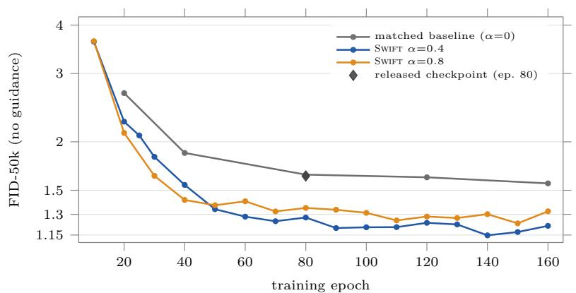  
Figure 8 RAEv2 unguided training trajectories. The dense Swift traces are used to study training dynamics; the canonical RAEv2 results are reported in Tables 6 and 7. The diamond marks the released epoch-80 checkpoint.

## E.4 Training trajectories and the long schedule

Across configurations. For the 12 DifusionBench configurations whose baseline we also evaluated during training, Swift is ahead at every evaluation from epoch 40 on. Figure 9 shows four of them, with baselines spanning roughly an order of magnitude in FID.

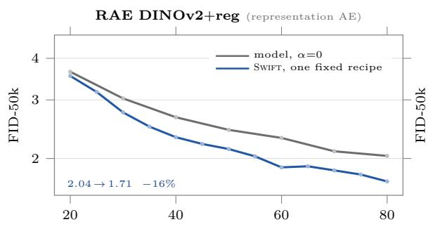

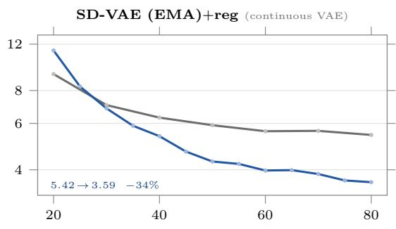

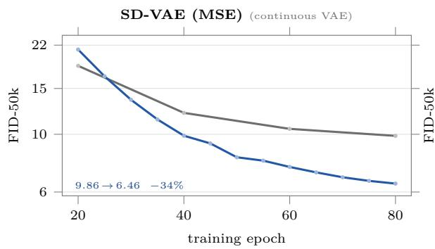

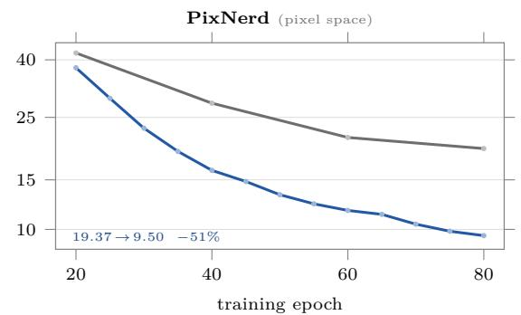  
Figure 9 The same fixed Swift recipe improves four different ImageNet-256 training trajectories. Each panel shows a diferent DifusionBench stage-2 model and representation. Grey is the matched α=0 baseline and blue is Swift with the same fixed recipe (α=0.4, half-width guide pretrained for half the standard main-model duration and then frozen), with no per-model tuning. Swift is ahead by epoch 40 in all four cases and remains ahead through the end of training, across baselines spanning roughly an order of magnitude in FID. The y-axis is logarithmic; faint markers denote individual FID evaluations. The trajectory baselines reproduce the corresponding DifusionBench endpoints within 0.6–6%; the comparisons in Table 6 instead re-evaluate both sides with 50k samples.

Guide maturity on DINOv2-B. In the matched 80-epoch ablation, the default guide is pretrained for half the standard main-model duration. Its α=0.4 and 0.8 arms lag the baseline at epoch 20 (by 0.11 and 0.05 FID), but lead from epoch 40 onward (by 0.28–0.48). An earlier guide with $\alpha { = } 0 . 4$ leads throughout (by 0.47–0.59 FID).

Persistence through 240 epochs. In a separate, hardware-matched DINOv2-B pair using the fixed α=0.4, default frozen-guide recipe, we train both arms to 240 epochs. Across 36 matched evaluations from epoch 20 onward, Swift has lower FID at every checkpoint. The gap remains 0.26 FID at epoch 240, so the gain does not vanish on this longer schedule. Table 9 reports FID values every 20 epochs, and Figure 10 shows the corresponding training trajectories. A separate α=0 hardware replicate is an additional reference only and is excluded from the diferences.

Table 9 DINOv2-B over 240 matched training epochs. Unguided FID from the training-time evaluator, sampled every 20 epochs. The two blocks list epochs in order; ∆ is Swift minus baseline, computed before rounding the FIDs displayed here. Figure 10 plots the same 20-epoch checkpoints.
<table><tr><td>Epoch</td><td>Baseline</td><td>SWIFT</td><td>∆</td><td>Epoch</td><td>Baseline</td><td>SWIFT</td><td>∆</td></tr><tr><td>20</td><td>3.63</td><td>3.52</td><td>-0.12</td><td>140</td><td>1.81</td><td>1.51</td><td>-0.30</td></tr><tr><td>40</td><td>2.67</td><td>2.32</td><td>-0.36</td><td>160</td><td>1.80</td><td>1.46</td><td>-0.34</td></tr><tr><td>60</td><td>2.36</td><td>2.00</td><td>-0.36</td><td>180</td><td>1.75</td><td>1.49</td><td>-0.26</td></tr><tr><td>80</td><td>2.13</td><td>1.77</td><td>-0.37</td><td>200</td><td>1.72</td><td>1.44</td><td>-0.28</td></tr><tr><td>100</td><td>1.99</td><td>1.60</td><td>-0.39</td><td>220</td><td>1.67</td><td>1.41</td><td>-0.26</td></tr><tr><td>120</td><td>1.91</td><td>1.50</td><td>-0.41</td><td>240</td><td>1.63</td><td>1.38</td><td>-0.26</td></tr></table>

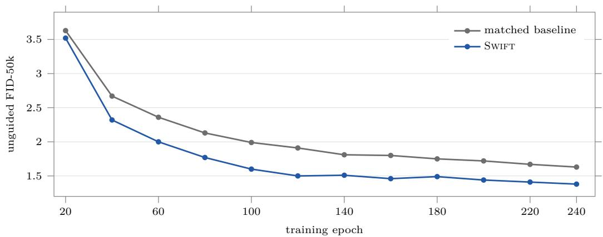  
Figure 10 DINOv2-B training trajectories through epoch 240. The matched unguided FID curves are plotted every 20 epochs, using the rounded values in Table 9. Swift remains below the baseline throughout the displayed schedule.

## F Additional CIFAR-10 experiments

Experimental setting. Beyond the coeficient, guide-width, and guide-maturity ablations in Section 5.4, we tested the additional methods below. We use class-conditional CIFAR-10 at 32 × 32, a DDPM++ student with channel base 128, batch size 512, and 200k kimg of training. Unless varied by the method, the guide is a separately trained, frozen DDPM++ model with channel base 64 at 200k. Evaluation uses FID-50k with the 18-step EDM sampler.

Table 10 Additional methods and their best FIDs. Each entry is the lowest FID at the common 200k endpoint across all completed settings and runs of that method, rather than a run average. Online adaptive rules are preliminary.
<table><tr><td>Method</td><td>Best FID</td></tr><tr><td>Single-stage guide-capacity switch</td><td>1.501</td></tr><tr><td>Time profile: late peak</td><td>1.507</td></tr><tr><td>Combined time/noise coefficients</td><td>1.549</td></tr><tr><td>Recorded guide ahead of student training age</td><td>1.557</td></tr><tr><td>Time profile: late hold</td><td>1.559</td></tr><tr><td>Multi-stage guide-capacity schedule</td><td>1.561</td></tr><tr><td>Terminal-α changes (profiles or shared-prefix tails)</td><td>1.562</td></tr><tr><td>Normalized noise-dependent α tilts NCSN++ guides (width 64/128)</td><td>1.568</td></tr><tr><td>Negative-α warm starts</td><td>1.570</td></tr><tr><td>Recorded same-age guide</td><td>1.582</td></tr><tr><td>Co-trained guide</td><td>1.602</td></tr><tr><td>Time profile: early/middle/tail</td><td>1.618</td></tr><tr><td>Recorded guide behind student training age</td><td>1.619</td></tr><tr><td>Noise-dependent α ramps</td><td>1.621</td></tr><tr><td>Random α ∼ U [0, 1]</td><td>1.622</td></tr><tr><td></td><td>1.625</td></tr><tr><td>Time profile: piecewise</td><td>1.630</td></tr><tr><td>ADM guides (width 96)</td><td>1.639</td></tr><tr><td>Time profile: middle only</td><td>1.827</td></tr><tr><td>Online adaptive α rules (preliminary)</td><td>2.416</td></tr></table>

Guide variants. We replaced the DDPM++ guide with NCSN++ or ADM, co-trained the guide alongside the student, or replayed separately trained guide checkpoints. The recorded checkpoints either matched the student’s training age or were ahead/behind it; ahead variants require pre-trained future checkpoints. Capacity schedules switched guide widths during training, either once or through several stages, including 16 → 32 → 64 and a further width-96 stage.

Coeficient schedules. We varied α over training using early/middle/tail and piecewise profiles, a middle-only pulse, or late-onset peak/hold profiles. We also tested a short negative-α prefix and diferent terminal coeficients. Noise-dependent variants used ramps or normalized tilts over noise level; other trials sampled α uniformly from [0, 1] or adjusted it online using short loss probes.

Combined methods. We multiplied a training-time coeficient profile by a noise-dependent factor, allowing the extrapolation strength to vary jointly with training progress and noise level. This tests whether the two adjustments can provide complementary improvements. Full settings and all 156 run labels (152 scored), including extended-budget and exploratory runs, remain in the accompanying DATA files.

## G Additional samples

Figures 11 to 14 show samples from Swift on RAEv2/DINOv3-L, the model with guided FID 0.99 in Table 7, for 32 ImageNet classes. As in Figure 3, samples are generated with retuned internal guidance and a 50-step Euler ODE sampler. Each block shows 28 samples of one class; the class index and name are given below the block.

  
Class 022: bald eagle

  
Class 024: great grey owl

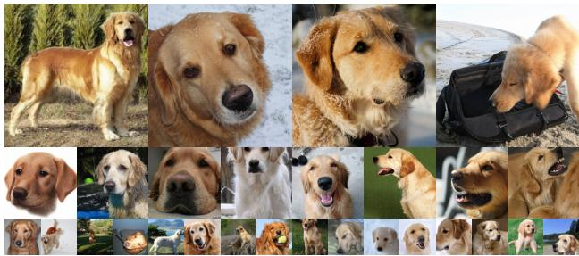  
Class 207: golden retriever

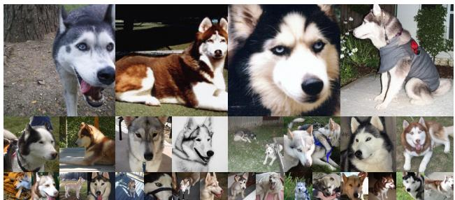  
Class 250: Siberian husky

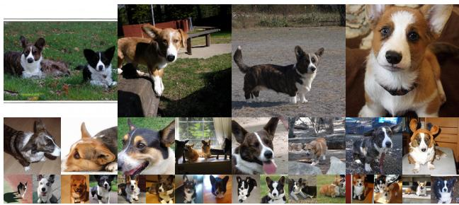  
Class 264: Cardigan

  
Class 288: leopard

  
Class 097: drake

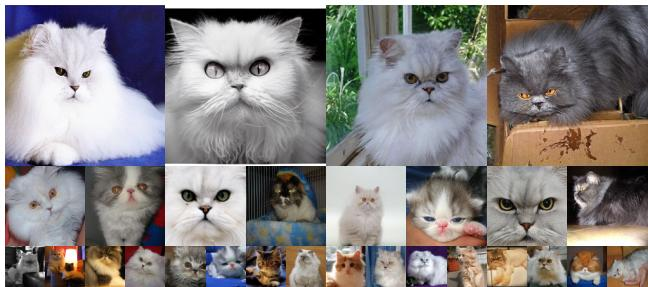  
Class 283: Persian cat

Figure 11 Samples from Swift on RAEv2/DINOv3-L: birds and mammals. Internal guidance, 50-step Euler ODE sampler; 28 samples per class.

  
Class 002: great white shark

  
Class 107: jellyfish

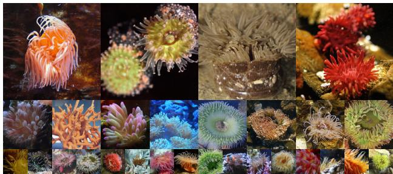  
Class 108: sea anemone

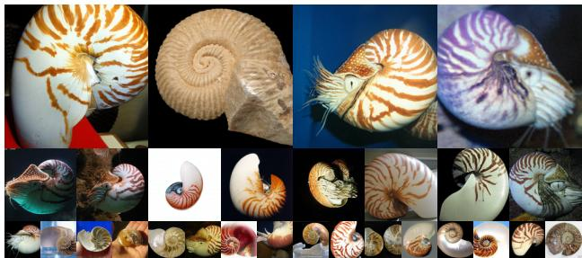  
Class 117: chambered nautilus

  
Class 148: killer whale

  
Class 327: starfish

  
Class 393: anemone fish

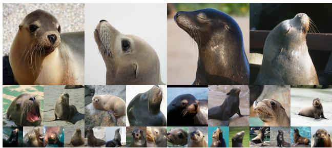  
Class 150: sea lion  
Figure 12 Samples from Swift on RAEv2/DINOv3-L: marine life. Internal guidance, 50-step Euler ODE sampler; 28 samples per class.

  
Class 404: airline

  
Class 780: schooner

  
Class 417: balloon

  
Class 814: speedboat

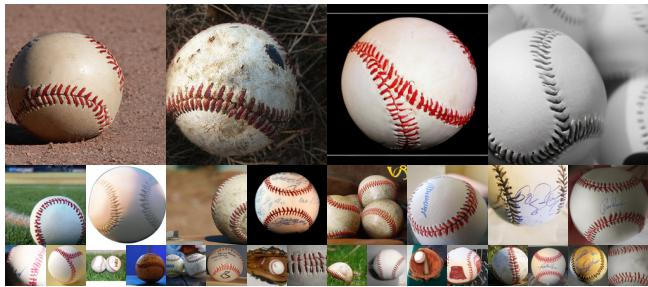  
Class 429: baseball

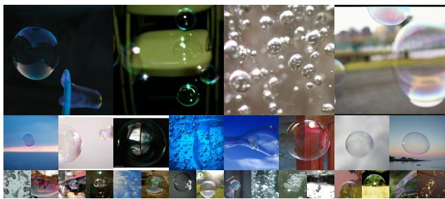  
Class 971: bubbl

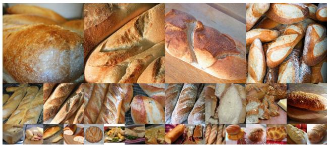  
Class 930: French loaf

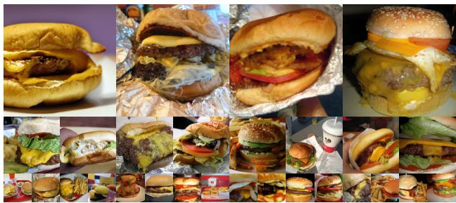  
Class 933: cheeseburger  
Figure 13 Samples from Swift on RAEv2/DINOv3-L: vehicles, objects, and bread. Internal guidance, 50-step Euler ODE sampler; 28 samples per class.

  
Class 949: strawberry

  
Class 951: lemon

  
Class 953: pineapple

  
Class 957: pomegranate

  
Class 963: pizza

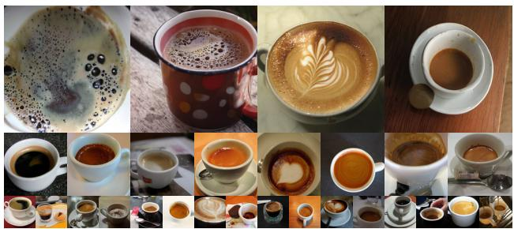  
Class 967: espresso

  
Class 985: daisy

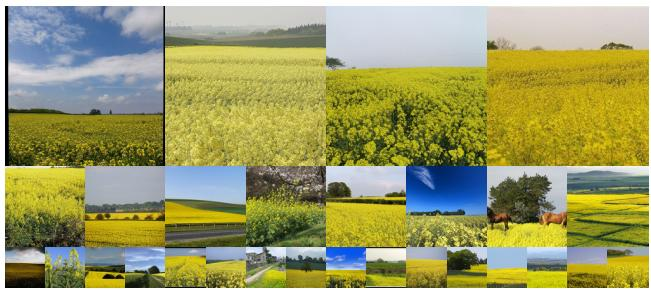  
Class 984: rapeseed  
Figure 14 Samples from Swift on RAEv2/DINOv3-L: fruit, food, and plants. Internal guidance, 50-step Euler ODE sampler; 28 samples per class.