# Scaling Vision Foundation Models for Toxicologic Pathology

Jessica Loo1, Theodoros Pissas2, Byunghak Kang1, Vincent A. Ella1, Xiaoyan Zhang1, Kevin Sweeney3, Walter Georgescu2, Prateek Katiyar2, Julie Boisclair2, Holger Hoefling2

1 Novartis Institutes for Biomedical Research Inc., Cambridge, MA, USA 2 Novartis Pharma AG, Basel, Switzerland 3 Novartis Ireland Limited, Dublin, Ireland

Funding and Disclosures: All authors are employees of Novartis.

Keywords: Foundation model, histopathology, non-clinical, preclinical, self-supervised learning, toxicology.

Abbreviations: ABMIL, attention-based multiple instance learning; CKA, centered kernel alignment; H&E, hematoxylin and eosin; kNN, k-nearest neighbors; mIOU, mean intersection-over-union; MMD, maximum mean discrepancy; MPP, microns per pixel; PCA, principal component analysis; PFM, pathology foundation model; RBF, radial basis function; TCGA, The Cancer Genome Atlas; ViT, Vision Transformer; WSI, whole slide image.

## Abstract

Toxicology studies to evaluate the safety and toxicity of drug candidates in animal models span the entire drug development pipeline, from early discovery through clinical development and postmarketing, with the preclinical phase representing the most critical milestone before advancement to first-in-human clinical trials. During each phase, toxicologic pathologists perform systematic histopathology examinations across multiple organs and species, identifying and characterizing morphological changes indicative of drug-induced toxicity. These workflows are complex and high-volume, requiring substantial manual efort from expert pathologists. Advances in digital pathology and artificial intelligence are enabling the development of tools and systems that can support and improve pathologists’ daily workflows, while pathology foundation models (PFMs) can accelerate and enhance these development eforts by providing robust image representations and flexible computational backbones for a wide range of specialized downstream applications. However, the current landscape of PFMs remains heavily focused on clinical use cases, leaving critical gaps in the systematic assessment of PFMs in non-clinical settings. Here, we present TOX-FM, a family of non-clinical PFMs trained on large-scale diverse histopathology datasets of over one million whole slide images consisting of over 60 organs across six animal species from over 14,000 toxicology studies across six decades. We introduce a comprehensive benchmark of 18 non-clinical downstream tasks, incorporate an established benchmark of 9 clinical downstream tasks, and evaluate TOX-FM against state-of-the-art clinical PFMs across both non-clinical and clinical domains. Notably, we explore open questions surrounding domain-specific training and cross-domain generalization, ofering insights into the opportunities and challenges of applying PFMs in the non-clinical domain.

## 1 Introduction

Toxicology studies are a cornerstone of the drug development pipeline for novel therapeutics. While the preclinical phase is most critical, providing key evidence to enable the transition from early research to firstin-human clinical trials, toxicology studies are conducted throughout the entire drug development continuum, extending from early discovery through clinical development and post-marketing settings. At every stage, the safety and toxicity of drug candidates are evaluated in animal models to identify potential adverse efects and to support ongoing risk assessments. Central to this efort, histopathology examinations across multiple tissues and animal species are performed by toxicologic pathologists in a labor-intensive and time-consuming process, particularly as most tissues examined may not exhibit any drug-related microscopic changes. The Society of Toxicologic Pathology and other professional groups in pathology and related disciplines have highlighted how artificial intelligence may address some of the current challenges to synergistically improve a pathologist’s individual and collective diagnostic eficiency, improving the overall workflow and shortening study timelines [1–4].

In recent years, many state-of-the-art pathology foundation models (PFMs) have been developed using self-supervised learning frameworks [5–10] on large-scale unlabeled datasets of whole slide images (WSIs) [11–17]. PFMs learn generalizable task-agnostic representations of the underlying data and provide broad support for task-specific machine learning models by enabling eficient adaptation to multiple downstream tasks with relatively limited labeled datasets [18]. The development of PFMs has been driven primarily by clinical applications, particularly oncology, whereas non-clinical PFMs remain comparatively underexplored. This is partly due to the limited availability of large-scale non-clinical datasets, with most development to date relying on the publicly available TG-GATES dataset, which consists only of rat liver and kidney tissues [19–21]. Additionally, many existing clinical PFMs are subjected to restrictions on commercial use, which may limit their integration into drug development pipelines. Importantly, the lack of non-clinical PFMs also leaves several important questions unresolved: How critical is domain-specific training for PFMs for downstream task performance? How well do clinical PFMs generalize to the non-clinical domain, and vice versa? Addressing these questions is essential for understanding cross-domain generalization and the scope of potential applications of PFMs, as well as whether it is necessary to direct more focus towards the development of non-clinical PFMs.

In this work, we address key gaps in the development and evaluation of foundation models for histopathology by introducing TOX-FM, a family of PFMs trained on large-scale diverse histopathology datasets from animal toxicology studies. TOX-FM establishes a benchmark for non-clinical PFMs and provides early insights into the cross-domain generalization capabilities of existing clinical PFMs. Our main contributions are as follows:

• A family of large-scale non-clinical PFMs. We present TOX-FM, a family of non-clinical PFMs trained using the DINOv3 self-supervised learning framework [22] on over one million WSIs consisting of over 60 organs across six animal species from over 14,000 toxicology studies across six decades. To the best of our knowledge, TOX-FM is trained on the largest and most diverse non-clinical histopathology dataset to date and is the first non-clinical PFM to scale beyond the previously limited scope of rat liver and kidney tissues.

• A computationally eficient multi-scale dataset curation strategy. We use a hierarchical clustering and sampling approach for dataset curation and introduce a progressive multi-scale strategy that operates across magnifications. This strategy addresses the practical challenge of scaling training to one million WSIs under a fixed computational budget, while producing a highly diverse yet computationally compact training dataset.

• A comprehensive cross-domain benchmark. We introduce a comprehensive benchmark of 18 non-clinical downstream tasks, incorporate an established benchmark of 9 clinical downstream tasks, and evaluate TOX-FM against state-of-the-art clinical PFMs across both non-clinical and clinical domains. To the best of our knowledge, this provides the first systematic evaluation of cross-domain generalization of PFMs.

• An empirical study of scaling and training strategies. We analyze the impact of scaling model size and dataset diversity, and quantify the contributions of various complementary training strategies, including continual learning and Gram anchoring. These analyses provide practical and actionable guidance for future development of PFMs.

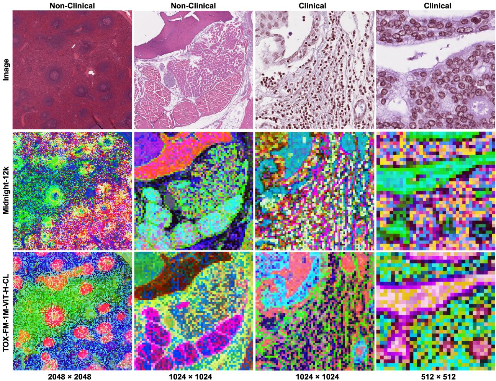  
Figure 1: Examples of PCA feature maps of Midnight-12k (best performing clinical PFM) and TOX-FM-1M-ViT-H-CL (best performing non-clinical PFM) across diferent domains and scales. Non-clinical images are taken from the tissue task (rat, 2.0 mpp) and clinical images are taken from the MoNuSAC task (0.25 mpp).

## 2 Related Work

Dataset Scaling and Curation. Recent work in the natural vision-language domain has demonstrated that naively increasing the dataset size can be less efective for representation learning, compared to selecting higher quality subsets of available data or more diverse data distributions, especially for similar compute budgets [23–25]. These considerations also apply to large language models, whereby quality-based pruning can retain only a fraction of the available corpus while matching or exceeding the performance of the full dataset [26]. Collectively, these studies suggest that the selection of informative and diverse samples provides a more compute-eficient training signal compared to random sampling, thereby motivating a dataset curation strategy when scaling the dataset to one million WSIs.

Generalization Under Domain Shifts. To the best of our knowledge, the robustness of PFMs under domain shifts has been studied exclusively in the clinical setting, with prior work focusing on technical factors such as processing and imaging sites [27–31], scanner types [32, 33], and staining conditions [34]. A smaller body of work has examined domain shifts related to biological or disease-relevant factors. For example, previous work has demonstrated that clinical PFMs trained on hematoxylin and eosin (H&E) slides from datasets focused on cancer may not generalize well to multi-stain immunohistochemistry slides from datasets focused on autoimmune diseases, with several PFMs performing no better or worse than natural image models [35]. Performance degradation has also been reported for zero-shot cross-cancer evaluations, although the addition of handcrafted biologically motivated descriptors mitigated the loss in performance [36].

Importantly, cross-species domain shifts remain largely unexplored [4]. Some relevant work in this direction includes adversarial training on canine tumors for generalization of a mitosis detection model to human tumors [37] and fine-tuning natural image models on rodent liver WSIs [38]. However, the bidirectional generalization of learned image representations between non-clinical animal pathology and clinical human pathology has not been systematically evaluated for PFMs.

## 3 Dataset

The dataset consisted primarily of H&E WSIs from toxicology studies conducted by Novartis Biomedica Research across global sites. The studies consisted of approximately 75% rodent (rat and mouse) and 25% non-rodent (dog, monkey, pig, and rabbit) species, ranging from acute (two weeks) to lifelong (two years) carcinogenicity studies.

The training datasets were collected in two phases. In the first phase, 100,000 WSIs from rat studies conducted between 1999 and 2024 were obtained from existing internal digital databases. In the second phase, 1 million WSIs were acquired by digitizing archived glass slides from legacy rodent and non-rodent studies conducted from as early as 1967. We refer to the datasets as TOX-FM-100K and TOX-FM-1M, respectively. There was no overlap between the studies in the two training datasets.

Overall, TOX-FM-100K was a less diverse dataset, consisting of WSIs from 700 rat studies only, while TOX-FM-1M was a more diverse dataset, consisting of WSIs from 13,352 studies across six species (rat, mouse, dog, monkey, pig, and rabbit). Additionally, TOX-FM-1M included more studies that were conducted at diferent contract research organizations, which introduced further variation in staining and scanning protocols, thereby increasing diversity.

## 3.1 Dataset Sampling and Curation

Patches (256 × 256 pixels) were sampled from the WSIs at multiple magnifications for training. For TOX-FM-100K, all non-overlapping patches from tissue regions were sampled at 0.5, 1.0, 2.0, and 4.0 microns per pixel (mpp), resulting in approximately 1 billion patches. For TOX-FM-1M, a dataset curation method was implemented to sample a subset of patches, motivated by recent research on scaling dataset size for vision foundation models [10, 22], as well as practical considerations such as storage and computational constraints. The dataset curation resulted in a diverse and compact dataset of approximately 463 million patches, corresponding to approximately 4.4% of patches selected from a candidate pool of 10.5 billion patches across all magnifications.

We used a progressive multi-scale strategy for sampling patches across the diferent magnifications, with selection proceeding from the lowest magnification (4.0 mpp) to the highest magnification (0.5 mpp). At the lowest magnification, all non-overlapping patches from tissue regions from all WSIs were defined as candidate patches for selection. Candidate patches at each subsequent higher magnification were restricted to those located within the regions of the selected patches at the preceding lower magnification. Figure 2B shows examples of the spatially linked selected patches across magnifications.

We used a hierarchical k-means approach [39] for the selection of patches, applying the method to candidate patches at each magnification. First, Midnight-12k [17] was used to generate embeddings for all candidate patches. The embeddings at each magnification were independently projected into a lower dimensional space using principal component analysis (PCA) to reduce the computational cost of clustering. Then, k-means clustering was applied to the embeddings and recursively applied to the resulting centroids, yielding a bottom-up four-level hierarchy of clusters. Given a target subset size, the quota was distributed top-down from the from the root clusters to the leaf clusters, where individual patches were finally selected. Specifically, at each level, the number of samples allocated to a parent cluster was uniformly distributed among its child clusters. If a child cluster had fewer samples than the allocated quota, the additional quota was reallocated to the remaining child clusters of the same parent. Figure 2A shows the UMAP visualization of the hierarchical clustering results for the lowest magnification.

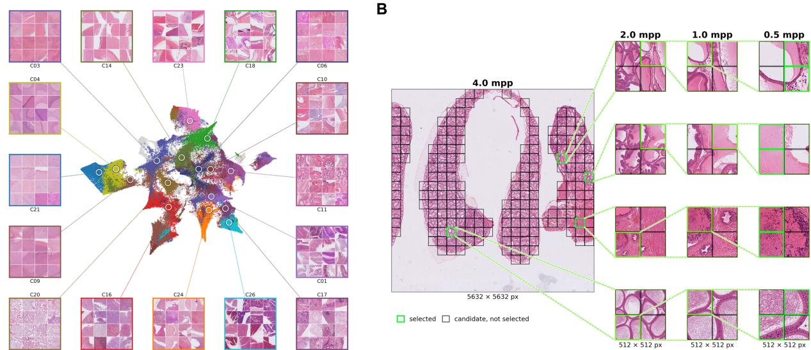  
Figure 2: (A) UMAP visualization of the hierarchical k-means clustering results at 4.0 mpp. Each point corresponds to one of the 100,000 bottom-level cluster centroids with the color indicating the corresponding top-level cluster centroid. Examples of the patches from the 16 largest top-level clusters are shown. Overall, the hierarchical k-means approach produces a morphologically coherent organization of the embedding space, with top-level clusters forming contiguous regions that correspond to visually distinct histological patterns. (B) Examples of spatially linked patches selected by the progressive multi-scale strategy from the lowest magnification (4.0 mpp) to highest magnification (0.5 mpp).

Overall, the dataset curation strategy for TOX-FM-1M yielded spatially linked subsets of patches across magnifications. By balancing the selected patches across the hierarchical levels within a magnification, the method reduced the redundancy of common histological patterns, while preserving diverse and underrepresented phenotypes. Across magnifications, rare tissue types were oversampled relative to the sampling ratio in most cases. More details of the settings used for the hierarchical k-means approach and a validation analysis of the method are provided in Appendix 1.

## 4 Training

We used the DINOv3 self-supervised learning framework [22] with student-teacher distillation to train Vision Transformer (ViT) models. We trained ViT-L (305M parameters) and ViT-H (636M parameters) models with the diferent versions of the datasets to investigate the efects of scaling model size and dataset diversity. Given the sequential nature of the datasets, which were collected in two phases, we also explored a continual learning strategy to integrate knowledge from both datasets while maintaining eficient use of computational resources. Additionally, all models were fine-tuned with the Gram anchoring strategy, which was proposed in DINOv3 to improve dense feature representations, to investigate the efects on spatially resolved downstream tasks.

Augmentations. Models were trained using the multi-crop strategy [40], by applying random cropping scales and using 2 global crops (256 × 256 pixels) and 8 local crops (112 × 112 pixels) per patch. Geometric augmentations in the form of horizontal and vertical flipping and color augmentations in the form of Gaussian blurring and RandStainNA [41] were applied with varying probabilities. For RandStainNA, the statistical parameters for virtual template generation were estimated from a random subset of 12,000 WSIs from TOX-FM-100K.

Optimization. Models were trained using 16 or 32 NVIDIA H100 GPUs for ViT-L or ViT-H, respectively.

Patches were sampled with equal probability from each magnification for balanced multi-scale training. Models were trained for up to 2 million iterations using AdamW optimization [42] with a constant learning rate following a linear warmup.

Checkpoint Selection. 12,451 WSIs from 246 studies across all six species were used as a validation dataset to design downstream tasks for model development. For each model, the average performance across four non-clinical tasks was monitored every 50,000 iterations and the checkpoint with the overall best performance was selected. Specifically, the validation downstream tasks consisted of species, tissue (rat), artifact, and lesion patch classification using linear probe. More details of the non-clinical downstream tasks are provided in the Evaluation section.

Continual Learning. We explored a continual pre-training strategy [43, 44] whereby the model was initialized with existing weights from training on TOX-FM-100K from the first phase, and training was continued on TOX-FM-1M in the second phase. The training in the second phase was limited to 1 million iterations. This reflects a practical real-world scenario whereby foundation models are continuously updated as new datasets become available, with sequential training strategies that preserve previous training eforts and significantly reduce computational costs. In contrast, joint training strategies, such as retraining from scratch with progressively larger combined datasets, quickly become unsustainable and have been shown to yield diminishing returns relative to continual learning [45].

Gram Anchoring. The Gram anchoring objective operates on the Gram matrix, which is the matrix of all pairwise dot products of patch features, and aims to push the Gram matrix of the student network towards that of the Gram teacher, which is an earlier checkpoint of the teacher network that typically exhibits superior dense features [22]. For Gram teacher checkpoint selection, we followed the same approach described in the Checkpoint Selection section, but focused only on artifact and lesion tasks, as the quality of the dense features should be best reflected by the performance on these spatially resolved downstream tasks.

## 5 Evaluation

## 5.1 Pathology Foundation Models

We evaluated both non-clinical and clinical PFMs to assess domain-specific performance and cross-domain generalization. Table 1 shows an overview of the PFMs.

<table><tr><td>Domain</td><td>Model</td><td>Architecture</td><td>Training Magnification (mpp)</td></tr><tr><td rowspan="4">Non-Clinical</td><td>TOX-FM-100K-ViT-L</td><td>ViT-L</td><td>0.5, 1.0, 2.0, 4.0</td></tr><tr><td>TOX-FM-100K-ViT-H</td><td>ViT-H</td><td>0.5, 1.0, 2.0, 4.0</td></tr><tr><td>TOX-FM-1M-ViT-H</td><td>ViT-H</td><td>0.5, 1.0, 2.0, 4.0</td></tr><tr><td>TOX-FM-1M-ViT-H-CL</td><td>ViT-H</td><td>0.5, 1.0, 2.0, 4.0</td></tr><tr><td rowspan="3">Clinical</td><td>Prov-GigaPath</td><td>ViT-g</td><td>0.5</td></tr><tr><td>H-optimus-0</td><td>ViT-g</td><td>0.5</td></tr><tr><td>Midnight-12k</td><td>ViT-g</td><td>0.25, 0.5, 1.0, 2.0</td></tr></table>

Table 1: Overview of non-clinical and clinical PFMs for evaluation. The number of parameters for ViT-L, ViT-H, and $\mathrm { V i T - g }$ architectures are approximately 305M, 636M, and 1.1B parameters, respectively.

Non-Clinical Models. First, we developed TOX-FM-100K-ViT-L and TOX-FM-100K-ViT-H to evaluate the efects of scaling model size. While most state-of-the-art PFMs adopt ViT-g (1.1B parameters) architectures, we explored whether ViT-L and ViT-H architectures, which are approximately 30 – 60% of the size of ViT-g, remain competitive with significantly reduced computational costs. Second, we developed TOX-FM-1M-ViT-H to evaluate the efects of scaling dataset diversity and training with curated datasets, as well as to provide a baseline for the continual learning strategy. Finally, we developed TOX-FM-1M-ViT-H-CL, which was initialized from TOX-FM-100K-ViT-H, to evaluate the continual learning strategy used to integrate knowledge from datasets collected in diferent phases. Additionally, we fine-tuned all models with the Gram anchoring objective on their respective training datasets and refer to the corresponding models with the -Gram sufix.

Clinical Models. We evaluated state-of-the-art clinical PFMs with licenses that permit commercial use. Specifically, we evaluated Prov-GigaPath [12], H-optimus-0 [13], and Midnight-12k [17], which were trained on various public and proprietary clinical datasets and have demonstrated strong performance across various clinical pathology benchmarks [46–48]. All models were accessed via the oficial versions published on Hugging Face.

Natural Image Models. As baselines, we included out-of-domain models trained on non-pathology datasets. Specifically, we evaluated a ViT-B (86M parameters) model trained on the ImageNet dataset of 1.2 million images [49, 50] and the ViT-L variant (distilled from ViT-7B) of the original DINOv3 model trained on the LVD-1689M web-scale dataset of 1.689 billion images [22]. Although web-scale data may contain some biomedical or pathology-related images, such content is expected to represent only a small fraction of LVD-1689M, which is predominantly composed of natural images. Accordingly, ImageNet-ViT-B provides a lower bound baseline of a small natural image model, whereas DINOv3-LVD-1689M-ViT-L provides a strong baseline of an architecture-matched general vision foundation model.

## 5.2 Downstream Tasks

We evaluated the PFMs outlined in Table 1 on a comprehensive set of 18 non-clinical and 9 clinical downstream tasks across various species, indications, tissues, and magnifications. The types of tasks included patch classification, slide classification, and segmentation. Table 2 shows an overview of the downstream tasks.

<table><tr><td rowspan="2">Domain</td><td rowspan="2">Type</td><td rowspan="2">Task</td><td>Magnification (mpp)</td><td>Number of Classes</td></tr><tr><td></td><td></td></tr><tr><td rowspan="10">Non-Clinical</td><td rowspan="4">Patch Classification (Linear Probe)</td><td>Species Tissue (Dog)</td><td>4.0</td><td>6</td></tr><tr><td></td><td>2.0</td><td>23</td></tr><tr><td>Tissue (Monkey)</td><td>2.0</td><td>10</td></tr><tr><td>Tissue (Mouse)</td><td>2.0</td><td>33</td></tr><tr><td rowspan="6"></td><td>Tissue (Rabbit)</td><td>2.0</td><td>9</td></tr><tr><td>Tissue (Rat)</td><td>2.0</td><td>30</td></tr><tr><td>Artifact Lesion</td><td>1.0 0.5</td><td>9 32</td></tr><tr><td>Patch Classification Artifact</td><td>1.0</td><td></td></tr><tr><td>Lesion</td><td>0.5</td><td>9 32</td></tr><tr><td>Species</td><td></td><td></td></tr><tr><td rowspan="6">Segmentation</td><td rowspan="6">Slide Classification</td><td>Tissue (Dog)</td><td>4.0</td><td>6</td></tr><tr><td>Tissue (Monkey)</td><td>2.0</td><td>23</td></tr><tr><td></td><td>2.0 2.0</td><td>10</td></tr><tr><td>Tissue (Mouse)</td><td>2.0</td><td>33</td></tr><tr><td>Tissue (Rabbit) Tissue (Rat)</td><td></td><td>9</td></tr><tr><td>Artifact</td><td>2.0</td><td>30</td></tr><tr><td rowspan="6"></td><td rowspan="3"></td><td>Lesion</td><td>1.0 0.5</td><td>10 33</td></tr><tr><td>BACH</td><td>0.5</td><td></td></tr><tr><td>BreakHis</td><td>0.25</td><td>4 4</td></tr><tr><td rowspan="4">Patch Classification</td><td>CRC</td><td>0.5</td><td>9</td></tr><tr><td>GleasonArvaniti</td><td>0.25</td><td>4</td></tr><tr><td>PatchCamelyon</td><td>1.0</td><td>2</td></tr><tr><td>Camelyon16 (Small)</td><td>0.25</td><td></td></tr><tr><td rowspan="2">Slide Classification Segmentation</td><td>PANDA (Small)</td><td>0.5</td><td>2 6</td></tr><tr><td>BCSS MoNuSAC</td><td>0.25 0.25</td><td>22 5</td></tr></table>

Table 2: Overview of non-clinical and clinical downstream tasks for evaluation of PFMs.

Non-Clinical Downstream Tasks. 19,935 WSIs from 289 studies across all six species were used as an evaluation dataset to design downstream tasks for model evaluation. The evaluation dataset was completely independent and there was no overlap with the WSIs in the TOX-FM-100K and TOX-FM-1M training datasets. The WSIs were paired with either metadata containing species and tissue information or pathologists’ annotations for artifacts and lesions, which were used to obtain labels for the respective tasks. The pathologists annotations were constrained to a region of interest in the WSI and exhaustively annotated within the region using QuPath open-source software for digital pathology image analysis [51]. Annotated artifacts were related to slide quality issues caused during slide preparation or scanning, while annotated lesions were related to drug- or disease-induced pathological findings in the tissue.

The non-clinical tasks were designed to encompass a range of task-appropriate magnifications. Species and tissue tasks were performed at lower magnifications, specifically at 4.0 and 2.0 mpp, respectively, as they are primarily associated with global semantic features of the image. Artifact and lesion tasks were performed at higher magnifications, specifically at 1.0 and 0.5 mpp, respectively, as they are primarily associated with local spatial features of the image. Figures 3B and 3C show some examples of the artifacts and lesions present in WSIs.

Following the established best practices for assessing PFMs [11, 13–16, 46], we designed all tasks as patch classification tasks using linear probe evaluation. For improved performance on artifact and lesion tasks, we also applied attention probe evaluation using attention-based multiple instance learning (ABMIL) [52] to aggregate patch token embeddings for patch classification. For improved performance on species and tissue tasks, we also designed slide classification tasks using ABMIL to aggregate embeddings across multiple patches sampled from a WSI. Finally, we designed artifact and lesion segmentation tasks using a simple U-Net decoder [53].

For each task, the relevant WSIs were split into training and testing datasets, and patches (256 × 256 pixels) were sampled accordingly from the WSIs. Classification tasks were designed to be balanced across classes. To enable fair comparison between models, we performed a hyperparameter sweep across diferent learning rates and weight decays where applicable. We report the performance from the best hyperparameter combination, which was determined by monitoring performance on a constant batch that was held out from the training dataset for the task. We report the macro F1 metric for classification tasks and the mean intersection-over-union (mIOU) metric for segmentation tasks.

All PFMs were frozen for evaluation and only the respective probes were trained for the downstream tasks. All linear probe patch classification tasks and slide classification tasks used the concatenation of the CLS token and mean of the patch token embeddings of the ViT model. All attention probe patch classification tasks and segmentation tasks used the patch token embeddings of the ViT model.

Clinical Downstream Tasks. We adopted the eva open-source foundation model evaluation framework for oncology [46] and included all accessible pathology datasets. We followed all evaluation protocols and metrics as defined in the oficial eva repository [54].

Note that the eva evaluation protocol specifies constant default hyperparameters. To enable fair comparison between models, we performed a hyperparameter sweep across diferent learning rates and weight decays where applicable. We report the performance from the best hyperparameter combination, similar to the evaluation protocol described for non-clinical tasks. Overall, this improved performance by approximately 1 – 4% compared to the metrics reported on the oficial leaderboard for the clinical PFMs.

More details of the hyperparameters are provided in Appendix 2.

## 6 Results

## 6.1 Performance of Non-Clinical and Clinical PFMs

Figure 3A shows the overall performance of all models across the non-clinical and clinical downstream tasks.   
More details of the performance on individual tasks are provided in Appendix 3.

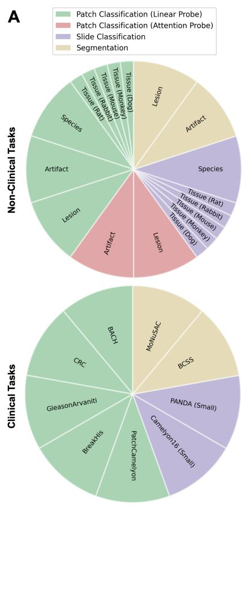

B  
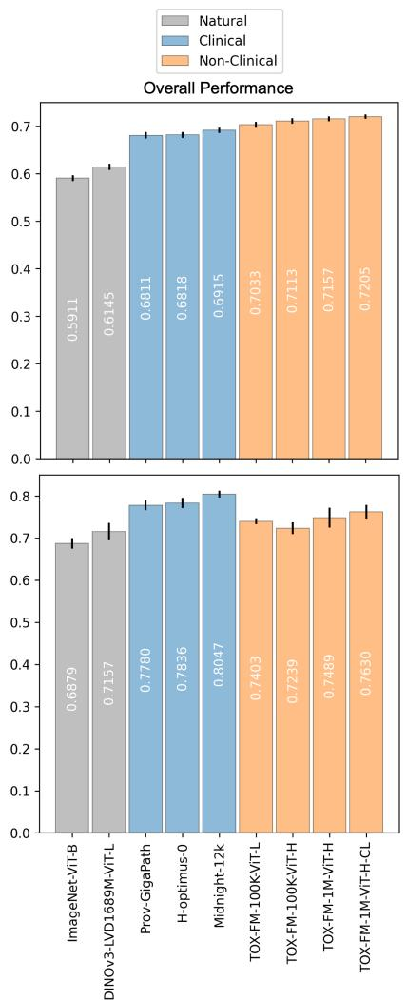

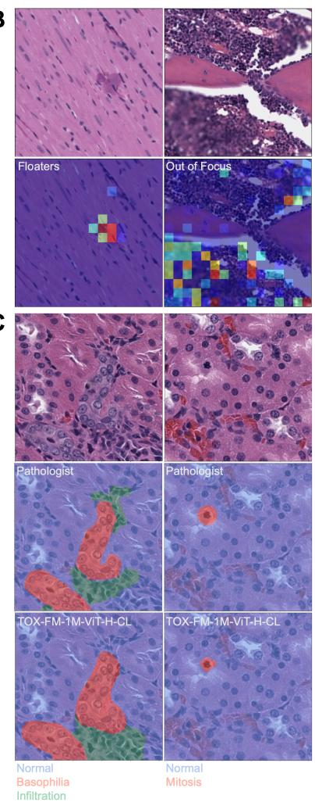  
Figure 3: (A) Distribution of task weights and overall performance (mean and standard deviation) of all models across a comprehensive set of 18 non-clinical and 9 clinical downstream tasks. (B) Examples of attention weights from attention probe evaluation for the artifact patch classification non-clinical task using embeddings from TOX-FM-1M-ViT-H-CL. The attention weights were used to aggregate the patch token embeddings for patch classification. (C) Examples of segmentation masks for the lesion segmentation non-clinical task using embeddings from TOX-FM-1M-ViT-H-CL.

Overall, domain-specific models achieve superior performance on their respective domain-specific tasks, with TOX-FM-1M-ViT-H-CL demonstrating the best performance across the non-clinical PFMs and Midnight-12k demonstrating the best performance across the clinical PFMs. Notably, cross-domain performance remains remarkably competitive across both non-clinical and clinical PFMs. Specifically, the best cross-domain model achieves approximately 95% relative performance compared to the strongest domain-specific model and 98% relative performance compared to the weakest domain-specific model, suggesting efective cross-domain generalization.

Figure 1 shows examples of the feature maps of Midnight-12k and TOX-FM-1M-ViT-H-CL across diferent domains and scales using PCA visualization techniques, whereby the features are projected into 3 dimensions and visualized in RGB space [22]. Across both non-clinical and clinical images, TOX-FM-1M-ViT-H-CL produces high-quality feature maps, capturing the semantic similarity of tissue morphology at diferent spatial locations across the images. Similarly, Midnight-12k also generates structured and informative feature maps, although some examples appear less spatially coherent by visual inspection. However, PCA feature map visualizations are qualitative and projection-dependent, so visual coherence is not necessarily a direct measure of downstream utility or predictive accuracy. We note that Midnight-12k was trained using the DINOv2 framework which uses learnable positional embeddings, which are interpolated to process images at varying resolutions. In contrast, TOX-FM models were trained using rotary positional embeddings [55], which enables the models to process images at varying resolutions without requiring adaptation. Therefore, while the PCA feature maps in Figure 1 are visualized at diferent resolutions to support qualitative analysis across multiple scales, additional examples of the PCA feature maps at the training resolution of 256 × 256 pixels are provided in Appendix 3.

Across the non-clinical tasks, we observe that the clinical PFMs tend to show the biggest gaps in performance on species and tissue tasks, which are performed at lower magnifications, while the performance remains more competitive on artifact and lesion tasks, which are performed at higher magnifications. Lower magnifications capture tissue-level architecture and organization, which exhibit greater diferences between human and animal tissues, and may have lower transferability from the clinical to non-clinical domain. At higher magnifications, the distinctions between human and animal tissues are progressively reduced as cell-level details become the focus, resulting in stronger cross-domain transferability. We note that Prov-GigaPath and H-optimus-0 were trained exclusively on a single magnification at 0.5 mpp. While the underlying self-supervised learning frameworks [7, 10] do implicitly learn multi-scale features through global and local cropping and scaling augmentations, the efective magnification range remains limited, and such augmentations alone are insuficient to capture the intrinsic multi-scale nature of WSIs. In contrast, models that explicitly include multi-scale datasets sampled at various magnifications such as Midnight-12k and TOX-FM models demonstrate measurably improved performance, particularly when evaluated across broader magnification ranges.

While linear probe evaluation remains a strong baseline for assessing PFMs, attention probe evaluation significantly improves performance for spatially resolved patch classification tasks. Specifically, using attention probe evaluation, Midnight-12k demonstrates a relative performance improvement of 18% and 10% on artifact and lesion tasks, respectively. TOX-FM-1M-ViT-H-CL demonstrates an even larger relative performance improvement of 27% and 13%, respectively, suggesting that the patch token embeddings encode strong representations which can be appropriately leveraged using attention probe evaluation, but may be diminished when simply averaged for linear probe evaluation. Figure 3B shows examples of the attention weights from attention probe evaluation using embeddings from TOX-FM-1M-ViT-H-CL, whereby the relative importance of the patch token embeddings correlates well with the location of the artifacts.

## 6.2 Model Size

Our experiments on scaling model size provide further insights into the performance characteristics of PFMs. First, scaling model size without dataset diversity appears to lead to overfitting and degraded cross-domain performance. Specifically, when scaling from TOX-FM-100K-ViT-L to TOX-FM-100K-ViT-H, we observe that overall performance improves on non-clinical tasks but decreases on clinical tasks. However, jointly scaling model size and dataset diversity, as in TOX-FM-1M-ViT-H, improves the overall performance across both sets of tasks. These observations also highlight the importance of broad and comprehensive evaluations for accurately characterizing the scope and limitations of PFMs. Without assessing the performance on clinical tasks, it may have been incorrectly assumed that scaling model size universally improves downstream performance, while the efects of overfitting would have remained unrecognized.

We also found that the smaller model size of the non-clinical PFMs compared to the clinical PFMs does not appear to constrain performance on downstream tasks at this stage. Specifically, despite TOX-FM-1M-ViT-H-CL being 60% of the size of Midnight-12k, both models exhibit comparable cross-domain performance as detailed above. Alternatively, if model capacity was a bottleneck, we would expect non-clinical PFMs to perform substantially worse on clinical tasks than clinical PFMs do on non-clinical tasks, yet this asymmetry is not observed.

## 6.3 Dataset Diversity

Our experiments on scaling dataset diversity demonstrate a diference in the impact on domain-specific and cross-domain downstream tasks. Specifically, scaling from TOX-FM-100K-ViT-H to TOX-FM-1M-

ViT-H yielded more pronounced performance gains on clinical tasks than on non-clinical tasks. Motivated by observations from the natural image domain, we hypothesize that this is related to the diference in distributional proximity between the training and task datasets [56]. Under this assumption, TOX-FM-100K, despite being limited to rat studies, may already provide suficient task-relevant diversity and efective representations for many of the non-clinical tasks, for which rat was the dominant species. Moreover, the pathologists’ annotations for artifacts and lesions were primarily performed on rat WSIs from recent studies, so the additional diversity across species, studies, and variation in staining and scanning protocols ofered by TOX-FM-1M may be less relevant for these tasks.

We performed a quantitative analysis to validate the assumption that TOX-FM-100K is distributionally closer to the non-clinical tasks than TOX-FM-1M. First, to make the analysis computationally tractable, random subsets of 100,000 patches were generated from each of TOX-FM-100K, TOX-FM-1M, the non-clinical task datasets, and the clinical task datasets. To ensure that each subset was representative of the complete dataset, subsets were stratified across magnifications, tasks, and classes where applicable. Next following the standard practice for measuring distances between data distributions [57], we embedded each subset and calculated the maximum mean discrepancy (MMD) with a radial basis function (RBF) kernel [58], sliced Wasserstein distance [59], and Fréchet distance [60] between the training and task subsets in the embedding space.

Figure 4 shows the pairwise distribution distances between the training and task datasets. To ensure that the results were not biased by the choice of embedding space, we repeated the analysis using embeddings from six models across the natural image, clinical, and non-clinical domains. Overall, the smallest distances across all metrics and embedding spaces are between TOX-FM-100K and the non-clinical tasks, consistent with our hypothesis. Additionally, the distances between the training datasets and clinical tasks are considerably larger than those of non-clinical tasks, supporting the view that the clinical tasks constitute a challenging out of-distribution benchmark for non-clinical PFMs. UMAP visualizations of the datasets across all embedding spaces are provided in Appendix 4.

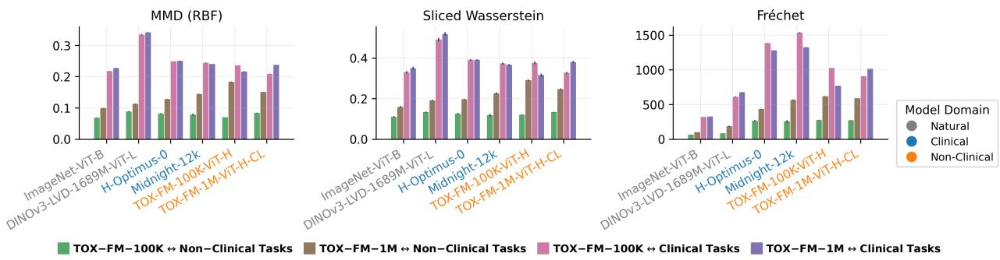  
Figure 4: Average pairwise distribution distances (mean and standard deviation) between the training and task datasets across three metrics. Metrics are averaged across 5 random subsets of 100,000 patches from each dataset.

Therefore, while previous work has emphasized the positive efect of distributional proximity and demonstrated the limited efect of dataset diversity on downstream tasks beyond the training distribution [56], our findings suggest that both distributional proximity and dataset diversity may play diferent roles depending on the magnitude of the distribution shift. In the low-shift regime, distributional proximity remains the dominant factor for performance on downstream tasks. However, in the high-shift regime, we observe that training with the more diverse non-clinical TOX-FM-1M improves the performance on clinical tasks, suggesting that dataset diversity can enhance cross-domain performance even when distributional proximity is absent.

Motivated by recent work on the convergence of representations across models trained using diferent datasets, methods, and modalities [61], we further examined whether scaling dataset diversity is associated with the convergence of non-clinical and clinical PFMs, thereby providing a potential explanation for the observed cross-domain generalization of TOX-FM models. Specifically, we measured the representation similarity of TOX-FM models with respect to Midnight-12k and H-optimus-0, the two best performing clinical PFMs on clinical tasks. We calculated the centered kernel alignment (CKA) [62] and mutual k-nearest neighbors (kNN)

[61] metrics with null calibration [63], which capture global and local representation similarity, respectively. The metrics were calculated using random, stratified subsets of 100,000 patches from the clinical task datasets. Figure 5 shows the representation similarity metrics between non-clinical and clinical PFMs. Overall, both global and local representation similarities increase alongside training dataset diversity, highlighting the increased representation convergence between non-clinical and clinical PFMs and consistent with the overal best cross-domain performance demonstrated by TOX-FM-1M-ViT-H-CL.

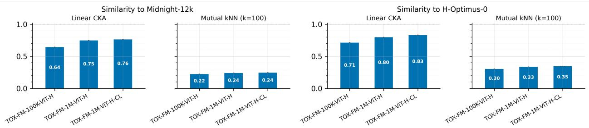  
Figure 5: Average representation similarity metrics (mean and standard deviation) of TOX-FM models with respect to Midnight-12k and H-optimus-0. Metrics are averaged across 5 random subsets of 100,000 patches from the clinical task datasets. We observed very small variability for both metrics across the random subsets. We report the mutual kNN metric with k=100 but note that the same trend was observed for k=1 and k=10.

## 6.4 Continual Learning

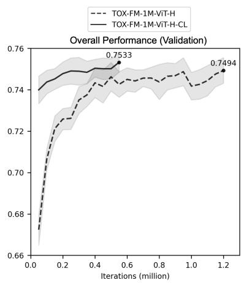  
Figure 6: Overall performance (mean and standard deviation) trajectories of TOX-FM-1M-ViT-H and TOX-FM-1M-ViT-H-CL on non-clinical validation downstream tasks during training on TOX-FM-1M.

The continual pre-training strategy was found to be efective. Specifically, TOX-FM-1M-ViT-H-CL outperformed both TOX-FM-100K-ViT-H (the initialization checkpoint) and TOX-FM-1M-ViT-H (the model trained from scratch) across downstream tasks, suggesting successful integration of knowledge from both datasets to yield the best overall performance among TOX-FM models.

Figure 6 shows the performance trajectories on the non-clinical validation downstream tasks from the initialization through the selected checkpoints during training on TOX-FM-1M. By leveraging previous training eforts from the first phase on TOX-FM-100K, continual learning accelerated the convergence of TOX-FM-1M-ViT-H-CL and fewer iterations were required to achieve peak performance in the second phase, reflecting the reduced incremental computational costs of updating models as new datasets become available.

## 6.5 Gram Anchoring

Figure 7 shows the overall performance of TOX-FM models and the corresponding -Gram models on spatially resolved non-clinical and clinical downstream tasks. More details of the performance on individual tasks are provided in Appendix 5.

Overall, Gram anchoring demonstrated modest performance gains on spatially resolved downstream tasks, and benefits were more consistent across clinical tasks than non-clinical tasks. In particular, the comparison between TOX-FM-1M-ViT-H-CL and TOX-FM-1M-ViT-H-CL-Gram showed mixed results. For example, while Gram anchoring significantly improved performance on the artifact patch classification task using linear probe evaluation, the performance decreased using attention probe evaluation. Similarly, Gram anchoring improved performance on clinical segmentation tasks, but the same efects were not consistently observed for non-clinical segmentation tasks.

Figure 8 shows examples of the PCA feature maps of TOX-FM-1M-ViT-H-CL and TOX-FM-1M-ViT-H-CL-Gram. More examples are provided in Appendix 5. The PCA feature maps are visualized at diferent magnifications and fields of view to compare the efects of Gram anchoring across diferent scales. Qualitatively, Gram anchoring feature maps seem to exhibit enhanced semantic coherence and reduced noise, especially at lower magnifications where spatial patterns of tissue structures are easier to discern visually. While the diferences between the PCA feature maps are more dificult to perceive at higher magnifications, the impact on the performance of downstream tasks suggest that the efects of Gram anchoring persist across all scales.

However, further investigations are needed to better understand the efects of Gram anchoring on the dense features and better identify the types of downstream tasks that may benefit from this approach, specifically for histopathology. Additionally, further exploration of techniques to improve the training procedure, such as checkpoint selection of the Gram teacher, may be informative as well.

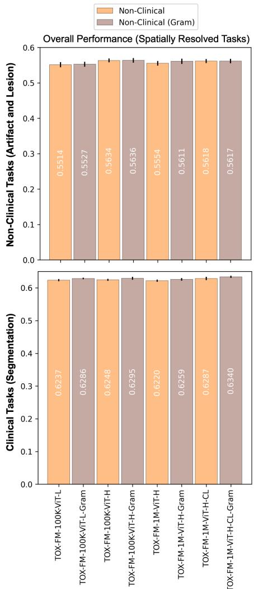  
Figure 7: Overall performance (mean and standard deviation) of TOX-FM models and the corresponding -Gram models on spatially resolved non-clinical (artifact and lesion) and clinical (segmentation) downstream tasks.

## 7 Discussion

We present TOX-FM, a family of non-clinical PFMs trained using the DINOv3 self-supervised learning framework on large-scale diverse histopathology datasets spanning a broad range of animal toxicology studies. We evaluate TOX-FM and state-of-the-art clinical PFMs on a comprehensive set of 18 non-clinical and 9 clinical downstream tasks, addressing key open questions regarding the role of domain-specific training and the capability of cross-domain generalization of PFMs between human and animal tissues.

TOX-FM models showed the best performance on non-clinical downstream tasks, while clinical PFMs showed the best performance on clinical downstream tasks. This advantage of domain-specific training is further emphasized by the computational eficiency of the ViT-L and ViT-H TOX-FM models, which demonstrate superior performance on non-clinical tasks with only 30 – 60% of the model capacity of ViT-g clinical PFMs. While domain-specific models remain optimal, the cross-domain generalization capabilities of both non-clinical and clinical PFMs are notable, although transferability varies based on the type of tasks and the magnification at which the tasks are performed. Further evaluation across both non-clinical and clinical domains, including broadening the scope and complexity of tasks across species, indications, tissues, and magnifications would be important to better understand where domain-specific models are necessary and where cross-domain models may be a viable alternative if domain-specific options are unavailable. We also highlight the importance of dataset diversity, which exhibited a stronger impact than model size, especially on cross-domain performance.

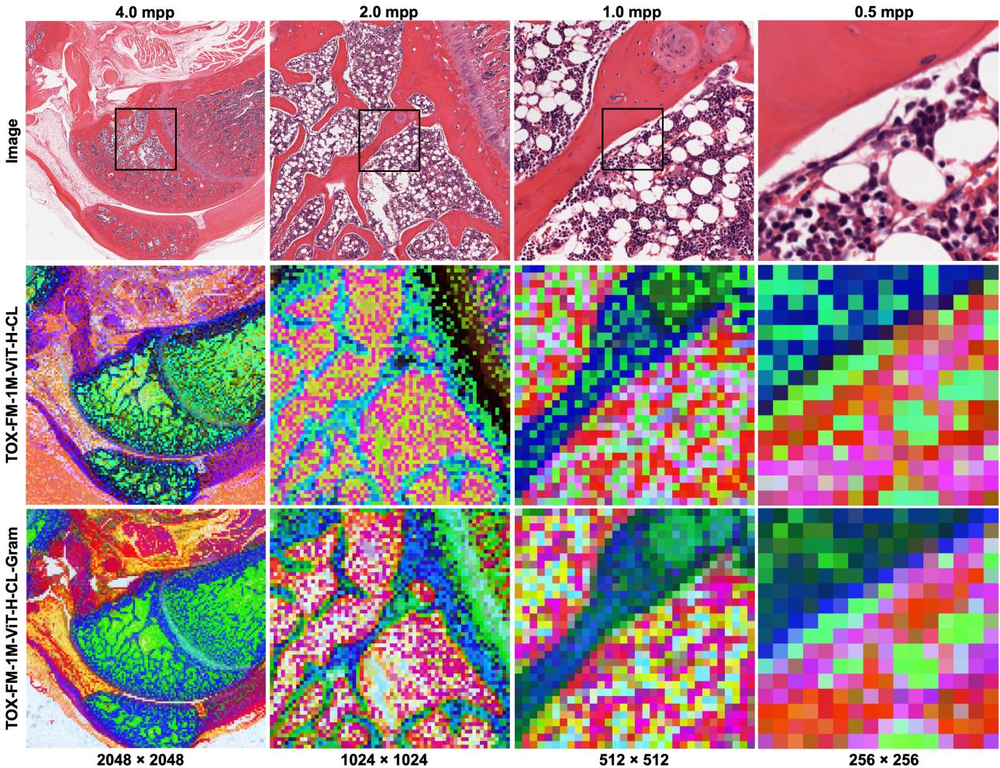  
Figure 8: Examples of PCA feature maps across magnifications and concentric fields of view on an H&E WSI of femur tissue from a rat. The black boxes on each image indicate the field of view at the next higher magnification.

To the best of our knowledge, we have provided the first analysis of cross-domain performance of PFMs across the non-clinical and clinical domains. The evidence of bidirectional cross-domain generalization observed in our evaluations suggests that PFMs learn domain-invariant representations that capture fundamental cellular or morphological features that are conserved across species. This could be particularly valuable in translational research, where a major challenge is the limited translatability of preclinical findings to clinical outcomes, resulting in many drug candidates failing to reach patients. By providing a potentially transferable representation space, non-clinical PFMs have the potential to bridge this gap and support the discovery and development of more robust predictors of clinical outcomes at earlier stages of the process.

We also highlight the impact of distributional proximity and dataset diversity on downstream performance. In line with previous work [56], we show that distributional proximity between the training and task datasets appears to be the dominant factor for performance on downstream tasks in the low-shift regime. However, in contrast to previous work from the natural image domain [56], we show that dataset diversity can improve cross-domain performance in the high-shift regime in the histopathology domain, as demonstrated by the strong performance of non-clinical PFMs trained on more diverse non-clinical datasets on clinical downstream tasks.

TOX-FM-1M-ViT-H-CL emerged as the overall best TOX-FM model, leveraging a continual pre-training strategy to efectively integrate knowledge from datasets collected at two diferent phases while maintaining eficient use of computational resources. We plan to use this scalable framework to continue incorporating new datasets as additional WSIs become available from future toxicology studies. More broadly, this highlights the value of continual learning approaches, which have become increasingly important amid the rapid growth of data and the expanding scale of foundation model development. Recent studies have proposed and evaluated a range of continual learning paradigms, focusing on the critical balance between plasticity and stability, as well as demonstrating the adaptability, eficiency, and sustainability of these methods [43, 64].

We investigated Gram anchoring to improve dense feature representations for spatially resolved downstream tasks, including classification tasks focusing on artifacts and lesions, which may be very small, as well as segmentation tasks. Although we visually observed refinement of the dense feature representations with Gram anchoring, the impact on performance across the various non-clinical and clinical downstream tasks remains nuanced and task dependent. Additional analysis would be informative and help provide clarity on where Gram anchoring ofers the greatest benefits in histopathology applications, specifically.

Building on these advances, a promising next step is the development of PFMs trained on integrated non-clinical and clinical datasets. By leveraging complementary information across domains, the current strengths of domain-specific models may be combined and support broader generalization. We plan to further investigate this direction in future work. One potential approach would be to curate harmonized datasets that include both non-clinical and clinical resources. For example, clinical datasets such as The Cancer Genome Atlas (TCGA) [65] could be combined with TOX-FM datasets, with the dataset curation and sampling strategy applied to ensure balanced contributions across both domains. Alternatively, the continual learning approach could be extended across domains. For example, TOX-FM models could be continually pre-trained on TCGA, or clinical PFMs could be further adapted using TOX-FM datasets.

While vision models continue to dominate the landscape of PFMs, multimodal foundation models developed by aligning histopathology with complementary modalities are emerging as a promising direction. Vision-language PFMs integrate histopathology with associated text from scientific textbooks, research articles, clinical reports, online educational platforms, and disease ontologies [66–70]. Vision-omics PFMs combine histopathology with matched gene expression profiles from sequencing-based spatial transcriptomics technologies, such as Visium and Xenium [71, 72]. However, most development and validation eforts remain focused on clinical applications, especially oncology, and further investigations of multimodal PFMs focused on the non-clinical domain remain an important area of research. Notably, pathologists’ reports in toxicology studies contain descriptions of animal pathology findings, the Standard for Exchange of Non-clinical Data provides a framework for controlled terminology, and existing datasets pairing histopathology with spatial transcriptomics include samples from animal species, primarily mouse [73, 74]. Together, these resources may pave the way for more systematic development and validation of multimodal non-clinical PFMs, enabling the characterization of complex toxicity mechanisms across multiple biological scales and contexts.

In this work, we address a critical gap in the development of foundation models for histopathology through the introduction of TOX-FM, a family of non-clinical PFMs trained on large-scale diverse histopathology datasets of over one million WSIs consisting of over 60 organs across six animal species from over 14,000 toxicology studies across six decades. As PFMs continue to advance, rigorous understanding of the strengths and limitations of both non-clinical and clinical models is essential to fully leverage these tools to accelerate drug development and enable efective translation from preclinical to clinical stages and beyond. Towards this goal, TOX-FM establishes a benchmark for non-clinical PFMs while providing early insights into cross-domain generalization capabilities of existing clinical PFMs.

## 8 Acknowledgements

The authors thank all the toxicologic pathologists who provided annotation support for the downstream evaluation tasks.

## Appendix 1: Hierarchical K-means

The dataset curation method for TOX-FM-1M used consistent settings for hierarchical k-means across all magnifications. To decrease storage and computational requirements, we used PCA to project the CLS token embeddings from Midnight-12k from 1536 into 256 dimensions for the highest magnification (0.5 mpp) and 512 for all other magnifications. Then, we applied k-means clustering with 4 bottom-up levels of 100K, 10K, 1K, and 30 clusters, respectively. At each magnification, the target subset size was determined based on the desired sampling ratio, which we set as 25% of all candidate patches at the lowest magnification (4.0 mpp) and 50% for all other magnifications. Note that candidate patches at the lowest magnification consist of all non-overlapping patches from tissue regions from all WSIs, while candidate patches at each subsequent magnification are conditioned on selected patches at the preceding magnification. The target subset size was recursively allocated across clusters in the hierarchy, beginning at the top-level of 30 clusters.

We performed a small-scale validation analysis on a subset of 36,000 rat WSIs for which corresponding tissue information was available. For the validation analysis, we applied hierarchical k-means independently on all patches at each magnification (without applying the progressive multi-scale strategy) with a fixed sampling ratio of 25%. Figure A1 shows the distribution of the candidate and selected patches across tissue types. We observe that rare tissue types are generally oversampled (≥ 25%) relative to the sampling ratio, while more common tissue types are generally sampled close to or slightly lower (< 25%) than the sampling ratio. Notably, while the method does not utilize the tissue metadata in any way, it produces clusters that seem to capture meaningful diversity across tissue phenotypes.

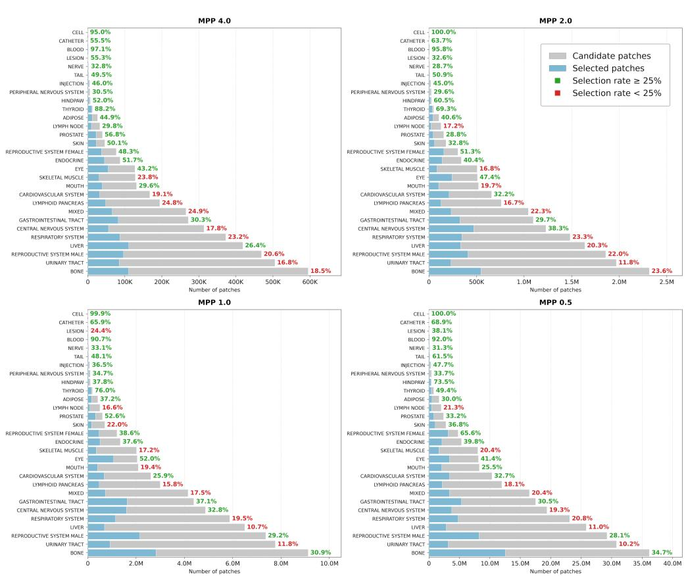  
Figure A1: Distribution of candidate and selected patches across tissue types using hierarchical k-means on a subset of 36,000 WSIs with corresponding tissue information. For the validation analysis, the method was independently applied at each magnification with a fixed sampling ratio of 25%.

## Appendix 2: Hyperparameters

Tables A1 and A2 show the hyperparameter settings for non-clinical and clinical downstream tasks, respectively.
<table><tr><td>Component</td><td>Patch Classification (Linear Probe)</td><td>Patch Classification (Attention Probe)</td><td>Slide Classification</td><td>Segmentation</td></tr><tr><td>Method</td><td>Logistic Regression</td><td>ABMIL</td><td>ABMIL</td><td>U-Net</td></tr><tr><td>Loss</td><td>Cross-entropy</td><td>Cross-entropy</td><td>Cross-entropy</td><td>Lovász</td></tr><tr><td>Learning rate</td><td></td><td>0.01, 0.001, 0.0001</td><td>0.01, 0.003, 0.001</td><td>0.01, 0.001, 0.0001</td></tr><tr><td>Scheduler</td><td></td><td>Cosine</td><td>Cosine</td><td>Cosine</td></tr><tr><td>Weight decay</td><td></td><td>0.001, 0.0001</td><td>0.001, 0.0001</td><td>0.001, 0.0001</td></tr><tr><td>Optimizer</td><td>L-BFGS</td><td>AdamW</td><td>AdamW</td><td>AdamW</td></tr><tr><td>Maximum iterations</td><td>1000</td><td>5000</td><td>2500</td><td>5000</td></tr><tr><td>Number of runs</td><td>5</td><td>5</td><td>3</td><td>3</td></tr></table>

Table A1: Hyperparameter settings for non-clinical downstream tasks.

<table><tr><td>Component</td><td>Patch Classification</td><td>Slide Classification</td><td>Segmentation</td></tr><tr><td>Learning rate</td><td>0.00003, 0.0003, 0.003</td><td>0.0001, 0.001, 0.01</td><td>0.0002, 0.002, 0.02</td></tr><tr><td>Weight decay</td><td>0.001, 0.01, 0.1</td><td>0.001, 0.01, 0.1</td><td>0.001, 0.01, 0.1</td></tr></table>

Table A2: Hyperparameter settings for the eva evaluation framework for clinical downstream tasks. The bold values indicate the defaults. All other hyperparameter settings followed the oficial eva repository defaults.

Appendix 3: Performance of Non-Clinical and Clinical PFMs  
Tables A3 and A4 show the performance of all models on non-clinical and clinical downstream tasks, respectively.
<table><tr><td rowspan="2">Type</td><td rowspan="2">Task</td><td rowspan="2">ImageNet- LVD- ViT-B</td><td rowspan="2">DINOv3- 1689M- ViT-L</td><td rowspan="2">Prov- GigaPath</td><td rowspan="2">H- optimus- 0</td><td rowspan="2">Midnight- 12k</td><td rowspan="2">TOX- FM- 100K- ViT-L</td><td rowspan="2">TOX- FM- 100K-</td><td rowspan="2">TOX- FM- FM-1M- 1M- ViT-H</td></tr><tr><td>ViT-H</td></tr><tr><td rowspan="9">Pataatiih Cition (inar Probe)</td><td>Species</td><td>0.5627 (0.0019)</td><td>0.6322 (0.0062)</td><td>0.7461 (0.0046)</td><td>0.7579 (0.0045)</td><td>0.7746 (0.0062)</td><td>0.8246 (0.0047)</td><td>0.8345 (0.0066)</td><td>0.8904 (0.0019)</td><td>0.8985 (0.0037)</td></tr><tr><td>Tissue (Dog)</td><td>0.8319 (0.0018)</td><td>0.8596 (0.0042)</td><td>0.9182 (0.0035)</td><td>0.9136 (0.0011)</td><td>0.9271 (0.0024)</td><td>0.9363 (0.0031)</td><td>0.9399 (0.0042)</td><td>0.9610 (0.0022)</td><td>0.9633 (0.0027)</td></tr><tr><td>Tissue (Monkey)</td><td>0.9231 (0.0041)</td><td>0.9373 (0.0045)</td><td>0.9646 (0.0038)</td><td>0.9604 (0.0037)</td><td>0.9736 (0.0023)</td><td>0.9783 (0.0023) 0.9099</td><td>0.9797 (0.0021)</td><td>0.9840 (0.0022)</td><td>0.9865 (0.0020) 0.9152</td></tr><tr><td>Tissue (Mouse)</td><td>0.7595 (0.0053) 0.9292</td><td>0.8215 (0.0052) 0.9418</td><td>0.8819 (0.0044) 0.9636</td><td>0.8770 (0.0041) 0.9633</td><td>0.8817 (0.0047) 0.9648</td><td>(0.0070) 0.9709</td><td>0.9158 (0.0053) 0.9710</td><td>0.9092 (0.0057) 0.9741</td><td>(0.0052) 0.9751</td></tr><tr><td>Tissue (Rabbit)</td><td>(0.0029) 0.8101</td><td>(0.0020) 0.8435</td><td>(0.0029) 0.9163</td><td>(0.0019) 0.9171</td><td>(0.0024) 0.9173</td><td>(0.0017) 0.9596</td><td>(0.0023) 0.9629</td><td>(0.0006) 0.9545</td><td>(0.0016) 0.9578</td></tr><tr><td>Tissue (Rat)</td><td>(0.0043) 0.4944</td><td>(0.0020) 0.5643</td><td>(0.0053) 0.5987</td><td>(0.0034) 0.5783</td><td>(0.0043) 0.6267</td><td>(0.0027) 0.6009</td><td>(0.0027) 0.6112</td><td>(0.0032) 0.5993</td><td>(0.0028) 0.5916</td></tr><tr><td>Artifact</td><td>(0.0058)</td><td>(0.0040)</td><td>(0.0042) 0.5850</td><td>(0.0034)</td><td>(0.0036) 0.5696</td><td>(0.0085) 0.5657</td><td>(0.0049)</td><td>(0.0074)</td><td>(0.0046)</td></tr><tr><td>Lesion</td><td>0.4556 (0.0096)</td><td>0.4844 (0.0059)</td><td>(0.0054)</td><td>0.5927 (0.0069)</td><td>(0.0070)</td><td>(0.0093)</td><td>0.5889 (0.0072)</td><td>0.5732 (0.0055)</td><td>0.5839 (0.0057)</td></tr><tr><td>Artifact</td><td>0.6213 (0.0084)</td><td>0.6699 (0.0051)</td><td>0.7342 (0.0032)</td><td>0.7311 (0.0055)</td><td>0.7395 (0.0037)</td><td>0.7380 (0.0066)</td><td>0.7455 (0.0039)</td><td>0.7435 (0.0052)</td><td>0.7529 (0.0047)</td></tr><tr><td rowspan="6">Pasth Ction (Atton tnobe) Siastoe tion</td><td>Lesion</td><td>0.5237 (0.0061)</td><td>0.5029 (0.0021)</td><td>0.6255 (0.0087)</td><td>0.6394 (0.0055)</td><td>0.6282 (0.0078)</td><td>0.6392 (0.0082)</td><td>0.6467 (0.0052)</td><td>0.6374 (0.0063)</td><td>0.6582 (0.0029)</td></tr><tr><td>Species</td><td>0.8403 (0.0048)</td><td>0.8343 (0.0080)</td><td>0.9019 (0.0107)</td><td>0.8986 (0.0033)</td><td>0.9131 (0.0035)</td><td>0.9672 (0.0042)</td><td>0.9640 (0.0086)</td><td>0.9887 (0.0024)</td><td>0.9881 (0.0016)</td></tr><tr><td>Tissue (Dog)</td><td>0.9749 (0.0078) 0.9436</td><td>0.9596 (0.0053)</td><td>0.9781 (0.0040)</td><td>0.9795 (0.0048)</td><td>0.9888 (0.0041)</td><td>0.9960 (0.0028)</td><td>0.9953 (0.0025)</td><td>0.9954 (0.0025)</td><td>0.9960 (0.0016)</td></tr><tr><td>Tissue (Monkey)</td><td>(0.0061) 0.8894</td><td>0.9187 (0.0136) 0.8803</td><td>0.9388 (0.0102) 0.9351</td><td>0.9708 (0.0189) 0.9307</td><td>0.9987 (0.0009) 0.9439</td><td>0.9827 (0.0034) 0.9439</td><td>0.9778 (0.0027) 0.9515</td><td>0.9993 (0.0009)</td><td>0.9953 (0.0041) 0.9642</td></tr><tr><td>Tissue (Mouse) Tissue</td><td>(0.0078) 0.9387</td><td>(0.0046) 0.9387</td><td>(0.0028) 0.9626</td><td>(0.0057) 0.9572</td><td>(0.0063) 0.9310</td><td>(0.0079) 0.9960</td><td>(0.0080) 0.9786</td><td>0.9557 (0.0020) 0.9993</td><td>(0.0019) 0.9940</td></tr><tr><td>(Rabbit) Tissue</td><td>(0.0178) 0.9601</td><td>(0.0135) 0.9556</td><td>(0.0134) 0.9709</td><td>(0.0103) 0.9639</td><td>(0.0091) 0.9779</td><td>(0.0043) 0.9906</td><td>(0.0058) 0.9954</td><td>(0.0010) 0.9947</td><td>(0.0033) 0.9907</td></tr><tr><td></td><td>(Rat)</td><td>(0.0016)</td><td>(0.0074)</td><td>(0.0035)</td><td>(0.0070)</td><td>(0.0072)</td><td>(0.0026)</td><td>(0.0025)</td><td>(0.0034)</td><td>(0.0008)</td></tr><tr><td rowspan="2">Segation</td><td>Artifact</td><td>0.2215 (0.0044)</td><td>0.2389 (0.0098)</td><td>0.2674 (0.0082)</td><td>0.2540 (0.0060)</td><td>0.2843 (0.0084)</td><td>0.2796 (0.0065)</td><td>0.3015 (0.0021)</td><td>0.2950 (0.0061)</td><td>0.2888 (0.0069)</td></tr><tr><td>Lesion</td><td>0.3989 (0.0013)</td><td>0.4068 (0.0016)</td><td>0.4662 (0.0038)</td><td>0.4795 (0.0061)</td><td>0.4784 (0.0028)</td><td>0.4852 (0.0020)</td><td>0.4868 (0.0078)</td><td>0.4838 (0.0082)</td><td>0.4955 (0.0078)</td></tr><tr><td colspan="2">Overall (Weighted)</td><td>0.5911 (0.0063)</td><td>0.6145 (0.0063)</td><td>0.6811 (0.0065)</td><td>0.6818 (0.0059)</td><td>0.6915 (0.0056)</td><td>0.7033 (0.0063)</td><td>0.7113 (0.0058)</td><td>0.7157 (0.0053)</td><td>0.7205 (0.0047)</td></tr></table>

Table A3: Average performance (mean and standard deviation) of all models on non-clinical downstream tasks. Performance is reported based on macro F1 for classification tasks and mIOU for segmentation tasks. Performance is averaged across multiple runs. All tasks were assigned a weight of 1.0, except tissue tasks, which were assigned a weight of 0.2, to enable a more balanced contribution across task types and magnifications.

<table><tr><td rowspan="2">Type</td><td rowspan="2">Task</td><td colspan="2">DINOv3- ImageNet- LVD-</td><td rowspan="2">Prov- GigaPath</td><td rowspan="2">H- optimus- 0</td><td rowspan="2">Midnight- 12k</td><td rowspan="2">TOX- FM- 100K- ViT-L</td><td rowspan="2">TOX- FM- 100K- ViT-H</td><td rowspan="2">TOX- FM- 1M- ViT-H</td><td rowspan="2">TOX- FM-1M- ViT-H- CL</td></tr><tr><td>ViT-B</td><td>1689M- ViT-L</td></tr><tr><td rowspan="4">Pati CCatiom</td><td>BACH</td><td>0.6332 (0.0204)</td><td>0.7164 (0.0048)</td><td>0.7678 (0.0144)</td><td>0.7704 (0.0102)</td><td>0.9051 (0.0043)</td><td>0.7158 (0.0053)</td><td>0.7275 (0.0094)</td><td>0.7973 (0.0119)</td><td>0.8366 (0.0060)</td></tr><tr><td>BreakHis</td><td>0.7271 (0.0073)</td><td>0.7798 (0.0030)</td><td>0.8348 (0.0123)</td><td>0.8091 (0.0138)</td><td>0.8557 (0.0015)</td><td>0.7425 (0.0034)</td><td>0.6385 (0.0043)</td><td>0.7616 (0.0131)</td><td>0.8059 (0.0033)</td></tr><tr><td>CRC</td><td>0.9371 (0.0047)</td><td>0.9278 (0.0023)</td><td>0.9531 (0.0012)</td><td>0.9562 (0.0037)</td><td>0.9665 (0.0003)</td><td>0.9577 (0.0009)</td><td>0.9610 (0.0013)</td><td>0.9710 (0.0007)</td><td>0.9739 (0.0009)</td></tr><tr><td>Gleason Arvaniti</td><td>0.6894 (0.0096) 0.8534</td><td>0.7451 (0.0051) 0.8856</td><td>0.7274 (0.0161) 0.9450</td><td>0.7709 (0.0052) 0.9421</td><td>0.7991 (0.0021) 0.9305</td><td>0.7469 (0.0027) 0.8874</td><td>0.7456 (0.0050)</td><td>0.6995 (0.0103)</td><td>0.6992 (0.0114)</td></tr><tr><td rowspan="2">Siasioe ion</td><td>Patch Camelyon</td><td>(0.0019)</td><td>(0.0023)</td><td>(0.0008)</td><td>(0.0010)</td><td>(0.0016)</td><td>(0.0029)</td><td>0.8887 (0.0014)</td><td>0.9131 (0.0006)</td><td>0.9121 (0.0027)</td></tr><tr><td>Camelyon16 (Small) PANDA</td><td>0.6937 (0.0200) 0.4789</td><td>0.6577 (0.0613)</td><td>0.8041 (0.0207)</td><td>0.8269 (0.0253)</td><td>0.8459 (0.0213)</td><td>0.7803 (0.0191)</td><td>0.7255 (0.0377)</td><td>0.7501 (0.0670)</td><td>0.7522 (0.0455)</td></tr><tr><td rowspan="2">Segation</td><td>(Small)</td><td>(0.0183)</td><td>0.5551 (0.0089)</td><td>0.6642 (0.0109)</td><td>0.6723 (0.0165)</td><td>0.6636 (0.0078)</td><td>0.5845 (0.0056)</td><td>0.5792 (0.0118)</td><td>0.6032 (0.0102)</td><td>0.6295 (0.0101)</td></tr><tr><td>BCSS</td><td>0.5660 (0.0081) 0.6120</td><td>0.5529 (0.0038) 0.6209</td><td>0.6201 (0.0051)</td><td>0.6152 (0.0076)</td><td>0.6098 (0.0037)</td><td>0.6022 (0.0017)</td><td>0.6034 (0.0033)</td><td>0.6078 (0.0020)</td><td>0.6070 (0.0029)</td></tr><tr><td colspan="2">Overall (0.0125)</td><td>(0.0046) 0.6879</td><td>(0.0045) 0.7157</td><td>0.6859 (0.0060) 0.7780</td><td>0.6893 (0.0027) 0.7836</td><td>0.6661 (0.0025) 0.8047</td><td>0.6452 (0.0046) 0.7403</td><td>0.6461 (0.0028) 0.7239</td><td>0.6363 (0.0039) 0.7489</td><td>0.6504 (0.0063) 0.7630</td></tr></table>

Table A4: Average performance (mean and standard deviation) of all models on clinical downstream tasks. Performance is reported based on metrics as defined in the oficial eva repository. Performance is averaged across multiple runs.

Figure A2 shows examples of PCA feature maps of Midnight-12k and TOX-FM-1M-ViT-H-CL at the training resolution of 256 × 256 pixels across the non-clinical and clinical domains.

Non-Clinical  
Non-Clinical  
Clinical  
Clinical  
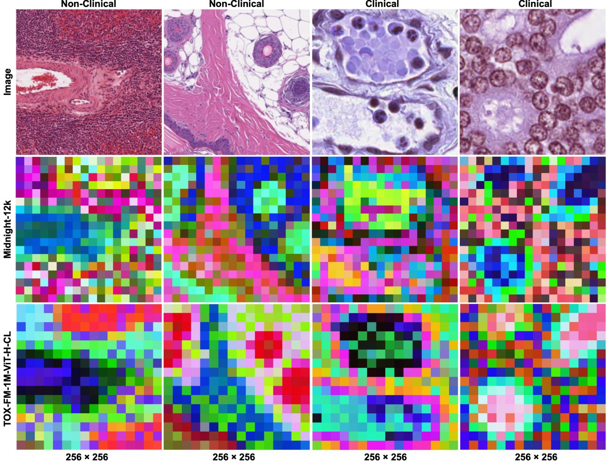  
Figure A2: Examples of PCA feature maps of Midnight-12k (best performing clinical PFM) and TOX-FM-1M-ViT-H-CL (best performing non-clinical PFM) across diferent domains at the training resolution. Non-clinical images are taken from the tissue task (rat, 2.0 mpp) and clinical images are taken from the MoNuSAC task (0.25 mpp).

## Appendix 4: Dataset Diversity

Figure A3 shows the UMAP visualizations of the two training datasets (TOX-FM-100K and TOX-FM-1M) and the two task datasets (non-clinical and clinical) in the embedding spaces of six models across the natural image (ImageNet-ViT-B, DINOv3-LVD-1689M-ViT-L), clinical (H-optimus-0, Midnight-12k), and non-clinical (TOX-FM-100K-ViT-H, TOX-FM-1M-ViT-H-CL) domains.

All datasets collapse into an overlapping manifold for the natural image models. In contrast, there is a clear separation of the clinical task datasets into several small clusters (red) across both clinical and non-clinical PFMs, reflecting the domain gap between clinical and non-clinical datasets. Expectedly, the non-clinical task datasets (green) consistently fall within the training dataset distributions of TOX-FM-100K (blue) and TOX-FM-1M (pink), with an especially strong overlap observed with TOX-FM-100K in the embedding spaces of non-clinical PFMs, in line with our hypothesis regarding the distributional proximity of the datasets.

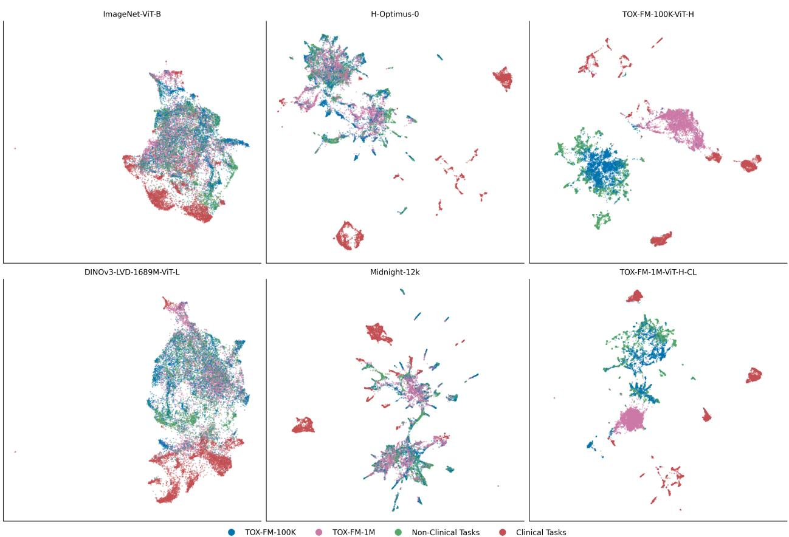  
Figure A3: UMAP visualizations of the training and task datasets across the embedding spaces of six models. Each panel is fit independently on the respective model’s embeddings.

## Appendix 5: Gram Anchoring

Tables A5 and A6 show the performance of TOX-FM models and the corresponding -Gram models on spatially resolved non-clinical (artifact and lesion) and clinical (segmentation) downstream tasks, respectively.
<table><tr><td>Type</td><td>Task</td><td>TOX- FM- 100K- ViT-L</td><td>TOX-FM- 100K- ViT-L- Gram</td><td>TOX- FM- 100K- ViT-H</td><td>TOX-FM- 100K- ViT-H- Gram</td><td>TOX- FM-1M- ViT-H</td><td>TOX-FM- 1M-ViT- H-Gram</td><td>TOX- FM-1M- ViT-H- CL</td><td>TOX- FM-1M- ViT-H- CL- Gram</td></tr><tr><td rowspan="2">Patioh Cion (iear Prbe</td><td>Artifact</td><td>0.6009 (0.0085)</td><td>0.6031 (0.0081)</td><td>0.6112 (0.0049)</td><td>0.6163 (0.0084)</td><td>0.5993 (0.0074)</td><td>0.6089 (0.0094)</td><td>0.5916 (0.0046)</td><td>0.6144 (0.0059)</td></tr><tr><td>Lesion</td><td>0.5657 (0.0093)</td><td>0.5681 (0.0080)</td><td>0.5889 (0.0072)</td><td>0.5960 (0.0078)</td><td>0.5732 (0.0055)</td><td>0.5828 (0.0086)</td><td>0.5839 (0.0057)</td><td>0.5807 (0.0080)</td></tr><tr><td rowspan="2">Patiih aion )(Aton tnbe)</td><td>Artifact</td><td>0.7380 (0.0066)</td><td>0.7391 (0.0066)</td><td>0.7455 (0.0039)</td><td>0.7483 (0.0051)</td><td>0.7435 (0.0052)</td><td>0.7505 (0.0056)</td><td>0.7529 (0.0047)</td><td>0.7481 (0.0070)</td></tr><tr><td>Lesion</td><td>0.6392 (0.0082)</td><td>0.6410 (0.0048)</td><td>0.6467 (0.0052)</td><td>0.6477 (0.0078)</td><td>0.6374 (0.0063)</td><td>0.6551 (0.0046)</td><td>0.6582 (0.0029)</td><td>0.6463 (0.0056)</td></tr><tr><td rowspan="2">Seion</td><td>Artifact</td><td>0.2796 (0.0065)</td><td>0.2763 (0.0101)</td><td>0.3015 (0.0021)</td><td>0.2862 (0.0027)</td><td>0.2950 (0.0061)</td><td>0.2886 (0.0101)</td><td>0.2888 (0.0069)</td><td>0.2924 (0.0016)</td></tr><tr><td>Lesion</td><td>0.4852 (0.0020)</td><td>0.4884 (0.0027)</td><td>0.4868 (0.0078)</td><td>0.4873 (0.0037)</td><td>0.4838 (0.0082)</td><td>0.4809 (0.0044)</td><td>0.4955 (0.0078)</td><td>0.4886 (0.0081)</td></tr><tr><td rowspan="2"></td><td>Overall</td><td>0.5514</td><td>0.5527 (0.0071)</td><td>0.5634 (0.0055)</td><td>0.5636 (0.0063)</td><td>0.5554 (0.0065)</td><td>0.5611 (0.0075)</td><td>0.5618</td><td>0.5617</td></tr><tr><td></td><td>(0.0073)</td><td></td><td></td><td></td><td></td><td></td><td>(0.0057)</td><td>(0.0064)</td></tr></table>

Table A5: Average performance (mean and standard deviation) of TOX-FM models and the corresponding -Gram models on artifact and lesion non-clinical downstream tasks. Performance is reported based on macro F1 for classification tasks and mIOU for segmentation tasks. Performance is averaged across multiple runs.

<table><tr><td>Type</td><td>Task</td><td>TOX- FM- 100K- ViT-L</td><td>TOX-FM- 100K- ViT-L- Gram</td><td>TOX- FM- 100K- ViT-H</td><td>TOX-FM- 100K- ViT-H- Gram</td><td>TOX- FM-1M- ViT-H</td><td>TOX-FM- 1M-ViT- H-Gram</td><td>TOX- FM-1M- ViT-H- CL</td><td>TOX- FM-1M- ViT-H- CL- Gram</td></tr><tr><td rowspan="2">Seation</td><td>BCSS</td><td>0.6022 (0.0017)</td><td>0.6064 (0.0020)</td><td>0.6034 (0.0033)</td><td>0.6020 (0.0044)</td><td>0.6078 (0.0020)</td><td>0.6118 (0.0032)</td><td>0.6070 (0.0029)</td><td>0.6105 (0.0023)</td></tr><tr><td>MoNuSAC</td><td>0.6452 (0.0046)</td><td>0.6508 (0.0025)</td><td>0.6461 (0.0028)</td><td>0.6569 (0.0043)</td><td>0.6363 (0.0039)</td><td>0.6399 (0.0047)</td><td>0.6504 (0.0063)</td><td>0.6576 (0.0044)</td></tr><tr><td>Overall</td><td></td><td>0.6237 (0.0035)</td><td>0.6286 (0.0023)</td><td>0.6248 (0.0031)</td><td>0.6295 (0.0043)</td><td>0.6220 (0.0031)</td><td>0.6259 (0.0041)</td><td>0.6287 (0.0049)</td><td>0.6340 (0.0035)</td></tr></table>

Table A6: Average performance (mean and standard deviation) of TOX-FM models and the corresponding -Gram models on segmentation clinical downstream tasks. Performance is reported based on metrics as defined in the oficial eva repository. Performance is averaged across multiple runs.

Figures A4 and A5 show examples of PCA feature maps across magnifications and fields of view for diferent tissues and species.

4.0 mpp  
2.0 mpp  
1.0 mpp  
0.5 mpp  
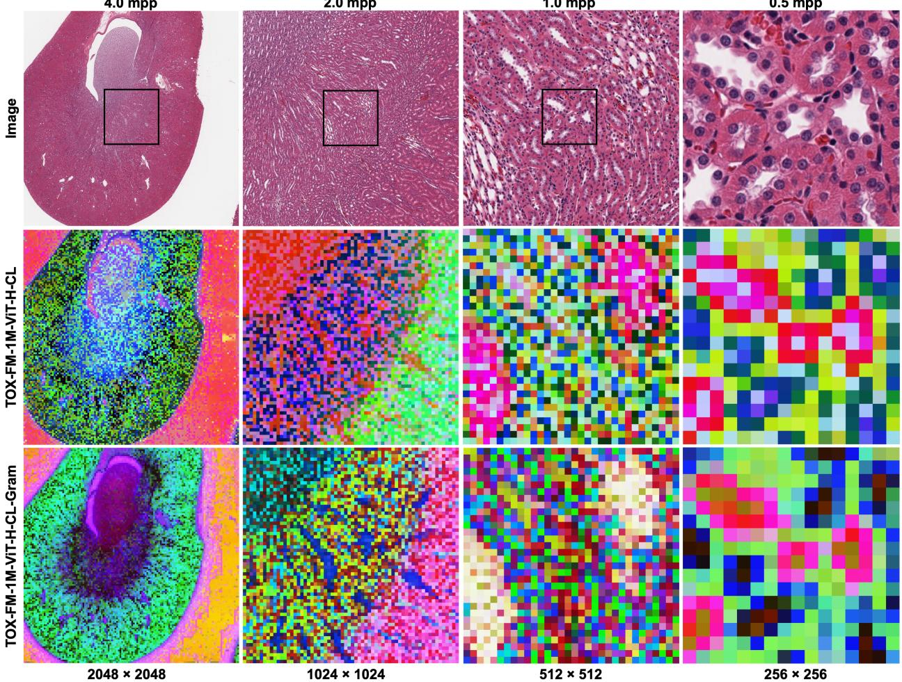  
Figure A4: Examples of PCA feature maps across magnifications and concentric fields of view on an H&E WSI of kidney tissue from a rat. The black boxes on each image indicate the field of view at the next higher magnification.

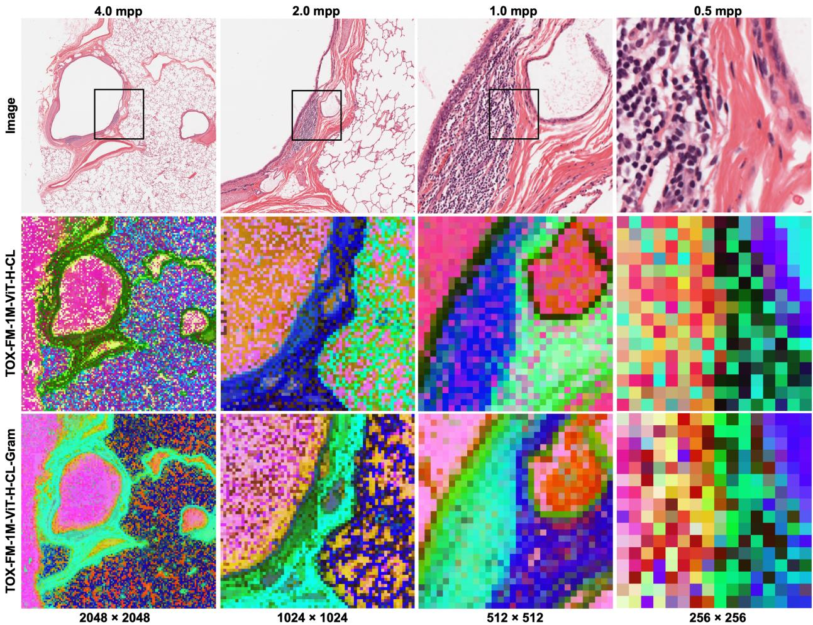  
Figure A5: Examples of PCA feature maps across magnifications and concentric fields of view on an H&E WSI of lung tissue from a monkey. The black boxes on each image indicate the field of view at the next higher magnification.

## References

[1] Oliver C Turner, Famke Aefner, Dinesh S Bangari, Wanda High, Brian Knight, Tom Forest, Brieuc Cossic, Lauren E Himmel, Daniel G Rudmann, and Bhupinder Bawa. Society of Toxicologic Pathology Digital Pathology and Image Analysis Special Interest Group Article\*: Opinion on the Application of Artificial Intelligence and Machine Learning to Digital Toxicologic Pathology. Toxicologic Pathology, 48 (2):277–294, 2020. 2

[2] Oliver C Turner, Brian Knight, Aleksandra Zuraw, Geert Litjens, and Daniel G Rudmann. Mini Review: The Last Mile—Opportunities and Challenges for Machine Learning in Digital Toxicologic Pathology. Toxicologic Pathology, 49(4):714–719, 2021.

[3] Shima Mehrvar, Lauren E Himmel, Pradeep Babburi, Andrew L Goldberg, Magali Gufroy, Kyathanahalli Janardhan, Amanda L Krempley, and Bhupinder Bawa. Deep Learning Approaches and Applications in Toxicologic Histopathology: Current Status and Future Perspectives. Journal of Pathology Informatics, 12(1):42, 2021.

[4] Gabriele Pohlmeyer-Esch, Charles Halsey, Julie Boisclair, Sripad Ram, Sarah Kirschner-Kitz, Brian Knight, Pierre Moulin, and Anna-Lena Frisk. Digital Pathology and Artificial Intelligence Applied to Nonclinical Toxicology Pathology—The Current State, Challenges, and Future Directions. Toxicologic Pathology, 53(6):516–535, 2025. 2, 4

[5] Ting Chen, Simon Kornblith, Mohammad Norouzi, and Geofrey Hinton. A Simple Framework for Contrastive Learning of Visual Representations. In International Conference on Machine Learning, pages 1597–1607, 2020. 2

[6] Zhenda Xie, Zheng Zhang, Yue Cao, Yutong Lin, Jianmin Bao, Zhuliang Yao, Qi Dai, and Han Hu. SimMIM: A Simple Framework for Masked Image Modeling. In Proceedings of the IEEE/CVF Conference on Computer Vision and Pattern Recognition, pages 9653–9663, 2022.

[7] Jinghao Zhou, Chen Wei, Huiyu Wang, Wei Shen, Cihang Xie, Alan Yuille, and Tao Kong. iBOT: Image BERT Pre-Training with Online Tokenizer. arXiv preprint arXiv:2111.07832, 2021. 10

[8] Mathilde Caron, Hugo Touvron, Ishan Misra, Hervé Jégou, Julien Mairal, Piotr Bojanowski, and Armand Joulin. Emerging Properties in Self-Supervised Vision Transformers. In Proceedings of the IEEE/CVF International Conference on Computer Vision, pages 9650–9660, 2021.

[9] Kaiming He, Xinlei Chen, Saining Xie, Yanghao Li, Piotr Dollár, and Ross Girshick. Masked Autoencoders are Scalable Vision Learners. In Proceedings of the IEEE/CVF Conference on Computer Vision and Pattern Recognition, pages 16000–16009, 2022.

[10] Maxime Oquab, Timothée Darcet, Théo Moutakanni, Huy Vo, Marc Szafraniec, Vasil Khalidov, Pierre Fernandez, Daniel Haziza, Francisco Massa, and Alaaeldin El-Nouby. DINOv2: Learning Robust Visual Features without Supervision. arXiv preprint arXiv:2304.07193, 2023. 2, 4, 10

[11] Jeremy Lai, Faruk Ahmed, Supriya Vijay, Tiam Jaroensri, Jessica Loo, Saurabh Vyawahare, Saloni Agarwal, Fayaz Jamil, Yossi Matias, and Greg S Corrado. Domain-Specific Optimization and Diverse Evaluation of Self-Supervised Models for Histopathology. arXiv preprint arXiv:2310.13259, 2023. 2, 8

[12] Hanwen Xu, Naoto Usuyama, Jaspreet Bagga, Sheng Zhang, Rajesh Rao, Tristan Naumann, Clif Wong, Zelalem Gero, Javier González, and Yu Gu. A Whole-Slide Foundation Model for Digital Pathology from Real-World Data. Nature, 630(8015):181–188, 2024. 7

[13] Charlie Saillard, Rodolphe Jenatton, Felipe Llinares-López, Zelda Mariet, David Cahané, Eric Durand, and Jean-Philippe Vert. H-optimus-0, 2024. URL https://github.com/bioptimus/releases/tree/main/mo dels/h-optimus/v0. 7, 8

[14] Richard J Chen, Tong Ding, Ming Y Lu, Drew FK Williamson, Guillaume Jaume, Andrew H Song, Bowen Chen, Andrew Zhang, Daniel Shao, and Muhammad Shaban. Towards a General-Purpose Foundation Model for Computational Pathology. Nature Medicine, 30(3):850–862, 2024.

[15] Eugene Vorontsov, Alican Bozkurt, Adam Casson, George Shaikovski, Michal Zelechowski, Kristen Severson, Eric Zimmermann, James Hall, Neil Tenenholtz, and Nicolo Fusi. A Foundation Model for Clinical-Grade Computational Pathology and Rare Cancers Detection. Nature Medicine, 30(10): 2924–2935, 2024.

[16] Eric Zimmermann, Eugene Vorontsov, Julian Viret, Adam Casson, Michal Zelechowski, George Shaikovski, Neil Tenenholtz, James Hall, David Klimstra, and Razik Yousfi. Virchow2: Scaling Self-Supervised Mixed Magnification Models in Pathology. arXiv preprint arXiv:2408.00738, 2024. 8

[17] Mikhail Karasikov, Joost van Doorn, Nicolas Känzig, Melis Erdal Cesur, Hugo Mark Horlings, Robert Berke, Fei Tang, and Sebastian Otálora. Training State-of-the-Art Pathology Foundation Models with Orders of Magnitude Less Data. In International Conference on Medical Image Computing and Computer-Assisted Intervention, pages 573–583, 2025. 2, 4, 7

[18] Rasoul Sali, Yodit Aschenaki, Raymond Leveillee, Firas Baba, Liya Tessema, Christopher Dixon, Khaireddine Bachhamba, and David Y Zhang. Foundation Models in Computational Pathology: Methods, Applications and Clinical Implications. BMJ Oncology, 5(1):e001102, 2026. 2

[19] Guillaume Jaume, Simone de Brot, Andrew H Song, Drew FK Williamson, Lukas Oldenburg, Andrew Zhang, Richard J Chen, Javier Asin, Sohvi Blatter, and Martina Dettwiler. Deep Learning-Based Modeling for Preclinical Drug Safety Assessment. bioRxiv preprint bioRxiv 2024.07.20.604430, 2024. 2

[20] Guillaume Jaume, Lukas Oldenburg, Anurag Vaidya, Richard J. Chen, Drew F. K. Williamson, Thomas Peeters, Andrew H. Song, and Faisal Mahmood. Transcriptomics-Guided Slide Representation Learning in Computational Pathology. arXiv preprint arXiv:2405.11618, 2024.

[21] Yoshinobu Igarashi, Noriyuki Nakatsu, Tomoya Yamashita, Atsushi Ono, Yasuo Ohno, Tetsuro Urushidani, and Hiroshi Yamada. Open TG-GATEs: A Large-Scale Toxicogenomics Database. Nucleic Acids Research, 43(D1):D921–D927, 2015. 2

[22] Oriane Siméoni, Huy V Vo, Maximilian Seitzer, Federico Baldassarre, Maxime Oquab, Cijo Jose, Vasil Khalidov, Marc Szafraniec, Seungeun Yi, and Michaël Ramamonjisoa. DINOv3. arXiv preprint arXiv:2508.10104, 2025. 2, 4, 5, 6, 7, 9

[23] Samir Yitzhak Gadre, Gabriel Ilharco, Alex Fang, Jonathan Hayase, Georgios Smyrnis, Thao Nguyen, Ryan Marten, Mitchell Wortsman, Dhruba Ghosh, Jieyu Zhang, Eyal Orgad, Rahim Entezari, Giannis Daras, Sarah Pratt, Vivek Ramanujan, Yonatan Bitton, Kalyani Marathe, Stephen Mussmann, Richard Vencu, Mehdi Cherti, Ranjay Krishna, Pang Wei W Koh, Olga Saukh, Alexander J Ratner, Shuran Song, Hannaneh Hajishirzi, Ali Farhadi, Romain Beaumont, Sewoong Oh, Alex Dimakis, Jenia Jitsev, Yair Carmon, Vaishaal Shankar, and Ludwig Schmidt. DataComp: In Search of the Next Generation of Multimodal Dataset. Advances in Neural Information Processing Systems, 36, 2023. 3

[24] Sachin Goyal, Pratyush Maini, Zachary C Lipton, Aditi Raghunathan, and J Zico Kolter. Scaling Laws for Data Filtering—Data Curation Cannot be Compute Agnostic. In Proceedings of the IEEE/CVF Conference on Computer Vision and Pattern Recognition, pages 22702–22711, 2024.

[25] Alex Fang, Gabriel Ilharco, Mitchell Wortsman, Yuhao Wan, Vaishaal Shankar, Achal Dave, and Ludwig Schmidt. Data Determines Distributional Robustness in Contrastive Language Image Pre-Training (CLIP). In Proceedings of the 39th International Conference on Machine Learning, pages 6216–6234, 2022. 3

[26] Max Marion, Ahmet Üstün, Luiza Pozzobon, Alex Wang, Marzieh Fadaee, and Sara Hooker. When Less is More: Investigating Data Pruning for Pretraining LLMs at Scale. arXiv preprint arXiv:2309.04564, 2023. 3

[27] Frederick M. Howard, James Dolezal, Sara Kochanny, Jefree Schulte, Heather Chen, Lara Heij, Dezheng Huo, Rita Nanda, Olufunmilayo I. Olopade, Jakob N. Kather, Nicole Cipriani, Robert L. Grossman, and Alexander T. Pearson. The Impact of Site-Specific Digital Histology Signatures on Deep Learning Model Accuracy and Bias. Nature Communications, 12(1):4423, 2021. 3

[28] Jonah Kömen, Hannah Marienwald, Jonas Dippel, and Julius Hense. Do Histopathological Foundation Models Eliminate Batch Efects? A Comparative Study. In NeurIPS 2024 Workshop on Advancements in Medical Foundation Models: Explainability, Robustness, Security, and Beyond, 2024.

[29] Fredrik K. Gustafsson and Mattias Rantalainen. Evaluating Computational Pathology Foundation Models for Prostate Cancer Grading Under Distribution Shifts. arXiv preprint arXiv:2410.06723, 2024.

[30] Jonah Kömen, Edwin D. de Jong, Julius Hense, Hannah Marienwald, Jonas Dippel, Philip Naumann, Eric Marcus, Lukas Ruf, Maximilian Alber, Jonas Teuwen, Frederick Klauschen, and Klaus-Robert Müller. Towards Robust Foundation Models for Digital Pathology. Nature Communications, 17(1):5218, 2026.

[31] Edwin D. de Jong, Eric Marcus, and Jonas Teuwen. Current Pathology Foundation Models are Unrobust to Medical Center Diferences. arXiv preprint arXiv:2501.18055, 2025. 3

[32] Gianluca Carloni, Biagio Brattoli, Seongho Keum, Jongchan Park, Taebum Lee, Chang Ho Ahn, and Sergio Pereira. Pathology Foundation Models Are Scanner Sensitive: Benchmark and Mitigation with Contrastive ScanGen Loss. In International Workshop on Foundation Models for General Medical AI, pages 44–53, 2026. 3

[33] Erik Thiringer, Fredrik K. Gustafsson, Kajsa Ledesma Eriksson, and Mattias Rantalainen. Scanner-Induced Domain Shifts Undermine the Robustness of Pathology Foundation Models. arXiv preprint arXiv:2601.04163, 2026. 3

[34] Lydia A. Schoenpflug, Nikki J. van den Berg, Sonali Andani, Nanda Horeweg, Jurriaan Barkey Wolf, Tjalling Bosse, Viktor Koelzera, and Maxime W. Lafarge. A Protocol for Evaluating Robustness to H&E Staining Variation in Computational Pathology Models. Journal of Pathology Informatics, 22:100702, 2026. 3

[35] Amaya Gallagher-Syed, Elena Pontarini, Myles J. Lewis, Michael R. Barnes, and Gregory Slabaugh. Going Beyond H&E and Oncology: How Do Histopathology Foundation Models Perform for Multi-Stain IHC and Immunology? arXiv preprint arXiv:2410.21560, 2024. 4

[36] Dasari Naga Raju. Conserved Immune Topology Improves Pathology Foundation Model Generalization for Cross-Cancer MSI-H Prediction. In ECCV 2026 Workshop on Medical Foundation Models and Benchmarks, 2026. 4

[37] Marc Aubreville, Christof A. Bertram, Samir Jabari, Christian Marzahl, Robert Klopfleisch, and Andreas Maier. Inter-Species, Inter-Tissue Domain Adaptation for Mitotic Figure Assessment. In Bildverarbeitung für die Medizin, pages 1–7, 2020. 4

[38] Olga Graf, Dhrupal Patel, Peter Groß, Charlotte Lempp, Matthias Hein, and Fabian Heinemann. Toxicity Assessment in Preclinical Histopathology via Class-Aware Mahalanobis Distance for Known and Novel Anomalies. Scientific Reports, 16(1):18847, 2026. 4

[39] Huy V. Vo, Vasil Khalidov, Timothée Darcet, Théo Moutakanni, Nikita Smetanin, Marc Szafraniec, Hugo Touvron, Camille Couprie, Maxime Oquab, Armand Joulin, Hervé Jégou, Patrick Labatut, and Piotr Bojanowski. Automatic Data Curation for Self-Supervised Learning: A Clustering-Based Approach. arXiv preprint arXiv:2405.15613, 2024. 4

[40] Mathilde Caron, Ishan Misra, Julien Mairal, Priya Goyal, Piotr Bojanowski, and Armand Joulin. Unsupervised Learning of Visual Features by Contrasting Cluster Assignments. Advances in Neural Information Processing Systems, 33:9912–9924, 2020. 5

[41] Yiqing Shen, Yulin Luo, Dinggang Shen, and Jing Ke. RandStainNA: Learning Stain-Agnostic Features from Histology Slides by Bridging Stain Augmentation and Normalization. In International Conference on Medical Image Computing and Computer-Assisted Intervention, pages 212–221, 2022. 5

[42] Ilya Loshchilov and Frank Hutter. Decoupled Weight Decay Regularization. arXiv preprint arXiv:1711.05101, 2017. 6

[43] Liyuan Wang, Xingxing Zhang, Hang Su, and Jun Zhu. A Comprehensive Survey of Continual Learning: Theory, Method and Application. IEEE Transactions on Pattern Analysis and Machine Intelligence, 46 (8):5362–5383, 2024. 6, 15

[44] Vinay Venkatesh Ramasesh, Aitor Lewkowycz, and Ethan Dyer. Efect of Scale on Catastrophic Forgetting in Neural Networks. In International Conference on Learning Representations, 2021. 6

[45] Dapeng Hu, Shipeng Yan, Qizhengqiu Lu, Lanqing Hong, Hailin Hu, Yifan Zhang, Zhenguo Li, Xinchao Wang, and Jiashi Feng. How Well Does Self-Supervised Pre-Training Perform with Streaming Data? arXiv preprint arXiv:2104.12081, 2021. 6

[46] kaiko.ai, Ioannis Gatopoulos, Nicolas Känzig, Roman Moser, and Sebastian Otálora. eva: Evaluation Framework for Pathology Foundation Models. In Medical Imaging with Deep Learning, 2024. 7, 8

[47] Jiabo Ma, Yingxue Xu, Fengtao Zhou, Yihui Wang, Cheng Jin, Zhengrui Guo, Jianfeng Wu, On Ki Tang, Huajun Zhou, Xi Wang, Luyang Luo, Zhengyu Zhang, Du Cai, Zizhao Gao, Wei Wang, Yueping Liu, Jiankun He, Jing Cui, Zhenhui Li, Jing Zhang, Feng Gao, Xiuming Zhang, Li Liang, Ronald Cheong, Kin Chan, Zhe Wang, and Hao Chen. PathBench: A Comprehensive Comparison Benchmark for Pathology Foundation Models Towards Precision Oncology. arXiv preprint arXiv:2505.20202, 2025.

[48] Pierre Marza, Leo Fillioux, Sofiène Boutaj, Kunal Mahatha, Christian Desrosiers, Pablo Piantanida, Jose Dolz, Stergios Christodoulidis, and Maria Vakalopoulou. THUNDER: Tile-Level Histopathology Image Understanding Benchmark. Advances in Neural Information Processing Systems, 38, 2026. 7

[49] Olga Russakovsky, Jia Deng, Hao Su, Jonathan Krause, Sanjeev Satheesh, Sean Ma, Zhiheng Huang, Andrej Karpathy, Aditya Khosla, Michael Bernstein, Alexander C. Berg, and Li Fei-Fei. ImageNet Large Scale Visual Recognition Challenge. International Journal of Computer Vision, 115(3):211–252, 2015. 7

[50] TorchVision Maintainers and Contributors. TorchVision: PyTorch’s Computer Vision Library, 2016. URL https://github.com/pytorch/vision. 7

[51] Peter Bankhead, Maurice B. Loughrey, José A. Fernández, Yvonne Dombrowski, Darragh G. McArt, Philip D. Dunne, Stephen McQuaid, Ronan T. Gray, Liam J. Murray, Helen G. Coleman, Jacqueline A. James, Manuel Salto-Tellez, and Peter W. Hamilton. QuPath: Open Source Software for Digital Pathology Image Analysis. Scientific Reports, 7(1):16878, 2017. 8

[52] Maximilian Ilse, Jakub Tomczak, and Max Welling. Attention-Based Deep Multiple Instance Learning. In International Conference on Machine Learning, pages 2127–2136, 2018. 8

[53] Pavel Iakubovskii. Segmentation Models PyTorch, 2019. URL https://github.com/qubvel/segmentation \_models.pytorch. 8

[54] kaiko.ai. eva: Evaluation Framework for Pathology Foundation Models, 2024. URL https://github.com /kaiko-ai/eva. 8

[55] Jianlin Su, Murtadha Ahmed, Yu Lu, Shengfeng Pan, Wen Bo, and Yunfeng Liu. RoFormer: Enhanced Transformer with Rotary Position Embedding. Neurocomputing, 568:127063, 2024. 10

[56] Hasan Abed Al Kader Hammoud, Tuhin Das, Fabio Pizzati, Philip H. S. Torr, Adel Bibi, and Bernard Ghanem. On Pretraining Data Diversity for Self-Supervised Learning. In Proceedings of the European Conference on Computer Vision, pages 54–71, 2024. 11, 14

[57] Muhammad Ferjad Naeem, Seong Joon Oh, Youngjung Uh, Yunjey Choi, and Jaejun Yoo. Reliable Fidelity and Diversity Metrics for Generative Models. In Proceedings of the 37th International Conference on Machine Learning, volume 119, pages 7176–7185, 2020. 11

[58] Arthur Gretton, Karsten M. Borgwardt, Malte J. Rasch, Bernhard Schölkopf, and Alexander Smola. A Kernel Two-Sample Test. Journal of Machine Learning Research, 13(25):723–773, 2012. 11

[59] Soheil Kolouri, Kimia Nadjahi, Umut Simsekli, Roland Badeau, and Gustavo Rohde. Generalized Sliced Wasserstein Distances. Advances in Neural Information Processing Systems, 32, 2019. 11

[60] D. C. Dowson and B. V. Landau. The Fréchet Distance Between Multivariate Normal Distributions. Journal of Multivariate Analysis, 12(3):450–455, 1982. 11

[61] Minyoung Huh, Brian Cheung, Tongzhou Wang, and Phillip Isola. Position: The Platonic Representation Hypothesis. In Proceedings of the 41st International Conference on Machine Learning, volume 235, pages 20617–20642, 2024. 11, 12

[62] Simon Kornblith, Mohammad Norouzi, Honglak Lee, and Geofrey Hinton. Similarity of Neural Network Representations Revisited. In Proceedings of the 36th International Conference on Machine Learning, volume 97, pages 3519–3529, 2019. 11

[63] Fabian Gröger, Shuo Wen, and Maria Brbić. Revisiting the Platonic Representation Hypothesis: An Aristotelian View. In Proceedings of the 43rd International Conference on Machine Learning, 2026. 12

[64] Zahid Ullah, Minki Hong, and Jihie Kim. Modern Continual Learning with Foundation Models, Evaluation Challenges, and Future Directions. Mathematics, 14(15):2774, 2026. 15

[65] The Cancer Genome Atlas, 2008. URL https://www.cancer.gov/tcga. 15

[66] Zhi Huang, Federico Bianchi, Mert Yuksekgonul, Thomas J. Montine, and James Zou. A Visual-Language Foundation Model for Pathology Image Analysis Using Medical Twitter. Nature Medicine, 29 (9):2307–2316, 2023. 15

[67] Wisdom Oluchi Ikezogwo, Mehmet Saygin Seyfioglu, Fatemeh Ghezloo, Dylan Stefan Chan Geva, Fatwir Sheikh Mohammed, Pavan Kumar Anand, Ranjay Krishna, and Linda Shapiro. QUILT-1M: One Million Image-Text Pairs for Histopathology. arXiv preprint arXiv:2306.11207, 2023.

[68] Ming Y. Lu, Bowen Chen, Drew F. K. Williamson, Richard J. Chen, Ivy Liang, Tong Ding, Guillaume Jaume, Igor Odintsov, Long Phi Le, Georg Gerber, Anil V. Parwani, Andrew Zhang, and Faisal Mahmood. A Visual-Language Foundation Model for Computational Pathology. Nature Medicine, 30(3):863–874, 2024.

[69] Jinxi Xiang, Xiyue Wang, Xiaoming Zhang, Yinghua Xi, Feyisope Eweje, Yijiang Chen, Yuchen Li, Colin Bergstrom, Matthew Gopaulchan, Ted Kim, Kun-Hsing Yu, Sierra Willens, Francesca Maria Olguin, Jefrey J. Nirschl, Joel Neal, Maximilian Diehn, Sen Yang, and Ruijiang Li. A Vision-Language Foundation Model for Precision Oncology. Nature, 638(8051):769–778, 2025.

[70] Xiao Zhou, Luoyi Sun, Dexuan He, Wenbin Guan, Ge Wang, Ruifen Wang, Lifeng Wang, Xiaojun Yuan, Xin Sun, Ya Zhang, Kun Sun, Yanfeng Wang, and Weidi Xie. Knowledge-Enhanced Pretraining for Vision-Language Pathology Foundation Model on Cancer Diagnosis. Cancer Cell, 44(4):777–791.e7, 2026. 15

[71] Weiqing Chen, Pengzhi Zhang, Tu N. Tran, Yiwei Xiao, Shengyu Li, Vrutant V. Shah, Hao Cheng, Kristopher W. Brannan, Keith Youker, Li Lai, Longhou Fang, Yu Yang, Nhat-Tu Le, Jun-ichi Abe, Shu-Hsia Chen, Qin Ma, Ken Chen, Qianqian Song, John P. Cooke, and Guangyu Wang. A Visual-Omics Foundation Model to Bridge Histopathology with Spatial Transcriptomics. Nature Methods, 22(7): 1568–1582, 2025. 15

[72] Tinglin Huang, Tianyu Liu, Mehrtash Babadi, Rex Ying, and Wengong Jin. STPath: A Generative Foundation Model for Integrating Spatial Transcriptomics and Whole-Slide Images. npj Digital Medicine, 8(1):659, 2025. 15

[73] Guillaume Jaume, Paul Doucet, Andrew H Song, Ming Y Lu, Cristina Almagro-Pérez, Sophia J Wagner, Anurag J Vaidya, Richard J Chen, Drew F Williamson, and Ahrong Kim. HEST-1k: A Dataset for Spatial Transcriptomics and Histology Image Analysis. Advances in Neural Information Processing Systems, 37:53798–53833, 2024. 15

[74] Jiawen Chen, Muqing Zhou, Wenrong Wu, Jinwei Zhang, Yun Li, and Didong Li. STimage-1K4M: A Histopathology Image-Gene Expression Dataset for Spatial Transcriptomics. arXiv preprint arXiv:2406.06393, 2024. 15