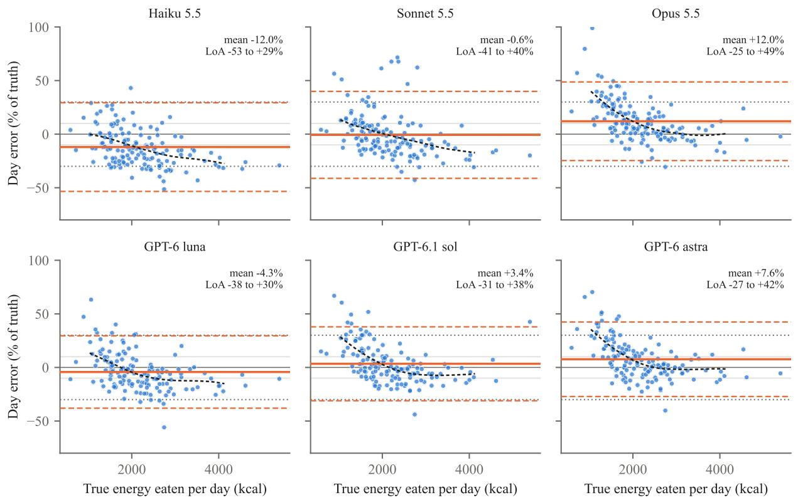

# Small Average Error, Wide Individual Error: General-Purpose LLMs Estimating Energy Intake from Meal Photos in a Feeding Trial

Xiaomeng Li Link Heart Limited, Houston, TX, USA

Preprint, October 2026

## Abstract

Photo-based estimation of food energy could reduce the burden of dietary assessment, and general-purpose multimodal large language models (LLMs) make such estimates easy to obtain. Most evaluations use one photo taken before eating and compare with the energy served, while dietary assessment needs the energy actually eaten. We evaluated six general-purpose models from two vendors (Claude Haiku, Sonnet and Opus 5.5; GPT-6 luna, GPT-6.1 sol and GPT-6 astra) on 802 meals from ACETADA, a controlled feeding trial with weighed intake, giving each model the before photo only, before and after photos in separate calls, or both photos in one request. Three questions and two limits were set in advance; the further analyses are exploratory. Several results went against what we expected. Estimating the two photos separately and subtracting under-estimated intake for five of six models: the models still report hundreds of kilocalories for a nearly empty tray. Much of the gain from the after photo could be had without it, by scaling the before-only estimate by the average share eaten in other participants (0.87); beyond that constant, the second photo lowered meal-level error by 2.2 to 3.4 points, mainly in meals with food left. With one photo, two models showed a near-zero intake bias, but only because they under-estimated the served energy and ignored the uneaten food. In ablations, adding the after photo improved accuracy under both prompt formats for five models, while prompt efects varied across models. Summed over 148 feeding days, three models kept the 90% confidence interval of their mean error within a pre-set ±10% margin, but no model reached the pre-set ±30% limits of agreement. Protein was under-estimated by every model, most in protein-dense meals; repeated calls changed error by at most 1.4 points, and a higher reasoning efort helped only the smallest model (Haiku 5.5, 4.2 points) and changed the others by less than 1 point. A low average bias is not evidence of accurate individual intake estimation, and estimates of this kind should support, not replace, assessment by a dietitian.

## 1 Introduction

Diet records are used in the care of obesity and diabetes and in nutrition research, but self-reported intake has well known errors and is a burden to collect [1]. Image-based methods were proposed to reduce this burden [2]. General-purpose multimodal large language models (LLMs) can now return an energy estimate from a meal photo without any task-specific training, and several studies have measured how well they do [5, 12–14]

Most of these evaluations give the model one photo taken before eating and compare its answer with the energy served. Health questions, however, depend on the energy that was actually eaten. Work that uses photos taken before and after eating either trains a dedicated model and reports grams [6], or asks a general model about each photo separately and subtracts, which was found to be unreliable [7]. LLM estimates have also been validated against weighed food records, for a customized GPT-4o system used by dietetic trainees who recorded their own meals [9]. To our knowledge, no study has given several general-purpose models both photos in one request and asked for consumed energy and macronutrients. None has evaluated such estimates in a controlled feeding trial at the level of a feeding day, where the same trial has published results for established 24-hour recall methods [3]. That is what we do here.

We use the public ACETADA data from such a trial [4, 5] and ask three pre-registered questions:

• Q1. Does the after photo improve estimates of consumed energy compared with the before photo alone?

• Q2. Is the change consistent across models?

• Q3. Summed over a feeding day, are the mean error and the individual error small enough, judged against limits we set in advance?

We make three contributions. First, a paired comparison of three input conditions (before photo only; separate calls with subtraction; both photos in one request) for six general-purpose models from two vendors, on 802 meals with weighed consumed energy. It shows that subtraction fails and that a fixed-fraction baseline matches much of the two-photo gain. Second, ablations that separate the second photo from the prompt (the photo helped under both prompt formats; prompt efects varied by model), and a decomposition showing that a small before-only intake bias can coexist with a large under-estimate of served energy; mean error alone is therefore a misleading criterion. Third, day-level agreement with Bland–Altman limits and an equivalence-style check of the mean error, together with macronutrient, repeatability and reasoning-efort results. The trial’s published recall results are given as a descriptive reference only.

## 2 Related Work

LLM estimates of food energy from photos. Zero-shot multimodal LLMs under-estimate more as portions grow [13] and keep high calorie error even when the foods are identified correctly [12]. On ACETADA, the dataset paper evaluated several large multimodal models with the before photo and contextual metadata, against consumed amounts [5]. Agentic decomposition into database-grounded food items has also been tried on this data [14].

Before-and-after photos and leftovers. Estimating leftovers from paired photos has a long history in computer vision, for example in hospital settings with RGB-D image pairs [10] and in a university canteen [20]; SNAPMe collected before and after photos with ASA24 records as the reference, not weighed intake [11]. DietDelta trains a dedicated vision-language model on ACETADA photo pairs to predict the grams eaten, with 14.2% error relative to mean weight [6]. In the same paper, a closed general model given both photos and the true list of foods had 38.9% error, and estimating the two photos separately and subtracting gave about the same. Nakagawa and Yamamoto studied energy estimates of 26 vision-language models and, on ACETADA, estimated before and after photos in separate calls with the same prompt [7] (preprint). For trays with at most 5% of energy left, the after-photo estimate was still a median 39–83% of the before-photo estimate, depending on the model. They concluded that intake should not be derived by subtraction. An early study used GPT-4V with before and after images from wearable cameras in a small semi-free-living sample [8].

Validation against weighed intake. A customized GPT-4o system was validated against three-day weighed food records of 57 dietetic trainees (714 images), with Bland–Altman analysis and equivalence testing [9]. The ACETADA trial itself compared four technology-assisted 24-hour recall methods with weighed intake [3].

Our position. We do not propose a new model. We evaluate general-purpose models in three input conditions, on consumed energy and macronutrients, at the level of the feeding day in a controlled trial, and we report the trial’s recall results only as a descriptive reference.

## 3 Data

Source. ACETADA comes from a randomized crossover controlled feeding study in Perth, Western Australia [3, 4]. Adults ate laboratory-prepared breakfast, lunch and dinner on up to three feeding days. Every food and drink was weighed before and after the meal, and nutrient values were assigned by dietitians. The public release contains, for each meal, a photo before and a photo after eating, the weight of each item before and after, the amount eaten, and energy, protein, carbohydrate and fat of the amount eaten [5]. Photos were taken by hand in the study room, on a tray with a reference colour card, at varying angles.

Cleaning. Of 806 released meals we removed 2 rows that repeat the photo pair of another meal of the same participant on the same day, 1 meal under 30 kcal (an inclusion threshold set in the pre-registration, carried over from our earlier work on other datasets) and 1 meal whose before photo shows no food, leaving 802 meals from 152 participants. In 63 meals an item has a negative after weight (a weighing or tare error), so the amount eaten is slightly larger than the amount served; together this is 0.17% of all energy eaten, and we keep these meals.

Leftover. We define the energy left as energy served minus energy eaten, for the whole meal. Energy served per item is the energy eaten divided by the grams eaten, times the grams before eating. This is undefined when an item was not eaten at all (energy per gram unknown); these 38 meals are left out of leftover-based analyses only. Of the remaining 764 meals, the median share of energy left is 5.9% (interquartile range 1.7–16.5%); 292 meals have at least 10% left, the cut point fixed in the pre-registration. We use energy rather than weight because leaving half of the vegetables and leaving half of the meat mean diferent things for intake.

Feeding days. A complete feeding day has all three meals in the cleaned set: 148 days from 101 participants.   
Table 1. Data used in this study.

<table><tr><td></td><td>Value</td></tr><tr><td>Meals (participants)</td><td>802 (152)</td></tr><tr><td>Energy eaten per meal, median (IQR), kcal</td><td>622 (463–857)</td></tr><tr><td>— breakfast / lunch / dinner (n)</td><td>524 (286) / 623 (257) / 763 (259)</td></tr><tr><td>Meals with energy served defined</td><td>764</td></tr><tr><td>Share of energy left per meal, median (IQR)</td><td>5.9% (1.7–16.5%)</td></tr><tr><td>Meals with ≥10% of energy left</td><td>292</td></tr><tr><td>Complete feeding days (participants)</td><td>148 (101)</td></tr><tr><td>Energy eaten per day, median (IQR), kcal</td><td>2,017 (1,593–2,636)</td></tr></table>

## 4 Methods

Models. Claude Haiku 5.5, Sonnet 5.5 and Opus 5.5 (Anthropic API) and GPT-6 luna, GPT-6.1 sol and GPT-6 astra (OpenAI API), all with low reasoning efort for the main runs, called on 16 October 2026 (Appendix B gives the order of the runs). We report results by model name. The two vendors’ models difer in more than size, so we do not attribute diferences to the number of parameters.

Input conditions. (1) Before only: the before photo with a direct prompt for the energy of everything on the plate; this assumes that everything was eaten. (2) Subtraction: the same prompt on the before photo and on the after photo in separate calls; eaten = before − after, floored at zero. This follows [7]. (3) Both photos: the before and after photos in one request, with a prompt that asks for the energy served, the energy left over and the energy eaten, plus protein, carbohydrate and fat eaten. The prompt does not list the foods. Condition (3) changes both the visual input and the output instructions relative to condition (1). To separate the two, we added after the main results (exploratory) two conditions: (3a) both photos with the simple prompt of condition (1), which also returns grams eaten; and (3b) the before photo only with the structured prompt of condition (3). The photo efect is then (3) − (3b) with the structured prompt held, and (3a) − (1) with the simple prompt held; the prompt efect is (3b) − (1) and (3) − (3a). Photos are converted to PNG with the long side at most 1,024 pixels, which also removes embedded metadata. GPT images are sent with detail “high”; the Anthropic API has no equivalent setting and processes the image at its given size, so the two vendors may see the images at diferent efective resolutions. We did not try to equalize this. Full prompts are in Appendix A; prompts are identical across models.

Metrics. At meal level: mean absolute error as a percentage of mean true energy (MAE%) and bias (total estimate minus total truth, as a percentage of total truth). For the share eaten, we compare the model’s own ratio of eaten to served with the true ratio (mean diference, mean absolute diference and Spearman correlation; the correlation only shows ranking). At day level, for each participant’s feeding day we compute e\_day = 100 × (estimated − true energy eaten) / true energy eaten, summing the three meals. We report the mean of e\_day with its 95% confidence interval, 95% Bland–Altman limits of agreement (LoA) [15], and the share of days within 800 kJ (191 kcal) of truth. Because participants contribute one to three days, we compute the LoA with the repeated-measures method of Bland and Altman [21] (one-way analysis of variance, between- and within-participant components) and report the within-participant intraclass correlation of e\_day; we also report LoA on the log scale as ratio limits. We plot e\_day against the true intake rather than the mean of the two [22]. The LoA describe the spread of single feeding days; they do not describe usual intake or the reliability of averages over several days.

Thresholds. Before any dual-photo call we set two limits for Q3: an absolute mean day error of at most 10%, and 95% LoA within ±30%. These are limits chosen by us for this study. The ±30% limit is close to what the best recall method reached in the same trial (an image-based record analysed by trained staf) [3]. They are not accepted clinical standards. For the mean error we use an equivalence-style rule: the 90% confidence interval must lie within ±10% [16].

Statistics. Confidence intervals come from 2,000 bootstrap resamples of participants. Diferences between input conditions are paired. To test whether the gain depends on leftovers, we compute the gain separately in meals with ≥10% and <10% of energy left and bootstrap the diference between the two gains. For Q2 we describe heterogeneity between models by the range and standard deviation of the six models’ gains, with bootstrap intervals, and list all 15 pairwise diferences (unadjusted) in Appendix F. Point estimates are computed on the full sample; the bootstrap is used only for intervals. Some participants contributed up to three feeding days; resampling participants keeps their days together. Confidence intervals are not adjusted for multiple comparisons, so we emphasize efect sizes and intervals.

Reliability and efort (exploratory). For the 100 pilot meals we repeated condition (3) twice more with fresh calls (three estimates per meal) and report the per-meal coeficient of variation and the range of MAE% across repeats; and we ran condition (3) once with high reasoning efort on the same meals.

Fixed-fraction baseline (exploratory). To check whether the both-photos protocol does more than lower all estimates by a constant, we scale each before-only estimate by c = (energy eaten) / (energy served), summed over the meals of all other participants (leave-one-participant-out; c = 0.869–0.876). The rule was fixed

before computing.

Failures. Network errors are retried by the client; a syntactically invalid answer is not re-asked. A rule fixed in advance scores such an unparsable answer as that system’s worst relative error: w = max |yˆ − y| / y over the system’s parsed meals, and the failed meal gets the synthetic estimate $\mathrm {  ~ y ~ } \times \left( 1 + \mathrm {  ~ w } \right)$ , which is then used in day sums like any other meal. In the subtraction condition, a failure of either call counts as a failure. Macronutrient fields have no synthetic value; days with a missing field are left out of that nutrient’s day analysis. Failures were at most 11 of 802 meals per system (Appendix $\mathbf { A } ) ;$ no meal failed for more than one system, so failures are not tied to particular photos. Because the rule penalizes the system with the most failures (Sonnet 5.5, 11 meals), Table 2 also gives results on the subset of meals with valid output in all three conditions.

Pre-registration and deviations. The questions Q1–Q3, prompts, the two limits, the 10% leftover cut point and a pilot rule were committed with a timestamp before any dual-photo call. The specific tests that answer Q2 and the equivalence-style check for Q3 were chosen later. A 100-meal pilot with two models met the pre-set continue rule, and the prompt was not changed, so pilot meals stay in. After a literature check, and before the full run, we added the subtraction condition. The leftover-group diference test, the error decomposition, the model comparison against Haiku, the equivalence check, the fixed-fraction baseline, the kcal-scale and pilot-exclusion sensitivity analyses, the local recalibration and the breakdown by meal were added after the main results were known, following review, and are exploratory. Because the full run depended on the pilot meeting its rule, we also report results without the pilot meals (Appendix F).

## 5 Results

## 5.1 Q1: the after photo

Table 2 shows meal-level results. Against the before-only condition, which assumes that everything was eaten, the both-photos protocol lowered MAE% for four of six models, by 2.8 to 9.6 points (Opus 5.5, GPT-6 luna, GPT-6.1 sol, GPT-6 astra); the change was not clear for Sonnet 5.5 and absent for Haiku 5.5. This comparison, however, favours the protocol by construction in meals with food left: the before-only error contains the uneaten energy by definition. The more informative baseline is the before-only estimate scaled by a fixed share eaten taken from other participants $( \mathrm { c } = 0 . 8 7 )$ . Against that baseline the protocol was better by 2.2 to 3.4 points, with intervals excluding zero for five models (Opus 5.5: −2.2, CI −4.8 to +0.3). In meals with ≥10% of energy left, its gain over the constant was clear for GPT-6 astra (−8.8 points), Opus 5.5 (−7.5) and GPT-6.1 sol (−6.6), but not for Haiku 5.5, Sonnet 5.5 or GPT-6 luna; in mostly eaten meals there was no gain for any model (Appendix F). On the subset of meals with valid output in all conditions, Sonnet 5.5’s both-photos error is 19.3% rather than 21.8%, because its 11 failures are scored at its worst error; the other models change by at most 0.6 points.

Table 2. Meal-level MAE% (bias %) by input condition, with the fixed-fraction baseline (before only $\times { \mathrm { c } } , { \mathrm { c } } =$ share eaten in other participants). Δ = both photos − baseline, MAE% points [95% CI], on all 802 meals and in meals with ${ \geq } 1 0 \%$ of energy left (n = 292). Valid subset: meals with a parsable answer in all three conditions for that model.
<table><tr><td></td><td></td><td></td><td></td><td></td><td>Both photos, valid subset</td><td>∆ vs before</td><td>∆ vs before</td><td>∆ vs before × c, ≥10%</td></tr><tr><td>Model</td><td>Before only</td><td>Before × c</td><td>Subtraction</td><td>Both photos</td><td>(n)</td><td>only</td><td>×c</td><td>left</td></tr><tr><td>Haiku 5.5</td><td>24.7 (-6.7)</td><td>27.3</td><td>36.5 (-33.5)</td><td>24.9 (−14.0)</td><td>24.1 (800)</td><td>+0.1 [−1.9, +2.3]</td><td>-2.5 [-4.2, -0.6]</td><td>-1.8 [-4.4, +0.6]</td></tr><tr><td></td><td>Before only Before × c</td><td></td><td>Subtraction</td><td>Both photos</td><td>Both photos, valid subset (n)</td><td>∆ vs before only</td><td>∆ vs before ×c</td><td>∆ vs before × c, ≥10% left</td></tr><tr><td>Sonnet 5.5</td><td>24.2 (+0.9)</td><td>24.9</td><td>25.1 (−18.4)</td><td>21.8 (−2.9)</td><td>19.3 (789)</td><td>-2.4</td><td>-3.0</td><td>-1.3</td></tr><tr><td>Opus 5.5</td><td>30.1 (+21.7)</td><td>22.7</td><td>21.2 (+1.8)</td><td>20.5 (+9.0)</td><td>20.5 (801)</td><td>[−5.3, +0.2] -9.6</td><td>[-5.5, -0.8] -2.2</td><td>[−5.9, +2.7] -7.5</td></tr><tr><td>GPT-6 luna</td><td>23.9 (+4.3)</td><td>23.7</td><td>26.2 (−17.6)</td><td>21.0 (-6.1)</td><td>21.0 (802)</td><td>[-13.2,-6.5] -2.8</td><td>[-4.8, +0.3] -2.6</td><td>[-12.3,-3.3] -1.3</td></tr><tr><td>GPT-6.1 sol</td><td>26.9 (+14.8)</td><td>22.3</td><td>23.7 (-10.7)</td><td>19.5 (+1.2)</td><td>19.1 (801)</td><td>[-5.0, -1.0] -7.4</td><td>[−4.2, −1.1] -2.8</td><td>[−5.1, +1.9] -6.6</td></tr><tr><td>GPT-6 astra</td><td>27.6 (+16.4)</td><td>22.4</td><td>22.5 (−7.7)</td><td>19.0 (+5.3)</td><td>19.0 (802)</td><td>[-10.3,-4.6] -8.6 [-11.3,-6.1]</td><td>[-4.8, -0.7] -3.4 [−5.3, -1.5]</td><td>[-10.6,-3.1] -8.8 [−12.7,−5.1]</td></tr></table>

Photo or prompt? Table 3 separates the two changes made in condition (3). With the structured prompt held fixed, adding the after photo lowered MAE% for five of six models (Sonnet 5.5 −5.1, Opus 5.5 −2.5, GPT-6 luna −2.5, GPT-6.1 sol −6.7, GPT-6 astra −8.1 points; Haiku 5.5 −1.3, CI −2.8 to +0.4). With the simple prompt held fixed, the second photo had the same or a larger efect (−3.1 to −9.7 points for the same five models; Haiku 5.5 +0.2). Prompt efects varied across models. With the before photo only, the structured prompt changed MAE% by −0.7 to +2.7 points for five models, but improved Opus 5.5 by 7.1 points, because it makes the model subtract a predicted leftover from its over-estimate. With both photos, the simple prompt was as good as or slightly better than the structured one for every model (Sonnet 5.5: 18.9% vs 21.8%, of which the structured prompt’s 11 failures account for most). Adding the after photo therefore improved accuracy under both prompt formats for five models, while the prompt’s contribution depended on the model; the structured prompt is needed for the macronutrient outputs. Day-level results for the simple-prompt protocol are similar to those of condition (3) (Appendix F). From the simple two-photo prompt the models also returned grams eaten; against weighed grams, the error relative to mean weight was 20.6% (Opus 5.5) to 37.9% (Haiku 5.5), with every model under-estimating grams by 12–37%. This is in the range that a closed model reached on the same photo pairs when given the true list of foods (38.9%) and well above a model trained on this data (14.2%) [6].

Table 3. Photo versus prompt (exploratory): meal-level MAE% (bias %) for four combinations of input and prompt, and paired diferences [95% CI], 802 meals.
<table><tr><td>Model</td><td>(1) Before, simple prompt</td><td>(3b) Before, structured prompt</td><td>(3a) Both photos, simple prompt</td><td>(3) Both photos, structured prompt</td><td>Photo effect, structured prompt (3) – (3b)</td><td>Photo effect, simple prompt (3a) − (1)</td><td>Prompt effect, before only (3b) − (1)</td><td>Prompt effect, both photos (3) – (3a)</td></tr><tr><td>Haiku 5.5</td><td>24.7 (-6.7)</td><td>26.2 (-17.8)</td><td>25.0 (-14.3)</td><td>24.9 (−14.0)</td><td>-1.3 [−2.8, +0.4]</td><td>+0.2 [−1.9, +2.2]</td><td>+1.5 [−0.3, +3.2]</td><td>-0.1 [−1.6, +1.4]</td></tr><tr><td>Sonnet 5.5</td><td>24.2 (+0.9)</td><td>26.9 (−1.3)</td><td>18.9 (−8.0)</td><td>21.8 (−2.9)</td><td>-5.1 [-9.3, -1.3]</td><td>-5.3 [-8.1, -3.0]</td><td>+2.7 [-1.3, +6.9]</td><td>+2.9 [+1.2, +4.6]</td></tr><tr><td>Opus 5.5</td><td>30.1 (+21.7)</td><td>22.9 (+9.2)</td><td>20.3 (+6.3)</td><td>20.5 (+9.0)</td><td>-2.5 [-4.4, -0.6]</td><td>-9.7 [-13.4,-6.5]</td><td>-7.1 [-9.8, -4.9]</td><td>+0.1 [−0.7, +1.1]</td></tr><tr><td>GPT-6 luna</td><td>23.9 (+4.3)</td><td>23.5 (+3.7)</td><td>20.7 (−7.1)</td><td>21.0 (−6.1)</td><td>-2.5 [-4.1, -1.0]</td><td>-3.1 [-5.1, -1.4]</td><td>-0.4 [-1.5, +0.7]</td><td>+0.3 [−0.7, +1.3]</td></tr><tr><td>GPT-6.1 sol</td><td>26.9 (+14.8)</td><td>26.2 (+17.0)</td><td>18.7 (−2.2)</td><td>19.5 (+1.2)</td><td>-6.7 [-9.6, -3.8]</td><td>-8.2 [-11.1,−5.6]</td><td>-0.7 [−1.5, +0.2]</td><td>+0.8 [−0.2, +2.1]</td></tr><tr><td>GPT-6 astra</td><td>27.6 (+16.4)</td><td>27.2 (+19.1)</td><td>18.4 (+1.6)</td><td>19.0 (+5.3)</td><td>-8.1 [-10.9,-5.6]</td><td>-9.2 [-12.1,-6.6]</td><td>-0.5 [−1.4, +0.4]</td><td>+0.6 [+0.0, +1.2]</td></tr></table>

The models read the share eaten with little bias. From their own numbers, the ratio of eaten to served difered from the true ratio by −0.3 to +2.6 percentage points on average, with a mean absolute diference of 5.3 to 7.8 points and Spearman correlations of 0.63 to 0.77. Subtraction under-estimated intake for five of six models (bias −7.7% to −33.5%), in line with [7]: the estimate for the after photo stays too high. Opus 5.5 was the exception (+1.8%).

Day level. The both-photos protocol had narrower day-level limits of agreement than the constant baseline for five models (for example Sonnet 5.5: −67% to +51% vs −41% to +40%; Haiku 5.5 was the exception, 77 vs 82 points wide) and more days within 800 kJ for all six, while the constant sometimes gave a smaller mean error (Opus 5.5: +9.2% vs +12.0%) (Appendix F). The constant estimates a meal’s share eaten with a mean absolute error of 11.2 points, compared with 5.3–7.8 points for the models’ own shares.

Robustness. On the kcal scale, the per-meal change |both − eaten| − |before − eaten| was more favourable in meals with ≥10% left than in mostly eaten meals for every model (diferences −43 to −138 kcal per meal, all intervals excluding zero; Appendix F); as noted above, part of this diference follows from the definition of the before-only condition. Excluding the 100 pilot meals, or all pilot participants, did not change the direction of any main result (Appendix F). Our before-only errors (161–205 kcal per meal, mean absolute percentage error 24–33%) are in the range that the dataset paper reported for closed models with a plain prompt on the same photos (166–211 kcal, 23–34%) [5].

## 5.2 Q2: diferences between models

The direction of the change was the same for five of six models and clear for four, but its size was not consistent: across the six models the gains against the before-only condition ranged over 9.7 points (95% CI 7.2 to 12.9; standard deviation 3.6 points, CI 2.7 to 4.7). Of the 15 pairwise diferences, 11 had intervals excluding zero (Appendix F); Opus 5.5, GPT-6.1 sol and GPT-6 astra gained most, Haiku 5.5, Sonnet 5.5 and GPT-6 luna least. Against the fixed-fraction baseline the gains were more alike (2.2 to 3.4 points), so much of the heterogeneity reflects how much each model over-estimated intake with the before photo alone.

The before-only results help explain this (Table 4). The error of a before-only estimate against energy eaten is the sum of two parts: the error against energy served, and the energy left. The true energy left cannot be negative; in our labels it is slightly negative for a few meals because of weighing error (Section 3), and on average it is +103 kcal per meal. Opus 5.5, GPT-6.1 sol and GPT-6 astra estimated the served energy with little bias, so the leftover appeared as an over-estimate of intake. Haiku 5.5, Sonnet 5.5 and GPT-6 luna under-estimated the served energy, and this under-estimate ofset the leftover; for Sonnet 5.5 the two parts almost cancelled (−104 and +103 kcal per meal). The ofset also happened within the same meal: among meals with ≥10% left, Haiku 5.5 under-estimated the served energy and still ended closer to the energy eaten in 178 of 292 meals, by a median of 137 kcal. These results show that a small before-only intake bias can coexist with a substantial under-estimate of served energy, partly ofset by uneaten food. This decomposition does not isolate why predictions change under the both-photos protocol, which may also change the model’s estimate of the served energy.

Table 4. Decomposition of the before-only error, kcal per meal (764 meals with energy served defined).
<table><tr><td>Model</td><td>Estimate – served</td><td>Energy left</td><td>Estimate – eaten</td><td>left where the two parts offset*</td><td>Median offset, kcal</td></tr><tr><td>Haiku 5.5</td><td>-156</td><td>+103</td><td>-53</td><td>178 / 292</td><td>137</td></tr><tr><td>Sonnet 5.5</td><td>-104</td><td>+103</td><td>-1</td><td>146 / 292</td><td>118</td></tr><tr><td>Opus 5.5</td><td>+38</td><td>+103</td><td>+141</td><td>61 /292</td><td>87</td></tr><tr><td>GPT-6 luna</td><td>-80</td><td>+103</td><td>+23</td><td>141 / 292</td><td>127</td></tr><tr><td>GPT-6.1 sol</td><td>-8</td><td>+103</td><td>+95</td><td>84 /292</td><td>105</td></tr><tr><td>GPT-6 astra</td><td>+4</td><td>+103</td><td>+107</td><td>88 / 292</td><td>105</td></tr><tr><td>Model</td><td>Estimate – served</td><td>Energy left</td><td>Estimate – eaten</td><td>Meals with ≥10% left where the two parts offset*</td><td>Median offset, kcal</td></tr><tr><td></td><td></td><td></td><td></td><td></td><td></td></tr></table>

\*The served energy was under-estimated and the estimate was closer to the energy eaten than to the energy served. Ofset = |estimate − served| − |estimate − eaten| in those meals.

## 5.3 Q3: agreement over a feeding day

Table 5 and Figure 1 show day-level results. With both photos, the 90% confidence interval of the mean day error was within ±10% for Sonnet 5.5 (−0.6%), GPT-6 luna (−4.3%) and GPT-6.1 sol (+3.4%); GPT-6 astra was just outside (+7.6%, upper limit 10.3%). Haiku 5.5 (−12.0%) and Opus 5.5 (+12.0%) were outside. No system met the ±30% limits for individual agreement. With both photos, the limits spanned 68 to 82 percentage points; GPT-6 luna was closest to the pre-set limits (−38% to +30%), and GPT-6.1 sol (−31% to +38%) and GPT-6 astra (−27% to +42%) had similar widths but were placed diferently. Between 43% and 51% of days were within 800 kJ of truth for the four models whose meal-level error fell. With the before photo only, Haiku 5.5 also passed the equivalence check (−4.2%, 90% CI −8.1 to −0.3), in line with the pattern seen in the meal-level decomposition (Section 5.2). A small mean error alone therefore does not show that a method reads intake correctly.

Table 5. Day-level agreement for energy eaten (148 days, 101 participants). Mean = mean of day % errors [95% CI]. Equivalence: 90% CI within ±10%.
<table><tr><td>Model, input</td><td>Mean day error %</td><td>90% CI</td><td>Equivalence</td><td>95% LoA %</td><td>Days within 800 kJ %</td></tr><tr><td>Haiku 5.5, before only</td><td>-4.2 [−8.8, +0.7]</td><td>-8.1, -0.3</td><td>yes</td><td>-48 to +39</td><td>34</td></tr><tr><td>Haiku 5.5, both photos</td><td>-12.0 [−16.0, −7.4]</td><td>-15.7, -8.2</td><td>no</td><td>-53 to +29</td><td>29</td></tr><tr><td>Sonnet 5.5, before only</td><td>+5.5 [−0.4, +12.4]</td><td>+0.1, +11.0</td><td>no</td><td>-62 to +73</td><td>37</td></tr><tr><td>Sonnet 5.5, both photos</td><td>−0.6 [−4.2, +3.2]</td><td>-3.7, +2.5</td><td>yes</td><td>-41 to +40</td><td>41</td></tr><tr><td>Opus 5.5, before only</td><td>+25.4 [+19.4, +32.4]</td><td>+20.3, +31.0</td><td>no</td><td>-32 to +83</td><td>25</td></tr><tr><td>Opus 5.5, both photos</td><td>+12.0 [+8.7, +15.6]</td><td>+9.2, +14.8</td><td>no</td><td>-25 to +49</td><td>43</td></tr><tr><td>GPT-6 luna, before only</td><td>+6.7 [+1.9, +11.9]</td><td>+2.6, +10.9</td><td>no</td><td>-41 to +54</td><td>39</td></tr><tr><td>GPT-6 luna, both photos</td><td>-4.3 [–7.5, −0.7]</td><td>-6.9, -1.5</td><td>yes</td><td>-38 to +30</td><td>43</td></tr><tr><td>GPT-6.1 sol, before only</td><td>+17.7 [+12.5, +23.6]</td><td>+13.1, +22.5</td><td>no</td><td>-33 to +69</td><td>29</td></tr><tr><td>GPT-6.1 sol, both photos</td><td>+3.4 [+0.4, +6.7]</td><td>+0.8, +6.0</td><td>yes</td><td>-31 to +38</td><td>51</td></tr><tr><td>GPT-6 astra, before only</td><td>+20.2 [+14.8, +26.1]</td><td>+15.6, +25.0</td><td>no</td><td>-31 to +71</td><td>24</td></tr><tr><td>GPT-6 astra, both photos</td><td>+7.6 [+4.5, +10.9]</td><td>+5.0, +10.3</td><td>no</td><td>−27 to +42</td><td>45</td></tr></table>

Repeated days from the same participant were correlated (intraclass correlation of e\_day 0.22 to 0.53); the repeated-measures limits [21] were the same as the naive ones to the nearest point, because the within- and between-participant components add up to the total variance. On the log scale the limits are ratio limits of about ×0.67 to ×1.4 for the better models (Appendix F). In Figure 1 the day error falls as the true intake rises for every model (smoothed lines): days with low intake were over-estimated and days with high intake under-estimated, by 15 to 22 percentage points per doubling of true intake. On the log scale the slope of the estimate on the truth was 0.74 to 0.78 at day level and 0.68 to 0.76 at meal level. This is the pattern of shrinkage toward a typical meal rather than a specific failure on large portions; it also means that percentage limits are not constant across the intake range. Subtraction gave a small mean error for Opus 5.5 (+3.7%, LoA −29% to +37%) but large negative errors for the other five models (Appendix C).

For orientation only, Table 6 lists the energy results that the trial reported for four 24-hour recall methods [3]. They come from the same trial and the same reference (weighed intake), but from diferent feeding days, possibly diferent participants, and a statistic computed by the trial’s authors. The trial reports a mean and standard deviation of the ratio of estimated to true intake; an approximate error range derived from these rounded statistics is given in Appendix F for completeness. We do not compare methods.

  
Figure 1: Day-level Bland–Altman plots for energy eaten, both photos in one request. Each point is one participant’s feeding day. Solid and dashed orange lines: mean error and 95% limits of agreement. Grey lines: the pre-set ±10% (solid) and ±30% (dotted) limits. Black dashed line: local-linear smoother.

Table 6. Published recall results from the same trial (descriptive reference; not compared with our results).
<table><tr><td>Method [3]</td><td>Feeding days</td><td>Estimated / true energy, mean (SD) %</td></tr><tr><td>ASA24-Australia (self-administered)</td><td>143</td><td>105 (29)</td></tr><tr><td>Intake24-Australia (self-administered)</td><td>150</td><td>102 (29)</td></tr><tr><td>Mobile food record, trained analyst</td><td>148</td><td>101 (15)</td></tr><tr><td>Image-assisted interviewer recall</td><td>145</td><td>115 (20)</td></tr></table>

## 5.4 Macronutrients (secondary)

Table 7. Day-level mean % error (95% LoA) for macronutrients eaten, both photos.
<table><tr><td>Model</td><td>Protein</td><td>Carbohydrate</td><td>Fat</td></tr><tr><td>Haiku 5.5</td><td> $- 2 9 \left( - 7 0 \mathrm { t o } + 1 2 \right)$ </td><td> $+ 1 \left( - 4 0 \mathrm { t o } + 4 3 \right)$ </td><td> $- 1 2 \ ( - 5 2 \ \mathrm { t o } \ + 2 9 )$ </td></tr><tr><td>Sonnet 5.5</td><td> $- 2 4 \left( - 6 2 \mathrm { t o } + 1 4 \right)$ </td><td> $+ 1 4 \left( - 3 3 \mathrm { t o } + 6 2 \right)$ </td><td> $+ 3 \left( - 3 9 \mathrm { t o } + 4 5 \right)$ </td></tr><tr><td>Opus 5.5</td><td> $- 8 \left( - 5 2 \mathrm { t o } + 3 7 \right)$ </td><td> $+ 2 5 \left( - 2 4 \mathrm { t o } + 7 5 \right)$ </td><td> $+ 1 8 \ : ( - 3 3 \ : \mathrm { t o } \ : + 7 0 )$ </td></tr><tr><td>GPT-6 luna</td><td> $- 1 6 \left( - 6 3 \mathrm { t o } + 3 0 \right)$ </td><td> $+ 1 2 \left( - 3 1 \ \mathrm { t o } \ + 5 5 \right)$ </td><td> $+ 0 \left( - 4 5 \mathrm { t o } + 4 6 \right)$ </td></tr><tr><td>GPT-6.1 sol</td><td> $- 1 3 \left( - 5 7 \mathrm { t o } + 3 0 \right)$ </td><td> $+ 1 6 \left( - 2 6 \mathrm { t o } + 5 8 \right)$ </td><td> $+ 7 \left( - 3 6 \mathrm { t o } + 5 1 \right)$ </td></tr><tr><td>GPT-6 astra</td><td> $- 1 0 \left( - 5 4 \mathrm { t o } + 3 5 \right)$ </td><td> $+ 2 1 \left( - 2 3 \mathrm { t o } + 6 4 \right)$ </td><td> $+ 1 2 \left( - 3 1 \ \mathrm { t o } \ + 5 6 \right)$ </td></tr></table>

Protein was under-estimated by every model (−8% to −29%). The under-estimate was larger in protein-dense meals: across meals, the protein error correlated negatively with protein density (Spearman −0.38 to −0.50 across models) and with the share of energy from animal-source items $( - 0 . 1 0 \mathrm { t o } - 0 . 3 5 )$ , and the bias was two to three times larger in meals where animal-source items supplied at least a third of the energy than in other meals (Appendix F). The models appear to assign typical, rather than observed, protein contents. Carbohydrate errors were positive for five models (+12% to +25%) and near zero for Haiku 5.5 (+1%); we did not test these diferences. Limits of agreement were wider than for energy. A model that estimates energy well does not necessarily estimate the nutrients well.

## 5.5 Exploratory: reliability and reasoning efort

Hosted models are stochastic. On the 100 pilot meals, three fresh calls of condition (3) gave MAE% values that difered by at most 1.4 points within a model (Haiku 5.5 28.2–29.3; Sonnet 5.5 20.1–21.4; Opus 5.5 21.9–23.3; GPT-6 luna 22.4–23.7; GPT-6.1 sol 20.5–21.2; GPT-6 astra 20.5–21.1). The median per-meal coeficient of variation was 3.5–8.2%, and two calls on the same meal difered by 6–12% of the true energy on average. Call-to-call noise is therefore smaller than the photo efects in Table 3 for the five models that improved, but of the same size as the smallest diferences we report (1–2 points). A high reasoning efort on the same meals helped one model: Haiku 5.5 improved by 4.2 points (28.8% to 24.6%), while the other five changed by less than 1 point (Opus 5.5 −0.4, Sonnet 5.5 −0.3, GPT-6.1 sol +0.3, GPT-6 astra +0.5, GPT-6 luna +0.9), at 1.1 to 2.6 times the cost per meal (Appendix F). For the larger models, more reasoning did not buy more accuracy on this task.

## 5.6 Exploratory: does a small local sample help?

We refit two constants of a power law on the log scale (an intercept and a slope, as in the updating of clinical prediction models [18, 19]) on 20 meals from other participants and applied it to the both-photos estimates (200 random draws). The mean day error moved toward zero for most models (for example Opus 5.5 from +12.1% to +0.5%, GPT-6 astra from +7.7% to −1.1%). The width of the limits of agreement changed in both directions (narrower for Opus 5.5 by 7 points and GPT-6 astra by 4 points; wider for Haiku 5.5 by 9 points and GPT-6 luna by 4 points; about the same for the others) while their centre moved toward zero; meal-level MAE% went up slightly for five models and down for Opus 5.5; and the share of days within 800 kJ fell for some models (GPT-6.1 sol from 51% to 41%). Because calibration meals’ participants are left out, these comparisons use a slightly smaller set of days than Table 5 (hence, for example, +12.1% instead of +12.0% for Opus 5.5 without calibration). The metrics moved in diferent directions, so in this trial a small local sample mainly corrected the mean (Appendix D).

## 6 Discussion

Main finding. In this controlled feeding trial, the intuitive ways of using and judging a photo-based estimator both misled. Estimating the two photos separately and subtracting failed, as previously reported [7], because the models do not read an almost empty tray as almost zero. Giving both photos in one request did help, for five of six models, under both prompt formats, while prompt efects varied across models. But a constant discount for the share eaten reproduced much of it. What the photo added on its own was 2 to 3 points of meal-level error, concentrated in meals with food left, and narrower day-level limits. The clearest lesson is about evaluation: a model can show a near-zero intake bias with one photo because two errors cancel, and a method can pass a mean-error criterion while single-day errors remain wide.

Scope. The photos were taken under study instructions, by hand, on a tray with a reference card, and the menu came from one trial kitchen. Free-living photos, other cuisines and other populations may give diferent results. Meeting our pre-set limits for the mean in this sample does not mean the method meets the needs of dietary surveys in general: we did not assess intake distributions, subgroup bias or usual intake.

Mean error can mislead. Small before-only intake biases came from models that under-estimated the served energy, a pattern consistent with ofset by uneaten food. The larger gain of the both-photos protocol in meals with food left is partly a matter of definition, because the before-only condition assumes that everything was eaten; the comparison with a constant discount is the one that shows whether a model read the leftover. A study that tests one model with one input condition, and reports only the mean error, can draw the wrong conclusion. We suggest reporting the limits of agreement, testing more than one model, and, where possible, splitting the error against served energy from the leftover.

Sources of the remaining error. Our design cannot say how much of the remaining error comes from portion size, food identification, energy density or label error. The fall of the percentage error with rising intake, and log-scale slopes of about 0.75, point to shrinkage toward a typical meal, not to a specific failure on large portions. The protein result, where protein-dense meals are under-estimated most, fits the same reading.

Practical meaning. Two photos per meal are more work than one, so this approach fits research and supervised settings better than everyday self-tracking. Because individual error is wide, single-day estimates for one person should be used with care, and the protein under-estimate matters for people who need a protein target. A systematic error in either direction could be harmful for people with or at risk of eating disorders, and for people with low appetite on GLP-1 receptor agonist drugs. Estimates of this kind should support, not replace, assessment by a dietitian.

Relation to recall methods. The recall results in Table 6 come from the same trial but not from the same days, and they are summarized by a diferent team. We list them so that readers can see the range that established methods reached under the same reference; this does not show that one approach is better.

## 7 Limitations

• Recall data for the same participant-days are not public, so we could not compare methods directly.

• Labels are weighed amounts with nutrient values assigned by dietitians; small weighing errors exist (negative after weights in 63 meals).

• One trial, one city, one menu; photos under study instructions.

• Hosted models change over time; we report model names and call dates, and release all outputs.

• Several analyses (Section 4) were added after the main results and are exploratory; leftover-based analyses exclude 38 meals with undefined served energy.

• We used one prompt per condition in the main runs; the ablations in Table 3 vary the prompt and the photos separately but test only two prompts, and other prompts or settings may do better. On 100 meals, a high reasoning efort improved only Haiku 5.5.

• Many tests are exploratory and unadjusted for multiple comparisons.

• The full run was made conditional on a pilot result (Appendix B), so the existence of this study depends on the pilot having met its rule; the main results without the pilot meals are in Appendix F and are unchanged in direction.

• Percentage errors shrink with intake, so the percentage limits of agreement are not constant across the intake range; log-scale limits are given in Appendix F.

## 8 Conclusion

In this controlled feeding trial, estimating intake by subtracting an after-photo estimate from a before-photo estimate failed, and a constant consumption discount matched much of what a dual-photo protocol added; the protocol still improved consumed-energy estimates for several general-purpose multimodal LLMs, particularly for meals with substantial leftovers. Small mean daily errors coexisted with wide individual limits of agreement, systematic protein underestimation, and, for one photo, error cancellation that made an inaccurate estimator look accurate. These findings show that improvement over an assumption of complete consumption, or low average bias alone, is insuficient evidence of accurate individual intake estimation.

## Data and Code Availability

Data. ACETADA [5] is public under CC BY-NC 4.0 for non-commercial research. We do not redistribute images. We release scripts that download the data and rebuild our labels, the list of excluded meals with reasons, and participant ids for the bootstrap.

Code. Code, prompts, the pre-registration file and per-meal outputs are available at https://github.com/xtea/llmintake-validation. It contains the prompts, the evaluation and analysis scripts, the pre-registration file with its commit history, per-meal outputs of every model and condition, and the scripts for all tables and figures. Because model responses are cached, all tables and figures can be rebuilt without API calls. The code is released under the MIT license. The README lists the Python version (3.12), pinned package versions (anthropic 0.84.0, openai 2.28.0, matplotlib 3.11.2) and example commands.

## Institutional Review Board (IRB)

The research does not require IRB approval. We analyze only a public, de-identified dataset released for research; we had no interaction with any participant and received no identifiable private information, so the work is not human subjects research under the U.S. Common Rule (45 CFR 46.102(e)). The original trial was approved by the Curtin University Human Research Ethics Ofice (HRE2019-0222) and registered with the Australian New Zealand Clinical Trials Registry (ACTRN12621000209897) [4]. Photos show a numbered study card but no faces.

## Acknowledgments and Disclosure

This work was supported by Link Heart Limited, which provided the research budget for the experiments. No other funding was received. The author is co-founder and CTO of Link Heart Limited, which develops nutrition software; the study uses only public data and was carried out as non-commercial research, independent of any product. We thank the ACETADA investigators for releasing their data.

## Statement on AI Use

LLMs are the object of this study and were also used as tools.

1. Models under study. Claude Haiku/Sonnet/Opus 5.5 and GPT-6 luna/6.1 sol/6 astra produced all estimates (Section 4). Check: metrics are computed by deterministic scripts from stored outputs.

2. Code. Evaluation and analysis scripts were written with help from Claude Opus 5.5 in Claude Code (version 2.1). Check: the author reviewed the code; key numbers were recomputed by separate scripts and checked by hand against raw outputs.

3. Literature search and references. LLM assistance was used to find related work. Check: every reference was matched to its publisher, DOI, PubMed, arXiv or medRxiv record, and each cited claim was checked against the source.

4. Writing. The author wrote the paper and is responsible for its content and claims; Claude Opus 5.5 was used as a writing assistant for English drafting and editing (the author is not a native English speaker). Check: the author reviewed and revised every sentence; all numbers come from the scripts above.

## Appendix A. Prompts and settings

Before only and subtraction (same text for each photo):

This is a photo of a meal. Estimate the total food energy of everything on the plate.

Reply with JSON only: {"kcal": <number>, "mass\_g": <total grams of food>}

Both photos (before photo first, after photo second, one request):

The first photo shows a meal before eating. The second photo shows the same tray after the person finished eating.

Estimate the food energy that was served, the food energy that was left over, and the food energy the person actually ate

(served minus left over). Also estimate the protein, carbohydrate and

```json
Reply with JSON only: {"served_kcal": <number>, "leftover_kcal": <number>,
"kcal": <number eaten>, "protein_g": <number>, "carbs_g": <number>,
"fat_g": <number>}
```

fat that the person actually ate.   
Reply with JSON only: {"served\_kcal": <number>, "leftover\_kcal": <number>,   
"kcal": <number eaten>, "protein\_g": <number>, "carbs\_g": <number>,   
"fat\_g": <number>}

## (3a) Both photos, simple prompt (exploratory):

The first photo shows a meal before eating. The second photo shows the same tray after the person finished eating.

## (3b) Before photo only, structured prompt (exploratory):

This photo shows a meal before eating. Estimate the food energy that was served, the food energy that will be left over,

and the food energy the person will actually eat (served minus left over). Also estimate the protein, carbohydrate and fat

Model API identifiers: claude-haiku-5-5, claude-sonnet-5-5, claude-opus-5-5 (Anthropic Messages API); gpt-6-luna, gpt-6.1-sol, gpt-6-astra (OpenAI Chat Completions API). All study calls were made on 16 October 2026.

Settings: low reasoning efort (Claude: adaptive thinking with efort “low”; GPT: reasoning\_efort “low”), except the high-efort runs in Section 5.5 (efort “high”); no temperature setting; images as PNG, long side ≤ 1,024 px; GPT images with detail “high”. Unparsable answers (malformed JSON) per system, before only / subtraction / both photos / (3a) / (3b): Haiku 0/0/2/6/0, Sonnet 2/2/11/0/10, Opus 1/1/0/1/0, GPT-6 luna 0/0/0/0/0, GPT-6.1 sol 0/0/1/0/0, GPT-6 astra 0/0/0/0/0. Per-call cost records for every run are in the repository.

## Appendix B. Pre-registration and deviations

The plan (questions Q1–Q3, prompts, thresholds, the 10% leftover cut point, the pilot and its continue rule, and the budget) was committed to the study repository with a timestamp before any dual-photo call. All steps took place on 16 October 2026 (US Central time): pre-registration committed 13:07; pilot run 13:10; pilot result and full-run candidates committed 13:11; subtraction condition committed 13:12; full run 13:13–14:05; main results committed 14:09; the exploratory analyses in later commits (14:22 to 22:19); the ablation, repeat and high-efort runs were registered at 22:19 and run 22:21–23:24, with results committed at 23:24. The repository’s commit history is the record.

• Pilot (100 meals drawn with a fixed seed; Haiku 5.5 and GPT-6.1 sol). Continue rule: for GPT-6.1 sol, the dual-photo bias closer to zero than the before-only bias by at least 5 points, and Spearman correlation of predicted and true share eaten at least 0.3. Result: bias +12.3% → −1.9%, correlation 0.78; rule met. The prompt was not changed, so the pilot meals are kept.

• Deviation before the full run. After a literature check, we added the subtraction condition (Section 4) as a secondary comparator. It was committed before any full-run call.

• Added after a second review (exploratory, registered before the calls): conditions (3a) and (3b), the repeated calls and the high-efort runs.

• Added after the main results (exploratory): direct test of the leftover-group diference; decomposition of the before-only error; model diferences against Haiku 5.5; equivalence check of the day mean; local recalibration; leftover definition details and share-eaten errors; results by meal; Bland–Altman figure and the linear fit of day error on intake.

## Appendix C. Full day-level results including subtraction

Mean day error % [95% CI]; 95% LoA %; days within 800 kJ $\% .$

<table><tr><td>Model</td><td>Before only</td><td>Subtraction</td><td>Both photos</td></tr><tr><td>Haiku 5.5</td><td> $- 4 . 2 \ [ - 8 . 8 , + 0 . 7 ] ; - 4 8 \ \mathrm { t o } + 3 9 ; 3 4$ </td><td> $- 3 2 . 9 \ [ - 3 5 . 6 , - 3 0 . 3 ] ; - 6 2 \ \mathrm { t o }$  -4;8</td><td> $\begin{array} { l } { { - 1 2 . 0 \left[ - 1 6 . 0 , - 7 . 4 \right] ; - 5 3 \mathrm { t o } + 2 9 ; } } \\ { { 2 9 } } \end{array}$ </td></tr><tr><td>Sonnet 5.5</td><td> $\begin{array} { l } { { + 5 . 5 [ - 0 . 4 , + 1 2 . 4 ] ; - 6 2 \mathrm { t o } + 7 3 ; } } \\ { { 3 7 } } \end{array}$ </td><td> $\begin{array} { l } { - 1 6 . 1 [ - 1 8 . 8 , - 1 3 . 3 ] ; - 4 8 \mathrm { t o } } \\ { + 1 5 ; 2 8 } \end{array}$ </td><td> $- 0 . 6 [ - 4 . 2 , + 3 . 2 ] ; - 4 1 \ \mathrm { t o } + 4 0 ; 4 1$ </td></tr><tr><td>Opus 5.5</td><td> $\begin{array} { l } { + 2 5 . 4 [ + 1 9 . 4 , + 3 2 . 4 ] ; - 3 2 \mathrm { t o } + 8 3 ; } \\ { 2 5 } \end{array}$ </td><td> $+ 3 . 7 \ [ + 0 . 6 , + 6 . 6 ] ; - 2 9 \ \mathrm { t o } + 3 7 ; 4 9$ </td><td> $\begin{array} { l } { { + 1 2 . 0 \left[ + 8 . 7 , + 1 5 . 6 \right] ; - 2 5 \mathrm { t o } + 4 9 ; } } \\ { { 4 3 } } \end{array}$ </td></tr><tr><td>GPT-6 luna</td><td> $+ 6 . 7 [ + 1 . 9 , + 1 1 . 9 ] ; - 4 1 \ \mathrm { t o } + 5 4 ; 3 9$ </td><td> $\begin{array} { l } { { - 1 6 . 5 [ - 1 9 . 5 , - 1 3 . 6 ] ; - 4 9 \mathrm { t o } } } \\ { { + 1 6 ; 2 2 } } \end{array}$ </td><td> $- 4 . 3 \ : [ - 7 . 5 , - 0 . 7 ] ; - 3 8 \ : \mathrm { t o } + 3 0 ; 4 3$ </td></tr><tr><td>GPT-6.1 sol</td><td> $\begin{array} { l } { + 1 7 . 7 \ [ + 1 2 . 5 , + 2 3 . 6 ] ; \ - 3 3 \ \mathrm { t o } + 6 9 ; } \\ { 2 9 } \end{array}$ </td><td> $\begin{array} { l } { { - 9 . 4 \left[ - 1 2 . 4 , - 6 . 2 \right] ; - 4 3 \mathrm { t o } + 2 4 ; } } \\ { { 3 0 } } \end{array}$ </td><td> $+ 3 . 4 \ [ + 0 . 4 , + 6 . 7 ] ; - 3 1 \ \mathrm { t o } + 3 8 ; 5 1$ </td></tr><tr><td>GPT-6 astra</td><td> $\begin{array} { l } { { + 2 0 . 2 [ + 1 4 . 8 , + 2 6 . 1 ] ; - 3 1 \mathrm { t o } + 7 1 ; } } \\ { { 2 4 } } \end{array}$ </td><td> $- 5 . 5 [ - 8 . 5 , - 2 . 5 ] ; - 3 8 \mathrm { t o } + 2 7 ; 4 2$ </td><td> $+ 7 . 6 [ + 4 . 5 , + 1 0 . 9 ] ; - 2 7 \ \mathrm { t o } + 4 2 ; 4 5$ </td></tr></table>

## Appendix D. Local recalibration and results by meal

Local recalibration (both photos; two constants refit on 20 meals from other participants; mean of 200 draws; metrics on the remaining participants).
<table><tr><td>Model</td><td>Meal MAE%: none → cal Day mean %: none → cal</td><td></td><td> $\mathrm { D a y 9 5 \% L o A : n o n e \to }$  1 cal</td><td> $\mathrm { { D a y s \ w i t h i n \ 8 0 0 \ k J \% } ; }$  none → cal</td></tr><tr><td>Haiku 5.5</td><td> $2 4 . 9  2 5 . 0$ </td><td> $- 1 2 . 0 \longrightarrow - 4 . 5$ </td><td> $- 5 3 . . + 2 9  - 5 0 . . + 4 1$ </td><td> $2 9  3 2$ </td></tr><tr><td>Sonnet 5.5</td><td> $2 1 . 8  2 3 . 2$ </td><td> $- 0 . 7  - 0 . 9$ </td><td> $- 4 1 . . + 4 0  - 4 2 . . + 4 1$ </td><td> $4 1  3 9$ </td></tr><tr><td>Opus 5.5</td><td> $2 0 . 5  1 9 . 1 $ </td><td> $+ 1 2 . 1 \longrightarrow + 0 . 5$ </td><td> $- 2 5 . . + 4 9  - 3 3 . . + 3 4$ </td><td> $4 3  4 3$ </td></tr><tr><td>GPT-6 luna</td><td> $2 1 . 0  2 2 . 3$ </td><td> $- 4 . 2  - 1 . 9$ </td><td> $- 3 8 . . + 2 9  - 3 7 . . + 3 4$ </td><td>43 → 40</td></tr><tr><td>GPT-6.1 sol</td><td> $1 9 . 5  2 0 . 8 $ </td><td> $+ 3 . 4  - 1 . 1$ </td><td> $- 3 1 . . + 3 8  - 3 6 . . + 3 3$ </td><td>51 → 41</td></tr><tr><td>GPT-6 astra</td><td> $1 9 . 1  1 9 . 3$ </td><td> $+ 7 . 7  - 1 . 1$ </td><td> $- 2 7 . . + 4 3  - 3 4 . . + 3 2$ </td><td>45 → 42</td></tr></table>

By meal (both photos; MAE% / bias $\% )$
<table><tr><td>Model</td><td> ${ \mathrm { B r e a k f a s t } } \left( \mathrm { n } = 2 8 6 \right)$ </td><td> $\mathrm { L u n c h } \left( \mathrm { n } = 2 5 7 \right)$ </td><td> $\mathrm { D i n n e r } \left( \mathrm { n } = 2 5 9 \right)$ </td></tr><tr><td>Haiku 5.5</td><td> $1 9 . 0 / - 6 . 7 $ </td><td> $2 2 . 4 / - 6 . 2$ </td><td> $3 1 . 4 / - 2 5 . 8 $ </td></tr><tr><td>Sonnet 5.5</td><td> $1 8 . 3 / + 3 . 1 $ </td><td> $1 8 . 8 / - 1 . 6$ </td><td> $2 6 . 9 / - 8 . 6$ </td></tr><tr><td>Opus 5.5</td><td> $2 0 . 6 / + 1 2 . 1$ </td><td> $2 0 . 0 \ : / + 1 2 . 3 $ </td><td> $2 0 . 8 \ : / + 4 . 1$ </td></tr><tr><td>GPT-6 luna</td><td> $1 9 . 1 / - 3 . 5 $ </td><td> $1 9 . 5 / + 1 . 8$ </td><td> $2 3 . 8 / - 1 4 . 3$ </td></tr><tr><td>GPT-6.1 sol</td><td> $1 9 . 8 / + 5 . 0 $ </td><td> $1 8 . 2 / + 1 0 . 0 $ </td><td> $2 0 . 4 / - 8 . 7$ </td></tr><tr><td>GPT-6 astra</td><td> $2 0 . 3 \ : / + 8 . 8 $ </td><td> $1 7 . 9 / + 1 1 . 7$ </td><td> $1 9 . 0 / - 2 . 4 $ </td></tr></table>

Dinner, the largest meal, had the largest error for Haiku 5.5, Sonnet 5.5 and GPT-6 luna, in line with the fall of the day error with rising intake.

## Appendix E. Background experiment: optimizing on a public benchmark

Before this study we ran a separate experiment with a diferent target: energy served, from the before photo only. We used an agentic search (LLM coding agents proposing and scoring prompt-and-code pipelines) over three generations on Nutrition5k overhead photos [17] with Claude Haiku 5.5. On the held-out Nutrition5k test split (378 dishes) the searched pipeline reduced MAE% from 42.4% (direct prompt) to 27.1%, but a direct prompt plus a two-constant calibration fitted on 300 training dishes came within 1.0–2.4 points of it for six models. On the before photos of ACETADA, with served energy as the label, the same benchmark-fitted calibration made every system worse (for Haiku 5.5, direct prompt 24.8% vs searched pipeline 40.0%). Because the target and the input difer from the present study, we do not use these results for its conclusions; full details are in the repository.

## Appendix F. Fixed-fraction baseline and sensitivity analyses

Fixed eaten fraction (before-only estimate × c, c from other participants; MAE% and day-level results).
<table><tr><td></td><td>∆ both − MAE% before×c</td><td colspan="4"></td><td>Days within 800 kJ %: before×c /</td></tr><tr><td>Model</td><td>/ both</td><td>before×c, all [95% CI]</td><td>∆, ≥10% left [95% CI]</td><td>Day mean %: before×c / both</td><td>Day LoA %: before×c / both</td><td>both</td></tr><tr><td>Haiku 5.5</td><td>27.3 / 24.9</td><td>-2.5 [-4.2, −0.6]</td><td>−1.8 [−4.4, +0.6]</td><td>-16.6 /-12.0</td><td> $- 5 5 . . + 2 2 / $  -53..+29</td><td>28 / 29</td></tr><tr><td>Sonnet 5.5</td><td>24.9 / 21.8</td><td>-3.0 [-5.5, -0.8]</td><td>-1.3 [−5.9, +2.7]</td><td>-8.2 /-0.6</td><td>-67..+51/ -41..+40</td><td>32 / 41</td></tr><tr><td>Opus 5.5</td><td>22.7 / 20.5</td><td>-2.2 [−4.8, +0.3]</td><td>-7.5 [-12.3, -3.3]</td><td>+9.2/+12.0</td><td>-41..+60/ -25..+49</td><td>35 /43</td></tr><tr><td>GPT-6 luna</td><td>23.7 / 21.0</td><td>-2.6 [−4.2, −1.1]</td><td>-1.3 [−5.1, +1.9]</td><td>-7.1 /-4.3</td><td>-48..+34/ -38..+30</td><td>27 / 43</td></tr><tr><td>GPT-6.1 sol</td><td>22.3 / 19.5</td><td>-2.8 [-4.8, -0.7]</td><td>-6.6</td><td>+2.5 /+3.4</td><td>-42..+47 / -31..+38</td><td>41 /51</td></tr><tr><td>GPT-6 astra</td><td>22.4 / 19.0</td><td>-3.4 [-5.3, -1.5]</td><td> $\begin{array} { l } { { [ - 1 0 . 6 , - 3 . 1 ] } } \\ { { - 8 . 8 } } \end{array}$  [-12.7, -5.1]</td><td> $+ 4 . 7 / + 7 . 6$ </td><td>-40..+49 / -27..+42</td><td>40 / 45</td></tr></table>

Leftover efect modification on the kcal scale, d = |both − eaten| − |before − eaten|, kcal per meal [95% CI].
<table><tr><td>Model</td><td>≥10% left</td><td>&lt;10% left</td><td>Difference</td></tr><tr><td>Haiku 5.5</td><td> $- 2 8 \left[ - 4 7 , - 8 \right]$ </td><td> $+ 2 0 [ + 4 , + 4 0 ]$ </td><td> $- 4 8 \left[ - 7 5 , - 2 2 \right]$ </td></tr><tr><td>Sonnet 5.5</td><td>-43 [-78, -9]</td><td> $^ { + 2 } \left[ - 2 1 , + 2 1 \right]$ </td><td> $- 4 5 \left[ - 8 7 , - 3 \right]$ </td></tr><tr><td>Opus 5.5</td><td> $- 1 4 5 \left[ - 1 8 1 , - 1 1 0 \right]$ </td><td> $- 8 [ - 2 9 , + 8 ]$ </td><td> $- 1 3 8 [ - 1 7 8 , - 9 7 ]$ </td></tr><tr><td>GPT-6 luna</td><td> $- 4 5 \ [ - 7 6 , - 1 4 ]$ </td><td> $- 1 \left[ - 1 0 , + 7 \right]$ </td><td> $- 4 3 \left[ - 7 4 , - 1 2 \right]$ </td></tr><tr><td>GPT-6.1 sol</td><td> $- 1 1 6 [ - 1 4 7 , - 8 4 ]$ </td><td> $- 3 \left[ - 1 6 , + 1 3 \right]$ </td><td> $- 1 1 3 \left[ - 1 4 6 , - 7 9 \right]$ </td></tr><tr><td>GPT-6 astra</td><td> $- 1 3 5 [ - 1 6 6 , - 1 0 2 ]$ </td><td> $- 8 [ - 1 6 , - 0 ]$ </td><td> $- 1 2 7 \left[ - 1 5 7 , - 9 3 \right]$ </td></tr></table>

Without the pilot. Excluding the 100 pilot meals leaves 702 meals and 100 complete days; excluding all pilot participants leaves 371 meals and 64 complete days. MAE% change (both − before), all meals: Haiku 5.5 +0.3 / −0.8, Sonnet 5.5 −3.1 / −2.7, Opus 5.5 −10.0 / −10.4, GPT-6 luna −2.3 / −3.3, GPT-6.1 sol −7.3 / −7.9, GPT-6 astra −8.7 / −9.3 (pilot meals excluded / pilot participants excluded). Day mean error with both photos: $- 1 2 . 7 / - 1 5 . 8 , - 1 . 2 / - 2 . 9 , + 1 1 . 1 / + 9 . 0 , - 5 . 3 / - 6 . 8 , + 3 . 4 / + 3 . 8 , + 7 . 6 / + 6 . 1 2 / 8 5 .$ LoA widths 69–79 and 61–76 points. No conclusion changes.

Between-model diferences in Δ MAE% (both − before), all 15 pairs, unadjusted [95% CI]. Haiku−Sonnet +2.5 [−0.1, +5.2]; Haiku−Opus +9.7 [+6.7, +12.9]; Haiku−luna +3.0 [+1.0, +5.1]; Haiku−sol +7.5 [+4.9, +10.3]; Haiku−astra +8.7 [+6.5, +11.2]; Sonnet−Opus +7.2 [+3.7, +10.7]; Sonnet−luna +0.4

[−2.3, +2.9]; Sonnet−sol +5.0 [+2.3, +7.5]; Sonnet−astra +6.2 [+3.5, +8.6]; Opus−luna −6.8 [−9.5, −4.2]; Opus−sol −2.2 [−4.8, −0.0]; Opus−astra −1.0 [−3.3, +1.0]; luna−sol +4.5 [+2.1, +6.9]; luna−astra +5.8 [+3.9, +7.8]; sol−astra +1.2 [−0.0, +2.7].

Day-level agreement, repeated-measures and log-scale (both photos). Within-participant SD of e\_day / ICC / ratio LoA (estimate ÷ truth): Haiku 5.5 16.3 / 0.41 / ×0.57–×1.30; Sonnet 5.5 18.3 / 0.22 / ×0.67–×1.42; Opus 5.5 12.9 / 0.53 / ×0.81–×1.51; GPT-6 luna 13.3 / 0.40 / ×0.67–×1.33; GPT-6.1 sol 13.4 / 0.43 / ×0.74–×1.41; GPT-6 astra 12.7 / 0.49 / ×0.78–×1.46. Repeated-measures LoA equal the naive LoA to the nearest point for all six models.

Protein error and meal composition (both photos; Spearman with protein density g/100 kcal, Spearman with animal-source energy share; bias in meals with animal share <1/3 vs ≥1/3): Haiku 5.5 −0.50, −0.35; −20% vs −37%. Sonnet 5.5 −0.50, −0.31; −16% vs −31%. Opus 5.5 −0.46, −0.27; −2% vs −15%. GPT-6 luna −0.47, −0.24; −13% vs −24%. GPT-6.1 sol −0.41, −0.11; −12% vs −20%. GPT-6 astra −0.38, −0.10; −9% vs −15%. Animal-source items were matched by name (chicken, beef, salmon, ham, egg, cheese, yoghurt, milk, sushi and similar).

Recall methods, approximate error range. From the trial’s mean (SD) of estimated ÷ true energy in %, (mean − 100) ± 1.96 SD: ASA24 −52 to +62; Intake24 −55 to +59; mobile food record with trained analyst −28 to +31; image-assisted interviewer recall −24 to +54. These are derived from rounded summary statistics, not from raw data, and are not compared with our limits.

Day level for the ablation conditions (mean e\_day %; 95% LoA; days within 800 kJ %). (1) / (3b) / (3a) / (3): Haiku 5.5 −4.2, −48..+39, 34 / −15.5, −49..+18, 28 / −12.5, −54..+29, 32 / −12.0, −53..+29, 29. Sonnet 5.5 +5.5, −62..+73, 37 / −0.4, −63..+62, 40 / −5.7, −36..+24, 41 / −0.6, −41..+40, 41. Opus 5.5 +25.4, −32..+83, 25 / +12.5, −33..+58, 33 / +8.0, −25..+41, 50 / +12.0, −25..+49, 43. GPT-6 luna +6.7, −41..+54, 39 / +6.0, −40..+52, 32 / −5.7, −39..+27, 39 / −4.3, −38..+30, 43. GPT-6.1 sol +17.7, −33..+69, 29 / +20.0, −31..+71, 28 / −0.5, −31..+30, 48 / +3.4, −31..+38, 51. GPT-6 astra +20.2, −31..+71, 24 / +22.5, −27..+72, 25 / +3.7, −29..+36, 47 / +7.6, −27..+42, 45.

Grams eaten from (3a) (MAE g; error relative to mean true grams; bias): Haiku 5.5 274 g, 37.9%, −36.7%; Sonnet 5.5 185 g, 25.6%, −21.9%; Opus 5.5 149 g, 20.6%, −11.9%; GPT-6 luna 268 g, 37.1%, −36.0%; GPT-6.1 sol 183 g, 25.2%, −21.9%; GPT-6 astra 171 g, 23.6%, −19.5%.

Test–retest, condition (3), 100 pilot meals, three calls (MAE% per call; median per-meal CV; mean absolute diference between two calls as % of truth): Haiku 5.5 29.3 / 28.8 / 28.2; 8.2%; 11.4%. Sonnet 5.5 21.4 / 21.4 / 20.1; 4.6%; 8.2% (96 meals parsed in all three). Opus 5.5 23.3 / 21.9 / 23.1; 5.9%; 8.7%. GPT-6 luna 23.7 / 22.4 / 23.5; 7.6%; 11.9% (99). GPT-6.1 sol 20.5 / 20.7 / 21.2; 3.5%; 6.6%. GPT-6 astra 20.5 / 21.0 / 21.1; 3.8%; 6.1%.

Reasoning efort, condition (3), same 100 meals (MAE% low, mean of three calls → high; bias low → high; cost per meal, high relative to low): Haiku 5.5 28.8 → 24.6; −15.7 → −12.6; ×1.7. Sonnet 5.5 21.0 → 20.7; −7.3 → −9.3; ×1.1. Opus 5.5 22.7 → 22.3; +7.5 → +4.7; ×1.2. GPT-6 luna 23.2 → 24.1; −7.6 → −8.4; ×2.2. GPT-6.1 sol 20.8 → 21.1; −1.9 → −0.3; ×2.5. GPT-6 astra 20.9 → 21.4; +3.1 → +3.1; ×2.6.

Valid-output subset (meals parsed in all three conditions for that model): MAE% before / subtraction / both — Haiku 5.5 (n = 800) 24.7 / 36.5 / 24.1; Sonnet 5.5 (789) 23.1 / 24.9 / 19.3; Opus 5.5 (801) 29.4 / 21.0 / 20.5; GPT-6 luna (802) 23.9 / 26.2 / 21.0; GPT-6.1 sol (801) 26.9 / 23.8 / 19.1; GPT-6 astra (802) 27.6 / 22.5 / 19.0. The failure rule did not drive the results.

## References

[1] Subar AF, Freedman LS, Tooze JA, et al. Addressing Current Criticism Regarding the Value of Self-Report Dietary Data. The Journal of Nutrition 145(12):2639–2645. 2015. doi:10.3945/jn.115.219634.

[2] Boushey CJ, Spoden M, Zhu FM, Delp EJ, Kerr DA. New mobile methods for dietary assessment: review of image-assisted and image-based dietary assessment methods. Proceedings of the Nutrition Society 76(3):283–294. 2017. doi:10.1017/S0029665116002913.

[3] Whitton C, Collins CE, Mullan BA, et al. Accuracy of energy and nutrient intake estimation versus observed intake using 4 technology-assisted dietary assessment methods: a randomized crossover feeding study. The American Journal of Clinical Nutrition 120(1):196–210. 2024. doi:10.1016/j.ajcnut.2024.04.030.

[4] Whitton C, Healy JD, Collins CE, et al. Accuracy and Cost-efectiveness of Technology-Assisted Dietary Assessment Comparing the Automated Self-administered Dietary Assessment Tool, Intake24, and an Image Assisted Mobile Food Record 24-Hour Recall Relative to Observed Intake: Protocol for a Randomized Crossover Feeding Study. JMIR Research Protocols 10(12):e32891. 2021. doi:10.2196/32891.

[5] Coburn B, He J, Rollo ME, et al. Evaluating Large Multimodal Models for Nutrition Analysis: A New Benchmark Enriched with Contextual Metadata. IEEE EMBS International Conference on Biomedica and Health Informatics (BHI), pp. 1–7. 2025. doi:10.1109/BHI67747.2025.11269555. Extended version: arXiv:2507.07048. Dataset: https://skynet.ecn.purdue.edu/\~coburn6/ACETADA/ (CC BY-NC 4.0).

[6] Vinod G, Raghavan S, Coburn B, Zhu F. DietDelta: A Vision-Language Approach for Dietary Assessment via Before-and-After Images. Proceedings of the IEEE/CVF Conference on Computer Vision and Pattern Recognition (CVPR) Workshops, pp. 9591–9600. 2026. arXiv:2604.06352.

[7] Nakagawa S, Yamamoto A. Efects of Dish Name, Visible Amount, Persona, and Explicit Instruction on Energy Estimates From Food Photographs by 26 Vision-Language Models: Comparative Evaluation Study. medRxiv preprint (not peer reviewed). 2026. doi:10.64898/2026.10.09.26365134.

[8] Lo FP-W, Qiu J, Wang Z, et al. Dietary Assessment With Multimodal ChatGPT: A Systematic Analysis. IEEE Journal of Biomedical and Health Informatics 28(12):7577–7587. 2024. doi:10.1109/JBHI.2024.3417280.

[9] Chen YJ, Chang C-C, Hoang YN, et al. Customized multimodal Diabot-GPT-4o enhances accuracy of image-based dietary assessments in dietetic trainees in Taiwan: validation against weighed food records. The American Journal of Clinical Nutrition 122(6):1836–1849. 2025. doi:10.1016/j.ajcnut.2025.10.013.

[10] Lu Y, Stathopoulou T, Vasiloglou MF, et al. An Artificial Intelligence-Based System to Assess Nutrient Intake for Hospitalised Patients. IEEE Transactions on Multimedia 23:1136–1147. 2021. doi:10.1109/TMM.2020.2993948.

[11] Larke JA, Chin EL, Bouzid YY, et al. Surveying Nutrient Assessment with Photographs of Meals (SNAPMe): A Benchmark Dataset of Food Photos for Dietary Assessment. Nutrients 15(23):4972. 2023. doi:10.3390/nu15234972.

[12] Sterling S, et al. Vision-Language Models for Image-Based Dietary Assessment: A Benchmark of Accuracy, Cost, and Prompt Strategies Across Ten Models. bioRxiv preprint. 2026. doi:10.64898/2026.07.26.740845.

[13] Fridolfsson J, et al. Performance Evaluation of 3 Large Language Models for Nutritional Content Estimation from Food Images. Current Developments in Nutrition 9(10):107556. 2025. doi:10.1016/j.cdnut.2025.107556.

[14] Coburn B, et al. Open-KNEAD: Knowledge-grounded Nutrition Estimation via Agentic Decomposition. arXiv preprint. 2026. arXiv:2607.12911.

[15] Bland JM, Altman DG. Statistical methods for assessing agreement between two methods of clinical measurement. Lancet 1(8476):307–310. 1986. doi:10.1016/S0140-6736(86)90837-8.

[16] Schuirmann DJ. A comparison of the two one-sided tests procedure and the power approach for assessing the equivalence of average bioavailability. Journal of Pharmacokinetics and Biopharmaceutics 15(6):657–680. 1987. doi:10.1007/BF01068419.

[17] Thames Q, Karpur A, Norris W, et al. Nutrition5k: Towards Automatic Nutritional Understanding of Generic Food. CVPR, pp. 8899–8907. 2021. doi:10.1109/CVPR46437.2021.00879.

[18] Van Calster B, McLernon DJ, van Smeden M, et al. Calibration: the Achilles heel of predictive analytics. BMC Medicine 17:230. 2019. doi:10.1186/s12916-019-1466-7.

[19] Janssen KJM, Moons KGM, Kalkman CJ, Grobbee DE, Vergouwe Y. Updating methods improved the performance of a clinical prediction model in new patients. Journal of Clinical Epidemiology 61(1):76–86. 2008. doi:10.1016/j.jclinepi.2007.04.018.

[20] Piccoli F, Callegaro D, Marelli D, et al. FLIC: A Real-World Dataset for Visual Estimation of Food Leftovers in Canteens. Applied Sciences 16(11):5465. 2026. doi:10.3390/app16115465.

[21] Bland JM, Altman DG. Agreement between methods of measurement with multiple observations per individual. Journal of Biopharmaceutical Statistics 17(4):571–582. 2007. doi:10.1080/10543400701329422.

[22] Krouwer JS. Why Bland–Altman plots should use X, not (Y+X)/2 when X is a reference method. Statistics in Medicine 27(5):778–780. 2008. doi:10.1002/sim.3086.