# SpatialScout: Can VLM Agents Actively Explore and Map 3D Scenes?

Zhaoxi Zhang1\*† Hao Liang1\* Linxuan Wu2\* Yiming Xu1\* Yifu Yuan2\* Kun Liang1 Chenming Tang1 Meiyi Qiang1 Wentao Zhang1 Weikang Li1‡ 1 Peking University 2 Tianjin University zhaoxizhang25@stu.pku.edu.cn

## Abstract

Spatial intelligence requires agents to actively acquire visual evidence and integrate observations into a coherent representation of the three-dimensional world. However, spatial question answering provides limited evidence of whether models can construct accurate metric maps through autonomous exploration. We introduce SpatialScout, a benchmark for evaluating vision-language model (VLM) agents through active object-level 3D mapping. SpatialScout comprises 80 diverse indoor scenes containing 3,140 target objects. Given an object inventory, RGB observations, and camera calibration and poses, agents control a camera to explore each scene and estimate object centers in a shared coordinate frame. This task requires sustained coordination ofviewpoint selection, crossview association, geometric estimation, and map revision under bounded interaction budgets. Our evaluation jointly measures localization accuracy and target coverage, using object-scale overlap scores that penalize missing predictions. Experiments with frontier VLMs reveal substantial limitations: the strongest evaluated model, Claude Opus 5.5, achieves a mean overlap of 41.71%, with only 47.23% oftargets exceeding an IoU threshold of0.5 and 3.25% exceeding 0.9. These results expose a substantial gap between recovering coarse object layouts and constructing complete, precise metric maps. SpatialScout provides a quantitative testbedfor developing agents that build reliable 3D spatial representations through active perception. Code is available at https://github.com/JesseZZZZZ/SpatialScout.

## 1. Introduction

Spatial intelligence is fundamental to embodied agents ability to understand and act in 3D environments [16, 34]. It requires agents to actively observe their surroundings to resolve occlusion and perspective ambiguities, infer object locations and spatial relationships, and integrate evidence across views into a consistent 3D representation [20, 21]. Evaluating this entire process is central to assessing the spatial capabilities of vision-language models (VLMs). Existing spatial intelligence benchmarks widely adopt imageand video-based question answering (QA) to assess counting, direction, distance, and spatial relations [50, 55]. Although these evaluations have revealed substantial model limitations, answer accuracy imposes only limited constraints on spatial understanding. Finite answer choices allow models to arrive at correct answers through guessing or elimination; language priors and biases in answer distributions may also enable correct responses based on non-spatial cues [1, 15]. More importantly, spatial QA does not fully capture real-world demands: agents must autonomously gather evidence, update spatial representations, and use them to guide subsequent actions [34, 62]. Evaluating frontier VLMs therefore requires end-to-end assessment of this multi-step process, beyond answer accuracy alone.

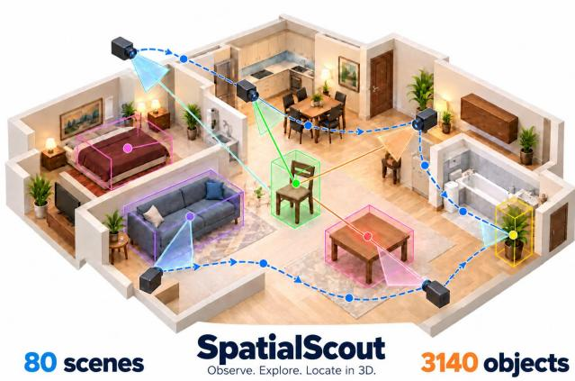  
Figure 1. Overview of SpatialScout. A VLM agent observes, explores, and localizes the position of objects in a 3D environment.

Bridging this gap requires evaluating autonomous information acquisition and spatial representation construction within a single task, forming a closed loop of observation, reasoning, and decision-making. Recent benchmarks such as ESI-Bench [21] and $S ^ { 3 } .$ -Bench [51] introduce active interaction into spatial QA, while Theory of Space [62] examines the construction of discrete cognitive maps. Our key advance is to make the construction of object maps in continuous 3D space through active interaction a direct evaluation objective for spatial intelligence. Models must autonomously acquire visual evidence and recover the 3D positions of a target set in a common coordinate frame. This task couples active perception, cross-view association, geometric estimation, and scene modeling: the current spatial estimate determines what to observe next, while the selected viewpoint shapes the evidence available thereafter. Through spatial construction beyond QA, feedback-driven active exploration, and end-to-end task evaluation, we examine whether VLMs can transform local observations into accurate and complete metric spatial representations.

Table 1. Comparison with spatial intelligence and scene understanding benchmarks. T/F: true/false; MC: multiple choice; NA: numerica answer; OE: open-ended.
<table><tr><td>Benchmark</td><td>Output format</td><td>Primary evaluation target</td><td>Active</td><td>Multi-round interaction env. feedback</td><td>Explicit spatial construction</td><td>Direct 3D coordinate scoring</td></tr><tr><td>VSR [31]</td><td>T/F</td><td>Answer correctness</td><td>X</td><td>X</td><td>X</td><td>X</td></tr><tr><td>BLINK [13]</td><td>MC</td><td>Answer correctness</td><td>X</td><td>X</td><td>X</td><td>X</td></tr><tr><td>VSI-Bench [55]</td><td>MC, NA</td><td>Answer correctness</td><td>X</td><td>X</td><td>X</td><td>X</td></tr><tr><td>OpenEQA [34]</td><td>OE</td><td>Answer correctness</td><td>X</td><td>X</td><td>X</td><td>X</td></tr><tr><td>E3VS-Bench [43]</td><td>OE</td><td>Answer correctness</td><td>√</td><td>√</td><td>X</td><td>X</td></tr><tr><td>ESI-Bench [21]</td><td>T/F, MC, NA</td><td>Answer correctness</td><td>√</td><td>√</td><td>X</td><td>X</td></tr><tr><td>S3-Bench [51]</td><td>MC, NA</td><td>Answer correctness</td><td>X</td><td>X</td><td>X</td><td>X</td></tr><tr><td>Theory of Space [62]</td><td>OE</td><td>Map quality</td><td>√</td><td>√</td><td>√</td><td>X</td></tr><tr><td>IR3D-Bench [32]</td><td>3D Scene Parameters</td><td>Layout and spatial relations</td><td>×</td><td>X</td><td>√</td><td>X</td></tr><tr><td>SpatialScout</td><td>3D Coordinates</td><td>Localization &amp; Coverage</td><td>√</td><td>√</td><td>√</td><td>√</td></tr></table>

To this end, we introduce SpatialScout, a benchmark for evaluating the spatial intelligence of vision-language agents through active object-level 3D mapping. Starting from an initial observation and a target inventory, an agent autonomously explores the scene and progressively constructs a 3D map of target object centers in a common coordinate frame. The benchmark has three core features: ⃝1 Explicit spatial construction. Models must output a set of 3D object positions, enabling quantitative evaluation of spatial representation quality through localization accuracy and target coverage. ⃝2 Closed-loop active exploration. Models select subsequent viewpoints based on existing observations and the current map, then update position estimates using new evidence, forming a feedback loop between the active acquisition of perceptual evidence and spatial understanding. ⃝3 Long-horizon end-to-end capability evaluation. Models coordinate observation planning, object recognition, cross-view association, geometric estimation, and map updates across multiple interaction steps, with overall performance measured by final map quality. This sustained coordination goes beyond QA tasks with short reasoning chains and better reflects real-world spatial understanding.

SpatialScout comprises 80 indoor scenes and 3,140 target objects, with 30–40 targets per scene, spanning diverse spatial layouts, object scales, and repeated category instances. The benchmark provides a unified set of cameracontrol and geometric assistance tools, along with camera intrinsics and poses, and requires models to infer object centers from autonomously acquired visual evidence. Evaluation jointly measures geometric estimation error, localization accuracy relative to object scale, and target coverage. We also record map updates under a limited interaction budget to analyze how object-level spatial representations emerge as exploration proceeds.

We evaluate frontier VLMs, including GPT-6 Astra and Claude Opus 5.5. The results show that models can recover parts of object layouts through autonomous exploration, but comprehensive coverage and precise localization remain challenging. Models differ substantially in target omissions and center localization accuracy, while the proportion of targets meeting stringent scale-relative accuracy criteria remains low. These findings indicate that recognizing objects or making coarse spatial judgments does not necessarily translate into constructing reliable metric maps. By exposing these limitations through measurable localization and coverage metrics, SpatialScout provides a unified benchmark for studying how models construct and understand the 3D world through autonomous interaction.

## 2. SpatialScout Construction

SpatialScout evaluates active object-center mapping by VLM agents. Given an object inventory and calibrated camera poses, an agent selects RGB views, associates objects across observations, and maintains a three-dimensional map of their centers. The benchmark combines a fixed scene catalog, a shared interaction interface, and object-level evaluation to measure the accuracy and completeness of the resulting map (Fig. 3).

Table 2. Shared agent interface. No tool reveals ground-truth target positions or evaluation scores.
<table><tr><td>Tool</td><td>Effect or output</td></tr><tr><td>list_entities</td><td>List targets and metadata.</td></tr><tr><td>get_camera_pose</td><td>Return the camera pose.</td></tr><tr><td>get_camera_intrinsics</td><td>Return camera calibration.</td></tr><tr><td>set_camera_position</td><td>Set the camera position.</td></tr><tr><td>move_camera</td><td>Translate the camera.</td></tr><tr><td>rotate_camera</td><td>Rotate the camera.</td></tr><tr><td>capture_image</td><td>Capture an RGB frame.</td></tr><tr><td>triangulate_</td><td>Estimate a point from multiple</td></tr><tr><td>observations</td><td>views.</td></tr><tr><td>submit_positions</td><td>Update the center map.</td></tr><tr><td>finish_mapping</td><td>End the mapping episode.</td></tr></table>

## 2.1. Task Definition

Inventory and map. A scene contains N targets with public inventory $\mathcal { E } = \{ ( i , c _ { i } , g _ { i } ) \} _ { i = 1 } ^ { N } \colon$ instance identifier i, category $c _ { i } ,$ and equivalence group $g _ { i }$ . During an episode, the agent maintains estimates ${ \widehat { \mathcal { P } } } = \{ { \widehat { \mathbf { p } } } _ { i } : i \in S \}$ for submitted identifiers $S \subseteq \{ 1 , \dots , N \}$ . Evaluation compares multisets of center positions within each group, with identifiers serving as submission slots for individual estimates.

Geometric target. Each target center is the midpoint of the tight world-axis-aligned bounding box (AABB) of its rendered geometry. For an articulated object, the box encloses the union of its rendered link geometries. Let ${ \mathbf b } _ { i } ^ { - } , { \mathbf b } _ { i } ^ { + }$ denote the box corners and let ${ \bf o } _ { 0 } , R _ { 0 }$ be the initial camera’s world position and camera-to-world rotation. The reference center in meters is

$$
{ \bf p } _ { i } = R _ { 0 } ^ { \top } \left( \frac { { \bf b } _ { i } ^ { - } + { \bf b } _ { i } ^ { + } } { 2 } - { \bf o } _ { 0 } \right) .\tag{1}
$$

The box is constructed in world coordinates; Eq. (1) then expresses its midpoint in the task frame. This definition gives each asset a reproducible localization target, including assets whose internal origins are offset from their visible geometry. Center inference combines correspondence geometry with the object’s observed spatial extent: a triangulated surface feature and the AABB center are generally different points.

Coordinate frame and inputs. The task uses a fixed right-handed frame with origin at the initial camera, +x along its initial optical forward direction, +y to its initial left, and +z along its initial up direction. All absolute map

stove knob credit card shower heac Chair pepper shakerfork sinkclock   
spray bottle kettle window butter knife   
mugg Cabinet desk garbage can   
dishoenciltoapoer pentoilet paperplant key chain   
room deco paintingds box upcounter top   
mirror liance footstool wer curtain bottle   
remote control soap ba cloth plate spoon bow knife   
towel holder plunger watering can soap bottletelevisionfridge laptop garbage bagvasewatch rawe paper towel rol   
tomato nt swito monitor stand baseball ba bed cylinder   
stool desk lampsof lamp pan   
illow dresser etuphonr candle   
tablemicrowave larm clockpook tissue box   
kitchen utensil statuebas basket bal ma I tennis racket hand towel holder auce

Figure 2. Wordcloud of the diverse objects in SpatialScout.

positions and returned camera poses use this frame. An initially pitched camera gives a task up axis tilted relative to world vertical. The agent receives RGB images, the inventory, camera intrinsics, poses, and the target-region radius $r = \operatorname* { m a x } _ { i } \| \mathbf { p } _ { i } \| _ { 2 }$ . Reference centers, boxes, and asset geometry remain in the evaluator. The supplied camera geometry and scene-level search bound support metric estimation, while the agent selects views, establishes correspondences, and infers object centers.

## 2.2. Benchmark Construction

Scene diversity. Explicit geometric annotations and reproducible configurations support object-level scene evaluation [32, 64]. We assemble 80 indoor scenes rendered with SAPIEN [52] through ManiSkill3 [46]: 32 iTHOR [28], 12 RoboTHOR [8], 10 ArchitecTHOR [9], 6 Replica-CAD [45], and 30 ProcTHOR [9] scenes. The catalog spans individual rooms and apartments, retaining the source layouts and target placements; each source scene appears once.

Complexity. Each scene contributes 30–40 targets. The catalog contains 12 scenes with 35 targets, and 68 with 40, totaling 3,410 instances. The target-region radius ranges from 1.95 to 9.23 m. Across the catalog, 1,489 targets (43.3%) belong to equivalence groups with multiple instances in the same scene. Target count controls inventory scale, while spatial extent and repeated categories vary the localization and association demands.

Selection and initialization. Preparation prioritizes candidates with known semantic categories, then orders them by distance to the initial camera, using identifier order to break ties. This rule aligns the inventory with recognizable categories and concentrates targets around the exploration origin. Candidates must have rendered geometry, and each scene must supply the requested target count. Candidates outside the selected target subset are hidden in rendered observations; selected targets retain their source placements.

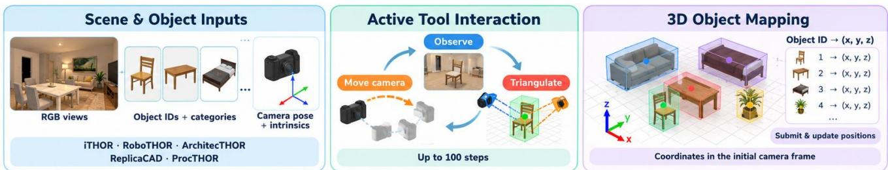  
Figure 3. Evaluation of VLM agents on SpatialScout. A VLM agent navigates through the 3D space by controlling a camera, and applies observation and mapping tools to finally submit the positions of identified objects.

Loaded object counts are checked against the source configuration with scene-builder exclusions accounted for.

Each catalog entry fixes the source configuration, initial pose, and target count. Preparation saves the inventory, geometric annotations, and initial view, and verifies agreement between the camera-pose axes and projection matrix. $\mathsf { A p - }$ pendix A specifies the manifest and cache checks.

## 3. Evaluation

## 3.1. Evaluation Protocol

Setup We evaluate seven models on a common set of 80 catalog scenes, with one episode per model–scene pair: GPT-6 Astra [38], GPT-6 Sol [39], Claude Opus 5.5 [2], Claude Sonnet 5.5 [3], Kimi-K3 [47], Qwen3.8-Max [41], and DeepSeek-V4.1-Flash [11]. We impose no explicit limit on output or reasoning tokens.

Interaction All agents use the ten tools in Table 2 through a shared interface [56]. Starting from one RGB image, the agent queries the inventory and calibration, acquires further views, and submits or revises object centers (see Fig. 3). Each accepted submission replaces the previous estimate for that identifier. The validator checks identifiers, finite coordinates, and the public bound $\| \widehat { \mathbf { p } } _ { i } \| _ { 2 } \leq r + 0 . 5 \mathbf { m }$ . All agents receive the same task prompt and tool descriptions. The prompt requests visually supported estimates and, for multi-view episodes, encourages submission after the first two views, followed by additions and revisions during exploration. Submissions return the current accepted map, which the agent can also inspect with an empty batch.

Camera movement Relative translations follow the current horizontal forward/right directions and world vertical; positive yaw is counterclockwise viewed from above, and positive pitch looks upward. New RGB observations are acquired through explicit captures; movement bounds are specified in Appendix A.

Image coordinates Explicit captures render $5 1 2 \times 5 1 2$ RGB images, delivered as JPEGs with longest side at most 384 pixels. Correspondences are expressed on the original image grid. Let $( W , H )$ and $( W _ { d } , H _ { d } )$ denote the original and delivered dimensions. Both grids use zero-indexed pixel centers, increasing rightward and downward. Each image message specifies the conversion

$$
\begin{array} { c c c } { \displaystyle { u = \left( u _ { d } + \frac { 1 } { 2 } \right) \frac { W } { W _ { d } } - \frac { 1 } { 2 } , \qquad v = \left( v _ { d } + \frac { 1 } { 2 } \right) \frac { H } { H _ { d } } - \frac { 1 } { 2 } . } } \end{array}\tag{2}
$$

Triangulation pairs the converted pixel with the original intrinsic matrix $K .$ . Each captured frame is stored with its identifier, pose, dimensions, and intrinsics.

Geometric support The triangulation tool estimates a 3D point from agent-marked correspondences in at least two calibrated frames [20]. For camera origins $\mathbf { o } _ { k }$ and unit viewing directions $\mathbf { d } _ { k }$ in the task frame, define $\begin{array} { r l } { A _ { k } } & { { } = } \end{array}$ $I - { \bf d } _ { k } { \bf d } _ { k } ^ { \top }$ . The tool minimizes squared distances to the viewing lines:

$$
\widehat { \mathbf { p } } _ { \mathrm { t r i } } = \arg \operatorname* { m i n } _ { \mathbf { p } } \sum _ { k } \| A _ { k } ( \mathbf { p } - \mathbf { o } _ { k } ) \| _ { 2 } ^ { 2 } .\tag{3}
$$

Queries failing baseline, conditioning, or forward-ray checks are rejected; Appendix B.1 gives the thresholds. The tool reports the root-mean-square perpendicular line residual and maximum pairwise ray angle, with cautions for weak parallax, large residuals, or estimates outside the public range. These diagnostics measure the geometric consistency of the supplied correspondences. The agent must still determine whether the marked pixels identify the same object feature and how the estimated point relates to the object’s center; a low residual alone establishes neither.

Budgets and stopping. Each episode allows $B ~ = ~ 1 0 0$ model calls and $V = 1 0 0$ acquired images, including the initial image. A model call may request multiple tools, executed sequentially without additional model calls; captures from the batch can inform the next call. Reaching the capture cap leaves the remaining model calls available for reasoning and submission. The final accepted map is scored when the agent calls finish\_mapping, responds without tool calls, or exhausts B. Calling finish\_mapping freezes the map and skips subsequent tools in the same response. Service and runtime failures are logged separately and excluded from aggregate scores.

Table 3. Object-micro localization results on 80 scenes. All values are percentages, and threshold columns use strict IoU comparisons. The > k% columns measure the percentage of box overlaps that are greater than k%.
<table><tr><td rowspan="2">Model</td><td rowspan="2">Effort</td><td colspan="4">All targets</td><td colspan="4">Submitted targets</td></tr><tr><td>Mean IoU</td><td>&gt; 0%</td><td>&gt; 50%</td><td>&gt; 90%</td><td>Mean IoU</td><td>&gt; 0%</td><td>&gt; 50%</td><td>&gt; 90%</td></tr><tr><td> Claude Opus 5.5</td><td>xhigh</td><td>41.71</td><td>77.36</td><td>47.23</td><td>3.25</td><td>46.69</td><td>86.60</td><td>52.87</td><td>3.64</td></tr><tr><td> Claude Sonnet 5.5</td><td>xhigh</td><td>32.26</td><td>67.13</td><td>33.60</td><td>1.40</td><td>38.99</td><td>81.14</td><td>40.61</td><td>1.69</td></tr><tr><td>GPT-6 Astra</td><td>xhigh</td><td>33.16</td><td>67.79</td><td>35.15</td><td>1.62</td><td>41.16</td><td>83.86</td><td>42.69</td><td>2.09</td></tr><tr><td>GPT-6 Astra</td><td>medium</td><td>31.18</td><td>67.73</td><td>31.55</td><td>1.27</td><td>37.16</td><td>80.72</td><td>37.60</td><td>1.52</td></tr><tr><td>GPT-6 Sol</td><td>xhigh</td><td>20.83</td><td>51.85</td><td>18.95</td><td>0.48</td><td>28.65</td><td>71.31</td><td>26.06</td><td>0.66</td></tr><tr><td>Kimi-K3</td><td>xhigh</td><td>4.22</td><td>19.36</td><td>2.77</td><td>0.00</td><td>6.55</td><td>30.03</td><td>4.29</td><td>0.00</td></tr><tr><td>Qwen3.8 Max</td><td>xhigh</td><td>6.80</td><td>24.36</td><td>4.52</td><td>0.00</td><td>12.14</td><td>43.49</td><td>8.07</td><td>0.00</td></tr><tr><td> DeepSeek V4.1 Flash</td><td>xhigh</td><td>3.48</td><td>19.04</td><td>0.92</td><td>0.00</td><td>5.80</td><td>31.74</td><td>1.54</td><td>0.00</td></tr></table>

Attempt records. Each attempt records its model and reasoning configuration, prompt, tool schema, and budgets. Appendix A details request accounting, rerun storage, and completion and failure reporting.

Map traces and replay. Each successful submission call records the full accepted map and model-call index. The trace also retains capture events, frame calibration, tool arguments and results, and termination records. An offline replay can score these snapshots to recover changes in center error and coverage as model calls and acquired images accumulate. Reference-based scores are computed after the episode and are never returned to the agent.

## 3.2. Evaluation Metrics

We report mean center error (meters) after minimumdistance one-to-one matching within equivalence groups [7], together with inventory coverage. For scale-sensitive localization, we compute 3D IoU by translating each candidate target’s reference box to the predicted center. Mean IoU uses the distance assignment; hit rates use a separate within-group hit-maximizing assignment at each strict threshold τ ∈ {0, 0.5, 0.9}. Overlap scores are pooled across scenes and reported over all targets (omissions count as zero) and submitted targets. Appendix B.2 gives the scoring details.

## 4. Results

## 4.1. Quantitative Results

Localization and completeness. Table 3 reports objectmicro overlap scores for the common 80-scene comparison. Claude Opus 5.5 achieves an all-target mean IoU of 41.71%, compared with 33.16% for GPT-6 Astra; their submitted-object means are 46.69% and 41.76%, respectively. Claude Opus 5.5 has higher mean overlap both over the full inventory and among accepted estimates. The decrease from submitted-object to all-target mean IoU shows how omissions reduce each model’s overall mapping score.

Localization precision. Positive-overlap recall is 77.36% for Claude Opus 5.5 and 67.79% for GPT-6 Astra. At IoU > 0.5, recall is 47.23% and 35.15%, respectively; at IoU > 0.9, it is 3.25% and 1.62%. These differences distinguish coarse placement from precise center alignment relative to object extent. High-IoU matches remain uncommon even among submitted objects, with hit rates at IoU > 0.9 of 3.64% for Claude Opus 5.5 and 2.09% for GPT-6 Astra.

## 4.2. Qualitative Analysis

Figure 4 contrasts accurate, incomplete, and mislocalized maps. For each comparison, the evaluator places positionmatched reference meshes at predicted centers, preserves their shapes and orientations, and hides omitted targets. Views at the initial yaw and offsets of −55◦ and +55◦ display the resulting placement and completeness from three directions. In example A, Claude Opus 5.5 submits all 35 targets with a center error of 0.073 m and an all-target mean IoU of 0.530. The reconstructed views closely align with the reference arrangement. Example B illustrates omissions: the GPT-6 Astra statistics cover two scenes with 65 of 80 targets submitted and a center error of 0.141 m among submitted objects. The comparison views make these omissions explicit. Example C illustrates mislocalization: DeepSeek V4.1 Flash submits all 40 targets, but the center error is 1.000 m and all-target mean IoU is 0.034. Together, these cases show why complete submission and accurate placement must be evaluated jointly.

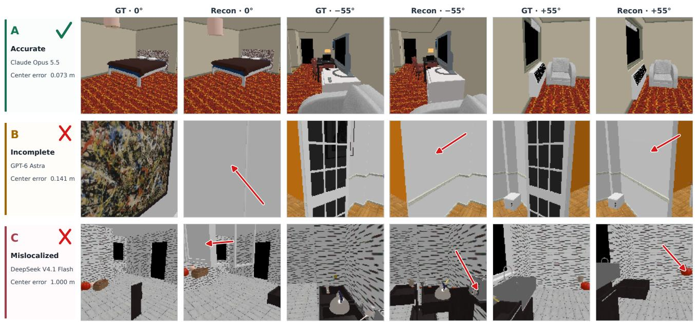

Figure 4. Examples of accurate, incomplete, and mislocalized object-center maps. The red arrows indicate a missing or mislocalized object in the reconstructed scene.  
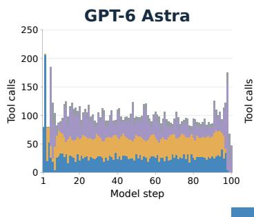

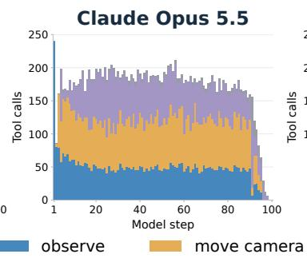

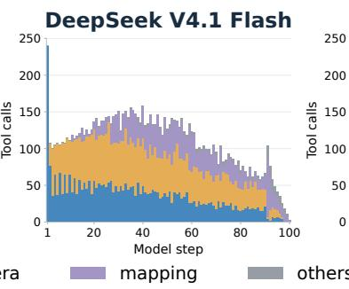

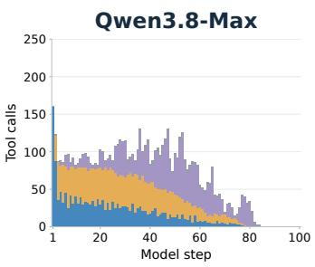

Figure 5. Tool-use patterns across interaction steps for four models. Claude Opus 5.5 makes the most tool calls, whereas GPT-6 Astra achieves competitive mapping performance with fewer calls.
<table><tr><td rowspan=1 colspan=1>trangulate_observe</td><td rowspan=1 colspan=1>29.5%</td><td rowspan=1 colspan=1>30.0%</td><td rowspan=1 colspan=1>21.5%</td><td rowspan=1 colspan=1>34.2%</td></tr><tr><td rowspan=1 colspan=1>capture_image</td><td rowspan=1 colspan=1>25.7%</td><td rowspan=1 colspan=1>26.9%</td><td rowspan=1 colspan=1>29.0%</td><td rowspan=1 colspan=1>22.9%</td></tr><tr><td rowspan=1 colspan=1>rotate_camera</td><td rowspan=1 colspan=1>14.4%</td><td rowspan=1 colspan=1>19.4%</td><td rowspan=1 colspan=1>24.5%</td><td rowspan=1 colspan=1>20.2%</td></tr><tr><td rowspan=1 colspan=1>set_camera_position</td><td rowspan=1 colspan=1>17.8%</td><td rowspan=1 colspan=1>13.1%</td><td rowspan=1 colspan=1>15.1%</td><td rowspan=1 colspan=1>8.9%</td></tr><tr><td rowspan=1 colspan=1>move_camera</td><td rowspan=1 colspan=1>0.9%</td><td rowspan=1 colspan=1>5.9%</td><td rowspan=1 colspan=1>3.1%</td><td rowspan=1 colspan=1>7.2%</td></tr><tr><td rowspan=1 colspan=1>submit_positions</td><td rowspan=1 colspan=1>8.5%</td><td rowspan=1 colspan=1>2.7%</td><td rowspan=1 colspan=1>2.2%</td><td rowspan=1 colspan=1>1.9%</td></tr><tr><td rowspan=1 colspan=1>get_camera_pose</td><td rowspan=1 colspan=1>0.8%</td><td rowspan=1 colspan=1>0.6%</td><td rowspan=1 colspan=1>2.4%</td><td rowspan=1 colspan=1>1.3%</td></tr><tr><td rowspan=1 colspan=1>list_entities</td><td rowspan=1 colspan=1>0.8%</td><td rowspan=1 colspan=1>0.5%</td><td rowspan=1 colspan=1>0.7%</td><td rowspan=1 colspan=1>1.2%</td></tr><tr><td rowspan=1 colspan=1>finish_mapping</td><td rowspan=1 colspan=1>0.8%</td><td rowspan=1 colspan=1>0.5%</td><td rowspan=1 colspan=1>0.7%</td><td rowspan=1 colspan=1>1.2%</td></tr><tr><td rowspan=1 colspan=1>get_camera_intrinsics</td><td rowspan=1 colspan=1>0.8%</td><td rowspan=1 colspan=1>0.5%</td><td rowspan=1 colspan=1>0.7%</td><td rowspan=1 colspan=1>1.0%</td></tr></table>

Figure 6. Illustration of tool-call frequency of multiple models.

## 5. Discussions

Tool-calling Analysis We present the models’ toolcalling behaviors in Fig. 5 and Fig. 6. These visualizations reveal differences in behaviors that provide insight into their ability to understand 3D space.

First, Claude-Opus-5.5 makes the largest number of tool calls. We cap each trajectory at 100 tool-calling turns, and a single turn may include multiple tool calls. Its extensive tool use appears to benefit its performance on SpatialScout by allowing it to gather and integrate more information about the scene.

Second, GPT-6 Astra and Claude-Opus-5.5 maintain relatively balanced use of observation, camera movement, and mapping. By contrast, DS-V4.1-Flash and Qwen3.8-Max tend to observe less as the interaction progresses. This pattern may indicate difficulty maintaining and updating a reliable spatial representation: without observing consistently, a model must rely on earlier views, which may not contain sufficient information about newly encountered objects.

Table 4. Success factors and failure patterns across 40 trajectories. Each trajectory may exhibit multiple factors (non-exclusive).
<table><tr><td>Outcome</td><td>Factor</td><td>Total</td></tr><tr><td rowspan="3">Success</td><td>Sufficient multi-view grounding Incremental submission with continued</td><td>6</td></tr><tr><td>coverage expansion</td><td>6</td></tr><tr><td>Continued refinement</td><td>6</td></tr><tr><td rowspan="8">Failure</td><td>Incomplete object coverage Suspected correspondence errors despite</td><td>26</td></tr><tr><td>low triangulation residuals</td><td>21</td></tr><tr><td>Unresolved inconsistencies in geometric measurements</td><td>13</td></tr><tr><td>Early termination before coverage</td><td>13</td></tr><tr><td>Position estimates lacking triangulation support</td><td>6</td></tr><tr><td>Extensive observation with limited local-</td><td>5</td></tr><tr><td>ization progress Late-stage refinement without recover-</td><td>3</td></tr><tr><td>ing missing objects</td><td></td></tr></table>

Third, DeepSeek-V4.1-Flash and Qwen3.8-Max spend many turns moving the camera but relatively few observing and mapping. This suggests that they have greater difficulty selecting informative viewpoints and converting visual observations into a coherent map. Such behavior adds interaction overhead, while uninformative views also consume context because images require substantial context length. Taken together, these behavioral differences suggest that SpatialScout distinguishes models not only by their final localization accuracy, but also by how effectively they perceive, explore, and represent the 3D scene.

Failure Analysis We analyze 40 trajectories from GPT-6 Astra, Claude Opus 5.5, DeepSeek V4.1 Flash, and Qwen3.8-Max on the same ten selected tasks, all using xhigh reasoning effort. We present the results in Table 4. For this case study, reconstruction success requires at least 90% object coverage and a mean center error of at most 0.2 m over matched submitted objects. Six trajectories meet both criteria. All six exhibit extensive multi-view geometric grounding, incremental submission that expands coverage, and subsequent refinement of submitted positions. Among the 34 unsuccessful trajectories, incomplete coverage is the most common failure pattern, appearing in 26 cases. In 21 cases, at least one submitted position remains substantially inaccurate despite a low triangulation residual, suggesting incorrect visual correspondences or object-center selection that geometric consistency alone cannot resolve. Thirteen cases retain inaccurate positions associated with geometric inconsistency warnings, while another overlapping set of 13 cases terminates with insufficient coverage despite having at least ten response rounds remaining. Six cases submit a substantial fraction of positions without recorded tool-based triangulation, five involve extensive observation but limited localization progress, and three end with revisions to existing estimates without recovering missing objects. These patterns suggest that effective mapping depends on converting observations into reliable object correspondences, and checking uncertain estimates before the final termination.

Table 5. Geometric grounding on 80 shared tasks. Both models use the xhigh setting. Triangulation support is measured over submitted objects, warnings over successful triangulation calls, and median center error over submitted objects.
<table><tr><td>Metric</td><td>Astra</td><td>DS-V4.1</td></tr><tr><td>Submitted objects with prior successful triangulation</td><td>99.33%</td><td>63.48%</td></tr><tr><td>Triangulation with geometric warnings</td><td>2.69%</td><td>38.65%</td></tr><tr><td>Mean image captures per task</td><td>32.41</td><td>39.63</td></tr><tr><td>Median object center error (cm)</td><td>7.08</td><td>68.17</td></tr></table>

Reconstruction IoU VS Cost per Task  
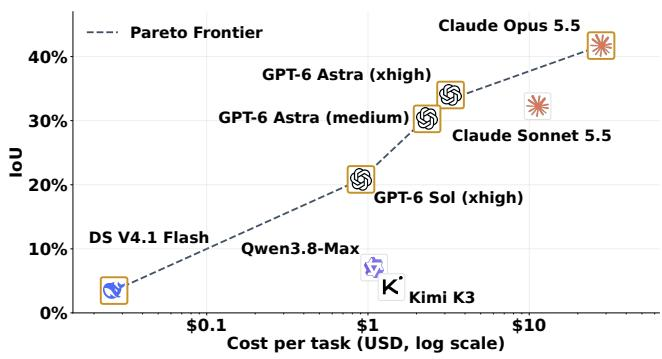  
Figure 7. All-target mean IoU vs. average inference cost per task.

Trajectory Analysis We use Codex powered by GPT-6 Astra to analyze both models’ trajectories across 80 shared tasks, as summarized in Table 5. We select GPT-6 Astra and DeepSeek-V4.1-flash because they make similar numbers of tool calls but achieve substantially different localization performance. GPT-6 Astra captures fewer images yet provides triangulation support for more submitted objects, with fewer geometric warnings. The triangulation tool requires fine-grained spatial perception to identify corresponding image points across views; DeepSeek-V4.1- Flash’s inconsistent measurements suggest difficulty meeting this requirement, despite capturing more images. These findings suggest that more effective geometric tool use contributes to GPT-6 Astra’s stronger localization performance.

Cost Analysis Figure 7 plots the mean IoU across all targets against the average inference cost (in USD, on a logarithmic scale), together with the Pareto frontier. Claude Opus 5.5 achieves the highest IoU, but also incurs the highest cost (28.85 USD per task), consistent with findings from other long-horizon agentic benchmarks [25, 63]. Overall, the evaluated open-source models offer limited advantages in the accuracy–cost trade-off. Among them, only DeepSeek-V4.1-Flash costs less than GPT-6 Sol; Qwen3.8- Max and Kimi-K3 are both more expensive and achieve lower scores on all IoU metrics (Table 3).

## 6. Related Work

Agentic inverse graphics and scene construction. IR3D-Bench evaluates scene understanding by reconstructing a scene from a supplied image [32]. BlenderGym studies code-based graphics editing, including how generation, verification, and their compute allocation affect performance [17]. BlenderAlchemy combines edit generation with visual evaluation [22], while VIGA and Blender-Bench examine interleaved execution, inspection, memory, and exploratory editing [60]. SceneActBench evaluates executable multi-object outputs across several tasks; its reconstruction task builds furniture meshes in an initially empty scene from supplied calibrated views [64]. These works establish construction and editing as meaningful tests of visual understanding. Our setting emphasizes acquisition of new evidence from a hidden target environment and inspection and revision of an explicit object-center map.

Active reconstruction and next-best-view planning. Selecting informative observations has a substantial history in three-dimensional perception. SCONE predicts surface coverage gain [18], and MACARONS couples RGBbased mapping with online coverage anticipation [19]. GenNBV learns a generalizable view-selection policy [6]. NARUTO, ActiveSplat, and ActiveGAMER integrate exploration with neural scene mapping [5, 12, 29]; FisherRF uses information-based view selection for radiance fields [24]. More directly, AIR-Embodied uses multimodal reasoning to plan reconstruction actions [40]. AREA3D combines geometric perception and vision-language guidance, and introduces an evaluation covering object- and scene-level active reconstruction [54]. SightCAD connects feasible view selection to executable CAD generation for scene-embedded objects [4]. These systems provide important planning and reconstruction references. Our benchmark compares general-purpose agents under shared tools and observation and model-call budgets, recording how their evidence acquisition and map updates interact.

Spatial and embodied benchmarks. VSI-Bench and SITE assess spatial reasoning from supplied visual observations [50, 55]. OpenEQA includes both episodicmemory and active-exploration settings [34], and Explore until Confident studies exploration and stopping for embodied question answering [42]. E3VS-Bench evaluates viewpoint-dependent evidence acquisition through camera control [43]; ESI-Bench covers spatial tasks that require active observation and interaction [21]. $S ^ { 3 } .$ -Bench combines streaming spatial questions with memory and additional exploration [51]. EmbodiedBench evaluates visual agents across multiple environments and action levels [56]. Our evaluation complements these tasks by scoring the explicit object-center map maintained over an episode. Compared with QA pairs, our tasks require VLM agents to output the precise 3D coordinates of the objects.

Memory, geometry tools, and process diagnosis. ConceptFusion and ConceptGraphs build semantically rich three-dimensional representations through multimodal fusion and cross-view association [16, 23]. 3D-Mem uses scene memory for embodied exploration and reasoning [57], while SpaMEM separates perceptual grounding from temporal state maintenance [30]. DUSt3R and VGGT provide geometric inference tools [48, 49], and NeRF and Gaussian splatting offer scene representations for rendering and reconstruction [26, 37]. Alongside BlenderGym, 3DCodeBench investigates inference-time computation in graphics tasks [14, 17]. Building on these perspectives, we control image acquisition and model calls with separate budgets. Shared tools, inventory-only reference policies, and replay of accepted-map updates support comparisons of final localization.

Long-horizon agentic benchmarks. Long-horizon agentic tasks require sustained reasoning and repeated tool use, often over multiple interaction rounds, and remain a major challenge for deploying LLM-based systems in realworld settings. AgentBench and GAIA evaluate interactive decision-making and general-purpose tool use [33, 36]. WebShop and WebArena focus on web interaction, while VisualWebArena and OSWorld extend evaluation to visually grounded web and desktop environments [27, 53, 58, 65]. The τ-bench and DySQL-Bench examine tool use in settings with evolving user interactions [44, 59]. SWE-bench, Terminal-Bench, NL2Repo, and RepoZero assess repository repair, command-line problem solving, and repository generation using executable checks [10, 25, 35, 63]. AgenticRAGTracer complements these benchmarks with hop-level diagnosis of agentic retrieval processes [61]. SpatialScout is one of the benchmarks evaluating the spatial understanding and long-horizon capability of VLM agents.

## 7. Conclusion

We introduced SpatialScout, a benchmark for evaluating the spatial intelligence of VLM agents through active object-level 3D mapping. By requiring agents to autonomously select viewpoints, integrate visual evidence, and estimate object positions in a shared coordinate frame, SpatialScout evaluates the complete process of constructing metric spatial representations. Our experiments reveal that frontier VLMs can recover partial scene layouts but still struggle to achieve both comprehensive coverage and precise localization. Even the strongest evaluated model attains a mean IoU of 41.71%, with only 3.25% of targets exceeding an IoU of 0.9. These findings highlight the difficulty of translating visual observations into reliable geometric estimates through sustained interaction. SpatialScout provides a testbed for advancing active perception, cross-view reasoning, and persistent spatial memory, supporting the development of agents capable of building accurate and complete representations of 3D environments.

## References

[1] Aishwarya Agrawal, Dhruv Batra, Devi Parikh, and Aniruddha Kembhavi. Don’t just assume; look and answer: Overcoming priors for visual question answering. In Proceedings of the IEEE/CVF Conference on Computer Vision and Pattern Recognition, pages 4971–4980, 2018. 1

[2] Anthropic. Introducing opus 5.5. https://www. anthropic.com/claude-opus-5-5, 2026. Accessed: 2026-04-23. 4

[3] Anthropic. Introducing sonnet 5.5. https://www. anthropic.com/claude-sonnet-5-5, 2026. Accessed: 2026-04-23. 4

[4] Kartik Bali, Mahish Guru, Yiderigun Borjigin, Alexandra Starostina, Christian J. Cyron, and Roland Aydin. Look Where You Can: Active View Selection for CAD Reconstruction under Occlusion, 2026. 8

[5] Liyan Chen, Huangying Zhan, Kevin Chen, Xiangyu Xu, Qingan Yan, Changjiang Cai, and Yi Xu. ActiveGAMER: Active GAussian Mapping through Efficient Rendering, 2025. 8

[6] Xiao Chen, Quanyi Li, Tai Wang, Tianfan Xue, and Jiangmiao Pang. GenNBV: Generalizable Next-Best-View Policy for Active 3D Reconstruction, 2024. 8

[7] D. F. Crouse. On implementing 2D rectangular assignment algorithms. IEEE Transactions on Aerospace and Electronic Systems, 52(4):1679–1696, 2016. 5

[8] Matt Deitke, Winson Han, Alvaro Herrasti, Aniruddha Kembhavi, Eric Kolve, Roozbeh Mottaghi, Jordi Salvador, Dustin Schwenk, Eli VanderBilt, Matthew Wallingford, Luca Weihs, Mark Yatskar, and Ali Farhadi. RoboTHOR: An Open Simulation-to-Real Embodied AI Platform. In Proceedings of the IEEE/CVF Conference on Computer Vision and Pattern Recognition, 2020. 3

[9] Matt Deitke, Eli VanderBilt, Alvaro Herrasti, Luca Weihs, Kiana Ehsani, Jordi Salvador, Winson Han, Eric Kolve,

Aniruddha Kembhavi, and Roozbeh Mottaghi. ProcTHOR: Large-Scale Embodied AI Using Procedural Generation. In Advances in Neural Information Processing Systems, 2022. 3

[10] Jingzhe Ding, Shengda Long, Changxin Pu, Huan Zhou, Hongwan Gao, Xiang Gao, Chao He, Yue Hou, Fei Hu, Zhaojian Li, et al. Nl2repo-bench: Towards long-horizon repository generation evaluation of coding agents. arXiv preprint arXiv:2512.12730, 2025. 8

[11] DS. Introducing deepseek v4.1 flash. http : //deepseek.com/en/news/deepseek- v4- 1- flash/, 2026. Accessed: 2026-04-23. 4

[12] Ziyue Feng, Huangying Zhan, Zheng Chen, Qingan Yan, Xiangyu Xu, Changjiang Cai, Bing Li, Qilun Zhu, and Yi Xu. NARUTO: Neural Active Reconstruction from Uncertain Target Observations, 2024. 8

[13] Xingyu Fu, Yushi Hu, Bangzheng Li, Yu Feng, Haoyu Wang, Xudong Lin, Dan Roth, Noah A. Smith, Wei-Chiu Ma, and Ranjay Krishna. BLINK: Multimodal large language models can see but not perceive. In Proceedings of the European Conference on Computer Vision, 2024. 2

[14] Yipeng Gao, Lei Shu, Genzhi Ye, Xi Xiong, Ameesh Makadia, Meiqi Guo, Laurent Itti, and Jindong Chen. 3DCodeBench: Benchmarking Agentic Procedural 3D Mod eling Via Code, 2026. 8

[15] Yash Goyal, Tejas Khot, Douglas Summers-Stay, Dhruv Ba tra, and Devi Parikh. Making the V in VQA matter: Elevating the role of image understanding in visual question answering. In Proceedings ofthe IEEE Conference on Computer Vision and Pattern Recognition, pages 6325–6334, 2017. 1

[16] Qiao Gu, Alihusein Kuwajerwala, Sacha Morin, Krishna Murthy Jatavallabhula, Bipasha Sen, Aditya Agarwal, Corban Rivera, William Paul, Kirsty Ellis, Rama Chellappa, Chuang Gan, Celso Miguel de Melo, Joshua B. Tenenbaum, Antonio Torralba, Florian Shkurti, and Liam Paull. Concept-Graphs: Open-Vocabulary 3D Scene Graphs for Perception and Planning, 2023. 1, 8

[17] Yunqi Gu, Ian Huang, Jihyeon Je, Guandao Yang, and Leonidas Guibas. BlenderGym: Benchmarking Founda tional Model Systems for Graphics Editing, 2025. 8

[18] Antoine Guédon, Pascal Monasse, and Vincent Lepetit. SCONE: Surface Coverage Optimization in Unknown Environments by Volumetric Integration, 2022. 8

[19] Antoine Guédon, Tom Monnier, Pascal Monasse, and Vincent Lepetit. MACARONS: Mapping And Coverage Anticipation with RGB Online Self-Supervision, 2023. 8

[20] Richard I. Hartley and Andrew Zisserman. Multiple View Geometry in Computer Vision. Cambridge University Press, second edition, 2004. 1, 4

[21] Yining Hong, Jiageng Liu, Han Yin, Manling Li, Leonidas Guibas, Li Fei-Fei, Jiajun Wu, and Yejin Choi. ESI-Bench: Towards Embodied Spatial Intelligence that Closes the Perception-Action Loop, 2026. 1, 2, 8

[22] Ian Huang, Guandao Yang, and Leonidas Guibas. Blender-Alchemy: Editing 3D Graphics with Vision-Language Models, 2024. 8

[23] Krishna Murthy Jatavallabhula, Alihusein Kuwajerwala, Qiao Gu, Mohd Omama, Tao Chen, Alaa Maalouf, Shuang Li, Ganesh Iyer, Soroush Saryazdi, Nikhil Keetha, Ayush Tewari, Joshua B. Tenenbaum, Celso Miguel de Melo, Madhava Krishna, Liam Paull, Florian Shkurti, and Antonio Torralba. ConceptFusion: Open-set Multimodal 3D Mapping, 2023. 8

[24] Wen Jiang, Boshu Lei, and Kostas Daniilidis. FisherRF: Active View Selection and Uncertainty Quantification for Radiance Fields using Fisher Information, 2023. 8

[25] Carlos E. Jimenez, John Yang, Alexander Wettig, Shunyu Yao, Kexin Pei, Ofir Press, and Karthik Narasimhan. SWEbench: Can Language Models Resolve Real-World GitHub Issues?, 2023. 8

[26] Bernhard Kerbl, Georgios Kopanas, Thomas Leimkühler, and George Drettakis. 3D Gaussian Splatting for Real-Time Radiance Field Rendering, 2023. 8

[27] Jing Yu Koh, Robert Lo, Lawrence Jang, Vikram Duvvur, Ming Chong Lim, Po-Yu Huang, Graham Neubig, Shuyan Zhou, Ruslan Salakhutdinov, and Daniel Fried. VisualWebArena: Evaluating Multimodal Agents on Realistic Visual Web Tasks, 2024. 8

[28] Eric Kolve, Roozbeh Mottaghi, Winson Han, Eli VanderBilt, Luca Weihs, Alvaro Herrasti, Matt Deitke, Kiana Ehsani, Daniel Gordon, Yuke Zhu, Aniruddha Kembhavi, Abhinav Gupta, and Ali Farhadi. AI2-THOR: An Interactive 3D Environment for Visual AI, 2017. 3

[29] Yuetao Li, Zijia Kuang, Ting Li, Qun Hao, Zike Yan, Guyue Zhou, and Shaohui Zhang. ActiveSplat: High-Fidelity Scene Reconstruction through Active Gaussian Splatting, 2024. 8

[30] Chih-Ting Liao, Xi Xiao, Chunlei Meng, Zhangquan Chen, Yitong Qiao, Weilin Zhou, Tianyang Wang, Xu Zheng, and Xin Cao. SpaMEM: Benchmarking Dynamic Spatial Reasoning via Perception-Memory Integration in Embodied Environments, 2026. 8

[31] Fangyu Liu, Guy Emerson, and Nigel Collier. Visual spatial reasoning. Transactions ofthe Associationfor Computational Linguistics, 11:635–651, 2023. 2

[32] Parker Liu, Chenxin Li, Zhengxin Li, Yipeng Wu, Wuyang Li, Zhiqin Yang, Zhenyuan Zhang, Yunlong Lin, Sirui Han, and Brandon Y. Feng. IR3D-Bench: Evaluating Vision-Language Model Scene Understanding as Agentic Inverse Rendering, 2025. 2, 3, 8

[33] Xiao Liu, Hao Yu, Hanchen Zhang, Yifan Xu, Xuanyu Lei, Hanyu Lai, Yu Gu, Hangliang Ding, Kaiwen Men, Kejuan Yang, Shudan Zhang, Xiang Deng, Aohan Zeng, Zhengxiao Du, Chenhui Zhang, Sheng Shen, Tianjun Zhang, Yu Su, Huan Sun, Minlie Huang, Yuxiao Dong, and Jie Tang. AgentBench: Evaluating LLMs as Agents, 2023. 8

[34] Arjun Majumdar, Anurag Ajay, Xiaohan Zhang, Pranav Putta, Sriram Yenamandra, Mikael Henaff, Sneha Silwal, Paul Mcvay, Oleksandr Maksymets, Sergio Arnaud, Karmesh Yadav, Qiyang Li, Ben Newman, Mohit Sharma, Vincent Berges, Shiqi Zhang, Pulkit Agrawal, Yonatan Bisk, Dhruv Batra, Mrinal Kalakrishnan, Franziska Meier, Chris Paxton, Alexander Sax, and Aravind Rajeswaran. OpenEQA: Embodied Question Answering in the Era of

Foundation Models. In Proceedings of the IEEE/CVF Con ference on Computer Vision and Pattern Recognition, 2024. 1, 2, 8

[35] Mike A. Merrill, Alexander G. Shaw, Nicholas Carlini, Boxuan Li, Harsh Raj, Ivan Bercovich, Lin Shi, Jeong Yeon Shin, Thomas Walshe, E. Kelly Buchanan, Junhong Shen, Guanghao Ye, Haowei Lin, Jason Poulos, Maoyu Wang, Marianna Nezhurina, Jenia Jitsev, Di Lu, Orfeas Menis Mastromichalakis, Zhiwei Xu, Zizhao Chen, Yue Liu, Robert Zhang, Leon Liangyu Chen, Anurag Kashyap, Jan-Lucas Uslu, Jeffrey Li, Jianbo Wu, Minghao Yan, Song Bian, Vedang Sharma, Ke Sun, Steven Dillmann, Akshay Anand, Andrew Lanpouthakoun, Bardia Koopah, Changran Hu, Etash Guha, Gabriel H. S. Dreiman, Jiacheng Zhu, Karl Krauth, Li Zhong, Niklas Muennighoff, Robert Amanfu, Shangyin Tan, Shreyas Pimpalgaonkar, Tushar Aggarwal, Xiangning Lin, Xin Lan, Xuandong Zhao, Yiqing Liang, Yuanli Wang, Zilong Wang, Changzhi Zhou, David Heineman, Hange Liu, Harsh Trivedi, John Yang, Junhong Lin, Manish Shetty, Michael Yang, Nabil Omi, Negin Raoof, Shanda Li, Terry Yue Zhuo, Wuwei Lin, Yiwei Dai, Yuxin Wang, Wenhao Chai, Shang Zhou, Dariush Wahdany, Ziyu She, Jiaming Hu, Zhikang Dong, Yuxuan Zhu, Sasha Cui, Ahson Saiyed, Arinbjörn Kolbeinsson, Jesse Hu, Christopher Michael Ryt ting, Ryan Marten, Yixin Wang, Alex Dimakis, Andy Konwinski, and Ludwig Schmidt. Terminal-Bench: Benchmark ing Agents on Hard, Realistic Tasks in Command Line Interfaces, 2026. 8

[36] Grégoire Mialon, Clémentine Fourrier, Craig Swift, Thomas Wolf, Yann LeCun, and Thomas Scialom. GAIA: a bench mark for General AI Assistants, 2023. 8

[37] Ben Mildenhall, Pratul P. Srinivasan, Matthew Tancik, Jonathan T. Barron, Ravi Ramamoorthi, and Ren Ng. NeRF: Representing Scenes as Neural Radiance Fields for View Synthesis, 2020. 8

[38] OpenAI. Introducing gpt-6-astra. https://openai. com/zh-Hans-CN/index/gpt-6-astra/, 2026. Accessed: 2026-04-23. 4

[39] OpenAI. Introducing gpt-6. https://openai.com/ zh-Hans-CN/index/introducing-gpt-6-soland-luna/, 2026. Accessed: 2026-04-23. 4

[40] Zhenghao Qi, Shenghai Yuan, Fen Liu, Haozhi Cao, Tianchen Deng, Jianfei Yang, and Lihua Xie. AIR-Embodied: An Efficient Active 3DGS-based Interaction and Reconstruction Framework with Embodied Large Language Model, 2024. 8

[41] Qwen. Introducing qwen 3.8 max. https://qwen.ai/ blog?id=qwen3.8, 2026. Accessed: 2026-04-23. 4

[42] Allen Z. Ren, Jaden Clark, Anushri Dixit, Masha Itkina, Anirudha Majumdar, and Dorsa Sadigh. Explore until Confi dent: Efficient Exploration for Embodied Question Answering, 2024. 8

[43] Koya Sakamoto, Taiki Miyanishi, Daichi Azuma, Shuhei Kurita, Shu Morikuni, Naoya Chiba, Motoaki Kawanabe, Yusuke Iwasawa, and Yutaka Matsuo. E3VS-Bench: A Benchmark for Viewpoint-Dependent Active Perception in 3D Gaussian Splatting Scenes, 2026. 2, 8

[44] Linzhuang Sun, Tianyu Guo, Hao Liang, Yuying Li, Qifeng Cai, Jingxuan Wei, Bihui Yu, Wentao Zhang, and Bin Cui. Rethinking Text-to-SQL: Dynamic Multi-turn SQL Interaction for Real-world Database Exploration, 2025. 8

[45] Andrew Szot, Alex Clegg, Eric Undersander, Erik Wijmans, Yili Zhao, John Turner, Noah Maestre, Mustafa Mukadam, Devendra Chaplot, Oleksandr Maksymets, Aaron Gokaslan, Vladimir Vondrus, Sameer Dharur, Franziska Meier, Wojciech Galuba, Angel Chang, Zsolt Kira, Vladlen Koltun, Jitendra Malik, Manolis Savva, and Dhruv Batra. Habitat 2.0: Training Home Assistants to Rearrange their Habitat, 2021. 3

[46] Stone Tao, Fanbo Xiang, Arth Shukla, Yuzhe Qin, Xander Hinrichsen, Xiaodi Yuan, Chen Bao, Xinsong Lin, Yulin Liu, Tse-kai Chan, Yuan Gao, Xuanlin Li, Tongzhou Mu, Nan Xiao, Arnav Gurha, Viswesh Nagaswamy Rajesh, Yong Woo Choi, Yen-Ru Chen, Zhiao Huang, Roberto Calandra, Rui Chen, Shan Luo, and Hao Su. ManiSkill3: GPU Parallelized Robotics Simulation and Rendering for Generalizable Embodied AI, 2024. 3

[47] Kimi Team, Tongtong Bai, Yifan Bai, Yiping Bao, Jianfeng Cai, Xinyuan Cai, Peizhou Cao, Yuxuan Cao, Ziwei Chai, Y Charles, et al. Kimi k3: Open frontier intelligence. arXiv preprint arXiv:2607.24653, 2026. 4

[48] Jianyuan Wang, Minghao Chen, Nikita Karaev, Andrea Vedaldi, Christian Rupprecht, and David Novotny. VGGT: Visual Geometry Grounded Transformer, 2025. 8

[49] Shuzhe Wang, Vincent Leroy, Yohann Cabon, Boris Chidlovskii, and Jerome Revaud. DUSt3R: Geometric 3D Vision Made Easy, 2023. 8

[50] Wenqi Wang, Reuben Tan, Pengyue Zhu, Jianwei Yang, Zhengyuan Yang, Lijuan Wang, Andrey Kolobov, Jianfeng Gao, and Boqing Gong. SITE: towards Spatial Intelligence Thorough Evaluation, 2025. 1, 8

[51] Yuxi Wei, Wei Huang, Qirui Chen, Lu Hou, and Xiaojuan Qi. See, Remember, Explore: A Benchmark and Baselines for Streaming Spatial Reasoning, 2026. 2, 8

[52] Fanbo Xiang, Yuzhe Qin, Kaichun Mo, Yikuan Xia, Hao Zhu, Fangchen Liu, Minghua Liu, Hanxiao Jiang, Yifu Yuan, He Wang, Li Yi, Angel X. Chang, Leonidas J. Guibas, and Hao Su. SAPIEN: A SimulAted Part-Based Interactive ENvironment. In Proceedings of the IEEE/CVF Conference on Computer Vision and Pattern Recognition, 2020. 3

[53] Tianbao Xie, Danyang Zhang, Jixuan Chen, Xiaochuan Li, Siheng Zhao, Ruisheng Cao, Toh Jing Hua, Zhoujun Cheng, Dongchan Shin, Fangyu Lei, Yitao Liu, Yiheng Xu, Shuyan Zhou, Silvio Savarese, Caiming Xiong, Victor Zhong, and Tao Yu. OSWorld: Benchmarking Multimodal Agents for Open-Ended Tasks in Real Computer Environments, 2024. 8

[54] Tianling Xu, Shengzhe Gan, Leslie Gu, Yuelei Li, Fangneng Zhan, and Hanspeter Pfister. AREA3D: Active Reconstruction Agent with Unified Feed-Forward 3D Perception and Vision-Language Guidance, 2025. 8

[55] Jihan Yang, Shusheng Yang, Anjali W. Gupta, Rilyn Han, Li Fei-Fei, and Saining Xie. Thinking in Space: How Multimodal Large Language Models See, Remember, and Recall Spaces, 2024. 1, 2, 8

[56] Rui Yang, Hanyang Chen, Junyu Zhang, Mark Zhao, Cheng Qian, Kangrui Wang, Qineng Wang, Teja Venkat Koripella, Marziyeh Movahedi, Manling Li, Heng Ji, Huan Zhang, and Tong Zhang. EmbodiedBench: Comprehensive Benchmark ing Multi-modal Large Language Models for Vision-Driven Embodied Agents, 2025. 4, 8

[57] Yuncong Yang, Han Yang, Jiachen Zhou, Peihao Chen, Hongxin Zhang, Yilun Du, and Chuang Gan. 3D-Mem: 3D Scene Memory for Embodied Exploration and Reasoning, 2024. 8

[58] Shunyu Yao, Howard Chen, John Yang, and Karthik Narasimhan. WebShop: Towards Scalable Real-World Web Interaction with Grounded Language Agents, 2022. 8

[59] Shunyu Yao, Noah Shinn, Pedram Razavi, and Karthik Narasimhan. τ-bench: A Benchmark for Tool-Agent-User Interaction in Real-World Domains, 2024. 8

[60] Shaofeng Yin, Jiaxin Ge, Zora Zhiruo Wang, Chenyang Wang, Xiuyu Li, Michael J. Black, Trevor Darrell, Angjoo Kanazawa, and Haiwen Feng. Vision-as-Inverse-Graphics Agent via Interleaved Multimodal Reasoning, 2026. 8

[61] Qijie You, Wenkai Yu, Hao Liang, Zhen Hao Wong, and Wentao Zhang. AgenticRAGTracer: A hop-aware benchmark for diagnosing multi-step retrieval reasoning in agentic RAG. In Findings of the Association for Computational Linguistics: ACL 2026, pages 1301–1335, San Diego, Cal ifornia, United States, 2026. Association for Computational Linguistics. 8

[62] Pingyue Zhang, Zihan Huang, Yue Wang, Jieyu Zhang, Letian Xue, Zihan Wang, Qineng Wang, Keshigeyan Chandrasegaran, Ruohan Zhang, Yejin Choi, Ranjay Krishna, Ji ajun Wu, Li Fei-Fei, and Manling Li. Theory of Space: Can Foundation Models Construct Spatial Beliefs through Active Exploration? In International Conference on Learning Rep resentations, 2026. 1, 2

[63] Zhaoxi Zhang, Yiming Xu, Jiahui Liang, Weikang Li, Xiaoshuai Chen, Liwei Qian, Xin Pei, Jizhou Huang, Run Sun, and Yunfang Wu. RepoZero: Can LLMs Generate a Code Repository from Scratch?, 2026. 8

[64] Yifei Zhao, Xiangxin Zhou, Wenhao Yang, Jiaqi Tang, Pu Jian, Huanjin Yao, Jiarui Yao, Haowei Lin, Chunchao Guo, Zhuo Chen, Wenkai Lyu, Jianzhu Ma, Xueqian Wang, and Wenxi Zhu. SceneActBench: Can Agents Act on the 3D Scenes They See?, 2026. 3, 8

[65] Shuyan Zhou, Frank F. Xu, Hao Zhu, Xuhui Zhou, Robert Lo, Abishek Sridhar, Xianyi Cheng, Tianyue Ou, Yonatan Bisk, Daniel Fried, Uri Alon, and Graham Neubig. We bArena: A Realistic Web Environment for Building Au tonomous Agents, 2023. 8

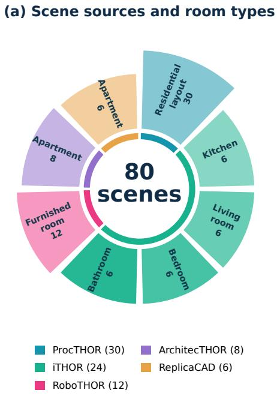  
Figure 8. Visualization of scene distribution in SpatialScout

## A. Protocol

Scene preparation. Catalog entries identify the scene builder, source configuration, initial world position and yaw–pitch, and target count. The preparation script verifies the loaded source identity and applies the target-selection rule in Sec. 2.2. The default configuration uses seed 0, 512 × 512 rendering, CPU simulation and rendering back ends, and the minimal shader setting. The delivered image uses JPEG quality 82 and the pixel mapping in Eq. (2). The preparation manifest records the random seed, render size, simulation and rendering backends, input-image encoding, dependency versions, and SHA-256 fingerprints of the source configuration, benchmark and simulator code, and asset tree. Cached preparations are reused only when their fingerprints, initial camera poses, and target counts agree with the requested configuration. Each run records the preparation fingerprint, linking the attempt to its scene and data configuration. The public entity inventory, evaluator annotations, and initial view are saved as separate artifacts. Each frame also retains its original-image filename. The overall data distribution is presented in Fig. 8 and Fig. 9.

Movement. Absolute positions are transformed from the task frame to world coordinates by ${ \bf o } _ { 0 } + R _ { 0 } { \bf p }$ , with each world coordinate bounded by ±15 m. Relative translations have length at most 1 m; yaw and pitch increments have magnitude at most 180◦ per axis, final pitch is clamped to [−85◦, 85◦], and roll remains fixed. Section 3.1 specifies the movement axes and explicit capture interface.

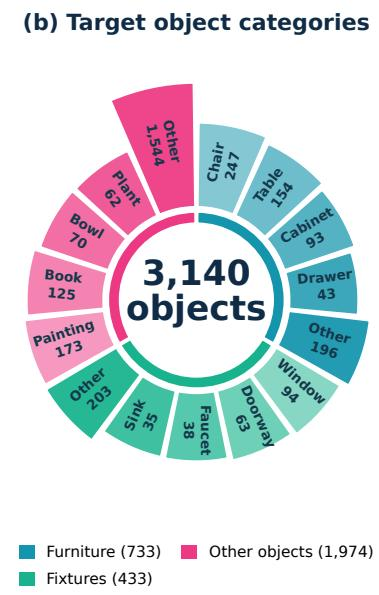  
Figure 9. Visualization of object distribution in SpatialScout

Prompts and budgets. Chat Completions and Responses use a shared episode loop, task prompt, and tool descriptions. Section 3.1 describes the common submission guidance and map-inspection interface. The prompt also specifies the actual model-call and capture budgets, the fixed task axes, and the world-AABB center convention. When V = 1, it requests estimates from the initial image and its calibration. Budget reminders are added before model requests with 10 and 3 calls remaining. Actions within a single response are specified before the corresponding visual feedback is seen. Rejected capture requests do not consume additional images. The default user prompt and the tool descriptions are presented in Fig. 10 and Fig. 11.

Attempt accounting. The standard batch uses a 180- second timeout per HTTP request, with no explicit temperature setting. Each episode attempt records the model identifier, API mode, reasoning configuration, full task prompt, tool schema, and actual budgets. Retriable HTTP or network failures receive up to three request attempts with 1- and 2-second backoffs. Logical model calls and HTTP request attempts have separate counters. The batch runner stores reruns in distinct attempt directories, preserving previous maps and traces. Completed episodes are labeled by explicit finish, a response without tool calls, or turn-budget exhaustion. Service and runtime failures retain available maps and diagnostic records under the accounting policy in Sec. 3.1. Batch reports retain completed-episode counts and failure counts and rates alongside aggregate scores. Comparisons use a specified scene list and report the completed count for each model.

## B. Reproducibility Details

## B.1. Multi-view Point Estimation

For a marked original-image pixel $( u _ { k } , v _ { k } )$ , the forward/left/up camera convention gives

$$
\mathbf { q } _ { k } = \left[ - ( u _ { k } - c _ { x , k } ) / f _ { x , k } \right] , \qquad \mathbf { d } _ { k } = \frac { R _ { k } \mathbf { q } _ { k } } { \| R _ { k } \mathbf { q } _ { k } \| _ { 2 } } ,\tag{4}
$$

where $R _ { k }$ maps camera axes into the fixed task frame. Using the task-frame origins $\mathbf { o } _ { k }$ and projections $A _ { k }$ defined in Sec. 3.1, the normal equations of $\operatorname { E q . } \left( 3 \right)$ give

$$
{ \widehat { \mathbf { p } } } _ { \mathrm { t r i } } = \left( \sum _ { k } A _ { k } \right) ^ { - 1 } \sum _ { k } A _ { k } \mathbf { o } _ { k } .\tag{5}
$$

A valid query requires at least two observations, maximum camera separation of at least 5 cm, condition number of $\textstyle \sum _ { k } A _ { k }$ at most $1 0 ^ { 6 }$ , and $\mathbf { d } _ { k } ^ { \top } ( \widehat { \mathbf { p } } _ { \mathrm { t r i } } - \mathbf { o } _ { k } ) > 0$ for every contributing ray. Queries failing these checks are rejected. The tool reports the root-mean-square perpendicular line residual and maximum pairwise ray angle. Valid solutions carry a caution when the angle is below $3 ^ { \circ }$ , the residual exceeds 0.1 m, or the point lies beyond $r + 0 . 5  { \mathrm { m } }$

## B.2. Scoring and Trace Replay

For a scene with N targets and M accepted submissions, the position evaluator uses groupwise minimum-total-Euclidean-distance assignment. Mean, median, RMSE, and mean IoU use that assignment. Before assignment, predictions are ordered lexicographically by task-frame coordinates and targets by task-frame center and world-box side lengths, with identifiers breaking ties between geometrically identical entries. This canonical ordering makes tied assignments reproducible under permutations of samegroup submission identifiers. The target-conditioned overlap evaluator floors each reference side length at $\epsilon = 0 . 0 1$ m while preserving its center. For each prediction–target pair it translates the candidate target’s box to the prediction, giving a score determined by the predicted center, candidate center, and candidate extent. At each threshold, one-to-one matching first maximizes strict threshold hits and then total overlap. Thresholds are $\tau \in \{ 0 , 0 . 5 , 0 . 9 \}$ , with separate assignments for each threshold. The scorer saves the metric version, minimum side length, matched IoU sum $Q ,$ , hit counts $H _ { \tau }$ , and denominators M, N.

Aggregation and completeness. For evaluated scenes ${ \mathcal { D } } ,$ object-micro means use $\textstyle \sum _ { s \in { \mathcal { D } } } Q _ { s } / \sum _ { s } M _ { s }$ for submitted objects and $\sum _ { s } Q _ { s } / \sum _ { s } \overline { { N } } _ { s } .$ for all targets. Replacing $Q _ { s }$ with $H _ { \tau , s }$ gives the corresponding hit rate and recall. Scenemacro summaries instead average the per-scene ratios with equal weight. Both mean IoU variants and overlap rates are zero for an empty map; submitted-object center errors are undefined and excluded from averages of those errors. At scene level, and under object-micro aggregation with $C =$ $\begin{array} { r } { \sum _ { s } M _ { s } / \sum _ { s } N _ { s } , } \end{array}$

$$
\overline { { J } } _ { \mathrm { { a l l } } } = C \overline { { J } } _ { \mathrm { { s u b } } } , \qquad \mathrm { R e c a l l } _ { \tau } = C \mathrm { H i t R a t e } _ { \tau } .\tag{6}
$$

For scene-macro reports these identities apply within each scene before averaging. Coverage is $C = M / N$ , and the full-scene loss is $\begin{array} { r } { L _ { \mathrm { s c e n e } } = ( \sum _ { i } e _ { i } + \lambda ( N - M ) ) / N } \end{array}$ , where $e _ { i }$ is matched center error and $\lambda = 5 \mathrm { { m } }$ . For an empty map, $L _ { \mathrm { s c e n e } } = \lambda$ . For a nonempty map, the loss decomposes as $L _ { \mathrm { s c e n e } } = C \bar { e } + ( 1 - C ) \lambda$ , where e¯ is mean center error. Reporting coverage and center error alongside the loss makes the contribution of omissions explicit.

Object scale. Of the 3,440 catalog targets, 225 (6.5%) have at least one world-box side shorter than 1 cm and use the minimum-side regularization. The median shortest side before regularization is 11.7 cm. For two identical regularized world-axis-aligned boxes displaced by d along one axis of length ℓ, with the other axes aligned and $| d | < \ell ,$

$$
J = \frac { \ell - | d | } { \ell + | d | } , \qquad J > \tau \iff | d | < \ell \frac { 1 - \tau } { 1 + \tau } .\tag{7}
$$

At $\mathrm { I o U } > 0 . 9 .$ , the permitted displacement is below $\ell / 1 9 ,$ approximately 5.26% of that axis length. At the 1 cm minimum side length, the single-axis tolerance is approximately 0.526 mm. Center error complements these scale-relative scores by measuring displacement in meters.

Inventory-only references. The origin policy submits $\widehat { \bf p } _ { i } = \textbf { 0 }$ for every inventory item. The uniform-ball policy samples a unit direction from a normalized threedimensional Gaussian vector and a radius $r U ^ { 1 / 3 } , \ U \ \sim$ Uniform[0, 1], using seed 0. Both policies use the same groupwise scoring and cover the full inventory. Across the 80 prepared scenes, their scene-macro full-scene losses are 2.984 m and 4.487 m, respectively. These values provide RGB-free localization baselines using the public inventory and range prior.

Map-update replay. The replay in Sec. 3.1 reconstructs the acquired-image count from the initial capture and subsequent successful capture events. It scores the full map returned by every successful submission call, including empty batches used to inspect the map. The same accepted maps can also be evaluated with omission costs $\lambda \in \{ 1 , 2 , 5 , 1 0 \}$ m, separating the effect of the reporting trade-off from changes in predictions without further mode inference. Model text and captured-image files accompany the calibrated frames and tool records. Resource records include request and execution times, counts of model calls, acquired images and tool calls, and provider-reported token usage when available.

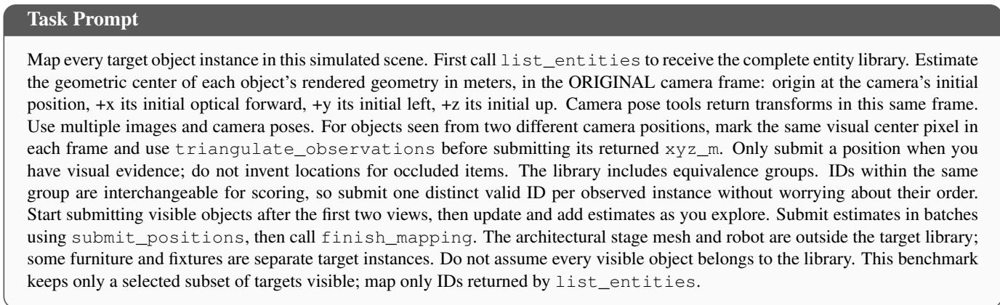  
Figure 10. The task prompt provided to the visual mapping agent.

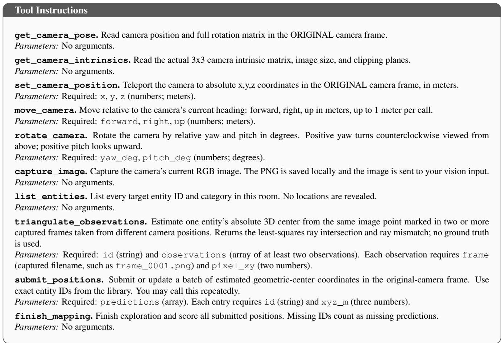  
Figure 11. Tool descriptions and parameter requirements provided to the visual mapping agent.