# TIM: Temporal Decoupling with Iterative Mutual-Refinement Model for Longitudinal Radiology Report Generation

Yiheng Dong1\*, Yi Lin2\*, Shilong Huang1, Xiyan Yang1, Xin Yang1†

1 Huazhong University of Science and Technology, Wuhan, China 2 HKUST, Hong Kong, China

{yiheng, alon\_ft, xiyanyang, xinyang2014}@hust.edu.cn yi.lin@connect.ust.hk

## Abstract

Automatic radiology report generation (RRG) aims to translate medical images into diagnostic text, reducing radiologists’ workload and standardizing clinical documentation. Nonetheless, existing approaches mainly focus on singletimepoint analysis andfail to capture temporal disease evolution across longitudinal examinations. While recent longitudinal RRG (LRRG) approaches incorporate historical data, they often combine images from different time points within a single representation space, leading to blurred semantics and inconsistent temporal reasoning. In this work, we propose a Temporal Decoupling with Iterative Mutual-Refinement Model (TIM), a two-stage framework that explicitly decouples spatial pathologyfrom temporal progression and iteratively refines reports through mutualfeedback. Stage I performs temporal-decoupled representation learning, separating temporal evolution patterns from diseasespecific features and generating radiology reports for both prior and current studies. Stage II introduces a mutual report refinement mechanism that identifies diagnostic inconsistencies within prior reports and iteratively rectifies both prior and current reports through error-sensitive feedback. Experiments on the Longitudinal-MIMIC dataset demonstrate that TIM surpasses existing single-image and longitudinal baselines, achieving new state-of-the-art performance across both language and clinical metrics. Code is available at https://github.com/yihengd/TIM.

## 1. Introduction

Radiology report generation (RRG) aims to automatically produce diagnostic descriptions from medical images, offering great potential to alleviate radiologists’ workload and standardize clinical documentation. By converting images into structured diagnostic narratives, RRG systems can assist physicians in drafting reports, standardize terminology usage, and reduce human variability [20, 23].

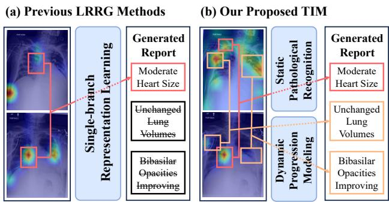  
Figure 1. Comparison between TIM and previous work. Previous methods typically use a single representation branch, limit ing their ability to capture disease progression. In contrast, TIM decouples the longitudinal radiology report generation into static pathology recognition and dynamic progression modeling, allowing precise characterization of both prior and current pathological states, as well as their longitudinal evolution.

Recent advances in vision-language models [18, 22, 27, 44] have enabled significant progress in RRG, achieving accurate report generation for chest X-rays [5, 7, 8, 15, 19, 37, 47, 50]. Despite these advances, most existing approaches focus solely on single-timepoint studies, overlooking the temporal continuity that is intrinsic to real clinical workflows [45]. In practice, radiologists routinely compare the current study with prior examinations to assess disease progression, treatment response, and emergence of new abnormalities [11]. Without modeling temporal evolution, singletimepoint methods struggle to capture longitudinal progression and generate reports that are temporally inconsistent or misaligned with the patient’s actual disease trajectory.

To address these limitations, several recent studies [28, 29, 34, 45, 53–55] have explored longitudinal radiology report generation (LRRG). These approaches incorporate historical images and reports to produce reports encompassing both current findings and disease progression. While these advancements mark a significant step forward, they overlook a fundamental property of the LRRG task: the heterogeneity between pathological recognition and progression modeling. Pathological recognition is concerned with the spatial localization [25] of disease-specific patterns within a single study (e.g., pulmonary opacity), whereas progression modeling captures temporal changes across studies (e.g., interval increase or improvement). As shown in Fig. 1(a), existing methods conflate these two distinct subtasks within a single representation learning network, resulting in the blend of static disease cues and temporal evolution features. This entanglement obscures their unique semantics and limits the model’s capacity for accurate temporal reasoning.

In addition, existing LRRG methods treat report generation as a single-pass procedure, disregarding the mutual dependencies between prior and current reports. By treating each report as an independent target, these methods fail to leverage the bidirectional cues across time points. Consequently, they ignore two critical opportunities for enhancing diagnostic reasoning: first, identifying errors in the prior generated report can offer corrective guidance for the current report; second, refining the current report can reveal omissions or misinterpretations in the prior one. Without mutual refinement, such models often repeat mistakes across visits and fail to characterize disease evolution.

In this study, we propose Temporal Decoupling with Iterative Mutual-Refinement Model (TIM), a two-stage framework for longitudinal radiology report generation. Stage I performs temporal-decoupled representation learning, wherein a static pathological recognition branch and a dynamic progression modeling branch independently encode disease-specific visual features and cross-visit progression representations, mitigating feature interference between spatial and temporal cues. Based on these representations, an LLM generates radiology reports for both prior and current examinations. Stage II introduces mutual report refinement, whereby the prior and current reports serve as reciprocal references to guide the iterative refinement process. Through improved clinical accuracy and temporal coherence, this stage ultimately improves the overall quality and reliability of longitudinal radiology reporting.

Our key contributions are summarized as follows:

1. We introduce TIM, a Temporal-Decoupling with Iterative Mutual-Refinement model that adopts a “divideand-conquer” strategy to exploit the temporal evolution in longitudinal radiology reports.

2. We propose a temporal-decoupled representation learning strategy that separates static pathology from dynamic progression, and employs a dual-timepoint report generation mechanism to capture longitudinal disease semantics while maintaining longitudinal consistency.

3. We design a mutual report refinement module, wherein both prior and current reports are iteratively refined through mutual referencing, effectively reducing temporal error propagation.

4. Experiments on the Longitudinal-MIMIC dataset demonstrate that TIM outperforms both single-image and longitudinal baselines across natural language generation and clinical efficiency metrics.

## 2. Related Work

Radiology Report Generation. RRG aims to automatically produce diagnostic reports from medical images such as chest X-rays. While this task shares similarities with image captioning [18, 44, 51], it is inherently more complex due to the need for precise clinical terminology and long-form structured descriptions. Early methods generally adopted an encoder-decoder framework [1, 9, 35, 44, 51], where convolutional or transformer-based encoders extract image features and recurrent or transformer-based decoders generate textual reports. To enhance the clinical relevance of generated reports, several works [5, 13, 15, 19, 26, 41, 46] incorporated domain knowledge or multimodal alignment strategies. Despite these advances, most prior works focus on single-image settings, overlooking the temporal evolution of disease progression across multiple visits.

Longitudinal Radiology Report Generation. LRRG extends traditional RRG to multi-visit scenarios, enabling the capture of disease progression and treatment response. Unlike conventional RRG models that describe only static findings, LRRG aims to model both current pathologies and longitudinal evolutions. Recent methods such as CXR-Mate [34], Prefilling [55], HERGen [45], HC-LLM [29], and Diff-RRG [54] incorporate temporal or historical information to enhance contextual understanding. However, these approaches often mix static and temporal representations, limiting feature disentanglement. In contrast, our method employs a decoupled representation learning strategy to separate static and dynamic visual cues, enabling the model to capture both stable and evolving abnormalities for more accurate and coherent report generation.

Self-Refinement Report Generation. Self-refinement has emerged as an effective strategy for improving generative models through iterative revision of outputs based on feedback [31, 49], enhancing factual accuracy and linguistic coherence in natural language generation tasks [21, 32]. However, existing self-refinement methods for report generation [37] often fail to provide explicit and clinically meaningful feedback, resulting in limited guidance and marginal gains in clinical accuracy. In contrast, we introduce a dualtimepoint, iterative mutual-refinement approach that goes beyond previous self-refinement by explicitly identifying errors in reports, enabling targeted correction, and substantially improving the clinical accuracy of the final output.

## 3. Method

The overall framework is shown as Fig. 2. Our proposed TIM comprised two stages: (I) Temporal-Decoupled Representation Learning and (II) Mutual Report Refinement. In Stage I, to mitigate feature interference and enhance the specificity for disease-aware findings and temporal evolution, TIM decouples visual representations into pathological recognition and progression modeling branches, and performs report generation for two timepoints. Stage II further enhances clinical accuracy by introducing Mutual Report Refinement. Through multiple rounds of mutual refinement, TIM suppresses mistakes progressively and yields clinically faithful radiology reports.

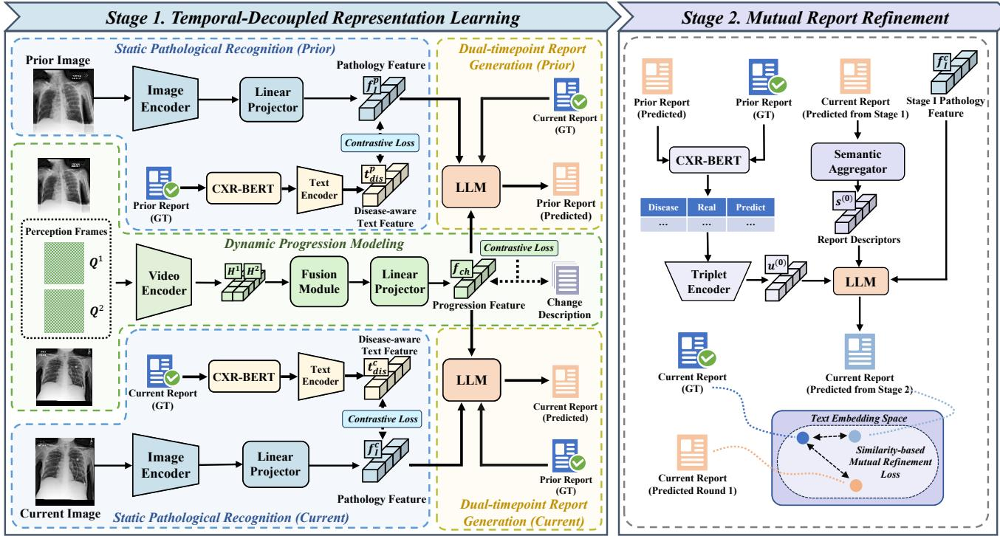  
Figure 2. Overview of the proposed TIM. Our proposed model comprises two stages: (I) temporal-decoupled representation learning and (II) mutual report refinement. During Stage I, TIM generates dual-timepoint reports using static pathological recognition and dynamic progression modeling. In Stage II, TIM identifies errors in reports and iteratively performs mutual refinement, generating clinically accurate and temporally coherent reports.

## 3.1. Problem Formulation

Let $\mathcal { T } = \{ I ^ { p } , I ^ { c } \}$ denote the pair of chest X-ray images acquired from the same patient at two different times, where $I ^ { p }$ and $I ^ { c }$ denote the prior and current images, respectively. Each image is associated with a corresponding report $R ^ { p }$ or $R ^ { c }$ . In the following sections, since our framework involves report generation at two timepoints, we introduce the superscript “∗” to uniformly denote a generic timepoint. For instance, $I ^ { * }$ may correspond to either the prior or current image, and the same notation applies to others.

Given a prior image–report pair $\{ I ^ { p } , R ^ { p } \}$ and a current image $I ^ { c }$ , our goal is to generate an accurate and detailed current report $\hat { R } ^ { c }$ , which can be formally represented as:

$$
\mathcal { F } : ( I ^ { p } , I ^ { c } , R ^ { p } )  \hat { R } ^ { c } .\tag{1}
$$

## 3.2. Temporal-Decoupled Representation Learning

In Stage I, we decouple representation learning into Static Pathological Recognition and Dynamic Progression Modeling branches, enabling the model to capture prior and current pathological states and their longitudinal evolution. Based on these representations, a Dual-Timepoint Report Generation mechanism is established to produce both prior and current radiology reports.

## 3.2.1. Static Pathological Recognition

This branch is designed to capture the static disease-related visual representation from prior and current images independently. Given an image $I ^ { * }$ , an image encoder $E _ { i m g } ( \cdot )$ extracts patch embeddings, which are then projected into language space through a linear projector $W _ { i m g }$ , forming a pathological feature $\mathbf { f } _ { i } ^ { * } = W _ { i m g } E _ { i m g } ( I ^ { * } )$

To couple the pathological feature with clinically faithful semantics, we align $\mathbf { f } _ { i } ^ { * }$ with disease-aware textual descriptions. Specifically, each corresponding report is first annotated by CheXbert model [17] across 14 disease categories, producing four labels: {not mentioned, positive, negative, uncertain}. Using external medical knowledge sources (e.g., UMLS, PubMed), each mentioned disease is expanded into a concise clinical description. These descriptions and their labels are concatenated into a disease text sequence $\tau _ { d i s } ^ { * }$ and processed by a text encoder into $\mathbf { f } _ { t , d i s } ^ { * } = E _ { t x t } ( T _ { d i s } ^ { * } )$ . We then apply a contrastive learning to align image and disease-aware text features:

$$
\mathcal { L } _ { s p r } ^ { * } = - \log \frac { \exp ( s i m ( \mathbf { f } _ { i } ^ { * } , \mathbf { f } _ { t , d i s } ^ { * } ) / \tau ) } { \sum _ { j } \exp ( s i m ( \mathbf { f } _ { i } ^ { * } , \mathbf { f } _ { t , d i s } ^ { * , j } ) / \tau ) } ,\tag{2}
$$

where $s i m ( \cdot , \cdot )$ denotes cosine similarity function, $\tau$ is a temperature hyper-parameter, and $\mathcal { L } _ { s p r } ^ { * }$ denotes the loss of static pathological recognition branch.

## 3.2.2. Dynamic Progression Modeling

This branch focuses on capturing temporal evolution between consecutive examinations by exploiting the intrinsic spatiotemporal learning capability of the video encoder. We introduce a set of learnable, randomly initialized perception frames $\{ Q ^ { 1 } , Q ^ { 2 } \}$ that share the spatial resolution of chest images $\{ I ^ { p } , I ^ { c } \}$ and are independently parameterized. The number of perception frames is set to 2 based on experiments in Sec. 4.6. These frames are inserted between the prior and current images to form a short video sequence, which is then processed by a video encoder $E _ { v i d } ( \cdot )$

$$
\left( \_ { { \cal H } } ^ { 1 } , { \cal H } ^ { 2 } , \_ \right) = E _ { v i d } ( [ I ^ { p } ; { \cal Q } ^ { 1 } ; { \cal Q } ^ { 2 } ; I ^ { c } ] ) ,\tag{3}
$$

where $[ \cdot ; \cdot ]$ denotes concatenation operation. The resulting features $\{ \bar { H } ^ { 1 } , H ^ { 2 } \}$ are adaptively fused by a gating module:

$$
H _ { g } = \alpha \odot H ^ { 1 } + ( 1 - \alpha ) \odot H ^ { 2 } , \quad \alpha = \sigma ( W _ { g } [ H ^ { 1 } ; H ^ { 2 } ] ) ,\tag{4}
$$

where $\odot$ denotes element-wise multiplication, $\sigma ( \cdot )$ is the sigmoid function, and $W _ { g }$ is a learnable weight matrix. $H _ { g }$ is then projected into the language space by a linear head $W _ { v i d }$ , resulting in a progression feature $\mathbf { f } _ { p r o } = W _ { v i d } H _ { g }$

To ensure that the learned representations reflect clinically meaningful progressions, we align $\mathbf { f } _ { p r o }$ with text embeddings $\mathbf { f } _ { t , p r o } ~ = ~ E _ { t x t } ( \mathcal { T } _ { p r o } )$ derived from progressionrelated report sentences $\mathcal { T } _ { p r o } \mathrm { : }$

$$
\mathcal { L } _ { d p m } = - \log \frac { \exp ( s i m ( \mathbf { f } _ { p r o } , \mathbf { f } _ { t , p r o } ) / \tau ) } { \sum _ { j } \exp ( s i m ( \mathbf { f } _ { p r o } , \mathbf { f } _ { t , p r o } ^ { j } ) / \tau ) } ,\tag{5}
$$

where $\mathcal { L } _ { d p m }$ denotes the loss of dynamic progression modeling branch. This alignment encourages the model to focus on true pathological evolution rather than irrelevant imaging variations such as positioning changes.

## 3.2.3. Dual-Timepoint Report Generation

To better capture temporal evolution, Stage I generates both prior and current reports rather than predicting only the current one. This dual-timepoint formulation enables the model to infer the current report based on detected progression, while simultaneously using progression to reconstruct the prior report. Such a bidirectional reasoning process encourages the progression representation to encode disease evolution more accurately and consistently across time. We utilize a frozen large language model $L L M$ as the report generator, taking embeddings and a textual prompt as input:

$$
\hat { R } ^ { * } = L L M ( \mathbf { f } _ { i } ^ { * } , \mathbf { f } _ { p r o } , R ^ { r e f } , \mathcal { P } ^ { * } ) ,\tag{6}
$$

where $\hat { R } ^ { * }$ denotes the generated report at time $\ast \ ( p$ or c), $\mathbf { f } _ { i } ^ { * }$ and $\mathbf { f } _ { p r o }$ are the pathology and progression embedding, $\dot { R } ^ { r e f }$ is the reference report from the opposite time $( R ^ { p }$ for current generation and $R ^ { c }$ for the prior one) and ${ \mathcal { P } } ^ { * }$ is a textual prompt indicating the timepoint of the generated report and assisting LLM to understand the task objective.

During training, both timepoint generations are optimized with the same autoregressive objective:

$$
\mathcal { L } _ { g e n } ^ { * } = - \sum _ { m = 1 } ^ { M } \log P _ { \theta } \left( r _ { m } ^ { * } \mid r _ { < m } ^ { * } , \mathbf { f } _ { i } ^ { * } , \mathbf { f } _ { p r o } , R ^ { r e f } , \mathcal { P } ^ { * } \right) ,\tag{7}
$$

where M denotes the total number of generated tokens and $\hat { r } _ { m } ^ { * }$ denotes the $m ^ { t h }$ text token.

The overall training objective of Stage I is:

$$
\begin{array} { r } { \mathcal { L } _ { s t a g e 1 } = \mathcal { L } _ { g e n } ^ { c } + \mathcal { L } _ { g e n } ^ { p } + \lambda _ { 1 } ( \mathcal { L } _ { s p r } ^ { c } + \mathcal { L } _ { s p r } ^ { p } ) + \lambda _ { 2 } \mathcal { L } _ { d p m } , } \end{array}\tag{8}
$$

where $\lambda _ { 1 }$ and $\lambda _ { 2 }$ denotes the balancing coefficient.

## 3.3. Mutual Report Refinement

Although Stage I carries out a detailed feature modeling process, the generated reports may still contain inaccurate or inconsistent disease descriptions, particularly for subtle abnormalities. We further observe that about 70% of such errors in prior reports reappear in the current one owing to the temporal consistency across visits. Stage II introduces a mutual refinement mechanism to reduce this issue. It identifies these errors by comparing the generated prior report with its ground truth, and uses them as refinement guidance for a second-round report generation. To clarify notation, throughout this stage, we use the superscript (j) to denote the variable obtained after the $j ^ { t h }$ refinement iteration.

Following the Stage I paradigm (Eq. (6)), the model first produces initial current and prior reports $\hat { R } ^ { c , ( 0 ) }$ and ${ \hat { R } } ^ { p , ( 0 ) }$ The generated prior report is compared with its ground truth using CheXbert [17], yielding a set of error triplets $\mathcal D ^ { ( 0 ) } = \{ ( d _ { k } , z _ { k } ^ { p } , \hat { z } _ { k } ^ { p , ( 0 ) } ) \} _ { k = 1 } ^ { K }$ , where $d _ { k }$ denotes the $k ^ { t h }$ disease, $z _ { k } ^ { p } / \hat { z } _ { k } ^ { p , ( 0 ) }$ respectively denote the ground-truth and predicted labels, and K denotes the number of mistakenly predicted diseases. These triplets are then converted into high-dimensional vectors $\mathbf { u } ^ { ( 0 ) }$ using a triplet encoder $E _ { t r i } ( \cdot )$ composed of concatenated one-hot vectors followed by an MLP. In parallel, to capture the core diagnostic information from the initially generated current report $\hat { R } ^ { c , ( 0 ) }$ we introduce a semantic aggregator $\Gamma ( \cdot )$ . This module applies attention mechanism over the embedding of $\hat { R } ^ { c , ( 0 ) }$ and produces compact report discriptors ${ \bf s } ^ { ( 0 ) } = \Gamma \big ( \hat { R } ^ { c , ( 0 ) } \big )$ .

These components, along with the current pathology feature $\mathbf { f } _ { i } ^ { c }$ from Stage I and a textual prompt ${ \mathcal { P } } ^ { r f }$ , constitute the input of the second-round generation to re-evaluate the misclassified diseases and refine the current report:

$$
\hat { R } ^ { c , ( 1 ) } = L L M ( \mathbf { f } _ { i } ^ { c } , \mathbf { u } ^ { ( 0 ) } , \mathbf { s } ^ { ( 0 ) } , \mathcal { P } ^ { r f } ) ,\tag{9}
$$

where prompt ${ \mathcal { P } } ^ { r f }$ plays the role of instructing LLM to attend to the errors and carry out refinement.

Training. Training proceeds under two objectives. The first is the autoregressive generation loss, similar to Eq. (7):

$$
\mathcal { L } _ { g e n } ^ { c , ( 1 ) } = - \sum _ { m = 1 } ^ { M } \log P _ { \theta } \left( r _ { m } ^ { c , ( 1 ) } \mid r _ { < m } ^ { c , ( 1 ) } , \mathbf { f } _ { i } ^ { c } , \mathbf { u } ^ { ( 0 ) } , \mathbf { s } ^ { ( 0 ) } , \mathcal { P } ^ { r f } \right) .\tag{10}
$$

To ensure the refinement leads to effective improvement, we compare the similarity of both first- and second-round reports to the ground truth in a text embedding space using cosine similarity $s ( \cdot , \cdot ) = s i m ( E _ { t x t } ( \cdot ) , E _ { t x t } ( \cdot ) )$

$$
\mathcal { L } _ { \Delta } = - \log \sigma \left( \beta \left[ s ( \hat { R } ^ { c , ( 1 ) } , R ^ { c } ) - s ( \hat { R } ^ { c , ( 0 ) } , R ^ { c } ) \right] \right) \mathrm { , }\tag{11}
$$

where $\sigma ( \cdot )$ represents the sigmoid function and $\beta$ is a scaling hyper-parameter. This term encourages $s ( \hat { R } ^ { c , ( 1 ) } , R ^ { c } ) >$ $s ( \hat { R } ^ { c , ( 0 ) } , R ^ { c } )$ , driving the refined report to get closer to the ground truth. The full objective is:

$$
\mathcal { L } _ { s t a g e 2 } = \mathcal { L } _ { g e n } ^ { c , ( 1 ) } + \lambda _ { \Delta } \mathcal { L } _ { \Delta } ,\tag{12}
$$

with $\lambda _ { \Delta }$ balances the two terms. Only $\Gamma ( \cdot )$ and $E _ { t r i } ( \cdot )$ are optimized while all Stage I modules are frozen.

Inference. At test time, TIM performs a closed-loop mutual refinement by alternating between Stage I generation and Stage II correction, as shown in Algorithm 1. We begin with Stage I to obtain $\hat { R } ^ { c , ( 0 ) }$ , and using it as the reference report to generate $\hat { R } ^ { p , ( 0 ) }$ (cf. Eq. (6)). Next, we invoke Stage II to correct and produce a new current report $\hat { R } ^ { c , ( 1 ) }$ (cf. Eq. (9)). The refined current report $\hat { R } ^ { c , ( 1 ) }$ is then fed back to Stage I as the new reference for regenerating a new prior report $\hat { R } ^ { p , ( 1 ) }$ . With $\{ \hat { R } ^ { c , ( 1 ) } , \hat { R } ^ { p , ( 1 ) } \}$ in hand, we re-enter Stage II: compute error triplets $\mathcal { D } ^ { ( 1 ) }$ with $( \hat { R } ^ { p , ( 1 ) } v s . R ^ { p } )$ update ${ \bf s } ^ { ( 1 ) } \stackrel { - } { = } \Gamma ( \hat { R } ^ { c , ( 1 ) } ) , \stackrel { \cdot } { \bf u } ^ { ( 1 ) } = E _ { t r i } ( \hat { D } ^ { ( 1 ) } )$ , and generate a further-refined current report $\hat { R } ^ { c , ( 2 ) }$ This Stage I ↔ Stage II alternation proceeds for a fixed number of iterations N (set to 3 based on Sec. 4.6). Ultimately, the mutual iterative refinement between the two stages yields progressively improved and clinically faithful current reports.

## 4. Experiment

## 4.1. Dataset and pre-processing

Longitudinal MIMIC-CXR. Experiments are conducted on the Longitudinal-MIMIC dataset [55] derived from the MIMIC-CXR [20], a large-scale dataset of deidentified chest radiographs paired with corresponding reports. Longitudinal-MIMIC organizes multiple visits per patient, with each sample comprising a tuple of {previous image, previous report, current image, current report}. Following the official split of MIMIC-CXR, this dataset includes 26,156 patients and 92,374 samples for training, 203 patients and 737 samples for validation, and 266 patients and 2,058 samples for testing. We used Qwen3-plus [52] to extract progression descriptions from reports, which are employed in dynamic progression modeling in Sec 3.2.2.

Algorithm 1 Test-time Iterative Mutual-Refinement   
Modules:   
CheXbert(·): disease label extractor,   
$L L M ( \cdot ) { \mathrm { : } }$ large language model,   
$\Gamma ( \cdot ) \colon$ : semantic aggregator,   
$E _ { t r i } ( \cdot ) \colon$ triplet encoder   
Inputs:   
current pathology feature $\mathbf { f } _ { i } ^ { c } ,$   
prior pathology feature $\mathbf { f } _ { i } ^ { p } .$   
progression feature $\mathbf { f } _ { p r o } ,$   
prior ground truth report $R ^ { p } ,$   
textual prompts $\{ \mathcal { P } ^ { c } , \mathcal { P } ^ { p } , \mathcal { P } ^ { r f } \}$   
Output: refined report $\hat { R } ^ { c , ( N ) }$   
// Initialize the current report   
1: $\hat { R } ^ { c , ( 0 ) } = L L M ( { \bf f } _ { i } ^ { c } , { \bf f } _ { p r o } , \hat { R } ^ { p } , \mathcal { P } ^ { c } ) ;$   
2: for $j = 0$ to $N - 1$ do   
// Generate the prior report using current report   
3: $\hat { R } ^ { p , ( j ) } = L L \hat { M ( \mathbf { f } _ { i } ^ { p } , \mathbf { f } _ { p r o } , \hat { R } ^ { c , ( j ) } , \mathcal { P } ^ { p } ) }$ ;   
4: D(j) = CheXbert $\left( \hat { R } ^ { p , ( j ) } \right)$ vs. CheXbert $\left( R ^ { p } \right)$   
5: $\mathbf { u } ^ { ( j ) } = E _ { t r i } \big ( \mathcal { D } ^ { ( j ) } \big )$   
6: $\mathbf { s } ^ { ( j ) } = \Gamma \big ( \hat { R } ^ { c , ( j ) } \big )$   
// Iteratively update the current report   
7: $\hat { R } ^ { c , ( j + 1 ) } = L L M \big ( \mathbf { f } _ { i } ^ { c } , \mathbf { u } ^ { ( j ) } , \mathbf { s } ^ { ( j ) } , \mathcal { \hat { P } } ^ { r f } \big )$   
8: end for   
9: return final refined report $\hat { R } ^ { c , ( N ) }$

## 4.2. Experiment Settings

Evaluation Metrics. We evaluated the performances of our model using natural language generation (NLG) metrics and clinical efficacy (CE) metrics. For NLG evaluation, we employed BLEU-n [36], ROUGE-L [24], and ME-TEOR [2]. For CE metrics, following [7, 8, 19], precision, recall, and F1-score are included, which are computed by mapping reports to 14 disease labels using CheXbert [17]. Implementation Details. In this study, all experiments are conducted on 2 NVIDIA RTX 5880 GPUs (48 GB each). We use Swin Transformer [30] as the image encoder, visual branch of X-CLIP [33] as the video encoder, text branch of CLIP [38] as the text encoder, and LLaMA2-7B [42] as the large language model. For Stage I, the model is trained for three epochs with a batch size of 4, using the Adam optimizer and a learning rate of $1 \times 1 0 ^ { - 4 }$ . For Stage II, al

Table 1. Experimental results of our model and previous methods on Longitudinal-MIMIC. We report the natural language generation (NLG) metrics, including BLEU-n (B-n), METEOR (MTR), and ROUGE-L (R-L), and clinical efficiency (CE) metrics, including precision (P), recall (R), and F1-score. The best results are bolded, and the second-best results are underlined.
<table><tr><td rowspan="2">Input</td><td rowspan="2">Method</td><td rowspan="2">Venue</td><td colspan="6">NLG Metrics</td><td colspan="3">CE Metrics</td></tr><tr><td>B-1</td><td>B-2</td><td>B-3</td><td>B-4</td><td>MTR</td><td>R-L</td><td>P</td><td>R</td><td>F1</td></tr><tr><td rowspan="6">Single Image</td><td>R2Gen [7]</td><td>EMNLP 2020</td><td>0.308</td><td>0.190</td><td>0.126</td><td>0.089</td><td>0.124</td><td>0.266</td><td>0.457</td><td>0.290</td><td>0.355</td></tr><tr><td>R2GenCMN [8]</td><td>ACL 2021</td><td>0.328</td><td>0.203</td><td>0.135</td><td>0.096</td><td>0.133</td><td>0.273</td><td>0.512</td><td>0.359</td><td>0.422</td></tr><tr><td>R2GenGPT [47]</td><td>Meta-Rad 2023</td><td>0.396</td><td>0.243</td><td>0.161</td><td>0.108</td><td>0.155</td><td>0.260</td><td>0.495</td><td>0.385</td><td>0.404</td></tr><tr><td>PromptMRG [19]</td><td>AAAI 2024</td><td>0.384</td><td>0.229</td><td>0.149</td><td>0.104</td><td>0.146</td><td>0.261</td><td>0.517</td><td>0.453</td><td>0.439</td></tr><tr><td>EKAGen [5]</td><td>CVPR 2024</td><td>0.405</td><td>0.245</td><td>0.156</td><td>0.105</td><td>0.154</td><td>0.264</td><td>0.472</td><td>0.404</td><td>0.411</td></tr><tr><td>GMoD [50]</td><td>MICCAI 2024</td><td>0.378</td><td>0.234</td><td>0.155</td><td>0.107</td><td>0.162</td><td>0.276</td><td>0.496</td><td>0.429</td><td>0.460</td></tr><tr><td rowspan="10">Longitudinal Images</td><td>RADAR [15]</td><td>ACL 2025</td><td>0.412</td><td>0.242</td><td>0.162</td><td>0.114</td><td>0.155</td><td>0.257</td><td>0.448</td><td>0.436</td><td>0.417</td></tr><tr><td>Prefilling [55]</td><td>MICCAI 2023</td><td>0.343</td><td>0.210</td><td>0.141</td><td>0.100</td><td>0.137</td><td>0.274</td><td>0.506</td><td>0.364</td><td>0.423</td></tr><tr><td>HERGen [45]</td><td>ECCV 2024</td><td>0.389</td><td>0.242</td><td>0.163</td><td>0.117</td><td>0.155</td><td>0.282</td><td>0.421</td><td>0.289</td><td>0.295</td></tr><tr><td>STREAM [53]</td><td>TMI 2025</td><td>0.394</td><td>0.237</td><td>0.144</td><td>0.104</td><td>0.143</td><td>0.261</td><td>0.472</td><td>0.428</td><td>0.411</td></tr><tr><td>MLRG [28]</td><td>CVPR 2025</td><td>0.416</td><td>0.252</td><td>0.157</td><td>0.114</td><td>0.158</td><td>0.264</td><td>0.507</td><td>0.425</td><td>0.418</td></tr><tr><td>LLM-RG4 [48]</td><td>AAAI 2025</td><td>0.417</td><td>0.240</td><td>0.155</td><td>0.115</td><td>0.147</td><td>0.257</td><td>0.498</td><td>0.441</td><td>0.436</td></tr><tr><td>HC-LLM [29]</td><td>AAAI 2025</td><td>0.404</td><td>0.247</td><td>0.164</td><td>0.116</td><td>0.163</td><td>0.271</td><td>0.488</td><td>0.415</td><td>0.448</td></tr><tr><td>Diff-RRG [54]</td><td>MICCAI 2025</td><td>0.405</td><td>0.251</td><td>0.169</td><td>0.120</td><td>0.164</td><td>0.276</td><td>0.528</td><td>0.430</td><td>0.474</td></tr><tr><td>TIM-stage I</td><td></td><td>0.421</td><td>0.259</td><td>0.171</td><td>0.118</td><td>0.172</td><td>0.275</td><td>0.537</td><td>0.466</td><td>0.483</td></tr><tr><td>TIM-stage II</td><td></td><td>0.430</td><td>0.265</td><td>0.179</td><td>0.124</td><td>0.185</td><td>0.287</td><td>0.563</td><td>0.505</td><td>0.511</td></tr></table>

Stage I modules are frozen and only the semantic aggregator and the triplet encoder are optimized for one epoch with the same optimizer and batch size, and a learning rate of $5 \times 1 0 ^ { - 5 }$ . The balancing coefficients are set to $\lambda _ { 1 } = 0 . 5 ,$ $\lambda _ { 2 } = 0 . 1$ in Eq. (8) and $\lambda _ { \Delta } = 0 . 1$ 1 in Eq. (12), and the scaling parameter is set to $\beta = 5$ in Eq. (11). During Stage II inference, the number of refinement iterations is set to 3.

## 4.3. Comparison with State-of-the-art Methods

As shown in Table 1, we compare our model with several recent approaches. Our framework achieves new stateof-the-art performance across all evaluation metrics, outperforming both single-input and longitudinal-input methods. Specifically, compared with single-image models, our method improves by 0.018 on BLEU-4, and 0.030 on ROUGE-L over RADAR [15], as well as 0.051 on F1-score over GMoD [50]. Furthermore, relative to longitudinalinput models, our approach further achieves gains of 0.025 on BLEU-1, 0.011 on ROUGE-L, and 0.037 on F1-score over Diff-RRG [54], demonstrating that effectively leveraging temporal image sequences together with report information substantially enhances both the linguistic quality and clinical accuracy of generated radiology reports.

## 4.4. Ablation Study

Stage I. Table 2 presents an ablation study result assessing the contributions of each key component in Stage I, including the dynamic progression modeling (DPM) branch, dualtimepoint report generation (DRG) mechanism, $\mathcal { L } _ { s p r }$ loss of static pathological recognition branch for disease semantic alignment, and $\mathcal { L } _ { d p m }$ loss of dynamic progression modeling for progression representation alignment.

Starting from the baseline model, which uses only the current images for visual feature extraction and only produces current reports, it shows limited ability to capture longitudinal information and clinical semantics. Adding the DPM branch (model (a)) improves all metrics (e.g., BLEU-1 from 0.396 to 0.414, F1-score from 0.404 to 0.422), demonstrating the importance of temporal feature modeling for understanding disease progression. Incorporating the DRG mechanism (model (b)) boosts BLEU-4 and F1 to 0.114 and 0.446, as dual-time generation encourages temporal coherence. Introducing the disease semantic alignment loss $\mathcal { L } _ { s p r }$ (model (c)) enforces consistency between static visual features and disease-aware text, raising F1- score to 0.460. Similarly, the progression alignment loss $\mathcal { L } _ { d p m }$ (model (d)) aligns temporal features with progression descriptions, increasing BLEU-4 to 0.117. Finally, combining all modules (model (e)) achieves the highest overall performance across all metrics. These results confirm that each component contributes synergistically, improving both language quality and clinical accuracy.

Stage II. To evaluate the proposed components in Stage II, we conduct an ablation study on two key factors, including the prior difference information (PDI) as input, and mutualrefinement loss $\mathcal { L } _ { \Delta }$ . The results are summarized in Table 3.

Starting from the base model, where LLM receives only the image feature and the generated report from Stage I, the performance remains limited with BLEU-1 of 0.419 and F1- score of 0.483. This indicates that without additional feedback or refinement objectives, the model struggles to correct its own diagnostic biases. When the prior difference input is introduced, the model gains refinement guidance from discrepancies between the generated and the GT prior reports. This addition yields notable improvements, particularly in CE metrics (e.g., precision of 0.551 and F1-score of 0.487), suggesting that feedback from errors can guide the model to recognize and correct misclassified diseases better. Further introducing the $\mathcal { L } _ { \Delta }$ leads to the best overall performance, including BLEU-4 of 0.124 and F1-score of 0.511, confirming its role of ensuring refinement towards semantically meaningful corrections rather than arbitrary rewriting.

Table 2. Ablation study of Stage I. DPM: Decoupled Bilateral Representation Modeling. DRG: Dual-timepoint Report Generation mechanism. $\mathcal { L } _ { s p r } \mathrm { : }$ Static Pathology Recognition loss, $\mathcal { L } _ { d p m } \colon$ Dynamic Progression Modeling loss. The best results are in bold.
<table><tr><td rowspan="2">Model</td><td rowspan="2">DPM</td><td rowspan="2">DRG</td><td rowspan="2"> $\mathcal { L } _ { s p r }$ </td><td rowspan="2"> $\mathcal { L } _ { d p m }$ </td><td colspan="6">NLG Metrics</td><td colspan="3">CE Metrics</td></tr><tr><td>B-1</td><td>B-2</td><td>B-3</td><td>B-4</td><td>MTR</td><td>R-L</td><td>P</td><td>R</td><td>F1</td></tr><tr><td>Base</td><td>x</td><td>x</td><td>x</td><td>x</td><td>0.396</td><td>0.233</td><td>0.151</td><td>0.108</td><td>0.155</td><td>0.260</td><td>0.495</td><td>0.385</td><td>0.404</td></tr><tr><td>(a)</td><td>√</td><td>x</td><td>x</td><td>x</td><td>0.414</td><td>0.241</td><td>0.158</td><td>0.110</td><td>0.156</td><td>0.266</td><td>0.508</td><td>0.422</td><td>0.427</td></tr><tr><td>(b)</td><td>√</td><td>√</td><td>x</td><td>x</td><td>0.416</td><td>0.245</td><td>0.164</td><td>0.114</td><td>0.161</td><td>0.271</td><td>0.509</td><td>0.452</td><td>0.446</td></tr><tr><td>(c)</td><td>√</td><td>√</td><td>√</td><td>X</td><td>0.419</td><td>0.250</td><td>0.167</td><td>0.117</td><td>0.165</td><td>0.270</td><td>0.521</td><td>0.468</td><td>0.460</td></tr><tr><td>(d)</td><td>√</td><td>√</td><td>x</td><td>√</td><td>0.418</td><td>0.251</td><td>0.169</td><td>0.117</td><td>0.170</td><td>0.271</td><td>0.517</td><td>0.451</td><td>0.451</td></tr><tr><td>(e)</td><td>√</td><td>√</td><td>√</td><td>√</td><td>0.421</td><td>0.259</td><td>0.171</td><td>0.118</td><td>0.172</td><td>0.275</td><td>0.537</td><td>0.466</td><td>0.483</td></tr></table>

Table 3. Ablation study of Stage II. PDI: Prior Difference Information, $\mathcal { L } _ { \Delta } \mathrm { : }$ Mutual-Refinement loss. The best results are in bold.
<table><tr><td rowspan="2">PDI</td><td rowspan="2"> $\mathcal { L } _ { \Delta }$ </td><td colspan="3">NLG Metrics</td><td colspan="3">CE Metrics</td></tr><tr><td>B-1</td><td>B-4</td><td>R-L</td><td>P</td><td>R</td><td>F1</td></tr><tr><td>x</td><td>x</td><td>0.419</td><td>0.118</td><td>0.269</td><td>0.522</td><td>0.452</td><td>0.453</td></tr><tr><td>√</td><td>x</td><td>0.424</td><td>0.121</td><td>0.274</td><td>0.551</td><td>0.495</td><td>0.487</td></tr><tr><td>√</td><td>√</td><td>0.430</td><td>0.124</td><td>0.287</td><td>0.563</td><td>0.505</td><td>0.511</td></tr></table>

## 4.5. Qualitative Results

Case Study. To assess the contribution of the perception frames in Stage I, we visualize the captured attention regions when processing consecutive images. As shown in the left part of Fig. 3, the first perception frame exhibits broader attention over the image, covering extensive regions that may develop abnormalities, whereas the second one focuses on fewer but more precise regions that directly correspond to the actual lesion areas in the current image.

We also present the generated reports from the baseline model and from TIM’s Stage I and II in Fig. 3. The red, blue, and green fonts respectively indicate statements that are consistent with, absent from, and conflicting with GT, and the underlined sentences describe progressions. As shown in the figure, the baseline model fails to capture any mention of evolution and produces several incorrect diagnoses. For example, it incorrectly describes the hilar contours as within normal limits, whereas the GT report indicates enlargement. On the contrary, our Stage I includes descriptions of progression but still contains minor inaccuracies. These errors are effectively corrected in Stage II report, which covers the most comprehensive description of the disease and its progression.

Visualization of Stage II Report Embeddings. To demotrate the refinement effect of the mutual-refinement mechanism in Stage II, we visualize the embeddings of the GT reports and the generated reports before and after refinement. Fig. 4(a) presents the t-SNE projection of these embeddings. To focus on relative semantic distances rather than absolute positions, all GT embeddings are translated to their mean point, and the corresponding predicted embeddings are shifted by the same offset. Fig. 4(b) shows the distribution of embedding distance between the generated and GT reports. It can be seen that Stage II results are distributed closer to the ground truth. These two graphs illustrate that through refinement, the gap between the predicted and the GT report has been narrowed, leading to stable improvements in report quality.

Evaluation of Cross-LLM Adaptability. In Fig. 5, we evaluate the adaptability and robustness of our framework by applying four large language models in both Stage I and Stage II: LLaMA2-7B, LLaMA2-13B, Vicuna-7B, and Vicuna-13B. Results demonstrate that our approach can maintain stable performance regardless of the LLM architecture. Besides, we observe that larger LLMs achieve marginally higher scores, attributed to their superior language understanding and representation capacity.

## 4.6. Essential Hyperparameter Analysis

Number of Perception Frames. We perform a hyperparameter analysis on the number of perception frames in Stage I, evaluating performance with ROUGE-L and F1- score. Results in Fig. 6 show that with no perception frames, performance drops significantly. Using 1 to 3 frames yields consistently high results, with two frames performing best. 5 or 10 frames degrade performance slightly, likely due to redundant temporal interactions. This indicates that two perception frames provide an optimal balance between temporal reasoning and model stability.

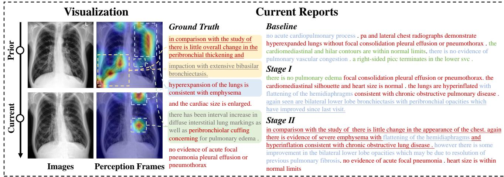  
Figure 3. Case study. On the left part, we connect the attention areas of the perception frames to the corresponding sentences in the GT report. On the right part, the red, blue, and green fonts respectively indicate statements that are consistent with, absent from, and conflicting with GT. Besides, the underlined sentences describe progression and change.

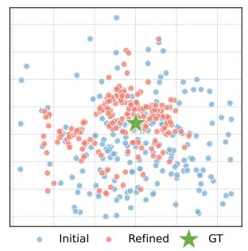  
(a)

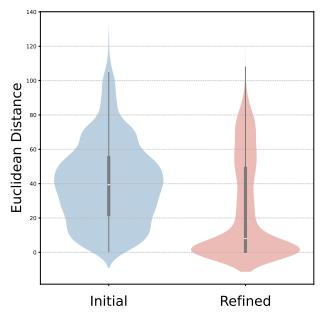  
(b)  
Figure 4. Visualization of report embeddings before and after mutual refinement. (a) t-SNE of embedding pairs. (b) Distribution of distance between GT and generated report embeddings.

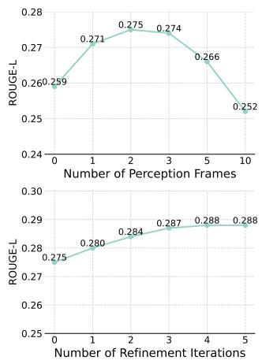

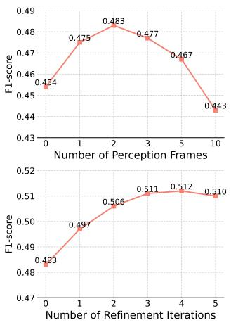  
Figure 6. Hyper-parameter Analysis. (Above) Performance with different numbers of perception frames. (Below) Results after different numbers of refinement iterations.

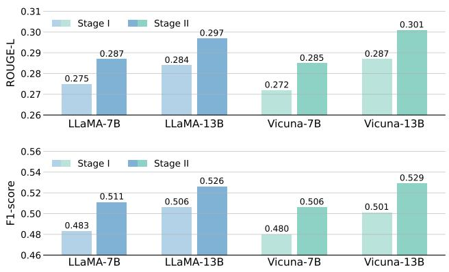  
Figure 5. Comparision between different LLMs.

Number of Refinement Iterations. We analyze the impact of refinement iterations in Stage II as shown in Fig. 6. Performance improves steadily from one to three iterations, while additional iterations yield little gain, indicating that three iterations balance effectiveness and efficiency.

## 5. Conclusion

In this paper, we presented TIM, a novel framework for LRRG task. TIM decouples dynamic progression modeling from static pathological recognition and generates dualtimepoint reports to accurately capture temporal evolution. With mutual refinement, TIM effectively captures disease evolution and significantly mitigates diagnostic bias. Extensive experiments demonstrate that TIM achieves stateof-the-art results across NLG and CE metrics.

## Acknowledgments.

This project is supported by the National Key Research and Development Program of China (Grant No.2024YFE0217700), the National Natural Science Foundation of China (Grant No.62472184 and No.62122029), and the Fundamental Research Funds for the Central Universities.

## References

[1] Peter Anderson, Xiaodong He, Chris Buehler, Damien Teney, Mark Johnson, Stephen Gould, and Lei Zhang. Bottom-up and top-down attention for image captioning and visual question answering. In Proceedings ofthe IEEE Conference on Computer Vision and Pattern Recognition, pages 6077–6086, 2018. 2

[2] Satanjeev Banerjee and Alon Lavie. METEOR: An automatic metric for MT evaluation with improved correlation with human judgments. In Proceedings ofthe ACL Workshop on Intrinsic and Extrinsic Evaluation Measuresfor Machine Translation and/or Summarization, pages 65–72, 2005. 5

[3] Alexander A Bankier, Heber MacMahon, Thomas Colby, Pierre Alain Gevenois, Jin Mo Goo, Ann N. C. Leung, David A Lynch, Cornelia M Schaefer-Prokop, Noriyuki Tomiyama, William D Travis, Johny A Verschakelen, Charles S White, and David P Naidich. Fleischner society: Glossary of terms for thoracic imaging. Radiology, 310(2): e232558, 2024. 16

[4] Elisa Baratella, Cristina Marrocchio, Alessandro Marco Bozzato, Erik Roman-Pognuz, and Maria Assunta Cova. Chest x-ray in intensive care unit patients: What there is to know about thoracic devices. Diagnostic and Interventional Radiology, 27(5):633–638, 2021. 16

[5] Shenshen Bu, Taiji Li, Yuedong Yang, and Zhiming Dai. Instance-level expert knowledge and aggregate discriminative attention for radiology report generation. In Proceedings of the IEEE/CVF Conference on Computer Vision and Pattern Recognition, pages 14194–14204, 2024. 1, 2, 6

[6] Luciano Cardinale, Giovanni Volpicelli, Alessandro Lamorte, Jessica Martino, and Andrea Veltri. Revisiting signs, strengths and weaknesses of standard chest radiography in patients of acute dyspnea in the emergency department. Journal ofthoracic disease, 4(4):398–407, 2012. 16

[7] Zhihong Chen, Yan Song, Tsung-Hui Chang, and Xiang Wan. Generating radiology reports via memory-driven transformer. In Proceedings of the 2020 conference on empirical methods in natural language processing (EMNLP), pages 1439–1449, 2020. 1, 5, 6

[8] Zhihong Chen, Yaling Shen, Yan Song, and Xiang Wan. Cross-modal memory networks for radiology report generation. In Proceedings of the 59th annual meeting of the association for computational linguistics and the 11th international joint conference on natural language processing (volume 1: long papers), pages 5904–5914, 2021. 1, 5, 6

[9] Marcella Cornia, Matteo Stefanini, Lorenzo Baraldi, and Rita Cucchiara. Meshed-memory transformer for image captioning. In Proceedings of the IEEE/CVF Conference on

Computer Vision and Pattern Recognition, pages 10578– 10587, 2020. 2

[10] Joshua Dilday and Elliott R Haut. Rib fractures - patient edu cation series: Understanding trauma and emergency surgery conditions. Trauma Surgery & Acute Care Open, 9(1): e001622, 2024. 16

[11] Yiheng Dong, Yi Lin, and Xin Yang. Copa: Hierarchical concept prompting and aggregating network for explainable diagnosis. In International Conference on Medical Image Computing and Computer-Assisted Intervention, pages 67– 76. Springer, 2025. 1

[12] Edith Eisenhuber, Cornelia M Schaefer-Prokop, Helmut Prosch, and Wolfgang Schima. Bedside chest radiography. Respiratory Care, 57(3):427–443, 2012. 16

[13] Xiao Fang, Yi Lin, Dong Zhang, Kwang-Ting Cheng, and Hao Chen. Aligning medical images with general knowledge from large language models. In International Conference on Medical Image Computing and Computer-Assisted Intervention, pages 57–67. Springer, 2024. 2

[14] Degaga Wolde Feyisa, Yehualashet Megersa Ayano, Taye Girma Debelee, and Friedhelm Schwenker. Weak localization of radiographic manifestations in pulmonary tuberculosis from chest x-ray: A systematic review. Sensors, 23(15):6781, 2023. 16

[15] Wenjun Hou, Yi Cheng, Kaishuai Xu, Heng Li, Yan Hu, Wenjie Li, and Jiang Liu. RADAR: Enhancing Radiology Report Generation with Supplementary Knowledge Injec tion. arXiv preprint arXiv:2505.14318, 2025. 1, 2, 6

[16] Tim B Hunter, Mihra S Taljanovic, Pei H Tsau, William G Berger, and James R Standen. Medical devices of the chest. Radiographics, 24(6):1725–1746, 2004. 16

[17] Jeremy Irvin, Pranav Rajpurkar, Michael Ko, Yifan Yu, Silviana Ciurea-Ilcus, Chris Chute, Henrik Marklund, Behzad Haghgoo, Robyn Ball, Katie Shpanskaya, et al. Chexpert: A large chest radiograph dataset with uncertainty labels and expert comparison. In Proceedings of the AAAI conference on artificial intelligence, pages 590–597, 2019. 3, 4, 5

[18] Jiayi Ji, Yunpeng Luo, Xiaoshuai Sun, Fuhai Chen, Gen Luo, Yongjian Wu, Yue Gao, and Rongrong Ji. Improving image captioning by leveraging intra-and inter-layer global representation in transformer network. In Proceedings ofthe AAAI conference on artificial intelligence, pages 1655–1663, 2021. 1, 2

[19] Haibo Jin, Haoxuan Che, Yi Lin, and Hao Chen. Promptmrg: Diagnosis-driven prompts for medical report generation. In Proceedings of the AAAI Conference on Artificial Intelligence, pages 2607–2615, 2024. 1, 2, 5, 6

[20] Alistair EW Johnson, Tom J Pollard, Nathaniel R Greenbaum, Matthew P Lungren, Chih-ying Deng, Yifan Peng, Zhiyong Lu, Roger G Mark, Seth J Berkowitz, and Steven Horng. MIMIC-CXR-JPG, a large publicly available database of labeled chest radiographs. arXiv preprint arXiv:1901.07042, 2019. 1, 5

[21] Aviral Kumar, Vincent Zhuang, Rishabh Agarwal, Yi Su, John D Co-Reyes, Avi Singh, Kate Baumli, Shariq Iqbal, Colton Bishop, Rebecca Roelofs, et al. Training language models to self-correct via reinforcement learning. arXiv preprint arXiv:2409.12917, 2024. 2

[22] Junnan Li, Dongxu Li, Silvio Savarese, and Steven Hoi. Blip-2: Bootstrapping language-image pre-training with frozen image encoders and large language models. In International conference on machine learning, pages 19730– 19742. PMLR, 2023. 1

[23] Mingjie Li, Bingqian Lin, Zicong Chen, Haokun Lin, Xiaodan Liang, and Xiaojun Chang. Dynamic graph enhanced contrastive learning for chest x-ray report generation. In Proceedings of the IEEE/CVF Conference on Computer Vision and Pattern Recognition, pages 3334–3343, 2023. 1

[24] Chin-Yew Lin. Rouge: A package for automatic evaluation of summaries. In Text Summarization Branches Out, pages 74–81, 2004. 5

[25] Yi Lin, Xiao Fang, Dong Zhang, Kwang-Ting Cheng, and Hao Chen. Boosting convolution with efficient mlppermutation for volumetric medical image segmentation. IEEE Transactions on Medical Imaging, 44(5):2341–2352, 2025. 2

[26] Fenglin Liu, Xian Wu, Shen Ge, Wei Fan, and Yuexian Zou. Exploring and distilling posterior and prior knowledge for radiology report generation. In Proceedings of the IEEE/CVF Conference on Computer Vision and Pattern Recognition, pages 13753–13762, 2021. 2

[27] Haotian Liu, Chunyuan Li, Qingyang Wu, and Yong Jae Lee. Visual instruction tuning. Advances in Neural Information Processing Systems, 36:34892–34916, 2023. 1

[28] Kang Liu, Zhuoqi Ma, Xiaolu Kang, Yunan Li, Kun Xie, Zhicheng Jiao, and Qiguang Miao. Enhanced contrastive learning with multi-view longitudinal data for chest x-ray report generation. In Proceedings of the Computer Vision and Pattern Recognition Conference, pages 10348–10359, 2025. 1, 6

[29] Tengfei Liu, Jiapu Wang, Yongli Hu, Mingjie Li, Junfei Yi, Xiaojun Chang, Junbin Gao, and Baocai Yin. HC-LLM: Historical-constrained large language models for radiology report generation. In Proceedings of the AAAI Conference on Artificial Intelligence, pages 5595–5603, 2025. 1, 2, 6

[30] Ze Liu, Yutong Lin, Yue Cao, Han Hu, Yixuan Wei, Zheng Zhang, Stephen Lin, and Baining Guo. Swin transformer: Hierarchical vision transformer using shifted windows. In Proceedings of the IEEE/CVF International Conference on Computer Vision, pages 10012–10022, 2021. 5

[31] Aman Madaan, Niket Tandon, Prakhar Gupta, Skyler Hallinan, Luyu Gao, Sarah Wiegreffe, Uri Alon, Nouha Dziri, Shrimai Prabhumoye, Yiming Yang, et al. Self-refine: Iterative refinement with self-feedback. Advances in Neural Information Processing Systems, 36:46534–46594, 2023. 2

[32] Potsawee Manakul, Adian Liusie, and Mark Gales. Selfcheckgpt: Zero-resource black-box hallucination detection for generative large language models. In Proceedings of the 2023 Conference on Empirical Methods in Natural Language Processing, pages 9004–9017, 2023. 2

[33] Bolin Ni, Houwen Peng, Minghao Chen, Songyang Zhang, Gaofeng Meng, Jianlong Fu, Shiming Xiang, and Haibin Ling. Expanding Language-Image Pretrained Models for General Video Recognition. In European Conference on Computer Vision, 2022. 5

[34] Aaron Nicolson, Jason Dowling, Douglas Anderson, and Bevan Koopman. Longitudinal data and a semantic similarity reward for chest X-ray report generation. Informatics in Medicine Unlocked, 50:101585, 2024. 1, 2

[35] Yingwei Pan, Ting Yao, Yehao Li, and Tao Mei. X-linear attention networks for image captioning. In Proceedings of the IEEE/CVF Conference on Computer Vision and Pattern Recognition, pages 10971–10980, 2020. 2

[36] Kishore Papineni, Salim Roukos, Todd Ward, and Wei-Jing Zhu. Bleu: a method for automatic evaluation of machine translation. In Proceedings of the 40th Annual Meeting of the Association for Computational Linguistics, pages 311– 318, 2002. 5

[37] Sang-Jun Park, Keun-Soo Heo, Dong-Hee Shin, Young-Han Son, Ji-Hye Oh, and Tae-Eui Kam. DART: Disease-aware Image-Text Alignment and Self-correcting Re-alignment for Trustworthy Radiology Report Generation. In Proceedings of the IEEE/CVF Conference on Computer Vision and Pat tern Recognition, pages 15580–15589, 2025. 1, 2

[38] Alec Radford, Jong Wook Kim, Chris Hallacy, Aditya Ramesh, Gabriel Goh, Sandhini Agarwal, Girish Sastry, Amanda Askell, Pamela Mishkin, Jack Clark, et al. Learn ing transferable visual models from natural language supervision. In International Conference on Machine Learning, pages 8748–8763. PmLR, 2021. 5

[39] Melissa L. Rosado-de Christenson and Jeffrey S. Klein. A Systematic Approach to Chest Radiographic Diagnosis, pages 94–100. Springer Milan, Milano, 2015. 16

[40] Dominika Siwik, Wojciech Apanasiewicz, Małgorzata Zukowska, Grzegorz Jaczewski, and Marta D ˛abrowska. Di-˙ agnosing lung abnormalities related to heart failure in chest radiogram, lung ultrasound and thoracic computed tomography. Advances in Respiratory Medicine, 91(2):103–122, 2023. 16

[41] Tim Tanida, Philip Müller, Georgios Kaissis, and Daniel Rueckert. Interactive and explainable region-guided radiology report generation. In Proceedings of the IEEE/CVF Conference on Computer Vision and Pattern Recognition, pages 7433–7442, 2023. 2

[42] Hugo Touvron, Louis Martin, Kevin Stone, Peter Albert, Amjad Almahairi, Yasmine Babaei, Nikolay Bashlykov, Soumya Batra, Prajjwal Bhargava, Shruti Bhosale, et al. Llama 2: Open foundation and fine-tuned chat models. arXiv preprint arXiv:2307.09288, 2023. 5

[43] Fuat Türk and Yunus Kökver. Detection of lung opacity and treatment planning with three-channel fusion cnn model. Arabian Journal for Science and Engineering, pages 1–13, 2023. 16

[44] Oriol Vinyals, Alexander Toshev, Samy Bengio, and Dumitru Erhan. Show and tell: A neural image caption generator. In Proceedings ofthe IEEE Conference on Computer Vision and Pattern Recognition, pages 3156–3164, 2015. 1, 2

[45] Fuying Wang, Shenghui Du, and Lequan Yu. Hergen: Ele vating radiology report generation with longitudinal data. In European Conference on Computer Vision, pages 183–200. Springer, 2024. 1, 2, 6

[46] Zifeng Wang, Zhenbang Wu, Dinesh Agarwal, and Jimeng Sun. Medclip: Contrastive learning from unpaired medical images and text. In Proceedings of the 2022 Conference on Empirical Methods in Natural Language Processing, pages 3876–3887, 2022. 2

[47] Zhanyu Wang, Lingqiao Liu, Lei Wang, and Luping Zhou. R2gengpt: Radiology report generation with frozen llms. Meta-Radiology, 1(3):100033, 2023. 1, 6

[48] Zhuhao Wang, Yihua Sun, Zihan Li, Xuan Yang, Fang Chen, and Hongen Liao. Llm-rg4: Flexible and factual radiology report generation across diverse input contexts. In Proceedings of the AAAI Conference on Artificial Intelligence, pages 8250–8258, 2025. 6

[49] Sean Welleck, Ximing Lu, Peter West, Faeze Brahman, Tianxiao Shen, Daniel Khashabi, and Yejin Choi. Generating sequences by learning to self-correct. arXiv preprint arXiv:2211.00053, 2022. 2

[50] ZhiPeng Xiang, ShaoGuo Cui, CaoZhi Shang, Jingfeng Jiang, and Liqiang Zhang. Gmod: Graph-driven momentum distillation framework with active perception of disease severity for radiology report generation. In International Conference on Medical Image Computing and Computer-Assisted Intervention, pages 295–305. Springer, 2024. 1, 6

[51] Kelvin Xu, Jimmy Ba, Ryan Kiros, Kyunghyun Cho, Aaron Courville, Ruslan Salakhudinov, Rich Zemel, and Yoshua Bengio. Show, attend and tell: Neural image caption generation with visual attention. In International conference on machine learning, pages 2048–2057. PMLR, 2015. 2

[52] An Yang, Anfeng Li, Baosong Yang, Beichen Zhang, Binyuan Hui, Bo Zheng, Bowen Yu, Chang Gao, Chengen Huang, Chenxu Lv, et al. Qwen3 technical report. arXiv preprint arXiv:2505.09388, 2025. 5

[53] Yan Yang, Xiaoxing You, Ke Zhang, Zhenqi Fu, Xianyun Wang, Jiajun Ding, Jiamei Sun, Zhou Yu, Qingming Huang, Weidong Han, et al. Spatio-Temporal and Retrieval-Augmented Modeling for Chest X-Ray Report Generation. IEEE Transactions on Medical Imaging, 2025. 1, 6

[54] Hannah Yun, Junyeong Maeng, Eunsong Kang, and Heung-Il Suk. Diff-rrg: Longitudinal disease-wise patch difference as guidance for llm-based radiology report generation. In International Conference on Medical Image Computing and Computer-Assisted Intervention, pages 152–161. Springer, 2025. 2, 6

[55] Qingqing Zhu, Tejas Sudharshan Mathai, Pritam Mukherjee, Yifan Peng, Ronald M Summers, and Zhiyong Lu. Utilizing longitudinal chest x-rays and reports to pre-fill radiology reports. In International Conference on Medical Image Computing and Computer-Assisted Intervention, pages 189–198. Springer, 2023. 1, 2, 5, 6

# TIM: Temporal Decoupling with Iterative Mutual-Refinement Model for Longitudinal Radiology Report Generation

Supplementary Material

## A. More Hyperparameter Analysis

To further investigate the impact of hyperparameters besides the number of perception frames and the number of refinement iterations, we conducted a comparison study on four variables: the static pathological alignment weight $\lambda _ { 1 }$ (cf. Eq. (8)), the dynamic progression alignment weight $\lambda _ { 2 }$ (cf. Eq. (8)), the refinement scaling factor $\beta$ (cf. Eq. (11)), and the refinement loss weight $\lambda _ { \Delta }$ (cf. Eq. (12)). The experimental setup follows the dataset split in Sec. 4.1 and the implementation details in Sec. 4.2. Model performance is evaluated using ROUGE-L and F1-score to measure textual fidelity and clinical accuracy.

As illustrated in Fig. 7, we vary $\lambda _ { 1 } \in$ $\{ 0 , 0 . 1 , 0 . 5 , 1 . 0 , 2 . 0 , 5 . 0 \}$ and $\lambda _ { 2 } \in \{ 0 , 0 . 0 1 , 0 . 1 , 0 . 5 , 1 . 0 \}$ to study their respective roles in static pathology modeling and dynamic progression alignment. $\lambda _ { 1 } ~ = ~ 0 . 5$ achieves the best balance between language quality and pathology description accuracy, while $\lambda _ { 2 } ~ = ~ 0 . 1$ provides optimal temporal evolution modeling. Values of $\lambda _ { 1 } \in [ 0 . 1 , 1 . 0 ]$ and $\lambda _ { 2 } ~ \in ~ [ 0 . 0 1 , 0 . 5 ]$ yield relatively strong results, indicating the robustness of our method to moderate variations. Performance deteriorates for extreme settings, where overly small weights weaken the corresponding module contributions, while overly large weights introduce excessive alignment constraints that hinder generation quality.

For the Stage II refinement hyperparameters , we investigate $\beta \in \{ 1 , 2 , 5 , 1 0 , 1 5 \}$ and $\lambda _ { \Delta } \in \{ 0 . 0 1 , 0 . 1 , 0 . 5 , 1 . 0 \}$ in Fig. 8. The scaling factor $\beta$ regulates the sensitivity of the sigmoid function to similarity differences, effectively controlling the sharpness of the refinement loss. The model achieves its best performance at $\beta = 5 ,$ , while values within the range $\beta \in [ 2 , 1 0 ]$ also perform well. Extremely large values destabilize optimization, while smaller values diminish the corrective signal. The refinement loss weight $\lambda _ { \Delta }$ adjusts the trade-off between the refinement objective and the autoregressive generation loss. We observe that $\lambda _ { \Delta } ~ = ~ 0 . 1$ provides the optimal balance, with values in $\lambda _ { \Delta } \in [ 0 . 0 1 , 0 . 5 ]$ maintaining competitive performance.

Overall, the stable performance across broad hyperparameter ranges suggests that our model is not overly sensitive to parameter tuning, making the configuration process straightforward in practice.

## B. Evaluation of Spatiotemporal Consistency

Beyond report-level metrics, we quantitatively evaluate spatiotemporal consistency by extracting medical condition labels from predicted and ground-truth prior/current reports with CheXbert and deriving progression states (stable, worsening, improving) based on label transitions. As shown in Table. 4, we observe that incorporating the dynamic progression modeling branch substantially improves progression F1 scores from 0.78 to 0.81, with further gains when dynamic-aware textual supervision and stage II mutual refinement are applied, whose F1-score reaches 0.84, demonstrating more accurate temporal reasoning.

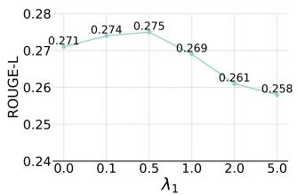  
(a)

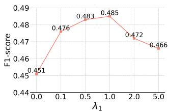  
(b)

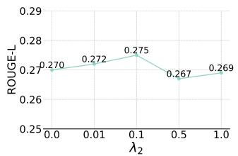  
(c)

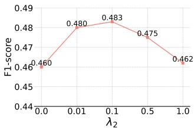  
(d)

Figure 7. Stage I hyperparameter analysis, including $\lambda _ { 1 }$ and λ2 in Eq. (8). (a) ROUGE-L of different $\lambda _ { 1 }$ values. (b) F1-score of different $\lambda _ { 1 }$ values. (c) ROUGE-L of different $\lambda _ { 2 }$ values. (d) F1 of different $\lambda _ { 2 }$ values.  
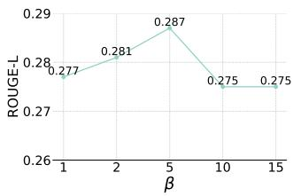  
(a)

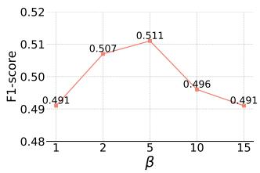  
(b)

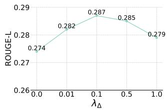

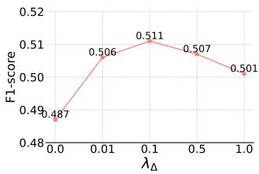  
(c)  
(d)  
Figure 8. Stage II hyperparameter analysis, including β in Eq. (11) and $\lambda _ { \Delta }$ in Eq. (12). (a) ROUGE-L of different $\beta$ values. (b) F1-score of different $\beta$ values. (c) ROUGE-L of different $\lambda _ { \Delta }$ values. (d) F1 of different $\lambda _ { \Delta }$ values.

Table 4. Evaluation of Spatiotemporal Consistency, conducting an ablation study on the components related to dynamic modeling.
<table><tr><td rowspan="2">Model</td><td colspan="4">F1-score</td></tr><tr><td>Stable</td><td>Worsening</td><td>Improving</td><td>Avg.</td></tr><tr><td>TIM w/o Progression Branch</td><td>0.85</td><td>0.30</td><td>0.52</td><td>0.78</td></tr><tr><td>TIM w/o Progression Loss</td><td>0.89</td><td>0.31</td><td>0.58</td><td>0.81</td></tr><tr><td>TIM-stage I</td><td>0.89</td><td>0.33</td><td>0.61</td><td>0.82</td></tr><tr><td>TIM-stage II</td><td>0.91</td><td>0.35</td><td>0.65</td><td>0.84</td></tr></table>

## C. Example of Prompts for LLM Input

In both Stage I and Stage II, the LLM receives a textual prompt that guides the report generation process. Each prompt specifies the model’s role as a radiologist, outlines the task and the expected input-output behavior, and indicates the temporal context of the report (i.e., prior or current examination). Below, we provide examples of the prompts used in two stages. The symbol “[·]” denotes the corresponding embedding inputs:

## Stage I Input Prompts

<s> User: Progression: [progression]. Prior report: [Context]. Image: [Image]. You are a radiologist. Please generate a radiology report for the provided current chest X-ray image, using the visual findings from the image, the text of the previous report, and the progression between current and prior images. Assistant:

## Stage II Input Prompts

<s> User: You are a radiologist. You have already written reports for the current and previous chest Xray images of a patient, but there might be some issues in those reports. Current image: [Image]. Your report: [Report]. The following pathology was not consistent with the actual report in the generation of your previous report: [Diff]. Please pay special attention to these errors and regenerate an accurate report. Assistant:

## D. Examples of Clinical Descriptions of Medical Conditions

As demonstrated in Section 3.2.1, to couple pathological features with clinical semantics, we expand each medical condition into a clinical description using external medical knowledge sources such as UMLS and PubMed. Each description summarizes the characteristic radiographic manifestation of the disease on chest radiographs and follows a standardized template in the form of “{condition} on chest x-ray refers to ...” to ensure consistent linguistic structure across disease categories. This formulation preserves key clinical terminology (e.g., opacity, cardiomegaly, air bronchogram) while maintaining concise semantics suitable for vision–language alignment. Table 5 presents representative examples of these disease-aware textual descriptions.

## E. Case Studies

To further illustrate the effectiveness of our proposed TIM, we present four case studies. Each case compares model outputs from both Stage I and II with the ground truth reports, shows the predicted observations, and reports the ROUGE-L score for each output. The 14 observation categories are {enlarged cardiomediastinum, cardiomegaly, lung opacity, lung lesion, edema, consolidation, pneumonia, atelectasis, pneumothorax, pleural effusion, pleural other, fracture, support devices, no finding}. The label codes 0, 1, 2, and 3 denote {not mentioned, positive, negative, uncertain}.

As shown in Figs. 9–11, these qualitative evaluations demonstrate how our method captures temporal disease progression and corrects cross-time inconsistencies. In the predicted reports, red and green fonts indicate statements that are consistent with and conflicting with the ground truth, respectively. Blue numbers in the predicted observations mark classification errors.

Case 1 is shown in Fig. 9. For the prior exam, both the ground truth and Stage I agree that the endotracheal tubes are removed, and no pneumothorax is present. Stage II preserves these correct findings, but also introduces a left chest tube that is not described in the prior ground truth. For the current exam, Stage I incorrectly omits the right IJ catheter described in the ground truth and reports removal of the chest tube, which contradicts the ground truth. Stage II corrects most of these errors for the current study: it restores the presence and stability of the left retrocardiac opacity, explicitly reports bilateral small pleural effusions and mild pulmonary vascular congestion, and states that heart size is mildly enlarged but stable, all consistent with the ground truth.

Case 2 is shown in Fig. 10. For the prior examination, Stage I correctly reports increased bilateral pulmonary opacities and cardiomegaly but omitted the newly developed small right pleural effusion described in the ground truth. Stage II recovers the pleural effusion and preserves the finding of unchanged cardiomegaly. For the current examination, Stage I captures worsening bilateral opacities and stable cardiomegaly, but again misses the small right pleural effusion and provides a slightly different endotra-

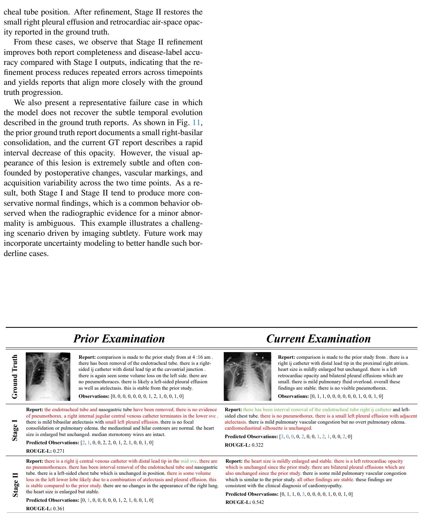  
Figure 9. Specific Case Study 1. Red and green fonts indicate statements that are consistent with and conflicting with the ground truth, respectively. Blue numbers in the predicted observations mark classification errors.

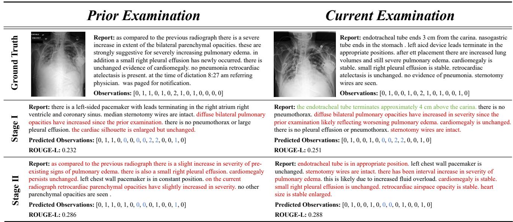

Figure 10. Specific Case Study 2. Red and green fonts indicate statements that are consistent with and conflicting with the ground truth, respectively. Blue numbers in the predicted observations mark classification errors.  
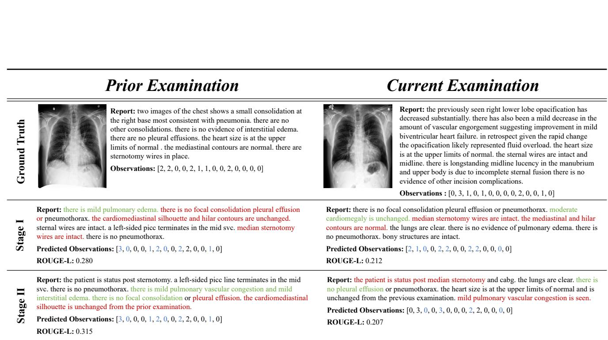  
Figure 11. Specific Case Study 3. Red and green fonts indicate statements that are consistent with and conflicting with the ground truth, respectively. Blue numbers in the predicted observations mark classification errors.

Table 5. Examples of clinical descriptions used for disease-aware text construction.
<table><tr><td>Medical Condition</td><td>Source Literature</td><td>Annotation Prompt</td></tr><tr><td>Enlarged Cardio- mediastinum</td><td>Klein et al. [39]</td><td>Enlarged cardiomediastinum on chest x-ray refers to the widening or ab- normal enlargement of the combined cardiac and mediastinal contours on chest radiography.</td></tr><tr><td>Cardiomegaly</td><td>Siwik et al. [40] Cardinale et al. [6]</td><td>Cardiomegaly on chest x-ray refers to an abnormally enlarged cardiac silhouette, typically identified when the cardiac-thoracic ratio (CTR) ex- ceeds 0.5, meaning the heart width occupies more than half of the tho- racic cage width.</td></tr><tr><td>Lung Opacity</td><td>Turk et al. [43]</td><td>Lung opacity on chest x-ray refers to an area in the normally dark lung that appears whiter, hazy, or denser due to increased tissue density from the replacement of air by substances such as fluid, fibrosis, or other ma- terial.</td></tr><tr><td>Lung Lesion</td><td>Feyisa et al. [14]</td><td>Lung lesion on chest x-ray refers to pulmonary lesions presenting as localized nodules, masses, or cavitary abnormalities within the lung parenchyma, often associated with structural distortion of surrounding lung tissue.</td></tr><tr><td>Edema</td><td>Siwik et al. [40]</td><td>Pulmonary edema on chest x-ray refers to interstitial or alveolar fluid accumulation, often producing distortion in the hilar image, thickening of interlobar or interlobular fissures, and bilateral higher density opacities in central and basal lung areas.</td></tr><tr><td>Consolidation</td><td>Bankier et al. [3] Cardinale et al. [6]</td><td>Consolidation on chest x-ray refers to a homogeneous increase in atten- uation caused by alveolar filling with fluid, pus, blood, or cells, resulting in homogeneous opacification of the lung parenchyma on radiographs, often accompanied by air bronchograms.</td></tr><tr><td>Pneumonia</td><td>Bankier et al. [3]</td><td>Pneumonia on chest x-ray refers to infection-related lung abnormalities that manifest as opacity, potentially accompanied by air bronchograms (air bronchogram), tree-in-bud opacities, or pleural effusions (pleural ef- fusion).</td></tr><tr><td>Atelectasis</td><td>Klein et al. [39]</td><td>Atelectasis on chest x-ray refers to partial or complete collapse of lung tissue leading to volume loss, increased density on radiographs, and dis- placement of adjacent structures such as fissures or mediastinum.</td></tr><tr><td>Pneumothorax</td><td>Bankier et al. [3]</td><td>Pneumothorax on chest x-ray refers to the presence of pleural air typ- ically identified on upright chest radiographs by a curvilinear visceral pleural line indicating the demarcation between pleural air and aerated lung.</td></tr><tr><td>Pleural Effusion</td><td>Bankier et al. [3]</td><td>Pleural effusion on chest x-ray refers to accumulation of fluid in the pleural space where small pleural effusions manifest as blunting of the costophrenic angles, often meniscus-shaped, and larger effusions as ho- mogeneous opacities in dependent regions.</td></tr><tr><td>Pleural Other</td><td>Bankier et al. [3] Eisenhuber et al. [12]</td><td>Pleural other on chest x-ray refers to other pleural abnormalities present- ing as pleural thickening, plaques, or irregular pleural contours, some- times associated with calcifications or localized pleural masses.</td></tr><tr><td>Fracture</td><td>Dilday et al. [10]</td><td>Fracture on chest x-ray refers to rib fractures appearing as cortical discon- tinuities or step deformities along the rib contour and may be associated with complications such as pneumothorax or hemothorax.</td></tr><tr><td>Support Devices</td><td>Hunter et al. [16] Baratella et al. [4]</td><td>Support devices on chest x-ray refers to medical support devices such as endotracheal tubes, central venous catheters, pacemaker leads, and thoracostomy tubes appearing as radiopaque linear or tubular structures used to confirm correct positioning and detect potential complications.</td></tr></table>