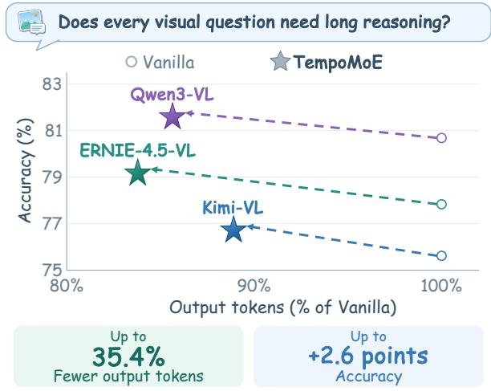
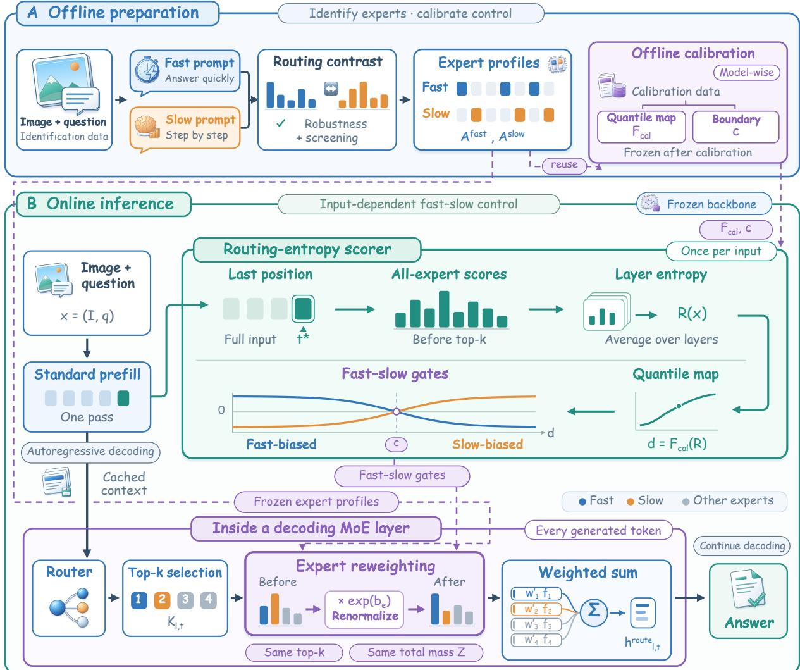
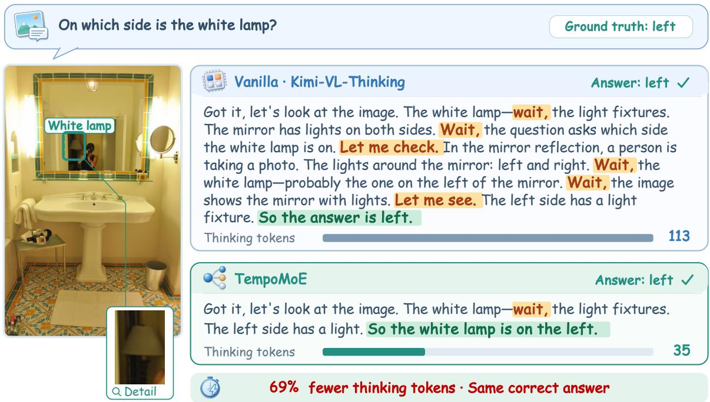

# TempoMoE: Identifying and Steering Fast–Slow Thinking Experts for Efficient Multimodal Reasoning

Xiyue Zhang1 Keru Zhou2 Ziyi Wang1 Bing Hu1 Li Wang3 1Zhejiang University 2Tsinghua University 3Wenzhou Business College

## Abstract

Multimodal Mixture-of-Experts (MoE) reasoning models rely on long chain-of-thought (CoT) for complex tasks, yet often overthink easy inputs, increasing token cost and latency, and sometimes degrading accuracy. Existing methods optimize reasoning length during training or impose external control at inference, but leave the underlying reasoning mechanism a black box. We find that fast and slow thinking exhibit distinct expert-routing patterns: holding the input fixed and varying only the prompted reasoning tempo produces stable routing shifts. Suppressing slow-thinking experts shortens the reasoning chain, whereas suppressing fastthinking experts lengthens it, providing causal evidence that these experts influence reasoning depth. Based on this finding, we propose TempoMoE, a training-free, two-stage framework. It identifies fast- and slow-thinking experts via tempo-contrastive routing analysis and redistributes routing weights within the origi nal top-k set according to sample difficulty. It amplifies fast-thinking experts and suppresses slow-thinking experts on easy inputs and reverses this adjustment on hard ones, enabling difficulty-adaptive control over reasoning depth. We evaluate TempoMoE on Kimi-VL, Qwen3- VL, and ERNIE-4.5-VL across six benchmarks. Compared with Vanilla, TempoMoE consistently improves accuracy while reducing output tokens, with accuracy gains of up to 2.6 points and token reductions of up to 35.4%.

## 1 Introduction

Large reasoning models rely on chain-of-thought (CoT) reasoning to solve complex tasks (Wei et al., 2022). Yet the required reasoning effort varies substantially across inputs. In multimodal tasks, object recognition and multi-step visual mathematics require different levels of computation. However, models may repeatedly verify simple perceptual judgments, increasing token cost and latency and potentially degrading answer quality through redundant reasoning and error accumulation (Chen et al., 2025; Sui et al., 2025). Matching computation to input demands is therefore important for efficient multimodal reasoning.

  
Figure 1: Average accuracy and output tokens over six benchmarks. Tokens are relative to Vanilla; bottom values show maximum gains.

Existing work mitigates overthinking by optimizing reasoning length during training or controlling generation at inference through prompting, token budgets, or decoding heuristics (Huang et al., 2024; Xiao and Gan, 2025; Diao et al., 2026; Huang et al., 2026a; Yang et al., 2026). The MoE architecture provides a natural entry point for controlling internal computational pathways. Its sparse router dispatches each token to a small subset of experts (Shazeer et al., 2017; Fedus et al., 2022), making expert selection and contributions observable and steerable. Prior work has demonstrated expert specialization and the value of targeted expert interventions (Wang et al., 2025b; Fayyaz et al., 2026; Hu et al., 2026). However, routing differences between fast and slow thinking for a fixed image and question, and their use for adaptive reasoning control, remain underexplored.

We first conduct a controlled comparison, holding the image and question fixed while varying only the prompted reasoning tempo. We observe stable routing differences during question processing and decoding. Targeted interventions further show that masking the identified slow experts shortens outputs, whereas masking fast experts lengthens them. These findings link expert routing to generation behavior and motivate inference-time expert steering.

Based on these findings, we propose Tempo-MoE, a training-free, two-stage framework. In the first stage, we identify fast-slow experts through routing comparisons, robustness screening, and intervention tests. In the second stage, TempoMoE estimates input difficulty using prefill routing entropy and continuously adjusts weights within the original top-k expert set. It favors fast experts on easy inputs and slow experts on hard inputs, without changing the selected expert set or updating model parameters.

We evaluate TempoMoE on three multimodal MoE reasoning models (Kimi-VL, Qwen3-VL, and ERNIE-4.5-VL) across six benchmarks, comparing it with Vanilla and four training-free baselines. Figure 1 summarizes average accuracy and token usage. Compared with Vanilla, TempoMoE improves accuracy while reducing output tokens in all 18 model–benchmark combinations, with accuracy gains of up to 2.6 points and token reductions of up to 35.4%.

Our contributions are threefold:

• To our knowledge, we are the first to uncover distinct fast- and slow-thinking experts in multimodal MoE reasoning models and provide intervention-based evidence that they influence reasoning depth through role-consistent interventions.

• We propose TempoMoE, a training-free, twostage framework that first identifies fast- and slow-thinking experts by contrasting their routing patterns across reasoning tempos, and then adaptively redistributes their routing weights within the original top-k set according to sample difficulty.

• We validate TempoMoE across three multimodal MoE reasoning models with distinct routing designs and six benchmarks, showing that it consistently improves accuracy while reducing output tokens.

## 2 Related Work

Efficient reasoning and overthinking mitigation. Long chain-of-thought can improve performance on complex tasks but often introduces redundant computation on easy inputs. Existing approaches broadly fall into training-based reasoning-budget optimization and inference-time control. Trainingbased methods learn concise or sample-adaptive reasoning through length optimization, reinforcement learning, adaptive CoT triggering, or budget prediction (Arora and Zanette, 2025; Aggarwal and Welleck, 2025; Lou et al., 2025; Wu et al., 2025; Li et al., 2025b). Inference-time methods reduce redundant generation through concise intermediate reasoning (Xu et al., 2025), prompt-based token budgets or budget forcing (Han et al., 2025; Muennighoff et al., 2025), confidence-based early exit (Yang et al., 2026; Fu et al., 2025), or suppression of reflection triggers (Huang et al., 2026a). These methods highlight the value of adapting computation to input difficulty but primarily control observable generation behaviors, including reasoning budgets, output length, and stopping time, without identifying the internal pathways that produce them.

Fast–slow reasoning in multimodal models. Fast–slow reasoning has received less attention in multimodal models than in the text-only setting. FAST-GRPO (Xiao and Gan, 2025), Dual-MindVLM (Lin et al., 2025), and GPRO (Diao et al., 2026) adapt the reasoning effort of vision– language models through difficulty-aware training, reasoning-mode selection, or branch routing. Metis-HOME (Lan et al., 2025) further incorporates fast–slow reasoning into a trained multimodal MoE architecture. These methods typically rely on retraining or architectural changes and control reasoning through sample-level decisions, discrete modes, or separate branches. They do not explicitly identify whether fast and slow reasoning correspond to distinct internal components.

Expert specialization and routing intervention in MoE. Mixture-of-Experts (MoE) architectures provide a natural setting for studying internal mechanisms because sparse routing exposes expert-level computation. They have been increasingly adopted in vision–language models to scale model capacity with limited active computation (Lin et al., 2026; Li et al., 2025a; Wu et al., 2024). Recent studies analyze routing patterns to characterize expert specialization across tasks, domains, languages, semantic content, safety properties, and cognitive effort (Lo et al., 2025; Olson et al., 2025; Hu et al., 2026; Bandarkar et al., 2026; Lai et al., 2025; Wang et al., 2025b). Other approaches manipulate MoE behavior through expert fine-tuning, activation or deactivation, test-time rerouting, and dynamic expert skipping (Wang et al., 2024; Fayyaz et al., 2026; Li et al., 2025c; Xu et al., 2026; Huang et al., 2026b). Fast–slow reasoning presents a different setting from task or domain specialization with explicit labels: the same model can exhibit distinct reasoning states for the same image and question. Tempo-MoE identifies experts associated with these states through controlled reasoning-tempo comparisons, validates their functional roles through targeted interventions, and uses them for difficulty-adaptive reasoning control.

## 3 Identifying Fast-Slow Experts

TempoMoE consists of two stages: offline expert identification and adaptive modulation during inference, as illustrated in Figure 2. In Stage 1, we identify fast-slow experts across MoE layers by contrasting routing patterns under paired prompts. In Stage 2, TempoMoE estimates input difficulty and performs soft reweighting within the original top-k expert set. This enables continuous modulation of reasoning effort without updating model parameters or changing the router’s expert selection.

## 3.1 MoE Routing and Intervention Design

MoE routing. For token t at layer l, the sparse router selects a top-k expert set $\kappa _ { l , t }$ and assigns a routing weight $w _ { l , t , e }$ to each selected expert. The output of the routed expert branch is

$$
h _ { l , t } ^ { \mathrm { r o u t e } } = \sum _ { e \in \mathcal { K } _ { l , t } } w _ { l , t , e } \cdot E _ { l , e } \big ( h _ { l , t } ^ { \mathrm { i n } } \big ) .\tag{1}
$$

Shared experts, when present, remain unchanged and are excluded from both expert identification and routing modulation.

Routing intervention design. We distinguish two intervention levels. In Stage 1, a selectionlevel intervention masks candidates before top-k selection to assess their effects on output length. In Stage 2, a weight-level intervention redistributes routing weights after top-k selection, preserving the original expert set $\kappa _ { l , t }$

## 3.2 Fast-Slow Expert Identification

Routing collection. To identify fast-slow experts, we keep the image and question fixed and use different prompts to elicit fast or slow thinking. Given a multimodal sample $x = ( I , q )$ , we construct fast and slow prompt sets $\mathcal { P } _ { f }$ and $\mathcal { P } _ { s }$ with the same answering objective. We then record the selected experts and routing weights at each MoE layer.

We use three fast prompts requesting direct answers without explicit reasoning and three slow prompts requesting step-by-step reasoning. For example, one pair begins with “Look at the image and answer the question directly” and “Carefully inspect the image and solve the question step by step,” respectively. All prompts specify the same final-answer format: Final answer: <answer>.

We divide the input and generated sequence into image, question, instruction, and decode segments. The instruction segment contains the tempo directive and is used only for diagnostic analysis. The image segment serves as a control because the visual input is identical under both conditions. Candidate identification uses routing differences in the question and decode segments.

Routing differences. Let $w _ { l , t , e } ( x , p )$ denote the routing weight of expert e at layer l for token t under prompt p. Its effective routing contribution is

$$
\gamma _ { l , e } ( t ; x , p ) = w _ { l , t , e } ( x , p ) \cdot { \bf 1 } [ e \in \mathcal { K } _ { l , t } ( x , p ) ] .\tag{2}
$$

For segment S, we average this contribution over its tokens, the identification set D, and prompt set $\mathcal { P } \colon$

$$
\begin{array} { r l r } {  { M _ { l , e } ^ { S } ( \mathcal { P } ) = \frac { 1 } { | \mathcal { D } | | \mathcal { P } | } \sum _ { x \in \mathcal { D } } \sum _ { p \in \mathcal { P } } } } \\ & { } & { \frac { 1 } { | \mathcal { T } _ { S } ( x , p ) | } \sum _ { t \in \mathcal { T } _ { S } ( x , p ) } \gamma _ { l , e } ( t ; x , p ) , } \end{array}\tag{3}
$$

where ${ \mathcal { T } } _ { S } ( x , p )$ denotes the tokens in segment $S .$ Length normalization prevents longer slowthinking outputs from receiving disproportionate weight. The routing difference is

$$
\Delta M _ { l , e } ^ { S } = M _ { l , e } ^ { S } ( \mathcal { P } _ { s } ) - M _ { l , e } ^ { S } ( \mathcal { P } _ { f } ) .\tag{4}
$$

Positive and negative values indicate preferences for slow and fast prompts, respectively.

Candidate selection. Let $y \in \{ + 1 , - 1 \}$ denote slow and fast thinking, respectively. Bootstrap stability $\pi _ { l , e } ^ { S , y }$ measures how often an expert appears among the leading candidates in direction y across resampled datasets. Prompt consistency $\rho _ { l , e } ^ { \bar { S } , y }$ measures the proportion of fast-slow prompt pairs that preserve this directional preference. We filter out experts with small routing differences or negligible average contributions and rank the remaining candidates by

  
Figure 2: Overview of TempoMoE. (A) Fast-slow experts are identified offline by contrasting routing patterns under paired prompts. (B) Prefill routing entropy determines fast-slow gates that reweight the original top-k experts during decoding, preserving the selected expert set, total routing mass, and all model parameters.

$$
\mathrm { S c o r e } _ { l , e } ^ { S , y } = \left( y \cdot \Delta M _ { l , e } ^ { S } \right) \cdot \pi _ { l , e } ^ { S , y } \cdot \rho _ { l , e } ^ { S , y } .\tag{5}
$$

Intervention screening. On the identification set, we mask each candidate before top-k selection and measure the resulting change in output length, including reasoning and final-answer tokens. A slow candidate is retained if masking it shortens the output, whereas a fast candidate is retained if masking it lengthens the output.

The retained candidates form the fast and slow expert sets $\mathcal { E } ^ { \mathrm { f a s t } }$ and ${ \mathcal { E } } ^ { \mathrm { s l o w } }$ . We normalize their ranking scores within each layer to [0, 1], yielding $A _ { l , e } ^ { \mathrm { f a s t } }$ and $A _ { l , e } ^ { \mathrm { s l o w } }$ for Stage 2. All other experts receive a profile score of zero. The expert sets and profiles are fixed before held-out validation and downstream evaluation.

## 4 Difficulty-Adaptive Expert Steering

Given the fast-slow expert profiles identified in Stage 1, TempoMoE estimates input difficulty before decoding and uses it to continuously modulate routing weights within the original top-k expert set.

Sample difficulty estimation. TempoMoE estimates input difficulty using routing entropy from the standard prefill pass. We collect routing scores at the last non-padding position of the complete input, which can attend to the full image and question. At each MoE layer, we normalize the native nonnegative routing scores before top-k selection to obtain a distribution $p _ { l , e } ( x )$ over all routed experts. Shared experts and correction biases used solely for expert selection are excluded. We then compute normalized entropy and average it across layers:

$$
R ( x ) = - \frac { 1 } { | \mathcal { L } | } \sum _ { l \in \mathcal { L } } \frac { 1 } { \log E _ { l } } \sum _ { e = 1 } ^ { E _ { l } } p _ { l , e } ( x ) \log p _ { l , e } ( x ) ,\tag{6}
$$

where $\mathcal { L }$ denotes the set of MoE layers with at least two routed experts, and $E _ { l }$ is the number of routed experts at layer l. Larger values of $R ( x )$ indicate more dispersed routing distributions.

For each model, we construct an empirical percentile mapping $F _ { \mathrm { c a l } }$ from routing entropy on its calibration set, yielding the difficulty score $d ( x ) =$ $F _ { \mathrm { c a l } } ( R ( x ) ) \in [ 0 , 1 ]$ . The mapping remains fixed throughout validation and testing. This score serves as a proxy for reasoning effort, not a probability of answer correctness.

Adaptive fast-slow modulation. We map the difficulty score to a continuous control signal centered at a boundary c:

$$
s ( x ) = \operatorname { t a n h } \left( \frac { d ( x ) - c } { \tau } \right) .\tag{7}
$$

The modulation coefficients for fast and slow experts are

$$
g _ { \mathrm { f a s t } } ( x ) = - g _ { \mathrm { m a x } } s ( x ) , \qquad g _ { \mathrm { s l o w } } ( x ) = g _ { \mathrm { m a x } } s ( x ) .\tag{8}
$$

Here, $c$ is the boundary between fast and slow modulation. Across all models we use $c = 0 . 5$ $\tau = 0 . 2 5$ , and $g _ { \mathrm { m a x } } ~ = ~ 1 . 0$ , select the top two experts per direction for each model, and apply reweighting only during decoding. The parameter $\tau > 0$ controls the transition sharpness around the boundary, while $g _ { \mathrm { m a x } } \ge 0$ determines the maximum modulation strength.

When $d ( x ) < c ,$ TempoMoE amplifies fast experts and suppresses slow experts; the direction is reversed when $d ( x ) > c$ . The modulation weakens near the boundary, and both coefficients vanish at $d ( x ) = c$ , leaving the original routing weights unchanged. Thus, the modulation varies continuously with input difficulty rather than switching between two discrete modes.

Soft reweighting within the top-k set. We combine the fast-slow gates with the expert profiles to obtain a bias for expert e at layer l for each input:

$$
b _ { l , e } ( x ) = g _ { \mathrm { f a s t } } ( x ) A _ { l , e } ^ { \mathrm { f a s t } } + g _ { \mathrm { s l o w } } ( x ) A _ { l , e } ^ { \mathrm { s l o w } } .\tag{9}
$$

For the expert set $\mathcal { K } _ { l , t }$ selected by the original router, TempoMoE applies this bias and renormalizes the weights within the set:

$$
w _ { l , t , e } ^ { \prime } = Z _ { l , t } \frac { w _ { l , t , e } \exp ( b _ { l , e } ( x ) ) } { \sum _ { j \in K _ { l , t } } w _ { l , t , j } \exp ( b _ { l , j } ( x ) ) } , \qquad e \in \mathcal { K } _ { l , t } ,\tag{10}
$$

where $w _ { l , t , e }$ is the original routing weight and $\begin{array} { r } { \sum _ { l , t } = \sum _ { j \in \mathcal { K } _ { l , t } } w _ { l , t , j } } \end{array}$ is the total routing mass before reweighting. This operation changes only the relative contributions of the selected experts, preserving both the expert set and its total routing mass. Experts not identified as fast or slow receive zero bias, and shared experts remain unchanged.

Online computational cost. The difficulty score is computed once per input during the standard prefill pass and remains fixed throughout decoding. This requires neither trial generation nor an additional model forward pass. Normalization and entropy calculation use FP32 and add $O ( \sum _ { l \in \mathcal { L } } E _ { l } )$ operations, plus one percentile mapping lookup. Reweighting is applied only during decoding. It adds $O ( k )$ scalar operations per routed MoE layer and generated token, with no additional expert feedforward computation.

## 5 Experiments

Experiments span three multimodal MoE reasoning models with distinct routing designs and six benchmarks covering a range of reasoning demands. We examine TempoMoE’s trade-off between accuracy and efficiency across models and tasks, with ablations isolating the contributions of expert identification, difficulty-adaptive modulation, and top-kpreserving soft reweighting.

## 5.1 Experimental Setup

Models. TempoMoE is evaluated on three multimodal MoE reasoning models: Kimi-VL-A3B-Thinking-2506 (Kimi Team, 2025), Qwen3-VL-30B-A3B-Thinking (Bai et al., 2025), and ERNIE-4.5-VL-28B-A3B-Thinking (Baidu ERNIE Team, 2025). Their differences in expert count, routing sparsity, and shared-expert design allow us to assess generalization across distinct MoE routing architectures. All experiments use the corresponding Thinking checkpoints with BF16 inference, while shared generation settings remain fixed across methods.

Benchmarks. The benchmark suite comprises six multimodal tasks spanning direct visual understanding to multi-step reasoning. OCRBench (Liu et al., 2024), RealWorldQA (xAI, 2024), and ChartQA (Masry et al., 2022) emphasize visual recognition and information extraction; MM-Star (Chen et al., 2024) jointly evaluates multimodal perception and reasoning; MathVista (Lu et al., 2024) targets visual mathematical reasoning, whereas MMMU (Yue et al., 2024) evaluates multidisciplinary knowledge and reasoning.

Baselines. We compare TempoMoE with Vanilla and four representative training-free baselines. No-Thinking (Ma et al., 2025) skips explicit thinking, TALE (Han et al., 2025) allocates an inputdependent reasoning budget, and NoWait (Wang et al., 2025a) suppresses redundant reflection during decoding. RICE (Wang et al., 2025b) identifies cognitive experts through associations between expert activations and thinking-related tokens. It amplifies their routing weights at inference time, providing a baseline for expert-level reasoning control.

Metrics. We report accuracy (Acc, %) and average output tokens (Tok), including both the reasoning segment and the final answer. Tok serves as a proxy for autoregressive generation cost. For difficulty-stratified analysis, we divide evaluation samples into Easy and Hard using the calibrationset median of d(x), without evaluation labels. This split is used only for analysis; online modulation still follows the continuous control signal centered at 0.5 in Equation (7).

## 5.2 Main Results

Expert identification. We use 600 samples (100 per benchmark) for expert identification and difficulty calibration. Each sample is run with three fastand three slow-thinking prompts, yielding 3,600 routing runs per model. A separate 600-sample set, disjoint from both the identification and main evaluation sets, is used for intervention validation under the standard Thinking prompt with Vanilla, fastexpert masking, and slow-expert masking. Table 1 reports the identification and intervention results.

Across all three models, masking fast-thinking experts increases output length, whereas masking slow-thinking experts shortens it. High bootstrap stability and prompt consistency further support robust expert identification and role-consistent intervention effects.

<table><tr><td>Model Experts</td><td></td><td>∆M Stab.</td><td>Cons.</td><td>∆Tok</td></tr><tr><td rowspan="2">Kimi</td><td>F: (8,6), (12,46)</td><td>-0.037 100</td><td></td><td>94-100 +37.1</td></tr><tr><td>S: (1,13), (8,37)</td><td>+0.041</td><td>100</td><td>100 -51.7</td></tr><tr><td rowspan="2">Qwen</td><td>F: (28,63), (33,49) −0.028</td><td></td><td>94</td><td>100 +32.1</td></tr><tr><td>S: (28,79), (40,79) +0.023</td><td></td><td>100</td><td>100 -45.1</td></tr><tr><td rowspan="2">ERNIE</td><td>F: (9,8), (8,57)</td><td>-0.027 100</td><td>100</td><td>+24.0 -30.9</td></tr><tr><td colspan="4">S: (18,19), (21,34) +0.024 98–100 94–100</td></tr></table>

Table 1: Identified fast/slow experts and held-out validation. F/S denote fast/slow experts; each pair denotes (layer, expert); ∆M is averaged over the two experts; Stab./Cons. are percentages; ∆Tok is the mean token change after joint masking.

Performance across models. Table 2 reports complete results for TempoMoE, Vanilla, and the four training-free baselines. Compared with Vanilla, TempoMoE improves accuracy while reducing output tokens in all 18 model–benchmark combinations. When macro-averaged over the six benchmarks, it outperforms Vanilla on both metrics for all three models. At the benchmark level, accuracy improves by up to 2.6 points and output tokens decrease by up to 35.4%.

Despite differences in expert count, top-k configuration, and shared-expert design, Kimi-VL, Qwen3-VL, and ERNIE-4.5-VL exhibit the same trend, indicating that the gains are not tied to a particular MoE routing architecture.

Baseline comparison. NoThinking, TALE, and NoWait mainly reduce computation by shortening, bypassing, or constraining the explicit reasoning process. When macro-averaged over the six benchmarks, NoThinking reduces output tokens by more than 60% for each model but lowers average accuracy by 4.0–9.4 points. TALE and NoWait are less aggressive, yet their average accuracy also remains below Vanilla.

Compared with RICE, TempoMoE achieves higher accuracy in all 18 settings. Across the three models, it improves macro-averaged accuracy by 2.5–3.9 points with comparable or lower macroaveraged output token counts. TempoMoE also improves both metrics over RICE in 10 of the 18 settings. For example, on MathVista with Qwen3- VL, TempoMoE improves accuracy from RICE’s 76.5% to 82.9% with similar output lengths. Compared with Vanilla, TempoMoE improves accuracy from 81.9% to 82.9% while reducing the average output from 1350.7 to 1172.9 tokens, demonstrating a favorable trade-off between accuracy and generation cost.

<table><tr><td rowspan="2">Method</td><td colspan="2">MMStar</td><td colspan="2">OCRBench</td><td colspan="2">RealWorldQA</td><td colspan="2">MathVista</td><td colspan="2">ChartQA</td><td colspan="2">MMMU</td></tr><tr><td>Acc↑</td><td>Tok↓</td><td>Acc↑</td><td>Tok↓</td><td>Acc↑</td><td>Tok↓</td><td>Acc↑</td><td>Tok↓</td><td>Acc↑</td><td>Tok↓</td><td>Acc↑</td><td>Tok↓</td></tr><tr><td>Kimi-VL-A3B-Thinking-2506</td><td colspan="14"></td></tr><tr><td>Vanilla</td><td>70.4</td><td>502.6</td><td>83.9</td><td>136.4</td><td>70.0</td><td>138.5</td><td>80.1</td><td>906.4</td><td>85.3</td><td>134.4</td><td>64.0</td><td>1934.8</td></tr><tr><td>NoThinking</td><td>66.1</td><td>174.8</td><td>81.7</td><td>60.1</td><td>66.8</td><td>3.4</td><td>74.2</td><td>670.2</td><td>84.5</td><td>36.1</td><td>56.4</td><td>398.4</td></tr><tr><td>TALE</td><td>65.6</td><td>457.5</td><td>74.6</td><td>119.6</td><td>67.8</td><td>127.2</td><td>74.9</td><td>836.3</td><td>80.9</td><td>122.0</td><td>60.8</td><td>1138.2</td></tr><tr><td>NoWait</td><td>67.7</td><td>456.1</td><td>85.9</td><td>98.5</td><td>70.0</td><td>89.9</td><td>75.3</td><td>700.3</td><td>85.0</td><td>99.6</td><td>62.2</td><td>1246.3</td></tr><tr><td>RICE</td><td>69.2</td><td>474.2</td><td>80.0</td><td>125.3</td><td>68.5</td><td>95.1</td><td>78.8</td><td>837.9</td><td>85.4</td><td>158.5</td><td>64.0</td><td>1835.2</td></tr><tr><td>TempoMoE</td><td>71.8</td><td>466.6</td><td>85.3</td><td>107.2</td><td>71.9</td><td>111.7</td><td>81.0</td><td>747.3</td><td>86.1</td><td>122.4</td><td>64.5</td><td>1781.6</td></tr><tr><td>Qwen3-VL-30B-A3B-Thinking</td><td colspan="14"></td></tr><tr><td colspan="14">Vanilla</td></tr><tr><td rowspan="6">NoThinking TALE NoWait</td><td>75.5</td><td>782.8</td><td>83.9</td><td>168.6</td><td>77.4</td><td>246.5</td><td>81.9</td><td>1350.7</td><td>89.4</td><td>181.6</td><td>76.0</td><td>1556.7</td></tr><tr><td>64.5</td><td>188.2</td><td>82.4</td><td>103.6</td><td>71.6</td><td>3.0</td><td>64.8</td><td>646.1</td><td>81.5</td><td>121.5</td><td>63.0</td><td>599.7</td></tr><tr><td>73.3</td><td>644.9</td><td>84.2</td><td>137.6</td><td>73.9</td><td>217.7</td><td>72.1</td><td>782.5</td><td>87.3</td><td>137.9</td><td>72.1</td><td>1049.5</td></tr><tr><td></td><td>73.3 543.1</td><td>83.7</td><td>122.3</td><td>73.6</td><td>144.3</td><td>64.8</td><td>877.9</td><td>87.1</td><td>133.9</td><td>71.3</td><td>1211.3</td></tr><tr><td>RICE</td><td>75.8 651.3</td><td>84.0</td><td>112.4</td><td>75.3</td><td>222.1</td><td>76.5</td><td>1137.4</td><td>84.0</td><td>165.8</td><td>71.0</td><td>1425.9</td></tr><tr><td>TempoMoE 76.2</td><td>729.4</td><td>85.5</td><td>130.0</td><td>78.2</td><td>236.8</td><td>82.9</td><td>1172.9</td><td>90.3</td><td>149.2</td><td>76.7</td><td>1253.4</td></tr><tr><td>ERNIE-4.5-VL-28B-A3B-Thinking</td><td colspan="14"></td></tr><tr><td>Vanilla</td><td>68.9</td><td>858.3</td><td>86.4</td><td>118.2</td><td>69.9</td><td>332.2</td><td>82.5</td><td>1576.1</td><td>87.1</td><td>156.0</td><td>72.2</td><td>2081.1</td></tr><tr><td>NoThinking</td><td>62.8</td><td>561.2</td><td>84.1</td><td>37.9</td><td>66.4</td><td>21.9</td><td>75.6</td><td>507.2</td><td>83.9</td><td>38.2</td><td>63.0</td><td>671.3</td></tr><tr><td>TALE</td><td>69.0</td><td>636.4</td><td>86.5</td><td>99.6</td><td>69.5</td><td>293.0</td><td>80.1</td><td>994.7</td><td>86.2</td><td>38.1</td><td>68.4</td><td>1320.6</td></tr><tr><td>NoWait</td><td>66.0</td><td>576.7</td><td>86.1</td><td>81.6</td><td>67.1</td><td>290.3</td><td>72.8</td><td>1218.2</td><td>89.6</td><td>125.6</td><td>65.7</td><td>1459.0</td></tr><tr><td>RICE</td><td>69.3</td><td>693.0</td><td>87.3</td><td>142.7</td><td>66.0</td><td>187.1</td><td>78.2</td><td>1347.5</td><td>87.0</td><td>151.4</td><td>69.4</td><td>1729.8</td></tr><tr><td>TempoMoE</td><td>69.7</td><td>671.8</td><td>89.0</td><td>76.4</td><td>71.3</td><td>263.5</td><td>83.3</td><td>1357.0</td><td>88.4</td><td>142.3</td><td>73.6</td><td>1780.9</td></tr></table>

Table 2: Main results comparing accuracy and output token usage across three multimodal MoE reasoning models and six benchmarks. Acc denotes answer accuracy (%), and Tok denotes the average number of tokens generated per sample, including all tokens in the reasoning process and the final answer.

Task analysis. The size of the efficiency gain varies by task. On OCRBench, which emphasizes visual perception and direct recognition, Tempo-MoE improves accuracy over Vanilla by 1.4–2.6 points and reduces output tokens by 21.4–35.4% across the three models. It also achieves higher accuracy than RICE on this benchmark for all three models.

On the more reasoning-intensive MathVista and MMMU, TempoMoE also improves both metrics over Vanilla. Across the six corresponding settings, accuracy increases by 0.5–1.4 points while output tokens decrease by 7.9–19.5%. Since the original outputs on these benchmarks are considerably longer, even moderate relative reductions yield meaningful absolute savings. On RealWorldQA, ChartQA, and MMStar, token reductions vary by model, while accuracy improves consistently over Vanilla.

Figure 3 illustrates this effect on a visual localization question. Vanilla repeatedly checks the white lamp’s location and describes surrounding details before reaching the correct answer. TempoMoE gives the same correct answer, “left,” while reducing thinking tokens from 113 to 35, a reduction of approximately 69%. This example illustrates how TempoMoE reduces repeated checking while preserving answer correctness.

## 5.3 Ablation Study

We conduct ablation studies to evaluate the contributions of expert identification, difficulty-adaptive modulation direction, and top-k-preserving soft reweighting. The results are reported in Table 3.

<table><tr><td rowspan="2">Method</td><td colspan="2">Accuracy (%) ↑</td><td colspan="3">Output Tokens ↓</td></tr><tr><td>Overall Easy Hard</td><td></td><td>Overall</td><td>Easy</td><td>Hard</td></tr><tr><td>Vanilla</td><td>75.6</td><td>80.2 64.5</td><td>625.5</td><td>282.6</td><td>1581.2</td></tr><tr><td>Random Experts</td><td>72.1</td><td>77.8 59.0</td><td>620.2</td><td></td><td>280.3 1510.2</td></tr><tr><td>Fixed-Fast</td><td>73.7</td><td>81.7 56.2</td><td>556.0</td><td></td><td>232.1 1408.8</td></tr><tr><td>Fixed-Slow</td><td>74.8</td><td>79.1 64.9</td><td>679.4</td><td></td><td>341.61464.6</td></tr><tr><td>Hard Mask</td><td>70.2</td><td>76.4 55.7</td><td>662.8</td><td>304.9</td><td>1600.0</td></tr><tr><td>TempoMoE</td><td>76.8</td><td>81.7 64.9</td><td>556.1</td><td></td><td>232.11464.6</td></tr></table>

Table 3: Ablation results on Kimi-VL-A3B-Thinking-2506, aggregated across six benchmarks. Easy and Hard use the difficulty split defined in Section 5.1.

Random Experts replaces the identified fast- and slow-thinking experts with the same number of randomly selected experts from the same layers, matched by routing usage, while retaining the same modulation rule. Fixed-Fast and Fixed-Slow retain the sample-dependent modulation magnitude but force the modulation direction toward fast or slow thinking, respectively, for all inputs. Hard Mask uses the same identified experts and difficultyconditioned direction but masks the target experts before top-k selection instead of softly reweighting them after selection.

  
Figure 3: Visual localization case with Kimi-VL-A3B-Thinking-2506. TempoMoE gives the same correct answer with 35 reasoning tokens instead of 113 (69% fewer).

Expert identification. Random Experts leaves the average output-token count nearly unchanged from Vanilla but substantially lowers overall accuracy. Compared with Random Experts, Tempo-MoE improves overall accuracy by 4.7 points and reduces the average output by 64.1 tokens. This shows that the gains of TempoMoE depend on the identified fast- and slow-thinking experts rather than generic routing perturbations.

Adaptive direction. Fixed-Fast matches TempoMoE on easy samples but lowers accuracy on hard samples by 8.7 points, whereas Fixed-Slow matches TempoMoE on hard samples but generates 109.5 more tokens on average on easy samples. Since both variants retain the sample-dependent modulation magnitude, these results isolate the effect of adapting the modulation direction. TempoMoE selects the direction according to sample difficulty, achieving the highest overall accuracy while reducing output tokens. A single global direction therefore cannot accommodate inputs with different reasoning demands.

Soft reweighting. Hard Mask underperforms Vanilla in accuracy and produces longer outputs, indicating that changing expert selection before top-k routing is overly disruptive. TempoMoE preserves the original expert set and redistributes routing weights, providing less disruptive control.

## 6 Conclusion

We present TempoMoE, a training-free, two-stage framework for identifying and modulating fastand slow-thinking experts in multimodal MoE reasoning models. Through controlled reasoningtempo comparisons, robustness screening, and roleconsistent interventions, we uncovered expert routing patterns associated with different reasoning tempos and demonstrated causal effects on output length, consistent with their tempo-associated roles. Building on these findings, TempoMoE performs difficulty-adaptive reweighting within the original top-k expert set, without updating model parameters or altering expert selection. Experiments across three models with distinct MoE routing designs and six benchmarks show that Tempo-MoE consistently improves the accuracy–efficiency trade-off, with accuracy gains of up to 2.6 points and output-token reductions of up to 35.4%. More broadly, our results show that expert-level routing mechanisms can serve not only as explanatory tools, but also as actionable control signals for efficient and adaptive multimodal reasoning.

## Limitations

TempoMoE requires access to internal expert routing and model-specific offline expert identification and difficulty calibration, and therefore primarily applies to multimodal MoE models with accessible internal routing. We evaluate TempoMoE on three models and six benchmarks; its performance across a broader range of model architectures and task distributions remains to be explored. Expert profiles and calibration mappings may depend on the data and prompt formulations, and recalibration may be needed under substantial distribution shifts. We use output token counts as a proxy for generation cost, while actual runtime efficiency also depends on the inference implementation and hardware environment.

## References

Pranjal Aggarwal and Sean Welleck. 2025. L1: Controlling how long a reasoning model thinks with reinforcement learning. In Conference on Language Modeling.

Daman Arora and Andrea Zanette. 2025. Training language models to reason efficiently. In Advances in Neural Information Processing Systems, volume 38, pages 60770–60808. Curran Associates, Inc.

Shuai Bai, Yuxuan Cai, Ruizhe Chen, Keqin Chen, Xionghui Chen, Zesen Cheng, Lianghao Deng, Wei Ding, Chang Gao, Chunjiang Ge, Wenbin Ge, Zhifang Guo, Qidong Huang, Jie Huang, Fei Huang, Binyuan Hui, Shutong Jiang, Zhaohai Li, Mingsheng Li, and 45 others. 2025. Qwen3-VL technical report. arXiv preprint arXiv:2511.21631.

Baidu ERNIE Team. 2025. ERNIE 4.5 technical report. Technical report, Baidu.

Lucas Bandarkar, Chenyuan Yang, Mohsen Fayyaz, Junlin Hu, and Nanyun Peng. 2026. Multilingual routing in mixture-of-experts. In International Conference on Learning Representations.

Lin Chen, Jinsong Li, Xiaoyi Dong, Pan Zhang, Yuhang Zang, Zehui Chen, Haodong Duan, Jiaqi Wang, Yu Qiao, Dahua Lin, and Feng Zhao. 2024. Are we on the right way for evaluating large vision-language models? In Advances in Neural Information Processing Systems, volume 37, pages 27056–27087. Curran Associates, Inc.

Xingyu Chen, Jiahao Xu, Tian Liang, Zhiwei He, Jianhui Pang, Dian Yu, Linfeng Song, Qiuzhi Liu, Mengfei Zhou, Zhuosheng Zhang, Rui Wang, Zhaopeng Tu, Haitao Mi, and Dong Yu. 2025. Do NOT think that much for 2+3=? on the overthinking of long reasoning models. In Proceedings of the

42nd International Conference on Machine Learning, volume 267 of Proceedings of Machine Learning Research, pages 9487–9499. PMLR.

Xingjian Diao, Zheyuan Liu, Chunhui Zhang, Weiyi Wu, Keyi Kong, Lin Shi, Kaize Ding, Soroush Vosoughi, and Jiang Gui. 2026. Addressing overthinking in large vision-language models via gated perceptionreasoning optimization. In Findings of the Associationfor Computational Linguistics: ACL 2026, pages 4393–4410. Association for Computational Linguistics.

Mohsen Fayyaz, Ali Modarressi, Hanieh Deilamsalehy, Franck Dernoncourt, Ryan Rossi, Trung Bui, Hinrich Schütze, and Nanyun Peng. 2026. Steering MoE LLMs via expert (de)activation. In International Conference on Learning Representations.

William Fedus, Barret Zoph, and Noam Shazeer. 2022. Switch transformers: Scaling to trillion parameter models with simple and efficient sparsity. Journal of Machine Learning Research, 23(120):1–39.

Yichao Fu, Junda Chen, Siqi Zhu, Zheyu Fu, Zhongdongming Dai, Yonghao Zhuang, Yian Ma, Aurick Qiao, Tajana Rosing, Ion Stoica, and Hao Zhang. 2025. Efficiently scaling LLM reasoning programs with Certaindex. In Advances in Neural Information Processing Systems, volume 38, pages 141987– 142025. Curran Associates, Inc.

Tingxu Han, Zhenting Wang, Chunrong Fang, Shiyu Zhao, Shiqing Ma, and Zhenyu Chen. 2025. Tokenbudget-aware LLM reasoning. In Findings ofthe Associationfor Computational Linguistics: ACL 2025, pages 24842–24855. Association for Computational Linguistics.

Guimin Hu, Meng Li, Qiwei Peng, Lijie Hu, Boyan Xu, and Ruichu Cai. 2026. What gets activated: Uncovering domain and driver experts in MoE language models. arXiv preprint arXiv:2601.10159.

Jiameng Huang, Baijiong Lin, Guhao Feng, Jierun Chen, Di He, and Lu Hou. 2026a. Efficient reasoning for large reasoning language models via certaintyguided reflection suppression. In Proceedings of the AAAI Conference on Artificial Intelligence, volume 40, pages 31176–31184.

Quzhe Huang, Zhenwei An, Nan Zhuang, Mingxu Tao, Chen Zhang, Yang Jin, Kun Xu, Kun Xu, Liwei Chen, Songfang Huang, and Yansong Feng. 2024. Harder task needs more experts: Dynamic routing in MoE models. In Proceedings of the 62nd Annual Meeting of the Association for Computational Linguistics (Volume 1: Long Papers), pages 12883–12895. Association for Computational Linguistics.

Yushi Huang, Zining Wang, Zhihang Yuan, Yifu Ding, Ruihao Gong, Jinyang Guo, Xianglong Liu, and Jun Zhang. 2026b. MoDES: Accelerating mixtureof-experts multimodal large language models via dynamic expert skipping. In Proceedings of the IEEE/CVF Conference on Computer Vision and Pattern Recognition, pages 30205–30215.

Kimi Team. 2025. Kimi-VL technical report. arXiv preprint arXiv:2504.07491.

Zhenglin Lai, Mengyao Liao, Bingzhe Wu, Dong Xu, Zebin Zhao, Zhihang Yuan, Chao Fan, and Jianqiang Li. 2025. SAFEx: Analyzing vulnerabilities of MoEbased LLMs via stable safety-critical expert identification. arXiv preprint arXiv:2506.17368.

Xiaohan Lan, Fanfan Liu, Haibo Qiu, Siqi Yang, Delian Ruan, Peng Shi, and Lin Ma. 2025. Metis-HOME: Hybrid optimized mixture-of-experts for multimodal reasoning. arXiv preprint arXiv:2510.20519.

Yunxin Li, Shenyuan Jiang, Baotian Hu, Longyue Wang, Wanqi Zhong, Wenhan Luo, Lin Ma, and Min Zhang. 2025a. Uni-MoE: Scaling unified multimodal LLMs with mixture of experts. IEEE Transactions on Pattern Analysis and Machine Intelligence, 47(5):3424– 3439.

Zheng Li, Qingxiu Dong, Jingyuan Ma, Di Zhang, Kai Jia, and Zhifang Sui. 2025b. SelfBudgeter: Adaptive token allocation for efficient LLM reasoning. arXiv preprint arXiv:2505.11274.

Zhongyang Li, Ziyue Li, and Tianyi Zhou. 2025c. R2- T2: Re-routing in test-time for multimodal mixtureof-experts. In Proceedings ofthe 42nd International Conference on Machine Learning, volume 267 of Proceedings ofMachine Learning Research, pages 35292–35316. PMLR.

Bin Lin, Zhenyu Tang, Yang Ye, Jinfa Huang, Junwu Zhang, Yatian Pang, Peng Jin, Munan Ning, Jiebo Luo, and Li Yuan. 2026. MoE-LLaVA: Mixture of experts for large vision-language models. IEEE Transactions on Multimedia, 28:4408–4419.

Chenyu Lin, Cheng Chi, Jinlin Wu, Sharon Li, and Kaiyang Zhou. 2025. Learning to think fast and slow for visual language models. arXiv preprint arXiv:2511.16670.

Yuliang Liu, Zhang Li, Mingxin Huang, Biao Yang, Wenwen Yu, Chunyuan Li, Xucheng Yin, Cheng-Lin Liu, Lianwen Jin, and Xiang Bai. 2024. OCR-Bench: On the hidden mystery of OCR in large multimodal models. Science China Information Sciences, 67:220102.

Ka Man Lo, Zeyu Huang, Zihan Qiu, Zili Wang, and Jie Fu. 2025. A closer look into mixture-of-experts in large language models. In Findings ofthe Associationfor Computational Linguistics: NAACL 2025, pages 4427–4447. Association for Computational Linguistics.

Chenwei Lou, Zewei Sun, Xinnian Liang, Meng Qu, Wei Shen, Wenqi Wang, Yuntao Li, Qingping Yang, and Shuangzhi Wu. 2025. AdaCoT: Pareto-optimal adaptive chain-of-thought triggering via reinforcement learning. arXiv preprint arXiv:2505.11896.

Pan Lu, Hritik Bansal, Tony Xia, Jiacheng Liu, Chunyuan Li, Hannaneh Hajishirzi, Hao Cheng, Kai-Wei Chang, Michel Galley, and Jianfeng Gao. 2024. MathVista: Evaluating mathematical reasoning of foundation models in visual contexts. In International Conference on Learning Representations.

Wenjie Ma, Jingxuan He, Charlie Snell, Tyler Griggs, Sewon Min, and Matei Zaharia. 2025. Reasoning models can be effective without thinking. arXiv preprint arXiv:2504.09858.

Ahmed Masry, Do Xuan Long, Jia Qing Tan, Shafiq Joty, and Enamul Hoque. 2022. ChartQA: A benchmark for question answering about charts with visual and logical reasoning. In Findings of the Association for Computational Linguistics: ACL 2022, pages 2263– 2279. Association for Computational Linguistics.

Niklas Muennighoff, Zitong Yang, Weijia Shi, Xiang Lisa Li, Li Fei-Fei, Hannaneh Hajishirzi, Luke Zettlemoyer, Percy Liang, Emmanuel Candès, and Tatsunori Hashimoto. 2025. s1: Simple test-time scaling. In Proceedings ofthe 2025 Conference on Empirical Methods in Natural Language Processing, pages 20275–20321. Association for Computational Linguistics.

Matthew Lyle Olson, Neale Ratzlaff, Musashi Hinck, Man Luo, Sungduk Yu, Chendi Xue, and Vasudev Lal. 2025. Probing semantic routing in large mixtureof-expert models. In Findings of the Association for Computational Linguistics: EMNLP 2025, pages 18263–18278. Association for Computational Linguistics.

Noam Shazeer, Azalia Mirhoseini, Krzysztof Maziarz, Andy Davis, Quoc V. Le, Geoffrey E. Hinton, and Jeff Dean. 2017. Outrageously large neural networks: The sparsely-gated mixture-of-experts layer. In International Conference on Learning Representations.

Yang Sui, Yu-Neng Chuang, Guanchu Wang, Jiamu Zhang, Tianyi Zhang, Jiayi Yuan, Hongyi Liu, Andrew Wen, Shaochen Zhong, Na Zou, Hanjie Chen, and Xia Hu. 2025. Stop overthinking: A survey on efficient reasoning for large language models. Transactions on Machine Learning Research.

Chenlong Wang, Yuanning Feng, Dongping Chen, Zhaoyang Chu, Ranjay Krishna, and Tianyi Zhou. 2025a. Wait, we don’t need to “wait”! removing thinking tokens improves reasoning efficiency. In Findings of the Association for Computational Linguistics: EMNLP 2025, pages 7459–7482. Association for Computational Linguistics.

Mengru Wang, Xingyu Chen, Yue Wang, Zhiwei He, Jiahao Xu, Tian Liang, Qiuzhi Liu, Yunzhi Yao, Wenxuan Wang, Ruotian Ma, Haitao Mi, Ningyu Zhang, Zhaopeng Tu, Xiaolong Li, and Dong Yu. 2025b. Two experts are all you need for steering thinking: Reinforcing cognitive effort in MoE reasoning models without additional training. In Advances in Neural Information Processing Systems, volume 38, pages 140699–140724. Curran Associates, Inc.

Zihan Wang, Deli Chen, Damai Dai, Runxin Xu, Zhuoshu Li, and Yu Wu. 2024. Let the expert stick to his last: Expert-specialized fine-tuning for sparse architectural large language models. In Proceedings of the 2024 Conference on Empirical Methods in Natural Language Processing, pages 784–801. Association for Computational Linguistics.

Jason Wei, Xuezhi Wang, Dale Schuurmans, Maarten Bosma, Brian Ichter, Fei Xia, Ed H. Chi, Quoc V. Le, and Denny Zhou. 2022. Chain-of-thought prompting elicits reasoning in large language models. In Advances in Neural Information Processing Systems, volume 35, pages 24824–24837. Curran Associates, Inc.

Siye Wu, Jian Xie, Yikai Zhang, Aili Chen, Kai Zhang, Yu Su, and Yanghua Xiao. 2025. ARM: Adaptive reasoning model. In Advances in Neural Information Processing Systems, volume 38, pages 50680–50710. Curran Associates, Inc.

Zhiyu Wu, Xiaokang Chen, Zizheng Pan, Xingchao Liu, Wen Liu, Damai Dai, Huazuo Gao, Yiyang Ma, Chengyue Wu, Bingxuan Wang, Zhenda Xie, Yu Wu, Kai Hu, Jiawei Wang, Yaofeng Sun, Yukun Li, Yishi Piao, Kang Guan, Aixin Liu, and 8 others. 2024. DeepSeek-VL2: Mixture-of-experts visionlanguage models for advanced multimodal understanding. arXiv preprint arXiv:2412.10302.

xAI. 2024. Grok-1.5 vision preview. xAI blog. Introduces the RealWorldQA benchmark.

Wenyi Xiao and Leilei Gan. 2025. Fast-slow thinking GRPO for large vision-language model reasoning. In Advances in Neural Information Processing Systems, volume 38, pages 171601–171631. Curran Associates, Inc.

Haolei Xu, Haiwen Hong, Hongxing Li, Rui Zhou, Yang Zhang, Longtao Huang, Hui Xue, Yongliang Shen, Weiming Lu, and Yueting Zhuang. 2026. Seeing but not thinking: Routing distraction in multimodal mixture-of-experts. arXiv preprint arXiv:2604.08541.

Silei Xu, Wenhao Xie, Lingxiao Zhao, and Pengcheng He. 2025. Chain of draft: Thinking faster by writing less. arXiv preprint arXiv:2502.18600.

Chenxu Yang, Qingyi Si, Yongjie Duan, Zheliang Zhu, Chenyu Zhu, Qiaowei Li, Minghui Chen, Zheng Lin, and Weiping Wang. 2026. Dynamic early exit in reasoning models. In International Conference on Learning Representations.

Xiang Yue, Yuansheng Ni, Kai Zhang, Tianyu Zheng, Ruoqi Liu, Ge Zhang, Samuel Stevens, Dongfu Jiang, Weiming Ren, Yuxuan Sun, Cong Wei, Botao Yu, Ruibin Yuan, Renliang Sun, Ming Yin, Boyuan Zheng, Zhenzhu Yang, Yibo Liu, Wenhao Huang, and 3 others. 2024. MMMU: A massive multi-discipline multimodal understanding and reasoning benchmark for expert AGI. In Proceedings of the IEEE/CVF Conference on Computer Vision and Pattern Recognition, pages 9556–9567.