# Token-Set Choice Confounds POPE: A Systematic Audit of

Yes/No Extraction in VLM Hallucination Evaluation

Kesav Kumar Jayakumar Department of Information Technology Sri Krishna College of Technology Coimbatore 641042, India kesavk659@gmail.com

Karthigeyan Thilak

Department of Computer Science and Engineering Sri Eshwar College of Engineering Coimbatore 641202, India karthik.suthraye@gmail.com

## Abstract

We set out to reproduce a recent hallucination-mitigation result on the POPE benchmark. The LLaVA-1.5-7B baseline we measured, 82.21 F1 on the adversarial split, sat 1.21 to 8.67 points above the adversarial baselines we planned to compare against (81.00, 79.30, and 73.54). We looked at the evaluation code and found a readout choice that moves F1 on its own. A two-token logit readout decides yes versus no by comparing two vocabulary IDs, 3582 (yes) and 1217 (no). Across 9,000 greedy-decode questions spanning all three splits, neither ID is generated even once. The model emits ‘ Yes’ (token 3869) and ‘ No’ (token 1939), because SentencePiece prepends a space byte after the prompt suffix ASSISTANT:. Read with an eight-token lookup that covers the space-prefixed surface forms, LLaVA-1.5-7B scores F1 0.8221, 0.8498, and 0.8713 on the adversarial, popular, and random splits. That 6.13-point adversarial shift exceeds the adversarial gain reported by five of the six papers we surveyed. None of them states its readout, and our reference ran under 4-bit NF4 quantization, so we cannot say how much of any reported gain a matched evaluation would keep. That comparison stays unresolved until readout and precision are matched. On the fixed baseline we run nine inferencetime corrections of our own (none beat it) and dissect why the adversarial split resists logit-level intervention. In a 3,000-question probe, wrong predictions draw more image attention than correct ones (Cohen’s $\hat { d } = - 0 . 4 6 , \overset { \triangledown } { \boldsymbol { p } } = 1 . 4 \times 1 0 ^ { - 2 4 } )$ the opposite of what grounding-based corrections assume. A four-readout audit across four further VLMs from three tokenizer families confirms the confound is protocol-level, not model-specific: porting the LLaVA-1.5 IDs verbatim drops F1 to 0.00 on the two disjoint-vocabulary models, whereas a tokenizer-derived readout holds between 0.80 and 0.92. Code, 9,000 prediction records, and the diagnostic script are available at https://github.com/Kesav2k04/ugaa-research.

## 1 Introduction

Our starting point was ordinary. We picked POPE [Li et al., 2023] to benchmark a hallucinationmitigation idea of our own, and the first step was to reproduce the LLaVA-1.5-7B [Liu et al., 2023] baseline. Running the model in 4-bit on a single NVIDIA RTX 3070 Ti gave us 82.21 F1 on POPE adversarial. The adversarial baselines we meant to beat sat at 73.54, 79.30, and 81.00. We looked at the evaluation code and found a readout choice that moves F1 on its own: a two-token logit-readout pattern. Whether any published method used it we could not confirm (Section 4).

The pattern grabs the first generated token, then labels it by comparing two logits, ℓ<sub>3582</sub> for yes against $\ell _ { 1 2 1 7 }$ for no. We logged the argmax token on all 9,000 of our runs. Token 3582 appeared zero times. Token 1217 also appeared zero times. What the model does produce, every single time, is token 3869 (‘ Yes’, space-prefixed) for a yes answer and token 1939 (‘ No’, space-prefixed) for a no. The reason is mechanical. The LLaMA-2 SentencePiece tokenizer [Kudo and Richardson, 2018, Touvron et al., 2023] glues a whitespace byte onto word-initial tokens in mid-sentence position, and the ASSISTANT: suffix leaves the answer word exactly there. IDs 3582 and 1217 are perfectly valid vocabulary entries. They simply never surface after ASSISTANT: under greedy decoding in this model.

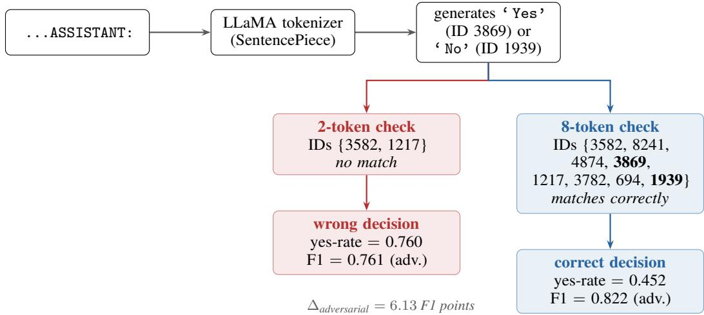  
Figure 1: Decision path at the POPE answer position for LLaVA-1.5-7B. The model always emits a space-prefixed surface form (‘ Yes’ or ‘ No’). The two-token check inspects two IDs the model never produces in this context, so every comparison is between two candidates the decoder excluded. On the adversarial split that comparison reads 924 of the model’s 1,644 ‘ No’ answers (56%) as yes, pushing the yes-rate to 0.760 on a 50% positive split.

Under greedy decoding the model never emits ID 3582 or 1217 at the answer position, so the twotoken rule compares two candidates the decoder excludes. Take the 1,644 adversarial questions the model answers ‘ No’ on: the 3582 logit beats the 1217 logit on 924 of them. Of those, 660 sit on true-negative questions and flip into false positives; the remaining 264 sit on borderline label-yes questions and become true positives. Borderline positives flip at 0.810 and true negatives at 0.501, so the excluded logits may still track the model’s lean, and we call the failure candidate exclusion. The yes-rate climbs to 0.760, recall inflates to 0.9587, and F1 sinks to 0.7608. Figure 1 follows the path end to end. Nothing in the model’s behaviour changed. The same generated tokens, read under the eight-token rule, produce a different aggregate.

The 6.13-point shift matters because it exceeds the adversarial gain reported by five of the six papers we surveyed, and none of those papers states which readout produced its baseline. That leaves the published comparison open. Setting our 82.21 beside another paper’s baseline would not give a corrected gain, because our reference ran under 4-bit NF4 quantization and a published baseline may differ from it in readout, precision, prompt format, or decoding. We report what each paper states and leave the comparison unresolved until those factors are matched. We then turned the eight-token protocol on our own ideas and ran nine inference-time corrections, six grounding-based and three contrastive. Every one finished below 0.8221. The reasons are specific, and Appendix F walks through them with per-question diagnostics. These corrections and the attention probe (Appendix F.3) are secondary findings, and the readout audit does not depend on them.

Three claims organize the paper. Section 3 documents the space-prefixing behaviour across all 9,000 questions and traces how the protocol error propagates into reported metrics. Section 4 tabulates the baselines and gains that published methods report and explains why they cannot be set against ours until readout and precision are matched. Section 5 extends the audit to four additional VLMs and shows the confound is a property of the readout, not of any one model. Extended derivations, the nine failed corrections, the formal equivalence proof, and the full literature survey live in the appendix.

## 2 Background

## 2.1 The POPE benchmark

Li et al. [2023] proposed POPE as a polling alternative to open-ended caption hallucination metrics, where drawing a clean binary correctness line is awkward. Each poll shows one image and one target object and asks: “Is there a {object} in the image?” Three negative-sampling strategies give three splits. Random draws absent objects uniformly from COCO [Lin et al., 2014]. Popular picks the most frequent COCO objects that happen to be missing from the queried image. Adversarial picks objects that co-occur with objects that are present (a snowboard scene gets asked about skis; a kitchen scene gets asked about a refrigerator). Every split holds 3,000 questions, balanced 50/50 between yes and no.

The distinction that matters for our claim is how the yes/no answer gets read off, and POPE-style evaluation admits several readouts. We separate four. (i) The official POPE benchmark [Li et al., 2023], which we treat as the dataset plus the metric definition (yes/no F1, precision, recall, and yes-rate over the balanced splits). (ii) String-parsing evaluation, where a generation step produces text and the label is recovered by searching for “yes” or “no”; this is blind to which LLaMA token ID the model chose. (iii) A two-token logit readout, comparing the first-token logits at IDs 3582 and 1217. We do not claim the official POPE code mandates this readout, and we could not verify the readout of any published baseline we survey (Section 4). (iv) Our eight-token logit readout, which adds the alternate-case and space-prefixed forms so the comparison reads tokens the tokenizer actually emits after ASSISTANT:.

## 2.2 LLaVA-1.5 and its tokenizer

LLaVA-1.5 [Liu et al., 2023] wires a CLIP-ViT-L/14-336 vision encoder [Radford et al., 2021] to Vicuna-1.5-7B through a two-layer MLP. Vicuna-1.5 descends from LLaMA-2 [Touvron et al., 2023], whose SentencePiece subword tokenizer [Kudo and Richardson, 2018] handles word boundaries by prepending a whitespace byte to word-initial tokens in mid-sentence position. So “Yes” owns two IDs in the LLaMA vocabulary: 8241 for the start-of-sentence variant (Yes) and 3869 for the mid-sentence variant (‘ Yes’). The same split holds for “yes” (3582 vs. 4874), “No” (3782 vs. 1939), and “no” (1217 vs. 694). The LLaVA-1.5 template ends with the literal string ASSISTANT:, so the next token is mid-sentence, the space byte is prepended, and the model emits 3869 or 1939. Appendix A lists the raw decode outputs.

## 2.3 Evaluation-protocol sensitivity

Scores that drift with measurement choices are a familiar problem in NLP evaluation. Liang et al. [2022] showed benchmark numbers move visibly with prompt format and few-shot setup; Zheng et al. [2023] traced answer-ordering bias in LLM-as-judge protocols. Our finding belongs to that family: a small, unexamined detail of how evaluation reads model output quietly becomes load-bearing for downstream comparisons. We keep the scope explicit. The conditions are a LLaMA-family tokenizer, the ASSISTANT: template, and greedy decoding. Methods that run generation and parse the output string are not touched by the two-token readout. Methods that inherit the two-ID lookup are, by an amount that tracks the share of the negative split the model answers “no” on (Eq. 1).

## 3 The Token-Extraction Artifact

## 3.1 Experimental setup

We ran LLaVA-1.5-7B in 4-bit NF4 quantization via BitsAndBytes [Dettmers et al., 2023] on an NVIDIA RTX 3070 Ti with 8 GB VRAM, on transformers v4.40.1 with torch.manual\_seed(42). Each question called model.generate with max\_new\_tokens=1 and output\_scores=True. For each question we saved the argmax token ID and the decision of each readout below. The logits were compared in memory and not written to disk, so the records hold the sign of $\ell _ { 3 5 8 2 } - \ell _ { 1 2 1 7 }$ but neither value. A separate pass over the adversarial split saved only the maximum logit within each eight-token set (Appendix C). Greedy decoding has no sampling step, and that second, instrumented pass reproduced the sweep’s eight-token decision on 2,998 of the 3,000 adversarial questions; the other two sit within one fp16 step of a tie (Appendix F.3). The full 9,000-question sweep took 76.3 minutes of wall-clock time, 0.508 seconds per question on this hardware.

Table 1: First generated token counts across all POPE splits. LLaVA-1.5-7B produces only spaceprefixed forms. The two-token protocol reads the two rightmost columns, zero in every split.
<table><tr><td>Split</td><td>Yes’(3869)</td><td>No’(1939)</td><td>yes (3582)</td><td>no (1217)</td></tr><tr><td>Adversarial</td><td>1,356</td><td>1,644</td><td>0</td><td>0</td></tr><tr><td>Popular</td><td>1,303</td><td>1,697</td><td>0</td><td>0</td></tr><tr><td>Random</td><td>1,234</td><td>1,766</td><td>0</td><td>0</td></tr><tr><td>Total</td><td>3,893</td><td>5,107</td><td>0</td><td>0</td></tr></table>

Table 2: POPE results for LLaVA-1.5-7B under both protocols. Two-token evaluation buys recall on the adversarial split through a 0.760 yes-bias, not accurate detection; the precision row shows how much of that coverage is wrong.
<table><tr><td>Split</td><td>Protocol</td><td>F1</td><td>Precision</td><td>Recall</td><td>Yes-rate</td><td> $\Delta$ </td></tr><tr><td>Adversarial</td><td>Two-token Eight-token</td><td>0.7608 0.8221</td><td>0.6307 0.8658</td><td>0.9587 0.7827</td><td>0.760 0.452</td><td>+0.0613</td></tr><tr><td>Popular</td><td>Two-token Eight-token</td><td>0.7961 0.8498</td><td>0.6797 0.9140</td><td>0.9607 0.7940</td><td>0.707 0.434</td><td>+0.0537</td></tr><tr><td>Random</td><td>Two-token Eight-token</td><td>0.8397 0.8713</td><td>0.7459 0.9652</td><td>0.9607 0.7940</td><td>0.644 0.411</td><td>+0.0316</td></tr></table>

Two-token protocol. The original rule: $\hat { y } = \mathbf { 1 } [ \ell _ { 3 5 8 2 } > \ell _ { 1 2 1 7 } ]$

Eight-token protocol. The rule we recommend: $\begin{array} { r c l c l } { \hat { y } } & { = } & { \mathbf { 1 } [ \operatorname* { m a x } _ { i \in Y } \ell _ { i } } & { > } & { \operatorname* { m a x } _ { j \in N } \ell _ { j } ] } \end{array}$ with $Y ~ = ~ \{ 3 5 8 2 , 8 2 4 1 , 4 8 7 4 , 3 8 6 9 \}$ (surface forms $\ \mathrm { y e s } , \ \mathrm { Y e s } , \ \mathrm { ~ \forall \in \bf ~ \underline { ~ } { ~ \bf ~ \underline { ~ } { ~ \bf ~ \epsilon ~ } ~ } { ~ \bf ~ \epsilon ~ } ~ } \ \mathrm { y e s } \ ^ { \prime } , \ \mathrm { ~ \stackrel { ~ \bf ~ \epsilon ~ } { ~ \mathrm { ~ Y ~ e ~ s ~ } } { ~ \bf ~ \epsilon ~ } ~ }$ and $\begin{array} { r l } { N } & { { } = } \end{array}$ $\{ 1 2 1 7 , 3 7 8 2 , \dot { 6 } 9 4 , 1 9 3 9 \} \ ( \mathrm { n o , \tt { N o } , \mathrm { \Lambda } ^ { \mathrm { c } } \mathrm { n o } ^ { \mathrm { , } } , \mathrm { \Lambda } ^ { \mathrm { c } } \mathrm { N o } ^ { \mathrm { \tiny { 9 } } } ) }$ . The max aggregator matches greedy behaviour: a greedy decoder emits the single highest-logit token, and that token lands in $Y$ exactly when max $\ell > \operatorname* { m a x } _ { N } \ell .$ A sum or softmax aggregator would weight all eight forms, including ones the model never samples, and drift away from the decoder’s own rule.

## 3.2 What the model actually generates

Table 1 gives the first-token distribution across the three splits. Two IDs carry every question: 3869 $( ^ { \iota } \Upsilon { \tt e s } ^ { \iota } )$ and 1939 (‘ No’). The other six candidate tokens appear zero times. Tokens 3582 and 1217 are never the argmax on any of the 9,000 questions. That is all the zero counts establish: both IDs lose to a space-prefixed form every time, and the records hold neither of their logits (Section 3.1). They do hold the sign of $\ell _ { 3 5 8 2 } - \ell _ { 1 2 1 7 }$ , and that sign tracks the emitted answer. On all 3,893 questions where the model emits ‘ Yes’, the two-token rule also says yes. On ‘ No’ emissions it says yes on 0.810 of the adversarial label-yes questions and 0.501 of the label-no ones (Section 3.4). The excluded logits may track the model’s lean, so we treat the failure as candidate exclusion and make no claim about how large those logits are.

## 3.3 F1 under each protocol

Table 2 pairs the two protocols on the same set of predictions. The eight-token rule recovers the token greedy decoding would emit; the two-token rule compares two entries the decoder never selects. On the adversarial split the two-token readout reaches near-perfect recall (0.9587) by riding a 0.760 yes-bias, and precision pays for it, falling to 0.6307. Appendix B shows the full confusion matrices and the running yes-rate curves behind these numbers.

Table 3: Baselines, results, and gains as each paper reports them for LLaVA-1.5-7B on POPE (F1×100). The “Readout” column records what each paper states. Our 82.21 reference ran under 4-bit NF4 quantization, so a comparison with published baselines measured at higher precision would mix readout effects with precision differences.
<table><tr><td>Method</td><td>Rep. base.</td><td>Rep. res.</td><td>Rep. gain</td><td>Readout</td></tr><tr><td>Tang et al. [Tang et al., 2025] (adv.)</td><td>73.54</td><td>84.35</td><td>+10.81</td><td>not stated</td></tr><tr><td>Tang et al. [Tang et al., 2025] (pop.)</td><td>76.53</td><td>87.09</td><td>+10.56</td><td>not stated</td></tr><tr><td>Tang et al. [Tang et al., 2025] (rand.)</td><td>81.54</td><td>89.55</td><td>+8.01</td><td>not stated</td></tr><tr><td>Seo et al. [Seo et al., 2025] (adv.)</td><td>79.30</td><td>80.00</td><td>+0.70</td><td>not stated</td></tr><tr><td>Chen et al. [Chen et al., 2025] (adv.)</td><td>81.00</td><td>81.80</td><td>+0.80</td><td>not stated</td></tr><tr><td>Huo et al. [Huo et al., 2024] (adv.)</td><td>80.90</td><td>82.50</td><td>+1.60</td><td>not stated</td></tr><tr><td>Jiang et al. [Jiang et al., 2026] (adv.)</td><td>75.06</td><td>80.82</td><td>+5.76</td><td>not stated</td></tr><tr><td>Jana et al. [Jana et al., 2026] (adv.)</td><td>82.07</td><td>83.03</td><td>+0.96</td><td>not stated</td></tr></table>

## 3.4 The arithmetic in one line

The 6.13-point shift is not mysterious; it falls straight out of confusion-matrix arithmetic once the protocol error is written down. The eight-token rule preserves the generated decision, giving $\mathrm { T P _ { 8 } ^ { \cdot } } = T , \mathrm { F P _ { 8 } } = N - G , \mathrm { F N _ { 8 } } = P - T$ , and $\mathrm { T N } _ { 8 } = G ,$ , where $T$ is the true-yes count and G the true-negative count. The two-token rule flips a fraction $\rho _ { N }$ of the true-negative ‘ No’ emissions into false positives and lifts a fraction $\varphi$ of the false-negative ‘ No’ emissions into true positives. It never turns an emitted $\iota _ { \tt { Y e s } } ,$ into a no: the paired records show zero such transitions among the 3,893 $\ell \mathtt { Y } _ { \mathtt { e s } } \cdot$ emissions on the three splits (Table 7). Under that observed condition the gap has a closed form:

$$
\begin{array} { l } { \Delta _ { \mathrm { F } 1 } = \mathrm { F } 1 _ { 8 } - \mathrm { F } 1 _ { 2 } = \displaystyle \frac { 2 T } { 2 T + ( N - G ) + ( P - T ) } } \\ { - \displaystyle \frac { 2 \big ( T + \varphi ( P - T ) \big ) } { 2 \big ( T + \varphi ( P - T ) \big ) + ( N - G ) + \rho _ { N } G + ( 1 - \varphi ) ( P - T ) } . } \end{array}\tag{1}
$$

Both rates are empirical transition rates, counted separately on each split, and every split has $P { = } N { = } 1 { , } 5 0 0 .$ . On the adversarial split the direct counts fix every term: $T \bar { = } 1 , 1 7 4 , G { = } 1 , \bar { 3 } 1 \bar { 8 } , \rho _ { N } =$ $6 6 0 / 1 , 3 1 8 = 0 . 5 0 1$ and $\varphi = 2 6 4 / 3 2 6 = 0 . 8 1 0$ . This reproduces $\mathrm { F 1 _ { 8 } = 0 . 8 2 2 1 a n d F 1 _ { 2 } = 0 . 7 6 0 8 }$ exactly. Popular has $T \mathrm { = } 1 , 1 9 1 , \dot { G } \mathrm { = } 1 , 3 8 8 , \rho _ { N } = 5 6 7 / \bar { 1 } , 3 8 8 = 0 . 4 0 9$ and $\varphi = 2 5 0 / 3 0 9 = 0 . 8 0 9$ so $\mathrm { T \dot { P _ { 2 } } = \dot { 1 } , 1 9 1 + 2 5 0 = 1 , 4 4 1 }$ $\mathrm { F P _ { 2 } } = 1 \dot { 1 } 2 + 5 6 7 \dot { = } 6 7 9 , \mathrm { F N _ { 2 } } = 5 9$ and $\mathrm { F 1 _ { 2 } } = 2 , 8 8 2 / 3 , 6 2 0 =$ 0.7961. Random has the same $T$ and φ but $G { = } 1 { , } 4 5 7$ and $\rho _ { N } = 4 4 8 / 1 , 4 5 7 = 0 . 3 0 7$ , so $\mathrm { F P _ { 2 } = }$ $4 3 + 4 4 8 = 4 9 1$ and $\mathrm { F 1 _ { 2 } } = 2 { , } 8 8 2 / 3 { , } 4 3 2 = 0 { . } 8 3 9 7$ . The rate φ stays near 0.81 on every split, while $\rho _ { N }$ falls from 0.501 to 0.307 as the eight-token false positives drop from 182 to 43. Plugging the adversarial rates into the popular and random counts gives 0.7690 and 0.7761, well off the observed values, so the rates do not transfer between splits. The reconstruction is an accounting identity built from transitions counted on the same records. It confirms the bookkeeping; it does not test the mechanism independently, which would need the individual logits the records lack. Appendix C gives the full derivation, the paired transition table and the notation.

## 4 Comparability with Published Results

Table 3 lists the baseline, result, and gain that each surveyed paper reports for LLaVA-1.5-7B on POPE. None of these papers states which readout it used, and we do not hold their per-question logs, so the table cannot tell us whether a given baseline came from the two-token logits, the eight-token set, or parsed generated text. Our 82.21 cannot stand in for those baselines either. It ran under 4-bit NF4 quantization, and the published numbers may come from higher-precision runs, so a gap between our reference and a published baseline would mix the readout effect with a precision difference. The table therefore computes no gain against 82.21 and assigns no readout to any paper.

The adversarial gains in the table range from $+ 0 . 7 0 \mathrm { t o } + 1 0 . 8 1$ . Five of the six papers report less than the 6.13 points by which the readout alone moved our adversarial F1; Tang et al. report +10.81. The adversarial baselines run from 73.54 (Tang et al.) to 82.07 (Jana et al.), a spread of 8.53 points on one frozen checkpoint, and the baselines of Tang, Seo, and Chen (73.54, 79.30, 81.00) already span

Table 4: POPE F1 under the four readouts for four VLMs beyond the LLaVA-1.5-7B reference (top block, from Table 2). legacy\_2tok and legacy\_8tok hard-code the LLaVA-1.5 LLaMA-2 IDs; dynamic\_single re-derives the single-token yes/no IDs from each model’s own tokenizer; string\_parse greedily decodes and parses the first yes/no substring. Bold marks the F1 a careful practitioner would report.
<table><tr><td>Model (tokenizer)</td><td>Split</td><td>legacy_2tok</td><td>legacy_8tok</td><td>dynamic_single</td><td>string_parse</td></tr><tr><td rowspan="3">LLaVA-1.5-7B (LLaMA-2)</td><td rowspan="3">adversarial popular random</td><td>0.7608</td><td>0.8221</td><td>0.8221</td><td>0.8221</td></tr><tr><td>0.7961</td><td>0.8498</td><td>0.8498</td><td>0.8498</td></tr><tr><td>0.8397</td><td>0.8713</td><td>0.8713</td><td>0.8713</td></tr><tr><td rowspan="3">LLaVA-1.6-Mistral-7B (Mistral)</td><td rowspan="3">adversarial popular random</td><td>0.6667</td><td>0.0000</td><td>0.8521</td><td>0.8521</td></tr><tr><td>0.6667</td><td>0.0000</td><td>0.8953</td><td>0.8953</td></tr><tr><td>0.6667</td><td>0.0000</td><td>0.9163</td><td>0.9163</td></tr><tr><td rowspan="3">InstructBLIP-Vicuna-7B (LLaMA)</td><td>adversarial</td><td>0.7074</td><td>0.8183</td><td>0.8183</td><td>0.6667</td></tr><tr><td>popular</td><td>0.7277</td><td>0.8553</td><td>0.8553</td><td>0.6667</td></tr><tr><td>random</td><td>0.7613</td><td>0.8815</td><td>0.8815</td><td>0.6667</td></tr><tr><td rowspan="2">mPLUG-Owl2-LLaMA2-7B (LLaMA-2)</td><td>adversarial popular</td><td>0.7754 0.8060</td><td>0.8001 0.8312</td><td>0.8001 0.8312</td><td>0.8001 0.8312</td></tr><tr><td>random</td><td>0.8466</td><td>0.8707</td><td>0.8707</td><td>0.8707</td></tr><tr><td rowspan="3">Qwen2-VL-7B-Instruct (Qwen)</td><td>adversarial</td><td>0.6674</td><td>0.0000</td><td>0.8457</td><td></td></tr><tr><td>popular</td><td>0.6671</td><td>0.0000</td><td>0.8578</td><td>0.8457 0.8578</td></tr><tr><td>random</td><td>0.6667</td><td>0.0000</td><td>0.8671</td><td>0.8671</td></tr></table>

7.46. Readout, prompt format, quantization, and decoding are possible sources of such a spread. The published numbers do not let us separate them, and separating them takes matched reruns of each method with the readout and the precision fixed and logged.

Tang et al. [2025] report gains of +10.81, +10.56, and +8.01 on the adversarial, popular, and random splits, from baselines of 73.54, 76.53, and 81.54. We found no public implementation for that paper (arXiv:2506.12609) as of June 2026. Seo et al. [2025] and Chen et al. [2025] report adversarial gains of +0.70 and +0.80 from baselines of 79.30 and 81.00. Each gain compares a method with a baseline from the same paper, so it is informative whenever both numbers share one readout and one precision. The papers do not say whether they do. If a method parsed generated strings, the readout we audit may not affect its numbers at all. Nothing here shows that any of these methods fails to help LLaVA-1.5-7B, or that it helps by less than reported. The size of each gain under a matched protocol stays unknown. A one-line statement of the readout in each paper, or a released evaluation script, would settle which readout produced each baseline.

## 5 Multi-Model Validation

The audit so far concerns one model. To separate “LLaVA-1.5 quirk” from “readout property,” we ran the identical four-readout audit on four more VLMs spanning three tokenizer families: LLaVA-1.6- Mistral-7B (Mistral vocabulary), InstructBLIP-Vicuna-7B and mPLUG-Owl2-LLaMA2-7B (LLaMA family), and Qwen2-VL-7B-Instruct (Qwen vocabulary). Each model saw all three splits at 3,000 questions per split, 9,000 per model. LLaVA-1.6-Mistral ran locally (RTX 3070 Ti Laptop, 4-bit NF4, transformers v4.44.2); the other three ran on Kaggle Tesla T4 GPUs under the same audit script. Qwen2-VL used its native chat template, since it was never trained on the LLaVA-1.5 prompt string; the other three used the LLaVA-1.5 template. Table 4 is the headline result, and two patterns hold across every model and split.

1. Porting the LLaVA-1.5 IDs verbatim is unsafe, and how badly it fails depends on the target vocabulary. The legacy\_8tok readout scores F1 0.00 on LLaVA-1.6-Mistral and Qwen2-VL: their vocabularies put no yes/no mass on those IDs, so a comparison between two never-generated logits resolves the same way every time. On mPLUG-Owl2 and InstructBLIP, both LLaMA-family models that share the IDs, the fixed set still works. The failure is vocabulary mismatch, not something universal.

2. A readout derived from each model’s own tokenizer is robust. The dynamic\_single readout, comparing max-logits over the single-token yes/no IDs the tokenizer actually produces, stays between 0.80 and 0.92 on every model and split. The spread across models is genuine accuracy variation, not an artifact of the readout.

The string\_parse column matches dynamic\_single to four decimals on LLaVA-1.6-Mistral, mPLUG-Owl2, and Qwen2-VL. On InstructBLIP it collapses to the 0.6667 all-yes floor across all three splits while dynamic\_single holds at 0.82 to 0.88. The cause is the parse, not the model: the text our harness decoded for InstructBLIP did not begin with the answer token, so the first yes/no substring came from the wrong place. Appendix G contains the token-ID map, the prompt-template robustness check, provenance notes, and the secondary verification run.

## 6 Practitioner Recommendations

The audit reduces to a handful of checks that any POPE-style evaluation on LLaMA-family VLMs can adopt without touching the dataset, the model, or the metric.

1. Log the generated token ID and its decoded string for every question. A first-token argmax and its surface form are cheap to record and remove any need to guess the readout convention afterwards.

2. Verify the yes/no token sets under the exact prompt template. Different suffixes push firsttoken mass onto different forms. The ASSISTANT: suffix we used puts it on the space-prefixed ‘ Yes’/‘ No’ pair.

3. Prefer the tokenizer-derived single-token logit readout. It depends only on the logit vector, never on what text a generation loop returns. String parsing is equivalent to it (Theorem 1, Appendix D) only when it reads exactly the first generated token, which is where InstructBLIP broke.

4. Release prediction-level records so reviewers can recompute any aggregate and check the readout convention independently.

Listing 1 is the readout we recommend. It derives the yes/no IDs from the model’s own tokenizer, generates one token, and compares the max-logits, so the same code runs unchanged across all five models here. It adds no generation cost beyond encoding four short strings once at setup.

Listing 1: Drop-in POPE answer readout. Derive the yes/no token IDs from the model’s own tokenizer, then compare first-token max-logits. Runs unchanged across tokenizer families

```python
tok = processor . tokenizer
enc = lambda s : tok . encode (s , add_special_tokens = False )
yes_forms = [" yes " , " Yes " , " yes " , " Yes "]
no_forms = [" no " , " No ", " no " , " No "]
yes_ids = [ enc ( s ) [0] for s in yes_forms if len ( enc ( s ) ) == 1]
no_ids = [ enc (s) [0] for s in no_forms if len(enc(s)) == 1]
out = model . generate (** inputs , max_new_tokens =1,
do_sample =False ,
return_dict_in_generate = True ,
output_scores = True )
logit = out . scores [0][0]
y = max ( logit [i] for i in yes_ids )
n = max ( logit [j] for j in no_ids )
pred = "yes " if y > n else "no"
```

## 7 Limitations and Conclusion

The mismatch we report has a narrow technical surface: one logit comparison between two IDs that LLaVA-1.5-7B does not produce after ASSISTANT: under greedy decoding. The reach of that mistake depends on which methods adopt the two-token readout. On POPE adversarial F1 the shift to the eight-token readout is 6.13 points, larger than the adversarial gain reported by five of the six papers we surveyed. None of those papers states its readout, so we cannot say which of their baselines the artifact touches, and we estimate no corrected gains. Our 82.21 reference also ran under 4-bit NF4 quantization, so setting it beside baselines measured at higher precision would mix readout and precision effects. No method is shown to be broken here. Numbers from different studies cannot be compared at face value until the readout and the precision are matched and reported. The correction is a one-line change in the evaluation code.

A few caveats bound the result. The main 9,000-question audit uses one checkpoint at one quantization level (4-bit NF4), so we cannot say whether the 6.13-point shift is the same at higher precision. The nine corrections (Appendix F) were run only on the adversarial split. The whitespace-prefix behaviour is shared across LLaMA-family tokenizers, but the specific IDs differ by vocabulary, so it is the diagnostic in Algorithm 1, not the fixed eight-token set, that carries the finding to a new model. Our nine inference-time corrections did not beat the corrected baseline, and the per-signal analysis suggests the visual-grounding and attention signals those methods rely on do not discriminate the cases the adversarial split is built to query. Beating that baseline may need training-time changes, not decoding-time ones. We encourage future POPE work to verify the first-token behaviour of its specific model-template pairing before fixing a readout token set.

## Acknowledgments and Disclosure of Funding

We used Claude (Anthropic) as a coding assistant for experimental script development and debugging. All experimental design, analysis, interpretation, and writing are our own. This work received no external funding. Hardware: NVIDIA RTX 3070 Ti Laptop (8 GB VRAM) for the primary LLaVA-1.5 and LLaVA-1.6-Mistral runs; NVIDIA RTX 3050 Laptop (4 GB VRAM) for verification; Kaggle Tesla T4 × 2 for the mPLUG-Owl2, InstructBLIP-Vicuna, and Qwen2-VL evaluations.

## References

Shiqi Chen, Tongyao Zhu, Ruochen Zhou, Jinghan Zhang, Siyang Gao, Juan Carlos Niebles, Mor Geva, Junxian He, Jiajun Wu, and Manling Li. Why is spatial reasoning hard for VLMs? an attention mechanism perspective on focus areas. In International Conference on Machine Learning, 2025. arXiv:2503.01773.

Tim Dettmers, Artidoro Pagnoni, Ari Holtzman, and Luke Zettlemoyer. QLoRA: Efficient finetuning of quantized LLMs. In Advances in Neural Information Processing Systems, volume 36, 2023.

Fushuo Huo et al. Self-introspective decoding: Alleviating hallucinations for large vision-language models. arXiv preprint arXiv:2408.02032, 2024.

Soumyadeep Jana, Pulkit Mittal, and Sanasam Ranbir Singh. Mitigating hallucination in visionlanguage models through barrier-regulated adaptive closed-form steering. arXiv preprint arXiv:2605.29881, 2026.

Yubo Jiang, Xin Yang, Abudukelimu Wuerkaixi, Zheming Yuan, Xuxin Cheng, Fengying Xie, Zhiguo Jiang, Cao Liu, Ke Zeng, and Haopeng Zhang. Global context or local detail? adaptive visual grounding for hallucination mitigation. arXiv preprint arXiv:2604.24396, 2026.

Taku Kudo and John Richardson. SentencePiece: A simple and language independent subword tokenizer and detokenizer for neural text processing. In Proceedings of the 2018 Conference on Empirical Methods in Natural Language Processing: System Demonstrations, pages 66–71, 2018.

Sicong Leng, Hang Zhang, Guanzheng Chen, Xin Li, Shijian Lu, Chunyan Miao, and Lidong Bing. Mitigating object hallucinations in large vision-language models through visual contrastive decoding. In Proceedings of the IEEE/CVF Conference on Computer Vision and Pattern Recognition, pages 13872–13882, 2024.

Yifan Li, Yifan Du, Kun Zhou, Jinpeng Wang, Wayne Xin Zhao, and Ji-Rong Wen. Evaluating object hallucination in large vision-language models. In Proceedings of the 2023 Conference on Empirical Methods in Natural Language Processing, pages 292–305. Association for Computational Linguistics, 2023.

Percy Liang, Rishi Bommasani, Tony Lee, Dimitris Tsipras, Divyam Soylu, Michihiro Yasunaga, Yian Zhang, Deepak Narayanan, Yuhuai Wu, Ananya Kumar, et al. Holistic evaluation of language models. arXiv preprint arXiv:2211.09110, 2022.

Tsung-Yi Lin, Michael Maire, Serge Belongie, James Hays, Pietro Perona, Deva Ramanan, Piotr Dollár, and C Lawrence Zitnick. Microsoft COCO: Common objects in context. In European Conference on Computer Vision, pages 740–755. Springer, 2014.

Haotian Liu, Chunyuan Li, Yuheng Li, and Yong Jae Lee. Improved baselines with visual instruction tuning. arXiv preprint arXiv:2310.03744, 2023.

Alec Radford, Jong Wook Kim, Chris Hallacy, Aditya Ramesh, Gabriel Goh, Sandhini Agarwal, Girish Sastry, Amanda Askell, Pamela Mishkin, Jack Clark, et al. Learning transferable visual models from natural language supervision. In International Conference on Machine Learning, pages 8748–8763. PMLR, 2021.

Hoigi Seo, Dong Un Kang, Hyunjin Cho, Joohoon Lee, and Se Young Chun. On epistemic uncertainty of visual tokens for object hallucinations in large vision-language models. arXiv preprint arXiv:2510.09008, 2025.

Lexiang Tang, Xianwei Zhuang, Bang Yang, Zhiyuan Hu, Hongxiang Li, Lu Ma, Jinghan Ru, and Yuexian Zou. Not all tokens and heads are equally important: Dual-level attention intervention for hallucination mitigation. arXiv preprint arXiv:2506.12609, 2025.

Hugo Touvron, Louis Martin, Kevin Stone, Peter Albert, Amjad Almahairi, Yasmine Babaei, Nikolay Bashlykov, Soumya Batra, Prajjwal Bhargava, Shruti Bhosale, et al. LLaMA 2: Open foundation and fine-tuned chat models. arXiv preprint arXiv:2307.09288, 2023.

Lianmin Zheng, Wei-Lin Chiang, Ying Sheng, Siyuan Zhuang, Zhanghao Wu, Yonghao Zhuang, Zi Lin, Zhuohan Li, Dacheng Li, Eric Xing, et al. Judging LLM-as-a-judge with MT-bench and chatbot arena. In Advances in Neural Information Processing Systems, volume 36, 2023.

## A Token ID Reference and Tokenizer Traces

Table 5 lists all eight yes/no token IDs. The decode outputs below were run in Python against the LLaMA tokenizer loaded straight from the LLaVA-1.5-7B repository, and they confirm what each ID produces:  
```python
from transformers import AutoTokenizer
name = "llava -hf/llava -1.5 -7b-hf"
tok = AutoTokenizer . from_pretrained ( name )
tok . decode ([3582]) # -> ’yes ’
tok . decode ([8241]) # -> ’Yes ’
tok . decode ([4874]) # -> ’ yes ’ (space - prefixed )
tok . decode ([3869]) # -> ’ Yes ’ (space - pref ) * generated *
tok . decode ([1217]) # -> ’no ’
tok . decode ([3782]) # -> ’No ’
tok . decode ([694]) # -> ’ no ’ (space - prefixed )
tok . decode ([1939]) # -> ’ No ’ (space - pref ) * generated *
```

The two IDs marked \*generated\* are the only ones that turned up as first tokens across all 9,000 questions.

Table 5: Yes/no token IDs for LLaMA-family models. ⋆: the only IDs LLaVA-1.5-7B generated after the ASSISTANT: prompt in our runs.
<table><tr><td>Answer</td><td>Token ID</td><td>Decoded surface form</td></tr><tr><td>yes</td><td>3582</td><td>yes</td></tr><tr><td>yes</td><td>8241</td><td>Yes</td></tr><tr><td>yes</td><td>4874</td><td>yes&#x27;</td></tr><tr><td>yes</td><td>3869★</td><td>&#x27;Yes&#x27;</td></tr><tr><td>no</td><td>1217</td><td>no</td></tr><tr><td>no</td><td>3782</td><td>No</td></tr><tr><td>no</td><td>694</td><td> ${ \mathfrak { c } } _ { \mathtt { n o } } ,$ </td></tr><tr><td>no</td><td>1939★</td><td> $\iota _ { \mathbb { N } \circ } \iota _ { \mathbf { \lambda } }$ </td></tr></table>

## B Where the Mass Goes: Confusion Matrices and Convergence

Figure 2 contrasts the full $2 \times 2$ confusion matrices for adversarial POPE under both protocols. The eight-token matrix is close to balanced (TP 1,174, TN 1,318, FP 182, FN 326). Switch to two tokens and the false-positive count jumps from 182 to 842, as 660 true-negative ‘ No’ emissions flip to yes; the other 264 of the 924 flipped emissions land on borderline true-yes questions and become true positives, which is why precision drops while recall climbs.

Figure 3 tracks the running yes-rate of each protocol over the 3,000-question adversarial stream. The eight-token line settles at 0.452 by question 600 and holds, sitting close to the ground-truth 0.500; the two-token line settles at 0.760. Figure 4 repeats the comparison across all three splits, and Figure 5 plots the first-token frequency for all eight surface forms.

Figure 6 shows eight real adversarial samples, two per confusion-matrix outcome under the eighttoken rule.

## C Full Derivation of the Protocol Gap

Table 6 fixes the notation.

The eight-token rule preserves the model’s generated decision, so

$$
\mathrm { T P } _ { 8 } = T , \quad \mathrm { F P } _ { 8 } = N - G , \quad \mathrm { F N } _ { 8 } = P - T , \quad \mathrm { T N } _ { 8 } = G ,\tag{2}
$$

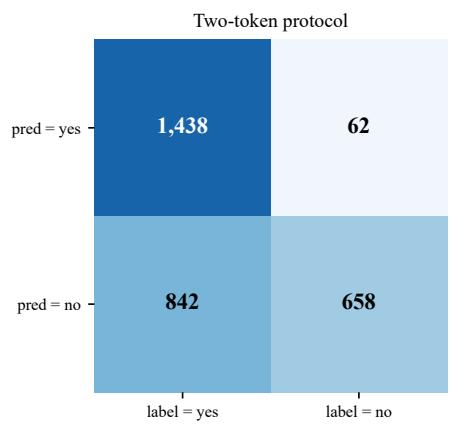

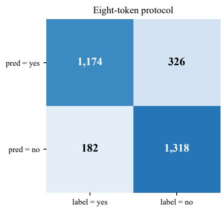  
Figure 2: Confusion matrices for POPE adversarial (3,000 questions) under each protocol. Under two-token evaluation, 660 of the 1,318 true-No predictions migrate to the FP cell, leaving precision at 0.6307. Under eight-token evaluation only 182 stay there, and precision is 0.8658. The model’s behaviour is identical across both matrices; only the readout changes.

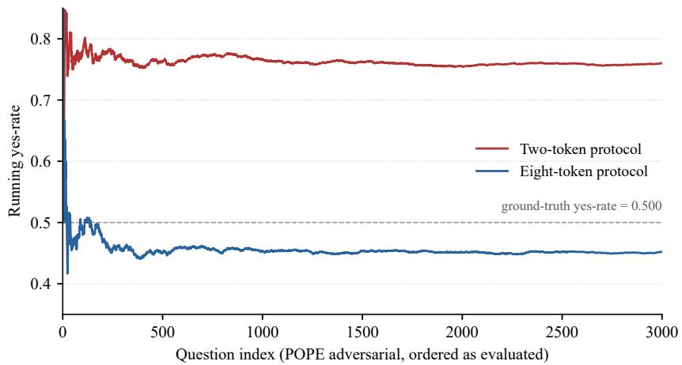  
Figure 3: Running yes-rate over the 3,000-question POPE adversarial stream. The eight-token protocol (blue) stabilises near the ground-truth yes-rate (dashed). The two-token protocol (red) stabilises around 0.760 because it reads 924 of the model’s $1 , 6 4 4 \ ^ { \circ } \mathrm { N o } ^ { , }$ emissions (56%) as yes.

where G is the true-negative count, not the total token-1939 count $G _ { \mathrm { t o t } }$ . With $G = 1 { , } 3 1 8$ and $N = 1 { , } 5 0 0$ on the adversarial split, $\mathrm { F P _ { 8 } = 1 8 2 }$ , matching Figure 2.

The two-token rule reads two logits the decoder never selects, so it does not preserve the decision. On a question where the model emits ‘ Yes’ it could in principle answer no, but the records show it never does: across the three splits all ${ 3 , 8 9 3 } \lor \mathbf { e s } ^ { , }$ emissions are also read as yes (the 8y→2n column of Table 7 is zero). Given that observed condition the rule changes only ‘ No’ emissions. It flips a fraction $\rho _ { N }$ of the true-negative ones into FP and a fraction $\varphi$ of the false-negative ones (label=yes questions the model had answered no) into TP:

$$
\mathrm { T P } _ { 2 } = T + \varphi ( P - T ) , \quad \mathrm { F P } _ { 2 } = ( N - G ) + \rho _ { N } G , \quad \mathrm { F N } _ { 2 } = ( 1 - \varphi ) ( P - T ) , \quad \mathrm { T N } _ { 2 } = ( 1 - \rho _ { N } ) G .\tag{3}
$$

Substituting Eqs. 2–3 into $\mathrm { F 1 } = 2 \mathrm { T P } / ( 2 \mathrm { T P } + \mathrm { F P } + \mathrm { F N } )$ gives the closed form quoted as Eq. 1 in the main text. If an emitted $\iota _ { \tt { Y e s } } ,$ were ever read as no, a third rate would enter $\mathrm { T P _ { 2 } }$ and $\mathrm { F P _ { 2 } ; }$ on these records that rate is zero.

What the records contain. Each of the 9,000 records holds the question ID, the label, the eighttoken and two-token decisions, and the argmax token ID. The logits behind the decisions were compared in memory and not saved, so the records fix the sign of $\ell _ { 3 5 8 2 } - \ell _ { 1 2 1 7 }$ on every question but neither value. We therefore cannot report means, medians or ranks for IDs 3582 and 1217. A separate pass over the adversarial split, run with eager attention so that it could return attention maps, saved the maximum logit within the eight-token yes set and within the no set. Over its 3,000 questions these maxima average 24.63 (yes set) and 24.53 (no set). Each is a maximum over four IDs, so neither isolates 3582 or 1217. That pass matches the main run’s eight-token decision on 2,998 of 3,000 questions (it differs on IDs 77 and 2938, both fp16 ties or near-ties; Appendix F.3), and every count below comes from the main run.

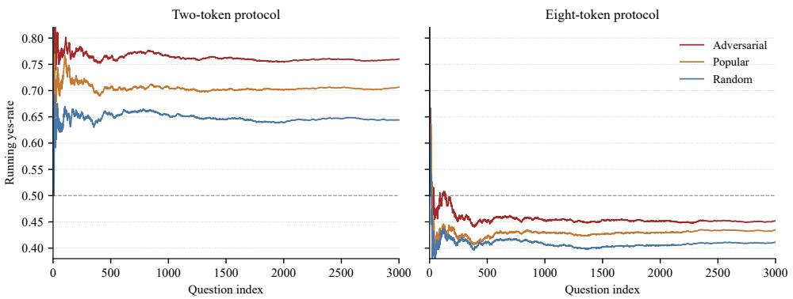  
Figure 4: Running yes-rate across all three POPE splits under both protocols. The two-token protocol (left) holds a yes-bias on every split, settling at 0.760, 0.707 and 0.644 on adversarial, popular and random; the eight-token protocol (right) tracks the underlying ground-truth mix.

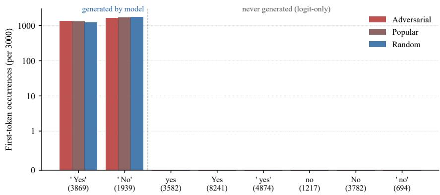  
Figure 5: First-token frequency at the answer position for all eight yes/no surface forms across the three POPE splits (log scale on $y ) .$ . The four right-side forms, including yes (3582) and no (1217), receive zero first-token mass in any split. The two-token protocol reads only 3582 and 1217.

Per-split counts and rates. Table 7 pairs the eight-token and two-token decisions question by question. In the notation of Table 6, T is the $8 \mathrm { y }  2 \mathrm { y }$ count on the label-yes row, $N - \bar { G }$ the same count on the label-no row, G the label-no 8n total and $P - T$ the label-yes 8n total.

On POPE adversarial the direct token-ID counts and the two confusion matrices fix every term: $T \mathrm { = } 1 , 1 7 4 , \ G \mathrm { = } 1 , 3 1 8 , \ G _ { \mathrm { t o t } } \mathrm { = } 1 , 6 4 4 , \ P \mathrm { = } N \mathrm { = } 1 , 5 0 0 .$ , with $\rho _ { N } ~ = ~ 6 6 0 / 1 { , } 3 1 8 ~ = ~ 0 { . } 5 0 1$ and $\varphi =$ $2 6 4 / 3 2 6 \ = \ 0 . 8 1 0$ . The 924 two-token flips split into 660 landing on true-negative questions (becoming FP) and 264 landing on borderline true-yes questions (becoming TP):

$$
\mathrm { F 1 } _ { 8 } = { \frac { 2 3 4 8 } { 2 8 5 6 } } = 0 . 8 2 2 1 , \qquad \mathrm { F 1 } _ { 2 } = { \frac { 2 8 7 6 } { 3 7 8 0 } } = 0 . 7 6 0 8 .\tag{4}
$$

The two-rate closed form reproduces all four two-token cells exactly $( \mathrm { T P _ { 2 } { = } 1 , 4 3 8 , \ F P _ { 2 } { = } 8 4 2 }$ $\mathrm { F N _ { 2 } { = } 6 2 , \mathrm { T N _ { 2 } { = } 6 5 8 ) } }$ , so $\mathrm { F 1 _ { 2 } } ~ = ~ 0 . 7 6 0 8$ comes out without any empirical correction term. Set $\varphi = 0$ and the lower bound is $\mathrm { F 1 _ { 2 } } = 2 3 4 8 / 3 5 1 6 = 0 . 6 6 7 8 ;$ the observed 0.7608 is higher because

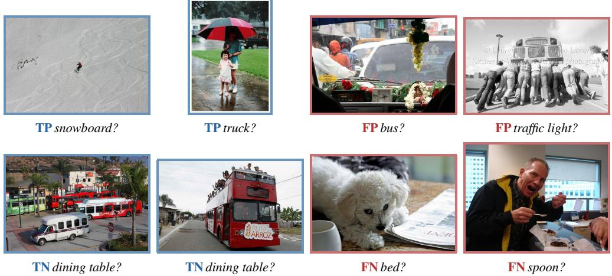  
Figure 6: Eight POPE adversarial samples from our run (question IDs 1, 7, 26, 72 on top; 14, 20, 35, 39 on the bottom), two per confusion-matrix outcome under eight-token evaluation. Blue borders mark predictions that match the label; red borders mark errors. The split queries objects that co-occur with present ones, which is what makes the FP and FN cases hard to fix with a generic visual-uncertainty signal.

Table 6: Notation used in the derivation.
<table><tr><td>Symbol</td><td>Meaning</td></tr><tr><td> $P ,$  N</td><td>ground-truth positive / negative question counts in the split</td></tr><tr><td> $_ T$ </td><td>true-yes greedy generations (token 3869 produced when label=yes)</td></tr><tr><td> $G$ </td><td>true-negative count: token 1939 produced when label=no (the TN cell under the eight-token rule)</td></tr><tr><td> $G _ { \mathrm { t o t } }$ </td><td>total token-1939 emissions across the split,  $G _ { \mathrm { t o t } } = G + ( P - T )$  , because the model emitsNo’on</td></tr><tr><td> $\rho _ { N }$ </td><td>true-negative and false-negative questions alike fraction of true-negativeNo’ emissions the two-token rule flips to yes, counted per split</td></tr><tr><td> $\varphi$ </td><td>fraction of false-negativeNo’ emissions (label=yes) the two-token rule reads as yes, counted per split</td></tr><tr><td> $\ell _ { v }$ </td><td>logit at vocabulary id v (first decoded position)</td></tr><tr><td> $\hat { y }$ </td><td>predicted label after the readout rule is applied</td></tr></table>

Table 7: Paired readout transitions for LLaVA-1.5-7B on each POPE split (3,000 questions each, $P { = } N { = } 1 , 5 0 0 )$ . Each column gives the eight-token decision followed by the two-token decision. The 8y→2n column is zero everywhere, so the two-token rule only changes ‘ No’ emissions. Both rates are read from the 8n→2y column.
<table><tr><td>Split</td><td>Label</td><td> $8 \mathrm { y }  2 \mathrm { y }$ </td><td> $8 \mathrm { y }  2 \mathrm { n }$ </td><td>8n→2y</td><td>8n→2n</td><td>Rate</td><td>Value</td></tr><tr><td rowspan="2">Adversarial</td><td>yes</td><td>1,174</td><td>0</td><td>264</td><td>62</td><td>4</td><td> $2 6 4 / 3 2 6 = 0 . 8 1 0$ </td></tr><tr><td>no</td><td>182</td><td>0</td><td>660</td><td>658</td><td>ρN</td><td>660/1,318 = 0.501</td></tr><tr><td rowspan="2">Popular</td><td>yes</td><td>1,191</td><td>0</td><td>250</td><td>59</td><td>4</td><td>250/309 = 0.809</td></tr><tr><td>no</td><td>112</td><td>0</td><td>567</td><td>821</td><td>ρN</td><td>567/1,388 = 0.409</td></tr><tr><td rowspan="2">Random</td><td>yes</td><td>1,191</td><td>0</td><td>250</td><td>59</td><td>4</td><td>250/309 = 0.809</td></tr><tr><td>no</td><td>43</td><td>0</td><td>448</td><td>1,009</td><td>ρN</td><td>448/1,457 = 0.307</td></tr></table>

$\varphi = 0 . 8 1 0$ . The same substitution with each split’s own rates gives

$$
\begin{array} { l c r } { { \mathrm { F 1 } _ { 2 } ^ { \mathrm { p o p } } = \displaystyle \frac { 2 \cdot 1 , 4 4 1 } { 2 \cdot 1 , 4 4 1 + 6 7 9 + 5 9 } = \displaystyle \frac { 2 8 8 2 } { 3 6 2 0 } = 0 . 7 9 6 1 , } } \\ { { \mathrm { F 1 } _ { 2 } ^ { \mathrm { r a n d } } = \displaystyle \frac { 2 \cdot 1 , 4 4 1 } { 2 \cdot 1 , 4 4 1 + 4 9 1 + 5 9 } = \displaystyle \frac { 2 8 8 2 } { 3 4 3 2 } = 0 . 8 3 9 7 , } } \end{array}\tag{5}
$$

against eight-token values of $2 3 8 2 / 2 8 0 3 = 0 . 8 4 9 8$ and $2 3 8 2 / 2 7 3 4 = 0 . 8 7 1 3$ , matching Table 2. Applying the adversarial rates $( \rho _ { N } = 0 . 5 0 1 , \varphi = 0 . 8 1 0 )$ to the popular and random counts instead gives 0.7690 and 0.7761, so the rates have to be counted per split. All of this is an accounting identity.

The rates are read off the same transitions they are then used to rebuild, so the reconstruction checks the bookkeeping and carries no independent evidence about why the two logits fall the way they do.

Pooled flip rate. The fraction of all $\iota _ { \mathbb { N } \circ } \iota _ { \mathbf { \Lambda } }$ emissions the two-token rule reads as yes is $9 2 4 / 1 , 6 4 4 =$ 0.562 on adversarial, $8 1 7 / 1 , 6 9 7 = 0 . 4 8 1$ on popular and $6 9 8 / 1 , 7 6 6 = 0 . 3 9 5$ on random. Each pooled rate is the mix $\left( \rho _ { N } G + \varphi ( P - T ) \right) / \left( G + P - T \right)$ of the two group rates. Since $\varphi$ stays near 0.81, the decline across splits comes from $\rho _ { N }$ . A comparison that ignored the input would flip true negatives at the same expected rate on every split. Instead $\rho _ { N }$ is highest on adversarial, whose negatives name objects that co-occur with present ones, and lowest on random. Together with $\varphi > \rho _ { N }$ on every split, this pattern is consistent with $\ell _ { 3 5 8 2 } - \ell _ { 1 2 1 7 }$ carrying the model’s lean toward yes. Without the individual logits we cannot measure how strong that dependence is.

## D Formal Equivalence of String-Parse and Single-Token Readouts

The observation that dynamic\_single and string\_parse agree to four decimals on every run is not a coincidence. Under greedy decoding the two protocols are identical whenever the argmax token belongs to the single-token surface-form set, outside the tie case of Theorem 1. Writing the proof down turns an empirical regularity into a claim the rest of the paper can lean on.

Theorem 1 (Single-token readout equivalence). Let V be a model’s vocabulary and let $Y \subset \nu ,$ $N \subset \nu$ be disjoint single-token surface-form sets for the yes and no answers. Let $\ell \in \mathbb { R } ^ { | \nu | }$ be the first-position logit vector on afixed input, and $t ^ { \star } =$ arg max<sub>v</sub> $\ell _ { v }$ the greedy argmax token. Define

$$
\hat { y } _ { \mathrm { l o g i t } } = \mathbf { 1 } \left[ \operatorname* { m a x } _ { i \in Y } \ell _ { i } > \operatorname* { m a x } _ { j \in N } \ell _ { j } \right] , \qquad \hat { y } _ { \mathrm { s t r } } = \mathbf { 1 } [ d e c o d \theta ( t ^ { \star } ) \in y e s \ – t r i n g s ] .
$$

$I f t ^ { \star } \in Y \cup N$ then $\hat { y } _ { \mathrm { l o g i t } } = \hat { y } _ { \mathrm { s t r } }$ , unless the maximum is tied between $Y$ and $N$ with its lowest tied ID in $Y$

Proof. Greedy decoding emits $t ^ { \star }$ as the first token, and decode returns the surface form whose vocabulary id is $t ^ { \star }$ . By construction $Y$ holds exactly the single-token yes forms and N the singletoken no forms. Suppose $t ^ { \star } \in Y$ Then $\ell _ { t ^ { \star } } \ \geq \ \ell _ { v }$ for every $v \in \mathcal { V } ,$ so $\ell _ { t ^ { \star } } \geq \operatorname* { m a x } _ { j \in N } \ell _ { j }$ , and $\ell _ { t ^ { \star } } = \operatorname* { m a x } _ { i \in Y } \ell _ { i }$ since $t ^ { \star } \in Y$ . The strict inequality max<sub>Y</sub> $\ell >$ max ℓ holds unless the maximum is tied between $Y$ and $N .$ , in which case greedy decoding returns the lowest tied ID, here $t ^ { \star } \in Y$ while the strict rule returns no; this is the exception in the statement. For the two IDs LLaVA-1.5 emits, 1939 precedes 3869, so a tie between them gives $t ^ { \star } = 1 9 3 9 \in N$ , the case below. Exact ties do occur, because the logits are fp16 values: in the instrumented adversarial pass (Appendix F.3) the yes-set and no-set maxima are equal on 8 of the 3,000 questions, while the main sweep’s records hold no logits, so ties there cannot be counted. Outside a tie between Y and $N$ , therefore, $\hat { y } _ { \mathrm { l o g i t } } = 1$ and $\hat { y } _ { \mathrm { s t r } } = 1$ . The case $t ^ { \star } \in N$ needs no exception: then max<sub>N</sub> $\ell = \ell _ { t ^ { \star } } \geq$ max<sub>Y</sub> ℓ, so the strict rule returns no even on a tie, and both readouts give 0. □

Corollary 1 (Failure mode of the two-token readout). Let $Y _ { 2 } ~ \subset ~ Y$ and $N _ { 2 } \subset N$ be nonempty strict subsets. On a question whose greedy argmax satisfies $t ^ { \star } \in ( Y \cup N ) \setminus ( Y _ { 2 } \cup N _ { 2 } )$ , the readout $\hat { y } _ { \mathrm { l o g i t } } ( Y _ { 2 } , N _ { 2 } )$ compares two candidates the decoder did not select. Greedy decoding does not fix which ofthe two is larger, so the readout’s decision is not tied to the emitted answer: for every such $t ^ { \star }$ there are logit vectors with argmax $t ^ { \star }$ on which $\hat { y } _ { \mathrm { l o g i t } } ( Y _ { 2 } , N _ { 2 } ) = \hat { y } _ { \mathrm { s t r } }$ , and others on which the two differ.

Proof. $\mathrm { I f } t ^ { \star } \in Y _ { 2 } \cup N _ { 2 }$ , both readouts agree by Theorem 1 applied to $( Y _ { 2 } , N _ { 2 } )$ , outside the tie case it excludes. Now let $t ^ { \star } \in ( Y \cup N ) \setminus ( Y _ { 2 } \cup \breve { N } _ { 2 } )$ . The argmax condition requires only $\ell _ { t ^ { \star } } \geq \ell _ { \tau }$ for every $v \in \mathcal { V } ;$ it places no constraint on the order of the logits inside $Y _ { 2 } \cup N _ { 2 }$ . Pick $a \in Y _ { 2 }$ and $b \in N _ { 2 }$ (disjoint, because $Y$ and $N$ are) and set $\ell _ { t ^ { \star } } = 0 , \ell _ { a } \overset { - } { = } - 1 , \ell _ { b } = - 2$ and $\ell _ { v } = - 3$ for every other v. Then $t ^ { \star }$ is the argmax and $\hat { y } _ { \mathrm { l o g i t } } ( Y _ { 2 } , N _ { 2 } ) = 1$ . Swapping the values at a and b leaves $t ^ { \star }$ the argmax and gives $\hat { y } _ { \mathrm { l o g i t } } ( \bar { Y } _ { 2 } , N _ { 2 } ) = \mathrm { 0 }$ . Since $\hat { y } _ { \mathrm { s t r } }$ depends on $t ^ { \star }$ alone, it equals the readout in exactly one of the two cases. □

The corollary says nothing about how large the excluded logits are or how often the readout agrees in practice; agreement is an empirical property of the model and template. The LLaVA-1.5 audit sits entirely in the second case. The generated token is always 3869 or 1939, and the two-token readout uses $\dot { Y _ { 2 } } = \{ 3 5 8 2 \} , N _ { 2 } = \{ 1 2 1 7 \} , 5 0 \ : ( Y \cup N ) \ : \backslash \ : ( Y _ { 2 } \cup \dot { N _ { 2 } } )$ covers all 9,000 questions and Theorem 1 guarantees nothing about the two-token decision on any of them. On the records the readout agrees with the emitted answer on 2,076, 2,183 and 2,302 of the 3,000 questions in the adversarial, popular and random splits (0.692, 0.728, 0.767). The agreement is lopsided. It is complete on the 3,893 ‘ Yes’ emissions and partial on ‘ No’ emissions, where $\ell _ { 3 5 8 2 } > \bar { \ell } _ { 1 2 1 7 }$ on 0.81 of the label-yes questions and on 0.307 to 0.501 of the label-no ones (Table 7). That asymmetry is what inflates the two-token yes-rate to 0.760 on adversarial, and it indicates that the excluded logits may track the model’s lean. Across the multi-model runs the dynamic\_single and string\_parse readouts report identical F1, precision, recall, and yes-rate to four decimals on LLaVA-1.6-Mistral-7B, mPLUG-Owl2, and Qwen2-VL. On InstructBLIP they disagree, and the disagreement does not contradict Theorem 1: the theorem equates the logit readout with parsing decode(t<sup>⋆</sup>), a single token, whereas string parsing here scanned up to six generated tokens of free text whose leading span did not begin with the answer token.

## E The Eight-Token Standard

For LLaMA-family VLMs evaluated on POPE under the   
USER: <image>\n{question}\nASSISTANT: template, the readout rule is

$$
Y = \{ 3 5 8 2 , 8 2 4 1 , 4 8 7 4 , 3 8 6 9 \} , \quad N = \{ 1 2 1 7 , 3 7 8 2 , 6 9 4 , 1 9 3 9 \} , \quad \hat { y } = \mathbf { 1 } \left[ \operatorname* { m a x } _ { i \in Y } \ell _ { i } > \operatorname* { m a x } _ { j \in N } \ell _ { j } \right] .\tag{6}
$$

Algorithm 1 states the same rule in pseudocode and folds in the diagnostic pass we run for any new model-template pairing. The diagnostic on lines 2–9 is precisely what we wish a prior evaluation had run on LLaVA-1.5-7B. Token-set choice is context-dependent: a different model or template may push first-token mass onto other forms, so the diagnostic, not the fixed eight-token set, is what ports.

```latex
Algorithm 1 Eight-token POPE readout with new-model diagnostic.
Require: Model M, processor, prompt template T, POPE split D.
Require: Token sets Y = {3582, 8241, 4874, 3869}, N = {1217, 3782, 694, 1939}.
1: Diagnostic (once per model-template combination):
2: Sample 100 questions $\left\{ q _ { k } \right\}$ from D.
3: for each $q _ { k }$ do
4: $\ell _ { k } \gets \dot { \mathcal { M } } ( \mathcal { T } ( q _ { k } ) )$ // first-token logits, max_new_tokens=1
5: $t _ { k } \gets$ arg max<sub>v</sub> $\dot { \ell } _ { k } [ v ]$
6: end for
7: if $\{ t _ { k } \} _ { k } \not \subseteq Y \cup N$ then
8: Add missing IDs to Y or N before continuing.
9: end if
10: Evaluation:
11: for each question $q \in \mathcal { D }$ do
12: $\ell \gets \dot { \mathcal { M } } ( \mathcal { T } ( q ) )$
13: $\begin{array} { r } { \hat { y } \gets \mathbf { 1 } [ \operatorname* { m a x } _ { i \in Y } \ell [ i ] > \operatorname* { m a x } _ { j \in N } \ell [ j ] ] } \end{array}$
14: end for
15: return F1, precision, recall, yes-rate.
```

## F Inference-Time Correction Experiments

With the baseline pinned at 0.8221, we asked a simple question: can any inference-time signal push past it on the adversarial split? Over roughly 90 GPU-hours we ran nine variants, six grounding-based and three contrastive. None improved adversarial F1. Section F.3 below reports the per-question diagnostics that explain why.

## F.1 Methods tested

All nine variants act on the answer-position logits, before the eight-token decision rule. Six suppress yes-logits when an external visual-uncertainty signal is low; one applies uniform suppression as a control; two use contrastive image variants. Where relevant we sweep the suppression strength β.

• CLIP-B/32 certainty gating. Cosine similarity between CLIP-ViT-B/32 [Radford et al., 2021] patch features and the question-noun embedding gives a certainty in [0, 1], used to scale yessuppression as $\ell _ { \mathrm { v e s } } ^ { \mathrm { m o d } } = \ell _ { \mathrm { y e s } } - \beta ( 1 - c )$ , with $\beta \in \{ 1 . 0 , 1 . 5 \}$

• CLIP-L/14-336 certainty gating. Same procedure with the larger CLIP-L, using patch features through its visual projection head, so the embedding space matches LLaVA-1.5’s own vision tower.

• Entropy gating. Answer-position token-distribution entropy, normalised to [0, 1]; higher entropy means lower certainty and stronger suppression.

• Magnitude gating. The relative magnitude of the yes-token logit in the full vocabulary distribution, used as a soft suppression threshold.

• CLS feature similarity. Cosine similarity between the CLIP-ViT-L/14-336 CLS embedding and the question-noun text embedding.

• Object-noun CLIP similarity. Full-image CLIP-B/32 embedding against the question-noun embedding, with rule-based noun extraction from the question template.

• Uniform yes-suppression. A control that applies a fixed suppression to every question, to quantify how much movement is signal-driven versus a static yes-bias correction.

• Generation midpoint gating. The yes/no logit gap read at an intermediate generation step rather than the final position.

• VCD-noise perturbation. Following Leng et al. [2024], a second forward pass with Gaussian noise on the image embedding gives a contrastive logit set; the decision is taken on the difference.

## F.2 Results

Table 8 reports F1, precision, and recall for all nine. Figure 7 sorts them by F1 and places them on the precision-recall plane. Every yes-suppression variant buys 1.5 to 6.0 precision points at a cost of 3.0 to 5.8 recall points, and in no case is the precision gain enough to cover the recall loss.

Table 8: Nine inference-time corrections on POPE adversarial (3,000 questions, eight-token rule). The closest, CLIP-B/32 β=1.0, sits 0.005 F1 below baseline.
<table><tr><td>Method</td><td>F1</td><td>Precision</td><td>Recall</td></tr><tr><td>Eight-token baseline</td><td>0.8221</td><td>0.8658</td><td>0.7827</td></tr><tr><td>CLIP-B/32 certainty (β = 1.0)</td><td>0.8171</td><td>0.9072</td><td>0.7433</td></tr><tr><td>CLIP-B/32 certainty (β = 1.5)</td><td>0.8104</td><td>0.9278</td><td>0.7193</td></tr><tr><td>CLIP-L/14-336 certainty</td><td>0.8159</td><td>0.9031</td><td>0.7453</td></tr><tr><td>Entropy gating</td><td>0.8164</td><td>0.9023</td><td>0.7453</td></tr><tr><td>Magnitude gating</td><td>0.8148</td><td>0.8981</td><td>0.7467</td></tr><tr><td>CLS feature similarity</td><td>0.8153</td><td>0.8963</td><td>0.7460</td></tr><tr><td>Object-noun CLIP</td><td>0.8166</td><td>0.9017</td><td>0.7453</td></tr><tr><td>Uniform suppression</td><td>0.8110</td><td>0.9221</td><td>0.7247</td></tr><tr><td>VCD-noise perturbation</td><td>0.8169</td><td>0.9009</td><td>0.7440</td></tr></table>

## F.3 Why the adversarial split resists correction

To see the failure mode, we ran the full 3,000-question adversarial diagnostic, instrumenting every signal that featured in the nine methods and binning each question by its TP/FP/TN/FN outcome. The baseline splits into 1,173 TPs, 1,317 TNs, 183 FPs, and 327 FNs (2,490 correct, 510 wrong). This diagnostic was a separate instrumented run, and it differs from the main sweep (1,174 / 1,318 / 182 / 326) on 2 of the 3,000 questions, both fp16 ties or near-ties: on ID 77 (label yes) the yes-set and no-set maxima are both 24.6875 and the diagnostic’s strict-inequality rule answers no, and on ID 2938 (label no) the yes-set maximum leads by 0.0156, one fp16 step at this magnitude. Three signals carry most of the weight.

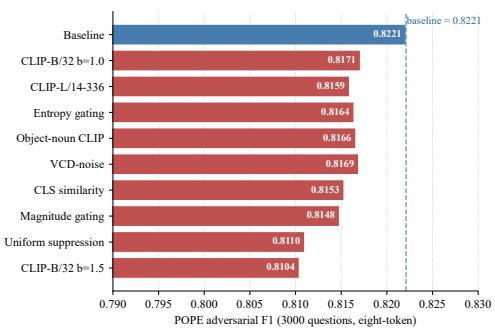  
(a) F1 ordered against baseline.

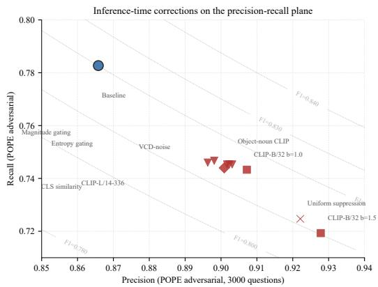  
(b) Precision–recall plane.  
Figure 7: Nine inference-time corrections on POPE adversarial, two views. (a) F1 against the corrected baseline at 0.8221. (b) The same methods on the precision-recall plane with F1 iso-curves. Every yes-suppression variant moves north and west of the baseline; no path crosses the $_ { \mathrm { F 1 = 0 . 8 2 2 1 } }$ iso-curve.

CLIP-L similarity separates TPs from FPs by a small but reliable margin. We took the maximum cosine similarity between the question-noun text embedding and CLIP-L’s 576 patch features for every question. The TP group (n=1,173) has mean 0.1507 and the FP group (n=183) has mean 0.1375, a gap of 0.0132 (95% bootstrap CI [0.0084, 0.0180], 10,000 resamples, percentile method, NumPy default\_rng seed 42; Mann–Whitney U = 132923, $p = 2 . 0 5 \times \mathrm { \bar { 1 0 ^ { - 7 } } } ;$ Cohen’s $d = 0 . 4 0 )$ . Reliable but small. A gate keyed on this signal would have to separate TPs from FPs at $d = 0 . 4 0$ while the precision-recall tradeoff punishes any threshold that suppresses FPs at the expense of TPs. The pattern fits a structural property of the split: adversarial negatives co-occur in the same image as the queried object, CLIP was trained on the same co-occurrence statistics, and its embedding space encodes them.

Decoder attention points the wrong way. Mean attention from the final text token to the 576 image positions, averaged across layers 14–20, is 0.0738 for correct predictions $( n { = } 2 , 4 9 0 )$ and 0.0801 for wrong ones (n=510); Mann–Whitney $U = 4 5 2 6 3 5$ , two-sided $p = 1 . 4 5 \times 1 0 ^ { - 2 4 }$ , Cohen’s $d = - 0 . 4 6$ . The layers-14–20 window was fixed before analysis as the mid-to-late band of the 32-layer LLaMA-2 decoder, not tuned to maximise the effect. The direction holds per category: FPs show higher mean attention (0.0833) than TPs (0.0780; $p = 4 . 1 3 \times 1 0 ^ { - 9 } )$ , and FNs higher (0.0783) than TNs $( 0 . 0 7 0 0 ; p = 1 . 5 0 \times 1 0 ^ { - 2 3 } )$ . Wrong predictions consistently draw more image attention than correct ones (Figure 8). A plausible reading is that uncertain predictions trigger more looking as the model hunts for evidence, which runs against the “more grounding means more correct” assumption the six grounding gates rely on.

The logit gap separates by confidence, not correctness. Figure 9 gives the mean absolute logit gap $| \ell _ { \mathrm { y e s } } - \ell _ { \mathrm { n o } } |$ per category: 2.066 for TPs, 1.482 for TNs, 0.700 for FPs, and 0.962 for FNs. It separates correct from wrong with Cohen’s d = 1.06 across all 3,000 questions $( p = 1 . 2 2 \times 1 0 ^ { - 9 3 } )$ Within the positive class TPs beat FNs $( d = 1 . 2 2 , p = 4 . 8 3 \times 1 0 ^ { - 6 8 } )$ ; within the negative class TNs beat FPs $( \bar { d } = 1 . 1 8 , p = 1 . 1 9 \times 1 0 ^ { - 4 1 } )$ . The model is most confident when right and least confident when wrong. Suppression acts on small-gap questions in both directions at once: a small-gap TP gets pushed to FN at roughly the rate a small-gap FP gets pushed to TN, so the net F1 contribution is near zero, and in our runs the sign came out negative every time. The p-values here are uncorrected for multiple comparisons; given the effect magnitudes, a Bonferroni correction over the six tests changes no qualitative conclusion.

The adversarial split is behaving as designed. Co-occurring negatives are hard to refute with image evidence, because the evidence ambiguously supports both the queried object and the one actually present. The methods we tested assume a separable correctness signal the split is built to deny. On the easier splits we would expect the same suppression to look better, since those negatives are easier to rule out visually. Beating the adversarial baseline at the decoding step would need a signal the dataset does not undercut, and we do not have a candidate.

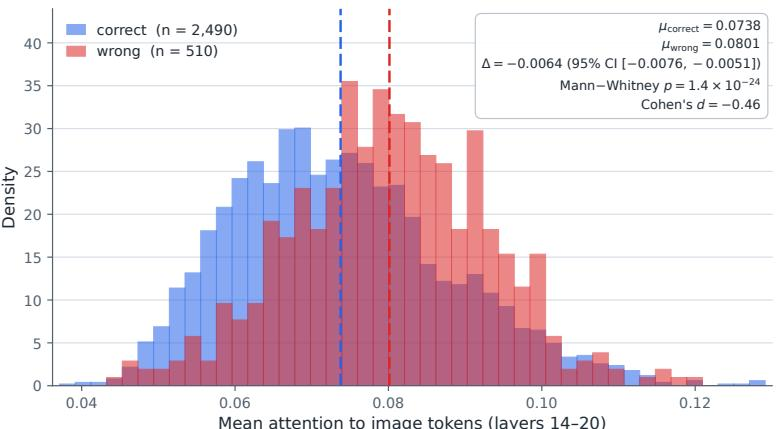  
Mean attention to image tokens (layers 14–20)  
Figure 8: Distribution of mean attention from the final text token to image positions, layers 14–20, on the 3,000-question adversarial run. Blue bars are correct (n=2490); red bars are wrong $\scriptstyle ( n = 5 1 0 )$ Higher image attention associates with wrong predictions, so suppressing yes-logits when attention is low removes signal from the wrong side of the distribution.

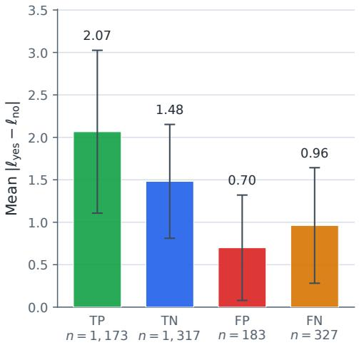

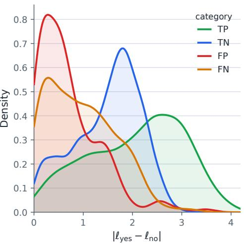  
Figure 9: Absolute logit gap $| \ell _ { \mathrm { y e s } } - \ell _ { \mathrm { n o } } |$ at the answer position on the 3,000-question adversarial run. Left: per-category mean with one-standard-deviation error bars (TP $n { = } 1 1 7 3 .$ , TN $n { = } 1 3 1 7$ , FP $n { = } 1 8 3$ , FN $n { = } 3 2 7 ;$ means 2.07, 1.48, 0.70, 0.96). Right: kernel-density estimates. The order $\mathrm { T P } >$ $\mathrm { T N } > \mathrm { F N } > \mathrm { F P }$ at the mean separates confidence from correctness, which is why uncertainty-keyed corrections trade TPs for FNs at about the same rate as FPs for TNs.

Group-level means and standard deviations behind these effect sizes are in Table 9. The pooled attention SD is 0.0140, giving $d = ( 0 . 0 7 3 8 - 0 . 0 8 0 1 ) / 0 . 0 1 4 0 = - 0 . 4 5$ (reported as −0.46 at the precision used above); the correct-versus-wrong logit-gap pooled SD is 0.839, giving $d = 1 . 0 6$

## G Multi-Model Detail

## G.1 Token-set divergence: the LLaVA-1.6-Mistral map

To expose the mechanism behind the legacy $\ : 8 t o k = 0 \ :$ result, we zoom in on LLaVA-1.6-Mistral, whose Mistral vocabulary makes the LLaMA-2 IDs point at the wrong surface forms. Figure 10 shows the difference at a glance and Table 10 lists the tokenizer-derived IDs.

Table 9: Per-group means and standard deviations underlying the effect sizes. SD is the sample standard deviation.
<table><tr><td>Signal</td><td>Group</td><td>n</td><td>Mean</td><td>SD</td></tr><tr><td>Attention</td><td>correct</td><td>2,490</td><td>0.0738</td><td>0.0142</td></tr><tr><td>Attention</td><td>wrong</td><td>510</td><td>0.0801</td><td>0.0128</td></tr><tr><td>Logit gap</td><td>TP</td><td>1,173</td><td>2.066</td><td>0.959</td></tr><tr><td>Logit gap</td><td>TN</td><td>1,317</td><td>1.482</td><td>0.670</td></tr><tr><td>Logit gap</td><td>FP</td><td>183</td><td>0.700</td><td>0.621</td></tr><tr><td>Logit gap</td><td>FN</td><td>327</td><td>0.962</td><td>0.681</td></tr></table>

Yes/No surface forms map to different token IDs in each model  
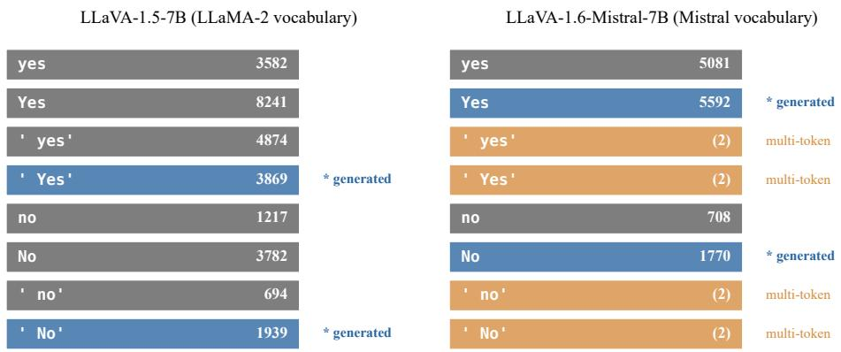  
Figure 10: Yes/no surface forms map to different token IDs under each model. Blue rows are the forms the model actually generates first after ASSISTANT:; grey rows are valid single-token IDs that never appear; orange multi-token rows are space-prefixed forms the Mistral tokenizer splits into two tokens, so they cannot enter a first-token comparison.

## G.2 Prompt-template robustness

The master table fixes one template per model. To check the dynamic readout is stable under a template change, rather than an artifact of the LLaVA-1.5 string, we compared the first 500 POPE adversarial questions of LLaVA-1.6-Mistral under two templates: the LLaVA-1.5 paper template and the model’s native chat template via processor.apply\_chat\_template. In both runs the only first tokens generated were id 5592 (Yes) and id 1770 (No); the LLaMA-2 IDs never appeared. Table 11 reports the four readouts.

The dynamic single-token and string-parse readouts agree to four decimals under either template, the empirical face of Theorem 1. The legacy eight-token readout is 0 under both, because none of the LLaMA-2 IDs is ever the argmax on a Mistral vocabulary, and the comparison between two zero-mass logits resolves the same way on every question. Absolute F1 is not comparable to LLaVA-1.5: on the full 3,000-question split the dynamic readout gives 0.8521, and the 0.8719 here is the 500-question slice. The point of the cross-model run is narrow, that the framework ports cleanly when token sets are re-derived from each model’s tokenizer, and that transferring the LLaVA-1.5 IDs verbatim is unsafe.

Provenance and verification. Per-question logs for LLaVA-1.6-Mistral-7B are in experiments/cross\_model/. For mPLUG-Owl2, InstructBLIP-Vicuna-7B, and Qwen2-VL-7B-Instruct, the Table 4 metrics are the original-run summaries in experiments/multi\_model/, with a Kaggle notebook that regenerates them. A secondary verification run (transformers v4.57.1/v5.10.1) reproduced Qwen2-VL exactly on all splits and mPLUG-Owl2 on adversarial and popular; InstructBLIP (adversarial) differed by about 0.004 F1 under the newer environment, and one mPLUG-Owl2 (random) regeneration hit a storage error and produced a degenerate all-yes output. We report the original metrics for a single coherent environment; none of the qualitative conclusions change.

Table 10: Tokenizer-derived single-token IDs for yes/no surface forms under llava-hf/llava-v1.6-mistral-7b-hf. The four space-prefixed forms tokenize to two tokens each ([28705, ID]) and are excluded from the dynamic single-token readout.
<table><tr><td>Form</td><td>Tokenization</td><td>In dynamic set?</td></tr><tr><td>yes Yes</td><td>[5081] [5592]</td><td>yes (single token) yes (single token)</td></tr><tr><td> $\iota _ { \tt { y e s } } ,$   $\therefore y _ { \tt e s } ,$ </td><td>[28705,5081] [28705,5592]</td><td>no (multi-token) no (multi-token)</td></tr><tr><td>no</td><td>[708]</td><td>yes (single token)</td></tr><tr><td>No</td><td>[1770]</td><td>yes (single token)</td></tr><tr><td> ${ \mathfrak { c } } _ { \mathtt { n 0 } } ,$ </td><td>[28705,708]</td><td>no (multi-token)</td></tr><tr><td> $\iota _ { \mathbb { N } \circ } \iota _ { \mathbf { \lambda } }$ </td><td>[28705,1770]</td><td>no (multi-token)</td></tr><tr><td></td><td></td><td></td></tr></table>

Table 11: Four readouts on the first 500 POPE adversarial questions under LLaVA-1.6-Mistral-7B. dynamic\_single compares max-logits over the tokenizer-derived IDs {5081, 5592} vs {708, 1770}; string\_parse decodes up to 6 tokens and parses the first yes/no substring.
<table><tr><td>Prompt template</td><td>Readout</td><td>F1</td><td>Precision</td><td>Recall</td><td>Yes-rate</td></tr><tr><td rowspan="4">Paper template</td><td>legacy_2tok</td><td>0.6667</td><td>0.5000</td><td>1.0000</td><td>1.000</td></tr><tr><td>legacy_8tok</td><td>0.0000</td><td>0.0000</td><td>0.0000</td><td>0.000</td></tr><tr><td>dynamic_single</td><td>0.8719</td><td>0.8352</td><td>0.9120</td><td>0.546</td></tr><tr><td>string_parse</td><td>0.8719</td><td>0.8352</td><td>0.9120</td><td>0.546</td></tr><tr><td rowspan="4">Native chat template</td><td>legacy_2tok</td><td>0.6925</td><td>0.5297</td><td>1.0000</td><td>0.944</td></tr><tr><td>legacy_8tok</td><td>0.0000</td><td>0.0000</td><td>0.0000</td><td>0.000</td></tr><tr><td>dynamic_single</td><td>0.8621</td><td>0.9517</td><td>0.7880</td><td>0.414</td></tr><tr><td>string_parse</td><td>0.8621</td><td>0.9517</td><td>0.7880</td><td>0.414</td></tr></table>

## H Literature Survey and Comparability

This section scopes the finding honestly: the published numbers below cannot be placed on our scale, because no surveyed paper states its readout and our reference ran under 4-bit NF4 quantization. Table 12 lists the papers we have inspected that report a LLaVA-1.5-7B POPE adversarial baseline. For each we record the reported baseline F1, the reported result, the reported gain, and what the paper says about the readout (not stated if it does not specify, never inferred from the baseline value).

Table 12: Papers reporting LLaVA-1.5-7B POPE adversarial baselines, verified entries as of submission. Values are as reported by each paper (F1×100).
<table><tr><td>Paper</td><td>Rep. base.</td><td>Rep. res.</td><td>Rep. gain</td><td>Readout</td></tr><tr><td>Tang et al. [Tang et al., 2025] (adv.)</td><td>73.54</td><td>84.35</td><td>+10.81</td><td>not stated</td></tr><tr><td>Tang et al. [Tang et al., 2025] (pop.)</td><td>76.53</td><td>87.09</td><td>+10.56</td><td>not stated</td></tr><tr><td>Tang et al. [Tang et al., 2025] (rand.)</td><td>81.54</td><td>89.55</td><td>+8.01</td><td>not stated</td></tr><tr><td>Seo et al. [Seo et al., 2025] (adv.)</td><td>79.30</td><td>80.00</td><td>+0.70</td><td>not stated</td></tr><tr><td>Chen et al. [Chen et al., 2025] (adv.)</td><td>81.00</td><td>81.80</td><td>+0.80</td><td>not stated</td></tr><tr><td>Huo et al. [Huo et al., 2024] (adv.)</td><td>80.90</td><td>82.50</td><td>+1.60</td><td>not stated</td></tr><tr><td>Jiang et al. [Jiang et al., 2026] (adv.)</td><td>75.06</td><td>80.82</td><td>+5.76</td><td>not stated</td></tr><tr><td>Jana et al. [Jana et al., 2026] (adv.)</td><td>82.07</td><td>83.03</td><td>+0.96</td><td>not stated</td></tr></table>

We deliberately decline to headline a claim of the form “N papers’ gains evaporate.” Every surveyed paper leaves its readout not stated, so none can be confirmed from released code or explicit statement, and the number of papers whose readout we can verify is zero. We therefore report no ratio over verified readouts. Inferring a readout from a baseline value would break our own rule, and substituting our 82.21 for a paper’s baseline would not estimate a corrected gain: our reference ran under 4-bit NF4 quantization, and a published baseline may differ from it in readout, precision, prompt format, or decoding. The adversarial baselines in Table 12 run from 73.54 to 82.07, a spread of 8.53 points that these papers do not let us decompose. Settling the comparison takes matched reruns of each method with the readout logged and the precision fixed, or at least the readout stated in the paper or its code. Expanding the survey means reading each paper’s evaluation code rather than inferring the readout.

## I Diagnostic Script and Per-Split Confusion Matrices

python src/run\_pope\_2tok\_baseline.py --split adversarial

The output JSON carries a top\_tokens\_generated field that sorts first-token IDs by frequency. Any ID appearing there but absent from the active readout token set must be added before the rule can be trusted on that model-template pairing.

Table 13 reports full 2 × 2 matrices under the eight-token rule. The adversarial false-positive rate (182/1500 = 12.1%) is roughly 4.2× that of the random split (43/1500 = 2.9%), consistent with the co-occurrence design of the adversarial negatives.

Table 13: Confusion matrices under eight-token evaluation, full 3,000-question splits. Counts are exact, taken from the per-question prediction JSON files; row sums equal 3,000 per split.
<table><tr><td>Split</td><td>TP</td><td>TN</td><td>FP</td><td>FN</td></tr><tr><td>Adversarial</td><td>1,174</td><td>1,318</td><td>182</td><td>326</td></tr><tr><td>Popular</td><td>1,191</td><td>1,388</td><td>112</td><td>309</td></tr><tr><td>Random</td><td>1,191</td><td>1,457</td><td>43</td><td>309</td></tr></table>