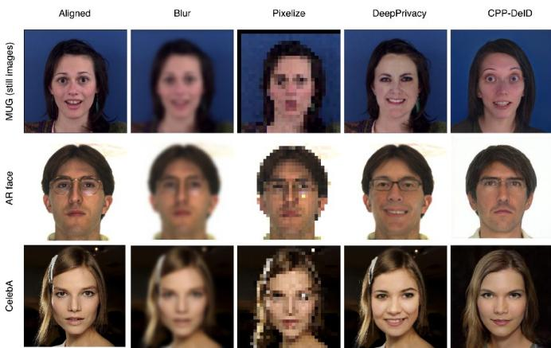
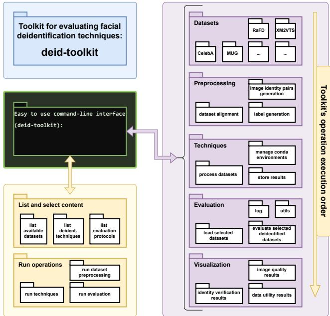

# Toolkit for Facial Deidentification

(Toolkit para Desidentificacion Facial)´

Esteban Leiva-Montenegro∗ ∗Instituto Tecnologico de Costa Rica, Costa Rica´ estebanlm2803@gmail.com ORCID: https://orcid.org/0009-0004-3523-0057

Manfred Gonzalez-Hernandez‡ ‡University of Ljubljana, Ljubljana, Slovenia gonzalezhernandez.manfred@gmail.com ORCID: https://orcid.org/0000-0002-5408-7901

Peter Peer‡

‡University of Ljubljana, Ljubljana, Slovenia peter.peer@fri.uni-lj.si ORCID: https://orcid.org/0000-0001-9744-4035

Vitomir Strucˇ ‡ ‡University of Ljubljana, Ljubljana, Slovenia vitomir.struc@fe.uni-lj.si ORCID: https://orcid.org/0000-0002-3385-5780

Matthieu Pillot†

France

matthieu.pillot@ensea.fr ORCID: https://orcid.org/0009-0006-3179-9152

Blaz Medenˇ ‡

‡University of Ljubljana, Ljubljana, Slovenia blaz.meden@fri.uni-lj.si ORCID: https://orcid.org/0000-0002-1690-4798

Abstract—This work presents a novel open-source toolkit designed for the evaluation of face deidentification techniques with available evaluation models. The framework provides a complete evaluation pipeline, including preprocessing, deidentification, and performance assessment, based on data utility, image quality, and identity protection metrics. It supports a variety of datasets, enabling researchers to easily benchmark new deidentification techniques. Results show the effectiveness of some techniques on maintaining privacy while preserving image utility. The toolkit is aimed at unifying future research by providing a standard evaluation framework for privacyenhancing technologies in facial biometrics. Implementation is available at github.com/blazm/deid-toolkit.

Index Terms—Face deidentification, privacy toolkit, biometrics, image processing, deep learning.

## I. INTRODUCTION

Biometric data, such as facial images, is inherently tied to individuals and can reveal a substantial amount of personal information [1]. Today, there is a wide range of automated methods capable of extracting features from facial images, regardless of variations and noise in the data. This feature extraction can potentially expose sensitive information about individuals and enable face recognition within large databases, thereby compromising a fundamental human right—privacy [2], as protected under the Human Rights Act of 1998, Article 8: Right to Privacy [3].

Face deidentification aims to safeguard privacy by concealing or removing identity-related information, making it difficult for both human observers and machine learning models to infer the subject’s identity [2]. In addition to privacy protection, another critical goal is utility preservation. While identity-specific features are obfuscated, the rest of the facial features must remain intact to retain the image’s utility. The significance of facial deidentification has gained considerable attention in recent years, driven by the need to preserve privacy in facial images across various applications. Numerous methods have been proposed, leveraging a range of machine learning techniques to achieve privacy protection [4], [5], [6], [7], [2]. Some of these techniques are evaluated using various models (classifiers, recognition models, metrics) to ensure that the utility of the deidentified data is maintained and that privacy is protected by preventing recognition of individuals in the processed images (see Figure 1 for visual examples of deidentification methods within the toolkit). For more detailed descriptions and explanations of existing deidentification techniques and evaluation methodology, we refer the reader to the related literature [1], [2].

Beyond privacy protection, deidentification techniques must ensure high realism to remain artifact-free, especially for human-centered applications like attribute recognition, where image realism is crucial [2]. Additionally, state-of-the-art (SOTA) models need to generate diverse, deidentified outputs, particularly when handling multiple subjects [8]. Proper data preparation and configuration for model inference, as well as evaluating data utility and identity verification, are critical for advancing research in facial deidentification. The main contribution of this work is a centralized solution with data preparation techniques and SOTA deidentification models, supported by comprehensive performance metrics and protocols.

## II. METHODOLOGY

In this section, we outline the proposed toolkit’s structure, covering the data preparation techniques (face detection and face alignment via detected landmarks) and both SOTA and classical methods for facial deidentification. Techniques range from simple blurring to advanced deep learning-based facial modifications. We also present the evaluation and verification metrics integrated to assess the performance of these techniques. This toolkit is the first of its kind for open evaluation of facial deidentification techniques. The toolkit features a user-friendly command-line interface, enabling users to browse available datasets, techniques, and metrics, and to perform specific operations such as dataset preprocessing, applying deidentification techniques, or running evaluation metrics on deidentified results.

The toolkit is organized into five main categories: datasets, preprocessing, techniques, evaluation, and visualization, as shown in Figure 2. Users can select datasets, and preprocessing includes image preparation and metadata generation. The techniques package manages the deidentification algorithms, handling dependencies and encapsulating environments, while also processing datasets and storing results using consistent naming conventions for easier evaluation. Once deidentification is complete, users can execute the evaluation package, which offers protocols for re-identification attempts, facial attribute estimation, data utility, image quality, and diversity assessments. Users select the desired metrics, and upon completion, results can be visualized through plots, metric visualizations, and grid-based displays of deidentified images to evaluate qualitative outcomes. The implementation is available at github.com/blazm/deid-toolkit.

  
Fig. 1. Examples of visual results before and after deidentification—with reference images and the results visualized along with the rest of the deidentification techniques available in the toolkit.

## III. RESULTS

We provide open protocols to evaluate various face deidentification algorithms. While datasets are not included in the toolkit due to licensing restrictions, they can be adapted for use as long as they have annotated attribute labels. For this study, we followed the established literature to select suitable facial image datasets [1], with MUG [9], Extended Cohn-Kanade (CK+) [10], and ArFace [11] being key examples.

The MUG dataset contains sequences from 86 subjects displaying seven emotions and includes gender annotations. We processed MUG into a “MUG-still” variant, where only still frames showing peak expressions were retained for analysis (988 frames). CK+ and ArFace datasets include 5876 and 3128 annotated facial images, respectively. CK+ provides expression labels, while ArFace provides gender labels. All the datasets were preprocessed using the toolkit’s internal preprocessing protocols, including detection and alignment. The reported results cover four categories: identity verification after deidentification via AdaFace [12] (Table II, right), gender and expression preservation evaluation via the DAN [13], HSEmotion [14], DeepFace [15], and ResNet-18 [16] models (Table I), image quality evaluation metrics (Table II, left), and the qualitative evaluation with visual examples (Figure 1).

  
Fig. 2. The architecture design of the proposed facial deidentification toolkit.

## IV. CONCLUSION

The purpose of the presented toolkit for facial deidentification is to promote open evaluation and to enable the use of structured and automated evaluation protocols to measure the performances of currently available face deidentification techniques. Additionally, the broader utility of the proposed toolkit is to offer new researchers in this field the option to easily and objectively compare the performance of newly developed facial privacy-protecting techniques with existing baselines. The toolkit will be regularly updated with new metrics to maintain a robust pipeline for face deidentification.

## RESUMEN (ESPANOL˜ )

Este trabajo presenta una novedosa herramienta de codigo´ abierto disenada para la evaluaci˜ on de t´ ecnicas de desidenti-´ ficacion facial utilizando modelos de evaluaci´ on disponibles.´ El marco de trabajo proporciona una canalizacion completa de´ evaluacion, que incluye preprocesamiento, desidentificaci´ on y´ evaluacion de rendimiento basada en la utilidad de los datos, la´ calidad de la imagen y las metricas de protecci´ on de identidad.´

TABLE I  
ACCURACY OF DEIDENTIFICATION TECHNIQUES IN PRESERVING DATA UTILITY, MEASURED BY FACIAL EXPRESSION CLASSIFICATION (7 CLASSES, USING DAN [13] AND HSEMOTION [14]) AND GENDER PREDICTION (USING DEEPFACE [15] AND RESNET-18 [16]). DAN’S PERFORMANCE WAS EXCLUDED FOR CPP-DEID, AS IT SERVED AS THE GUIDANCE MODEL. EVALUATION WAS CONDUCTED ON THE MUG-STILL, CK+, AND ARFACE DATASETS. DEIDENTIFICATION TECHNIQUES ARE LISTED IN THE FIRST COLUMN AND THE EVALUATION CLASSIFICATION MODELS ARE LISTED IN THE SECOND ROW (IN GRAY).
<table><tr><td rowspan="2">Techniques</td><td colspan="4">MUG (still) dataset</td><td colspan="2">CK+ dataset</td><td colspan="2">ArFace dataset</td></tr><tr><td>DAN (expr.) ↑</td><td>HSEmotion (expr.)↑</td><td>DeepFace (gd) ↑</td><td>ResNet-18 (gd) ↑</td><td>DAN (expr.) ↑</td><td>HSEmotion (expr.) ↑</td><td>DeepFace (gd) ↑</td><td>ResNet-18 (gd) ↑</td></tr><tr><td>AMT-GAN</td><td>76.98%</td><td>80.73%</td><td>90.57%</td><td>91.68%</td><td>78.19%</td><td>81.88%</td><td>88.44%</td><td>91.52%</td></tr><tr><td>Croft et al.</td><td>13.18%</td><td>12.58%</td><td>59.63%</td><td>41.08%</td><td>18.64%</td><td>17.09%</td><td>78.04%</td><td>35.42%</td></tr><tr><td>Blur</td><td>60.34%</td><td>56.59%</td><td>81.85%</td><td>54.97%</td><td>69.40%</td><td>74.87%</td><td>85.65%</td><td>74.58%</td></tr><tr><td>CleanIR</td><td>43.91%</td><td>42.80%</td><td>71.40%</td><td>84.08%</td><td>56.42%</td><td>56.78%</td><td>78.71%</td><td>81.23%</td></tr><tr><td>CPP-DeID</td><td></td><td>66.63%</td><td>86.71%</td><td>94.42%</td><td>/</td><td>67.39%</td><td>86.35%</td><td>88.84%</td></tr><tr><td>KSameNet</td><td>71.50%</td><td>67.34%</td><td>58.22%</td><td>56.09%</td><td> $4 9 . 1 7 \%$ </td><td>51.48%</td><td>72.03%</td><td>55.08%</td></tr><tr><td>Pixelize</td><td>39.76%</td><td>44.42%</td><td>62.17%</td><td>59.33%</td><td>52.31%</td><td>48.12%</td><td>83.38%</td><td>65.22%</td></tr></table>

TABLE II

BASELINE PERFORMANCES IN TERMS OF COMPUTING IMAGE QUALITY METRICS, OBTAINED ON DEIDENTIFIED AND SOURCE IMAGE PAIRS—INCLUDING MSE, LPIPS [17], SSIM [18], AND MS-SSIM [18] (LEFT). VERIFICATION EXPERIMENT RESULTS IN TERMS OF THE REPORTED AREA UNDER THE ROC CURVE (AUC [19]) (RIGHT). THE EVALUATION WAS PERFORMED ON THE MUG-STILL, CK+, AND ARFACE DATASETS.
<table><tr><td rowspan="2">Techniques</td><td colspan="4">image quality</td><td colspan="3">verification (AUC ↓)</td></tr><tr><td>MSE↓</td><td>LPIPS ↓</td><td></td><td>SSIM ↑MS-SSIM ↑MUG (still)</td><td></td><td>CK+</td><td>ArFace </td></tr><tr><td>AMT-GAN</td><td> $\overline { { 0 . 2 0 \pm 0 . 0 6 } }$ </td><td> $\overline { { 0 . 4 3 \pm 0 . 0 9 } }$ </td><td> $\overline { { 0 . 5 1 \pm 0 . 1 2 } }$ </td><td> $\overline { { 0 . 5 9 \pm 0 . 1 1 } }$ </td><td> $\overline { { 0 . 9 9 \pm 0 . 0 0 } }$ </td><td> $\overline { { 0 . 9 9 \pm 0 . 0 0 } }$ </td><td> $\overline { { 0 . 7 4 \pm 0 . 0 1 } }$ </td></tr><tr><td>Croft et al.</td><td> $1 . 0 4 \pm 0 . 1 4$ </td><td> $0 . 6 7 \pm 0 . 0 2$ </td><td> $0 . 3 5 \pm 0 . 0 4$ </td><td> $0 . 2 4 \pm 0 . 1 3$ </td><td> $0 . 5 2 \pm 0 . 0 1$ </td><td> $0 . 5 0 \pm 0 . 0 0$ </td><td> $0 . 5 1 \pm 0 . 0 0$ </td></tr><tr><td>Blur</td><td> $0 . 0 1 \pm 0 . 0 0$ </td><td> $0 . 5 7 \pm 0 . 0 4$ </td><td> $0 . 7 1 \pm 0 . 0 5$ </td><td> $0 . 8 2 \pm 0 . 0 3$ </td><td> $0 . 9 9 \pm 0 . 0 0$ </td><td> $0 . 9 9 \pm 0 . 0 0$ </td><td> $0 . 7 2 \pm 0 . 0 0$ </td></tr><tr><td>CleanIR</td><td> $0 . 0 1 \pm 0 . 0 0$ </td><td>0.23 ± 0.02</td><td> $0 . 8 1 \pm 0 . 0 4$ </td><td> $0 . 9 0 \pm 0 . 0 2$ </td><td> $0 . 7 7 \pm 0 . 0 1$ </td><td> $0 . 8 4 \pm 0 . 0 0$ </td><td> $0 . 6 4 \pm 0 . 0 0$ </td></tr><tr><td>CPP-DeID</td><td> $0 . 0 3 \pm 0 . 0 1$ </td><td> $0 . 1 9 \pm 0 . 0 3$ </td><td> $0 . 6 6 \pm 0 . 0 5$ </td><td> $0 . 7 3 \pm 0 . 0 6$ </td><td> $0 . 9 5 \pm 0 . 0 1$ </td><td> $0 . 9 9 \pm 0 . 0 0$ </td><td> $0 . 7 2 \pm 0 . 0 1$ </td></tr><tr><td>KSameNet</td><td> $1 . 1 5 \pm 0 . 1 5$ </td><td> $0 . 7 2 \pm 0 . 0 4$ </td><td> $0 . 3 8 \pm 0 . 0 5$ </td><td> $0 . 3 6 \pm 0 . 1 2$ </td><td> $0 . 5 0 \pm 0 . 0 1$ </td><td> $0 . 5 1 \pm 0 . 0 0$ </td><td> $0 . 5 2 \pm 0 . 0 1$ </td></tr><tr><td>Pixelize</td><td> $0 . 0 5 \pm 0 . 0 1$ </td><td> $0 . 7 4 \pm 0 . 0 6$ </td><td> $0 . 5 9 \pm 0 . 0 5$ </td><td> $0 . 6 0 \pm 0 . 0 4$ </td><td> $0 . 9 9 \pm 0 . 0 0$ </td><td> $0 . 9 9 \pm 0 . 0 0$ </td><td> $0 . 7 3 \pm 0 . 0 0$ </td></tr></table>

Soporta una variedad de conjuntos de datos, permitiendo a los investigadores evaluar facilmente nuevas t´ ecnicas de desiden-´ tificacion. Los resultados muestran la efectividad de algunas´ tecnicas para mantener la privacidad mientras se preserva la´ utilidad de la imagen. La herramienta esta destinada a unificar´ investigaciones futuras al proporcionar un marco de trabajo estandar de evaluaci ´ on para las tecnolog ´ ´ıas que mejoran la privacidad en biometr´ıa facial.

## REFERENCES

[1] B. Meden, P. Rott, P. Terhrst, N. Damer, A. Kuijper, W. J. Scheirer, A. Ross, P. Peer, and V. Struc, “Privacy–enhancing face biometrics:ˇ A comprehensive survey,” IEEE Transactions on Information Forensics and Security, vol. 16, pp. 4147–4183, 2021.

[2] B. Meden, M. Gonzalez-Hernandez, P. Peer, and V. Struc, “Faceˇ deidentification with controllable privacy protection,” Image and Vision Computing, vol. 134, p. 104678, 2023.

[3] The Equality and Human Rights Commission, “The Human Rights Act, Article 8: Respect for your private and family life,” https://www.equalityhumanrights.com/en/human-rights-act/ article-8-respect-your-private-and-family-life, 2022.

[4] T. Li and C. Clifton, “Differentially private imaging via latent space manipulation,” arXiv preprint arXiv:2103.05472, 2021.

[5] S. Hu, X. Liu, Y. Zhang, M. Li, L. Y. Zhang, H. Jin, and L. Wu, “Protecting facial privacy: Generating adversarial identity masks via stylerobust makeup transfer,” in Proceedings of the IEEE/CVF Conference on Computer Vision and Pattern Recognition (CVPR), 2022, pp. 15 014– 15 023.

[6] X. Yang, Y. Dong, T. Pang, H. Su, J. Zhu, Y. Chen, and H. Xue, “Towards face encryption by generating adversarial identity masks,” in Proceedings of the IEEE/CVF International Conference on Computer Vision (ICCV), 2021, pp. 3897–3907.

[7] H. Uchida, N. Abe, and S. Yamada, “DEDIM: De-identification using a diffusion model,” in Proceedings of the IEEE International Conference on Biosignals (BIOSIG), 2022, pp. 1–5.

[8] P. Nousi, S. A. Papadopoulos, A. Tefas, and I. Pitas, “Deep autoencoders for attribute preserving face de-identification,” Signal Processing: Image Communication, vol. 81, p. 115699, 2020.

[9] N. Aifanti, C. Papachristou, and A. Delopoulos, “The MUG facial expression database,” in Proceedings of the 19th International Conference on Pattern Recognition (ICPR), vol. 5, 2008, pp. 1–4, published 2010.

[10] J. F. Cohn and T. Kanade, “The COHN–KANADE automatic facial action coding system,” in Proceedings ofthe 16th International Conference on Pattern Recognition (ICPR), vol. 1, 2000, pp. 89–93.

[11] A. Martinez and R. Benavente, “The AR face database,” CVC Technical Report 24, Computer Vision Center, Tech. Rep. 24, 1998.

[12] M. Kim, A. K. Jain, and X. Liu, “AdaFace: Quality adaptive margin for face recognition,” in Proceedings of the IEEE/CVF Conference on Computer Vision and Pattern Recognition (CVPR), New Orleans, LA, USA, 2022, pp. 18 729–18 738.

[13] I. Tautkute and T. Trzcinski, “Classifying and visualizing emotions with emotional DAN,” Fundamenta Informaticae, vol. 168, no. 2, pp. 269– 285, 2019.

[14] A. V. Savchenko, “HSEmotion: High-speed emotion recognition library,” Software Impacts, vol. 14, p. 100433, 2022.

[15] Y. Taigman, M. Yang, M. Ranzato, and L. Wolf, “DeepFace: Closing the gap to human-level performance in face verification,” in Proceedings of the IEEE Conference on Computer Vision and Pattern Recognition (CVPR), 2014, pp. 1701–1708.

[16] A. V. S. Abhishek, D. V. R. Gurrala, and D. L. Sahoo, “ResNet18 model with sequential layer for computing accuracy on image classification dataset,” vol. 10, no. 5, 2022.

[17] R. Zhang, P. Isola, A. A. Efros, E. Shechtman, and O. Wang, “The unreasonable effectiveness of deep features as a perceptual metric,” in Proceedings of the IEEE/CVF Conference on Computer Vision and Pattern Recognition (CVPR), 2018, pp. 586–595.

[18] Z. Wang, A. C. Bovik, H. R. Sheikh, and E. P. Simoncelli, “Image quality assessment: From error visibility to structural similarity,” IEEE Transactions on Image Processing, vol. 13, no. 4, pp. 600–612, 2004.

[19] A. P. Bradley, “The use of the area under the ROC curve in the evaluation of machine learning algorithms,” Pattern Recognition, vol. 30, no. 7, pp. 1145–1159, 1997.