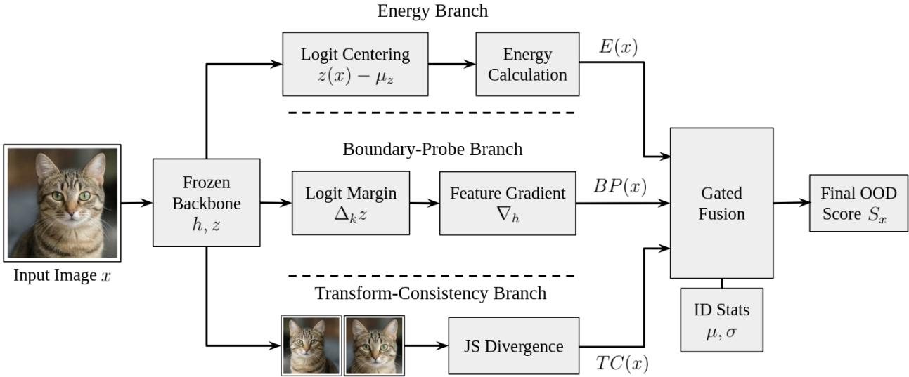

# TriScore: Post-Hoc Out-of-Distribution Detection with Energy, Boundary Probes, and Transform Consistency

Ege Gursoy LAAS-CNRS

egursoy@laas.fr

Nicolas Mansard LAAS-CNRS ANITI

nmansard@laas.fr

## Abstract

Post-hoc out-of-distribution detection usually relies on a single signal extracted from a frozen classifier, such as confidence, energy, features, or gradients. This dependence becomes fragile under classifier-level adversarial shift, where the shift can preserve the detector’s chosen cue while changing the model’s decision behavior. We investigate whether this failure mode can be mitigated by combining complementary detection criteria instead of selecting a single score. We introduce TriScore, a post-hoc OOD detector that combines three ID-calibrated signals from the same frozen backbone: an energy prior, a boundary-fragility score, and a transform-consistency score. These signals are standardized on ID validation data and fused by an input-dependent ID-residual gate, requiring no OOD labels, auxiliary model, training, or stored feature bank. Across four ImageNet-scale backbones, TriScore achieves the best mean AUROC among 15 post-hoc baselines under a non-adaptive adversarial-shift protocol, while remaining competitive on standard OOD benchmarks. Ablations show that the gains come from combining complementary cues rather than optimizing a single detector signal. These results support multi-criterion post-hoc detection as a practical route toward more robust OOD detection under classifier-level shift. The source code is publicly available at github.com/gursoyege/TriScore.

## 1 Introduction

Modern vision systems often reuse a trained backbone across datasets, tasks, and deployment settings. Posthoc out-of-distribution (OOD) detection methods help in those cases, where the classifier has already been fixed and the detector must rely on the outputs or internal signals of the existing classifier without retraining it or using OOD data.

Many post-hoc detectors are built around a primary cue, such as softmax confidence (Hendrycks & Gimpel, 2017), logit energy (Liu et al., 2020), activation statistics (Sun et al., 2021; Djurisic et al., 2023), feature distance (Sun et al., 2022), or gradient magnitude (Huang et al., 2021). Each cue emphasizes a diferent property of the same classifier. A detector built around only one of these cues therefore has little redundancy when a shift happens to preserve that particular statistic, even when other classifier signals are afected.

This lack of redundancy is most visible under classifier-level adversarial shift. These are not detector-adaptive attacks, but they provide a demanding stress test for post-hoc detectors, since the image remains close to an in-distribution sample while the classifier response changes by design. In this setting, several strong baselines become dificult to distinguish from random guessing on at least one backbone, and the backbone on which a baseline collapses difers across baselines.

TriScore addresses this lack of redundancy, extracting three signals from the same frozen classifier. The energy branch measures abnormal logit evidence after subtraction of a class-mean logit vector estimated from ID calibration data. The Boundary-Probe branch estimates local decision fragility from a top-k logit margin and the gradient of that margin at a late feature representation. The transform-consistency branch measures whether mild deterministic views lead to stable predictive distributions. These branches are complementary as they fail for diferent reasons: Energy is cheap and strong on many semantic shifts, Boundary-Probe responds to locally fragile decisions even when the logit magnitude remains plausible, Transform consistency detects predictions that are unstable under benign views.

  
Figure 1: TriScore attaches to a frozen classifier. It computes class-centered energy, Boundary-Probe fragility, and transform consistency, then fuses the standardized branch scores using an ID-residual gate. Calibration uses ID validation data only.

After the three signals are computed, TriScore fuses them with a calibrated rule. Each branch is calibrated on ID validation data, which determines the typical behavior for that branch. At test time, the final score gives more weight to branches whose standardized score exceeds the ID-typical range. Calibration does not use OOD examples, and the method does not train an auxiliary model. An overview of our method is shown in Figure 1.

We evaluate TriScore in the OpenOOD framework on four ImageNet-scale backbones: ResNet-50, RegNet, ViT-B/16, and Swin-T (He et al., 2016; Radosavovic et al., 2020; Dosovitskiy et al., 2021; Liu et al., 2021). The evaluation uses near-OOD and far-OOD datasets (Bitterwolf et al., 2023; Vaze et al., 2022b; Van Horn et al., 2018; Cimpoi et al., 2014; Wang et al., 2022; Zhang et al., 2024), and adversarial-shift data (Goodfellow et al., 2015; Kurakin et al., 2018; Madry et al., 2018; Dong et al., 2018; Zheng et al., 2019; Croce & Hein, 2020; Carlini & Wagner, 2017; Moosavi-Dezfooli et al., 2016; Andriushchenko et al., 2020; Athalye et al., 2018).

TriScore provides a stronger adversarial-shift robustness floor than the individual post-hoc methods. The per-attack analysis shows that this result is not driven by a single attack, and the transformer results show lower cross-attack variance than the closest competitors.

Our contribution is a practical post-hoc detector for frozen classifiers, together with a controlled study of how energy, boundary fragility, and consistency under deterministic transforms interact under clean and adversarial shift. We make the following claims: (i) TriScore combines three frozen-backbone signals under ID-only calibration and remains compatible with standard OpenOOD post-hoc evaluation. (ii) under our non-adaptive adversarial-shift protocol, TriScore gives the best mean AUROC among 15 post-hoc baselines on all four ImageNet-scale backbones, and the best mean FPR@95 on three of four. (iii) the gain is broad across attack families. TriScore wins 27 of 40 attack×backbone AUROC cells and 19 of 40 FPR@95 cells, and it has lower cross-attack AUROC standard deviation on multiple backbones. (iv) the ablation study shows that the proposed branches improve over their closest predecessor-style alternatives and that the fusion provides an ID-only way to combine them.

## 2 Related Work

Post-hoc OOD detection scores a frozen classifier without parameter changes. The earliest and still widely used baseline is maximum softmax probability, which treats low maximum confidence as OOD evidence (Hendrycks & Gimpel, 2017). ODIN improves this output-space view with temperature scaling and a small input perturbation (Liang et al., 2018). Later work showed that logits often carry stronger OOD information than normalized softmax probabilities. The maximum logit score uses the largest presoftmax logit (Hendrycks et al., 2022), energy-based detection uses log-sum-exp free energy (Liu et al., 2020), and GEN studies generalized entropy scores at scale (Liu et al., 2023). These methods are eficient and architecture-agnostic, which makes them strong baselines for any post-hoc method.

A second line of work uses internal network information rather than only final logits. GradNorm uses gradients from a uniform-target objective as an OOD signal (Huang et al., 2021). ReAct and ASH modify late activations by clipping or sparsification before scoring (Sun et al., 2021; Djurisic et al., 2023). DICE changes the efective classifier weights at test time (Sun & Li, 2022), and SCALE revisits activation shaping through activation rescaling (Xu et al., 2024). Feature-space methods use the geometry of ID representations. KNN measures nearest-neighbor distance in deep feature space (Sun et al., 2022). ViM combines the residual outside a principal ID feature subspace with the original logits (Wang et al., 2022). NCI uses neural-collapseinspired class geometry (Liu & Qin, 2025), while CADRef measures class-aware feature discrepancies relative to classifier-weight directions (Ling et al., 2025). TriScore is motivated by the fact that these cues are useful, but each one is incomplete on its own.

The consistency branch is related to test-time augmentation and distributional disagreement. Test-time augmentation often improves prediction or calibration under benign shifts (Shanmugam et al., 2021), and Jensen-Shannon divergence is a standard symmetric comparison between predictive distributions (Lin, 1991). We use this idea in a post-hoc setting. Our branch compares a base prediction with two mild deterministic views and treats distributional instability as OOD evidence.

Several OOD methods alter the classifier during training. Outlier Exposure trains with auxiliary outlier data (Hendrycks et al., 2019), and energy-based losses can also serve as training objectives (Liu et al., 2020). These approaches are highly efective when retraining and auxiliary OOD data are allowed. They are outside our deployment setting, where the classifier is frozen and the detector must be added after training.

Robustness-oriented OOD detection is closest to our motivation. PRO searches locally around each input for a perturbation that minimizes the OOD score, then uses the resulting score as a robustness-aware detector (Chen et al., 2025). TriScore instead uses fixed forward passes and late-feature backward passes rather than iterative test-time search. The adversarial stress tests in our evaluation draw from the standard attack literature, with FGSM, BIM, PGD and momentum variants, AutoAttack and APGD, C&W, DeepFool, Square, and BPDA-based attacks (Goodfellow et al., 2015; Kurakin et al., 2018; Madry et al., 2018; Dong et al., 2018; Zheng et al., 2019; Croce & Hein, 2020; Carlini & Wagner, 2017; Moosavi-Dezfooli et al., 2016; Andriushchenko et al., 2020; Athalye et al., 2018). Certified robust OOD detection has also been studied (Meinke et al., 2022), but our work makes an empirical post-hoc claim, not a certified one.

We follow current OpenOOD and full-spectrum evaluation practice (Yang et al., 2022; Zhang et al., 2024; Yang et al., 2023). For adversarial generation, the evaluation uses the OpenOOD attack-data interface which uses AutoAttack and Foolbox to generate these attacks (Rauber et al., 2017; Croce & Hein, 2020). ImageNet-scale near-OOD evaluation uses SSB-Hard and NINCO (Vaze et al., 2022b; Bitterwolf et al., 2023), and far-OOD evaluation uses iNaturalist, Textures, and OpenImage-O (Van Horn et al., 2018; Cimpoi et al., 2014; Wang et al., 2022; Zhang et al., 2024). Smaller-scale OSR and generalized OOD studies use CIFAR-10, Tiny ImageNet, and MNIST (Krizhevsky, 2009; Le & Yang, 2015; LeCun et al., 1998; Yang et al., 2024; Vaze et al., 2022a). Since post-hoc detector behavior changes with architecture, we evaluate both convolutional and transformer backbones, with ResNet, RegNet, ViT, and Swin (He et al., 2016; Radosavovic et al., 2020; Dosovitskiy et al., 2021; Liu et al., 2021).

In our method, the energy branch adapts EBO (Liu et al., 2020) with subtracting an ID-estimated classmean logit vector (Eq. (2)). The Boundary-Probe is based on standard $\mathrm { t o p } \mathrm { - } k _ { m }$ margin, the specificity of the branch is the ratio of the margin to its late-feature gradient as one fragility scalar $\left( \mathrm { E q . \ ( 5 ) } \right)$ , which difers from GradNorm’s uniform-target gradient magnitude (Huang et al., 2021) and from margin-only scores. The consistency branch adapts test-time augmentation and Jensen-Shannon divergence (Shanmugam et al., 2021; Lin, 1991) to a post-hoc OOD score. Another new element is the fusion, which is a per-sample, OOD-labelfree combiner keyed on how far each standardized branch exceeds its ID-tail quantile (Section 3.4). Our method contributes through the integration and design of the ID-residual gate, together with the empirica finding (Section 4.2) that diverse ID-only fusion provides a robust detection method. Appendix B.6 further investigates whether the same baseline can be achieved by fusing other existing detectors.

## 3 Methodology

We consider post-hoc OOD detection for a frozen image classifier $f : \mathbb { R } ^ { C \times H \times W } \to \mathbb { R } ^ { K }$ with logits $z ( x ) \in \mathbb { R } ^ { K }$ TriScore assigns a scalar score $S ( x )$ , where larger values indicate stronger evidence that $x$ is OOD. The classifier weights are not updated, and calibration uses only an ID validation split. This setting matches common deployment constraints in which a trained classifier is available, but OOD samples and auxiliary outlier data are not.

We combine three calibrated views of the same frozen classifier. The Energy (E) branch measures whether the logit vector looks atypical after removing persistent class-wise ofsets. The Boundary-Probe (BP) branch estimates local decision fragility by combining a top-k margin with the gradient of that margin at a late feature representation. The Transform-Consistency (TC) branch measures whether the predictive distribution changes under mild deterministic views. These branches are normalized on ID data and fused with an ID-residual gate that gives more weight to whichever branch is most atypical for the current input.

In the rest of this section, we write $z ( x ) \in \mathbb { R } ^ { K }$ for the frozen classifier logits, $\mathcal { D } _ { \mathrm { { I D } } }$ for the ID validation split used for all calibration, and $\mathbb { T } _ { \mathrm { g e o } } = \{ \mathrm { i d } , \mathrm { f i i p } , \mathrm { c r o p } _ { 0 . 9 } \}$ for the deterministic transform pool (Section 3.3) shared by the Boundary-Probe and transform-consistency branches. Every calibration constant is an empirical statistic of a single branch on $\mathcal { D } _ { \mathrm { { I D } } }$ such as, the class-mean logit vector $\mu _ { z } ~ ( \mathrm { E q . ~ ( 2 ) } )$ , the branch means and standard deviations $( \mu . , \sigma . )$ used for z-scoring (Eq. (10)), and the branch quantile thresholds $\kappa .$ used by the gate (empirical $p .$ quantiles of the standardized branch on $\mathcal { D } _ { \mathrm { I D } } \big )$ ). No OOD or adversarial data enters any of these estimates, and an ID-only sensitivity study is given in Appendix B.3 and B.4.

Two assumptions underlie the method:

Assumption 1: The ID calibration split $\mathcal { D } _ { \mathrm { I D } }$ should represent the deployment-time ID distribution, since it determines the branch means, standard deviations, and quantiles. In implementation we use a small standard-deviation floor $\sigma _ { \mathrm { m i n } } = 1 0 ^ { - 6 }$ so that a nearly constant ID branch cannot create unstable standardized scores.

Assumption 2: The transform pool should be mostly label preserving for ID inputs. Horizontal flips and mild crops are usually safe for natural images, but not for all classes, especially classes involving orientation, digits, or readable text. We therefore treat transform consistency as an empirical cue rather than an invariance guarantee.

## 3.1 Energy on class-centered logits

An energy signal is a scalar summary of the full logit vector. Instead of keeping only the largest softmax probability, it uses log-sum-exp to combine the evidence assigned to all classes. For classifier logits $z ( x )$ , the standard raw energy score is

$$
E _ { \mathrm { r a w } } ( x ; T ) = - T \log \sum _ { k = 1 } ^ { K } \exp \Bigl ( \frac { z _ { k } ( x ) } { T } \Bigr )\tag{1}
$$

This is the standard energy-based OOD formulation used by EBO (Liu et al., 2020). It is eficient as it only requires the logits already produced by the classifier, and it is stronger than maximum softmax probability in many large-scale settings as it preserves logit-scale information (Hendrycks et al., 2022).

The limitation is that raw logits in a frozen classifier can include persistent class-wise ofsets inherited from training. Some classes receive systematically larger logits on ID data even when the evidence for a particular input is not stronger. A raw energy score can therefore mix input-level OOD evidence with reusable classlevel logit bias. This is related to the logit-scale calibration efects studied in recent OOD work (Djurisic et al., 2025).

Our addition is to keep the standard energy form but remove the ID-estimated class-wise ofset before computing it. The calibration mean $\mu _ { z }$ , centered logits $\tilde { z } ( x )$ , and final TriScore energy branch $E ( x ; T )$ are

$$
\begin{array} { c l l } { \displaystyle \mu _ { z } = \mathbb { E } _ { x \in \mathcal { D } _ { \mathrm { I D } } } [ z ( x ) ] \in \mathbb { R } ^ { K } , } & { \displaystyle \tilde { z } ( x ) = z ( x ) - \mu _ { z } } \\ { \displaystyle E ( x ; T ) = - T \log \sum _ { k = 1 } ^ { K } \exp \Big ( \frac { \tilde { z } _ { k } ( x ) } { T } \Big ) } \end{array}\tag{2}
$$

The energy branch answers whether the whole logit vector has unusual evidence after removing the average ID class bias. The role of the centering is to make the energy signal less tied to reusable ID class ofsets before it is combined with other signals.

## 3.2 Boundary-Probe on late features

A boundary signal measures how close the current prediction is to a competing decision region. The basic logit-space definition is a margin between the largest logit and plausible alternatives. Let $z _ { ( 1 ) } ( x ) \geq z _ { ( 2 ) } ( x ) \geq$ $\cdots \geq z _ { ( K ) } ( x )$ denote sorted logits. We use the $\mathrm { t o p } \mathrm { - } k _ { m }$ margin

$$
\Delta ( x ) = z _ { ( 1 ) } ( x ) - { \frac { 1 } { k _ { m } - 1 } } \sum _ { i = 2 } ^ { k _ { m } } z _ { ( i ) } ( x )\tag{3}
$$

A top- $\boldsymbol { \cdot } k _ { m }$ average is more stable than a pure top-2 margin in large-class problems as it averages several plausible competitors. We use $k _ { m } = 5$ by default. The operation is piecewise diferentiable; thus, we use the standard autograd subgradient, and exact ties are negligible in floating-point inference.

The standard margin method uses the negative margin as OOD evidence, since a smaller margin indicates a more ambiguous prediction. A standard gradient method, such as GradNorm (Huang et al., 2021), instead uses a gradient magnitude as a sensitivity cue. These baselines isolate two diferent aspects of boundary behavior.

The limitation is however, the margin-only and gradient-only scores are incomplete. The margin says how much separation exists at the current point, but not how quickly that separation changes. The gradient says how sensitive the margin is, but not whether there is enough separation to begin with. Two inputs with the same margin can have diferent local fragility, and two inputs with the same gradient norm can have diferent boundary costs.

Instead, we combine the margin and its late-feature gradient into a first-order fragility proxy. Let $h ( x )$ be the selected late feature representation. For CNNs this is the final convolutional block or the pooled representation feeding the head, and for transformer backbones it is the final block representation used by the classifier head. Gradients are taken only with respect to this representation, with the model in evaluation mode so BatchNorm and LayerNorm statistics are fixed. For a transformed view $t ( x )$ , we define

$$
g _ { t } ( x ) = \nabla _ { h _ { t } } \Delta ( t ( x ) ) , \qquad h _ { t } = h ( t ( x ) )\tag{4}
$$

Under the local linear approximation $\Delta ( h ) \approx \Delta ( h _ { t } ) + g _ { t } ^ { \top } ( h - h _ { t } )$ , the minimum-norm feature perturbation that sets this scalar margin proxy to zero has norm $| \Delta ( t ( x ) ) | / \| g _ { t } ( x ) \| _ { 2 }$ . We use the squared form

$$
d _ { t } ^ { 2 } ( x ) = \frac { \Delta ( t ( x ) ) ^ { 2 } } { \| g _ { t } ( x ) \| _ { 2 } ^ { 2 } + \varepsilon }\tag{5}
$$

The quantity in Eq. (5) is a local, first-order fragility proxy. It is the squared minimum-norm displacement that would zero the margin proxy in the coordinates of the chosen feature map h. Under a smooth reparameterization $h \mapsto \phi ( h )$ the gradient transforms by the inverse Jacobian, so the numeric value depends on the feature coordinates even when the classifier function is unchanged. Thus, BP is a coordinate-dependent sensitivity indicator, and since each branch is z-scored on ID data before fusion (Eq. (10)), a global rescaling of h cancels in $S _ { \mathrm { B P } , z }$ . The $\mathrm { t o p } \mathrm { - } k _ { m }$ averaged margin is also not identical to the argmax boundary, and the first-order approximation can fail when the margin landscape is nonlinear. It follows the same robustness intuition as perturbation-based post-hoc OOD scoring (Chen et al., 2025), while avoiding an iterative inner optimization at test time. We set the stabilizer to $\varepsilon = 1 0 ^ { - 8 }$ , Appendix E.1 reports the distribution of $\| g _ { t } ( x ) \|$ ∥2, shows the guarded denominator never approaches this floor (i.e. the score is insensitive to $\varepsilon )$ , and quantifies sensitivity to the hook location h.

The final Boundary-Probe branch converts this squared proxy into a score where larger values mean greater fragility,

$$
B P ^ { ( t ) } ( x ) = - \log \left( d _ { t } ^ { 2 } ( x ) + \varepsilon \right)\tag{6}
$$

higher values indicate smaller first-order boundary cost. The same small ε stabilizes the denominator in Eq. (5) and the logarithm. We average over the deterministic transform pool,

$$
B P ( x ) = \frac { 1 } { | \mathbb { T } _ { \mathrm { g e o } } | } \sum _ { t \in \mathbb { T } _ { \mathrm { g e o } } } B P ^ { ( t ) } ( x )\tag{7}
$$

This uses one late-feature backward pass per view and reduces single-view gradient noise. Boundary-Probe therefore gives us whether the classifier is locally fragile after accounting for both the current margin and the margin gradient. It complements confidence scores as it can be large even when the current logits still look plausible.

## 3.3 Consistency under deterministic transforms

A transform-consistency signal measures how much a classifier prediction changes under mild views of the same image. The standard definition starts with a transform pool that is expected to preserve the ID label. We use $\mathbb { T } _ { \mathrm { g e o } } = \{ \mathrm { i d } , \mathrm { f i p } , \mathrm { c r o p } _ { 0 . 9 } \}$ where $\mathrm { c r o p } _ { 0 . 9 }$ is a center crop at 90% scale followed by bilinear resize to (H, W). For temperature $\tau > 0$ , the tempered softmax is

$$
p _ { \tau } ( z ) _ { k } = \frac { \exp ( z _ { k } / \tau ) } { \sum _ { j = 1 } ^ { K } \exp ( z _ { j } / \tau ) }\tag{8}
$$

We compute $p _ { 0 } ( x ) = p _ { \tau } ( z ( x ) )$ for the base view and $p _ { t } ( x ) = p _ { \tau } ( z ( t ( x ) ) )$ for each transformed view.

The standard consistency methods compare either predicted labels or scalar uncertainty values across views. Argmax disagreement checks whether the top class changes. Test-time augmentation (TTA) entropy variance checks whether the entropy changes across augmentations (Shanmugam et al., 2021). These are useful as they require only additional forward passes and no retraining.

The issue is that both summaries discard information. Argmax disagreement changes only after the top class flips, so it misses smaller but systematic distributional shifts. Entropy variance can remain small when probability mass moves among classes with similar entropy. For OOD detection, these partial summaries can miss instability in the predictive distribution.

We therefore compare the full predictive distributions with a symmetric Jensen-Shannon (JS) score (Lin, 1991). Probabilities are clamped at a small floor and renormalized before divergences are computed. For two transformed distributions $\tilde { p } _ { 0 }$ and $\tilde { p } _ { t }$ , the JS divergence is given by $\begin{array} { r } { \mathrm { J S } ( \tilde { p } _ { 0 } , \tilde { p } _ { t } ) = \frac { 1 } { 2 } \mathrm { K L } \big ( \tilde { p _ { 0 } } \| \frac { \tilde { p } _ { 0 } + \tilde { p } _ { t } } { 2 } \big ) + } \end{array}$ $\begin{array} { r } { \frac { 1 } { 2 } \mathrm { K L } \left( \tilde { p } _ { t } \| \frac { \tilde { p } _ { 0 } + \tilde { p } _ { t } } { 2 } \right) } \end{array}$ . The final transform-consistency branch compares the two non-identity views to the base prediction,

$$
C ( x ; \tau ) = \frac { 1 } { 2 } \sum _ { t \in \{ \mathrm { { f } f i p , \mathrm { c r o p } \} } } \mathrm { J S } ( \tilde { p } _ { 0 } ( x ) , \tilde { p } _ { t } ( x ) )\tag{9}
$$

This requires no additional forward passes beyond the identity, flip, and crop views already used by the Boundary-Probe branch. The Transform-Consistency branch gives us whether the classifier can keep a stable predictive distribution under mild views and captures information that Energy and $\mathrm { B P }$ do not directly measure.

## 3.4 ID-residual gated fusion

A fusion signal combines several detector scores into one scalar OOD score that is a weighted sum of branch scores after putting them on a comparable scale. The branches have diferent units: Energy is a logit-scale score, BP is a local fragility score, and TC is a distributional disagreement score.

The standard post-hoc fusion method is to z-score each branch on ID data and then average the standardized scores. We first z-score each branch on $\mathcal { D } _ { \mathrm { { I D } } }$ and form the corresponding equal-weight fusion as

$$
E _ { z } ( x ) = \frac { E ( x ; T ) - \mu _ { E } } { \sigma _ { E } } , S _ { \mathrm { B P } , z } ( x ) = \frac { B P ( x ) - \mu _ { \mathrm { B P } } } { \sigma _ { \mathrm { B P } } } , C _ { z } ( x ) = \frac { C ( x ; \tau ) - \mu _ { C } } { \sigma _ { C } }\tag{10}
$$

The standardized scores express all branches in ID-standard-deviation units, which makes them comparable without OOD labels.

But equal weights apply the same branch balance to every test input. This is restrictive since diferent inputs can be abnormal in diferent ways. Some inputs mainly perturb logit evidence, some mainly create boundary fragility, and some mainly create transform instability. A fixed average cannot react to which branch is most ID-atypical for the current sample.

To address this, we replace the fixed equal weights by a per-sample ID-residual gate. The gate uses ID quantiles to determine which branch is unusually large for the current input. Let $\kappa _ { E } , \kappa _ { \mathrm { B P } } $ , and $\kappa _ { C }$ be the empirical $p _ { E } ,$ p , and $p _ { C }$ quantiles of the standardized branches on $\mathcal { D } _ { \mathrm { I D } }$ . We use $p _ { E } = 0 . 9 0 , p _ { \mathrm { B P } } = 0 . 7 0$ and $p _ { C } = 0 . 7 0$ . Energy is a broad logit prior and receives a more conservative upper-tail threshold, while $\mathrm { B P }$ and TC are fragility cues whose signal often begins closer to the ID bulk. These values are fixed ID-only defaults and are not selected using OOD data. For a test input, residuals above the ID thresholds are

$$
r _ { E } ( x ) = \mathrm { m a x } \big ( 0 , E _ { z } ( x ) - \kappa _ { E } \big ) , \qquad r _ { \mathrm { B P } } ( x ) = \mathrm { m a x } \big ( 0 , S _ { \mathrm { B P } , z } ( x ) - \kappa _ { \mathrm { B P } } \big ) , \qquad r _ { C } ( x ) = \mathrm { m a x } \big ( 0 , C _ { z } ( x ) - \kappa _ { C } \big )\tag{11}
$$

The final TriScore fusion converts these residuals into weights and returns the final scalar OOD score $\left( \mathrm { S } ( \mathrm { x } ) \right)$ ,

$$
\begin{array} { c c c } { { w _ { j } ( x ) = \displaystyle \frac { \exp ( r _ { j } ( x ) / s ) } { \sum _ { i \in \{ E , \mathrm { B P } , C \} } \exp ( r _ { i } ( x ) / s ) } , \qquad j \in \{ E , \mathrm { B P } , C \} } } \\ { { \ S ( x ) = w _ { E } ( x ) E _ { z } ( x ) + w _ { \mathrm { B P } } ( x ) S _ { \mathrm { B P } , z } ( x ) + w _ { C } ( x ) C _ { z } ( x ) } } \end{array}\tag{12}
$$

We set the softness parameter to $s = 0 . 6$ . As $s  0$ , the rule approaches a winner-take-all selector over residuals. As $s  \infty ,$ , the rule approaches the equal-weight average. In the reported setting, the gate is moderate. The gated fusion answers which branch is most ID-atypical for the current input, while still retaining information from the other branches.

Calibration uses only the ID split, T and τ are selected by minimizing the variance of the equal-weight standardized score, after which the branch statistics and gate quantiles are fixed. The details of the ID-only calibration and test-time scoring are provided in Appendix A.4.

## 4 Evaluation

The evaluation is designed to test the three-branch score against existing post-hoc detectors and measures its stability across architectures and shifts. We use the OpenOOD framework and compare against 15 post-hoc baselines. The baseline set is restricted to detectors that can be attached to the same frozen classifier, without auxiliary OOD data or retraining, because this is the deployment setting TriScore targets. Within that constraint, the methods cover the main post-hoc families: output and logit scores (MSP, MLS, EBO, ODIN, GEN), activation or classifier-weight shaping (ReAct, ASH, DICE, SCALE), gradient or local-robustness scores (GradNorm, PRO), and feature-geometry scores (KNN, ViM, NCI, CADRef). Most baselines are stock OpenOOD postprocessors, CADRef and PRO are integrated locally as recent strong post-hoc baselines, and TriScore and its branch ablations are added as OpenOOD-compatible postprocessors. The main ImageNetscale evaluation uses ResNet-50, RegNet, ViT-B/16, and Swin-T. These backbones span a residual CNN, a modern convolutional architecture, a plain vision transformer, and a hierarchical transformer.

## 4.1 Benchmarks and protocols

Following OpenOOD, ImageNet-1K provides the ID data. Near-OOD evaluation uses SSB-Hard and NINCO, and Far-OOD evaluation uses iNaturalist, Textures, and OpenImage-O. TriScore estimates its class-mean logits, branch statistics, temperatures, quantiles, and gate parameters from an ID-only calibration subset of at most 5,000 images. OOD or adversarial examples are not used for calibration. Additional CIFAR-10 OOD checks and open-set recognition checks on CIFAR-6, CIFAR-50, TIN-20, and MNIST-6 are reported in Appendices F.1 and F.2.

The adversarial-shift benchmark follows OpenOOD’s ImageNet attack-data interface (Yang et al., 2022; Zhang et al., 2024), with an extended local suite used for evaluation. Foolbox and AutoAttack provide the model wrapper and misclassification-criterion interface for the supported attacks. Attacks are generated against the frozen ImageNet classifier with ImageNet labels, and the resulting perturbed ImageNet images are evaluated as shifted inputs against clean ImageNet ID images. The attacker does not optimize TriScore, the branch scores, or the gate.

We use AutoAttack (AA), APGD-CE, C&W, DeepFool, FGSM, masked PGD (M-PGD), PGD, Square, BIM, and PGD-BPDA. This attack set is chosen to cover single-step and iterative gradient attacks, optimizationstyle attacks, decision-boundary attacks, black-box query attacks, masked/local perturbations, BPDA-style attacks, and an AutoAttack ensemble. It extends the default ImageNet attack-script suite used in OpenOOD with PGD-BPDA and AutoAttack-family attacks in the evaluated adversarial-OOD protocol. The $\ell _ { \infty }$ attacks use $\epsilon = 4 / 2 5 5$ , while C&W and DeepFool follow their OpenOOD/Foolbox $\ell _ { 2 }$ implementations. Appendix A gives more details on these attacks.

We report FPR@95 and AUROC. Following the OpenOOD evaluator, OOD is treated as the positive class and the true positive rate is the fraction of OOD samples detected. FPR@95 is then the false positive rate, i.e. the fraction of ID samples flagged as OOD, at the threshold where the OOD true positive rate first reaches 95% (lower is better). AUROC is the area under the ROC curve and equals the probability that a randomly chosen OOD sample receives a higher score than a randomly chosen ID sample (higher is better). Because this FPR@95 threshold is fixed by the OOD score distribution, it is in general distinct from a fixed ID operating point.

For fixed-threshold deployment, and for the operating point used in the adaptive study of Appendix D, we instead flag an input as OOD when S(x) exceeds the empirical 95th percentile of S on a held-out ID split, which flags 5% of ID inputs.

The two ImageNet summary tables below report results for ResNet-50, RegNet, ViT-B/16, and Swin-T, using clean ImageNet-1K test examples as the ID reference. For clean-OOD, each metric is first averaged within the Near-OOD group (NINCO and SSB-Hard) and within the Far-OOD group (iNaturalist, OpenImage-O, and Textures), and the reported mean is the average of those two group means, following the OpenOOD convention. For adversarial OOD, each metric is instead averaged over the ten attacks listed above. The corresponding per-dataset and per-attack results are reported in Appendices C.1 and C.2.

## 4.2 Adversarial OOD detection

Table 1 reports the mean over the 10 non-adaptive classifier attacks. TriScore obtains the best mean AUROC on all four backbones and the best FPR@95 on RegNet, ViT-B/16, and Swin-T. On ResNet-50, it also has the best mean AUROC. PRO, MSP, and CADRef have lower FPR@95 in this column. On RegNet, TriScore reaches 72.04 AUROC compared with 71.09 for PRO and 70.29 for EBO. On ViT-B/16, it reaches 63.11

AUROC compared with 61.99 for GEN. On Swin-T, it reaches 65.91 AUROC compared with 65.43 for GEN and 65.24 for DICE.

Table 1: Non-adaptive adversarial-shift detection averaged over 10 classifier attacks for each backbone.
<table><tr><td rowspan="2">Method</td><td colspan="2">ResNet-50</td><td colspan="2">RegNet</td><td colspan="2">ViT-B/16</td><td colspan="2">Swin-T</td></tr><tr><td>FPR@95</td><td>AUROC</td><td>FPR@95</td><td>AUROC</td><td>FPR@95</td><td>AUROC</td><td>FPR@95</td><td>AUROC</td></tr><tr><td>ASH</td><td>90.48</td><td>55.68</td><td>93.38</td><td>52.16</td><td>95.25</td><td>51.13</td><td>94.09</td><td>52.11</td></tr><tr><td>CADRef</td><td>87.62</td><td>58.70</td><td>87.47</td><td>58.92</td><td>89.86</td><td>56.81</td><td>82.30</td><td>62.64</td></tr><tr><td>DICE</td><td>92.28</td><td>53.04</td><td>87.80</td><td>61.08</td><td>87.52</td><td>59.35</td><td>88.16</td><td>65.24</td></tr><tr><td>EBO</td><td>91.67</td><td>54.60</td><td>82.76</td><td>70.29</td><td>91.98</td><td>59.57</td><td>91.61</td><td>59.40</td></tr><tr><td>GEN</td><td>90.92</td><td>55.50</td><td>81.36</td><td>70.16</td><td>84.68</td><td>61.99</td><td>80.65</td><td>65.43</td></tr><tr><td>GradNorm</td><td>93.36</td><td>51.51</td><td>94.63</td><td>47.04</td><td>93.07</td><td>53.13</td><td>93.58</td><td>48.55</td></tr><tr><td>KNN</td><td>89.15</td><td>57.96</td><td>87.33</td><td>58.88</td><td>91.37</td><td>54.96</td><td>86.38</td><td>59.24</td></tr><tr><td>MLS</td><td>91.51</td><td>54.79</td><td>82.95</td><td>69.28</td><td>91.76</td><td>59.32</td><td>91.41</td><td>59.69</td></tr><tr><td>MSP</td><td>85.24</td><td>59.64</td><td>84.49</td><td>61.40</td><td>88.64</td><td>58.43</td><td>88.59</td><td>59.99</td></tr><tr><td>NCI</td><td>90.20</td><td>55.98</td><td>93.34</td><td>53.45</td><td>92.28</td><td>54.71</td><td>83.82</td><td>61.90</td></tr><tr><td>ODIN</td><td>94.22</td><td>47.83</td><td>85.98</td><td>63.92</td><td>93.14</td><td>55.94</td><td>93.57</td><td>53.95</td></tr><tr><td>PRO</td><td>77.83</td><td>60.39</td><td>72.79</td><td>71.09</td><td>84.23</td><td>59.44</td><td>80.98</td><td>63.21</td></tr><tr><td>ReAct</td><td>89.73</td><td>56.15</td><td>87.23</td><td>62.55</td><td>89.24</td><td>58.39</td><td>87.24</td><td>61.84</td></tr><tr><td>SCALE</td><td>90.24</td><td>56.36</td><td>89.28</td><td>62.34</td><td>91.91</td><td>59.10</td><td>92.09</td><td>56.80</td></tr><tr><td>ViM</td><td>90.70</td><td>56.57</td><td>87.53</td><td>59.83</td><td>93.35</td><td>55.24</td><td>85.27</td><td>63.47</td></tr><tr><td>TriScore</td><td>88.64</td><td>62.11</td><td>71.26</td><td>72.04</td><td>84.10</td><td>63.11</td><td>80.01</td><td>65.91</td></tr></table>

The per-attack tables in Appendix C.2 show that the aggregate result is not caused by a single attack. Across the 40 attack×backbone cells, TriScore gives the best AUROC in 27 cells. The FPR@95 view is more competitive because PRO is explicitly optimized for perturbation robustness. TriScore still has the best FPR@95 in 19 of 40 cells, compared with 16 for PRO, and it has the best mean FPR@95 on three of four backbones in Table 1. The nearest competitors are attack-specific. NCI is strongest on several ResNet-50 optimization attacks, DICE is strong on parts of Swin-T, and GEN is competitive on several transformer cells. The pattern supports the intended role of TriScore as a broad robustness-floor detector, not necessarily a detector specialized to one attack family.

A second useful statistic is cross-attack variance. On Swin-T, TriScore has a per-attack AUROC standard deviation of 4.5, compared with 5.5 for GEN and 6.9 for DICE. On ViT-B/16, TriScore has standard deviation 5.5, compared with 6.6 for GEN and 5.8 for DICE. Some lower-mean baselines such as PRO or MSP have smaller variance, so the stability claim is relative to the high-AUROC competitors. This matters because adversarial OOD deployments do not usually know the attack family in advance. A method with high mean performance and moderate attack-to-attack dispersion can be preferable to a method that wins on one attack and collapses on another.

The same argument applies across backbones. In Table 1, TriScore’s worst-backbone mean AUROC is 62.1 (on ResNet-50), which is higher than the worst-backbone AUROC of every one of the fifteen baselines, the best baseline floor is PRO at 59.4, and the rest fall further, several below 50 (GradNorm 47.0, ODIN 47.8). TriScore never drops below 62 AUROC under adversarial shift, whereas each baseline has at least one backbone on which it does. Therefore it holds its robustness floor across architectures.

Under this adversarial-shift protocol, TriScore gives the strongest mean AUROC across the evaluated backbones and the best mean FPR@95 on three of four, with lower cross-attack dispersion than the closest high-AUROC competitor on transformer backbones. Appendix E.3 identifies the mechanism behind this floor. The branch correlations are heterogeneous across backbones: on ResNet-50 several pairs are correlated on clean ID data and decorrelate substantially under attack, while on RegNet and the transformer backbones the branches are already weakly correlated on clean data and remain weak-to-moderate under attack. In both regimes the branch errors overlap only partially, so the fusion degrades where single scores fail. Appendix B.6 asks whether the same floor is reachable by fusing other existing detectors, and Appendix D reports the adaptive attacks.

## 4.3 Standard OOD detection

Table 2 reports clean ImageNet-1K OOD detection for each of the four standard backbones under the groupmean protocol defined above. It includes both the final gated TriScore and the E+BP branch subset so that the comparison distinguishes the main detector from the simpler two-branch configuration analyzed in Appendix B.

Table 2: Clean-OOD detection results for each backbone.
<table><tr><td>Method</td><td colspan="2">ResNet-50</td><td colspan="2">RegNet</td><td colspan="2">ViT-B/16</td><td colspan="2">Swin-T</td></tr><tr><td></td><td>FPR@95</td><td>AUROC</td><td>FPR@95</td><td>AUROC</td><td>FPR@95</td><td>AUROC</td><td>FPR@95</td><td>AUROC</td></tr><tr><td>ASH</td><td>41.45</td><td>86.96</td><td>64.65</td><td>76.43</td><td>95.61</td><td>52.38</td><td>94.88</td><td>45.55</td></tr><tr><td>CADRef</td><td>39.22</td><td>87.96</td><td>34.48</td><td>89.96</td><td>46.55</td><td>85.19</td><td>46.77</td><td>85.36</td></tr><tr><td>DICE</td><td>57.15</td><td>82.01</td><td>63.44</td><td>81.17</td><td>68.59</td><td>73.84</td><td>95.66</td><td>54.46</td></tr><tr><td>EBO</td><td>53.49</td><td>82.68</td><td>38.10</td><td>92.09</td><td>89.27</td><td>70.70</td><td>79.45</td><td>77.27</td></tr><tr><td>GEN</td><td>50.46</td><td>83.31</td><td>32.02</td><td>92.83</td><td>51.50</td><td>83.82</td><td>48.10</td><td>84.97</td></tr><tr><td>GradNorm</td><td>63.38</td><td>81.61</td><td>88.28</td><td>56.86</td><td>93.68</td><td>40.51</td><td>95.22</td><td>41.53</td></tr><tr><td>KNN</td><td>52.50</td><td>80.64</td><td>34.65</td><td>90.33</td><td>51.20</td><td>82.46</td><td>52.94</td><td>80.49</td></tr><tr><td>MLS</td><td>53.02</td><td>83.02</td><td>38.74</td><td>91.86</td><td>85.74</td><td>75.92</td><td>74.29</td><td>80.23</td></tr><tr><td>MSP</td><td>58.56</td><td>80.63</td><td>46.66</td><td>87.13</td><td>66.76</td><td>79.78</td><td>60.11</td><td>81.53</td></tr><tr><td>NCI</td><td>42.23</td><td>87.10</td><td>62.05</td><td>82.28</td><td>57.49</td><td>81.30</td><td>52.54</td><td>83.02</td></tr><tr><td>ODIN</td><td>58.22</td><td>82.11</td><td>46.32</td><td>89.40</td><td>88.37</td><td>70.19</td><td>85.56</td><td>70.72</td></tr><tr><td>PRO</td><td>59.21</td><td>81.00</td><td>42.32</td><td>89.80</td><td>58.51</td><td>81.94</td><td>57.27</td><td>82.63</td></tr><tr><td>ReAct</td><td>46.52</td><td>85.52</td><td>50.85</td><td>83.62</td><td>69.21</td><td>77.48</td><td>57.83</td><td>81.93</td></tr><tr><td>SCALE</td><td>38.17</td><td>88.94</td><td>41.37</td><td>91.08</td><td>90.24</td><td>66.97</td><td>85.61</td><td>70.66</td></tr><tr><td>ViM</td><td>48.01</td><td>82.38</td><td>35.38</td><td>90.24</td><td>51.48</td><td>84.93</td><td>49.82</td><td>84.22</td></tr><tr><td>TriScore (E+BP)</td><td>55.88</td><td>80.24</td><td>38.10</td><td>90.15</td><td>74.08</td><td>77.43</td><td>67.42</td><td>79.58</td></tr><tr><td>TriScore</td><td>52.14</td><td>80.01</td><td>37.85</td><td>89.28</td><td>65.99</td><td>80.00</td><td>57.82</td><td>81.37</td></tr></table>

The strongest clean baselines vary by architecture: SCALE is strongest on ResNet-50 in this table, GEN is strongest on RegNet, and CADRef is strongest on ViT-B/16 and Swin-T. The E+BP TriScore variant is a lower-cost clean-OOD alternative, while the final gated detector has better clean FPR@95 on all four backbones in this table.

The results show that TriScore’s main advantage is not clean-OOD dominance; it is the stronger adversarialshift floor in Table 1. On the four-backbone clean mean AUROC, seven baselines score above TriScore’s 82.67 (CADRef 87.12, GEN 86.23, ViM 85.44, PRO 83.84, KNN 83.48, NCI 83.43, and MLS 82.76). TriScore is mid-pack on clean-OOD because it does not use the richer ID-training feature geometry that CADRef and ViM exploit, and that geometry is exactly what helps on standard semantic and texture shifts. The residual gate is designed to act where a branch is driven into its ID tail (Section 3.4). On clean-OOD, where the branches stay near their ID-typical range, it reduces toward an equal-weight average and adds little, so the gated detector is competitive rather than dominant here.

The clean-OOD advantage of the strongest feature-based baselines also comes at a cost and fails to transfer among them. CADRef, ViM, and KNN each lose 26-28 AUROC from clean to adversarial averaged over the four backbones (versus TriScore’s 16.9), and their adversarial AUROC (55-63) falls below TriScore’s (62-72) on every backbone. All three require access to the ID-training features at setup, and KNN additionally retains and searches the full 1.28M-vector feature bank at inference (detailed in Appendix B.5), whereas TriScore calibrates on ID-validation statistics only and stores no bank. The closest baseline overall is GEN, a cheap logit score that beats TriScore on clean-OOD and is the strongest adversarial baseline on the transformer backbones. TriScore wins over GEN on adversarial AUROC on all four backbones. TriScore therefore trades a few points of clean AUROC for a stronger and lighter adversarial-shift floor.

The E+BP row is included as a simpler deployment variant. Empirically, E+BP has slightly higher AUROC than the gated TriScore on ResNet-50 and RegNet, while the gated detector has higher AUROC on ViT-B/16 and Swin-T and lower FPR@95 on all four backbones. Therefore, E+BP provides a cheaper alternative in clean-OOD, while the gated three-branch TriScore remains the main detector for adversarial shift.

The same table also shows a stability advantage that is easy to miss from mean rankings alone. Several baselines have a severe architecture-specific failure on at least one backbone. ASH falls to 52.38 AUROC on ViT-B/16, GradNorm to 56.86 on RegNet, DICE to 54.46 on Swin-T, and SCALE to 66.97 on ViT-B/16. TriScore remains at or above 80 AUROC on all four standard backbones in the clean summary. FPR@95 shows the same stability pattern but not dominance. TriScore stays below 66 FPR@95 on all four backbones, while ASH, GradNorm, DICE, and SCALE each exceed 90 FPR@95 on at least one backbone. This crossarchitecture floor is a useful property for post-hoc deployment, where the detector is often attached after the classifier architecture has already been chosen.

TriScore is not the clean-OOD winner, but it remains competitive and avoids the most severe architecturespecific failures. For clean-OOD deployment, the E+BP variant is the lower-cost TriScore choice, while the final gated detector is the main TriScore variant used for adversarial-shift robustness.

Full per-dataset ImageNet baseline results are reported in Appendix C.1, and gated and equal-weight TriScore variants are separated in Appendices B–C.4.2.

## 5 Limitations

TriScore is designed for frozen classifiers, ID-only calibration, and the non-adaptive classifier-level adversarial shift protocol described in Section 4.1. Therefore, it is not a certified detector, and it is not robust to an adaptive detector-aware adversary as shown in Appendix D. However, on the same TriScore-targeted adversarial examples, several standard diferentiable baselines (EBO, MLS, MSP, GEN, GradNorm) also show high transfer evasion as those attacks were not separately optimized against each baseline. This can be interpreted as transfer evasion, consistent with the adaptive-attacks literature. We explicitly scope the robustness claim to the non-adaptive setting and treat detector-aware robustness as out-of-scope.

The method is strongest when the deployment setting rewards redundancy across logit energy, local boundary fragility, and transform consistency. Clean-OOD benchmarks do not always require all three cues. In the latest branch-combination ablation, the ungated equal-weight E+BP+TC variant has the strongest clean aggregate, while E+BP remains a lower-cost alternative when the extra transform-consistency computation is undesirable. The final gated TriScore should be preferred when robustness to the evaluated adversarial-shift protocol is the primary objective.

The branch behavior is also architecture dependent. On ResNet-50, the energy signal is weak under adversarial shift, and BP-only is better than the full combination. On RegNet, ViT-B/16, and Swin-T, the full combination is more efective. These results suggest that a practical implementation should include a lightweight branch diagnostic before deployment. The current paper uses the ablation evidence to state this rule manually. An automatic ID-only diagnostic for deciding between BP, E+BP, and E+BP+TC remains future work.

Appendix B.4 reports a grid sweep over the quantile levels and softness and a 5-seed calibration study. The ranking is stable, and calibration-subset variability is small (standard deviation ≤ 0.07 AUROC across backbones, one to two orders of magnitude below the Table 1 margins). This bounds calibration-subset noise but not finite-test-set or attack-generation randomness, which we quantify with paired per-image bootstrap intervals in Appendix E.4; close 1-2 AUROC margins should be read with that scope in mind. The quantile levels and softness are fixed ID-only defaults. A backbone-adaptive softness could improve the gate, but we do not tune it without OOD validation data. We also do not report threshold-dependent metrics beyond FPR@95, so fixed-threshold deployment should calibrate the operating point on a held-out ID split.

Boundary-Probe is high for locally fragile decisions, and hard ID examples can also be locally fragile. Appendix E.2 provides the diagnostic. On clean ID data, BP is strongly related to softmax confidence and predicts ID misclassification, so it behaves largely as a hard-example cue. Its independent value appears under shift, where the component of BP orthogonal to MSP still separates adversarial OOD. BP is thus redundant with uncertainty on clean data and complementary to it under attack, which is the regime the method targets.

TriScore is also more expensive than single-forward detectors. It uses three forward passes and three latefeature backward passes per input. For latency-critical settings, E-only or E+BP variants provide lower-cost alternatives.

## 6 Conclusion

TriScore is a post-hoc OOD detector that attaches to a frozen classifier and combines three ID-calibrated signals, namely class-centered logit energy, Boundary-Probe fragility, and Jensen-Shannon transform consistency. The method uses no OOD labels, auxiliary model, retraining, or stored ID-training feature bank. The feature-geometry detectors it competes with need ID-training access at setup, and some of them must search the full feature bank at inference. TriScore instead stores one class-mean logit vector and a small set of scalar ID-validation statistics, with no feature bank. It has no training-set dependency at deployment and is significantly faster than the heaviest baseline. Its main design principle is redundancy. A single confidence cue can be preserved by a shift or perturbation, while a combination of logit evidence, boundary fragility, and view consistency is harder to satisfy simultaneously.

Across four ImageNet-scale backbones and 15 post-hoc baselines, TriScore obtains the best mean AUROC in the non-adaptive adversarial-shift protocol on all four backbones and the best mean FPR@95 on three of four. Its robustness floor holds across architectures as the worst-backbone exceeds the worst-backbone of every baseline, the detector never collapses on a particular backbone unlike the individual cues. It also gives lower cross-attack AUROC variance on the two transformer backbones, which indicates a more uniform robustness floor than the closest high-AUROC competitor. On standard OOD benchmarks, the method remains competitive and avoids several severe architecture-specific failures, although specialized clean-OOD baselines are often stronger on clean-OOD alone.

The ablation studies clarify where the gains come from. Boundary-Probe improves over margin-only and GradNorm-style alternatives, and JS-TC improves over simpler transform-consistency baselines. Classcentered energy is best viewed as a calibrated logit prior for fusion rather than a standalone replacement for EBO. The branches are partly redundant under clean shift, where the ungated E+BP+TC variant gives the strongest fixed-subset aggregate and E+BP is a lower-cost alternative. They are more complementary under adversarial shift, where the full gated detector is stronger on backbones with a usable energy signal.

The main open directions are defenses against detector-aware attackers (e.g. randomized or non-diferentiable gate variants that do not expose a clean gradient path), automatic branch diagnostics that select BP, E+BP, or E+BP+TC for a given backbone from ID-only signals, transform pools that better handle texture-like OOD and smooth optimization-based perturbations, and ImageNet-scale latency for the multi-view scoring. These extensions would turn TriScore from a strong post-hoc adversarial-shift detector into a complete robust OOD detection.

## 7 Acknowledgements

This work is supported by Defi Clé Robotique centrée sur l’Humain funded by Région Occitanie, France and was granted access to the HPC resources of IDRIS under the allocation AD011017069 made by GENCI.

## References

Maksym Andriushchenko, Francesco Croce, Nicolas Flammarion, and Matthias Hein. Square attack: A query-eficient black-box adversarial attack via random search. In European Conference on Computer Vision (ECCV), 2020.

Anish Athalye, Nicholas Carlini, and David Wagner. Obfuscated gradients give a false sense of security: Circumventing defenses to adversarial examples. In International Conference on Machine Learning (ICML), 2018.

Julian Bitterwolf, Maximilian Müller, and Matthias Hein. In or out? fixing ImageNet Out-of-Distribution detection evaluation. In International Conference on Machine Learning (ICML), 2023.

Nicholas Carlini and David Wagner. Towards evaluating the robustness of neural networks. In IEEE Symposium on Security and Privacy (SP), 2017.

Wenxi Chen, Raymond A. Yeh, Shaoshuai Mou, and Yan Gu. Leveraging perturbation robustness to enhance Out-of-Distribution detection. In IEEE/CVF Conference on Computer Vision and Pattern Recognition (CVPR), 2025.

Mircea Cimpoi, Subhransu Maji, Iasonas Kokkinos, Sammy Mohamed, and Andrea Vedaldi. Describing textures in the wild. In IEEE/CVF Conference on Computer Vision and Pattern Recognition (CVPR), 2014.

Francesco Croce and Matthias Hein. Reliable evaluation of adversarial robustness with an ensemble of diverse parameter-free attacks. In International Conference on Machine Learning (ICML), 2020.

Andrija Djurisic, Nebojsa Bozanic, Arjun Ashok, and Rosanne Liu. Extremely simple activation shaping for Out-of-Distribution detection. In International Conference on Learning Representations (ICLR), 2023.

Andrija Djurisic, Rosanne Liu, and Mladen Nikolic. Logit scaling for Out-of-Distribution detection. Machine Vision and Applications, 2025.

Yinpeng Dong, Fangzhou Liao, Tianyu Pang, Hang Su, Jun Zhu, Xiaolin Hu, and Jianguo Li. Boosting adversarial attacks with momentum. In IEEE/CVF Conference on Computer Vision and Pattern Recognition (CVPR), 2018.

Alexey Dosovitskiy, Lucas Beyer, Alexander Kolesnikov, Dirk Weissenborn, Xiaohua Zhai, Thomas Unterthiner, Mostafa Dehghani, Matthias Minderer, Georg Heigold, Sylvain Gelly, Jakob Uszkoreit, and Neil Houlsby. An image is worth 16x16 words: Transformers for image recognition at scale. In International Conference on Learning Representations (ICLR), 2021.

Ian J. Goodfellow, Jonathon Shlens, and Christian Szegedy. Explaining and harnessing adversarial examples. In International Conference on Learning Representations (ICLR), 2015.

Kaiming He, Xiangyu Zhang, Shaoqing Ren, and Jian Sun. Deep residual learning for image recognition. In IEEE/CVF Conference on Computer Vision and Pattern Recognition (CVPR), 2016.

Dan Hendrycks and Kevin Gimpel. A baseline for detecting misclassified and Out-of-Distribution examples in neural networks. In International Conference on Learning Representations (ICLR), 2017.

Dan Hendrycks, Mantas Mazeika, and Thomas Dietterich. Deep anomaly detection with outlier exposure. In International Conference on Learning Representations (ICLR), 2019.

Dan Hendrycks, Steven Basart, Mantas Mazeika, Andy Zou, Joseph Kwon, Mohammadreza Mostajabi, Jacob Steinhardt, and Dawn Song. Scaling Out-of-Distribution detection for real-world settings. In International Conference on Machine Learning (ICML), 2022.

Rui Huang, Andrew Geng, and Yixuan Li. On the importance of gradients for detecting distributional shifts in the wild. In Advances in Neural Information Processing Systems (NeurIPS), 2021.

Alex Krizhevsky. Learning multiple layers of features from tiny images. Technical report, University of Toronto, 2009.

Alexey Kurakin, Ian J. Goodfellow, and Samy Bengio. Adversarial examples in the physical world. In Artificial Intelligence Safety and Security. 2018.

Ya Le and Xuan Yang. Tiny ImageNet visual recognition challenge. Cs231n project report, Stanford University, 2015.

Yann LeCun, Léon Bottou, Yoshua Bengio, and Patrick Hafner. Gradient-based learning applied to document recognition. Proceedings of the IEEE, 1998.

Shiyu Liang, Yixuan Li, and R. Srikant. Enhancing the reliability of Out-of-Distribution image detection in neural networks. In International Conference on Learning Representations (ICLR), 2018.

Jianhua Lin. Divergence measures based on the Shannon entropy. IEEE Transactions on Information Theory, 1991.

Zhiwei Ling, Yachen Chang, Hailiang Zhao, Xinkui Zhao, Kingsum Chow, and Shuiguang Deng. CADRef: Robust Out-of-Distribution detection via class-aware decoupled relative feature leveraging. In IEEE/CVF Conference on Computer Vision and Pattern Recognition (CVPR), 2025.

Litian Liu and Yao Qin. Detecting Out-of-Distribution through the lens of neural collapse. In IEEE/CVF Conference on Computer Vision and Pattern Recognition (CVPR), 2025.

Weitang Liu, Xiaoyun Wang, John D. Owens, and Yixuan Li. Energy-based Out-of-Distribution detection. In Advances in Neural Information Processing Systems (NeurIPS), 2020.

Xixi Liu, Yaroslava Lochman, and Christopher Zach. GEN: Pushing the limits of Softmax-based Out-of-Distribution detection. In IEEE/CVF Conference on Computer Vision and Pattern Recognition (CVPR), 2023.

Ze Liu, Yutong Lin, Yue Cao, Han Hu, Yixuan Wei, Zheng Zhang, Stephen Lin, and Baining Guo. Swin Transformer: Hierarchical vision transformer using shifted windows. In IEEE/CVF International Conference on Computer Vision (ICCV), 2021.

Aleksander Madry, Aleksandar Makelov, Ludwig Schmidt, Dimitris Tsipras, and Adrian Vladu. Towards deep learning models resistant to adversarial attacks. In International Conference on Learning Representations (ICLR), 2018.

Alexander Meinke, Julian Bitterwolf, and Matthias Hein. Provably adversarially robust detection of Outof-Distribution data (almost) for free. In Advances in Neural Information Processing Systems (NeurIPS), 2022.

Seyed-Mohsen Moosavi-Dezfooli, Alhussein Fawzi, and Pascal Frossard. DeepFool: A simple and accurate method to fool deep neural networks. In IEEE/CVF Conference on Computer Vision and Pattern Recognition (CVPR), 2016.

Ilija Radosavovic, Raj Prateek Kosaraju, Ross Girshick, Kaiming He, and Piotr Dollár. Designing network design spaces. In IEEE/CVF Conference on Computer Vision and Pattern Recognition (CVPR), 2020.

Jonas Rauber, Wieland Brendel, and Matthias Bethge. Foolbox: A Python toolbox to benchmark the robustness of machine learning models. In International Conference on Machine Learning (ICML) Reliable Machine Learning in the Wild Workshop, 2017.

Divya Shanmugam, Davis Blalock, Guha Balakrishnan, and John Guttag. Better aggregation in test-time augmentation. In IEEE/CVF International Conference on Computer Vision (ICCV), 2021.

Yiyou Sun and Yixuan Li. DICE: Leveraging sparsification for Out-of-Distribution detection. In European Conference on Computer Vision (ECCV), 2022.

Yiyou Sun, Chuan Guo, and Yixuan Li. ReAct: Out-of-Distribution detection with rectified activations. In Advances in Neural Information Processing Systems (NeurIPS), 2021.

Yiyou Sun, Yifei Ming, Xiaojin Zhu, and Yixuan Li. Out-of-Distribution detection with deep nearest neighbors. In International Conference on Machine Learning (ICML), 2022.

Grant Van Horn, Oisin Mac Aodha, Yang Song, Yin Cui, Chen Sun, Alex Shepard, Hartwig Adam, Pietro Perona, and Serge Belongie. The iNaturalist species classification and detection dataset. In IEEE/CVF Conference on Computer Vision and Pattern Recognition (CVPR), 2018.

Sagar Vaze, Kai Han, Andrea Vedaldi, and Andrew Zisserman. Open-set recognition: A good closed-set classifier is all you need? In International Conference on Learning Representations (ICLR), 2022a.

Sagar Vaze, Kai Han, Andrea Vedaldi, and Andrew Zisserman. The semantic shift benchmark. In International Conference on Machine Learning (ICML) Shift Happens Workshop, 2022b.

Haoqi Wang, Zhizhong Li, Litong Feng, and Wayne Zhang. ViM: Out-of-Distribution with virtual-logit matching. In IEEE/CVF Conference on Computer Vision and Pattern Recognition (CVPR), 2022.

Kai Xu, Rongyu Chen, Gianni Franchi, and Angela Yao. Scaling for training-time and post-hoc Out-of-Distribution detection enhancement. In International Conference on Learning Representations (ICLR), 2024.

Jingkang Yang, Pengyun Wang, Dejian Zou, Zitang Zhou, Kunyuan Ding, Wenxuan Peng, Haoqi Wang, Guangyao Chen, Bo Li, Yiyou Sun, Xuefeng Du, Kaiyang Zhou, Wayne Zhang, Dan Hendrycks, Yixuan Li, and Ziwei Liu. OpenOOD: Benchmarking generalized Out-of-Distribution detection. In Advances in Neural Information Processing Systems (NeurIPS), 2022.

Jingkang Yang, Kaiyang Zhou, and Ziwei Liu. Full-spectrum Out-of-Distribution detection. International Journal of Computer Vision, 2023.

Jingkang Yang, Kaiyang Zhou, Yixuan Li, and Ziwei Liu. Generalized Out-of-Distribution detection: A survey. International Journal of Computer Vision, 2024.

Jingyang Zhang, Jingkang Yang, Pengyun Wang, Haoqi Wang, Yueqian Lin, Haoran Zhang, Yiyou Sun, Xuefeng Du, Yixuan Li, Ziwei Liu, Yiran Chen, and Hai Li. OpenOOD v1.5: Enhanced benchmark for Out-of-Distribution detection. Journal of Data-centric Machine Learning Research, 2024.

Tianhang Zheng, Changyou Chen, and Kui Ren. Distributionally adversarial attack. In AAAI Conference on Artificial Intelligence (AAAI), 2019.

## A Reproducibility Details

## A.1 Evaluation protocol

This section collects the protocol details that are easy to miss from the tables in the main text.

TriScore uses only an ID calibration subset of at most 5,000 examples from the OpenOOD ID validation loader to estimate class-mean logits, branch means and standard deviations, temperature choices, branch quantiles, and gate parameters. Detector metrics are computed with the OpenOOD ID test loader and the corresponding OOD loaders. OOD or adversarial images are not used for calibration. Main clean-OOD and ablation summaries follow the OpenOOD convention used in our scripts. Near-OOD datasets are averaged as a group, Far-OOD datasets are averaged as a group, and the reported mean averages the two groups. Adversarial summaries average the 10 attack-specific metrics listed in Table 3.

## A.2 Adversarial-shift protocol

For all attacks that require labels, the label source is the ImageNet ground-truth label of the source validation image. For all $\ell _ { \infty }$ attacks, we use $\epsilon = 4 / 2 5 5$ . The attack objective is classifier misclassification under the frozen backbone. For Foolbox attacks this is the standard misclassification criterion, for AutoAttack variants it is the standard evaluation routine with the true ImageNet labels. After generation, the detector only sees the perturbed image and does not use labels. Table 3 summarizes the per-attack objective, norm and budget, and implementation details.

Table 3: Adversarial-shift protocol used in the ImageNet attack tables.
<table><tr><td>Attack</td><td>Objective</td><td>Norm</td><td>Implementation details</td></tr><tr><td>FGSM</td><td>classifier loss</td><td> $\ell _ { \infty }$ </td><td>OpenOOD/Foolbox default FGSM path</td></tr><tr><td>BIM</td><td>classifier loss</td><td> $\ell _ { \infty }$ </td><td>OpenOOD/Foolbox basic iterative attack</td></tr><tr><td>PGD</td><td>classifier loss</td><td> $\ell _ { \infty }$ </td><td>OpenOOD/Foolbox PGD defaults</td></tr><tr><td>PGD-BPDA</td><td>classifier loss</td><td> $\ell _ { \infty }$ </td><td>Foolbox LinfPGD with 100 steps through the BPDA model wrapper</td></tr><tr><td>AA</td><td>classifier loss</td><td> $\ell _ { \infty }$ </td><td>AutoAttack standard evaluation</td></tr><tr><td>APGD-CE</td><td>classifier cross-entropy</td><td> $\ell _ { \infty }$ </td><td>AutoAttack APGD-CE component</td></tr><tr><td>Square</td><td>classifier loss</td><td> $\ell _ { \infty }$ </td><td>AutoAttack Square component with default query schedule</td></tr><tr><td>C&amp;W</td><td>classifier misclassification</td><td> $\ell _ { 2 }$ </td><td>Foolbox L2CarliniWagnerAttack, 1000 steps</td></tr><tr><td>DeepFool</td><td>classifier misclassification</td><td> $\ell _ { 2 }$ </td><td>Foolbox L2DeepFoolAttack defaults</td></tr><tr><td>M-PGD</td><td>classifier loss</td><td>masked</td><td>OpenOOD masked PGD, ε = 1, α = 0.01, 40 steps, patch size 60</td></tr></table>

## A.3 Implementation details

All branch scores are standardized using ID-only statistics. To avoid numerical instability from neardegenerate branches, the implementation applies a small standard-deviation floor of $1 0 ^ { - 6 }$ before z-scoring. Probability computations in JS-TC use clamped probabilities for numerical stability. The fixed default hyperparameters are $k _ { m } = 5 , p _ { E } = 0 . 9 0 , p _ { \mathrm { B P } } = p _ { C } = 0 . 7 0$ , softness $s = 0 . 6$ , temperature grid $T , \tau \in \{ 0 . 5 , 1 . 0 \}$ and transform pool $\{ \mathrm { i d } , \mathrm { f l i p } , \mathrm { c r o p } _ { 0 . 9 } \}$ . These values are selected without OOD labels. Sensitivity analyses over these constants are reported in Appendices E.1, B.3, and B.4.

Boundary-Probe backpropagates only to a chosen late feature representation and uses the model in evaluation mode. BatchNorm and LayerNorm statistics are not updated during scoring. The hook is placed on the last task-level representation before the classification head: the final residual/trunk representation for ResNet-50 and RegNet, the final class-token representation for ViT-B/16, the final pooled stage representation for Swin-T.

## A.4 Calibration and scoring

Implementation follows this decomposition. The same identity, flip, and crop views are used for BP and TC, so their forward passes are shared. The backward pass is used only to obtain $\nabla _ { h } \Delta$ at the chosen late feature representation, and classifier parameters are not updated. The ofline temperature search evaluates four $( T , \tau )$ pairs on the ID calibration split, with BP cached as it does not depend on either temperature. Additional hook locations are reported in Appendix E.1; numerical safeguards and default constants are given in Appendix A, and the timing comparison is reported in Appendix B.5.

Algorithm 1 gives the full calibration and scoring procedure. The ofline phase estimates temperatures, branch statistics, and ID quantiles. The test-time phase evaluates the three branches and applies the same stored statistics to every input. F is the cost of one forward pass and B the cost of one backward pass through the chosen late feature representation. With $\left| \mathbb { T } _ { \mathrm { g e o } } \right| = 3$ , test-time scoring performs three forward passes and three late-feature backward passes per image, i.e. ${ \mathcal { O } } ( | \mathbb { T } _ { \mathrm { g e o } } | ( F + B ) )$ . Ofline calibration caches BP once per ID sample, while E and TC are recomputed over the temperature grid.

Algorithm 1 TriScore ID-only calibration and test-time scoring   
Require: Frozen classifier f, ID validation set $\mathcal { D } _ { \mathrm { I D } }$ , transform pool $\mathbb { T } _ { \mathrm { g e o } }$ , temperature grids $\mathcal { T } , \mathcal { T } _ { \tau }$ , quantile levels $p _ { E } , p _ { \mathrm { B P } } , p _ { C } \in ( 0 , 1 ) ,$   
softness s > 0   
Ensure: Scalar OOD score $S ( x ) \in \mathbb { R }$ for each test input x   
1: Ofline calibration cache BP once and grid-search E and TC temperatures   
2: for each $( T , \tau ) \in \mathcal { T } \times \mathcal { T } _ { \tau }$ do   
3: for each x in $\mathcal { D } _ { \mathrm { I D } } \ \mathbf { d o }$   
4: compute $E ( \stackrel {  } { x ; T } ) , B P ( x ) , T C ( x ; \tau )$ ▷ Eqs. (2), (6)–(7), and (9)   
5: end for   
6: z-score each branch using statistics from this $( T , \tau )$   
7: form the equal-weight standardized sum on $\dot { \mathcal { D } _ { \mathrm { I D } } }$ and record its variance   
8: end for   
9: $( T ^ { * } , \tau ^ { * } ) \gets \arg \operatorname* { m i n } _ { ( T , \tau ) _ { . } } \mathrm { V a r }$   
10: recompute scores with $^ { \prime } ( T ^ { * } , \tau ^ { * } )$ and estimate $( \mu _ { \cdot } , \sigma _ { \cdot } )$   
11: set quantile thresholds κE, κBP, κC   
12: store $( T ^ { * } , \tau ^ { * } , \mu . , \sigma . , \kappa . )$   
13: Test-time scoring   
14: given test image x and stored statistics   
15: compute raw scores $E ( x ; T ^ { * } ) , B P ( x ) , T C ( x ; \tau ^ { * } )$   
16: standardize to get $E _ { z } ( x ) , S _ { \mathrm { B P } , z } ( x ) , C _ { z } ( x )$   
17: compute residuals from standardized scores   
rE = max(0, Ez − κE), rBP = max(0, SBP,z − κBP), rC = max(0, Cz − κC)   
18: compute weights w $_ j ( x ) = e ^ { r _ { j } / s } / \sum _ { i } e ^ { r _ { i } / s }$   
19: return $S ( x ) = w _ { E } E _ { z } + w _ { \mathrm { B P } } S _ { \mathrm { B P } , z } \overset { \_ } { + } w _ { C } C _ { z }$

Temperatures $T$ and τ are selected by grid search over $\mathcal { T } \times \mathcal { T } _ { \tau }$ . We use $\mathcal { T } = \{ 0 . 5 , 1 . 0 \}$ and $\mathcal { T } _ { \tau } = \{ 0 . 5 , 1 . 0 \}$ and choose the pair that minimizes the variance of the equal-weight standardized score on up to $5 , 0 0 0$ ID calibration samples. Because each branch is re-standardized to unit variance before this variance is measured, for three standardized branches we have Var $\begin{array} { r } { \left( \frac { 1 } { 3 } ( Z _ { E } + Z _ { \mathrm { B P } } + Z _ { T C } ) \right) = \frac { 1 } { 3 } + \frac { 2 } { 9 } \left( \rho _ { E , \mathrm { B P } } + \rho _ { E , T C } + \right. } \end{array}$ $\rho _ { \mathrm { B P } , T C } )$ , so minimizing it is equivalent to minimizing the sum of pairwise ID correlations. Consequently, the criterion selects temperatures with the least correlated standardized ID fluctuations, acting as an ID-only complementarity selector that favors independent variance over branch agreement, which aligns with the correlation analysis in Appendix E.3. It uses no OOD labels and does not tune for benchmark performance.

Baselines are run through the OpenOOD post-hoc pipeline with their standard ID-only setup. Methods that require ID-train statistics or feature banks (for example KNN, ViM, DICE, NCI) are given their standard OpenOOD setup step. TriScore uses an ID-validation setup step. The implementation is organized as an OpenOOD compatible postprocessor.

## B Ablation and Validation

## B.1 Contribution of individual branches

Table 4 isolates the branch definitions. In the energy family, class-centered energy is comparable to standard EBO but is not a uniformly stronger standalone detector. This is why we use it as a calibrated energy component inside TriScore instead of presenting it as a replacement for EBO. In the boundary family, Boundary-Probe improves over both margin-only and GradNorm. In the consistency family, JS-TC improves over argmax disagreement and TTA entropy variance, with the largest benefit in FPR@95.

Table 4: Branch-isolation results averaged.
<table><tr><td rowspan="2">Family</td><td rowspan="2">Score</td><td rowspan="2">Reference</td><td colspan="2">Clean</td><td colspan="2">Adversarial</td></tr><tr><td>FPR@95</td><td>AUROC</td><td>FPR@95</td><td>AUROC</td></tr><tr><td>Energy</td><td>EBO</td><td>standard energy</td><td>63.23</td><td>81.82</td><td>89.50</td><td>60.97</td></tr><tr><td>Energy</td><td>E (Ours)</td><td>ID-centered energy</td><td>63.36</td><td>81.27</td><td>89.59</td><td>60.77</td></tr><tr><td>Boundary</td><td>Margin-only</td><td>top-k margin only</td><td>50.94</td><td>83.96</td><td>87.03</td><td>58.86</td></tr><tr><td>Boundary</td><td>GradNorm</td><td>gradient baseline</td><td>84.19</td><td>55.70</td><td>93.66</td><td>50.06</td></tr><tr><td>Boundary</td><td>BP (Ours)</td><td>margin + late-feature gradient ratio</td><td>48.66</td><td>84.50</td><td>86.16</td><td>59.47</td></tr><tr><td>Consistency</td><td>Argmax</td><td>TTA label instability</td><td>100.00</td><td>63.28</td><td>100.00</td><td>52.71</td></tr><tr><td>Consistency</td><td>TTA entropy</td><td>TTA probability instability</td><td>72.33</td><td>72.38</td><td>88.81</td><td>58.64</td></tr><tr><td>Consistency</td><td>TC (Ours)</td><td>Jensen-Shannon TTA consistency</td><td>54.35</td><td>78.66</td><td>84.03</td><td>61.16</td></tr></table>

As reported in Table 4, the proposed BP and TC branches improve over their closest simpler alternatives, while class-centered energy should be treated as a calibrated component for fusion. The detailed clean results are reported by backbone in Tables 20, 21, 22, and 23; the per-attack adversarial results are reported in Tables 24, 25, 26, and 27.

## B.2 Contribution of fusion and gate

Table 5 isolates branch combinations. On clean-OOD, the full equal-weight fusion E+BP+TC and the gated TriScore detector are tied in aggregate FPR@95 after rounding, both reaching 53.5. The equal-weight fusion is slightly better in AUROC, 82.9 versus 82.7. Gating preserves the best clean-OOD FPR@95 of the fixed full fusion while remaining essentially comparable in AUROC.

On adversarial OOD, this pattern changes. TriScore gives the best aggregate FPR@95 and AUROC, improving over E+BP by 2.1 FPR@95 points and 1.8 AUROC points, and over E+BP+TC by 6.3 FPR@95 points and 3.9 AUROC points. The per-backbone results show the main exception: BP-only is stronger than TriScore on ResNet-50, where the energy branch is weak. On RegNet, ViT-B/16, and Swin-T, the gated fusion is stronger. We treat $\mathrm { E + B P }$ as a lower-cost clean-OOD option, E+BP+TC as the strongest fixed clean-OOD subset, and TriScore as the preferred adversarial-shift variant.

Table 5: Branch-combination ablation averaged.
<table><tr><td rowspan="2">Variant</td><td colspan="2">Clean-OOD</td><td colspan="2">Adversarial OOD</td></tr><tr><td>FPR@95</td><td>AUROC</td><td>FPR@95</td><td>AUROC</td></tr><tr><td>E</td><td>65.0</td><td>80.8</td><td>89.5</td><td>61.0</td></tr><tr><td>E+TC</td><td>63.0</td><td>81.5</td><td>88.9</td><td>61.3</td></tr><tr><td>E+BP</td><td>58.9</td><td>81.9</td><td>83.1</td><td>64.0</td></tr><tr><td>BP</td><td>65.8</td><td>76.8</td><td>82.5</td><td>63.2</td></tr><tr><td>BP+TC</td><td>63.7</td><td>78.3</td><td>83.6</td><td>61.1</td></tr><tr><td>TC</td><td>55.9</td><td>79.0</td><td>90.0</td><td>55.4</td></tr><tr><td>E+BP+TC</td><td>53.5</td><td>82.9</td><td>87.3</td><td>61.9</td></tr><tr><td>TriScore</td><td>53.5</td><td>82.7</td><td>81.0</td><td>65.8</td></tr></table>

As reported in Table 5, adding boundary and consistency cues to the energy branch largely improves adversarial robustness, while the ID-residual gate provides an ID-only way to adapt branch weights per input. In the clean aggregate, the ungated E+BP+TC fusion is the strongest fixed subset and is marginally better in AUROC. Under adversarial shift, the gated TriScore is Significantly stronger.

The detailed clean-OOD branch-combination results are reported by backbone in Tables 28, 29, 30, and 31.   
The per-attack adversarial results are reported in Tables 32, 33, 34, and 35.

## B.3 Sensitivity analysis

Tables 6-8 report a post-hoc sensitivity analysis of the remaining design constants $( \mathrm { t o p } \mathrm { - } k _ { m }$ margin, crop scale, and transform-pool composition) as the defaults were fixed a priori from ID-only reasoning and were not reselected from these results. We report adversarial AUROC, the corresponding clean-OOD sensitivity is comparably small (at most 3.1 AUROC spread across any single parameter).

The analysis shows two properties: First, sensitivity to these parameters is low-to-moderate, as the adversarial AUROC shifts by at most ∼ 4 points across any given sweep. Second, the ID-chosen defaults are explicitly not the adversarial maxima (e.g. $k _ { m } = 1 0$ outperforms the default on RegNet, ViT, and Swin, while a flip-only pool outperforms the default on Swin).

Table 6: $\mathrm { T o p } { - } k _ { m }$ margin ablation, reporting adversarial AUROC scores.
<table><tr><td> $k _ { m }$ </td><td>ResNet-50</td><td> $\mathrm { R e g N e t }$ </td><td> $\mathrm { V i T - B } / 1 6$ </td><td>Swin-T</td></tr><tr><td>2</td><td>62.58</td><td>69.23</td><td>60.96</td><td>63.21</td></tr><tr><td>3</td><td>62.24</td><td>70.86</td><td>62.06</td><td>64.78</td></tr><tr><td>5 (default)</td><td>62.14</td><td>72.05</td><td>63.10</td><td>65.90</td></tr><tr><td>10</td><td>62.02</td><td>73.09</td><td>63.97</td><td>66.58</td></tr></table>

Table 7: Crop-scale ablation, reporting adversarial AUROC scores.
<table><tr><td>Crop scale</td><td>ResNet-50</td><td>RegNet</td><td>ViT-B/16</td><td>Swin-T</td></tr><tr><td>0.8</td><td>63.14</td><td>71.95</td><td>63.12</td><td>65.93</td></tr><tr><td>0.9 (default)</td><td>62.14</td><td>72.05</td><td>63.10</td><td>65.90</td></tr><tr><td>0.95</td><td>61.61</td><td>72.08</td><td>63.10</td><td>65.87</td></tr></table>

Table 8: Transform-pool ablation, reporting adversarial AUROC scores.
<table><tr><td>Transform pool</td><td>ResNet-50</td><td>RegNet</td><td>ViT-B/16</td><td>Swin-T</td></tr><tr><td>flip</td><td>61.32</td><td>72.85</td><td>63.02</td><td>68.07</td></tr><tr><td>flip+crop (default)</td><td>62.14</td><td>72.05</td><td>63.10</td><td>65.90</td></tr><tr><td>flip+crop+bright</td><td>62.39</td><td>69.98</td><td>62.22</td><td>64.01</td></tr></table>

## B.4 Gate calibration

Table 9 evaluates the stability of the ID-residual gate by sweeping the quantile levels $( p _ { E } , p _ { \mathrm { B P } } , p _ { C } )$ and softness s across a 48-point grid, alongside a 5-seed resampling of the ID calibration subset for every backbone.

The adversarial AUROC proves highly stable, varying by a maximum of just 1.16 points across the entire parameter grid. Our default parameters fall within 0.2-0.7 AUROC of the grid optimum on every backbone. The calibration-seed variance is negligible (std $\mathrm { d e v } \le 0 . 0 7$ AUROC), sitting one to two orders of magnitude below the performance margins reported in Table 1. $\mathrm { A s } \ s  \infty$ , the gate strictly reduces to an equal-weight average (Section 3.4). The gated fusion demonstrates its primary advantage when a single branch is driven deep into its ID tail while the others remain typical, which characterizes the regime under adversarial shift.

Table 9: Gate grid and calibration sensitivity of the adversarial AUROC. Default is the published configuration (0.90, 0.70, 0.70, s=0.6).
<table><tr><td>Backbone</td><td>Default</td><td>Grid min</td><td>Grid max</td><td>Range</td><td>Seed (mean±std)</td></tr><tr><td>ResNet-50</td><td>62.10</td><td>61.61</td><td>62.33</td><td>0.72</td><td> $6 2 . 1 2 \pm 0 . 0 3$ </td></tr><tr><td>RegNet</td><td>72.01</td><td>71.74</td><td>72.18</td><td>0.44</td><td> $7 2 . 0 5 \pm 0 . 0 4$ </td></tr><tr><td> $\mathrm { V i \bar { T } { - } B / 1 6 }$ </td><td>63.07</td><td>62.87</td><td>63.16</td><td>0.29</td><td> $6 3 . 0 8 \pm 0 . 0 5$ </td></tr><tr><td>Swin-T</td><td>65.84</td><td>65.41</td><td>66.57</td><td>1.16</td><td> $6 5 . 8 3 \pm 0 . 0 7$ </td></tr></table>

## B.5 Runtime comparison

Table 10 reports wall-clock timings on a CIFAR-10 benchmark with a single NVIDIA H100 GPU. CIFAR-10 is used here as a manageable runtime benchmark. TriScore completes in 65.4 seconds including 3.3 seconds of ID-calibration setup. It is slower than single-forward scores such as MLS and EBO, and also slower than CADRef. It is faster than GEN and PRO, and dramatically faster than KNN. KNN’s nearest-neighbor search over the stored ID-training feature bank takes 5.8× longer than TriScore, and this gap only widens at ImageNet scale, where the bank grows from CIFAR-10’s 50k vectors to the 1.28M ImageNet-1K training features (3.9-15.5 GB across the four backbones, scaling with the feature dimension). Even though other feature-based detectors (like ViM and CADRef) avoid searching the full feature bank at inference by storing summarized class-aware statistics or residual subspaces, they still require the ID-training data during setup. TriScore avoids this entirely: it is lighter, relies only on ID-validation statistics, stores one class-mean logit vector and a small set of scalar ID-validation statistics, and requires zero training data at deployment. PRO has negligible postprocessor setup in the table, but its total includes the APS evaluator-initialization sweep and input-gradient scoring. GEN is nominally a one-forward-pass score, but its generalized-entropy implementation has nontrivial per-batch post-processing overhead in this code path, so the table should be read as an implementation timing rather than a pure pass-count benchmark. Appendix A states which baseline setup costs are included.

Table 10: Runtime ablation on CIFAR-10 by method.
<table><tr><td>Method</td><td>Total (s)</td><td>Setup (s)</td><td>Setup note</td></tr><tr><td>ASH</td><td>40.5</td><td>0.0</td><td></td></tr><tr><td>CADRef</td><td>32.5</td><td>7.0</td><td>ID-train sweep.</td></tr><tr><td>DICE</td><td>23.5</td><td>4.3</td><td>ID-train sweep.</td></tr><tr><td>EBO</td><td>26.9</td><td>0.0</td><td></td></tr><tr><td>GEN</td><td>84.8</td><td>0.0</td><td></td></tr><tr><td>GradNorm</td><td>46.7</td><td>0.0</td><td></td></tr><tr><td>KNN</td><td>380.4</td><td>4.5</td><td>ID-train sweep.</td></tr><tr><td>MLS</td><td>19.2</td><td>0.0</td><td></td></tr><tr><td>MSP</td><td>25.6</td><td>0.0</td><td></td></tr><tr><td>NCI</td><td>41.9</td><td>7.1</td><td>ID-train sweep.</td></tr><tr><td>ODIN</td><td>39.1</td><td>0.0</td><td></td></tr><tr><td>PRO</td><td>69.4</td><td>0.0</td><td></td></tr><tr><td>ReAct</td><td>37.8</td><td>0.9</td><td>ID-val sweep.</td></tr><tr><td>SCALE</td><td>40.7</td><td>0.0</td><td></td></tr><tr><td>ViM</td><td>46.1</td><td>6.6</td><td>ID-train sweep.</td></tr><tr><td>TriScore</td><td>65.4</td><td>3.3</td><td>ID-val sweep.</td></tr></table>

TriScore therefore is a mid-cost post-hoc detector. It is more expensive than single-forward scores, but 5.8× cheaper than KNN, slightly faster than the measured PRO path, and, unlike the feature-based detectors (KNN, ViM, CADRef), needs no ID-training-set access at deployment, and unlike KNN specifically, it stores and searches no feature bank.

## B.6 Alternative detector fusions

To separate the benefit of our triple from the general benefit of combining detectors, we fuse family-diverse trios of existing baselines under the identical ID-only pipeline. Each trio is evaluated with three combiners (equal-weight z-score averaging, our ID-residual gate, and rank aggregation), and Table 11 reports the best combiner per trio together with its four-backbone mean and worst-backbone AUROC. We also fuse an OODtuned logistic model as an out-of-setting reference which uses OOD labels, and to avoid training and testing on the same inputs it is fit on one disjoint half of each OOD split plus the ID calibration set and evaluated on the held-out half.

Table 11: Fusions of existing detectors under the identical ID-only pipeline (10-attack mean). Mean/Worst are over the four backbones. Access: ID-val = ID-validation statistics only (bank-free, matched to TriScore), ID-train = ID-training statistics at setup, bank = additionally stores and searches the full ID-training feature bank at inference, OOD = uses OOD labels (out of setting). †: OOD-tuned logistic.
<table><tr><td>Fusion</td><td>ResNet-50</td><td>RegNet</td><td>ViT-B/16</td><td>Swin-T</td><td>Mean</td><td>Worst</td><td>Access</td></tr><tr><td>EBO+GradNorm+KNN</td><td>58.0</td><td>65.2</td><td>59.9</td><td>60.2</td><td>60.8</td><td>58.0</td><td>bank</td></tr><tr><td>GEN+ViM+GradNorm</td><td>57.5</td><td>65.6</td><td>61.5</td><td>65.9</td><td>62.6</td><td>57.5</td><td>ID-train</td></tr><tr><td>GEN+GradNorm+MSP</td><td>59.1</td><td>66.5</td><td>63.4</td><td>63.9</td><td>63.2</td><td>59.1</td><td>ID-val</td></tr><tr><td>GEN+KNN+MSP</td><td>61.1</td><td>71.7</td><td>64.5</td><td>69.7</td><td>66.8</td><td>61.1</td><td>bank</td></tr><tr><td>OOD-tuned logistic†</td><td>59.2</td><td>71.6</td><td>60.2</td><td>62.6</td><td>63.4</td><td>59.2</td><td>OOD</td></tr><tr><td>TriScore (ours)</td><td>62.1</td><td>72.1</td><td>63.1</td><td>65.9</td><td>65.8</td><td>62.1</td><td>ID-val</td></tr></table>

An important part of the gain is the general benefit of diverse fusion: the rank-aggregated GEN+KNN+MSP trio beats TriScore on ViT-B/16 and Swin-T. Three qualifications keep the specific design meaningful. (i) It is not any fusion as a bank-free, access-matched logit+gradient trio (GEN+GradNorm+MSP), fused under the same pipeline, reaches only 63.2 mean / 59.1 worst adversarial AUROC, below TriScore, and for the competitive trio, rank aggregation is the only combiner that lifts it above TriScore (its equal-weight and gated variants are lower). (ii) TriScore keeps the highest worst-backbone floor (62.1 vs the trio’s 61.1). (iii) The one trio that beats TriScore’s mean is carried by KNN, a 5.8× inference slowdown (380.4 s vs 65.4 s, Table 10) and a 1.28M-vector feature bank (3.9-15.5 GB) that must be stored and searched at inference. Hence, the comparison identifies a performance-resource trade-of. GEN+KNN+MSP buys the higher mean with a feature bank and training-set access, while TriScore keeps the higher floor bank-free. TriScore is a feature-bank- and training-data-free combination of logit, gradient, and transform-consistency cues.

## C Detailed ImageNet Results

## C.1 Clean-OOD detection

Table 12: Clean-OOD detection results on ImageNet with ResNet-50.
<table><tr><td rowspan="2">Method</td><td>Near-OOD NINCO</td><td>Near-OOD NINCO</td><td>Near-OOD SSB-Hard</td><td>Near-OOD SSB-Hard</td><td>Far-OOD iNaturalist</td><td>Far-OOD iNaturalist</td><td>Far-OOD</td><td>Far-OOD OpenImage-O OpenImage-O</td><td>Far-OOD Textures</td><td>Far-OOD Textures</td></tr><tr><td>FPR@95</td><td>AUROC</td><td>FPR@95</td><td>AUROC</td><td>FPR@95</td><td>AUROC</td><td>FPR@95</td><td>AUROC</td><td>FPR@95</td><td>AUROC</td></tr><tr><td>ASH</td><td>53.07</td><td>83.45</td><td>73.67</td><td>72.89</td><td>14.10</td><td>97.06</td><td>29.19</td><td>93.26</td><td>15.32</td><td>96.90</td></tr><tr><td>EBO</td><td>60.61</td><td>79.70</td><td>76.54</td><td>72.08</td><td>31.34</td><td>90.63</td><td>38.08</td><td>89.06</td><td>45.77</td><td>88.70</td></tr><tr><td>GEN</td><td>54.88</td><td>81.70</td><td>75.71</td><td>72.01</td><td>26.11</td><td>92.44</td><td>34.52</td><td>89.26</td><td>46.24</td><td>87.59</td></tr><tr><td>GradNorm</td><td>79.50</td><td>74.02</td><td>78.23</td><td>71.90</td><td>32.01</td><td>93.89</td><td>68.46</td><td>84.83</td><td>43.24</td><td>92.05</td></tr><tr><td>MLS</td><td>59.50</td><td>80.41</td><td>76.19</td><td>72.51</td><td>30.59</td><td>91.16</td><td>37.87</td><td>89.17</td><td>46.11</td><td>88.39</td></tr><tr><td>MSP</td><td>56.84</td><td>79.95</td><td>74.48</td><td>72.09</td><td>43.34</td><td>88.41</td><td>50.14</td><td>84.86</td><td>60.90</td><td>82.43</td></tr><tr><td>ODIN</td><td>68.10</td><td>77.77</td><td>76.87</td><td>71.74</td><td>36.13</td><td>91.16</td><td>46.50</td><td>88.23</td><td>49.24</td><td>89.00</td></tr><tr><td>ReAct</td><td>55.91</td><td>81.73</td><td>77.57</td><td>73.02</td><td>16.73</td><td>96.34</td><td>32.57</td><td>91.87</td><td>29.63</td><td>92.79</td></tr><tr><td>CADRef</td><td>49.16</td><td>85.31</td><td>73.67</td><td>74.02</td><td>14.33</td><td>96.90</td><td>26.52</td><td>93.93</td><td>10.21</td><td>97.93</td></tr><tr><td>DICE</td><td>66.96</td><td>76.01</td><td>77.97</td><td>70.13</td><td>33.40</td><td>92.54</td><td>47.86</td><td>88.26</td><td>44.23</td><td>92.04</td></tr><tr><td>KNN</td><td>58.39</td><td>79.63</td><td>83.35</td><td>62.56</td><td>40.78</td><td>86.42</td><td>44.26</td><td>87.04</td><td>17.33</td><td>97.09</td></tr><tr><td>NCI</td><td>53.90</td><td>83.46</td><td>73.31</td><td>73.90</td><td>14.35</td><td>96.95</td><td>30.96</td><td>92.99</td><td>17.24</td><td>96.64</td></tr><tr><td>PRO</td><td>57.93</td><td>80.70</td><td>74.61</td><td>71.83</td><td>39.14</td><td>89.47</td><td>47.84</td><td>85.77</td><td>69.47</td><td>81.99</td></tr><tr><td>SCALE</td><td>51.92</td><td>85.37</td><td>67.71</td><td>77.34</td><td>9.51</td><td>98.02</td><td>28.16</td><td>93.95</td><td>11.91</td><td>97.63</td></tr><tr><td>ViM</td><td>62.28</td><td>78.63</td><td>80.40</td><td>65.53</td><td>30.69</td><td>89.56</td><td>32.83</td><td>90.50</td><td>10.50</td><td>97.97</td></tr><tr><td>TriScore</td><td>53.70</td><td>80.17</td><td>76.16</td><td>69.91</td><td>31.93</td><td>87.47</td><td>38.64</td><td>84.22</td><td>47.48</td><td>83.28</td></tr></table>

Table 13: Clean-OOD detection results on ImageNet with RegNet.
<table><tr><td rowspan="2">Method</td><td>Near-OOD Near-OOD</td><td>NINCO</td><td>Near-OOD SSB-Hard</td><td>Near-OOD SSB-Hard</td><td>Far-OOD iNaturalist</td><td>Far-OOD iNaturalist</td><td>Far-OOD</td><td>Far-OOD OpenImage-O OpenImage-O</td><td>Far-OOD Textures</td><td>Far-OOD Textures</td></tr><tr><td>NINCO FPR@95</td><td>AUROC</td><td>FPR@95</td><td>AUROC</td><td>FPR@95</td><td>AUROC</td><td>FPR@95</td><td>AUROC</td><td>FPR@95</td><td>AUROC</td></tr><tr><td>ASH</td><td>75.34</td><td>71.04</td><td>81.71</td><td>64.00</td><td>45.74</td><td>86.18</td><td>67.94</td><td>81.20</td><td>38.67</td><td>88.65</td></tr><tr><td>EBO</td><td>42.51</td><td>91.67</td><td>62.06</td><td>85.28</td><td>7.71</td><td>98.29</td><td>25.94</td><td>95.83</td><td>38.10</td><td>93.02</td></tr><tr><td>GEN</td><td>34.46</td><td>92.68</td><td>58.93</td><td>85.71</td><td>5.96</td><td>98.53</td><td>15.71</td><td>96.89</td><td>30.38</td><td>93.97</td></tr><tr><td>GradNorm</td><td>93.22</td><td>49.01</td><td>91.59</td><td>49.41</td><td>88.28</td><td>57.00</td><td>92.57</td><td>60.44</td><td>71.59</td><td>76.11</td></tr><tr><td>MLS</td><td>42.78</td><td>91.56</td><td>62.49</td><td>84.83</td><td>9.10</td><td>98.05</td><td>25.72</td><td>95.70</td><td>39.69</td><td>92.82</td></tr><tr><td>MSP</td><td>48.49</td><td>86.85</td><td>65.38</td><td>78.28</td><td>28.12</td><td>94.67</td><td>36.30</td><td>91.96</td><td>44.74</td><td>88.48</td></tr><tr><td>ODIN</td><td>52.95</td><td>87.76</td><td>60.39</td><td>83.55</td><td>22.96</td><td>95.75</td><td>44.66</td><td>91.66</td><td>40.27</td><td>92.00</td></tr><tr><td>ReAct</td><td>59.82</td><td>80.91</td><td>73.00</td><td>73.17</td><td>21.24</td><td>94.14</td><td>43.45</td><td>89.20</td><td>41.20</td><td>87.25</td></tr><tr><td>CADRef</td><td>38.92</td><td>88.66</td><td>66.58</td><td>78.57</td><td>11.35</td><td>96.96</td><td>23.81</td><td>94.78</td><td>13.48</td><td>97.18</td></tr><tr><td>DICE</td><td>73.30</td><td>77.53</td><td>67.91</td><td>76.89</td><td>39.49</td><td>89.39</td><td>73.86</td><td>81.13</td><td>55.46</td><td>84.89</td></tr><tr><td>KNN</td><td>37.36</td><td>90.99</td><td>71.31</td><td>75.73</td><td>1.83</td><td>99.42</td><td>12.99</td><td>97.55</td><td>30.10</td><td>94.93</td></tr><tr><td>NCI</td><td>75.58</td><td>77.25</td><td>79.72</td><td>69.84</td><td>48.39</td><td>90.38</td><td>67.39</td><td>86.79</td><td>23.55</td><td>95.88</td></tr><tr><td>PRO</td><td>42.49</td><td>90.22</td><td>68.45</td><td>80.27</td><td>12.61</td><td>97.41</td><td>25.75</td><td>95.27</td><td>49.14</td><td>90.38</td></tr><tr><td>SCALE</td><td>49.86</td><td>89.93</td><td>66.95</td><td>82.36</td><td>11.17</td><td>97.88</td><td>33.61</td><td>94.87</td><td>28.24</td><td>95.31</td></tr><tr><td>ViM</td><td>38.40</td><td>90.60</td><td>73.43</td><td>77.25</td><td>2.19</td><td>99.40</td><td>13.45</td><td>97.04</td><td>28.91</td><td>93.22</td></tr><tr><td>TriScore</td><td>40.28</td><td>89.42</td><td>64.36</td><td>80.87</td><td>13.20</td><td>95.15</td><td>23.62</td><td>93.50</td><td>33.31</td><td>91.58</td></tr></table>

Table 14: Clean-OOD detection results on ImageNet with ViT-B/16.
<table><tr><td rowspan="2">Method</td><td colspan="2">Near-OOD Near-OOD</td><td rowspan="2">Near-OOD SSB-Hard</td><td rowspan="2">Near-OOD SSB-Hard</td><td rowspan="2">Far-OOD iNaturalist FPR@95</td><td rowspan="2">Far-OOD iNaturalist</td><td rowspan="2">Far-OOD</td><td rowspan="2">Far-OOD OpenImage-O OpenImage-O</td><td rowspan="2">Far-OOD Textures</td><td rowspan="2">Far-OOD Textures</td></tr><tr><td>NINCO FPR@95</td><td>NINCO AUROC</td></tr><tr><td></td><td></td><td></td><td>FPR@95</td><td>AUROC</td><td></td><td>AUROC</td><td>FPR@95</td><td>AUROC</td><td>FPR@95</td><td>AUROC</td></tr><tr><td>ASH</td><td>95.40</td><td>52.52</td><td>93.50</td><td>53.89</td><td>97.02</td><td>50.63</td><td>94.80</td><td>55.52</td><td>98.49</td><td>48.53</td></tr><tr><td>EBO</td><td>94.14</td><td>66.02</td><td>92.24</td><td>58.80</td><td>83.56</td><td>79.30</td><td>88.82</td><td>76.48</td><td>83.66</td><td>81.17</td></tr><tr><td>GEN</td><td>59.31</td><td>82.51</td><td>82.24</td><td>70.09</td><td>22.94</td><td>93.54</td><td>35.43</td><td>90.27</td><td>38.31</td><td>90.23</td></tr><tr><td>GradNorm</td><td>95.81</td><td>35.60</td><td>93.62</td><td>42.96</td><td>91.16</td><td>42.42</td><td>94.53</td><td>37.82</td><td>92.25</td><td>44.99</td></tr><tr><td>MLS</td><td>92.97</td><td>72.40</td><td>91.52</td><td>64.20</td><td>72.94</td><td>85.29</td><td>85.82</td><td>81.60</td><td>78.94</td><td>83.74</td></tr><tr><td>MSP</td><td>77.28</td><td>78.11</td><td>86.41</td><td>68.94</td><td>42.40</td><td>88.19</td><td>56.19</td><td>84.86</td><td>56.46</td><td>85.06</td></tr><tr><td>ODIN</td><td>92.63</td><td>65.16</td><td>88.90</td><td>63.47</td><td>81.12</td><td>79.55</td><td>91.09</td><td>71.46</td><td>85.70</td><td>77.17</td></tr><tr><td>ReAct</td><td>78.51</td><td>75.43</td><td>90.46</td><td>63.10</td><td>48.25</td><td>86.11</td><td>57.67</td><td>84.29</td><td>55.88</td><td>86.66</td></tr><tr><td>CADRef</td><td>49.05</td><td>85.17</td><td>83.57</td><td>71.10</td><td>21.10</td><td>93.84</td><td>28.33</td><td>91.56</td><td>30.95</td><td>91.35</td></tr><tr><td>DICE</td><td>81.10</td><td>71.67</td><td>89.77</td><td>59.05</td><td>47.91 27.74</td><td>82.51</td><td>52.56</td><td>82.23</td><td>54.79</td><td>82.21</td></tr><tr><td>KNN</td><td>54.73</td><td>82.25</td><td>86.22</td><td>65.97</td><td>34.64</td><td>91.46 90.19</td><td>34.82</td><td>89.86</td><td>33.23</td><td>91.12</td></tr><tr><td>NCI</td><td>61.27 55.80</td><td>80.83 81.92</td><td>85.42 84.80</td><td>66.61 70.03</td><td>36.34</td><td>90.45</td><td>41.56 46.00</td><td>88.54</td><td>48.71</td><td>87.90</td></tr><tr><td>PRO</td><td>94.67</td><td>61.33</td><td>92.36</td><td>56.46</td><td>86.74</td><td>73.69</td><td>89.50</td><td>87.70 72.54</td><td>57.80</td><td>85.59</td></tr><tr><td>SCALE ViM</td><td>57.45</td><td>84.64</td><td>90.06</td><td>69.42</td><td>17.59</td><td>95.72</td><td>29.59</td><td>92.18</td><td>84.68 40.41</td><td>78.88</td></tr><tr><td></td><td>77.99</td><td>79.07</td><td>88.55</td><td>67.66</td><td>37.82</td><td>88.74</td><td>55.24</td><td>85.25</td><td>53.05</td><td>90.61</td></tr><tr><td>TriScore</td><td></td><td></td><td></td><td></td><td></td><td></td><td></td><td></td><td></td><td>85.93</td></tr></table>

Table 15: Clean-OOD detection results on ImageNet with Swin-T.
<table><tr><td rowspan="2">Method</td><td>Near-OOD NINCO</td><td>Near-OOD NINCO</td><td>Near-OOD SSB-Hard</td><td>Near-OOD SSB-Hard</td><td>Far-OOD iNaturalist</td><td>Far-OOD iNaturalist</td><td>Far-OOD</td><td>Far-OOD OpenImage-O OpenImage-O</td><td>Far-OOD Textures</td><td>Far-OOD Textures</td></tr><tr><td>FPR@95</td><td>AUROC</td><td>FPR@95</td><td>AUROC</td><td>FPR@95</td><td>AUROC</td><td>FPR@95</td><td>AUROC</td><td>FPR@95</td><td>AUROC</td></tr><tr><td>ASH</td><td>94.38</td><td>47.07</td><td>95.70</td><td>45.87</td><td>94.24</td><td>46.62</td><td>93.74</td><td>45.64</td><td>96.16</td><td>41.66</td></tr><tr><td>EBO</td><td>79.16</td><td>78.25</td><td>87.45</td><td>68.21</td><td>61.52</td><td>85.13</td><td>80.81</td><td>79.86</td><td>84.45</td><td>78.96</td></tr><tr><td>GEN</td><td>48.04</td><td>85.18</td><td>79.19</td><td>72.75</td><td>20.51</td><td>94.23</td><td>32.69</td><td>90.56</td><td>44.57</td><td>88.15</td></tr><tr><td>GradNorm</td><td>94.07</td><td>44.81</td><td>93.57</td><td>50.36</td><td>95.12</td><td>38.23</td><td>96.99</td><td>33.47</td><td>97.73</td><td>34.71</td></tr><tr><td>MLS</td><td>75.00</td><td>80.89</td><td>86.52</td><td>70.44</td><td>49.19</td><td>88.99</td><td>74.45</td><td>83.72</td><td>79.80</td><td>81.68</td></tr><tr><td>MSP</td><td>61.21</td><td>81.72</td><td>80.90</td><td>71.78</td><td>37.31</td><td>89.86</td><td>49.30</td><td>85.77</td><td>60.87</td><td>83.27</td></tr><tr><td>ODIN</td><td>86.05</td><td>69.35</td><td>86.45</td><td>66.94</td><td>79.35</td><td>78.10</td><td>89.82</td><td>68.93</td><td>85.46</td><td>72.86</td></tr><tr><td>ReAct</td><td>60.29</td><td>81.97</td><td>85.02</td><td>69.30</td><td>31.55</td><td>90.03</td><td>42.81</td><td>87.66</td><td>54.66</td><td>86.99</td></tr><tr><td>CADRef</td><td>51.70</td><td>84.90</td><td>81.73</td><td>71.51</td><td>19.92</td><td>94.31</td><td>27.23</td><td>92.08</td><td>33.33</td><td>91.14</td></tr><tr><td>DICE</td><td>97.44</td><td>48.97</td><td>96.36</td><td>47.99</td><td>98.23</td><td>46.83</td><td>96.73</td><td>57.47</td><td>88.30</td><td>77.03</td></tr><tr><td>KNN</td><td>58.51</td><td>79.15</td><td>85.00</td><td>64.08</td><td>30.94</td><td>88.93</td><td>35.71</td><td>88.63</td><td>35.71</td><td>90.54</td></tr><tr><td>NCI</td><td>56.61</td><td>82.91</td><td>84.40</td><td>68.94</td><td>26.71</td><td>92.21</td><td>35.20</td><td>89.78</td><td>41.84</td><td>88.34</td></tr><tr><td>PRO</td><td>52.95</td><td>83.96</td><td>79.42</td><td>72.32</td><td>37.30</td><td>90.65</td><td>45.20</td><td>87.56</td><td>62.56</td><td>83.15</td></tr><tr><td>SCALE</td><td>84.20</td><td>72.47</td><td>88.94</td><td>64.64</td><td>74.76</td><td>78.60</td><td>87.91</td><td>71.18</td><td>91.30</td><td>68.52</td></tr><tr><td>ViM</td><td>61.16</td><td>81.69</td><td>88.57</td><td>68.79</td><td>17.98</td><td>94.61</td><td>26.55</td><td>92.32</td><td>29.78</td><td>92.67</td></tr><tr><td>TriScore</td><td>56.98</td><td>82.47</td><td>83.21</td><td>70.51</td><td>29.52</td><td>89.81</td><td>47.46</td><td>84.97</td><td>59.63</td><td>83.95</td></tr></table>

## C.2 Adversarial OOD detection

Table 16: Adversarial OOD detection results on ImageNet with ResNet-50.
<table><tr><td>Method</td><td colspan="2">AA FPR@95</td><td colspan="2">APGD-CE FPR@95</td><td colspan="2">C&amp;W FPR@95</td><td colspan="2">DF FPR@95</td><td colspan="2">FGSM FPR@95</td><td colspan="2">M-PGD FPR@95</td><td colspan="2">PGD FPR@95 AUROC</td><td colspan="2">Square FPR@95 AUROC</td><td colspan="2">BIM FPR@95</td><td colspan="2">PGD-BPDA FPR@95 AUROC</td></tr><tr><td></td><td></td><td>AUROC</td><td></td><td>AUROC</td><td></td><td>AUROC</td><td></td><td>AUROC</td><td></td><td>AUROC</td><td></td><td>AUROC</td><td></td><td></td><td></td><td></td><td></td><td></td><td>AUROC</td><td>95.33</td></tr><tr><td>ASH</td><td>95.50</td><td>52.08</td><td>95.46</td><td>52.12</td><td>88.62</td><td>59.91</td><td>86.52</td><td>62.24</td><td>74.61</td><td>73.27</td><td>93.48</td><td>48.94</td><td>92.52</td><td>52.05</td><td>86.33</td><td>63.02</td><td>96.46</td><td>46.40</td><td></td><td>46.81</td></tr><tr><td>EBO</td><td>96.22</td><td>49.83</td><td>96.34</td><td>49.85</td><td>89.77</td><td>59.55</td><td>88.23</td><td>60.95</td><td>78.17</td><td>73.49</td><td>92.23</td><td>52.61</td><td>93.94</td><td>49.37</td><td>88.82</td><td>62.33</td><td>96.87</td><td>44.33</td><td>96.08</td><td>43.71</td></tr><tr><td>GEN</td><td>95.04</td><td>52.15</td><td>95.14</td><td>52.18</td><td>89.63</td><td>58.80</td><td>88.19</td><td>60.28</td><td>77.72</td><td>71.92</td><td>91.23</td><td>53.69</td><td>92.72</td><td>51.28</td><td>88.67</td><td>61.91</td><td>95.97</td><td>46.58</td><td>94.91</td><td>46.25</td></tr><tr><td>GradNorm</td><td>98.18</td><td>43.96</td><td>98.19</td><td>43.94</td><td>88.78</td><td>62.20</td><td>88.21</td><td>63.44</td><td>81.20</td><td>72.42</td><td>97.72</td><td>39.93</td><td>96.03</td><td>47.21</td><td>89.48</td><td>61.85</td><td>98.11</td><td>39.40</td><td>97.75</td><td>40.75</td></tr><tr><td>MLS</td><td>96.15</td><td>50.31</td><td>96.28</td><td>50.32</td><td>89.60</td><td>59.67</td><td>88.12</td><td>61.04</td><td>77.65</td><td>73.41</td><td>92.10</td><td>52.74</td><td>93.82</td><td>49.56</td><td>88.55</td><td>62.58</td><td>96.82</td><td>44.43</td><td>96.02</td><td>43.87</td></tr><tr><td>MSP</td><td>87.31</td><td>59.69</td><td>87.33</td><td>59.67</td><td>87.50</td><td>60.27</td><td>87.04</td><td>60.97</td><td>73.08</td><td>70.85</td><td>85.72</td><td>57.16</td><td>82.97</td><td>57.37</td><td>85.38</td><td>64.47</td><td>89.52</td><td>52.32</td><td>86.57</td><td>53.60</td></tr><tr><td>ODIN</td><td>99.13</td><td>40.02</td><td>99.12</td><td>40.01</td><td>91.76</td><td>55.85</td><td>90.78</td><td>57.10</td><td>82.38</td><td>69.41</td><td>94.25</td><td>47.71</td><td>96.94</td><td>40.43</td><td>90.68</td><td>58.15</td><td>98.69</td><td>35.89</td><td>98.50</td><td>33.75</td></tr><tr><td>ReAct</td><td>92.78</td><td>53.55</td><td>92.74</td><td>53.59</td><td>90.10</td><td>57.62</td><td>87.92</td><td>59.90</td><td>77.80</td><td>71.91</td><td>89.02</td><td>55.00</td><td>91.25</td><td>52.01</td><td>87.70</td><td>61.67</td><td>94.67</td><td>48.33</td><td>93.34</td><td>47.87</td></tr><tr><td>CADRef</td><td>89.08</td><td>57.20</td><td>89.17</td><td>57.25</td><td>89.42</td><td>59.99</td><td>87.47</td><td>62.08</td><td>74.90</td><td>73.63</td><td>89.14</td><td>52.64</td><td>89.14</td><td>55.88</td><td>86.59</td><td>63.49</td><td>90.64</td><td>52.45</td><td>90.62</td><td>52.42</td></tr><tr><td>DICE</td><td>96.85</td><td>46.53</td><td>96.97</td><td>46.54</td><td>90.15</td><td>60.51</td><td>88.88</td><td>61.99</td><td>78.74</td><td>74.50</td><td>94.07</td><td>47.67</td><td>94.49</td><td>47.58</td><td>89.08</td><td>62.15</td><td>97.05</td><td>41.59</td><td>96.53</td><td>41.33</td></tr><tr><td>KNN</td><td>87.73</td><td>60.29</td><td>87.67</td><td>60.34</td><td>92.90</td><td>53.68</td><td>92.28</td><td>55.26</td><td>85.65</td><td>63.19</td><td>89.12</td><td>56.31</td><td>89.26</td><td>57.19</td><td>90.96</td><td>57.49</td><td>87.26</td><td>58.49</td><td>88.66</td><td>57.33</td></tr><tr><td>NCI</td><td>95.36</td><td>51.79</td><td>95.38</td><td>51.82</td><td>88.58</td><td>61.17</td><td>86.58</td><td>63.33</td><td>74.01</td><td>74.52</td><td>93.11</td><td>48.57</td><td>91.98</td><td>52.18</td><td>86.05</td><td>64.03</td><td>96.03</td><td>45.85</td><td>94.92</td><td>46.51</td></tr><tr><td>PRO</td><td>74.17</td><td>60.29</td><td>74.17</td><td></td><td>84.75</td><td>60.30</td><td>84.12</td><td>60.90</td><td>73.02</td><td>71.61</td><td>77.95</td><td>57.06</td><td>73.52</td><td>58.24</td><td>85.74</td><td>63.02</td><td>76.60</td><td>56.39</td><td>74.29</td><td>55.93</td></tr><tr><td>SCALE</td><td>94.91</td><td>53.22</td><td>94.92</td><td>60.18 53.26</td><td>87.69</td><td>61.41</td><td>85.96</td><td>63.55</td><td>75.77</td><td>73.37</td><td>94.78</td><td>46.81</td><td>92.18</td><td>53.14</td><td>85.36</td><td>64.36</td><td>95.94</td><td>46.61</td><td>94.90</td><td>47.85</td></tr><tr><td>ViM</td><td>93.57</td><td>56.21</td><td>93.68</td><td>56.25</td><td>90.58</td><td>56.50</td><td>88.82</td><td>58.56</td><td>78.59</td><td>68.05</td><td>90.59</td><td>54.59</td><td>92.90</td><td>53.66</td><td>88.48</td><td>60.12</td><td>95.17</td><td>50.78</td><td>94.60</td><td>50.94</td></tr><tr><td>TriScore</td><td>92.12</td><td>63.58</td><td>92.30</td><td>63.65</td><td>89.08</td><td>58.85</td><td>87.44</td><td>60.16</td><td>74.06</td><td>71.15</td><td>88.34</td><td>61.40</td><td>89.39</td><td>61.61</td><td>87.40</td><td>62.65</td><td>94.03</td><td>58.76</td><td>92.27</td><td>59.25</td></tr><tr><td></td><td></td><td></td><td></td><td></td><td></td><td></td><td></td><td></td><td></td><td></td><td></td><td></td><td></td><td></td><td></td><td></td><td></td><td></td><td></td><td></td></tr></table>

Table 17: Adversarial OOD detection results on ImageNet with RegNet.
<table><tr><td>Method</td><td colspan="2">AA FPR@95 AUROC</td><td colspan="2">APGD-CE FPR@95</td><td colspan="2">C&amp;W AUROC FPR@95</td><td colspan="2">DF AUROC FPR@95</td><td colspan="2">FGSM AUROC FPR@95</td><td colspan="2">M-PGD AUROC FPR@95</td><td colspan="2">PGD AUROC FPR@95 AUROC</td><td colspan="2">Square FPR@95 AUROC</td><td colspan="2">BIM FPR@95 AUROC</td><td colspan="2">PGD-BPDA FPR@95 AUROC</td></tr><tr><td>ASH</td><td>95.11</td><td>49.71</td><td>95.12</td><td>49.68</td><td>90.58</td><td>57.64</td><td>90.33</td><td>58.88</td><td>92.61</td><td>52.04</td><td>96.32</td><td></td><td></td><td>54.19</td><td>92.86</td><td>54.67</td><td></td><td>94.81</td><td>48.94</td><td>93.49</td></tr><tr><td>EBO</td><td>80.84</td><td>71.82</td><td>80.53</td><td>71.85</td><td>86.99</td><td>66.25</td><td>87.16</td><td>66.17</td><td>79.07</td><td>73.26</td><td>83.12</td><td>43.86 71.50</td><td>92.55 84.02</td><td>68.27</td><td>83.47</td><td>70.84</td><td>80.70</td><td>72.28</td><td>81.68</td><td>52.02 70.69</td></tr><tr><td>GEN</td><td>78.85</td><td>71.96</td><td>78.72</td><td>71.96</td><td>86.68</td><td>65.39</td><td>86.87</td><td>65.40</td><td>77.92</td><td>72.74</td><td>80.49</td><td>72.38</td><td>83.52</td><td>67.61</td><td>80.83</td><td>71.60</td><td>78.85</td><td>72.30</td><td>80.86</td><td>70.27</td></tr><tr><td>GradNorm</td><td>96.38</td><td>43.47</td><td>96.36</td><td>43.42</td><td>91.11</td><td>55.95</td><td>91.14</td><td>56.31</td><td>94.50</td><td>47.00</td><td>97.08</td><td>35.45</td><td>93.81</td><td>50.82</td><td>94.29</td><td>47.88</td><td>96.54</td><td>42.78</td><td>95.13</td><td>47.35</td></tr><tr><td>MLS</td><td>80.98</td><td>70.76</td><td>80.69</td><td>70.78</td><td>87.13</td><td>65.30</td><td>87.28</td><td>65.23</td><td>79.33</td><td>72.34</td><td>83.40</td><td>70.36</td><td>84.20</td><td>67.36</td><td>83.62</td><td>69.76</td><td>80.98</td><td>71.27</td><td>81.93</td><td>69.66</td></tr><tr><td>MSP</td><td>82.66</td><td></td><td></td><td></td><td></td><td></td><td></td><td></td><td>82.22</td><td></td><td></td><td>61.99</td><td></td><td></td><td></td><td></td><td></td><td></td><td></td><td></td></tr><tr><td>ODIN</td><td></td><td>62.27</td><td>82.81</td><td>62.26</td><td>87.80</td><td>58.25</td><td>87.98</td><td>58.13</td><td></td><td>64.49</td><td>84.21</td><td></td><td>86.08</td><td>60.20</td><td>83.98</td><td>61.54</td><td>82.93</td><td>63.24</td><td>84.24</td><td>61.66</td></tr><tr><td>ReAct</td><td>86.57</td><td>63.02</td><td>86.57</td><td>63.02</td><td>87.15</td><td>63.27</td><td>87.08</td><td>63.31</td><td>81.97</td><td>67.71</td><td>86.51</td><td>63.91</td><td>86.42</td><td>62.86</td><td>85.44</td><td>65.49</td><td>86.11</td><td>63.19</td><td>85.97</td><td>63.45</td></tr><tr><td></td><td>85.95</td><td>63.83</td><td>85.84</td><td>63.83</td><td>90.86</td><td>58.50</td><td>90.32</td><td>59.99</td><td>84.91</td><td>63.70</td><td>86.65</td><td>63.80</td><td>88.16</td><td>61.53</td><td>87.32</td><td>63.09</td><td>85.52</td><td>64.06</td><td>86.76</td><td>63.20</td></tr><tr><td>CADRef</td><td>88.42</td><td>57.00</td><td>88.55</td><td>56.96</td><td>86.68</td><td>62.70</td><td>85.45</td><td>64.31</td><td>87.49</td><td>58.97</td><td>88.48</td><td>53.73</td><td>88.90</td><td>58.84</td><td>83.86</td><td>62.48</td><td>88.35</td><td>56.51</td><td>88.54</td><td>57.71</td></tr><tr><td>DICE</td><td>88.87</td><td>59.59</td><td>88.88</td><td>59.56</td><td>86.22</td><td>65.38</td><td>86.55</td><td>64.90</td><td>85.61</td><td>62.38</td><td>90.41</td><td>55.23</td><td>87.31</td><td>61.81</td><td>87.24</td><td>62.13</td><td>89.03</td><td>58.90</td><td>87.92</td><td>60.96</td></tr><tr><td>KNN</td><td>86.35</td><td>60.30</td><td>86.27</td><td>60.31</td><td>90.76</td><td>54.40</td><td>90.26</td><td>55.76</td><td>87.85</td><td>59.83</td><td>80.00</td><td>63.28</td><td>90.89</td><td>56.14</td><td>84.67</td><td>60.65</td><td>86.77</td><td>60.33</td><td>89.52</td><td>57.75</td></tr><tr><td>NCI</td><td>95.53</td><td>50.50</td><td>95.52</td><td>50.44</td><td>89.71</td><td>60.14</td><td>89.51</td><td>61.45</td><td>92.62</td><td>53.84</td><td>96.34</td><td>43.56</td><td>92.33</td><td>55.86</td><td>92.88</td><td>55.91</td><td>95.32</td><td>49.67</td><td>93.64</td><td>53.11</td></tr><tr><td>PRO</td><td>67.48</td><td>74.82</td><td>67.55</td><td>74.81</td><td>78.86</td><td>65.52</td><td>79.00</td><td>65.49</td><td>74.07</td><td>71.44</td><td>72.51</td><td>70.58</td><td>74.26</td><td>69.93</td><td>75.20</td><td>70.88</td><td>68.35</td><td>74.68</td><td>70.64</td><td>72.78</td></tr><tr><td>SCALE</td><td>90.33</td><td>61.07</td><td>90.33</td><td>61.05</td><td>88.49</td><td>64.13</td><td>88.49</td><td>64.39</td><td>86.92</td><td>64.76</td><td>91.81</td><td>57.53</td><td>88.90</td><td>62.36</td><td>88.66</td><td>64.49</td><td>89.81</td><td>61.38</td><td>89.05</td><td>62.25 58.30</td></tr><tr><td>ViM</td><td>86.65</td><td>61.46</td><td>86.54</td><td>61.47</td><td>91.56</td><td>55.07</td><td>90.50</td><td>56.93</td><td>87.67</td><td>59.10</td><td>78.91</td><td>66.57</td><td>90.51</td><td>56.55</td><td>86.67</td><td>61.61</td><td>86.95</td><td>61.22</td><td>89.36</td><td></td></tr><tr><td>TriScore</td><td>65.18</td><td>75.36</td><td>64.97</td><td>75.36</td><td>78.99</td><td>66.67</td><td>79.20</td><td>66.85</td><td>72.27</td><td>72.07</td><td>70.80</td><td>72.39</td><td>73.95</td><td>70.57</td><td>72.66</td><td>71.54</td><td>65.75</td><td>75.81</td><td>68.85</td><td>73.76</td></tr></table>

Table 18: Adversarial OOD detection results on ImageNet with ViT-B/16.
<table><tr><td>Method</td><td colspan="2">AA</td><td colspan="2">APGD-CE</td><td colspan="2">C&amp;W</td><td colspan="2">DF</td><td colspan="2">FGSM</td><td colspan="2">M-PGD</td><td colspan="2">PGD</td><td colspan="2">Square</td><td colspan="2">BIM</td><td colspan="2">PGD-BPDA FPR@95 AUROC FPR@95 AUROC FPR@95 AUROC FPR@95 AUROC FPR@95 AUROC FPR@95 AUROC FPR@95 AUROC FPR@95 AUROC FPR@95 AUROC FPR@95 AUROC</td></tr><tr><td></td><td></td><td></td><td></td><td></td><td></td><td></td><td></td><td></td><td></td><td></td><td></td><td></td><td></td><td></td><td></td><td></td><td></td><td></td><td></td><td>95.49</td></tr><tr><td>ASH</td><td>94.49</td><td>52.91</td><td>94.40</td><td>53.02</td><td>95.79</td><td>48.37</td><td>95.74</td><td>48.55</td><td>94.37</td><td>53.67</td><td>94.47</td><td>55.91</td><td>95.70</td><td>49.01</td><td>97.41</td><td>47.25</td><td>94.68</td><td>52.29</td><td></td><td>50.28</td></tr><tr><td>EBO</td><td>92.13</td><td>59.70</td><td>92.06</td><td>59.69</td><td>94.34</td><td>51.74</td><td>94.44</td><td>51.62</td><td>89.88</td><td>64.17</td><td>88.64</td><td>69.83</td><td>93.11</td><td>55.97</td><td>91.01</td><td>64.62</td><td>91.76</td><td>60.07</td><td>92.41</td><td>58.27</td></tr><tr><td>GEN</td><td>82.48</td><td>62.53</td><td>82.28</td><td>62.57</td><td>93.63</td><td>52.45</td><td>93.48</td><td>52.93</td><td>77.89</td><td>67.02</td><td>75.82</td><td>74.07</td><td>90.15</td><td>57.00</td><td>79.96</td><td>69.69</td><td>83.69</td><td>62.36</td><td>87.38</td><td>59.32</td></tr><tr><td>GradNorm</td><td>93.31</td><td>53.92</td><td>93.33</td><td>53.90</td><td>94.36</td><td>51.14</td><td>94.48</td><td>50.89</td><td>91.52</td><td>55.10</td><td>91.49</td><td>53.25</td><td>93.38</td><td>52.99</td><td>93.09</td><td>52.17</td><td>92.70</td><td>53.84</td><td>92.99</td><td>54.07</td></tr><tr><td>MLS</td><td>91.79</td><td>59.50</td><td>91.80</td><td>59.51</td><td>94.48</td><td>51.96</td><td>94.55</td><td>52.01</td><td>89.68</td><td>63.83</td><td>88.05</td><td>68.36</td><td>93.07</td><td>56.09</td><td>90.32</td><td>63.88</td><td>91.54</td><td>59.89</td><td>92.28</td><td>58.15</td></tr><tr><td>MSP</td><td>88.18</td><td>58.86</td><td>87.75</td><td>58.88</td><td>94.17</td><td>51.93</td><td>94.07</td><td>52.20</td><td>84.17</td><td>62.58</td><td>82.06</td><td>65.61</td><td>91.92</td><td>55.68</td><td>85.31</td><td>62.13</td><td>88.32</td><td>59.10</td><td>90.44</td><td>57.37</td></tr><tr><td>ODIN</td><td>93.31</td><td>55.45</td><td>93.27</td><td>55.48</td><td>94.71</td><td>50.75</td><td>94.74</td><td>50.84</td><td>91.23</td><td>59.83</td><td>91.33</td><td>63.56</td><td>93.96</td><td>53.20</td><td>92.01</td><td>60.30</td><td>93.27</td><td>55.60</td><td>93.61</td><td>54.34</td></tr><tr><td>ReAct</td><td>88.93</td><td>58.10</td><td>88.59</td><td>58.09</td><td>94.54</td><td>50.84</td><td>94.65</td><td>50.94</td><td>85.55</td><td>62.08</td><td>81.72</td><td>70.57</td><td>92.56</td><td>54.12</td><td>85.89</td><td>64.80</td><td>88.93</td><td>58.35</td><td>91.03</td><td>56.03</td></tr><tr><td>CADRef</td><td>89.90</td><td>56.41</td><td>89.76</td><td>56.40</td><td>94.55</td><td>51.23</td><td>94.25</td><td>51.93</td><td>88.07</td><td>60.19</td><td>80.94</td><td>65.05</td><td>93.20</td><td>54.03</td><td>85.57</td><td>60.94</td><td>90.22</td><td>56.88</td><td>92.15</td><td>55.06</td></tr><tr><td>DICE</td><td>86.57</td><td>60.00</td><td>86.52</td><td>59.99</td><td>94.15</td><td>50.64</td><td>93.88</td><td>51.45</td><td>81.09</td><td>64.80</td><td>80.53</td><td>70.32</td><td>91.28</td><td>55.11</td><td>84.70</td><td>64.60</td><td>87.18</td><td>59.58</td><td>89.30</td><td>57.02</td></tr><tr><td>KNN</td><td>91.56</td><td>54.54</td><td>91.50</td><td>54.53</td><td>94.91</td><td>50.72</td><td>94.47</td><td>51.49</td><td>90.47</td><td>57.56</td><td>84.42</td><td>61.22</td><td>93.77</td><td>52.93</td><td>87.62</td><td>58.07</td><td>91.82</td><td>54.92</td><td>93.15</td><td>53.60</td></tr><tr><td>NCI</td><td>92.70</td><td></td><td>92.63</td><td></td><td></td><td>50.25</td><td>95.15</td><td>50.52</td><td>92.00</td><td>56.60</td><td>84.25</td><td>64.75</td><td>94.97</td><td>51.61</td><td>88.50</td><td>59.49</td><td>93.11</td><td>54.12</td><td>94.40</td><td>52.32</td></tr><tr><td>PRO</td><td>81.70</td><td>53.74 60.14</td><td></td><td>53.72</td><td>95.04</td><td></td><td>92.72</td><td>53.65</td><td>80.15</td><td>62.96</td><td>74.24</td><td>65.56</td><td>87.84</td><td>57.57</td><td>83.38</td><td>61.13</td><td>82.96</td><td>60.66</td><td>85.02</td><td>59.19</td></tr><tr><td>SCALE</td><td>92.21</td><td>58.91</td><td>81.72</td><td>60.11</td><td>92.54</td><td>53.39</td><td>94.22</td><td>52.30</td><td>89.82</td><td>63.04</td><td>88.84</td><td>68.25</td><td>92.84</td><td>56.30</td><td>90.94</td><td>63.43</td><td>91.78</td><td>59.20</td><td>92.20</td><td>58.23</td></tr><tr><td>ViM</td><td>94.11</td><td>54.34</td><td>92.16 94.15</td><td>58.88 54.32</td><td>94.08 95.56</td><td>52.44 50.25</td><td>95.29</td><td>50.53</td><td>93.18</td><td>57.02</td><td>85.72</td><td>67.94</td><td>95.13</td><td>51.49</td><td>91.48</td><td>59.74</td><td>94.05</td><td>54.49</td><td>94.83</td><td>52.28</td></tr><tr><td>TriScore</td><td>82.07</td><td>64.74</td><td>81.64</td><td>64.77</td><td>92.09</td><td>54.00</td><td>92.44</td><td>54.03</td><td>77.72</td><td>67.66</td><td>75.92</td><td>72.22</td><td></td><td>59.72</td><td>84.20</td><td>66.65</td><td>82.23</td><td>65.07</td><td>84.99</td><td>62.29</td></tr><tr><td></td><td></td><td></td><td></td><td></td><td></td><td></td><td></td><td></td><td></td><td></td><td></td><td></td><td>87.69</td><td></td><td></td><td></td><td></td><td></td><td></td><td></td></tr></table>

Table 19: Adversarial OOD detection results on ImageNet with Swin-T.
<table><tr><td>Method</td><td colspan="2">AA</td><td colspan="2">APGD-CE</td><td colspan="2">C&amp;W</td><td colspan="2">DF</td><td colspan="2">FGSM</td><td colspan="2">M-PGD</td><td colspan="2">PGD</td><td colspan="2">Square</td><td colspan="2">BIM</td><td colspan="2">PGD-BPDA FPR@95 AUROC FPR@95 AUROC FPR@95 AUROC FPR@95 AUROC FPR@95 AUROC FPR@95 AUROC FPR@95 AUROC FPR@95 AUROC FPR@95 AUROC FPR@95 AUROC</td></tr><tr><td></td><td></td><td></td><td></td><td></td><td></td><td></td><td></td><td></td><td></td><td></td><td></td><td></td><td></td><td></td><td></td><td></td><td></td><td></td><td></td><td></td></tr><tr><td>ASH</td><td>93.86</td><td>53.92</td><td>93.98</td><td>54.15</td><td>94.57</td><td>51.89</td><td>94.71</td><td>51.66</td><td>93.15</td><td>54.20</td><td>92.16</td><td>51.58</td><td>93.95</td><td>53.99</td><td>97.41</td><td>40.07</td><td>93.30</td><td>54.93</td><td>93.82</td><td>54.76</td></tr><tr><td>EBO</td><td>91.90</td><td>58.76</td><td>92.01</td><td>58.80</td><td>93.30</td><td>55.33</td><td>93.32</td><td>55.15</td><td>90.20</td><td>62.79</td><td>89.70</td><td>63.45</td><td>92.13</td><td>58.62</td><td>91.26</td><td>60.27</td><td>90.85</td><td>60.86</td><td>91.40</td><td>59.99</td></tr><tr><td>GEN</td><td>76.86</td><td>67.92</td><td>76.24</td><td>68.00</td><td>91.28</td><td>55.84</td><td>91.20</td><td>56.20</td><td>75.03</td><td>70.53</td><td>70.65</td><td>72.78</td><td>86.67</td><td>61.69</td><td>81.16</td><td>67.21</td><td>76.25</td><td>68.79</td><td>81.13</td><td>65.33</td></tr><tr><td>GradNorm</td><td>94.25</td><td>45.62</td><td>94.24</td><td>45.62</td><td>93.39</td><td>53.01</td><td>93.68</td><td>52.10</td><td>93.00</td><td>47.71</td><td>92.90</td><td>44.71</td><td>93.72</td><td>51.32</td><td>93.31</td><td>48.51</td><td>93.72</td><td>46.70</td><td>93.59</td><td>50.17</td></tr><tr><td>MLS</td><td>91.63</td><td>59.57</td><td>91.68</td><td>59.60</td><td>93.34</td><td>55.09</td><td>93.32</td><td>55.03</td><td>90.02</td><td>63.57</td><td>89.46</td><td>63.24</td><td>91.96</td><td>58.78</td><td>91.01</td><td>60.18</td><td>90.45</td><td>61.58</td><td>91.22</td><td>60.28</td></tr><tr><td>MSP</td><td>88.02</td><td>61.01</td><td>87.86</td><td>61.06</td><td>92.87</td><td>54.50</td><td>92.80</td><td>54.63</td><td>86.48</td><td>64.11</td><td>84.65</td><td>63.07</td><td>90.36</td><td>58.62</td><td>87.88</td><td>59.99</td><td>86.34</td><td>62.47</td><td>88.64</td><td>60.43</td></tr><tr><td>ODIN</td><td>93.85</td><td>53.14</td><td>93.82</td><td>53.22</td><td>94.86</td><td>50.99</td><td>94.86</td><td>50.80</td><td>91.13</td><td>59.00</td><td>93.47</td><td>56.14</td><td>93.85</td><td>53.31</td><td>93.39</td><td>54.53</td><td>93.01</td><td>54.41</td><td>93.47</td><td>53.93</td></tr><tr><td>ReAct</td><td>86.06</td><td>63.25</td><td>85.91</td><td>63.32</td><td>92.90</td><td>54.29</td><td>92.73</td><td>54.67</td><td>84.86</td><td>65.79</td><td>80.80</td><td>68.68</td><td>89.97</td><td>59.23</td><td>87.15</td><td>62.73</td><td>84.47</td><td>64.68</td><td>87.55</td><td>61.72</td></tr><tr><td>CADRef</td><td>78.42</td><td>65.87</td><td>78.10</td><td>65.90</td><td>92.53</td><td>53.00</td><td>92.36</td><td>53.74</td><td>76.86</td><td>67.89</td><td>68.47</td><td>69.77</td><td>88.63</td><td>58.58</td><td>84.41</td><td>63.58</td><td>78.92</td><td>66.22</td><td>84.28</td><td>61.81</td></tr><tr><td>DICE</td><td>86.76</td><td>69.89</td><td>86.67</td><td>69.87</td><td>93.02</td><td></td><td></td><td>54.49</td><td>79.14</td><td>74.03</td><td>93.94</td><td>61.36</td><td>89.73</td><td></td><td>86.93</td><td>72.54</td><td>84.44</td><td>70.68</td><td>87.82</td><td>64.45</td></tr><tr><td>KNN</td><td>83.74</td><td>61.83</td><td>83.57</td><td></td><td></td><td>54.25</td><td>93.13</td><td>52.26</td><td>83.20</td><td>63.49</td><td>76.54</td><td>65.13</td><td>91.06</td><td>60.88</td><td>86.65</td><td>60.41</td><td>84.20</td><td>62.02</td><td>88.05</td><td>58.20</td></tr><tr><td>NCI</td><td>78.82</td><td></td><td>79.01</td><td>61.85</td><td>93.47</td><td>51.51</td><td>93.35</td><td>53.26</td><td>80.43</td><td>66.42</td><td>72.69</td><td>68.84</td><td></td><td>55.74</td><td>84.61</td><td>63.46</td><td>80.54</td><td>65.37</td><td>85.91</td><td>61.16</td></tr><tr><td>PRO</td><td>76.77</td><td>64.89</td><td></td><td>64.92</td><td>93.29</td><td>52.63</td><td>93.06</td><td>57.82</td><td>79.80</td><td>65.83</td><td>75.61</td><td>65.41</td><td>89.83</td><td>58.01</td><td>81.94</td><td>62.65</td><td>77.17</td><td>66.37</td><td>80.24</td><td>64.02</td></tr><tr><td></td><td>92.24</td><td>65.45 56.26</td><td>76.93</td><td>65.49</td><td>88.48</td><td>57.53</td><td>88.40</td><td>54.65</td><td>90.65</td><td>59.72</td><td>92.13</td><td></td><td>84.45</td><td>61.50</td><td>91.66</td><td>57.60</td><td>91.37</td><td>57.99</td><td>91.69</td><td>58.09</td></tr><tr><td>SCALE</td><td>83.60</td><td>67.87</td><td>92.23 83.52</td><td>56.33 67.91</td><td>93.24</td><td>55.00</td><td>93.33</td><td>52.60</td><td>79.63</td><td>68.53</td><td>71.04</td><td>55.27</td><td>92.32</td><td>57.10</td><td></td><td>62.74</td><td>81.13</td><td>68.13</td><td>86.42</td><td>62.75</td></tr><tr><td>ViM</td><td>74.60</td><td>69.83</td><td>74.60</td><td></td><td>94.45</td><td>51.75</td><td>94.03</td><td></td><td>76.72</td><td></td><td>73.77</td><td>73.99</td><td>90.37</td><td>58.41</td><td>88.47</td><td></td><td></td><td>70.70</td><td>79.11</td><td>67.20</td></tr><tr><td>TriScore</td><td></td><td></td><td></td><td>69.85</td><td>89.60</td><td>58.01</td><td>89.60</td><td>58.28</td><td></td><td>68.70</td><td></td><td>68.46</td><td>84.50</td><td>62.87</td><td>82.98</td><td>65.19</td><td>74.59</td><td></td><td></td><td></td></tr><tr><td></td><td></td><td></td><td></td><td></td><td></td><td></td><td></td><td></td><td></td><td></td><td></td><td></td><td></td><td></td><td></td><td></td><td></td><td></td><td></td><td></td></tr><tr><td></td><td></td><td></td><td></td><td></td><td></td><td></td><td></td><td></td><td></td><td></td><td></td><td></td><td></td><td></td><td></td><td></td></table>

## C.3 Detailed Branch-Isolation results

## C.3.1 Clean-OOD

Table 20: Clean-OOD branch-isolation results on ImageNet with ResNet-50.
<table><tr><td rowspan="2">Family</td><td rowspan="2">Score</td><td>Near-OOD NINCO</td><td>Near-OOD NINCO</td><td>Near-OOD SSB-Hard</td><td>Near-OOD SSB-Hard</td><td>Far-OOD iNaturalist</td><td>Far-OOD iNaturalist</td><td>Far-OOD OpenImage-O</td><td>Far-OOD OpenImage-O</td><td>Far-OOD Textures</td><td>Far-OOD Textures</td></tr><tr><td>FPR@95</td><td>AUROC</td><td>FPR@95</td><td>AUROC</td><td>FPR@95</td><td>AUROC</td><td>FPR@95</td><td>AUROC</td><td>FPR@95</td><td>AUROC</td></tr><tr><td>Energy</td><td>EBO</td><td>60.56</td><td>79.70</td><td>76.52</td><td>72.08</td><td>31.30</td><td>90.63</td><td>38.07</td><td>89.06</td><td>45.81</td><td>88.70</td></tr><tr><td>Energy</td><td>E (Ours)</td><td>62.45</td><td>77.36</td><td>78.90</td><td>68.10</td><td>34.68</td><td>87.87</td><td>38.27</td><td>87.83</td><td>42.81</td><td>88.78</td></tr><tr><td>Boundary</td><td>Margin-only</td><td>52.92</td><td>81.13</td><td>73.27</td><td>73.17</td><td>39.39</td><td>87.63</td><td>45.75</td><td>84.89</td><td>57.99</td><td>82.15</td></tr><tr><td>Boundary</td><td>GradNorm</td><td>79.50</td><td>74.01</td><td>78.22</td><td>71.90</td><td>32.08</td><td>93.89</td><td>68.51</td><td>84.82</td><td>43.36</td><td>92.04</td></tr><tr><td>Boundary</td><td>BP (Ours)</td><td>51.17</td><td>81.75</td><td>74.43</td><td>72.56</td><td>37.36</td><td>88.04</td><td>42.13</td><td>85.93</td><td>51.64</td><td>84.12</td></tr><tr><td>Consistency</td><td>Argmax</td><td>100.00</td><td>64.23</td><td>100.00</td><td>57.80</td><td>100.00</td><td>68.88</td><td>100.00</td><td>63.41</td><td>100.00</td><td>63.21</td></tr><tr><td>Consistency</td><td>TTA entropy</td><td>63.26</td><td>73.72</td><td>77.94</td><td>64.94</td><td>55.08</td><td>79.54</td><td>60.30</td><td>73.90</td><td>65.56</td><td>73.40</td></tr><tr><td>Consistency</td><td>TC (Ours)</td><td>56.06</td><td>76.74</td><td>77.68</td><td>66.36</td><td>41.55</td><td>80.88</td><td>52.39</td><td>74.70</td><td>61.03</td><td>72.42</td></tr></table>

Table 21: Clean-OOD branch-isolation results on ImageNet with RegNet.
<table><tr><td>Family</td><td>Score</td><td>Near-OOD NINCO FPR@95</td><td>Near-OOD NINCO AUROC</td><td>Near-OOD SSB-Hard FPR@95</td><td>Near-OOD SSB-Hard AUROC</td><td>Far-OOD iNaturalist FPR@95</td><td>Far-OOD iNaturalist AUROC</td><td>Far-OOD OpenImage-O FPR@95</td><td>Far-OOD OpenImage-O AUROC</td><td>Far-OOD Textures FPR@95</td><td>Far-OOD Textures AUROC</td></tr><tr><td>Energy</td><td>EBO</td><td>42.53</td><td>91.67</td><td>62.01</td><td>85.29</td><td>7.72</td><td>98.29</td><td>26.03</td><td>95.83</td><td>38.11</td><td>93.02</td></tr><tr><td>Energy</td><td>E (Ours)</td><td>42.95</td><td>91.25</td><td>65.25</td><td>83.53</td><td>8.72</td><td>98.08</td><td>22.39</td><td>96.18</td><td>36.57</td><td>93.68</td></tr><tr><td>Boundary</td><td>Margin-only</td><td>47.94</td><td>87.43</td><td>67.92</td><td>78.77</td><td>26.84</td><td>93.36</td><td>34.22</td><td>91.29</td><td>44.66</td><td>88.58</td></tr><tr><td>Boundary</td><td>GradNorm</td><td>93.25</td><td>49.01</td><td>91.59</td><td>49.42</td><td>88.22</td><td>56.99</td><td>92.57</td><td>60.44</td><td>71.55</td><td>76.12</td></tr><tr><td>Boundary</td><td>BP (Ours)</td><td>46.84</td><td>87.57</td><td>68.89</td><td>78.47</td><td>26.41</td><td>93.47</td><td>33.16</td><td>91.61</td><td>42.14</td><td>89.10</td></tr><tr><td>Consistency</td><td>Argmax</td><td>100.00</td><td>60.57</td><td>100.00</td><td>55.93</td><td>100.00</td><td>66.38</td><td>100.00</td><td>62.20</td><td>100.00</td><td>64.28</td></tr><tr><td>Consistency</td><td>TTA entropy</td><td>59.19</td><td>81.20</td><td>77.91</td><td>72.13</td><td>49.46</td><td>84.91</td><td>58.79</td><td>81.49</td><td>57.72</td><td>83.17</td></tr><tr><td>Consistency</td><td>TC (Ours)</td><td>48.71</td><td>83.40</td><td>75.17</td><td>73.07</td><td>25.22</td><td>89.53</td><td>37.06</td><td>84.96</td><td>44.73</td><td>86.21</td></tr></table>

Table 22: Clean-OOD branch-isolation results on ImageNet with ViT-B/16.
<table><tr><td>Family</td><td>Score</td><td>Near-OOD NINCO FPR@95</td><td>Near-OOD NINCO AUROC</td><td>Near-OOD SSB-Hard FPR@95</td><td>Near-OOD SSB-Hard AUROC</td><td>Far-OOD iNaturalist FPR@95</td><td>Far-OOD iNaturalist AUROC</td><td>Far-OOD OpenImage-O FPR@95</td><td>Far-OOD OpenImage-O AUROC</td><td>Far-OOD Textures FPR@95</td><td>Far-OOD Textures AUROC</td></tr><tr><td>Energy</td><td>EBO</td><td>94.18</td><td>66.02</td><td>92.22</td><td>58.80</td><td>83.64</td><td>79.30</td><td>88.82</td><td>76.48</td><td>83.62</td><td>81.16</td></tr><tr><td>Energy</td><td>E (Ours)</td><td>94.22</td><td>66.32</td><td>92.44</td><td>58.61</td><td>84.43</td><td>78.80</td><td>89.30</td><td>76.13</td><td>84.04</td><td>81.09</td></tr><tr><td>Boundary</td><td>Margin-only</td><td>56.21</td><td>81.73</td><td>80.51</td><td>71.71</td><td>36.66</td><td>88.94</td><td>43.16</td><td>86.82</td><td>47.94</td><td>85.96</td></tr><tr><td>Boundary</td><td>GradNorm</td><td>95.79</td><td>35.60</td><td>93.62</td><td>42.96</td><td>91.17</td><td>42.42</td><td>94.51</td><td>37.83</td><td>92.27</td><td>45.00</td></tr><tr><td>Boundary</td><td>BP (Ours)</td><td>55.05</td><td>82.21</td><td>84.06</td><td>70.18</td><td>32.82</td><td>89.80</td><td>37.28</td><td>88.20</td><td>39.98</td><td>87.98</td></tr><tr><td>Consistency</td><td>Argmax</td><td>100.00</td><td>63.69</td><td>100.00</td><td>57.13</td><td>100.00</td><td>69.96</td><td>100.00</td><td>65.58</td><td>100.00</td><td>65.16</td></tr><tr><td>Consistency</td><td>TTA entropy</td><td>77.90</td><td>72.53</td><td>90.67</td><td>61.09</td><td>68.24</td><td>77.40</td><td>74.32</td><td>74.22</td><td>78.69</td><td>72.06</td></tr><tr><td>Consistency</td><td>TC (Ours)</td><td>57.34</td><td>80.86</td><td>85.34</td><td>67.90</td><td>33.48</td><td>87.45</td><td>43.76</td><td>83.26</td><td>51.77</td><td>81.28</td></tr></table>

Table 23: Clean-OOD branch-isolation results on ImageNet with Swin-T.
<table><tr><td>Family</td><td>Score</td><td>NINCO FPR@95</td><td>Near-OOD Near-OOD NINCO AUROC</td><td>Near-OOD SSB-Hard FPR@95</td><td>Near-OOD SSB-Hard AUROC</td><td>Far-OOD iNaturalist FPR@95</td><td>Far-OOD iNaturalist AUROC</td><td>Far-OOD FPR@95</td><td>Far-OOD OpenImage-O OpenImage-O AUROC</td><td>Far-OOD Textures FPR@95</td><td>Far-OOD Textures AUROC</td></tr><tr><td>Energy</td><td>EBO</td><td>79.16</td><td>78.25</td><td>87.45</td><td>68.21</td><td>61.52</td><td>85.13</td><td>80.81</td><td>79.86</td><td>84.45</td><td>78.96</td></tr><tr><td>Energy</td><td>E (Ours)</td><td>77.98</td><td>78.85</td><td>87.09</td><td>68.46</td><td>61.04</td><td>85.30</td><td>80.04</td><td>80.08</td><td>83.66</td><td>79.00</td></tr><tr><td>Boundary</td><td>Margin-only</td><td>53.15</td><td>82.92</td><td>76.26</td><td>73.17</td><td>34.94</td><td>89.42</td><td>44.08</td><td>86.53</td><td>54.91</td><td>83.60</td></tr><tr><td>Boundary</td><td>GradNorm</td><td>94.07</td><td>44.81</td><td>93.57</td><td>50.36</td><td>95.12</td><td>38.23</td><td>96.99</td><td>33.47</td><td>97.73</td><td>34.71</td></tr><tr><td>Boundary</td><td>BP (Ours)</td><td>51.10</td><td>83.35</td><td>80.31</td><td>72.19</td><td>32.31</td><td>90.01</td><td>38.74</td><td>87.81</td><td>47.37</td><td>85.60</td></tr><tr><td>Consistency</td><td>Argmax</td><td>100.00</td><td>63.36</td><td>100.00</td><td>56.37</td><td>100.00</td><td>69.78</td><td>100.00</td><td>63.47</td><td>100.00</td><td>64.23</td></tr><tr><td>Consistency</td><td>TTA entropy</td><td>83.65</td><td>66.65</td><td>91.63</td><td>56.78</td><td>82.50</td><td>68.40</td><td>86.56</td><td>64.46</td><td>87.27</td><td>65.69</td></tr><tr><td>Consistency</td><td>TC (Ours)</td><td>58.62</td><td>78.40</td><td>87.36</td><td>64.03</td><td>36.05</td><td>85.76</td><td>52.19</td><td>77.99</td><td>61.46</td><td>78.06</td></tr></table>

## C.3.2 Adversarial OOD

Table 24: Adversarial OOD branch-isolation results on ImageNet with ResNet-50.
<table><tr><td>Family</td><td>Score</td><td colspan="7">AA APGD-CE FPR@95 AUROC FPR@95</td><td>DF AUROC FPR@95 AUROC FPR@95 AUROC FPR@95 AUROC</td><td></td><td>FGSM</td><td></td><td>M-PGD FPR@95 AUROC</td><td> FPR@95 AUROC FPR@95 AUROC FPR@95 AUROC</td><td>PGD</td><td></td><td>Square</td><td></td><td>BIM</td><td></td><td>FPR@95 AUROC</td><td>PGD-BPDA</td></tr><tr><td>Energy</td><td>EBO</td><td>96.22</td><td>49.83</td><td>96.34</td><td></td><td>49.85</td><td>89.78</td><td>59.55</td><td>88.23</td><td>60.95</td><td>78.17</td><td>73.49</td><td>92.23</td><td>52.61</td><td>93.95</td><td></td><td>49.37</td><td>88.82</td><td>62.33</td><td>96.86</td><td>44.32</td><td></td><td>96.07 43.71</td></tr><tr><td>Energy</td><td>E (Ours)</td><td>96.19</td><td>49.99</td><td>96.25</td><td></td><td>50.02</td><td>89.80</td><td>58.79</td><td>88.32</td><td>60.30</td><td>77.68</td><td>72.52</td><td>91.83</td><td>52.81</td><td>93.83</td><td>49.65</td><td>88.78</td><td></td><td>61.55</td><td>96.82</td><td>44.98</td><td>96.06</td><td>44.30</td></tr><tr><td>Boundary</td><td>Margin-only</td><td>89.82</td><td>57.27</td><td>89.90</td><td></td><td>57.26</td><td>88.25</td><td>59.41</td><td>87.25</td><td>60.35</td><td>74.34</td><td>70.47</td><td>87.62</td><td>55.56</td><td>86.01</td><td>55.01</td><td>86.57</td><td></td><td>63.08</td><td>91.23</td><td>50.39</td><td>89.29</td><td>50.88</td></tr><tr><td>Boundary</td><td>GradNorm</td><td>98.18</td><td>43.96</td><td>98.19</td><td>43.94</td><td></td><td>88.79</td><td>62.20</td><td>88.22</td><td>63.44</td><td>81.21</td><td>72.42</td><td>97.72</td><td>39.93</td><td>96.04</td><td>47.21</td><td>89.47</td><td>61.85</td><td></td><td>98.11</td><td>39.40</td><td>97.75</td><td>40.75</td></tr><tr><td>Boundary</td><td>BP (Ours)</td><td>89.36</td><td>57.97</td><td>89.36</td><td>57.97</td><td></td><td>87.78</td><td>59.40</td><td>86.26</td><td>60.55</td><td>74.35</td><td>70.38</td><td>86.49</td><td>56.31</td><td>85.99</td><td>55.72</td><td>86.64</td><td>63.23</td><td></td><td>91.82</td><td>50.99</td><td>89.37</td><td>51.65</td></tr><tr><td>Consistency</td><td>Argmax</td><td>100.00</td><td>59.80</td><td>100.00</td><td>59.78</td><td>100.00</td><td>52.99</td><td></td><td>100.00</td><td>53.54</td><td>100.00</td><td>57.90</td><td>100.00</td><td>56.13</td><td>100.00</td><td>57.20</td><td>100.00</td><td>54.54</td><td></td><td>100.00</td><td>56.91</td><td>100.00</td><td>57.13</td></tr><tr><td>Consistency</td><td>TTA entropy</td><td>81.71</td><td>66.33</td><td>81.78</td><td>66.40</td><td>89.24</td><td>56.58</td><td></td><td>88.72</td><td>57.45</td><td>75.18</td><td>67.96</td><td>82.29</td><td>64.78</td><td>79.00</td><td>67.05</td><td>86.76</td><td>60.80</td><td></td><td>78.47</td><td>68.43</td><td>79.00</td><td>67.59</td></tr><tr><td>Consistency</td><td>TC (Ours)</td><td>80.54</td><td>69.98</td><td>80.57</td><td>70.02</td><td></td><td>89.30</td><td>56.67</td><td>88.78</td><td>57.61</td><td>74.71</td><td>67.80</td><td>81.60</td><td>66.44</td><td>78.08</td><td>68.79</td><td>86.92</td><td></td><td>61.40</td><td>76.56</td><td>69.92</td><td>77.60</td><td>69.56</td></tr></table>

Table 25: Adversarial OOD branch-isolation results on ImageNet with RegNet.
<table><tr><td>Family</td><td>Score</td><td>AA</td><td>FPR@95 AUROC FPR@95 AUROC FPR@95 AUROC FPR@95 AUROC FPR@95 AUROC FPR@95 AUROC FPR@95 AUROC FPR@95 AUROC FPR@95 AUROC FPR@95 AUROC</td><td>APGD-CE</td><td></td><td></td><td>C&amp;W</td><td></td><td>DF</td><td></td><td>FGSM</td><td></td><td>M-PGD</td><td></td><td>PGD</td><td></td><td>Square</td><td></td><td></td><td>BIM</td><td></td><td>PGD-BPDA</td></tr><tr><td>Energy</td><td>EBO</td><td>80.82</td><td>71.83</td><td>80.51</td><td>71.85</td><td>87.02</td><td></td><td></td><td></td><td>66.17</td><td>79.08</td><td>73.27</td><td>83.11</td><td>71.50</td><td>84.05</td><td>68.26</td><td>83.47</td><td>70.84</td><td></td><td>80.69</td><td>72.28</td><td>81.69</td></tr><tr><td>Energy</td><td>E (Ours)</td><td>81.07</td><td>71.34</td><td>81.27</td><td>71.36</td><td>87.56</td><td>66.25 65.61</td><td>87.17 87.63</td><td>65.76</td><td>79.40</td><td>72.74</td><td></td><td>83.34 71.13</td><td>84.57</td><td></td><td>67.85</td><td>83.85</td><td>70.41</td><td>81.07</td><td>71.78</td><td>82.43</td><td>70.69 70.22</td></tr><tr><td>Boundary</td><td>Margin-only</td><td>85.44</td><td>61.71</td><td>85.42</td><td>61.69</td><td>88.25</td><td>58.08</td><td>88.86</td><td>57.87</td><td>84.67</td><td>64.34</td><td>85.23</td><td>61.78</td><td>87.86</td><td></td><td>59.85</td><td>85.54</td><td>61.12</td><td>85.40</td><td>62.75</td><td>86.53</td><td>61.17</td></tr><tr><td>Boundary</td><td>GradNorm</td><td>96.38</td><td>43.47</td><td>96.36</td><td>43.42</td><td>91.09</td><td>55.95</td><td>91.14</td><td>56.31</td><td>94.50</td><td>47.01</td><td>97.08</td><td>35.44</td><td>93.80</td><td></td><td>50.83</td><td>94.29</td><td>47.88</td><td>96.54</td><td>42.78</td><td>95.14</td><td>47.36</td></tr><tr><td>Boundary</td><td>BP (Ours)</td><td>84.79</td><td>61.86</td><td>84.74</td><td>61.85</td><td>87.84</td><td>58.08</td><td>88.52</td><td>57.94</td><td>84.24</td><td>64.40</td><td>84.34</td><td>61.98</td><td>87.52</td><td></td><td>59.93</td><td>84.85</td><td>61.36</td><td>84.70</td><td>62.90</td><td>85.96</td><td>61.28</td></tr><tr><td>Consistency</td><td>Argmax</td><td>100.00</td><td>51.44</td><td>100.00</td><td>51.37</td><td>100.00</td><td>50.62</td><td>100.00</td><td>50.58</td><td>100.00</td><td>52.80</td><td>100.00</td><td>51.61</td><td>100.00</td><td>51.31</td><td></td><td>100.00</td><td>50.89</td><td>100.00</td><td>52.17</td><td>100.00</td><td>51.68</td></tr><tr><td>Consistency</td><td>TTA entropy</td><td>87.96</td><td>61.86</td><td>87.57</td><td>62.08</td><td>92.52</td><td>55.59</td><td>92.85</td><td>55.57</td><td>88.07</td><td>62.94</td><td>87.87</td><td>63.04</td><td>90.78</td><td></td><td>58.59</td><td>89.51</td><td>59.97</td><td>87.78</td><td>63.05</td><td>89.07</td><td>60.76</td></tr><tr><td>Consistency</td><td>TC (Ours)</td><td>84.16</td><td>62.42</td><td>84.05</td><td>62.46</td><td>91.67</td><td>54.88</td><td>92.19</td><td>54.85</td><td>86.58</td><td>63.18</td><td>83.38</td><td>63.83</td><td>89.38</td><td></td><td>58.82</td><td>87.85</td><td>59.65</td><td>84.28</td><td>63.77</td><td>86.85</td><td>61.20</td></tr></table>

Table 26: Adversarial OOD branch-isolation results on ImageNet with ViT-B/16.
<table><tr><td>Family</td><td>Score</td><td colspan="10">AA APGD-CE FPR@95 AUROC FPR@95 AUROC FPR@95 AUROC FPR@95</td><td>M-PGD AUROC FPR@95 AUROC FPR@95</td><td>AUROC</td><td>PGD</td><td> FPR@95 AUROC FPR@95 AUROC FPR@95 AUROC</td><td></td><td>Square</td><td></td><td>BIM</td><td></td><td>PGD-BPDA FPR@95 AUROC</td><td></td></tr><tr><td>Energy</td><td>EBO</td><td>92.11</td><td>59.70</td><td>92.03</td><td>59.69</td><td></td><td>94.34</td><td>51.74</td><td>94.42</td><td>51.62</td><td>89.89</td><td>64.17</td><td>88.64</td><td>69.83</td><td>93.10</td><td>55.97</td><td></td><td>90.98</td><td>64.62</td><td>91.76</td><td>60.07</td><td></td><td>92.41 58.27</td></tr><tr><td>Energy</td><td>E (Ours)</td><td>92.05</td><td>59.62</td><td>92.03</td><td>59.61</td><td></td><td>94.41</td><td>51.86</td><td>94.52</td><td>51.62</td><td>89.83</td><td>64.04</td><td>88.64</td><td>69.70</td><td>93.08</td><td>55.92</td><td>90.98</td><td></td><td>64.53</td><td>91.82</td><td>59.97</td><td>92.43</td><td>58.20</td></tr><tr><td>Boundary</td><td>Margin-only</td><td>88.99</td><td>56.52</td><td>88.74</td><td>56.50</td><td></td><td>94.07</td><td>52.13</td><td>94.12</td><td>52.49</td><td>86.84</td><td>60.16</td><td>82.32</td><td>62.49</td><td>92.32</td><td>54.94</td><td>85.03</td><td>59.52</td><td></td><td>89.39</td><td>57.19</td><td>91.02</td><td>55.90</td></tr><tr><td>Boundary</td><td>GradNorm</td><td>93.31</td><td>53.92</td><td>93.32</td><td>53.90</td><td></td><td>94.38</td><td>51.14</td><td>94.47</td><td>50.89</td><td>91.53</td><td>55.09</td><td>91.51</td><td>53.25</td><td>93.39</td><td>52.99</td><td>93.08</td><td>52.17</td><td></td><td>92.69</td><td>53.84</td><td>93.00</td><td>54.07</td></tr><tr><td>Boundary</td><td>BP (Ours)</td><td>88.73</td><td>57.08</td><td>88.66</td><td>57.07</td><td></td><td>94.54 100.00</td><td>51.69</td><td>94.20</td><td>52.37</td><td>86.36</td><td>60.70</td><td>80.37</td><td>64.89</td><td>92.57</td><td>54.85</td><td>83.41</td><td>61.29</td><td></td><td>89.27</td><td>57.60</td><td>91.25</td><td>55.95</td></tr><tr><td>Consistency</td><td>Argmax</td><td>100.00</td><td>51.32</td><td>100.00</td><td>51.31</td><td></td><td></td><td>50.58</td><td>100.00</td><td>50.65</td><td>100.00</td><td>52.77</td><td>100.00</td><td>51.63</td><td>100.00</td><td>51.26 53.64</td><td>100.00</td><td>51.13</td><td></td><td>100.00</td><td>51.76</td><td>100.00</td><td>51.49</td></tr><tr><td>Consistency</td><td>TTA entropy</td><td>90.81</td><td>55.97</td><td>90.90 82.78</td><td>55.88</td><td></td><td>94.92</td><td>50.57</td><td>94.91</td><td>50.90</td><td>89.67</td><td>58.38</td><td>82.15</td><td>66.21</td><td>93.19</td><td>55.32</td><td>90.93</td><td>56.72</td><td></td><td>91.16</td><td>56.26</td><td>91.87</td><td>55.20</td></tr><tr><td>Consistency</td><td>TC (Ours)</td><td>82.82</td><td>59.07</td><td></td><td></td><td>59.08</td><td>94.48</td><td>51.58</td><td>94.52</td><td>51.95</td><td>80.58</td><td>62.38</td><td>66.42</td><td>70.67</td><td>91.26</td><td></td><td>81.60</td><td></td><td>62.31</td><td>84.25</td><td>59.22</td><td>88.16</td><td>57.16</td></tr></table>

Table 27: Adversarial OOD branch-isolation results on ImageNet with Swin-T.
<table><tr><td>Family</td><td>Score</td><td colspan="10">AA APGD-CE FPR@95 AUROC FPR@95 AUROC</td><td>M-PGD AUROC FPR@95 AUROC FPR@95</td><td>AUROC FPR@95 AUROC FPR@95 AUROC</td><td></td><td>PGD</td><td></td><td>Square</td><td></td><td>BIM FPR@95 AUROC</td><td></td><td>PGD-BPDA FPR@95 AUROC</td><td></td></tr><tr><td>Energy</td><td>EBO</td><td>91.90</td><td>58.76</td><td>92.01</td><td>58.80</td><td></td><td>93.30</td><td>55.33</td><td>93.32</td><td>55.15</td><td>90.20</td><td>62.79</td><td>89.70</td><td>63.45</td><td>92.13</td><td>58.62</td><td>91.26</td><td></td><td>60.27</td><td>90.85</td><td>60.86</td><td>91.40</td><td>59.99</td></tr><tr><td>Energy</td><td>E (Ours)</td><td>91.92</td><td>58.63</td><td>91.97</td><td>58.67</td><td></td><td>55.36</td><td></td><td>93.34</td><td>55.09</td><td>90.29</td><td>62.62</td><td>89.82</td><td>63.27</td><td>92.07</td><td>58.52</td><td>91.24</td><td></td><td>60.11</td><td>90.83</td><td>60.70</td><td>91.40</td><td>59.86</td></tr><tr><td>Boundary</td><td>Margin-only</td><td>82.40</td><td>61.36</td><td>82.31</td><td>61.40</td><td></td><td>93.31 92.07 53.74</td><td></td><td>92.24</td><td>53.94</td><td>82.51</td><td>64.02</td><td>78.56</td><td>63.04</td><td>89.57</td><td>57.60</td><td>85.66</td><td>59.59</td><td></td><td>82.86</td><td>62.28</td><td>86.63 93.59</td><td>59.45</td></tr><tr><td>Boundary</td><td>GradNorm</td><td>94.25</td><td>45.62</td><td>94.24</td><td>45.62</td><td></td><td>93.39 53.01</td><td></td><td>93.68</td><td>52.10</td><td>93.00</td><td>47.71</td><td>92.90</td><td>44.71</td><td>93.72</td><td>51.32</td><td>93.31</td><td>48.51</td><td></td><td>93.72</td><td>46.70</td><td></td><td>50.17</td></tr><tr><td>Boundary</td><td>BP (Ours)</td><td>79.77</td><td>63.15</td><td>79.52</td><td>63.20</td><td>91.62</td><td>53.89</td><td></td><td>91.81 100.00</td><td>54.24</td><td>78.74</td><td>65.51</td><td>73.94</td><td>65.54</td><td>88.15</td><td>58.31</td><td>83.88</td><td>61.24</td><td></td><td>80.05</td><td>63.83</td><td>84.71</td><td>60.57</td></tr><tr><td>Consistency</td><td>Argmax</td><td>100.00</td><td>51.67</td><td>100.00</td><td>51.64</td><td>100.00</td><td>50.08</td><td></td><td></td><td>50.10</td><td>100.00</td><td>53.23</td><td>100.00</td><td>51.13</td><td>100.00</td><td>51.43</td><td>100.00</td><td>50.54</td><td></td><td>100.00</td><td>52.48</td><td>100.00</td><td>51.82</td></tr><tr><td>Consistency</td><td>TTA entropy</td><td>92.08</td><td>54.79</td><td>91.95</td><td>54.87 62.34</td><td>94.78 93.38</td><td>49.97</td><td></td><td>94.58</td><td>50.19</td><td>91.82</td><td>55.72</td><td>89.35</td><td>58.73</td><td>93.92</td><td>51.64 55.75</td><td>92.37</td><td>54.55 59.82</td><td></td><td>92.21</td><td>55.12</td><td>92.76</td><td>53.64</td></tr><tr><td>Consistency</td><td>TC (Ours)</td><td>78.30</td><td>62.29</td><td>78.19</td><td></td><td></td><td></td><td>50.39</td><td>93.42</td><td>50.69</td><td>79.42</td><td>63.46</td><td>69.26</td><td>67.37</td><td>89.46</td><td></td><td>84.43</td><td></td><td></td><td>79.39</td><td>62.81</td><td>84.04</td><td>59.41</td></tr></table>

## C.4 Detailed fusion ablations

## C.4.1 Clean-OOD

Table 28: Clean-OOD branch-combination results on ImageNet with ResNet-50.
<table><tr><td rowspan="2">Method</td><td>Near-OOD NINCO</td><td>Near-OOD NINCO</td><td>Near-OOD SSB-Hard</td><td>Near-OOD SSB-Hard</td><td>Far-OOD iNaturalist</td><td>Far-OOD iNaturalist</td><td>Far-OOD OpenImage-O OpenImage-O</td><td>Far-OOD</td><td>Far-OOD Textures</td><td>Far-OOD Textures</td></tr><tr><td>FPR@95</td><td>AUROC</td><td>FPR@95</td><td>AUROC</td><td>FPR@95</td><td>AUROC</td><td>FPR@95</td><td>AUROC</td><td>FPR@95</td><td>AUROC</td></tr><tr><td>E</td><td>59.83</td><td>80.29</td><td>76.27</td><td>72.42</td><td>30.51</td><td>91.14</td><td>37.77</td><td>89.19</td><td>46.25</td><td>88.49</td></tr><tr><td>E+TC</td><td>57.28</td><td>80.38</td><td>75.95</td><td>71.98</td><td>31.68</td><td>87.16</td><td>37.99</td><td>84.97</td><td>46.50</td><td>83.40</td></tr><tr><td>E+BP</td><td>53.97</td><td>80.80</td><td>73.45</td><td>73.05</td><td>40.26</td><td>85.56</td><td>43.51</td><td>84.84</td><td>60.38</td><td>80.26</td></tr><tr><td>BP</td><td>60.32</td><td>77.23</td><td>77.69</td><td>70.24</td><td>63.22</td><td>76.27</td><td>65.43</td><td>76.70</td><td>88.86</td><td>68.20</td></tr><tr><td>BP+TC</td><td>60.14</td><td>78.00</td><td>77.48</td><td>70.22</td><td>61.10</td><td>78.82</td><td>64.16</td><td>77.15</td><td>88.39</td><td>70.35</td></tr><tr><td>TC</td><td>55.00</td><td>78.47</td><td>75.12</td><td>69.58</td><td>41.68</td><td>80.41</td><td>49.69</td><td>77.11</td><td>61.97</td><td>72.85</td></tr><tr><td>E+BP+TC</td><td>53.69</td><td>80.30</td><td>76.16</td><td>69.91</td><td>31.93</td><td>87.51</td><td>38.61</td><td>84.12</td><td>47.47</td><td>83.13</td></tr><tr><td>TriScore</td><td>53.70</td><td>80.17</td><td>76.16</td><td>69.91</td><td>31.93</td><td>87.47</td><td>38.64</td><td>84.22</td><td>47.48</td><td>83.28</td></tr></table>

Table 29: Clean-OOD branch-combination results on ImageNet with RegNet.
<table><tr><td rowspan="2">Method</td><td>Near-OOD Near-OOD</td><td></td><td>Near-OOD</td><td>Near-OOD SSB-Hard</td><td>Far-OOD iNaturalist</td><td>Far-OOD iNaturalist</td><td> $_ \mathrm { F a r - O O D }$  OpenImage-O OpenImage-O</td><td>Far-OOD</td><td>Far-OOD Textures</td><td>Far-OOD</td></tr><tr><td>NINCO FPR@95</td><td>NINCO AUROC</td><td>SSB-Hard FPR@95</td><td>AUROC</td><td>FPR@95</td><td>AUROC</td><td>FPR@95</td><td>AUROC</td><td>FPR@95</td><td>Textures AUROC</td></tr><tr><td>E</td><td>42.55</td><td>91.67</td><td>62.09</td><td>85.28</td><td>7.72</td><td>98.29</td><td>25.95</td><td>95.83</td><td>38.18</td><td>93.02</td></tr><tr><td>E+TC</td><td>39.01</td><td>90.36</td><td>62.04</td><td>83.04</td><td>11.43</td><td>95.97</td><td>22.76</td><td>93.95</td><td>37.98</td><td>91.24</td></tr><tr><td>E+BP</td><td>38.26</td><td>90.31</td><td>57.99</td><td>83.21</td><td>18.23</td><td>95.94</td><td>25.38</td><td>94.32</td><td>40.61</td><td>90.38</td></tr><tr><td>BP</td><td>54.59</td><td>82.11</td><td>72.73</td><td>74.86</td><td>49.39</td><td>83.90</td><td>48.42</td><td>84.43</td><td>65.60</td><td>80.39</td></tr><tr><td>BP+TC</td><td>54.54</td><td>82.56</td><td>72.76</td><td>74.87</td><td>47.39</td><td>85.42</td><td>47.67</td><td>84.76</td><td>65.35</td><td>81.65</td></tr><tr><td>TC</td><td>48.79</td><td>83.53</td><td>71.03</td><td>75.30</td><td>27.51</td><td>87.52</td><td>37.38</td><td>84.69</td><td>47.17</td><td>84.40</td></tr><tr><td>E+BP+TC</td><td>40.25</td><td>89.77</td><td>64.34</td><td>80.94</td><td>14.62</td><td>95.69</td><td>23.54</td><td>93.68</td><td>33.12</td><td>92.02</td></tr><tr><td>TriScore</td><td>40.28</td><td>89.42</td><td>64.36</td><td>80.87</td><td>13.20</td><td>95.15</td><td>23.62</td><td>93.50</td><td>33.31</td><td>91.58</td></tr></table>

Table 30: Clean-OOD branch-combination results on ImageNet with ViT-B/16.
<table><tr><td rowspan="2">Method</td><td>Near-OOD Near-OOD</td><td></td><td>Near-OOD SSB-Hard</td><td>Near-OOD SSB-Hard</td><td>Far-OOD iNaturalist</td><td>Far-OOD iNaturalist</td><td>Far-OOD</td><td>Far-OOD OpenImage-O OpenImage-O</td><td>Far-OOD Textures</td><td>Far-OOD Textures</td></tr><tr><td>NINCO FPR@95</td><td>NINCO AUROC</td><td>FPR@95</td><td>AUROC</td><td>FPR@95</td><td>AUROC</td><td>FPR@95</td><td>AUROC</td><td>FPR@95</td><td>AUROC</td></tr><tr><td>E</td><td>94.16</td><td>66.02</td><td>92.25</td><td>58.80</td><td>83.58</td><td>79.30</td><td>88.79</td><td>76.48</td><td>83.65</td><td>81.17</td></tr><tr><td>E+TC</td><td>92.75</td><td>74.06</td><td>91.38</td><td>64.90</td><td>70.60</td><td>85.60</td><td>85.33</td><td>81.59</td><td>78.72</td><td>83.09</td></tr><tr><td>E+BP</td><td>79.72</td><td>76.48</td><td>86.85</td><td>67.15</td><td>57.11</td><td>84.18</td><td>68.41</td><td>82.27</td><td>69.12</td><td>82.69</td></tr><tr><td>BP</td><td>57.88</td><td>79.59</td><td>82.42</td><td>68.94</td><td>52.28</td><td>81.40</td><td>53.77</td><td>80.93</td><td>72.90</td><td>76.66</td></tr><tr><td>BP+TC</td><td>55.94</td><td>81.52</td><td>82.39</td><td>69.18</td><td>45.92</td><td>85.36</td><td>49.63</td><td>82.67</td><td>67.14</td><td>79.05</td></tr><tr><td>TC</td><td>57.76</td><td>81.66</td><td>86.05</td><td>67.92</td><td>35.13</td><td>87.44</td><td>45.46</td><td>83.21</td><td>53.67</td><td>81.07</td></tr><tr><td>E+BP+TC</td><td>78.42</td><td>79.29</td><td>88.56</td><td>67.74</td><td>37.88</td><td>89.17</td><td>55.65</td><td>85.68</td><td>53.01</td><td>86.54</td></tr><tr><td>TriScore</td><td>77.99</td><td>79.07</td><td>88.55</td><td>67.66</td><td>37.82</td><td>88.74</td><td>55.24</td><td>85.25</td><td>53.05</td><td>85.93</td></tr></table>

Table 31: Clean-OOD branch-combination results on ImageNet with Swin-T.
<table><tr><td rowspan="2">Method</td><td>Near-OOD Near-OOD NINCO</td><td>NINCO</td><td>Near-OOD SSB-Hard</td><td>Near-OOD SSB-Hard</td><td>Far-OOD iNaturalist</td><td>Far-OOD iNaturalist</td><td>Far-OOD</td><td>Far-OOD OpenImage-O OpenImage-O</td><td>Far-OOD Textures</td><td>Far-OOD Textures</td></tr><tr><td>FPR@95</td><td>AUROC</td><td>FPR@95</td><td>AUROC</td><td>FPR@95</td><td>AUROC</td><td>FPR@95</td><td>AUROC</td><td>FPR@95</td><td>AUROC</td></tr><tr><td>E</td><td>79.16</td><td>78.25</td><td>87.45</td><td>68.21</td><td>61.52</td><td>85.13</td><td>80.81</td><td>79.86</td><td>84.45</td><td>78.96</td></tr><tr><td>E+TC</td><td>77.44</td><td>80.30</td><td>87.16</td><td>69.55</td><td>54.52</td><td>87.00</td><td>78.30</td><td>81.40</td><td>82.39</td><td>79.74</td></tr><tr><td>E+BP</td><td>63.14</td><td>82.01</td><td>83.56</td><td>71.21</td><td>45.05</td><td>86.07</td><td>60.94</td><td>82.95</td><td>78.51</td><td>78.62</td></tr><tr><td>BP</td><td>60.92</td><td>79.45</td><td>82.87</td><td>69.04</td><td>54.24</td><td>80.63</td><td>57.85</td><td>79.82</td><td>83.24</td><td>72.41</td></tr><tr><td>BP+TC</td><td>57.45</td><td>81.53</td><td>82.78</td><td>69.74</td><td>45.14</td><td>84.75</td><td>52.14</td><td>81.55</td><td>79.50</td><td>75.46</td></tr><tr><td>TC</td><td>55.08</td><td>81.71</td><td>83.80</td><td>69.14</td><td>35.23</td><td>86.60</td><td>47.15</td><td>81.84</td><td>61.65</td><td>78.42</td></tr><tr><td>E+BP+TC</td><td>56.94</td><td>83.01</td><td>83.21</td><td>70.70</td><td>29.48</td><td>90.42</td><td>47.39</td><td>85.23</td><td>59.66</td><td>84.26</td></tr><tr><td>TriScore</td><td>56.98</td><td>82.47</td><td>83.21</td><td>70.51</td><td>29.52</td><td>89.81</td><td>47.46</td><td>84.97</td><td>59.63</td><td>83.95</td></tr></table>

## C.4.2 Adversarial OOD

Table 32: Adversarial OOD branch-combination results on ImageNet with ResNet-50.
<table><tr><td>Method</td><td>AA FPR@95 AUROC FPR@95 AUROC FPR@95 AUROC FPR@95 AUROC FPR@95 AUROC FPR@95 AUROC FPR@95 AUROC FPR@95 AUROC FPR@95 AUROC FPR@95 AUROC</td><td></td><td>APGD-CE</td><td></td><td>C&amp;W</td><td></td><td></td><td>DF</td><td>FGSM</td><td></td><td></td><td>M-PGD</td><td></td><td>PGD</td><td></td><td>Square</td><td></td><td>BIM</td><td></td><td>PGD-BPDA</td></tr><tr><td></td><td></td><td></td><td></td><td></td><td></td><td></td><td></td><td></td><td></td><td></td><td></td><td></td><td></td><td></td><td></td><td></td><td></td><td></td><td></td><td>96.03</td></tr><tr><td>E</td><td>96.17</td><td>50.19</td><td>96.29</td><td>50.20</td><td>89.62</td><td>59.62</td><td>88.14</td><td>61.00</td><td>77.76</td><td>73.43</td><td>92.12</td><td>52.70</td><td>93.83</td><td>49.51</td><td>88.62</td><td>62.51</td><td>96.83</td><td>44.40</td><td></td><td>43.83</td></tr><tr><td>E+TC E+BP</td><td>93.19</td><td>59.92</td><td>93.22</td><td>59.97</td><td>89.56</td><td>57.93</td><td>88.16</td><td>58.98</td><td>76.00</td><td>69.79</td><td>89.32</td><td>60.58</td><td>91.24</td><td>59.10</td><td>88.30</td><td>60.58</td><td>94.45</td><td>58.84</td><td>93.59</td><td>57.27</td></tr><tr><td></td><td>87.86</td><td>60.62</td><td>87.86</td><td>60.64</td><td>87.48</td><td>61.11</td><td>85.87</td><td>62.19</td><td>74.34</td><td>71.50</td><td>85.11</td><td>59.71</td><td>84.94</td><td>59.24 66.56</td><td>86.34 86.71</td><td>65.21</td><td>90.54</td><td>54.68</td><td>88.26</td><td>55.68 66.40</td></tr><tr><td>BP</td><td>75.11</td><td>69.48</td><td>74.81</td><td>69.49</td><td>87.06</td><td>60.53</td><td>87.48</td><td>61.09</td><td>81.92</td><td>66.44</td><td>79.87</td><td>64.37</td><td>76.24</td><td></td><td></td><td>64.97</td><td>74.08</td><td>65.01</td><td>74.03</td><td></td></tr><tr><td>BP+TC TC</td><td>75.18</td><td>69.47</td><td>74.90</td><td>69.51</td><td>87.10</td><td>58.89</td><td>87.51</td><td>59.39</td><td>81.75 78.82</td><td>66.15</td><td>79.94</td><td>65.35</td><td>76.36</td><td>66.95</td><td>86.74 87.90</td><td>62.50</td><td>74.21</td><td>67.75</td><td>74.19</td><td>67.58</td></tr><tr><td></td><td>82.85</td><td>66.39</td><td>83.08</td><td>66.45</td><td>89.86</td><td>55.51</td><td>89.69</td><td>55.98</td><td></td><td>64.14</td><td>83.56</td><td>64.61</td><td>81.91</td><td>65.48</td><td>87.27</td><td>58.10</td><td>79.72</td><td>68.83</td><td>81.40</td><td>66.93</td></tr><tr><td>E+BP+TC</td><td>92.59</td><td>61.39</td><td>92.73</td><td>61.44</td><td>88.73</td><td>58.57</td><td>87.08</td><td>59.91</td><td>74.27</td><td>70.86</td><td>88.63</td><td>59.98</td><td>89.62</td><td>59.25</td><td></td><td>62.37</td><td>94.83</td><td>56.37</td><td>92.82</td><td>56.49</td></tr><tr><td>TriScore</td><td>92.12</td><td>63.58</td><td>92.30</td><td>63.65</td><td>89.08</td><td>58.85</td><td>87.44</td><td>60.16</td><td>74.06</td><td>71.15</td><td>88.34</td><td>61.40</td><td>89.39</td><td>61.61</td><td>87.40</td><td>62.65</td><td>94.03</td><td>58.76</td><td>92.27</td><td>59.25</td></tr></table>

Table 33: Adversarial OOD branch-combination results on ImageNet with RegNet.
<table><tr><td>Method</td><td colspan="2">AA FPR@95 AUROC</td><td colspan="2">APGD-CE</td><td colspan="2">C&amp;W</td><td colspan="2"></td><td colspan="2"></td><td colspan="2">FPR@95 AUROC FPR@95 AUROC FPR@95 AUROC FPR@95 AUROC FPR@95 AUROC</td><td colspan="2">M-PGD</td><td colspan="2">FPR@95 AUROC FPR@95 AUROC FPR@95 AUROC</td><td colspan="2">Square</td><td colspan="2">BIM</td><td colspan="2">PGD-BPDA FPR@95 AUROC</td></tr><tr><td>E</td><td>80.84</td><td>71.82</td><td>80.53</td><td>71.85</td><td></td><td></td><td>66.25</td><td>87.16</td><td>66.17</td><td>79.07</td><td>73.26</td><td>83.12</td><td>71.50</td><td></td><td></td><td>68.27</td><td>83.47</td><td>70.84</td><td>80.70</td><td></td><td>72.28</td><td>81.68</td></tr><tr><td>E+TC</td><td>81.11</td><td>68.40</td><td>80.96</td><td>68.38</td><td>86.99 87.26</td><td></td><td></td><td></td><td>63.22</td><td>79.69</td><td>69.80</td><td>83.52</td><td>67.96</td><td>84.02 84.30</td><td>65.30</td><td>83.68</td><td>67.28</td><td></td><td>81.23</td><td>68.86</td><td>82.22</td><td>70.69 67.42</td></tr><tr><td>E+BP</td><td>69.84</td><td>72.46</td><td>70.37</td><td>72.45</td><td>80.82</td><td>63.30 65.89</td><td>87.44 81.24</td><td>65.84</td><td></td><td>74.79</td><td>71.49</td><td>75.20</td><td>70.72</td><td>77.30</td><td>68.62</td><td>75.81</td><td>70.01</td><td></td><td>71.03</td><td>73.03</td><td>73.39</td><td>71.19</td></tr><tr><td>BP</td><td>74.48</td><td>68.01</td><td>74.22</td><td>67.99</td><td>83.30</td><td>61.44</td><td>83.73</td><td>61.48</td><td></td><td>82.46</td><td>64.97</td><td>77.14</td><td>65.28</td><td>81.58</td><td>64.43</td><td>80.80</td><td>64.34</td><td></td><td>75.08</td><td>68.82</td><td>78.06</td><td>66.89</td></tr><tr><td>BP+TC</td><td>75.87</td><td>65.10</td><td>75.50</td><td>65.08</td><td>84.16</td><td>59.16</td><td>84.58</td><td>59.18</td><td></td><td>83.40</td><td>62.92</td><td>78.25</td><td>63.07</td><td>82.42</td><td>61.98</td><td>81.68</td><td>61.80</td><td></td><td>76.30</td><td>65.91</td><td></td><td>64.13</td></tr><tr><td>TC</td><td>92.07</td><td>54.57</td><td>92.02</td><td>54.59</td><td>95.16</td><td>50.07</td><td>95.27</td><td>50.02</td><td></td><td>93.18</td><td>55.64</td><td>91.54</td><td>55.11</td><td>94.19</td><td>52.80</td><td>93.23</td><td>52.38</td><td></td><td>92.04</td><td>55.76</td><td>79.04 92.97</td><td>54.17</td></tr><tr><td>E+BP+TC</td><td>81.07</td><td>67.27</td><td>81.09</td><td>67.28</td><td>87.37</td><td>61.85</td><td>87.60</td><td>61.87</td><td></td><td>79.78</td><td>69.20</td><td>82.92</td><td>67.29</td><td>84.57</td><td>64.32</td><td>83.29</td><td>66.19</td><td></td><td>81.21</td><td>68.12</td><td>82.43</td><td>66.34</td></tr><tr><td></td><td></td><td></td><td></td><td>75.36</td><td>78.99</td><td>66.67</td><td>79.20</td><td></td><td>66.85</td><td>72.27</td><td>72.07</td><td>70.80</td><td>72.39</td><td>73.95</td><td>70.57</td><td>72.66</td><td>71.54</td><td></td><td></td><td></td><td></td><td>73.76</td></tr><tr><td>TriScore</td><td>65.18</td><td>75.36</td><td>64.97</td><td></td><td></td><td></td><td></td><td></td><td></td><td></td><td></td><td></td><td></td><td></td><td></td><td></td><td></td><td></td><td>65.75</td><td>75.81</td><td>68.85</td><td></td></tr></table>

Table 34: Adversarial OOD branch-combination results on ImageNet with ViT-B/16.
<table><tr><td>Method</td><td colspan="2">AA FPR@95 AUROC</td><td colspan="2">APGD-CE</td><td colspan="2">C&amp;W</td><td colspan="2"></td><td colspan="2"></td><td colspan="2"> FPR@95 AUROC FPR@95 AUROC FPR@95 AUROC FPR@95 AUROC FPR@95 AUROC</td><td colspan="2"></td><td colspan="2">Square FPR@95 AUROC FPR@95 AUROC FPR@95 AUROC</td><td colspan="2"></td><td colspan="2"></td><td colspan="2">PGD-BPDA FPR@95 AUROC</td></tr><tr><td>E</td><td>92.13</td><td>59.70</td><td>92.06</td><td>59.69</td><td></td><td></td><td></td><td>94.44</td><td>51.62</td><td>89.88</td><td>64.17</td><td>88.64</td><td>69.83</td><td></td><td></td><td></td><td>91.01</td><td>64.62</td><td>91.76</td><td></td><td></td><td></td></tr><tr><td>E+TC</td><td>91.38</td><td>59.28</td><td></td><td></td><td>94.34</td><td>51.74</td><td></td><td></td><td></td><td>88.75</td><td>63.16</td><td>87.04</td><td>68.23</td><td>93.11 92.74</td><td>55.97 55.94</td><td>89.68</td><td></td><td></td><td>91.04</td><td>60.07 59.60</td><td>92.41 91.89</td><td>58.27 57.94</td></tr><tr><td>E+BP</td><td>84.11</td><td>61.39</td><td>91.35 84.30</td><td>59.29</td><td>94.33 92.58</td><td>52.09</td><td>94.36 92.69</td><td>52.06 53.43</td><td></td><td></td><td>64.32</td><td>79.65</td><td>68.16</td><td>88.86</td><td>58.02</td><td>85.68</td><td>63.55 63.80</td><td></td><td>84.44</td><td>61.92</td><td>86.66</td><td>59.98</td></tr><tr><td>BP</td><td>86.18</td><td>59.19</td><td>86.33</td><td>61.42 59.21</td><td>92.59</td><td>53.33 53.27</td><td></td><td>53.49</td><td>81.65 85.81</td><td></td><td>60.71</td><td>82.89</td><td>62.57</td><td>89.48</td><td>57.08</td><td>87.97</td><td>59.25</td><td></td><td>86.67</td><td>59.98</td><td>88.14</td><td>58.36</td></tr><tr><td>BP+TC</td><td></td><td></td><td>86.34</td><td></td><td></td><td></td><td>92.82</td><td>53.25</td><td></td><td></td><td>59.88</td><td>82.91</td><td>61.71</td><td>89.49</td><td>56.45</td><td>87.98</td><td>58.67</td><td></td><td>86.68</td><td>59.07</td><td></td><td>57.62</td></tr><tr><td>TC</td><td>86.20 88.18</td><td>58.45</td><td></td><td>58.48</td><td>92.59 94.23</td><td>53.03</td><td>92.82 94.17</td><td>51.72</td><td>85.81 86.51</td><td></td><td>58.01</td><td>80.24</td><td>61.96</td><td>92.43</td><td>53.60</td><td>85.78</td><td>57.33</td><td></td><td>88.78</td><td>55.67</td><td>88.13 90.99</td><td>54.49</td></tr><tr><td>E+BP+TC</td><td></td><td>55.31 60.37</td><td>88.20 87.98</td><td>55.28 60.41</td><td>94.00</td><td>51.52 52.41</td><td>94.04</td><td>52.65</td><td>83.39</td><td></td><td>64.67</td><td>79.92</td><td>70.18</td><td>91.68</td><td>56.77</td><td>84.93</td><td>65.16</td><td></td><td>88.10</td><td>60.74</td><td>90.25</td><td>58.79</td></tr><tr><td>TriScore</td><td>88.32 82.07</td><td></td><td></td><td></td><td>92.09</td><td>54.00</td><td>92.44</td><td>54.03</td><td>77.72</td><td></td><td>67.66</td><td>75.92</td><td>72.22</td><td>87.69</td><td>59.72</td><td>84.20</td><td>66.65</td><td></td><td>82.23</td><td></td><td></td><td>62.29</td></tr><tr><td></td><td></td><td>64.74</td><td>81.64</td><td>64.77</td><td></td><td></td><td></td><td></td><td></td><td></td><td></td><td></td><td></td><td></td><td></td><td></td><td></td><td></td><td></td><td>65.07</td><td>84.99</td><td></td></tr></table>

Table 35: Adversarial OOD branch-combination results on ImageNet with Swin-T.
<table><tr><td>Method</td><td colspan="2">AA FPR@95 AUROC</td><td colspan="2">APGD-CE</td><td colspan="2">C&amp;W</td><td colspan="2"></td><td colspan="2"></td><td colspan="2"></td><td colspan="2"></td><td colspan="2">FPR@95 AUROC FPR@95 AUROC FPR@95 AUROC FPR@95 AUROC FPR@95 AUROC FPR@95 AUROC FPR@95 AUROC FPR@95 AUROC</td><td colspan="2"></td><td colspan="2"></td><td colspan="2">PGD-BPDA FPR@95 AUROC</td></tr><tr><td>E</td><td>91.90</td><td>58.76</td><td>92.01</td><td>58.80</td><td></td><td></td><td>55.33</td><td>93.32</td><td>55.15</td><td>90.20</td><td>62.79</td><td>89.70</td><td>63.45</td><td></td><td></td><td>58.62</td><td>91.26</td><td>60.27</td><td>90.85</td><td></td><td>60.86</td><td>91.40</td></tr><tr><td>E+TC</td><td>91.76</td><td>58.66</td><td></td><td></td><td>93.30</td><td></td><td></td><td></td><td>54.69</td><td>90.31</td><td>61.97</td><td>89.43</td><td>62.09</td><td>92.13 92.02</td><td></td><td></td><td></td><td>59.58</td><td>90.66</td><td>60.46</td><td></td><td>59.99 59.27</td></tr><tr><td>E+BP</td><td>83.75</td><td></td><td>91.90 83.32</td><td>58.70</td><td>93.27 90.88</td><td>54.76</td><td>93.29</td><td></td><td>58.09</td><td></td><td>66.42</td><td>82.42</td><td>66.60</td><td>87.84</td><td>57.96 62.20</td><td>90.81</td><td></td><td></td><td>81.97</td><td>67.44</td><td>91.47 84.75</td><td>65.04</td></tr><tr><td>BP</td><td>78.83</td><td>66.06</td><td></td><td>66.10</td><td>89.52</td><td>58.02 57.66</td><td>90.73</td><td></td><td>57.99</td><td>84.21 82.28</td><td>64.99</td><td>79.16</td><td>64.50</td><td>85.92</td><td>61.55</td><td>85.99 85.69</td><td>64.09 62.90</td><td></td><td></td><td>67.91</td><td>82.41</td><td>64.90</td></tr><tr><td>BP+TC</td><td></td><td>67.45</td><td>78.99</td><td>67.44</td><td></td><td></td><td>89.74</td><td></td><td></td><td>85.56</td><td>60.49</td><td>85.07</td><td>58.49</td><td>88.92</td><td>56.86</td><td>88.33</td><td></td><td></td><td>79.71</td><td></td><td></td><td>59.38</td></tr><tr><td>TC</td><td>83.12 93.22</td><td>61.60</td><td>82.80</td><td>61.58</td><td>91.33</td><td>53.97 48.32</td><td>91.45</td><td>54.13</td><td></td><td>92.74</td><td>51.79</td><td>94.32</td><td>48.66</td><td>94.60</td><td></td><td></td><td>57.25</td><td></td><td>83.12</td><td>62.06</td><td>86.06</td><td>49.50</td></tr><tr><td></td><td>88.56</td><td>50.47</td><td>93.30 88.47</td><td>50.43 61.80</td><td>95.08 92.98</td><td>54.20</td><td>95.28 93.00</td><td>48.19 54.28</td><td></td><td></td><td>64.84</td><td>84.45</td><td>65.78</td><td>90.72</td><td>49.01 58.62</td><td>94.81</td><td>48.14</td><td></td><td>93.14</td><td>50.73 63.23</td><td>93.90</td><td>60.81</td></tr><tr><td>E+BP+TC</td><td>74.60</td><td>61.75</td><td></td><td></td><td>89.60</td><td>58.01</td><td></td><td></td><td>58.28</td><td>86.50 76.72</td><td>68.70</td><td>73.77</td><td>68.46</td><td>84.50</td><td></td><td>88.30</td><td>61.22</td><td></td><td>87.01</td><td></td><td>88.96</td><td></td></tr><tr><td>TriScore</td><td></td><td>69.83</td><td>74.60</td><td>69.85</td><td></td><td></td><td></td><td>89.60</td><td></td><td></td><td></td><td></td><td></td><td></td><td>62.87</td><td>82.98</td><td>65.19</td><td></td><td>74.59</td><td>70.70</td><td>79.11</td><td>67.20</td></tr></table>

## D Adaptive Adversary Attacks

## D.1 Adaptive threat model

We evaluate a white-box adversary with full access to TriScore and its calibration parameters. The attacker ascends a dual objective, maximizing cross-entropy on the true label while minimizing the TriScore, forcing it to simultaneously flip the prediction and push the input into the detector’s ID region.

The Energy and Transform-Consistency branches are diferentiated exactly. Since the Boundary-Probe denominator $\| g _ { t } \| _ { 2 } ^ { 2 }$ requires second-order derivatives, we apply a BPDA/stop-gradient approximation. The denominator is recomputed on each forward pass but treated as a constant during the backward pass, allowing the attack gradient to flow directly through the margin $\Delta .$ To ensure λ acts as a strict fool-versus-evade trade-of, we normalize the gradient of each objective to unit norm before combination. The attack executes 40 steps of $\ell _ { \infty } \ \mathrm { P G D } \ ( \epsilon = 4 / 2 5 5 )$ on a strided 2,000-image ID subset per backbone. We verified beforehand that this diferentiable implementation exactly reproduces the deployed per-branch score distributions on clean data.

## D.2 Adaptive attack results

Table 36 reports the end-to-end attack success via the JOINT@5 metric. The fraction of inputs that are simultaneously misclassified and undetected at a 5% FPR threshold. We sweep λ to locate the adaptive attacker’s optimum, with λ = 0 serving as the baseline for a pure classifier attack.

Table 36: Adaptive attack: JOINT@5 (%) versus the trade-of $\lambda ,$ per backbone. λ=0 is non-adaptive.

<table><tr><td>λ</td><td>ResNet-50</td><td>RegNet</td><td>ViT-B/16</td><td>Swin-T</td></tr><tr><td>0.00</td><td>77.0</td><td>44.7</td><td>33.2</td><td>16.3</td></tr><tr><td>0.25</td><td>96.0</td><td>97.2</td><td>82.4</td><td>98.9</td></tr><tr><td>0.50</td><td>95.3</td><td>97.1</td><td>86.5</td><td>99.3</td></tr><tr><td>1.00</td><td>70.7</td><td>87.4</td><td>80.6</td><td>97.4</td></tr><tr><td>2.00</td><td>26.2</td><td>17.6</td><td>24.7</td><td>31.0</td></tr><tr><td>4.00</td><td>24.2</td><td>14.8</td><td>20.2</td><td>21.6</td></tr></table>

At its best operating point the adaptive attacker makes 86-99% of inputs simultaneously misclassified and undetected. This is not specific to TriScore: on the same TriScore-targeted perturbed images, standard diferentiable baselines (EBO, MLS, MSP, GEN, GradNorm) also show high transfer evasion (≥ 99% at 5% ID FPR). Because these attacks were not separately optimized against each baseline, we read this as transfer evasion and we claim that TriScore is not robust to the evaluated detector-aware attack (and it is unlikely to exceed what it is based on). Non-adaptive robustness (the λ=0 row) varies by backbone as a pure classifier attack already evades 77% on ResNet-50 but only 16% on Swin-T, consistent with our transfer-robustness framing.

## D.3 Attack decomposition

Table 37 decomposes the attack at the per-backbone best λ on the population the classifier initially classifies correctly (the standard reporting population, the full strided subset gives essentially identical numbers because misclassification is near-total). The attack is a single 40-step trajectory with no restarts, and being sign-based it saturates the budget, so mean and max per-image $\ell _ { \infty }$ both equal $4 / 2 5 5$ . Misclassification is near-total on every backbone (≥ 99.7%), so the binding constraint is detector evasion, which ranges from 85% (ViT-B/16) to 99% (Swin-T); the joint success closely matches the swept optimum of Table 36, confirming the break holds on the correctly-classified population. As an ID-only check that the transformconsistency branch uses label-preserving views, the last two columns report the fraction of clean ID inputs whose prediction is unchanged under the flip and 0.9-crop views: 86-97% across backbones, i.e. the geometric transforms preserve the ID label on the large majority of inputs, as intended.

Table 37: Decomposition of the adaptive attack at the best $\lambda ,$ on the initially-correctly-classified population. Mis.: classifier misclassification rate, Evade@5/Joint@5: detector evasion and joint success at 5% ID FPR, $\ell _ { \infty } .$ realized per-image budget. $L P { \mathrm { - } } \hbar i p / L P { \mathrm { - } }$ crop: ID-only label-preservation rate of the flip and crop views.
<table><tr><td>Backbone</td><td>λ</td><td>n</td><td>Mis.</td><td>Evade@5</td><td>Joint@5</td><td> $\ell _ { \infty }$ </td><td>LP-flip</td><td>LP-crop</td></tr><tr><td>ResNet-50</td><td>0.25</td><td>1512</td><td>99.8</td><td>96.2</td><td>96.0</td><td>4/255</td><td>90.0</td><td>86.3</td></tr><tr><td>RegNet</td><td>0.25</td><td>1706</td><td>100.0</td><td>97.2</td><td>97.2</td><td>4/255</td><td>96.6</td><td>95.2</td></tr><tr><td> $\mathrm { V i T - B } / 1 6$ </td><td>0.50</td><td>1601</td><td>99.7</td><td>85.1</td><td>85.1</td><td>4/255</td><td>96.8</td><td>90.0</td></tr><tr><td>Swin-T</td><td>0.50</td><td>1621</td><td>100.0</td><td>99.4</td><td>99.4</td><td>4/255</td><td>96.6</td><td>90.8</td></tr></table>

## E Additional Diagnostics

## E.1 Boundary-Probe diagnostics

As discussed after Eq. (5), the Boundary-Probe $d _ { t } ^ { 2 } = \Delta ^ { 2 } / ( \| g _ { t } \| _ { 2 } ^ { 2 } + \varepsilon )$ is a first-order fragility indicator in the coordinates of the feature map h. Table 38 reports the distribution of the gradient norm $\| g _ { t } ( x ) \| _ { 2 }$ on the ID test split for each backbone. The norm is concentrated and bounded well away from zero on every backbone. The last column gives the fraction of samples for which the stabilizer $\varepsilon = 1 0 ^ { - 8 }$ is even marginally active $( \| g _ { t } \| _ { 2 } ^ { 2 } \leq 1 0 \varepsilon )$ , which is 0.00% on every ID and OOD split for all four backbones. The guard never engages, and re-running with $\varepsilon \in \{ 1 0 ^ { - 6 } , 1 0 ^ { - 1 0 } \}$ leaves every AUROC unchanged to two decimals, so the score is insensitive to ε. Because each branch is z-scored on ID data before fusion (Eq. (10)), a global rescaling of h cancels in $S _ { \mathrm { B P } , z }$

Table 38: Percentiles of the Boundary-Probe feature-gradient norm $\| g _ { t } ( x ) \| _ { 2 }$ on the ID test split and the fraction of samples at the numerical floor.
<table><tr><td>Backbone</td><td>1st pct.</td><td>50th pct.</td><td>99th pct.</td><td>floor  $( \| g \| _ { 2 } ^ { 2 } \leq 1 0 \varepsilon )$ </td></tr><tr><td>ResNet-50</td><td>0.12</td><td>0.20</td><td>0.40</td><td>0.00%</td></tr><tr><td>RegNet</td><td>1.96</td><td>5.81</td><td>21.6</td><td>0.00%</td></tr><tr><td>ViT-B/16</td><td>0.46</td><td>2.20</td><td>10.7</td><td>0.00%</td></tr><tr><td>Swin-T</td><td>1.08</td><td>5.03</td><td>23.2</td><td>0.00%</td></tr></table>

We report a hook location study on ResNet-50 (Table 39). Moving the hook changes the headline by less than 2 AUROC in either regime (clean 79.7–80.5, adversarial 62.1–64.1), so the score does not depend delicately on where the gradient is read. The deployed layer4 follows the same a-priori rule: it is the penultimate representation feeding the classifier head on every backbone. Appendix B.3 exhibits knobs for which a non-default value would have scored higher had we tuned on the attack set.

Table 39: Hook-location sensitivity of Boundary-Probe on ResNet-50 AUROC scores.
<table><tr><td>Hook</td><td>Clean-OOD</td><td>Adversarial</td></tr><tr><td>layer2</td><td>79.67</td><td>62.14</td></tr><tr><td>layer3</td><td>79.76</td><td>62.93</td></tr><tr><td>layer4 (default)</td><td>80.50</td><td>64.08</td></tr></table>

## E.2 Boundary-Probe and Softmax uncertainty

Since BP is designed to scale with local fragility, it naturally responds to hard ID examples. A valid concern is whether BP simply re-measures standard classifier uncertainty. Table 40 addresses this in two experiments that measure diferent endpoints. Panel A (clean) reports the AUROC for detecting ID misclassification, i.e. ranking incorrect above correct clean ID predictions. Panel B (adversarial) reports OOD-versus-ID detection under attack. In both panels we compare BP, 1 − MSP, and the residual BP|MSP of BP after a linear regression on 1 − MSP. The regression is fit on the ID calibration split only, then frozen and evaluated on the disjoint ID-test and adversarial samples.

On clean data, BP is largely redundant with uncertainty: it correlates strongly with MSP $( \rho \in [ - 0 . 8 8 , - 0 . 6 8 ]$ across backbones) and predicts ID misclassification at 74-81 AUROC, comparable to 1 − MSP, while its MSP-orthogonal residual is near chance. Under adversarial shift, the picture changes: BP outperforms 1 − MSP on all four backbones, and the frozen residual BP|MSP still separates OOD at 55-70 AUROC. Linear residualization only establishes orthogonality to a linear function of MSP on the fitting distribution, which shows that $\mathrm { B P }$ retains non-redundant ranking information beyond a linear function of MSP under attack.

Table 40: Boundary-Probe versus softmax uncertainty (AUROC). "A" (clean): detecting ID misclassification. $" \mathrm { B } "$ (adversarial): OOD-versus-ID detection under attack.
<table><tr><td>Panel</td><td>Backbone</td><td>BP</td><td>1 - MSP</td><td>BP|MSP</td></tr><tr><td>A: ID</td><td>ResNet-50</td><td>78.4</td><td>77.5</td><td>58.7</td></tr><tr><td>misclass.</td><td>RegNet</td><td>81.4</td><td>83.9</td><td>55.2</td></tr><tr><td>(clean)</td><td>ViT-B/16</td><td>75.7</td><td>75.7</td><td>56.1</td></tr><tr><td></td><td>Swin-T</td><td>73.5</td><td>77.8</td><td>51.8</td></tr><tr><td>B: OOD</td><td>ResNet-50</td><td>60.1</td><td>59.7</td><td>55.2</td></tr><tr><td>det.</td><td>RegNet</td><td>70.5</td><td>61.4</td><td>70.0</td></tr><tr><td>(adv.)</td><td>ViT-B/16</td><td>62.7</td><td>58.4</td><td>61.8</td></tr><tr><td></td><td> $\mathrm { S w i n – T }$ </td><td>68.2</td><td>60.0</td><td>66.4</td></tr></table>

## E.3 Complementarity of the branches

Table 41 reports the Spearman rank correlation among the three standardized branches on clean ID data versus under PGD attack. On the transformer and RegNet backbones the branches are already weakly correlated on clean data (most pairwise $\rho \leq 0 . 5 )$ and stay weak-to-moderate under attack. On ResNet-50 they are more strongly correlated on clean data but several pairs decorrelate under attack (e.g. $\rho ( E , T C )$ drops from 0.71 to 0.40). In neither regime is any pair strongly redundant, but correlation between continuous scores is only suggestive of complementarity. Table 42 therefore makes the detection-error overlap explicit at a matched operating point. Thresholding each branch at a common 5% ID false-positive rate on the pooled adversarial splits, we report the fraction each branch detects, the fraction it detects uniquely (missed by the other two), and the gated fusion at a matched 5% total ID FPR.

The results show two important points. First, no single branch dominates across backbones: the strongest branch is TC on ResNet-50, energy on RegNet, and BP on the transformers. Each branch uniquely flags 2-9% of adversarial inputs that the other two miss, so their errors do not fully overlap. Second, at this stringent matched operating point, the gated fusion detects a fraction comparable to the best single branch. Its advantage is in ranking (AUROC, Table 1) and in cross-backbone robustness, because the strongest branch changes with the backbone and is not known a priori, so the gate tracks whichever branch is informative without having to select it. These results demonstrate that the branches are complementary and that the gate helps.

Table 41: Spearman ρ between standardized branches, on clean ID data and under PGD.
<table><tr><td></td><td colspan="3">Clean ID</td><td colspan="3">Under PGD</td></tr><tr><td>Backbone</td><td> $E + B P$ </td><td> $E + T C$ </td><td> $B P + T C$ </td><td> $E + B P$ </td><td> $E + T C$ </td><td> $B P + T C$ </td></tr><tr><td>ResNet-50</td><td>0.85</td><td>0.71</td><td>0.89</td><td>0.74</td><td>0.40</td><td>0.68</td></tr><tr><td>RegNet</td><td>0.30</td><td>0.51</td><td>0.68</td><td>0.44</td><td>0.55</td><td>0.73</td></tr><tr><td>ViT-B/16</td><td>0.27</td><td>0.31</td><td>0.78</td><td>0.30</td><td>0.34</td><td>0.79</td></tr><tr><td>Swin-T</td><td>0.45</td><td>0.50</td><td>0.76</td><td>0.50</td><td>0.58</td><td>0.76</td></tr></table>

Table 42: FPR-controlled branch error overlap on the pooled adversarial splits. Fused is the gated TriScore at a matched 5% total ID FPR. Left block: adversarial detection rate (%). Right block: fraction detected only by that branch.
<table><tr><td></td><td colspan="4">Detection rate (%)</td><td colspan="3">Unique detection (%)</td></tr><tr><td>Backbone</td><td>E</td><td>BP</td><td>TC</td><td>Fused</td><td>only E</td><td>only BP</td><td>only TC</td></tr><tr><td>ResNet-50</td><td>7.4</td><td>8.8</td><td>13.3</td><td>13.2</td><td>3.6</td><td>3.3</td><td>8.9</td></tr><tr><td>RegNet</td><td>16.9</td><td>12.9</td><td>8.0</td><td>10.5</td><td>9.2</td><td>3.6</td><td>1.6</td></tr><tr><td>ViT-B/16</td><td>6.8</td><td>8.3</td><td>6.3</td><td>6.4</td><td>2.9</td><td>3.2</td><td>2.7</td></tr><tr><td> $\mathrm { S w i n - \acute { T } }$ </td><td>7.8</td><td>10.2</td><td>6.0</td><td>6.8</td><td>2.5</td><td>3.8</td><td>2.4</td></tr></table>

## E.4 Statistical reliability

Appendix B.4 bounds calibration-subset variability. In this subsection, we quantify finite-test-set uncertainty. For each backbone we draw 500 paired bootstrap resamples of the evaluation images (the ID test set and, independently, each attack’s OOD set are resampled with replacement, using the same indices for every method), recompute the 10-attack mean AUROC on each resample, and report 95% percentile intervals. Table 43 gives the interval for TriScore, for GEN (the strongest baseline on the transformer backbones and the closest competitor overall among the post-hoc scores), and for the paired diference.

The intervals are tight (half-width ≤ 0.3 AUROC), and the point estimates reproduce Table 1 to within 0.04. The paired TriScore-GEN diference is positive with a 95% interval excluding zero on all four backbones, including the tightest case (Swin-T, +0.44 with interval [0.07, 0.82]). Together with the 5-seed study of Appendix B.4, this resolves the 1-2 point margin caveat for the reported comparisons.

Table 43: Paired per-image bootstrap (500 resamples) of the adversarial 10-attack mean AUROC. Brackets are 95% percentile intervals, ∆ is the paired TriScore-GEN diference (+ favours TriScore).
<table><tr><td>Backbone</td><td>TriScore</td><td></td><td>GEN</td><td>∆ (TriScore-GEN)</td></tr><tr><td>ResNet-50</td><td>62.14 [61.90, 62.40]</td><td></td><td>55.58 [55.32, 55.87]</td><td>+6.57 [6.21, 6.93]</td></tr><tr><td>RegNet</td><td>72.05 [71.78, 72.33]</td><td>70.17</td><td>[69.93, 70.41]</td><td>+1.88 [1.51, 2.26]</td></tr><tr><td>ViT-B/16</td><td>63.10 [62.83, 63.38]</td><td>62.02</td><td>[61.73, 62.29]</td><td>+1.09 [0.71, 1.50]</td></tr><tr><td>Swin-T</td><td>65.90 [65.61, 66.18]</td><td>65.46</td><td>[65.19, 65.76]</td><td>+0.44 [0.07, 0.82]</td></tr></table>

## F Additional Evaluations

## F.1 CIFAR-10 OOD detection

Table 44 reports CIFAR-10 results with ResNet-18. The CIFAR results are included as additional small-scale evidence and a low-resolution stress test.

Table 44: Clean-OOD detection results on CIFAR-10 with ResNet-18.
<table><tr><td>Method</td><td>Near-OOD FPR@95</td><td>Near-OOD Tiny ImageNet Tiny ImageNet AUROC</td><td>Far-OOD MNIST FPR@95</td><td>Far-OOD MNIST AUROC</td><td>Far-OOD Places365 FPR@95</td><td>Far-OOD Places365 AUROC</td><td>Far-OOD SVHN FPR@95</td><td>Far-OOD SVHN AUROC</td><td>Far-OOD Textures FPR@95</td><td>Far-OOD Textures AUROC</td></tr><tr><td>ASH</td><td>88.09</td><td>75.58</td><td>67.89</td><td>84.07</td><td>67.82</td><td>85.08</td><td>83.79</td><td>70.21</td><td>87.06</td><td>74.06</td></tr><tr><td>EBO</td><td>62.41</td><td>88.31</td><td>15.49</td><td>96.32</td><td>56.38</td><td>89.64</td><td>30.13</td><td>92.38</td><td>60.22</td><td>88.64</td></tr><tr><td>GEN</td><td>51.82</td><td>88.87</td><td>18.01</td><td>95.00</td><td>45.81</td><td>89.74</td><td>24.76</td><td>92.04</td><td>45.87</td><td>89.36</td></tr><tr><td>GradNorm</td><td>95.09</td><td>54.80</td><td>78.93</td><td>70.06</td><td>89.42</td><td>67.95</td><td>91.03</td><td>49.90</td><td>98.00</td><td>46.29</td></tr><tr><td>MLS</td><td>62.41</td><td>88.22</td><td>15.53</td><td>96.12</td><td>56.37</td><td>89.51</td><td>30.13</td><td>92.24</td><td>60.08</td><td>88.55</td></tr><tr><td>MSP</td><td>47.20</td><td>88.64</td><td>19.21</td><td>93.95</td><td>41.83</td><td>89.35</td><td>24.24</td><td>91.57</td><td>40.43</td><td>89.13</td></tr><tr><td>ODIN</td><td>84.03</td><td>80.95</td><td>15.39</td><td>96.60</td><td>76.46</td><td>83.86</td><td>68.81</td><td>84.52</td><td>83.01</td><td>83.86</td></tr><tr><td>ReAct</td><td>67.62</td><td>87.70</td><td>18.42</td><td>95.38</td><td>39.82</td><td>91.40</td><td>44.14</td><td>90.01</td><td>67.36</td><td>87.27</td></tr><tr><td>CADRef</td><td>33.98</td><td>90.10</td><td>25.58</td><td>92.18</td><td>33.82</td><td>90.05</td><td>29.80</td><td>90.71</td><td>26.34</td><td>91.76</td></tr><tr><td>DICE</td><td>66.20</td><td>78.83</td><td>45.62</td><td>82.01</td><td>77.78</td><td>74.02</td><td>30.79</td><td>91.06</td><td>68.33</td><td>79.28</td></tr><tr><td>KNN</td><td>29.60</td><td>91.83</td><td>21.33</td><td>93.74</td><td>30.92</td><td>91.61</td><td>23.69</td><td>92.25</td><td>23.34</td><td>93.49</td></tr><tr><td>NCI</td><td>40.19</td><td>89.80</td><td>29.21</td><td>91.63</td><td>34.72</td><td>90.33</td><td>37.59</td><td>89.50</td><td>27.69</td><td>92.15</td></tr><tr><td>PRO</td><td>31.20</td><td>90.34</td><td>32.96</td><td>88.60</td><td>34.40</td><td>89.42</td><td>22.91</td><td>91.94</td><td>30.86</td><td>89.88</td></tr><tr><td>SCALE</td><td>79.91</td><td>83.84</td><td>70.19</td><td>86.44</td><td>78.97</td><td>84.22</td><td>82.06</td><td>80.39</td><td>80.87</td><td>84.01</td></tr><tr><td>ViM</td><td>38.69</td><td>90.05</td><td>20.20</td><td>94.86</td><td>39.77</td><td>90.03</td><td>19.61</td><td>93.99</td><td>18.64</td><td>95.58</td></tr><tr><td>TriScore</td><td>30.56</td><td>90.49</td><td>27.43</td><td>91.53</td><td>32.47</td><td>89.96</td><td>20.25</td><td>92.73</td><td>42.24</td><td>88.02</td></tr></table>

## F.2 Open-Set recognition

This additional open-set recognition (OSR) evaluation checks whether the detector remains usable when the unknown samples are held-out semantic classes from a smaller classification problem. In OSR, the detector is tested against class-disjoint open-set splits CIFAR-6, CIFAR-50, TIN-20, and MNIST-6.

Table 45 shows that TriScore remains competitive in the classic OSR setting, although this is not the strongest reason to adopt the method. Averaged over the four OSR splits, TriScore has a mean FPR@95 of

49.95, close to PRO at 48.18 and KNN at 48.98, while its mean AUROC is 83.47 compared with 84.85 for KNN and 84.69 for GEN. TriScore retains basic open-set behavior outside the main settings.

Table 45: Open-set Recognition Results.
<table><tr><td rowspan="2">Method</td><td colspan="2">CIFAR-6</td><td colspan="2">CIFAR-50</td><td colspan="2">TIN-20</td><td colspan="2">MNIST-6</td></tr><tr><td>FPR@95</td><td>AUROC</td><td>FPR@95</td><td>AUROC</td><td>FPR@95</td><td>AUROC</td><td>FPR@95</td><td>AUROC</td></tr><tr><td>ASH</td><td>75.14</td><td>84.76</td><td>54.25</td><td>82.14</td><td>65.57</td><td>73.74</td><td>8.65</td><td>97.79</td></tr><tr><td>EBO</td><td>75.14</td><td>84.76</td><td>54.25</td><td>82.14</td><td>65.57</td><td>73.74</td><td>8.65</td><td>97.79</td></tr><tr><td>GEN</td><td>73.77</td><td>85.16</td><td>54.03</td><td>82.24</td><td>65.13</td><td>73.79</td><td>9.75</td><td>97.57</td></tr><tr><td>GradNorm</td><td>91.92</td><td>63.61</td><td>86.28</td><td>68.13</td><td>81.54</td><td>69.65</td><td>36.16</td><td>93.50</td></tr><tr><td>MLS</td><td>75.14</td><td>84.74</td><td>54.14</td><td>82.10</td><td>65.13</td><td>73.64</td><td>8.77</td><td>97.74</td></tr><tr><td>MSP</td><td>70.35</td><td>85.51</td><td>54.92</td><td>80.48</td><td>65.02</td><td>71.66</td><td>12.41</td><td>96.08</td></tr><tr><td>ODIN</td><td>80.46</td><td>81.41</td><td>55.50</td><td>81.79</td><td>65.07</td><td>73.80</td><td>8.77</td><td>97.75</td></tr><tr><td>ReAct</td><td>78.36</td><td>82.53</td><td>62.09</td><td>80.49</td><td>70.58</td><td>73.04</td><td>26.87</td><td>95.70</td></tr><tr><td>NCI</td><td>87.14</td><td>82.58</td><td>53.08</td><td>82.83</td><td>66.91</td><td>73.07</td><td>39.22</td><td>91.92</td></tr><tr><td>ViM</td><td>82.09</td><td>83.04</td><td>57.38</td><td>77.74</td><td>67.30</td><td>72.55</td><td>8.65</td><td>97.79</td></tr><tr><td>DICE</td><td>69.24</td><td>83.47</td><td>56.01</td><td>81.11</td><td>64.07</td><td>74.55</td><td>22.04</td><td>92.43</td></tr><tr><td>KNN</td><td>58.65</td><td>87.41</td><td>53.65</td><td>83.12</td><td>68.97</td><td>72.65</td><td>14.65</td><td>96.21</td></tr><tr><td>PRO</td><td>59.45</td><td>87.41</td><td>54.87</td><td>80.88</td><td>65.91</td><td>71.43</td><td>12.48</td><td>96.03</td></tr><tr><td>CADRef</td><td>66.34</td><td>86.16</td><td>54.63</td><td>81.90</td><td>65.85</td><td>73.35</td><td>14.23</td><td>96.44</td></tr><tr><td>SCALE</td><td>75.14</td><td>84.76</td><td>54.25</td><td>82.14</td><td>65.57</td><td>73.74</td><td>8.65</td><td>97.79</td></tr><tr><td>TriScore</td><td>68.08</td><td>86.05</td><td>52.74</td><td>80.59</td><td>67.35</td><td>70.28</td><td>11.65</td><td>96.97</td></tr></table>