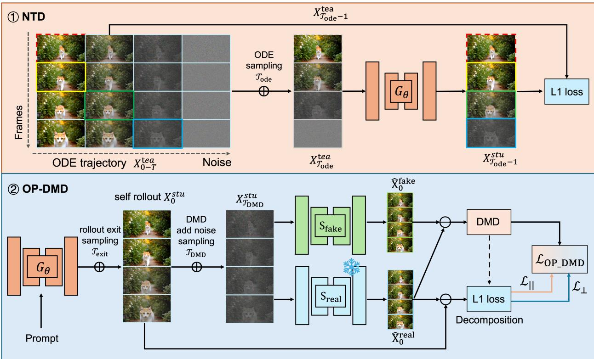
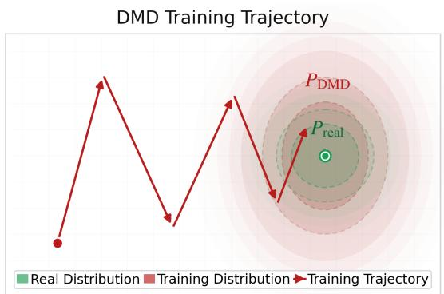
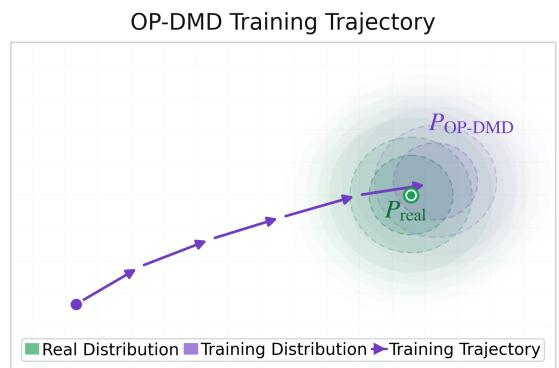
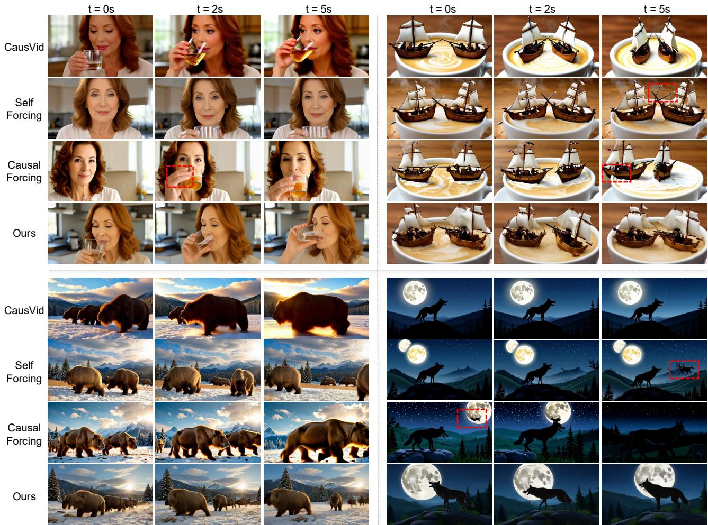
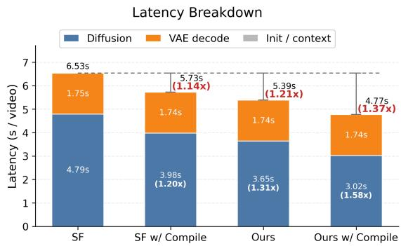
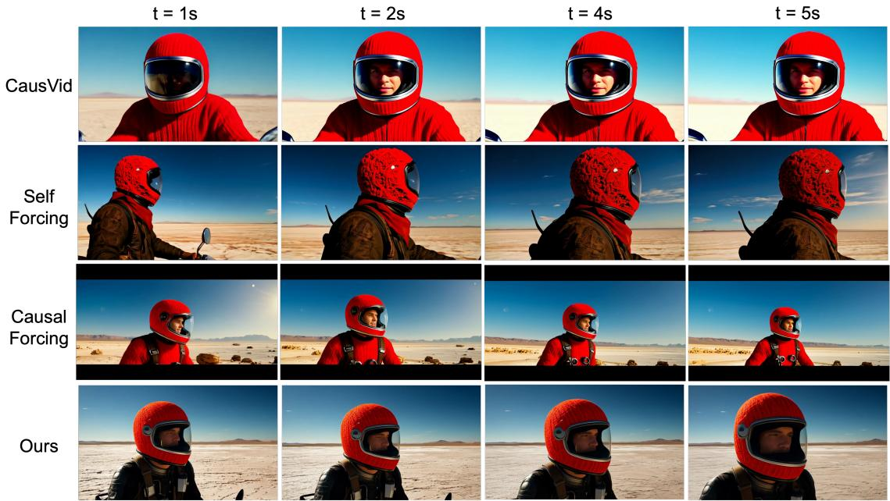
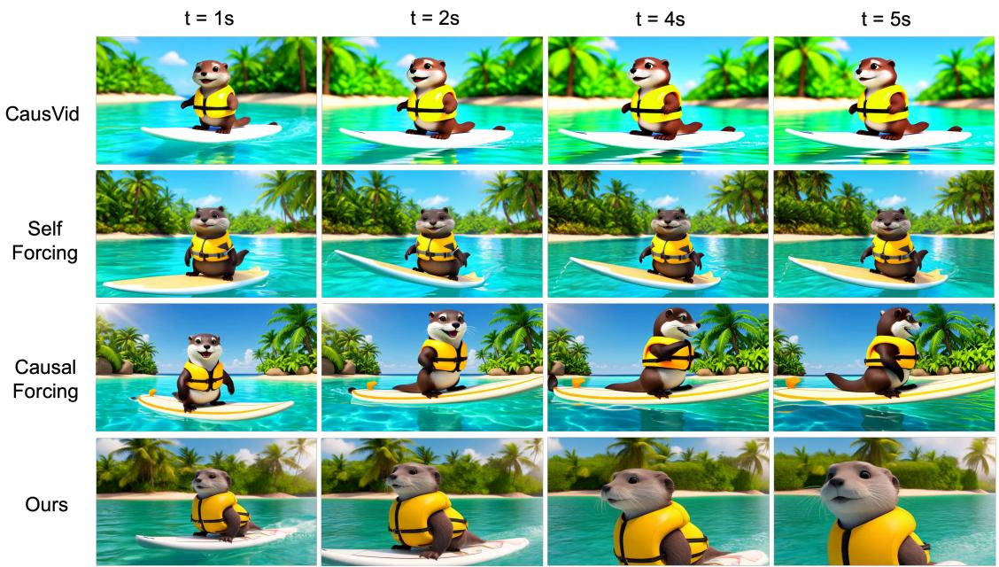
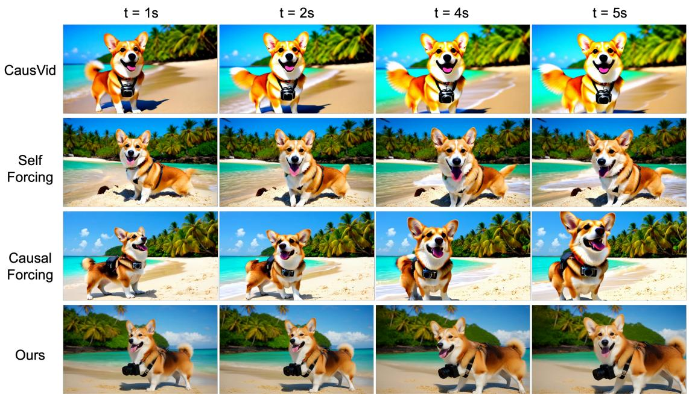
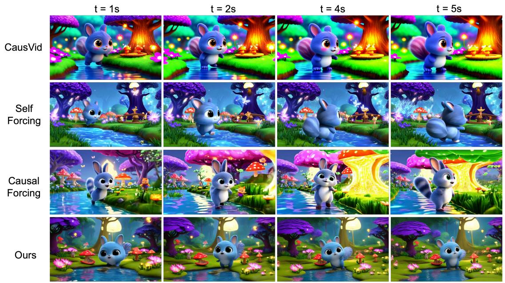

# TriTD: Tri-Partite Trajectory–Distribution Distillation for Real-Time Autoregressive Video Generation

Jia Li1,∗, Xurui Peng2,∗, Haowei Zhu3, Tianyu Zhao2, Jiexi Wang2, Youwei Zheng2, Yuxi Ren2, Xinglong Wu2, Xing Wang2,†, Hayden Kwok-Hay So1,†

1The University of Hong Kong, 2ByteDance Seed, 3Tsinghua University

∗Equal contribution, †Corresponding authors.

## Abstract

Autoregressive (AR) video difusion has emerged as a leading paradigm for eficient video gen eration, yet its practical deployment remains bottlenecked by the trade-of between generation quality and inference eficiency. We attribute this bottleneck to three error sources in AR roll outs: the base model error, the train–inference distribution mismatch, and the upstream error propagation. Building on this decomposition, we derive closed-form upper bounds on the perstep and cumulative errors, providing a principled basis for jointly optimizing generation quality and inference eficiency. Guided by this analysis, we propose TriTD, a Tri-Partite Trajectory– Distribution co-optimized distillation framework with three complementary modules. First, for ODE initialization, we adopt a Next-Node Trajectory Distillation (NTD) objective, which shortens the supervision horizon and admits a lower regression-error floor. Second, we introduce Chunk-Graded Noising (CGN), a monotonically non-decreasing per-chunk noising schedule that helps narrow the expected train–inference noise mismatch and removes redundant KV-cache up dates, yielding substantial speedups at no quality cost. Third, we propose Orthogonal-Parallel DMD (OP-DMD), a distribution-matching loss that retains the original DMD supervision while introducing an additional regression constraint in the orthogonal subspace to suppress of-axis drift, improving both training stability and final generation quality. Extensive experiments show that TriTD consistently surpasses existing baselines in visual quality while reaching a real-time throughput of 26.8 FPS on a single H100 GPU, delivering a balanced quality–eficiency solution for interactive streaming video generation.

## 1 Introduction

Video generation has made remarkable progress in recent years [1–5], enabling a wide range of applications such as text-to-video synthesis [6] and image-to-video animation [7–9]. Research eforts have increasingly focused on improving the visual quality, inference eficiency, and longer-horizon video generation [10, 11]. To meet these demands, autoregressive (AR) video difusion [12–15] has emerged as a promising paradigm for real-time interactive video generation, owing to its causal, chunk-wise decoding. While recent works such as Self-Forcing [16] have made notable progress, the trade-of between generation quality and inference eficiency remains unresolved.

First, we analyze AR video generation through the lens of error propagation. We decompose the per-chunk inference error into three sources: the base model error, the train–inference distribution mismatch, and the upstream error propagation, and derive a closed-form upper bound on the cumulative error along the generated sequence. This decomposition reveals two underexplored optimization directions: lowering the base model error from its source, and reducing the context noise distribution mismatch between training and inference.

Motivated by these insights, we propose TriTD, a Tri-Partite Trajectory–Distribution co-optimized distillation framework for AR video generation. It comprises three complementary modules. (1) Next-Node Trajectory Distillation (NTD). For ODE initialization, we replace conventional endpoint consistency distillation with next-node supervision under an L1 regression loss, improving the initial trajectory fit. (2) Chunk-Graded Noising (CGN). To reduce the train–inference distribution mismatch, we introduce a noising scheme that enforces a monotonically non-decreasing training-time noise level across chunks, applied consistently across both training stages. This schedule brings training context noise closer to inference conditions and removes the redundant per-chunk KV Cache update at inference, reducing per-chunk cost without quality degradation. (3) Orthogonal-Parallel Distribution Matching Distillation (OP-DMD). To stabilize distribution-level training, we augment the standard DMD objective with a regression constraint on the residual component orthogonal to the DMD update direction. This auxiliary supervision suppresses of-axis drift, reduces training variance, and leads to more stable optimization and higher final generation quality.

Our main contributions are summarized as follows:

• We establish a closed-form upper-bound decomposition for the per-chunk and cumulative errors of AR video generation, ofering a new analytical perspective on the quality–eficiency trade-of, and provide theoretical motivation for both NTD and CGN within our distillation framework.

• We propose TriTD, a tri-partite trajectory–distribution co-optimized distillation framework integrating Next-Node Trajectory Distillation (NTD), Chunk-Graded Noising (CGN), and Orthogonal-Parallel DMD (OP-DMD), whose complementary modules jointly improve generation quality and inference eficiency.

• Extensive experiments demonstrate that TriTD consistently outperforms state-of-the-art baselines while achieving a real-time throughput of 26.8 FPS on a single H100 GPU, ofering a practical solution for real-time interactive video generation.

## 2 Related work

Difusion models and rectified flow. Difusion models [17–19] have become the mainstream framework for visual generation. Given a clean sample $x _ { 0 }$ and Gaussian noise $\epsilon \sim \mathcal { N } ( 0 , I )$ , the forward process is $x _ { t } ~ = ~ \alpha _ { t } x _ { 0 } + \sigma _ { t } \epsilon$ with noise schedule $\alpha _ { t } , \sigma _ { t } ,$ and the model $v _ { \theta } ( x _ { t } , t )$ is trained by minimizing $\mathbb { E } _ { t , x _ { 0 } , \epsilon } \bigg \lceil \| v _ { \theta } ( x _ { t } , t ) - v ^ { \star } \| _ { 2 } ^ { 2 } \bigg \rceil$ . Rectified Flow [20–22] further simplifies the forward process to a linear interpolation $x _ { t } = ( 1 - t ) x _ { 0 } + t \epsilon$ with the corresponding denoising ODE $\begin{array} { r } { \frac { \mathrm { d } \boldsymbol { x } _ { t } } { \mathrm { d } t } = \boldsymbol { v } _ { \theta } ( \boldsymbol { x } _ { t } , t ) } \end{array}$ , and has become the backbone of many modern generative models [23–25].

Eficient difusion inference. Beyond reducing sampling steps, a broad family of training-free methods accelerates pretrained difusion models by reusing temporally redundant features or attention outputs, selectively updating tokens, and pruning redundant conditional computation [26–31]. These methods reduce the total computation along the denoising trajectory without learning a few-step generator and are therefore complementary to difusion distillation.

Difusion model distillation. Iterative denoising remains a core eficiency bottleneck of difusion models, motivating two complementary distillation paradigms. (1) Trajectory distillation aligns the student to the teacher denoising ODE. Progressive Distillation [32] progressively halves the number of sampling steps via cascaded teacher-student rounds. Consistency Models [33] impose the constraint directly on the ODE trajectory, enforcing that model outputs at any two points on the same trajectory remain consistent. Targeting the linear ODE structure of Rectified Flow, InstaFlow [34] and SlimFlow [35] further shorten the efective trajectory length via reflow and re-distillation, unlocking the potential of few-step generation. Trajectory distillation provides fine-grained, per-node supervision on the denoising path and exhibits a mode-covering (zero-avoiding) behavior. (2) Distribution Matching Distillation [36] minimizes the reverse-KL divergence between the student distribution $p _ { \phi }$ and the teacher distribution $p _ { \mathrm { t e a } }$ for eficient distillation and has been widely used to accelerate both difusion and flow-matching models. DMD2 [37] and subsequent works further introduce GAN-style discriminators to sharpen high-frequency details. As a reverse-KL objective, DMD is mode-seeking (zero-forcing) and provides weak per-node supervision. Moreover, in autoregressive video generation, the training-time context distribution from DMD self-rollout typically diverges from the inference-time context, inducing a non-trivial train–inference gap.

Distilled autoregressive video generation. Recently, causal AR difusion has emerged as a popular research direction in video generation, performing chunk-by-chunk sequential generation with block-causal attention [11–14, 38, 39]. Among distillation-based approaches, CausVid [40] combines few-step distillation with block-causal AR decoding, Self-Forcing [16] simulates the AR self-rollout process during training to alleviate exposure bias, and Causal Forcing [15] further strengthens generation dynamics with an AR teacher. Long-horizon inference introduces additional challenges from accumulated rollout errors and an increasingly expensive context cache. Recent work explores training-free horizon extension, context compression, and memory-eficient rollout mechanisms [10, 11, 41]. These inference-time techniques are broadly applicable to and complementary with existing chunk-wise AR video generators, including CausVid, Self-Forcing, and Causal-Forcing. However, existing distilled AR methods do not explicitly model the inter-chunk context-noise distribution and typically require an additional forward pass per chunk to refresh the KV cache.

## 3 Method

## 3.1 Preliminary

We adopt the chunk-wise autoregressive paradigm [16, 40], partitioning a video into C equal-length chunks $\{ X ^ { ( 1 ) } , \bar { X } ^ { ( 2 ) } , \ldots , X ^ { ( C ) } \}$ and factorizing the joint distribution as

$$
p \Big ( X ^ { ( 1 : C ) } \Big ) = \prod _ { c = 1 } ^ { C } p \Big ( X ^ { ( c ) } \big | X ^ { ( < c ) } \Big ) .\tag{1}
$$

Each conditional $p { \big ( } X ^ { ( c ) } \mid X ^ { ( < c ) } { \big ) }$ is modeled by a few-step student $\Phi _ { \theta }$ . For chunk c, start from pure noise $X _ { t _ { 1 } } ^ { ( c ) } \sim \mathcal { N } ( 0 , I )$ and denoise at K descending timesteps $t _ { 1 } = 1 0 0 0 > \cdots > t _ { K } > t _ { K + 1 } = 0$ . Each update $( k = 1 , \ldots , K )$ is conditioned on the historical context $X ^ { ( < c ) }$

$$
X _ { t _ { k + 1 } } ^ { ( c ) } = \Phi _ { \theta } \Big ( X _ { t _ { k } } ^ { ( c ) } , t _ { k } ; X ^ { ( < c ) } \Big ) .\tag{2}
$$

Historical context as condition. To avoid recomputing historical chunks, the student adopts blockcausal attention and injects the historical context with KV Cache $\kappa ^ { ( < c ) }$ . Let $t _ { \mathrm { e x i t } } ^ { c } \in \{ t _ { 1 } , \dots , t _ { K } \}$ denote the actual exit timestep of the denoising chain for the c-th chunk, and let $\hat { X } _ { 0 } ^ { ( c ) }$ denote the one-step prediction obtained by mapping $X _ { t _ { \mathrm { e x i t } } ^ { c } } ^ { ( c ) }$ directly to $t = 0$ via $\Phi _ { \theta }$ . Denoting the KV-cache update operator as Ψ, at baseline inference an additional forward pass is performed after the denoising chain terminates with $\hat { X } _ { 0 } ^ { ( c ) }$ at $t = 0$ to refresh the KV cache:

$$
\mathcal { K } ^ { \left( \leq c \right) } = \Psi \left( \hat { X } _ { 0 } ^ { \left( c \right) } , t = 0 ; \mathcal { K } ^ { \left( < c \right) } \right) .\tag{3}
$$

When $t _ { \mathrm { e x i t } } ^ { c } \neq t _ { K }$ , the denoising chain is incomplete and $\hat { X } _ { 0 } ^ { ( c ) }$ deviates from the ideal $X _ { 0 } ^ { ( c ) }$ by a residual error correlated with $t _ { \mathrm { e x i t } } ^ { c } .$ , which in turn afects the noise level and distribution of the KV Cache that conditions subsequent chunks. The original Self-Forcing [16] samples $t _ { \mathrm { e x i t } } ^ { c }$ uniformly at random during training for eficiency, so the full denoising chain is completed only with probability $1 / K$ , whereas at inference the full chain is always executed, i.e., $t _ { \mathrm { e x i t } } ^ { c } = t _ { K }$ . This systematic mismatch in the distribution of $t _ { \mathrm { e x i t } } ^ { c }$ between training and inference constitutes one of the sources of the train-inference distribution mismatch.

## 3.2 Cumulative error bound for autoregressive video diffusion

In this section, we establish a closed-form upper bound on the cumulative error of AR video generation under an idealized error model, providing theoretical motivation for our design. For analytical convenience, let $\sigma _ { \mathrm { t r } } ( c )$ and $\sigma _ { \mathrm { i n f } } ( c )$ denote the training-time and inference-time context noise levels of the c-th chunk, respectively, modeled as monotonically related to the exit timesteps $t _ { \mathrm { e x i t , t r } } ^ { c }$ and $t _ { \mathrm { e x i t , i n f } } ^ { c }$ defined in Section 3.1, where a larger exit timestep induces a larger residual prediction error and a larger σ.

We observe that the single-step inference error $e _ { c }$ at the c-th chunk admits a three-way decomposition: (i) the base model error ε, a uniform bound on the model’s residual error under matched, error-free context in this analysis; (ii) the train–inference distribution mismatch arising from the gap $| \sigma _ { \mathrm { i n f } } ( c ) - \sigma _ { \mathrm { t r } } ( c ) |$ between the inference-time and training-time context noise levels; and (iii) the upstream error propagation term inherited from the cumulative error of the previous c−1 chunks via the KV Cache. The following lemma formalizes this decomposition.

Lemma 1 (Single-step error upper bound). Assume the matched-context residual is bounded by ε, noise-level perturbations contribute at most $\kappa | \sigma _ { \mathrm { i n f } } ( c ) - \sigma _ { \mathrm { t r } } ( c )$ |, and the upstream context-error contribution is bounded by $L e _ { c - 1 }$ , with $e _ { 0 } = 0$ . Then

$$
e _ { c } \le \varepsilon + \kappa \cdot | \sigma _ { \operatorname* { i n f } } ( c ) - \sigma _ { \operatorname { t r } } ( c ) | + L \cdot e _ { c - 1 } , \qquad L \ge 0 , \kappa \ge 0 ,\tag{4}
$$

where κ scales the distribution-mismatch contribution and L is the Lipschitz constant of $\Phi _ { \theta }$

Proof sketch. Apply the triangle inequality to the matched-context residual, noise-level perturbation, and upstream context perturbation. The stated residual and Lipschitz-type bounds give Eq. 4. □

Recursively unrolling Lemma 1 along the chunk axis and summing yields the cumulative bound.

Corollary 1 (Cumulative error bound). The total error $\textstyle E _ { C } = \sum _ { c = 1 } ^ { C } e _ { c }$ satisfies

$$
E _ { C } \ \le \ \sum _ { c = 1 } ^ { C } \underbrace { \left( \frac { 1 - L ^ { C - c + 1 } } { 1 - L } \right) } _ { w _ { c } } \Big ( \varepsilon + \kappa \cdot \big | \sigma _ { \operatorname * { i n f } } ( c ) - \sigma _ { \operatorname { t r } } ( c ) \big | \Big ) ,\tag{5}
$$

where the position-dependent weight $w _ { c } = ( 1 - L ^ { C - c + 1 } ) / ( 1 - L )$ captures error amplification along the autoregressive chain: errors introduced at smaller c propagate longer and therefore receive larger weight. The complete derivation, together with the corresponding closed forms of $w _ { c } ~ f o r ~ L = 1$ and $L > 1$ and a discussion of their efect on the bound, is given in Appendix A.1.

The upper bound in Equation (5) decomposes into two terms:

$$
\underbrace { T = \sum _ { c = 1 } ^ { C } w _ { c } \cdot \varepsilon } _ { \mathrm { M o d e l - e r r o r ~ t e r m } } , \qquad \underbrace { N = \sum _ { c = 1 } ^ { C } w _ { c } \cdot \kappa \cdot \big | \sigma _ { \mathrm { i n f } } ( c ) - \sigma _ { \mathrm { t r } } ( c ) \big | } _ { \mathrm { N o i s e - m i s m a t c h ~ t e r m } } ,\tag{6}
$$

which jointly characterize the optimization surface of autoregressive video distillation.

## 3.3 TriTD: a tri-partite trajectory-distribution framework

Guided by this analysis, we propose TriTD, a tri-partite trajectory-distribution co-optimization framework for autoregressive video distillation. As illustrated in Figure 1, TriTD (i) reshapes the training objective of ODE-initialization stage with Next-Node Trajectory Distillation (NTD) to reduce the base model error ε; (ii) introduces a chunk-graded noising training strategy that shrinks the train-inference noise distribution mismatch; and (iii) adopts the Orthogonal-Parallel DMD (OP-DMD) loss to mitigate unsupervised of-axis drift and training oscillation. The regression-error analysis motivates NTD’s next-node supervision, while the expected mismatch reduction motivates Chunk-Graded Noising. OP-DMD complements these components with distribution-level optimization control.

  
Figure 1 Overview of the proposed TriTD Framework, including (1) NTD-based ODE initialization stage and (2) OP-DMD-based distribution distillation stage. Chunk-Graded noising training is consistently applied throughout both stages. Frames enclosed by solid boxes of the same color form paired student-teacher loss, while frames in red dashed boxes are excluded from loss computation.

## 3.3.1 NTD: tightening the base-model error ε

Existing ODE-initialization methods typically adopt an endpoint-consistency objective: at any intermediate timestep $t _ { i } .$ , student $\Phi _ { \theta }$ is required to regress the teacher’s clean prediction $x _ { 0 } ^ { \star }$ at $t = 0 \colon$

$$
\mathcal { L } _ { \mathrm { o d e - i n i t } } = \mathbb { E } _ { c , i } \Big [ \big \lVert \Phi _ { \theta } ( x _ { t _ { i } } ) - x _ { 0 } ^ { \star } \big \rVert _ { 2 } ^ { 2 } \Big ] .\tag{7}
$$

We propose to replace the endpoint target with the next node prediction $\boldsymbol { x } _ { t _ { i + } } ^ { \star }$ on the teacher trajectory and adopt $L _ { 1 }$ instead of $L _ { 2 }$ . The Next-Node Trajectory Distillation (NTD) loss is formulated as:

$$
\mathcal { L } _ { \mathrm { N T D } } = \mathbb { E } _ { c , i } \Big [ \left. \Phi _ { \theta } ( x _ { t _ { i } } ) - x _ { t _ { i + 1 } } ^ { \star } \right. _ { 1 } \Big ] .\tag{8}
$$

Whereas equation $( 7 )$ regresses the endpoint with MSE, NTD uses the next saved teacher ODE node and an outlier-robust $L _ { 1 }$ loss. To motivate this choice, we analyze the regression-error floors associated with the two objectives.

Lemma 2 (Comparison of regression-error floors). Assume a locally afine teacher target relation and coordinate-wise Gaussian endpoint conditionals, as specified in Appendix A.2. At a fixed node $i , l e t \varepsilon _ { \mathrm { i n i t } , i } ^ { \mathrm { l o w e r } }$ be the average coordinate-wise optimal conditional RMSE for endpoint prediction, and $\varepsilon _ { \mathrm { N T D } , i } ^ { \mathrm { l o w e r } }$ the corresponding optimal MAE for next-node prediction. Then

$$
\begin{array} { r } { \varepsilon _ { \mathrm { N T D } , i } ^ { \mathrm { l o w e r } } = \lambda _ { i } \sqrt { \frac { 2 } { \pi } } \varepsilon _ { \mathrm { i n i t } , i } ^ { \mathrm { l o w e r } } < \varepsilon _ { \mathrm { i n i t } , i } ^ { \mathrm { l o w e r } } , } \end{array}\tag{9}
$$

where $\lambda _ { i } = 1 - t _ { i + 1 } / t _ { i } \in [ 0 , 1 ]$ and the strict inequality requires $\varepsilon _ { \mathrm { i n i t } , i } ^ { \mathrm { l o w e r } } > 0$ . Averaging over nodes also preserves the strict comparison whenever the average endpoint floor is positive.

Algorithm 1 One generator update with NTD + Algorithm 2 OP-DMD Loss   
Chunk-Graded Noising. Require: Student $\Phi _ { \theta } ,$ real score $s _ { \mathrm { r e a l } } .$ , fake score $s _ { \mathrm { f a k e } } ,$   
Require: Student $\Phi _ { \theta } ,$ , teacher trajectories full range $[ t _ { \operatorname* { m i n } } , t _ { \operatorname* { m a x } } ] ,$ weights $\lambda _ { \perp } , \lambda _ { \parallel }$   
$\begin{array} { r } { \left\{ { z } _ { t _ { k } , c } ^ { \mathrm { t e a } } \right\} _ { k = 0 , c = 1 } ^ { T , C } , } \end{array}$ student nodes 1: $\hat { x } _ { 0 } ^ { \mathrm { s t u } } \gets \mathrm { G E N E R A T O R } \big ( \Phi _ { \theta } \big )$   
$\left\{ \tau _ { i } \right\} _ { i = 1 } ^ { N + 1 } \left( \tau _ { N + 1 } = 0 \right)$ , chunk count $C ,$ learning rate η. 2: Sample $t \sim \mathcal { U } [ t _ { \operatorname* { m i n } } , t _ { \operatorname* { m a x } } ] , \epsilon \sim \mathcal { N } ( 0 , I )$   
1: Sample $s _ { c } \sim \mathcal { U } \{ 1 , \dots , N \}$ for $c = 1 , \ldots , C$ 3: $x _ { t } \gets ( 1 - t ) \hat { x } _ { 0 } ^ { \mathrm { s t u } } + t \epsilon$   
2: $( s _ { 1 } , \ldots , s _ { C } )  \mathrm { s o r t } _ { \downarrow } ( s _ { 1 } , \ldots , s _ { C } )$ 4: $\hat { x } _ { 0 } ^ { \mathrm { r e a l } } \longleftarrow s _ { \mathrm { r e a l } } ( x _ { t } , t ) ; \hat { x } _ { 0 } ^ { \mathrm { f a k e } } \gets s _ { \mathrm { f a k e } } ( x _ { t } , t )$   
3: Init start-point: 5: $r  \hat { x } _ { 0 } ^ { \mathrm { r e a l } } - \hat { x } _ { 0 } ^ { \mathrm { f a k e } } ; \ \hat { \mu } _ { \mathrm { D M D } }  \mathrm { s g } ( r / \| r \| )$   
$x _ { \tau _ { s _ { c } } , c } \gets z _ { \tau _ { s _ { c } } , c } ^ { \mathrm { t e a } } \mathrm { ~ f o r ~ } c = 1 , . . . , C$ 6: $\delta \gets \hat { x } _ { 0 } ^ { \mathrm { s t u } } - \hat { x } _ { 0 } ^ { \mathrm { r e a l } } ; \alpha \gets \langle \hat { \mu } _ { \mathrm { D M D } } , \delta \rangle$   
4: $\{ \boldsymbol { x } _ { \tau _ { s _ { c } + 1 } , c } \} _ { c = 1 } ^ { C }  \Phi _ { \boldsymbol \theta } ( \{ \boldsymbol { x } _ { \tau _ { s _ { c } } , c } \} _ { c = 1 } ^ { C } , \{ \tau _ { s _ { c } } \} _ { c = 1 } ^ { C } )$ 7: $\delta _ { \parallel }  \alpha \hat { \mu } _ { \mathrm { D M D } } ; \delta _ { \perp }  \delta - \delta _ { \parallel }$   
8: $\mathcal { L } \gets \mathcal { L } _ { \mathrm { D M D } } + \lambda _ { \perp } \mathcal { R } ( \delta _ { \perp } ) + \dot { \lambda _ { \parallel } } \mathcal { R } ( \alpha )$   
5: $\begin{array} { r } { \mathcal { L } _ { \mathrm { N T D } } \gets \sum _ { c = 1 } ^ { C } \left\| x _ { \tau _ { s _ { c } + 1 } , c } - z _ { \tau _ { s _ { c } + 1 } , c } ^ { \mathrm { t e a } } \right\| _ { 1 } } \end{array}$   
9: $\theta \gets \theta - \eta \nabla _ { \theta } \mathcal { L }$   
6: $\theta \gets \theta - \eta \nabla _ { \theta } \mathcal { L } _ { \mathrm { N T D } }$   
10: Update sfake

Proof sketch. For a scalar Gaussian conditional with standard deviation s, the optimal conditional RMSE is s and the optimal MAE is $s { \sqrt { 2 / \pi } }$ . The afine target relation scales the conditional standard deviation by $\lambda _ { i } .$ , yielding equation (9). This connects next-node target contraction to the coordinate-wise regression-error floors. See Appendix A.2 for the full derivation and interpretation. □

## 3.3.2 Chunk-Graded Noising: compressing the noise mismatch N

Existing distillation frameworks like Self-Forcing sample the per-chunk noise level independently during training: in the trajectory-distillation stage the starting node timestep $t _ { c }$ is obtained at random, and in the distribution-matching stage the exit timestep $t _ { \mathrm { e x i t } } ^ { c }$ is also sampled at random from $\{ t _ { 1 } , \ldots , t _ { K } \}$ The induced training-time noise level distribution $\sigma _ { \mathrm { t r } } ( c )$ can therefore deviate from the inference-time level $\sigma _ { \mathrm { i n f } } ( c )$ as context errors accumulate across chunks. This deviation $| \sigma _ { \mathrm { i n f } } ( c ) - \sigma _ { \mathrm { t r } } ( c ) |$ contributes to the mismatch term N in equation (6).

We compress this mismatch by imposing two constraints on per-chunk noise sampling. (1) Clean Start. The first chunk $( c = 1 )$ is generated without contamination from previous chunks, so its inference-time noise level is identically zero. We mirror this at training by enforcing $\sigma _ { \mathrm { t r } } ( 1 ) = 0$ in both stages, removing mismatch on the first chunk. Since the geometric weights $w _ { c }$ decrease monotonically with $c ,$ eliminating mismatch at early chunks substantially reduces the cumulative mismatch error N. (2) Sorted Noise. For subsequent chunks $( c > 1 )$ , we sample per-chunk noise level under a non-decreasing constraint: (i) during NTD ODE stage, the sampled startpoint timesteps satisfy $t _ { c } \ge t _ { c - 1 } ; \mathrm { ( i i ) }$ during distribution matching stage, chunk-wise exit timestep satisfies $t _ { \mathrm { e x i t } } ^ { c } \geq t _ { \mathrm { e x i t } } ^ { c - 1 }$ . Both constraints induce a monotonically non-decreasing $\sigma _ { \mathrm { t r } } ( c )$ , mirroring the natural error accumulation along the chunk axis at inference.

Lemma 3 (Reduction of expected noise mismatch). Let $N _ { \mathrm { o u r s } }$ and $N _ { \mathrm { S F } }$ denote the cumulative mismatch of CGN and the baseline, respectively. Under the efective-noise model and conditions in Appendix A.3,

$$
\mathbb { E } [ N _ { \mathrm { o u r s } } ] < \mathbb { E } [ N _ { \mathrm { S F } } ] .\tag{10}
$$

The derivation is given in Appendix A.3. We integrate the Chunk-Graded Noising schedule with NTD to formulate the ODE initialization regression training. The comprehensive training algorithm is presented in Algorithm 1. By training the model to be robust to noisy context, we shrink the train-inference distribution shift. As a result, at inference time we can completely skip the post-chunk KV-cache re-computation step, which dramatically reduces the computation cost and boosts actual generation speed.

## 3.3.3 Orthogonal-Parallel DMD (OP-DMD): narrowing the realized-to-theoretical gap

The standard DMD loss updates the student generator with the gradient signal $r = \hat { x } _ { 0 } ^ { \mathrm { r e a l } } - \hat { x } _ { 0 } ^ { \mathrm { f a k e } }$ , which provides KL supervision along the DMD update direction µˆDMD in the latent space. However, the orthogonal subspace receives no explicit supervision, which induces potential shift in the training distribution and oscillation in the optimization trajectory. We refer to this efect as of-axis drift.

  
Figure 2 Training-trajectory comparison in a 2D latent toy. Left: Standard DMD with training oscillation and unconstrained subspace shift between $P _ { \mathrm { D M D } }$ and $P _ { \mathrm { r e a l } }$ . Right: OP-DMD with orthogonal penalty constraints, yields a stable training trajectory toward $P _ { \mathrm { r e a l } }$

Based on this observation, we propose Orthogonal-Parallel DMD (OP-DMD), which decomposes the studentteacher residual along µˆDMD and applies separate supervision on the parallel and orthogonal components. As shown in Algorithm 2, µˆDMD $= r / \| r \|$ and $\delta = \hat { x } _ { 0 } ^ { \mathrm { s t u d e n t } } - \hat { x } _ { 0 } ^ { \mathrm { r e a l } }$ , then OP-DMD decomposes δ along µˆDMD:

$$
\begin{array} { r } { \delta = \delta _ { \parallel } + \delta _ { \perp } , \quad \delta _ { \parallel } = \left. \hat { \mu } _ { \mathrm { D M D } } , \delta \right. \hat { \mu } _ { \mathrm { D M D } } , \quad \delta _ { \perp } = \delta - \delta _ { \parallel } , \quad \left. \hat { \mu } _ { \mathrm { D M D } } , \delta _ { \perp } \right. = 0 . } \end{array}\tag{11}
$$

Geometrically, $\delta _ { \parallel }$ measures how much $\hat { x } _ { 0 } ^ { \mathrm { s t u d e n t } }$ deviates from the teacher prediction along the KL-improving direction, while $\delta _ { \perp }$ captures drift in the subspace unconstrained by DMD. The OP-DMD objective augments the standard DMD loss with pointwise penalties on both components:

$$
\mathcal { L } _ { \mathrm { O P - D M D } } = \mathcal { L } _ { \mathrm { D M D } } + \lambda _ { \perp } \mathcal { R } ( \delta _ { \perp } ) + \lambda _ { \parallel } \mathcal { R } ( \langle \hat { \mu } _ { \mathrm { D M D } } , \delta \rangle ) , \quad \lambda _ { \parallel } \ll \lambda _ { \perp } ,\tag{12}
$$

where $\mathcal { R } ( \cdot )$ denotes an $\ell _ { 1 }$ regression loss. As shown in figure 2 (right), the orthogonal term shrinks $\delta _ { \perp }$ in the DMD-unsupervised subspace and constrains the orthogonal directions that would otherwise drift, suppressing of-axis drift. The parallel term lightly penalizes the on-axis projection coeficient (with $\lambda _ { \parallel } \ll \lambda _ { \perp } )$ and stabilizes training as ∥r∥→0. A full OP-DMD step is described in Algorithm 2.

## 4 Experiments

## 4.1 Experimental setup

Implementation. We adopt Wan2.1-1.3B [5] as our base model, which generates 5-second videos by default at 832 × 480 resolution. Following CausVid [40], we first fine-tune the model with block-causal attention masking on 6K teacher ODE pairs, using prompts sampled from MixKit. Our student model runs 4 denoising steps per chunk, and each chunk consists of 3 frames. The OP-DMD loss coeficients $\lambda _ { \parallel }$ and $\lambda _ { \perp }$ are set to 0.0001 and 0.01, respectively. Additional implementation details including hyper-parameter settings are provided in Section A.4.

Evaluation & baselines. We compare our method against representative open-source video generation models. (1) Bidirectional video difusion models such as Wan2.1-1.3B [5] and LTX-Video-1.9B [24]. (2) Autoregressive video difusion models like SkyReels-V2-DF-540P [38], MAGI-1 (base) [39]. In particular, we compare with three distillation-based autoregressive baselines: CausVid [40], Self-Forcing [16], and the recent work Causal-Forcing [15]. We evaluate all methods with a 5-second generation horizon on VBench [42] bench mark to assess the generation quality. Following CausVid [40], we use the first 128 prompts from MovieGen to generate videos. We report speed test results both with and without torch.compile optimizations. FPS measures difusion-backbone throughput, excluding VAE decoding.

  
Figure 3 Qualitative comparison against three distillation-based AR baselines (CausVid, Self-Forcing, Causal-Forcing). Each row shows key frames sampled from 5-second generation.

## 4.2 Experiment results

Qualitative comparison. figure 3 shows key frames from 5-second videos. CausVid exhibits notable chunklevel error accumulation, manifesting as severe color oversaturation and degraded image quality. Self-Forcing mitigates exposure bias through self-rollout and accumulates less error than CausVid, yet still sufers from artifacts. Causal-Forcing, while achieving stronger dynamic degree, is more prone to over-saturated colors and exhibits unrealistic spatial arrangements and structural artifacts. In contrast, our method preserves stable subject identity and image quality throughout the sequence. More visualization results and comparison are provided in Section C.

Quantitative comparison. For chunk-wise autoregressive baselines, though they adopt 4-step generation, they actually require 5-NFE to finish single chunk generation, as an extra forward pass is required after each chunk’s 4 denoising steps to construct a clean KV-cache (higher quality but higher latency). In contrast, our method uses only 4 NFEs per chunk, eliminating the extra forward pass. Table 1 shows that our method achieves the best quality score of 83.59 and the highest throughput, reaching 26.8/22.2 FPS (with/without compilation). Notably, with only 4 NFE, our method still consistently outperforms all distilled autoregressive baselines with 5-NFE. For example, surpassing Self-Forcing and Causal-Forcing by +1.26 and +0.68 in Quality Score, respectively, delivering impressive quality-eficiency trade-of among existing approaches.

Table 1 Quantitative comparison on VBench using the first 128 MovieGen prompts under a 5-second generation horizon. Throughput (FPS) is measured on a single NVIDIA H100 GPU.
<table><tr><td>Method</td><td>FPS  $\mathrm { w } / $  compile compile</td><td>FPS w/o Subject Background Dynamic Image</td><td>Cons.</td><td>Cons.</td><td>Degree</td><td></td><td>Motion Quality Smooth.</td><td>Aesthetic Temporal| Quality</td><td>Flicker.</td><td>Quality Score</td></tr><tr><td colspan="9">Bidirectional Video Diffusion Models</td><td></td><td></td></tr><tr><td>Wan2.1</td><td>1.0</td><td>0.8</td><td>94.16</td><td>96.21</td><td>57.03</td><td>66.64</td><td>98.19</td><td>64.71</td><td>96.88</td><td>82.17</td></tr><tr><td>LTX-Video</td><td>10.8</td><td>9.0</td><td>92.69</td><td>95.04</td><td>41.41</td><td>63.07</td><td>98.92</td><td>55.22</td><td>97.49</td><td>79.10</td></tr><tr><td colspan="9">Autoregressive Video Diffusion Models</td><td></td><td></td></tr><tr><td>SkyReels-V2</td><td>0.6</td><td>0.5</td><td>95.87</td><td>96.86</td><td>32.81</td><td>62.51</td><td>98.72</td><td>63.45</td><td>97.91</td><td>80.63</td></tr><tr><td>MAGI-1</td><td>0.3</td><td>0.2</td><td>96.29</td><td>96.50</td><td>35.94</td><td>61.71</td><td>99.22</td><td>64.76</td><td>98.39</td><td>81.42</td></tr><tr><td colspan="9">Distilled Autoregressive Video Models</td><td></td><td></td></tr><tr><td>CausVid</td><td>20.3</td><td>16.9</td><td>94.65</td><td>94.51</td><td>45.31</td><td>68.00</td><td>98.27</td><td>62.10</td><td>97.06</td><td>80.93</td></tr><tr><td>Self-Forcing</td><td>20.3</td><td>16.9</td><td>93.53</td><td>94.62</td><td>63.28</td><td>69.04</td><td>98.27</td><td>63.36</td><td>96.70</td><td>82.33</td></tr><tr><td>Causal-Forcing</td><td>20.3</td><td>16.9</td><td>93.99</td><td>94.93</td><td>78.91</td><td>70.73</td><td>97.43</td><td>64.03</td><td>95.02</td><td>82.91</td></tr><tr><td>Ours</td><td>26.8</td><td>22.2</td><td>94.25</td><td>94.66</td><td>82.03</td><td>69.25</td><td>98.26</td><td>63.46</td><td>95.82</td><td>83.59</td></tr></table>

Human preference. To complement the   
automatic metrics, we conducted a blinded   
pairwise evaluation on 100 randomly sam  
pled VBench prompts with five evaluators.   
As shown in Table 2, TriTD receives the   
majority of preference votes against all   
three distilled AR baselines despite requir  
ing fewer efective NFEs. The complete eval  
uation protocol and absolute-rating results are provided in Section A.5. uation protocol and absolute-rating results a

Table 2 Pairwise human preference on 100 VBench prompts (500 votes per comparison).
<table><tr><td>Comparison</td><td>TriTD (4 NFE)</td><td>Baseline (5 NFE)</td></tr><tr><td>vs. CausVid</td><td>438 (87.6%)</td><td>62 (12.4%)</td></tr><tr><td>vs. Self-Forcing</td><td>323 (64.6%)</td><td>177 (35.4%)</td></tr><tr><td>vs. Causal-Forcing</td><td>354 (70.8%)</td><td>146 (29.2%)</td></tr></table>

## 4.3 Ablation and analysis

Ablation study. We further ablate the three components on top of the Self-Forcing-like baseline and report the Quality Score on MovieGen prompts in Table 3. Replacing the endpoint regression at the ODE-init stage with our NTD L1 trajectory distillation (M1) lifts the baseline from 81.82 to 82.07, showing the benefit of nextnode supervision for ODE initialization. Apply-

Table 3 Ablation of the three proposed components.
<table><tr><td>#</td><td>Variant</td><td>NTD</td><td>CGN</td><td>OP-DMD</td><td>Quality ↑</td></tr><tr><td>M0</td><td>Baseline</td><td>x</td><td>x</td><td>x</td><td>81.82</td></tr><tr><td>M1</td><td>+ NTD init</td><td>√</td><td>x</td><td>x</td><td>82.07</td></tr><tr><td>M2</td><td>+ CGN</td><td>√</td><td>√</td><td>x</td><td>82.10</td></tr><tr><td>M3</td><td>+ OP-DMD</td><td>√</td><td>√</td><td>√</td><td>83.59</td></tr></table>

ing chunk-graded noising schedule with M1 strategy (M2) further pushes the score to 82.10 and, more importantly, reduces the train-inference KV-cache noise mismatch, allowing the student to skip the per-chunk KV-cache refresh at inference and thereby enabling the generation speed-up reported in Table 1. Finally, replacing the standard DMD objective in M2 strategy with OP-DMD (M3) yields the largest jump to 83.59. By imposing a pointwise constraint on the DMD-orthogonal subspace, OP-DMD suppresses of-axis drift and complements the trajectory and context-distribution objectives motivated by our analysis.

Eficiency comparison & breakdown. As shown in Figure 4, the VAE decoding time remains nearly constant at ≈ 1.74 s across all settings, indicating that the gain is almost entirely due to the difusion backbone. In the SF baseline, each chunk requires four denoising forward passes and one additional forward pass to refresh the KV-cache, resulting in 4.79 s difusion cost and 6.53 s total latency per video. Applying torch.compile to SF alone reduces the difusion cost to 3.98 s (1.20× core speedup) and the total latency to 5.73 s (1.14× end-to-end speedup).

Because the chunk-graded noising schedule trains the student to remain robust to noisy KV Cache context, our method can directly reuse the noisy KV Cache produced by the last denoising step at inference and skip the refresh pass entirely. This reduces the difusion cost to 3.65 s (1.31× core speedup) and the end-to-end latency to 5.39 s (1.21× end-to-end speedup) without compilation. Combined with torch.compile, the difusion cost further drops to 3.02 s (1.58× core speedup), yielding 4.77 s total latency per video (1.37× end-to-end speedup) and the 26.8 FPS reported in Table 1. Notably, our uncompiled variant already outperforms the compiled SF baseline (5.39 s vs. 5.73 s), suggesting that the gain mainly comes from the algorithmic redesign of the KV-cache pipeline rather than compilation-level engineering.

  
Figure 4 Latency breakdown for four settings.

Long-horizon generalization. Although trained on 5-second clips, TriTD outperforms baselines when the inference horizon is extended to 60 seconds. As shown in Table 4, the two baselines exhibit qualitatively distinct failure modes: Self-Forcing falls into near-static rollouts, behaving as low dynamic degree and high motion smoothness in return. Causal-Forcing exhibits rapid visual breakdown, of which both image quality and motion smoothness signifi-

Table 4 Long-horizon generation over 60 seconds using MovieGen prompts.
<table><tr><td>Method</td><td>Dyn. Deg.</td><td>Motion Sm.</td><td>Quality</td></tr><tr><td>Self-Forcing</td><td>33.26</td><td>98.11</td><td>80.35</td></tr><tr><td>Causal-Forcing</td><td>46.30</td><td>95.97</td><td>77.01</td></tr><tr><td>Ours</td><td>85.23</td><td>97.66</td><td>82.64</td></tr></table>

cantly degrade. In contrast, TriTD retains the highest quality score at 60 seconds, supporting its stability over longer generation horizons. Full-dimension VBench metrics are provided in Appendix B.

## 5 Conclusion and limitations

We presented TriTD, a tri-partite trajectory-distribution co-optimized distillation framework for real-time autoregressive video difusion. Starting from a decomposition of the per-chunk inference error into base model error, train-inference noise mismatch, and upstream error propagation, we derive a closed-form upper bound on cumulative error that guides three complementary modules: NTD uses next-node trajectory supervision to improve ODE initialization; CGN aligns training context noise with inference and enables KV-cache reuse; and OP-DMD constrains the DMD-orthogonal subspace to stabilize optimization. As a result, our 4-NFE generator attains the highest VBench quality score among existing AR models and reaches 26.8 FPS on a single H100, a 1.32× speedup over Self-Forcing, pushing AR video generation into the real-time interactive regime.

Limitations. TriTD targets chunk-wise video difusion distillation and is designed to establish a stable and eficient training paradigm rather than to address minute-scale long-video synthesis, for which dedicated mechanisms (e.g., Deep Forcing [43]) are likely complementary to our framework and represent a promising direction for future work. In addition, our training data consists of 6K prompts from MixKit, substantially smaller than the 16K setting used in Self-Forcing and related baselines. Scaling up training data is therefore a natural direction for further improving TriTD. Following common practice in autoregressive video distillation [15, 16], all experiments are conducted on Wan2.1. Verifying TriTD on additional backbones and exploring its transferability to other generative tasks (e.g., image and audio synthesis) are also left for future investigation.

## References

[1] OpenAI. Video generation models as world simulators. https://openai.com/index/ video-generation-models-as-world-simulators/, 2024. Accessed: 2024-05-07.

[2] Adam Polyak, Amit Zohar, Andrew Brown, Andros Tjandra, Animesh Sinha, Ann Lee, Apoorv Vyas, Bowen Shi, Chih-Yao Ma, Ching-Yao Chuang, David Yan, Dhruv Choudhary, Dingkang Wang, Geet Sethi, Guan Pang, Haoyu Ma, Ishan Misra, Ji Hou, Jialiang Wang, Kiran Jagadeesh, Kunpeng Li, Luxin Zhang, Mannat Singh, Mary Williamson, Matt Le, Matthew Yu, Mitesh Kumar Singh, Peizhao Zhang, Peter Vajda, Quentin Duval, Rohit Girdhar, Roshan Sumbaly, Sai Saketh Rambhatla, Sam Tsai, Samaneh Azadi, Samyak Datta, Sanyuan Chen, Sean Bell, Sharadh Ramaswamy, Shelly Sheynin, Siddharth Bhattacharya, Simran Motwani, Tao Xu, Tianhe Li, Tingbo Hou, Wei-Ning Hsu, Xi Yin, Xiaoliang Dai, Yaniv Taigman, Yaqiao Luo, Yen-Cheng Liu, Yi Chiao Wu, Yue Zhao, Yuval Kirstain, Zecheng He, Zijian He, Albert Pumarola, Ali Thabet, Artsiom Sanakoyeu, Arun Mallya, Baishan Guo, Boris Araya, Breena Kerr, Carleigh Wood, Ce Liu, Cen Peng, Dimitry Vengertsev, Edgar Schonfeld, Elliot Blanchard, Felix Juefei-Xu, Fraylie Nord, Jef Liang, John Hofman, Jonas Kohler, Kaolin Fire, Karthik Sivakumar, Lawrence Chen, Licheng Yu, Luya Gao, Markos Georgopoulos, Rashel Moritz, Sara K. Sampson, Shikai Li, Simone Parmeggiani, Steve Fine, Tara Fowler, Vladan Petrovic, and Yuming Du. Movie gen: A cast of media foundation models, 2025. URL https://arxiv.org/abs/2410.13720.

[3] Kling Team, Jialu Chen, Yuanzheng Ci, Xiangyu Du, Zipeng Feng, Kun Gai, Sainan Guo, Feng Han, Jingbin He, Kang He, Xiao Hu, Xiaohua Hu, Boyuan Jiang, Fangyuan Kong, Hang Li, Jie Li, Qingyu Li, Shen Li, Xiaohan Li, Yan Li, Jiajun Liang, Borui Liao, Yiqiao Liao, Weihong Lin, Quande Liu, Xiaokun Liu, Yilun Liu, Yuliang Liu, Shun Lu, Hangyu Mao, Yunyao Mao, Haodong Ouyang, Wenyu Qin, Wanqi Shi, Xiaoyu Shi, Lianghao Su, Haozhi Sun, Peiqin Sun, Pengfei Wan, Chao Wang, Chenyu Wang, Meng Wang, Qiulin Wang, Runqi Wang, Xintao Wang, Xuebo Wang, Zekun Wang, Min Wei, Tiancheng Wen, Guohao Wu, Xiaoshi Wu, Zhenhua Wu, Da Xie, Yingtong Xiong, Yulong Xu, Sile Yang, Zikang Yang, Weicai Ye, Ziyang Yuan, Shenglong Zhang, Shuaiyu Zhang, Yuanxing Zhang, Yufan Zhang, Wenzheng Zhao, Ruiliang Zhou, Yan Zhou, Guosheng Zhu, and Yongjie Zhu. Kling-omni technical report, 2025. URL https://arxiv.org/abs/2512.16776.

[4] Google DeepMind. Veo 3: Generative video models. Technical report, Google DeepMind, 2025. URL https: //storage.googleapis.com/deepmind-media/veo/Veo-3-Tech-Report.pdf.

[5] Wan Team. Wan: Open and advanced large-scale video generative models. arXiv preprint arXiv:2503.20314, 2025.

[6] Guoqing Ma, Haoyang Huang, Kun Yan, Liangyu Chen, Nan Duan, Shengming Yin, Changyi Wan, Ranchen Ming, Xiaoniu Song, Xing Chen, Yu Zhou, Deshan Sun, Deyu Zhou, Jian Zhou, Kaijun Tan, Kang An, Mei Chen, Wei Ji, Qiling Wu, Wen Sun, Xin Han, Yanan Wei, Zheng Ge, Aojie Li, Bin Wang, Bizhu Huang, Bo Wang, Brian Li, Changxing Miao, Chen Xu, Chenfei Wu, Chenguang Yu, Dapeng Shi, Dingyuan Hu, Enle Liu, Gang Yu, Ge Yang, Guanzhe Huang, Gulin Yan, Haiyang Feng, Hao Nie, Haonan Jia, Hanpeng Hu, Hanqi Chen, Haolong Yan, Heng Wang, Hongcheng Guo, Huilin Xiong, Huixin Xiong, Jiahao Gong, Jianchang Wu, Jiaoren Wu, Jie Wu, Jie Yang, Jiashuai Liu, Jiashuo Li, Jingyang Zhang, Junjing Guo, Junzhe Lin, Kaixiang Li, Lei Liu, Lei Xia, Liang Zhao, Liguo Tan, Liwen Huang, Liying Shi, Ming Li, Mingliang Li, Muhua Cheng, Na Wang, Qiaohui Chen, Qinglin He, Qiuyan Liang, Quan Sun, Ran Sun, Rui Wang, Shaoliang Pang, Shiliang Yang, Sitong Liu, Siqi Liu, Shuli Gao, Tiancheng Cao, Tianyu Wang, Weipeng Ming, Wenqing He, Xu Zhao, Xuelin Zhang, Xianfang Zeng, Xiaojia Liu, Xuan Yang, Yaqi Dai, Yanbo Yu, Yang Li, Yineng Deng, Yingming Wang, Yilei Wang, Yuanwei Lu, Yu Chen, Yu Luo, Yuchu Luo, Yuhe Yin, Yuheng Feng, Yuxiang Yang, Zecheng Tang, Zekai Zhang, Zidong Yang, Binxing Jiao, Jiansheng Chen, Jing Li, Shuchang Zhou, Xiangyu Zhang, Xinhao Zhang, Yibo Zhu, Heung-Yeung Shum, and Daxin Jiang. Step-video-t2v technical report: The practice, challenges, and future of video foundation model, 2025. URL https://arxiv.org/abs/2502.10248.

[7] Andreas Blattmann, Tim Dockhorn, Sumith Kulal, Daniel Mendelevitch, Maciej Kilian, Dominik Lorenz, Yam Levi, Zion English, Vikram Voleti, Adam Letts, Varun Jampani, and Robin Rombach. Stable video difusion: Scaling latent video difusion models to large datasets, 2023. URL https://arxiv.org/abs/2311.15127.

[8] Li Hu, Xin Gao, Peng Zhang, Ke Sun, Bang Zhang, and Liefeng Bo. Animate anyone: Consistent and controllable image-to-video synthesis for character animation, 2024. URL https://arxiv.org/abs/2311.17117.

[9] Li Hu, Guangyuan Wang, Zhen Shen, Xin Gao, Dechao Meng, Lian Zhuo, Peng Zhang, Bang Zhang, and Liefeng Bo. Animate anyone 2: High-fidelity character image animation with environment afordance, 2025. URL https://arxiv.org/abs/2502.06145.

[10] Jia Li, Xiaomeng Fu, Xurui Peng, Weifeng Chen, Youwei Zheng, Tianyu Zhao, Jiexi Wang, Fangmin Chen, Xing Wang, and Hayden Kwok-Hay So. Train short, inference long: Training-free horizon extension for autoregressive video generation, 2026. URL https://arxiv.org/abs/2602.14027.

[11] Shenghai Yuan, Yuanyang Yin, Zongjian Li, Xinwei Huang, Xiao Yang, and Li Yuan. Helios: Real real-time long video generation model, 2026. URL https://arxiv.org/abs/2603.04379.

[12] Mingzhen Sun, Weining Wang, Gen Li, Jiawei Liu, Jiahui Sun, Wanquan Feng, Shanshan Lao, SiYu Zhou, Qian He, and Jing Liu. Ar-difusion: Asynchronous video generation with auto-regressive difusion, 2025. URL https://arxiv.org/abs/2503.07418.

[13] Boyuan Chen, Diego Marti Monso, Yilun Du, Max Simchowitz, Russ Tedrake, and Vincent Sitzmann. Difusion forcing: Next-token prediction meets full-sequence difusion, 2024. URL https://arxiv.org/abs/2407.01392.

[14] Kunhao Liu, Wenbo Hu, Jiale Xu, Ying Shan, and Shijian Lu. Rolling forcing: Autoregressive long video difusion in real time, 2025. URL https://arxiv.org/abs/2509.25161.

[15] Hongzhou Zhu, Min Zhao, Guande He, Hang Su, Chongxuan Li, and Jun Zhu. Causal forcing: Autoregressive difusion distillation done right for high-quality real-time interactive video generation. arXiv preprint arXiv:2602.02214, 2026.

[16] Xun Huang, Zhengqi Li, Guande He, Mingyuan Zhou, and Eli Shechtman. Self forcing: Bridging the train-test gap in autoregressive video difusion. In Advances in Neural Information Processing Systems (NeurIPS), 2025. Spotlight. arXiv:2506.08009.

[17] Jonathan Ho, Ajay Jain, and Pieter Abbeel. Denoising difusion probabilistic models. In Advances in Neural Information Processing Systems (NeurIPS), 2020.

[18] Yang Song, Jascha Sohl-Dickstein, Diederik P. Kingma, Abhishek Kumar, Stefano Ermon, and Ben Poole. Scorebased generative modeling through stochastic diferential equations. In International Conference on Learning Representations (ICLR), 2021.

[19] Robin Rombach, Andreas Blattmann, Dominik Lorenz, Patrick Esser, and Björn Ommer. High-resolution image synthesis with latent difusion models. In Proceedings of the IEEE/CVF Conference on Computer Vision and Pattern Recognition (CVPR), pages 10684–10695, June 2022.

[20] Xingchao Liu, Chengyue Gong, and Qiang Liu. Flow straight and fast: Learning to generate and transfer data with rectified flow. In International Conference on Learning Representations (ICLR), 2023.

[21] Yaron Lipman, Ricky T. Q. Chen, Heli Ben-Hamu, Maximilian Nickel, and Matt Le. Flow matching for generative modeling, 2023. URL https://arxiv.org/abs/2210.02747.

[22] Patrick Esser, Sumith Kulal, Andreas Blattmann, Rahim Entezari, Jonas Müller, Harry Saini, Yam Levi, Dominik Lorenz, Axel Sauer, Frederic Boesel, Dustin Podell, Tim Dockhorn, Zion English, Kyle Lacey, Alex Goodwin, Yannik Marek, and Robin Rombach. Scaling rectified flow transformers for high-resolution image synthesis, 2024. URL https://arxiv.org/abs/2403.03206.

[23] Chenfei Wu, Jiahao Li, Jingren Zhou, Junyang Lin, Kaiyuan Gao, Kun Yan, Sheng ming Yin, Shuai Bai, Xiao Xu, Yilei Chen, Yuxiang Chen, Zecheng Tang, Zekai Zhang, Zhengyi Wang, An Yang, Bowen Yu, Chen Cheng, Dayiheng Liu, Deqing Li, Hang Zhang, Hao Meng, Hu Wei, Jingyuan Ni, Kai Chen, Kuan Cao, Liang Peng, Lin Qu, Minggang Wu, Peng Wang, Shuting Yu, Tingkun Wen, Wensen Feng, Xiaoxiao Xu, Yi Wang, Yichang Zhang, Yongqiang Zhu, Yujia Wu, Yuxuan Cai, and Zenan Liu. Qwen-image technical report, 2025. URL https://arxiv.org/abs/2508.02324.

[24] Yoav HaCohen, Nisan Chiprut, Benny Brazowski, Daniel Shalem, Dor Moshe, Eran Richardson, Eran Levin, Guy Shiran, Nir Zabari, Ori Gordon, Poriya Panet, Sapir Weissbuch, Victor Kulikov, Yaki Bitterman, Zeev Melumian, and Ofir Bibi. Ltx-video: Realtime video latent difusion. arXiv preprint arXiv:2501.00103, 2024.

[25] Yoav HaCohen, Benny Brazowski, Nisan Chiprut, Yaki Bitterman, Andrew Kvochko, Avishai Berkowitz, Daniel Shalem, Daphna Lifschitz, Dudu Moshe, Eitan Porat, Eitan Richardson, Guy Shiran, Itay Chachy, Jonathan Chetboun, Michael Finkelson, Michael Kupchick, Nir Zabari, Nitzan Guetta, Noa Kotler, Ofir Bibi, Ori Gordon, Poriya Panet, Roi Benita, Shahar Armon, Victor Kulikov, Yaron Inger, Yonatan Shiftan, Zeev Melumian, and Zeev Farbman. Ltx-2: Eficient joint audio-visual foundation model, 2026. URL https://arxiv.org/abs/2601. 03233.

[26] Xinyin Ma, Gongfan Fang, and Xinchao Wang. Deepcache: Accelerating difusion models for free. In Proceedings of the IEEE/CVF Conference on Computer Vision and Pattern Recognition (CVPR), pages 15762–15772, 2024. URL https://arxiv.org/abs/2312.00858.

[27] Xuanlei Zhao, Xiaolong Jin, Kai Wang, and Yang You. Real-time video generation with pyramid attention broadcast, 2024. URL https://arxiv.org/abs/2408.12588.

[28] Chang Zou, Xuyang Liu, Ting Liu, Siteng Huang, and Linfeng Zhang. Accelerating difusion transformers with token-wise feature caching. In International Conference on Learning Representations (ICLR), 2025. URL https://arxiv.org/abs/2410.05317.

[29] Feng Liu, Shiwei Zhang, Xiaofeng Wang, Yujie Wei, Haonan Qiu, Yuzhong Zhao, Yingya Zhang, Qixiang Ye, and Fang Wan. Timestep embedding tells: It’s time to cache for video difusion model. In Proceedings of the IEEE/CVF Conference on Computer Vision and Pattern Recognition (CVPR), 2025. URL https://arxiv.org/ abs/2411.19108.

[30] Xiaomeng Fu and Jia Li. TCFG: Truncated classifier-free guidance for eficient and scalable text-to-image acceleration. In Proceedings of the IEEE/CVF International Conference on Computer Vision (ICCV), pages 18552–18562, October 2025. doi: 10.1109/ICCV51701.2025.01724.

[31] Haowei Zhu, Tingxuan Huang, Xing Wang, Tianyu Zhao, Jiexi Wang, Weifeng Chen, Xurui Peng, Fangmin Chen, Junhai Yong, and Bin Wang. TAP: A token-adaptive predictor framework for training-free difusion acceleration, 2026. URL https://arxiv.org/abs/2603.03792.

[32] Tim Salimans and Jonathan Ho. Progressive distillation for fast sampling of difusion models. In International Conference on Learning Representations (ICLR), 2022.

[33] Yang Song, Prafulla Dhariwal, Mark Chen, and Ilya Sutskever. Consistency models. In International Conference on Machine Learning (ICML), 2023.

[34] Xingchao Liu, Xiwen Zhang, Jianzhu Ma, Jian Peng, and Qiang Liu. Instaflow: One-step is enough for high-quality difusion-based text-to-image generation. In International Conference on Learning Representations (ICLR), 2024.

[35] Yuanzhi Zhu, Xingchao Liu, and Qiang Liu. Slimflow: Training smaller one-step difusion models with rectified flow. In European Conference on Computer Vision (ECCV), 2024.

[36] Tianwei Yin, Michaël Gharbi, Richard Zhang, Eli Shechtman, Frédo Durand, William T. Freeman, and Taesung Park. One-step difusion with distribution matching distillation. In IEEE/CVF Conference on Computer Vision and Pattern Recognition (CVPR), 2024.

[37] Tianwei Yin, Michaël Gharbi, Taesung Park, Richard Zhang, Eli Shechtman, Frédo Durand, and William T. Freeman. Improved distribution matching distillation for fast image synthesis. In Advances in Neural Information Processing Systems (NeurIPS), 2024.

[38] SkyReels Team. Skyreels-v2: Infinite-length film generative model. arXiv preprint arXiv:2504.13074, 2025.

[39] Sand AI, Hansi Teng, et al. Magi-1: Autoregressive video generation at scale. arXiv preprint arXiv:2505.13211, 2025.

[40] Tianwei Yin, Qiang Zhang, Richard Zhang, William T. Freeman, Frédo Durand, Eli Shechtman, and Xun Huang. From slow bidirectional to fast autoregressive video difusion models. In IEEE/CVF Conference on Computer Vision and Pattern Recognition (CVPR), 2025.

[41] Xiaomeng Fu, Jia Li, Yiming Hu, Yong Wang, Hayden Kwok-Hay So, Jiao Dai, Xiangxiang Chu, and Jizhong Han. Towards memory-eficient autoregressive video generation via instance-specific parametric absorption, 2026. URL https://arxiv.org/abs/2607.00712.

[42] Ziqi Huang, Yinan He, Jiashuo Yu, Fan Zhang, Chenyang Si, Yuming Jiang, Yuanhan Zhang, Tianxing Wu, Qingyang Jin, Nattapol Chanpaisit, Yaohui Wang, Xinyuan Chen, Limin Wang, Dahua Lin, Yu Qiao, and Ziwei Liu. VBench: Comprehensive benchmark suite for video generative models. In Proceedings of the IEEE/CVF Conference on Computer Vision and Pattern Recognition, pages 21807–21818, 2024.

[43] Jung Yi, Wooseok Jang, Paul Hyunbin Cho, Jisu Nam, Heeji Yoon, and Seungryong Kim. Deep forcing: Trainingfree long video generation with deep sink and participative compression. arXiv preprint arXiv:2512.05081, 2025.

## Appendix

## A Technical appendices and supplementary material

This appendix contains: (1) the detailed proofs of the lemmas and corollaries stated in Section 3.2–3.3.2 of the main text, (2) Detailed experimental settings, (3) supplementary experimental results and (4) additional visualization results and comparison with representative baselines.

## A.1 Proof of Corollary 1: Total Accumulated Error Upper Bound

Step 1: Quantifying each error term.

• Base error. Assume the residual under matched, error-free context is uniformly bounded by ε. Here ε denotes the residual upper bound; Appendix A.2 separately analyzes optimal regression-error floors.

• Distribution-shift error. At inference time the model receives a KV-cache $\mathcal { K } _ { < c } ^ { \mathrm { i n f } }$ whose noise level is $\sigma _ { \mathrm { i n f } } ( c )$ whereas at training time it has been trained on caches of noise level $\sigma _ { \mathrm { t r } } ( c )$ . The resulting mismatch is modeled as a term proportional to the absolute noise-level diference, namely $\kappa \cdot | \sigma _ { \mathrm { i n f } } ( c ) - \sigma _ { \mathrm { t r } } ( c ) |$ , where $\kappa > 0$ reflects the sensitivity of the model to the noise-level change.

• Propagation error. The accumulated error $e _ { c - 1 }$ from the previous c − 1 chunks afects the generation of chunk c via the KV-cache. Under a Lipschitz-continuity assumption, this efect is bounded: the denoising operator f processes an input that contains an upstream error, and so this error is scaled by L to yield $L \cdot e _ { c - 1 }$

Step 2: Combining the three terms. Summing the three sources, we obtain the single-step upper bound

$$
e _ { c } \leq \varepsilon + \kappa \cdot | \sigma _ { \operatorname* { i n f } } ( c ) - \sigma _ { \operatorname { t r } } ( c ) | + L \cdot e _ { c - 1 } .\tag{13}
$$

This follows from the residual and context-perturbation bounds in Lemma 1.

Step 3: Recursive expansion and summation. Recursive expansion of ec. Assuming $e _ { 0 } = 0$ and that the upstream scaling is uniform with constant $L ,$ and writing $\varepsilon _ { c } : = \varepsilon + \kappa \cdot | \sigma _ { \mathrm { i n f } } ( c ) - \sigma _ { \mathrm { t r } } ( c ) |$ |, we have

$$
e _ { C } \leq \varepsilon _ { C } + L \cdot e _ { C - 1 }\tag{14}
$$

$$
\leq \varepsilon _ { C } + L \cdot \varepsilon _ { C - 1 } + L ^ { 2 } \cdot e _ { C - 2 }\tag{15}
$$

$$
e _ { c } \leq \sum _ { i = 1 } ^ { c } L ^ { c - i } \cdot \varepsilon _ { i } .\tag{16}
$$

Summing over all chunks.

$$
E _ { C } = \sum _ { c = 1 } ^ { C } e _ { c } \leq \sum _ { c = 1 } ^ { C } \sum _ { i = 1 } ^ { c } L ^ { c - i } { \varepsilon } _ { i } .\tag{17}
$$

Exchanging the order $o f$ summation. A fixed term $\varepsilon _ { i }$ appears in every chunk $c \geq i ,$ each time scaled by some power of $L ,$ so

$$
E _ { C } \leq \sum _ { i = 1 } ^ { C } \left( \sum _ { c = i } ^ { C } L ^ { c - i } \right) \varepsilon _ { i } .\tag{18}
$$

Geometric series.

$$
\sum _ { c = i } ^ { C } L ^ { c - i } = L ^ { 0 } + L ^ { 1 } + \cdot \cdot \cdot + L ^ { C - i } = \frac { 1 - L ^ { C - i + 1 } } { 1 - L } .\tag{19}
$$

Final form. Substituting the geometric-series identity and renaming $i$ as $c ,$ we arrive at

$$
E _ { C } \le \sum _ { c = 1 } ^ { C } \left( \frac { 1 - L ^ { C - c + 1 } } { 1 - L } \right) \left( \varepsilon + \kappa \cdot | \sigma _ { \mathrm { i n f } } ( c ) - \sigma _ { \mathrm { t r } } ( c ) | \right) . \qquad \big \sqcup
$$

Remark on the Lipschitz constant L. The derivation above implicitly assumes $L \neq 1$ when applying the geometric-series identity. For completeness, the closed form of $w _ { c }$ covers all $L \geq 0$

$$
w _ { c } = \left\{ \frac { 1 - L ^ { C - c + 1 } } { 1 - L } , L \in [ 0 , 1 ) \cup ( 1 , \infty ) , \right.\tag{20}
$$

For any finite chunk count $C , w _ { c }$ is therefore a finite constant regardless of the value of $L ,$ and Corollary 1 holds without modification. The Lipschitz constant L only governs the asymptotic regime $C \to \infty \colon \ w _ { c }$ converges to $1 / ( 1 - L )$ when $L \ < \ 1$ , grows linearly when $L = 1$ , and grows exponentially when $L > 1$ For fixed L and $\kappa ,$ reducing either modeled contribution reduces the bound for any finite $C .$ . This identifies base-model fitting and context-noise alignment as complementary optimization directions. The NTD analysis below examines the regression-error floors associated with the first direction.

## A.2 Proof of Lemma 2: NTD Regression-Error Floors

Training objectives. The endpoint baseline is trained with MSE, as in equation (7), while NTD uses an $L _ { 1 }$ loss against the next saved teacher ODE node, as in equation (8). Teacher trajectories are collected before training, and their saved next nodes directly supervise NTD. The following analysis adopts idealized local-afine and conditional-Gaussian assumptions to motivate this design.

Target model and assumptions. Fix a chunk c and node i. Let X contain the information available to the causal student, including the current noisy chunk $x _ { t _ { i } }$ and its visible context. Let $Y = x _ { 0 } ^ { \star } \in \mathbb { R } ^ { D }$ and $Z = x _ { t _ { i + 1 } } ^ { \star } \in \mathbb { R } ^ { D }$ be the endpoint and next-node targets. We assume

$$
Z = \lambda _ { i } Y + b _ { i } ( X ) , \qquad \lambda _ { i } = 1 - \frac { t _ { i + 1 } } { t _ { i } } \in [ 0 , 1 ] , \qquad b _ { i } ( X ) = ( 1 - \lambda _ { i } ) x _ { t _ { i } } ,\tag{21}
$$

where $t _ { i } > 0$ and $0 \leq t _ { i + 1 } \leq t _ { i }$ . This is a locally straight trajectory idealization. For each coordinate $q ,$ assume a Gaussian conditional

$$
Y _ { q } \mid X , c , i \sim { \mathcal { N } } { \big ( } a _ { c , i , q } ( X ) , s _ { c , i , q } ^ { 2 } ( X ) { \big ) } , \qquad { \mathbb { E } } [ s _ { c , i , q } ^ { 2 } ( X ) ] < \infty .\tag{22}
$$

The coordinate-wise analysis allows correlated coordinates and characterizes target uncertainty given the causal student’s information.

Coordinate-wise regression-error floors. For a fixed $X , c , i , q ,$ define the optimal endpoint conditional RMSE and next-node conditional MAE over scalar predictions u and v:

$$
r _ { \mathrm { i n i t } , c , i , q } ( X ) : = \operatorname* { i n f } _ { u \in \mathbb { R } } \sqrt { \mathbb { E } [ ( u - Y _ { q } ) ^ { 2 } \mid X , c , i ] } = s _ { c , i , q } ( X ) ,\tag{23}
$$

$$
r _ { \mathrm { N T D } , c , i , q } ( X ) : = \operatorname* { i n f } _ { v \in \mathbb { R } } \mathbb { E } [ | v - Z _ { q } | \mid X , c , i ] .\tag{24}
$$

The conditional mean minimizes the endpoint MSE, and its square root defines the RMSE measure above; the training objective itself remains MSE. We average these scalar floors over inputs, chunks, and coordinates:

$$
\varepsilon _ { \mathrm { i n i t } , i } ^ { \mathrm { l o w e r } } : = \mathbb { E } _ { c , X } \left[ \frac { 1 } { D } \sum _ { q = 1 } ^ { D } r _ { \mathrm { i n i t } , c , i , q } ( X ) \right] ,\tag{25}
$$

$$
\varepsilon _ { \mathrm { N T D } , i } ^ { \mathrm { l o w e r } } : = \mathbb { E } _ { c , X } \left[ \frac { 1 } { D } \sum _ { q = 1 } ^ { D } r _ { \mathrm { N T D } , c , i , q } ( X ) \right] .\tag{26}
$$

Thus the endpoint floor averages coordinate-wise optimal conditional RMSEs, while the next-node floor averages coordinate-wise optimal MAEs.

Fixed-node comparison. By equations (21) and (22), $Z _ { q } \mid X , c , i$ has standard deviation $\lambda _ { i } s _ { c , i , q } ( X )$ . Its median and mean coincide, and the absolute deviation of a scalar Gaussian about its mean is its standard deviation times $\scriptstyle { \sqrt { 2 / \pi } }$ . Therefore

$$
r _ { \mathrm { N T D } , c , i , q } ( X ) = \lambda _ { i } s _ { c , i , q } ( X ) \sqrt { \frac { 2 } { \pi } } .\tag{27}
$$

Averaging at the fixed node gives

$$
\varepsilon _ { \mathrm { N T D } , i } ^ { \mathrm { l o w e r } } = \lambda _ { i } \sqrt { \frac { 2 } { \pi } } \varepsilon _ { \mathrm { i n i t } , i } ^ { \mathrm { l o w e r } } .\tag{28}
$$

Since $\lambda _ { i } \leq 1$ and $\sqrt { 2 / \pi } < 1$ , this proves equation (9) whenever $\varepsilon _ { \mathrm { i n i t } , i } ^ { \mathrm { l o w e r } } > 0$ . If that floor is zero, both sides are zero.

Averaging over nodes. Using the same node-sampling distribution for both measures, define $\varepsilon _ { \mathrm { i n i t } } ^ { \mathrm { l o w e r } } : =$ $\mathbb { E } _ { i } [ \varepsilon _ { \mathrm { i n i t } , i } ^ { \mathrm { l o w e r } } ]$ and $\varepsilon _ { \mathrm { N T D } } ^ { \mathrm { l o w e r } } : = \mathbb { E } _ { i } [ \varepsilon _ { \mathrm { N T D } , i } ^ { \mathrm { l o w e r } } ]$ . Keeping the node-dependent $\lambda _ { i }$ inside the expectation,

$$
\begin{array} { r l r } {  { \varepsilon _ { \mathrm { N T D } } ^ { \mathrm { l o w e r } } = \sqrt { \frac { 2 } { \pi } } \mathbb { E } _ { i } [ \lambda _ { i } \varepsilon _ { \mathrm { i n i t } , i } ^ { \mathrm { l o w e r } } ] } } \\ & { } & { \leq \sqrt { \frac { 2 } { \pi } } \varepsilon _ { \mathrm { i n i t } } ^ { \mathrm { l o w e r } } < \varepsilon _ { \mathrm { i n i t } } ^ { \mathrm { l o w e r } } , } \end{array}\tag{29}
$$

where the last inequality requires a positive average endpoint floor.

Interpretation. The factor $\lambda _ { i }$ captures the contraction of conditional target variability, while $\scriptstyle { \sqrt { 2 / \pi } }$ relates optimal MAE to conditional RMSE under the Gaussian model. Together, they explain the regression-error comparison in Lemma 2 and motivate next-node trajectory supervision.

## A.3 Proof of Lemma 3: Expected Noise-Mismatch Reduction

By equation (6), write

$$
N = \kappa \sum _ { c = 1 } ^ { C } w _ { c } \Delta _ { c } , \qquad \Delta _ { c } = | \sigma _ { \mathrm { i n f } } ( c ) - \sigma _ { \mathrm { t r } } ( c ) | , \qquad w _ { c } = \sum _ { j = 0 } ^ { C - c } L ^ { j } > 0 .\tag{30}
$$

We compare expectations over the training-time sampling, holding $L \ge 0 , \kappa > 0$ , and the weights fixed across methods.

Idealized additive efective-noise model. The context of chunk c contains only the preceding $m = c - 1$ chunks. The scalar σ is an additive proxy for efective context noise. Assume:

1. A rollout samples C exit timesteps $T _ { 1 } , \dots , T _ { C }$ from the same marginal distribution. Let $U _ { j } = \delta ( T _ { j } )$ , where δ is non-decreasing, $U _ { j } \ \geq \ d > \ 0$ almost surely, and $\mathbb { E } [ U _ { j } ] = \mu < \infty$ . The samples may be dependent. For the uniform four-step setting, µ is the mean of the four increment values.

2. In the SF baseline considered here, training retains the sampled noisy cache without a clean refresh, whereas inference refreshes the cache. The model assigns $\begin{array} { r } { \sigma _ { \mathrm { t r } } ^ { \mathrm { { \bar { S F } } } } ( c ) = \sum _ { j = 1 } ^ { m } U _ { j } } \end{array}$ and $\sigma _ { \mathrm { i n f } } ^ { \mathrm { S F } } ( c ) = 0$ . Zero denotes the refreshed-cache noise reference.

3. CGN orders the sampled increments as $U _ { ( 1 ) } \leq \cdots \leq U _ { ( C ) }$ and retains the final-denoising cache at inference. We model $\begin{array} { r } { \sigma _ { \mathrm { t r } } ^ { \mathrm { O u r s } } ( c ) = \sum _ { j = 1 } ^ { m } U _ { ( j ) } } \end{array}$ and $\sigma _ { \mathrm { i n f } } ^ { \mathrm { O u r s } } ( c ) = { \dot { m } } d$ , where d is the fixed retained increment and does not exceed any sampled increment.

Both methods therefore have $\Delta _ { 1 } = 0$ , consistent with Clean Start.

Baseline mismatch. Nonnegativity and linearity of expectation give

$$
\mathbb { E } [ \Delta _ { c } ^ { \mathrm { S F } } ] = \mathbb { E } \left[ \sum _ { j = 1 } ^ { m } U _ { j } \right] = m \mu .\tag{31}
$$

Sorted-prefix bound. For every realization and $1 \leq m \leq C$ , the mean of the m smallest increments is no larger than the mean of all C:

$$
\sum _ { j = 1 } ^ { m } U _ { ( j ) } \leq \frac { m } { C } \sum _ { j = 1 } ^ { C } U _ { j } .\tag{32}
$$

Consequently,

$$
\mathbb { E } \left[ \sum _ { j = 1 } ^ { m } U _ { ( j ) } \right] \leq m \mu .\tag{33}
$$

Thus sorting bounds the expected cumulative contribution of the early chunks.

Our mismatch and cumulative comparison. Since $U _ { ( j ) } \geq d ,$ for $m = c - 1$ 2

$$
\begin{array} { r l } & { \mathbb { E } [ \Delta _ { c } ^ { \mathrm { O u r s } } ] = \mathbb { E } \left[ \left| \displaystyle \sum _ { j = 1 } ^ { m } U _ { ( j ) } - m d \right| \right] } \\ & { \quad \quad \quad = \mathbb { E } \left[ \displaystyle \sum _ { j = 1 } ^ { m } U _ { ( j ) } \right] - m d \leq m ( \mu - d ) . } \end{array}\tag{34}
$$

The same formula holds for $m = 0$ with empty sums. Thus

$$
\mathbb { E } [ \Delta _ { c } ^ { \mathrm { S F } } ] - \mathbb { E } [ \Delta _ { c } ^ { \mathrm { O u r s } } ] \geq ( c - 1 ) d .\tag{35}
$$

For $C \geq 2 .$ , the common positive weights imply

$$
\mathbb { E } [ N _ { \mathrm { S F } } ] - \mathbb { E } [ N _ { \mathrm { O u r s } } ] \geq \kappa d \sum _ { c = 2 } ^ { C } w _ { c } ( c - 1 ) > 0 ,\tag{36}
$$

which proves equation (10).

Boundary cases. For C = 1, both mismatches are zero. If the retained increment is allowed to be $d = 0 .$ the same argument yields a non-strict inequality.

## A.4 Detailed Experimental Settings

Generation and evaluation protocol. Unless otherwise specified, all main-paper comparisons use a 5- second generation horizon at 832×480 resolution. Following CausVid [40], we use the first 128 prompts from MovieGen and evaluate the generated videos with VBench. The reported quality score aggregates the visualquality dimensions used in the main comparison, including subject consistency, background consistency, dynamic degree, image quality, motion smoothness, aesthetic quality, and temporal flickering. The longhorizon experiment extends the same autoregressive generation setting to 60 seconds; its detailed protocol and results are reported in Section B.

Baselines. We compare TriTD with two bidirectional video difusion models, Wan2.1-1.3B [5] and LTX-Video-1.9B [24]; two autoregressive video difusion models, SkyReels-V2-DF-540P [38] and MAGI-1 (base) [39]; and three distilled autoregressive baselines, CausVid [40], Self-Forcing [16], and Causal-Forcing [15]. This grouping separates the quality–speed comparison with bidirectional generators from the direct comparison with chunk-wise autoregressive methods.

Inference and eficiency measurement. Our student performs four denoising steps per chunk, with three frames in each chunk. Throughput is measured on a single NVIDIA H100 GPU and is reported both with and without torch.compile. The latency breakdown uses end-to-end wall-clock time and separately reports the difusion-backbone and VAE-decoding costs; all speedups use the uncompiled Self-Forcing configuration as the common reference unless explicitly stated otherwise.

## A.5 Human Evaluation Protocol and Additional Results

Protocol. We randomly sample 100 prompts from VBench, covering categories such as consistency, scene, action, and color, and invite five evaluators to participate. For every prompt, each evaluator views three pairs of 5-second videos generated from the same prompt, comparing TriTD separately against CausVid, Self-Forcing, and Causal-Forcing. Method names are hidden, and the left–right positions are independently randomized. Each TriTD–baseline comparison therefore contains 100 × 5 = 500 pairwise votes. Evaluators select the overall better video by jointly considering visual quality and prompt alignment; the resulting pairwise preferences are reported in Table 2.

Absolute ratings. Evaluators also rate each generated video from 0 to 10 along four dimensions: aesthetics, color harmony, motion/action rationality, and structural detail. The overall score is the equally weighted mean of these four dimensions. As shown in Table 5, TriTD obtains the highest overall score of 8.93, compared with 7.40 for CausVid, 8.73 for Self-Forcing, and 8.15 for Causal-Forcing. It achieves the highest or tied-highest score on every evaluated dimension.

Table 5 Absolute human ratings on a 0–10 scale. The overall score is the equally weighted mean of the four dimensions. Best scores are in bold.
<table><tr><td>Method</td><td>Aesthetics</td><td>Color</td><td>Motion</td><td>Detail</td><td>Overall</td></tr><tr><td>CausVid</td><td>7.3</td><td>7.6</td><td>6.8</td><td>7.9</td><td>7.40</td></tr><tr><td>Self-Forcing</td><td>8.6</td><td>9.2</td><td>8.4</td><td>8.7</td><td>8.73</td></tr><tr><td>Causal-Forcing</td><td>7.9</td><td>8.1</td><td>8.1</td><td>8.5</td><td>8.15</td></tr><tr><td>TriTD</td><td>8.8</td><td>9.2</td><td>8.5</td><td>9.2</td><td>8.93</td></tr></table>

## A.6 Implementation Details

We build on the Wan2.1-T2V 1.3B and 14B models as our base backbone and real score teacher model. Both are originally bidirectional video difusion models. Our training pipeline consists of three stages.

Stage 1: Teacher ODE trajectory collection. To construct the supervision signal for NTD trajectory distillation, we adopt the same ODE trajectory preparation protocol as the oficial CausVid repository. Concretely, we use 6,000 prompts from the MixKit dataset and, for each prompt, run the bidirectional teacher model for 48 denoising steps with a time-shift of 5.0 to obtain a full denoising trajectory. For every prompt, we cache the complete 49-step trajectory (including x0), including the predicted clean endpoint, so that any intermediate teacher node can serve as a supervision target. For the 4-step student, we select {1000.0, 923.913, 750.0, 500.0} out of the 48 teacher time steps as the student inference timesteps.

Stage 2: ODE regression initialization. We train the student with the proposed NTD L1 trajectory regression loss under the chunk-graded noising schedule (Clean-Start + Sorted-Noise). This stage runs for 2,700 iterations with a total batch size of 64.

Stage 3: OP-DMD distillation. We then switch to the OP-DMD objective and perform self-rollout training on the student. For each rollout, the exit-flag indices of all chunks are first sampled uniformly at random and then sorted in descending order, so that the KV-cache noise level across chunks is monotonically non-decreasing. This stage runs for 700 iterations with a total batch size of 64, taking approximately two days on the 8× A100 node. We adopt a sliding attention window of 12 frames at this stage.

Hyperparameters. The two training stages use diferent optimizer settings, summarized in Table 6. Other hyperparameters are shared across stages: teacher CFG guidance scale 3.0, total batch size 64, 3 frames per chunk.

Table 6 Optimizer configuration of the two training stages. Stage 3 maintains separate optimizers for the generator and the critic.
<table><tr><td>Stage</td><td>Learning rate</td><td> $\beta _ { 1 }$ </td><td> $\beta _ { 2 }$ </td></tr><tr><td>Stage 2: ODE regression</td><td> $5 \times 1 0 ^ { - 6 }$ </td><td>0.9</td><td>0.999</td></tr><tr><td>Stage 3: OP-DMD (generator)</td><td> $2 \times 1 0 ^ { - 6 }$ </td><td>0.0</td><td>0.999</td></tr><tr><td>Stage 3: OP-DMD (critic)</td><td> $4 \times 1 0 ^ { - 7 }$ </td><td>0.0</td><td>0.999</td></tr></table>

## B Long-Horizon Generalization

Table 7 reports the full 7-dimension VBench metrics for the three chunk-wise distillation methods compared in Section 4.3, evaluated on the first 128 prompts from MovieGen. Consistent with the two failure modes described in the main text, Self-Forcing’s Dynamic Degree collapses to 33.26 (from 63.28 at 5s), while its remaining static frames retain a high Motion Smoothness of 98.11, which is a signature of the near-static collapse mode. Causal-Forcing instead sufers from simultaneous degradation in Motion Smoothness (95.97) and Image Quality (64.26), with its Quality Score dropping to 77.01. TriTD retains a Dynamic Degree of 85.23 and achieves the highest Quality Score of 82.64, surpassing the two baselines by +2.29 and +5.63, respectively.

Table 7 Comparison on 60-second generation. Best score per column is bold.
<table><tr><td>Method</td><td>Subject Cons.</td><td>t Background Cons.</td><td>Dynamic Degree</td><td>Image Quality</td><td>Motion Smooth.</td><td>Aesthetic Quality</td><td>Temporal Flicker.</td><td>Quality Score</td></tr><tr><td>Self-Forcing</td><td>96.71</td><td>96.01</td><td>33.26</td><td>68.74</td><td>98.11</td><td>56.95</td><td>98.10</td><td>80.35</td></tr><tr><td>Causal-Forcing</td><td>94.33</td><td>95.41</td><td>46.30</td><td>64.26</td><td>95.97</td><td>49.27</td><td>96.18</td><td>77.01</td></tr><tr><td>Ours</td><td>94.57</td><td>94.89</td><td>85.23</td><td>65.44</td><td>97.66</td><td>54.69</td><td>98.10</td><td>82.64</td></tr></table>

## C Additional Qualitative Results

In this section, we provide additional qualitative comparisons between our proposed method and three representative distilled baselines: CausVid, Self Forcing, Causal Forcing. To comprehensively evaluate the generation capabilities, we select a diverse set of text prompts covering realistic human portraits, animals with complex accessories, and stylized 3D cartoon characters.

As shown in the following visual comparisons (Figure 5 to Figure 8), existing methods often struggle with maintaining strict identity consistency and detail preservation across diferent frames or viewpoints. For instance, baseline methods tend to lose track of fine-grained attributes such as the shape of the camera harness (Figure 7) or the structure of the life vest (Figure 6). In contrast, our approach demonstrates superior robust subject consistency, temporal coherence, and visual quality, successfully preserving the intricate details of the subjects regardless of stylistic variations or complex background dynamics.

  
Figure 5 Qualitative comparison on realistic human subjects. The rows from top to bottom correspond to CausVid, Self Forcing, Causal Forcing and Ours. Our method maintains the structural integrity of the red helmet and the aesthetic quality significantly better than the baselines.

  
Figure 6 Qualitative comparison on animals with accessories. The baselines exhibit notable error accumulation, and identity drift. Our method ensures high-fidelity detail and temporal consistency.

  
Figure 7 Qualitative comparison on realistic animal portrait. CausVid and Causal Forcing tend to sufer from the color oversaturation, While Self Forcing fails to generate the concept of camera. Our method shows better visual quality and prompt alignment.

  
Figure 8 Qualitative comparison on stylized 3D cartoon generation. Our approach robustly generalizes to nonrealistic/stylized domains. Baselines like CausVid and Causal Forcing show severe oversaturation and identity drift. By contrast, our method maintains consistent appearance and stable background details compared to the degraded outputs of existing methods.