# UniJev: Separating Accuracy from Calibration in Trimodal System One Decision Models

Jianing Wang1, Youwen Jian1, Derong Wang1, Jinyang Yu1,

Qingyi Si2, Chuanyu Qin3, Yanghua Xiao1,†, Hongcheng Guo1,†

1Fudan University 2JD.com 3Institute of Information Engineering, Chinese Academy of Sciences †Corresponding authors jnwang26@m.fudan.edu.cn

## Abstract

System One models produce probabilistic judgments that software can consume directly, making reliable confidence as important as answer accuracy. Yet joint training across text, images, and video remains underexplored, and the contributions of supervised fine-tuning (SFT) and reinforcement learning for calibrated decisions (RLCD) are difficult to separate. We introduce UNIJEV, a trimodal framework that scores candidate answers with a shared head under joint supervised training across text, images, and video. Supervised decision models improve accuracy over their backbone readouts across all three modalities, while the existing RLCD algorithms change accuracy little and have inconsistent effects on visual calibration across recipes. These findings motivate a separate supervised objective for confidence calibration. We introduce CORA (Confidence–Outcome Reliability Alignment), which groups current predictions by confidence and optimizes each prediction’s confidence toward the empirical accuracy of its bin. At both 2B and 9B, CORA lowers image and video expected calibration error (ECE) while preserving accuracy, without a reinforcement stage. We release our code at https://github.com/wjnwjnwj/UniJev.

## 1 Introduction

System One models turn language-conditioned requests into judgments that software can consume directly. Jev expresses these judgments through typed decisions and candidate probabilities (Type-Safe AI, 2026; Guo et al., 2026). As the same workflow expands from documents to images and video, it requires both a capable decision model and reliable confidence.

Three challenges remain in developing a reliable training recipe. First, joint training across text, images, and video remains underexplored, with many decision models focused on text (Laya contributors, 2026; Verdict contributors, 2026; Jared

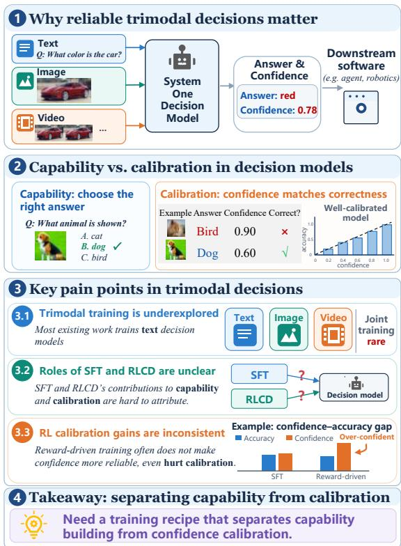  
Figure 1: Motivation for reliable trimodal decisions. Joint trimodal training remains underexplored, and the effects of SFT and RLCD on accuracy and calibration are difficult to separate.

Palmer and Kev contributors, 2026). Second, the respective contributions of supervised fine-tuning (SFT) and reinforcement learning for calibrated decisions (RLCD) (TypeSafe AI, 2026; Gao and Wang, 2026) remain unclear. Both stages update the same model, and some RLCD recipes combine reinforcement with additional supervision, making it difficult to attribute improvements to either component. Third, rewarding correct decisions does not by itself ensure reliable confidence, because calibration requires the reported probabilities to agree with empirical correctness across questions. Evaluating a training recipe therefore requires separate measurements of answer accuracy and confidence calibration. Figure 1 summarizes this distinction across the two training stages.

<table><tr><td>Method</td><td>Training signal</td><td>Estimator</td><td>Reference constraint</td></tr><tr><td>TypeSafe Jev</td><td>1</td><td></td><td>一</td></tr><tr><td>Laya / Dohnuts</td><td> $\mathrm { L o g + s p h e r i c a l ; R P S }$ </td><td>Gaussian SF</td><td>Soft CE</td></tr><tr><td>Astro-RLCD</td><td> $\mathrm { L o g + s p h e r i c a l }$ </td><td>Gaussian SF + LOO</td><td>None</td></tr><tr><td>Valen</td><td> $c - ( p _ { a } - c ) ^ { 2 }$ </td><td> $\mathrm { C l i p p e d ~ S F + G N }$ </td><td>KL + Brier</td></tr><tr><td>NanoJev</td><td> $2 p _ { y } - \| p \| ^ { 2 }$ </td><td> $\mathrm { P a i r e d \ S F + L O O }$ </td><td>None</td></tr><tr><td>Decider RL</td><td>Return + belief log score</td><td> ${ \mathrm { C l i p p e d ~ S F } } + { \mathrm { d i r e c t } }$ </td><td>Retention KL</td></tr><tr><td>OpenJev-RLCD</td><td>Post-rationale Brier</td><td>Pathwise + rationale SF</td><td>KL</td></tr><tr><td>REINFORCE-A</td><td>CE + Brier</td><td> $\mathrm { A n a l y t i c } + \mathrm { o u t c o m e } \mathrm { S F }$ </td><td>KL</td></tr><tr><td>RLCR / Rewarding Doubt</td><td>Outcome + stated confidence</td><td>Sequence policy gradient</td><td>Recipe-specific</td></tr><tr><td>RLCD-lite</td><td>Correctness + Brier</td><td>Constrained GRPO</td><td>Recipe-specific</td></tr><tr><td>Von / OneJev / Open-Jev</td><td>CE + Brier</td><td>Direct gradient</td><td>None</td></tr><tr><td>Kev / NanoJev</td><td>CE</td><td>Direct gradient</td><td>None</td></tr><tr><td>GRPO / RLVR</td><td>Correctness c</td><td>Categorical / sequence SF</td><td>KL</td></tr><tr><td>CORA (ours)</td><td>Current-group bin accuracy</td><td>Direct confidence gradient</td><td>None</td></tr></table>

Table 1: Training designs of the methods compared in Table 2. The reference constraint column lists each recipe’s regularization toward a reference model or supervised objective, used to keep updates close to the initialization. c: sampled correctness; $p _ { a } \colon$ selected-answer probability; $y \colon$ observed label; SF: score-function (REINFORCE-style) gradient; LOO: leave-one-out; GN: group normalization; RPS: ranked probability score. A listed recipe need not describe its released checkpoint; evaluation conventions and selected revisions appear in Appendix A.

To address these challenges, we introduce UNI-JEV, a trimodal decision model with separate training objectives for candidate selection and confidence calibration. Text, images, and video share a multimodal backbone and a head that scores the candidate answers, producing answer distributions without autoregressive decoding. Joint SFT trains candidate selection, followed by CORA (Confidence–Outcome Reliability Alignment) for calibration. CORA groups current predictions by confidence and uses each sufficiently populated bin’s empirical accuracy as a shared training target. The groups and targets are recomputed as the model changes, and inference uses the trained model’s probabilities directly.

We evaluate accuracy and calibration separately across text, image, and video. Comparisons cover general-purpose multimodal models, released decision models (including Jev, OneJev, and Valen), and local training controls. The local controls include SFT and reward-shaped RLCD (Shaped RLCD), as well as adaptations of GRPO (Shao et al., 2024), OpenJev-RLCD/CTR (Gao and Wang, 2026), RLCD-lite (RLCD-lite contributors, 2026), and Rewarding Doubt (Bani-Harouni et al., 2025); Appendix A specifies these recipes. On the common trimodal test suite, supervised decision models improve accuracy over backbone readouts, whereas the existing RLCD algorithms change accuracy little and have inconsistent effects on image and video calibration across recipes. These results support treating visual calibration as a distinct training objective rather than assuming it improves alongside accuracy. At both 2B and 9B, CORA reduces image and video ECE while preserving accuracy, without a reinforcement stage.

Our contributions are threefold: (1) a trimodal Jev-style model with a shared answer-scoring head and joint training across text, images, and video; (2) controlled trimodal comparisons showing substantial accuracy gains after the supervised decisionmodel conversion but small accuracy changes and inconsistent visual-calibration effects after the existing RLCD algorithms; and (3) CORA, a supervised calibration method that updates the model using current confidence-group accuracy and improves image and video calibration in our experiments.

## 2 Related Work

System One decision models. Jev provides typed probabilistic decisions without free-form generation (TypeSafe AI, 2026; Guo et al., 2026). Text alternatives include encoder scoring (Laya, Verdict), option-conditioned attention (Jevlike), and pointer heads (Kev) (Laya contributors, 2026; Verdict contributors, 2026; Jevlike contributors, 2026; Jared Palmer and Kev contributors, 2026). Decider uses option-token logits; NanoJev and Shen et al.’s OpenJev model candidate interactions (Decider contributors, 2026; NanoJev contributors, 2026; OpenJev contributors, 2026). Vision extensions include Laya Vision, Dohnuts, MoJev, Vision-Jev, and decider-vision; OneJev and Valen support text, images, and video (Laya Vision contributors, 2026; PsiACE, 2026; MoLeMo Lab, 2026; Vision-Jev contributors, 2026; Decider contributors, 2026; OmniJev, 2026; Valen contributors, 2026). OmniJev combines decision heads with per-type calibration (Xu et al., 2026). UNIJEV studies joint trimodal training and confidence calibration through a shared answer-scoring head.

RLCD and confidence calibration. RLCD varies in reward, estimator, and supervision; Jev’s full recipe remains unpublished (TypeSafe AI, 2026; Guo et al., 2026). Examples include perturbed proper-score rewards (Laya, Dohnuts), updates without a reference-model constraint (Astro-RLCD), categorical rewards (Eve-RLCD), clipped updates (Valen), paired Brier estimates (NanoJev), and actor–belief learning (Decider) (Laya contributors, 2026; PsiACE, 2026; Astro-Han, 2026; Maio, 2026; Valen contributors, 2026; NanoJev contributors, 2026; Decider contributors, 2026). REINFORCE-A mixes analytic and sampled gradients; OpenJev-RLCD calibrates before rationale reinforcement (OpenJev contributors, 2026; Gao and Wang, 2026). RLCR and Rewarding Doubt reward stated confidence (Damani et al., 2025; Bani-Harouni et al., 2025). Proper scoring rules support probability learning, but scores also reflect predictive resolution beyond calibration (Brier, 1950; Gneiting and Raftery, 2007; Murphy, 1973; Vaicenavicius et al., 2019). Post-hoc methods include sigmoid scaling, histogram binning, and Bayesian binning (Platt, 2000; Zadrozny and Elkan, 2001; Naeini et al., 2015); calibration-error estimates depend on binning and sample size (Kumar et al., 2019; Roelofs et al., 2022). CORA uses current confidence-bin accuracy as detached supervision for the shared trimodal model, recomputing targets during training rather than applying a histogram map at inference. Table 1 summarizes recipes; evaluation and reproduction details appear in $\mathsf { A p - }$ pendix A.

## 3 Method

UNIJEV uses a shared architecture for text, image, and video decisions. SFT trains for first stage, and CORA subsequently aligns confidence with empirical correctness across questions. Figure 2 summarizes the shared architecture, the two training stages, and the main empirical findings.

## 3.1 Shared trimodal architecture

Each input x contains a text or visual state, a question, and K candidate answers with one correct option y. We represent text and visual states in a common input format and score the supplied candidates with the same decision head. The model returns $p _ { \theta } ( \cdot \mid x ) \in \Delta ^ { K - 1 }$ in one forward pass and selects $\hat { y } _ { \theta } ( x ) = \arg \operatorname* { m a x } _ { a } p _ { \theta } ( a \mid x )$

A Qwen3.5 backbone encodes text and visual inputs (Qwen Team, 2026). Images and timestamped video frames pass through its visual tower. We append the task, question, and candidate descriptions, followed by a fixed decision marker. The hidden state at the end of each candidate represents that option, while the state at the decision marker summarizes the request and its candidates. Two linear projections map these states to a shared dimension $d ,$ and each candidate’s score is the scaled inner product of the two projected states:

$$
\begin{array} { c } { z _ { a } = \frac { 1 } { \sqrt { d } } \langle W _ { c } h _ { \mathrm { c a n d } ( a ) } , W _ { d } h _ { \mathrm { d e c } } \rangle , } \\ { p _ { \theta } ( a \mid x ) = \mathrm { s o f t m a x } ( z ) _ { a } . } \end{array}\tag{1}
$$

The head returns a candidate distribution directly, so inference does not require generating or parsing an answer string.

## 3.2 Supervised candidate selection

We train candidate selection jointly across the three modalities using labeled questions and their candidate answers. For each question, the correct candidate receives target probability $\rho ,$ and the remaining mass is distributed uniformly among the alternatives. All modalities use the same cross-entropy objective:

$$
\begin{array} { r } { q _ { y } = \rho , \qquad q _ { a \ne y } = \displaystyle \frac { 1 - \rho } { K - 1 } , \ } \\ { \mathcal { L } _ { \mathrm { S F T } } = - \displaystyle \sum _ { a = 1 } ^ { K } q _ { a } \log p _ { \theta } ( a \mid x ) . \ } \end{array}\tag{2}
$$

Setting $\rho = 1$ gives hard-label supervision; $\rho < 1$ applies label smoothing (Szegedy et al., 2016; Müller et al., 2019). The objective trains the shared head to assign higher probability to the correct option regardless of input modality. This supervised stage provides the initialization for confidence calibration; Appendix B lists the training settings.

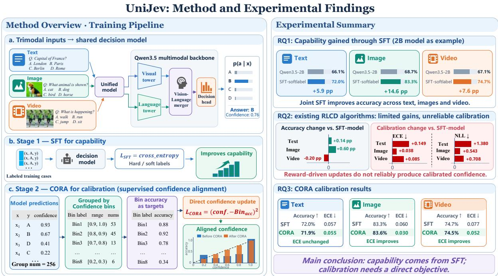  
Figure 2: Overview of UNIJEV and the main findings. A shared trimodal decision model first learns candidate selection through the supervised conversion, then CORA directly aligns confidence with the empirical accuracy of current confidence groups. Most of the observed accuracy gain occurs during the supervised conversion; the evaluated reward-driven continuations do not consistently improve visual calibration; and CORA lowers image and video ECE at both model scales while preserving accuracy.

## 3.3 CORA: supervised confidence calibration

CORA (Confidence–Outcome Reliability Alignment) trains confidence against the observed correctness of predictions at similar confidence levels. We estimate this relationship from groups of current predictions, with every group updating the same shared model. For reported confidence C, the calibration condition is (Guo et al., 2017; Vaicenavicius et al., 2019)

$$
\mathbb { E } [ \mathbb { I } \{ \hat { y } _ { \theta } ( X ) = Y \} ~ | ~ C = c ] = c .\tag{3}
$$

At update t, we draw a group $G _ { t }$ of distinct questions from the trimodal training set D. The current model computes the selected answer, confidence, and correctness for each question:

$$
\begin{array} { r l } & { a _ { i } ^ { t } = \arg \operatorname* { m a x } _ { a } p _ { \theta _ { t } } ( a \mid x _ { i } ) , } \\ & { } \\ & { \bar { c } _ { i } ^ { t } = p _ { \theta _ { t } } ( a _ { i } ^ { t } \mid x _ { i } ) , \quad u _ { i } ^ { t } = \mathbb { I } \{ a _ { i } ^ { t } = y _ { i } \} . } \end{array}\tag{4}
$$

We partition [0, 1] into confidence intervals $I _ { b }$ and estimate each bin’s accuracy from the current group:

$$
\begin{array} { l } { { \displaystyle B _ { t , b } = \{ i \in G _ { t } : \bar { c } _ { i } ^ { t } \in I _ { b } \} } , } \\ { { \displaystyle k _ { t , b } = \frac { 1 } { | B _ { t , b } | } \sum _ { i \in B _ { t , b } } u _ { i } ^ { t } , \qquad | B _ { t , b } | > 0 . } } \end{array}\tag{5}
$$

For example, 15 correct predictions among 20 questions in [0.8, 0.9) give every question in that bin the target 0.75, including its five errors. The target 0.75 estimates how often answers selected in this confidence range are correct.

Let $S _ { t }$ contain questions whose bins have at least m members. We minimize

$$
\mathcal { L } _ { \mathrm { C O R A } } ( \theta ; \theta _ { t } ) = \frac { 1 } { | S _ { t } | } \sum _ { i \in S _ { t } \atop \left( p _ { \theta } ( a _ { i } ^ { t } \mid x _ { i } ) - \operatorname { s g } [ k _ { t , b ( i ) } ] \right) ^ { 2 } , }\tag{6}
$$

where the stop-gradient operator $\mathrm { s g } [ \cdot ]$ treats its argument as a constant during backpropagation. The selected answers, bin assignments, and bin accuracies computed at $\theta _ { t }$ are held fixed during the update; gradients at $\theta = \theta _ { t }$ flow through the recomputed selected-answer probabilities. The next group uses the updated model to recompute these quantities, as summarized in Algorithm 1. The support threshold m excludes bins with too few observations from that update’s loss. If $S _ { t }$ is empty, we skip the optimizer update and proceed to the next group.

Unlike post-hoc histogram binning (Zadrozny and Elkan, 2001), CORA uses bins only to construct training targets. At inference, the shared model returns a candidate-probability distribution, its argmax answer, and the maximum probability as confidence. Because calibration updates can also change the selected answer, we evaluate accuracy alongside confidence calibration. Section 4.1 gives the training settings, and Appendix C describes the implementation.

Algorithm 1 CORA: supervised confidence cali  
bration   
Input: SFT parameters $\theta _ { 0 } ;$ trimodal training set D; intervals   
{Ib}; support m; group size n; updates T   
1: for $t = \stackrel { \cdot \cdot } { 0 } , \ldots , T - 1$ do   
2: sample n distinct questions $G _ { t } \subset \mathcal { D }$   
3: compute $a _ { i } ^ { t } , \bar { c } _ { i } ^ { t } .$ ut for each $i \in G _ { t }$ by (4)   
4: form confidence bins $B _ { t , b }$ and their accuracy targets   
$k _ { t , b }$ by (5)   
5: $S _ { t } \gets \{ i : | B _ { t , b ( i ) } | \geq$ m}   
6: if $S _ { t } \neq \emptyset$ then   
7: recompute selected-answer probabilities and update   
the shared model using (6)   
8: end if   
9: end for   
10: return $\theta _ { T }$

## 4 Experiments

We organize the experiments around three questions:

• RQ1: Does joint SFT improve decision accuracy across text, images, and video?

• RQ2: What does RLCD add to an SFT model? better answers, more reliable confidence, or both?

• RQ3: How does confidence-bin supervision affect calibration, and which components account for the observed changes?

## 4.1 Experimental setup

The training mixture combines text decisions from Kev’s decision-v7 collection (Jared Palmer and Kev contributors, 2026), image decisions from Valen-Training-General-100k (Valen contributors, 2026), and video multiple-choice questions from the JeV video collection. After source-group splitting, training contains 157,656 records, including 12,330 text, 98,142 image, and 47,184 video records. All training data cover 160,608 questions because some records contain multiple questions. The main test suite has 3,124 questions, including 764 text, 1,858 image, and 502 video questions. Training and test questions are disjoint by source group.

Table 2 compares general-purpose models, released decision models, local RLCD adaptations, and hard- and soft-label SFT controls. All training configurations, data-composition details, and reproduction protocols are provided in Appendices A–D.

We use test-set answer accuracy as the measure of decision performance. Confidence quality is measured by mean maximum candidate probability, 15-bin equal-width ECE (Naeini et al., 2015; Guo et al., 2017), candidate-distribution NLL, and multiclass Brier score (Gneiting and Raftery, 2007; Vaicenavicius et al., 2019). Appendix F examines its relationship to correctness through reliability diagrams and confidence-distribution statistics.

## 4.2 Main results

SFT improves decision accuracy across text, images, and video. Table 2 shows that the supervised decision-model recipe improves accuracy across all three modalities. At 2B, soft-label SFT reaches 72.0/83.3/74.7% on text/image/video, compared with 66.1/68.7/67.1% for Qwen3.5-2B. At 9B, hard-label SFT reaches 81.2/84.6/78.9%, compared with 76.8/76.7/73.3% for Qwen3.5- 9B. Soft-label SFT-9B reaches 80.8/82.8/77.5%, whose accuracy is lower than that of the hard-label model. These comparisons assess the supervised conversion, including its decision head, rather than isolating the effect of the SFT objective alone.

The evaluated RLCD algorithms have heterogeneous calibration effects. Relative to their shared 2B SFT initialization, the five RLCD algorithms, including Shaped RLCD, GRPO, CtR, RLCD-lite, and Rewarding Doubt, change permodality accuracy by −1.4 to +0.9 percentage points. These differences are small compared with the gains from the supervised conversion.

Visual calibration differs more substantially across the RLCD algorithms. CtR lowers image ECE from 0.060 to 0.025 and video ECE from 0.077 to 0.054. Shaped RLCD, GRPO, RLCDlite, and Rewarding Doubt increase ECE and NLL on both image and video: their confidence rises substantially while accuracy changes little, leaving them overconfident.

The existing RLCD algorithms therefore provide no consistent calibration benefit over SFT. Appendix E illustrates the resulting predictions on individual text, image, and video questions.

## 4.3 CORA: calibration results and ablations

CORA improves image and video calibration without sacrificing accuracy. In table 2,

<table><tr><td colspan="2"></td><td colspan="3">Text (764)</td><td colspan="4">Image (1,858)</td><td colspan="4">Video (502)</td></tr><tr><td>Model / method</td><td>B Acc.</td><td>Conf. ECE↓ NLL↓</td><td></td><td>Brier↓</td><td>Acc.</td><td>Conf. ECE↓ NLL↓</td><td></td><td>Brier↓</td><td>Acc.</td><td>Conf. ECE↓ NLL↓ 1</td><td></td><td>Brier↓</td></tr><tr><td colspan="9">General-purpose models</td><td></td><td></td><td></td></tr><tr><td>Qwen3.5-2B</td><td>2</td><td>66.1 0.673 0.105</td><td>0.864</td><td>0.484</td><td>68.7 0.706</td><td>0.058</td><td>0.831</td><td>0.379</td><td>67.1 0.708</td><td>0.050</td><td>0.771</td><td>0.421</td></tr><tr><td>Qwen3.5-9B</td><td>9</td><td>76.8 0.828 0.060</td><td>0.587</td><td>0.322</td><td>76.7 0.811</td><td>0.043</td><td>0.637</td><td>0.296</td><td>73.3 0.748</td><td>0.031</td><td>0.586</td><td>0.327</td></tr><tr><td>Qwen3.8-27B</td><td>27 84.7</td><td>0.842 0.028</td><td>0.469</td><td>0.233</td><td>78.9 0.780</td><td>0.027</td><td>0.627</td><td>0.286</td><td>74.5 0.807</td><td>0.075</td><td>0.655</td><td>0.352</td></tr><tr><td>InternVL3.5-8B</td><td>8 76.4</td><td>0.893 0.132</td><td>0.823</td><td>0.365</td><td>83.0 0.881</td><td>0.053</td><td>0.516</td><td>0.229</td><td>71.5 0.798</td><td>0.084</td><td>0.703</td><td>0.369</td></tr><tr><td>Gemma4-26B-A4B</td><td>26 82.7</td><td>0.987 0.164</td><td>1.676</td><td>0.328</td><td>84.6 0.969</td><td>0.124</td><td>0.996</td><td>0.268</td><td>62.9 0.938</td><td>0.308</td><td>2.146</td><td>0.651</td></tr><tr><td colspan="9">Released decision models</td><td></td><td></td><td></td></tr><tr><td>TypeSafe Jev</td><td>85.9</td><td>0.903 0.045</td><td>0.703</td><td>0.197</td><td></td><td></td><td></td><td></td><td></td><td></td><td></td><td></td></tr><tr><td>Laya (English)</td><td>0.421</td><td>63.40.745 0.112</td><td>0.935</td><td>0.476</td><td></td><td></td><td></td><td></td><td></td><td></td><td></td><td></td></tr><tr><td>Laya (typed-dec.)</td><td>0.421 62.0</td><td>0.624 0.063</td><td>0.851</td><td>0.465</td><td></td><td></td><td></td><td></td><td></td><td></td><td></td><td></td></tr><tr><td>Laya Vision</td><td>0.201 54.7</td><td>0.558 0.051</td><td>0.911</td><td>0.533</td><td>62.00.6140.072</td><td></td><td>1.018</td><td>0.474</td><td></td><td></td><td></td><td></td></tr><tr><td>Von</td><td>0.395 71.3</td><td>0.643 0.081</td><td>0.733</td><td>0.422</td><td></td><td></td><td></td><td></td><td></td><td></td><td></td><td></td></tr><tr><td>Verdict</td><td>0.151 47.1</td><td>0.576 0.116</td><td>0.968</td><td>0.573</td><td></td><td></td><td></td><td></td><td></td><td></td><td></td><td></td></tr><tr><td>NIRNAY</td><td>0.450</td><td>48.60.736 0.250</td><td>1.357</td><td>0.731</td><td></td><td></td><td></td><td></td><td></td><td></td><td></td><td></td></tr><tr><td>Dohnuts</td><td>0.8 67.1</td><td>0.743 0.107</td><td>0.809</td><td>0.458</td><td>76.00.703</td><td>0.062</td><td>0.690</td><td>0.316</td><td></td><td></td><td></td><td></td></tr><tr><td>OneJev</td><td>9 79.3</td><td>0.793 0.034</td><td>0.518</td><td>0.279</td><td>86.3 0.853</td><td>0.021</td><td>0.379</td><td>0.183</td><td>73.5 0.735</td><td>0.061</td><td>0.653</td><td>0.358</td></tr><tr><td>OmniJev</td><td>4 69.6</td><td>0.845 0.149</td><td>0.878</td><td>0.429</td><td>81.60.857</td><td>0.042</td><td>0.498</td><td>0.232</td><td>63.1 0.761</td><td>0.129</td><td>0.938</td><td>0.480</td></tr><tr><td>Open-Jev</td><td>2</td><td>70.4 0.715 0.071</td><td>0.754</td><td>0.419</td><td></td><td></td><td></td><td></td><td></td><td></td><td></td><td></td></tr><tr><td>Open-Jev</td><td>9 79.7</td><td>0.810 0.071</td><td>0.634</td><td>0.317</td><td></td><td></td><td></td><td></td><td></td><td></td><td></td><td></td></tr><tr><td>RLCR-hotpot</td><td>7 61.8</td><td>0.668 0.070</td><td>0.835</td><td>0.496</td><td></td><td></td><td></td><td></td><td></td><td></td><td></td><td></td></tr><tr><td>OpenJev</td><td>4 79.5</td><td>0.871 0.077</td><td>0.612</td><td>0.287</td><td></td><td></td><td></td><td></td><td></td><td></td><td></td><td></td></tr><tr><td>Astro-RLCD</td><td>4 82.1</td><td>0.921 0.117</td><td>0.699</td><td>0.311</td><td></td><td></td><td></td><td></td><td></td><td></td><td></td><td></td></tr><tr><td>Kev</td><td>4 82.2</td><td>0.804 0.038</td><td>0.470</td><td>0.244</td><td></td><td></td><td></td><td></td><td></td><td></td><td></td><td></td></tr><tr><td>decider</td><td>2 75.1</td><td>0.808 0.059</td><td>0.550</td><td>0.330</td><td></td><td></td><td></td><td></td><td></td><td></td><td></td><td></td></tr><tr><td>decider-vision</td><td>2 74.9</td><td>0.839 0.095</td><td>0.669</td><td>0.368</td><td>80.2 0.831</td><td>0.030</td><td>0.533</td><td>0.245</td><td></td><td></td><td></td><td></td></tr><tr><td>NanoJev</td><td>0.6 35.2</td><td>0.552 0.223</td><td>1.298</td><td>0.764</td><td></td><td></td><td></td><td></td><td></td><td></td><td></td><td></td></tr><tr><td>Valen</td><td>2 72.0</td><td>0.813 0.093</td><td>0.667</td><td>0.377</td><td>93.7 0.932</td><td>0.007</td><td>0.170</td><td>0.085</td><td>64.5 0.729</td><td>0.085</td><td>0.898</td><td>0.473</td></tr><tr><td colspan="9"></td><td></td><td></td><td></td></tr><tr><td>Supervised controls SFT (2B)</td><td></td><td>70.3 0.704</td><td></td><td></td><td></td><td></td><td></td><td></td><td></td><td></td><td></td><td></td></tr><tr><td>SFT (9B)</td><td>2</td><td>81.2 0.873</td><td>0.042 0.654</td><td>0.380</td><td>82.00.806</td><td>0.026</td><td>0.468</td><td>0.229</td><td>75.5 0.690</td><td>0.072</td><td>0.625</td><td>0.339 0.292</td></tr><tr><td>SFT-softlabel (2B)</td><td>9 2</td><td>0.068 72.00.737 0.057</td><td>0.534</td><td>0.274</td><td>84.6 0.882</td><td>0.037</td><td>0.406</td><td>0.199</td><td>78.9 0.801</td><td>0.036</td><td>0.536</td><td></td></tr><tr><td>SFT-softlabel (9B)</td><td>9</td><td>80.80.795 0.040</td><td>0.693 0.542</td><td>0.387 0.289</td><td>83.3 0.779 82.8 0.770</td><td>0.060 0.061</td><td>0.482 0.495</td><td>0.218 0.225</td><td>74.7 0.681 77.5 0.702</td><td>0.077 0.077</td><td>0.648 0.602</td><td>0.344 0.316</td></tr><tr><td colspan="9">Local training baselines</td></table>

Table 2: Model comparison on text (764 test questions), image (1,858), and video (502). Each modality reports accuracy (Acc., %), mean maximum candidate probability (Conf.), 15-bin ECE, NLL, and multiclass Brier. The CORA rows report the final checkpoints after 100 supervised calibration updates on the trimodal training set. B denotes nominal parameter scale in billions. – denotes an unsupported modality or undisclosed scale. Released checkpoints use their native interfaces without local retraining. Our supervised controls use hard-label SFT at 2B/9B and soft-label SFT at 2B/9B. Local 2B recipe rows use a shared soft-label SFT initialization and a 500-step budget.

<table><tr><td></td><td colspan="3">Text (764)</td><td colspan="3">Image (1,858)</td><td colspan="3">Video (502)</td></tr><tr><td>Arm</td><td>Acc.</td><td>Conf.</td><td>ECE↓</td><td>Acc.</td><td>Conf.</td><td>ECE↓</td><td>Acc.</td><td>Conf.</td><td>ECE↓</td></tr><tr><td>Default</td><td></td><td></td><td></td><td></td><td></td><td></td><td></td><td></td><td></td></tr><tr><td>CORA (10 bins, group 256, support 20)</td><td>71.9</td><td>0.767</td><td>0.055</td><td>83.6</td><td>0.851</td><td>0.030</td><td>74.5</td><td>0.767</td><td>0.052</td></tr><tr><td>Primary single-factor contrasts</td><td></td><td></td><td></td><td></td><td></td><td></td><td></td><td></td><td></td></tr><tr><td>Bin accuracy → bin mean confidence</td><td>71.9</td><td>0.989</td><td>0.274</td><td>83.0</td><td>0.992</td><td>0.162</td><td>74.7</td><td>0.986</td><td>0.240</td></tr><tr><td>Confidence bins → one global target</td><td>72.1 72.3</td><td>0.875 0.802</td><td>0.158 0.095</td><td>82.7 83.6</td><td>0.830 0.844</td><td>0.127 0.026</td><td>74.5 75.3</td><td>0.823 0.763</td><td>0.090 0.045</td></tr><tr><td>Minimum support 20 → 1</td><td></td><td></td><td></td><td></td><td></td><td></td><td></td><td></td><td></td></tr><tr><td>Update scope</td><td></td><td></td><td></td><td></td><td></td><td></td><td></td><td></td><td></td></tr><tr><td>Trainable scope → head only</td><td>72.0</td><td>0.802</td><td>0.083</td><td>83.5</td><td>0.848</td><td>0.032</td><td>74.9</td><td>0.761</td><td>0.061</td></tr><tr><td>Sensitivity</td><td></td><td></td><td></td><td></td><td></td><td></td><td></td><td></td><td></td></tr><tr><td>Bins  $1 0  5$ </td><td>72.9 71.6</td><td>0.803 0.828</td><td>0.082 0.112</td><td>83.7</td><td>0.840</td><td>0.034</td><td>74.5</td><td>0.774</td><td>0.069</td></tr><tr><td>Bins  $1 0  2 0$ </td><td>71.9</td><td>0.868</td><td>0.149</td><td>83.2 83.0</td><td>0.866 0.881</td><td>0.036 0.054</td><td>74.3 75.3</td><td>0.792</td><td>0.074</td></tr><tr><td>Group  $2 5 6 \to 1 2 8$   $2 5 6  5 1 2$ </td><td>71.6</td><td>0.796</td><td>0.080</td><td>83.6</td><td>0.840</td><td>0.031</td><td>74.3</td><td>0.824 0.752</td><td>0.095 0.058</td></tr><tr><td>Group Minimum support  $2 0  1 0$ </td><td>72.4</td><td>0.803</td><td>0.079</td><td>83.9</td><td>0.846</td><td>0.033</td><td>75.5</td><td>0.764</td><td>0.056</td></tr><tr><td>Minimum support  $2 0  4 0$ </td><td>71.9</td><td>0.872</td><td>0.154</td><td>83.0</td><td>0.879</td><td>0.055</td><td>74.5</td><td>0.834</td><td>0.094</td></tr><tr><td></td><td></td><td></td><td></td><td></td><td></td><td></td><td></td><td></td><td></td></tr></table>

Table 3: CORA ablations and sensitivity on the test suite. Every arm shares the soft-label SFT initialization, training mixture, and 100-update protocol; each row changes one factor relative to the default and reports its final checkpoint. The default row is identical to the 2B CORA row in Table 2.

CORA’s accuracy changes by $- 0 . 1 / + 0 . 3 / - 0 . 2$ percentage points on text/image/video relative to soft-label SFT. Image ECE falls from 0.060 to 0.030 and video ECE from 0.077 to 0.052, with lower NLL in both modalities. Thus, direct confidence-bin supervision improves visual calibration while preserving decision accuracy.

CORA has slightly higher image ECE than CtR (0.030 versus 0.025) and lower video ECE (0.052 versus 0.054). Without a reinforcement stage, direct confidence-bin supervision yields lower image and video ECE and NLL than each of the four primarily reward-driven recipes. Appendix F shows the remaining errors across confidence bins.

We also apply the recipe at 9B. Starting from soft-label SFT-9B, CORA (9B) reduces image ECE from 0.061 to 0.031 and video ECE from 0.077 to 0.063 while accuracy changes by at most 0.2 points in every modality. The consistent image and video reductions across both scales support a visual-calibration improvement.

Table 3 reports matched single-factor ablations. Replacing bin accuracy with mean confidence removes correctness supervision, producing mean confidence near 0.99 and ECE of 0.162–0.274. Replacing confidence-conditioned bins with one global correctness target also degrades all three modalities, including an increase in image ECE from 0.030 to 0.127. Thus, both correctness supervision and confidence conditioning are important. The remaining variants preserve accuracy within one percentage point of the default but expose differences between the two visual modalities. Headonly updates nearly match image ECE (0.032 versus 0.030) but trail on video, and the 512-question group is the closest sensitivity variant on both image and video. Appendix C provides the procedural details.

## 4.4 Confidence distributions behind Table 2

To examine the calibration differences in RQ2 and RQ3, we compare the test-confidence distributions behind Table 2. Appendix F gives reliability diagrams for all rows (Figures 7–10) and a numeric profile (Table 4).

Soft-label SFT places only 3.6% of predictions above 0.95 confidence. Its overall accuracy is 0.792 and mean confidence is 0.753, but this aggregate underconfidence hides modality- and binspecific behavior. On image, about half of predictions fall in [0.90, 0.95), where empirical accuracy rounds to 1.00; by contrast, the small text tail above 0.95 is only 70% correct. The same model can therefore be underconfident on high-confidence image questions and overconfident on text questions.

Shaped RLCD, GRPO, RLCD-lite, and Rewarding Doubt place 69–93% of predictions above 0.95, with median confidence rounding to 1.000 and a much larger Brier reliability term than SFT. CtR and CORA shift confidence less sharply. Their image confidence–accuracy gaps are +0.019 and +0.015, compared with −0.054 for SFT. This distributional view is consistent with CORA correcting visual underconfidence.

At 9B, hard-label SFT is overconfident in every modality, whereas soft-label SFT is underconfident, consistent with label smoothing reducing confidence but not sufficient to isolate its effect. Among released models, OneJev-9B has mean confidence– accuracy gaps within ±0.010, showing that small aggregate gaps are attainable even though they do not guarantee per-bin calibration.

## 5 Conclusion

UNIJEV unifies text, images, and video through a shared System One decision interface. The supervised conversion improves accuracy across all three modalities, while the existing RLCD algorithms produce only small accuracy changes and inconsistent effects on visual calibration. CORA treats calibration as a separate supervised objective, aligning confidence with empirical correctness across questions while updating a shared model. At both 2B and 9B, it improves image and video calibration while preserving accuracy, without a reinforcement stage. These results support a division of labor between the two training stages. The supervised conversion provides the observed accuracy gains, while direct confidence-bin supervision improves visual calibration.

## Limitations

Our evidence for CORA’s calibration benefit is limited to image and video decisions on the evaluated test suite and model scales. Group-accuracy targets include each question’s own outcome and may be noisy or transfer poorly beyond the training mixture. Calibration updates can also change the model’s answers. Local RLCD comparisons use a 2B backbone and one seed per recipe, limiting conclusions about small accuracy differences. Recipes that combine direct supervision with reinforcement do not isolate the contribution of the reinforcement stage. Released-model pretraining and source overlap are uncontrolled, and ECE alone establishes neither subgroup calibration nor useful confidence ranking. Our conclusions concern labeled, singlestep decisions.

## References

Astro-Han. 2026. Where does a decision model’s generalisation come from? Source repository, accessed 9 October 2026.

David Bani-Harouni, Chantal Pellegrini, Paul Stangel, Ege Özsoy, Kamilia Zaripova, Nassir Navab, and

Matthias Keicher. 2025. Rewarding doubt: A reinforcement learning approach to calibrated confidence expression of large language models. arXiv preprint arXiv:2503.02623.

Glenn W. Brier. 1950. Verification of forecasts expressed in terms of probability. Monthly Weather Review, 78(1):1–3.

Mehul Damani, Isha Puri, Stewart Slocum, Idan Shenfeld, Leshem Choshen, Yoon Kim, and Jacob Andreas. 2025. Beyond binary rewards: Training LMs to reason about their uncertainty. arXiv preprint arXiv:2507.16806.

Decider contributors. 2026. Decider: One-pass typed decisions and calibration-aware reinforcement learning. GitHub repository. Inspected 9 October 2026; source revision e50e549.

Zhimin Gao and Pichao Wang. 2026. OpenJev-RLCD: A working RLCD implementation. arXiv preprint arXiv:2609.38850.

Tilmann Gneiting and Adrian E. Raftery. 2007. Strictly proper scoring rules, prediction, and estimation. Journal of the American Statistical Association, 102(477):359–378.

Chuan Guo, Geoff Pleiss, Yu Sun, and Kilian Q. Weinberger. 2017. On calibration of modern neural networks. In Proceedings of the 34th International Conference on Machine Learning, pages 1321–1330.

Ruoqi Guo, Yi Liu, Gelei Deng, Yuekang Li, Lida Zhao, Yutao Wu, Simin Chen, Ying Zhang, and Leo Yu Zhang. 2026. Just ask Jev: Reinforcement learning for calibrated decisions as a zero-shot detector of AI alignment failures. arXiv preprint arXiv:2609.29429.

Edward J. Hu, Yelong Shen, Phillip Wallis, Zeyuan Allen-Zhu, Yuanzhi Li, Shean Wang, Lu Wang, and Weizhu Chen. 2022. LoRA: Low-rank adaptation of large language models. In International Conference on Learning Representations.

Jared Palmer and Kev contributors. 2026. Kev: Open decision models with candidate pointer heads. GitHub repository. Inspected 9 October 2026; source revision 5e42a7a.

Jevlike contributors. 2026. Jevlike: Option-conditioned decision scoring. GitHub repository. Inspected 9 October 2026; source revision 94f5fd1.

Ananya Kumar, Percy S. Liang, and Tengyu Ma. 2019. Verified uncertainty calibration. In Advances in Neural Information Processing Systems, volume 32. Curran Associates, Inc.

Laya contributors. 2026. Laya: Typed decision models. Accessed 9 October 2026.

Laya Vision contributors. 2026. Laya vision. Accessed 9 October 2026.

Anthony Maio. 2026. Honest about uncertainty: I tried to rebuild Jev’s RLCD from a blog post. Blog post and code, https://github.com/anthony-maio/ eve-rlcd.

MoLeMo Lab. 2026. Mojev: Typed decisions in one forward pass. Source repository, accessed 9 October 2026.

Rafael Müller, Simon Kornblith, and Geoffrey E. Hinton. 2019. When does label smoothing help? In Advances in Neural Information Processing Systems, volume 32. Curran Associates, Inc.

Allan H. Murphy. 1973. A new vector partition of the probability score. Journal ofApplied Meteorology, 12(4):595–600.

Mahdi Pakdaman Naeini, Gregory F. Cooper, and Milos Hauskrecht. 2015. Obtaining well calibrated probabilities using bayesian binning. In Proceedings of the Twenty-Ninth AAAI Conference on Artificial In telligence, pages 2901–2907.

NanoJev contributors. 2026. NanoJev: Parallel decisions and calibrated-learning experiments. GitHub repository. Inspected 9 October 2026; source revision 76fdfc9.

OmniJev. 2026. Onejev: Multimodal system one models. Accessed 9 October 2026.

OpenJev contributors. 2026. Openjev-4b: Learning open-vocabulary probabilistic decision models. Source repository, accessed 9 October 2026.

John C. Platt. 2000. Probabilities for SV machines. In Advances in Large-Margin Classifiers, pages 61–74. MIT Press.

PsiACE. 2026. Dohnuts: Small multimodal models for direct decisions. Accessed 9 October 2026.

Qwen Team. 2026. Qwen3.5 model card. Accessed 9 October 2026.

RLCD-lite contributors. 2026. Rlcd-lite: Training and evaluating calibrated decisions. Accessed 9 October 2026.

Rebecca Roelofs, Nicholas Cain, Jonathon Shlens, and Michael C. Mozer. 2022. Mitigating bias in calibration error estimation. In Proceedings ofthe 25th International Conference on Artificial Intelligence and Statistics, volume 151 of Proceedings of Machine Learning Research, pages 4036–4054. PMLR.

Zhihong Shao, Peiyi Wang, Qihao Zhu, Runxin Xu, Junxiao Song, Xiao Bi, Haowei Zhang, Mingchuan Zhang, Y. K. Li, Y. Wu, and Daya Guo. 2024. Deepseekmath: Pushing the limits of mathematical reasoning in open language models. arXiv preprint arXiv:2402.03300.

Christian Szegedy, Vincent Vanhoucke, Sergey Ioffe, Jon Shlens, and Zbigniew Wojna. 2016. Rethinking the inception architecture for computer vision. In Proceedings of the IEEE Conference on Computer Vision and Pattern Recognition, pages 2818–2826.

TypeSafe AI. 2026. Jev: A system one model for calibrated decisions. Product launch and documentation, https://typesafe.ai. Training method (RLCD) unpublished.

Juozas Vaicenavicius, David Widmann, Carl Andersson, Fredrik Lindsten, Jacob Roll, and Thomas Schön. 2019. Evaluating model calibration in classification. In Proceedings ofthe Twenty-Second International Conference on Artificial Intelligence and Statistics, volume 89 of Proceedings of Machine Learning Research, pages 3459–3467. PMLR.

Valen contributors. 2026. Valen: Multimodal decision models and experimental RLCD training. GitHub repository. Inspected 9 October 2026; source revision 5f775c4.

Verdict contributors. 2026. Verdict: An open decision engine. Accessed 9 October 2026.

Vision-Jev contributors. 2026. Vision-jev: Open visionenabled decision models. Source repository, accessed 9 October 2026.

Tianrun Xu, Hongbang Fan, Jiahao Lin, Zilin Zhu, Zhenxin Diao, Longteng Guo, and Jing Liu. 2026. Omnijev: An omni-modal system one decision model. V1.1 release; Beijing Zhongguancun Academy, Institute of Automation of the Chinese Academy of Sciences, and Zevo.

Bianca Zadrozny and Charles Elkan. 2001. Obtaining calibrated probability estimates from decision trees and naive Bayesian classifiers. In Proceedings of the Eighteenth International Conference on Machine Learning, pages 609–616. Morgan Kaufmann.

## A Baseline Evaluation and Reproduction

Released models retain native weights, preprocessing, and calibration, with adapters and decision heads loaded against their matching base models. They are evaluated without local retraining. Selected source revisions are Kev, Decider, Decider-Vision, NanoJev, and Valen. NanoJev uses the step-400 CE release; Valen uses the SFT release with native 16-frame video processing and an FP32 decision head. The baseline registry records checkpoint identifiers and source revisions.

Evaluation requires complete slices of 764 text, 1,858 image, and 502 video questions. Each model receives all candidates in the prescribed order. Serving-only candidate caps are removed while architectural limits remain; unsupported modalities are marked with dashes. Verdict and OmniJev probabilities are conditioned on the supplied answers, with abstention mass archived separately. Jev probability-mass errors up to 0.02 are renormalized; larger errors are rejected. Confidence is the maximum candidate probability, and NLL uses $\mathrm { a ~ 1 0 ^ { - 1 2 } }$ floor. Native media processing is retained, so released-model comparisons include differences in input processing and pretraining.

The local Shaped RLCD, GRPO, CtR, RLCDlite, and Rewarding Doubt rows in Table 2 share the same 2B soft-label SFT checkpoint. Each continuation uses 500 steps on four GPUs with a global target of 32,768 input tokens per update. Shaped RLCD uses reward shaping with confidence-shaped action rewards; GRPO uses correctness rewards with group normalization. CtR adapts calibration-then-reinforcement to the categorical decision head with 250 steps of direct Brier calibration preceding 250 reinforcement steps, using the calibration checkpoint as reference. It therefore tests the two-stage recipe on candidate selection rather than reproducing the source’s rationalegeneration experiments. RLCD-lite jointly samples an answer from the decision distribution and a stated confidence from an auxiliary five-level confidence question, rewarding correctness minus the squared confidence–correctness gap with a groupmean baseline and no reference-model constraint. Rewarding Doubt treats the proposed answer as fixed, asks an auxiliary eleven-level confidence question conditioned on that answer, and rewards the stated confidence’s log score with an exact categorical expected-reward baseline and a Kullback– Leibler (KL) penalty (weight 0.05) toward the initialization. Both adaptations update the shared model through the auxiliary confidence question; evaluation uses candidate probabilities, as for every row.

CORA is evaluated as a model calibrated on the trimodal training set, using its own answers and candidate probabilities. All local comparisons use the same test questions; every trained row reports its fixed-budget final checkpoint.

## B Hyperparameters and Protocol Details

Data and evaluation protocol. The text tasks include classification, inference, and rating; the image tasks cover visual question answering, interfaces, documents, and games; and the video tasks cover event understanding and temporal reasoning. Text evaluation uses Kev’s transfer-v4 test split, with 444 Choice, 280 Noul, and 40 Score questions in 544 source groups. Image and video test questions are randomly selected from their respective source pools, with source-group disjointness between training and test data. Table 2 evaluates the supervised controls at both 2B and 9B and five local 2B RLCD algorithms initialized from the same soft-label SFT model. The shared prompt for general-purpose models appears in Appendix D.

Configuration. We use the architecture in Section 3.1, bfloat16 (BF16) backbone computation, 32-bit floating-point (FP32) scoring, and gradient checkpointing. The decision projections have dimension $d = 2 5 6 ;$ low-rank adaptation (LoRA) (Hu et al., 2022) uses rank 32 and $\alpha = 6 4$ , trained together with the vision–language merger and decision head. The decision marker is the literal suffix Decision:, with its final token supplying the decision readout state; training uses token-budget batching and reshuffles candidate order across epochs. Inputs allow 32,768 tokens and up to 128 video frames, each capped at 65,536 pixels; over-length inputs are rejected.

Training. SFT-softlabel (2B) uses eight GPUs, 32,768 tokens per GPU per step, $\rho = 0 . 9$ , gradient clipping at 1.0, and seed 42. Head/LoRA/merger learning rates are $( 2 \times 1 0 ^ { - 4 } , 5 \times 1 0 ^ { - 5 } , 1 0 ^ { - 5 } )$ . Maintable 2B continuations use four GPUs, 500 steps, and a global target of 32,768 tokens per update. The soft-label SFT-9B control uses eight GPUs and 500 steps.

Calibration data. CORA draws calibration groups from the trimodal SFT training set. AdamW uses no weight decay, head/LoRA/merger rates $( 2 \times 1 0 ^ { - 5 } , 5 \times 1 0 ^ { - 6 } , 1 0 ^ { - 6 } )$ , clipping at 1, seed 42, and a fixed budget of 100 updates on four GPUs. Each update groups 256 questions into 10 equal-width confidence bins with minimum support m = 20; intervals are left-closed and right-open except for the final interval, which includes confidence 1.0. The reported model is the final checkpoint after 100 updates, without test-based checkpoint selection; test questions never contribute to training-bin statistics or gradients.

## C CORA Procedure

CORA updates the SFT-trained model using statistics of its current predictions on training questions. Calibration is trained into the model, and inference reads the trained probabilities directly.

Training and inference. The calibration groups come from the SFT trimodal training set. For each optimizer update, compute the whole group’s current predictions, pool confidence and correctness across workers, and form detached bin-accuracy targets. To limit activation memory, collect statistics without gradients, then recompute each supported prediction at the same parameters and backpropagate its squared error. Update parameters once per group; the next group uses fresh outputs. If no bin reaches the minimum support, skip that optimizer update. Algorithm 1 specifies this order. At inference, return the trained model’s argmax and candidate probabilities directly.

Training dynamics. Figure 3 summarizes the completed 100-update run. The group loss decreases over training, while the supported fraction records how much of each group contributes to the calibration loss under the minimum-support rule. Periodic accuracy, Brier, and ECE measurements provide additional optimization diagnostics. These curves describe training dynamics only; the reported model remains the fixed-budget final checkpoint, and the test results in Tables 2 and 3 are not used for checkpoint selection.

Ablation protocol. The single-factor arms in Table 3 share the soft-label SFT initialization, training mixture, question groups, trainable parameters, and 100-update budget unless the named factor changes them. Appendix F examines the per-bin reliability of the resulting predictions. Parameter updates can change predictions, so all studies track accuracy and answer changes rather than assuming preservation.

## D Shared Prompt for General-Purpose Models

The original state and supported media precede the following common suffix. Candidate order is preserved for evaluation; labels expand with the actual candidate count, so no questions are dropped. Up to 26 options use A–Z; larger sets use fixedwidth labels AA, AB, and so on (77 options end at CY).

Answer the question using the provided   
state and media.   
Choose exactly one of the listed   
options.   
Output only its label from: {labels}   
Do not output an explanation or any   
other text.

Question: {question}

Options:

{options}

Answer:

For a single-token label, its score is the corresponding vocabulary logit at the answer position; probabilities are normalized over the candidate labels. If a tokenizer splits a label, we use its full conditional sequence log-likelihood and normalize over labels, rather than scoring only its first token. Confidence is the maximum resulting candidate probability. Released decision models retain their native decision interfaces and released calibration.

## E Cases from the Main Comparison

We organize 22 cases by modality, which include eight text (T1–T8), eight image (I1–I8), and six video (V1–V6), one compact sheet per modality. All cards compare Table 2’s soft-label 2B SFT initialization, the five 500-step RLCD continuations (Shaped RLCD, GRPO, RLCD-lite, Rewarding Doubt, and CtR), and the 100-update CORA model. Each card gives the input, candidates, annotation, and every model’s predicted answer with its confidence percentage. Display letters preserve candidate order; an asterisk marks an answer matching the annotation. CORA answers and confidence come from the same fixed-budget final checkpoint as Table 2, matched by question identifier.

Within each modality, cases cover shared correct answers, shared errors, and mixed outcomes. Additional cases favor less represented task families and are then selected by a fixed record/question hash, with no repeated source group. Selection is illustrative, not a representative estimate of calibration. Confidence is rounded to one decimal percentage point; correctness follows dataset annotations.

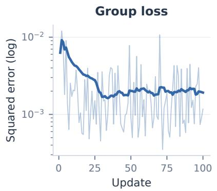

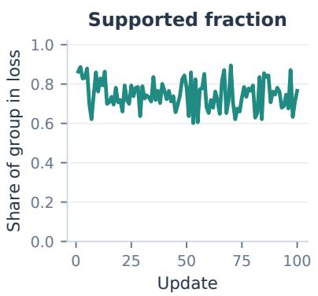

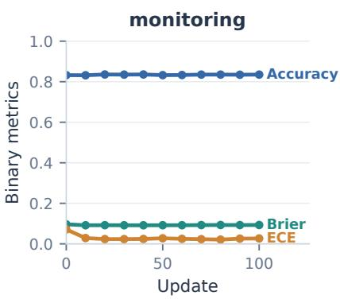  
Figure 3: CORA training dynamics over 100 updates. Left: per-update group loss (thin) and its 25-update running mean (bold), shown on a logarithmic scale. Center: fraction of each 256-question group included in the loss after applying the minimum-support rule. Right: periodic monitoring accuracy, binary Brier score, and 15-bin ECE.

Text cases (Figure 4). T1–T3 are shared correct answers across science and knowledge questions, T4–T6 shared errors, and T7–T8 mixed outcomes. T1–T3 illustrate confidence increases on correct answers; T4–T6 show similar increases on errors. T7 includes a none-of-the-listed-options answer selected correctly by Shaped RLCD and CtR, while T8 shows CtR changing SFT’s correct emotion judgment. These examples separate confidence changes from changes in answer correctness.

Image cases (Figure 5). The image sheet covers spatial reasoning, interface reading, counting, document and scene text, charts, and tables. I1–I3 are shared correct answers, I4–I6 shared errors, and I7–I8 mixed outcomes. CtR selects the annotated answers in both mixed cases. In I7, candidate populations differ by one person, beyond the chart’s visible precision; correctness follows the annotation rather than demonstrating precise visual measurement. All original images are shown without cropping.

Video cases (Figure 6). V1–V2 are shared correct answers, V3–V4 shared errors, and V5–V6 mixed outcomes involving actions, reactions, and scene context. CtR lowers confidence on the correct towel action (V2), yet raises it on the bookopening error (V3). Shaped RLCD changes a correct answer to an error in V5 and an incorrect answer to the annotated answer in V6. Each card shows a strip of up to six evenly spaced, uncropped cached frames with timestamps (fewer when the cached input contains fewer frames); these frames are excerpts, not the complete model input. The cases illustrate changes in confidence and answer selection; aggregate calibration is reported in Tables 2 and 4.

## F Reliability Profiles on the Test Suite

Figures 7, 8, 9, and 10 give per-bin reliability diagrams for every row of Table 2, in the same order and grouping as the table. In each panel the horizontal axis spans 15 equal-width confidence bins; the colored bars give the empirical accuracy of the predictions inside each bin, the light gray bars give each bin’s share of the slice’s predictions, and the dashed diagonal marks perfect calibration, where bin accuracy equals bin confidence. Bars above the diagonal indicate underconfidence in that bin, bars below it overconfidence; empty positions are bins that received no predictions. Modalities that a model does not support are marked in place, matching the dashes in Table 2. Table 4 summarizes every distribution with four quantities per slice. The signed gap is between mean confidence and accuracy, the share of predictions is above 0.95, the reliability (calibration) term of the binary Brier decomposition (Murphy, 1973) is with 15 equal-width bins, and the AUROC of confidence is against answer correctness. AUROC measures whether confidence ranks correct predictions above errors; it does not measure agreement between confidence values and empirical accuracy. Every displayed number is computed from the saved prediction files by the profile-rendering script, and each recomputed accuracy is checked against the corresponding Table 2 cell.

The three regimes described in Section 4.4 are

<table><tr><td colspan="5">T7· Science QA</td><td>MIXED</td><td colspan="5">T8·Emotion</td><td></td></tr><tr><td colspan="5">question: What do seeds have that spores do not?</td><td></td><td colspan="5">i feel so very keen to leave the country atm</td><td></td></tr><tr><td colspan="5">A: None of these options describes the answer B: chlorophyll C: pollenators D: DNA</td><td></td><td colspan="5">Which emotion does the writer express?</td><td></td></tr><tr><td colspan="5">Dataset label: A</td><td></td><td colspan="5">A: fear B: anger C: love D: joy E: surprise F: sadness</td></tr><tr><td colspan="5"></td><td></td><td colspan="5">Dataset label: D</td><td></td></tr><tr><td>SFT</td><td>B</td><td>34.4</td><td>Shaped</td><td>A* B</td><td>55.8</td><td>SFT</td><td>D*</td><td>36.5</td><td>Shaped</td><td>D*</td><td></td><td>59.3</td></tr><tr><td>GRPO</td><td>B</td><td>51.4</td><td>RLCD-lite</td><td></td><td>95.4</td><td>GRPO</td><td></td><td></td><td>87.3</td><td>RLCD-lite</td><td>D*</td><td>99.7</td></tr><tr><td>Rew. Doubt</td><td>B</td><td>94.1</td><td>CtR</td><td>A*</td><td>39.6</td><td></td><td>Rew. Doubt</td><td>D*</td><td>65.1</td><td></td><td>A</td><td>42.4</td></tr><tr><td>CORA</td><td>B</td><td>37.9</td><td></td><td></td><td></td><td></td><td>CORA</td><td>D* D*</td><td>39.3</td><td>CtR</td><td></td><td></td></tr></table>

## T1 · Science QA

question: What is the term for the force that brings objects toward the earth?

A: centrifugal B: light C: weight D: gravity

<table><tr><td colspan="6">Dataset label: D</td></tr><tr><td>SFT</td><td>D*</td><td>74.8</td><td>Shaped</td><td>D*</td><td>99.9</td></tr><tr><td>GRPO</td><td>D*</td><td>100.0</td><td>RLCD-lite</td><td>D*</td><td>100.0</td></tr><tr><td>Rew. Doubt</td><td>D*</td><td>99.9</td><td>CtR</td><td>D*</td><td>90.5</td></tr><tr><td>CORA</td><td>D*</td><td>84.9</td><td></td><td></td><td></td></tr></table>

## T3 · Knowledge QA

CORRECT

subject: high school psychology; question: The most widely used self-report inventory for personality assessment is the A: MMPI-2 B: TAT C: WAIS-R D: Rorschach

<table><tr><td colspan="6">Dataset label: A</td></tr><tr><td>SFT</td><td>A*</td><td>83.5</td><td>Shaped</td><td>A*</td><td>100.0</td></tr><tr><td>GRPO</td><td>A*</td><td>100.0</td><td>RLCD-lite</td><td>A*</td><td>100.0</td></tr><tr><td>Rew. Doubt</td><td>A*</td><td>100.0</td><td>CtR</td><td>A*</td><td>96.0</td></tr><tr><td>CORA</td><td>A*</td><td>94.9</td><td></td><td></td><td></td></tr></table>

## T5 · Emotion

ERROR

i feel like i am not accepted here i and bucking this force that is coming from all quarters that tells me that something is wrong with me if i am not married with children

Which emotion does the writer express?

A: None of these options describes the answer B: love C: sadness D: anger E: fear F: surprise

<table><tr><td colspan="6">Dataset label: A</td></tr><tr><td>SFT</td><td>C</td><td>52.9</td><td>Shaped</td><td>C</td><td>95.7</td></tr><tr><td>GRPO</td><td>C</td><td>99.7</td><td>RLCD-lite</td><td>C</td><td>100.0</td></tr><tr><td>Rew. Doubt</td><td>C</td><td>99.2</td><td>CtR</td><td>C</td><td>64.6</td></tr><tr><td>CORA</td><td>C</td><td>64.3</td><td></td><td></td><td></td></tr></table>

## T2 · Science QA

passage: Ecosystems need a constant input of energy for their organisms, but matter is recycled through ecosystems.; question: While ecosystems need a constant input of energy for their organisms, what do ecosystems recycle?

A: light B: water C: food D: matter

<table><tr><td colspan="6">Dataset label: D</td></tr><tr><td>SFT</td><td>D*</td><td>94.3</td><td>Shaped</td><td>D*</td><td>100.0</td></tr><tr><td>GRPO</td><td>D*</td><td>100.0</td><td>RLCD-lite</td><td>D*</td><td>100.0</td></tr><tr><td>Rew. Doubt</td><td>D*</td><td>100.0</td><td>CtR</td><td>D*</td><td>99.6</td></tr><tr><td>CORA</td><td>D*</td><td>98.9</td><td></td><td></td><td></td></tr></table>

## T4 · Emotion

ERROR

im feeling restless and frustrated right now in that way specific to people who are recovering from illness or injury Which emotion does the writer express?

A: sadness B: joy C: love D: anger E: fear F: surprise

<table><tr><td colspan="6">Dataset label: E</td></tr><tr><td>SFT</td><td>D</td><td>66.9</td><td>Shaped</td><td>D</td><td>99.1</td></tr><tr><td>GRPO</td><td>D</td><td>100.0</td><td>RLCD-lite</td><td>D</td><td>100.0</td></tr><tr><td>Rew. Doubt</td><td>D</td><td>99.4</td><td>CtR</td><td>D</td><td>78.1</td></tr><tr><td>CORA</td><td>D</td><td>77.9</td><td></td><td></td><td></td></tr></table>

## T6 · Knowledge QA

ERROR

subject: clinical knowledge; question: The normal respiratory rate for an adult male is:

A: 10-12 breaths per minute. B: 8-10 breaths per minute. C: 20-22 breaths per minute. D: 14-16 breaths per minute.

<table><tr><td colspan="6">Dataset label: D</td></tr><tr><td>SFT</td><td>A</td><td>58.8</td><td>Shaped</td><td>A</td><td>93.2</td></tr><tr><td>GRPO</td><td>A</td><td>96.8</td><td>RLCD-lite</td><td>A</td><td>99.9</td></tr><tr><td>Rew. Doubt</td><td>A</td><td>67.2</td><td>CtR</td><td>A</td><td>71.0</td></tr><tr><td>CORA</td><td>A</td><td>73.1</td><td></td><td></td><td></td></tr></table>

Figure 4: Text cases T1–T8: three shared correct answers, three shared errors, and two mixed outcomes across science, knowledge, and emotion questions. Asterisks mark annotated answers; numbers are confidence percentages. Candidate letters are display aliases, preserving the order and probabilities used in evaluation.

Dataset label: A

MIXED

Dataset label: C  

## I1 · Spatial reasoning

On which side of the photo is the mirror? A: utensils B: left C: puppy D: chimney

Dataset label: B
<table><tr><td>SFT</td><td>B*</td><td>92.8</td><td>Shaped</td><td>B*</td><td>100.0</td></tr><tr><td>GRPO</td><td>B*</td><td>100.0</td><td>RLCD-lite</td><td>B*</td><td>100.0</td></tr><tr><td>Rew. Doubt</td><td>B*</td><td>100.0</td><td>CtR</td><td>B*</td><td>99.2</td></tr><tr><td>CORA</td><td>B*</td><td>98.5</td><td></td><td></td><td></td></tr></table>

## CORRECT

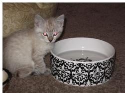

## I3 · Visual counting

How many bowls does the cat have?

CORRECT

A: 3 B: 2 C: 1 D: 0

Dataset label: C
<table><tr><td>SFT</td><td>C*</td><td>77.9</td><td>Shaped</td><td>C*</td><td>98.6</td></tr><tr><td>GRPO</td><td>C*</td><td>99.5</td><td>RLCD-lite</td><td>C*</td><td>100.0</td></tr><tr><td>Rew. Doubt</td><td>C*</td><td>99.9</td><td>CtR</td><td>C*</td><td>83.3</td></tr><tr><td>CORA</td><td>C*</td><td>86.5</td><td></td><td></td><td></td></tr></table>

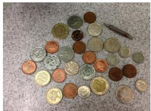

## I5 · Scene text

what number is on the cooper coin on the left?

A: 1 B: 0 C: 3 D: 2

Dataset label: A
<table><tr><td>SFT</td><td>D</td><td>43.5</td><td>Shaped</td><td>D</td><td>83.0</td></tr><tr><td>GRPO</td><td>D</td><td>94.2</td><td>RLCD-lite</td><td>D</td><td>100.0</td></tr><tr><td>Rew. Doubt</td><td>D</td><td>98.0</td><td>CtR</td><td>D</td><td>56.8</td></tr><tr><td>CORA</td><td>D</td><td>46.8</td><td></td><td></td><td></td></tr></table>

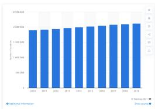

## I7 · Chart reading

How many people lived in the Columbus metropolitan area in 2019? A: 2104194 B: 2104195 C: 2104192 D: 2104193

<table><tr><td>SFT</td><td>B</td><td>62.1</td><td>Shaped</td><td>B</td><td>69.1</td></tr><tr><td>GRPO</td><td>B</td><td>85.9</td><td>RLCD-lite</td><td>B</td><td>100.0</td></tr><tr><td>Rew. Doubt</td><td>B</td><td>74.8</td><td>CtR</td><td>A*</td><td>55.2</td></tr><tr><td>CORA</td><td>B</td><td>61.3</td><td></td><td></td><td></td></tr></table>

## I2 · Interface reading

CORRECT

What is the application name?

A: The selected tab is "Gizmodo En". B: The systolic blood pressure is 120. C: The application name is "Lusity". D: The selected tab is "BASIC".

<table><tr><td>SFT</td><td>C*</td><td>93.8</td><td>Shaped</td><td>C*</td><td>100.0</td></tr><tr><td>GRPO</td><td>C*</td><td>100.0</td><td>RLCD-lite</td><td>C*</td><td>100.0</td></tr><tr><td>Rew. Doubt</td><td>C*</td><td>100.0</td><td>CtR</td><td>C*</td><td>99.4</td></tr><tr><td>CORA</td><td>C*</td><td>99.1</td><td></td><td></td><td></td></tr></table>

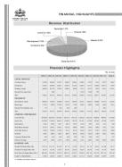

ERROR

## I4 · Document reading

ERROR

what is the depreciation % in the revenue Distribution ?

A: 1.26 B: 1.25 C: 1.27 D: 1.28

Dataset label: C
<table><tr><td colspan="6"></td></tr><tr><td>SFT</td><td>B</td><td>72.1</td><td>Shaped</td><td>B</td><td>99.5</td></tr><tr><td>GRPO</td><td>B</td><td>99.7</td><td>RLCD-lite</td><td>B</td><td>100.0</td></tr><tr><td>Rew. Doubt</td><td>B</td><td>97.2</td><td>CtR</td><td>B</td><td>66.8</td></tr><tr><td>CORA</td><td>B</td><td>84.9</td><td></td><td></td><td></td></tr></table>

## I6 · Visual counting

ERROR

How many lights are lit on the train?

A: 1 B: 3 C: 2 D: 0

Dataset label: C
<table><tr><td>SFT</td><td>D</td><td>41.4</td><td>Shaped</td><td>D</td><td>94.3</td></tr><tr><td>GRPO</td><td>D</td><td>92.1</td><td>RLCD-lite</td><td>D</td><td>99.9</td></tr><tr><td>Rew. Doubt</td><td>D</td><td>75.0</td><td>CtR</td><td>D</td><td>45.1</td></tr><tr><td>CORA</td><td>D</td><td>45.6</td><td></td><td></td><td></td></tr></table>

<table><tr><td colspan="4">Completion audit</td></tr><tr><td>Record</td><td>Planned</td><td>Completed</td><td>Verified</td></tr><tr><td>1</td><td>85</td><td>76</td><td>No</td></tr><tr><td>2</td><td>61</td><td>110</td><td>No</td></tr><tr><td>3</td><td>18</td><td>20</td><td>Yes</td></tr><tr><td>4</td><td>56</td><td>93</td><td>Yes</td></tr></table>

## I8 · Table reasoning

MIXED

How many records have Completed greater than or equal to Planned? A: Exactly 2 records B: Exactly 3 records C: Exactly 0 records D: Exactly 1 records E: Exactly 4 records

<table><tr><td colspan="6"></td></tr><tr><td>SFT</td><td>E</td><td>68.1</td><td>Shaped</td><td>E</td><td>72.1</td></tr><tr><td>GRPO</td><td>E</td><td>68.2</td><td>RLCD-lite</td><td>E</td><td>99.8</td></tr><tr><td>Rew. Doubt</td><td>E</td><td>99.9</td><td>CtR</td><td>B*</td><td>49.2</td></tr><tr><td>CORA</td><td>E</td><td>74.4</td><td></td><td></td><td></td></tr></table>

Figure 5: Image cases I1–I8: three shared correct answers, three shared errors, and two mixed outcomes across spatial, interface, counting, document, scene-text, chart, and table questions. Predictions and confidences come from the same checkpoints as Table 2.

V1 · Video understanding  
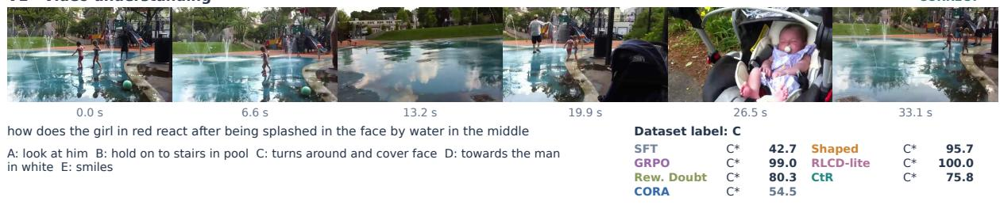

V2 · Video understanding  
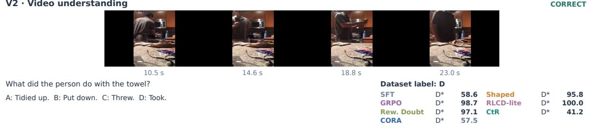

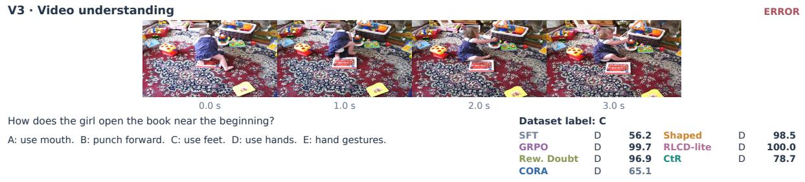

V4 · Video understanding  
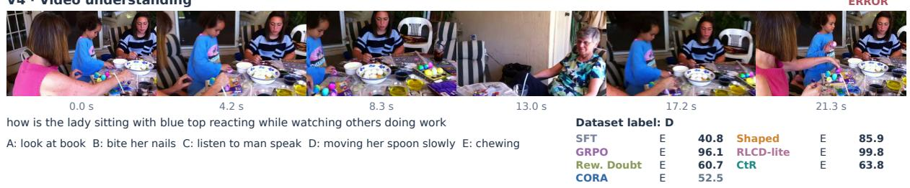

V5 · Video understanding  
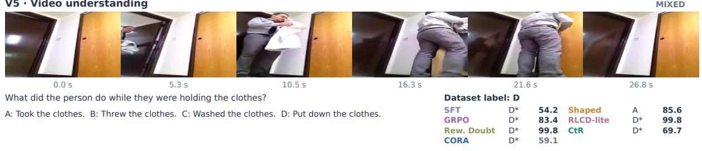

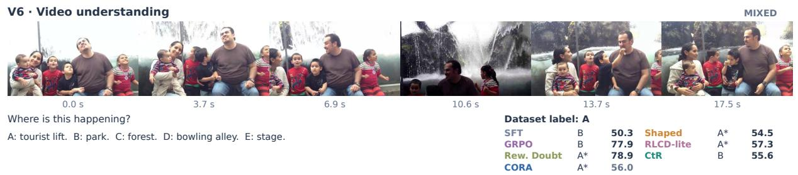  
Figure 6: Video cases V1–V6: two shared correct answers, two shared errors, and two mixed outcomes for actions, reactions, and scene context. Timestamps locate the displayed excerpts within each cached input.

directly visible among the locally trained rows of Figure 10. SFT-softlabel concentrates its mass below 0.95 and sits above the diagonal at high confidence; on image, half of its predictions fall in [0.90, 0.95) where its empirical accuracy is 1.00, so it is most underconfident exactly where it is most confident. The four reward-driven recipes pile nearly all mass into the top bin while the accuracy of that bin stays far below the diagonal, the per-bin picture behind their inflated reliability terms. CtR and CORA retain graded confidence profiles and AUROC close to soft-label SFT. Shaped RLCD and GRPO change AUROC by at most 0.014, whereas Rewarding Doubt and RLCD-lite reduce image AU-ROC from 0.934 to 0.888 and 0.847, respectively. Among the reference rows, the label-type contrast repeats at 9B (hard-label bins below the diagonal, soft-label bins above it in every modality), and the released models range from low top-label calibration error on this test suite (OneJev-9B) to nearly deterministic confidence (Gemma 4).

<table><tr><td></td><td></td><td colspan="3">Text (764)</td><td colspan="4">Image (1,858)</td><td colspan="4">Video (502)</td></tr><tr><td>Method</td><td>B</td><td>Δ</td><td>&gt;0.95 REL AUROC</td><td></td><td></td><td>Δ</td><td>&gt;0.95</td><td>REL AUROC</td><td></td><td>Δ</td><td>&gt;0.95 REL</td><td>AUROC</td></tr><tr><td colspan="9">General-purpose models</td><td></td><td></td><td></td></tr><tr><td>Qwen3.5-2B</td><td>2</td><td>+0.012</td><td>13%</td><td>13.4</td><td>0.667</td><td>+0.019</td><td>35%</td><td>5.5 0.913</td><td>+0.037</td><td>20%</td><td>5.3</td><td>0.804</td></tr><tr><td>Qwen3.5-9B</td><td>9</td><td>+0.060</td><td>41%</td><td>6.7 0.831 0.832</td><td>+0.043 -0.009</td><td>56% 43%</td><td>4.2 1.4</td><td>0.916 0.900</td><td>+0.015</td><td>31%</td><td>2.2 9.5</td><td>0.865</td></tr><tr><td>Qwen3.8-27B</td><td>27</td><td>-0.004</td><td>46%</td><td>3.5</td><td></td><td></td><td>7.1</td><td></td><td>+0.062</td><td>39%</td><td></td><td>0.831</td></tr><tr><td>InternVL3.5-8B Gemma4-26B-A4B</td><td>8</td><td>+0.129</td><td>58%</td><td>24.6</td><td>0.810 +0.051</td><td>70%</td><td></td><td>0.942</td><td>+0.083</td><td>40%</td><td>10.1</td><td>0.835</td></tr><tr><td></td><td>26</td><td>+0.160</td><td>94%</td><td>35.3</td><td>0.812 +0.123</td><td></td><td>88% 26.2</td><td>0.930</td><td>+0.308</td><td>75%</td><td>108.1</td><td>0.776</td></tr><tr><td colspan="9">Released decision models</td><td></td><td></td><td></td></tr><tr><td>TypeSafe Jev</td><td></td><td>+0.045</td><td>61%</td><td>5.8 0.883</td><td></td><td></td><td></td><td></td><td></td><td></td><td></td><td></td></tr><tr><td>Laya (English)</td><td>0.421</td><td>+0.112</td><td>20%</td><td>14.6 0.761</td><td></td><td></td><td></td><td></td><td></td><td></td><td></td><td></td></tr><tr><td>Laya (typed-dec.)</td><td>0.421</td><td>+0.003</td><td>3%</td><td>6.0</td><td>0.782</td><td></td><td>6.8</td><td></td><td></td><td></td><td></td><td></td></tr><tr><td>Laya Vision</td><td>0.201</td><td>+0.011</td><td>0%</td><td>4.6</td><td>0.699</td><td>-0.006</td><td>2%</td><td>0.865</td><td></td><td></td><td></td><td></td></tr><tr><td>Von</td><td>0.395</td><td>-0.070</td><td>1%</td><td>12.8</td><td>0.699</td><td></td><td></td><td></td><td></td><td></td><td></td><td></td></tr><tr><td>Verdict</td><td>0.151</td><td>+0.104</td><td>1%</td><td>17.0</td><td>0.677</td><td></td><td></td><td></td><td></td><td></td><td></td><td></td></tr><tr><td>NIRNAY</td><td>0.450</td><td>+0.250</td><td>19%</td><td>78.3</td><td>0.611</td><td></td><td></td><td>6.3</td><td></td><td></td><td></td><td></td></tr><tr><td>Dohnuts</td><td>0.8</td><td>+0.072</td><td>22%</td><td>15.1</td><td>0.711</td><td>-0.058</td><td>24%</td><td>0.916 1.5</td><td></td><td></td><td></td><td></td></tr><tr><td>OneJev</td><td>9</td><td>+0.000</td><td>30%</td><td>2.3</td><td>0.849</td><td>-0.010</td><td>65%</td><td>0.944</td><td>+0.000</td><td>23%</td><td>5.5</td><td>0.814</td></tr><tr><td>OmniJev</td><td>4</td><td>+0.149</td><td>41%</td><td>32.7</td><td>0.792</td><td>+0.041</td><td>66%</td><td>0.945</td><td>+0.129</td><td>33%</td><td>22.0</td><td>0.804</td></tr><tr><td>Open-Jev Open-Jev</td><td>2</td><td>+0.011</td><td>20%</td><td>5.7</td><td>0.718</td><td></td><td></td><td></td><td></td><td></td><td></td><td></td></tr><tr><td></td><td>9</td><td>+0.013</td><td>46%</td><td>7.6</td><td>0.770</td><td></td><td></td><td></td><td></td><td></td><td></td><td></td></tr><tr><td>RLCR-hotpot</td><td>7</td><td>+0.050</td><td>9%</td><td>11.4</td><td>0.651</td><td></td><td></td><td></td><td></td><td></td><td></td><td></td></tr><tr><td>OpenJev</td><td>4</td><td>+0.077</td><td>56%</td><td>9.7</td><td>0.856</td><td></td><td></td><td></td><td></td><td></td><td></td><td></td></tr><tr><td>Astro-RLCD</td><td>4</td><td>+0.101</td><td>68%</td><td>15.4</td><td>0.777</td><td></td><td></td><td></td><td></td><td></td><td></td><td></td></tr><tr><td>Kev</td><td>4</td><td>-0.018</td><td>37%</td><td>3.4</td><td>0.865</td><td></td><td></td><td></td><td></td><td></td><td></td><td></td></tr><tr><td>decider</td><td>2</td><td>+0.057</td><td>26%</td><td>8.0 0.811</td><td></td><td></td><td></td><td></td><td></td><td></td><td></td><td></td></tr><tr><td>decider-vision</td><td>2</td><td>+0.090</td><td>39%</td><td>11.3 0.751</td><td>+0.029</td><td>60%</td><td>3.1</td><td>0.945</td><td></td><td></td><td></td><td></td></tr><tr><td>NanoJev</td><td>0.6</td><td>+0.200</td><td>0%</td><td>71.1 0.615</td><td></td><td></td><td></td><td></td><td></td><td></td><td></td><td></td></tr><tr><td>Valen</td><td>2</td><td>+0.093</td><td>35%</td><td>14.9</td><td>0.818</td><td>-0.005</td><td>80%</td><td>0.5 0.964</td><td>+0.084</td><td>26%</td><td>11.6</td><td>0.777</td></tr><tr><td colspan="9">Supervised controls</td><td></td><td></td><td></td><td></td></tr><tr><td>SFT (2B)</td><td></td><td>+0.001</td><td>11%</td><td>4.1</td><td>0.777</td><td>-0.015</td><td>59%</td><td>0.932</td><td></td><td></td><td></td><td></td></tr><tr><td>SFT (9B)</td><td>29</td><td>+0.062</td><td>54%</td><td>7.4</td><td>0.831</td><td>+0.037</td><td>70%</td><td>2.4 5.1 0.943</td><td>-0.065 +0.012</td><td>20% 40%</td><td>8.5 2.2</td><td>0.824 0.843</td></tr><tr><td>SFT-softlabel (2B)</td><td></td><td>+0.018</td><td>5%</td><td>5.8</td><td>0.728</td><td>-0.054</td><td>3%</td><td>4.2 0.934</td><td>-0.066</td><td>2%</td><td>8.4</td><td>0.832</td></tr><tr><td>SFT-softlabel (9B)</td><td>2 9</td><td>-0.012</td><td>10%</td><td>3.2</td><td>0.791</td><td>-0.057</td><td>27%</td><td>4.6 0.937</td><td>-0.073</td><td>11%</td><td>8.1</td><td>0.841</td></tr><tr><td colspan="10"></table>

Table 4: Confidence profiles of every Table 2 row, computed from the published test predictions, in Table 2 order. B: nominal parameter scale in billions; ∆: mean confidence minus accuracy (signed); >0.95: share of predictions with confidence above 0.95; REL: the reliability (calibration) term of the binary Brier decomposition with 15 equal-width bins, $\times 1 0 ^ { 3 } ;$ ; AUROC: area under the receiver operating characteristic curve for confidence against answer correctness; –: unsupported modality or undisclosed scale.

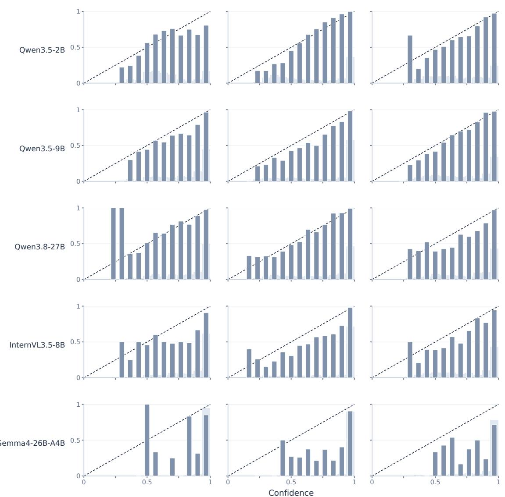  
Figure 7: Per-bin reliability diagrams of the general-purpose models in Table 2, in table order. Colored bars: empirical accuracy of each 15-bin confidence bin; gray bars: each bin’s share of the slice’s predictions; dashed diagonal: perfect calibration.

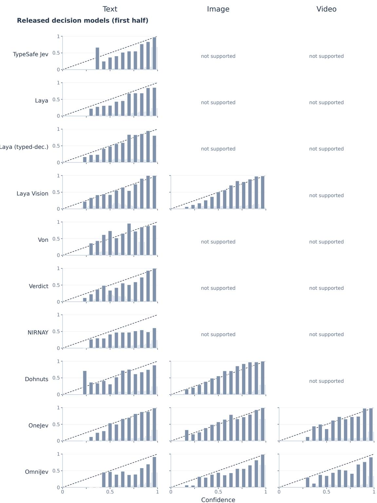  
Figure 8: Per-bin reliability diagrams of the released decision models in Table 2 (first half, table order). Axes and markings follow Figure 7; modalities a model does not support are marked in place.

<table><tr><td colspan="2">Text</td><td>Image</td><td>Video</td></tr><tr><td colspan="2">Released decision models (second half) 1</td><td></td><td></td></tr><tr><td>Open-Jev 0.5</td><td></td><td>not supported</td><td>not supported</td></tr><tr><td>1 Open-Jev 0.5 1</td><td></td><td>not supported</td><td>not supported</td></tr><tr><td>RLCR-hotpot 0.5</td><td></td><td>not supported</td><td>not supported</td></tr><tr><td>OpenJev-4B 0.5</td><td>1</td><td>not supported</td><td>not supported</td></tr><tr><td>1 Astro-RLCD 0.5</td><td></td><td>not supported</td><td>not supported</td></tr><tr><td>1 Kev 0.5</td><td></td><td>not supported</td><td>not supported</td></tr><tr><td>1 decider 0.5</td><td></td><td>not supported</td><td>not supported</td></tr><tr><td>1 decider-vision 0.5</td><td></td><td></td><td>not supported</td></tr><tr><td>NanoJev</td><td></td><td>not supported</td><td>not supported</td></tr><tr><td>Valen0.5 0</td><td>0.5</td><td>0.5 Confidence</td><td>0.5</td></tr></table>

Figure 9: Per-bin reliability diagrams of the released decision models in Table 2 (second half, table order). Axes and markings follow Figure 7.

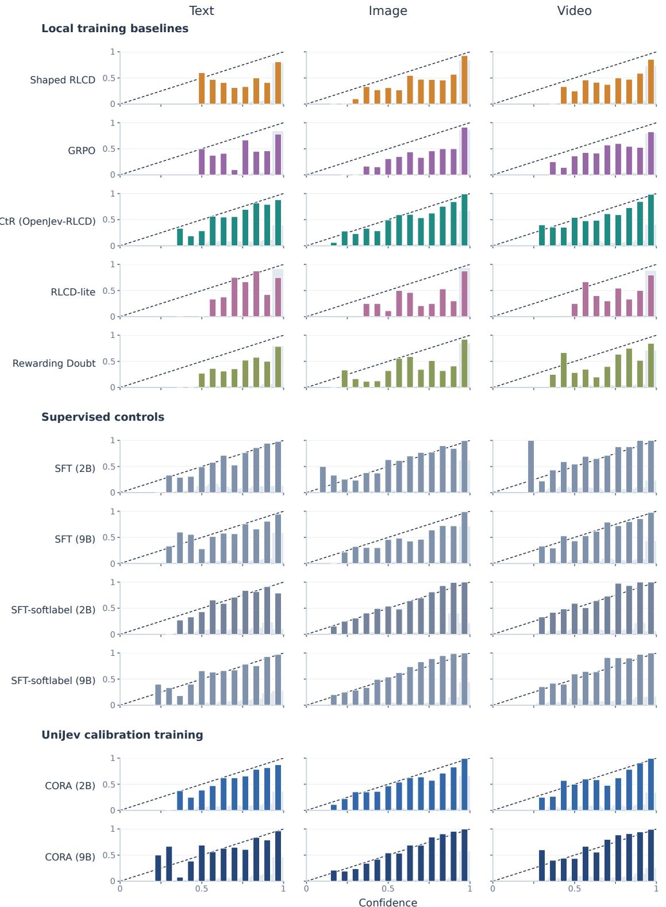  
Figure 10: Per-bin reliability diagrams of the local training baselines, supervised controls, and CORA (Table 2 order). The five RLCD baselines and CORA (2B) share the soft-label SFT (2B) initialization, enabling a controlled comparison of the continuation recipes; CORA (9B) starts from soft-label SFT (9B). Axes and markings follow Figure 7.