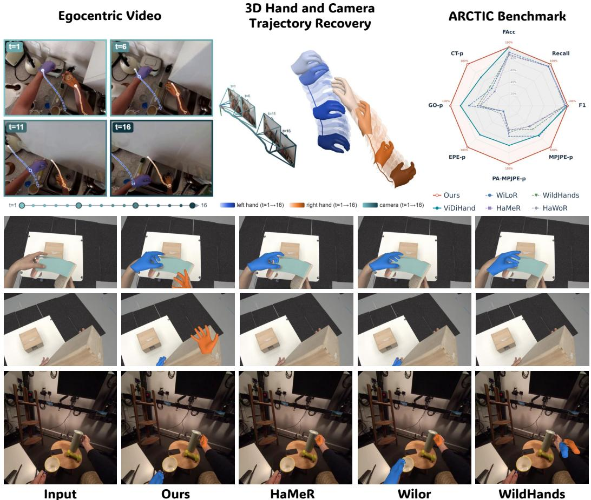
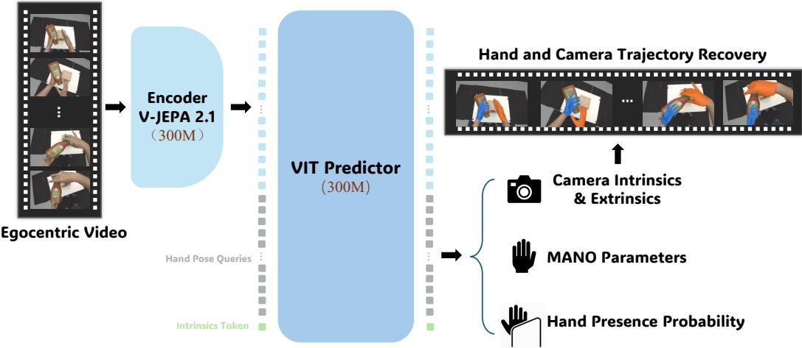
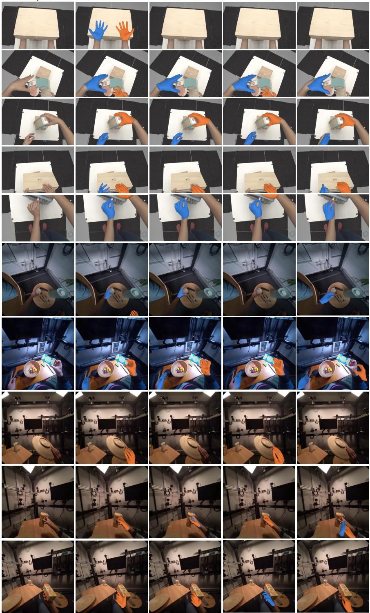
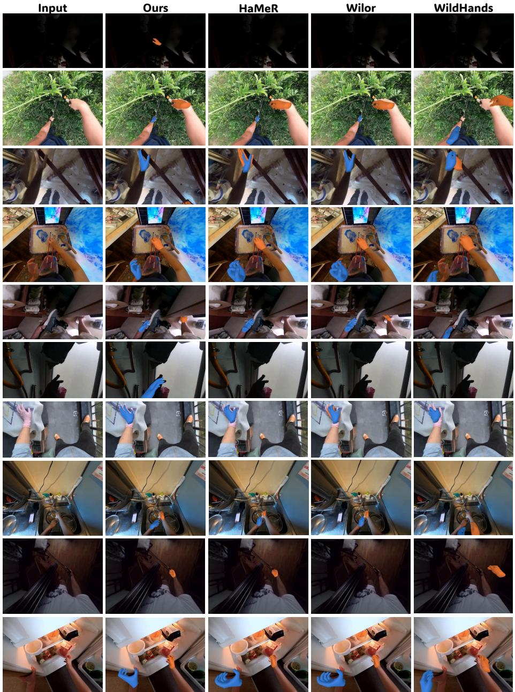
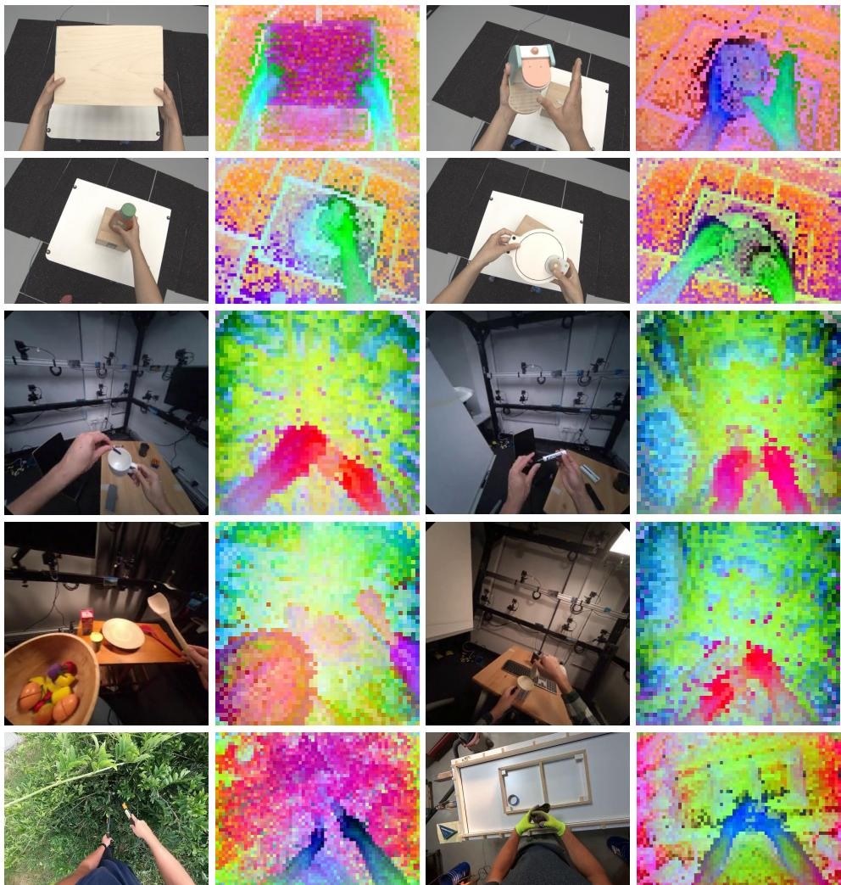

# V-JEPA HAND: SIMPLE, ACCURATE AND FAST 3D HAND AND CAMERA TRAJECTORY RECOVERY FROM EGOCENTRIC VIDEOS

Ruicheng Li1,∗ Qixiu Li1,∗ Yu Deng2 Sicheng Xu2 Jiaolong Yang2 Baining Guo2 1Tsinghua University 2Microsoft Research

  
Figure 1: V-JEPA Hand: joint hand and camera trajectory recovery from egocentric video. Top left and centre: From a video clip, V-JEPA Hand jointly recovers bilateral 3D hand motion and camera motion in a single forward pass. Blue, orange and teal denote the left hand, right hand and camera, respectively; colour intensity indicates time. Top right: ARCTIC detection and coverage-aware reconstruction results across eight metrics, normalized to our result (100%); larger is better. Bottom: Qualitative comparisons with HaMeR, WiLoR and WildHands, illustrating differences in hand pose accuracy, missed hands and spurious predictions.

## ABSTRACT

Egocentric video supports diverse applications, including robot learning, augmented reality, and human activity understanding. Recovering metric 3D hand trajectories from such video requires estimating both hand motion and camera egomotion to express the hands in a consistent reference frame. Many existing pipelines recover hand and camera motion in separate stages, combining hand detection, hand reconstruction, camera tracking, and trajectory refinement. We present V-JEPA Hand, a simple feed-forward video model that jointly reconstructs bilateral hand motion and camera motion from egocentric clips. It uses

a self-supervised V-JEPA 2.1 encoder to extract spatio-temporal features from full-frame video and a query-based predictor to decode these features into perframe hand poses, hand presence, and camera motion. We use the predicted camera motion to express the hand trajectories in a common world frame. The model accepts known focal lengths or predicts them when unavailable. It reconstructs each clip in a single forward pass. We train both components end to end in a single stage on a mixture of diverse pseudo-labelled videos and highprecision 3D annotations. A single model achieves the lowest coverage-aware mean per-joint position error (MPJPE) among comparable baselines on ARCTIC, HOT3D, and EgoStandard. It also yields lower world-frame trajectory errors than the compared SLAM-based pipelines. Ablations support the benefits of video pretraining, temporal context, and mixed supervision. V-JEPA Hand achieves a forward-pass throughput of 93.4 FPS on a single RTX A6000. Project page: https://qft-333.github.io/V-JEPA-Hand-Page/.

## 1 INTRODUCTION

Egocentric video provides a natural record of human manipulation and supports a wide range of applications. Recent VLA approaches use 3D hand motion from egocentric demonstrations for pretraining and robot-policy adaptation (Kareer et al., 2025a;b; Luo et al., 2025; Yang et al., 2025; Bi et al., 2026; Zheng et al., 2026; Li et al., 2025).

Hand motion recovery also supports AR/VR interaction (Han et al., 2022), first-person activity understanding (Kwon et al., 2021), animation and digital humans (Romero et al., 2017), and wrist kinematics assessment (Smeragliuolo et al., 2016). These applications benefit from accurate, temporally coherent 3D hand motion. Apparent hand motion in egocentric video can result from movement of the hand, the camera, or both. Recovering metric hand trajectories in a consistent reference frame therefore requires estimating both hands’ positions, orientations, finger articulation, and presence, together with camera motion.

Single-image models such as HaMeR and WiLoR (Pavlakos et al., 2024; Potamias et al., 2025) reconstruct hands from detected crops. Applied frame by frame, they cannot use neighboring frames to improve reconstruction under occlusion, motion blur, or intermittent visibility. Temporal methods add cross-frame modeling (Zhang et al., 2024), while world-frame approaches combine hand reconstruction with camera tracking, motion infilling, or optimization (Zhang et al., 2025; Chen et al., 2025). More recently, ViDiHand (Wang et al., 2026) uses pretrained video diffusion features for detector-free, full-frame hand reconstruction. Video provides temporal cues for hand reconstruction and scene context for camera motion. We further investigate how effectively a self-supervised video encoder can supportjoint hand–camera recovery through end-to-end, single-stage adaptation.

Our central finding is that a simple video encoder–predictor architecture can achieve accurate and fast joint hand–camera reconstruction. We instantiate this design as V-JEPA Hand, pairing the self-supervised V-JEPA 2.1 encoder (Mur-Labadia et al., 2026) with a query-based predictor and fine-tuning both end to end. Cross-frame information is incorporated within the visual encoder, and hand and camera states are decoded from the same spatio-temporal features. The predictor jointly estimates per-frame bilateral hand poses, hand presence, and camera motion; it also accepts known clip-level focal lengths or predicts them when unavailable. The entire clip is reconstructed in one forward pass without a separate hand detector, hand crops, SLAM, or test time optimization. The model thus retains a simple feedforward structure rather than assembling estimates from independent hand and camera systems.

Training such a model requires accurate 3D annotations across diverse capture conditions. ARC TIC (Fan et al., 2023) and HOT3D (Banerjee et al., 2024) provide high-quality hand-motion annotations using dedicated motion-capture systems, while H2O (Kwon et al., 2021) uses calibrated multi-view RGB-D recordings to annotate bimanual interactions. These resources provide valu able geometric supervision, but their hardware and calibration requirements make collection costly to extend across everyday environments. In contrast, Ego4D (Grauman et al., 2022) and EPIC-KITCHENS (Damen et al., 2018) capture diverse, unscripted activities without dense metric handmotion labels. Reconstruction offers a complementary source of supervision: HaWoR (Zhang et al., 2025) recovers world-space hand trajectories, while the VITRA annotation pipeline (Li et al., 2025)

combines hand reconstruction with metric camera tracking to generate frame-aligned hand-action labels at scale. Such automatically recovered trajectories are useful but imperfect pseudo-labels. We therefore train in a single stage on pseudo-labelled Ego4D and our in-house recordings, mixed with a comparatively small pool of precisely annotated videos from ARCTIC and HOT3D. The pseudo-labelled videos broaden scene and action coverage, while the high-quality annotations provide reliable geometric supervision for transfer beyond the capture environments.

We evaluate the same trained model on ARCTIC (Fan et al., 2023), HOT3D (Banerjee et al., 2024), and EgoStandard (Lightwheel AI, 2025), whose commercial annotation pipeline combines hardware-assisted capture with multi-stage optimization. EgoStandard is excluded from our reconstruction training. Across all three benchmarks, V-JEPA Hand combines high hand-detection coverage with the lowest coverage-aware MPJPE among the previous baselines. It also yields lower world-frame trajectory errors than the compared SLAM-based pipelines. Data ablations show that mixed supervision improves reconstruction on unseen videos, while component ablations support the value of pretrained features and temporal context. V-JEPA Hand achieves forward-pass throughput of 93.4 FPS on a single RTX A6000.

We summarize our contributions as follows:

• A simple yet effective feed-forward framework that jointly recovers bilateral 3D hand motion, hand presence, camera egomotion, and clip-level focal lengths from a shared video representation, without separate hand detection, SLAM, or test-time optimization.

• A single-stage training recipe combining diverse pseudo-labelled egocentric video with highprecision annotations, with demonstrated benefits for reconstruction on unseen data.

• A systematic evaluation of detection coverage, hand pose, world-frame trajectories, crossdomain generalization, and inference efficiency, together with ablations of key training and modeling choices.

## 2 RELATED WORK

Monocular 3D hand reconstruction. Estimating 3D hand pose and shape from monocular images has advanced rapidly with parametric models such as MANO (Romero et al., 2017). Most existing methods detect then regress, cropping each hand with a 2D detector before predicting mesh or kinematic parameters (Pavlakos et al., 2024; Potamias et al., 2025; Dong et al., 2024; Chen et al., 2022; Moon, 2023; Park et al., 2022). In egocentric videos, however, this pipeline struggles with frequent occlusions, motion blur, and boundary truncations, while discarding global context and inter-hand spatial relations. To bypass cropping, detector-free alternatives directly regress hand poses from full frames (Prakash et al., 2024) or leverage video diffusion features (Wang et al., 2026), though diffusion models incur substantial computational overhead. In contrast, V-JEPA Hand recovers both hands and their presence probabilities in a single forward pass via a lightweight query-based decoder, avoiding separate detectors, crops, or iterative diffusion.

Temporal and world-coordinate hand motion recovery. Applying single-frame estimators independently across video frames yields temporally jittery trajectories. While temporal networks and transformers help smooth camera-relative predictions (Yang et al., 2020; Zhang et al., 2024), they do not resolve camera egomotion. To express manipulation in a consistent world frame, current methods decouple hand estimation from camera tracking by combining per-frame regressors, external visual SLAM such as DROID-SLAM (Teed & Deng, 2021), and motion infilling or test-time trajectory optimization (Zhang et al., 2025; Chen et al., 2025; Fan et al., 2024), mirroring pipelines in world-grounded body capture (Ye et al., 2023; Shin et al., 2024). However, SLAM frequently drifts under aggressive head motion, and multi-stage optimization introduces latency and cascading errors. Instead, V-JEPA Hand unifies camera-space bilateral hand motion, hand presence, camera egomotion, and camera intrinsics into a single feedforward prediction, avoiding external SLAM or test-time optimization while achieving superior world-frame accuracy.

Self-supervised video representations and foundation models. Self-supervised video pretraining provides powerful motion and scene priors. While masked autoencoders such as MAE (He et al., 2022), VideoMAE (Tong et al., 2022), and VideoMAE V2 (Wang et al., 2023) reconstruct masked pixels, pixel-level objectives often overemphasize high-frequency texture details over geometric and physical dynamics. The Joint-Embedding Predictive Architecture (JEPA) family (Assran et al., 2023; Bardes et al., 2024; Assran et al., 2025; Mur-Labadia et al., 2026) addresses this by predicting representations in latent space; notably, V-JEPA 2.1 (Mur-Labadia et al., 2026) learns rich spatio-temporal features and dense motion priors. Although generative video foundation models (Blattmann et al., 2023) also encode temporal priors (Wang et al., 2026), their generative nature requires heavy computation. In comparison, V-JEPA 2.1 offers a discriminative representation that supports high-throughput (91.3 FPS) inference and outperforms VideoMAE, DINOv3 (Siméoni et al., 2025), and Perception Encoder (Bolya et al., 2025) on both camera- and world-frame metrics.

  
Figure 2: Overview of V-JEPA Hand. A V-JEPA 2.1 encoder extracts spatio-temporal features from an egocentric video clip. A ViT predictor jointly processes these features, one learnable handpose query per frame, and an intrinsics token. The output queries predict bilateral MANO pose, hand presence probability, and camera motion. The entire clip is reconstructed in a single forward pass; blue and orange meshes denote the reconstructed left and right hands, respectively.

## 3 METHOD

As illustrated in Figure 2, V-JEPA Hand reads a raw video clip and emits, in a single forward pass, the complete bilateral hand trajectory of that clip together with the camera motion and focal lengths. The model has two components: a self-supervised video encoder that turns the clip into a spatiotemporal token grid (Section 3.2), and a query-based trajectory predictor that decodes one output token per frame into the per-frame state defined below. Section 3.3 describes our single-stage training with multi-source supervision, combining large-scale pseudo-labelled video with high-quality data under a shared training objective.

## 3.1 PROBLEM FORMULATION

The input is a clip of T RGB frames $\mathbf { V } = ( \mathbf { I } _ { 1 } , \ldots , \mathbf { I } _ { T } ) , \mathbf { I } _ { t } \in \mathbb { R } ^ { 3 \times H \times W }$ , recorded by a freely moving egocentric camera. Here $t \in \{ 1 , \ldots , T \}$ indexes frames, and $H$ and W are the image height and width in pixels, respectively. We write $\mathcal { C } _ { t }$ for the camera coordinate frame of frame t and index the two hands by $s \in \{ \mathrm { L } , \mathrm { R } \}$ , where L and R denote the camera wearer’s left and right hand. Hats denote model predictions.

Model output. The model returns a per-frame hand–camera trajectory together with clip-level camera focal lengths,

$$
\hat { \bf Y } = \big ( \hat { \bf y } _ { 1 } , \dots , \hat { \bf y } _ { T } \big ) \in \mathbb { R } ^ { T \times 1 1 9 } , \qquad \hat { \bf y } _ { t } = \big ( \underbrace { \hat { \bf x } _ { t } ^ { \mathrm { L } } , \hat { \bf x } _ { t } ^ { \mathrm { R } } } _ { 1 1 0 } , \underbrace { \hat { \bf g } _ { t } } _ { 9 } \big ) , \qquad \hat { \bf k } \in \mathbb { R } ^ { 2 } ,\tag{1}
$$

where $\hat { \mathbf Y }$ stacks the per-frame state vectors $\hat { \mathbf { y } } _ { t }$ . Each $\hat { \mathbf { x } } _ { t } ^ { s } \in \mathbb { R } ^ { 5 5 }$ is the state of hand $s , \hat { \mathbf { g } } _ { t } \in \mathbb { R } ^ { 9 }$ is the camera motion at frame t, and kˆ estimates the clip-level focal-length vector $\mathbf { k } = \left( f _ { x } , \ f _ { y } \right)$ , where $f _ { x }$ and $f _ { y }$ are the horizontal and vertical focal lengths in pixels at the input resolution. Our notation retains only these two varying intrinsic parameters. The per-frame states are decoded from the $T$ query tokens, one row $\hat { \mathbf { y } } _ { t }$ per token. The model accepts known focal lengths or predicts them from a dedicated token when unavailable (Section 3.2). The hand and camera motion states are defined next.

Hand state. For frame t and hand s the model predicts

$$
\begin{array} { r } { \hat { \mathbf { x } } _ { t } ^ { s } = \left( \hat { \mathbf { d } } _ { t } ^ { s } , \hat { \mathbf { r } } _ { t } ^ { s } , \hat { \pmb { \theta } } _ { t } ^ { s } , \hat { c } _ { t } ^ { s } \right) \in \mathbb { R } ^ { 5 5 } , } \end{array}\tag{2}
$$

whose four blocks are: the wrist translation $\hat {  { \mathbf { d } } } _ { t } ^ { s } \in \mathbb { R } ^ { 3 }$ , i.e. the position of the hand root in meters expressed in $\mathcal { C } _ { t } ;$ the wrist orientation $\hat { \mathbf { r } } _ { t } ^ { s } \in \mathbb { R } ^ { 6 }$ , a prediction of the first two rows of the rotation matrix $\mathbf { R } _ { t } ^ { s } \in \mathbb { R } ^ { 3 \times 3 }$ that maps the canonical MANO hand frame to $\mathcal { C } _ { t } ;$ the articulation $\hat { \pmb { \theta } } _ { t } ^ { s } \in \mathbb { R } ^ { 4 5 }$ , the Euler angles of the 15 MANO finger joints, each relative to its parent joint; and the presence score $\hat { c } _ { t } ^ { s } \in \mathbb { R }$ , a logit that is high when hand s is actually in frame t. The two hands together therefore account for the 110 hand dimensions of $\hat { \mathbf { y } } _ { t }$ . We do not predict the MANO shape coefficient vector $\beta ,$ and all hands are evaluated at the neutral shape $\beta = \bar { \bf 0 }$

Camera state. The camera state encodes the rigid transform $\mathbf { T } _ { t  1 } \in \ S E ( 3 )$ from the current camera frame $\mathcal { C } _ { t }$ to the first-frame anchor $\mathcal { C } _ { 1 }$ , where $S E ( 3 )$ is the group of 3D rigid transformations:

$$
\begin{array} { r } { \hat { \bf g } _ { t } = \left( \hat { \bf r } _ { t } ^ { \mathrm { c a m } } , \hat { \bf u } _ { t } \right) \in \mathbb { R } ^ { 9 } , \qquad { \bf u } _ { t } = \mathrm { s g n } ( { \bf a } _ { t } ) \odot \mathrm { l o g } \big ( 1 + | { \bf a } _ { t } | \big ) , } \end{array}\tag{3}
$$

where the superscript cam distinguishes camera rotation from hand rotation. The vector $\hat { \mathbf { r } } _ { t } ^ { \mathrm { c a m } } \in \mathbb { R } ^ { 6 }$ predicts the first two rows of the camera rotation matrix $\mathbf { R } _ { t } ^ { \mathrm { c a m } } \in \mathbb { R } ^ { 3 \times 3 }$ , which maps vectors from $\mathcal { C } _ { t }$ to $\mathcal { C } _ { 1 }$ . The vector ${ \bf a } _ { t } \in \mathbb { R } ^ { 3 }$ is the translation component of $\mathbf { T } _ { t  1 } .$ expressed in $\mathcal { C } _ { 1 }$ in metres. We represent this translation by its signed-log encoding ${ \mathbf { u } } _ { t } \in \mathbb { R } ^ { 3 }$ , and $\hat { \mathbf { u } } _ { t }$ is the model’s prediction of that encoding, rather than the translation in metres. Here sgn is the sign function, ⊙ denotes element-wise multiplication, and the absolute value and natural logarithm are also applied elementwise.

## 3.2 ARCHITECTURE

Video encoder. We initialize the video encoder with self-supervised pretrained V-JEPA 2.1 ViT-L weights (Mur-Labadia et al., 2026) and jointly optimize all encoder and predictor parameters on the mixed training data. The encoder cuts the video clip into non-overlapping space–time patches, each spanning 2 consecutive frames and a 16×16 pixel square, and embeds every patch into one token of dimension $d ,$ so the clip becomes a sequence

$$
\begin{array} { r } { \mathbf { Z } \in \mathbb { R } ^ { N \times d } , \qquad N = \underbrace { \frac { T } { 2 } } _ { \mathrm { t i m e } } \cdot \underbrace { \frac { H } { 1 6 } \cdot \frac { W } { 1 6 } } _ { \mathrm { s p a c e } } . } \end{array}\tag{4}
$$

Here Z is the encoder token sequence, N is the number of space–time patches, and d is the token feature dimension. Each token is located by a rotary encoding of its $( \tau , h , w )$ patch coordinate, where $\tau , h .$ , and w index the temporal, vertical, and horizontal positions in the patch grid, respectively.

Query-based trajectory predictor. The predictor is a ViT that operates on the concatenation of the encoder grid, T learnable query tokens $\dot { \mathbf { Q } } \in \mathbb { R } ^ { T \times d }$ , one per output frame, and a single intrinsics token $\mathbf { q } _ { k } \in \mathbb { R } ^ { d }$ , whose subscript k denotes its association with camera intrinsics, under joint selfattention:

$$
\begin{array} { r } { \left[ \tilde { \bf q } _ { k } ; \tilde { \bf Z } ; \tilde { \bf Q } \right] = \mathrm { V i T } \left( \left[ { \bf q } _ { k } ; { \bf Z } ; { \bf Q } \right] \right) . } \end{array}\tag{5}
$$

Here $[ \cdot ; \cdot ]$ denotes concatenation along the token dimension, and ViT is the predictor’s vision transformer. Tildes denote the corresponding output tokens: $\tilde { \mathbf { q } } _ { k } \in \mathbb { R } ^ { d }$ for intrinsics, $\tilde { \mathbf { Z } } \in \mathbb { R } ^ { N \times d }$ for the video features, and $\tilde { \mathbf { Q } } \in \mathbb { R } ^ { T \times d }$ for the per-frame queries. Each query is temporally aligned with its corresponding video frame through rotary positional encoding. A shared MLP maps each output query to the 119-dimensional hand–camera state for that frame. During training, the intrinsics token is set to an embedding of the ground-truth intrinsics with probability 0.5 and a learned token otherwise. A linear head reads the output token $\tilde { \mathbf { q } } _ { k }$ to predict kˆ, the two focal-length components, with supervision applied only to clips whose intrinsics were withheld.

## 3.3 TRAINING

Single-stage multi-dataset training. We train V-JEPA Hand end to end in a single stage using four datasets: Ego4D (Grauman et al., 2022), our in-house egocentric recordings, ARCTIC (Fan et al., 2023), and HOT3D (Banerjee et al., 2024). We process Ego4D and our in-house recordings with the VITRA annotation pipeline (Li et al., 2025) to obtain a large-scale pool of pseudo-labelled video spanning diverse scenes, activities, and camera wearers. We mix this noisy pseudo-labelled data with high-quality data from the training splits of ARCTIC and HOT3D. Throughout training, each clip is sampled from the pseudo-labelled pool, ARCTIC, or HOT3D with probabilities 0.35, 0.45, and 0.20, respectively.

Training objective. We supervise hand parameters, 3D joint positions, 2D projections, temporal smoothness, hand presence, and camera estimates with the total training loss

$$
\begin{array} { r } { \mathcal { L } = \underbrace { \lambda _ { d } \mathcal { L } _ { d } + \lambda _ { r } \mathcal { L } _ { r } + \lambda _ { \theta } \mathcal { L } _ { \theta } } _ { \mathrm { p a r a m e t e r s } } + \underbrace { \lambda _ { j } \mathcal { L } _ { j } } _ { \mathrm { 3 D } } + \underbrace { \lambda _ { \pi } \mathcal { L } _ { \pi } } _ { \mathrm { 2 D } } + \underbrace { \lambda _ { a } \mathcal { L } _ { a } } _ { \mathrm { j i t t e r } } + \underbrace { \lambda _ { c } \mathcal { L } _ { c } + \lambda _ { g } \mathcal { L } _ { g } + \lambda _ { k } \mathcal { L } _ { k } } _ { \mathrm { p r e s e n c e ~ a n d ~ c a m e r a } } . } \end{array}\tag{6}
$$

Each λ coefficient is a nonnegative scalar weight for the loss term with the same subscript. The terms $\mathcal { L } _ { d } , \mathcal { L } _ { r }$ , and $\mathcal { L } _ { \theta }$ supervise wrist position, wrist orientation, and finger articulation, respectively. ${ \mathcal { L } } _ { j }$ penalizes errors in the 21 camera-space 3D joints obtained through differentiable MANO forward kinematics, while ${ \mathcal { L } } _ { \pi }$ penalizes errors in their image-plane projections. $\mathcal { L } _ { a }$ penalizes the acceleration of the predicted 3D joints across consecutive frames, which suppresses jitter without penalizing smooth motion. $\mathcal { L } _ { c }$ supervises whether each hand is present in each frame. $\mathcal { L } _ { g }$ supervises camera rotation and signed-log translation relative to the first frame, and $\mathcal { L } _ { k }$ supervises clip-level focal lengths when they are withheld from the input; auxiliary implementation details are given in Appendix D.

## 4 EXPERIMENTS

We evaluate V-JEPA Hand on egocentric two-hand reconstruction. We first describe the datasets and evaluation protocol (Section 4.1), then compare with prior work (Section 4.2). Our ablations test the training data, the loss terms, encoder pretraining and temporal context, and encoder choice (Section 4.3). We also report model size and inference cost (Section 4.4), and show qualitative results (Section 4.5).

## 4.1 EXPERIMENTAL SETUP

Datasets. We evaluate on three egocentric hand benchmarks: ARCTIC tests reconstruction under severe occlusion during two-hand object manipulation, while HOT3D tests robustness to motion blur from rapid head and hand movements. We additionally evaluate on EgoStandard, a commercially annotated egocentric dataset spanning diverse scenes. Its 3D motion annotations are produced by a pipeline that combines hardware-assisted capture with multi-stage optimization. We exclude EgoStandard entirely from training and use it to assess generalization to unseen egocentric data. The EgoStandard evaluation covers approximately 60 minutes of video. For HOT3D, we follow the Ha-WoR validation split, covering approximately 49 minutes of video. Table 2 uses the same evaluation splits, with all world methods rescored on their common true-positive support.

Metrics. Metrics follow the coverage-aware evaluation implementation of Wang et al. (2026), which accounts for missed hands. Metric conventions and table abbreviations are provided in Appendix $\operatorname { F } ;$ evaluation protocols are detailed in Appendix E.

## 4.2 COMPARISON WITH PRIOR WORK

Table 1 compares V-JEPA Hand with WiLoR (Potamias et al., 2025), HaMeR (Pavlakos et al., 2024), WildHands (Prakash et al., 2024), and HaWoR (Zhang et al., 2025) on all three datasets. All five methods are evaluated on the same splits, and V-JEPA Hand uses the same checkpoint across all three datasets. We also include published ViDiHand (Wang et al., 2026) results: its ARCTIC scores are directly comparable, while its HOT3D scores use a different split and serve only as a reference.

Table 1: Comparison with prior work. WiLoR, HaMeR, and WildHands are single-frame methods; HaWoR, ViDiHand, and ours are multi-frame methods. We follow ViDiHand’s evaluation protocol, except that pose metrics without the -p suffix are computed on each method’s own intersection of predictions and ground truth (true positives). ViDiHand results are taken from its paper (Wang et al., 2026); its HOT3D row (gray) uses a different split and is shown for reference only, without direct comparison or ranking.
<table><tr><td rowspan="2">Method</td><td colspan="2">Detection</td><td colspan="4">3D Pose</td><td colspan="5">Orient. &amp; Position</td><td rowspan="2">Temporal</td></tr><tr><td>Acc↑ Rec↑ F1↑</td><td></td><td>MP-p↓MP↓</td><td></td><td>PA-p↓</td><td>PA↓</td><td>EP-p↓ EP↓</td><td></td><td></td><td>GO-p↓ GO↓ CT-p↓ C↓</td></tr><tr><td colspan="2">ARCTIC</td><td></td><td></td><td></td><td></td><td></td><td></td><td></td><td></td><td></td><td></td><td>Jit↓</td></tr><tr><td>WiLoR</td><td>0.9090.949</td><td>0.971</td><td>21.11</td><td>15.52</td><td>12.74</td><td>6.70</td><td>65.56</td><td>28.84</td><td>17.68</td><td>11.74</td><td>0.077 0.050</td><td>25.97</td></tr><tr><td>HaMeR</td><td>0.8730.943</td><td>0.958</td><td>30.78</td><td>25.10</td><td>16.02</td><td>9.44</td><td>64.85</td><td>28.45</td><td>25.14</td><td>18.67 0.093 0.063</td><td></td><td>14.78</td></tr><tr><td>WildHands</td><td>0.8740.944</td><td>0.958</td><td>27.07</td><td>21.29</td><td>15.99</td><td>9.55</td><td>65.44</td><td>29.58</td><td>22.54</td><td>16.05 0.070</td><td>0.039</td><td>12.28</td></tr><tr><td>HaWoR</td><td>0.8530.953</td><td>0.945</td><td>31.52</td><td>26.94</td><td>14.48</td><td>9.07</td><td>44.32</td><td>16.24</td><td>24.38</td><td>18.82</td><td>0.0760.050</td><td>19.37</td></tr><tr><td>ViDiHand</td><td>0.997</td><td>9 0.999</td><td>21.67</td><td></td><td>9.82</td><td></td><td>12.41</td><td></td><td>14.64</td><td>0.047</td><td></td><td>3.18</td></tr><tr><td>Ours</td><td>0.996 0.998 0.999</td><td></td><td>15.59</td><td>15.36</td><td>6.84</td><td>6.59</td><td>8.99</td><td>8.85</td><td>12.46</td><td>12.18 0.032</td><td>0.031</td><td>6.09</td></tr><tr><td colspan="2">HOT3D</td><td colspan="9"></td></tr><tr><td>WiLoR</td><td>0.810 0.879 0.922</td><td></td><td></td><td></td><td></td><td></td><td></td><td></td><td></td><td></td><td></td><td></td></tr><tr><td>HaMeR</td><td>0.7190.880 0.886</td><td></td><td>39.38 67.09</td><td>26.09 57.96</td><td>23.10 7.57 25.09 10.26</td><td></td><td>79.90 70.66</td><td>22.11 15.40</td><td>32.51 50.01</td><td>16.49 0.103 0.106</td><td>0.048</td><td>17.19</td></tr><tr><td></td><td>WildHands0.425 0.600 0.609</td><td></td><td>80.23</td><td>42.99</td><td>61.89</td><td>12.40 275.39 37.14</td><td></td><td></td><td>84.35</td><td>36.35 38.82</td><td>0.055</td><td>21.09</td></tr><tr><td>HaWoR</td><td>0.7330.895 0.875</td><td></td><td>28.79</td><td>16.71 20.68</td><td></td><td>7.64</td><td>66.60</td><td>8.16</td><td>25.01</td><td></td><td>0.250 0.076</td><td>25.30</td></tr><tr><td>ViDiHand</td><td>0.948 0.974 0.983 21.51</td><td></td><td></td><td></td><td>11.38</td><td></td><td>14.95</td><td></td><td></td><td></td><td>10.50 0.086 0.039</td><td>13.41</td></tr><tr><td>Ours</td><td>0.971 0.979 0.980</td><td>14.42</td><td></td><td>12.04 8.24</td><td></td><td>5.72</td><td>16.81</td><td>5.71</td><td>15.83 9.90</td><td>0.040 6.52</td><td></td><td>3.74</td></tr><tr><td colspan="2">EgoStandard</td><td></td><td></td><td></td><td></td><td></td><td></td><td></td><td></td><td></td><td>0.026 0.014</td><td>5.74</td></tr><tr><td colspan="2">WiLoR</td><td></td><td></td><td></td><td></td><td></td><td></td><td></td><td></td><td></td><td></td><td></td></tr><tr><td colspan="2">HaMeR</td><td>0.949 0.971 0.982</td><td>35.19</td><td>32.16</td><td>11.11</td><td>7.35</td><td>37.09</td><td>12.74</td><td>25.88</td><td>22.13</td><td>0.089 0.080</td><td>15.53</td></tr><tr><td colspan="2">WildHands0.514 0.658 0.659</td><td>0.986 0.992 0.994</td><td>37.37 69.22</td><td>36.60</td><td>8.27</td><td>7.26</td><td>18.06</td><td>11.45</td><td>26.37</td><td>25.37</td><td>0.093 0.090</td><td>18.35</td></tr><tr><td colspan="2">HaWoR</td><td></td><td></td><td>33.83</td><td>55.04</td><td>12.29</td><td>325.25</td><td>53.66</td><td>74.03</td><td>31.84</td><td>0.214 0.099</td><td>20.10</td></tr><tr><td colspan="2"></td><td>0.883 0.901 0.937</td><td>33.38 16.97</td><td>23.36</td><td>20.11</td><td>8.62</td><td>91.58</td><td>8.00</td><td>26.58</td><td>12.81</td><td>0.089 0.058</td><td>13.95</td></tr><tr><td colspan="2">Ours</td><td colspan="2">0.990 0.995 0.997</td><td>16.30</td><td>8.01</td><td>7.29</td><td>11.10</td><td>6.51</td><td>10.60</td><td>9.84</td><td>0.045 0.043</td><td>4.88</td></tr></table>

Table 2: World-coordinate reconstruction. All methods are evaluated on the same hand-frames, using the intersection of true positives across the four compared methods. W-MPJPE and WA-MPJPE are in mm; RTE is in %. Lower is better.
<table><tr><td></td><td colspan="3">ARCTIC</td><td colspan="3">HOT3D</td><td colspan="3">EgoStandard</td></tr><tr><td>Method</td><td>W-MP↓</td><td>WA-MP↓</td><td>RTE↓</td><td>W-MP↓</td><td>WA-MP↓</td><td>RTE↓</td><td>W-MP↓</td><td>WA-MP↓</td><td>RTE↓</td></tr><tr><td>WiLoR+SLAM</td><td>63.36</td><td>34.13</td><td>29.78</td><td>74.78</td><td>28.42</td><td>40.21</td><td>90.67</td><td>41.54</td><td>26.27</td></tr><tr><td>HaMeR+SLAM</td><td>69.05</td><td>33.78</td><td>28.21</td><td>105.10</td><td>35.08</td><td>47.31</td><td>94.86</td><td>42.74</td><td>27.16</td></tr><tr><td>HaWoR</td><td>106.05</td><td>55.38</td><td>48.92</td><td>63.08</td><td>27.60</td><td>51.02</td><td>90.23</td><td>45.02</td><td>35.93</td></tr><tr><td>Ours</td><td>35.86</td><td>19.72</td><td>17.58</td><td>34.08</td><td>16.18</td><td>28.15</td><td>66.35</td><td>32.91</td><td>22.37</td></tr></table>

From occlusion and blur to unseen scenes. Table 1 shows that V-JEPA Hand outperforms prior methods on the vast majority of comparable metrics across all three benchmarks. The improvements span hand detection, 3D pose, and camera-space placement. On ARCTIC, this translates into accurate hand recovery despite severe occlusion. Crucially, the advantage extends to EgoStandard’s diverse scenes without any training on that dataset: V-JEPA Hand leads in most metrics on expanded EgoStandard, including both coverage-aware and TP-only MPJPE. Together, these results show that a single video-based model supports both precise reconstruction on ARCTIC and HOT3D and transfer to unseen egocentric scenes.

World-frame reconstruction through unified prediction. Table 2 shows that the simpler architecture also delivers competitive world-frame trajectories, where hand reconstruction must be combined with camera motion. V-JEPA Hand leads all three world-frame metrics on all three datasets. Because this comparison uses shared true-positive hand-frames, the gains reflect trajectory accuracy rather than differences in detection coverage. Unlike the SLAM-based baselines, V-JEPA Hand predicts hand and camera motion together from the same video representation, eliminating the need to assemble their estimates from separate systems. The results therefore support unified prediction as an accurate alternative to a multi-stage SLAM-based reconstruction pipeline on these benchmarks.

## 4.3 ABLATION STUDIES

Ablations use different training setups from Table 1. For fair comparisons, we change only the component being tested and keep the remaining training settings the same in each ablation. See Appendix G for implementation details.

Effect of pseudo-labelled training data. Table 3 compares training on all four datasets with training on an equal mixture of ARCTIC and HOT3D only, keeping the architecture, initialization, and training budget fixed. We evaluate both models on EgoStandard, which neither sees during training. Adding the pseudo-labelled Ego4D and in-house data helps the model place hands more accurately in these unseen videos: reprojection and translation errors fall, along with pose and world-trajectory errors. The benefit is not simply that the model detects more hands—detection accuracy and recall are slightly lower, while F1 is comparable. Instead, the broader training data improves the geometry of the reconstruction on a benchmark outside either model’s training set.

Loss ablation. Table 4 removes either the jitter loss or the 2D reprojection loss while keeping the rest of training unchanged. Without the jitter loss, predictions vary more from frame to frame even though individual-frame pose accuracy changes little. This shows why accurate poses alone do not guarantee a smooth sequence. Without the reprojection loss, joint-position error improves slightly, but the hands line up less well with the image and their wrist positions become less accurate. The two terms therefore serve different purposes: one discourages temporal jumps, while the other keeps the reconstruction consistent with the image.

Pretraining and temporal context. Table 5 changes one choice at a time: starting the encoder from random weights, freezing its pretrained weights, or replacing the video input with a single frame. The remaining training setup is shared. Training from scratch gives much less accurate poses and world trajectories on both benchmarks. Even a frozen pretrained encoder performs substantially better, and fine-tuning it improves the results further. Thus, pretraining provides useful features for hand reconstruction, while task-specific training helps the model make better use of them. Singleframe predictions remain reasonably accurate in each image, but are much less smooth over time. Seeing neighboring frames therefore helps not only with pose accuracy, but also with keeping suc cessive predictions consistent.

Encoder ablation. Table 6 compares four pretrained ViT-L encoders with the same predictor and fine-tuning recipe. V-JEPA 2.1 gives the most accurate hand poses and world trajectories, and the smoothest predictions, on both benchmarks. Video encoders outperform image encoders on world trajectories, even when the latter provide features from multiple frames. This suggests that video features help recover motion beyond simply combining per-frame image features. Differences in pretraining data and input settings are detailed in Appendix G.3.

## 4.4 MODEL SIZE AND SPEED

V-JEPA Hand has 607.1M parameters and jointly recovers hand and camera trajectories. Table 7 compares single-GPU forward throughput on the same 100 real-video clips at batch size one, excluding detection and postprocessing. Ours uses BF16; baselines use their released FP32 implemen tations.

## 4.5 QUALITATIVE RESULTS

Figure 4 in Appendix A shows challenging cases beyond controlled capture settings, including very low light and outdoor activities. V-JEPA Hand recovers hands that the baselines miss in the darkest example and produces plausible hand reconstructions in outdoor and cluttered scenes. These ex-

Table 3: Training-data ablation. To assess how pseudo-labelled training data affects generalization, we compare models trained with and without it on EgoStandard, a benchmark unseen by either model during training.
<table><tr><td></td><td colspan="2">Detection</td><td colspan="2">3D Pose</td><td colspan="2">Orient. &amp; Position</td><td>Temporal</td><td colspan="2">World Frame</td></tr><tr><td>Method</td><td>Acc↑ Rec↑</td><td>F1↑</td><td>MP-p↓ MP↓</td><td>PA-p↓ PA↓ EP-p↓</td><td>EP↓</td><td>GO-p↓ GO↓ CT-p↓ C↓</td><td>Jit↓</td><td></td><td>W-MP↓ WA-MP↓</td></tr><tr><td>ARCTIC+HOT3D only</td><td>0.996 0.9980.998</td><td></td><td>18.68 18.41</td><td>8.69 8.39</td><td>16.66 15.01</td><td>12.05 11.75 0.088 0.087</td><td>4.99</td><td>70.95</td><td>34.30</td></tr><tr><td>Ours (4 datasets)</td><td>0.991 0.9960.998</td><td></td><td>17.44 16.92</td><td>8.03 7.46</td><td>10.28 6.68</td><td>11.10 10.50 0.046 0.044</td><td>4.94</td><td>64.12</td><td>31.75</td></tr></table>

Table 4: Loss ablation on ARCTIC.

<table><tr><td rowspan="2">Method</td><td colspan="2">Detection</td><td colspan="2">3D Pose</td><td colspan="2">Orient. &amp; Position</td><td rowspan="2"></td><td rowspan="2">Temporal Jit↓</td><td colspan="2">World Frame</td></tr><tr><td>Acc↑ Rec↑ F1↑</td><td></td><td>MP-p↓ MP↓ PA-p↓ PA↓ EP-p↓ EP↓</td><td></td><td></td><td></td><td>GO-p↓ GO↓ T-p↓ C↓</td><td>W-MP↓ WA-MP↓</td></tr><tr><td>Full</td><td>0.997 0.9990.999</td><td>15.79</td><td>15.63</td><td>7.27 7.10</td><td>9.91</td><td>9.81 11.55</td><td>511.35</td><td>0.019 0.018</td><td></td><td></td></tr><tr><td>w/o jitter</td><td>0.997 0.9980.999</td><td>15.8115.59</td><td></td><td>7.38 7.15</td><td>10.16 10.04</td><td></td><td>11.6911.42 0.019 0.018</td><td>6.46 8.29</td><td>17.98 18.33</td><td>11.98 12.24</td></tr><tr><td>w/o 2D reproj. 0.9970.9990.999</td><td></td><td></td><td>15.55 15.38</td><td>7.327.1411.54 11.45</td><td></td><td></td><td>11.41 11.20 0.021 0.020</td><td>6.71</td><td>18.07</td><td>12.14</td></tr></table>

Table 5: Pretraining and temporal context on ARCTIC and HOT3D. †Single-frame world errors use ground-truth camera rotation and translation (oracle), rather than predicted cameras, and are excluded from world-column ranking.
<table><tr><td rowspan="2">Method</td><td>Detection</td><td colspan="4"></td><td colspan="4">Orient. &amp; Position</td><td rowspan="2">Temporal</td><td colspan="2">World Frame</td></tr><tr><td></td><td></td><td></td><td>Acc↑ Rec↑ F1↑ MP-p↓ MP↓ PA-p↓ PA↓</td><td></td><td>EP-p↓ EP↓</td><td></td><td>GO-p↓ GO↓ CT-p↓ CT↓</td><td>Jit↓</td><td>W-MP↓ WA-MP↓</td></tr><tr><td colspan="9">ARCTIC</td><td></td><td></td><td></td></tr><tr><td>Ours (16 frames)</td><td>0.997 0.999 0.999</td><td>15.79</td><td>15.63</td><td>7.27</td><td>7.10</td><td>9.91</td><td>9.81 11.55</td><td></td><td>11.35 0.019 0.018</td><td>6.46</td><td>17.98</td><td>11.98</td></tr><tr><td>Random init.</td><td>0.993 0.996 0.998</td><td>24.74</td><td>24.32</td><td>11.00</td><td>10.52</td><td>17.07</td><td>16.34</td><td>16.89</td><td>16.38 0.032 0.030</td><td>8.74</td><td>37.82</td><td>23.20</td></tr><tr><td>Frozen encoder</td><td>0.997 0.998 0.999</td><td>17.28</td><td>17.06</td><td>7.99</td><td>7.75</td><td>10.60</td><td>10.33</td><td>12.46</td><td>12.190.027 0.025</td><td>7.18</td><td>21.14</td><td>13.72</td></tr><tr><td>Single frame</td><td>0.996 0.9980.999</td><td>17.79</td><td>17.54</td><td>8.42</td><td>8.15</td><td>11.71</td><td>11.10</td><td>12.70</td><td>12.440.021 0.020</td><td>14.71</td><td>21.27†</td><td>14.06†</td></tr><tr><td colspan="9">HOT3D</td><td></td><td></td><td></td><td></td></tr><tr><td>Ours (16 frames)</td><td>0.989 0.993 0.997 13.59 12.75</td><td></td><td></td><td>7.46</td><td>6.57</td><td>8.09</td><td>5.81</td><td>7.98</td><td>7.09 0.020 0.017</td><td>6.91</td><td>19.84</td><td>11.49</td></tr><tr><td>Random init.</td><td>0.969 0.984 0.988 29.02</td><td></td><td></td><td>27.0412.15</td><td>9.89</td><td>18.97 12.34</td><td></td><td>22.27</td><td>20.23 0.045 0.037</td><td>9.91</td><td>48.81</td><td>26.87</td></tr><tr><td>Frozen encoder</td><td>0.989 0.994 0.997</td><td>15.24</td><td>14.50</td><td>7.92</td><td>7.13</td><td>7.79</td><td>6.41</td><td>9.41 8.58</td><td>0.024 0.021</td><td>7.90</td><td>23.75</td><td>13.40</td></tr><tr><td>Single frame</td><td>0.985 0.992 0.995</td><td></td><td>16.86 15.83</td><td>8.76</td><td>7.66</td><td>9.05</td><td>7.00</td><td>10.62 9.48</td><td>0.027 0.024</td><td>18.31</td><td>25.37†</td><td>15.63†</td></tr></table>

Table 6: Encoder ablation on ARCTIC and HOT3D.
<table><tr><td></td><td>Detection</td><td colspan="3">3D Pose</td><td colspan="4">Orient. &amp; Position</td><td>Temporal</td><td colspan="2">World Frame</td></tr><tr><td>Method</td><td>Acc↑ Rec↑ F1↑</td><td>MP-p↓ MP↓ PA-p↓ PA↓ EP-p↓ EP↓ GO-p↓ GO↓ CT-p↓ CT↓</td><td></td><td></td><td></td><td></td><td></td><td></td><td>Jit↓</td><td>W-MP↓ WA-MP↓</td><td></td></tr><tr><td colspan="10">ARCTIC</td></tr><tr><td>V-JEPA 2.1 (ours)</td><td>0.997 0.999 0.999 15.79 15.63 7.27 7.10 9.91 9.81 11.55 11.35 0.019 0.018</td><td></td><td></td><td></td><td></td><td></td><td></td><td></td><td>6.46</td><td>17.98</td><td>11.98</td></tr><tr><td>VideoMAE</td><td>0.978 0.988 0.994</td><td>20.26</td><td>18.62</td><td>10.34</td><td>8.57 16.65</td><td></td><td></td><td>11.5615.0013.280.038 0.030</td><td>7.96</td><td>21.69</td><td>14.42</td></tr><tr><td>DINOv3</td><td>0.994 0.997 0.998</td><td>18.66</td><td>18.32</td><td>8.58</td><td>8.20 11.79</td><td>11.02</td><td></td><td>13.34 12.95 0.0300.028</td><td>8.47</td><td>35.76</td><td>20.73</td></tr><tr><td>PE-Spatial</td><td>0.994 0.997 0.998</td><td>20.72</td><td>20.41</td><td>9.58</td><td>9.24 13.28</td><td>12.56</td><td>14.35</td><td>13.99 0.0260.024</td><td>8.94</td><td>37.60</td><td>22.02</td></tr><tr><td colspan="10">HOT3D</td><td></td><td></td></tr><tr><td>V-JEPA 2.1 (ours)</td><td>0.989 0.993 0.997 13.59 12.75</td><td></td><td></td><td>7.466.57</td><td>8.09</td><td>5.81</td><td>7.98</td><td>7.09 0.020 0.017</td><td>6.91</td><td>19.84</td><td>11.49</td></tr><tr><td>VideoMAE</td><td>0.984 0.991 0.995 16.92</td><td></td><td>15.83</td><td>8.76 7.60</td><td>9.84</td><td>6.86</td><td>10.96</td><td>9.80 0.025 0.021</td><td>8.58</td><td>22.26</td><td>12.95</td></tr><tr><td>DINOv3</td><td>0.983 0.990 0.994 17.85</td><td></td><td>16.55</td><td>9.01</td><td>7.62 10.507.35</td><td></td><td></td><td>11.78 10.380.027 0.023</td><td>9.95</td><td>45.93</td><td>25.24</td></tr><tr><td>PE-Spatial</td><td>0.981 0.989 0.993 20.47</td><td></td><td>19.16</td><td>9.76</td><td>8.34 11.86</td><td>8.27</td><td></td><td>14.11 12.74 0.030 0.026</td><td>10.31</td><td>49.21</td><td>27.22</td></tr></table>

Table 7: Forward throughput (FPS↑).
<table><tr><td>GPU</td><td>WiLoR</td><td>HaMeR</td><td>WildHands</td><td>Ours</td></tr><tr><td>RTX A6000</td><td>16.3</td><td>19.8</td><td>21.1</td><td>93.4</td></tr><tr><td>A100</td><td>11.6</td><td>15.4</td><td>14.5</td><td>115.1</td></tr></table>

amples provide qualitative evidence of generalization to diverse in-the-wild conditions. Additional ARCTIC and HOT3D comparisons are provided in Appendix A (Figure 3).

## 5 CONCLUSION

We presented V-JEPA Hand, a simple model that jointly reconstructs bilateral hand motion, camera motion and intrinsics from egocentric video in one forward pass, without hand detection, SLAM or test-time optimization. Built on V-JEPA 2.1 and trained in a single stage on mixed pseudolabelled and high-quality data, it achieves the lowest coverage-aware MPJPE among reproduced baselines on ARCTIC, HOT3D and the unseen EgoStandard benchmark, and lower world-frame MPJPE than SLAM-based pipelines. Ablations show that mixing in pseudo-labelled video improves generalization, and validate video pretraining, temporal context and encoder choice. Running at over 90 frames per second, V-JEPA Hand enables large-scale bilateral hand-motion annotation of egocentric video to support robot imitation learning in embodied AI.

## REFERENCES

Mahmoud Assran, Quentin Duval, Ishan Misra, Piotr Bojanowski, Pascal Vincent, Michael Rabbat, Yann LeCun, and Nicolas Ballas. Self-supervised learning from images with a joint-embedding predictive architecture. In Proceedings of the IEEE/CVF Conference on Computer Vision and Pattern Recognition (CVPR), 2023.

Mahmoud Assran, Adrien Bardes, et al. V-JEPA 2: Self-supervised video models enable understanding, prediction and planning. arXiv preprint arXiv:2506.09985, 2025.

Prithviraj Banerjee, Sindi Shkodrani, Pierre Moulon, Shreyas Hampali, Shangchen Han, Fan Zhang, Linguang Zhang, Jade Fountain, Edward Miller, Selen Basol, Richard Newcombe, Robert Wang, Jakob Engel, and Tomas Hodan. HOT3D: Hand and object tracking in 3D from egocentric multiview videos. arXiv preprint arXiv:2406.09598, 2024.

Adrien Bardes, Quentin Garrido, Jean Ponce, Xinlei Chen, Michael Rabbat, Yann LeCun, Mahmoud Assran, and Nicolas Ballas. Revisiting feature prediction for learning visual representations from video. Transactions on Machine Learning Research (TMLR), 2024. V-JEPA.

Hongzhe Bi, Lingxuan Wu, Tianwei Lin, Hengkai Tan, Zhizhong Su, Hang Su, and Jun Zhu. Hrdt: Human manipulation enhanced bimanual robotic manipulation. In Proceedings of the AAAI Conference on Artificial Intelligence, volume 40, pp. 18135–18143, 2026.

Andreas Blattmann, Tim Dockhorn, Sumith Kulal, Daniel Mendelevitch, Maciej Kilian, Dominik Lorenz, Yam Levi, Zion English, Vikram Voleti, Adam Letts, Varun Jampani, and Robin Rombach. Stable video diffusion: Scaling latent video diffusion models to large datasets. arXiv preprint arXiv:2311.15127, 2023.

Daniel Bolya, Po-Yao Huang, Peize Sun, Jang Hyun Cho, Andrea Madotto, Chen Wei, Tengyu Ma, Jiale Zhi, Jathushan Rajasegaran, Hanoona Rasheed, et al. Perception encoder: The best visual embeddings are not at the output of the network. arXiv preprint arXiv:2504.13181, 2025.

Xingyu Chen, Yufeng Liu, Yajiao Dong, Xiong Zhang, Chongyang Ma, Yanmin Xiong, Yuan Zhang, and Xiaoyan Guo. MobRecon: Mobile-friendly hand mesh reconstruction from monocular image. In Proceedings of the IEEE/CVF Conference on Computer Vision and Pattern Recognition (CVPR), 2022.

Zhengdi Chen et al. Dyn-HaMR: Recovering 4D interacting hand motion from a dynamic camera. arXiv preprint arXiv:2412.12861, 2025.

Dima Damen, Hazel Doughty, Giovanni Maria Farinella, Sanja Fidler, Antonino Furnari, Evangelos Kazakos, Davide Moltisanti, Jonathan Munro, Toby Perrett, Will Price, and Michael Wray. Scaling egocentric vision: The EPIC-KITCHENS dataset. In Proceedings ofthe European Conference on Computer Vision (ECCV), September 2018.

Haoye Dong, Aviral Chharia, Wenbo Gou, Francisco Vicente Carrasco, and Fernando De la Torre. Hamba: Single-view 3D hand reconstruction with graph-guided bi-scanning mamba. In Advances in Neural Information Processing Systems (NeurIPS), 2024.

Zicong Fan, Omid Taheri, Dimitrios Tzionas, Muhammed Kocabas, Manuel Kaufmann, Michael J. Black, and Otmar Hilliges. ARCTIC: A dataset for dexterous bimanual hand-object manipulation. In Proceedings of the IEEE/CVF Conference on Computer Vision and Pattern Recognition (CVPR), 2023.

Zicong Fan, Maria Parelli, Maria Eleni Kadoglou, Xu Chen, Muhammed Kocabas, Michael J. Black, and Otmar Hilliges. HOLD: Category-agnostic 3D reconstruction of interacting hands and objects from video. In Proceedings of the IEEE/CVF Conference on Computer Vision and Pattern Recognition (CVPR), 2024.

Kristen Grauman, Andrew Westbury, Eugene Byrne, et al. Ego4D: Around the world in 3,000 hours of egocentric video. In Proceedings of the IEEE/CVF Conference on Computer Vision and Pattern Recognition (CVPR), 2022.

Shangchen Han, Po-chen Wu, Yubo Zhang, Beibei Liu, Linguang Zhang, Zheng Wang, Weiguang Si, Peizhao Zhang, Yujun Cai, Tomas Hodan, et al. UmeTrack: Unified multi-view end-to-end hand tracking for VR. In SIGGRAPH Asia 2022 conference papers, pp. 1–9, 2022.

Kaiming He, Xinlei Chen, Saining Xie, Yanghao Li, Piotr Dollár, and Ross Girshick. Masked autoencoders are scalable vision learners. In Proceedings of the IEEE/CVF Conference on Computer Vision and Pattern Recognition (CVPR), 2022.

Simar Kareer, Dhruv Patel, Ryan Punamiya, Pranay Mathur, Shuo Cheng, Chen Wang, Judy Hoffman, and Danfei Xu. Egomimic: Scaling imitation learning via egocentric video. In 2025 IEEE International Conference on Robotics and Automation (ICRA), pp. 13226–13233. IEEE, 2025a.

Simar Kareer, Karl Pertsch, James Darpinian, Judy Hoffman, Danfei Xu, Sergey Levine, Chelsea Finn, and Suraj Nair. Emergence of human to robot transfer in vision-language-action models. arXiv preprint arXiv:2512.22414, 2025b.

Taein Kwon, Bugra Tekin, Jan Stühmer, Federica Bogo, and Marc Pollefeys. H2o: Two hands manipulating objects for first person interaction recognition. In 2021 IEEE/CVF International Conference on Computer Vision (ICCV), pp. 10118–10128. IEEE, 2021.

Qixiu Li, Yu Deng, Yaobo Liang, Lin Luo, Lei Zhou, Chengtang Yao, Lingqi Zeng, Zhiyuan Feng, Huizhi Liang, Sicheng Xu, et al. Scalable vision-language-action model pretraining for robotic manipulation with real-life human activity videos. arXiv preprint arXiv:2510.21571, 2025.

Lightwheel AI. EgoStandard: Hardware-assisted egocentric multi-modal hand motion benchmark. https://lightwheel.ai/egosuite, 2025.

Hao Luo, Yicheng Feng, Wanpeng Zhang, Sipeng Zheng, Ye Wang, Haoqi Yuan, Jiazheng Liu, Chaoyi Xu, Qin Jin, and Zongqing Lu. Being-h0: vision-language-action pretraining from largescale human videos. arXiv preprint arXiv:2507.15597, 2025.

Gyeongsik Moon. Bringing inputs to shared domains for 3D interacting hands recovery in the wild. In Proceedings ofthe IEEE/CVF Conference on Computer Vision and Pattern Recognition (CVPR), 2023.

Lorenzo Mur-Labadia, Matthew Muckley, Amir Bar, Mido Assran, Koustuv Sinha, Mike Rabbat, Yann LeCun, Nicolas Ballas, and Adrien Bardes. V-JEPA 2.1: Unlocking dense features in video self-supervised learning. arXiv preprint arXiv:2603.14482, 2026.

JoonKyu Park, Yeonguk Oh, Gyeongsik Moon, Hongsuk Choi, and Kyoung Mu Lee. HandOccNet: Occlusion-robust 3D hand mesh estimation network. In Proceedings of the IEEE/CVF Conference on Computer Vision and Pattern Recognition (CVPR), 2022.

Georgios Pavlakos, Dandan Shan, Ilija Radosavovic, Angjoo Kanazawa, David Fouhey, and Jitendra Malik. Reconstructing hands in 3D with transformers. In Proceedings of the IEEE/CVF Conference on Computer Vision and Pattern Recognition (CVPR), 2024.

Rolandos Alexandros Potamias, Jinglei Zhang, Jiankang Deng, and Stefanos Zafeiriou. WiLoR: End-to-end 3d hand localization and reconstruction in-the-wild. In Proceedings ofthe IEEE/CVF Conference on Computer Vision and Pattern Recognition (CVPR), 2025. arXiv:2409.12259.

Aditya Prakash, Ruisen Tu, Matthew Chang, and Saurabh Gupta. 3D hand pose estimation in everyday egocentric images. In Proceedings of the European Conference on Computer Vision (ECCV), 2024.

Javier Romero, Dimitrios Tzionas, and Michael J. Black. Embodied hands: Modeling and capturing hands and bodies together. ACM Transactions on Graphics (SIGGRAPH Asia), 36(6), 2017.

Soyong Shin, Juyong Kim, Eni Halilaj, and Michael J. Black. WHAM: Reconstructing worldgrounded humans with accurate 3D motion. In Proceedings of the IEEE/CVF Conference on Computer Vision and Pattern Recognition (CVPR), 2024.

Oriane Siméoni, Huy V. Vo, Maximilian Seitzer, Federico Baldassarre, Maxime Oquab, Cijo Jose, Vasil Khalidov, Marc Szafraniec, Seungeun Yi, Michaël Ramamonjisoa, et al. DINOv3. arXiv preprint arXiv:2508.10104, 2025.

Anna H Smeragliuolo, N Jeremy Hill, Luis Disla, and David Putrino. Validation of the leap motion controller using markered motion capture technology. Journal of biomechanics, 49(9):1742– 1750, 2016.

Zachary Teed and Jia Deng. DROID-SLAM: Deep visual SLAM for monocular, stereo, and RGB-D cameras. In Advances in Neural Information Processing Systems (NeurIPS), 2021.

Zhan Tong, Yibing Song, Jue Wang, and Limin Wang. VideoMAE: Masked autoencoders are dataefficient learners for self-supervised video pre-training. In Advances in Neural Information Processing Systems (NeurIPS), 2022.

Limin Wang, Bingkun Huang, Zhiyu Zhao, Zhan Tong, Yinan He, Yi Wang, Yali Wang, and Yu Qiao. VideoMAE V2: Scaling video masked autoencoders with dual masking. In Proceedings ofthe IEEE/CVF Conference on Computer Vision and Pattern Recognition (CVPR), 2023.

Yuxi Wang, Chengkai Jin, Yufei Liu, Wenqi Ouyang, Tianyi Wei, Zhiwei Zeng, Siyuan Huang, Zhiqi Shen, and Xingang Pan. The surprising effectiveness of video diffusion models for hand motion reconstruction. arXiv preprint arXiv:2606.30308, 2026.

John Yang, Hyung Jin Chang, Seungeui Lee, and Nojun Kwak. SeqHAND: RGB-sequence-based 3D hand pose and shape estimation. In Proceedings of the European Conference on Computer Vision (ECCV), 2020.

Ruihan Yang, Qinxi Yu, Yecheng Wu, Rui Yan, Borui Li, An-Chieh Cheng, Xueyan Zou, Yunhao Fang, Xuxin Cheng, Ri-Zhao Qiu, et al. Egovla: Learning vision-language-action models from egocentric human videos. arXiv preprint arXiv:2507.12440, 2025.

Vickie Ye, Georgios Pavlakos, Jitendra Malik, and Angjoo Kanazawa. Decoupling human and camera motion from videos in the wild. In Proceedings of the IEEE/CVF Conference on Computer Vision and Pattern Recognition (CVPR), 2023.

Jinglei Zhang, Jiankang Deng, Chao Ma, and Rolandos Alexandros Potamias. HaWoR: World-space hand motion reconstruction from egocentric videos. arXiv preprint arXiv:2501.02973, 2025.

Xin Zhang, Yuqi Ren, Di Kang, Junyu Xie, et al. OmniHands: Towards robust 4D hand mesh recovery via A versatile transformer. arXiv preprint arXiv:2405.20330, 2024.

Ruijie Zheng, Dantong Niu, Yuqi Xie, Jing Wang, Mengda Xu, Yunfan Jiang, Fernando Castañeda, Fengyuan Hu, You Liang Tan, Letian Fu, et al. Egoscale: Scaling dexterous manipulation with diverse egocentric human data. arXiv preprint arXiv:2602.16710, 2026.

## APPENDIX

A Additional Qualitative Comparisons . . . . 14   
B Encoder Feature Visualization . . . . . . 17   
C Hyperparameters . . . . . . . . . . 18   
D Training objective details . . . . . . . . . 18   
E Evaluation protocols and baseline setup . . . . . 19   
F Evaluation metrics and table conventions . . . . . 21   
G Ablation implementation details . . . . . . 21

Input  
Ours  
HaMeR  
Wilor  
WildHands  
  
Figure 3: Qualitative comparisons on ARCTIC and HOT3D. Each row shows a reference frame and the four methods’ reconstructions overlaid on that frame. Blue and orange denote left and right hands, respectively. Examples illustrate missed hands and differences in mesh placement under occlusion and partial visibility.

  
Figure 4: Challenging in-the-wild cases. Comparisons with HaMeR, WiLoR, and WildHands under low light, outdoor backgrounds, and clutter. The first and sixth rows highlight hand reconstructions retained by V-JEPA Hand when the baselines miss the hand.

Figure 3 compares mesh overlays on ARCTIC and HOT3D during hand–object interactions. The examples highlight partial visibility, object occlusion, and hands near the image boundary. In the ARCTIC box-handling example (Figure 3, fourth row from the top), V-JEPA Hand reconstructs both hands near the lower image boundary, whereas HaMeR and WiLoR omit the left hand. In the HOT3D plate-holding example (Figure 3, eighth row from the top), V-JEPA Hand and WiLoR reconstruct the visible hand, while HaMeR and WildHands do not show a reconstruction. Other examples reveal differences in wrist placement and finger articulation around manipulated objects. These overlays complement the quantitative results by showing where methods miss hands or produce visibly misaligned meshes.

Figure 4 extends the comparison to challenging in-the-wild videos, including very low light, outdoor pruning, painting, and household activities. In the low-light scenes in the first and sixth rows of Figure 4, V-JEPA Hand reconstructs a hand that all three baselines miss. In the outdoor pruning scene (second row), V-JEPA Hand reconstructs both hands against a background of dense foliage. The painting scene (fourth row) and the sink scene (eighth row) show hand reconstructions during object manipulation in cluttered indoor environments. Across these settings, V-JEPA Hand recovers plausible hand configurations despite substantial changes in lighting, appearance, and scene layout. These examples provide qualitative evidence of generalization beyond laboratory settings.

## B ENCODER FEATURE VISUALIZATION

Figure 5 visualizes encoder features after end-to-end training for hand and camera trajectory recovery. V-JEPA 2.1 learns dense representations that capture fine-grained spatial structure as well as global visual information (Mur-Labadia et al., 2026). Our visualizations suggest that meaningful spatial and semantic structure remains present after task-specific training: regions corresponding to hands and forearms form coherent feature patterns, while manipulated objects and surrounding surfaces often exhibit distinct patterns. These observations are consistent with retaining semantically structured features while adapting the encoder to geometric prediction.

  
Figure 5: Encoder features after task-specific training. Each input frame is paired with its feature visualization on the right. Coherent patterns corresponding to hands, arms, objects, and scene surfaces suggest that the fine-tuned encoder retains meaningful spatial and semantic structure.

## C HYPERPARAMETERS

Table 8 lists the architecture, loss, optimization and data settings of the reported V-JEPA Hand model, which is trained in a single stage on the mixture of pseudo-labelled and high-quality data.

Table 8: Hyperparameters. Model and training settings for V-JEPA Hand. For smooth- $. L _ { 1 }$ regression, δ is the absolute error at which the penalty changes from quadratic to linear.
<table><tr><td>Group</td><td>Hyperparameter</td><td>Value</td></tr><tr><td rowspan="4">Encoder</td><td>backbone</td><td>V-JEPA 2.1 ViT-L/384 (pretrained)</td></tr><tr><td>tubelet / patch</td><td>2 (time) / 16×16 (space)</td></tr><tr><td>tokens per clip</td><td>8 × 24 × 24 = 4608, dim 1024</td></tr><tr><td>fine-tuning</td><td>full (unfrozen)</td></tr><tr><td rowspan="5">Predictor</td><td>type / depth</td><td>ViT-L / 24 layers</td></tr><tr><td>width / heads</td><td>1024 / 16, MLP ratio 4</td></tr><tr><td>query tokens</td><td>16 (one per frame)</td></tr><tr><td>attention</td><td>joint self-attention 0.1</td></tr><tr><td>stochastic depth</td><td></td></tr><tr><td rowspan="3">Targets</td><td>end-effector pose</td><td>9-dim (3 trans + 6D rot), per hand</td></tr><tr><td>articulation</td><td>45-dim MANO Euler angles, per hand</td></tr><tr><td>presence</td><td>1 logit per hand per frame</td></tr><tr><td rowspan="5">Loss</td><td>regression</td><td>smooth-L1; weight 1.0 per term 0.05 (wrist and camera rotation)</td></tr><tr><td>transition δ</td><td>0.03 (wrist / camera translation, 3D joints)</td></tr><tr><td></td><td>0.02 (articulation, 2D reproj., focal lengths)</td></tr><tr><td>joint geometry jitter</td><td>neutral-shape MANO FK</td></tr><tr><td>presence</td><td> $L _ { 1 }$  joint acceleration, weight 0.2 BCE, weight 0.5</td></tr><tr><td rowspan="5">Optimization</td><td>optimizer</td><td>AdamW, β=(0.9, 0.95), wd 0.05</td></tr><tr><td>lr (predictor)</td><td> $6 \times 1 0 ^ { - 4 }$ </td></tr><tr><td>lr (encoder)</td><td> $2 \times 1 0 ^ { - 5 }$ </td></tr><tr><td>schedule</td><td>1,800-step linear warmup + cosine decay, min ratio</td></tr><tr><td>training steps effective batch</td><td>30,519</td></tr><tr><td rowspan="5">Data</td><td>sources (prob.)</td><td>64 clips (8 GPUs × grad-accum 8)</td></tr><tr><td></td><td>pseudo-labelled 0.35, ARCTIC 0.45, HOT3D 0.20</td></tr><tr><td>clip length / size</td><td>16 frames / 384×384</td></tr><tr><td>augmentation</td><td>frame stride {1, 2, 4, 8}, horizontal flip, aspect ratio [1, 2]</td></tr><tr><td>intrinsics input</td><td>withheld with probability 0.5</td></tr></table>

## D TRAINING OBJECTIVE DETAILS

We detail the losses in Equation 6 using the notation of Section 3.1: t indexes frames and $s \in \{ \mathrm { L } , \mathrm { R } \}$ indexes hands. Hats denote predictions and unhatted quantities denote targets. We write $\rho _ { \delta }$ for the standard smooth- $. L _ { 1 }$ loss averaged over coordinates, where δ is its fixed quadratic-to-linear transition threshold. For hand geometry, $\langle \cdot \rangle _ { v ^ { s } }$ averages over frames with a valid, visible target for hand s among the video clips processed together in one forward/backward pass. The two hands’ losses are summed.

Hand parameters. We directly supervise wrist translation $\mathbf { d } _ { t } ^ { s } \in \mathbb { R } ^ { 3 }$ in camera-space metres, wrist orientation $\mathbf { r } _ { t } ^ { s } \in \mathbb { R } ^ { 6 }$ in the 6D rotation representation, and finger articulation $\theta _ { t } ^ { s } \in \mathbb { R } ^ { 4 5 }$ as Euler

angles in radians:

$$
\begin{array} { r l } & { \mathcal { L } _ { d } = \displaystyle \sum _ { s } \langle \rho _ { 0 . 0 3 } ( \hat { \mathbf { d } } _ { t } ^ { s } , \mathbf { d } _ { t } ^ { s } ) \rangle _ { v ^ { s } } , } \\ & { \mathcal { L } _ { r } = \displaystyle \sum _ { s } \langle \rho _ { 0 . 0 5 } ( \hat { \mathbf { r } } _ { t } ^ { s } , \mathbf { r } _ { t } ^ { s } ) \rangle _ { v ^ { s } } , } \\ & { \mathcal { L } _ { \theta } = \displaystyle \sum _ { s } \langle \rho _ { 0 . 0 2 } ( \hat { \theta } _ { t } ^ { s } , \theta _ { t } ^ { s } ) \rangle _ { v ^ { s } } . } \end{array}\tag{7}
$$

The subscripts of $\rho$ give the fixed threshold for each term.

Forward kinematics. The differentiable MANO forward-kinematics layer FK maps the predicted hand state $\hat { \mathbf { x } } _ { t } ^ { s }$ to $\hat { \mathbf { J } } _ { t } ^ { s } = \mathrm { F K } ( \hat { \mathbf { x } } _ { t } ^ { s } ) \in \mathbb { R } ^ { 2 1 \times 3 }$ , the 21 camera-space joints in metres, using neutral hand shape. We supervise these positions with

$$
\mathcal { L } _ { j } = \sum _ { s } \left. \rho _ { 0 . 0 3 } \left( \hat { \mathbf { J } } _ { t } ^ { s } , \mathbf { J } _ { t } ^ { s } \right) \right. _ { v ^ { s } } .\tag{8}
$$

The target $\mathbf { J } _ { t } ^ { s } \in \mathbb { R } ^ { 2 1 \times 3 }$ is the dataset’s measured 3D joints when available and $\mathrm { F K } ( \mathbf { x } _ { t } ^ { s } )$ otherwise.   
This term couples wrist pose and finger articulation through their effect on joint positions.

Reprojection. Let $\pi _ { \mathbf { k } }$ project 3D joints to image coordinates using the ground-truth calibration, with $\mathbf { k } = \left( f _ { x } , f _ { y } \right)$ denoting the horizontal and vertical focal lengths. The reprojection loss encourages image alignment:

$$
\mathcal { L } _ { \pi } = \sum _ { s } \left. \rho _ { 0 . 0 2 } \left( \pi _ { \mathbf { k } } ( \hat { \mathbf { J } } _ { t } ^ { s } ) , \pi _ { \mathbf { k } } ( \mathbf { J } _ { t } ^ { s } ) \right) \right. _ { v ^ { s } } .\tag{9}
$$

Ground-truth intrinsics remain available to this loss even when they are withheld from the predictor.

Temporal smoothness. The jitter loss $\mathcal { L } _ { a }$ is the mean absolute second-order difference of predicted joints,

$$
\hat { \mathbf { J } } _ { t + 1 } ^ { s } - 2 \hat { \mathbf { J } } _ { t } ^ { s } + \hat { \mathbf { J } } _ { t - 1 } ^ { s } , \qquad t = 2 , \ldots , T - 1 ,\tag{10}
$$

where $T$ is the clip length. We average over joint coordinates and triplets with valid targets in all three sampled frames, then sum over hands. Constant-velocity motion in camera coordinates incurs no penalty.

Hand presence. The presence loss $\mathcal { L } _ { c }$ applies binary cross-entropy to the predicted logit $\hat { c } _ { t } ^ { s }$ and the binary hand-presence target. It includes both present and absent hands, but excludes unknown targets and frames outside the anchor recording. We average over valid frames for each hand and sum the two losses.

Camera motion. The camera loss $\mathcal { L } _ { g }$ supervises the transform from each camera frame to the first-frame anchor. It sums smooth- $. L _ { 1 }$ losses on the 6D rotation and signed-log translation defined in Equation $^ { 3 , }$ with thresholds 0.05 and 0.03, respectively. Each block is averaged over its coordinates and frames with valid camera targets in the anchor recording.

Intrinsics loss. The intrinsics loss $\mathcal { L } _ { k }$ supervises the horizontal and vertical focal lengths $( f _ { x } , f _ { y } )$ using smooth- $. L _ { 1 } ,$ , averaged over the two components. It is applied only to clips whose intrinsics were withheld from the predictor.

Loss weights. All regression terms have unit weight, including both camera-motion blocks. The jitter and presence losses have weights 0.2 and 0.5, respectively.

## E EVALUATION PROTOCOLS AND BASELINE SETUP

Baseline implementations. We run WiLoR, HaMeR, WildHands and HaWoR for the comparisons in Table 1. ViDiHand’s ARCTIC/HOT3D detection, coverage-aware pose and jitter scores are taken from Table 1 of Wang et al. (2026). Since its pretrained weights are not publicly available, we cannot reproduce its true-positive-only scores or evaluate it on EgoStandard.

Hand evaluation. We follow ViDiHand’s evaluation protocol (Wang et al., 2026). For ARCTIC, we use the dataset’s official validation split; for HOT3D, we follow the validation split used by HaWoR (Zhang et al., 2025). The evaluated clips in Table 1 cover approximately 13 minutes of ARCTIC, 49 minutes of HOT3D and 60 minutes of EgoStandard. We use the same trained V-JEPA Hand model for all three benchmarks.

World-coordinate comparison. Table 2 uses WiLoR+SLAM, HaMeR+SLAM, HaWoR, and V-JEPA Hand. It uses the same evaluation splits and trained V-JEPA Hand model as Table 1. The +SLAM baselines use the DROID-SLAM camera implementation distributed with HaWoR, with metric scale estimation; their camera inference is independent of the hand model. Unlike the hand only evaluation in Table 1, the world-coordinate evaluation augments WiLoR and HaMeR with SLAM-based camera estimates. We first retain clips with completed predictions from all four displayed methods, then evaluate on their common true-positive hands in each frame. We evaluate a hand track only if it contains at least three frames with valid ground truth and true-positive predictions from all four methods.

World-coordinate metrics. For the hand tracks selected above, Table 2 reports joint position errors (W-MPJPE and WA-MPJPE) and relative wrist trajectory error (RTE), evaluated over the full clip. Before measuring errors, we align the predicted hand trajectory to the ground truth using one rotation and translation for the whole track. This rigid alignment does not change scale or adjust frames independently. The metrics differ in how this alignment is estimated and which errors are measured:

• W-MPJPE: align at the start. We fit the rotation and translation using the 21 predicted and ground-truth hand joints in the first evaluated frame, then apply that same transformation to every evaluated frame. We report the mean Euclidean joint error over all 21 joints and all evaluated frames, including the first frame, in millimetres. This measures how well the reconstruction follows the ground truth after the initial alignment.

• WA-MPJPE: align the whole track. We instead fit a single rotation and translation using the corresponding joints from all evaluated frames together. We then compute the same mean joint error in millimetres. Unlike W-MPJPE, the alignment uses the entire track rather than only its first evaluated frame.

• RTE: normalize wrist error by motion magnitude. Using the whole-track alignment from WA-MPJPE, we compute the mean Euclidean distance between predicted and ground-truth wrist positions. We divide this error by the largest distance that the ground-truth wrist moves from its position in the first evaluated frame, and multiply by 100 to obtain a percentage. The denominator is a displacement from the starting position, not the total distance travelled. Tracks with this maximum displacement below 1 mm are excluded from RTE to avoid dividing by a near-zero motion magnitude; they remain included in W-MPJPE and WA-MPJPE.

Training-data comparison. Table 3 isolates the effect of adding pseudo-labelled Ego4D and inhouse videos to ARCTIC and HOT3D training data. Both models start from the same pretrained V-JEPA 2.1 encoder and are trained in a single stage, with the same architecture, training budget, and HOT3D training-window filter. Ours mixes all four datasets throughout training; the two-dataset baseline samples ARCTIC and HOT3D equally and never trains on Ego4D or in-house videos. Neither model uses the task-specific two-stage recipe employed by the loss, pretraining and encoder ablations (Appendix G.1). We evaluate both models on EgoStandard, which is unseen during training, to test generalization rather than performance on the training datasets. Hand evaluation uses unsmoothed predictions, MANO-fit targets and projected MANO mesh boxes for matching. Worldcoordinate evaluation uses the two models’ common true-positive hand-frames and the full-track metrics defined in Appendix E.

HOT3D evaluation split. The official HOT3D test sequences have no public ground-truth MANO. Table 1 uses the HaWoR-aligned held-out split, whereas ViDiHand uses a random 5% of the validation sequences. The reported ViDiHand HOT3D scores are therefore shown in gray for reference only and excluded from ranking.

## F EVALUATION METRICS AND TABLE CONVENTIONS

Coverage-aware and true-positive-only evaluation. We report two complementary views of pose accuracy, following the coverage-aware evaluation implementation of Wang et al. (2026) for metrics with the −p suffix. The coverage-aware view replaces each unmatched ground-truth hand with a canonical rest-pose MANO placeholder before averaging. These columns carry the -p suffix and reflect both detection coverage and reconstruction accuracy. The true-positive-only view averages pose errors over matched prediction–ground-truth hands. FAcc, recall and F1 report detection separately.

The main hand comparison and hand-pose ablations report both views. True-positive-only pose scores are unavailable for ViDiHand and are marked with dashes, because they cannot be recovered from its published coverage-aware results.

Table notation and units. Table headers abbreviate frame accuracy (FAcc) as Acc, recall as Rec, MPJPE as MP, PA-MPJPE as PA, EPE as EP, and Jitter as Jit. F1, global-orientation error (GO), and camera-translation error (CT) retain their short names. The pairs MP-p/MP, PA-p/PA, EP-p/EP, GO-p/GO, and CT-p/CT report coverage-aware and true-positive-only errors, respectively. In the world comparison and ablations, W-MP and WA-MP denote W-MPJPE and WA-MPJPE (Zhang et al., 2025). The world comparison additionally reports relative trajectory error (RTE) as a percentage; alignment and scoring details are given in Appendix E. Across all tables, MP, PA, W-MP, and WA-MP are in millimetres; EP is in pixels, GO in degrees, CT in metres, and Jit in mm/frame2. The −p columns use the same units as their unsuffixed counterparts. Detection, Jit, and world-frame metrics are reported once rather than as paired columns. Detection scores lie in [0, 1] and are higheris-better; all other metrics are lower-is-better. Jitter is true-positive-only in both metric views. Bold marks column bests where applied, and shading runs from white (worst) to yellow (best) within each benchmark block. Colours are normalized within each column and do not indicate the absolute size of an improvement.

## G ABLATION IMPLEMENTATION DETAILS

## G.1 TRAINING SETUP

Unlike the single-stage training-data comparison in Table 3, the loss, pretraining and encoder ablations use a smaller two-stage recipe. The first stage trains on half of the Ego4D pseudo-labelled data; the second fine-tunes the resulting model on ARCTIC and HOT3D. Each ablation changes one component of this shared setup and is evaluated after both training phases. Comparisons within each ablation isolate the component being studied.

## G.2 WORLD-COORDINATE EVALUATION

Within each component ablation, all variants use the same evaluation split and the W-MPJPE and WA-MPJPE definitions in Appendix E. The single-frame variant is an exception to the cameramotion evaluation: it cannot estimate camera motion between frames, so its hand predictions are transformed into world coordinates using ground-truth camera poses for scoring, without providing these poses to the hand model. Because this gives it camera information unavailable to the othe variants, its world-coordinate scores are marked with a dagger and reported for reference only, not included in ranking. All component ablations share the same HOT3D evaluation split, which differs from Table 1; comparisons therefore focus on variants within each ablation rather than differences from the main table.

## G.3 ENCODER CONFIGURATIONS

We use the same ViT-L backbone scale and self-attention predictor design, and match the number of temporal token groups across encoders. V-JEPA 2.1 and VideoMAE use 16 input frames with twoframe tubelets, whereas DINOv3 and PE-Spatial use 8 independently encoded frames, yielding eight temporal groups in both cases. This keeps the number of temporal groups passed to the predictor consistent, although the spatial grids and input durations differ. Output query counts match the input frame counts. The configured training image size is 384 for V-JEPA 2.1 and 224 for the alternatives; PE-Spatial’s positional grid is interpolated from its pretrained 448-pixel configuration. For DINOv3 and PE-Spatial, frames are processed as a batch of images, prefix tokens are removed, and patch tokens are concatenated in temporal order for the predictor. Temporal attention is therefore learned in the predictor rather than applied within the image backbone.