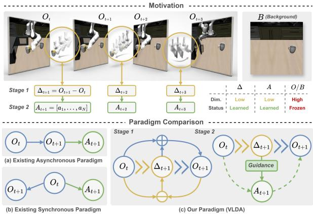
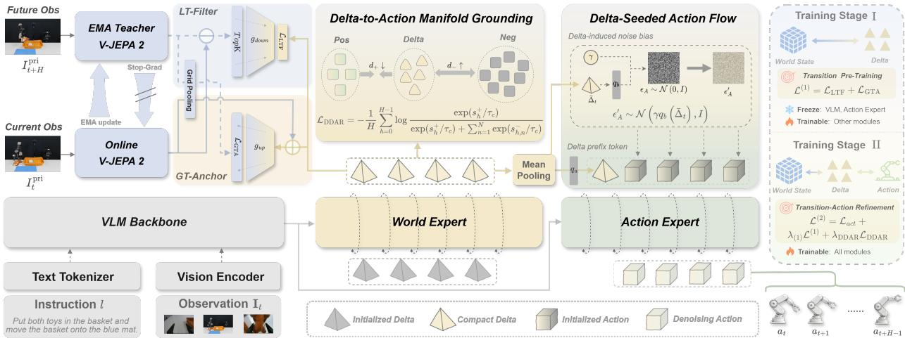
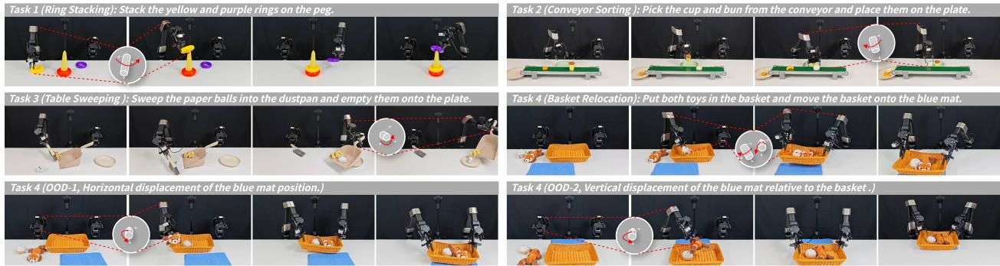
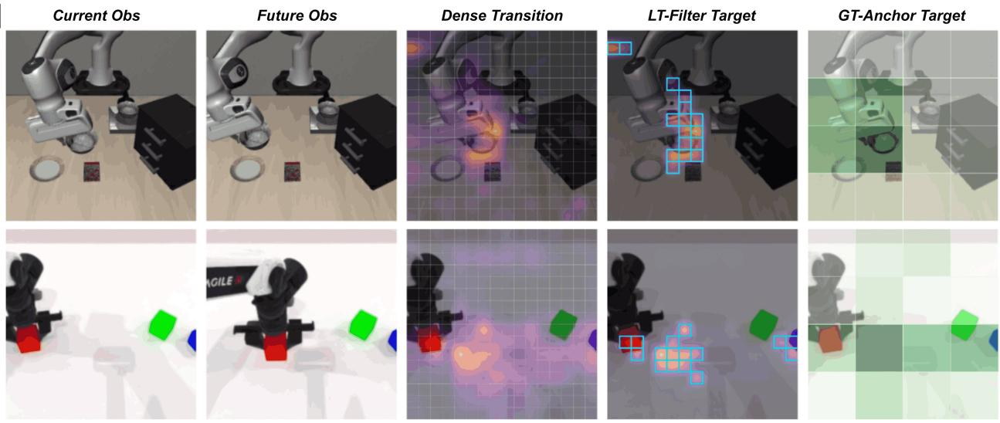
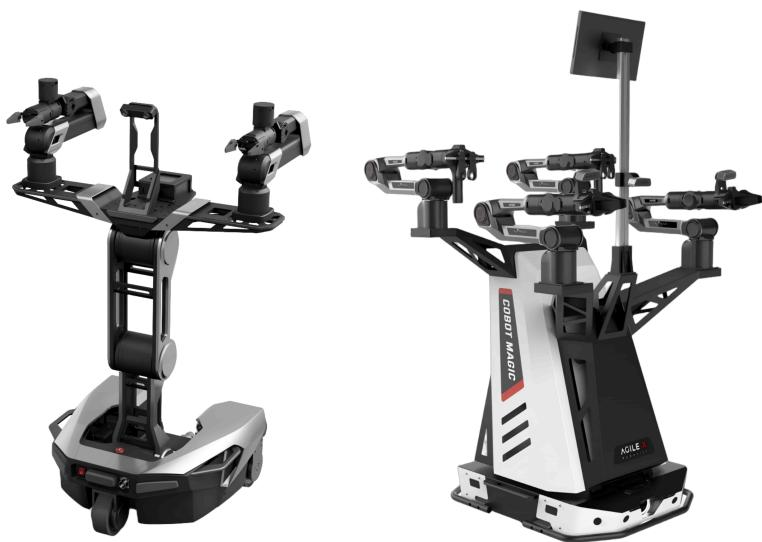
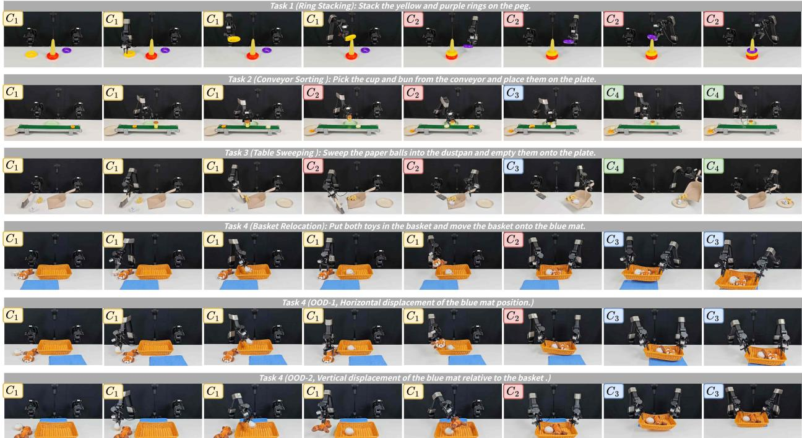
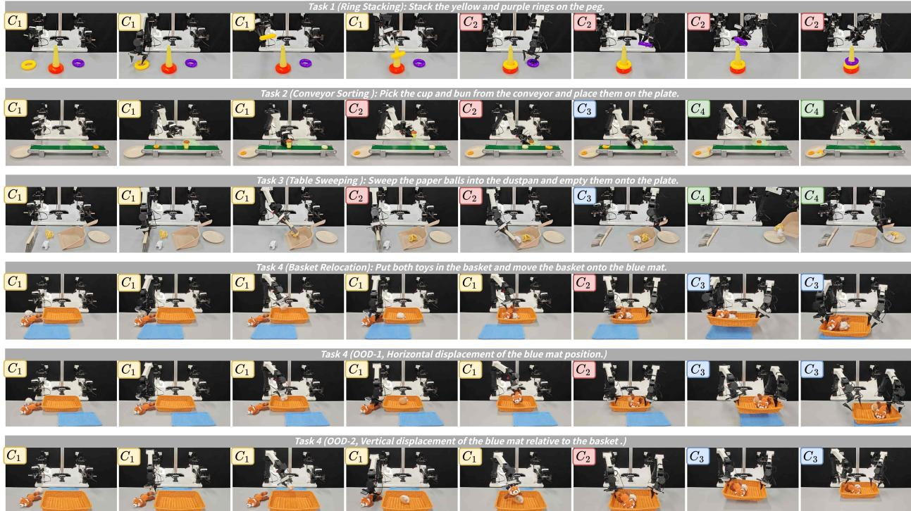
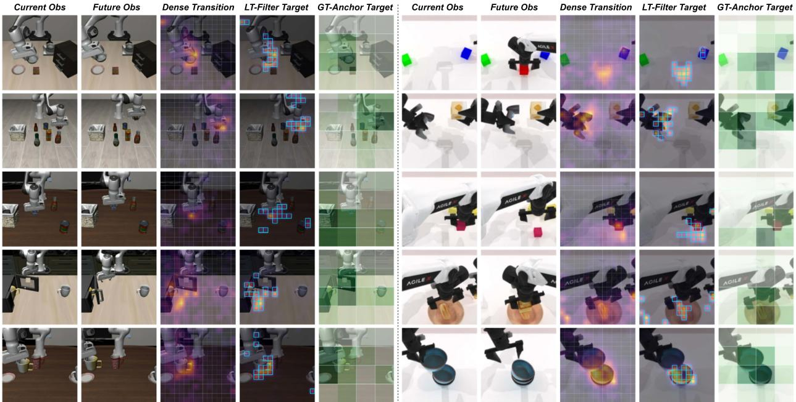

# Vision-Language-Delta-Action: Learning Compact Deltas as Actionable Transition Interfaces for Robotic Manipulation

Lingsen Zhang1,2,∗ Wei Li1,2,∗ Jie He1,2 Henghua Zhang2 Kai Mo2 Shiyong Li2 Yanpeng Wang2 Rui Shao1,3,†

∗Equal Contribution †Corresponding Author

1Harbin Institute of Technology, Shenzhen 2Baidu, Inc. 3Shenzhen Loop Area Institute

Robotic manipulation is not merely observation-to-action generation, but the realization of task-specified state changes in the physical world. Existing vision-language-action (VLA) methods directly learn observation-toaction mappings, imposing a substantial learning burden on policies due to the large gap between semantic understanding and action execution. Although world-action models (WAMs) improve control through future prediction, they optimize the full future rather than task-relevant changes, wasting capacity on static appearance or action-irrelevant abstractions. To address this issue, we propose Vision-Language-Delta-Action (VLDA), a new paradigm that reformulates full future prediction as compact actionable transition modeling. Our core insight is to introduce a compact Delta as an intermediate decision variable that captures latent world-state changes, serving as a unified representational interface between vision-language understanding and action generation. To learn such a Delta representation, VLDA introduces a unified objective composed of the Local Transition Filter (LT-Filter) and Global Transition Anchor (GT-Anchor). LT-Filter captures taskrelevant manipulation-centric changes, preventing Delta from being biased toward static patch reconstruction. GT-Anchor provides coarse future-level regularization, ensuring that Delta can explain the overall trend of future changes. Building on these, Delta-Driven Action Refinement (DDAR) further grounds Delta in the action manifold and injects it as a structured seed to guide action denoising. We implement VLDA within LoongForge, an open-source training framework for large-scale foundation and embodied models, leveraging its modular and distributed infrastructure for unified two-stage optimization. Experiments show that VLDA improves long-horizon consistency, robustness, and generalization, validating actionable Delta as a more principled alternative to both direct action prediction and full future-state modeling.

Code: https://github.com/baidu-baige/LoongForge/tree/master/cookbook/loongforge-vlda Project: https://baidu-baige.github.io/LoongForge/projects/vlda.html

## 1 Introduction

Similar to human actions, robotic manipulation is a process of controlled physical state transformation [49, 56]. As shown in Fig. 1 (top), conditioned on visual observations, a robot must not only recognize the current scene and interpret the task-relevant physical context around it [23, 27], but also determine which part of the scene should change and how such change can be realized through continuous action execution [1, 43]. This requirement fundamentally distinguishes robotic manipulation from generic vision-language understanding, as the critical decision variable is not the complete visual state itself, but the task-relevant transition that drives the current state toward the desired physical outcome.

However, existing VLA and WAM paradigms share a common limitation in lacking a dedicated, action-grounded representation of task-relevant physical transitions. 1) Most VLA models still follow an observation-to-action formulation that entangles task-relevant object identification [4, 26, 53, 61], desired physical state-change inference, and executable action-chunk generation within a single policy. Without dedicated modeling of task-relevant state changes, the policy must implicitly infer the intended physical transition from action supervision alone, leaving a substantial representational gap between semantic understanding and action execution.

A straightforward way to bridge semantic understanding and action execution is future modeling, as illustrated in Fig. 1 (a) and (b). 2) WAMs predict future observations [7, 54, 59], visual latents [39, 44], or action-conditioned dynamics [2, 25] to provide temporal cues beyond the current observation. However, they typically represent the future as another complete state, causing task-relevant transition cues to remain entangled with static scene content and actionirrelevant variations. Moreover, future prediction is often used only as an auxiliary objective, without providing a structured intermediate variable that can di-

Figure 1: Motivation and paradigm comparison of VLDA. Robotic manipulation is governed by sparse task-relevant state changes that provide essential cues for action generation, while most visual content remains static. Unlike existing asynchronous and synchronous paradigms that predict complete future states before or alongside actions, VLDA learns a compact Delta from current-tofuture transitions and uses it as an actionable interface to guide action refinement, forming an understanding-transition-execution loop.

rectly guide action generation. Robotic manipulation instead requires a compact transition variable that captures task-relevant manipulation-centric changes, remains consistent with the overall direction of future evolution, and is directly grounded in executable actions.

Taken together, these limitations motivate a transition interface that is selective, predictive, and actionable. It should isolate task-relevant manipulation-centric changes, remain consistent with future evolution, and be directly consumable by the action generator. To this end, we propose Vision-Language-Delta-Action (VLDA), a new paradigm that models actionable transitions through a low-dimensional Delta interface rather than predicting the complete future state.

Specifically, VLDA instantiates the transition interface as a compact low-dimensional Delta that cap tures the task-relevant transition implied by the task. To make Delta both selective and predictive, VLDA introduces a unified learning objective with two complementary constraints. 1) Local Transition Filter (LT-Filter) distills sparse, manipulation-centric transition evidence from dense current-to-future visual differences, suppressing static scene content and action-irrelevant variations. 2) Global Transition Anchor (GT-Anchor) regularizes Delta with a coarse summary of future evolution, preventing overly local transition modeling and preserving the global direction of state change. Together, these constraints reconcile local transition selectivity with global predictive consistency, yielding a compact and future-grounded representation of task-relevant physical change. To make Delta directly actionable, VLDA further introduces 3) Delta-Driven Action Refinement (DDAR), which grounds Delta in the action manifold through Delta-action alignment and injects it into the action flow as a structured transition seed. The action expert then refines this transition-informed seed into executable action chunks conditioned on the predicted transition. Rather than treating future prediction as auxiliary supervision, VLDA therefore establishes a closed understandingtransition-execution loop, where vision-language representations interpret the task context, Delta specifies the required state transition, and DDAR realizes that transition through continuous action generation.

We evaluate VLDA on standard robotic manipulation benchmarks and challenging long-horizon tasks. Experimental results show that VLDA improves long-horizon consistency, robustness under distribution shifts, and generalization to complex manipulation scenarios. These results demonstrate that modeling actionable Delta provides a more effective alternative to both direct observation-to-action learning and full future-state prediction. Our contributions are summarized as follows:

• We introduce Vision-Language-Delta-Action (VLDA), a new robotic manipulation paradigm that replaces complete future-state prediction with a compact Delta serving as an actionable transition interface.

• We design a unified Delta learning objective with Local Transition Filter and Global Transition Anchor, enabling Delta to capture sparse task-relevant changes while remaining consistent with future transition trends.

• We develop Delta-Driven Action Refinement, which aligns Delta with the action manifold and uses it as a structured seed for action denoising, forming an explicit understanding-transition-execution loop.

## 2 Related Work

Observation-to-Action Learning in VLA Models. Existing VLA models primarily employ action-token prediction, implemented either autoregressively or in parallel [5, 20, 26, 27, 32, 41], and continuous action experts based on diffusion or flow matching [4, 11, 17, 23, 33, 34, 51]. Despite different action decoders, both paradigms directly supervise actions from observations, requiring a single policy to jointly resolve task grounding, intended physical change, and motor realization. This creates a substantial gap between highlevel semantic observations and low-level executable actions. VLDA bridges this gap with a compact Delta that explicitly mediates what should change and how that change is executed.

Predictive World-Action Modeling. Recent WAMs couple future modeling with robot control through cascaded future-to-action generation [30, 47, 62], joint world-action prediction [7, 16, 54, 63], and predictive latent dynamics [18, 21, 40]. In these formulations, future prediction typically serves as an upstream context, a jointly decoded target, or a regularizer for action learning, with its contribution to control determined by architecture-specific fusion mechanisms. VLDA instead reparameterizes the prediction-control connection through a compact Delta, whose control role is explicitly defined by transition learning and Delta-driven action refinement.

Latent Action Representation Learning. Discrete approaches tokenize visually inferred motion patterns for scalable VLA pretraining [6, 9, 52], while continuous formulations learn smooth latent control variables that can be mapped to embodiment-specific actions with limited supervision [35, 45]. CLAP [57] and LARA [37] further improve physical grounding by aligning visually inferred representations with robot actions or proprioceptive dynamics. However, these representations mainly serve as pseudo-action labels, pretraining targets, or shared control spaces. They do not explicitly isolate task-relevant physical changes under complementary local and global constraints, ground such changes in the action manifold, and use them to directly guide action refinement.

  
Figure 2: Overview of VLDA. Given the observation and instruction, the World Expert predicts an actionable Delta under transition supervision. In training stage I, LT-Filter and GT-Anchor learn selective and consistent transition representations. In stage II, Delta-Driven Action Refinement grounds Delta in the action manifold through Delta-to-Action Manifold Grounding and injects it into action denoising through Delta-Seeded Action Flow, enabling the Action Expert to generate action chunks.

## 3 Preliminary & Problem Definition

Problem Definition. We consider robotic manipulation at step t, where the robot receives an instruction l and observes $s _ { t } = ( \mathbf { I } _ { t } , p _ { t } )$ . Here, $\mathbf { I } _ { t } = \{ I _ { t } ^ { c } \} _ { c = 1 } ^ { C }$ denotes multi-view RGB observations and $p _ { t }$ denotes proprioception. The policy predicts an action chunk $\mathbf { A } _ { t } = [ \boldsymbol { a } _ { t } , \dots , \boldsymbol { a } _ { t + H - 1 } ] \in \mathbb { R } ^ { H \times d _ { a } }$ , where H and $d _ { a }$ denote the action horizon and dimension, respectively. During training, the corresponding future primary-camera image $I _ { t + H } ^ { \mathrm { p i } }$ is available, while inference only relies on $\left( { { s _ { t } } , l } \right)$ . Our objective is to exploit such training-time state evolution to improve $p ( \mathbf { A } _ { t } \mid s _ { t } , l )$ without requiring future observations at deployment.

Conditional Flow Matching. Given a clean target $\mathbf { x } _ { 0 }$ and source z under condition c, both experts use the same linear conditional path and corresponding target velocity:

$$
\begin{array} { r } { \mathbf { x } _ { \tau } = ( 1 - \tau ) \mathbf { x } _ { 0 } + \tau \mathbf { z } , \qquad \mathbf { u } _ { \tau } ^ { \star } = \mathbf { z } - \mathbf { x } _ { 0 } . } \end{array}\tag{1}
$$

The Action Expert uses the biased source ${ \bf z } _ { A } = \pmb { \varepsilon } _ { A } + \pmb { \gamma } \mathbf { b } ( c )$ and directly predicts $\hat { \mathbf { u } } _ { \tau }$ . The World Expert uses ${ \bf z } _ { \Delta } = \varepsilon _ { \Delta }$ and x-prediction, estimating $\hat { \mathbf { x } } _ { 0 } = f _ { \vartheta } ( \mathbf { x } _ { \tau } , \tau , c )$ and recovering velocity as

$$
\hat { \mathbf { u } } _ { \tau } = \frac { \mathbf { x } _ { \tau } - \hat { \mathbf { x } } _ { 0 } } { \tau } ,\tag{2}
$$

where $\varepsilon _ { A } , \varepsilon _ { \Delta } \sim \mathcal { N } ( 0 , I )$ denote the noise variables used by the Action and World Experts, respectively.

Exponential Moving Average. EMA maintains a slowly evolving model copy to provide stable supervision targets. Let ψr and ψ¯r denote the online and EMA weights at iteration $r ,$ respectively. The EMA weights are recursively updated at every training iteration as

$$
\bar { \psi } _ { r } = m \bar { \psi } _ { r - 1 } + ( 1 - m ) \psi _ { r } , \ m \in [ 0 , 1 ) ,\tag{3}
$$

where m is the EMA momentum governing the temporal smoothing of teacher weights. The EMA model is not optimized by gradients and evolves smoothly during training.

## 4 Vision-Language-Delta-Action

## 4.1 Framework: Actionable Delta Modeling

Given the current state $s _ { t }$ and language instruction $l ,$ conventional VLA policies directly predict an action chunk $\mathbf { A } _ { t }$ as $\mathbf { A } _ { t } \sim \pi ( \cdot \mid s _ { t } , l )$ . However, such a direct observation-to-action mapping requires a single policy to bridge high-level semantic understanding and low-level action execution within a unified end-to-end decision-making process, making long-horizon manipulation difficult to optimize.

To alleviate this burden, VLDA reformulates action generation as an understanding–transition–execution process. A VLM backbone first encodes the state-instruction pair into a multimodal context $\mathbf { h } _ { t } = \Phi _ { \mathrm { V L M } } ( s _ { t } , l )$ VLDA then introduces a compact actionable Delta $\Delta _ { t }$ as an intermediate transition variable that captures task-specified physical state changes. The action generation process is factorized as:

$$
p ( \mathbf { A } _ { t } \mid s _ { t } , l ) = \int p _ { \theta } ( \Delta _ { t } \mid \mathbf { h } _ { t } ) p _ { \phi } ( \mathbf { A } _ { t } \mid \mathbf { h } _ { t } , \Delta _ { t } ) \mathrm { d } \Delta _ { t } .\tag{4}
$$

Here, $p _ { \theta }$ denotes the World Expert for transition prediction, while $p _ { \phi }$ denotes the Action Expert for action generation conditioned jointly on both the inferred Delta and multimodal context.

Through this factorization, Delta serves as a compact transition interface between vision-language understanding and action generation, replacing redundant full future-state modeling with focused task-relevant state-change modeling for downstream action prediction in diverse robotic manipulation scenarios.

## 4.2 Actionable Transition Generation

As established in Equation (4), the World Expert $p _ { \theta }$ predicts the actionable Delta $\Delta _ { t }$ from the multimodal context $\mathbf { h } _ { t }$ . We model $p _ { \theta }$ as a continuous-time flow-matching model in the Delta space, which generates a clean transition estimate $\hat { \Delta } _ { t }$ while preserving the compact structure of the learned transition representation.

Inspired by the manifold perspective revisited in JiT [31], where natural data lies on a low-dimensional structured manifold while noise spans an unstructured high-dimensional space, we note that physical state changes in robotic manipulation are similarly constrained by scene geometry, kinematics, and object inter actions rather than being arbitrarily distributed in the latent space. Thus, we adopt x-prediction parameteri zation for transition generation. Given the noisy Delta state $\Delta _ { \tau }$ at flow time τ, the model predicts

$$
\hat { \Delta } _ { t } = f _ { \theta } ^ { \Delta } ( \Delta _ { \tau } , \tau , \mathbf { h } _ { t } ) .\tag{5}
$$

The $\Delta _ { \tau }$ is introduced in Section 4.3, with its detailed construction deferred to the transition-learning objective below. Following the x-prediction form, the corresponding velocity is analytically recovered as

$$
\hat { \mathbf { u } } _ { \tau } ^ { \Delta } = \frac { \Delta _ { \tau } - \hat { \Delta } _ { t } } { \tau } .\tag{6}
$$

The predicted $\hat { \Delta } _ { t }$ serves as a compact transition prior for action generation. To ensure that this prior captures task-relevant physical changes rather than collapsing into trivial representations, we introduce two complementary objectives: Local Transition Filter and Global Transition Anchor, which respectively emphasize selective local changes and coarse global consistency within the learned transition representation.

## 4.3 Local Transition Filter

Learning the transition prior for the World Expert necessitates a supervision target that isolates actionable physical changes from low-level visual redundancies for stable task-relevant transition learning. Instead of

relying on raw pixels, we extract dense semantic features from the current and future observations:

$$
\mathbf { V } _ { t } = E _ { \mathrm { o n } } ( I _ { t } ^ { \mathrm { p r i } } ) , \bar { \mathbf { V } } _ { t + H } = E _ { \mathrm { e m a } } ( I _ { t + H } ^ { \mathrm { p r i } } ) \in \mathbb { R } ^ { P \times d _ { \nu } } .\tag{7}
$$

where P denotes the number of spatial tokens. Specifically, $E _ { \mathrm { o n } }$ and $E _ { \mathrm { e m a } }$ denote the two encoders, with comprehensive elaborations provided in Section 5. The dense transition is computed as $\mathbf { D } _ { t } = \bar { \mathbf { V } } _ { t + H } - \mathbf { V } _ { t }$

Rather than reconstructing the entire future feature map, which contains substantial static redundancy, LT-Filter isolates the task-relevant dynamics by selecting the top-K regions with the largest transition mag nitudes, thereby focusing supervision on regions exhibiting the strongest transition evidence:

$$
\begin{array} { r l } & { \mathcal { H } _ { t } = \mathrm { T o p K } _ { K } \left( \{ \| \mathbf { D } _ { t , i } \| _ { 2 } \} _ { i = 1 } ^ { P } \right) , } \\ & { \Delta _ { t } ^ { \star } = g _ { \downarrow } \left( \mathbf { D } _ { t , \mathcal { H } _ { t } } \right) \in \mathbb { R } ^ { K \times d _ { \Delta } } . } \end{array}\tag{8}
$$

Here, $g _ { \downarrow }$ projects the selected transition tokens into a compact Delta space, with $K \ll P$ and $d _ { \Delta } \ll d _ { \nu } .$ , which keeps the representation compact while retaining task-relevant transition evidence. We refer to $\Delta _ { t } ^ { \star }$ as the Delta target, which filters out static appearance information while retaining local changes that are most likely to be actionable. Given $\Delta _ { t } ^ { \star }$ and Gaussian noise $\varepsilon _ { \Delta } \sim \mathcal { N } ( 0 , I )$ , the Delta flow path is constructed as

$$
\Delta _ { \tau } = \tau \varepsilon _ { \Delta } + ( 1 - \tau ) \Delta _ { t } ^ { \star } , \ \mathbf { u } _ { \tau } ^ { \Delta } = \varepsilon _ { \Delta } - \Delta _ { t } ^ { \star } .\tag{9}
$$

Since the tokens indexed by $\mathcal { H } _ { t }$ form an unordered set, standard point-wise regression is permutationsensitive. We therefore use an entropy-regularized transport plan to construct a balanced soft correspondence. For two token sets $\mathbf { X } , \mathbf { Y } \in \mathbb { R } ^ { K \times d }$ , we define the pairwise cost as

$$
C _ { i j } = { \frac { \| \mathbf { x } _ { i } - \mathbf { y } _ { j } \| _ { 2 } ^ { 2 } } { d } } .\tag{10}
$$

To resolve the ambiguity caused by the unordered token structure, we formulate transition matching as a soft set-to-set assignment problem rather than enforcing fixed index-wise correspondence. The pairwise costs therefore characterize the compatibility between predicted and target transition tokens, while a balanced transport plan determines their soft correspondence in a permutation-invariant manner. The transport plan and set-matching loss are then jointly computed as follows:

$$
\begin{array} { r } { \mathbf { T } _ { \eta } ^ { \star } = \operatorname { S i n k h o r n } _ { \eta } ( \bar { \mathbf { C } } ) , } \\ { \mathcal { D } _ { \mathrm { s e t } } ( \mathbf { X } , \mathbf { Y } ; d ) = \left. \mathrm { s g } ( \mathbf { T } _ { \eta } ^ { \star } ) , \mathbf { C } \right. , } \end{array}\tag{11}
$$

where $\bar { \mathbf { C } }$ is the sample-wise normalized cost, sg denotes stop-gradient, and η controls the softness of the balanced transport plan. The Local Transition Filter objective is then

$$
\begin{array} { r } { \mathcal { L } _ { \mathrm { L T F } } = \mathbb { E } _ { \tau , \varepsilon _ { \Delta } } \left[ \mathcal { D } _ { \mathrm { s e t } } \left( \hat { \mathbf { u } } _ { \tau } ^ { \Delta } , \mathbf { u } _ { \tau } ^ { \Delta } ; d _ { \Delta } \right) \right] . } \end{array}\tag{12}
$$

Further details are provided in Appendix D.2, including implementation and optimization specifics.

## 4.4 Global Transition Anchor

While LT-Filter emphasizes fine-grained local regions with prominent state changes, relying only on the selected top-K regions risks losing the coarse global context of the overall transition. To preserve global consistency, we introduce the Global Transition Anchor (GT-Anchor) as a coarse transition-level regularization, thereby complementing local selectivity with a scene-level constraint on overall transition direction.

Specifically, we aggregate the dense visual features $\mathbf { V } _ { t }$ and $\bar { \mathbf { V } } _ { t + H }$ into $K$ coarse tokens via adaptive pooling, and construct a global transition anchor that summarizes the overall state evolution direction:

$$
\mathbf { G } _ { t } = \mathrm { P o o l } _ { K } ( \bar { \mathbf { V } } _ { t + H } ) - \mathrm { P o o l } _ { K } ( \mathbf { V } _ { t } ) \in \mathbb { R } ^ { K \times d _ { \nu } } .\tag{13}
$$

The resulting $\mathbf { G } _ { t }$ provides a coarse reference for the transition direction by summarizing large-scale changes across the pooled current and future representations. Meanwhile, the predicted compact Delta $\hat { \Delta } _ { t }$ is projected back to the high-dimensional visual feature space using an up-projection module $g _ { \uparrow }$

$$
\begin{array} { r } { \hat { \mathbf { D } } _ { t } = g _ { \uparrow } ( \hat { \Delta } _ { t } ) \in \mathbb { R } ^ { K \times d _ { \nu } } . } \end{array}\tag{14}
$$

The GT-Anchor objective matches the projected transition tokens with the global transition anchor using the set distance defined in Equation (11) to enforce global consistency across transition representations:

$$
\begin{array} { r } { \mathcal { L } _ { \mathrm { G T A } } = \mathbb { E } _ { \tau , \varepsilon _ { \Delta } } \left[ \mathcal { D } _ { \mathrm { s e t } } \left( \hat { \mathbf { D } } _ { t } , \mathbf { G } _ { t } ; d _ { \nu } \right) \right] . } \end{array}\tag{15}
$$

Importantly, GT-Anchor does not require reconstructing the full future state. Instead, it anchors the compact Delta to the coarse direction of future state transitions, which complements LT-Filter by providing a better balance between expressive capacity and structured transition regularization.

## 4.5 Delta-Driven Action Refinement

Delta-Seeded Action Flow (DSAF). Given the predicted $\hat { \Delta } _ { t }$ , DDAR guides action denoising through two complementary branches: a Delta-induced noise bias and a Delta prefix token. We first aggregate the Delta tokens into a global transition context and map it to an action-space bias:

$$
\bar { \boldsymbol { \Delta } } _ { t } = \frac { 1 } { K } \sum _ { k = 1 } ^ { K } \hat { \boldsymbol { \Delta } } _ { t , k } , \quad \boldsymbol { \mathsf { b } } _ { t } = q _ { b } ( \bar { \boldsymbol { \Delta } } _ { t } ) \in \mathbb { R } ^ { H \times d _ { a } } .\tag{16}
$$

Instead of standard Gaussian noise, we shift the initial action noise $\varepsilon _ { A } \sim \mathcal { N } ( 0 , I )$ with this Delta-induced bias and construct the action flow path, thereby introducing transition-aware structure at initialization:

$$
\pmb { \varepsilon } _ { A } ^ { \prime } = \pmb { \varepsilon } _ { A } + \gamma \pmb { \ b } _ { t } , \quad \mathbf { A } _ { \tau } = \tau \pmb { \varepsilon } _ { A } ^ { \prime } + ( 1 - \tau ) \mathbf { A } _ { t } ,\tag{17}
$$

where $\gamma$ is a learnable scalar controlling the bias strength. This path yields the target action velocity ${ \bf u } _ { \tau } ^ { A } = { }$ $\pmb { \varepsilon } _ { A } ^ { \prime } - \mathbf { A } _ { t }$ . In the second branch, $\bar { \Delta } _ { t }$ is projected into a Delta prefix token and prepended to the action tokens during denoising. The Action Expert $f _ { \phi } ^ { A }$ then predicts the action velocity from the multimodal context, the action flow state, and the prepended Delta context token under this conditioned denoising formulation:

$$
\hat { \mathbf { u } } _ { \tau } ^ { A } = f _ { \phi } ^ { A } ( \mathbf { A } _ { \tau } , \tau , \mathbf { h } _ { t } , \bar { \Delta } _ { t } ) .\tag{18}
$$

The action generation objective is defined as an MSE loss:

$$
\begin{array} { r } { \mathcal { L } _ { \mathrm { a c t } } = \mathbb { E } _ { \tau , \varepsilon _ { A } } \left[ \| \hat { \mathbf { u } } _ { \tau } ^ { A } - \mathbf { u } _ { \tau } ^ { A } \| _ { 2 } ^ { 2 } \right] . } \end{array}\tag{19}
$$

In this way, Delta is not only predicted as an auxiliary transition variable, but also injected into the action flow as a physically grounded prior during downstream action generation and iterative denoising.

Table 1: Results on LIBERO-Plus [13]. We report generalization performance across seven perturbation dimensions and four task suites. VLDA is evaluated in a zero-shot setting with 10,030 rollouts.
<table><tr><td rowspan="2">Method</td><td colspan="7">Perturbation Dimensions</td><td colspan="4">Task Suites</td><td rowspan="2">Avg.</td></tr><tr><td>Camera</td><td>Robot</td><td>Language</td><td>Light</td><td>Background</td><td>Noise</td><td>Layout</td><td>Spatial</td><td>Object</td><td>Goal</td><td>Long</td></tr><tr><td>OpenVLA [26]</td><td>0.8</td><td>3.5</td><td>23.0</td><td>8.1</td><td>34.8</td><td>15.2</td><td>28.5</td><td>19.4</td><td>14.0</td><td>15.1</td><td>14.3</td><td>15.6</td></tr><tr><td>OpenVLA-OFT [27]</td><td>56.4</td><td>31.9</td><td>79.5</td><td>88.7</td><td>93.3</td><td>75.8</td><td>74.2</td><td>84.0</td><td>66.5</td><td>63.0</td><td>66.4</td><td>69.6</td></tr><tr><td>UniVLA [6]</td><td>1.8</td><td>46.2</td><td>69.6</td><td>69.0</td><td>81.0</td><td>21.2</td><td>31.9</td><td>55.5</td><td>36.7</td><td>40.7</td><td>39.9</td><td>43.9</td></tr><tr><td>WorldVLA [7]</td><td>0.1</td><td>27.9</td><td>41.6</td><td>43.7</td><td>17.1</td><td>10.9</td><td>38.0</td><td>32.5</td><td>28.6</td><td>31.8</td><td>8.2</td><td>25.0</td></tr><tr><td>DreamVLA [58]</td><td>65.0</td><td>40.8</td><td>63.5</td><td>85.7</td><td>82.6</td><td>84.9</td><td>74.0</td><td>79.7</td><td>79.0</td><td>61.7</td><td>59.8</td><td>69.9</td></tr><tr><td>GuidedVLA [24]</td><td>73.7</td><td>51.4</td><td>62.6</td><td>94.6</td><td>89.0</td><td>85.2</td><td>79.9</td><td>84.0</td><td>80.9</td><td>70.8</td><td>66.2</td><td>75.4</td></tr><tr><td>π0 [4]</td><td>13.8</td><td>6.0</td><td>58.8</td><td>85.0</td><td>81.4</td><td>79.0</td><td>68.9</td><td>60.7</td><td>61.4</td><td>44.9</td><td>48.4</td><td>53.6</td></tr><tr><td>π0.5 [23]</td><td>59.7</td><td>65.5</td><td>75.3</td><td>87.0</td><td>82.4</td><td>72.1</td><td>80.3</td><td>79.9</td><td>87.8</td><td>69.0</td><td>64.9</td><td>73.6</td></tr><tr><td>Spatial Forcing [28]</td><td>20.1</td><td>13.4</td><td>40.9</td><td>29.1</td><td>33.4</td><td>25.7</td><td>39.3</td><td>52.9</td><td>31.0</td><td>28.2</td><td>5.4</td><td>29.1</td></tr><tr><td>VLA-Adapter [50]</td><td>36.2</td><td>37.9</td><td>74.6</td><td>70.6</td><td>76.1</td><td>58.0</td><td>69.7</td><td>85.0</td><td>46.3</td><td>56.0</td><td>50.4</td><td>59.1</td></tr><tr><td>VLDA</td><td>72.4</td><td>75.3</td><td>84.0</td><td>96.0</td><td>95.5</td><td>89.4</td><td>85.7</td><td>89.6</td><td>89.8</td><td>80.1</td><td>78.3</td><td>84.5</td></tr></table>

Delta-to-Action Manifold Grounding (DAMG). To ensure that Delta captures action-relevant transitions rather than purely visual changes, we align Delta tokens with action tokens in a shared contrastive space to encourage consistent cross-modal action grounding. We treat the H ground-truth actions $\{ a _ { t + h } \} _ { h = 0 } ^ { H - 1 }$ in the action chunk as positive samples, and randomly sample N actions from non-overlapping temporal regions of the same trajectory as negative samples. The Delta and action tokens are projected as:

$$
\begin{array} { r } { \mathbf { z } _ { k } ^ { \Delta } = \mathrm { N o r m } ( q _ { \Delta } ( \hat { \Delta } _ { t , k } ) ) , \mathbf { z } _ { h } ^ { \mathrm { a c t } } = \mathrm { N o r m } ( q _ { \mathrm { a c t } } ( a _ { t + h } ) ) . } \end{array}\tag{20}
$$

For each positive action token $a _ { t + h }$ , we compute its similarity to all Delta tokens using soft token pooling:

$$
s _ { h } ^ { + } = \tau _ { \Delta } \log \sum _ { k = 1 } ^ { K } \exp \left( \frac { \langle \mathbf { z } _ { k } ^ { \Delta } , \mathbf { z } _ { h } ^ { \mathrm { a c t } } \rangle } { \tau _ { \Delta } } \right) .\tag{21}
$$

where $\tau _ { \Delta }$ is the pooling temperature controlling soft token aggregation. For the negative actions, we compute their similarities $s _ { n } ^ { - }$ to the Delta set in the same way and optimize an InfoNCE objective:

$$
\mathcal { L } _ { \mathrm { { D D A R } } } = - \frac { 1 } { H } \sum _ { h = 0 } ^ { H - 1 } \log \frac { \exp ( s _ { h } ^ { + } / \tau _ { c } ) } { \exp ( s _ { h } ^ { + } / \tau _ { c } ) + \sum _ { n = 1 } ^ { N } \exp ( s _ { n } ^ { - } / \tau _ { c } ) } ,\tag{22}
$$

where $\tau _ { c }$ is the contrastive temperature controlling positive-negative separation. This alignment grounds Delta in the action manifold, encouraging it to be not only visually predictive but also action-executable.

## 5 Training Strategy

## 5.1 Training Objective

Following V-JEPA 2 [2], VLDA employs an online encoder $E _ { \mathrm { o n } }$ for current observations and an EMA teacher $E _ { \mathrm { e m a } }$ for future observations. Specifically, $E _ { \mathrm { o n } }$ is optimized by gradients, whereas $E _ { \mathrm { e m a } }$ is updated solely through exponential moving average (see Appendix D.1). This asymmetric design prevents the Delta target from being constructed between two rapidly changing feature spaces, thereby providing stable supervision for future-transition modeling.

VLDA is optimized in two stages to progressively establish transition modeling and action generation. In the first stage (transition pre-training), we learn the transition interface with the Local Transition Filter and Global Transition Anchor objectives, while keeping the action branch frozen:

$$
\begin{array} { r } { \mathcal { L } ^ { ( 1 ) } = \mathcal { L } _ { \mathrm { L T F } } + \mathcal { L } _ { \mathrm { G T A } } . } \end{array}\tag{23}
$$

  
Figure 3: Representative executions on Ring Stacking, Conveyor Sorting, Table Sweeping, and Basket Relocation, including two OOD spatial configurations. Frames proceed from left to right, while red dashed lines and circular zoom-ins highlight the correspondence between task-relevant current-to-future transitions and actions. Complete trajectories in Appendix C.1.

In the second stage, we jointly optimize transition modeling, action generation, and Delta–action alignment:

$$
\mathscr { L } ^ { ( 2 ) } = \mathcal { L } _ { \mathrm { a c t } } + \lambda _ { ( 1 ) } \mathscr { L } ^ { ( 1 ) } + \lambda _ { \mathrm { D D A R } } \mathscr { L } _ { \mathrm { D D A R } } .\tag{24}
$$

## 5.2 Training Framework

We implement and train VLDA within LoongForge1 [46], an open-source training framework for large-scale foundation and embodied models. Its PyTorch-native embodied-model subsystem provides modular model, data, and trainer abstractions, supporting distributed training with DDP, ZeRO-1, FSDP, and HSDP. Together with flexible component-wise parameter freezing, checkpoint management, and experiment logging, this infrastructure facilitates the staged optimization of VLDA’s VLM backbone, World Expert, Action Expert, and transition modules. Building upon these capabilities, we implement VLDA-specific Delta target construction, LT-Filter and GT-Anchor objectives, Delta–action alignment, and Delta-driven action refinement, integrating transition learning and action generation within a unified training pipeline.

During inference, VLDA first samples $\hat { \Delta } _ { t }$ with the World Expert and then uses it as a structured transition prior to guide action denoising via the Action Expert. This inference procedure preserves the understanding– transition–execution decomposition, allowing the predicted Delta to mediate between multimodal task understanding and executable action generation without requiring access to future observations.

## 6 Experiments

## 6.1 Experimental Setup

Simulation Benchmarks. We evaluate VLDA on three simulation benchmarks: LIBERO [36], LIBEROplus [13], and RoboTwin 2.0 [8], covering task generalization, robustness, and cross-distribution generalization. For RoboTwin 2.0, we train on the easy (clean) setting and evaluate on the hard (random) setting. For LIBERO-plus, we directly evaluate the model trained on standard LIBERO in a zero-shot manner. Detailed benchmark descriptions are provided in Appendix A.1.

Real-World Settings. We evaluate VLDA and two strong baselines on four long-horizon tasks using the GALAXEA R1 Lite [15] and AgileX Cobot Magic [14] platforms. We collect 100, 125, 125, and 150 human-teleoperated demonstrations for the four tasks, respectively, and conduct 25 evaluation trials per task and platform. Detailed settings are provided in Appendix A.2.

Table 2: Results on selected hard tasks from RoboTwin 2.0 [8], chosen to cover variations in layout, illumination, appearance, and other factors. VLDA is trained exclusively on the clean setting and evaluated on the randomized setting, constituting a zero-shot evaluation. VLDA achieves the best average performance, and the best result for each task is highlighted in bold. Complete results across all 50 tasks are reported in Appendix B.1 for reference.
<table><tr><td rowspan="2">Method</td><td rowspan="2">Ranking RGB</td><td rowspan="2">Ranking Size</td><td rowspan="2">Grab Roller</td><td rowspan="2">Open Laptop</td><td rowspan="2">Open Microwave</td><td colspan="2">Place DualPut Bottles Shake</td><td rowspan="2">Bottle</td><td rowspan="2">Stacking Three</td><td rowspan="2">Stacking Two</td><td rowspan="2">Avg.</td></tr><tr><td>Shoes</td><td>Dustbin</td></tr><tr><td>ACT [60]</td><td>0%</td><td>0%</td><td>25%</td><td>0%</td><td>0%</td><td>0%</td><td>1%</td><td>10%</td><td>0%</td><td>0%</td><td>3.6%</td></tr><tr><td>RDT [38]</td><td>0%</td><td>0%</td><td>43%</td><td>32%</td><td>20%</td><td>4%</td><td>4%</td><td>45%</td><td>17%</td><td>30%</td><td>19.5%</td></tr><tr><td>DP [11]</td><td>0%</td><td>0%</td><td>0%</td><td>0%</td><td>0%</td><td>0%</td><td>0%</td><td>8%</td><td>0%</td><td>0%</td><td>0.8%</td></tr><tr><td>DP3 [55]</td><td>0%</td><td>0%</td><td>2%</td><td>7%</td><td>22%</td><td>0%</td><td>21%</td><td>19%</td><td>5%</td><td>6%</td><td>8.2%</td></tr><tr><td>TwinVLA [22]</td><td>0%</td><td>0%</td><td>22%</td><td>17%</td><td>1%</td><td>3%</td><td>4%</td><td>58%</td><td>15%</td><td>11%</td><td>13.1%</td></tr><tr><td>π0 [4]</td><td>5%</td><td>1%</td><td>80%</td><td>46%</td><td>50%</td><td>0%</td><td>13%</td><td>60%</td><td>24%</td><td>41%</td><td>32.0%</td></tr><tr><td>π0.5 [23]</td><td>35%</td><td>14%</td><td>89%</td><td>35%</td><td>37%</td><td>7%</td><td>9%</td><td>100%</td><td>35%</td><td>66%</td><td>42.7%</td></tr><tr><td>HALO [42]</td><td>7%</td><td>2%</td><td>57%</td><td>37%</td><td>24%</td><td>3%</td><td>13%</td><td>73%</td><td>25%</td><td>49%</td><td>29.0%</td></tr><tr><td>BagelVLA [19]</td><td>4%</td><td>2%</td><td>41%</td><td>37%</td><td>0%</td><td>0%</td><td>10%</td><td>74%</td><td>13%</td><td>52%</td><td>23.3%</td></tr><tr><td>VLDA</td><td>53%</td><td>16%</td><td>96%</td><td>60%</td><td>64%</td><td>34%</td><td>55%</td><td>100%</td><td>65%</td><td>86%</td><td>62.9%</td></tr></table>

Table 3: Real-world results on the GALAXEA R1 Lite platform [15]. “†” denotes reproduced results under VLDA settings. Entries report progressive-stage success over 25 trials; Avg. averages final-checkpoint success across tasks. Checkpoint definitions and AgileX Cobot Magic [14] results are in Appendix B.1.
<table><tr><td rowspan="2">Method</td><td colspan="2">|Ring Stacking|</td><td colspan="4">Table Sweeping</td><td colspan="4">Conveyor Sorting</td><td colspan="2">Basket Relocation</td><td rowspan="2"> $\operatorname { A v g } .$ </td><td rowspan="2"></td></tr><tr><td></td><td></td><td></td><td></td><td></td><td></td><td></td><td>|Put_1 +Put_2|Sweep_1 +Sweep_2 +Lift +Empty|Pick_1 +Place_1 +Pick_2 +Place_2|Put Toys +Grasp +Place|</td><td></td><td></td><td></td><td></td></tr><tr><td>OpenVLA-OFT† [27]</td><td>64%</td><td>48%</td><td>48%</td><td>40%</td><td>24%</td><td>8%</td><td>32%</td><td>16%</td><td>8%</td><td>4%</td><td>52%</td><td>24%</td><td>4%</td><td>16.0%</td></tr><tr><td> $\pi _ { 0 . 5 } ^ { \dagger } \left[ 2 3 \right]$ </td><td>88%</td><td>80%</td><td>80%</td><td>76%</td><td>64%</td><td>52%</td><td>64%</td><td>52%</td><td>44%</td><td>44%</td><td>92%</td><td>72%</td><td>48%</td><td>56.0%</td></tr><tr><td>VLDA</td><td>96%</td><td>92%</td><td>88%</td><td>88%</td><td>80%</td><td>68%</td><td>72%</td><td>64%</td><td>60%</td><td>60%</td><td>100%</td><td>88%</td><td>72%</td><td>73.0%</td></tr></table>

Implementation Details. All experiments are conducted on 8× NVIDIA A800-SXM4 (80 GB) GPUs, while real-world inference is performed on a single 32 GB consumer GPU. Further model and training details are provided in Appendix A.3.

## 6.2 Simulation Results and Analysis

Performance on LIBERO. As shown in Tab. 4, VLDA achieves the best overall performance on LIBERO [36], with an average success rate of 98.5%. By explicitly capturing task-relevant transition cues for action generation while suppressing static and action-irrelevant visual information, its compact actionable Delta consistently improves over the $\pi _ { 0 . 5 }$ backbone across Spatial (+1.0), Object (+1.4), Goal (+1.4), and Long (+2.8), while surpassing other recent methods to establish a new state of the art.

Performance on LIBERO-plus. As shown in Tab. 1, VLDA achieves the best overall zero-shot generalization on LIBERO-Plus [13], with an average success rate of 84.5%, outperforming the $\pi _ { 0 . 5 }$ backbone (+10.9) and the strongest baseline, GuidedVLA (+9.1). On the more challenging Long suite, the gains increase to 13.4 and 12.1 points. These results demonstrate that actionable Delta modeling enhances execution consistency and robustness under distribution shifts by focusing on task-relevant transitions.

Performance on RoboTwin 2.0. As shown in Tab. 2, VLDA achieves a 62.9% average success rate under zero-shot hard evaluation, outperforming the $\pi _ { 0 . 5 }$ backbone by 20.2 points and ranking first across all 10

Table 4: Results on the LIBERO benchmark [36]. Ablations: α = Delta-Seeded Action Flow, $\beta = T r a n \cdot$ sition Pre-Training, γ = Full-Future Prediction.
<table><tr><td>Method</td><td>Spatial Object</td><td>Goal</td><td>Long</td><td> $\mathbf { A v } \mathbf { g } .$ </td></tr><tr><td>InternVLA-M1 [10]</td><td>98.0 94.4</td><td>99.0</td><td>93.8 92.6</td><td>95.9</td></tr><tr><td>gr00t-N1 [3] OpenVLA [26]</td><td>84.7</td><td>97.6 88.4</td><td>93.0 90.6</td><td>93.9</td></tr><tr><td>OpenVLA-OFT [27]</td><td>97.6</td><td>79.2</td><td>53.7</td><td>76.5</td></tr><tr><td></td><td></td><td>98.4 97.9</td><td>94.5</td><td>97.1</td></tr><tr><td>Diffusion Policy [11]</td><td>78.5</td><td>87.5 73.5</td><td>64.8</td><td>76.1</td></tr><tr><td>VLA-Adapter [50] UniVLA [6]</td><td>97.8 95.4</td><td>99.2 97.2</td><td>95.0</td><td>97.3</td></tr><tr><td>StarVLA-OFT [12]</td><td>97.8</td><td>98.8 93.6 96.2</td><td>94.0</td><td>95.4</td></tr><tr><td>CronusVLA [29]</td><td>97.3</td><td>98.6 96.9</td><td>93.8</td><td>96.6</td></tr><tr><td></td><td></td><td>99.6</td><td>94.0</td><td>97.0</td></tr><tr><td>π0 [4]</td><td>96.8 98.8</td><td>98.8</td><td>95.8 85.2</td><td>94.2</td></tr><tr><td> $\pi _ { 0 . 5 }$  [23]</td><td></td><td>98.2</td><td>98.0</td><td>92.4 96.9</td></tr><tr><td>VLDA</td><td>99.8</td><td>99.6</td><td>99.4 95.2</td><td>98.5</td></tr><tr><td>w/o α</td><td>98.2</td><td>98.4</td><td>98.6</td><td>97.2</td></tr><tr><td>w/oβ</td><td>98.4</td><td>98.8</td><td>98.4</td><td>93.6 93.6</td></tr><tr><td>w/γ</td><td>99.0</td><td>99.0</td><td>98.6</td><td>97.3 94.6 97.8</td></tr></table>

Table 5: Ablation of LT-Filter and GT-Anchor on LIBERO and real-world tasks.
<table><tr><td>Method</td><td>LIBERO</td><td>Real-World</td></tr><tr><td>LTF GTA</td><td>Spatial Object Goal Long</td><td>RS. TS. CS. BR.</td></tr><tr><td rowspan="2">L V</td><td>98.6 98.4 98.0 92.8</td><td>76 52 48 48</td></tr><tr><td>99.4 99.4 99.0 94.4 98.8 99.0 98.8 93.8</td><td>84 60 56 68</td></tr><tr><td></td><td></td><td>80 60 52 60</td></tr><tr><td>√ √</td><td>99.8 99.6 99.4 95.2</td><td>92 68 60 72</td></tr></table>

Table 6: Ablation study of Delta-to-Action Manifold Grounding on LIBERO and LIBERO-plus.
<table><tr><td rowspan="2">Method</td><td>LIBERO</td><td colspan="3">LIBERO-plus</td></tr><tr><td>Avg.</td><td></td><td>Camera Light Background Noise</td><td></td></tr><tr><td>w/o DAMG</td><td>98.2</td><td>69.5 89.7</td><td>91.8</td><td>86.9</td></tr><tr><td>VLDA</td><td>98.5</td><td>72.4</td><td>96.0 95.5</td><td>89.4</td></tr></table>

tasks. The gains are particularly pronounced on complex state-transition tasks, including Put Bottles Dustbin (+46), Stacking Three (+30), Place Dual Shoes (+27), and Open Microwave (+27), demonstrating improved robustness to layout, illumination, and appearance shifts through task-relevant Delta modeling.

## 6.3 Real-world Experimental Analysis

Quantitative Results. As shown in Tab. 3, VLDA achieves the best real-world performance at 73.0%, outperforming $\pi _ { 0 . 5 }$ by 17.0 points. Across four tasks, VLDA maintains higher success rates at later stages, demonstrating stronger long-horizon consistency in spatial alignment, tool use, dynamic manipulation, and bimanual coordination. Basket Relocation further tests spatial generalization using randomized mat positions during data collection and OOD target locations at evaluation. While both baselines degrade sharply at the final placement stage, VLDA retains 72% success (+24), showing robust adaptation to unseen layouts.

Qualitative Visualization. Fig. 3 shows executions across four real-world tasks. The current-to-future transitions correspond to manipulation actions, including precise placement, tool-mediated transfer, dynamic interception, and bimanual transport. In Basket Relocation, VLDA adapts to the configuration and two OOD mat locations with horizontal and vertical displacements. These results demonstrate that actionable Delta captures manipulation-relevant local changes while preserving the global direction of the transition.

## 6.4 Ablation Study

Ablation of the Transition Paradigm. As shown in Tab. 4, we examine transition representation and training strategy. 1) Replacing Delta modeling with Full-Future Prediction reduces performance from 98.5% to 97.8%, showing that state-change modeling is a more effective action interface than full-future prediction. 2) Jointly optimizing modules from the outset reduces performance to 97.3%. These results validate compact Delta modeling and staged optimization for establishing a stable, action-oriented transition interface. Details are provided in Appendix B.2.

  
Figure 4: Visualization of Delta supervision. LT-Filter extracts sparse manipulation-centric local changes, while GT-Anchor preserves the coarse global transition trend.

Ablation on LT-Filter and GT-Anchor. As shown in Tab. 5, both modules improve performance in simulation and real-world settings, with their combination achieving the best results throughout. LT-Filter improves performance by suppressing static and action-irrelevant content, while GT-Anchor provides complementary global transition guidance. Their clear gain on Basket Relocation further confirms that local transition selectivity and global relocation consistency are both critical for adapting to varying layouts.

Ablation on Delta-Seeded Action Flow. As shown in Tab. 4, removing DSAF, including both the Deltainduced noise bias and Delta prefix token, decreases the average success rate from 98.5% to 97.2%. This indicates that using the predicted Delta to seed and condition the action flow enables the Action Expert to better exploit the learned transition prior. More detailed ablations are provided in Appendix B.2.

Ablation on Delta-to-Action Manifold Grounding. As shown in Tab. 6, Manifold Grounding consistently improves performance on standard LIBERO, with its benefits becoming more pronounced under LIBEROplus perturbations that alter camera, lighting, background, and noise while preserving task semantics. The gains are especially substantial under lighting (+6.3) and background (+3.7) shifts, indicating that Manifold Grounding steers Delta toward action-relevant transitions while suppressing action-irrelevant visual variations.

## 6.5 Visualizing Delta Supervision

As shown in Fig. 4, the first three columns present the current observation, future observation, and their dense feature Delta (future minus current), where higher-intensity colors indicate changes. The subsequent columns show that LT-Filter selects sparse manipulation-centric local changes around the target object and interaction regions, while GT-Anchor preserves a coarse scene-level summary of the future transition. Together, they provide complementary local selectivity and global consistency for Delta learning. More visu alizations and analyses are provided in Appendix C.2.

## 7 Conclusion

We propose Vision-Language-Delta-Action (VLDA), which models compact actionable transitions instead of direct actions or complete future states. LT-Filter captures manipulation-relevant changes; GT-Anchor

preserves global transition consistency; DDAR grounds Delta and guides action refinement. Experiments demonstrate improved long-horizon consistency, robustness, and spatial generalization, validating actionable Delta as an effective interface between vision-language understanding and action execution.

## References

[1] Jean-Baptiste Alayrac, Ivan Laptev, Josef Sivic, and Simon Lacoste-Julien. Joint discovery of object states and manipulation actions. In Proceedings of the IEEE International Conference on Computer Vision, pages 2127–2136, 2017.

[2] Mido Assran, Adrien Bardes, David Fan, Quentin Garrido, Russell Howes, Matthew Muckley, Ammar Rizvi, Claire Roberts, Koustuv Sinha, Artem Zholus, et al. V-jepa 2: Self-supervised video models enable understanding, prediction and planning. arXiv preprint arXiv:2506.09985, 2025.

[3] Johan Bjorck, Fernando Castañeda, Nikita Cherniadev, Xingye Da, Runyu Ding, Linxi Fan, Yu Fang, Dieter Fox, Fengyuan Hu, Spencer Huang, et al. Gr00t n1: An open foundation model for generalist humanoid robots. arXiv preprint arXiv:2503.14734, 2025.

[4] Kevin Black, Noah Brown, Danny Driess, Adnan Esmail, Michael Equi, Chelsea Finn, Niccolo Fusai, Lachy Groom, Karol Hausman, Brian Ichter, et al. π0: A vision-language-action flow model for general robot control, 2024. URL https://arxiv. org/abs/2410.24164, 2024.

[5] Anthony Brohan, Noah Brown, Justice Carbajal, Yevgen Chebotar, Xi Chen, Krzysztof Choromanski, Tianli Ding, Danny Driess, Avinava Dubey, Chelsea Finn, et al. Rt-2: Vision-language-action models transfer web knowledge to robotic control. arXiv preprint arXiv:2307.15818, 2023.

[6] Qingwen Bu, Yanting Yang, Jisong Cai, Shenyuan Gao, Guanghui Ren, Maoqing Yao, Ping Luo, and Hongyang Li. Learning to act anywhere with task-centric latent actions. arXiv preprint arXiv:2502.14420, 2025.

[7] Jun Cen, Chaohui Yu, Hangjie Yuan, Yuming Jiang, Siteng Huang, Jiayan Guo, Xin Li, Yibing Song, Hao Luo, Fan Wang, et al. Worldvla: Towards autoregressive action world model. arXiv preprint arXiv:2506.21539, 2025.

[8] Tianxing Chen, Zanxin Chen, Baijun Chen, Zijian Cai, Yibin Liu, Zixuan Li, Qiwei Liang, Xianliang Lin, Yiheng Ge, Zhenyu Gu, et al. Robotwin 2.0: A scalable data generator and benchmark with strong domain randomization for robust bimanual robotic manipulation. arXiv preprint arXiv:2506.18088, 2025.

[9] Xiaoyu Chen, Hangxing Wei, Pushi Zhang, Chuheng Zhang, Kaixin Wang, Yanjiang Guo, Rushuai Yang, Yucen Wang, Xinquan Xiao, Li Zhao, et al. Villa-x: enhancing latent action modeling in visionlanguage-action models. arXiv preprint arXiv:2507.23682, 2025.

[10] Xinyi Chen, Yilun Chen, Yanwei Fu, Ning Gao, Jiaya Jia, Weiyang Jin, Hao Li, Yao Mu, Jiangmiao Pang, Yu Qiao, Yang Tian, Bin Wang, Bolun Wang, Fangjing Wang, Hanqing Wang, Tai Wang, Ziqin Wang, Xueyuan Wei, Chao Wu, Shuai Yang, Jinhui Ye, Junqiu Yu, Jia Zeng, Jingjing Zhang, Jinyu Zhang, Shi Zhang, Feng Zheng, Bowen Zhou, and Yangkun Zhu. Internvla-m1: A spatially guided vision-language-action framework for generalist robot policy, 2025. URL https://arxiv.org/abs/ 2510.13778.

[11] Cheng Chi, Zhenjia Xu, Siyuan Feng, Eric Cousineau, Yilun Du, Benjamin Burchfiel, Russ Tedrake, and Shuran Song. Diffusion policy: Visuomotor policy learning via action diffusion. The International Journal of Robotics Research, page 02783649241273668, 2023.

[12] StarVLA Community. Starvla: A lego-like codebase for vision-language-action model developing, 2026. URL https://arxiv.org/abs/2604.05014.

[13] Senyu Fei, Siyin Wang, Junhao Shi, Zihao Dai, Jikun Cai, Pengfang Qian, Li Ji, Xinzhe He, Shiduo Zhang, Zhaoye Fei, et al. Libero-plus: In-depth robustness analysis of vision-language-action models. arXiv preprint arXiv:2510.13626, 2025.

[14] Zipeng Fu, Tony Z. Zhao, and Chelsea Finn. Mobile aloha: Learning bimanual mobile manipulation with low-cost whole-body teleoperation. In Conference on Robot Learning (CoRL), 2024.

[15] Galaxea. Galaxea r1 lite. https://galaxea-dynamics.com/, 2025.

[16] Yanjiang Guo, Yucheng Hu, Jianke Zhang, Yen-Jen Wang, Xiaoyu Chen, Chaochao Lu, and Jianyu Chen. Prediction with action: Visual policy learning via joint denoising process. Advances in Neural Information Processing Systems, 37:112386–112410, 2024.

[17] Bing Hu, Zaijing Li, Rui Shao, Junda Chen, April Hua Liu, Wei-Shi Zheng, and Liqiang Nie. From abstraction to instantiation: Learning behavioral representation for vision-language-action model. arXiv preprint arXiv:2605.22671, 2026.

[18] Yucheng Hu, Yanjiang Guo, Pengchao Wang, Xiaoyu Chen, Yen-Jen Wang, Jianke Zhang, Koushil Sreenath, Chaochao Lu, and Jianyu Chen. Video prediction policy: A generalist robot policy with predictive visual representations. arXiv preprint arXiv:2412.14803, 2024.

[19] Yucheng Hu, Jianke Zhang, Yuanfei Luo, Yanjiang Guo, Xiaoyu Chen, Xinshu Sun, Kun Feng, Qingzhou Lu, Sheng Chen, Yangang Zhang, et al. Bagelvla: Enhancing long-horizon manipulation via interleaved vision-language-action generation. arXiv preprint arXiv:2602.09849, 2026.

[20] Yutong Hu, Jan-Nico Zaech, Nikolay Nikolov, Yuanqi Yao, Sombit Dey, Giuliano Albanese, Renaud Detry, Luc Van Gool, and Danda Paudel. Ar-vla: True autoregressive action expert for vision-languageaction models. arXiv preprint arXiv:2603.10126, 2026.

[21] Yuhang Huang, JIazhao Zhang, Shilong Zou, XInwang Liu, Ruizhen Hu, and Kai Xu. Ladi-wm: A latent diffusion-based world model for predictive manipulation. arXiv preprint arXiv:2505.11528, 2025.

[22] Hokyun Im, Euijin Jeong, Andrey Kolobov, Jianlong Fu, and Youngwoon Lee. Twinvla: Dataefficient bimanual manipulation with twin single-arm vision-language-action models. arXiv preprint arXiv:2511.05275, 2025.

[23] Physical Intelligence, Kevin Black, Noah Brown, James Darpinian, Karan Dhabalia, Danny Driess, Adnan Esmail, Michael Equi, Chelsea Finn, Niccolo Fusai, et al. $\pi _ { 0 . 5 } \colon$ a vision-language-action model with open-world generalization. arXiv preprint arXiv:2504.16054, 2025.

[24] Xiaosong Jia, Bowen Yang, Zuhao Ge, Xian Nie, Yuchen Zhou, Cunxin Fan, Yufeng Li, Yilin Chai, Chao Jing, Zijian Liang, et al. Guidedvla: Specifying task-relevant factors via plug-and-play action attention specialization. arXiv preprint arXiv:2605.12369, 2026.

[25] Yuxin Jiang, Shengcong Chen, Siyuan Huang, Liliang Chen, Pengfei Zhou, Yue Liao, Xindong He, Chiming Liu, Hongsheng Li, Maoqing Yao, et al. Enerverse-ac: Envisioning embodied environments with action condition. arXiv preprint arXiv:2505.09723, 2025.

[26] Moo Jin Kim, Karl Pertsch, Siddharth Karamcheti, Ted Xiao, Ashwin Balakrishna, Suraj Nair, Rafael Rafailov, Ethan Foster, Grace Lam, Pannag Sanketi, et al. Openvla: An open-source vision-languageaction model. arXiv preprint arXiv:2406.09246, 2024.

[27] Moo Jin Kim, Moo Jin Kim, Chelsea Finn, and Percy Liang. Fine-tuning vision-language-action models: Optimizing speed and success. arXiv preprint arXiv:2502.19645, 2025.

[28] Fuhao Li, Wenxuan Song, Han Zhao, Jingbo Wang, Pengxiang Ding, Donglin Wang, Long Zeng, and Haoang Li. Spatial forcing: Implicit spatial representation alignment for vision-language-action model. arXiv preprint arXiv:2510.12276, 2025.

[29] Hao Li, Shuai Yang, Yilun Chen, Yang Tian, Xiaoda Yang, Xinyi Chen, Hanqing Wang, Tai Wang, Feng Zhao, Dahua Lin, et al. Cronusvla: Transferring latent motion across time for multi-frame prediction in manipulation. arXiv preprint arXiv:2506.19816, 2025.

[30] Lin Li, Qihang Zhang, Yiming Luo, Shuai Yang, Ruilin Wang, Fei Han, Mingrui Yu, Zelin Gao, Nan Xue, Xing Zhu, et al. Causal world modeling for robot control. arXiv preprint arXiv:2601.21998, 2026.

[31] Tianhong Li and Kaiming He. Back to basics: Let denoising generative models denoise. arXiv preprint arXiv:2511.13720, 2025.

[32] Wei Li, Jizhihui Liu, Li Yixing, Junwen Tong, Rui Shao, and Liqiang Nie. Consisvla-4d: Advancing spatiotemporal consistency in efficient 3d-perception and 4d-reasoning for robotic manipulation. arXiv preprint arXiv:2605.05126, 2026.

[33] Wei Li, Rui Shao, Jie He, Lingsen Zhang, Ziwei Liu, and Liqiang Nie. Unimpa: A unified memoryprediction-action model via action-grounded transition modeling. arXiv preprint arXiv:2609.11875, 2026.

[34] Zaijing Li, Bing Hu, Rui Shao, Gongwei Chen, Dongmei Jiang, Pengwei Xie, Jianye Hao, and Liqiang Nie. Global prior meets local consistency: Dual-memory augmented vision-language-action model for efficient robotic manipulation. arXiv preprint arXiv:2602.20200, 2026.

[35] Anthony Liang, Pavel Czempin, Matthew Hong, Yutai Zhou, Erdem Biyik, and Stephen Tu. Clam: Continuous latent action models for robot learning from unlabeled demonstrations. arXiv preprint arXiv:2505.04999, 2025.

[36] Bo Liu, Yifeng Zhu, Chongkai Gao, Yihao Feng, Qiang Liu, Yuke Zhu, and Peter Stone. Libero: Benchmarking knowledge transfer for lifelong robot learning. arXiv preprint arXiv:2306.03310, 2023.

[37] Mengya Liu, Baoxiong Jia, Jiangyong Huang, Jingze Zhang, and Siyuan Huang. Lara: Latent action representation alignment for vision-language-action models. arXiv preprint arXiv:2606.07100, 2026.

[38] Songming Liu, Lingxuan Wu, Bangguo Li, Hengkai Tan, Huayu Chen, Zhengyi Wang, Ke Xu, Hang Su, and Jun Zhu. Rdt-1b: a diffusion foundation model for bimanual manipulation. arXiv preprint arXiv:2410.07864, 2024.

[39] Guanxing Lu, Shiyi Zhang, Ziwei Wang, Changliu Liu, Jiwen Lu, and Yansong Tang. Manigaussian: Dynamic gaussian splatting for multi-task robotic manipulation. In European Conference on Computer Vision, pages 349–366. Springer, 2024.

[40] Shangchen Miao, Ningya Feng, Jialong Wu, Ye Lin, Xu He, Dong Li, and Mingsheng Long. Jepa-vla: Video predictive embedding is needed for vla models. arXiv preprint arXiv:2602.11832, 2026.

[41] Rui Shao, Wei Li, Lingsen Zhang, Renshan Zhang, Zhiyang Liu, Ran Chen, and Liqiang Nie. Large vlm-based vision-language-action models for robotic manipulation: A survey. arXiv preprint arXiv:2508.13073, 2025.

[42] Quanxin Shou, Fangqi Zhu, Shawn Chen, Puxin Yan, Zhengyang Yan, Yikun Miao, Xiaoyi Pang, Zicong Hong, Ruikai Shi, Hao Huang, et al. Halo: A unified vision-language-action model for embodied multimodal chain-of-thought reasoning. arXiv preprint arXiv:2602.21157, 2026.

[43] Tomáš Soucek, Dima Damen, Michael Wray, Ivan Laptev, and Josef Sivic. Genhowto: Learning to ˇ generate actions and state transformations from instructional videos. In Proceedings of the IEEE/CVF Conference on Computer Vision and Pattern Recognition, pages 6561–6571, 2024.

[44] Jingwen Sun, Wenyao Zhang, Zekun Qi, Shaojie Ren, Zezhi Liu, Hanxin Zhu, Guangzhong Sun, Xin Jin, and Zhibo Chen. Vla-jepa: Enhancing vision-language-action model with latent world model. arXiv preprint arXiv:2602.10098, 2026.

[45] Bahey Tharwat, Yara Nasser, Ali Abouzeid, and Ian Reid. Latent action pretraining through world modeling. arXiv preprint arXiv:2509.18428, 2025.

[46] The LoongForge Authors. Loongforge: A modular, scalable, high-performance training framework for llms, vlms, diffusion, and embodied models, 2026. URL https://github.com/baidu-baige/ LoongForge.

[47] Yang Tian, Sizhe Yang, Jia Zeng, Ping Wang, Dahua Lin, Hao Dong, and Jiangmiao Pang. Predictive inverse dynamics models are scalable learners for robotic manipulation. arXiv preprint arXiv:2412.15109, 2024.

[48] Aaron van den Oord, Yazhe Li, and Oriol Vinyals. Representation learning with contrastive predictive coding, 2019. URL https://arxiv.org/abs/1807.03748.

[49] Xiaolong Wang, Ali Farhadi, and Abhinav Gupta. Actions˜ transformations. In Proceedings of the IEEE conference on Computer Vision and Pattern Recognition, pages 2658–2667, 2016.

[50] Yihao Wang, Pengxiang Ding, Lingxiao Li, Can Cui, Zirui Ge, Xinyang Tong, Wenxuan Song, Han Zhao, Wei Zhao, Pengxu Hou, Siteng Huang, Yifan Tang, Wenhui Wang, Ru Zhang, Jianyi Liu, and Donglin Wang. Vla-adapter: An effective paradigm for tiny-scale vision-language-action model. arXiv preprint arXiv:2509.09372, 2025.

[51] Junjie Wen, Yichen Zhu, Jinming Li, Zhibin Tang, Chaomin Shen, and Feifei Feng. Dexvla: Vision-language model with plug-in diffusion expert for general robot control. arXiv preprint arXiv:2502.05855, 2025.

[52] Seonghyeon Ye, Joel Jang, Byeongguk Jeon, Sejune Joo, Jianwei Yang, Baolin Peng, Ajay Mandlekar, Reuben Tan, Yu-Wei Chao, Bill Yuchen Lin, et al. Latent action pretraining from videos. arXiv preprint arXiv:2410.11758, 2024.

[53] Haoqi Yuan, Zhixuan Liang, Anzhe Chen, Ye Wang, Haoyang Li, Pei Lin, Yiyang Huang, Zixing Lei, Tong Zhang, Jiazhao Zhang, et al. Qwen-robotmanip technical report: Alignment unlocks scale for robotic manipulation foundation models. arXiv preprint arXiv:2606.17846, 2026.

[54] Tianyuan Yuan, Zibin Dong, Yicheng Liu, and Hang Zhao. Fast-wam: Do world action models need test-time future imagination? arXiv preprint arXiv:2603.16666, 2026.

[55] Yanjie Ze, Gu Zhang, Kangning Zhang, Chenyuan Hu, Muhan Wang, and Huazhe Xu. 3d diffusion policy: Generalizable visuomotor policy learning via simple 3d representations. In Proceedings of Robotics: Science and Systems (RSS), 2024.

[56] Andy Zeng, Pete Florence, Jonathan Tompson, Stefan Welker, Jonathan Chien, Maria Attarian, Travis Armstrong, Ivan Krasin, Dan Duong, Vikas Sindhwani, et al. Transporter networks: Rearranging the visual world for robotic manipulation. In Conference on Robot Learning, pages 726–747. PMLR, 2021.

[57] Chubin Zhang, Jianan Wang, Zifeng Gao, Yue Su, Tianru Dai, Cai Zhou, Jiwen Lu, and Yansong Tang. Clap: Contrastive latent action pretraining for learning vision-language-action models from human videos. arXiv preprint arXiv:2601.04061, 2026.

[58] Wenyao Zhang, Hongsi Liu, Zekun Qi, Yunnan Wang, Xinqiang Yu, Jiazhao Zhang, Runpei Dong, Jiawei He, He Wang, Zhizheng Zhang, et al. Dreamvla: a vision-language-action model dreamed with comprehensive world knowledge. Advances in Neural Information Processing Systems, 38:24195– 24228, 2026.

[59] Qingqing Zhao, Yao Lu, Moo Jin Kim, Zipeng Fu, Zhuoyang Zhang, Yecheng Wu, Zhaoshuo Li, Qianli Ma, Song Han, Chelsea Finn, et al. Cot-vla: Visual chain-of-thought reasoning for visionlanguage-action models. In Proceedings ofthe Computer Vision and Pattern Recognition Conference, pages 1702–1713, 2025.

[60] Tony Z Zhao, Vikash Kumar, Sergey Levine, and Chelsea Finn. Learning fine-grained bimanual manipulation with low-cost hardware. arXiv preprint arXiv:2304.13705, 2023.

[61] Jinliang Zheng, Jianxiong Li, Zhihao Wang, Dongxiu Liu, Xirui Kang, Yuchun Feng, Yinan Zheng, Jiayin Zou, Yilun Chen, Jia Zeng, et al. X-vla: Soft-prompted transformer as scalable cross-embodiment vision-language-action model. arXiv preprint arXiv:2510.10274, 2025.

[62] Yijie Zhu, Rui Shao, Ziyang Liu, Jie He, Jizhihui Liu, Jiuru Wang, and Zitong Yu. H-gar: A hierarchical interaction framework via goal-driven observation-action refinement for robotic manipulation. In Proceedings of the AAAI Conference on Artificial Intelligence, volume 40, pages 18882–18890, 2026.

[63] Yijie Zhu, Zitong Yu, Wei Li, Hui Ma, Wen Li, Rui Shao, and Liqiang Nie. Learning to use imagination: Progress-conditioned future utilization for world action models. arXiv preprint arXiv:2609.06578, 2026.

# Supplementary Material

October 20, 2026

We provide comprehensive supplementary material to support the methodology, implementation, and analysis introduced in the main paper on VLDA. The content is organized as follows:

• Section A: Experimental Details A.1 Simulation Benchmarks A.2 Real-world Platforms and Tasks A.3 Model and Training Details

• Section B: Extended Quantitative Analyses B.1 Extended Platform Results B.2 Extended Ablation Results

• Section C: Extended Qualitative Analyses C.1 Real-World Task Execution Visualization C.2 Delta Supervision Visualization

• Section D: Discussion D.1 Collapse Mitigation in Transition Representation Learning D.2 Entropy-Regularized Set Distance D.3 Supplementary Details on Motivation D.4 Mathematical Details of Key Equations D.5 Future Work and Limitations

We also provide a multimedia video as an additional supplementary material. This video offers dynamic demonstrations of the proposed methodology and execution pipeline, including intuitive illustrations of the key components and detailed real-world robotic manipulation results.

## A Experimental Details

## A.1 Simulation Benchmarks

LIBERO. LIBERO [36] is a language-conditioned robotic manipulation benchmark designed to evaluate the transfer of declarative and procedural knowledge across tasks. We adopt the four commonly used evaluation suites: Spatial, Object, Goal, and Long, each containing 10 tasks. The Spatial suite requires dis tinguishing objects according to their relative positions under otherwise similar scene configurations. The Object suite varies the target object while retaining comparable manipulation behaviors and scene layouts.

Table 7: Real-world Task Details. Language instructions and progressive evaluation checkpoints for the four real-world tasks. Checkpoints are cumulative: reaching checkpoint $C _ { k }$ requires successful completion of all preceding checkpoints.
<table><tr><td>Task</td><td>Name</td><td>Number</td><td>Language Instruction</td><td>Progressive Checkpoints</td></tr><tr><td>1</td><td>Ring Stack- 200 ing</td><td>(100×2)</td><td>Stack the yellow and purple rings on the peg.</td><td> $C _ { 1 } \colon$  the yellow ring is placed around the peg;  $C _ { 2 } { : }$  the purple ring is placed above the yellow ring.</td></tr><tr><td>2</td><td>Conveyor Sorting</td><td>250 (125×2)</td><td>Pick the cup and bun from the the plate.</td><td> $C _ { 1 } \mathbf { : }$  the moving cup is successfully grasped;  $C _ { 2 } { : }$  conveyor and place them on the cup is placed upright perfectly on the plate;  $C _ { 3 } \colon$  the moving bun is successfully grasped;  $C _ { 4 } \mathrm { { : } }$  the bun is placed on the plate while distractor</td></tr><tr><td>3</td><td>Table Sweeping</td><td>250 (125×2)</td><td>Sweep the paper balls into the dustpan and empty them onto the plate.</td><td>objects remain unselected.  $C _ { 1 } \colon$  the first paper ball is swept into the dustpan;  $C _ { 2 } { : }$  both paper balls are inside the dustpan;  $C _ { 3 } \colon$  the dustpan is lifted without losing either paper ball;  $C _ { 4 } \mathrm { { : } }$  both paper balls are emptied onto the</td></tr><tr><td>4</td><td>Basket Re- 300 location</td><td>(150×2)</td><td>Put both toys in the basket and mat.</td><td>plate.  $C _ { 1 } \colon$  both toys are placed inside the basket;  $C _ { 2 } { : }$  move the basket onto the blue the basket is securely grasped with both arms;  $C _ { 3 } \colon$  the basket is placed on the blue mat without dropping either toy.</td></tr></table>

The Goal suite uses similar objects and spatial configurations but changes the desired task goal, thereby emphasizing the transfer of motion and behavioral knowledge. The Long suite consists of compositional, multi-stage tasks that require extended temporal reasoning and coordinated execution.

RoboTwin 2.0. RoboTwin 2.0 [8] is a simulation benchmark designed for generalizable bimanual manipulation. It provides 50 dual-arm tasks involving diverse objects, scene configurations, and coordinated manipulation skills. In addition to clean environments, the benchmark supports domain-randomized evaluation with variations in scene clutter, illumination, background textures, and tabletop height. These variations jointly alter both visual appearance and object geometry, making the benchmark particularly suitable for evaluating whether a policy can preserve bimanual coordination and task execution under substantial distribution shifts. Under our clean-to-randomized protocol, performance therefore reflects the ability to transfer manipulation knowledge beyond the narrow visual and spatial distribution observed during training.

LIBERO-Plus. LIBERO-Plus [13] extends the original LIBERO environments with controlled perturba tions along seven dimensions: object layouts, camera viewpoints, robot initial states, language instructions, lighting conditions, background textures, and sensor noise. It contains 10,030 perturbed task instances organized into five difficulty levels. In contrast to the broad scene randomization used in RoboTwin 2.0, LIBERO-Plus enables a factor-wise diagnosis of model robustness by isolating individual sources of distribution shift, while also supporting evaluation under combined perturbations. Since no LIBERO-Plusspecific adaptation is performed in our experiments, this benchmark measures whether the representations learned from standard LIBERO remain reliable under unseen changes in viewpoint, robot configuration, visual appearance, language, and observation quality.

  
Figure 5: GALAXEA R1 Lite (left) and AgileX Cobot Magic (right) platforms.

## A.2 Real-world Platforms and Tasks

GALAXEA R1 Lite Platform. As shown on the left of Fig. 5, the GALAXEA R1 Lite [15] is a 23-DoF mobile bimanual manipulation platform, comprising a wheeled chassis, an articulated torso, and two 6-DoF robotic arms equipped with parallel grippers. The movable base and torso extend the effective workspace of the robot, while platform-level and wrist-mounted cameras provide complementary global and close-range visual observations. We employ this platform to evaluate VLDA under large-workspace and coordinated bimanual manipulation settings.

AgileX Cobot Magic Platform. As shown on the right of Fig. 5, the AgileX Cobot Magic platform [14] is a low-cost, open-source bimanual system developed upon Stanford’s Mobile ALOHA project for teleoperated data collection and imitation learning. It integrates a Tracer differential-drive mobile base, two 6-DoF follower arms with parallel-jaw grippers, and RGB-D sensors. During demonstration collection, the follower arms are controlled through a pair of leader arms, while fixed and wrist-mounted RGB cameras provide multi-view observations of the workspace and end-effector interactions. Compared with R1 Lite, ALOHA is operated in a stationary tabletop configuration, emphasizing precise, contact-rich, and tightly coordinated bimanual manipulation.

Real-world Task Details. We design four long-horizon real-world tasks covering sequential spatial alignment, contact-rich tool use, dynamic target interception, and bimanual object relocation. We collected human-teleoperated demonstrations from individual platforms, with corresponding sample counts of 100, 125, 125, and 150 in order. OpenVLA-OFT, π , and VLDA are trained using the same demonstrations, observations, robot states, and control frequency to ensure a fair comparison.

The language instructions specify only the task objective and necessary semantic order, without exposing low-level actions or evaluation checkpoints. For Basket Relocation, the blue mat is randomly positioned during data collection, and multiple target locations are used during evaluation to assess spatial generalization. Each method is evaluated over 25 physical trials per task and platform. The instructions and progressive checkpoints are summarized in Tab. 7.

Evaluation Protocol. For each method, task, and platform, we conduct 25 independent physical trials. At the beginning of each trial, task-relevant objects are randomly perturbed within predefined regions while preserving the task semantics. For Conveyor Sorting, the conveyor speed and object release interval are fixed across methods, while the ordering and spacing of target and distractor objects are varied. For Basket Relocation, the blue mat is placed at multiple target locations to evaluate spatial generalization.

Success is recorded at each progressive checkpoint. A trial reaches checkpoint $C _ { k }$ only if all preceding checkpoints are successfully completed, and complete-task success is defined by the final checkpoint. All results are reported as success rates over 25 trials, while the average success rate is computed from the complete-task success rates across the four tasks.

## A.3 Model and Training Details

Architecture and Initialization. VLDA is implemented on top of $\pi _ { 0 . 5 }$ , which consists of a PaliGemmainitialized 2B vision-language backbone and a Gemma-300M Action Expert. We additionally introduce a World Expert with the same transformer architecture and model capacity as the Action Expert. The World Expert is initialized independently from scratch rather than from the pretrained Action Expert.

For visual transition modeling, we adopt the pretrained V-JEPA 2 ViT-g/16 encoder (vjepa2\_vit\_giant) [2]. The online and teacher encoders are initialized from the encoder and EMA target-encoder branches of the pretrained V-JEPA 2 checkpoint, respectively. Both encoders process the primary-camera image at a resolution of $2 5 6 \times 2 5 6$ , producing $P = 2 5 6$ spatial tokens with $d _ { \nu } = 1 4 0 8$ . The primary-view restriction applies only to transition supervision, while the policy backbone continues to process all available camera views at $2 2 4 \times 2 2 4$ resolution.

The online encoder is optimized by gradients, whereas the teacher encoder remains gradient-free and is updated exclusively through EMA with momentum $m = 0 . 9 9 9 2 5$ . This asymmetric design provides a slowly evolving future-feature target throughout training.

Delta and Projection Modules. The World Expert predicts $K = 6 4$ Delta tokens with $d _ { \Delta } = 2 5 6$ . The downprojection $g _ { \downarrow }$ and up-projection $g _ { \uparrow }$ are implemented as two-layer MLPs with a hidden dimension of 1024. The action-space bias projection $q _ { b }$ uses the same hidden dimension. Its output layer is zero-initialized, and the unconstrained learnable scale $\gamma$ is initialized to 0.01.

The mean-pooled Delta is linearly projected into a 1024-dimensional prefix token for the Action Expert. For Delta-action alignment, $q _ { \Delta }$ and $q _ { \mathrm { a c t } }$ each consist of LayerNorm followed by a linear projection into a shared 256-dimensional contrastive space.

Two-Stage Training. VLDA is optimized in two stages. During the first stage, termed transition pretraining, we freeze the vision-language backbone and Action Expert, while optimizing the online V-JEPA 2 encoder, World Expert, and transition projection modules. This stage is trained for 10K optimization steps with a global batch size of 48.

The second stage is initialized from the transition-pretraining checkpoint. We unfreeze the visionlanguage backbone and Action Expert, and jointly optimize all gradient-enabled modules for an additional 60K steps with a global batch size of 128. The World Expert, online encoder, and projection modules remain trainable, while the teacher encoder continues to receive no gradient and is updated solely through EMA.

The LT-Filter and GT-Anchor objectives are equally weighted. We set $\lambda _ { ( 1 ) } = 1$ and $\lambda _ { \mathrm { D D A R } } = 0 . 1$ in the second-stage objective. The Delta-token pooling temperature and contrastive temperature are set to $\tau _ { \Delta } = 0 . 1$ and $\tau _ { c } = 0 . 0 7$ , respectively.

Both training stages are conducted on a single machine equipped with 8 NVIDIA A800-SXM4 GPUs, each with 80 GB of memory.

Temporal Alignment and Action Sampling. We use an action horizon of $H = 1 0$ for the LIBERO-based experiments and $H = 5 0$ for RoboTwin 2.0. The future observation used to construct transition supervision is aligned with the end of the corresponding action chunk. Near the end of a trajectory, the future index is clipped to the final available frame:

Table 8: Per-task success rates on the 50 RoboTwin 2.0 tasks under the Randomized setting.
<table><tr><td>Task</td><td>ACT</td><td>DP DP3</td><td>RDT-1B</td><td> $\pi _ { 0 }$ </td><td> $\pi _ { 0 . 5 }$ </td><td></td><td>TwinVLA</td><td>BagelVLA</td><td>HALO</td><td>VLDA</td></tr><tr><td>Adjust Bottle</td><td>23%</td><td>0%</td><td>3%</td><td>75%</td><td>56%</td><td>83%</td><td>35%</td><td>14%</td><td>9%</td><td>76%</td></tr><tr><td>Beat Block Hammer</td><td>3%</td><td>0%</td><td>8%</td><td>37%</td><td>21%</td><td>50%</td><td>10%</td><td>16%</td><td>11%</td><td>52%</td></tr><tr><td>Blocks Ranking RGB</td><td>0%</td><td>0%</td><td>0%</td><td>0%</td><td>5%</td><td>35%</td><td>0%</td><td>4%</td><td>7%</td><td>53%</td></tr><tr><td>Blocks Ranking Size</td><td>0%</td><td>0%</td><td>0%</td><td>0%</td><td>1%</td><td>14%</td><td>0%</td><td>2%</td><td>2%</td><td>16%</td></tr><tr><td>Click Alarmclock</td><td>4%</td><td>5%</td><td>14%</td><td>12%</td><td>11%</td><td>93%</td><td>1%</td><td>20%</td><td>14%</td><td>64%</td></tr><tr><td>Click Bell</td><td>3%</td><td>0%</td><td>0%</td><td>9%</td><td>3%</td><td>76%</td><td>13%</td><td>35%</td><td>10%</td><td>67%</td></tr><tr><td>Dump Bin Bigbin</td><td>1%</td><td>0%</td><td>53%</td><td>32%</td><td>24%</td><td>42%</td><td>34%</td><td>51%</td><td>28%</td><td>73%</td></tr><tr><td>Grab Roller</td><td>25%</td><td>0%</td><td>2%</td><td>43%</td><td>80%</td><td>89%</td><td>22%</td><td>41%</td><td>57%</td><td>96%</td></tr><tr><td>Handover Block</td><td>0%</td><td>0%</td><td>0%</td><td>14%</td><td>8%</td><td>19%</td><td>0%</td><td>0%</td><td>36%</td><td>22%</td></tr><tr><td>Handover Mic</td><td>0%</td><td>0%</td><td>3%</td><td>31%</td><td>13%</td><td>18%</td><td>2%</td><td>8%</td><td>61%</td><td>38%</td></tr><tr><td>Hanging Mug</td><td>0%</td><td>0%</td><td>1%</td><td>16%</td><td>3%</td><td>3%</td><td>5%</td><td>1%</td><td>5%</td><td>12%</td></tr><tr><td>Lift Pot</td><td>0%</td><td>0%</td><td>0%</td><td>9%</td><td>36%</td><td>0%</td><td>7%</td><td>32%</td><td>34%</td><td>72%</td></tr><tr><td>Move Can Pot</td><td>4%</td><td>0%</td><td>6%</td><td>12%</td><td>21%</td><td>27%</td><td>5%</td><td>0%</td><td>15%</td><td>26%</td></tr><tr><td>Move Pillbottle Pad</td><td>0%</td><td>0%</td><td>0%</td><td>0%</td><td>1%</td><td>29%</td><td>2%</td><td>1%</td><td>26%</td><td>40%</td></tr><tr><td>Move Playingcard Away</td><td>0%</td><td>0%</td><td>3%</td><td>11%</td><td>22%</td><td>67%</td><td>35%</td><td>30%</td><td>53%</td><td>68%</td></tr><tr><td>Move Stapler Pad</td><td>0%</td><td>0%</td><td>0%</td><td>0%</td><td>2%</td><td>18%</td><td>0%</td><td>0%</td><td>19%</td><td>16%</td></tr><tr><td>Open Laptop</td><td>0%</td><td>0%</td><td>7%</td><td>32%</td><td>46%</td><td>35%</td><td>17%</td><td>37%</td><td>37%</td><td>61%</td></tr><tr><td>Open Microwave</td><td>0%</td><td>0%</td><td>22%</td><td>20%</td><td>50%</td><td>37%</td><td>1%</td><td>0%</td><td>24%</td><td>64%</td></tr><tr><td>Pick Diverse Bottles</td><td>0%</td><td>0%</td><td>1%</td><td>0%</td><td>6%</td><td>3%</td><td>8%</td><td>34%</td><td>17%</td><td>34%</td></tr><tr><td>Pick Dual Bottles</td><td>0%</td><td>0%</td><td>1%</td><td>13%</td><td>12%</td><td>6%</td><td>12%</td><td>56%</td><td>30%</td><td>39%</td></tr><tr><td>Place A2B Left</td><td>0%</td><td>0%</td><td>2%</td><td>1%</td><td>1%</td><td>60%</td><td>5%</td><td>12%</td><td>8%</td><td>45%</td></tr><tr><td>Place A2B Right</td><td>0%</td><td>0%</td><td>0%</td><td>1%</td><td>6%</td><td>57%</td><td>1%</td><td>11%</td><td>9%</td><td>46%</td></tr><tr><td>Place Bread Basket</td><td>0%</td><td>0%</td><td>1%</td><td>2%</td><td>4%</td><td>56%</td><td>3%</td><td>29%</td><td>26%</td><td>54%</td></tr><tr><td>Place Bread Skillet</td><td>0%</td><td>0%</td><td>0%</td><td>1%</td><td>1%</td><td>46%</td><td>1%</td><td>26%</td><td>23%</td><td>42%</td></tr><tr><td>Place Burger Fries</td><td>0%</td><td>0%</td><td>18%</td><td>27%</td><td>4%</td><td>70%</td><td>13%</td><td>11%</td><td>37%</td><td>64%</td></tr><tr><td>Place Can Basket</td><td>0%</td><td>0%</td><td>2%</td><td>6%</td><td>5%</td><td>25%</td><td>0%</td><td>0%</td><td>34%</td><td>16%</td></tr><tr><td>Place Cans Plasticbox</td><td>0%</td><td>0%</td><td>3%</td><td>5%</td><td>2%</td><td>47%</td><td>8%</td><td>5%</td><td>47%</td><td>36%</td></tr><tr><td>Place Container Plate</td><td>1%</td><td>0%</td><td>1%</td><td>17%</td><td>45%</td><td>78%</td><td>4%</td><td>58%</td><td>22%</td><td>79%</td></tr><tr><td>Place Dual Shoes</td><td>0%</td><td>0%</td><td>0%</td><td>4%</td><td>0%</td><td>7%</td><td>3%</td><td>0%</td><td>3%</td><td>34%</td></tr><tr><td>Place Empty Cup</td><td>0%</td><td>0%</td><td>1%</td><td>7%</td><td>11%</td><td>86%</td><td>1%</td><td>34%</td><td>28%</td><td>79%</td></tr><tr><td>Place Fan</td><td>0%</td><td>0%</td><td>1%</td><td>2%</td><td>10%</td><td>36%</td><td>0%</td><td>5%</td><td>9%</td><td>38%</td></tr><tr><td>Place Mouse Pad</td><td>0%</td><td>0%</td><td>1%</td><td>0%</td><td>1%</td><td>26%</td><td>0%</td><td>14%</td><td>12%</td><td>29%</td></tr><tr><td>Place Object Basket</td><td>0%</td><td>0%</td><td>0%</td><td>17%</td><td>2%</td><td>36%</td><td>3%</td><td>3%</td><td>25%</td><td>41%</td></tr><tr><td>Place Object Scale</td><td>0%</td><td>0%</td><td>0%</td><td>0%</td><td>0%</td><td>49%</td><td>0%</td><td>0%</td><td>5%</td><td>45%</td></tr><tr><td>Place Object Stand</td><td>0%</td><td>0%</td><td>0%</td><td>5%</td><td>11%</td><td>65%</td><td>2%</td><td>21%</td><td>33%</td><td>67%</td></tr><tr><td>Place Phone Stand</td><td>0%</td><td>0%</td><td>2%</td><td>6%</td><td>7%</td><td>53%</td><td>2%</td><td>2%</td><td>10%</td><td>57%</td></tr><tr><td>Place Shoe</td><td>0%</td><td>0%</td><td>2%</td><td>7%</td><td>6%</td><td>61% 70%</td><td>4% 26%</td><td>29% 58%</td><td>18% 64%</td><td>68% 63%</td></tr><tr><td>Press Stapler Put Bottles Dustbin</td><td>6% 1%</td><td>0% 0%</td><td>3% 21%</td><td>24% 4%</td><td>29% 13% 9%</td></table>

Table 9: Real-world task results on the ALOHA $[ 1 4 ] . ~ ^ { 6 6 } { \dag } ^ { 3 }$ denotes results reproduced using the same settings as VLDA. Each entry reports the progressive-stage success rate over 25 trials. Avg. is the average complete task success rate, calculated from the final checkpoint of each task.
<table><tr><td rowspan="2">Method</td><td colspan="2">|Ring Stacking|</td><td colspan="4">Table Sweeping</td><td colspan="4">Conveyor Sorting</td><td colspan="2">Basket Relocation</td><td rowspan="2"> $\operatorname { A v g } .$ </td><td rowspan="2"></td></tr><tr><td></td><td></td><td></td><td>|Put_1 +Put_2|Sweep_1 +Sweep_2 +Lift +Empty |Pick_1 +Place_1 +Pick_2 +Place_2|Put Toys +Grasp +Place|</td><td></td><td></td><td></td><td></td><td></td><td></td><td></td><td></td></tr><tr><td>OpenVLA-OFT† [27]</td><td>60%</td><td>44%</td><td>48%</td><td>44%</td><td>28%</td><td>12%</td><td>32%</td><td>16%</td><td>8%</td><td>4%</td><td>56%</td><td>28%</td><td>8%</td><td>17.0%</td></tr><tr><td> $\pi _ { 0 . 5 } ^ { \dagger } \left[ 2 3 \right]$ </td><td>88%</td><td>80%</td><td>80%</td><td>72%</td><td>60%</td><td>48%</td><td>64%</td><td>52%</td><td>44%</td><td>44%</td><td>92%</td><td>68%</td><td>44%</td><td>54.0%</td></tr><tr><td>VLDA</td><td>96%</td><td>88%</td><td>92%</td><td>88%</td><td>80%</td><td>68%</td><td>76%</td><td>68%</td><td>64%</td><td>64%</td><td>100%</td><td>88%</td><td>68%</td><td>72.0%</td></tr></table>

Table 10: Results on the LIBERO-Plus benchmark [13]. We report zero-shot generalization performance across seven perturbation dimensions and four task suites using 10,030 total rollouts. The last three rows compare VLDA with transition-paradigm and training-strategy ablations. All three variants are trained only on standard LIBERO and evaluated on LIBERO-Plus without further adaptation.
<table><tr><td rowspan="2">Method</td><td colspan="7">Perturbation Dimensions</td><td colspan="4">Task Suites</td><td rowspan="2"> $\mathbf { A v g } .$ </td></tr><tr><td>Camera</td><td>Robot</td><td>Language</td><td>Light</td><td>Background</td><td>Noise</td><td>Layout</td><td>Spatial</td><td>Object</td><td>Goal</td><td>Long</td></tr><tr><td>w/o Transition Pre-Training</td><td>66.6</td><td>71.5</td><td>80.4</td><td>87.7</td><td>89.4</td><td>84.3</td><td>81.6</td><td>83.9</td><td>87.2</td><td>74.7</td><td>72.2</td><td>79.4</td></tr><tr><td>w/ Full-Future Prediction</td><td>68.0</td><td>73.3</td><td>81.8</td><td>89.1</td><td>90.8</td><td>85.5</td><td>84.4</td><td>85.4</td><td>88.0</td><td>76.0</td><td>75.2</td><td>81.1</td></tr><tr><td>VLDA</td><td>72.4</td><td>75.3</td><td>84.0</td><td>96.0</td><td>95.5</td><td>89.4</td><td>85.7</td><td>89.6</td><td>89.8</td><td>80.1</td><td>78.3</td><td>84.5</td></tr></table>

$$
t _ { \mathrm { f u t u r e } } = \operatorname* { m i n } ( t + H , T _ { \mathrm { e n d } } ) .\tag{25}
$$

For Delta-to-Action Manifold Grounding, the ground-truth actions in the current action chunk are treated as positive samples, with the number of positive actions capped at 10. Accordingly, all H actions are used when $H \leq 1 0$ , whereas the first 10 actions are used for longer action chunks. The number of negative actions is set to four times the number of positive actions. These negatives are sampled uniformly without replacement from non-overlapping temporal regions of the same trajectory outside the current action interval.

Inference and Deployment. During inference, the World Expert generates the Delta-token set using three explicit Euler integration steps. The resulting Delta tokens are mean-pooled and used to construct both the Delta-induced action-noise bias and the Delta prefix token. Conditioned on these two signals, the Action Expert generates the action chunk using ten explicit Euler integration steps.

The two V-JEPA 2 encoders and the modules used exclusively for transition-target construction and Delta-action alignment, including $g _ { \downarrow } , g _ { \uparrow } , q _ { \Delta }$ , and $q _ { \mathrm { a c t } }$ , are discarded after training. Deployment therefore requires only the vision-language backbone, World Expert, Delta-to-action conditioning modules, and Action Expert.

## B Extended Quantitative Analyses

## B.1 Extended Platform Results

Full Experimental Results on RoboTwin 2.0. Tab. 8 reports the per-task results over all 50 tasks under the hard randomized setting, with systematic comparisons against ACT [60], Diffusion policy [11], 3D Diffusion policy [55], RDT-1B [38], $\pi _ { 0 }$ [4], $\pi _ { 0 . 5 }$ [23], TwinVLA (ICLR 2026) [22], BagelVLA [19], and HALO (RA-L 2026) [42]. Although VLDA is trained only on clean demonstrations and directly evaluated under OOD variations without further adaptation, it achieves the highest average success rate of 50.86%, outperforming the strongest baseline, $\pi _ { 0 . 5 }$ , by 7.02 percentage points. Compared with these representative imitation-learning, diffusion-based, and VLA baselines, VLDA achieves leading or tied-leading performance across a wide range of tasks involving spatial reasoning, dynamic interaction, long-horizon execution, and bimanual coordination, demonstrating robust generalization to diverse environmental variations.

Table 11: Ablation of the two Deltaconditioning branches in Delta-Seeded Action Flow on LIBERO.
<table><tr><td></td><td>Bias Prefix</td><td>|Spatial Object</td><td></td><td>Goal Long</td><td>Avg.</td></tr><tr><td rowspan="4">L L</td><td></td><td>98.2 98.4</td><td>98.6</td><td>93.6</td><td>97.2</td></tr><tr><td></td><td>99.2 99.0</td><td>98.8</td><td>94.6</td><td>97.9</td></tr><tr><td>√</td><td>98.8 98.6</td><td>98.8</td><td>94.0</td><td>97.6</td></tr><tr><td>√</td><td>99.8 99.6</td><td>99.4</td><td>95.2</td><td>98.5</td></tr></table>

Table 13: Ablations of transition-token selection, setmatching objectives, and Delta-token number on LIBERO. Within each group, only the indicated factor is changed.

Table 12: Ablation of Delta injection strategies for action-flow initialization on LIBERO.
<table><tr><td>Method</td><td>Spatial</td><td>Object</td><td>Goal</td><td>Long</td><td>Avg.</td></tr><tr><td>No shift</td><td>98.8</td><td>98.6</td><td>98.8</td><td>94.0</td><td>97.6</td></tr><tr><td>Direct injection</td><td>99.2</td><td>99.0</td><td>98.8</td><td>94.8</td><td>98.0</td></tr><tr><td>Proposed bias</td><td>99.8</td><td>99.6</td><td>99.4</td><td>95.2</td><td>98.5</td></tr></table>

<table><tr><td>Factor</td><td>Variant</td><td>|Spatial Object Goal Long</td><td></td><td></td><td> $\mathbf { A v g . }$ </td></tr><tr><td>Token selection</td><td>Random-K Spatial pooling Top-K (ours)</td><td>98.8 99.4 99.8</td><td>98.6 99.0 99.6</td><td>98.2 94.0 98.8 94.4 99.4 95.2</td><td>97.4 97.9 98.5</td></tr><tr><td>Set matching</td><td>Point-wise MSE Chamfer distance OT matching (ours)</td><td>98.4 99.2 99.8</td><td>98.4 99.0 99.6</td><td>98.2 98.6 99.4</td><td>93.8 97.2 94.4 97.8 95.2 98.5</td></tr><tr><td>Token number</td><td>K = 16 K = 36 K = 64 (ours) K = 100</td><td>99.0 99.4 99.8 99.6</td><td>98.8 99.2 99.6 99.6</td><td>98.4 98.8 99.4 99.4</td><td>94.6 97.7 94.8 98.1 95.2 98.5 95.2 98.5</td></tr></table>

Table 14: Complete ablation results of Delta-to-Action Manifold Grounding on LIBERO and LIBERO-plus.
<table><tr><td rowspan="2">Method</td><td colspan="5">LIBERO</td><td colspan="10">LIBERO-plus</td></tr><tr><td>Spat.</td><td>Obj.</td><td>Goal Long</td><td></td><td> $\mathbf { A v } \mathbf { g } .$ </td><td>Cam.</td><td>Robot</td><td>Lang.</td><td>Light</td><td>Bkg.</td><td>Noise Layout</td><td></td><td>Spat.</td><td>Obj.</td><td>Goal Long</td><td>Avg.</td></tr><tr><td>w/o DAMG</td><td>99.2</td><td>99.4</td><td>99.4</td><td>94.6</td><td>98.2</td><td>69.5</td><td>74.1</td><td>82.5 89.7</td><td>91.8</td><td>86.9</td><td>84.6</td><td></td><td>86.7 89.1</td><td>76.9</td><td>75.5</td><td>82.0</td></tr><tr><td>VLDA</td><td>99.8</td><td>99.6</td><td>99.4</td><td>95.2</td><td>98.5</td><td>72.4</td><td>75.3</td><td>84.0 96.0</td><td>95.5</td><td>89.4</td><td>85.7</td><td>89.6</td><td>89.8</td><td>80.1</td><td>78.3</td><td>84.5</td></tr></table>

Real-World Performance on the ALOHA Platform. As shown in Tab. 9, VLDA remains the strongest method on the ALOHA platform, achieving an average complete-task success rate of 72.0%. This result exceeds $\pi _ { 0 . 5 }$ [23] by 18.0 percentage points and OpenVLA-OFT [27] by 55.0 points. These results suggest that VLDA generalizes effectively across sequential assembly, dynamic object interaction, tool-mediated manipulation, and coordinated dual-arm execution.

## B.2 Extended Ablation Results

Implementation Details of Transition-Paradigm and Training-Strategy Ablations. 1) Full-Future Prediction. This variant retains the same vision-language backbone, World Expert, output shape $( K = 6 4$ $d _ { \Delta } = 2 5 6 )$ , flow formulation, training schedule, DAMG, DSAF, and Action Expert as VLDA. The only dif ference lies in the supervision target. Instead of constructing current-to-future Delta and applying LT-Filter and GT-Anchor, we encode the future primary-camera observation with the EMA V-JEPA 2 teacher, adap tively pool its 256 patch tokens to 64 tokens, and project them from $d _ { \nu } = 1 4 0 8$ to 256 dimensions. The resulting full-future tokens directly supervise the World Expert using the same x-prediction and entropyregularized set-matching objectives. The predicted tokens are then passed through the unchanged World-to-Action pathway.

2) Without Transition Pre-Training. To evaluate the contribution of the two-stage training strategy, this variant removes Stage I and directly performs joint optimization from the same model initialization as VLDA. The vision-language backbone, online V-JEPA 2 encoder, World Expert, Action Expert, and all projection modules are optimized jointly from the beginning using the complete second-stage objective. The EMA teacher remains gradient-free and is updated exclusively through EMA, while the Sinkhorn transport plan remains detached as in the full model. This variant is trained for the same total number of optimization steps as VLDA, with all other architectural settings, loss weights, and inference procedures kept unchanged.

  
Figure 6: Representative VLDA executions on the GALAXEA R1 Lite platform across four long-horizon tasks and two OOD configurations of Basket Relocation. Frames proceed chronologically from left to right, with colored labels indicating cumulative evaluation checkpoints.

As shown in Tab. 10, VLDA consistently outperforms both variants under distribution shifts. Replacing Delta modeling with full-future prediction reduces the overall success rate from 84.5% to 81.1%, with larger drops under lighting (−6.9), background (−4.7), camera (−4.4), and noise (−3.9) perturbations. This indicates that directly modeling the complete future representation retains more appearance-dependent and action-irrelevant information, whereas compact Delta provides a more selective transition interface.

Removing transition pre-training further decreases the overall result to 79.4%, with pronounced degradation on the Long suite (−6.1) and under lighting (−8.3), background (−6.1), camera (−5.8), and noise (−5.1) shifts. These results suggest that transition pre-training establishes a more stable and robust transition representation before joint action optimization.

Ablation of Delta-Seeded Action Flow. For Delta-Seeded Action Flow, we conduct a complete ablation of its two Delta-conditioning branches: the Delta-induced noise bias and the Delta prefix token. Specifically, we evaluate three variants: removing both branches, retaining only the noise bias, and retaining only the prefix token. As shown in Tab. 11, both branches contribute to action generation. Using only the Delta induced noise bias improves the average success rate from 97.2% to 97.9%, while using only the Delta prefix token yields 97.6%. Their combination achieves the best performance of 98.5%, indicating that the noise bias provides a more informative flow initialization, while the prefix token offers complementary transition conditioning throughout denoising.

  
Figure 7: Representative VLDA executions on the AgileX Cobot Magic platform across four long-horizon tasks and two OOD configurations of Basket Relocation. Frames proceed chronologically from left to right, with colored labels indicating cumulative evaluation checkpoints.

Ablation of Delta-to-Action Manifold Grounding. Tab. 14 reports the complete results. Manifold Grounding is applied only during training to align Delta with the current action chunk, introducing no additional inference cost. It yields a modest 0.3-point gain on the nearly saturated LIBERO benchmark, but improves LIBERO-plus by 2.5 points on average, with larger gains under lighting (+6.3), background (+3.7), camera (+2.9), and noise (+2.5) perturbations. Since negative actions are sampled from other temporal regions of the same trajectory, they share the task and scene semantics but correspond to different execution stages. The objective therefore encourages Delta to encode transition cues specific to the current action phase, reducing its reliance on visually variable yet action-irrelevant information.

Ablation of Delta-Induced Noise Bias. Beyond the branch-wise ablation above, we further investigate how Delta should be incorporated into action-flow initialization. To isolate the noise-bias design, all variants retain the Delta prefix token and differ only in how the initial action source is constructed. We compare the standard Gaussian source without noise shifting, direct injection of the complete Delta-token set, and the proposed mean-pooled action-space bias.

For direct injection, we preserve all Delta tokens and transform them into the shape of the action chunk. Given $\hat { \Delta } _ { t } \in \mathbb { R } ^ { K \times d _ { \Delta } }$ , we first project each Delta token into the action dimension:

$$
Q _ { t } = q _ { \mathrm { d i m } } ( \hat { \Delta } _ { t } ) \in \mathbb { R } ^ { K \times d _ { a } } ,\tag{26}
$$

where $q _ { \mathrm { d i m } } : \mathbb { R } ^ { d _ { \Delta } }  \mathbb { R } ^ { d _ { a } }$ is applied independently to each token. We then mix the token dimension using a learnable projection $W _ { \mathrm { t o k } } \in \mathbb { R } ^ { H \times K }$ :

$$
\widetilde { \boldsymbol { \Delta } } _ { t } ^ { A } = { W } _ { \mathrm { t o k } } \boldsymbol { Q } _ { t } \in \mathbb { R } ^ { H \times d _ { a } } .\tag{27}
$$

The transformed Delta is directly added to the Gaussian action source:

$$
\begin{array} { r } { \varepsilon _ { A } ^ { \prime } = \varepsilon _ { A } + \gamma \widetilde { \Delta } _ { t } ^ { A } , \qquad \varepsilon _ { A } \sim \mathcal { N } ( \mathbf { 0 } , \mathbf { I } ) . } \end{array}\tag{28}
$$

  
Figure 8: Visualization of Delta supervision. LT-Filter extracts sparse manipulation-centric local changes, while GT-Anchor preserves the coarse global transition trend.

By contrast, the proposed bias first aggregates Delta into the global transition representation $\bar { \Delta } _ { t }$ and predicts the action-space bias $q _ { b } \big ( \bar { \Delta } _ { t } \big ) \in \mathbb { R } ^ { H \times d _ { a } }$ , as defined in the main paper. For the no-shift variant, we simply use $\pmb { \varepsilon } _ { A } ^ { \prime } = \pmb { \varepsilon } _ { A }$ , following the original action-flow initialization of $\pi _ { 0 . 5 }$

As shown in Tab. 12, direct Delta injection improves the average success rate from 97.6% to 98.0%, confirming that transition-informed flow initialization facilitates action denoising. The proposed bias further improves performance to 98.5%. Since Delta is learned as an unordered token set, directly projecting all tokens into ordered action positions introduces an additional token-mixing burden. Mean pooling instead provides a permutation-invariant transition summary, which can be adaptively mapped into a more stable and effective action-space bias.

Ablation of Transition-Token Selection. We examine whether LT-Filter benefits from selecting salient transition regions rather than merely reducing the token number. We compare uniformly sampled Random-K, adaptive Spatial pooling, and the proposed Top-K based on $\ell _ { 2 }$ transition magnitudes. As shown in Tab. 13, Top-K outperforms Random-K and spatial pooling by 1.1 and 0.6 points, respectively. This confirms that explicitly retaining regions with salient changes is more effective than random selection or spatial compression.

Ablation of Set-Matching Objectives. We compare three objectives for supervising unordered Delta tokens. Point-wise MSE assumes index-wise correspondence, Chamfer distance uses bidirectional nearestneighbor matching, and entropy-regularized OT performs soft balanced matching. Point-wise MSE and Chamfer distance achieve average success rates of 97.2% and 97.8%, respectively, while OT reaches 98.5%. This demonstrates that soft balanced matching provides more effective supervision than fixed correspondence or independent nearest-neighbor assignments.

Ablation of the Number of Delta Tokens. We evaluate $K \in \{ 1 6 , 3 6 , 6 4 , 1 0 0 \}$ while retaining Top-K selection and entropy-regularized OT. Increasing K from 16 to 36 and 64 improves the average success rate from 97.7% to 98.1% and 98.5%, respectively, as more relevant local transitions are preserved. Increasing

K to 100 provides no further average improvement while incurring additional computation. We therefore use K = 64 as the default, balancing transition coverage and computational efficiency.

## C Extended Qualitative Analyses

## C.1 Extended Real-World Task Execution Visualization

Execution Visualizations on the GALAXEA R1 Lite Platform. Fig. 6 presents representative execution trajectories of VLDA on the four long-horizon real-world tasks, together with two OOD spatial configurations of Basket Relocation. Frames are arranged chronologically from left to right, and the colored labels indicate the cumulative evaluation checkpoints defined in Tab. 7. These visualizations demonstrate that VLDA maintains consistent task progress across sequential interaction stages rather than relying on isolated observation-to-action mappings.

• For Ring Stacking, VLDA first identifies and places the yellow ring around the peg, and subsequently stacks the purple ring above it, successfully preserving the semantic order specified by the instruction.

• In Conveyor Sorting, the policy intercepts the moving cup and bun in sequence, places the cup upright on the plate, and avoids selecting distractor objects. This task requires both dynamic target tracking and instruction-conditioned object selection.

• For Table Sweeping, VLDA progressively sweeps the two paper balls into the dustpan, lifts the dustpan while preserving its contents, and finally empties both balls onto the plate. The successful execution illustrates robust contact-rich tool use and consistent maintenance of intermediate task states.

• Basket Relocation further evaluates long-horizon bimanual coordination and spatial generalization. VLDA sequentially places both toys into the basket, establishes a stable bimanual grasp, and relocates the basket onto the blue mat without dropping either object. Beyond the standard configuration, the bottom two rows visualize OOD settings in which the blue mat is displaced horizontally or vertically relative to the basket. Despite these spatial shifts, VLDA adapts the transport trajectory and completes all checkpoints, indicating that the learned Delta captures the task-relevant transition toward the target region rather than overfitting to fixed absolute layouts.

Execution Visualizations on the AgileX Cobot Magic Platform. Fig. 7 presents representative VLDA execution trajectories for the four long-horizon tasks on the AgileX Cobot Magic platform, including two OOD spatial configurations of Basket Relocation. Frames proceed chronologically from left to right, with colored labels denoting the cumulative checkpoints in Tab. 7. Across sequential ring stacking, dynamic conveyor sorting, contact-rich table sweeping, and coordinated basket relocation, VLDA consistently completes the required interaction stages while preserving task order and intermediate states. Its successful adaptation to horizontal and vertical displacements of the blue mat further demonstrates robust spatial generalization beyond the training layouts.

## C.2 Extended Delta Supervision Visualization

Fig. 8 provides additional visualizations of the Delta supervision on LIBERO (left) and RoboTwin 2.0 (right). For each example, the five columns show the current observation, future observation, dense transition, LT-Filter target, and GT-Anchor target, respectively. The dense transition is computed from the feature difference between the future and current observations, with higher-intensity regions indicating stronger temporal changes.

LT-Filter converts these dense differences into sparse, manipulation-centric targets. Across both benchmarks, the selected patches consistently concentrate around task-relevant objects, end-effectors, contact points, and regions undergoing physical state changes, while suppressing static backgrounds and unrelated scene content. This behavior indicates that LT-Filter isolates the local transition evidence most directly as sociated with the action being executed. GT-Anchor aggregates future information into a coarse scene-level representation. Its lower-resolution targets preserve the overall spatial direction and structural evolution of the scene, complementing the fine-grained selectivity of LT-Filter. LT-Filter and GT-Anchor enable Delta to retain sparse action-relevant changes while remaining globally aligned with future state evolution, thereby providing a compact and robust transition representation for subsequent action generation.

## D Discussion

## D.1 Collapse Mitigation in Transition Representation Learning

In this section, we explain the asymmetric encoder design used for transition representation learning. VLDA employs an online encoder and an EMA teacher encoder to stabilize transition supervision and reduce the risk of representation collapse. Let $E _ { \psi }$ and $E _ { \bar { \psi } }$ denote the online and EMA teacher encoders, respectively. The online encoder is optimized by gradients, whereas the EMA teacher is updated exclusively through exponential moving average:

$$
\bar { \psi } _ { r } = m \bar { \psi } _ { r - 1 } + ( 1 - m ) \psi _ { r } , \qquad m \in [ 0 , 1 ) .\tag{29}
$$

This design follows the asymmetric optimization principle of V-JEPA 2 [2] and provides a slowly evolving reference for current-to-future transition learning.

Asymmetric Gradient Flow. The current and future primary-view representations are computed as

$$
\mathbf { V } _ { t } = E _ { \psi } ( I _ { t } ^ { \mathrm { p r i } } ) , \qquad \bar { \mathbf { V } } _ { t + H } = \mathrm { s g } \left( E _ { \bar { \psi } } ( I _ { t + H } ^ { \mathrm { p r i } } ) \right) ,\tag{30}
$$

where $\operatorname { s g } ( \cdot )$ denotes stop-gradient. Their dense transition is

$$
\mathbf { D } _ { t } = \bar { \mathbf { V } } _ { t + H } - \mathbf { V } _ { t } .\tag{31}
$$

The compact Delta target is then constructed as

$$
\begin{array} { r l } & { \mathcal { H } _ { t } = \mathrm { T o p K } _ { K } \left( \{ \| \mathbf { D } _ { t , i } \| _ { 2 } \} _ { i = 1 } ^ { P } \right) , } \\ & { \Delta _ { t } ^ { \star } = g _ { \downarrow } \left( \mathbf { D } _ { t , \mathcal { H } _ { t } } \right) . } \end{array}\tag{32}
$$

Gradients propagate through the selected transition features and the down-projection module, while the discrete Top-K indices are treated as fixed within each backward pass. No gradient is propagated through the future target branch:

$$
\frac { \partial \Delta _ { t } ^ { \star } } { \partial \bar { \psi } } = { \bf 0 } , \qquad \frac { \partial \Delta _ { t } ^ { \star } } { \partial \psi } \neq { \bf 0 } , \qquad \frac { \partial \Delta _ { t } ^ { \star } } { \partial \omega _ { \downarrow } } \neq { \bf 0 } ,\tag{33}
$$

where $\omega _ { \downarrow }$ denotes the parameters of $g _ { \downarrow }$ . This asymmetric gradient flow keeps the future endpoint fixed within each optimization step and prevents direct gradient-based co-adaptation between the online and teacher branches.

Slowly Evolving Target. The EMA teacher evolves substantially more slowly than the online encoder. From the EMA update,

$$
\bar { \psi } _ { r } - \bar { \psi } _ { r - 1 } = \left( 1 - m \right) \left( \psi _ { r } - \bar { \psi } _ { r - 1 } \right) ,\tag{34}
$$

and consequently

$$
\left\| \bar { \psi } _ { r } - \bar { \psi } _ { r - 1 } \right\| = ( 1 - m ) \left\| \psi _ { r } - \bar { \psi } _ { r - 1 } \right\| .\tag{35}
$$

When m is close to one, only a small fraction of the discrepancy between the online and teacher parameters is incorporated at each iteration.

Assuming that the encoder is locally $L _ { E } { \mathrm { - } } \mathbf { I }$ Lipschitz with respect to its parameters, the variation of the future representation satisfies

$$
\begin{array} { r l } & { \left\| E _ { \bar { \psi } _ { r } } ( I _ { t + H } ^ { \mathrm { p r i } } ) - E _ { \bar { \psi } _ { r - 1 } } ( I _ { t + H } ^ { \mathrm { p r i } } ) \right\| } \\ & { \qquad \leq L _ { E } ( 1 - m ) \left\| \psi _ { r } - \bar { \psi } _ { r - 1 } \right\| . } \end{array}\tag{36}
$$

The future endpoint therefore evolves smoothly rather than changing synchronously with the online representation.

Complementary Transition Constraints. During Stage I, GT-Anchor requires the predicted compact Delta to explain the pooled transition in the high-dimensional visual feature space. Under the pretrained and non-degenerate visual feature space, these pooled transition anchors vary across samples and execution stages, thereby discouraging the predicted Delta from collapsing to a sample-independent constant representation. GT-Anchor therefore encourages Delta to preserve sample-dependent transition information.

During Stage II, Delta-to-Action Manifold Grounding further requires Delta to distinguish actions in the current chunk from actions sampled from other temporal regions of the same trajectory. Since these negative actions share the same task, scene, and embodiment context but correspond to different execution stages, the alignment objective encourages Delta to retain phase-specific and action-relevant transition information.

The action-generation loss also propagates through the Delta-induced noise bias and Delta prefix token, providing additional action-dependent supervision to the World Expert and the predicted Delta representation.

Transition Representation Stabilization. Pretrained initialization, asymmetric gradient flow, and slow EMA updates provide a stable and structured future reference for current-to-future transition learning. GT-Anchor encourages sample-dependent global transition information, while Delta-to-Action Manifold Grounding and the action-generation objective further constrain Delta to encode phase-specific and executionrelevant factors. Together, these complementary visual, temporal, and action-grounded constraints reduce rapid co-adaptation and help maintain an informative and actionable Delta space throughout optimization.

## D.2 Entropy-Regularized Transport Matching

The token collections compared in LT-Filter and GT-Anchor are treated as unordered sets. Specifically, LT-Filter matches the predicted and target Delta-velocity tokens, while GT-Anchor matches the projected Delta tokens with the global transition anchors. Point-wise regression would impose an arbitrary indexwise correspondence between these tokens. We therefore employ entropy-regularized optimal transport to construct a permutation-invariant soft matching between the two sets.

Let

$$
\mathbf { X } = [ \mathbf { x } _ { 1 } , \ldots , \mathbf { x } _ { K } ] ^ { \top } , ~ \mathbf { Y } = [ \mathbf { y } _ { 1 } , \ldots , \mathbf { y } _ { K } ] ^ { \top } \in \mathbb { R } ^ { K \times d } .\tag{37}
$$

We assign uniform mass ${ \bf a } = { \bf b } = \frac { 1 } { K } { \bf 1 } _ { K }$ and define the balanced transport polytope as

$$
\Pi ( \mathbf { a } , \mathbf { b } ) = \left\{ \mathbf { T } \in \mathbb { R } _ { + } ^ { K \times K } \Big | \mathbf { T } \mathbf { 1 } _ { K } = \mathbf { a } , \mathbf { T } ^ { \top } \mathbf { 1 } _ { K } = \mathbf { b } \right\} .\tag{38}
$$

These constraints ensure that every token in both sets contributes the same total transport mass.

The pairwise token cost is defined as the feature-normalized squared Euclidean distance:

$$
C _ { i j } = { \frac { \| \mathbf { x } _ { i } - \mathbf { y } _ { j } \| _ { 2 } ^ { 2 } } { d } } .\tag{39}
$$

The dimensional normalization enables the same set-matching objective to be applied in both the compact Delta space of dimension $d _ { \Delta }$ and the visual feature space of dimension $d _ { \nu }$

To improve numerical stability when estimating the transport plan, we normalize the cost matrix independently for each sample:

$$
s = \operatorname* { m a x } \left( \mathrm { s g } \left[ \frac { 1 } { K ^ { 2 } } \sum _ { i , j } C _ { i j } \right] , 1 0 ^ { - 6 } \right) , \bar { C } _ { i j } = \frac { C _ { i j } } { s } ,\tag{40}
$$

where $\operatorname { s g } ( \cdot )$ denotes stop-gradient. The normalized cost $\bar { \mathbf { C } }$ is used only to estimate the transport plan, whereas the final set-matching loss is evaluated using the original cost matrix C.

The entropy-regularized transport plan is defined as

$$
\mathbf { T } _ { \eta } ^ { \star } = \arg \operatorname* { m i n } _ { \mathbf { T } \in \Pi ( \mathbf { a } , \mathbf { b } ) } \left[ \langle \mathbf { T } , \bar { \mathbf { C } } \rangle + \eta \sum _ { i , j } T _ { i j } \log T _ { i j } \right] ,\tag{41}
$$

where $\langle \mathbf { T } , \bar { \mathbf { C } } \rangle = \sum _ { i , j } T _ { i j } \bar { C } _ { i j } , \eta > 0$ controls the softness of the correspondence, and $0 \log 0 = 0$ . A smaller value of η produces a sharper correspondence, whereas a larger value distributes the transport mass over more token pairs.

We solve Equation (41) using log-domain Sinkhorn iterations. Let

$$
L _ { i j } = - \frac { \bar { C } _ { i j } } { \eta } .\tag{42}
$$

Starting from zero log-scaling vectors p and q, we alternately update

$$
\begin{array} { r } { p _ { i }  \log a _ { i } - \mathrm { L S E } _ { j } ( L _ { i j } + q _ { j } ) , } \\ { q _ { j }  \log b _ { j } - \mathrm { L S E } _ { i } ( L _ { i j } + p _ { i } ) , } \end{array}\tag{43}
$$

where LSE denotes the log-sum-exp operation. The resulting transport plan is

$$
T _ { \eta , i j } ^ { \star } = \exp \left( L _ { i j } + p _ { i } + q _ { j } \right) .\tag{44}
$$

We use 50 Sinkhorn iterations and set $\eta = 0 . 0 5$ in all experiments.

The transport plan is used only to determine the soft correspondence. We therefore stop gradients through the Sinkhorn solver:

$$
\widetilde { \mathbf { T } } _ { \eta } = \mathbf { s g } \left( \mathbf { T } _ { \eta } ^ { \star } \right) .\tag{45}
$$

The set-matching loss used in the main paper is implemented as

$$
\mathcal { D } _ { \mathrm { s e t } } ( \mathbf { X } , \mathbf { Y } ; d ) = \left. \widetilde { \mathbf { I } } _ { \eta } , \mathbf { C } \right. = \sum _ { i , j } \widetilde { T } _ { \eta , i j } C _ { i j } .\tag{46}
$$

Thus, entropy regularization influences optimization through the soft correspondence encoded by $\widetilde { \mathbf { T } } _ { \eta }$ , while the entropy term itself is not added to the final scalar training loss. Gradients propagate through the original pairwise costs to the token features without back-propagating through the Sinkhorn iterations.

Finally, let P and R be arbitrary permutation matrices applied independently to the two token sets. The corresponding cost and transport matrices are permuted as $\mathbf { P C R } ^ { \top }$ and $\mathbf { P T } _ { \eta } ^ { \star } \mathbf { R } ^ { \top }$ , respectively. Consequently,

$$
\mathcal { D } _ { \mathrm { s e t } } ( \mathbf { P } \mathbf { X } , \mathbf { R } \mathbf { Y } ; d ) = \mathcal { D } _ { \mathrm { s e t } } ( \mathbf { X } , \mathbf { Y } ; d ) .\tag{47}
$$

The objective therefore requires neither fixed token identities nor a predefined ordering of the Delta or transition-anchor tokens.

## D.3 Supplementary Details on Motivation

This section further explains the design considerations behind actionable Delta modeling, including the choice of transition targets, the complementary supervision objectives, and the role of Delta in action generation.

Why an Actionable Transition Interface? Direct observation-to-action policies must implicitly infer the desired physical change and translate it into motor commands within a single representation. Complete future-state prediction introduces temporal structure, but its target contains both the state information already present in the current observation and the comparatively sparse changes caused by manipulation. Consequently, a large portion of its learning capacity may be devoted to reconstructing static objects, background appearance, and other information that does not determine the next action.

Delta provides an intermediate alternative between these two formulations. Rather than reproducing the complete future state or mapping semantic observations directly to actions, it explicitly represents the transition between the current and future states. Feature differencing suppresses much of the shared appearance content, while the compact token space further limits residual redundancy. Delta is therefore not intended to reconstruct every future detail; it serves as a control-oriented interface that conveys the physical transition most useful for subsequent action generation.

Why Horizon-Aligned Future Supervision? The future observation at $t + H$ is aligned with the action chunk $\mathbf { A } _ { t } = [ { a } _ { t } , \ldots , { a } _ { t + H - 1 } ]$ . It records the state reached after executing the actions covered by the current prediction horizon, making the current-to-future difference a natural supervision signal for the physical effect of that chunk. A substantially shorter transition would describe only an early fraction of the predicted motion, whereas a substantially longer transition could include state changes beyond the temporal scope of the current action chunk.

Why Combine Local and Global Transition Supervision? A useful transition representation must be selective without becoming myopic. LT-Filter addresses selectivity by retaining regions with large featuretransition magnitudes. This suppresses the many spatial tokens whose current and future representations remain nearly unchanged and emphasizes candidate interaction regions. However, magnitude-based selection alone can overemphasize isolated local changes or discard distributed transitions, such as the overall displacement of a large object.

GT-Anchor provides the complementary constraint. By pooling before computing the transition, it retains a coarse summary of the overall state evolution without requiring reconstruction of the complete future feature map. LT-Filter can therefore be viewed as preserving high-resolution local evidence, while GT-Anchor preserves low-resolution global consistency. Their combination encourages Delta to capture manipulation-centric details while remaining compatible with the broader direction of future evolution.

Why Ground Delta in the Action Manifold? Visual transition supervision alone does not guarantee action relevance. Feature differences may also reflect illumination changes, background motion, or object changes that are visually salient but unrelated to the demonstrated behavior. Delta-to-Action Manifold Grounding addresses this ambiguity by comparing every action in the current chunk with the predicted Delta-token set.

Actions from the corresponding chunk serve as positives, while actions from non-overlapping regions of the same trajectory serve as negatives.

Sampling negatives from the same trajectory is important because it controls for much of the shared scene, task, and embodiment context. The alignment objective must therefore distinguish the action asso ciated with the current local transition from other individually plausible actions in the same demonstration. As detailed in Appendix D.4, this action-wise InfoNCE objective admits a conditional mutual-information interpretation. It encourages Delta to retain transition factors that are informative about all actions in the current chunk rather than merely encoding visually predictive appearance changes.

Why Two-Stage Optimization? The World Expert and the Delta pathway are newly introduced components, whereas the VLM and Action Expert inherit strong pretrained representations. If all objectives are optimized jointly from the beginning, the pretrained action pathway can reduce the action loss without consistently relying on the initially unstructured Delta representation. This can weaken the role of Delta as an explicit transition interface.

The first stage therefore optimizes LT-Filter and GT-Anchor before joint action training, allowing the World Expert to establish a stable and future-grounded transition space. The second stage then introduces action generation and Delta–Action alignment, grounding this learned transition space in executable behavior. The observed degradation under one-stage training further supports the benefit of establishing the transition interface before joint action refinement.

## D.4 Mathematical Details of Key Equations

In this section, we provide mathematical details for the key objectives in VLDA, including the expert-specific flow parameterizations and the mutual information maximization perspective of Delta-to-Action Manifold Grounding.

Expert-Specific Flow Parameterizations. The Action and World Experts share the same linear conditional path but use different source distributions. For $E \in \{ A , \Delta \}$ , let

$$
\begin{array} { r l } & { ( \mathbf { x } _ { 0 } ^ { A } , \mathbf { z } _ { A } ) = ( \mathbf { A } _ { t } , \pmb { \varepsilon } _ { A } + \gamma \mathbf { b } _ { t } ) , } \\ & { ( \mathbf { x } _ { 0 } ^ { \Delta } , \mathbf { z } _ { \Delta } ) = ( \Delta _ { t } ^ { \star } , \pmb { \varepsilon } _ { \Delta } ) . } \end{array}\tag{48}
$$

Conditioned on the predicted action-space bias $\mathbf { b } _ { t } ,$ the corresponding source distributions are

$$
\begin{array} { r } { \mathbf { z } _ { A } \sim \mathcal { N } ( \gamma \mathbf { b } _ { t } , \mathbf { I } ) , \qquad \mathbf { z } _ { \Delta } \sim \mathcal { N } ( \mathbf { 0 } , \mathbf { I } ) . } \end{array}\tag{49}
$$

During Stage II, $\mathbf { b } _ { t }$ remains differentiable, allowing the action-generation objective to update $\gamma , q _ { b }$ , and the upstream Delta pathway.

Both experts follow the linear conditional path

$$
\mathbf { x } _ { \tau } ^ { E } = ( 1 - \tau ) \mathbf { x } _ { 0 } ^ { E } + \tau \mathbf { z } _ { E } ,\tag{50}
$$

which satisfies $\mathbf { x } _ { \tau = 0 } ^ { E } = \mathbf { x } _ { 0 } ^ { E }$ and ${ \bf x } _ { \tau = 1 } ^ { E } = { \bf z } _ { E }$ . Its derivative gives the constant conditional velocity

$$
\frac { \mathrm { d } \mathbf { x } _ { \tau } ^ { E } } { \mathrm { d } \tau } = \mathbf { z } _ { E } - \mathbf { x } _ { 0 } ^ { E } = \mathbf { u } _ { \tau } ^ { E } .\tag{51}
$$

The Action Expert directly predicts this velocity. For the World Expert, the Delta path gives, for $\tau > 0$

$$
{ \bf u } _ { \tau } ^ { \Delta } = \frac { \Delta _ { \tau } - \Delta _ { t } ^ { \star } } { \tau } .\tag{52}
$$

Replacing the clean endpoint with the World-Expert prediction gives

$$
\hat { \mathbf { u } } _ { \tau } ^ { \Delta } = \frac { \Delta _ { \tau } - \hat { \Delta } _ { t } } { \tau } , \qquad \hat { \mathbf { u } } _ { \tau } ^ { \Delta } - \mathbf { u } _ { \tau } ^ { \Delta } = \frac { \Delta _ { t } ^ { \star } - \hat { \Delta } _ { t } } { \tau } .\tag{53}
$$

For numerical stability, the World-Expert flow time is sampled as

$$
\tau = 0 . 9 9 9 \xi , \qquad \xi \sim \mathrm { B e t a } ( 1 . 5 , 1 . 0 ) .\tag{54}
$$

When converting x-predictions into velocities, we use

$$
\widetilde { \tau } = \operatorname* { m a x } ( \tau , \tau _ { \mathrm { m i n } } ) , \qquad \tau _ { \mathrm { m i n } } = 0 . 0 5 ,\tag{55}
$$

and compute

$$
{ \bf u } _ { \tau , \mathrm { s t a b } } ^ { \Delta } = \frac { \Delta _ { \tau } - \Delta _ { t } ^ { \star } } { \widetilde { \tau } } , \qquad \hat { \bf u } _ { \tau , \mathrm { s t a b } } ^ { \Delta } = \frac { \Delta _ { \tau } - \hat { \Delta } _ { t } } { \widetilde { \tau } } .\tag{56}
$$

The same stabilized denominator is used for the target and predicted velocities, and no additional timedependent loss weighting is applied. This bounds endpoint-error amplification by $1 / \tau _ { \mathrm { m i n } } = 2 0$ . Therefore, the shifted action source modifies the source boundary while preserving the linear conditional path, whereas the World Expert uses a numerically stabilized conversion from x-prediction to velocity prediction.

Mathematical Properties of Delta-Action Alignment. We further analyze the Delta-action alignment objective introduced in Section 4.5 of the main paper. Let $\Delta = \{ \Delta _ { k } \} _ { k = 1 } ^ { K }$ denote the predicted Delta-token set, and let a denote an individual action token. For notational simplicity, H below denotes the number of positive actions used by the alignment objective; in implementation, this number is capped at 10.

The projected and normalized representations are

$$
\begin{array} { r } { \mathbf { z } _ { k } ^ { \Delta } = \mathrm { N o r m } \left( q _ { \Delta } ( \Delta _ { k } ) \right) , } \\ { \mathbf { z } ^ { \mathrm { a c t } } ( a ) = \mathrm { N o r m } \left( q _ { \mathrm { a c t } } ( a ) \right) . } \end{array}\tag{57}
$$

Let

$$
c _ { k } ( \Delta , a ) = \left. \mathbf { z } _ { k } ^ { \Delta } , \mathbf { z } ^ { \mathrm { a c t } } ( a ) \right.\tag{58}
$$

denote the similarity between the k-th Delta token and the action token. The soft token-pooled similarity is

$$
s ( \Delta , a ) = \tau _ { \Delta } \log \sum _ { k = 1 } ^ { K } \exp \left( \frac { c _ { k } ( \Delta , a ) } { \tau _ { \Delta } } \right) .\tag{59}
$$

Permutation Invariance and Soft Token Assignment. Because Equation (59) sums over the complete Delta-token set, its value is invariant to any permutation of the Delta tokens. For an arbitrary permutation matrix P,

$$
s ( \mathbf { P } \Delta , a ) = s ( \Delta , a ) .\tag{60}
$$

Therefore, Delta-action alignment does not require a fixed token identity or predefined token ordering.

Define the token-assignment weights as

$$
\alpha _ { k } ( \Delta , a ) = \frac { \exp \left( c _ { k } ( \Delta , a ) / \tau _ { \Delta } \right) } { \sum _ { j = 1 } ^ { K } \exp \left( c _ { j } ( \Delta , a ) / \tau _ { \Delta } \right) } .\tag{61}
$$

The derivative of the pooled similarity with respect to each token-action similarity is

$$
\frac { \partial s ( \Delta , a ) } { \partial c _ { k } ( \Delta , a ) } = \alpha _ { k } ( \Delta , a ) .\tag{62}
$$

Thus, the alignment gradient is distributed across Delta tokens according to their compatibility with the action. Highly relevant tokens receive larger gradients, while less relevant tokens contribute less, without requiring a discrete token assignment.

The pooled similarity also satisfies

$$
\operatorname* { m a x } _ { k } c _ { k } ( \Delta , a ) \leq s ( \Delta , a ) \leq \operatorname* { m a x } _ { k } c _ { k } ( \Delta , a ) + \tau _ { \Delta } \log K .\tag{63}
$$

As $\tau _ { \Delta } \to 0$ , the pooled similarity approaches the maximum token-action similarity:

$$
\operatorname* { l i m } _ { \tau _ { \Delta }  0 } s ( \Delta , a ) = \operatorname* { m a x } _ { k } c _ { k } ( \Delta , a ) .\tag{64}
$$

Consequently, soft token pooling can be interpreted as a smooth matching between each action token and the most compatible transition tokens. Unlike mean pooling, it preserves token-level selectivity while remaining differentiable and permutation invariant.

Action-Wise Contrastive Optimization. The contrastive critic is defined as

$$
f ( \Delta , a ) = \frac { s ( \Delta , a ) } { \tau _ { c } } .\tag{65}
$$

For each positive action $a _ { t + h }$ and N negative actions $\{ a _ { n } ^ { - } \} _ { n = 1 } ^ { N }$ , the action-wise contrastive loss is

$$
\ell _ { h } = - \log \frac { \exp f ( \Delta , a _ { t + h } ) } { \exp f ( \Delta , a _ { t + h } ) + \sum _ { n = 1 } ^ { N } \exp f ( \Delta , a _ { n } ^ { - } ) } .\tag{66}
$$

Let the positive candidate have index 0, and let $a _ { 0 } = a _ { t + h }$ and $a _ { n } = a _ { n } ^ { - }$ for $n \geq 1$ . Define

$$
\pi _ { j } = \frac { \exp { f ( \Delta , a _ { j } ) } } { \sum _ { m = 0 } ^ { N } \exp { f ( \Delta , a _ { m } ) } } .\tag{67}
$$

The gradients with respect to the candidate scores are

$$
\frac { \partial \ell _ { h } } { \partial f ( \Delta , a _ { j } ) } = \pi _ { j } - 1 [ j = 0 ] .\tag{68}
$$

In particular,

$$
\frac { \partial \ell _ { h } } { \partial f ( \Delta , a _ { t + h } ) } = \pi _ { 0 } - 1 , \qquad \frac { \partial \ell _ { h } } { \partial f ( \Delta , a _ { n } ^ { - } ) } = \pi _ { n } .\tag{69}
$$

The objective therefore increases the compatibility between Delta and the current positive action, while decreasing its compatibility with actions from other execution stages. Negatives receiving larger softmax probabilities also receive larger repulsive gradients, providing an implicit emphasis on more confusable action phases.

The complete alignment objective averages over the selected actions in the current chunk:

$$
\mathcal { L } _ { \mathrm { D D A R } } = \frac { 1 } { H } \sum _ { h = 0 } ^ { H - 1 } \mathbb { E } [ \ell _ { h } ] .\tag{70}
$$

Idealized Conditional InfoNCE Interpretation. We next provide an idealized mutual-information interpretation. Let $\mathcal { C }$ denote the task, scene, and embodiment context shared by the positive and negative candidates, excluding their temporal action identity. Suppose that, conditioned on $\mathcal { C } .$ , the positive action is sampled from

$$
a ^ { + } \sim p ( a \mid \Delta , \mathcal { C } ) ,\tag{71}
$$

whereas the negative actions are independently sampled from

$$
a _ { n } ^ { - } \overset { \mathrm { i . i . d . } } { \sim } p ( a | \mathcal { C } ) .\tag{72}
$$

The corresponding conditional density ratio is

$$
\rho _ { \mathcal { C } } ( \Delta , a ) = \frac { p ( a \mid \Delta , \mathcal { C } ) } { p ( a \mid \mathcal { C } ) } .\tag{73}
$$

Consider a candidate set containing one positive and N negative actions, and let $J \in \{ 0 , \ldots , N \}$ indicate the index of the positive candidate. Under the idealized sampling process, its posterior is

$$
p \left( J = j \mid \Delta , a _ { 0 : N } , \mathcal { C } \right) = \frac { \rho _ { \mathcal { C } } ( \Delta , a _ { j } ) } { \sum _ { m = 0 } ^ { N } \rho _ { \mathcal { C } } ( \Delta , a _ { m } ) } .\tag{74}
$$

Accordingly, the optimal contrastive critic has the density-ratio form

$$
f _ { \mathcal { C } } ^ { \star } ( \Delta , a ) = \log \frac { p ( a \mid \Delta , \mathcal { C } ) } { p ( a \mid \mathcal { C } ) } + c ( \Delta , \mathcal { C } ) ,\tag{75}
$$

where $c ( \Delta , \mathcal { C } )$ does not depend on the action candidate and therefore cancels in the softmax.

Under these assumptions, the standard InfoNCE result implies [48]

$$
I \left( \Delta ; a _ { t + h } \mid \mathcal { C } \right) \geq \log ( N + 1 ) - \mathcal { L } _ { h } ,\tag{76}
$$

where $\mathcal { L } _ { h } = \mathbb { E } [ \ell _ { h } ]$ . Averaging over the selected actions gives

$$
{ \frac { 1 } { H } } \sum _ { h = 0 } ^ { H - 1 } I \left( \Delta ; a _ { t + h } ~ | ~ \mathcal { C } \right) \geq \log ( N + 1 ) - { \mathcal { L } } _ { \mathrm { D D A R } } .\tag{77}
$$

Since each $a _ { t + h }$ is a component of the complete action chunk $\mathbf { A } _ { t } .$ , the data-processing property gives

$$
I \left( \Delta ; \mathbf { A } _ { t } \mid \mathcal { C } \right) \ge I \left( \Delta ; a _ { t + h } \mid \mathcal { C } \right)\tag{78}
$$

for every h. Therefore,

$$
\begin{array} { r l r } {  { I ( \Delta ; \mathbf { A } _ { t } \mid \mathscr { C } ) \geq \underset { 0 \leq h < H } { \operatorname* { m a x } } I ( \Delta ; a _ { t + h } \mid \mathscr { C } ) } } \\ & { } & \\ & { } & { \geq \frac { 1 } { H } \displaystyle \sum _ { h = 0 } ^ { H - 1 } I ( \Delta ; a _ { t + h } \mid \mathscr { C } ) } \\ & { } & { \geq \log ( N + 1 ) - \mathcal { L } _ { \mathrm { D D A R } } . } \end{array}\tag{79}
$$

Thus, under the idealized conditional negative-sampling assumption, the action-wise alignment objective admits a lower-bound interpretation for the conditional mutual information between Delta and the complete action chunk.

Relation to Practical Negative Sampling. In practice, negative actions are sampled uniformly without replacement from non-overlapping temporal regions of the same trajectory. This sampling strategy keeps the task, scene, and embodiment context close to that of the positive action while changing the execution stage. It therefore prevents the contrastive task from being solved primarily through task- or scene-level differences.

The practical negatives are not strictly independent samples from an exact population marginal, so the lower bound in Equation (79) should be interpreted under the idealized sampling model above. The implemented loss is more precisely an InfoNCE-based structured contrastive surrogate. Independently of the mutual-information interpretation, however, the permutation invariance in Equation (59), the soft token assignments in Equation (61), and the contrastive gradient in Equation (68) hold exactly for the implemented objective. These properties encourage Delta to retain transition information that distinguishes the current execution phase from other actions within the same task trajectory.

## D.5 Limitations and Future Work

While Vision-Language-Delta-Action (VLDA) provides a principled transition interface that improves manipulation performance, robustness, and long-horizon consistency, several limitations remain to be addressed in future work:

Sensitivity to Unrelated Visual Dynamics. The Local Transition Filter (LT-Filter) selects task-relevant changes based on the feature difference magnitude between current and future observations. Although the rich semantic priors from the V-JEPA 2 encoder significantly suppress pixel-level high-frequency noise, intense background motion (e.g., dynamic screens, moving bystanders) could occasionally pollute the top-K selection. Future extensions could incorporate manipulation-centric visual grounding or instruction-attentive filters to explicitly isolate robot- and manipulation-centric regions from background clutter.

Fixed Horizon State Transition Modeling. Currently, VLDA models state transitions over a fixed temporal horizon H, dictated by the action chunking size. However, complex real-world tasks often involve variable-speed trajectories or multi-rate execution where state transitions naturally span non-uniform tem poral spans. Extending the compact Delta interface to hierarchical or adaptively spaced temporal horizons represents a promising avenue for flexible long-horizon execution.

Cross-Embodiment Transition Transfer. Because the compact Delta representation focuses on physical world state changes rather than robot-specific joint configurations, it holds strong potential as an embodimentagnostic control interface. Future work will investigate leveraging Delta targets for cross-robot skill transfer, where a transition model learned on one physical arm guides policy execution across diverse robotic plat forms with minimal adaptation.