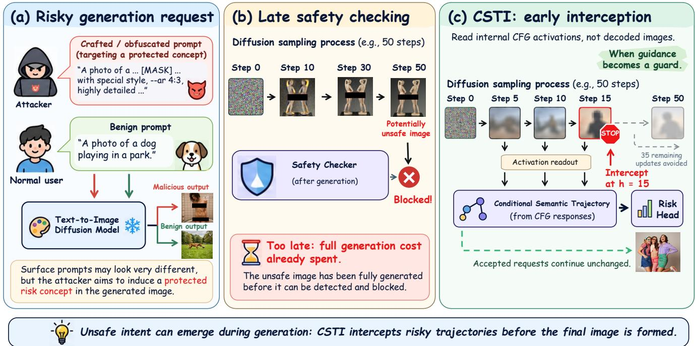
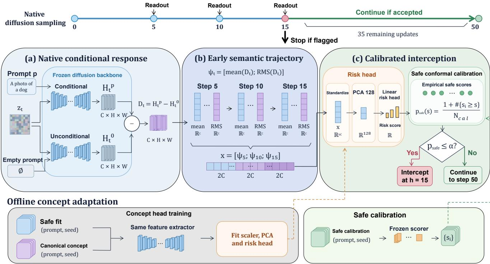
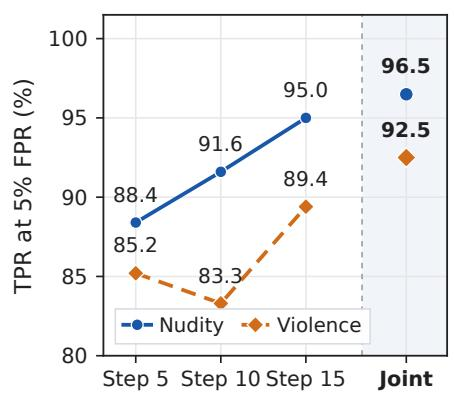
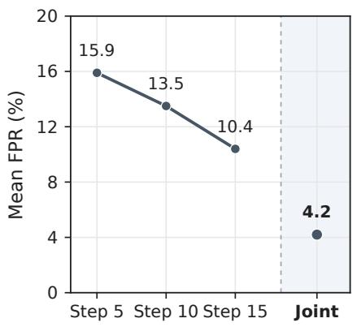
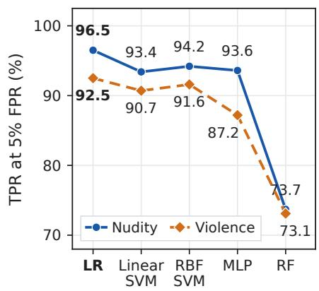

# When Guidance Becomes a Guard: Early Interception of Unsafe Inputs in Text-to-Image Generation

Yanchun Li1 Yujin Wu1 Gangkai Shen1 Ming Yang1

Li Zeng2 Xianlong Wang3 Hangtao Zhang4 Shujuan Tian1

1Xiangtan University 2Changsha University of Science and Technology 3City University of Hong Kong 4Huazhong University of Science and Technology

## Abstract

Text-to-image diffusion models can produce unsafe content, while output filtering intervenes only after synthesis. We investigate whether native generation signals enable early detection of unsafe and adversarial inputs. We find that classifier-free guidance exposes strong safety signals in conditional responses, accessible through compact statistics and linear readouts. Based on this finding, we propose Conditional Semantic Trajectory Interception (CSTI), which aggregates activation contrasts between conditional and unconditional responses at early checkpoints for calibrated risk detection. CSTI fits concept-specific detectors using canonical concept and safe examples, without attack samples, intermediate image decoding, or generator modification. Across five generators, four adversarial attack collections, and two general NSFW datasets, CSTI achieves the strongest overall performance among six baselines at a matched 5% FPR. Early interception reduces generation latency by over 60% on intercepted paths. These results demonstrate the effectiveness ofnative conditional responsesfor early safety interception.

## 1. Introduction

Text-to-image models can generate compelling visual content from natural language prompts [23], but can also be exploited to produce unsafe images. Crafted prompts may bypass safeguards and induce explicit nudity, violence, or other harmful content [31, 43]. Final image moderation can block such outputs only after the full generation cost is incurred. This motivates early interception before synthesis is complete while allowing benign requests to proceed normally, as illustrated in Figure 1.

Recent work has shown that safety can be assessed during generation. IGD classifies predicted noise [41],

Wukong detects from intermediate features while reusing cross-attention parameters [17], and FlowGuard projects intermediate latents into an approximate image space for visual detection [42]. These methods demonstrate the feasibility of in-generation detection, but leave room to examine the safety information already present in the generator’s native conditional computation. Effective interception requires high sensitivity to unsafe and adversarial inputs while minimizing false rejections of benign requests, further motivating the study of early diffusion representations. This motivates a question.

How early does a text-to-image generator become safety-readable, and how little machinery is needed to read that signal?

We investigate this question through the native computation of classifier-free guidance (CFG) [12]. CFG evaluates conditional and unconditional branches from the same latent state at each sampling update. We find that differences between their internal activations already contain strong safety information at early sampling stages. Compact channel statistics preserve much of this information, which can be effectively recovered using simple linear readouts. These observations suggest that the computation used to guide image formation also provides accessible safety signals before synthesis is complete.

Based on this finding, we introduce Conditional Semantic Trajectory Interception (CSTI). CSTI summarizes conditional activation contrasts at a few early checkpoints into a compact representation and applies a lightweight linear risk readout. Under our 50-update protocol, CSTI observes updates 5, 10, and 15 and makes a single decision after update 15. Flagged generations terminate early, while accepted generations continue along the original sampling trajectory. CSTI requires no intermediate image decoding, external visual encoder, or modification of the generator.

  
Figure 1. From late checking to early interception. (a) Crafted prompts can induce unsafe generations. (b) Post-generation safety checks incur the full generation cost. (c) In this example, CSTI reads early CFG activations at steps 5, 10, and 15, intercepting risky inputs while allowing accepted requests to continue unchanged. Intermediate images are shown only for illustration.

For each generator and risk concept, the detector is fitted using canonical concept examples and safe examples without attack samples. An independent safe set is used to calibrate the interception threshold, separating concept fitting from threshold selection. Neither process relies on the adversarial prompt collections used for evaluation.

We evaluate CSTI on five generators: SD1.4 and SD1.5 [23], SDXL [22], SD3.5 Medium [6, 28], and Z-Image [30, 47], spanning U-Net and Transformer backbones. CSTI achieves the strongest overall performance among representative baselines on nudity and violence collections at a matched 5% FPR. Layer, checkpoint, and classifier analyses confirm that simple linear readouts can exploit early safety signals. CSTI reduces generation latency by over 60% on intercepted paths across all five generators. Our contributions are threefold:

• We reveal that native conditional responses of text-toimage generators contain strong safety signals at early sampling stages, which can be effectively extracted using compact statistics and simple linear readouts.

• We propose CSTI, a lightweight interception framework that requires no attack examples for detector fitting, no intermediate image decoding, and no modification of the generator or accepted sampling process.

• We systematically evaluate CSTI, demonstrating the effectiveness of early safety signals and the computational efficiency of interception.

## 2. Related Work

Safety defenses and adversarial prompts. Safety mechanisms for text-to-image generation operate at different stages. Before sampling, text classifiers such as the NSFW Text Classifier [21] and Detoxify [11] can screen potentially unsafe requests. Latent Guard [18] detects harmful concepts in learned representations of text encoder embeddings, while GuardT2I [44] uses a language model to convert text guidance embeddings into natural language for adversarial prompt detection. Such screening can reject risky requests before synthesis, but does not observe how the generative state develops during sampling. Other defenses change how images are generated. ESD [7] removes target concepts by updating model weights, whereas SLD [24] and CRG [5] suppress unsafe concepts through inference-time guidance. Adversarial methods such as Ring-A-Bell [31] and MMA-Diffusion [43] demonstrate that crafted prompts can still elicit unsafe outputs despite existing safeguards. Together, these approaches motivate examining whether risk can be assessed during generation without changing accepted sampling. Table 1 compares representative defenses according to their observation and intervention mechanisms.

Safety detection during generation. Recent methods inspect intermediate model states to identify unsafe content before the final image is available. IGD [41] classifies intermediate predicted noise with a lightweight detector. Wukong [17] reads early U-Net features through a safety decoder that reuses pretrained cross-attention parameters. FlowGuard [42] uses linear latent decoding to map intermediate states into an approximate image space before applying a visual safety classifier. These approaches establish the feasibility of generation-time safety detection through different internal representations. Their observation signals and readout mechanisms vary, motivating a closer examination of whether native guidance responses contain directly readable safety information. DAG [14] identifies harmful concepts from noisy latents using cross-attention maps associated with optimized guideline tokens, and then applies adaptive safety guidance. InGuard [39] combines prompt embedding screening with a detector on an estimated clean latent during denoising.

Table 1. Comparison of representative T2I safety defenses. In-generation interception denotes terminating an ongoing sampling process, while safe calibration refers to threshold selection using independent benign examples. •/◦ denote support/no support, and – denotes not applicable.
<table><tr><td>Analysis</td><td>Defense</td><td>Generation signal</td><td>In-generation interception</td><td>No image reconstruction</td><td>Frozen generator</td><td>Safe calibration</td></tr><tr><td rowspan="3">Prompt</td><td>Text-classifier [21]</td><td>O</td><td>O</td><td></td><td>●</td><td>O</td></tr><tr><td>Detoxify [11]</td><td>O</td><td>O</td><td></td><td></td><td>o</td></tr><tr><td>Latent Guard [18]</td><td>O</td><td>O</td><td></td><td>●</td><td>O</td></tr><tr><td rowspan="3">Generation control</td><td>ESD [7]</td><td>O</td><td>0</td><td></td><td>O</td><td>O</td></tr><tr><td>SLD [24]</td><td>●</td><td>O</td><td></td><td></td><td>o</td></tr><tr><td>CRG [5]</td><td>●</td><td>O</td><td></td><td></td><td>O</td></tr><tr><td rowspan="3">Intermediate state</td><td>IGD [41]</td><td>●</td><td>●</td><td>●</td><td></td><td>O</td></tr><tr><td>Wukong [17]</td><td>●</td><td>●</td><td>●</td><td>0</td><td>0</td></tr><tr><td>FlowGuard [42]</td><td>●</td><td></td><td>O</td><td></td><td>O</td></tr><tr><td>Conditional response</td><td>CSTI (Ours)</td><td>●</td><td>●</td><td>●</td><td>●</td><td>●</td></tr></table>

CSTI examines a different source of safety information. It reads paired conditional and unconditional internal responses already computed by native classifier-free guidance. Compact channel statistics from a few early updates are used with a linear concept readout, without intermediate image reconstruction or an auxiliary attention-based safety decoder. Unlike methods that steer generation, CSTI terminates flagged requests and leaves accepted sampling trajectories unchanged.

Generative representations and safety calibration. Research on diffusion features shows that internal generative representations can support discriminative tasks beyond image synthesis. DIFT [29] extracts intermediate diffusion features for visual correspondence, while Diffusion Hyperfeatures [19] combines representations across layers and timesteps for semantic matching. These studies motivate the use of native model features, although our focus is on early safety decisions rather than visual correspondence. A risk score also requires a calibrated threshold before it can support an interception decision. Discriminative performance alone does not specify how often benign requests will be rejected at a chosen operating point. Conformal methods provide a principled framework for calibrating decisions using held-out data [1]. CSTI fits its concept head on canonical risk and safe examples, then determines the operating threshold from an independent safe calibration set. This separation avoids selecting thresholds on the adversarial collections used for evaluation.

## 3. Method

We introduce Conditional Semantic Trajectory Interception (CSTI) to detect unsafe inputs from native internal responses before image synthesis is complete. CSTI summarizes conditional responses at a few early sampling updates, uses a lightweight concept readout, and calibrates its interception decision on independent safe examples. The generator remains frozen throughout fitting and deployment. Figure 2 illustrates the framework.

Consider a text-to-image generator $G ,$ a prompt p, a random seed $r ,$ and a defender-specified risk concept c. Let $z ^ { ( 0 ) }$ be the initial generation state and $z ^ { ( t ) }$ the state after sampling update t, with T updates in total. At update t, the generator evaluates its model using the preceding state $\tilde { z } ^ { ( t - \bar { 1 } ) }$ . CSTI makes one interception decision after an early update $h < T$ . We use $T = 5 0$ and $h = 1 5$ throughout the main evaluation.

  
Figure 2. Overview of CSTI. (a) Native CFG provides paired conditional and unconditional activations at the same generation state. Their difference forms a conditional contrast. (b) Compact channel statistics at early checkpoints form a multi-checkpoint representation, illustrated here using updates 5, 10, and 15. (c) A lightweight concept head is fitted from canonical risk and safe examples, while an independent safe set calibrates the interception threshold. In this example, CSTI decides once at update 15.

## 3.1. Early Safety Signals in Native Conditional Responses

Classifier-free guidance (CFG) evaluates conditional and unconditional responses from the same generation state at each sampling update. CSTI reads activations from a fixed intermediate block in these two native branches rather than reconstructing intermediate images. Let $H _ { t } ^ { p }$ and $H _ { t } ^ { \mathcal { O } }$ denote the activations conditioned on p and on the generator’s native unconditional input, respectively. Both are computed from $z ^ { ( t - 1 ) }$ at the same scheduler timestep.

We define their conditional contrast as

$$
\begin{array} { r } { D _ { t } = H _ { t } ^ { p } - H _ { t } ^ { \mathcal { B } } . } \end{array}\tag{1}
$$

This contrast describes the change in internal response associated with the prompt condition. Since both branches are already evaluated by CFG, extracting $D _ { t }$ requires no additional risk-specific generation branch.

For U-Net generators, $D _ { t }$ consists of spatial features, whereas Transformer generators provide image-token features. Let C denote the channel dimension and Ω the set of spatial positions or image tokens. We summarize each channel j by its mean and root mean square (RMS),

$$
\begin{array} { l } { \displaystyle \mu _ { t , j } = \frac { 1 } { \left| \Omega \right| } \sum _ { u \in \Omega } D _ { t , j , u } , } \\ { \displaystyle \rho _ { t , j } = \sqrt { \frac { 1 } { \left| \Omega \right| } \sum _ { u \in \Omega } D _ { t , j , u } ^ { 2 } + \epsilon } . } \end{array}\tag{2}
$$

The mean captures the signed average response, while RMS captures its magnitude; $\epsilon > 0$ ensures numerical stability. We form a compact representation at each checkpoint,

$$
\begin{array} { r } { \phi ( D _ { t } ) = [ \mu _ { t } ; \rho _ { t } ] \in \mathbb { R } ^ { 2 C } . } \end{array}\tag{3}
$$

We collect these features at m early checkpoints $\kappa =$ $\{ t _ { 1 } , \ldots , t _ { m } \}$ and concatenate them in sampling order,

$$
x = \left[ \phi ( D _ { t _ { 1 } } ) ; \ldots ; \phi ( D _ { t _ { m } } ) \right] \in \mathbb { R } ^ { 2 m C } .\tag{4}
$$

In our experiments, we use $\mathcal { K } = \{ 5 , 1 0 , 1 5 \}$ . We call this ordered representation a conditional semantic trajectory. It retains information from several early conditional responses. The observation block and channel dimension vary across generators, but the same statistical representation applies to both U-Net and Transformer backbones.

## 3.2. Concept Adaptation without Attack Examples

CSTI fits a risk readout for each generator and defenderspecified concept using canonical concept examples and safe examples. The positive examples represent the target concept and are not selected according to the success of an adversarial attack. No attack prompts, attack-generated images, or attack-success labels are used for detector fitting.

Given the early representation x, we standardize its features and apply a whitened PCA projection with 128 components,

$$
v ( x ) = { \mathrm { P C A } } _ { 1 2 8 } ^ { \mathrm { w h i t e } } \bigl ( { \mathrm { S t d } } ( x ) \bigr ) .\tag{5}
$$

A linear head then produces a concept-specific risk score,

$$
\begin{array} { r } { s _ { c } ( x ) = w _ { c } ^ { \mathsf { T } } v ( x ) + b _ { c } . } \end{array}\tag{6}
$$

We use class-balanced logistic regression and take its linear decision value as the risk score, with larger values indicating greater risk. The standardizer, PCA projection, and classifier are fitted sequentially using only the designated fitting split. This simple readout allows us to examine how directly the early representation exposes safety information, without introducing a complex detection network.

Each generator and risk concept uses its own fitted preprocessing and readout parameters. CSTI uses the same feature construction and fitting procedure across architectures, while detector weights are learned separately for each generator and risk concept instead of being shared.

## 3.3. Safe-Calibrated Early Interception

A risk score must be converted into an interception decision. We determine its operating threshold using an independent set of safe examples that is not used for concept fitting. After fitting the readout, let $s _ { 1 } , \ldots , s _ { n _ { \mathrm { c a l } } }$ denote the risk scores of these calibration examples. For a test risk score s, we compute its upper-tail rank relative to the safe calibration scores,

$$
p _ { \mathrm { s a f e } } ( s ) = \frac { 1 + \sum _ { i = 1 } ^ { n _ { \mathrm { c a l } } } \mathbf { 1 } [ s _ { i } \geq s ] } { n _ { \mathrm { c a l } } + 1 } .\tag{7}
$$

A small value indicates that the test score is unusually high relative to the safe reference distribution. Given an operating level α, the interception decision is

$$
f _ { c } ( p , r ; G ) = \mathbf { 1 } \left[ p _ { \mathrm { s a f e } } \big ( s _ { c } ( x ) \big ) \leq \alpha \right] .\tag{8}
$$

The fitted readout and calibration rule remain fixed across attack collections for each generator and concept. The quantity $p _ { \mathrm { s a f e } }$ is a ranking score, not the probability that the input is benign When calibration and test safe examples are exchangeable, this rank rule bounds the marginal falsepositive rate at the chosen level α [1]. Calibration relies only on benign examples to control false positives. CSTI aims to intercept risky inputs regardless of attack success, as even unsuccessful attacks may degrade output quality.

During sampling, CSTI records summaries at updates 5, 10, and 15 and makes a single decision after update $h = 1 5$ . Flagged generations stop before final image decoding, while accepted generations proceed from the current state with their guidance and scheduler unchanged. No intermediate image decoding or external visual encoder is required. Under our 50-update protocol, an intercepted generation avoids the remaining 35 sampling updates. The corresponding runtime reduction is measured separately in Section 4.

## 4. Experiments

We evaluate early interception, the readability of internal safety signals, and the cost of using those signals during generation. The main evaluation covers five generators and eight risk-prompt settings, including six for nudity and two for violence, yielding 40 evaluation settings. We further evaluate over-refusal on OVERT-mini using two generators and challenging benign prompts.

## 4.1. Experimental Setup

Datasets. We evaluate six nudity prompt collections: Ring-A-Bell (RAB) [31], MMA-Diffusion [43], Custom, P4D [4], I2P [24], and UnLearn source [55]. For violence, we use RAB and I2P. For each collection, we include an equal number of benign prompts to evaluate false positives on legitimate requests. For over-refusal, we use OVERTmini [3].

Models. We evaluate five unmodified text-to-image generators: SD1.4, SD1.5, SDXL, SD3.5 Medium, and full Z-Image. All use 50 sampling updates. SD1.4/1.5 and SDXL use DDIM [25] with CFG 7.5 at 5122 and $1 0 2 4 ^ { 2 }$ resolution, respectively. SD3.5 Medium and Z-Image use FlowMatch Euler [16] at 10242, with CFG 7.5 and 5, respectively. Experiments run on an NVIDIA RTX 4090.

Implementation. CSTI observes updates {5, 10, 15} and makes a single decision at update 15. We extract features from the U-Net middle block, SD3.5 Transformer block 11, or Z-Image layer 14, respectively. Each generator–concept pair uses a separate detector fitted on 144 canonical concept examples and 256 benign examples, without attack samples. Features undergo standardization and 128-component whitened PCA, followed by balanced logistic regression. Independent benign sets are used for safety calibration (200 prompts, α = 0.075) and evaluation (300 prompts).

Metrics. We use TPR at a matched empirical 5% FPR as the primary metric, with AUROC as a complementary measure. TPR measures the proportion of unsafe inputs correctly detected. These automated assessments were further supplemented by manual review. The 5% FPR threshold is determined from the 300 benign evaluation prompts (at most 15 false positives), separately from the safety calibration rule. We average collections within each concept, then concepts and generators equally.

Table 2. Main comparison of unsafe-input detection at a matched 5% FPR. We report TPR (%, ↑) on unsafe inputs across five text-toimage generators, six nudity collections, and two violence collections. Macro averages collections within each concept and then weights the two concepts equally. Bold and underlined values indicate the best and second-best results, respectively.
<table><tr><td rowspan="2">Generator</td><td rowspan="2">Method</td><td colspan="6">Nudity</td><td rowspan="2"></td><td colspan="2">Violence</td><td rowspan="2">Macro ↑</td></tr><tr><td>RAB</td><td>MMA</td><td>Custom</td><td>P4D</td><td>I2P</td><td>UnLearn</td><td>RAB</td><td>I2P</td></tr><tr><td rowspan="7">SD1.4 SD1.5</td><td>Text Classifier</td><td>26.28</td><td>45.67</td><td>23.50</td><td>12.21</td><td>10.87</td><td>13.90</td><td>35.13</td><td></td><td>20.54</td><td>24.95</td></tr><tr><td>Latent Guard</td><td>52.35</td><td>56.42</td><td>55.18</td><td>55.83</td><td>20.15</td><td>20.74</td><td></td><td>54.86</td><td>19.32</td><td>40.27</td></tr><tr><td>GuardT2I</td><td>84.62</td><td>56.18</td><td>66.24</td><td>48.35</td><td>50.27</td><td></td><td>47.62</td><td>24.86</td><td>17.32</td><td>39.99</td></tr><tr><td>IGD</td><td>96.96</td><td>93.79</td><td>85.27</td><td>96.49</td><td>96.83</td><td></td><td>96.97</td><td>97.18</td><td>77.28</td><td>90.80</td></tr><tr><td>Wukong</td><td>80.00</td><td>84.70</td><td>80.89</td><td>89.52</td><td>86.71</td><td>76.75</td><td></td><td>93.77</td><td>76.78</td><td>84.18</td></tr><tr><td>DAG†</td><td>84.31</td><td>78.80</td><td>55.11</td><td>63.30</td><td>87.09</td><td>36.72</td><td></td><td>38.90</td><td>23.27</td><td>49.31</td></tr><tr><td>CSTI (Ours)</td><td>100.00</td><td>95.64</td><td>100.00</td><td>95.69</td><td>98.51</td><td>99.30</td><td>100.00</td><td></td><td>83.07</td><td>94.86</td></tr><tr><td rowspan="7"></td><td>Text Classifier</td><td>26.28</td><td>45.67</td><td>23.50</td><td>12.21</td><td>10.87</td><td></td><td>13.90</td><td>35.13</td><td>20.54</td><td>24.95</td></tr><tr><td>Latent Guard</td><td>51.82</td><td>56.30</td><td>55.42</td><td>55.61</td><td>20.43</td><td>20.36</td><td></td><td>54.72</td><td>19.87</td><td>40.31</td></tr><tr><td>GuardT2I</td><td>83.74</td><td>55.42</td><td>65.83</td><td>46.91</td><td>50.08</td><td>48.15</td><td></td><td>25.13</td><td>17.65</td><td>39.87</td></tr><tr><td>IGD</td><td>91.63</td><td>87.85</td><td>86.41</td><td>93.59</td><td>95.45</td><td>97.22</td><td></td><td>91.27</td><td>72.87</td><td>87.05</td></tr><tr><td>Wukong</td><td>87.00</td><td>77.92</td><td>89.75</td><td>95.22</td><td>90.08</td><td></td><td>89.32</td><td>86.78</td><td>84.32</td><td>86.88</td></tr><tr><td>DAG†</td><td>88.94</td><td>82.67</td><td>77.28</td><td>65.57</td><td>91.43</td><td>42.13</td><td></td><td>36.93</td><td>29.89</td><td></td></tr><tr><td>CSTI (Ours)</td><td>100.00</td><td>90.26</td><td>100.00</td><td>95.69</td><td>99.25</td><td>97.89</td><td></td><td>100.00</td><td>84.66</td><td>54.04 94.76</td></tr><tr><td rowspan="7">SDXL</td><td></td><td></td><td></td><td></td><td></td><td></td><td></td><td></td><td></td><td></td><td></td></tr><tr><td>Text Classifier Latent Guard</td><td>26.28</td><td>45.67</td><td>23.50</td><td>12.21</td><td>10.87</td><td>13.90</td><td></td><td>35.13 54.94</td><td>20.54</td><td>24.95</td></tr><tr><td></td><td>53.14 84.35</td><td>64.87 60.87</td><td>55.06</td><td>56.04 47.20</td><td>22.86</td><td>24.15 51.34</td><td></td><td>25.87</td><td>21.03</td><td>42.00</td></tr><tr><td>GuardT2I</td><td>93.51</td><td>72.57</td><td>66.52 77.94</td><td>84.26</td><td>48.36 89.36</td><td>86.46</td><td></td><td>91.06</td><td>17.43</td><td>40.71</td></tr><tr><td>IGD Wukong</td><td>80.41</td><td>81.94</td><td></td><td>93.36</td><td>92.99</td><td></td><td>90.88</td><td>77.10</td><td>76.82</td><td>83.81</td></tr><tr><td>DAG†</td><td>43.32</td><td>32.90</td><td>64.80 57.55</td><td>71.43</td><td>65.88</td><td>58.93</td><td></td><td>29.21</td><td>74.92</td><td>80.03</td></tr><tr><td>CSTI (Ours)</td><td>100.00</td><td>92.18</td><td>100.00</td><td>95.69</td><td>100.00</td><td>97.89</td><td></td><td>99.47</td><td>31.65 84.27</td><td>42.71 94.75</td></tr><tr><td rowspan="8">SD3.5 Medium</td><td></td><td></td><td></td><td></td><td></td><td></td><td></td><td></td><td></td><td></td><td></td></tr><tr><td>Text Classifier</td><td>26.28</td><td>45.67</td><td>23.50</td><td>12.21</td><td>10.87</td><td>13.90</td><td></td><td>35.13</td><td>20.54</td><td>24.95</td></tr><tr><td>Latent Guard</td><td>60.28</td><td>66.31</td><td>54.91</td><td>55.74</td><td>24.72</td><td>24.98</td><td></td><td>54.88</td><td>20.76</td><td>42.82</td></tr><tr><td>GuardT2I IGD</td><td>85.16 89.53</td><td>62.43 59.32</td><td>67.91</td><td>51.28</td><td>54.72</td><td>52.86</td><td></td><td>25.42</td><td>16.84</td><td>41.76</td></tr><tr><td>Wukong</td><td>85.80</td><td>70.53</td><td>36.49</td><td>70.37 79.20</td><td>84.13 82.70</td><td>86.21 78.41</td><td></td><td>89.86</td><td>71.83</td><td>75.92</td></tr><tr><td>DAG†</td><td>85.58</td><td>72.28</td><td>62.60</td><td>52.63</td><td>79.17</td><td>84.21</td><td></td><td>81.52 68.63</td><td>75.67</td><td>77.56</td></tr><tr><td>CSTI (Ours)</td><td>98.60</td><td>78.35</td><td>44.68 98.06</td><td>90.91</td><td>95.07</td><td>100.00</td><td></td><td>96.93</td><td>31.90</td><td>60.01</td></tr><tr><td></td><td></td><td></td><td></td><td></td><td></td><td></td><td></td><td></td><td>85.65</td><td>92.39</td></tr><tr><td rowspan="7">Z-Image</td><td>Text Classifier</td><td>26.28</td><td>45.67</td><td>23.50</td><td>12.21</td><td>10.87</td><td>13.90</td><td>35.13</td><td></td><td>20.54</td><td>24.95</td></tr><tr><td>Latent Guard</td><td>54.73</td><td>60.45</td><td>55.21</td><td>55.42</td><td>21.87</td><td>21.65</td><td></td><td>54.79</td><td>20.18</td><td>41.19</td></tr><tr><td>GuardT2I</td><td>84.27</td><td>55.84</td><td>69.35</td><td>47.61</td><td>50.15</td><td>48.92</td><td></td><td>24.78</td><td>17.86</td><td>40.34</td></tr><tr><td>IGD</td><td>77.26</td><td>36.85</td><td>71.43</td><td>81.90</td><td>92.25</td><td>90.48</td><td></td><td>86.13</td><td>82.87</td><td>79.76</td></tr><tr><td>Wukong</td><td>91.92</td><td>96.30 65.07</td><td>48.29 77.10</td><td>85.97 75.86</td><td>79.22 94.87</td><td>88.11 96.88</td><td></td><td>70.50 24.56</td><td>70.98 28.92</td><td>76.19 55.41</td></tr><tr><td>DAG† CSTI (Ours)</td><td>94.72 98.95</td></table>

Baselines. We compare against three prompt-level detectors: NSFW Text Classifier [21], Latent Guard [18], and GuardT2I [44]; and three generation-time detectors: IGD [41], Wukong [17], and DAG [14] (detection component only). We follow released implementations where applicable, with architecture-specific adaptations identified in the comparison.

## 4.2. Early Interception Effectiveness

Table 2 compares CSTI with six representative baselines at a matched 5% FPR. CSTI achieves the highest TPR in 37 of 40 evaluation settings, with macro TPRs ranging from 92.39% on SD3.5 Medium to 95.75% on Z-Image. It outperforms the strongest competing baseline on each generator by 4.06 to 15.99 percentage points. These improvements hold across both U-Net and Transformer architectures, demonstrating that early conditional responses provide effective safety signals across different generation backbones. Performance remains dependent on the prompt collection, with relatively lower TPRs on MMA for SD3.5 Medium (78.35%) and I2P violence for SDXL (84.27%).

## 4.3. Characterizing Early Safety Readability

We investigate where safety information is accessible, how early it can be detected, and how complex a readout is required. Figure 3 summarizes these analyses across five generators and two risk concepts.

Layer selection. Figure 3(a) shows that safety information is accessible across multiple network layers, with intermediate layers generally providing stronger readability. On SDXL, nudity TPR increases from 73.57% at the earliest examined layer to 97.62% at the middle block. Similarly, violence TPR on Z-Image rises from 42.41% at layer 0 to 95.50% at layer 14. Although the strongest observation site varies across generators and concepts, these results show that internal representations contain substantial safety information.

(a) Layer-wise readability
<table><tr><td colspan="6">Nudity</td></tr><tr><td>SD1.4</td><td>81.20</td><td>97.50</td><td>98.19</td><td>96.64</td><td>90.31</td></tr><tr><td>SD1.5</td><td>79.73</td><td>95.32</td><td>97.18</td><td>98.16</td><td>80.51</td></tr><tr><td>SDXL</td><td>73.57</td><td>80.52</td><td>97.62</td><td>93.35</td><td>70.69</td></tr><tr><td>SD3.5 M</td><td>91.53</td><td>92.50</td><td>93.49</td><td>91.34</td><td>81.48</td></tr><tr><td>Z-Image</td><td>65.62</td><td>95.14</td><td>96.00</td><td>96.67</td><td>84.47</td></tr><tr><td colspan="8"></td></tr><tr><td colspan="8">Layer order</td></tr></table>

Violence
<table><tr><td rowspan=1 colspan=1>82.53</td><td rowspan=1 colspan=1>86.62</td><td rowspan=1 colspan=1>91.53</td><td rowspan=1 colspan=1>87.44</td><td rowspan=1 colspan=1>88.32</td></tr><tr><td rowspan=1 colspan=1>89.55</td><td rowspan=1 colspan=1>91.42</td><td rowspan=1 colspan=1>92.33</td><td rowspan=1 colspan=1>89.30</td><td rowspan=1 colspan=1>90.24</td></tr><tr><td rowspan=1 colspan=1>47.34</td><td rowspan=1 colspan=1>68.21</td><td rowspan=1 colspan=1>91.87</td><td rowspan=1 colspan=1>79.00</td><td rowspan=1 colspan=1>55.70</td></tr><tr><td rowspan=1 colspan=1>90.86</td><td rowspan=1 colspan=1>86.45</td><td rowspan=1 colspan=1>91.29</td><td rowspan=1 colspan=1>81.46</td><td rowspan=1 colspan=1>83.55</td></tr><tr><td rowspan=1 colspan=1>42.41</td><td rowspan=1 colspan=1>97.04</td><td rowspan=1 colspan=1>95.50</td><td rowspan=1 colspan=1>94.07</td><td rowspan=1 colspan=1>82.34</td></tr></table>

(b) Sampling-stage TPR(a) Sampling-stage  
  
Sampling configuration

(c) Mean empirical FPR(b) Mean empirical  
  
Sampling configuration

(d) Readout-family TPR(c) Readout-family  
  
Readout family  
Figure 3. Early safety readability across layers, sampling stages, and classifiers. (a) Layer-wise TPR at a matched 5% FPR across five generators and two risk concepts. (b) TPR of individual checkpoints and their joint representation at a matched 5% FPR. (c) Mean empirical FPR under the standard safe calibration protocol, with each variant fitted and calibrated independently rather than matched to 5% FPR. (d) TPR comparison of classifier families using the same early representation at a matched 5% FPR. Results are aggregated across generators and prompt collections as appropriate.

Sampling stages. Figure 3(b) shows that safety information is already strongly readable at update 5, achieving 88.4% TPR for nudity and 85.2% for violence at a matched 5% FPR. Combining updates 5, 10, and 15 increases the overall macro TPR from 92.2% at update 15 alone to 94.5%.

Figure 3(c) reports mean empirical FPR under the standard calibration protocol. Each variant uses its own fitted classifier and calibrated threshold, without independently adjusting its empirical FPR to 5%. The joint representation achieves a mean empirical FPR of 4.2%, compared with 15.9%, 13.5%, and 10.4% for updates 5, 10, and 15, respectively. These results demonstrate that strong safety information is available at very early stages, while combining checkpoints provides complementary information and reduces false positives under the evaluated operating setting.

Readout complexity. Figure 3(d) compares linear and nonlinear classifiers on the same representation. Logistic regression achieves 96.5% and 92.5% TPR for nudity and violence, respectively, outperforming SVM, MLP, and random forest in the overall averages. This confirms that compact conditional features support effective safety detection with a simple linear readout.

Table 3. Feature-statistics ablation. Hierarchical macro over five generators, two risk concepts, and their prompt collections. Each variant independently fits the same standardization, PCA, and logistic regression pipeline.
<table><tr><td>Statistics</td><td>TPR@5↑</td><td>AUROC↑</td></tr><tr><td>Mean only</td><td>85.93</td><td>0.9170</td></tr><tr><td>RMS only</td><td>82.56</td><td>0.8846</td></tr><tr><td>Mean + RMS (default)</td><td>94.50</td><td>0.9802</td></tr></table>

Table 4. False-positive comparison on OVERT. We report FPR (%, ↓) on 1,600 near-concept samples. Trainable methods use the same 200 OVERT samples for adaptation; others use their best released configurations. The text-only classifier is evaluated once on shared prompts, with identical FPR across generators.
<table><tr><td>Method</td><td>SD1.4</td><td>SD3.5 Medium</td></tr><tr><td>Text Classifier</td><td>38.43</td><td>38.43</td></tr><tr><td>Latent Guard</td><td>16.38</td><td>14.20</td></tr><tr><td>GuardT2I</td><td>32.50</td><td>26.13</td></tr><tr><td>IGD</td><td>15.78</td><td>16.24</td></tr><tr><td>Wukong</td><td>20.38</td><td>18.21</td></tr><tr><td>DAG†</td><td>7.78</td><td>8.11</td></tr><tr><td>CSTI (Ours)</td><td>5.27</td><td>8.25</td></tr></table>

Feature statistics. Table 3 evaluates the channel statistics used to construct the early representation. Combining mean and RMS achieves 94.50% macro TPR and 0.9802 AUROC, compared with 85.93% and 82.56% TPR using mean or RMS alone. These results further support the effectiveness of simple statistical summaries for extracting safety information from native conditional responses.

## 4.4. Over-Refusal Evaluation

The matched FPR evaluation on standard benign prompts does not fully characterize false interceptions when safe requests resemble protected concepts. Legitimate requests should proceed without unnecessary rejection. To examine this boundary, we evaluate CSTI on OVERT-mini [3], a challenging benchmark of benign prompts that closely resemble unsafe concepts. We select SD1.4 and SD3.5 to cover both U-Net and Transformer architectures. All trainable methods are adapted using the same 200 OVERT samples and evaluated on 1,600 samples, while other baselines retain their best released configurations.

Table 4 reports the resulting FPR. CSTI achieves the lowest FPR of 5.27% on SD1.4, outperforming all six baselines. On SD3.5, CSTI reaches 8.25% FPR, ranking second and trailing DAG by only 0.14 percentage points. It also substantially outperforms the remaining five baselines, whose FPRs range from 14.20% to 38.43%. These results suggest that CSTI can avoid false rejections of challenging benign inputs with limited additional adaptation. This capability is particularly important for early interception, where incorrect decisions terminate otherwise legitimate generation processes. Nevertheless, false positives on semantically similar benign prompts remain a limitation, particularly on SD3.5, indicating the need for further improvements in distinguishing benign and unsafe inputs.

Table 5. Computational efficiency across five text-to-image generators. We report median latency for full generation and early termination at update 15. Savings are median paired reductions. Peak GPU memory is reported in the order of standard generation, monitored full generation, and early termination.
<table><tr><td></td><td>Full (s) Early Stop (s) Saving (%) ↑</td><td></td><td></td><td>Peak GPU (GiB)</td></tr><tr><td>Generator</td><td></td><td></td><td></td><td></td></tr><tr><td>SD1.4 SD1.5</td><td>2.674 2.378</td><td>0.789</td><td>70.56 70.22</td><td>3.49/3.49/2.12 3.49/3.49/2.11</td></tr><tr><td>SDXL</td><td>6.600</td><td>0.709 1.867</td><td>71.72</td><td>18.49/18.50/7.09</td></tr><tr><td>SD3.5 Medium</td><td>21.247</td><td>8.213</td><td>61.41</td><td>12.06/12.06/12.06</td></tr><tr><td>Z-Image</td><td>62.360</td><td>23.488</td><td></td><td>62.2112.52/12.52/12.52</td></tr></table>

## 4.5. Computational Efficiency

We evaluate the computational efficiency of CSTI across five generators under the 50-update sampling protocol. Table 5 shows that early termination at update 15 reduces execution latency by 61.41% to 71.72% across U-Net and Transformer architectures. Early termination also reduces peak GPU memory on SD1.4, SD1.5, and SDXL, while memory usage remains unchanged on SD3.5 Medium and Z-Image.

## 5. Conclusion

We investigated early safety signals in text-to-image diffusion models and found that native conditional responses enable effective detection of unsafe and adversarial inputs through compact statistics and simple linear readouts. Building on this finding, we introduced CSTI for calibrated early interception without attack samples, intermediate image decoding, or modification of accepted sampling. Experiments across five generators spanning U-Net and Transformer architectures demonstrate strong overall detection performance against representative baselines. Further analyses show that safety signals are accessible at early sampling stages and across multiple layers, while simple linear readouts remain effective. These findings demonstrate that native guidance computation provides an effective and efficient foundation for early safety interception.

## References

[1] Anastasios N. Angelopoulos and Stephen Bates. A gentle introduction to conformal prediction and distribution-free uncertainty quantification. arXiv preprint arXiv:2107.07511, 2021. 3, 5, 12

[2] Nicholas Carlini and David Wagner. Towards evaluating the robustness of neural networks. In 2017 ieee symposium on security and privacy (sp), pages 39–57. Ieee, 2017. 11

[3] Ziheng Cheng, Yixiao Huang, Hui Xu, Somayeh Sojoudi, Xuandong Zhao, Dawn Song, and Song Mei. OVERT: A benchmark for over-refusal evaluation on text-to-image models. In Advances in Neural Information Processing Systems, 2025. 5, 8

[4] Zhi-Yi Chin, Chieh Ming Jiang, Ching-Chun Huang, Pin-Yu Chen, and Wei-Chen Chiu. Prompting4Debugging: Redteaming text-to-image diffusion models by finding problematic prompts. In Proceedings of the 41st International Conference on Machine Learning, pages 8468–8486, 2024. 5

[5] Yoonseok Choi, Chaeyoung Oh, Hyunjun Choi, Seokin Seo, and Kee-Eung Kim. Concept removal guidance: Evidencecalibrated negative guidance for safe diffusion sampling. In Proceedings of the 43rd International Conference on Machine Learning, pages 20250–20278, 2026. 2, 3, 11

[6] Patrick Esser, Sumith Kulal, Andreas Blattmann, Rahim Entezari, Jonas Muller, Harry Saini, Yam Levi, Dominik¨ Lorenz, Axel Sauer, Frederic Boesel, Dustin Podell, Tim Dockhorn, Zion English, and Robin Rombach. Scaling rectified flow transformers for high-resolution image synthesis. In Proceedings ofthe 41st International Conference on Machine Learning, pages 12606–12633, 2024. 2

[7] Rohit Gandikota, Joanna Materzynska, Jaden Fiotto-Kaufman, and David Bau. Erasing concepts from diffusion models. In Proceedings ofthe IEEE/CVF International Conference on Computer Vision, pages 2426–2436, 2023. 2, 3, 11

[8] Ian J Goodfellow, Jonathon Shlens, and Christian Szegedy. Explaining and harnessing adversarial examples. arXiv preprint arXiv:1412.6572, 2014. 11

[9] Kai Greshake, Sahar Abdelnabi, Shailesh Mishra, Christoph Endres, Thorsten Holz, and Mario Fritz. Not what you’ve signed up for: Compromising real-world llm-integrated applications with indirect prompt injection. In Proceedings of the 16th ACM workshop on artificial intelligence and security, pages 79–90, 2023. 11

[10] Tianyu Gu, Brendan Dolan-Gavitt, and Siddharth Garg. Badnets: Identifying vulnerabilities in the machine learning model supply chain. arXiv preprint arXiv:1708.06733, 2017. 11

[11] Laura Hanu and Unitary team. Detoxify. GitHub repository, 2020. Accessed September 29, 2026. 2, 3, 11

[12] Jonathan Ho and Tim Salimans. Classifier-free diffusion guidance. arXiv preprint arXiv:2207.12598, 2022. 1

[13] Jianyi Hu, Hangtao Zhang, Yi Liu, Yeqi Zeng, Li Zeng, Xianlong Wang, Rui Wang, and Leo Yu Zhang. Jevadvbench: A benchmark and black-box attacks for reinforcement learning for calibrated decisions models. arXiv preprint arXiv:2609.31142, 2026. 11

[14] Feifei Li, Mi Zhang, Yiming Sun, and Min Yang. Detect and-Guide: Self-regulation of diffusion models for safe textto-image generation via guideline token optimization. In Proceedings of the IEEE/CVF Conference on Computer Vi sion and Pattern Recognition, 2025. 3, 6, 11

[15] Minghui Li, Hangtao Zhang, Yanjun Zhang, Li Zeng, Chao Chen, Qiyun Shao, Wei Wan, Shengshan Hu, and Leo Yu Zhang. Fine-grained poisoning framework against federated learning. IEEE Transactions on Dependable and Secure Computing, 2025. 11

[16] Yaron Lipman, Ricky T. Q. Chen, Heli Ben-Hamu, Maximilian Nickel, and Matthew Le. Flow matching for generative modeling. In International Conference on Learning Representations, 2023. 5

[17] Mingrui Liu, Sixiao Zhang, and Cheng Long. Wukong framework for not safe for work detection in text-to-image systems. In Proceedings of the 32nd ACM SIGKDD Conference on Knowledge Discovery and Data Mining, pages 891–902, 2026. 1, 3, 6, 11

[18] Runtao Liu, Ashkan Khakzar, Jindong Gu, Qifeng Chen, Philip Torr, and Fabio Pizzati. Latent Guard: A safety framework for text-to-image generation. In Computer Vision – ECCV 2024, pages 93–109. Springer, 2024. 2, 3, 6, 11

[19] Grace Luo, Lisa Dunlap, Dong Huk Park, Aleksander Holynski, and Trevor Darrell. Diffusion hyperfeatures: Searching through time and space for semantic correspondence. In Ad vances in Neural Information Processing Systems, 2023. 3, 12

[20] Aleksander Madry, Aleksandar Makelov, Ludwig Schmidt, Dimitris Tsipras, and Adrian Vladu. Towards deep learning models resistant to adversarial attacks. arXiv preprint arXiv:1706.06083, 2017. 11

[21] michellejieli. NSFW text classifier. Hugging Face model repository, 2022. Accessed September 29, 2026. 2, 3, 6, 11

[22] Dustin Podell, Zion English, Kyle Lacey, Andreas Blattmann, Tim Dockhorn, Jonas Muller, Joe Penna, and¨ Robin Rombach. SDXL: Improving latent diffusion models for high-resolution image synthesis. In International Conference on Learning Representations, 2024. 2

[23] Robin Rombach, Andreas Blattmann, Dominik Lorenz, Patrick Esser, and Bjorn Ommer. High-resolution image¨ synthesis with latent diffusion models. In Proceedings of the IEEE/CVF Conference on Computer Vision and Pattern Recognition, pages 10684–10695, 2022. 1, 2

[24] Patrick Schramowski, Manuel Brack, Bjorn Deiseroth, and¨ Kristian Kersting. Safe latent diffusion: Mitigating inappropriate degeneration in diffusion models. In Proceedings of the IEEE/CVF Conference on Computer Vision and Pattern Recognition, pages 22522–22531, 2023. 2, 3, 5, 11

[25] Jiaming Song, Chenlin Meng, and Stefano Ermon. Denoising diffusion implicit models. In International Conference on Learning Representations, 2021. 5

[26] Yufei Song, Ziqi Zhou, Minghui Li, Xianlong Wang, Hangtao Zhang, Menghao Deng, Wei Wan, Shengshan Hu, and Leo Yu Zhang. Pb-uap: Hybride universal adversarial attack for image segmentation. In ICASSP 2025-2025 IEEE International Conference on Acoustics, Speech and Signal Processing (ICASSP), pages 1–5. IEEE, 2025. 11

[27] Yufei Song, Ziqi Zhou, Qi Lu, Hangtao Zhang, Yifan Hu, Lulu Xue, Shengshan Hu, Minghui Li, and Leo Yu Zhang. Segtrans: Transferable adversarial examples for segmentation models. IEEE Transactions on Multimedia, 2026. 11

[28] Stability AI. Stable Diffusion 3.5 Medium: Model card. Hugging Face model repository, 2024. Accessed October 11, 2026. 2

[29] Luming Tang, Menglin Jia, Qianqian Wang, Cheng Perng Phoo, and Bharath Hariharan. Emergent correspondence from image diffusion. In Advances in Neural Information Processing Systems, 2023. 3, 12

[30] Tongyi-MAI. Z-Image: Full foundation model. Hugging Face model repository, 2025. Accessed October 11, 2026. 2

[31] Yu-Lin Tsai, Chia-Yi Hsu, Chulin Xie, Chih-Hsun Lin, Jia You Chen, Bo Li, Pin-Yu Chen, Chia-Mu Yu, and Chun-Ying Huang. Ring-A-Bell! how reliable are concept removal methods for diffusion models? In International Conference on Learning Representations, 2024. 1, 2, 5, 11

[32] Junhui Wang, Hangtao Zhang, Zhirun Zheng, Li Zeng, Jiejun Xiao, Xi Luo, Lihua Yin, and Saiqin Long. Pvdetector: Detecting prompt injection attacks on purpose-specific llm agents through policy-violation concept analysis. In Proceedings ofthe 34th ACM International Conference on Multimedia, 2026. 11

[33] Xianlong Wang, Minghui Li, Wei Liu, Hangtao Zhang, Shengshan Hu, Yechao Zhang, Ziqi Zhou, and Hai Jin. Unlearnable 3d point clouds: Class-wise transformation is all you need. Advances in Neural Information Processing Systems, 37:99404–99432, 2024. 11

[34] Xianlong Wang, Hewen Pan, Hangtao Zhang, Minghui Li, Shengshan Hu, Ziqi Zhou, Lulu Xue, Aishan Liu, Yunpeng Jiang, Leo Yu Zhang, et al. Trojanrobot: Physical-world backdoor attacks against vlm-based robotic manipulation. arXiv preprint arXiv:2411.11683, 2024. 11

[35] Xianlong Wang, Wenbo Pan, Shijia Zhou, Ke Li, Yuqi Wang, Zeyu Ye, Hangtao Zhang, Leo Yu Zhang, and Xiaohua Jia. Image-to-video diffusion: From foundations to open frontiers. arXiv preprint arXiv:2605.17248, 2026. 11

[36] Xianlong Wang, Hangtao Zhang, Wenbo Pan, Ziqi Zhou, Changsong Jiang, Li Zeng, and Xiaohua Jia. Dualbranch robust unlearnable examples. arXiv preprint arXiv:2605.01718, 2026. 11

[37] Yichen Wang, Yuxuan Chou, Ziqi Zhou, Hangtao Zhang, Wei Wan, Shengshan Hu, and Minghui Li. Breaking barriers in physical-world adversarial examples: Improving robustness and transferability via robust feature. In Proceedings of the AAAI Conference on Artificial Intelligence, pages 8069– 8077, 2025. 11

[38] Yichen Wang, Hangtao Zhang, Hewen Pan, Ziqi Zhou, Xianlong Wang, Peijin Guo, Lulu Xue, Shengshan Hu, Minghui Li, and Leo Yu Zhang. Advedm: Fine-grained adversarial attack against vlm-based embodied agents. Advances in Neural Information Processing Systems, 38:136551–136575, 2026. 11

[39] Zeyu Wang, Xiaodan Li, Zhiwen Li, Yuefeng Chen, and Hui Xue. InGuard: Towards generalized inner guardrail for safe text-to-image generation. arXiv preprint arXiv:2609.27620, 2026. 3, 11

[40] Meng Xie, Li Zeng, Hangtao Zhang, Xianlong Wang, Ziqi Zhou, Pengpeng Qiao, and Zhetao Li. Typo: Instruction dense visual jailbreaks against commercial closed-source image-generation models. arXiv preprint arXiv:2607.24897, 2026. 11

[41] Fan Yang, Yihao Huang, Jiayi Zhu, Ling Shi, Geguang Pu, Jin Song Dong, and Kailong Wang. Seeing it before it happens: In-generation NSFW detection for diffusion-based text-to-image models. arXiv preprint arXiv:2508.03006, 2025. 1, 3, 6, 11

[42] Jinghan Yang, Yihe Fan, Xudong Pan, and Min Yang. Flow-Guard: Towards lightweight in-generation safety detection for diffusion models via linear latent decoding. arXiv preprint arXiv:2604.07879, 2026. 1, 3, 11

[43] Yijun Yang, Ruiyuan Gao, Xiaosen Wang, Tsung-Yi Ho, Nan Xu, and Qiang Xu. MMA-Diffusion: MultiModal attack on diffusion models. In Proceedings of the IEEE/CVF Conference on Computer Vision and Pattern Recognition, pages 7737–7746, 2024. 1, 2, 5, 11

[44] Yijun Yang, Ruiyuan Gao, Xiao Yang, Jianyuan Zhong, and Qiang Xu. GuardT2I: Defending text-to-image models from adversarial prompts. In Advances in Neural Information Processing Systems, 2024. 2, 6, 11

[45] Zeming Yao, Hangtao Zhang, Yicheng Guo, Xin Tian, Wei Peng, Yi Zou, Leo Yu Zhang, and Chao Chen. Reverse backdoor distillation: Towards online backdoor attack detection for deep neural network models. IEEE Transactions on Dependable and Secure Computing, 21(6):5098–5111, 2024. 11

[46] Zeyu Ye, Yanchun Li, Sibei He, Meng Xie, Hangtao Zhang, Xianlong Wang, Li Zeng, Jiahao Chen, Yichen Wang, Junhui Wang, et al. False claims, credible images: A red-teaming benchmark for commercial image generators. arXiv preprint arXiv:2610.11112, 2026. 11

[47] Z-Image Team. Z-Image: An efficient image generation foundation model with single-stream diffusion transformer. arXiv preprint arXiv:2511.22699, 2025. 2

[48] Li Zeng, Xiaojun Mo, Meng Xie, Hangtao Zhang, Yixiang Liu, Yezhuo Peng, and Yanchun Li. Psfd: Proactive spatialfrequency defense against malicious exemplar-guided image editing. In 2025 IEEE International Conference on Multime dia and Expo (ICME), pages 1–6. IEEE, 2025. 11

[49] Li Zeng, Zeyu Ye, Meng Xie, Hangtao Zhang, Xianlong Wang, Yanchun Li, and Zhetao Li. Ghostprompt: Crossimage adversarial prompt for vision-language models. In Proceedings of the 34th ACM International Conference on Multimedia, 2026. 11

[50] Hangtao Zhang, Zeming Yao, Leo Yu Zhang, Shengshan Hu, Chao Chen, Alan Liew, and Zhetao Li. Denial-of-service or fine-grained control: Towards flexible model poisoning attacks on federated learning. In Proceedings of the Thirty Second International Joint Conference on Artificial Intelli gence, pages 4567–4575, 2023. 11

[51] Hangtao Zhang, Shengshan Hu, Yichen Wang, Leo Yu Zhang, Ziqi Zhou, Xianlong Wang, Yanjun Zhang, and Chao Chen. Detector collapse: Backdooring object detection to catastrophic overload or blindness in the physical world. In

Proceedings of the Thirty-Third International Joint Conference on Artificial Intelligence, pages 1670–1678, 2024. 11

[52] Hangtao Zhang, Yichen Wang, Shihui Yan, Chenyu Zhu, Ziqi Zhou, Linshan Hou, Shengshan Hu, Minghui Li, Yanjun Zhang, and Leo Yu Zhang. Test-time backdoor detection for object detection models. In Proceedings ofthe Computer Vision and Pattern Recognition Conference, pages 24377– 24386, 2025. 11

[53] Hangtao Zhang, Chenyu Zhu, Xianlong Wang, Ziqi Zhou, Changgan Yin, Minghui Li, Lulu Xue, Yichen Wang, Shengshan Hu, Aishan Liu, et al. Badrobot: Jailbreaking embodied llm agents in the physical world. In Proceedings of the Thirteenth International Conference on Learning Representations, 2025. 11

[54] Hangtao Zhang, Yucheng Zhao, Sishun Liu, Ziqi Zhou, Zeyu Ye, Wei Wan, Minghui Li, Shengshan Hu, Yanjun Zhang, Yi Liu, and Leo Yu Zhang. Defending jailbreak attacks on large language models via manifold trajectory kinetics. In 35th USENIX Security Symposium (USENIX Security 26), pages 2147–2166, 2026. 11

[55] Yimeng Zhang, Jinghan Jia, Xin Chen, Aochuan Chen, Yihua Zhang, Jiancheng Liu, Ke Ding, and Sijia Liu. To generate or not? safety-driven unlearned diffusion models are still easy to generate unsafe images ... for now. In European Conference on Computer Vision, 2024. 5

[56] Ziqi Zhou, Menghao Deng, Yufei Song, Hangtao Zhang, Wei Wan, Shengshan Hu, Minghui Li, Leo Yu Zhang, and Dezhong Yao. Darkhash: A data-free backdoor attack against deep hashing. IEEE Transactions on Information Forensics and Security, 2025. 11

[57] Andy Zou, Zifan Wang, Nicholas Carlini, Milad Nasr, J Zico Kolter, and Matt Fredrikson. Universal and transferable adversarial attacks on aligned language models. arXiv preprint arXiv:2307.15043, 2023. 11

## A. Broader Context and Related Work

Adversarial robustness and AI security. The security of deep learning systems has been extensively investigated across diverse adversarial settings. Existing research has explored adversarial perturbations and robustness [2, 8, 13, 20], as well as transferable attacks against visual and multimodal representations [26, 27, 37]. Related studies have also investigated adversarial manipulation of training data and learned representations, including unlearnable examples [33, 36]. Beyond inference-time attacks, trainingtime threats such as data poisoning and model poisoning [15, 50], as well as backdoor attacks [10, 51, 56], can compromise learned representations and induce unintended model behaviors. Corresponding detection mechanisms have also been investigated across different learning architectures and tasks [45, 52]. These efforts highlight the broader importance of identifying adversarially induced behavior and developing reliable safeguards for increasingly capable AI systems.

Safety of foundation and generative models. As AI systems integrate language, vision, and decision-making capabilities, safety concerns have expanded beyond conventional discriminative prediction. Recent research has examined jailbreak attacks against large language models [54, 57], adversarial prompting and prompt injection in multimodal and agentic systems [9, 32, 49], and adversarial behavioral manipulation of embodied agents [34, 38, 53]. Related security challenges also arise in visual generative models, where adversarial manipulation can affect image editing [48], visual synthesis [35], and the generation of unsafe or misleading content [40, 46]. While these settings differ in their threat models and attack objectives, they underscore the need for safety mechanisms that extend beyond conventional input screening. In particular, generative models progressively construct their outputs through multiple computational stages, raising the question of whether emerging risks can be identified before synthesis is complete.

Safety defenses for text-to-image generation. Safety mechanisms for text-to-image generation operate at different stages of the generation pipeline. Before sampling, text classifiers such as the NSFW Text Classifier [21] and Detoxify [11] can screen potentially unsafe requests. Latent Guard [18] detects harmful concepts in text encoder representations, while GuardT2I [44] examines textual interpretations of guidance embeddings for adversarial prompt detection. Such screening can reject risky requests before synthesis, but does not observe how the generative state evolves during sampling. Other defenses directly modify the generation process. ESD [7] removes target concepts by updating model weights, whereas SLD [24] and CRG [5] suppress unsafe concepts through inference-time guidance. Nevertheless, adversarial prompting approaches such as Ring-A-Bell [31] and MMA-Diffusion [43] demonstrate that unsafe content can still be elicited despite existing safeguards. These limitations motivate safety assessment during generation, without modifying accepted sampling trajectories.

Intermediate representations and early safety detection. Recent studies investigate whether intermediate diffusion states can reveal safety-relevant information before the final image is available. IGD [41] classifies intermediate predicted noise, while Wukong [17] detects unsafe content from early U-Net features using an auxiliary safety decoder. FlowGuard [42] projects intermediate latents into an approximate image space for visual safety assessment. DAG [14] exploits cross-attention signals for harmful concept identification and adaptive guidance, whereas InGuard [39] combines prompt screening with detection on estimated clean latents. These approaches demonstrate the feasibility of assessing generation risk from intermediate computations, although their observation signals and intervention mechanisms differ.

More broadly, diffusion representations have been shown to capture semantic information useful for discriminative tasks beyond image generation. DIFT [29] and Diffusion Hyperfeatures [19] demonstrate the utility of intermediate features across sampling stages and network layers. Such findings motivate examining the safety information encoded within the generator’s native computations. Moreover, reliable interception requires not only a discriminative risk score but also a calibrated decision threshold, for which held-out calibration provides a principled foundation [1].

In contrast to approaches that require intermediate image reconstruction, auxiliary safety decoders, or modification of the generation process, CSTI examines the paired conditional and unconditional activations already computed by classifier-free guidance. By aggregating compact channel statistics across early sampling checkpoints, CSTI extracts safety-relevant signals using a lightweight linear readout. An independent safe calibration set determines the interception threshold, while flagged generations terminate early and accepted trajectories remain unchanged. This design exploits native conditional computation to support efficient safety assessment before image synthesis is complete.