# VLA-RETAIN: BENCHMARKING CROSS-DIMENSION EFFECTS OF VISION TUNING IN VLAS

Borui Xu1, Han Chen1, Bingsheng He1, Ming Wu2, Jason Zeng2, Michael Heinrich2   
1National University of Singapore   
20G Labs

## ABSTRACT

Vision-language-action (VLA) models transfer broad visual and semantic knowledge from large-scale pretraining into robot control, but their manipulation performance remains sensitive to changes in observation conditions, which recent work addresses by fine-tuning the visual module on target-domain data. However, it remains unclear how such adaptation affects robustness beyond the target condition, as existing robustness benchmarks only evaluate models without fine-tuning and adaptation studies only report the target gain. Measuring this cross-dimension effect requires separating target gains from off-target changes, isolating adaptation effects from architectural differences, ruling out generic forgetting, and comparing tuning choices. Therefore, we introduce VLA-Retain, a paired benchmark that compares five open VLA models, tuned on Camera-view or Sensor-noise data, with their own base checkpoints on the same 10,030 LIBERO-Plus episodes spanning seven perturbation dimensions under varied training data and tuning strategies. Our study reveals four findings. First, targeted vision tuning is not local, and its target gain does not predict retention. Mean off-target gain is negative in 8 of 10 model–domain configurations. Under Camera-view tuning, X-VLA gains 69.4 percentage points on the target but loses 4.6 points on average elsewhere, whereas OpenVLA-OFT gains 39.3 and 1.4 points, respectively. Second, these regressions are not explained only by performance loss on the same tasks without perturbations. Third, broader training coverage raises overall gain over target-specific training but does not eliminate dimension-level regressions. Fourth, tuning strategies are model-dependent, as DELTA-style feature preservation raises X-VLA’s mean off-target gain to +1.2 points but lowers OpenVLA-OFT’s to −23.1. Overall, these findings show that target-domain success alone is insufficient and highlight cross-dimensional retention as a key criterion for targeted VLA adaptation.

## 1 INTRODUCTION

Vision-language-action (VLA) models map visual observations, language instructions, and robot state to executable actions, transferring large-scale visual and semantic knowledge into robot control (Zitkovich et al., 2023; Driess et al., 2023; Collaboration, 2024; Kim et al., 2025b). This provides a scalable route toward general-purpose manipulation, but deployment conditions rarely match those seen during training, as camera placement changes, sensors become noisy, illumination and backgrounds vary, objects appear in new layouts, and operators phrase the same goal differently. Current VLAs remain sensitive to these shifts (Li et al., 2024; Fei et al., 2026), so a deployed model must be adapted to new conditions. Reliable deployment therefore requires adapting to the new condition while retaining robustness to the other conditions the robot continues to encounter.

Existing studies address this requirement from two directions. First, robustness benchmarks (Fei et al., 2026; Zhang et al., 2026a; Wang et al., 2026) evaluate fixed models under controlled perturbations, showing that robustness varies across visual, spatial, linguistic, and task-level dimensions and thereby guiding model selection. Second, targeted adaptation studies fine-tune the chosen model’s vision encoder on target-domain data to recover robustness to a selected shift. Li et al. (2026) recover camera-view robustness through low-rank visual updates, while VLAGuard (Yin & Zhang, 2026) and Structure-Aware Robust Fine-Tuning (Zhang et al., 2026c) defend against physical attention hijacking by tuning only the vision encoder. Since model selection cannot cover every shift, targeted vision tuning offers a more practical adaptation strategy.

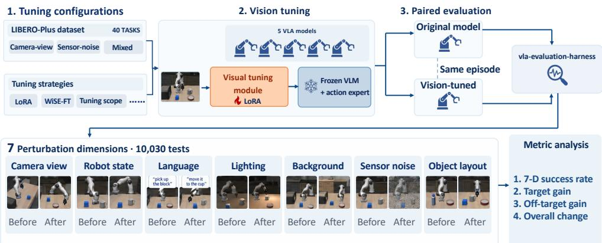  
Figure 1: Overview of VLA-Retain. Target-domain data update only the visual module, but the updated module processes observations under every deployment condition. VLA-Retain therefore evaluates each base–tuned pair on the same episodes across seven perturbation dimensions and reports both target improvement and off-target retention.

However, this strategy overlooks how tuning for one shift affects robustness to non-target perturbations. Targeted adaptation studies report only the target-domain gain, and robustness benchmarks evaluate only models without such tuning, so neither reveals how the adaptation itself changes robustness under the remaining conditions. This matters because the adapted visual representation feeds the same frozen downstream components under every condition. Tuning it for one domain can thus change behavior under unseen shifts in language, object layout, or sensor noise, while target-domain success or an aggregate score can hide such regressions.

Measuring such cross-dimension effects poses four challenges. First, adaptation effects are multidimensional, so neither target-only nor aggregate evaluation suffices. Second, VLA architectures differ in baseline robustness, so absolute post-tuning scores mix adaptation effects with differences in their starting points. Third, an off-target regression may reflect generic forgetting or task sampling rather than perturbation-specific interference. Fourth, adaptation has a large design space spanning data coverage, tuning scope, and retention methods, whose effects may vary by model.

We introduce VLA-Retain, a paired benchmark designed to address these challenges (Figure 1). To expose multi-dimensional effects, it evaluates every base–tuned pair on the same 10,030 LIBERO-Plus episodes (Fei et al., 2026) including seven perturbation dimensions and reports target, mean and worst off-target, and overall gains separately. To isolate adaptation effects, it compares five open VLA models, each tuned on Camera-view or Sensor-noise data, with their own base checkpoints fine-tuned on LIBERO (Liu et al., 2023). To test alternative explanations, it adds original-LIBERO controls and paired cluster-bootstrap intervals. To cover the design space, it varies training-data coverage across all five models and tuning strategy on two representative architectures. We use VLA-Retain to answer the following four questions.

Does targeted vision tuning affect off-target robustness? Yes, and the change is usually a regression. Mean off-target gain is negative in 8 of 10 model–domain configurations, and language and object-layout success decline in 9 of 10, although only the visual module is updated. The target gain does not predict these effects: under Camera-view tuning, X-VLA improves target success from 19.6% to 89.0% but loses 4.6 percentage points on average across off-target dimensions, whereas OpenVLA-OFT improves from 55.2% to 94.5% while gaining 1.4 points.

Are these regressions explained by forgetting of the original tasks? Not fully. Success on the same tasks without perturbations declines by at most 3.8 points for every checkpoint except NORA-1.5 after Camera-view tuning. After subtracting this change, every Camera-view-tuned model and four of five Sensor-noise-tuned models still regress on at least one off-target perturbation.

Does broader training coverage prevent them? No. Mixed training over the complete LIBERO-Plus training set gets a higher overall gain than either target-specific setting for all five models, yet every model still regresses on at least one dimension.

Can alternative tuning strategies control them? Not consistently across models. Weight interpolation improves retention on both evaluated models but reduces the target gain, and the preferred tuning scope differs between them. In particular, DELTA-style feature preservation raises X-VLA’s mean off-target gain from $- 4 . 6 \ : \mathrm { t o } \ : + 1 . 2$ points but lowers OpenVLA-OFT’s from +1.4 to −23.1.

These results show that target-domain evaluation is valid but incomplete, as the same update can also affect off-target performance. By treating each tuned model as a paired change across seven robustness dimensions, VLA-Retain separates target gains from changes elsewhere and makes crossdimensional retention measurable. Targeted VLA adaptation should therefore be evaluated jointly by target improvement, off-target retention, and overall performance.

## 2 RELATED WORK

Targeted adaptation of VLA models. VLA models map images and language instructions, optionally together with robot proprioception, to discrete action tokens or continuous action chunks (Zitkovich et al., 2023; Driess et al., 2023; Collaboration, 2024). Modern systems differ in their visual backbones, multimodal trunks, and action decoders (Kim et al., 2025b;a; Black et al., 2025; Zheng et al., 2026; Hung et al., 2025; Ma et al., 2026), but all rely on a visual representation that is consumed by downstream reasoning and action components. Parameter-efficient adaptation, including LoRA (Hu et al., 2022), makes it practical to update this pathway while freezing most of the VLA. Recent robustness methods use such visual updates to correct spatial misalignment under camera changes or defend against physical attention hijacking (Li et al., 2026; Yin & Zhang, 2026; Zhang et al., 2026c), establishing that adaptation improves the target condition. VLA-Retain does not challenge these target-domain gains, it asks what the tuning update changes elsewhere.

Retention under model adaptation. Retention methods constrain adaptation by keeping the tuned model close to a pretrained solution. WiSE-FT interpolates pretrained and fine-tuned weights to improve robustness (Wortsman et al., 2022), while DELTA preserves task-relevant source representations during transfer (Li et al., 2019). Our setting differs from sequential task learning because the manipulation tasks remain fixed while adaptation targets a specific observation shift in the shared visual pathway. We therefore evaluate retention across deployment conditions rather than by accuracy over a sequence of learned tasks, and Section 5.4 tests whether such retention methods control cross-dimension effects in VLAs.

VLA robustness benchmarks. Existing benchmarks expose complementary limitations of VLA models. SimplerEnv (Li et al., 2024) studies simulation-based evaluation for real-robot setups, while LIBERO-Plus (Fei et al., 2026) extends LIBERO’s (Liu et al., 2023) manipulation tasks with seven controlled perturbation dimensions. VLA-Arena (Zhang et al., 2026a) organizes evaluation by task structure, language, and visual difficulty, and LIBERO-X (Wang et al., 2026) introduces hierarchical tests of spatial generalization, object recognition, and instruction understanding. VLM4VLA (Zhang et al., 2026b) uses a common action design to isolate how VLM choice and embodied capabili ties affect downstream control, identifying the visual module as a central bottleneck. These works characterize the robustness of fixed models, backbones, or generalization regimes, whereas VLA-Retain measures how perturbation-specific vision tuning changes that robustness by pairing every fine-tuned model with its own base model.

## 3 STUDYING CROSS-DIMENSION EFFECTS OF VLA ADAPTATION

## 3.1 RESEARCH PROBLEM

We view a VLA as a visual module followed by downstream multimodal and action components:

$$
a = g _ { \phi } ( f _ { \theta } ( x ) , \ell , s ) ,\tag{1}
$$

where $f _ { \theta }$ denotes the visual backbone and connector, $g _ { \phi }$ denotes the remaining VLA, and $( x , \ell , s )$ are the image observation, language instruction, and robot state. Target-specific vision tuning changes θ to $\theta ^ { \prime }$ while keeping $\phi$ fixed. The parameter update is constrained to the visual module, but the adapted module processes observations under every perturbation condition.

We therefore describe each model by its robustness profile over the perturbation dimensions D. Let $S _ { m , d } ^ { \mathrm { b a s e } }$ denote the success rate, expressed as a percentage, of base model m on perturbation dimension d, and let $S _ { m , c , d } ^ { \mathrm { t u n e d } }$ denote the corresponding success rate after applying tuning configuration c. The object of study is the change vector $\Delta _ { m , c } ~ = ~ ( \Delta _ { m , c , d } ) _ { d \in \mathcal D }$ induced by tuning rather than either profile alone, with entries measured in percentage points (pp):

$$
\begin{array} { r } { \Delta _ { m , c , d } = S _ { m , c , d } ^ { \mathrm { t u n e d } } - S _ { m , d } ^ { \mathrm { b a s e } } . } \end{array}\tag{2}
$$

For a target dimension $t , \Delta _ { m , c , t }$ measures the intended improvement, while the other six values measure how tuning affects robustness outside the training domain. Negative values indicate regression, and values near zero indicate retention. Robustness benchmarks characterize $S _ { m , d } ^ { \mathrm { b a s e } }$ for fixed models, and targeted adaptation studies report $\Delta _ { m , c , t } ;$ we study the complete vector $\Delta _ { m , c }$

## 3.2 DESIGN PRINCIPLES

VLA-Retain follows four design principles, each addressing one of the challenges in Section 1.

Full-profile evaluation. A large target gain can dominate an aggregate score, and a positive mean off-target change can still hide a severe drop on one dimension. We therefore evaluate every tuned model on all seven dimensions and summarize the change vector with target, mean off-target, worst off-target, and episode-weighted overall gains:

$$
\begin{array} { l l } { { G _ { m , c } ^ { \mathrm { t a r g e t } } = \Delta _ { m , c , t } , } } & { { G _ { m , c } ^ { \mathrm { o f f } } = \displaystyle \frac { 1 } { | \mathcal { D } | - 1 } \sum _ { d \neq t } \Delta _ { m , c , d } , } } \\ { { { } } } & { { { } } } \\ { { G _ { m , c } ^ { \mathrm { w o r s t } } = \displaystyle \operatorname* { m i n } _ { d \neq t } \Delta _ { m , c , d } , } } & { { G _ { m , c } ^ { \mathrm { a l l } } = \displaystyle \frac { \sum _ { d \in \mathcal { D } } N _ { d } \Delta _ { m , c , d } } { \sum _ { d \in \mathcal { D } } N _ { d } } , } } \end{array}\tag{3}
$$

where $N _ { d }$ is the number of episodes in dimension $d ;$ all four metrics are in percentage points.

Paired comparison. Absolute tuned scores conflate adaptation with baseline robustness, so we pair every tuned checkpoint with its own base checkpoint on identical episodes.

Controls for alternative explanations. To separate perturbation-specific regression from generic forgetting, task sampling, checkpoint selection, and training randomness, we add original-LIBERO controls, paired cluster-bootstrap intervals, and checkpoint and seed analyses (Appendix D).

Varied adaptation strategies. Because a conclusion drawn from one tuning strategy may not hold for others, we vary training-data coverage across all five models and compare tuning scope, weight interpolation, and feature preservation on two representative architectures.

## 4 VLA-RETAIN BENCHMARK DESIGN

## 4.1 MODEL COVERAGE

To address architectural heterogeneity, we study five open-source VLA models spanning different visual interfaces and action-generation mechanisms. Every base model is the released checkpoint after LIBERO fine-tuning rather than a generic pretrained checkpoint. Table 1 summarizes the main architectural differences. We define the visual module as the visual backbone together with the projector or merger that maps visual features into the multimodal representation space. Appendix Figure 7 and Table 6 provide the complete visual interfaces and parameter counts.

## 4.2 TRAINING DATA AND EVALUATION DIMENSIONS

The main targeted settings use the official LIBERO-Plus (Fei et al., 2026) Camera-view and Sensornoise training subsets, which represent changes in viewpoint and low-level image noise. Each subset isolates one target perturbation while covering the same 40 base manipulation tasks. To study training-data coverage, we additionally use Mixed training, which draws from the complete LIBERO-Plus training dataset and covers five of the seven evaluation dimensions, all except robot state and object layout. It therefore has no single target dimension. All three settings use the same evaluation set and optimization budget; they differ in the perturbation coverage of the training data.

To expose multi-dimensional effects, evaluation uses a separate LIBERO-Plus evaluation set of 10,030 perturbation-specific episodes derived from the same 40 source tasks and spanning the seven dimensions in Table 2. The training and evaluation sets share task definitions but contain different perturbation instances. Training data determine which perturbations are observed during tuning, whereas every base–tuned pair is evaluated on the complete set with identical episode keys.

Table 1: Architectural coverage of the core benchmark. Visual share denotes the fraction of total parameters contained in the visual backbone and connector.
<table><tr><td>Model</td><td>Visual backbone</td><td>Action formulation</td><td>Visual share</td></tr><tr><td>OpenVLA-OFT (Kim et al., 2025a) SigLIP + DINOv2</td><td></td><td>Regression head</td><td>10.64%</td></tr><tr><td>π0.5 (Black et al., 2025)</td><td>SigLIP</td><td>Flow matching</td><td>11.40%</td></tr><tr><td>InternVLA-A1.5 (Ma et al., 2026)</td><td>Qwen3.5 ViT</td><td>Flow matching</td><td>12.34%</td></tr><tr><td>NORA-1.5 (Hung et al., 2025)</td><td>Qwen2.5-VL ViT</td><td>Flow matching + FAST</td><td>16.77%</td></tr><tr><td>X-VLA (Zheng et al., 2026)</td><td>DaViT</td><td>Soft-prompted flow matching</td><td>41.26%</td></tr></table>

Table 2: Evaluation composition across perturbation dimensions and LIBERO task suites.
<table><tr><td>Dimension</td><td>Spatial</td><td>Object</td><td>Goal</td><td>LIBERO-10</td><td>Total</td></tr><tr><td>Camera view</td><td>376</td><td>396</td><td>408</td><td>419</td><td>1,599</td></tr><tr><td>Robot state</td><td>350</td><td>398</td><td>409</td><td>393</td><td>1,550</td></tr><tr><td>Language</td><td>390</td><td>354</td><td>410</td><td>383</td><td>1,537</td></tr><tr><td>Lighting</td><td>292</td><td>297</td><td>279</td><td>274</td><td>1,142</td></tr><tr><td>Background</td><td>258</td><td>248</td><td>281</td><td>289</td><td>1,076</td></tr><tr><td>Sensor noise</td><td>351</td><td>422</td><td>379</td><td>449</td><td>1,601</td></tr><tr><td>Object layout</td><td>385</td><td>403</td><td>425</td><td>312</td><td>1,525</td></tr><tr><td>Total</td><td>2,402</td><td>2,518</td><td>2,591</td><td>2,519</td><td>10,030</td></tr></table>

## 4.3 TUNING CONFIGURATIONS AND TRAINING PROTOCOL

The default training setting is Dual LoRA, which applies rank-32 LoRA to both the visual backbone and connector while freezing the multimodal backbone and action module. This reference configuration is used for the five-model comparisons under Camera-view, Sensor-noise, and Mixed training. Each model retains its official learning-rate schedule and normalization statistics.

To study the adaptation design space, we compare the tuning configurations in Appendix Table 5 on X-VLA and OpenVLA-OFT using Camera-view training data. The tuning scope variants change whether LoRA is applied to the visual backbone, the connector, or both, while keeping the downstream modules frozen. WiSE-FT (Wortsman et al., 2022) interpolates the visual weights of the base and Dual-LoRA models without additional training. Based on DELTA (Li et al., 2019), DELTA-style starts from Dual LoRA and adds a Taylor-weighted penalty that anchors the tuned post-connector representation to a frozen base branch; Appendix A.5 gives the complete objective. Each comparison otherwise uses the same model, training data, optimization budget, and evaluation episodes.

All training-based configurations use AdamW (Loshchilov & Hutter, 2019) in BF16 with an effective batch size of 32 for 12,000 optimizer updates. LoRA configurations use rank 32, α = 16, and zero dropout. Appendix Table 7 reports model-specific learning rates and schedules.

## 4.4 SIMULATOR AND PAIRED EVALUATION

All rollouts are executed in the LIBERO simulator (Liu et al., 2023) with LIBERO-Plus perturbations (Fei et al., 2026), using robosuite 1.4.1 (Zhu et al., 2020) and MuJoCo physics (Todorov et al., 2012). We evaluate every base and tuned model with vla-evaluation-harness (Choi et al., 2026), which separates model inference from simulator execution through a common interface. Model adapters preserve each model’s native image preprocessing, proprioceptive inputs, normalization, action space, action chunks, gripper convention, and execution horizon. An episode is successful when the simulator’s task-completion condition is reached. Because each base–tuned pair uses identical episode keys, every reported change is paired at the episode level.

Table 3: Target, off-target, and overall results under targeted vision tuning. Success rates are reported as percentages and signed gains are reported in percentage points.
<table><tr><td></td><td colspan="3">Target success</td><td colspan="2">Off-target change</td><td colspan="3">Overall success</td></tr><tr><td>Model</td><td>Base</td><td>Tuned</td><td> $G ^ { \mathrm { t a r g e t } }$ </td><td> $G ^ { \mathbf { o f f } }$ </td><td> $G ^ { \mathbf { w o r s t } }$ </td><td>Base</td><td>Tuned</td><td> $G ^ { \mathrm { a l l } }$ </td></tr><tr><td colspan="9">Camera-view tuning</td></tr><tr><td>OpenVLA-OFT</td><td>55.2</td><td>94.5</td><td>+39.3</td><td>+1.4</td><td>-2.8</td><td>68.3</td><td>75.8</td><td>+7.5</td></tr><tr><td> $\pi _ { 0 . 5 }$ </td><td>70.7</td><td>92.7</td><td>+22.0</td><td>-0.3</td><td>-3.9</td><td>84.0</td><td>87.0</td><td>+3.0</td></tr><tr><td>InternVLA-A1.5</td><td>80.8</td><td>83.4</td><td>+2.6</td><td>-5.2</td><td>-12.4</td><td>83.7</td><td>79.5</td><td>-4.2</td></tr><tr><td>NORA-1.5</td><td>6.0</td><td>34.7</td><td>+28.7</td><td>-10.1</td><td>-17.8</td><td>47.4</td><td>43.8</td><td>-3.7</td></tr><tr><td>X-VLA</td><td>19.6</td><td>89.0</td><td>+69.4</td><td>-4.6</td><td>-10.7</td><td>69.3</td><td>76.3</td><td>+7.0</td></tr><tr><td colspan="9">Sensor-noise tuning</td></tr><tr><td>OpenVLA-OFT</td><td>72.8</td><td>92.6</td><td>+19.8</td><td>+0.3</td><td>-0.6</td><td>68.3</td><td>71.7</td><td>+3.4</td></tr><tr><td>π0.5</td><td>86.5</td><td>96.7</td><td>+10.2</td><td>-1.3</td><td>-4.1</td><td>84.0</td><td>84.3</td><td>+0.3</td></tr><tr><td>InternVLA-A1.5</td><td>93.7</td><td>91.8</td><td>-1.9</td><td>-2.5</td><td>-6.0</td><td>83.7</td><td>81.2</td><td>-2.6</td></tr><tr><td>NORA-1.5</td><td>16.0</td><td>61.3</td><td>+45.3</td><td>-1.0</td><td>-4.4</td><td>47.4</td><td>53.6</td><td>+6.2</td></tr><tr><td>X-VLA</td><td>60.9</td><td>93.7</td><td>+32.8</td><td>-2.2</td><td>-4.2</td><td>69.3</td><td>72.5</td><td>+3.2</td></tr></table>

All summary metrics follow Equation 3. Mixed training has no unique target, so we report its seven dimension-level changes and overall gain without target or off-target aggregates.

To quantify task-sampling uncertainty, we compute pointwise 95% confidence intervals with a paired cluster bootstrap that resamples the 40 source tasks 20,000 times (Appendix E).

## 5 BENCHMARK RESULTS

We organize the results around the four questions in Section 1. Section 5.1 measures the sevendimensional change after Camera-view and Sensor-noise tuning of all five models, and Section 5.2 tests whether the resulting regressions reflect forgetting of the unperturbed tasks. Section 5.3 then broadens the training data, and Section 5.4 compares tuning scope, weight interpolation, and feature preservation on X-VLA and OpenVLA-OFT. Each subsection ends with its finding.

## 5.1 DOES TARGETED VISION TUNING AFFECT OFF-TARGET ROBUSTNESS?

Table 3 reports absolute target and overall success rates before and after tuning together with the four gains in Equation 3. Targeted tuning generally improves robustness to the selected perturbation, so we focus on how much performance each model preserves on the remaining dimensions.

Camera-view tuning. Camera-view tuning produces the largest contrast. X-VLA gains 69.4 points on the target dimension but has $G ^ { \mathrm { o f f } } = \bar { - 4 . 6 }$ and $G ^ { \mathrm { w o r s t } } \stackrel { \smile } { = } - 1 0 . 7$ , while NORA-1.5 gains 28.7 points on target but falls by 10.1 points on average off target and by 17.8 points on its worst dimension. In contrast, OpenVLA-OFT combines a +39.3 target gain with $G ^ { \mathrm { o f f } } = + 1 . 4$ and $G ^ { \mathrm { a l l } } = + 7 . 5$

Sensor-noise tuning. Off-target regression also appears when models are tuned on Sensor-noise data, confirming that the effect is not unique to Camera-view tuning. As under Camera-view tuning, four of the five models have negative mean off-target gains, ranging from −1.0 to −2.5 points. OpenVLA-OFT remains the exception, retaining a positive mean off-target gain of +0.3 while improving Sensor-noise success by 19.8 points.

Cross-dimension analysis. Figure 2 expands these summaries into the complete seven-dimensional change vector. Language and object-layout success decline in nine of the ten model–domain configurations, by 3.7 and 2.5 points on average, respectively; robot-state success rates decline in eight configurations, by 3.3 points on average. Cross-effects also occur between the two visual target domains: Sensor-noise success declines for four of five models after Camera-view tuning, while Camera-view success declines for three of five models after Sensor-noise tuning. Vision tuning can therefore reduce robustness outside the target domain, even to non-visual perturbations.

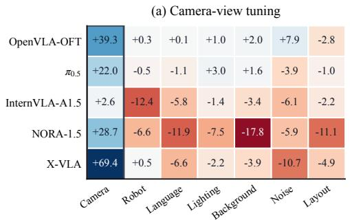

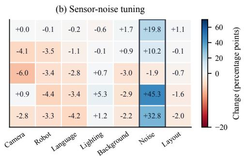  
Figure 2: Cross-dimensional success rate changes after targeted vision tuning. Each cell reports a percentage-point change. Blue denotes improvement, red denotes regression, and the outlined column marks the target perturbation.

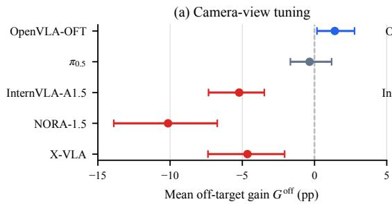

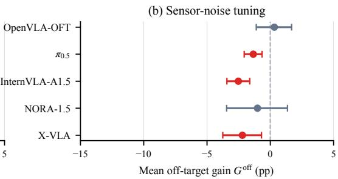  
Figure 3: Statistical uncertainty in off-target retention. Points show mean off-target gains, and horizontal lines show pointwise 95% confidence intervals from a paired cluster bootstrap with 20,000 resamples over the 40 source tasks. Red intervals lie below zero, blue intervals lie above zero, and gray intervals overlap zero.

Model dependence. The magnitude and ordering of off-target regression change across both models and target domains. NORA-1.5 has $G ^ { \mathrm { o f f } } = - 1 0 . 1$ after Camera-view tuning but −1.0 after Sensornoise tuning, whereas OpenVLA-OFT retains positive mean off-target gains in both settings. Visualmodule parameter share also has a Spearman rank correlation of $\rho = - 0 . 7 0$ with mean off-target gain averaged over the two settings, relating a larger visual-module share to weaker retention.

Statistical uncertainty. Pointwise 95% confidence intervals across the 40 source tasks (Figure 3) place $G ^ { \mathrm { o f f } }$ below zero in six of the ten model–domain settings and above zero only for OpenVLA-OFT under Camera-view tuning. Under Camera-view tuning, the intervals are $[ - 1 3 . 9 , - 6 . 7 ]$ for NORA-1.5, [−7.4, −2.1] for X-VLA, and $[ + 0 . 2 , + 2 . 8 ]$ for OpenVLA-OFT. Overall-gain intervals lie below zero for InternVLA-A1.5 under both target domains and NORA-1.5 under Camera-view tuning, so off-target regressions can outweigh target gains.

Why aggregate success is insufficient. These results illustrate the first design principle in Section 3.2: $\mathbf { X } \mathbf { - } \mathbf { \bar { V } } \mathbf { L A } ^ { \prime } \mathbf { s } + 6 9 . 4$ target gain yields a positive overall gain of +7.0 despite regressions on five of six off-target dimensions, while OpenVLA-OFT’s positive mean off-target gain still comes with a −2.8 drop on its worst dimension.

## Finding 1: Targeted vision tuning is not local

Mean off-target gain is negative in 8 of 10 model–domain configurations. The target gain does not predict retention: under Camera-view tuning, X-VLA gains 69.4 points on target but loses 4.6 off target, whereas OpenVLA-OFT gains on both.

## 5.2 ARE OFF-TARGET REGRESSIONS EXPLAINED BY SOURCE-DOMAIN FORGETTING?

Off-target regressions could reflect a general loss on the original task distribution rather than reduced robustness to specific perturbations. We therefore evaluate each base–tuned pair on original LIBERO and compute the source-adjusted change $R _ { m , c , d } = \Delta _ { m , c , d } - \left( S _ { m , c } ^ { \mathrm { t u n e d , o r i g } } - S _ { m } ^ { \mathrm { b a s e , o r i g } } \right)$ . A negative value indicates a larger decline under perturbation d than on original LIBERO.

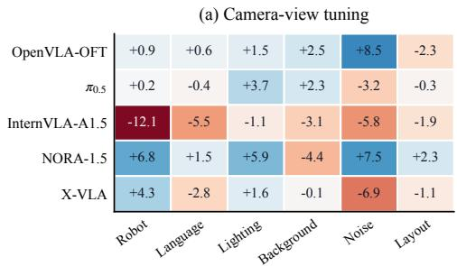

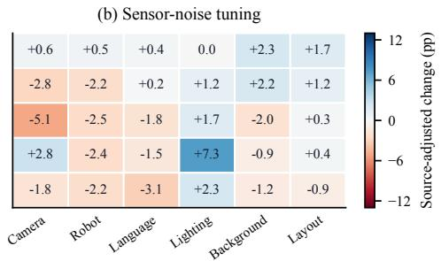  
Figure 4: Source-adjusted off-target changes. Results for (a) Camera-view and (b) Sensor-noise tuning. Each cell subtracts the corresponding change on original LIBERO; negative values indicate additional perturbation-specific regression.

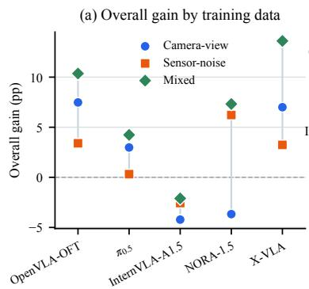

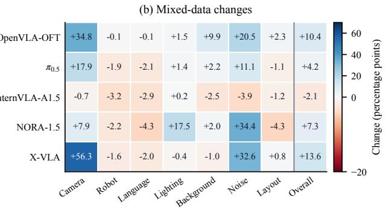  
Figure 5: Effect of training-data coverage. (a) Overall gains under Camera-view, Sensor-noise, and Mixed training. (b) Dimension-level and overall changes after Mixed training.

Original LIBERO changes remain within 3.8 percentage points for all checkpoints except NORA-1.5 after Camera-view tuning (−13.4 points). Figure 4 shows that every Camera-view-tuned model still regresses on at least one off-target perturbation after adjustment. The same holds for four models after Sensor-noise tuning, while OpenVLA-OFT remains effectively unchanged or improves. Appendix Table 8 reports the absolute success rates.

## Finding 2: Regressions are not explained only by source-domain forgetting

After subtracting the change on original LIBERO, every Camera-view-tuned model and four of five Sensor-noise-tuned models still regress on at least one off-target perturbation.

## 5.3 DOES BROADER TRAINING COVERAGE PREVENT OFF-TARGET REGRESSION?

Target-specific data may promote specialization at the expense of retention. We therefore apply the same Dual-LoRA configuration and optimization budget to the complete LIBERO-Plus training set, which covers every evaluation dimension except robot state and object layout over the same 40 manipulation tasks. As Mixed training has no single target dimension, Figure 5 compares its overall gain with Camera-view and Sensor-noise training and reports its seven dimension-level changes.

Mixed training yields a higher overall gain than either target-specific setting for all five models, from −2.1 points for InternVLA-A1.5 to +13.6 for X-VLA. Yet every model still regresses on at least one dimension, and Camera-view gains are smaller than under Camera-view-specific training.

## Finding 3: Broader coverage raises overall gain but does not remove regressions

Mixed training yields a higher overall gain than either target-specific setting for all five models, yet every model still regresses on at least one dimension.

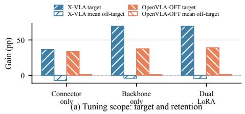

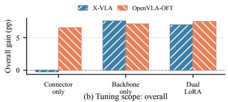

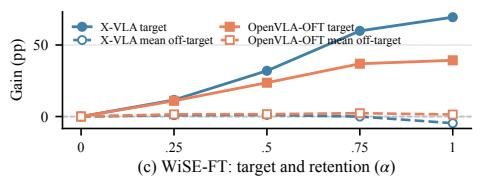

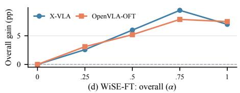  
Figure 6: Target–retention trade-offs of tuning strategies. (a–b) Tuning scope. (c–d) WiSE-FT.

Table 4: Camera-view results for Dual LoRA and DELTA-style feature preservation.
<table><tr><td>Model</td><td>Strategy</td><td>Gtarget</td><td> $G ^ { \mathbf { o f f } }$ </td><td> $G ^ { \mathrm { a l l } }$ </td></tr><tr><td>X-VLA</td><td>Dual LoRA</td><td>+69.4</td><td>-4.6</td><td>+7.0</td></tr><tr><td>X-VLA</td><td>DELTA-style</td><td>+62.7</td><td>+1.2</td><td>+10.9</td></tr><tr><td>OpenVLA-OFT</td><td>Dual LoRA</td><td>+39.3</td><td>+1.4</td><td>+7.5</td></tr><tr><td>OpenVLA-OFT</td><td>DELTA-style</td><td>+13.6</td><td>-23.1</td><td>-16.6</td></tr></table>

## 5.4 CAN ALTERNATIVE TUNING STRATEGIES CONTROL CROSS-DIMENSION EFFECTS?

Tuning scope. Figure 6(a)–(b) compare Connector-only, Backbone-only, and Dual LoRA on X-VLA and OpenVLA-OFT. For X-VLA, Backbone-only matches the +69.4 target gain of Dual LoRA while improving mean off-target gain from −4.6 to −3.9 and overall gain from +7.0 to +7.6. OpenVLA-OFT instead performs best with Dual LoRA, reaching a +39.3 target gain, +1.4 mean off-target gain, and +7.5 overall gain. The preferred tuning scope therefore differs across models.

Weight interpolation. Figure 6(c)–(d) show how WiSE-FT changes the balance between target adaptation and off-target retention. At α = 0.75, X-VLA’s target gain decreases from +69.4 to +59.8, while its mean off-target gain improves from −4.6 to 0.0 and its overall gain increases from +7.0 to +9.4. OpenVLA-OFT shows the same trade-off, with target gain decreasing from +39.3 to +36.9 and mean off-target gain increasing from +1.4 to +2.3. Weight interpolation therefore improves retention and overall performance at the cost of a smaller target-domain gain.

Feature preservation. Table 4 compares DELTA-style with the reference Dual-LoRA configuration. DELTA-style retains a +62.7 Camera-view gain on X-VLA, is positive on five of six off-target dimensions, and raises overall gain from +7.0 to +10.9. On OpenVLA-OFT it regresses on all six off-target dimensions, producing Gof = −23.1 and Gall = −16.6.

## Finding 4: Tuning strategies are model-dependent

No strategy is best for both models: DELTA-style feature preservation raises X-VLA’s mean off-target gain from −4.6 to +1.2 points but lowers OpenVLA-OFT’s from +1.4 to −23.1.

## 6 CONCLUSION

We introduced VLA-Retain, a paired benchmark for measuring how targeted vision tuning changes a VLA’s robustness across perturbation dimensions. Across five open VLAs, targeted tuning generally improves the target perturbation, but its effects are not local: off-target regressions are common, model-dependent, not predicted by the target gain, and not explained only by source-domain forgetting. Broader training coverage and alternative tuning strategies move this trade-off without removing it. VLA adaptation studies should report target improvement and off-target retention jointly.

## REPRODUCIBILITY STATEMENT

We release a public repository at https://github.com/BoruiXu/VLA\_vision tuning\_benchmark that contains the training, merging, serving, and evaluation code for all five models, the per-episode outcomes of every reported run, and scripts that recompute the reported metrics, confidence intervals, and result figures. And all model base checkpoints and the LIBERO-Plus data are publicly available.

## REFERENCES

Kevin Black, Noah Brown, James Darpinian, Karan Dhabalia, Danny Driess, Adnan Esmail, Michael Robert Equi, Chelsea Finn, Niccolo Fusai, Manuel Y. Galliker, Dibya Ghosh, Lachy Groom, Karol Hausman, brian ichter, Szymon Jakubczak, Tim Jones, Liyiming Ke, Devin LeBlanc, Sergey Levine, Adrian Li-Bell, Mohith Mothukuri, Suraj Nair, Karl Pertsch, Allen Z. Ren, Lucy Xiaoyang Shi, Laura Smith, Jost Tobias Springenberg, Kyle Stachowicz, James Tanner, Quan Vuong, Homer Walke, Anna Walling, Haohuan Wang, Lili Yu, and Ury Zhilinsky. π : a vision-language-action model with open-world generalization. In Joseph Lim, Shuran Song, and Hae-Won Park (eds.), Proceedings of The 9th Conference on Robot Learning, volume 305 of Proceedings of Machine Learning Research, pp. 17–40. PMLR, 27–30 Sep 2025. URL https://proceedings.mlr.press/v305/black25a.html.

Suhwan Choi, Yunsung Lee, Yubeen Park, Chris Dongjoo Kim, Ranjay Krishna, Dieter Fox, and Youngjae Yu. vla-eval: A unified evaluation harness for vision-language-action models. arXiv preprint arXiv:2603.13966, 2026. URL https://arxiv.org/abs/2603.13966.

Open X-Embodiment Collaboration. Open X-Embodiment: Robotic learning datasets and RT-X models. In 2024 IEEE International Conference on Robotics and Automation (ICRA), pp. 6892– 6903, 2024. doi: 10.1109/ICRA57147.2024.10611477.

Danny Driess, Fei Xia, Mehdi S. M. Sajjadi, Corey Lynch, Aakanksha Chowdhery, Brian Ichter, Ayzaan Wahid, Jonathan Tompson, Quan Vuong, Tianhe Yu, Wenlong Huang, Yevgen Chebotar, Pierre Sermanet, Daniel Duckworth, Sergey Levine, Vincent Vanhoucke, Karol Hausman, Marc Toussaint, Klaus Greff, Andy Zeng, Igor Mordatch, and Pete Florence. PaLM-E: an embodied multimodal language model. In Proceedings of the 40th International Conference on Machine Learning, ICML’23. JMLR.org, 2023.

Senyu Fei, Siyin Wang, Junhao Shi, Zihao Dai, Jikun Cai, Pengfang Qian, Li Ji, Xinzhe He, Shiduo Zhang, Zhaoye Fei, Jinlan Fu, Jingjing Gong, and Xipeng Qiu. LIBERO-Plus: A progressive robustness benchmark for visual-language-action models. In Proceedings ofthe IEEE/CVF Conference on Computer Vision and Pattern Recognition (CVPR), pp. 38574–38583, June 2026.

Edward J Hu, yelong shen, Phillip Wallis, Zeyuan Allen-Zhu, Yuanzhi Li, Shean Wang, Lu Wang, and Weizhu Chen. LoRA: Low-rank adaptation of large language models. In International Conference on Learning Representations, 2022. URL https://openreview.net/forum? id=nZeVKeeFYf9.

Chia-Yu Hung, Navonil Majumder, Haoyuan Deng, Liu Renhang, Yankang Ang, Amir Zadeh, Chuan Li, Dorien Herremans, Ziwei Wang, and Soujanya Poria. NORA-1.5: A vision-languageaction model trained using world model- and action-based preference rewards, 2025. URL https://arxiv.org/abs/2511.14659.

Moo Jin Kim, Chelsea Finn, and Percy Liang. Fine-Tuning Vision-Language-Action Models: Optimizing Speed and Success. In Proceedings of Robotics: Science and Systems, LosAngeles, CA, USA, June 2025a. doi: 10.15607/RSS.2025.XXI.017.

Moo Jin Kim, Karl Pertsch, Siddharth Karamcheti, Ted Xiao, Ashwin Balakrishna, Suraj Nair, Rafael Rafailov, Ethan P Foster, Pannag R Sanketi, Quan Vuong, Thomas Kollar, Benjamin Burchfiel, Russ Tedrake, Dorsa Sadigh, Sergey Levine, Percy Liang, and Chelsea Finn. Open-VLA: An open-source vision-language-action model. In Pulkit Agrawal, Oliver Kroemer, and Wolfram Burgard (eds.), Proceedings of The 8th Conference on Robot Learning, volume 270 of Proceedings of Machine Learning Research, pp. 2679–2713. PMLR, 06–09 Nov 2025b. URL https://proceedings.mlr.press/v270/kim25c.html.

Weiqi Li, Quande Zhang, Ruifeng Zhai, Liang Lin, and Guangrun Wang. VLA models are more generalizable than you think: Revisiting physical and spatial modeling, 2026. URL https: //arxiv.org/abs/2512.02902.

Xingjian Li, Haoyi Xiong, Hanchao Wang, Yuxuan Rao, Liping Liu, and Jun Huan. DELTA: DEEP LEARNING TRANSFER USING FEATURE MAP WITH ATTENTION FOR CONVO-LUTIONAL NETWORKS. In International Conference on Learning Representations, 2019. URL https://openreview.net/forum?id=rkgbwsAcYm.

Xuanlin Li, Kyle Hsu, Jiayuan Gu, Karl Pertsch, Oier Mees, Homer Rich Walke, Chuyuan Fu, Ishikaa Lunawat, Isabel Sieh, Sean Kirmani, Sergey Levine, Jiajun Wu, Chelsea Finn, Hao Su, Quan Vuong, and Ted Xiao. Evaluating real-world robot manipulation policies in simulation, 2024. URL https://arxiv.org/abs/2405.05941.

Bo Liu, Yifeng Zhu, Chongkai Gao, Yihao Feng, qiang liu, Yuke Zhu, and Peter Stone. LIBERO: Benchmarking knowledge transfer for lifelong robot learning. In Thirty-seventh Conference on Neural Information Processing Systems Datasets and Benchmarks Track, 2023. URL https: //openreview.net/forum?id=xzEtNSuDJk.

Ilya Loshchilov and Frank Hutter. Decoupled weight decay regularization. In International Conference on Learning Representations, 2019. URL https://openreview.net/forum?id= Bkg6RiCqY7.

Haoxiang Ma, Junhao Cai, Xiaoxu Xu, Hao Li, Yuyin Yang, Yang Tian, Jiafei Cao, Hongrui Zhu, Zherui Qiu, Zhaxizhuoma, Yuqiang Yang, Jiaqi Peng, Xueyuan Wei, Yangkun Zhu, Jiahao Jiang, Xing Gao, Hanqing Wang, Feng Yuan, Kailin Li, Xueyue Zhu, Tai Wang, Yan Ding, Jiangmiao Pang, Jia Zeng, Jingjing Zhang, Bowen Zhou, Yao Mu, Chunhua Shen, and Weinan Zhang. InternVLA-A1.5: Unifying understanding, latent foresight, and action for compositional generalization, 2026. URL https://arxiv.org/abs/2607.04988.

Emanuel Todorov, Tom Erez, and Yuval Tassa. Mujoco: A physics engine for model-based control. In 2012 IEEE/RSJ International Conference on Intelligent Robots and Systems, pp. 5026–5033. IEEE, 2012. doi: 10.1109/IROS.2012.6386109.

Guodong Wang, Chenkai Zhang, Qingjie Liu, Jinjin Zhang, Jiancheng Cai, Junjie Liu, and Xinmin Liu. LIBERO-X: Robustness litmus for vision-language-action models. In Proceedings of Robotics: Science and Systems, Sydney, Australia, July 2026.

Mitchell Wortsman, Gabriel Ilharco, Jong Wook Kim, Mike Li, Simon Kornblith, Rebecca Roelofs, Raphael Gontijo Lopes, Hannaneh Hajishirzi, Ali Farhadi, Hongseok Namkoong, and Ludwig Schmidt. Robust fine-tuning of zero-shot models. In Proceedings of the IEEE/CVF Conference on Computer Vision and Pattern Recognition (CVPR), pp. 7959–7971, 2022.

Dongfu Yin and Jinquan Zhang. VLAGuard: A framework for evaluating and mitigating physical attention hijacking in vision-language-action robots within wireless sensor networks, 2026. URL https://arxiv.org/abs/2608.01028.

Borong Zhang, Jiahao Li, Jiachen Shen, Yuhao Zhang, Yishuai Cai, Yuanpei Chen, Juntao Dai, Jiaming Ji, and Yaodong Yang. VLA-arena: An open-source framework for benchmarking visionlanguage-action models. In Forty-third International Conference on Machine Learning, 2026a. URL https://openreview.net/forum?id=qjeCH95rbF.

Jianke Zhang, Xiaoyu Chen, Qiuyue Wang, Mingsheng Li, Yanjiang Guo, Yucheng Hu, Jiajun Zhang, Shuai Bai, Junyang Lin, and Jianyu Chen. VLM4VLA: Revisiting vision-language models in vision-language-action models. In International Conference on Learning Representations, 2026b. URL https://arxiv.org/abs/2601.03309.

Jinquan Zhang, Dongfu Yin, Run Yang, Yufeng Yan, Zhen Tian, and F. Richard Yu. Structure-aware robust fine-tuning: Defending vision-language-action robots against physical attention hijacking, 2026c. URL https://arxiv.org/abs/2608.03231.

Jinliang Zheng, Jianxiong Li, Zhihao Wang, Dongxiu Liu, Xirui Kang, Yuchun Feng, Yinan Zheng, Jiayin Zou, Yilun Chen, Jia Zeng, Tai Wang, Ya-Qin Zhang, Jingjing Liu, and Xianyuan Zhan. X-VLA: Soft-prompted Transformer as scalable cross-embodiment vision-language-action model. In The Fourteenth International Conference on Learning Representations, 2026. URL https: //openreview.net/forum?id=kt51kZH4aG.

Yuke Zhu, Josiah Wong, Ajay Mandlekar, Roberto Mart´ın-Mart´ın, Abhishek Joshi, Soroush Nasiriany, Yifeng Zhu, and Kevin Lin. robosuite: A modular simulation framework and benchmark for robot learning. In arXiv preprint arXiv:2009.12293, 2020.

Brianna Zitkovich, Tianhe Yu, Sichun Xu, Peng Xu, Ted Xiao, Fei Xia, Jialin Wu, Paul Wohlhart, Stefan Welker, Ayzaan Wahid, Quan Vuong, Vincent Vanhoucke, Huong Tran, Radu Soricut, Anikait Singh, Jaspiar Singh, Pierre Sermanet, Pannag R. Sanketi, Grecia Salazar, Michael S. Ryoo, Krista Reymann, Kanishka Rao, Karl Pertsch, Igor Mordatch, Henryk Michalewski, Yao Lu, Sergey Levine, Lisa Lee, Tsang-Wei Edward Lee, Isabel Leal, Yuheng Kuang, Dmitry Kalashnikov, Ryan Julian, Nikhil J. Joshi, Alex Irpan, Brian Ichter, Jasmine Hsu, Alexander Herzog, Karol Hausman, Keerthana Gopalakrishnan, Chuyuan Fu, Pete Florence, Chelsea Finn, Kumar Avinava Dubey, Danny Driess, Tianli Ding, Krzysztof Marcin Choromanski, Xi Chen, Yevgen Chebotar, Justice Carbajal, Noah Brown, Anthony Brohan, Montserrat Gonzalez Arenas, and Kehang Han. RT-2: Vision-language-action models transfer web knowledge to robotic control. In Jie Tan, Marc Toussaint, and Kourosh Darvish (eds.), Proceedings ofThe 7th Conference on Robot Learning, volume 229 of Proceedings of Machine Learning Research, pp. 2165–2183. PMLR, 06–09 Nov 2023. URL https://proceedings.mlr.press/v229/zitkovich23a. html.

## A ADDITIONAL BENCHMARK DETAILS

## A.1 TUNING CONFIGURATIONS

Table 5 summarizes the visual tuning configurations compared in Section 5.4.

Table 5: Visual tuning configurations used in the strategy comparison.
<table><tr><td>Category</td><td>Configuration</td><td>Operation</td></tr><tr><td>Reference</td><td>Dual LoRA</td><td>Rank-32 LoRA on visual backbone and connector</td></tr><tr><td>Tuning scope</td><td>Backbone-only LoRA</td><td>Rank-32 LoRA on visual backbone; connector frozen</td></tr><tr><td>Tuning scope</td><td>Connector-only LoRA</td><td>Rank-32 LoRA on connector; visual backbone frozen</td></tr><tr><td>Retention</td><td>WiSE-FT</td><td>Base-Dual-LoRA visual-weight interpolation</td></tr><tr><td>Retention</td><td>DELTA-style</td><td>Dual LoRA with post-connector feature preservation</td></tr></table>

## A.2 MODEL PARAMETER SCALES

We obtain parameter counts from the released checkpoints after identifying the visual backbone and connector defined in Section 4. The visual count describes how much of each architecture lies on the visual pathway; it is distinct from the number of LoRA parameters optimized during fine-tuning.

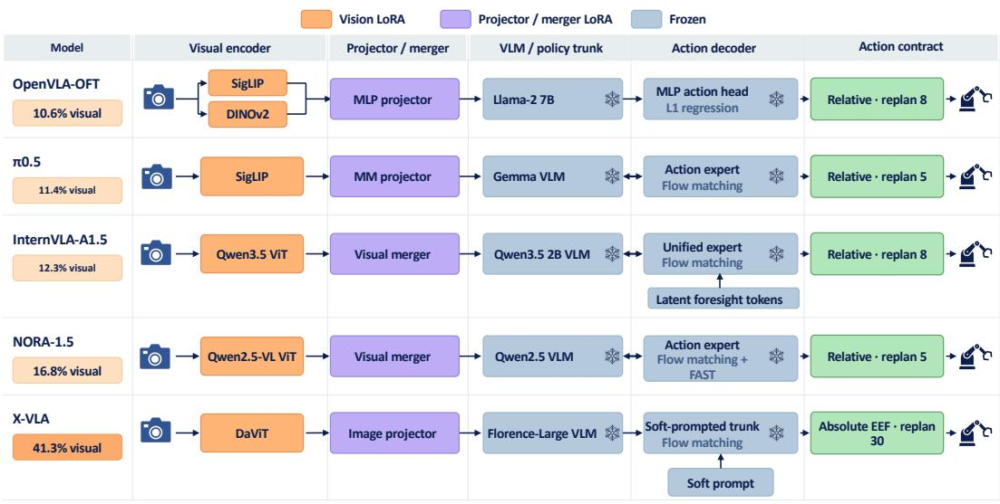  
Figure 7: Architectures and visual interfaces of the five VLA models. The reference configuration updates the visual backbone and connector and freezes the multimodal backbone and action module.

Table 6: Model parameter scales. Vision parameters include the visual backbone and connector.
<table><tr><td>Model</td><td>Vision params.</td><td>Total params.</td><td>Vision share</td></tr><tr><td>OpenVLA-OFT</td><td>802.3M</td><td>7.54B</td><td>10.64%</td></tr><tr><td>π0.5</td><td>412.4M</td><td>3.62B</td><td>11.40%</td></tr><tr><td>InternVLA-A1.5</td><td>331.4M</td><td>2.69B</td><td>12.34%</td></tr><tr><td>NORA-1.5</td><td>668.7M</td><td>3.99B</td><td>16.77%</td></tr><tr><td>X-VLA</td><td>362.8M</td><td>0.88B</td><td>41.26%</td></tr></table>

## A.3 TRAINING HYPERPARAMETERS

The reference runs share the training budget and adapter configuration described in Section 4: BF16   
precision, effective batch size 32, 12,000 optimizer updates, 384,000 sampled examples, rank-32

LoRA with $\alpha = 1 6$ and zero dropout, and checkpoints every 2,000 updates. Training-based controlled comparisons retain the corresponding model’s budget, optimizer, and schedule while changing only the designated data or visual tuning scope; WiSE-FT operates on completed checkpoints and requires no additional optimization. We retain the optimizer and schedule values from each model’s official repository instead of imposing one learning rate across architectures. Table 7 separates optimizer settings from the learning-rate schedule and execution contract.

Table 7: Model-specific optimization, schedule, and execution settings. Optimizer settings
<table><tr><td>Model</td><td>Learning rate</td><td> $( \beta _ { 1 } , \beta _ { 2 } )$ </td><td>Weight decay</td><td>Grad. clip</td></tr><tr><td>OpenVLA-OFT</td><td> $5 \times 1 0 ^ { - 4 }$ </td><td>(0.9, 0.999)</td><td>0.1</td><td>None</td></tr><tr><td>π0.5</td><td> $5 \times 1 0 ^ { - 5 }$ </td><td>(0.9, 0.95)</td><td> $1 0 ^ { - 1 0 }$ </td><td>1.0</td></tr><tr><td>InternVLA-A1.5</td><td> $5 \times 1 0 ^ { - 5 }$ </td><td>(0.9, 0.95)</td><td> $0 . 0 1$ </td><td>1.0</td></tr><tr><td>NORA-1.5</td><td> $8 \times 1 0 ^ { - 5 }$ </td><td>(0.9, 0.95)</td><td> $1 0 ^ { - 8 }$ </td><td>1.0</td></tr><tr><td>X-VLA</td><td> $1 0 ^ { - 4 }$ </td><td>(0.9,0.95)</td><td>0</td><td>1.0</td></tr></table>

<table><tr><td>Model</td><td>Warmup</td><td>Post-warmup schedule</td><td>Horizon</td></tr><tr><td>OpenVLA-OFT</td><td>1k</td><td>Cosine decay to 0</td><td>8</td></tr><tr><td>π0.5</td><td>1k</td><td>Constant</td><td>5</td></tr><tr><td>InternVLA-A1.5</td><td>2k</td><td>Cosine decay to  $5 \times 1 0 ^ { - 6 }$ </td><td>8</td></tr><tr><td>NORA-1.5</td><td>1k</td><td>Cosine decay to 0</td><td>5</td></tr><tr><td>X-VLA</td><td>2k</td><td>Cosine decay to  $1 0 ^ { - 5 }$ </td><td>30</td></tr></table>

The execution horizon is the number of actions applied before the VLA model is queried again. All other observation preprocessing, normalization, action-space, and gripper settings follow the model-specific contracts used by vla-evaluation-harness (Choi et al., 2026).

## A.4 ORIGINAL LIBERO RETENTION

Table 8 reports the source-domain results used in Section 5.2. Each checkpoint is evaluated on the same 2,000 original LIBERO episodes, covering 40 tasks with 50 fixed initial states per task.

## A.5 DELTA-STYLE FEATURE PRESERVATION

DELTA-style adapts DELTA’s behavior-regularization principle (Li et al., 2019) to VLA vision tuning. For every Camera-view training batch, the current model acts as a student and an untouched copy of the base visual module acts as a frozen teacher. Both branches receive the same augmented image, the student follows the standard action-training path, and the teacher produces only a reference visual representation. The student updates the same rank-32 LoRA parameters on the visual backbone and connector as the reference configuration; the teacher remains outside the optimizer and checkpoint. We replay the student’s random-number-generator state for the teacher forward so that stochastic visual operations use the same masks in both branches.

Table 8: Original LIBERO success before and after targeted vision tuning. Success rates are percentages and changes are percentage points.
<table><tr><td rowspan="2">Model</td><td rowspan="2">Base Success (%)</td><td colspan="2">Camera-view tuned</td><td colspan="2">Sensor-noise tuned</td></tr><tr><td>Success (%)</td><td>Change (pp)</td><td>Success (%)</td><td>Change (pp)</td></tr><tr><td>OpenVLA-OFT</td><td>97.20</td><td>96.65</td><td>-0.55</td><td>96.60</td><td>-0.60</td></tr><tr><td>π0.5</td><td>97.35</td><td>96.65</td><td>-0.70</td><td>96.05</td><td>-1.30</td></tr><tr><td>InternVLA-A1.5</td><td>98.25</td><td>97.95</td><td>-0.30</td><td>97.30</td><td>-0.95</td></tr><tr><td>NORA-1.5</td><td>94.70</td><td>81.30</td><td>-13.40</td><td>92.75</td><td>-1.95</td></tr><tr><td>X-VLA</td><td>97.50</td><td>93.70</td><td>-3.80</td><td>96.45</td><td>-1.05</td></tr></table>

Table 9 shows the model-dependent feature taps. X-VLA matches the output of vlm.image proj norm, after its image projector and normalization, against the corresponding output of a frozen copy of the base VLM visual path. OpenVLA-OFT matches the projector output against a frozen sequential copy of its base vision backbone and projector. The language backbone and action module are not duplicated and remain frozen in the student model.

Table 9: Model-specific feature taps for DELTA-style preservation.
<table><tr><td>Model</td><td>Frozen teacher</td><td>Matched representation</td></tr><tr><td>X-VLA</td><td>Base visual path and image projector</td><td>image-proj_norm output</td></tr><tr><td>OpenVLA-OFT</td><td>Base vision backbone and projector</td><td>Projector output</td></tr></table>

Let H, $H ^ { 0 } \in \mathbb { R } ^ { B \times N \times C }$ denote the student and teacher post-connector representations, where B is the number of valid images, N the number of visual tokens, and C the feature dimension. For channel $c ,$ we compute its mean squared change and first-order sensitivity to the action loss:

$$
e _ { c } = \frac { 1 } { B N } \sum _ { b = 1 } ^ { B } \sum _ { n = 1 } ^ { N } \left( H _ { b , n , c } - H _ { b , n , c } ^ { 0 } \right) ^ { 2 } , \qquad q _ { c } = \frac { 1 } { B N } \sum _ { b = 1 } ^ { B } \sum _ { n = 1 } ^ { N } \left| H _ { b , n , c } \frac { \partial \mathcal { L } _ { \mathrm { a c t i o n } } } { \partial H _ { b , n , c } } \right| .\tag{4}
$$

The sensitivity $q _ { c }$ is the first-order Taylor approximation to the change in action loss caused by suppressing channel c. We normalize these sensitivities by their mean and convert them into nonnegative attention weights,

$$
\bar { q } _ { c } = \frac { q _ { c } } { \operatorname* { m a x } \Bigl ( C ^ { - 1 } \sum _ { k = 1 } ^ { C } q _ { k } , \epsilon \Bigr ) } , \qquad a _ { c } = C \frac { \exp ( \bar { q } _ { c } / \tau ) } { \sum _ { k = 1 } ^ { C } \exp ( \bar { q } _ { k } / \tau ) } , \qquad \epsilon = 1 0 ^ { - 1 2 } ,\tag{5}
$$

so that the mean channel weight is one. The attention weights are detached before the preservation loss is differentiated, avoiding second-order gradients. The final objectives are

$$
\mathcal { L } _ { \mathrm { f e a t u r e } } = \frac { 1 } { C } \sum _ { c = 1 } ^ { C } a _ { c } e _ { c } , \qquad \mathcal { L } _ { \mathrm { t o t a l } } = \mathcal { L } _ { \mathrm { a c t i o n } } + \lambda \mathcal { L } _ { \mathrm { f e a t u r e } } ,\tag{6}
$$

with $\lambda = 1$ and temperature $\tau = 1$ in both configurations. This objective gives stronger preservation pressure to post-connector channels on which the current action loss is more sensitive, while letting less influential channels change more freely. After training, the teacher branch is discarded and the merged model matches the inference structure and cost of the reference Dual-LoRA model.

We call this configuration DELTA-style rather than DELTA because it changes three elements of the original algorithm. DELTA obtains supervised attention by explicitly ablating each source-network CNN filter and measuring the resulting target-task loss increase; our implementation replaces those repeated forwards with the Taylor approximation in Equation 4. DELTA regularizes convolutional feature maps and includes an additional penalty for parameters private to the target network, whereas our implementation matches one post-connector visual representation and adds no private-parameter penalty. Finally, the channel weights here are computed from the current student’s VLA action loss and averaged across the batch and visual-token dimensions, rather than computed per example from exact source-filter ablations. The results in Table 4 therefore characterize this VLA-specific feature anchoring configuration, not an exact reproduction of the original DELTA algorithm.

## B FINE-GRAINED RESULTS BY TASK SUITE

Tables 10 and 11 expand the core reference matrix into the four LIBERO task suites whose eval uation composition is reported in Table 2. Each cell reports the success rate of the original and tuned model on exactly the same episode keys, with the target perturbation shown in bold. The final column pools the four suites within the indicated perturbation and therefore matches the dimension level rates underlying Figure 2.

Table 10: Camera-view tuning results by task suite. Each cell is Base/Tuned (%).
<table><tr><td>Perturbation</td><td>Spatial</td><td>Object</td><td>Goal</td><td>LIBERO-10</td><td>All suites</td></tr><tr><td colspan="6">OpenVLA-OFT</td></tr><tr><td>Camera view</td><td>48.7/98.9</td><td>67.9 /99.7</td><td>59.3/93.6</td><td>45.1/86.4</td><td>55.2/94.5</td></tr><tr><td>Robot state</td><td>23.1/24.6</td><td>19.8 /19.1</td><td>21.3 /21.8</td><td>36.6/36.9</td><td>25.2 /25.5</td></tr><tr><td>Language</td><td>95.9/96.4</td><td>99.7/98.6</td><td>58.0/59.0</td><td>95.3/95.0</td><td>86.5/86.6</td></tr><tr><td>Lighting</td><td>97.9/98.6</td><td>99.3/100.0</td><td>97.1/93.9</td><td>85.0/90.9</td><td>95.0/96.0</td></tr><tr><td>Background</td><td>88.0/88.4</td><td>87.5/81.0</td><td>84.0/88.6</td><td>83.0/91.0</td><td>85.5 /87.5</td></tr><tr><td>Sensor noise Object layout</td><td>75.5/80.6</td><td>91.0/94.1</td><td>64.6/76.3</td><td>60.4/71.9</td><td>72.8 /80.7</td></tr><tr><td></td><td>88.3/82.6</td><td>76.2/74.2</td><td>50.4/49.9</td><td>69.9/66.3</td><td>70.8 /67.9</td></tr><tr><td colspan="6">π0.5</td></tr><tr><td>Camera view</td><td>76.6/92.8</td><td>84.1 /98.0</td><td>74.5/93.6</td><td>48.9/86.6</td><td>70.7/92.7</td></tr><tr><td>Robot state</td><td>83.1/79.4</td><td>70.9/72.1</td><td>72.6/73.6</td><td>76.3/75.3</td><td>75.5/75.0</td></tr><tr><td>Language</td><td>92.1/88.2</td><td>91.8/91.5</td><td>70.7/66.3</td><td>89.6/94.0</td><td>85.7/84.6</td></tr><tr><td>Lighting</td><td>95.5/100.0</td><td>97.6/98.3</td><td>93.9/97.5</td><td>94.2/97.4</td><td>95.4/98.3</td></tr><tr><td>Background</td><td>97.7/97.7</td><td>98.4/98.4</td><td>90.7/95.4</td><td>91.7/93.1</td><td>94.4/96.0</td></tr><tr><td>Sensor noise Object layout</td><td>92.3/87.7</td><td>93.6/91.0</td><td>88.1/84.2</td><td>73.9 /69.3</td><td>86.5 /82.6</td></tr><tr><td></td><td>98.4/95.6</td><td>90.6/90.6</td><td>72.0/71.8</td><td>86.9 /85.6</td><td>86.6 /85.6</td></tr><tr><td colspan="6">InternVLA-A1.5</td></tr><tr><td>Camera view</td><td>89.9/88.0</td><td>98.2/96.7</td><td>68.6/66.9</td><td>68.0 /82.8</td><td>80.8 83.4</td></tr><tr><td>Robot state</td><td>57.7/49.1</td><td>56.5/38.7</td><td>48.4/39.4</td><td>50.1 /36.4</td><td>53.0 /40.6</td></tr><tr><td>Language</td><td>85.1/80.0</td><td>93.5/92.9</td><td>74.9/68.8</td><td>95.8/84.9</td><td>87.0/81.2</td></tr><tr><td>Lighting</td><td>90.1/90.8</td><td>99.7/97.3</td><td>97.1/97.5</td><td>98.9/94.5</td><td>96.4/95.0</td></tr><tr><td>Background</td><td>98.8/96.9</td><td>100.0/100.0</td><td>97.9/92.9</td><td>97.9/91.7</td><td>98.6/95.2</td></tr><tr><td>Sensor noise</td><td>91.7/90.6</td><td>99.8 /99.1</td><td>85.0/71.5</td><td>96.9 /88.0</td><td>93.7/ /87.6</td></tr><tr><td>Object layout</td><td>96.6/90.6</td><td>85.1/83.4</td><td>69.2/68.0</td><td>88.8 /89.4</td><td>84.3 /82.2</td></tr><tr><td colspan="6">NORA-1.5</td></tr><tr><td>Camera view</td><td>9.0/42.0</td><td>3.5/44.2</td><td>6.4/31.9</td><td>5.3 /22.0</td><td>6.0/34.7</td></tr><tr><td>Robot state</td><td>54.0/50.9</td><td>49.7/39.9</td><td>33.7/36.4</td><td>43.0/26.7</td><td>44.8/38.1</td></tr><tr><td>Language</td><td>78.7/72.3</td><td>79.4/74.6</td><td>49.0/43.9</td><td>74.9/43.6</td><td>70.0/58.1</td></tr><tr><td>Lighting</td><td>90.8/79.1</td><td>26.6/40.7</td><td>82.1/62.7</td><td>46.7/32.1</td><td>61.4/53.9</td></tr><tr><td>Background</td><td>79.8/69.4</td><td>79.8/74.6</td><td>89.0/60.1</td><td>55.7/31.5</td><td>75.7/58.0</td></tr><tr><td>Sensor noise</td><td>13.1/7.7</td><td>23.9/18.2</td><td>14.0 /8.4</td><td>12.5 /5.8</td><td>16.0/10.1</td></tr><tr><td>Object layout</td><td>91.4/71.2</td><td>67.7/68.7</td><td>65.2 /52.5</td><td>69.6 /56.1</td><td>73.4/62.2</td></tr><tr><td colspan="6">X-VLA</td></tr><tr><td>Camera view</td><td>18.4/95.5</td><td>16.7/96.5</td><td>23.5 /89.0</td><td>19.6/76.1</td><td>19.6 /89.0</td></tr><tr><td>Robot state</td><td>91.7/89.7</td><td>94.5/90.2</td><td>88.5 /89.2</td><td>78.1/85.2</td><td>88.1/88.6</td></tr><tr><td>Language</td><td>81.8/71.0</td><td>91.5/84.5</td><td>55.6/48.5</td><td>65.5/64.2</td><td>73.0/66.4</td></tr><tr><td>Lighting</td><td>100.0/97.9</td><td>92.6/98.7</td><td>98.6/90.0</td><td>95.6/90.9</td><td>96.7/94.5</td></tr><tr><td>Background</td><td>100.0/91.9</td><td>98.0/96.4</td><td>91.5/91.1</td><td>91.7/86.2</td><td>95.1/91.2</td></tr><tr><td>Sensor noise</td><td>59.0/45.6</td><td>50.2/46.4</td><td>66.5/62.3</td><td>67.7/47.0</td><td>60.9/50.2</td></tr><tr><td>Object layout</td><td>91.2/82.9</td><td>51.9/57.3</td><td>62.6/58.1</td><td>70.8/56.1</td><td>68.7/63.7</td></tr></table>

Table 11: Sensor-noise tuning results by task suite. Each cell is Base/Tuned (%).
<table><tr><td>Perturbation</td><td>Spatial</td><td>Object</td><td>Goal</td><td>LIBERO-10</td><td>All suites</td></tr><tr><td colspan="6">OpenVLA-OFT</td></tr><tr><td>Camera view</td><td>48.7/53.2</td><td>67.9/73.2</td><td>59.3/55.6</td><td>45.1 /39.6</td><td>55.2/55.2</td></tr><tr><td>Robot state</td><td>23.1/20.0</td><td>19.8/21.6</td><td>21.3/21.0</td><td>36.6 /37.7</td><td>25.2 /25.2</td></tr><tr><td>Language</td><td>95.9/93.8</td><td>99.7/99.4</td><td>58.0/59.3</td><td>95.3/95.6</td><td>86.5/86.3</td></tr><tr><td>Lighting</td><td>97.9/96.9</td><td>99.3/100.0</td><td>97.1/89.2</td><td>85.0/90.9</td><td>95.0/94.4</td></tr><tr><td>Background</td><td>88.0/ /89.1</td><td>87.5/90.3</td><td>84.0/84.3</td><td>83.0/85.5</td><td>85.5/ /87.2</td></tr><tr><td>Sensor noise</td><td>75.5/92.3</td><td>91.0/97.4</td><td>64.6/90.8</td><td>60.4/ /89.8</td><td>72.8 /92.6</td></tr><tr><td>Object layout</td><td>88.3 /91.2</td><td>76.2/75.9</td><td>50.4/50.4</td><td>69.9 /72.1</td><td>70.8 /71.9</td></tr><tr><td colspan="6">π0.5</td></tr><tr><td>Camera view</td><td>76.6/70.2</td><td>84.1/79.3</td><td>74.5/71.8</td><td>48.9 /46.1</td><td>70.7/66.5</td></tr><tr><td>Robot state</td><td>83.1/82.9</td><td>70.9/65.3</td><td>72.6/69.4</td><td>76.3/ /71.5</td><td>75.5/71.9</td></tr><tr><td>Language</td><td>92.1/91.0</td><td>91.8/92.7</td><td>70.7/67.6</td><td>89.6/88.8</td><td>85.7/84.6</td></tr><tr><td>Lighting</td><td>95.5/96.2</td><td>97.6/97.6</td><td>93.9/97.1</td><td>94.2 /89.8</td><td>95.4/95.3</td></tr><tr><td>Background</td><td>97.7/97.7</td><td>98.4/98.4</td><td>90.7/93.6</td><td>91.7 /92.4</td><td>94.4/95.4</td></tr><tr><td>Sensor noise</td><td>92.3/97.2</td><td>93.6/97.9</td><td>88.1/98.4</td><td>73.9 /93.8</td><td>86.5/96.7</td></tr><tr><td>Object layout</td><td>98.4/97.9</td><td>90.6/91.3</td><td>72.0/70.8</td><td>86.9 /87.5</td><td>86.6 /86.5</td></tr><tr><td colspan="6">InternVLA-A1.5</td></tr><tr><td>Camera view</td><td>89.9 /82.7</td><td>98.2 /88.6</td><td>68.6/64.0</td><td>68.0/65.2</td><td>80.8/74.8</td></tr><tr><td>Robot state</td><td>57.7/54.9</td><td>56.5 /51.5</td><td>48.4/43.8</td><td>50.1 /49.1</td><td>53.0/49.6</td></tr><tr><td>Language</td><td>85.1/85.4</td><td>93.5/91.8</td><td>74.9/69.0</td><td>95.8/92.2</td><td>87.0/84.2</td></tr><tr><td>Lighting</td><td>90.1/96.6</td><td>99.7/98.7</td><td>97.1/96.8</td><td>98.9/96.4</td><td>96.4/97.1</td></tr><tr><td>Background</td><td>98.8/91.9</td><td>100.0/98.8</td><td>97.9/94.7</td><td>97.9/ /97.2</td><td>98.6/95.6</td></tr><tr><td>Sensor noise</td><td>91.7 /87.5</td><td>99.8/98.8</td><td>85.0/84.7</td><td>96.9 /94.4</td><td>93.7/91.8</td></tr><tr><td>Object layout</td><td>96.6/92.7</td><td>85.1/84.6</td><td>69.2/69.2</td><td>88.8 /91.0</td><td>84.3 /83.7</td></tr><tr><td colspan="6">NORA-1.5</td></tr><tr><td>Camera view</td><td>9.0/9.6</td><td>3.5/5.6</td><td>6.4/6.6</td><td>5.3 /6.0</td><td>6.0/6.9</td></tr><tr><td>Robot state</td><td>54.0/50.0</td><td>49.7/48.7</td><td>33.7/26.9</td><td>43.0/37.4</td><td>44.8/40.4</td></tr><tr><td>Language</td><td>78.7/69.5</td><td>79.4/79.4</td><td>49.0/46.6</td><td>74.9/73.1</td><td>70.0/66.6</td></tr><tr><td>Lighting</td><td>90.8/89.0</td><td>26.6/44.8</td><td>82.1/76.0</td><td>46.7/57.3</td><td>61.4/66.7</td></tr><tr><td>Background</td><td>79.8/ /80.2</td><td>79.8/78.2</td><td>89.0/74.4</td><td>55.7 /60.2</td><td>75.7/72.9</td></tr><tr><td>Sensor noise</td><td>13.1/56.7</td><td>23.9/78.2</td><td>14.0/52.0</td><td>12.5 /56.8</td><td>16.0/61.3</td></tr><tr><td>Object layout</td><td>91.4/88.8</td><td>67.7/66.0</td><td>65.2/63.1</td><td>69.6 /70.2</td><td>73.4/71.8</td></tr><tr><td colspan="6">X-VLA</td></tr><tr><td>Camera view</td><td>18.4/17.0</td><td>16.7/11.1</td><td>23.5/19.1</td><td>19.6 /19.6</td><td>19.6/16.8</td></tr><tr><td>Robot state</td><td>91.7/89.4</td><td>94.5/91.0</td><td>88.5/84.4</td><td>78.1 /75.1</td><td>88.1/84.8</td></tr><tr><td>Language</td><td>81.8/74.6</td><td>91.5/88.4</td><td>55.6/51.7</td><td>65.5/63.2</td><td>73.0/68.8</td></tr><tr><td>Lighting</td><td>100.0/99.7</td><td>92.6/100.0</td><td>98.6/99.6</td><td>95.6 /92.0</td><td>96.7/97.9</td></tr><tr><td>Background</td><td>100.0/100.0</td><td>98.0/98.4</td><td>91.5/87.9</td><td>91.7 /86.5</td><td>95.1/92.8</td></tr><tr><td>Sensor noise</td><td>59.0/95.7</td><td>50.2/95.7</td><td>66.5/93.9</td><td>67.7/ /90.0</td><td>60.9/93.7</td></tr><tr><td>Object layout</td><td>91.2/90.6</td><td>51.9/48.9</td><td>62.6/60.5</td><td>70.8/68.6</td><td>68.7/66.7</td></tr></table>

## C DIMENSION-LEVEL RESULTS FOR TUNING STRATEGIES

Section 5.4 reports the principal aggregate comparisons among tuning strategies. Table 12 provides the corresponding changes on all seven perturbation dimensions for the completed Camera-view configurations. Each entry is the tuned or interpolated model’s success rate minus that of the same original model, in percentage points. The Overall column pools all 10,030 episodes and is therefore weighted by the number of episodes in each dimension rather than being the arithmetic mean of the seven dimension-level gains. Aggregate values in the main text are computed before rounding, so the displayed one-decimal values can differ from a recomputed aggregate by 0.1 point. For WiSE-FT, α = 0 is omitted as the original model with zero gain, and α = 1 is the Dual-LoRA row.

Table 12: Dimension-level gains under Camera-view tuning and retention strategies. All values are percentage points.
<table><tr><td>Strategy</td><td>Cam.</td><td>Robot</td><td>Lang.</td><td>Light</td><td>Back.</td><td>Noise</td><td>Layout</td><td>Overall</td></tr><tr><td colspan="11">X-VLA</td></tr><tr><td>Connector only</td><td>+36.5</td><td>-4.1</td><td>-13.3</td><td>-6.0</td><td>-5.2</td><td>-9.6</td><td>-4.0</td><td>-0.2</td></tr><tr><td>Backbone only</td><td>+69.4</td><td>-0.1</td><td>-4.9</td><td>-1.8</td><td>-2.2</td><td>-10.6</td><td>-3.7</td><td>+7.6</td></tr><tr><td>Dual LoRA</td><td>+69.4</td><td>+0.5</td><td>-6.6</td><td>-2.2</td><td>-3.9</td><td>-10.7</td><td>-4.9</td><td>+7.0</td></tr><tr><td>WiSE-FT α = 0.25</td><td>+11.6</td><td>-0.1</td><td>+0.3</td><td>+1.7</td><td>+0.9</td><td>+0.7</td><td>+2.0</td><td>+2.6</td></tr><tr><td>WiSE-FT α = 0.50</td><td>+32.0</td><td>+1.4</td><td>+1.5</td><td>+0.8</td><td>+2.0</td><td>-0.6</td><td>+1.7</td><td>+6.0</td></tr><tr><td>WiSE-FT α = 0.75</td><td>+59.8</td><td>+1.9</td><td>-0.5</td><td>+0.4</td><td>+0.9</td><td>-3.4</td><td>+0.6</td><td>+9.4</td></tr><tr><td>DELTA-style</td><td>+62.7</td><td>+2.6</td><td>+1.2</td><td>+1.0</td><td>+2.8</td><td>+0.8</td><td>-1.2</td><td>+10.9</td></tr><tr><td colspan="9">OpenVLA-OFT</td></tr><tr><td>Connector only</td><td>+33.8</td><td>+2.3</td><td>-2.5</td><td>+0.0</td><td>+1.0</td><td>+6.7</td><td>+0.2</td><td>+6.6</td></tr><tr><td>Backbone only</td><td>+37.8</td><td>+0.4</td><td>+0.1</td><td>+1.2</td><td>+0.3</td><td>+8.2</td><td>-3.0</td><td>+7.1</td></tr><tr><td>Dual LoRA</td><td>+39.3</td><td>+0.3</td><td>+0.1</td><td>+1.0</td><td>+2.0</td><td>+7.9</td><td>-2.8</td><td>+7.5</td></tr><tr><td>WiSE-FT α = 0.25</td><td>+10.9</td><td>+0.6</td><td>+1.2</td><td>-1.9</td><td>+3.3</td><td>+4.0</td><td>+2.0</td><td>+3.1</td></tr><tr><td>WiSE-FT α = 0.50</td><td>+23.6</td><td>+0.0</td><td>+0.4</td><td>+0.2</td><td>+2.9</td><td>+5.7</td><td>+0.8</td><td>+5.2</td></tr><tr><td>WiSE-FT α = 0.75</td><td>+36.9</td><td>+1.0</td><td>+0.7</td><td>+1.1</td><td>+3.8</td><td>+7.5</td><td>-0.1</td><td>+7.9</td></tr><tr><td>DELTA-style</td><td>+13.6</td><td>-7.2</td><td>-27.2</td><td>-23.9</td><td>-37.8</td><td>-25.5</td><td>-17.2</td><td>-16.6</td></tr></table>

## D CHECKPOINT AND TRAINING-SEED ANALYSIS

The main benchmark compares the final checkpoints on all 10,030 episodes. This section complements that comparison by examining intermediate checkpoints and independent training seeds on the same balanced 560-episode subset. Figure 8 and Table 13 test whether the model-dependent retention differences can be reduced to checkpoint selection or a single training run.

## D.1 CHECKPOINT TRAJECTORIES

Figure 8 plots target, mean off-target, and overall gains at intermediate Camera-view Dual-LoRA checkpoints for X-VLA and OpenVLA-OFT. Every point is measured against the corresponding base model on the same subset of 80 episodes from each perturbation dimension. The curves show that target improvement and off-target regression do not evolve monotonically together. From 2k to 4k updates, X-VLA’s target gain rises from +43.8 to +58.8 while its mean off-target gain improves from −2.7 to −2.1; it later reaches +70.0 target gain with −4.0 off target. OpenVLA-OFT reaches +45.0 and +1.2 at 8k, then +38.8 and +1.9 at 12k. Greater target improvement therefore does not imply greater off-target regression, and the two models stay separated throughout training.

## D.2 TRAINING-SEED SENSITIVITY

We repeat Camera-view Dual-LoRA training with seeds 42, 43, and 44 for X-VLA and OpenVLA-OFT. Every final checkpoint is evaluated with the same evaluation seed on the balanced 560-episode subset used for Figure 8. Table 13 reports target, mean off-target, and overall gains for each run.

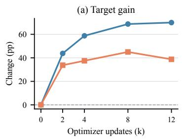

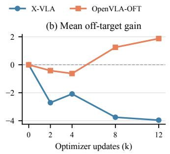

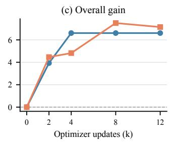  
Figure 8: Camera-view checkpoint dynamics. Target, mean off-target, and overall gains are measured relative to the base model on a fixed balanced subset. All gains are reported in percentage points. The target and off-target changes do not evolve monotonically together.

X-VLA has negative mean off-target gains of −4.0, −5.0, and −7.1 across the three seeds, whereas OpenVLA-OFT has positive gains of +1.9, +3.8, and +1.2. The model contrast is therefore present in every evaluated seed. To sum up, the checkpoint and seed analyses indicate that the model dependence in Section 5.1 is not an artifact of one checkpoint or training run. This smaller sensitivity analysis complements, rather than replaces, the full 10,030-episode comparison in Table 3.

Table 13: Camera-view sensitivity to training seed on the fixed 560-episode subset. All values are percentage-point gains over the corresponding base model on the same episodes.
<table><tr><td>Model</td><td>Seed</td><td> $G ^ { \mathrm { t a r g e t } }$ </td><td> $G ^ { \mathbf { o f f } }$ </td><td> $G ^ { \mathrm { a l l } }$ </td></tr><tr><td>X-VLA</td><td>42</td><td>+70.0</td><td>-4.0</td><td>+6.6</td></tr><tr><td>X-VLA</td><td>43</td><td>+73.8</td><td>-5.0</td><td>+6.3</td></tr><tr><td>X-VLA</td><td>44</td><td>+70.0</td><td>-7.1</td><td>+3.9</td></tr><tr><td>OpenVLA-OFT</td><td>42</td><td>+38.8</td><td>+1.9</td><td>+7.1</td></tr><tr><td>OpenVLA-OFT</td><td>43</td><td>+40.0</td><td>+3.8</td><td>+8.9</td></tr><tr><td>OpenVLA-OFT</td><td>44</td><td>+41.2</td><td>+1.2</td><td>+7.0</td></tr></table>

## E CLUSTER-BOOTSTRAP CONFIDENCE INTERVALS

We compute pointwise 95% confidence intervals using a paired cluster bootstrap over the 40 LIBERO task families, each comprising one source task and all its perturbed episodes. Every draw samples task families with replacement and retains all evaluation episodes and perturbation variants associated with each sampled family. The same draws are applied to the base and tuned results, and all metrics are recomputed before taking the 2.5th and 97.5th percentiles. These intervals quantify task-family sampling uncertainty conditional on the evaluated checkpoints; they do not estimate training-seed or repeated-rollout variation and are not adjusted for multiple comparisons.

Tables 14 and 15 report intervals for the four metrics in Table 3. The interval for Gworst is computed by taking the minimum off-target change within every bootstrap draw, rather than reusing the interval of the dimension with the lowest point estimate. The remaining tables report all dimension-level paired changes underlying Figure 2.

## E.1 DIMENSION-LEVEL PAIRED CHANGES

Tables 16–20 decompose the summary metrics into the seven paired dimension-level changes for each model. Rows identify the evaluation perturbation, while the two columns identify whether the visual pathway was tuned on Camera-view or Sensor-noise data; the final row gives the episodeweighted overall change. Each cell reports the point estimate followed by its pointwise 95% clusterbootstrap confidence interval. These tables show which individual regressions underlie the mean and worst off-target summaries in Table 3. In particular, intervals below zero occur across language, robot-state, object-layout, and visual perturbations, showing that the measured off-target effects are distributed across multiple evaluation conditions rather than driven by a single dimension.

Table 14: Camera-view tuning: summary gains and pointwise 95% cluster-bootstrap confidence intervals. Values are percentage points.
<table><tr><td>Model</td><td> $G ^ { \mathrm { t a r g e t } }$ </td><td> $G ^ { \mathbf { o f f } }$ </td><td>Gworst</td><td> $G ^ { \mathrm { a l l } }$ </td></tr><tr><td>OpenVLA-OFT</td><td>+39.3 [+30.6, +47.4]</td><td>+1.4 [+0.2, +2.8]</td><td>-2.8 [−5.1, −0.9]</td><td>+7.5</td></tr><tr><td></td><td>+22.0 [+15.2, +28.8]</td><td>-0.3 [−1.7, +1.2]</td><td>-3.9 [−6.3, −1.6]</td><td>[+5.4, +9.6] +3.0 [+1.4, +4.7]</td></tr><tr><td>π0.5 InternVLA-A1.5</td><td>+2.6 [−4.0, +9.2]</td><td>-5.2 [-7.3, -3.5]</td><td>-12.4</td><td>-4.2</td></tr><tr><td>NORA-1.5</td><td>+28.7 [+22.3, +35.4]</td><td>-10.1 [−13.9, -6.7]</td><td>[−16.1, -8.9] -17.8</td><td>[−6.5, −2.1] -3.7 [−7.2, −0.4]</td></tr><tr><td></td><td>+69.4</td><td>-4.6</td><td> $\left[ - 2 6 . 6 , - 1 1 . 3 \right]$ </td><td>+7.0</td></tr><tr><td>X-VLA</td><td>[+61.3,+76.4]</td><td>[−7.4, −2.1]</td><td>[−15.1, −7.1]</td><td>[+4.3, +9.6]</td></tr></table>

Table 15: Sensor-noise tuning: summary gains and pointwise 95% cluster-bootstrap confidence intervals. Values are percentage points.
<table><tr><td>Model</td><td> $G ^ { \mathrm { t a r g e t } }$ </td><td> $G ^ { \mathbf { o f f } }$ </td><td>Gworst</td><td>Gall</td></tr><tr><td></td><td>+19.8</td><td>+0.3</td><td>-0.6</td><td>+3.4</td></tr><tr><td>OpenVLA-OFT</td><td>[+13.4, +26.7] +10.2</td><td>[-1.1, +1.7] -1.3</td><td>[−5.0, +0.3] -4.1</td><td>[+2.0, +4.9] +0.3</td></tr><tr><td>π0.5</td><td>[+6.7, +14.0] -1.9</td><td>[−2.1, −0.7] -2.5</td><td>[−6.2, -3.0] -6.0</td><td>[−0.4, +1.1] -2.6</td></tr><tr><td>InternVLA-A1.5</td><td>[−6.4, +2.3] +45.3</td><td>[−3.4, −1.6] -1.0</td><td>[-8.9, -3.7] -4.4</td><td>[-3.7, -1.5] +6.2</td></tr><tr><td>NORA-1.5</td><td>[+38.6, +51.6] +32.8</td><td>[−3.4, +1.4] -2.2</td><td>[−9.4, −2.6] -4.2</td><td>[+3.7, +8.6] +3.2</td></tr><tr><td>X-VLA</td><td>[+27.5, +38.0]</td><td>[-3.8,-0.7]</td><td>[−8.1, -2.6]</td><td>[+1.6, +4.9]</td></tr></table>

Table 16: OpenVLA-OFT: paired dimension-level changes and pointwise 95% cluster-bootstrap confidence intervals. Values are percentage points.
<table><tr><td>Evaluation dimension</td><td>Camera-view tuning</td><td>Sensor-noise tuning</td></tr><tr><td>Camera view</td><td>+39.3 [+30.6, +47.4]</td><td>+0.0 [−4.3, +4.4]</td></tr><tr><td>Robot state</td><td>+0.3 [−1.4, +2.1]</td><td>−0.1 [−1.5, +1.3]</td></tr><tr><td>Language</td><td>+0.1 [−1.4, +1.7]</td><td>−0.2 [−1.6, +1.2]</td></tr><tr><td>Lighting</td><td>+1.0 [−2.0, +3.9]</td><td>−0.6 [−4.5, +2.6]</td></tr><tr><td>Background</td><td>+2.0 [−2.5, +6.4]</td><td>+1.7 [−1.0, +4.4]</td></tr><tr><td>Sensor noise</td><td>+7.9 [+4.7, +11.4]</td><td>+19.8 [+13.4, +26.7]</td></tr><tr><td>Object layout</td><td>-2.8 [−5.0, −0.7]</td><td>+1.1 [−1.1, +3.7]</td></tr><tr><td>Overall</td><td>+7.5 [+5.4, +9.6]</td><td>+3.4 [+2.0, +4.9]</td></tr></table>

Table 17: $\pi _ { 0 . 5 } \colon$ paired dimension-level changes and pointwise 95% cluster-bootstrap confidence intervals. Values are percentage points.
<table><tr><td>Evaluation dimension</td><td>Camera-view tuning</td><td>Sensor-noise tuning</td></tr><tr><td>Camera view</td><td> $+ 2 2 . 0 \ [ + 1 5 . 2 , + 2 8 . 8 ]$ </td><td> $- 4 . 1 \ [ - 6 . 0 , \ - 2 . 1 ]$ </td></tr><tr><td>Robot state</td><td> $- 0 . 5 \ [ - 3 . 1 , \ + 2 . 3 ]$ </td><td> $- 3 . 5 \ [ - 5 . 9 , \ - 1 . 2 ]$ </td></tr><tr><td>Language</td><td>-1.1  $[ - 3 . 5 , + 1 . 5 ]$ </td><td> $- 1 . 1 \ [ - 2 . 7 , \ + 0 . 4 ]$ </td></tr><tr><td>Lighting</td><td> $+ 3 . 0 \ [ + 0 . 4 , + 6 . 0 ]$ </td><td> $- 0 . 1 \ [ - 2 . 1 , + 1 . 8 ]$ </td></tr><tr><td>Background</td><td> $+ 1 . 6 \ [ - 1 . 0 , + 4 . 4 ]$ </td><td> $+ 0 . 9 \ [ - 0 . 3 , + 2 . 3 ]$ </td></tr><tr><td>Sensor noise</td><td> $- 3 . 9 \ [ - 6 . 3 , \ - 1 . 4 ]$ </td><td> $+ 1 0 . 2 \ [ + 6 . 7 , + 1 4 . 0 ]$ </td></tr><tr><td>Object layout</td><td> $- 1 . 0 \ [ - 2 . 4 , + 0 . 4 ]$ </td><td> $- 0 . 1 \left[ - 1 . 4 , + 1 . 1 \right]$ </td></tr><tr><td>Overall</td><td> $+ 3 . 0 \ [ + 1 . 4 , + 4 . 7 ]$ </td><td> $+ 0 . 3 \ [ - 0 . 4 , + 1 . 1 ]$ </td></tr></table>

Table 18: InternVLA-A1.5: paired dimension-level changes and pointwise 95% cluster-bootstrap confidence intervals. Values are percentage points.
<table><tr><td>Evaluation dimension</td><td>Camera-view tuning</td><td>Sensor-noise tuning</td><td></td></tr><tr><td>Camera view</td><td> $+ 2 . 6 \ [ - 4 . 0 , + 9 . 2 ]$ </td><td></td><td> $- 6 . 0 \ [ - 8 . 9 , \ - 3 . 2 ]$ </td></tr><tr><td>Robot state</td><td> $- 1 2 . 4 \left[ - 1 6 . 1 , \ : - 8 . 9 \right]$ </td><td></td><td>-3.4 [−5.3, −1.5]</td></tr><tr><td>Language</td><td> $- 5 . 8 \left[ - 9 . 1 , \ - 2 . 8 \right]$ </td><td></td><td>-2.8 [−4.9, −0.8]</td></tr><tr><td>Lighting</td><td> $- 1 . 4 \left[ - 3 . 8 , + 0 . 9 \right]$ </td><td></td><td>+0.7 [−2.5, +5.2]</td></tr><tr><td>Background</td><td> $- 3 . 4 \left[ - 7 . 5 , \ : - 0 . 3 \right]$ </td><td></td><td> $- 3 . 0 \ [ - 5 . 9 , \ - 0 . 6 ]$ </td></tr><tr><td>Sensor noise</td><td> $- 6 . 1 \left[ - 1 1 . 6 , \ : - 1 . 8 \right]$ </td><td></td><td> $- 1 . 9 \ [ - 6 . 4 , \ + 2 . 3 ]$ </td></tr><tr><td>Object layout</td><td> $- 2 . 2 \left[ - 4 . 0 , \ : - 0 . 5 \right]$ </td><td></td><td> $- 0 . 7 \ [ - 2 . 3 , + 1 . 0 ]$ </td></tr><tr><td>Overall</td><td> $- 4 . 2 \ [ - 6 . 5 , \ - 2 . 1 ]$ </td><td></td><td> $- 2 . 6 \ [ - 3 . 7 , \ - 1 . 5 ]$ </td></tr></table>

Table 19: NORA-1.5: paired dimension-level changes and pointwise 95% cluster-bootstrap confidence intervals. Values are percentage points.
<table><tr><td>Evaluation dimension</td><td>Camera-view tuning</td><td>Sensor-noise tuning</td><td></td></tr><tr><td>Camera view</td><td> $+ 2 8 . 7 \ [ + 2 2 . 3 , + 3 5 . 4 ]$ </td><td></td><td> $+ 0 . 9 \ [ - 0 . 4 , \ + 2 . 2 ]$ </td></tr><tr><td>Robot state</td><td> $- 6 . 6 \left[ - 1 1 . 4 , \ : - 2 . 0 \right]$ </td><td></td><td> $- 4 . 4 \ : [ - 6 . 9 , - 1 . 9 ]$ </td></tr><tr><td>Language</td><td> $- 1 1 . 9 \left[ - 1 8 . 6 , \ : - 5 . 4 \right]$ </td><td></td><td> $- 3 . 4 \ [ - 6 . 6 , \ - 0 . 3 ]$ </td></tr><tr><td>Lighting</td><td> $- 7 . 5 \ : [ - 1 8 . 2 , + 3 . 3 ]$ </td><td></td><td> $+ 5 . 3 \ [ - 2 . 3 , + 1 3 . 4 ]$ </td></tr><tr><td>Background</td><td> $- 1 7 . 8 \ : [ - 2 6 . 6 , \ : - 9 . 6 ]$ </td><td></td><td> $- 2 . 9 \ [ - 9 . 4 , \ + 3 . 3 ]$ </td></tr><tr><td>Sensor noise</td><td> $- 5 . 9 \ [ - 7 . 2 , \ - 4 . 6 ]$ </td><td></td><td> $+ 4 5 . 3 \ : [ + 3 8 . 6 , \ : + 5 1 . 6 ]$ </td></tr><tr><td>Object layout</td><td> $- 1 1 . 1 \ [ - 1 6 . 8 , \ - 5 . 9 ]$ </td><td></td><td> $- 1 . 6 \ [ - 3 . 7 , + 0 . 3 ]$ </td></tr><tr><td>Overall</td><td> $- 3 . { \dot { 7 } } \left[ - 7 . 2 , \ - 0 . 4 \right]$ </td><td></td><td> $+ 6 . 2 \ [ + 3 . 7 , \ + 8 . 6 ]$ </td></tr></table>

Table 20: X-VLA: paired dimension-level changes and pointwise 95% cluster-bootstrap confidence intervals. Values are percentage points.
<table><tr><td>Evaluation dimension</td><td>Camera-view tuning</td><td>Sensor-noise tuning</td><td></td></tr><tr><td>Camera view</td><td> $+ 6 9 . 4 \ [ + 6 1 . 3 , + 7 6 . 4 ]$ </td><td></td><td> $- 2 . 8 \ [ - 5 . 1 , \ - 0 . 7 ]$ </td></tr><tr><td>Robot state</td><td> $+ 0 . 5 \ [ - 3 . 2 , + 4 . 1 ]$ </td><td></td><td> $- 3 . 3 \ [ - 6 . 1 , \ - 0 . 5 ]$ </td></tr><tr><td>Language</td><td> $- 6 . 6 \left[ - 1 0 . 1 , \ : - 3 . 2 \right]$ </td><td></td><td> $- 4 . 2 \ [ - 7 . 9 , \ - 0 . 8 ]$ </td></tr><tr><td>Lighting</td><td> $- 2 . 2 \ [ - 8 . 2 , + 3 . 7 ]$ </td><td></td><td> $+ 1 . 2 \ [ - 1 . 7 , + 5 . 9 ]$ </td></tr><tr><td>Background</td><td> $- 3 . 9 \ [ - 9 . 0 , + 1 . 0 ]$ </td><td></td><td> $- 2 . 2 \ [ - 6 . 5 , + 1 . 7 ]$ </td></tr><tr><td>Sensor noise</td><td> $- 1 0 . 7 \ [ - 1 5 . 1 , \ - 6 . 7 ]$ </td><td></td><td> $+ 3 2 . 8 \ [ + 2 7 . 5 , + 3 8 . 0 ]$ </td></tr><tr><td>Object layout</td><td> $- 4 . 9 \ : [ - 9 . 2 , \ : - 0 . 6 ]$ </td><td></td><td> $- 2 . 0 \ [ - 4 . 0 , \ + 0 . 1 ]$ </td></tr><tr><td>Overall</td><td> $+ 7 . 0 \ [ + 4 . 3 , + 9 . 6 ]$ </td><td></td><td> $+ 3 . 2 \ [ + 1 . 6 , \ + 4 . 9 ]$ </td></tr></table>

## F QUALITATIVE PAIRED ROLLOUTS

Figure 9 visualizes a paired X-VLA episode under Sensor-noise evaluation with the instruction put the bowl on the plate. The base and Sensor-noise-tuned models receive the same task, initial state, and noise perturbation. We show six temporally ordered frames from each trajectory, with one rollout per row. The base model moves toward the bowl but does not place it on the plate before the 300-step limit. The tuned model grasps the bowl, moves it onto the plate, and succeeds after 73 steps. The paired rows illustrate how an aggregate outcome reversal arises from different action sequences within the same evaluation condition.

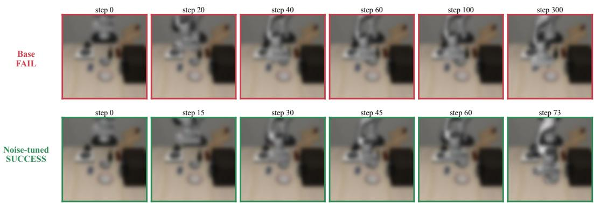  
Figure 9: Paired X-VLA trajectories under a Sensor-noise perturbation. Six ordered frames are shown for the base failure (top) and Sensor-noise-tuned success (bottom) on the same episode. Frame labels give simulator steps.

Figure 10 provides a second paired X-VLA example for the same instruction under a Camera-view perturbation. Both models receive the same changed viewpoint, initial state, and evaluation seed. The base model approaches the bowl but leaves it off the plate when it reaches the 300-step limit. The Camera-view-tuned model completes the transfer and succeeds after 75 steps. Six ordered frames from each trajectory show how target-domain tuning changes the execution of the same episode.

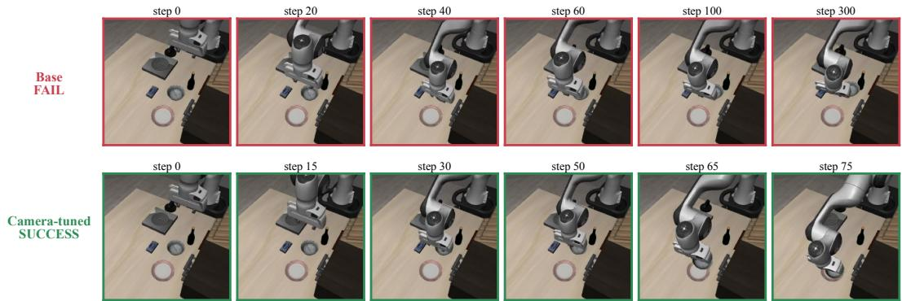  
Figure 10: Paired X-VLA trajectories under a Camera-view perturbation. Six ordered frames are shown for the base failure (top) and Camera-view-tuned success (bottom) on the same episode. Frame labels give simulator steps.