# VisualEvolve: A Skill Self-Evolution Framework for Visual Reasoning

Jiawei Wang<sup>1</sup>, Yucun Li<sup>2</sup>, Xueqi Li<sup>3</sup>, Shenghao Wang<sup>2</sup>, Xinquan Gong<sup>2</sup>, Dan Zhang<sup>1</sup>, Zheqi Lv<sup>4</sup>, Yuquan Le<sup>5</sup>, Shaozu Yuan<sup>6</sup>, An Zhang<sup>7</sup>, Da Cao<sup>2,\*</sup>, Tat-Seng Chua<sup>1</sup>

<sup>1</sup>National University of Singapore <sup>2</sup>Hunan University <sup>3</sup>Shenzhen University

<sup>4</sup>Cornell University <sup>5</sup>Hunan Normal University <sup>6</sup>Meituan

<sup>7</sup>University of Science and Technology of China

\* Corresponding author.

Visual tool use enables vision-language models (VLMs) to acquire task-relevant evidence, but its efectiveness can be limited by predefined visual operations and the tool-use strategies learned during training. Representing these operations and strategies as reusable external skills allows them to be refined through self-evolution without updating model parameters. However, skill refinement can introduce performance regressions. Meanwhile, inspecting accumulated task execution trajectories together with skill evolution history may lead to evolution evidence overload. To address these challenges, we propose VisualEvolve, a self-evolving framework that evolves executable visual operations and tool-use strategies for VLMs through a Select–Execute–Evolve–Evaluate cycle. Skill-Library Snapshot Selection uses performance on a fixed validation set disjoint from execution tasks to select an efective historical snapshot for subsequent evolution, limiting the propagation of performance regressions. Progressive Evidence Access (PEA) guides capability-gap diagnosis through a coarse-tofine hierarchy comprising the Skill-Performance Report, Evolution Log, Trajectory Summaries, and relevant raw trajectory segments. Across four VLM backbones and six evaluation sets from three benchmarks, VisualEvolve improves over the Initial Skill Library in 23 of 24 settings, with a maximum gain of 15.1 percentage points on VisualProbe Hard using Qwen3.5-Plus. Ablation studies support the contributions of Snapshot Selection and PEA, while further experiments show that skills can be improved using experience from diferent data settings and directly reused across backbones. Moreover, VisualEvolve enables efective skill self-evolution with over an order of magnitude fewer task-solving trajectories than estimated for representative RL-based methods.

Code: https://anonymous.4open.science/r/VisualEvolve-6E80/ Website: https://jiaweiwang-ai.github.io/VisualEvolve/

## 1 Introduction

By adopting visual tool use, vision-language models (VLMs) are capable of inspecting and manipulating images during reasoning (Wu and Xie, 2024; Wu et al., 2026; Song et al., 2026). Its efectiveness depends on both the available visual operations and the strategies that determine when and how to use them (Zheng et al., 2026; Lai et al., 2026). Training-based approaches, such as DeepEyes (Zheng et al., 2026) and Mini-o3 (Lai et al., 2026), learn these strategies through supervised fine-tuning (SFT) or reinforcement learning (RL) over predefined visual operations. However, limitations in available visual operations or their usage strategies may prevent models from acquiring task-relevant visual evidence (Lai et al., 2026; Sun et al., 2026; Wang et al., 2026b). This motivates adapting both visual operations and tool-use strategies to the needs revealed during task execution (Sun et al., 2026; Huang et al., 2026; Lin et al., 2026b). Recent work represents reusable task guidance as external skill – structured instructions for performing a class of tasks, which can be paired with executable tools (Sun et al., 2026; Yu et al., 2026). Stored outside model parameters, these instructions and associated tools can be refined without retraining the model (Sun et al., 2026).

Self-evolution enables an agent to refine its external skill library through task execution and feedback (Jiang et al., 2026; Sun et al., 2026). The goal is to turn experience accumulated over multiple rounds into reusable visual reasoning skills (Jiang et al., 2026; Ni et al., 2026; Sun et al., 2026). However, skill evolution faces two challenges. First, skill refinement can introduce performance regressions, even when it addresses failures observed during task execution (Wei et al., 2026; Li and Hu, 2026). Second, skill evolution requires analyzing not only task execution trajectories, but also the history of skill modifications and evaluation results (Li and Hu, 2026; Wei et al., 2026). As these records accumulate, inspecting them all at once can cause evolution evidence overload, increasing the context burden and making capability gaps harder to diagnose (Lee et al., 2026; Lin et al., 2026a).

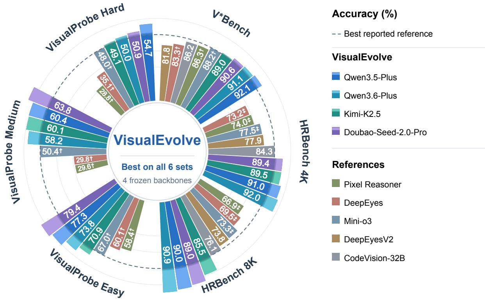  
Figure 1 VisualEvolve versus training-based agents on six evaluation sets. VisualEvolve uses our framework with four backbones; References are agents trained with SFT and/or RL. The dashed circle marks the highest reported reference accuracy in each set. VisualEvolve: Acc@1; †: Avg@32; ‡: Avg@8.

To address these challenges, we propose VisualEvolve, a self-evolving framework that evolves executable visual operations and tool-use strategies for VLMs through a Select–Execute–Evolve–Evaluate cycle. Each cycle comprises four stages: (1) Select. To limit the propagation of performance regressions, Skill-Library Snapshot Selection guides the agent to choose a starting library from archived snapshots based on validation performance; (2) Execute. The selected library is applied to visual reasoning tasks, producing execution trajectories, correctness labels, and Trajectory Summaries for capability-gap diagnosis; (3) Evolve. To address evolution evidence overload, we introduce Progressive Evidence Access (PEA), which guides capability-gap diagnosis through coarse-to-fine access to skill evolution history and current execution evidence. These diagnoses guide revisions to the skill library; (4) Evaluate. The revised library is assessed on a fixed validation set disjoint from the execution tasks and archived as a new snapshot. The resulting validation feedback and updated evolution records support subsequent snapshot selection and capability-gap diagnosis. Together, these components enable VisualEvolve to build on efective historical skill libraries while diagnosing capability gaps through coarse-to-fine access to execution evidence and evolution history.

As summarized in Figure 1, experiments with four frozen VLM backbones across six evaluation sets from three benchmarks show that evolving external skills improves visual reasoning without updating model parameters. VisualEvolve outperforms the Initial Skill Library in 23 of 24 backbone–evaluation-set combinations, with the largest gain of 15.1 percentage points (38.1% relative) on VisualProbe Hard using Qwen3.5-Plus. Ablation studies show that both selecting the skill-library snapshot for further evolution and organizing evidence through PEA contribute to these gains. Experiments under three evolution-data settings further show that VisualEvolve can improve its skills through self-evolution using execution experience from diferent data sources. Finally, we transfer the skill library evolved with Kimi-K2.5 to three other VLM backbones without modification. The transferred library improves their average accuracy over the Initial Skill Library, demonstrating that the evolved skills can be directly reused across models. Our main contributions can be summarized as follows:

• We propose VisualEvolve, a self-evolving framework that evolves executable visual operations and tool-use strategies for VLMs through a Select–Execute–Evolve–Evaluate cycle.

• We introduce Skill-Library Snapshot Selection to select the historical snapshot with the highest validation accuracy for subsequent evolution, and Progressive Evidence Access to guide capability-gap diagnosis through coarse-to-fine access to task execution trajectories and skill evolution history.

• We demonstrate that VisualEvolve improves visual reasoning across four backbones and three benchmarks without updating model parameters. Ablation studies demonstrate the contributions of key stages in the evolution cycle and Progressive Evidence Access. Further experiments demonstrate efective skill improvement through self-evolution using experience from diferent data sources and direct reuse of evolved skills across backbones.

## 2 Related Work

Training-Based Visual Reasoning Agents. Training-based visual reasoning agents acquire task-relevant evidence through tool use, from invoking predefined tools such as cropping (Lai et al., 2026; Zhao et al., 2026; Chng et al., 2026) to generating and executing image-processing code (Zhang et al., 2026; Song et al., 2026; Guo et al., 2026). These methods typically optimize when and how to invoke such operations through SFT, RL, or both (Su et al., 2025; Lu et al., 2026; Chen et al., 2026). In contrast, VisualEvolve keeps the backbone frozen and improves visual reasoning by evolving external skills.

Skill-Based Agents. External skills encode reusable capabilities (Yu et al., 2026) as executable programs (Wang et al., 2024, 2026a; Shao et al., 2026), structured guidance for planning and tool use (Jiang et al., 2026), or natural-language instructions augmented with optional executable and supporting resources (Ni et al., 2026; Lin et al., 2026a). VisualEvolve adapts this paradigm to visual reasoning by representing each skill as a tool-use strategy paired with an optional visual operation.

Self-Evolving Agents. Self-evolving agents improve over time by externalizing accumulated experience into reusable artifacts, including verbal reflections (Shinn et al., 2023), experiential knowledge (Zhao et al., 2024; Ouyang et al., 2026), and reusable skills (Wang et al., 2024; Wei et al., 2026; Ni et al., 2026; Sun et al., 2026). Recent methods retain richer evolution histories. SkillHone records diagnoses, revisions, and feedback to support continual skill refinement (Li and Hu, 2026), while Meta-Harness gives its proposer access to the source code, scores, and traces of prior harness candidates (Lee et al., 2026). VisualEvolve focuses on two challenges in multi-round skill evolution: performance regressions after skill updates and evidence overload from accumulated evolution history. Snapshot Selection selects the historical snapshot with the highest validation accuracy for subsequent evolution, while Progressive Evidence Access organizes accumulated evidence into a coarse-to-fine hierarchy for capability-gap diagnosis.

## 3 Method

## 3.1 Problem Formulation

We study the problem of evolving a skill library to improve performance on visual reasoning tasks. Given a frozen backbone $\scriptstyle A _ { \theta }$ , an initial skill library $\mathcal { L } _ { 0 }$ , evolution data $\mathcal { D } _ { \mathrm { e v o } }$ , and an evolution budget of R rounds, we construct a fixed validation set $\mathcal { D } _ { \mathrm { v a l } } \subset \mathcal { D } _ { \mathrm { e v o } }$ and round-specific execution sets $\mathcal { D } _ { r } ^ { \mathrm { e x e } } \subset \mathcal { D } _ { \mathrm { e v o } } \setminus \mathcal { D } _ { \mathrm { v a l } }$ for $r = 1 , \ldots , R$ . VisualEvolve iteratively updates the skill library and obtains a sequence of skill-library snapshots $\{ \mathcal { L } _ { 0 } , \mathcal { L } _ { 1 } , \ldots , \mathcal { L } _ { R } \}$ . Each snapshot $\mathcal { L } _ { t }$ is evaluated on $\mathcal { D } _ { \mathrm { v a l } } .$ , yielding the validation accuracy $a _ { t } ^ { \mathrm { v a l } } =$ $\operatorname { A c c } ( \mathcal { A } _ { \theta } , \mathcal { L } _ { t } ; \mathcal { D } _ { \mathrm { v a l } } )$ . We select the snapshot with the highest validation accuracy as the final skill library $\mathcal { L } ^ { \star }$ and assess its performance on evaluation sets reserved for final testing

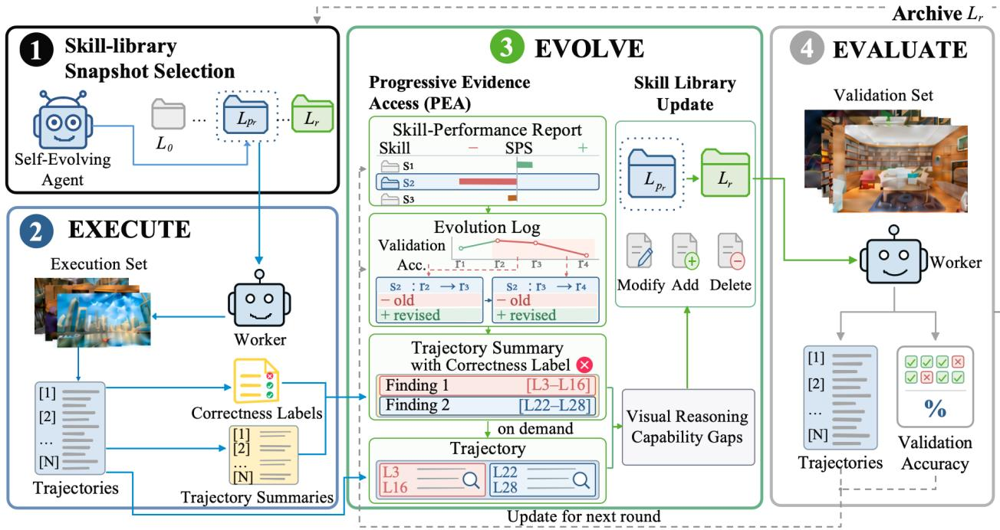  
Figure 2 The VisualEvolve framework. VisualEvolve evolves a skill library through multi-round Select–Execute–Evolve– Evaluate cycles.

## 3.2 Framework Overview

As shown in Figure 2, VisualEvolve evolves a skill library through multi-round Select–Execute–Evolve–Evaluate cycles. Skill-Library Snapshot Selection chooses the starting skill library, Execute applies it to the execution set to collect execution evidence, Evolve diagnoses capability gaps and updates the skill library, and Evaluate assesses and archives the updated skill library. The prompt guiding the evolution process is provided in Appendix F.3.

## 3.3 Skill-Library Snapshot Selection

To limit the propagation of performance regressions across evolution rounds, each round begins with Skill-Library Snapshot Selection, which selects a previously archived skill-library snapshot as the starting point. Formally, we denote a skill library by $\mathcal { L } = \{ s _ { i } \} _ { i = 1 } ^ { N }$ , where each skill $s _ { i } = ( \pi _ { i } , u _ { i } )$ consists of a textual strategy $\pi _ { i }$ and an optional executable visual operation $u _ { i }$

In the first round, VisualEvolve starts from the initial skill library $\mathcal { L } _ { 0 }$ , which contains a single crop skill and is detailed in Appendix E. For each subsequent round $r > 1$ , rather than always evolving from the latest snapshot, VisualEvolve selects the archived snapshot with the highest validation accuracy among $\mathcal { L } _ { 0 } , \ldots , \mathcal { L } _ { r - 1 }$ The selected snapshot, denoted by $\mathcal { L } _ { p _ { r } }$ , serves as the starting skill library for round r.

## 3.4 Execute

To construct execution evidence for Evolve, Execute applies the selected starting skill library $\mathcal { L } _ { p _ { \tau } }$ to the execution set, producing trajectories, correctness labels, and Trajectory Summaries.

At round r, the Worker, a task-solving agent instantiated with the frozen backbone $\scriptstyle A _ { \theta }$ and equipped with $\mathcal { L } _ { p _ { r } }$ , solves tasks from the execution set $\mathcal { D } _ { r } ^ { \mathrm { e x e } }$ , producing trajectories that record the task-solving process and final predictions. To distinguish successful and failed outcomes for subsequent diagnosis, each trajectory is assigned a correctness label by comparing its final prediction with the ground-truth answer. Finally, to reduce the context burden of trajectory analysis while preserving traceable evidence, each trajectory is compressed into a source-linked Trajectory Summary, where each summary comprises multiple findings that

capture capability-relevant behaviors and reference the corresponding supporting spans in the raw trajectory.   
Additional details and the Execute instruction are provided in Appendices A.1 and G.1, respectively.

## 3.5 Evolve

Evolve uses execution evidence together with the history of skill modifications and evaluation results to diagnose capability gaps and update the starting skill library $\mathcal { L } _ { p _ { r } }$ . Since loading all available evidence at once would incur evolution evidence overload, we introduce Progressive Evidence Access, which enables the Self-Evolving Agent, primarily responsible for capability-gap diagnosis and skill-library updates, to access evidence from coarse to fine. It first identifies relevant skills through the Skill-Performance Report, traces their historical modifications through the Evolution Log, analyzes current-round Trajectory Summaries for recurring failure patterns, and accesses relevant raw trajectory segments only when finer-grained evidence is needed.

Skill-Performance Report. Validation accuracy measures the performance of a skill library but does not indicate which skills are associated with performance changes. We therefore introduce the Skill-Performance Report, which estimates each skill’s association with changes in validation performance through a Skill Performance Score (SPS). The SPS is defined as the diference in mean correctness between two skill-library snapshots over the skill-associated validation subset.

Specifically, for two snapshots $\mathcal { L } _ { a }$ and $\mathcal { L } _ { b }$ , we define the skill-associated validation subset as

$$
\mathcal { D } _ { s } ^ { a , b } = \left\{ d _ { j } \in \mathcal { D } _ { \mathrm { v a l } } \mid s \in Z _ { j } ^ { ( a ) } \vee s \in Z _ { j } ^ { ( b ) } \right\} ,
$$

where $Z _ { j } ^ { ( a ) }$ and $Z _ { j } ^ { ( b ) }$ denote the sets of skills loaded while solving validation example $d _ { j }$ with $\mathcal { L } _ { a }$ and $\mathcal { L } _ { b } ,$ respectively. Thus, $\mathcal { D } _ { s } ^ { a , b }$ contains all validation examples on which s is loaded under at least one of the two snapshots. For $| \mathcal { D } _ { s } ^ { a , b } | > 0$ , SPS is computed as the diference in mean correctness between the two snapshots on this subset:

$$
\mathrm { S P S } _ { a  b } ( s ) = \frac { 1 } { | \mathcal { D } _ { s } ^ { a , b } | } \sum _ { d _ { j } \in \mathcal { D } _ { s } ^ { a , b } } c ^ { ( b ) } ( d _ { j } ) - \frac { 1 } { | \mathcal { D } _ { s } ^ { a , b } | } \sum _ { d _ { j } \in \mathcal { D } _ { s } ^ { a , b } } c ^ { ( a ) } ( d _ { j } ) ,
$$

where $c ^ { ( a ) } ( d _ { j } ) , c ^ { ( b ) } ( d _ { j } ) \in \{ 0 , 1 \}$ indicate whether $d _ { j }$ is answered correctly under $\mathcal { L } _ { a }$ and $\mathcal { L } _ { b }$ , respectively. The sign of SPS indicates the direction of the performance diference, while its absolute value indicates the strength of association. Since multiple skills may be loaded together, SPS provides only an approximate estimate of an individual skill’s contribution to the performance change.

At round $r > 1$ , the Self-Evolving Agent uses the report from round r − 1, which contains SPS values for up to three snapshot pairs: $( \mathcal { L } _ { p _ { r - 1 } } , \mathcal { L } _ { r - 1 } ) , ( \mathcal { L } _ { 0 } , \mathcal { L } _ { r - 1 } )$ , and $( \mathcal { L } _ { 0 } , \mathcal { L } _ { p _ { r - 1 } } )$ . The agent considers these values jointly and prioritizes skills with large absolute SPS for further inspection.

Evolution Log. The Skill-Performance Report identifies skills associated with performance changes but does not reveal how these skills have changed across archived snapshots. We therefore introduce the Evolution Log, which records each snapshot’s validation accuracy and indexes per-skill diferences between consecutive snapshots. The Self-Evolving Agent uses the accuracy history to locate improvement or regression intervals and inspects the corresponding historical changes of the identified skills, providing references for update directions to reuse or avoid.

Trajectory Summary. After obtaining historical references for skill updates, the Self-Evolving Agent turns to current-round execution evidence. Using the correctness labels, it prioritizes the Trajectory Summaries associated with incorrect predictions, identifies recurring failure patterns, and abstracts them into capability gaps, such as repeatedly revisiting the same image regions and stopping visual search before suficient evidence is collected.

Trajectory. When finer-grained evidence is needed, the Self-Evolving Agent follows the source references in Trajectory Summaries to relevant segments of trajectories, exposing detailed reasoning and tool-use behavior behind the identified failures.

Based on the diagnosed capability gaps, Evolve updates the starting skill library $\mathcal { L } _ { p _ { \eta } }$ by modifying, adding, or removing skills, yielding $\mathcal { L } _ { r }$ . For an existing skill $s _ { i } = ( \pi _ { i } , u _ { i } )$ , the update can revise its tool-use strategy $\pi _ { i }$ or executable visual operation $u _ { i }$ . Before Evaluate, $\mathcal { L } _ { r }$ undergoes structural and executability checks. These checks and the construction of the Skill-Performance Report and Evolution Log are detailed in Appendix A.2, while the Evolve instruction is provided in Appendix G.2.

## 3.6 Evaluate

To provide a consistent generalization signal across evolution rounds, Evaluate assesses the updated skill library $\mathcal { L } _ { r }$ on the fixed validation set $\mathcal { D } _ { \mathrm { v a l } }$ using the Worker, yielding the validation accuracy $a _ { r } ^ { \mathrm { v a l } }$ . The Skill-Performance Report and Evolution Log are then updated for use in the next round’s Evolve stage, while $\mathcal { L } _ { r }$ is archived as a new skill-library snapshot for the next round’s Snapshot Selection. The instruction for Evaluate is provided in Appendix G.3.

## 3.7 Evolution Procedure

The complete evolution procedure repeatedly cycles through Skill-Library Snapshot Selection, Execute, Evolve, and Evaluate until all R evolution rounds are completed. All agents use the same frozen VLM backbone. At each round $r ,$ Snapshot Selection first determines the starting skill library $\mathcal { L } _ { p _ { r } }$ . Execute applies $\mathcal { L } _ { p _ { r } }$ to a round-specific execution set, producing trajectories, correctness labels, and Trajectory Summaries. Evolve then uses Progressive Evidence Access to diagnose capability gaps using the Skill-Performance Report, Evolution Log, Trajectory Summaries, and, when needed, relevant raw trajectory segments, and updates the starting skill library to produce the updated library $\mathcal { L } _ { r }$ . Evaluate assesses and archives the $\mathcal { L } _ { r } .$ , while updating the Skill-Performance Report and Evolution Log for subsequent rounds. After all R rounds are completed, the archived snapshot with the highest validation accuracy is returned as the final skill library $\mathcal { L } ^ { \star }$ . Algorithm 1 summarizes the complete evolution procedure.

## 4 Experiments

To evaluate VisualEvolve, we conduct comprehensive experiments to explore the following research questions. RQ1: How does VisualEvolve improve over Single-Pass inference and the Initial Skill Library, and how does it compare with representative training-based visual-reasoning baselines? RQ2: How do the framework stages and the evidence-access mechanism within Progressive Evidence Access contribute to efective multi-round skill evolution? RQ3: How does VisualEvolve evolve a skill library using execution experience from diferent data sources, and how well does the evolved skill library transfer across backbones? RQ4: What is the cost of skill evolution, and what additional inference-time cost does the evolved skill library introduce?

## 4.1 Experimental Setup

Evolution Data. We use evolution data $\mathcal { D } _ { \mathrm { e v o } }$ as the source of execution tasks for skill evolution. In the default setting, $\mathcal { D } _ { \mathrm { e v o } }$ combines VisualProbe , with 2.9K samples for challenging visual search (Lai et al., 2026), and the Visual Search component of the DeepEyes training corpus, with approximately 22K samples from the $V ^ { * }$ training set for visual grounding and fine-grained perception (Wu and Xie, 2024; Zheng et al., 2026). We retain only the original image, question, and answer.

Benchmarks. We use separate benchmarks for final evaluation. V<sup>\*</sup>Bench contains 191 examples for finegrained visual search and spatial reasoning (Wu and Xie, 2024), HRBench4K and HRBench8K each contain 800 high-resolution visual-reasoning examples (Wang et al., 2025), and VisualProbe Easy, Medium, and Hard contain 141, 268, and 106 examples, respectively, covering increasingly challenging exploratory visual reasoning (Lai et al., 2026).

Baselines. We compare VisualEvolve against three types of baselines. Single-Pass queries the VLM backbone in a single turn without external tools, serving as the baseline. Initial Skill Library equips each backbone with $\mathcal { L } _ { 0 }$ and serves as the baseline for measuring gains from evolution. Training-Based Methods include representative visual-reasoning agents trained with RL, with or without prior SFT (Su et al., 2025; Zheng et al., 2026; Lai et al., 2026; Hong et al., 2026; Guo et al., 2026).

<table><tr><td rowspan="2">Backbone</td><td rowspan="2">Method</td><td rowspan="2">V* Bench</td><td colspan="2">HRBench</td><td colspan="3">VisualProbe</td><td rowspan="2">Macro Avg.</td></tr><tr><td>4K</td><td>8K</td><td>Easy</td><td>Medium</td><td>Hard</td></tr><tr><td rowspan="4">Qwen2.5-VL-7B</td><td>Pixel ReasonerR</td><td>86.3†</td><td>74.0</td><td>66.9</td><td>58.4†</td><td>29.6†</td><td>28.8†</td><td>57.3</td></tr><tr><td>DeepEyesR</td><td>83.3†</td><td> $7 3 . 2 ^ { \ddagger }$ </td><td>69.5</td><td>60.1†</td><td>29.8†</td><td>35.1†</td><td>58.5</td></tr><tr><td>Mini-o3</td><td>88.2†</td><td> $7 7 . 5 ^ { \ddagger }$ </td><td> $7 3 . 3 ^ { \ddagger }$ </td><td> ${ \mathfrak { 6 7 . 0 } } ^ { \dagger }$ </td><td>50.4†</td><td>48.0†</td><td>67.4</td></tr><tr><td>DeepEyesV2</td><td>81.8</td><td>77.9</td><td>73.8</td><td></td><td></td><td></td><td></td></tr><tr><td>Qwen3-VL-32B</td><td>CodeVision-32B</td><td>86.2</td><td>84.3</td><td>76.1</td><td></td><td></td><td></td><td></td></tr><tr><td rowspan="3">Qwen3.5-Plus</td><td>Single-Pass</td><td>83.8</td><td>84.4</td><td>80.0</td><td>66.7</td><td>37.7</td><td>35.8</td><td>64.7</td></tr><tr><td>Initial Skill Library</td><td>86.4</td><td>87.0</td><td>83.3</td><td>68.1</td><td>48.1</td><td>39.6</td><td>68.8</td></tr><tr><td>VisualEvolve</td><td>92.1</td><td>91.0</td><td>90.0</td><td>77.3</td><td>60.4</td><td>54.7</td><td>77.6</td></tr><tr><td rowspan="3">Qwen3.6-Plus</td><td>Single-Pass</td><td>88.0</td><td>87.8</td><td>84.1</td><td>58.9</td><td>34.7</td><td>31.1</td><td>64.1</td></tr><tr><td>Initial Skill Library</td><td>90.6</td><td>88.5</td><td>87.4</td><td>66.7</td><td>53.4</td><td>36.8</td><td>70.6</td></tr><tr><td>VisualEvolve</td><td>91.1</td><td>92.0</td><td>90.9</td><td>73.8</td><td>58.2</td><td>50.0</td><td>76.0</td></tr><tr><td rowspan="3">Kimi-K2.5</td><td>Single-Pass</td><td>82.7</td><td>79.8</td><td>75.8</td><td>50.4</td><td>32.1</td><td>24.5</td><td>57.6</td></tr><tr><td>Initial Skill Library</td><td>85.3</td><td>88.5</td><td>81.5</td><td>70.9</td><td>54.1</td><td>35.8</td><td>69.4</td></tr><tr><td>VisualEvolve</td><td>89.0</td><td>89.5</td><td>85.5</td><td>70.9</td><td>60.1</td><td>49.1</td><td>74.0</td></tr><tr><td rowspan="3">Doubao-Seed- 2.0-Pro</td><td>Single-Pass</td><td>88.5</td><td>83.3</td><td>76.5</td><td>60.3</td><td>36.2</td><td>29.2</td><td>62.3</td></tr><tr><td>Initial Skill Library</td><td>89.5</td><td>86.8</td><td>86.0</td><td>75.9</td><td>59.0</td><td>42.5</td><td>73.3</td></tr><tr><td>VisualEvolve</td><td>90.6</td><td>89.4</td><td>89.0</td><td>79.4</td><td>63.8</td><td>50.9</td><td>77.2</td></tr></table>

Table 1 Main results (RQ1). Accuracy (%) on six evaluation sets from the three benchmarks. For training-based methods, results in rows marked with <sup>R</sup> are taken from the Mini-o3 paper (Lai et al., 2026), while results for the remaining methods are taken from their respective original papers.  
Sources: Mini-o3 (Lai et al., 2026), DeepEyesV2 (Hong et al., 2026), and CodeVision (Guo et al., 2026).  
†: Avg@32; ‡: Avg@8; our runs: Acc@1. Macro Avg.: unweighted mean of all six sets, shown only for complete rows. “–”:  
unavailable. Bold/underline: best/second-best per column within training-based methods or each of our backbone groups; ties share a rank.

Implementation Details. We run VisualEvolve for $R = 1 6$ evolution rounds. Before the first round, we sample a fixed 200-example validation set $\mathcal { D } _ { \mathrm { v a l } }$ from $\mathcal { D } _ { \mathrm { e v o } }$ . At each round r, we sample 32 examples from $\mathcal { D } _ { \mathrm { { e v o } } } \backslash \mathcal { D } _ { \mathrm { { v a l } } }$ to form $\mathcal { D } _ { r } ^ { \mathrm { e x e } }$ . When $\mathcal { D } _ { \mathrm { e v o } }$ combines multiple datasets, balanced sampling is applied to both the validation and execution sets, drawing an equal number of examples from each dataset. We use Qwen3.5- Plus (Qwen Team, 2026a), Qwen3.6-Plus (Qwen Team, 2026b), Kimi-K2.5 (Kimi Team et al., 2026), and Doubao-Seed-2.0-Pro (Bytedance Seed, 2026), with temperature 0 and thinking mode enabled.

## 4.2 Main Results (RQ1)

We evaluate VisualEvolve with two internal baselines, Single-Pass and the Initial Skill Library, across four backbones, and further compare recent training-based visual-reasoning agents. We report accuracy on six evaluation sets from three benchmarks in Table 1.

We make the following observations from Table 1. (1) Multi-round skill evolution consistently improves performance over both Single-Pass and the Initial Skill Library. Across the 24 backbone–evaluation-set combinations, VisualEvolve outperforms Single-Pass in all cases and improves over the Initial Skill Library in 23 cases. The largest gains over the Initial Skill Library occur on VisualProbe Hard, reaching 15.1 and 13.3 percentage points with Qwen3.5-Plus and Kimi-K2.5, respectively. These results demonstrate the efectiveness of multi-round skill evolution. (2) Skill evolution yields consistent gains across all four backbones. Compared with the Initial Skill Library, VisualEvolve improves macro-average accuracy by 8.8, 5.4, 4.6, and 3.9 percentage points with Qwen3.5-Plus, Qwen3.6-Plus, Kimi-K2.5, and Doubao-Seed-2.0-Pro, respectively. These consistent gains support the robustness of skill evolution across diferent backbones. (3) We also include reported results from representative training-based visual-reasoning agents for reference. With Qwen3.5-Plus, VisualEvolve reaches 77.6% macro-average accuracy, compared with 67.4% for Mini-o3, the strongest training-based method with complete reported results, suggesting that VisualEvolve achieves competitive performance among the reported results.

<table><tr><td></td><td colspan="3">Stage</td><td colspan="3">PEA</td><td></td></tr><tr><td>Variant</td><td>Select</td><td>Execute</td><td>Evaluate</td><td>SPR</td><td>EL</td><td>TS</td><td>Macro Avg.</td></tr><tr><td>Stage ablations</td><td></td><td></td><td></td><td></td><td></td><td></td><td></td></tr><tr><td>w/o Selection</td><td>X</td><td>√</td><td>√</td><td>√</td><td>√</td><td>√</td><td>72.2</td></tr><tr><td>w/o Execute</td><td>√</td><td>×</td><td>√</td><td>√</td><td>√</td><td>X</td><td>69.9</td></tr><tr><td>w/o Evaluate</td><td>×</td><td>√</td><td>×</td><td>×</td><td>×</td><td>√</td><td>71.2</td></tr><tr><td>PEA ablations</td><td></td><td></td><td></td><td></td><td></td><td></td><td></td></tr><tr><td>w/o SPR</td><td>√</td><td>√</td><td>√</td><td>×</td><td>√</td><td>√</td><td>73.6</td></tr><tr><td>w/o EL</td><td>√</td><td>√</td><td>√</td><td>√</td><td>×</td><td>√</td><td>75.0</td></tr><tr><td>w/o TS</td><td>√</td><td>√</td><td>√</td><td>√</td><td>√</td><td>×</td><td>73.0</td></tr><tr><td>w/o SPR + EL</td><td>√</td><td>√</td><td>√</td><td>×</td><td>×</td><td>√</td><td>71.8</td></tr><tr><td>w/o PEA</td><td>√</td><td>√</td><td>√</td><td>×</td><td>×</td><td>×</td><td>71.3</td></tr><tr><td>Single-Pass</td><td>×</td><td>×</td><td>×</td><td>×</td><td>×</td><td>×</td><td>64.7</td></tr><tr><td>VisualEvolve</td><td>√</td><td>√</td><td>√</td><td>√</td><td>√</td><td>√</td><td>77.6</td></tr></table>

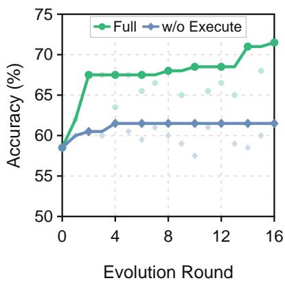  
Table 2 Ablation of framework stages and Progressive Evidence Access (RQ2). All variants use Qwen3.5-Plus. Macro Avg. is the mean Acc@1 (%) across six evaluation sets.  
Notation: ✓ retained; × removed. Select: Skill-Library Snapshot Selection; SPR: Skill-Performance Report; EL: Evolution Log; TS: Trajectory Summary. For w/o Evaluate, we evaluate all snapshots on the fixed validation set only after evolution, then test the highest-scoring snapshot on held-out benchmarks.

Figure 3 Execute ablation (RQ2). Lines track the best-so-far accuracy over 16 rounds. Scatter points show each round’s validation accuracy.

## 4.3 Ablation Study (RQ2)

We conduct ablation studies with Qwen3.5-Plus to assess framework stages and the evidence-access mechanism in Progressive Evidence Access.

For the stage ablations, w/o Skill-Library Snapshot Selection starts from the latest skill library. w/o Execute removes execution evidence. w/o Evaluate removes evaluation on the validation set, thereby disabling Snapshot Selection and leaving the Skill-Performance Report and Evolution Log empty. For Progressive Evidence Access ablations, w/o Skill-Performance Report removes skill screening before Evolution Log analysis, w/o Evolution Log removes the structured association between historical skill modifications and validation accuracy, and w/o Trajectory Summary removes trajectory compression. w/o Skill-Performance Report + Evolution Log removes the hierarchical access provided by these two components, while w/o Progressive Evidence Access further removes Trajectory Summaries, so validation-accuracy history, skill-change history, and raw trajectories are accessed directly without hierarchical organization.

We make the following observations from Table 2 and Figure 3. (1) All three framework stages contribute substantially to multi-round skill evolution. Compared with the full framework, removing Skill-Library Snapshot Selection, Execute, or Evaluate reduces macro-average accuracy by 5.4, 7.7, and 6.4 percentage points, respectively. In particular, w/o Execute reaches only 61.5% best-so-far validation accuracy, highlighting the importance of execution evidence for efective skill updates. (2) The ablations support the efectiveness of the coarse-to-fine evidence-access mechanism in Progressive Evidence Access. Removing any individual component reduces macro-average accuracy by 2.6–4.6 percentage points. The combined ablations lead to larger degradation: jointly removing the Skill-Performance Report and Evolution Log reduces accuracy by 5.8 percentage points, while removing PEA entirely leads to the largest drop of 6.3 percentage points.

## 4.4 Generalization (RQ3)

As shown in Figure 4, we evaluate VisualEvolve across evolution-data sources and examine cross-backbone transfer of the evolved skill library. For evolution-data sources, we consider two alternatives to the Default using Qwen3.5-Plus. Mini-o3 combines VisualProbe<sub>train</sub> (2,900 samples) with DeepEyes-train-4K (4,000 samples) (Lai et al., 2026). CodeVision combines CodeVision-SFT (6,127 samples) with CodeVision-RL (34,795 samples) (Guo et al., 2026). Only the original image, question, and answer are retained. For cross-backbone transfer, we transfer the final skill library evolved with Kimi-K2.5, $\mathcal { L } _ { \mathrm { K i m i } } ^ { \star }$ to Qwen3.5-Plus, Qwen3.6-Plus, and Doubao-Seed-2.0-Pro.

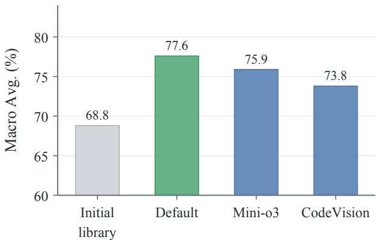  
(a) Evolution-data robustness

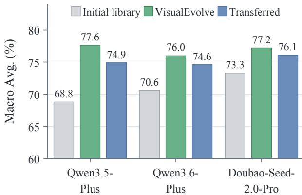  
(b) Cross-backbone transfer  
Figure 4 Generalization of VisualEvolve (RQ3). Macro-average Acc@1 (%) across six evaluation sets from the three benchmarks. In (b), VisualEvolve denotes results from backbone-specific evolution, where the skill library is evolved using the corresponding target backbone.

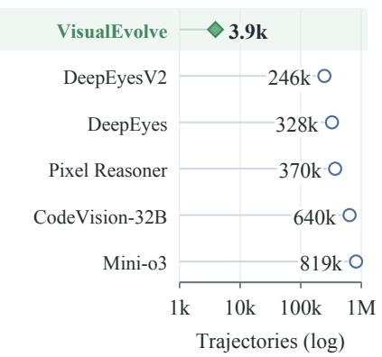  
(a) Trajectory budget

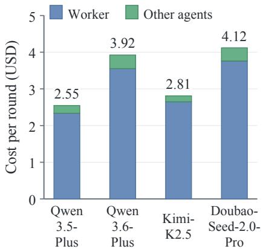  
(b) Evolution cost

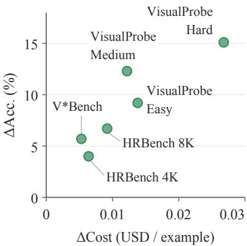  
(c) Added cost and accuracy gain  
Figure 5 Evolution budget and inference overhead (RQ4). (a) Number of samples processed by the Worker for VisualEvolve versus estimated RL rollout counts for training-based methods (Hong et al., 2026; Zheng et al., 2026; Su et al., 2025; Guo et al., 2026; Lai et al., 2026), shown on a log scale. (b) Mean API cost per evolution round. (c) Added inference cost and absolute accuracy gain over the Initial Skill Library across benchmarks, using Qwen3.5-Plus.

We make the following observations from Figure 4. (1) VisualEvolve consistently improves macro-average accuracy across all three evolution-data sources, with gains of 8.8, 7.1, and 5.0 percentage points over the Initial Skill Library under Default, Mini-o3, and CodeVision, respectively. These results support the robustness of skill evolution across the data sources. (2) The transferred skill library ${ \mathcal { L } } _ { \mathrm { K i m i } } ^ { \star }$ improves over the Initial Skil Library on all three other backbones. Its macro-average accuracy is only 2.7, 1.4, and 1.1 percentage points below backbone-specific evolution, respectively. These results show that the evolved skill library transfers efectively across backbones while retaining most of the performance gains from backbone-specific evolution.

## 4.5 Cost Analysis (RQ4)

We evaluate the trajectory budget and API cost of evolution, together with the additional inference cost of the evolved library. Details of the trajectory-budget estimation and the cost calculations are provided in Appendix D.

We make the following observations from Figure 5. (1) VisualEvolve incurs substantially lower cost than training-based methods. It uses only 3,912 Worker task-solving trajectories, whereas the training-based baselines use approximately 63×–209× more RL trajectories. Moreover, the mean API cost of each evolution round is only \$2.55–\$4.12 across the backbones. (2) The evolved skill library consistently improves accuracy with only modest additional inference cost. Across all benchmarks, the accuracy gains are accompanied by small increases in cost. Notably, on VisualProbe Hard, an additional cost of only \$0.0268 per example improves accuracy by 15.1 percentage points.

## 5 Conclusion

Self-evolution turns accumulated experience into reusable visual reasoning skills, but multi-round evolution can sufer from performance regressions and evolution evidence overload. VisualEvolve addresses these challenges with Skill-Library Snapshot Selection, which selects the historical snapshot with the highest validation accuracy, and Progressive Evidence Access, which organizes evidence into a coarse-to-fine hierarchy for capability-gap diagnosis. Across four backbones and six evaluation sets from three benchmarks, VisualEvolve improves over the Initial Skill Library in 23 of 24 backbone–evaluation-set combinations, with a maximum gain of 15.1 percentage points on VisualProbe Hard. Ablation studies support the contributions of both Skill-Library Snapshot Selection and Progressive Evidence Access. Further experiments show that VisualEvolve can improve skills using execution experience from diferent data sources, and that the evolved skill library can be directly reused across VLM backbones.

## AI Use Statement

In this work, we used generative AI tools for prompt refinement and translation, feedback on research methodology and experimental design, suggestions on method implementation and result interpretation, and assistance with parts of our qualitative and thematic data analysis. We have not used generative AI tools for generating synthetic datasets, developing theoretical models, formulating mathematical claims, assisting with mathematical proofs, or cleaning or reformatting datasets. Additionally, we used generative AI tools for editing parts of the manuscript to improve readability, summarizing existing literature, searching for relevant work, and checking references. We have reviewed all AI-assisted work. Specifically, the authors evaluated methodological and experimental suggestions, checked implementation-related suggestions against the actua system and experimental pipeline, and reviewed AI-assisted analyses, result interpretations, and manuscript revisions for correctness and consistency with the reported methods, experimental results, and cited literature. We take responsibility for the final content of this work, including text, claims or artifacts produced with the aid of generative AI.

## Ethics Statement

This work does not involve human-subject studies or the collection of new personal or sensitive data. Our experiments evaluate visual reasoning performance using existing research datasets and vision-language models. We are not aware of any additional ethical concerns specific to our methodology or experimental setting.

## Reproducibility Statement

The main paper and appendices provide the information needed to reproduce VisualEvolve. Section 3 describes the complete evolution framework and procedure, while Section 4 details the datasets, sampling protocol, model configurations, baselines, and benchmarks. Appendix A provides additional implementation details for the Execute and Evolve stages, including the construction of the Skill-Performance Report and Evolution Log. The appendices also include the initial skill library and the prompts used during skill evolution.

## References

Bytedance Seed. Seed2.0 Model Card: Towards intelligence frontier for real-world complexity. arXiv preprint arXiv:2607.00248, 2026. URL https://arxiv.org/abs/2607.00248.

Siyi Chen, Mikaela Angelina Uy, Chan Hee Song, Faisal Ladhak, Adithyavairavan Murali, Qing Qu, Stan Birchfield, Valts Blukis, and Jonathan Tremblay. SpaceTools: Tool-augmented spatial reasoning via double interactive RL. In Proceedings of the IEEE/CVF Conference on Computer Vision and Pattern Recognition (CVPR), pages 37109–37120, 2026.

Yong Xien Chng, Tao Hu, Wenwen Tong, Xueheng Li, Jiandong Chen, Haojia Yu, Jiefan Lu, Hewei Guo, Hanming Deng, Chengjun Xie, Gao Huang, and Lewei Lu. SenseSearch: Empowering vision-language models with high-resolution agentic search-reasoning via reinforcement learning. In Proceedings of the IEEE/CVF Conference on Computer Vision and Pattern Recognition (CVPR), pages 26508–26517, 2026.

Zirun Guo, Minjie Hong, Feng Zhang, Kai Jia, and Tao Jin. Thinking with programming vision: Towards a unified view for thinking with images. In Proceedings of the IEEE/CVF Conference on Computer Vision and Pattern Recognition (CVPR), pages 33467–33476, 2026.

Jack Hong, Chenxiao Zhao, ChengLin Zhu, Weiheng Lu, Guohai Xu, and XingYu. DeepEyesV2: Toward agentic multimodal model. In International Conference on Learning Representations (ICLR), pages 114851–114872, 2026.

Jing Huang, Luyuan Chen, Zhijie Xu, Yadong Li, Xingzhong Xu, Siye Chen, Jie Liu, Ming Kong, and Qiang Zhu. META: Meta evolution of tool trajectory adaptation for long-video understanding. In Proceedings of the IEEE/CVF Conference on Computer Vision and Pattern Recognition (CVPR), pages 9837–9846, 2026.

Guanyu Jiang, Zhaochen Su, Xiaoye Qu, and Yi R. Fung. XSkill: Continual learning from experience and skills in multimodal agents. In International Conference on Machine Learning (ICML), 2026.

Kimi Team et al. Kimi K2.5: Visual agentic intelligence. arXiv preprint arXiv:2602.02276, 2026.

Xin Lai, Junyi Li, Wei Li, Tao Liu, Tianjian Li, and Hengshuang Zhao. Mini-o3: Scaling up reasoning patterns and interaction turns for visual search. In International Conference on Learning Representations (ICLR), pages 76722–76746, 2026.

Yoonho Lee, Roshen Nair, Qizheng Zhang, Kangwook Lee, Omar Khattab, and Chelsea Finn. Meta-Harness: End-to-end optimization of model harnesses. In Conference on Language Modeling (COLM), 2026.

Zhiwei Li and Yong Hu. SkillHone: A harness for continual agent skill evolution through persistent decision history. In Proceedings of the 2026 Conference on Empirical Methods in Natural Language Processing: Industry Track, 2026.

Huawei Lin, Peng Li, Jie Song, Fuxin Jiang, and Tieying Zhang. MUSE-Autoskill: Self-evolving agents via skill creation, memory, management, and evaluation. arXiv preprint arXiv:2605.27366, 2026a.

Zichuan Lin, Yicheng Liu, Yang Yang, Lvfang Tao, and Deheng Ye. AdaptVision: Eficient vision-language models via adaptive visual acquisition. In Proceedings of the IEEE/CVF Conference on Computer Vision and Pattern Recognition (CVPR), pages 11923–11932, 2026b.

Meng Lu, Ran Xu, Yi Fang, Wenxuan Zhang, Yue Yu, Gaurav Srivastava, Yuchen Zhuang, Mohamed Elhoseiny, Charles Fleming, Carl Yang, Zhengzhong Tu, Yang Xie, Guanghua Xiao, Di Jin, Wenqi Shi, and Xuan Wang. Scaling agentic reinforcement learning for tool-integrated reasoning in VLMs. In Proceedings of the IEEE/CVF Conference on Computer Vision and Pattern Recognition (CVPR), pages 26518–26529, 2026.

Jingwei Ni, Yihao Liu, Xinpeng Liu, Yutao Sun, Mengyu Zhou, Pengyu Cheng, Dexin Wang, Erchao Zhao, Xiaoxi Jiang, and Guanjun Jiang. Trace2Skill: Distill trajectory-local lessons into transferable agent skills. arXiv preprint arXiv:2603.25158, 2026.

Siru Ouyang, Jun Yan, I-Hung Hsu, Yanfei Chen, Ke Jiang, Zifeng Wang, Rujun Han, Long Le, Samira Daruki, Xiangru Tang, Vishy Tirumalashetty, George Lee, Mahsan Rofouei, Hangfei Lin, Jiawei Han, Chen-Yu Lee, and Tomas Pfister. ReasoningBank: Scaling agent self-evolving with reasoning memory. In International Conference on Learning Representations (ICLR), 2026.

Qwen Team. Qwen3.5: Towards native multimodal agents, February 2026a. URL https://qwen.ai/blog?id=qwen3.5.

Qwen Team. Qwen3.6-Plus: Towards real world agents, 2026b. URL https://qwen.ai/blog?id=qwen3.6.

Jie-Jing Shao, Haiyan Yin, Yueming Lyu, Xingrui Yu, Lan-Zhe Guo, Ivor W. Tsang, James T. Kwok, and Yu-Feng Li. Lifting traces to logic: Programmatic skill induction with neuro-symbolic learning for long-horizon agentic tasks. In International Conference on Machine Learning (ICML), 2026.

Noah Shinn, Federico Cassano, Ashwin Gopinath, Karthik Narasimhan, and Shunyu Yao. Reflexion: Language agents with verbal reinforcement learning. In Advances in Neural Information Processing Systems (NeurIPS), volume 36, pages 8634–8652, 2023. doi: 10.52202/075280-0377.

Qi Song, Honglin Li, Yingchen Yu, Haoyi Zhou, Lin Yang, Song Bai, Qi She, Zilong Huang, and Yunqing Zhao. CodeDance: A dynamic tool-integrated MLLM for executable visual reasoning. In Proceedings of the IEEE/CVF Conference on Computer Vision and Pattern Recognition (CVPR), pages 19186–19195, 2026.

Alex Su, Haozhe Wang, Weiming Ren, Fangzhen Lin, and Wenhu Chen. Pixel Reasoner: Incentivizing pixel space reasoning via curiosity-driven reinforcement learning. In Advances in Neural Information Processing Systems (NeurIPS), volume 38, pages 9130–9159, 2025. doi: 10.52202/085713-0280.

Yutao Sun, Yanting Miao, Hao-Xuan Ma, Mengyu Zhou, Mingshuai Chen, Tiancheng Zhao, Dexin Wang, Lei Lv, Li Xu, Xiaoxi Jiang, and Guanjun Jiang. Dynamo: Dynamic skill-tool evolution for vision-language agents. arXiv preprint arXiv:2606.30185, 2026.

Guanzhi Wang, Yuqi Xie, Yunfan Jiang, Ajay Mandlekar, Chaowei Xiao, Yuke Zhu, Linxi Fan, and Anima Anandkumar. Voyager: An open-ended embodied agent with large language models. Transactions on Machine Learning Research, 2024.

Jiongxiao Wang, Qiaojing Yan, Yawei Wang, Yijun Tian, Soumya Smruti Mishra, Zhichao Xu, Megha Gandhi, Panpan Xu, and Lin Lee Cheong. Reinforcement learning for self-improving agent with skill library. In Proceedings of the 64th Annual Meeting of the Association for Computational Linguistics (ACL), pages 1529–1550, 2026a. doi: 10.18653/v1/2026.acl-long.69.

Qixun Wang, Yang Shi, Yifei Wang, Yuanxing Zhang, Pengfei Wan, Kun Gai, Xianghua Ying, and Yisen Wang. Monet: Reasoning in latent visual space beyond image and language. In Proceedings of the IEEE/CVF Conference on Computer Vision and Pattern Recognition (CVPR), pages 12030–12040, 2026b.

Wenbin Wang, Liang Ding, Minyan Zeng, Xiabin Zhou, Li Shen, Yong Luo, Wei Yu, and Dacheng Tao. Divide, conquer and combine: A training-free framework for high-resolution image perception in multimodal large language models. In Proceedings of the AAAI Conference on Artificial Intelligence, volume 39, pages 7907–7915, 2025. doi: 10.1609/aaai.v39i8.32852.

Yangbo Wei, Zhen Huang, Shaoqiang Lu, Junhong Qian, Qifan Wang, Chen Wu, and Lei He. SkillSmith: Co-evolving skills and tools for self-improving agent systems. arXiv preprint arXiv:2606.01314, 2026.

Mingyuan Wu, Jingcheng Yang, Jize Jiang, Meitang Li, Kaizhuo Yan, Hanchao Yu, Minjia Zhang, ChengXiang Zhai, and Klara Nahrstedt. VTool-R1: VLMs learn to think with images via reinforcement learning on multimodal tool use. In International Conference on Learning Representations (ICLR), 2026.

Penghao Wu and Saining Xie. V\*: Guided visual search as a core mechanism in multimodal LLMs. In Proceedings of the IEEE/CVF Conference on Computer Vision and Pattern Recognition (CVPR), pages 13084–13094, 2024.

Simon Yu, Gang Li, Weiyan Shi, and Peng Qi. PolySkill: Learning generalizable skills through polymorphic abstraction for continual learning. In International Conference on Learning Representations (ICLR), 2026.

Yi-Fan Zhang, Xingyu Lu, Shukang Yin, Chaoyou Fu, Wei Chen, Xiao Hu, Bin Wen, Kaiyu Jiang, Changyi Liu, Tianke Zhang, Haonan Fan, Kaibing Chen, Jiankang Chen, Haojie Ding, Kaiyu Tang, Zhang Zhang, Liang Wang, Fan Yang, Tingting Gao, and Guorui Zhou. Thyme: Think beyond images. In International Conference on Learning Representations (ICLR), pages 79536–79572, 2026.

Andrew Zhao, Daniel Huang, Quentin Xu, Matthieu Lin, Yong-Jin Liu, and Gao Huang. ExpeL: LLM agents are experiential learners. In Proceedings of the AAAI Conference on Artificial Intelligence, volume 38, pages 19632–19642, 2024. doi: 10.1609/aaai.v38i17.29936.

Xuanpu Zhao, Zhentao Tan, Dianmo Sheng, Tianxiang Chen, Yao Liu, Yue Wu, Tao Gong, Qi Chu, and Nenghai Yu. Learning to focus and precise cropping: A reinforcement learning framework with information gaps and grounding loss for MLLMs. In Proceedings of the IEEE/CVF Conference on Computer Vision and Pattern Recognition (CVPR), pages 25938–25947, 2026.

Ziwei Zheng, Minghao Yang, Jack Hong, Chenxiao Zhao, Guohai Xu, Le Yang, Chao Shen, and XingYu. Deep-Eyes: Incentivizing "thinking with images" via reinforcement learning. In International Conference on Learning Representations (ICLR), pages 126775–126798, 2026.

## Supplementary Material

A Method Details 13   
B Performance Gain Analysis 15   
Execution Set Size Sensitivity 17   
D Trajectory-Budget Estimation and API Cost Calculations 17   
E Initial Skill Library 18   
F Agent Prompts 21   
G Meta-Skills 24   
H Case Studies 28

## A Method Details

This appendix provides the additional implementation details for Execute and Evolve.

## A.1 Execute Details

This section provides additional implementation details for the Execute stage, including execution set sampling and source references that link trajectory summaries to supporting spans in the original trajectories.

Balanced Sampling. When the evolution data combine multiple datasets, VisualEvolve applies balanced sampling to ensure that each dataset contributes equally to the evolution evidence. Before evolution begins, VisualEvolve constructs the fixed validation set $\mathcal { D } _ { \mathrm { v a l } }$ using random seed 42 and removes the selected validation samples from the evolution data. Then, at each evolution round r, Execute uses the round index r as the random seed and samples 16 examples from each source, yielding a 32-example execution set $\mathcal { D } _ { r } ^ { \mathrm { e x e } }$ . Therefore, the validation set remains fixed across rounds, while the execution set is resampled with a round-specific seed, and ${ \mathcal { D } } _ { r } ^ { \mathrm { e x e } } \cap { \mathcal { D } } _ { \mathrm { v a l } } = \emptyset$ for every round.

Trajectory Summaries and Source References. For a trajectory $T _ { r , j }$ , the Memory Agent, a trajectory-processing agent, constructs the corresponding trajectory summary $m _ { r , j }$ . Each trajectory summary contains concise, evidence-supported findings that describe individual behaviors or observations during task execution, including the skills actually loaded, visual operations invoked, intermediate observations, verification behavior, failed attempts, and final prediction. Each finding retains a line-level reference to its supporting span in the original trajectory. For example, [[trajectory.json|L3-L16]] indicates that the finding is supported by Lines 3–16 of trajectory.json. The Self-Evolving Agent can follow this reference through a file-reading command that specifies the corresponding start and end lines. Trajectory summaries thereby compress lengthy trajectories while preserving traceable access to the original evidence. During Evolve, the Self-Evolving Agent reads the summarized task evidence in $\mathcal { M } _ { r } = \{ m _ { r , j } \} _ { j = 1 } ^ { \lfloor \breve { D } _ { r } ^ { \mathrm { e x e } } \vert }$ by default. It follows line-level references to the corresponding trajectory segments only when a trajectory summary is insuficient for reliable diagnosis. Complete raw trajectories therefore remain available as fine-grained evidence but are not loaded by default.

## A.2 Evolve Details

This section provides additional implementation details for the Evolve stage, including post-update structural and executability checks and the construction of the Skill-Performance Report and Evolution Log.

CheckAndRepair. After the Self-Evolving Agent updates the skill library, the Orchestrator, a framework-level controller that manages auxiliary procedures, automatically checks its structural validity and executability before the library enters the Evaluate stage. Each skill is stored in a separate directory whose name must match the name field in the YAML frontmatter of SKILL.md. Optional executable visual operations are stored in the scripts/ subdirectory and must follow the prescribed interface. Structural checks verify the directory name, YAML frontmatter, Markdown format, and referenced file paths. Executability checks load each optional visual operation through the prescribed interface and perform a basic invocation. If any check fails, Orchestrator returns the failure location and diagnostic message for targeted repair.

Skill-Performance Report Construction. After Evaluate assesses a skill-library snapshot $\mathcal { L } _ { t }$ on the fixed validation set, it records the correctness of each validation example together with the skills actually loaded. These records form a validation skill-exposure profile

$$
\mathcal { V } _ { t } = \left\{ \left( c ^ { ( t ) } ( d _ { j } ) , Z _ { j } ^ { ( t ) } \right) \right\} _ { d _ { j } \in \mathcal { D } _ { \mathrm { v a l } } } ,
$$

where $c ^ { ( t ) } ( d _ { j } ) \in \{ 0 , 1 \}$ indicates whether validation example $d _ { j }$ is answered correctly under $\mathcal { L } _ { t } .$ , and $Z _ { j } ^ { ( t ) }$ denotes the set of skills loaded while solving $d _ { j }$

At the end of round $r ,$ the Skill-Performance Report $\mathrm { S P R } _ { r }$ is constructed from the validation skill-exposure profiles of the initial snapshot $\mathcal { V } _ { 0 }$ , the starting snapshot $\begin{array} { r } { \mathcal { V } _ { p _ { r } } , } \end{array}$ and the updated snapshot $\mathcal { V } _ { r }$ . Following the SPS definition in Section 3.5, the report considers the snapshot pairs $( \mathcal { L } _ { p _ { r } } , \mathcal { L } _ { r } ) , ( \mathcal { L } _ { 0 } , \mathcal { L } _ { r } )$ , and $( \mathcal { L } _ { 0 } , \mathcal { L } _ { p _ { r } } )$ . For each pair, SPS is computed only for skills whose corresponding skill-associated validation subset is non-empty. When snapshot pairs coincide, the number of distinct comparisons is smaller than three. The resulting SPR<sub>r</sub> replaces the previous report and is used in round $r + 1$

Evolution Log Construction. The Evolution Log $\mathcal { G } _ { r - 1 }$ records how the skill library changes across evolution rounds together with the corresponding validation performance. After evaluating the evolved library $\mathcal { L } _ { r }$ , the Orchestrator computes the diference between the skill-library snapshots from two consecutive rounds, $\mathcal { L } _ { r - 1 }$ and $\mathcal { L } _ { r }$ :

$$
\Delta \mathcal { L } _ { r } = \mathrm { D i f f } \left( \mathcal { L } _ { r - 1 } , \mathcal { L } _ { r } \right) .\tag{1}
$$

The resulting per-skill diferences are stored as separate .dif files, each recording the change to a corresponding skill between the two snapshots. Let $\mathrm { R e f } ( \Delta \mathcal { L } _ { r } )$ denote an index of references to these files. The Orchestrator then constructs an evolution record for round r:

$$
\rho _ { r } = \left( r , a _ { r } ^ { \mathrm { v a l } } , \operatorname { R e f } ( \Delta \mathcal { L } _ { r } ) \right) ,\tag{2}
$$

where r is the current round index, $a _ { r } ^ { \mathrm { v a l } }$ is the validation accuracy of $\mathcal { L } _ { r }$ , and $\mathrm { R e f } ( \Delta \mathcal { L } _ { r } )$ indexes the corresponding per-skill diferences.

The new record $\rho _ { r }$ is appended to the existing log:

$$
\mathcal { G } _ { r } = \mathrm { A p p e n d } ( \mathcal { G } _ { r - 1 } , \rho _ { r } ) .\tag{3}
$$

Here, $\mathcal { G } _ { r }$ denotes the updated Evolution Log.

## A.3 Complete Evolution Procedure

Algorithm 1 summarizes the complete evolution procedure of VisualEvolve.

Algorithm 1: VisualEvolve   
Require : Frozen backbone agent $\mathcal { A } _ { \boldsymbol { \theta } } ;$ initial skill library $\mathcal { L } _ { 0 } ;$ evolution data $\mathcal { D } _ { \mathrm { e v o } } ;$ fixed validation set $\mathcal { D } _ { \mathrm { v a l } } ;$   
evolution rounds $\bar { R ; }$ evaluation sets $\{ \mathcal { D } _ { k } ^ { e v a l } \} _ { k = 1 } ^ { K }$   
Ensure : Final skill library $\mathcal { L } ^ { \star }$ and benchmark accuracies $\{ \mathrm { A c c } _ { k } ^ { \mathrm { e v a l } } \} _ { k = 1 } ^ { K }$   
1: Initialization:   
2: $( a _ { 0 } ^ { \mathrm { v a l } } , \mathcal { V } _ { 0 } ) \mathrel { \mathop {  } } \mathrm { E v a l u a t e } ( A _ { \theta } , \mathcal { L } _ { 0 } , \mathcal { D } _ { \mathrm { v a l } } )$   
3: $\dot { \mathcal { C } } _ { 0 } \gets \{ \dot { \mathcal { L } } _ { 0 } \}$   
4: $\mathrm { S P R } _ { 0 } \dot {  } \dot { \emptyset }$   
5: $\mathcal { G } _ { 0 } $ InitializeEvolutionLo $\varsigma ( r = 0 , a _ { 0 } ^ { \mathrm { v a l } } )$   
6: for $r \gets 1$ to R do   
7: Skill-Library Snapshot Selection:   
8: Select a starting skill-library snapshot $\mathcal { L } _ { p _ { r } } \in \arg \operatorname* { m a x } _ { \mathcal { L } _ { t } \in \mathcal { C } _ { r - 1 } } a _ { t } ^ { \mathrm { v a l } }$   
9: Execute:   
10: ${ \mathcal { D } } _ { r } ^ { \mathrm { e x e } }  \mathrm { S a m p l e } ( { \mathcal { D } } _ { \mathrm { e v o } } \backslash { \mathcal { D } } _ { \mathrm { v a l } } )$   
11: $\mathcal { T } _ { r }  \mathrm { E x e c u t e } ( \mathcal { \dot { A } } _ { \theta } , \mathcal { L } _ { p _ { r } } , \mathcal { D } _ { r } ^ { \mathrm { e x e } } )$   
12: $\mathcal { T } _ { r }  \mathrm { C o m p a r e } ( \operatorname* { P r e d } ( \mathcal { T } _ { r } ) , \mathrm { \dot { G } T } ( \mathcal { D } _ { r } ^ { \mathrm { e x e } } ) )$   
13: $\mathcal { M } _ { r } \gets \mathrm { S u m m a r i z e } ( \bar { T _ { r } } )$   
14: Evolve:   
15: Capability $\mathrm { G a p } \gets \mathrm { P E A } ( \mathcal { L } _ { p _ { r } } , \mathrm { S P R } _ { r - 1 } , \mathcal { G } _ { r - 1 } , \mathcal { L } _ { r } , \mathcal { M } _ { r }$ , Ref(T<sub>r</sub>))   
16: $\mathcal { L } _ { r } \gets \mathrm { S k i l l }$ LibraryUpdate $( \mathcal { L } _ { p _ { r } }$ , Capability Gap)   
17: Evaluate:   
18: $( a _ { r } ^ { \mathrm { v a l } } , \mathcal { V } _ { r } ) \gets \mathrm { E v a l u a t e } ( A _ { \theta } , \mathcal { L } _ { r } , \mathcal { D } _ { \mathrm { v a l } } )$   
19: $\mathrm { \dot { S } P R } _ { r } \gets 1$ UpdateSkillPerformanceReport $( \mathcal { V } _ { 0 } , \mathcal { V } _ { p _ { r } } , \mathcal { V } _ { r } )$   
20: $\mathcal { G } _ { r }  \mathrm { U }$ pdateEvolutionLog $\left( \mathcal { G } _ { r - 1 } , \mathcal { L } _ { r - 1 } , \mathcal { L } _ { r } , a _ { r } ^ { \mathrm { v a l } } \right)$   
21: $\mathcal { C } _ { r }  \mathcal { C } _ { r - 1 } \cup \{ \mathcal { L } _ { r } \}$   
22: end for   
23: $t ^ { \star } \in \arg \operatorname* { m a x } _ { 0 \leq t \leq R } a _ { t } ^ { \mathrm { v a l } }$   
24: $\mathcal { L } ^ { \star }  \mathcal { L } _ { t ^ { \star } }$   
25: for $k \gets 1$ to K do   
26: $\operatorname { A c c } _ { k } ^ { \mathrm { e v a l } }  \operatorname { A c c } ( A _ { \theta } , \mathcal { L } ^ { \star } ; \mathcal { D } _ { k } ^ { \mathrm { e v a l } } )$   
27: end for   
28: return $\mathcal { L } ^ { \star }$ and $\{ \mathrm { A c c } _ { k } ^ { \mathrm { e v a l } } \} _ { k = 1 } ^ { K }$

## B Performance Gain Analysis

To better understand the observed performance gains of VisualEvolve, we trace the evolution process from execution trajectories and diagnosed capability gaps, through skill-library updates, to downstream inference behavior. Table 3 summarizes representative evolution dynamics under the Default and CodeVision evolution-data settings.

Figure 6 further visualizes the two CodeVision evolution intervals in the table, showing accuracy changes on the full validation set and the Rotated and Flipped subsets.

According to Table 3 and Figure 6, we observe that: (1) Under the default data setting, VisualEvolve iteratively refines the initial crop-based strategy into multi-step workflows. The execution trajectories reveal recurring failures related to insuficient observation, incomplete search and verification, and

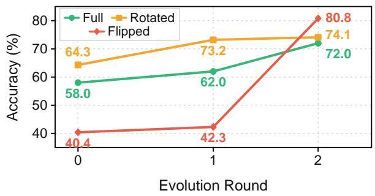  
Figure 6 Validation accuracy on the full CodeVision validation set and its Rotated and Flipped subsets across the first three evolution rounds (%). Full denotes the complete CodeVision validation set, while Rotated and Flipped denote the subsets whose original images contain rotation and flipping transformations, respectively.

inefective skill invocation. Based on these capability gaps, VisualEvolve augments the skill library with skills such as observe, verify, search, color, and read\_text, while refining the existing crop skill. These updates are accompanied by improved validation accuracy and the emergence of multi-step skill-loading sequences, without introducing new executable visual operations.

<table><tr><td>Setting</td><td>Round</td><td>∆ Acc. (%)</td><td>C/I</td><td>Diagnosis</td><td>Tool-Use Strategy</td><td>Visual Operation</td><td>Skill-Loading Sequences</td></tr><tr><td rowspan="3">Default</td><td>r0-r1</td><td>+3.5</td><td></td><td>crop, unstructured ~{crop} observation, and missing answer verification</td><td>0/12 Under-invocation of +{observe, verify};</td><td></td><td>T2: observe → crop (24.5%)</td></tr><tr><td>r1-r2</td><td>+5.5</td><td></td><td>2/12 Redundant crop operations, incomplete search coverage, and inconsistent counting and spatial reasoning</td><td>+{count, search}; ~{crop, observe, verify}</td><td></td><td>T2: observe → crop (12.0%), search → crop (7.5%)</td></tr><tr><td>r2-r16</td><td>+4.0</td><td></td><td>color recognition, text reading, counting, localization, and candidate disambiguation</td><td>5/128 Persistent errors in +{color, read_text}; - ~{crop, observe, count, search, verify}</td><td></td><td>T2: observe → crop (20.5%), read text → crop (13.5%), color → crop (9.5%)</td></tr><tr><td rowspan="2">CodeVision</td><td></td><td></td><td></td><td>12/9 Rotated or upside-down inputs verify}; ∼{crop} caused errors in reading text, charts, and numerical values</td><td></td><td></td><td>measure → crop (11.5%), rotate → measure (10.5%) T3: rotate → measure → crop (8.0%), measure → crop → verify (8.0%) T4: rotate → measure → crop →</td></tr><tr><td>r1-r2</td><td>+10.0</td><td></td><td>1/13 Rotate could not correct mirrored inputs, coordinate and value-reading errors persisted after transformation</td><td>+{flip}; ∼{crop, measure, rotate, verify}</td><td>flip†</td><td>T2: rotate → flip (18.5%), crop → verify (14.0%), flip → verify (5.0%) T3: rotate → flip → verify (5.0%)</td></tr></table>

Table 3 Skill-evolution dynamics across rounds. + and ∼ denote added and modified tool-use strategies, respectively, while † marks a newly added executable script in the Visual Operation column. ∆ Acc. is the absolute diference in validation accuracy (%). C/I denotes the numbers of correct/incorrect Trajectory Summaries inspected by the Self-Evolving Agent, respectively. T2, T3, and T4 denote ordered skill-loading sequences containing two, three, and four skills, respectively; for example, observe → crop denotes a two-skill loading sequence. Parentheses report the fraction of validation examples in which each sequence occurs, with only rates of at least 5% shown.

(2) Under the CodeVision data setting, VisualEvolve co-evolves visual operations and tool-use strategies in response to transformation-related failures. Introducing the rotate operation at r = 1 is accompanied by an increase in accuracy on the Rotated subset from 64.3% to 73.2%. After the flip operation is added at r = 2, accuracy on the Flipped subset further increases from 42.3% to 80.8%.

## C Execution Set Size Sensitivity

We study the sensitivity of VisualEvolve to the size of $\mathcal { D } _ { r } ^ { \mathrm { e x e } }$ by varying the execution-set size among 4, 8, 16, and 32. All experiments use Qwen3.5-Plus. Figure 7 reports the validation accuracy at each evolution round together with the corresponding best-so-far accuracy.

We make the following observations from Figure 7. (1) Larger execution sets generally lead to higher best-so-far validation accuracy. Execution-set sizes of 4 and 8 both reach 67.0%, while sizes of 16 and 32 reach 71.0% and 71.5%, respectively, suggesting that more execution experience is beneficial for evolution. (2) The improvement becomes small beyond 16 samples. Increasing the execution-set size from 16 to 32 raises the best-so-far validation accuracy only from 71.0% to 71.5%. This indicates diminishing returns as the execution-set size increases.

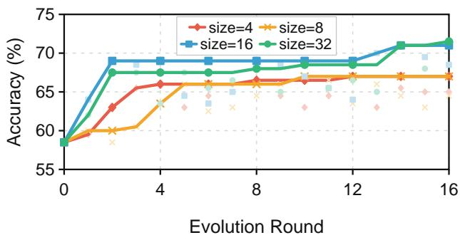  
Figure 7 Execution-set size sensitivity. Lines show the best-so-far validation accuracy over 16 rounds for execution-set sizes of 4, 8, 16, and 32; scatter points show the corresponding validation accuracy at each round.

## D Trajectory-Budget Estimation and API Cost Calculations

## D.1 Trajectory-Budget Estimation

We measure the trajectory budget of VisualEvolve and RL training by the number of task-solving trajectories.

For VisualEvolve, we count all Worker trajectories generated during skill evolution, including both Execute and validation-time evaluations. Before evolution, the Worker evaluates the initial skill library $\mathcal { L } _ { 0 }$ on the fixed 200-example validation set. Each of the subsequent $R = 1 6$ evolution rounds generates 32 trajectories during Execute and 200 trajectories during Evaluate. The resulting trajectory budget for one evolution run is

$$
\begin{array} { r l } { \displaystyle N _ { \mathrm { V i s u a l E v o l v e } } = \vert \mathcal { D } _ { \mathrm { v a l } } \vert + \sum _ { r = 1 } ^ { R } ( \vert \mathcal { D } _ { r } ^ { \mathrm { e x e } } \vert + \vert \mathcal { D } _ { \mathrm { v a l } } \vert ) } & { } \\ { \displaystyle = 2 0 0 + ( 3 2 + 2 0 0 ) \times 1 6 = 3 , 9 1 2 . } & { } \end{array}\tag{4}
$$

Of these, 512 trajectories come from Execute and 3,400 from validation. This count excludes final benchmark evaluation and non-Worker model calls for trajectory summarization and skill evolution.

For training-based methods, we estimate the number of RL rollout trajectories from the original papers and, when available, oficial training configurations. For step-based training, we estimate $N _ { \mathrm { R L } } \approx S B G$ , where S denotes the number of rollout-collection steps, B the number of input questions per step, and G the number of rollouts generated per question. For epoch-based training, we use $N _ { \mathrm { R L } } \approx E D G$ , where E is the number of passes over an RL dataset containing D questions. Table 4 summarizes the estimates used in Figure 5(a).

<table><tr><td>Method</td><td>Estimation</td><td>RL trajectories</td></tr><tr><td>DeepEyesV2 (Hong et al., 2026)</td><td> $6 0 \times 2 5 6 \times 1 6$ </td><td>245,760</td></tr><tr><td>DeepEyes (Zheng et al., 2026)</td><td> $8 0 \times 2 5 6 \times 1 6$ </td><td>327,680</td></tr><tr><td>Pixel Reasoner (Su et al., 2025)</td><td> $3 \times 1 5 { , } 4 0 2 \times 8$ </td><td>369,648</td></tr><tr><td>CodeVision-32B (Guo et al., 2026)</td><td> $2 \times 4 0 , 0 0 0 \times 8$ </td><td>≈640,000</td></tr><tr><td>Mini-o3 (Lai et al., 2026)</td><td> $2 0 0 \times 2 5 6 \times 1 6$ </td><td>819,200</td></tr></table>

Table 4 Estimated trajectory budgets of training-based methods. Each estimate follows either $S \times B \times G$ for step-based training or $E \times D \times G$ for epoch-based training.

For DeepEyesV2, DeepEyes, and Mini-o3, the 60-, 80-, and 200-step rollout horizons are obtained from their reported training curves. Each step uses 256 input questions and 16 rollouts per question; for DeepEyes, these settings are also specified in its oficial training configuration. For Pixel Reasoner, we use its released 15,402-question RL dataset, three training epochs, and eight rollouts per question from the oficial training configuration. For CodeVision-32B, we use the approximately 40,000 RL questions reported in the paper, together with two training epochs and eight rollouts per question.

These estimates are intended to approximate task-level trajectory generation rather than total training compute. They exclude SFT, data construction, validation, and additional sampling introduced by filtering. Trajectory length, model size, and parameter-update cost also difer across methods and are therefore not captured by this comparison.

## D.2 API Cost Calculations

We compute the API cost of VisualEvolve from the input and output tokens consumed by all model calls during evolution and inference. For each model $m ,$ let $p _ { \mathrm { i n p u t } } ^ { m }$ and $p _ { \mathrm { o u t p u t } } ^ { m }$ denote its oficial non-cache prices per one million input and output tokens at the time of our experiments. The total cost is

$$
\mathrm { C o s t } _ { m } = \frac { \mathrm { I n p u t T o k e n s } _ { m } } { 1 0 ^ { 6 } } p _ { \mathrm { i n p u t } } ^ { m } + \frac { \mathrm { O u t p u t T o k e n s } _ { m } } { 1 0 ^ { 6 } } p _ { \mathrm { o u t p u t } } ^ { m } .\tag{5}
$$

The input/output prices per one million tokens are 0.8/4.8 RMB for Qwen3.5-Plus, 2.0/12.0 RMB for Qwen3.6-Plus, 4.0/21.0 RMB for Kimi-K2.5, and 3.2/16.0 RMB for Doubao-Seed-2.0-Pro. We do not apply cache-hit discounts. All RMB costs are converted to USD using a fixed exchange rate of 6.82 RMB per USD.

For Figure 5(b), we aggregate all API calls within each evolution round and report the mean cost over the 16 rounds. We separately report Worker inference and other evolution calls, including trajectory summarization and skill updates. For Figure 5(c), we measure the additional inference cost of the evolved skill library as the diference in mean cost per example between VisualEvolve and the Initial Skill Library under the same backbone and evaluation set.

## E Initial Skill Library

Listings 1 and 2 provide the skill instruction and executable visual operation of the initial crop skill, respectively. The former defines the textual strategy $\pi _ { \mathrm { c r o p } }$ , while the latter implements the visual operation $u _ { \mathrm { c r o p } }$ for extracting a specified image region. Together, they instantiate $s _ { \mathrm { c r o p } } = ( \pi _ { \mathrm { c r o p } } , u _ { \mathrm { c r o p } } )$ , the sole skill in the initial library $\mathcal { L } _ { 0 } = \{ s _ { \mathrm { c r o p } } \}$ introduced in Section 3.3. Before the first evolution round, $\mathcal { L } _ { 0 }$ is evaluated on the fixed validation set and archived as the initial skill library.

## Listing 1: Initial skill definition: crop/SKILL.md.

```markdown
---
name: crop
description: Crop a region for a zoomed sub-view. Use when you need to examine a specific area in greater detail.
---
# Crop
Crop any region of interest using the provided CLI script.
## Command
```bash
python workplace/skills/crop/scripts/crop.py \
--image <image_path> \
--bbox <x1>,<y1>,<x2>,<y2> \
--output <output_path> \
[--coord-mode relative|absolute]
```

```markdown
## Arguments
| Argument | Description |
`--image` | Path to the source image |
`--bbox` | Bounding box as `x1,y1,x2,y2` (left,top,right,bottom) |
`--output` | Path to save the cropped image |
| `--coord-mode` | `relative` (default): coordinates in [0,1000] range; `absolute`: pixel coordinates |
## Examples
**Relative coordinates (0-1000):**
```bash
python workplace/skills/crop/scripts/crop.py \
--image input.jpg \
--bbox 100,200,500,600 \
--output artifacts/crop_region1.jpg
**Absolute pixel coordinates:**
```bash
python workplace/skills/crop/scripts/crop.py \
--image input.jpg \
--bbox 50,100,400,300 \
--output artifacts/crop_region1.jpg \
--coord-mode absolute
## Output
Prints JSON to stdout:
``json
{"ok": true, "crop_path": "artifacts/crop_region1.jpg", "width": 350, "height": 200}
On error:
``json
{"ok": false, "error": "description of the error"}
## Tips
Save cropped images to the `artifacts/` directory for the current sample
Output picture format is automatically forced to match the input image format (e.g. input `.jpg` -> output
`.jpg`).
```

## Listing 2: Initial crop implementation: crop/scripts/crop.py.

```python
"""CLI crop tool -- Agent calls this via `execute` to crop image regions."""
from __future__ import annotations
import argparse
import json
import sys
from pathlib import Path
from PIL import Image
# The vision model rejects tiny images whose shortest side is <= 10 px,
# so keep the crop content but scale such regions proportionally to 14 px.
MIN_SHORT_SIDE_FOR_MODEL = 14
UPSCALE_TRIGGER_SHORT_SIDE = 10
def _upscale_if_too_small(image: Image.Image) -> Image.Image:
width, height = image.size
```

```python
short_side = min(width, height)
if short_side > UPSCALE_TRIGGER_SHORT_SIDE or short_side <= 0:
return image
scale = MIN_SHORT_SIDE_FOR_MODEL / float(short_side)
new_width = max(1, int(round(width * scale)))
new_height = max(1, int(round(height * scale)))
resampling = getattr(Image, "Resampling", Image).LANCZOS
return image.resize((new_width, new_height), resample=resampling)
def main() -> None:
parser = argparse.ArgumentParser(description="Crop a region from an image")
parser.add_argument("--image", required=True, help="Path to source image")
parser.add_argument("--bbox", required=True, help="Bounding box: x1,y1,x2,y2")
parser.add_argument("--output", required=True, help="Path to save cropped image")
parser.add_argument(
"--coord-mode",
default="relative",
choices=["relative", "absolute"],
help="Coordinate mode: relative (0-1000) or absolute (pixels)",
)
args = parser.parse_args()
try:
parts = [s.strip() for s in args.bbox.split(",")]
if len(parts) != 4:
raise ValueError(f"bbox must have 4 values, got {len(parts)}")
x1, y1, x2, y2 = (float(p) for p in parts)
img = Image.open(args.image)
w, h = img.size
if args.coord_mode == "relative":
# Convert from [0, 1000] relative to pixels
left = int(x1 * w / 1000)
top = int(y1 * h / 1000)
right = int(x2 * w / 1000)
bottom = int(y2 * h / 1000)
else:
left, top, right, bottom = int(x1), int(y1), int(x2), int(y2)
# Clamp to image bounds
left = max(0, min(left, w))
top = max(0, min(top, h))
right = max(0, min(right, w))
bottom = max(0, min(bottom, h))
if left >= right or top >= bottom:
print(json.dumps({"ok": False, "error": f"Invalid crop box after clamping:
({left},{top},{right},{bottom})"}))
sys.exit(1)
cropped = img.crop((left, top, right, bottom))
cropped = _upscale_if_too_small(cropped)
out_path = Path(args.output)
out_path.parent.mkdir(parents=True, exist_ok=True)
cropped.save(str(out_path))
cw, ch = cropped.size
print(json.dumps({"ok": True, "crop_path": str(out_path), "width": cw, "height": ch}))
except Exception as exc:
print(json.dumps({"ok": False, "error": str(exc)}))
sys.exit(1)
if _name__ == "__main__":
main()
```

## F Agent Prompts

Listings 3, 4, and 5 provide the complete prompt templates for the Worker, Memory Agent, and Self-Evolving Agent, respectively.

## F.1 Worker Agent User Prompt

Listing 3 presents the user prompt used to guide the Worker during visual task solving.

Listing 3: User prompt for the Worker Agent.  
```markdown
# Task
Your task is to answer visual questions about images. Think step by step when solving visual questions.
# Skills
Skills are **external, reusable modules with defined interfaces** that extend your capabilities beyond native
reasoning.
Use a skill when the required capability cannot be reliably achieved through direct observation or reasoning:
1. `read_file(<skill_path>/SKILL.md)
2. Follow the instructions defined in the skill (may include CLI commands)
# Image Inputs and Outputs
- The original image is at `artifacts/original.jpg` and has already been provided in your initial input.
- The folder `artifacts/` already exists. Every image you generate must be saved there and then loaded using
`read_file`.
# Constraints
- Use the same file format as the original image for every generated image
(e.g., original `.jpg` -> outputs must be `.jpg`, not `.png`).
- Do not use tool_call tags such as `<tool_call>...</tool_call>` or `<function=...>`; they are not supported.
To use tools, read the relevant skill documentation and follow the applicable instructions.
- Do not access the internet, or any external resource.
- Do not inspect or modify the runtime environment, system configuration, or installed packages and
dependencies.
```

## F.2 Memory Agent Task Prompt

Listing 4 provides the prompt used by the Memory Agent to compress execution trajectories. It converts each complete trajectory into a set of concise findings covering skill loading, tool use, visual observations, and successful or failed behaviors. Each finding is accompanied by a line-level source reference, allowing the Self-Evolving Agent to access the supporting trajectory segment when the summary alone is insuficient.

## Listing 4: Task prompt for the Memory Agent.

```markdown
You are **MemoryAgent**. Your role is to maintain structured, evidence-grounded findings about the Worker's
visual reasoning trajectory.
## Input
- The full trajectory for a single sample.
- Read it with `read_file("{trajectory_path}")`.
## Trajectory Structure
The trajectory is an ordered list of step records:
- `user`: task description or input
`assistant`: visible response in `response_content` and, when thinking mode is enabled, optional
`reasoning_content` (older trajectories may still use `content`)
- `tool_intent`: planned tool call with arguments
- `tool_result`: returned tool output
## Your Task
Produce a concise structured summary using only explicit evidence from the trajectory.
```

```markdown
## Requirements
### Findings
Produce evidence-grounded findings.
Each finding must:
- Describe exactly one concrete observation from the trajectory
- Include important tool usage when relevant to the reasoning process
Include skill loading when the trajectory explicitly shows a skill file being loaded
- Explicitly capture verification, correction, reflection, or failure behaviors when they appear in the trajectory
End with exactly one citation
Valid citation formats:
`[[trajectory.json|L<line>]]
`[[trajectory.json|L<start>-<end>]]
## Rules
- A skill is considered used only if the trajectory explicitly shows the corresponding skill file being loaded.
- Do not merge multiple observations into a single finding.
Every finding must be directly supported by its citation.
## Output Format
Findings:
```

## F.3 Self-Evolving Agent User Prompt

Listing 5 provides the user prompt that guides the Self-Evolving Agent through each evolution round, from Skill-Library Snapshot Selection to Execute, Evolve, and Evaluate. The agent first selects the starting skill-library snapshot and then follows the corresponding Meta-Skills in Appendix G. During Execute and Evaluate, it invokes a script to run the Worker on the execution and validation sets, respectively. During Evolve, it directly diagnoses capability gaps through Progressive Evidence Access and updates the starting skill library accordingly.

## Listing 5: Parameterized user prompt for the Self-Evolving Agent.

```markdown
# You are a SKILL Optimization Expert.
Your task is to iteratively evolve the Worker's skills for visual reasoning to maximize evaluation accuracy on the
fixed validation set.
## 1. File System
Your working directory is the project root. Prefer relative paths
(e.g. `workplace/...`). The `/workplace/...` absolute prefix is also
supported (e.g. `cd /workplace`, `python /workplace/meta-skills/execute/scripts/run_execute.py`).
workplace/
|-- skills/ # Worker skill definitions (SKILL.md)
|-- meta-skills/
|-- execute/ # Execute stage
|-- evolve/ # Evolve stage
`-- evaluate/ # Evaluate stage
|-- memories/ # Current-round per-sample evidence
|-- results_index.json # Correctness index
|-- evaluation_metrics_report.md # Historical evaluation statistics
`-- {YYYYMMDD}-{sample_id}/
| |-- summary.md # Condensed extraction from trajectory.json with line citations
```

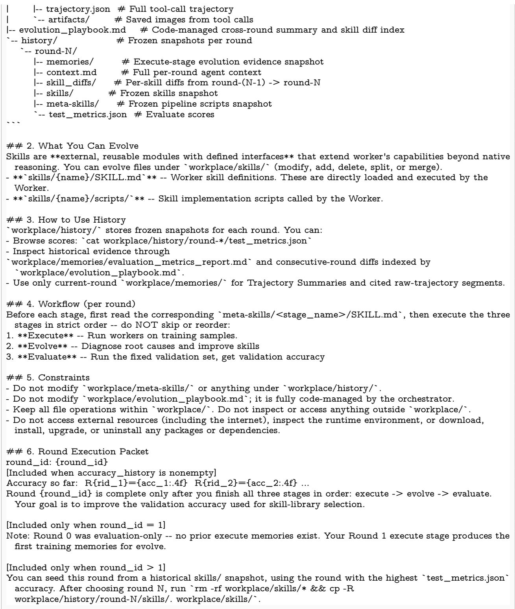

## G Meta-Skills

Listings 6, 7, and 8 provide the Meta-Skills for Execute, Evolve, and Evaluate, respectively. Each Meta-Skill specifies the actions and outputs required at its stage of the workflow outlined by the user prompt in Listing 5. The Self-Evolving Agent autonomously loads and reads the corresponding Meta-Skill before each stage. These Meta-Skills remain unchanged across evolution rounds.

## G.1 Execute Meta-Skill

Listing 6 presents the Meta-Skill that guides the Execute stage in constructing the execution evidence described in Section 3.4.

Listing 6: Meta-Skill for the Execute stage.  
```markdown
name: execute
description: >-
USE WHEN: the execute stage of an evolution round.
NOT FOR: evolve or evaluate stages.
# Execute
Collect evidence on how the current skills perform on training samples. The Evolve stage reads this evidence to
diagnose failures and improve skills.
## Inputs
- Current skills under `workplace/skills/`.
- Training sample pool (managed by the framework, not directly accessible).
## Workflow
```bash
python workplace/meta-skills/execute/scripts/run_execute.py --round-id <N>
`--round-id` is the only required argument. It must match the current evolution round number so outputs are
written to the correct round.
The script selects the number of samples configured by `execute_num_samples` (default: 32). Samples are
randomly drawn from the training pool each round (diferent from the fixed validation set).
The script runs autonomously; no further action is needed during this stage.
## What the Script Does and Why
For each selected sample:
1. A **Worker agent** attempts the VQA question using skills under `workplace/skills/`. The full execution
trace is recorded in trajectory.json.
2. A **Memory agent** is invoked once after the worker finishes, compressing the full trajectory (plus related
images) into findings evidence for Evolve: `summary.md` records markdown findings with line citations.
## Outputs
workplace/memories/
|-- results_index.json <- per-sample correctness index
|-- {YYYYMMDD}-sample_001/
|-- summary.md <- Condensed extraction from trajectory.json
|-- trajectory.json <- full tool-call trajectory
`-- artifacts/ <- Saved images from tool calls
## Constraints
- Do **not** modify any files during this stage -- only run the script.
- After completion, proceed immediately to the **Evolve** stage.
```

## G.2 Evolve Meta-Skill

Listing 7 provides the Meta-Skill for diagnosing capability gaps and updating the skill library through Progressive Evidence Access (PEA), as described in Section 3.5.

Listing 7: Meta-Skill for the Evolve stage.  
```markdown
name: evolve
description: >-
USE WHEN: the evolve stage of an evolution round, after execute stage.
NOT FOR: execute or evaluate stages.
## Evolve
Improve Worker performance on the Validation set by improving Worker skills in `workplace/skills/`, focusing
on accuracy.
### Skill Structure
- **YAML frontmatter**:
- `name`: skill identifier. Use lowercase letters, digits, and hyphens, and keep it identical to the skill directory
name.
- `description`: load trigger. The Worker sees only `name` and `description` before deciding whether to load
a skill, so this field must state what the skill does and when to use it.
- Use valid YAML. Prefer block scalars for descriptions:
``yaml
name: your-skill-name
description: >-
State what the skill does and when the Worker should load it.
---
If a `description:` value is written on the same line, any unquoted colon inside that value can make the
YAML invalid. Use `description: >-` or quote the whole value instead.
- **Body**: detailed guidance visible only after the skill is loaded.
- **Optional scripts**: helper code or utilities used by the skill.
### Inputs
#### Skills to Evolve
- `workplace/skills/{name}/SKILL.md` -- Current skill definition.
`workplace/skills/{name}/scripts/` -- Current skill scripts (if applicable).
#### Current-Round Memories
- `workplace/memories/results_index.json` -- Ordered sample list (incorrect samples first). Each sample's
`memory_dir` field is the path to its `summary.md`.
`workplace/memories/{YYYYMMDD}-{sample_id}/summary.md` -- Condensed extraction from
`trajectory.json` with line citations.
`workplace/memories/{YYYYMMDD}-{sample_id}/trajectory.json` -- Full execution trace.
#### Skill-Performance Report
- `workplace/memories/evaluation_metrics_report.md` -- Implementation of the Skill-Performance Report,
used to identify skills associated with performance changes.
#### Evolution Log
`workplace/evolution_playbook.md` -- Implementation of the Evolution Log, which records validation
accuracy across rounds and indexes the corresponding per-skill dif files.
`workplace/history/round-N/skill_difs/{skill}.dif` -- Per-skill dif between the consecutive evaluated
snapshots from round `N-1` to round `N`.
### Workflow
#### 1. Analyze Skill-Performance Report
Read `workplace/memories/evaluation_metrics_report.md`.
Use it to identify skills associated with notable performance changes.
#### 2. Analyze Evolution Log
Read `workplace/evolution_playbook.md` to understand validation-accuracy
```

trends and prior skill changes across rounds.

\- Note which update directions were associated with improvements.

\- Analyze prior round difs and validation accuracy to avoid repeating inefective changes.

## #### 3. Analyze Trajectory Summaries

Read \`workplace/memories/results\_index.json\` to see the sample list. Prioritize incorrect samples because they expose skill gaps, but also review correct samples to understand what already works.

## Analysis flow:

1. Read the summary file referenced by \`memory\_dir\` first.

It gives a concise view of the run and includes line-range grounding references.

2. To see the full trajectory details behind the summary, use the line reference in the summary file to read the corresponding range from trajectory.json. Example: \`read\_file("workplace/memories/{YYYYMMDD}-{sample\_id}/trajectory.json", ofset=41, limit=4)\` for \`[[trajectory.json|L42-L45]]\`. If the cited span is too short, expand to nearby lines or continue reading more of \`trajectory.json\` for context

## For image evidence:

\- In step 1, the original image may appear as \`{"type": "image\_path", "path": "/artifacts/original.jpg"}\`.

\- You should use \`read\_file\` to inspect these images.

## #### 4. Map Failures to Skill Improvements

Map identified issues to targeted changes in \`workplace/skills/\` (modify, add, delete, split, or merge).

## Examples:

\- \*\*Load trigger mismatch\*\* -> refine the YAML frontmatter \`description\` so it clearly states what the skill does and when the Worker should load it.

\- \*\*Ambiguity\*\* -> rewrite for clarity and precision

\- \*\*Capability gap\*\* -> add new skills (with \`mkdir -p\`) or supporting logic

\- \*\*Redundancy / conflict / bloat\*\* -> delete overlap, resolve contradictions, tighten verbose skills

Skip low-frequency or uncertain issues to avoid overfitting.

## ### Evolution Heuristics

## - \*\*Prioritize generalizable patterns:\*\*

Because validation samples difer from the training set, avoid overfitting and be cautious with blanket rules like "always" as they rarely generalize.

## - \*\*Evidence-driven iteration:\*\*

Follow \`Evidence -> Pattern -> Principle -> Change\`.

## - \*\*Balance skill length:\*\*

Excessive length dilutes signal and increases confusion. Overly terse guidance may miss important nuances. Balance requires cross-round analysis.

## - \*\*Avoid overloading a single skill:\*\*

An overloaded skill blurs trigger boundaries and leads to irrelevant or conflicting guidance. Instead, add dedicated skills for each question type or scenario, with clear trigger conditions.

## ### Outputs

\- Updated files in \`workplace/skills/\`:

\- related scripts, if applicable

## ### Constraints

\- Changes are allowed only in \`workplace/skills/\`.

\- \`edit\_file\` for targeted edits.

\- \`write\_file\` for full rewrites.

## G.3 Evaluate Meta-Skill

Listing 8 provides the Meta-Skill for assessing the updated skill library during Evolve, following the procedure in Section 3.6.

## Listing 8: Meta-Skill for the Evaluate stage.

```markdown
name: evaluate
description: >-
USE WHEN: the evaluate stage of an evolution round, after evolve stage.
NOT FOR: execute or evolve stages.
---
# Evaluate
Measure whether the skill changes from Evolve actually generalize. Accuracy on the fixed validation set is the
definitive metric -- it answers "did we improve, regress, or stay flat?"
## Inputs
- Worker skills under `workplace/skills/`.
- Fixed validation set (managed by the orchestrator).
## Workflow
```bash
python workplace/meta-skills/evaluate/scripts/run_evaluate.py \
--round-id <N>
The script runs the worker on every validation sample and scores each answer via judge.
After the script finishes, workplace/history/round-{N}/test_metrics.json is written.
## Outputs
- `workplace/history/round-{N}/test_metrics.json` -- Validation accuracy for this round.
## Constraints
- Do **not** change anything under `workplace/`.
- Run `run_evaluate.py` at most once per round.
- After completion, this round is done. The orchestrator will start the next round.
```

## H Case Studies

We provide two case studies to illustrate how the evolved skill library supports visual reasoning on individual tasks. Figure 8 shows a reasoning trajectory in which the evolved library composes the rotate and flip operations to handle an image requiring multiple transformations. Figure 9 shows a reasoning trajectory in which the evolved skill library combines skill guidance with progressively tighter crops and verification to gather suficient visual evidence.

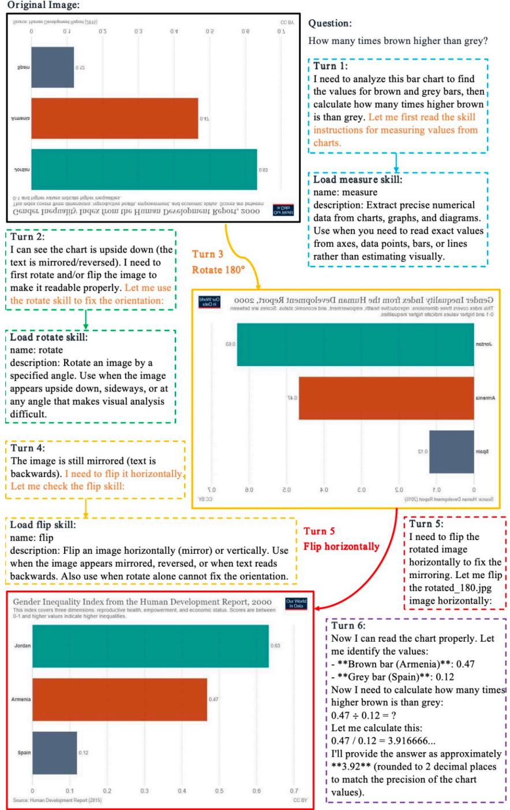  
Figure 8 Case study of visual-operation expansion and composition. The CodeVision-evolved library first loads the measure skill, then recognizes that the chart is both upside down and mirrored. It composes the newly discovered rotate and flip operations to recover a readable chart before extracting the values and computing the final answer.

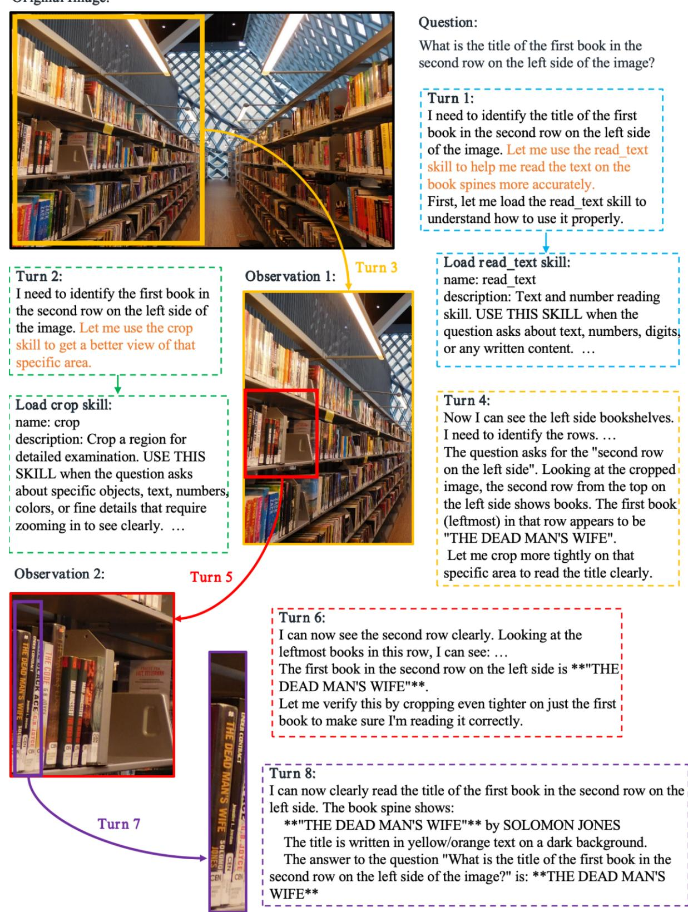

## Original Image:

Figure 9 Case study of iterative local inspection and verification. The evolved library combines read\_text guidance with progressively tighter crops. The agent first localizes the relevant bookshelf region, then repeatedly narrows the visual evidence and verifies the target book spine before returning the title.