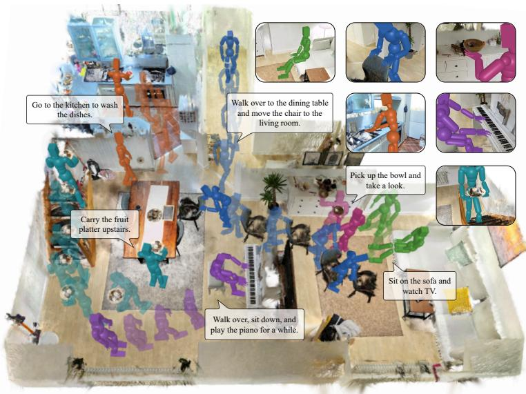
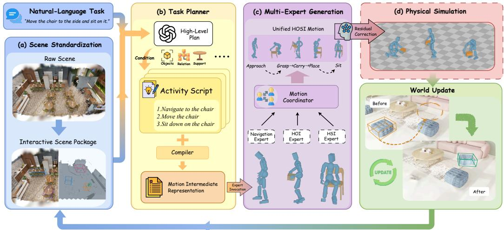
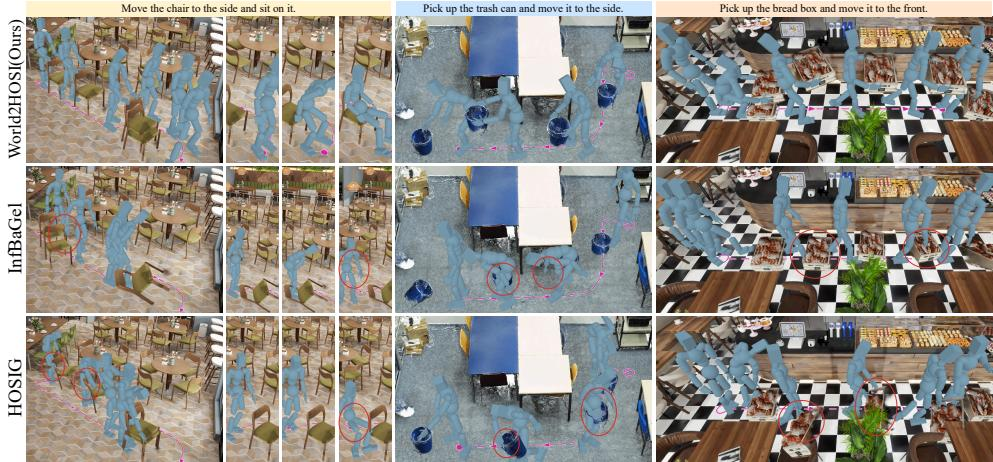
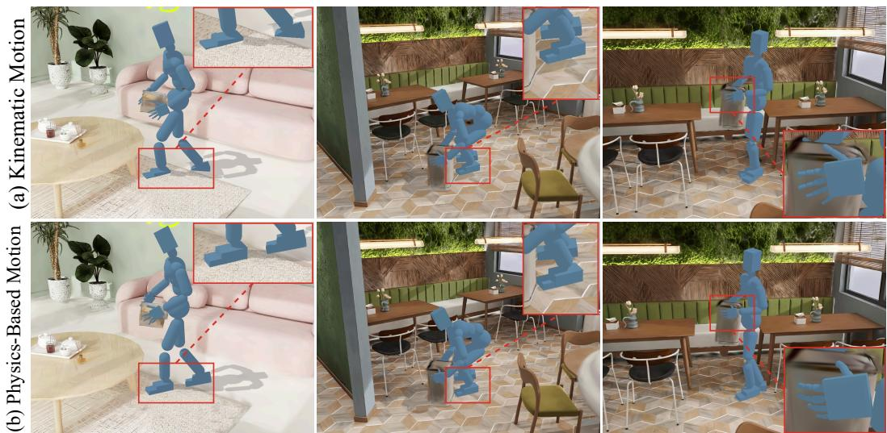
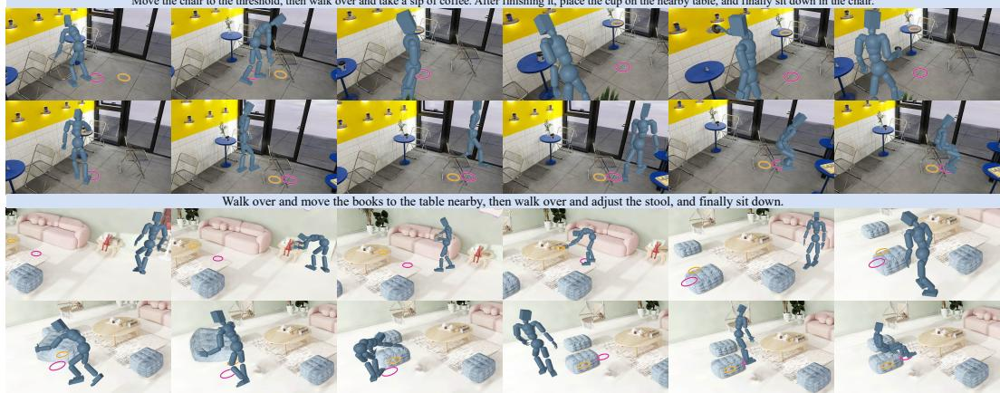
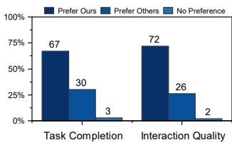
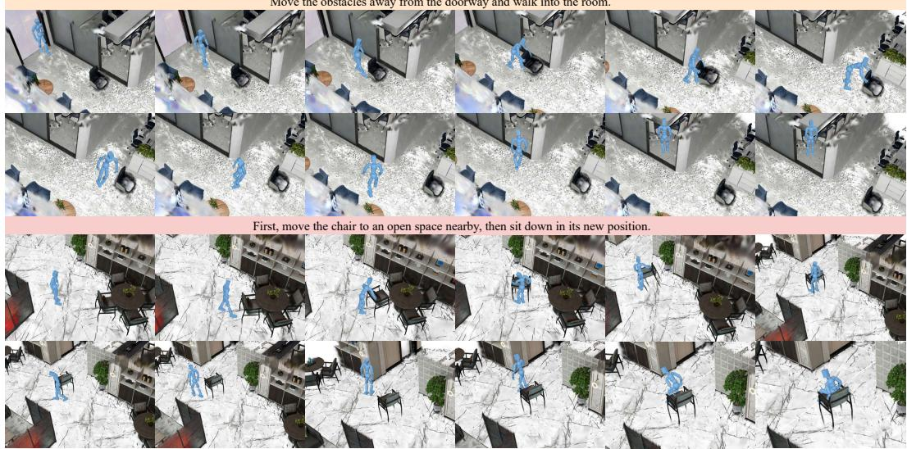

# WORLD2HOSI: A MULTI-EXPERT HARNESS FOR LONG-HORIZON HUMAN-OBJECT-SCENE INTERAC-TION GENERATION

Jiushu Li1, Haoran Wang1, Yumeng Liu2, Zhiyang Dou3, Yuan Liu4, Yuexin Ma5, Cheng Lin1,† 1Macau University of Science and Technology 2University of Science and Technology of China 3Massachusetts Institute of Technology 4The Hong Kong University of Science and Technology 5ShanghaiTech University

  
Figure 1: Generating diverse long-horizon HOSI in reconstructed 3D worlds. World2HOSI orchestrates complementary motion experts from natural-language instructions to generate continuous sequences of navigation, object manipulation, and scene interaction in a persistently updated world.

## ABSTRACT

Long-horizon human–object–scene interaction (HOSI) is central to embodied AI, animation, and game development. Existing human-object interaction (HOI) and human–scene interaction (HSI) models excel in their respective domains, but none alone covers tasks requiring multiple interaction skills. Training unified HOSI models is hindered by scarce and costly data. We introduce World2HOSI, a multiexpert orchestration harness that generates continuous HOSI data from 3D Gaussian Splatting (3DGS) scenes and natural language instructions. Our key insight is that long-horizon HOSI hinges not on a stronger single model but on orchestration. Given a shared, structured scene state and an orchestration harness grounded in it, existing experts can jointly accomplish tasks beyond the reach of any of them alone. World2HOSI realizes this insight as a closed loop around a persistent scene state built from decoupled background and object assets. A harness plans action stages over this state, invokes experts via their native conditioning interfaces, and writes each action’s effects back, so that every invocation is grounded in the evolving world. To reduce physical artifacts, bounded residual optimization and contact-driven physics simulation further ensure the physical plausibility of human motion and object manipulation, respectively, while preserving interaction intent. Experiments and a perceptual user study show that World2HOSI achieves the best task completion and interaction quality on the evaluated HOSI tasks, while generating more diverse data. Project Page: nintreesssss.github.io/World2HOSI.

## 1 INTRODUCTION

Human-centric 3D scene understanding connects renderable environments with embodied AI training. Beyond high-fidelity reconstruction, it captures natural interactions with static scenes and their objects, termed human-object-scene interaction (HOSI). Such motion data support training and evaluation in computer graphics, embodied AI, and agent learning, but remain scarce. GRAB (Taheri et al., 2020), BEHAVE (Bhatnagar et al., 2022), and TRUMANS (Jiang et al., 2024b) capture human motion together with objects or scenes to support interaction learning. Yet costly motion capture struggles to cover increasingly diverse indoor layouts, object combinations, and multi-stage tasks. This motivates using existing scene and motion resources to produce richer HOSI data.

Generative models offer an alternative route to data synthesis. BEDLAM (Black et al., 2023) shows that networks trained entirely on synthetic data can achieve state-of-the-art human pose and shape estimation. InHabit (Kister et al., 2026) leverages interaction priors in image foundation models to synthesize 3D human poses in scenes, benefiting downstream tasks such as contact estimation. For 4D interactions, existing models offer complementary capabilities: human-scene interaction (HSI) models condition motion on static furniture geometry, while human-object interaction (HOI) models coordinate humans and dynamic objects (Rempe et al., 2026; Zhao et al., 2023; Wu et al., 2025). However, individual models lack the full chain of capabilities required for long-horizon HOSI. For example, “move the chair and then sit down” combines dynamic manipulation with static interaction, and requires subsequent motion to reflect the chair’s new location. Either capability alone is insuffi cient. A unified HOSI generator can broaden this capability coverage, but doing so requires training data spanning diverse combinations of actions, objects, and scenes, which remain scarce. InfBaGel’s hybrid-data training indirectly reflects the scarcity of these data (Zou et al., 2026). If an additional unified generator needs to be trained for data production, this reintroduces dependence on the very data that are extremely scarce. Orchestrating complementary experts through conditioning interfaces is therefore essential to expanding task coverage without additional motion-generator training.

Therefore, our goal is to generate text-guided, long-horizon 4D interactions in realistic reconstructed scenes by coordinating motion experts. We build on 3D Gaussian Splatting(3DGS), whose rich appearance provides renderable worlds for data synthesis (Kerbl et al., 2023). But the central question is not only how to render realistic scenes and simply concatenate expert outputs, but how the scene representation gives each expert the right conditions as earlier actions change the world. A scheduler is required to connect task intent to a shared scene state that persists across expert invocations.

Realizing this goal presents three related challenges. First, native 3DGS is primarily a visual representation, typically static and monolithic, which fails to provide separated object identities required for planning and manipulation, thereby hindering a closed loop scene state update (Hu et al., 2026; Ye et al., 2024). Second, converting natural language into executable actions requires spatial understanding and long-horizon planning. Instructions often leave objects and execution order unspecified, requiring decomposition based on spatial relationships and action preconditions. Third, expert models differ in their capabilities and motion boundaries. A shared textual goal alone is insufficient for them to disambiguate their respective roles and produce a continuous sequence.

We introduce World2HOSI, a stage-based orchestration harness for long-horizon HOSI data synthesis. Its organizing principle is a closed loop between a structured scene state and experts that read and update it. An Interactive Scene Package (ISP) maintains object assets and evolving spatial relationships. We use a large language model (LLM) to decompose instructions into a structured script of ordered actions, compiled into numerical conditions at each stage, thereby enabling task-specific expert models to generate corresponding motion segments. Finally, when physical execution is needed, a physics optimizer applies residual corrections for physical plausibility. Object transformations are written back to the ISP to condition subsequent tasks. Experiments show the highest task completion and interaction quality on the evaluated tasks and greater data diversity. A user study confirms that participants prefer our interactions over existing methods.

In summary, our contributions are threefold:

1. We present the first multi-expert orchestration harness for long-horizon HOSI data synthesis. This framework resolves stages against this state and compiles expert-specific conditions, enabling complementary capabilities to be used without training an additional unified motion generator.

2. We introduce a structured scene-state substrate for 4D HOSI generation, linking renderable scenes, object interaction geometry, and persistent object identities so that heterogeneous experts share a consistent account of the world.

3. We establish a closed-loop generation mechanism that carries state across motion boundaries and writes action outcomes back to the world, allowing subsequent targets to follow the environmental changes induced by earlier actions.

## 2 RELATED WORK

From Renderable Scenes to Interactive Worlds. 3D Gaussian Splatting supports high-quality reconstruction with an explicit Gaussian representation (Kerbl et al., 2023), providing visually realistic 3D environments. Making these visual assets interactive additionally requires object-level editability. WorldAct uses object segmentation and geometry construction to make objects in monolithic 3D worlds independently editable and manipulable (Hu et al., 2026). InteriorGS provides indoor Gaussian scenes with semantic annotations and structural information (SpatialVerse Research Team, Manycore Tech Inc., 2025), while SAGE-3D builds on these assets to provide mesh representations (Miao et al., 2026). Together, these efforts supply assets for scene understanding and interaction research. EgoSim (Hao et al., 2026) maintains an evolving 3D world state for egocentric interaction video generation. InHabit demonstrates the potential of reusing foundation-model priors for automated scene-related human data synthesis, although its outputs are primarily static poses (Kister et al., 2026). This motivates using generative priors to construct scene-related human data.

Human Object and Scene Interaction Generation. HSI and HOI methods develop different motion priors. HSI methods use static environments as geometric constraints, progressively combining obstacle-avoiding navigation with furniture interactions such as sitting and lying down. DIMOS (Zhao et al., 2023) is a representative example. Complementing this line, MDM (Tevet et al., 2023) uses diffusion for text-conditioned human motion generation. OmniControl (Xie et al., 2024) and Kimodo (Rempe et al., 2026) further support control signals including text, full-body keyframes, and 2D paths, providing priors for diverse motion along specified routes.

HOI methods focus on coordination between humans and movable objects. OMOMO (Li et al., 2023) synthesizes full-body manipulation from object trajectories, using intermediate hand positions to strengthen hand-object contact constraints. CHOIS (Li et al., 2024) jointly generates human and object motion from text, initial states, and sparse object waypoints, using sampling guidance to improve contact consistency. HOI-FHLI (Wu et al., 2025) further integrates navigation and manipulation generation into a single system, providing more comprehensive priors for long-horizon manipulation. PrimHOI (Jia et al., 2025) composes reusable contact primitives for complex HOI.

These conditioning interfaces allow World2HOSI to treat existing models as an orchestrated capability set. A high-level planner decomposes tasks, invokes models, and coordinates outputs. Compatible experts can introduce new capabilities without requiring one base model to master every locomotion and interaction type.

Joint Human-Object-Scene Interaction Generation. Several methods pursue joint HOSI generation. HOSIG (Yao et al., 2026) incorporates scene constraints into navigation and fine-grained manipulation, InteractMove (Cai et al., 2025) addresses interactions in scenes with movable objects. InfBaGel (Zou et al., 2026) updates dynamic scene perception during generation and mitigates data scarcity through hybrid training on HOI and HSI data. These methods highlight environmental changes and data coverage as central issues. Physical imitation and reference-trajectory refinement (Wang et al., 2023; Xu et al., 2025; Zhao et al., 2026) further provide contact-driven execution for kinematic sequences, allowing them to satisfy dynamics constraints. However, these methods all face data scarcity, which also limits the generalization of their learned priors.

## 3 METHOD

World2HOSI is a multi-model orchestration framework that generates human-object-scene interactions from 3D Gaussian scenes and text instructions, as illustrated in Figure 2.

  
Figure 2: World2HOSI closes the loop around a persistent scene state. (a) The ISP organizes background and object assets. (b) Task Planner grounds each action stage in the current state. (c) Experts generate motion, whose outcomes update the ISP before the next invocation. (d) Optional physicsbased refinement supports contact-driven execution. State write-back keeps subsequent targets consistent with earlier actions.

## 3.1 INTERACTIVE WORLD REPRESENTATION

Representation. Native 3DGS provides a renderable collection of Gaussians (Kerbl et al., 2023), but not the object-level structure needed for task planning, interaction, and state memory. So we introduce the Interactive Scene Package (ISP), a unified structure with persistent object identities. Each object has visual assets, local collision geometry, semantic labels, a world transformation, and physical properties. The scene also maintains a static background, support regions, object relationships, and navigable space. Rendering and interaction use separate representations aligned by shared object transformations. Gaussian assets provide appearance, while geometric proxies support collision checking and path planning:

$$
W = \left\{ V , B , ( \mathrm { i d } _ { i } , G _ { i } , T _ { i } , A _ { i } , S _ { i } ) _ { i = 1 } ^ { N } , M , R \right\} .\tag{1}
$$

Here, V denotes visual assets, B scene geometry, ${ \mathrm { i d } } _ { i }$ a unique identifier for each object, $G _ { i }$ local object geometry, and $T _ { i } \in \mathrm { S E } ( 3 )$ world transformations. $A _ { i }$ contains manipulability and physical properties such as mass, $S _ { i }$ denotes object-local support regions, M navigation occupancy, and R object and spatial relationships. Movable objects are separated from the static background, with $T _ { i }$ applied consistently to their visual, collision, and semantic geometry.

Scene Update. Following object pose changes, the ISP updates support regions and navigation occupancy to condition later tasks. Support regions use object-local coordinates, moving or reorienting a chair recomputes its seat’s world coordinates through $T _ { i }$ , enabling subsequent sitting without manually reannotating the support surface. Navigation occupancy separates static-background and object-instance layers. Old object occupancy is removed and geometry inserted at the new pose, so path planning uses the updated obstacles.

The ISP underlies subsequent generation and exposes interpretable task conditions, object movability, the supporting object associated with a target region, and whether a location can be approached are all queryable before motion generation. Details on constructing the ISP are provided in Appendix A.1.

## 3.2 TASK COMPILER AND SCENE GROUNDING

Natural language typically describes task intent without exact action orders or spatial coordinates. To let different experts interpret tasks in a shared scene, we separate semantic and numerical representations. At the semantic level, instructions are decomposed into ordered actions in a structured Activity Script, recording each stage’s action type, object identity, target region, and support relationships. For “move the chair next to the table and sit on the seat,” the planner first binds “the chair” to a candidate instance in the ISP using semantic and manipulability information. The later “seat” refers to this same chair’s local support region, rather than to its initial world coordinates. Scripts can be generated by an LLM using predefined prompt templates and ISP information, or specified manually.

Before each stage, the numerical compiler reads the Activity Script, current ISP, and human state to compute the required conditions. Writing the stage description as $a _ { k } = \left( c _ { k } , o _ { k } , g _ { k } , \rho _ { k } \right)$ , with action type $c _ { k }$ , object identity $o _ { k }$ , target reference $g _ { k }$ , and support relations $\rho _ { k }$ , the logical representation of the compilation is

$$
\mathcal { C } _ { k } = \mathrm { C o m p i l e } ( a _ { k } , W _ { k } , h _ { k } ) = \big ( c _ { k } , o _ { k } , h _ { k } , T _ { o _ { k } , k } , \mathcal { P } _ { k } ^ { h } , \mathcal { P } _ { k } ^ { o } , \mathcal { G } _ { k } , \eta _ { k } \big ) .\tag{2}
$$

Here, $h _ { k }$ contains the starting root translation and joint rotations, $T _ { o _ { k } , k }$ is the selected object’s pose, $\mathcal { P } _ { k } ^ { h }$ and $\mathcal { P } _ { k } ^ { o }$ denote human path and object waypoints, and $\mathcal { G } _ { k }$ contains world-space target poses or support regions resolved from $g _ { k }$ . The metadata $\eta _ { k }$ records coordinate frame, units, temporal sampling, and human representation. These form the Motion Intermediate Representation (MotionIR) passed to the expert, standardizing coordinate frames, units, and human identity to reduce cross-model mismatches.

Compilation thus grounds textual intent in stage-wise numerical conditions. The two intermediate representations unify task semantics and numerical specifications, keeping scene and task understanding from being delegated entirely to motion generators.

## 3.3 MULTI-EXPERT MOTION SYNTHESIS

Generation. Once the current stage has been grounded, the planner uses its action type to orchestrate experts from a configured mapping. Experts are defined by capability, independently of specific models. Most HOSI tasks can be decomposed into navigation, dynamic HOI (e.g. carrying, pushing, or pulling), and static HSI $( \mathrm { e . g }$ . sitting or lying down). The navigation expert generates scene-constrained locomotion, the HOI expert jointly generates human and object motion, and the HSI expert generates interactions with static scene geometry. All receive conditions through the same upstream interface, decoupling task representation from individual generators. The harness is therefore independent of any model or architecture, experts can be replaced and new capabilities added without redesigning the pipeline.

Cross-Expert Reconciliation. MotionIR aligns task semantics and spatial targets but does not ensure compatible boundaries between independently generated segments. We therefore introduce a lightweight boundary projection mechanism that reconciles their initial states in the motion space. Specifically, it projects a short prefix of the incoming segment onto the terminal state of the preceding segment, and smoothly relaxes the projection over time. This preserves the expert-generated motion away from the transition while enforcing local positional and rotational continuity. Let $p ^ { - }$ and $R _ { j } ^ { - }$ denote the human root position and rotation of joint j in the preceding segment’s final frame, and let $p ^ { + } ( t )$ and $R _ { i } ^ { + } ( t )$ denote the incoming expert’s original trajectories. We first compute the translational and rotational offsets between the boundary states:

$$
\Delta p = p ^ { - } - p ^ { + } ( 0 ) , \qquad \Delta R _ { j } = R _ { j } ^ { - } \left( R _ { j } ^ { + } ( 0 ) \right) ^ { - 1 } .\tag{3}
$$

The correction is then gradually released over a window of duration $\tau .$ . Here, $t \geq 0$ denotes the elapsed time from the start of the incoming segment, $u \in [ 0 , 1 ]$ is the normalized transition time, and $s ( u )$ is a smooth release weight that increases from 0 to 1 over the window. We use the quintic smoothstep function

$$
s ( u ) = 1 0 u ^ { 3 } - 1 5 u ^ { 4 } + 6 u ^ { 5 } , \qquad u = \mathrm { m i n } ( t / \tau , 1 ) ,\tag{4}
$$

to obtain the corrected root trajectory $\widetilde { p } ^ { + } ( t )$ and joint rotations $\widetilde { R } _ { j } ^ { + } ( t )$

$$
\widetilde { p } ^ { + } ( t ) = p ^ { + } ( t ) + ( 1 - s ( u ) ) \Delta p ,\tag{5}
$$

$$
\widetilde { R } _ { j } ^ { + } ( t ) = \mathrm { S l e r p } ( \Delta R _ { j } , I , s ( u ) ) R _ { j } ^ { + } ( t ) .\tag{6}
$$

Here, Slerp denotes spherical linear interpolation of rotations, and I is the identity rotation. At $t = 0$ , the corrected root position and joint pose match the final frame of the preceding segment. The correction decays smoothly within τ and vanishes at the end of the window, after which the incoming expert’s original motion is fully recovered.

Unlike smoothing both sides of a transition, our adapter has an explicit temporal direction. HOSI tasks follow a semantic stage order, so we enforce continuity with the existing motion state and restrict deviations from the prior to the incoming segment’s initial window. Our ablation measures velocity jumps and joint changes to assess quality.

## 3.4 PHYSICS-BASED EXECUTION WITH BOUNDED RESIDUALS

Kinematic motion priors do not explicitly enforce gravity, friction, or sustained contact, so even an individual expert’s output may contain physical violations. To address the physical violations in generated motions caused by missing contact physics and joint limits, we introduce an RL-based post-optimization process to yield physically valid outputs. Following residual tracking (Zhao et al., 2026; 2025), a reinforcement-learning controller makes bounded adjustments to the reference joint targets, executed by proportional-derivative (PD) controllers. Objects move through simulated human contact, their reference trajectories are tracking objectives, not directly replayed motions or frame-by-frame external forces. The controller balances reference tracking with motion smooth ness, seeking a nearby executable realization while preserving interaction intent. Its control law, reward terms, and optimization details are provided in Appendix A.5.

## 4 EXPERIMENTS

We extensively evaluate World2HOSI through quantitative comparisons, a perceptual user study, and component ablations. The evaluation covers interaction generation quality, data diversity, stitching effectiveness, and physical plausibility.

Table 1: Quantitative results on the shared HOSI tasks. Compared with the external baselines, our method achieves superior task completion and interaction quality.
<table><tr><td rowspan="2">Method</td><td colspan="3">Task Completion</td><td colspan="4">Interaction Plausibility</td><td colspan="3">Human Motion Quality</td></tr><tr><td> $T _ { x y }$  ↓</td><td> $S _ { t }$  ←</td><td> $S _ { g } \uparrow$ </td><td>OCP↑</td><td> $P _ { f } \downarrow$ </td><td>NCOD↓</td><td>Pos ↓</td><td> $P _ { \mathrm { h o } }$  ↓</td><td>FS↓</td><td> $O _ { \mathrm { f e e t } } \downarrow$ </td></tr><tr><td>InfBaGel HOSIG</td><td>36.02</td><td>42.54</td><td>44.61</td><td>8.52 78.14</td><td>47.99 85.44</td><td>146.91 2.97</td><td>2.201</td><td>2.433 2.069</td><td>0.048</td><td>4.77 5.27</td></tr><tr><td>HOI-FHLI</td><td>44.53</td><td>65.33 62.54</td><td>48.16 64.68</td><td>77.29</td><td></td><td>2.88</td><td>2.077</td><td></td><td>0.823</td><td></td></tr><tr><td></td><td>23.14</td><td></td><td></td><td></td><td>43.36</td><td></td><td>1.105</td><td>1.554</td><td>0.467</td><td>4.61</td></tr><tr><td>Ours</td><td>17.88</td><td>76.93</td><td>75.61</td><td>84.94</td><td>24.92</td><td>2.08</td><td>0.708</td><td>1.309</td><td>0.255</td><td>4.27</td></tr></table>

## 4.1 COMPARISON WITH EXTERNAL METHODS ON SHARED TASKS

Our harness targets long-horizon HOSI. We assess the generated data through quantitative measures of task completion and geometric quality, together with human perceptual evaluation.

Dataset and metrics. We construct 10 ISP scenes spanning real-world reconstructions and synthetic environments, and design 20 human-level instructions covering daily actions: carrying, pushing, pulling, sitting, lying down, and multi-stage combinations. Each task uses three random seeds, resulting in a total of 60 sequences. We evaluate motion from three perspectives. For task completion, waypoint following errors $T _ { x y }$ (Wu et al., 2025; Li et al., 2024) measures how the human root trajectory deviates from the planned route during approach, carrying after pickup, and subsequent approaches. The task progress score $S _ { t }$ decomposes instructions into ordered stages and continuously scores partial completion. Carrying, pushing, and pulling check final human and object distances to their targets; sitting and lying check target pose changes. Later stages receive credit only after prerequisite actions are observed. The geometry score $S _ { g }$ aggregates geometric quality metrics. The detailed scoring rules are provided in Appendix A.4. For interaction plausibility, we measure the contact ratio during object motion (OCP, %) (Zou et al., 2026; Li et al., 2024), severe-penetration frame ratio $( P _ { f } , \% )$ (Zhao et al., 2023; Zou et al., 2026), using a penetration-depth threshold of 2 cm. Non-contact object displacement (NCOD, cm), measured as the maximum object-surface displacement before first hand contact, and mean object-scene penetration $( P _ { \mathrm { o s } } )$ (Zhao et al., 2023; Zou et al., 2026), assessing how plausibly a human could execute the interaction. For human motion quality, we measure mean human-object penetration $( P _ { \mathrm { h o } } )$ (Zou et al., 2026), foot sliding score (FS) (Wu et al., 2025; Zou et al., 2026), and foot-ground deviation $\left( O _ { \mathrm { f e e t } } \right)$

Baselines. Although recent years have witnessed significant advances in motion generation, the complex nature of HOSI poses unique challenges, leaving it supported by only two existing baselines, i.e. InfBaGel (Zou et al., 2026) and HOSIG (Yao et al., 2026). Meanwhile, to validate the benefit of our multi-expert orchestration, we also compare against a single-expert variant using HOI-FHLI. For fairness, our harness compiles shared target objects, target regions, approach positions, and navigation paths, ensuring identical task semantics, scenes, and object geometry across methods. Navigation paths are constructed using $\mathbf { A } ^ { * }$ on clearance-inflated occupancy grids, followed by collision-checked simplification and smoothing.

Table 1 shows the highest task progress and aggregate geometry scores for World2HOSI. Our method follows the planned tasks, completing intermediate operations more fully while approaching targets. InfBaGel reduces foot sliding but has lower progress and contact, indicating that higherquality human motion alone is insufficient for long-horizon HOSI. HOSIG achieves relatively high completion but 85.44% severe-penetration frames proximity or contact alone does not ensure plausibility, exposing limitations in joint human-object generation. Our balance of completion and geometry supports the benefits of unified closed-loop state update mechanism.

  
Figure 3: Qualitative comparison with external methods. We compare two object-carrying tasks, together with a more complex multi-stage task.

## 4.2 MOTION DIVERSITY

Separately from the comparison above, we construct a generation set of 90 sequences with more varied tasks. We compare this set against equally sized random subsets of BEHAVE (Bhatnagar et al., 2022), TRUMANS (Jiang et al., 2024b), and LINGO (Jiang et al., 2024a). Our set contains 60 interactions with dynamic objects and 30 static interactions across different scenes. For action-semantic diversity (Kister et al., 2026), a vision-language model (VLM) extracts action and targetobject text labels from each sequence. A shared text encoder (Reimers & Gurevych, 2019) maps labels to unit-normalized em-

Table 2: Comparison of motion and object diversity across datasets. We construct a small-scale generated set and compare it with equally sized, randomly sampled subsets of external datasets.
<table><tr><td>Dataset</td><td>Action Div. ↑</td><td>Target Obj. Div. ↑</td><td>APD (cm) ↑</td></tr><tr><td>BEHAVE</td><td>0.5599</td><td>0.6481</td><td>17.72</td></tr><tr><td>TRUMANS</td><td>0.6147</td><td>0.6534</td><td>18.70</td></tr><tr><td>LINGO</td><td>0.5267</td><td>0.6774</td><td>13.56</td></tr><tr><td>Ours</td><td>0.6284</td><td>0.6796</td><td>23.57</td></tr></table>

beddings, whose average cosine distance measures diversity. For pose diversity, we compute average APD over SMPL-X joints in uniformly sampled frames (Kister et al., 2026; Pavlakos et al., 2019). Table 2 shows that our data achieve the greatest diversity in actions, target objects, and poses.

## 4.3 ABLATION STUDY

Cross-expert reconciliation. We compare three strategies for resolving boundary-state mismatches between expert-generated motion segments, using the same pregenerated segments and keeping the human representation and timeline fixed. A0 directly concatenates segments without correction. A1 blends both sides of the boundary using conventional translation interpolation and spherical linear interpolation of rotations. A2 applies our projection adapter: the preceding segment remains fixed, while the incoming segment’s initial state is aligned with the preceding final frame and the correction decays within a local window. A1 and A2 use identical window durations to control the temporal extent of adjustment. Within 0.5 s on either side of each boundary, A2 reduces joint displacement, joint angle change, and velocity jumps relative to A1 by 29.4%, 67.6%, and 67.3%, respectively (Table 3). These results support the adapter’s effectiveness in reducing cross-expert boundary discontinuities while preserving the preceding motion segment.

Bounded residual refinement. We evaluate residual refinement on several physics-based clips averaging approximately 10 s and involving objects of different shapes and types. We measure human joint error $( E _ { h } , \mathrm { { c m } ) }$ and object error $( E _ { o } ,$ cm) between physical execution under the residual policy and the kinematic reference (Wu et al., 2025). These metrics quantitatively assess how closely the physically executed human and object motions track the kinematic reference. The small tracking errors in Table 4 indicate that the policy remains close to the reference trajectories while allowing local adjustments for physical execution.

Table 3: Ablation of cross-expert reconciliation. We compare different boundary treatments to assess the improvement in motion smoothness from cross-expert reconciliation.
<table><tr><td>Metric ↓</td><td>Concat. (A0)</td><td>Bi-Blend (A1)</td><td>Proj. (A2)</td></tr><tr><td>Joint Disp. (cm)</td><td>1.135</td><td>0.840</td><td>0.593</td></tr><tr><td>Joint Angle (°)</td><td>4.615</td><td>1.224</td><td>0.397</td></tr><tr><td>Velocity Jump (cm/s)</td><td>33.437</td><td>0.637</td><td>0.208</td></tr></table>

Table 4: Human-object errors between kinematic reference and physics-based motion.
<table><tr><td></td><td> $E _ { h }$ </td><td> $E _ { o }$ </td></tr><tr><td>Ours</td><td>5.39</td><td>3.07</td></tr></table>

Physics-based optimization further improves physical plausibility by reducing reference artifacts, including foot sliding, floating, and interpenetration, as illustrated in Figure 4. Contact-driven execution allows local adjustments to the reference motion, helping establish more consistent human-object and foot-ground interactions.

  
Figure 4: Qualitative comparison between kinematic reference motion and physics-based motion. The residual correction policy effectively removes artifacts such as floating and interpenetration, while also improving grasping poses.

## 4.4 LONG-HORIZON STATEFUL INTERACTION

To evaluate how our closed-loop state-update mechanism supports complex, long-horizon HOSI, we test multi-stage tasks with cross-stage state dependencies. As shown in Figure 5, the human first relocates a chair, drinks coffee, puts down the cup, and finally sits on the relocated chair. In the second task, the human carries books, repositions a stool, and sits on it. Both tasks involve subsequent interactions grounded in updated object poses, and our method successfully completes all stages in both cases.

Move the chair to the threshold, then walk over and take a sip of coffee. After finishing it, place the cup on the nearby table, and finally sit down in the chair.  
  
Figure 5: Long-horizon interaction with persistent scene state. Top: relocating a chair, drinking coffee, and returning to sit. Bottom: moving books, repositioning a stool, and sitting.

## 4.5 USER STUDY

Since current quantitative metrics often fail to fully capture visual realism and physical plausibility, we conduct a user study to evaluate the true perceptual quality and naturalness of the generated motions from a human perspective. Using each method on the shared tasks, we generate a total of 24 sequences and organize them into eight comparison videos, each containing our method and two baselines with identical rendering and camera settings. An online questionnaire collects responses from 30 participants, who select the method with the highest task completion and best interaction quality for each comparison. Our method substantially leads the baselines in preference rates on both criteria (Figure 6).

  
Figure 6: Comparison with the baselines in the perceptual user study.

## 5 CONCLUSION

We presented World2HOSI, an orchestration framework for long-horizon HOSI data generation. It transforms static 3D Gaussian scenes into continuously updated interactive worlds. Through the Interactive Scene Package, task compilation, and projection-based stitching, navigation, humanobject, and human-scene models generate continuous motion under shared state, with object motion affecting subsequent task conditions. Bounded residual optimization further refines the kinematic reference for physical plausibility. This loop establishes the first systematic multi-expert orchestration framework for complex, long-horizon HOSI tasks, offering a new pathway to alleviate joint interaction data scarcity and a reusable engine for future research and extensions.

Limitations. While World2HOSI enables long-horizon interactions through state-aware orchestration, its optional physics-based refinement remains dependent on the motion references produced by the selected experts. Bounded-residual control is designed to improve physical plausibility while preserving these references, which limits its ability to correct substantial motion errors or fundamentally infeasible interactions. Addressing these limitations is an important direction for future work.

## REFERENCES

Bharat Lal Bhatnagar, Xianghui Xie, Ilya Petrov, Cristian Sminchisescu, Christian Theobalt, and Gerard Pons-Moll. BEHAVE: Dataset and method for tracking human object interactions. In IEEE Conference on Computer Vision and Pattern Recognition (CVPR). IEEE, jun 2022.

Michael J. Black, Priyanka Patel, Joachim Tesch, and Jinlong Yang. BEDLAM: A synthetic dataset of bodies exhibiting detailed lifelike animated motion. In Proceedings IEEE/CVF Conf. on Computer Vision and Pattern Recognition (CVPR), pp. 8726–8737, June 2023.

Xinhao Cai, Minghang Zheng, Xin Jin, and Yang Liu. InteractMove: Text-controlled human-object interaction generation in 3d scenes with movable objects. In Proceedings of the 33rd ACM International Conference on Multimedia, pp. 9491–9499, 2025.

Nicolas Carion, Laura Gustafson, Yuan-Ting Hu, Shoubhik Debnath, Ronghang Hu, Didac Suris, Chaitanya Ryali, Kalyan Vasudev Alwala, Haitham Khedr, Andrew Huang, Jie Lei, Tengyu Ma, Baishan Guo, Arpit Kalla, Markus Marks, Joseph Greer, Meng Wang, Peize Sun, Roman Rä- dle, Triantafyllos Afouras, Effrosyni Mavroudi, Katherine Xu, Tsung-Han Wu, Yu Zhou, Liliane Momeni, Rishi Hazra, Shuangrui Ding, Sagar Vaze, Francois Porcher, Feng Li, Siyuan Li, Aishwarya Kamath, Ho Kei Cheng, Piotr Dollár, Nikhila Ravi, Kate Saenko, Pengchuan Zhang, and Christoph Feichtenhofer. SAM 3: Segment anything with concepts, 2025. URL https://arxiv.org/abs/2511.16719.

Diego Gomez, Antoine Guédon, Nissim Maruani, Bingchen Gong, and Maks Ovsjanikov. From Blobs to Spokes: High-Fidelity Surface Reconstruction via Oriented Gaussians, 2026. URL https://arxiv.org/abs/2604.07337.

Jinkun Hao, Mingda Jia, Ruiyan Wang, Xihui Liu, Ran Yi, Lizhuang Ma, Jiangmiao Pang, and Xudong Xu. EgoSim: Egocentric world simulator for embodied interaction generation. arXiv preprint arXiv:2604.01001, 2026.

Jichen Hu, Jiawei Guo, Jiazhong Cen, Chen Yang, Sikuang Li, and Wei Shen. WorldAct: Activating monolithic 3d worlds into interactive-ready object-centric scenes. arXiv preprint arXiv:2605.15843, 2026.

Kai Jia, Tengyu Liu, Yixin Zhu, Mingtao Pei, and Siyuan Huang. PrimHOI: Compositional humanobject interaction via reusable primitives. In Proceedings of International Conference on Computer Vision (ICCV), pp. 11491–11501, 2025.

Nan Jiang, Zimo He, Zi Wang, Hongjie Li, Yixin Chen, Siyuan Huang, and Yixin Zhu. Autonomous character-scene interaction synthesis from text instruction. In SIGGRAPH Asia 2024 Conference Papers, pp. 1–11, 2024a.

Nan Jiang, Zhiyuan Zhang, Hongjie Li, Xiaoxuan Ma, Zan Wang, Yixin Chen, Tengyu Liu, Yixin Zhu, and Siyuan Huang. Scaling up dynamic human-scene interaction modeling. In Proceedings ofthe IEEE/CVF Conference on Computer Vision and Pattern Recognition, pp. 1737–1747, 2024b.

Bernhard Kerbl, Georgios Kopanas, Thomas Leimkühler, and George Drettakis. 3d gaussian splatting for real-time radiance field rendering. ACM Transactions on Graphics, 42(4), July 2023. URL https://repo-sam.inria.fr/fungraph/3d-gaussian-splatting/.

Nikita Kister, Pradyumna YM, István Sárándi, Jiayi Wang, Anna Khoreva, and Gerard Pons-Moll. InHabit: Leveraging image foundation models for scalable 3d human placement. arXiv preprint arXiv:2604.19673, 2026.

Jiaman Li, Jiajun Wu, and C Karen Liu. Object motion guided human motion synthesis. ACM Trans. Graph., 42(6), 2023.

Jiaman Li, Alexander Clegg, Roozbeh Mottaghi, Jiajun Wu, Xavier Puig, and C. Karen Liu. Controllable human-object interaction synthesis. In ECCV, 2024.

Bingchen Miao, Rong Wei, Zhiqi Ge, Xiaoquan Sun, Shiqi Gao, Jingzhe Zhu, Renhan Wang, Siliang Tang, Jun Xiao, Rui Tang, and Juncheng Li. Towards physically executable 3D gaussian for embodied navigation. In The Fourteenth International Conference on Learning Representations, 2026. URL https://openreview.net/forum?id=HB6KvsqcAn.

Georgios Pavlakos, Vasileios Choutas, Nima Ghorbani, Timo Bolkart, Ahmed A. A. Osman, Dimitrios Tzionas, and Michael J. Black. Expressive Body Capture: 3D Hands, Face, and Body from a Single Image. In Proceedings IEEE Conf. on Computer Vision and Pattern Recognition (CVPR), 2019.

Qwen Team. Qwen3.6-Plus: Towards real world agents, April 2026. URL https://qwen.ai/blog?id= qwen3.6.

Nils Reimers and Iryna Gurevych. Sentence-bert: Sentence embeddings using siamese bertnetworks. In Proceedings of the 2019 conference on empirical methods in natural language processing and the 9th international joint conference on natural language processing (EMNLP-IJCNLP), pp. 3982–3992, 2019.

Davis Rempe, Mathis Petrovich, Ye Yuan, Haotian Zhang, Xue Bin Peng, Yifeng Jiang, Tingwu Wang, Umar Iqbal, David Minor, Michael de Ruyter, Jiefeng Li, Chen Tessler, Edy Lim, Eugene Jeong, Sam Wu, Ehsan Hassani, Michael Huang, Jin-Bey Yu, Chaeyeon Chung, Lina Song, Olivier Dionne, Jan Kautz, Simon Yuen, and Sanja Fidler. Kimodo: Scaling controllable human motion generation. arXiv:2603.15546, 2026.

John Schulman, Filip Wolski, Prafulla Dhariwal, Alec Radford, and Oleg Klimov. Proximal policy optimization algorithms. arXiv preprint arXiv:1707.06347, 2017.

SpatialVerse Research Team, Manycore Tech Inc. InteriorGS: A 3D Gaussian Splatting Dataset of Semantically Labeled Indoor Scenes. https://huggingface.co/datasets/spatialverse/InteriorGS, 2025.

Omid Taheri, Nima Ghorbani, Michael J. Black, and Dimitrios Tzionas. GRAB: A dataset of wholebody human grasping of objects. In European Conference on Computer Vision (ECCV), 2020. URL https://grab.is.tue.mpg.de.

Guy Tevet, Sigal Raab, Brian Gordon, Yoni Shafir, Daniel Cohen-or, and Amit Haim Bermano. Human motion diffusion model. In The Eleventh International Conference on Learning Representations, 2023. URL https://openreview.net/forum?id=SJ1kSyO2jwu.

Yinhuai Wang, Jing Lin, Ailing Zeng, Zhengyi Luo, Jian Zhang, and Lei Zhang. PhysHOI: Physicsbased imitation of dynamic human-object interaction. arXiv preprint arXiv:2312.04393, 2023.

Zhen Wu, Jiaman Li, Pei Xu, and C. Karen Liu. Human-object interaction from human-level instructions. In Proceedings of the IEEE/CVF International Conference on Computer Vision (ICCV), October 2025.

Yiming Xie, Varun Jampani, Lei Zhong, Deqing Sun, and Huaizu Jiang. OmniControl: Control any joint at any time for human motion generation. In The Twelfth International Conference on Learning Representations, 2024.

Sirui Xu, Hung Yu Ling, Yu-Xiong Wang, and Liang-Yan Gui. InterMimic: Towards universal whole-body control for physics-based human-object interactions. In CVPR, 2025.

Wei Yao, Yunlian Sun, Hongwen Zhang, Yebin Liu, and Jinhui Tang. HOSIG: Full-Body Human-Object-Scene Interaction Generation with Hierarchical Scene Perception. In Proceedings of the AAAI Conference on Artificial Intelligence, volume 40, pp. 11901–11909, 2026.

Mingqiao Ye, Martin Danelljan, Fisher Yu, and Lei Ke. Gaussian Grouping: Segment and edit anything in 3d scenes. In ECCV, 2024.

Chandan Yeshwanth, Yueh-Cheng Liu, Matthias Nießner, and Angela Dai. Scannet++: A highfidelity dataset of 3d indoor scenes. In Proceedings of the IEEE/CVF International Conference on Computer Vision, pp. 12–22, 2023.

Kaifeng Zhao, Yan Zhang, Shaofei Wang, Thabo Beeler, and Siyu Tang. Synthesizing diverse human motions in 3d indoor scenes. In 2023 IEEE/CVF International Conference on Computer Vision (ICCV), pp. 14692–14703. IEEE, 2023.

Siheng Zhao, Yanjie Ze, Yue Wang, C. Karen Liu, Pieter Abbeel, Guanya Shi, and Rocky Duan. ResMimic: From general motion tracking to humanoid whole-body loco-manipulation via residual learning, 2025. URL https://arxiv.org/abs/2510.05070.

Yubo Zhao, Yujin Chai, Yunao Dong, Chengfeng Zhao, Zijiao Zeng, Yuan Liu, and Chi-Keung Tang. Real2Sim in HOI: Toward physically plausible hoi reconstruction from monocular videos. arXiv preprint arXiv:2605.14462, 2026.

Yude Zou, Junji Gong, Xing Gao, Zixuan Li, Tianxing Chen, and Guanjie Zheng. InfBaGel: Human-object-scene interaction generation with dynamic perception and iterative refinement. In The Fourteenth International Conference on Learning Representations, 2026. URL https: //openreview.net/forum?id=TeyHNq4WlI.

## A APPENDIX

## A.1 ISP CONSTRUCTION DETAILS

An ISP can be constructed either from annotated scene assets or from a monolithic 3DGS reconstruction (Kerbl et al., 2023). For annotated scenes from ScanNet++ (Yeshwanth et al., 2023) and InteriorGS (SpatialVerse Research Team, Manycore Tech Inc., 2025), we use the scanned meshes, instance annotations, and initial 3D bounding boxes to select informative views. Text prompts and projected bounding boxes are then provided to SAM3 (Carion et al., 2025) to obtain multi-view object masks. These segmentation results are fused using camera poses, scan depth, and Gaussian projection contributions to extract object-level mesh and Gaussian assets.

For unannotated 3DGS scenes, we adopt a WorldAct-style pipeline (Hu et al., 2026). Qwen3.6- Plus (Qwen Team, 2026) is used to identify separable objects and evaluate candidate views, followed by multi-view segmentation with SAM3. We then determine the instance assignment of 3D Gaussians using camera calibration, occlusion relationships, and Gaussian projection contributions, while unassigned Gaussians are retained as the static background. The required meshes are obtained from existing scans when available, or reconstructed using Gaussian Wrapping (Gomez et al., 2026).

Finally, the decoupled visual assets and collision geometry are organized in a shared metric coordinate frame, with persistent object identities, bounding boxes, and initial occupancies recorded for each instance. Support regions are extracted from mesh surfaces and stored in object-local coordi nates. Category-level priors provided by an LLM are further used to initialize basic properties such as manipulability, mass, and friction. Before finalizing the ISP, manual inspection and correction can be applied to segmentation, alignment, functional orientation, and support geometry.

## A.2 COMPLETE TASK DEFINITIONS

This appendix lists the semantic structure of the tasks used in the main experiments.

## A.2.1 TASK INSTANCES AND STATE DEPENDENCIES

## Dynamic object manipulation (T01-T06).

T01 Approach a box → carry it → place it.

T02 Approach a stack of books → carry it → place it on a table.

T03 Approach another box along a specified route → carry it → place it.

T04 Approach a book → carry it → place it.

T05 Approach the target object → pull it to a specified region.

T06 Approach a chair → push it once to a specified region.

## Support-based scene interactions (T07-T10).

T07 Navigate → sit down.

T08 Navigate along a specified route → sit down.

T09 Navigate to a lying surface → lie down.

T10 Navigate to another seat → sit down.

## Combined manipulation and support interactions (T11-T14).

T11 Carry a chair → sit on it at its new location.

T12 Carry a supporting object → sit on it at its new location.

T13 Carry a stack of books → navigate to a seat → sit down.

T14 Carry a book → navigate to another seat → sit down.

## State-dependent tasks (T15-T18).

T15 Move the same box from $\mathbf { A }  \mathbf { B }  \mathbf { C }$ through two consecutive carrying actions.

T16 Move the same stack of books from A → B → A, returning it after carrying.

T17 Pull the target object out of the way → navigate through the updated region.

T18 Relocate the target object → navigate through the updated region.

## Continuous manipulation on multiple objects (T19–T20).

T19 Carry a stack of books → carry another object.

T20 Carry the first chair → carry the second chair.

## A.2.2 SHARED CONDITIONS AND MODEL INVOCATION

Our shared-task implementation uses Kimodo (Rempe et al., 2026) for navigation, HOI-FHLI (Wu et al., 2025) for dynamic object interactions, and DIMOS (Zhao et al., 2023) for static interaction. For the diversity extension, we additionally use LINGO’s scene interaction capability (Jiang et al., 2024a). All outputs are converted to a shared world coordinate frame, metric units, and a common human representation. Each task-seed pair is associated with identical scene and object geometry, initial states, and target conditions across methods.

InfBaGel and HOSIG use their respective pretrained generators (Zou et al., 2026; Yao et al., 2026). Their adaptation layers only perform geometry and coordinate conversion, condition encoding, and output conversion back to the shared representation. To accommodate the baselines’ limitations on long-horizon tasks, the same baseline may be invoked stage by stage for complex tasks, with each stage inheriting the actual generated state of the previous stage and the resulting segments concatenated.

## A.3 MORE RESULTS OF LONG-HORIZON TASKS WITH STATE-UPDATE DEPENDENCIES

To further demonstrate the capability of our framework to generate long-horizon tasks involving cross-stage state dependencies, we present two representative scenarios in new environments, as shown in Figure 7. In the first task, the human must first move an obstacle blocking a doorway and then enter the room through the cleared passage. In the second task, the human is required to move a chair to a designated open area and subsequently sit on the chair at its new location. Both tasks require subsequent actions to depend on scene state changes induced by preceding interac tions. By updating the shared world state after each stage, World2HOSI enables subsequent motions to be generated based on the updated object positions and scene, thereby supporting multi-stage human–object–scene interactions with explicit state dependencies.

  
Figure 7: Long-horizon interaction tasks with state-update dependencies. Top: Removing an obstacle blocking a doorway before entering the room. Bottom: Moving a chair to a new location before sitting on it. Both examples illustrate how World2HOSI uses scene states updated by preceding interactions to provide consistent spatial conditions and interaction constraints for subsequent motion generation.

## A.4 DEFINITIONS OF AGGREGATE METRICS FOR SHARED TASKS

## A.4.1 TASK PROGRESS SCORE $S _ { t }$

For each carrying, pushing, or pulling subtask, we assign weights of 1, 2, 2, and 1 to approach, initiation, movement, and completion, respectively. For sitting or lying down, approach, pose change, and the target pose receive weights of 1, 2, and 2. Observed evidence at each stage is mapped to a partial-completion value in [0, 1] and multiplied by the stage weight. The total score is 100× the sum of earned points divided by the sum of available points.

Stage recognition proceeds in temporal order. Once evidence of a stage is observed, evaluation may advance to the next stage even if the current stage has not received full credit. High scores in later stages cannot compensate for entirely missing prerequisite actions.

Table 5: Evidence and scoring rules for the task progress score $S _ { t } .$
<table><tr><td>Evidence</td><td>Scoring rule</td></tr><tr><td>Human-target distance</td><td>Full credit when the distance is at most 10 cm, zero at or beyond 60 cm, and linear interpolation between these thresholds.</td></tr><tr><td>Approach / arrival distance</td><td>A target is considered approached within 50 cm and reached within 30 cm.</td></tr><tr><td>Initiation / full-credit dis- placement</td><td>Manipulation is considered initiated when the object has moved 1 cm; the initiation component receives full credit at 3 cm.</td></tr><tr><td>servation</td><td>Motion speed / stopping ob- The object is considered in motion at speeds of at least 0.02 m/s. Placement or stopping is recognized when its position varies by no more than 5 cm over a continuous 0.2 s interval.</td></tr><tr><td>Object target region</td><td>Full credit when the final object position is within 0.50 m of the tar- get, and zero when it is more than 1.00 m away.</td></tr><tr><td>Sitting pose change</td><td>The full-credit scales are a 0.15 m decrease in pelvis height and  $6 0 ^ { \circ }$  of knee flexion.</td></tr><tr><td>Sitting / lying evidence</td><td>A VLM inspects the final frame to determine whether the human has reached the target pose.</td></tr></table>

## A.4.2 GEOMETRY SCORE $S _ { g }$

The geometry score $S _ { g }$ assesses motion plausibility independently of task completion. It combines contact quality, collision behavior, and foot behavior with equal weights.

Let OCP, $P _ { f }$ , FS, and $O _ { \mathrm { f e e t } }$ denote these means. The contact score is OCP, and the collision score is $1 0 0 - P _ { f }$ , with both percentages expressed on a 0-100 scale. The mean foot sliding FS (cm/frame) and mean foot-ground distance $O _ { \mathrm { f e e t } }$ (cm) are converted to scores as $1 0 0 / ( 1 + \mathrm { F S } )$ and $1 0 0 / ( 1 + O _ { \mathrm { f e e t } } / 5 )$ , respectively. Their average forms the foot score. The final score is

$$
S _ { g } = \frac { \mathrm { O C P } + 1 0 0 - P _ { f } } { 3 } + \frac { 1 } { 6 } \left( \frac { 1 0 0 } { 1 + \mathrm { F S } } + \frac { 1 0 0 } { 1 + O _ { \mathrm { f e e t } } / 5 } \right) .\tag{7}
$$

## A.5 PHYSICS-BASED REFINEMENT DETAILS

For tasks requiring physical execution, the generated kinematic sequence supplies a reference for a bounded-residual controller. Objects move solely through physical human contact, the controller neither replays object trajectories nor applies frame-by-frame external forces to reproduce them. It must establish and maintain contacts that drive object motion while preserving interaction intent. Following the residual-tracking paradigm (Zhao et al., 2026; 2025), the policy predicts residuals around the reference joint state $q _ { \mathrm { r e f } } ( t )$ rather than generating complete joint targets from scratch:

$$
\begin{array} { r } { q _ { \mathrm { t a r g e t } } ( t ) = \mathrm { c l i p } ( q _ { \mathrm { r e f } } ( t ) + m \odot b \odot \mathrm { t a n h } ( a ( t ) ) , ~ q _ { \mathrm { m i n } } , q _ { \mathrm { m a x } } ) . } \end{array}\tag{8}
$$

Here, $a ( t )$ is the policy output, m masks correctable joints, b sets per-joint residual bounds, and $q _ { \mathrm { m i n } } , q _ { \mathrm { m a x } }$ specify joint limits. The clip operator clamps corrected targets to valid joint ranges. Joint

proportional-derivative (PD) controllers execute $q _ { \mathrm { t a r g e t } }$ . Residual bounds and joint limits restrict the search to a neighborhood of the reference, permitting posture adjustments for contact while preserving the overall motion structure as closely as possible.

The reward combines reference tracking and smoothness terms (Wu et al., 2025):

$$
r _ { t } = r _ { t } ^ { \mathrm { t r a c k } } + \lambda _ { s } r _ { t } ^ { \mathrm { a c c } } , \qquad r _ { t } ^ { \mathrm { t r a c k } } = \lambda _ { \mathrm { o r i } } r _ { t } ^ { \mathrm { o r i } } + \lambda _ { \mathrm { p o s } } r _ { t } ^ { \mathrm { p o s } } + \lambda _ { \mathrm { h a n d } } r _ { t } ^ { \mathrm { h a n d } } .\tag{9}
$$

where $( \lambda _ { \mathrm { o r i } } , \lambda _ { \mathrm { p o s } } , \lambda _ { \mathrm { h a n d } } , \lambda _ { s } ) = ( 0 . 4 , 0 . 4 , 0 . 2 , 0 . 0 5 )$ . The orientation term $r _ { t } ^ { \mathrm { o r i } }$ measures disagreement between simulated and reference human or object orientations, $r _ { t } ^ { \mathrm { p o s } }$ measures their positional disagreement. The hand-relative term $r _ { t } ^ { \mathrm { h a n d } }$ measures disagreement in hand-object geometry in the object’s local frame. The hand-relative term specifies their geometric relationship without explicitly requiring contact, avoiding the imposition of reference penetration or floating artifacts as execution targets. The term $\boldsymbol { r } _ { t } ^ { \mathrm { a c c } }$ penalizes excessive acceleration to reduce high-frequency jitter. Using proximal policy optimization (PPO) (Schulman et al., 2017), we search for a physically executable solution near the reference rather than generate a new interaction. This preserves its overall structure while reducing unintended floating, penetration, and jitter, enabling contact-driven object motion with improved physical executability.

## A.6 USER STUDY

The questionnaire contains eight tasks. For each task, World2HOSI, InfBaGel, and HOSIG each generate one kinematic video, yielding 24 videos in total. The tasks correspond to T01, T02, T03, T04, T05, T06, T11, and T12 in the evaluated version. Each group of three videos uses identical human appearance, scene conditions, camera settings, and rendering parameters. The videos are randomly ordered and displayed side by side with the labels A, B, and C, without revealing the method names.

Each task has two independent questions: select the video with the best task completion and select the one with the best interaction quality. The response options are methods A, B, and C, and No Preference.

With the informed consent of the participants, all 30 participants had answered both questions for all eight tasks. Each evaluation criterion therefore has $\mathbf { \bar { 3 0 } } \times \bar { 8 } = 2 4 0$ responses.