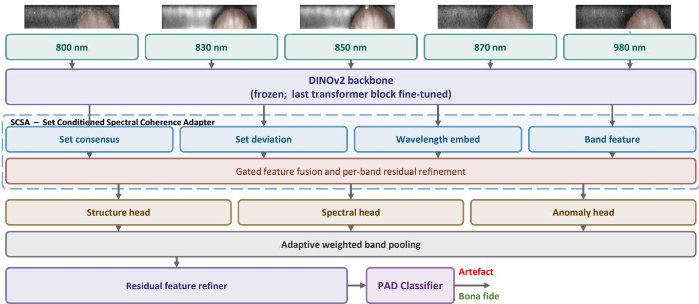
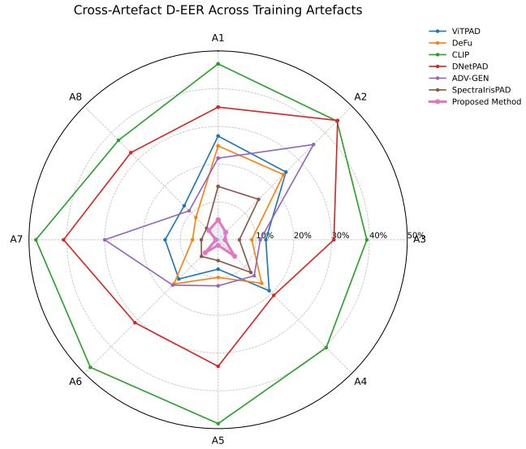
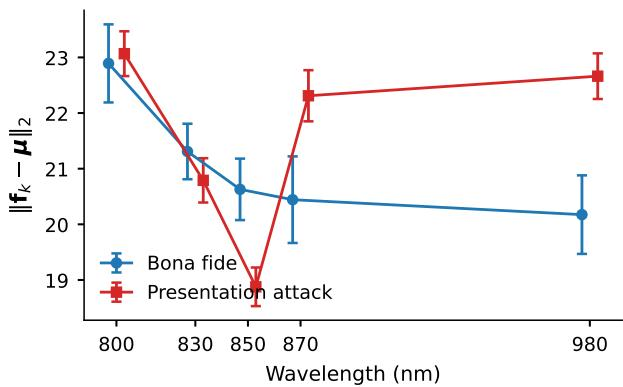

# WaveSpec: Multi-Spectral Iris Presentation Attack Detection via Wavelength-Conditioned Spectral Coherence Adaptation

Raghavendra Ramachandra

SAFE Centre

Norwegian University of Science and Technology (NTNU), Norway

raghavendra.ramachandra@ntnu.no

## Abstract

Multispectral iris presentation attack detection benefits from observing the same iris across multiple near-infrared wavelengths, but existing methods often use wavelength information mainlyfor conditioning orfusion. This can limit their ability to explicitly model whether the spectral response of a sample is coherent across bands. In this paper, we propose WaveSpec, a multispectral iris PADframework that performs feature-level spectral coherence adaptation. Each NIR band is first encoded with a DINOv2 backbone. The proposed Set Conditioned Spectral Coherence Adapter then updates each band feature using the consensus of the available spectral set, the band-specific deviationfrom that consensus, and wavelength identity. The adapted features are projected into structural, spectral, and anomaly representations, adaptively pooled, and classified as bona fide or attack. We evaluate WaveSpec on the MSIrPAD benchmark under a strict cross-artefact protocol, where the model is trained with one presentation attack instrument and tested on unseen attacks. WaveSpec reduces the average D-EER from 8.45% for SpectraIrisPAD to 3.33%, and reduces average BPCER@APCER=1% from 43.16% to 12.07%. Ablation results show that the SCSA adapter and spectral residual are central to the improvement, while a band-subset analysis shows that WaveSpec remains effective under partial spectral observations and performs best when all five bands are available. The method adds only modest computational overhead, with 11.15 ms end-to-end latency per five-band sample on an NVIDIA L40S-48Q GPU.

## 1. Introduction

Iris recognition is widely deployed because the iris offers rich, stable, and highly distinctive texture, and most operational systems acquire iris images in the near infrared range, where iris texture is most visible. The same imaging process, however, exposes the system to presentation attacks, where an attacker presents a printed iris, a display image, or a textured contact lens to the sensor.

Iris presentation attack detection [1, 2, 4–8, 10, 11, 17, 18, 22, 23, 25, 30–33] has progressed from hand designed texture and image quality features to deep neural networks and visual foundation models. These methods can perform well when the training and test conditions are similar, but their reliability often drops when the test attacks differ from those seen during training. The LivDet Iris evaluations have repeatedly shown that unseen presentation attack instruments remain a major challenge [28]. This is a serious limitation for deployment because real attacks may differ in material, printing process, lens pigment, display quality, and capture condition.

A single near infrared image provides only one view of the eye and the attack material, whereas multispectral imaging observes the same iris across several wavelengths. Bona fide irides vary across wavelength according to tissue structure, pigmentation, and optical scattering, while attack artefacts are governed by contact lens pigments, printing substrates, inks, or display surfaces, often producing spectral behaviour inconsistent with live tissue. Prior multispectra iris PAD studies have shown that NIR bands from roughly 800 nm to 980 nm improve the detection of contact lens and print attacks [12, 13, 16, 20, 29]. SpectraIrisPAD introduced the MSIrPAD dataset and a DINOv2-based multispectral PAD framework with spectral position encoding and token fusion [19]; however, it still leaves open the question of how to model whether the spectral bands of the same sample agree or deviate before the final decision.

This paper proposes WaveSpec, a multispectral iris PAD model that performs feature level spectral reasoning with a

Set Conditioned Spectral Coherence Adapter (SCSA). After DINOv2 extracts a feature from each available wavelength, the SCSA updates each band feature using the consensus of the spectral set, the deviation of that band from the consensus, and a learnable wavelength identity, before pooling and classification. This design allows the model to detect not only whether a single wavelength looks suspicious, but also whether it behaves consistently with the rest of the multispectral observation.

We evaluate WaveSpec on the MSIrPAD benchmark using a strict cross artefact protocol, where the model is trained with one attack type and tested on unseen attack types, comparing against six state-of-the-art PAD baselines including SpectraIrisPAD (Sec. 5.1). The results show that explicitly modelling spectral coherence improves generalisation to unseen iris presentation attacks while adding only modest latency over the DINOv2 backbone.

## 1.1. Contributions

The main contributions of this work are as follows:

1. We propose WaveSpec, a multispectral iris PAD framework that performs feature level spectral reasoning with a Set Conditioned Spectral Coherence Adapter. The adapter updates each band feature using the set consensus, the deviation from that consensus, and wavelength identity, allowing the model to detect artefact induced spectral inconsistencies directly in representation space.

2. We introduce a multi head spectral representation that separates adapted structural information, consensus driven spectral cues, and deviation based anomaly cues. These representations are combined with adaptive weighted band pooling and trained with complementary classification, contrastive, prototype, spectral ordering, and anomaly separation objectives.

3. We evaluate WaveSpec on the MSIrPAD [19] multispectral iris PAD benchmark under a strict cross artefact protocol, trained with one attack type and tested on unseen attack types, against strong baselines spanning conventional deep iris PAD, adversarial augmentation, foundation model based PAD, and prior multispectral fusion including SpectraIrisPAD. The analysis covers ablation, operating point evaluation using BPCER at fixed APCER levels, and computational benchmarking, showing that explicit spectral coherence modelling improves generalisation over late fusion and prior multispectral PAD strategies at modest overhead over the DI-NOv2 backbone.

## 2. Related Work

This section reviews iris PAD for single band near infrared imaging and then the multispectral methods that are most relevant to this work.

## 2.1. Near infrared iris presentation attack detection

Iris presentation attack detection has been widely studied for near infrared iris recognition systems. Early methods used hand crafted texture descriptors, image quality measures, photometric cues, or geometric information to detect printed irides, replayed images, artificial eyes, and textured contact lenses. These approaches are efficient and often interpretable, but their performance is sensitive to sensor characteristics, segmentation quality, image normalisation, and the attack materials observed during training. This limitation becomes clear when PAD systems are evaluated on unseen presentation attack instruments, as shown in the LivDet Iris evaluations [28].

Deep learning has improved iris PAD by learning features directly from data. CNN based models such as DNet-PAD, contact lens detection networks, and adversarial augmentation strategies have shown strong results under controlled settings. Recent work has also studied cross-domain PAD, where the training and test data differ in sensor, dataset, or attack type. ADV-GEN, for example, uses parametrically generated adversarial samples to improve crossdomain iris PAD performance [15]. Transformer based PAD models and cascaded ViT designs have also been explored for stronger representation learning [21]. Despite these advances, most NIR PAD methods still operate on a single spectral observation and therefore cannot exploit wavelength dependent differences between bona fide tissue and attack materials.

Visual foundation models have recently been considered for iris PAD. DINOv2 and OpenCLIP features have been evaluated for NIR iris PAD with lightweight task heads [27], while broader biometric studies have tested vision language and multimodal foundation models for iris recognition and iris PAD [26]. Open-set studies such as VISER further show that unseen attack types remain difficult even when strong pretrained representations or human saliency cues are used [3]. These works support the use of foundation features, but they do not explicitly model the spectral relationships among multiple NIR bands.

## 2.2. Multispectral iris PAD

Multispectral iris PAD is motivated by the fact that bona fide irides and presentation attack instruments do not respond to illumination wavelength in the same way, which makes the spectral response across NIR bands a useful cue when the attack type at test time differs from those seen during training.

Earlier multispectral iris PAD methods used Purkinje reflections under two wavelengths, gradient-based fusion across multiple NIR bands, or reflectance cues near the iris– sclera boundary to detect artificial eyes, print attacks, and textured contact lenses [12, 13, 16]. These studies demonstrated that spectral information is useful, but they often relied on hand-crafted measurements, specific acquisition conditions, or accurate localisation. Later work introduced a near-infrared multispectral iris sensor to study materialdependent spectral responses for recognition and PAD [29], and subsequent methods used five NIR bands from 800 nm to 980 nm with CNN features for detecting textured contact lens attacks [19, 20]. While these approaches showed that spectral diversity improves PAD, their attack coverage was limited and the fusion mechanism did not explicitly model how the bands of the same sample agree or deviate from one another.

SpectraIrisPAD extended this direction by introducing the MSIrPAD benchmark and by using DINOv2 features with spectral position encoding and token fusion for multispectral iris PAD [19]. This was an important step because it showed that foundation-model features and wavelength-aware conditioning can improve cross-artefact performance. However, SpectraIrisPAD primarily treats wavelength information as a conditioning and fusion cue: it does not explicitly model whether each band agrees with, or deviates from, the shared spectral behaviour of the same sample before classification.

WaveSpec addresses this limitation by moving from wavelength-conditioned fusion to feature-level spectral coherence adaptation (Sec. 3). This paper does not introduce a new database; it uses the MSIrPAD protocol to study a different question: whether explicit spectral coherence modelling improves generalisation to unseen iris presentation attack instruments.

## 3. Proposed Method

This section presents the motivation for WaveSpec, the per band feature extraction, the proposed SCSA, and the pooling and decision stages, followed by the training objective.

## 3.1. Motivation and overview

The motivation for WaveSpec is that an iris presentation is not a set of independent NIR images but a spectral observation of the same physical object. A bona fide iris is produced by biological tissue, whose appearance across wavelengths is shaped by pigmentation, scattering, and absorption, whereas an artefact is governed by pigments, inks, substrates, or display surfaces that may look plausible at one wavelength but respond inconsistently when viewed as a spectral set. The useful PAD cue therefore lies not only in the appearance of a single band, but in how the bands agree with, or depart from, one another.

WaveSpec is designed to model this relation before making the PAD decision. Given up to N=5 NIR bands $\nu ~ \in ~ \{ 8 0 0 , 8 3 0 , 8 5 0 , 8 7 0 , 9 8 0 \}$ nm, each available band is first encoded independently with a mostly frozen DI-NOv2 backbone. The resulting features are then passed to the proposed Set Conditioned Spectral Coherence Adapter (SCSA). For each band, SCSA builds an adapted feature from four sources: the original DINOv2 feature, the consensus of the available spectral set, the deviation of the band from that consensus, and a learnable wavelength embedding. This design makes the classifier sensitive to spectral coherence rather than only to per band appearance. The adapted features are projected into structural, spectral, and anomaly representations, pooled with learned band weights, and classified as bona fide or attack.

Let K be the number of available bands in a sample, with $1 \le K \le N$ . The DINOv2 feature dimension is D=768, and the latent projection dimension is L=256. Since all set operations are defined over the available bands, the same model can operate with a full five band sample or with a partial spectral observation.

## 3.2. Per band feature extraction

Each band image $I _ { k }$ is a single channel NIR image. To use DINOv2, the image is resized to 224×224 and replicated into three channels, giving $\hat { I } _ { k } \in \mathbb { R } ^ { 3 \times 2 2 4 \times 2 2 4 }$ . We use dinov2-base [14] as the backbone. All transformer blocks are frozen except the final block, which is fine-tuned jointly with the WaveSpec modules. This keeps the generic representation learned by DINOv2 while allowing limited task adaptation, and reduces overfitting risk on the comparatively small PAD dataset. The dinov2 base backbone is chosen to match SpectraIrisPAD [19], so that the comparison in Sec. 5 isolates the contribution of the set level modelling rather than differences in backbone capacity; pairing WaveSpec with a smaller backbone is left for future work.

For each band, the [CLS] token is used as the band feature:

$$
\mathbf { f } _ { k } = \mathrm { D I N O v } 2 ( \hat { I } _ { k } ) [ 0 ] \in \mathbb { R } ^ { D } , \qquad k = 1 , \dots , K .\tag{1}
$$

The features form the spectral set $\textbf { F } = \ \{ \mathbf { f } _ { k } \} _ { k = 1 } ^ { K }$ The bands are deliberately encoded independently at this stage. Cross wavelength reasoning is left to SCSA, where it can be learned explicitly from the relation between features.

## 3.3. Set Conditioned Spectral Coherence Adapter

SCSA asks a simple question for each band: does this band agree with the rest of the spectral observation? We first compute the set consensus

$$
\mu = \frac { 1 } { K } \sum _ { k = 1 } ^ { K } \mathbf { f } _ { k } \in \mathbb { R } ^ { D } ,\tag{2}
$$

which represents the common information shared by the available bands. We then compute the deviation of each band from this consensus:

$$
\mathbf { r } _ { k } = \mathbf { f } _ { k } - { \boldsymbol { \mu } } .\tag{3}
$$

  
Figure 1. Overview of WaveSpec. Each available NIR band is encoded by DINOv2 and then adapted by the Set Conditioned Spectral Coherence Adapter. The adapter uses the consensus of the spectral set, the deviation of each band from that consensus, wavelength identity, and the original per band feature. The adapted representations are then projected, pooled, refined, and classified as bona fide or artefact.

The consensus captures what the spectral set agrees on, while $\mathbf { r } _ { k }$ captures how the k-th band differs from the shared response. This residual is central to the method: for bona fide samples the deviations are expected to be structured and moderate, whereas artefacts can introduce irregular deviations due to material dependent NIR behaviour.

Each wavelength also has a learnable embedding $\mathbf { e } _ { k } \in$ $\mathbb { R } ^ { D }$ . This gives the adapter knowledge of which physical band produced the feature. The original feature, consensus, deviation, and wavelength embedding are concatenated:

$$
\mathbf { x } _ { k } = \left[ \mathbf { f } _ { k } \parallel \pmb { \mu } \parallel \mathbf { r } _ { k } \parallel \mathbf { e } _ { k } \right] \in \mathbb { R } ^ { 4 D } .\tag{4}
$$

Two lightweight MLPs then produce a spectral update and a gate:

$$
\delta _ { k } = \mathrm { M L P } _ { \mathrm { p r o j } } ( \mathbf { x } _ { k } ) , \qquad \mathbf { g } _ { k } = \sigma ( \mathrm { M L P } _ { \mathrm { g a t e } } ( \mathbf { x } _ { k } ) ) .\tag{5}
$$

The adapted feature is obtained through a gated residual update,

$$
\tilde { \mathbf { f } } _ { k } = \mathbf { f } _ { k } + \mathbf { g } _ { k } \odot \delta _ { k } .\tag{6}
$$

The gate is used because not every DINOv2 dimension should be changed. Some dimensions already encode useful iris structure, while others benefit from spectral context. The residual form therefore lets the network introduce spectral information selectively instead of replacing the backbone feature. The adapter also produces two specialist outputs: a consensus representation $\mathbf { c } _ { k } = \phi _ { c } ( \ddot { \mathbf { f } } _ { k } )$ and an anomaly representation $\mathbf { a } _ { k } = \phi _ { a } ( \mathbf { r } _ { k } )$ , each through a LayerNorm and linear layer.

## 3.4. Projection, pooling, and PAD decision

The adapted representation is decomposed into three complementary views. The structure head projects $\tilde { \mathbf { f } } _ { k }$ and preserves local texture and shape cues. The spectral head projects the consensus conditioned representation and is encouraged to respect wavelength identity. The anomaly head projects the deviation signal and is intended to respond to material induced inconsistencies. We write

$$
\begin{array} { r l } & { \mathbf { s } _ { k } = \phi _ { s } ( \widetilde { \mathbf { f } } _ { k } ) , } \\ & { { \pmb \rho } _ { k } = \phi _ { \rho } ( \mathbf { c } _ { k } ) , \qquad \mathbf { h } _ { k } = \left[ \mathbf { s } _ { k } \parallel \pmb { \rho } _ { k } \parallel \mathbf { z } _ { k } \right] \in \mathbb { R } ^ { 3 L } , } \\ & { \mathbf { z } _ { k } = \phi _ { z } ( \mathbf { a } _ { k } ) , } \end{array}\tag{7}
$$

where each $\phi$ is a LayerNorm followed by a linear projection.

Different wavelengths may be more or less informative depending on the attack material. For this reason, WaveSpec uses learned attention pooling instead of simple averaging:

$$
w _ { k } = \frac { \exp ( \mathrm { M L P } _ { \mathrm { p o o l } } ( \mathbf { h } _ { k } ) ) } { \sum _ { j = 1 } ^ { K } \exp ( \mathrm { M L P } _ { \mathrm { p o o l } } ( \mathbf { h } _ { j } ) ) } , \qquad \mathbf { p } = \sum _ { k = 1 } ^ { K } w _ { k } \mathbf { h } _ { k } .\tag{8}
$$

The softmax normalisation makes the pooling valid for any number of available bands. During training, we also apply band dropout after SCSA with probability 0.20, while ensuring that at least one band remains. This prevents the classifier from relying on a fixed band configuration and improves robustness to missing or unreliable spectral observations.

The pooled vector is refined with a residual MLP and passed to a two class classifier:

$$
{ \tilde { \mathbf { p } } } = \mathbf { p } + \mathrm { M L P } _ { \mathrm { r e f } } ( \mathbf { p } ) , \qquad { \hat { \mathbf { y } } } = \mathrm { C l a s s i f i e r } ( { \tilde { \mathbf { p } } } ) .\tag{9}
$$

## 3.5. Training objective

WaveSpec is trained with a compact multi term objective:

$$
\mathcal { L } = \mathcal { L } _ { \mathrm { C E } } + \lambda _ { \mathrm { S C } } \mathcal { L } _ { \mathrm { S C } } + \lambda _ { \mathrm { P } } \mathcal { L } _ { \mathrm { P } } + \lambda _ { \mathrm { S O } } \mathcal { L } _ { \mathrm { S O } } + \lambda _ { \mathrm { A S } } \mathcal { L } _ { \mathrm { A S } } ,\tag{10}
$$

with $\lambda _ { \mathrm { S C } } { = } 0 . 1 5 , \lambda _ { \mathrm { P } } { = } 0 . 1 0 , \lambda _ { \mathrm { S O } } { = } 0 . 1 0 ,$ , and $\lambda _ { \mathrm { A S } } { = } 0 . 0 5 .$ These weights were chosen from preliminary experiments during model development, guided by keeping the cross entropy term dominant, and then frozen for all reported experiments. No per artefact or per test tuning is performed. The cross entropy term is class balanced to handle the imbalance between bona fide and attack samples. The supervised contrastive term encourages same class samples to form compact regions in the refined feature space, which helps when the test attack differs from the training attack. The prototype loss adds global class anchors so that the representation does not depend only on mini batch composition. The spectral ordering loss encourages the spectral head to preserve wavelength identity and physical proximity among bands. Finally, the anomaly separation loss encourages small anomaly magnitude for bona fide samples and larger deviation magnitude for attacks. Together, these losses shape the feature space so that PAD decisions depend not only on class labels, but also on spectral structure and material induced deviations.

## 4. Implementation Details and Latency

WaveSpec is implemented in PyTorch with the dinov2-base backbone at 224×224 input resolution. All DINOv2 blocks are frozen except the final transformer block. The trainable part of the model consists of this final DINOv2 block, SCSA, the projection heads, adaptive pooling, the residual refiner, the classifier, and the learnable class and spectral prototypes. This gives approximately 11.94M trainable parameters: about 7.09M from the final DINOv2 block and 4.86M from the WaveSpec modules.

Training is performed for at most 20 epochs using AdamW with learning rate $3 \times 1 0 ^ { - 5 }$ , weight decay $1 0 ^ { - 4 }$ and batch size 16. The learning rate is reduced by a factor of 0.2 when validation accuracy plateaus for two epochs, and early stopping is applied after five epochs without improvement. We use light geometric augmentation, including horizontal flipping, small rotation, mild affine jitter, and set band dropout.

For a sample with K available bands, inference requires K DINOv2 forward passes followed by the lightweight SCSA and classification heads; in the five band setting the total cost is approximately 94.75 GFLOPs per sample. Latency was measured in evaluation mode with gradients disabled, using 30 warm up iterations and 300 timed CUDA event runs at batch size 1. On an NVIDIA L40S-48Q GPU, the five band end-to-end latency is 11.15 ms per sample (89.6 samples/s), of which the DINOv2 backbone accounts for 9.17±0.34 ms and SCSA with the downstream heads for 1.57±0.07 ms.

  
Figure 2. Cross-artefact D-EER across the eight train-on-oneartefact settings. Lower values are better, so curves closer to the centre indicate stronger generalisation. WaveSpec remains consistently closer to the centre than the competing PAD methods; the same trend holds at the strict BPCER@APCER=1% operating point (Table 1). A1 to A8 denote the artefacts described in Sec. 5.1.

## 5. Experiments and Results

The experiments assess the main claim of this work: modelling spectral coherence before classification improves generalisation to unseen iris presentation attacks. We first describe the MSIrPAD protocol and evaluation metrics, then compare WaveSpec with existing PAD baselines, and finally analyse the contribution of the main architectural components through ablation.

## 5.1. Dataset, protocol, and metrics

We evaluate WaveSpec on the MSIrPAD benchmark introduced in SpectraIrisPAD [19]. The database was captured with a custom multispectral NIR iris sensor and contains five spectral bands, namely 800, 830, 850, 870, and 980 nm. The attack set covers eight presentation attack instruments (PAIs): six textured contact lens types (A1 to A6), one display attack (A7), and one print attack (A8). We use the same identity-disjoint train, development, and test partitions as SpectraIrisPAD [19] so that the comparison is directly aligned with the previous benchmark.

The main evaluation follows a strict cross-artefact protocol. In each experiment, the model is trained using bona fide samples and one attack artefact, selected on the development set, and tested on all remaining unseen artefacts. This setting is intentionally difficult because the test attack material is not observed during training. It therefore measures whether a PAD method can generalise to new presentation attack instruments, rather than only recognising attacks already seen during training.

Table 1. Average cross-artefact PAD performance over the eight train-on-one-artefact settings. Values are $\mathrm { m e a n } \pm \mathrm { S D }$ over training artefacts. Lower is better.
<table><tr><td>Method</td><td>D-EER</td><td></td><td></td><td>BPCER@APCER=1% BPCER@APCER=5% BPCER@APCER=10%</td></tr><tr><td>CLIP [26]</td><td> $4 4 . 0 7 { \pm } 4 . 1 9$ </td><td> $9 7 . 6 5 { \pm } 2 . 8 9$ </td><td> $9 7 . 1 0 { \pm } 3 . 5 7 \ $ </td><td> $9 5 . 7 1 { \pm } 5 . 3 1 $ </td></tr><tr><td>DNetPAD [24]</td><td> $3 3 . 6 6 { \pm } 6 . 6 8$ </td><td> $8 5 . 3 0 { \pm } 9 . 4 9$ </td><td> $7 4 . 8 1 \pm 1 2 . 7 3$ </td><td> $6 7 . 6 4 { \pm } 1 3 . 3 2 $ </td></tr><tr><td>ViTPAD [21]</td><td> $1 6 . 7 2 { \scriptstyle \pm 6 . 3 2 }$ </td><td> $5 2 . 7 2 { \scriptstyle \pm 1 3 . 7 9 }$ </td><td> $3 9 . 5 5 { \pm } 1 4 . 3 5 $ </td><td> $3 0 . 8 3 { \pm } 1 3 . 4 2 $ </td></tr><tr><td>ADV-GEN [15]</td><td> $1 8 . 9 9 { \pm } 8 . 7 6 $ </td><td> $6 2 . 4 6 { \pm } 2 0 . 7 7$ </td><td> $4 6 . 0 5 { \pm } 2 2 . 5 0 $ </td><td> $3 6 . 1 4 { \pm } 2 2 . 3 9$ </td></tr><tr><td>DeFu [20]</td><td> $1 4 . 5 1 { \pm } 6 . 7 4$ </td><td> $4 1 . 5 7 { \pm } 1 4 . 7 0 $ </td><td> $3 0 . 5 6 { \pm } 1 3 . 3 9$ </td><td> $2 1 . 8 2 { \pm } 1 2 . 3 4$ </td></tr><tr><td>SpectraIrisPAD [19]</td><td> $8 . 4 5 { \pm } 4 . 2 8 $ </td><td> $4 3 . 1 6 { \pm } 2 1 . 5 3 $ </td><td> $3 1 . 4 4 { \pm } 2 1 . 8 3 $ </td><td> $2 3 . 6 0 { \pm } 1 8 . 8 5$ </td></tr><tr><td>WaveSpec</td><td> $\mathbf { 3 . 3 3 \pm 1 . 8 6 }$ </td><td> $\mathbf { 1 2 . 0 7 \pm 6 . 8 7 }$ </td><td> $\mathbf { 6 . 4 8 \pm 4 . 9 6 }$ </td><td> ${ \bf 4 . 5 6 { \pm } 4 . 3 7 }$ </td></tr></table>

We compare WaveSpec with CLIP [26], DNetPAD [24], ViTPAD [21], ADV-GEN [15], DeFu [20], and SpectraIrisPAD [19]. We report D-EER and BPCER at APCER operating points of 1%, 5%, and 10% [9], with the operating point thresholds calibrated on the development set and applied unchanged to the test data. Results are reported as mean performance over the eight train-on-one-artefact settings, while the radar plot shows the corresponding perartefact trends. Lower values indicate better PAD performance. The full per-training-artefact numerical table is provided in the supplementary material.

## 5.2. Cross-artefact performance

Table 1 summarises the average cross-artefact performance, while Fig. 2 shows how the methods behave across the eight training artefacts. WaveSpec achieves the lowest average error for every metric. It reduces mean D-EER from 8.45% for SpectraIrisPAD to 3.33%, corresponding to a 60.6% relative reduction. The improvement is even stronger at fixed operating points: average BPCER is reduced from 43.16% to 12.07% at APCER=1%, from 31.44% to 6.48% at APCER=5%, and from 23.60% to 4.56% at APCER=10%. These reductions are important because low-APCER operation is the most relevant regime for PAD deployment, where attack acceptance must be tightly controlled while keeping bona fide rejection low.

The radar plot shows that the gain is not driven by a single favourable training artefact: the WaveSpec curve remains close to the centre across contact lens, display, and print attack settings, with the same trend at BPCER@APCER=1% (Table 1). This indicates stable generalisation when the attack material changes. By contrast,

CLIP and DNetPAD show high error for most artefacts, while DeFu, ViTPAD, ADV-GEN, and SpectraIrisPAD exhibit larger variations across the eight training conditions. Matched late score fusion of independently trained per-band DINOv2 models gives 17.60% D-EER (Suppl. Table $^ { 2 ) , }$ compared with 8.45% for SpectraIrisPAD and 3.33% for WaveSpec, showing that score aggregation alone does not explain the gain. The proposed feature-level spectral coherence modelling instead compares each band with the consensus of the available spectral set before classification.

## 5.3. Ablation study

Table 2 analyses the contribution of the main WaveSpec components over all eight train-on-one-artefact settings. For each training artefact, results are first averaged over the seven unseen test artefacts, and the table reports mean ± SD across the eight training settings. Removing the SCSA adapter increases D-EER from 3.33% to 5.17%, confirming that the improvement is not due to the DINOv2 backbone alone. Removing the set consensus, spectral residual, wavelength embedding, or adaptive pooling also degrades performance across all four metrics, showing that WaveSpec benefits from combining a shared spectral reference with band-specific deviation and adaptive band aggregation.

The auxiliary losses exhibit a more differentiated behaviour. Removing individual losses degrades performance modestly, with D-EER rising to between 3.76% (w/o spectral ordering loss) and 4.91% (w/o anomaly loss). The spectral ordering loss is a partial exception: its removal raises D-EER by 0.43 percentage points but yields slightly lower BPCER@APCER=1% (10.98% vs 12.07%), suggesting that it primarily shapes the global decision boundary rather than the score distribution at the tightest operating point. The full model is superior on the remaining three metrics, confirming the loss provides consistent benefit. Removing all auxiliary losses simultaneously raises D-EER to 8.82% demonstrating that their collective regularisation is not redundant with the CE objective and cannot be compensated by the architectural components alone.

The ablation shows that the architectural components and the training objectives contribute in a complementary way. Explicit spectral consensus, band deviation, wavelength identity, and adaptive pooling each support unseen artefact generalisation, and the auxiliary losses are needed to shape the feature space in which these components operate, as removing all of them raises the error the most. The generalisation ability of WaveSpec therefore comes from the combination of the set level architecture and the objectives that train it, not from either part alone.

Table 2. Cross-artefact ablation study of WaveSpec. Values are mean ± SD in percent over the eight train-on-one-artefact settings. For each training artefact, results are first averaged over the seven unseen test artefacts. Lower is better. The full model row corresponds to the models reported in Table 1. Retraining the identical configuration with a different seed stream yields 3.24±1.48 D-EER, indicating stable results across seeds.
<table><tr><td>Variant</td><td>D-EER</td><td></td><td>BPCER@APCER=1% BPCER@APCER=5% BPCER@APCER=10%</td><td></td></tr><tr><td>Full model</td><td> $3 . 3 3 { \pm } 1 . 8 6 $ </td><td> $1 2 . 0 7 { \scriptstyle \pm 6 . 8 7 }$ </td><td> $6 . 4 8 { \pm } 4 . 9 6$ </td><td> $4 . 5 6 { \pm } 4 . 3 7$ </td></tr><tr><td>w/o SCSA adapter</td><td> $5 . 1 7 { \pm } 3 . 2 4$ </td><td> $1 6 . 4 8 { \pm } 9 . 8 1 $ </td><td> $1 2 . 1 9 { \pm } 8 . 8 6 $ </td><td> $9 . 0 5 { \pm } 7 . 0 0 \ $ </td></tr><tr><td>w/o set consensus</td><td> $5 . 9 7 { \pm } 4 . 5 6 $ </td><td> $1 8 . 5 9 { \pm } 1 1 . 3 5 $ </td><td> $1 3 . 3 4 \pm 1 2 . 7 8$ </td><td> $9 . 6 9 { \pm } 9 . 3 3 $ </td></tr><tr><td>w/o spectral residual</td><td> $4 . 3 6 { \pm } 3 . 0 5$ </td><td> $1 6 . 0 5 { \pm } 8 . 8 8$ </td><td> $9 . 6 3 { \pm } 8 . 4 7$ </td><td> $7 . 0 6 { \pm } 7 . 8 8 $ </td></tr><tr><td>w/o wavelength embedding</td><td> $3 . 9 1 { \pm } 1 . 8 0 $ </td><td> $1 2 . 6 5 { \pm } 3 . 7 5 $ </td><td> $7 . 9 6 { \pm } 4 . 8 5 $ </td><td> $6 . 1 7 { \scriptstyle \pm 4 . 9 4 }$ </td></tr><tr><td>w/o adaptive pooling</td><td> $4 . 6 4 { \pm } 2 . 7 6$ </td><td> $1 7 . 8 3 { \pm } 1 4 . 5 2 $ </td><td> $1 0 . 3 5 { \pm } 8 . 4 4$ </td><td> $7 . 8 7 { \pm } 7 . 1 4$ </td></tr><tr><td>w/o spectral ordering loss</td><td> $3 . 7 6 { \pm } 2 . 5 3 $ </td><td> $1 0 . 9 8 { \pm } 7 . 8 7$ </td><td> $6 . 6 7 { \pm } 5 . 4 0$ </td><td> $5 . 5 3 { \pm } 4 . 9 6$ </td></tr><tr><td>w/o SupCon loss</td><td> $4 . 0 0 { \scriptstyle \pm 2 . 0 7 }$ </td><td> $1 3 . 0 8 { \pm } 5 . 8 9$ </td><td> $8 . 5 9 { \pm } 5 . 1 5$ </td><td> $6 . 3 5 { \pm } 4 . 9 2$ </td></tr><tr><td>w/o prototype loss</td><td> $4 . 3 9 { \pm } 3 . 0 7$ </td><td> $1 4 . 0 6 { \pm } 8 . 6 6$ </td><td> $8 . 9 0 { \pm } 7 . 3 4$ </td><td> $6 . 4 1 { \pm } 5 . 7 3$ </td></tr><tr><td>w/o anomaly loss</td><td> $4 . 9 1 { \pm } 2 . 9 2 $ </td><td> $1 5 . 9 2 { \pm } 1 1 . 3 9 $ </td><td> $1 1 . 3 1 { \pm } 8 . 0 9$ </td><td> $9 . 3 8 \pm 7 . 4 0 $ </td></tr><tr><td>w/o set-band dropout</td><td> $3 . 9 4 \pm 2 . 3 7$ </td><td> $1 5 . 2 4 { \pm } 9 . 8 5$ </td><td> $9 . 0 2 { \pm } 7 . 3 1 $ </td><td> $5 . 7 6 { \pm } 5 . 3 5$ </td></tr><tr><td>w/o all aux. losses</td><td> $8 . 8 2 { \pm } 1 . 0 1 $ </td><td> $1 7 . 4 5 { \pm } 3 . 1 9$ </td><td> $1 4 . 9 1 { \pm } 2 . 7 9$ </td><td> $1 1 . 6 2 { \pm } 2 . 5 0 $ </td></tr><tr><td>Consensus as median</td><td> $4 . 3 6 { \pm } 1 . 5 6 $ </td><td> $1 1 . 0 5 { \pm } 4 . 5 3 $ </td><td> $7 . 9 2 { \pm } 4 . 2 2$ </td><td> $5 . 4 8 { \pm } 3 . 8 6$ </td></tr><tr><td>Consensus as maximum</td><td> $6 . 2 3 { \pm } 4 . 5 8 $ </td><td> $2 0 . 2 6 { \pm } 1 0 . 5 8$ </td><td> $1 4 . 7 5 { \pm } 1 0 . 0 3$ </td><td> $1 1 . 7 0 { \pm } 1 0 . 2 4$ </td></tr></table>

The last two rows of Table 2 examine the choice of the consensus operator in Eq. 2. The arithmetic mean is used because it is free of parameters, invariant to the order of the bands, and defined for any number of available bands, which the missing band setting requires. Replacing the mean with the element wise median gives similar performance, which shows that the method does not depend on the exact form of the central tendency operator. Replacing it with the element wise maximum degrades all four metrics, which shows that the consensus must represent the common behaviour of the spectral set rather than its extreme values.

## 5.4. Robustness to Band Subset and Missing-Band Analysis

Table 3 evaluates whether WaveSpec can operate as a spectral set model when only part of the wavelength set is avail able at test time. Even with a single band, WaveSpec outperforms the five band SpectraIrisPAD reference, and performance improves monotonically as wavelengths are added, with the best result obtained using all five bands. The single band baseline in Table 3 shows that this behaviour is not explained by the backbone and the training recipe alone. A DINOv2 model trained with the same optimiser, augmentation, and applicable losses on a single band reaches 22.53% D-EER for the best performing band, whereas WaveSpec evaluated with one band reaches 4.75%. The difference is that WaveSpec is trained on multispectral sets, so the representation carries spectral information learned through the set level components even when only one band is observed at test time.

Table 3. Band subset and missing-band analysis for WaveSpec. The model is trained with five bands and evaluated using restricted spectral subsets, including all single-missing-wavelength four-band cases. SpectraIrisPAD is shown only as the standard five-band reference. Values are mean ± SD over the eight trainon-one-artefact settings. Lower is better. The single-band DI-NOv2 baseline uses the same backbone, fine-tuning depth, opti miser, augmentation, and applicable losses as WaveSpec, but is trained and evaluated on one band.
<table><tr><td>Setting</td><td>D-EER %</td><td>BPCER@APCER=1%</td></tr><tr><td>SpectraIrisPAD, five bands</td><td>8.45±4.28</td><td>43.16±21.53</td></tr><tr><td>Single-band DINOv2 baseline (980 nm)</td><td> $2 2 . 5 3 { \pm } 0 . 9 6$ </td><td>27.77±3.32</td></tr><tr><td>WaveSpec, one band</td><td> $4 . 7 5 { \pm } 2 . 5 3 $ </td><td> $1 4 . 4 4 \pm 5 . 8 8$ </td></tr><tr><td>WaveSpec, two bands</td><td> $3 . 9 2 { \pm } 1 . 9 4 $ </td><td>13.35±5.99</td></tr><tr><td>WaveSpec, three bands</td><td> $3 . 7 3 { \pm } 1 . 9 3 $ </td><td>13.10±6.56</td></tr><tr><td>WaveSpec, four bands</td><td> $3 . 5 3 { \pm } 1 . 9 1 $ </td><td>12.57±6.75</td></tr><tr><td>WaveSpec, five bands</td><td> $\mathbf { 3 . 3 3 \pm 1 . 8 6 }$ </td><td> $\mathbf { 1 2 . 0 7 \pm 6 . 8 7 }$ </td></tr></table>

These results support two observations. First, WaveSpec does not depend on a fixed five-band input and remains effective under partial spectral observations, which follows from the SCSA design: consensus, deviation, and adaptive pooling are computed over the available bands rather than over a fixed image stack. Second, the consistent improvement from one to five bands shows that the additional wavelengths provide complementary cross-wavelength evidence for spectral coherence modelling.

  
Figure 3. Spectral residual profile over all complete five band test captures (90 bona fide and 404 attack captures, the latter dominated by display and print instruments). The residual of each band from the set consensus is computed from frozen pretrained DI-NOv2 features without any task training; error bars show the 95% confidence interval of the mean. The class difference is significant at 850, 870, and 980 nm and not at 800 and 830 nm. Bona fide residuals decrease smoothly with wavelength, whereas attack residuals are lowest at 850 nm, the standard iris imaging band, and rise sharply beyond it.

## 5.5. Discussion and Limitations

The experimental results suggest that the main benefit of WaveSpec comes from modelling the spectral observation as a set, rather than as a group of independent images. Figure 3 supports this view with a direct measurement of the coherence assumption. On complete five band test captures, bona fide samples deviate less from their spectral consensus than attacks on average, with a normalised deviation of 0.410 against 0.434, and the two classes differ in the shape of the deviation across wavelengths. Bona fide residuals decrease smoothly from 800 to 980 nm, while attack residuals reach their minimum at 850 nm and rise sharply beyond it. This is consistent with attack instruments being produced from, and optimised for, the standard iris imaging band, and it indicates that the discriminative information lies in the pattern of the deviation across bands rather than in its magnitude alone, which is what the SCSA operates on. The distributions of individual samples overlap substantially, so the residual magnitude of a single band is not a classifier on its own, which is why the deviation pattern is learned rather than thresholded.

The results also highlight the difficulty of multispectral iris PAD. Although WaveSpec achieves the lowest average error, performance still varies across training artefacts. For WaveSpec, artefact #4 remains the most difficult training condition, with higher variability than other artefacts (see Fig. 2). This suggests that some attack materials produce spectral responses closer to bona fide iris tissue, or that the artefact-specific training data do not fully cover the variability needed to separate all unseen attacks. Therefore, the important practical observation is: multispectral information improves generalisation, but it does not remove the need for diverse attack coverage during training.

A limitation of this work is that the evaluation is limited to MSIrPAD [19], which is currently the only available multispectral iris PAD benchmark with aligned five-band NIR images and diverse attack instruments. This makes MSIr-PAD suitable for studying spectral coherence, but it also limits direct cross-dataset and cross-sensor validation in the same multispectral setting. We therefore use the strict trainon-one, test-on-unseen-artefacts protocol as the main measure of generalisation. Future work should extend the evaluation as new multispectral iris PAD datasets and sensors become available.

Finally, the contribution of this paper is the SCSA mechanism and its analysis under cross-artefact, operatingpoint, ablation, latency, and missing-band settings; the MSIrPAD dataset and protocol are inherited from SpectraIrisPAD [19]. Future work will study uncertainty-aware rejection under poor-quality bands, and domain adaptation for sensors with different wavelength configurations.

## 6. Conclusion

This paper presented WaveSpec, a multispectral iris PAD method that models spectral coherence before classification. Unlike approaches that mainly treat wavelength information as a conditioning or fusion cue, WaveSpec adapts each band feature using the consensus of the available spectral set, the deviation of that band from the consensus, and wavelength identity. This enables the model to reason about whether a multispectral observation behaves coherently as a bona fide iris or shows material-induced inconsistencies associated with presentation attack instruments.

Experiments on the MSIrPAD cross-artefact protocol show that WaveSpec generalises better to unseen contact lens, display, and print attacks than all compared state-of-the-art PAD methods, reducing mean D-EER from 8.45% for the strongest prior multispectral baseline, SpectraIrisPAD, to 3.33%, with consistent gains across training artefacts and at all reported operating points. The ablation and band-subset analyses confirm that the gain stems from the explicit modelling of spectral consensus and bandspecific deviation rather than from the DINOv2 backbone alone, and that WaveSpec remains effective under partial spectral observations.

## References

[1] Akshay Agarwal, Afzel Noore, Mayank Vatsa, and Richa Singh. Generalized contact lens iris presentation attack detection. IEEE Transactions on Biometrics, Behavior, and Identity Science, 4(3):373–385, 2022. 1

[2] John Daugman. Iris recognition and anti-spoofing countermeasures. In 7th International Biometrics Conference, 2004. 1

[3] Byron Dowling, Eleanor Frederick, Jacob Piland, and Adam Czajka. VISER: Visually-informed system for enhanced robustness in open-set iris presentation attack detection. arXiv preprint arXiv:2603.17859, 2026. 2

[4] J. S. Doyle and K. W. Bowyer. Robust detection of textured contact lenses in iris recognition using BSIF. IEEE Access, 3:1672–1683, 2015. 1

[5] James S Doyle, Patrick J Flynn, and Kevin W Bowyer. Automated classification of contact lens type in iris images. In International Conference on Biometrics (ICB), pages 1–6. IEEE, 2013.

[6] Gunjan Gautam and Susanta Mukhopadhyay. Contact lens detection using transfer learning with deep representations. In 2018 International Joint Conference on Neural Networks, IJCNN 2018, Rio de Janeiro, Brazil, July 8-13, 2018, pages 1–8, 2018.

[7] Diego Gragnaniello, Giovanni Poggi, Carlo Sansone, and Luisa Verdoliva. Using iris and sclera for detection and classification of contact lenses. Pattern Recognition Letters, 82: 251–257, 2016.

[8] Xiaofu He, Shujuan An, and Pengfei Shi. Statistical texture analysis-based approach for fake iris detection using support vector machines. In Advances in Biometrics, pages 540–546. Springer Berlin Heidelberg, 2007. 1

[9] ISO/IEC JTC1 SC37 Biometrics. ISO/IEC 30107-3:2023 Information Technology – Biometric Presentation Attack Detection – Part 3: Testing and Reporting. International Organization for Standardization, 2023. 6

[10] Naman Kohli, Daksha Yadav, Mayank Vatsa, and Richa Singh. Revisiting iris recognition with color cosmetic contact lenses. In 2013 International Conference on Biometrics (ICB), pages 1–7, 2013. 1

[11] Jukka Komulainen, Abdenour Hadid, and Matti Pietikainen.¨ Generalized textured contact lens detection by extracting BSIF description from Cartesian iris images. In Biometrics (IJCB), 2014 IEEE International Joint Conference on, pages 1–7. IEEE, 2014. 1

[12] EuiChul Lee, KangRyoung Park, and Jaihie Kim. Fake iris detection by using purkinje image. In Advances in Biometrics, pages 397–403. Springer Berlin Heidelberg, 2005. 1, 2

[13] Sung Joo Lee, Kang Ryoung Park, Youn Joo Lee, Kwanghyuk Bae, and Jai Hie Kim. Multifeature-based fake iris detection method. Optical Engineering, 46, 2007. 1, 2

[14] Maxime Oquab, Timothee Darcet, Th´ eo Moutakanni, Huy´ Vo, Marc Szafraniec, Vasil Khalidov, Pierre Fernandez, Daniel Haziza, Francisco Massa, Alaaeldin El-Nouby, et al. DINOv2: Learning robust visual features without supervision. arXiv preprint arXiv:2304.07193, 2023. 3

[15] Debasmita Pal, Redwan Sony, and Arun Ross. A parametric approach to adversarial augmentation for cross-domain iris presentation attack detection. In Proceedings of the IEEE/CVF Winter Conference on Applications of Computer Vision (WACV), pages 5719–5729, 2025. 2, 6

[16] Jong Hyun Park and Moon Gi Kang. Iris recognition against counterfeit attack using gradient based fusion of multispectral images. In Advances in Biometric Person Authentication, pages 123–130, Berlin, Heidelberg, 2005. Springer. 1, 2

[17] R. Raghavendra, Kiran B. Raja, and Christoph Busch. Ensemble of statistically independent filters for robust contact lens detection in iris images. In Proceedings of Indian Con ference on Computer Vision Graphics and Image Processing, pages 24:1–24:7, 2014. 1

[18] Ramachandra Raghavendra, Kiran B Raja, and Christoph Busch. ContlensNet: Robust iris contact lens detection using deep convolutional neural networks. In 2017 IEEE Winter Conference on Applications ofComputer Vision (WACV), pages 1160–1167, 2017. 1

[19] Raghavendra Ramachandra and Sushma Venkatesh. SpectraIrisPAD: Leveraging vision foundation models for spectrally conditioned multispectral iris presentation attack detection. IEEE Transactions on Biometrics, Behavior, and Identity Science, 2025. 1, 2, 3, 5, 6, 8

[20] Raghavendra Ramachandra, Sushma Venkatesh, and Gaurav Jaswal. Multi-spectral sensing to detect patterned/textured iris contact lens attacks using deep iris features. In International Conference on Computer Vision and Image Processing, pages 98–111. Springer, 2024. 1, 3, 6

[21] Deepika Sharma and Arvind Selwal. Cascading adaptive binary image feature maps with vision transformer for iris spoof detection. Applied Soft Computing, 170:112713, 2025. 2, 6

[22] Geetanjali Sharma, Gaurav Jaswal, Aditya Nigam, and Raghavendra Ramachandra. FISNET: A learnable fusionbased iris segmentation network improving robustness across NIR and VIS modalities. IEEE Access, 13:101472– 101490, 2025. 1

[23] Geetanjali Sharma, S. Ashwani, Gaurav Jaswal, Aditya Nigam, and Raghavendra Ramachandra. Towards robust iris presentation attack detection via fine-tuned DINOv2 and ResNet-50 models. In AI for Forensics and Biometric Ap plications: First International Conference, ICAIFB 2025, Bhilai, India, December 19–20, 2025, Proceedings, Cham, 2026. Springer. 1

[24] Renu Sharma and Arun Ross. D-NetPAD: An explainable and interpretable iris presentation attack detector. In 2020 IEEE International Joint Conference on Biometrics (IJCB), pages 1–10, 2020. 6

[25] P. Silva, E. Luz, R. Baeta, H. Pedrini, A. X. Falcao, and D. Menotti. An approach to iris contact lens detection based on deep image representations. In 28th SIBGRAPI Conference on Graphics, Patterns and Images, pages 157–164, 2015. 1

[26] Redwan Sony, Parisa Farmanifard, Hamzeh Alzwairy, Ni tish Shukla, and Arun Ross. Benchmarking foundation models for zero-shot biometric tasks. arXiv preprint arXiv:2505.24214, 2025. 2, 6

[27] Juan E. Tapia, Lazaro Janier Gonzalez-Soler, and Christoph Busch. Towards iris presentation attack detection with foundation models. arXiv preprint arXiv:2501.06312, 2025. 2

[28] Patrick Tinsley, Sandip Purnapatra, Mahsa Mitcheff, Aidan Boyd, Colton Crum, Kevin Bowyer, Patrick Flynn, Stephanie

Schuckers, Adam Czajka, Meiling Fang, et al. Iris liveness detection competition (LivDet-Iris) – the 2023 edition. In 2023 IEEE International Joint Conference on Biometrics (IJCB), pages 1–10. IEEE, 2023. 1, 2

[29] Sushma Venkatesh, Ramachandra Raghavendra, Kiran Raja, and Christoph Busch. A new multi-spectral iris acquisition sensor for biometric verification and presentation attack detection. In IEEE Winter Conference on Applications ofComputer Vision Workshops (WACVW), pages 1–8, 2019. 1, 3

[30] Zhuoshi Wei, Xianchao Qiu, Zhenan Sun, and Tieniu Tan. Counterfeit iris detection based on texture analysis. In 19th International Conference on Pattern Recognition, pages 1–4, 2008. 1

[31] Daksha Yadav, Naman Kohli, James S. Doyle, Richa Singh, Mayank Vatsa, and Kevin W. Bowyer. Unraveling the effect of textured contact lenses on iris recognition. IEEE Transactions on Information Forensics and Security, 9(5):851–862, 2014.

[32] Daksha Yadav, Naman Kohli, Akshay Agarwal, Mayank Vatsa, Richa Singh, and Afzel Noore. Fusion of handcrafted and deep learning features for large-scale multiple iris presentation attack detection. In Proceedings of the IEEE Conference on Computer Vision and Pattern Recognition Workshops, pages 572–579, 2018.

[33] Hui Zhang, Zhenan Sun, and Tieniu Tan. Contact lens detection based on weighted LBP. In 20th International Conference on Pattern Recognition (ICPR), pages 4279–4282, 2010. 1