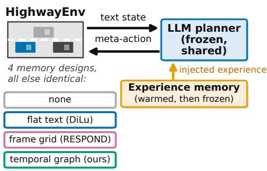
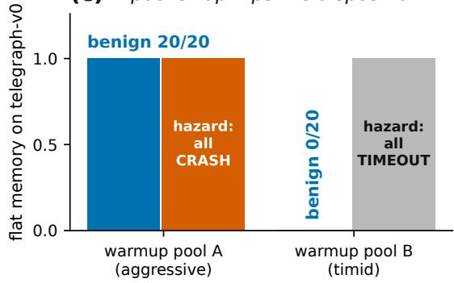
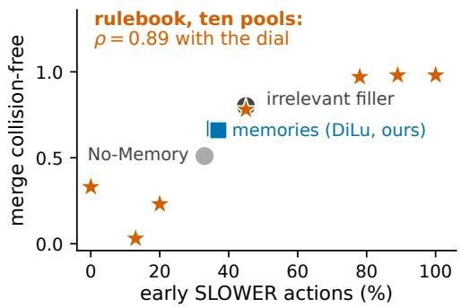
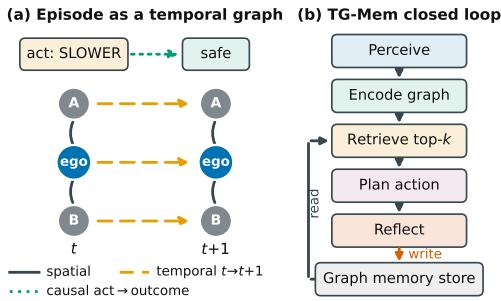
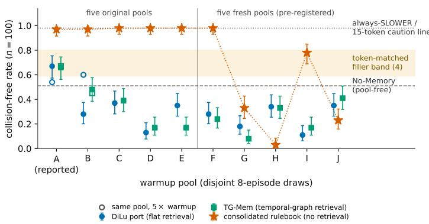

# When Does Experience Memory Help Closed-Loop LLM Driving Agents? A Controlled Evaluation with Resampled Warmup Pools, Token-Matched Fillers, and Audited Baselines

Yingxin Jia   
Xuanyi Li   
Independent Researchers

jia yingxin@hotmail.com lixuanyi199801@gmail.com

Editors: Andy Song, Bo Han and Sarah Erfani

## Abstract

When does experience memory help a closed-loop LLM driving agent? Published gains cannot say, because planners, prompts, and implementation quality vary together across systems, and the two factors we find to matter most, which warmup experiences the pool contains and what any injected tokens do to the prompt, are controlled in none of them. We answer with a controlled evaluation on one audited HighwayEnv testbed (kinematic observations, discrete meta-actions, 1 Hz, gpt-4o-mini for the decisive contrasts). We freeze the planner, encoder, and protocol, treat the warmup pool as a resampled random factor (ten disjoint pools), and add token-matched irrelevant-filler controls, oracle-certified diagnostics, scripted certificate policies, caution-pricing metrics, and quantified audits of the baseline ports. The probe suite spans flat-text retrieval (a DiLu port), a single-frame grid port (RESPOND-inspired), our episodic temporal-graph memory TG-Mem with five variants, a retrieval-free consolidated rulebook, and a flat K-step observation-history baseline. Four findings follow, each a property of this testbed. (1) Headline memory gains belong to the warmup draw. The reported pool is the best of ten for both retrieval memories, which beat No-Memory in only one pool of ten (sign test p = 0.011) and have a negative pool-averaged efect, and even the rulebook’s apparent pool-immunity (0.97 to 0.98 on five pools) collapsed to 0.03 to 0.98 on five fresh draws. (2) No retrieval design tested exceeds token-matched filler, which sits significantly above both memories under paired tests. The collision-only merge ceiling is reached by a scripted always-SLOWER policy and by a single 15-token caution instruction (both 0.98), and metrics that price caution erase the rulebook’s lead. (3) Representational sophistication is nowhere robustly operative. Neither retrieved structure nor raw in-context history solves the oracle-solvable history-necessity diagnostic. (4) Baseline port quality silently inverts conclusions. On this testbed, a single-pool comparison without filler controls would have reported memory gains that these controls reverse. We release the testbed, diagnostics with certificates, the replay benchmark, audited ports, seeds, and caches.

Keywords: Large language models; autonomous driving; agent memory; temporal knowledge graphs; retrieval-augmented decision making; closed-loop simulation.

## 1. Introduction

Large language models (LLMs) have emerged as promising decision makers for autonomous driving that reason over scenes in natural language. A recurring finding is that they improve substantially when given an experience memory, a store of past situations and the actions

(a) Only the memory varies  

## (b) The missing controls

1. warmup pool as a random factor (10 disjoint draws + 5 × budget)

2. token-matched irrelevant filler (4 contents, 2 doses)

3. pre-registered diagnostics + scripted oracle certificates

(c) A pool swap flips the disposition  

(d) Injection turns a caution dial  
  
Figure 1: Overview. (a) Memory designs from our probe suite and from the literature drive one frozen planner in closed loop, and only the memory system varies. (b) The controls we introduce: the warmup pool resampled as a random factor, token-matched irrelevant filler, and pre-registered diagnostics with scripted oracle certificates. (c) Swapping one 8-episode warmup pool flips the flat memory from aggressive (all hazard episodes crash) to timid (all time out) on the history-necessity diagnostic. (d) The early-SLOWER share tracks merge safety. The retrieval-free rulebook turns this dial hardest, yet five fresh pools swing it from 0.03 to 0.98.

that worked, retrieved and injected as few-shot guidance at decision time (Wen et al., 2024; Fu et al., 2024a; Mei et al., 2024). This paper asks the question those reports leave open. When does experience memory help, and under which warmup experiences, prompt compositions, and decision cadences? Published comparisons cannot answer this, because the memory varies together with the surrounding architecture and with implementation quality, and the two factors we find to matter most, which experiences the warmup pool contains and what any injected tokens do to the prompt, are controlled in none of them.

Our primary contribution is the controlled evaluation itself. We fix one planner, one encoder, and one warm-up, freeze, and evaluate protocol, and we instrument it with controls this literature has not used. The warmup pool becomes a resampled random factor (ten disjoint pools with model-free pool-level tests). Token-matched irrelevant-filler arms span content, dose, and a disclaimer×domain factorial. Two constructed diagnostics are certified well-posed by scripted oracles before any LLM run. Scripted non-LLM certificate policies bound what caution alone achieves, metrics price caution rather than only collisions, and a quantified audit measures the fidelity of the baseline ports. On this testbed we evaluate a probe suite that spans the memory design space (§3 and §4). At the rich end sits TG-Mem (Temporal-Graph Memory), our episodic design. Published driving memories retrieve flat text by embedding cosine (Wen et al., 2024; Fu et al., 2024a; Zhou et al., 2025; Mei et al., 2024) or a single-frame grid (Chen et al., 2026), whereas TG-Mem stores episodes as small typed temporal graphs matched by a combined structural and temporal score, a promptlevel driving instantiation of the temporal knowledge-graph memory line (Rasmussen et al., 2025; Chhikara et al., 2025; Xu et al., 2025), with five variants that toggle curation, keys, and injection. At the distilled end sits a consolidated rulebook: the same experience compressed once into at most eight rules (Zhao et al., 2024) and injected at every decision with no retrieval. At the direct end sits a flat K-step history baseline, and at the contentfree end a token-matched padding arm and a four-content filler suite. Each probe is both a design under evaluation and a control for its neighbors.

The evaluation yields four findings (Figure 1). Each is a statement about this testbed, HighwayEnv with kinematic observations, discrete meta-actions, a 1 Hz decision cadence, and gpt-4o-mini for every decisive contrast, and each baseline statement concerns our audited ports under this harness (§4), not the published systems. Table 1 maps each finding to the confirmatory evidence behind it.

(M1) The warmup pool acts as a lottery: the headline gains are knife-edges that resampling reverses. Both headline gains, the diagnostic’s 0.45 → 0.95 (p=0.001) and the merge margin of +0.15 (significant under pairing), are properties of a particular draw. Resampled, the diagnostic efect spans 0.95 to 0.10, and on merge the reported pool is the best of ten disjoint pools: each memory exceeds No-Memory in one pool of ten (exact sign test $p { = } 0 . 0 1 1 )$ , sits significantly below it in five, and has a pool-averaged efect near −0.20 (§5). A pool swap also flips the flat memory’s entire disposition from aggressive to timid on the history-necessity diagnostic (Figure 1c), and the rulebook’s “poolimmunity,” confirmed on five pools, reversed on five fresh draws. (M2) No retrieval design tested exceeds our token-matched fillers. Injecting content-free tokens produces merge-safety changes comparable to the memories’. Fillers span 0.59 to 0.80 on merge against the memories’ 0.66 to 0.67, and the strongest filler is significantly above both under paired tests. The designs that reach the collision-only ceiling turn the caution dial hardest, and the dial needs no memory: a scripted always-SLOWER policy and a single 15-token caution instruction both score 0.98, and the rulebook’s best cells sit at that operating point while metrics that price caution erase its lead (§5.1). (M3) The operative ingredient dissociates (curation on merges, key precision on the diagnostic), and representational sophistication is nowhere robustly operative. TG-Mem and its five variants never robustly beat flat memory across splits. Its temporal edges, the design’s central component, contribute at most marginally in a pool-conditional ablation. The key×injection 2×2 (Table S44) finds compact injection consistently harmful while the keytype attribution flips with the pool, and even raw temporal context handed to the planner directly does not pass the history-necessity diagnostic that memory was hypothesized to solve. (M4) Baseline implementation quality silently inverts conclusions. A sub-

Table 1: Evidence map: each finding, the confirmatory result behind it, and the test used (n= 100 paired seeds on merge, n= 40 on diagnostics; $n \leq 2 0$ cells are exploratory).
<table><tr><td>Finding</td><td>Confirmatory evidence</td><td>Test; location</td></tr><tr><td>M1</td><td>Ten disjoint 8-episode pools, n = 100 each: DiLu port and Exact sign test TG-Mem above No-Memory in 1/10 pools, below in 5/10; tests, Holm; bootstrap over pools; pool-averaged effect -0.20 [−0.29, -0.10] / [−0.30, -0.09]. Rulebook 0.97–0.98 on A-E, 0.03–0.98 on</td><td> $_ { ( p = 0 . 0 1 1 ) } ;$  per-pool Fig. 3, Tab. S45, S51, S52</td></tr><tr><td>M2</td><td>Padding filler 0.800 vs. TG-Mem 0.660 / DiLu port 0.670 McNemar (n = 100 paired); caution line 0.980 above every memory and filler; always-SLOwER certificate 0.980 (no LLM); rulebook SaS 0.00.</td><td> $( p = 0 . 0 2 9 , 0 . 0 2 4 ;$   $\leq 4 \times 1 0 ^ { - 9 } ) ;$  Tab. 2, S47, S50</td></tr><tr><td>M3</td><td>DiLu port vs. TG-Mem indistinguishable (n = 100 paired); every arm 0/20 hazard successes on the oracle-solvable telegraph-v0 (n =40, pre-registered); -temporal edges 0.55 vs. 0.66 (n = 40, pool A).</td><td>McNemar (p=1.0; 0.07); Tab. 2, S30</td></tr><tr><td>M4</td><td>Crippled DiLu port 0.375 vs. audited port 0.670; grid port fails two of three reproduction audits (51% decisions, 49% cells reproduced).</td><td>Port audits; Tab. S11</td></tr></table>

tly crippled port halved the flat baseline and manufactured a false win for our own method.   
We quantify the artifact and release the audited ports.

Contributions. (i) An evaluation framework for agent experience memory, with instruments this literature lacks: the warmup pool as a resampled random factor with modelfree pool-level tests, token-matched filler and padding arms with a disclaimer×domain factorial (the nearest analog is exemplar sensitivity in in-context learning (Lu et al., 2022)), oracle-certified diagnostics, scripted certificate policies, caution-pricing metrics, and a quantified baseline audit. (ii) A probe suite spanning the design space, all ours: TG-Mem, the first episodic temporal-graph memory for closed-loop driving, with five variants, plus the consolidated rulebook, the flat K-step history baseline, and the filler instruments. (iii) Findings M1 to M4 from the first controlled closed-loop comparison of flat, structured, temporal-graph, distilled, and history-based context (one protocol, three backbones), a real-data-seeded replay benchmark (54 highD cut-ins), and released ports, seeds, caches, and protocols.

## 2. Related Work

Positioning. No prior driving-memory paper treats the warmup pool as a random factor (DiLu ablates pool size, never composition (Wen et al., 2024)), and none measures agent memory against token-matched irrelevant filler, even though random documents can improve RAG accuracy (Cuconasu et al., 2024) and length alone degrades it (Du et al., 2025).

Driving-agent memories. DiLu (Wen et al., 2024) established the closed-loop reason, reflect, and memorize paradigm on HighwayEnv. LimSim++ (Fu et al., 2024a), LeapAD (Mei et al., 2024), and SafeDrive (Zhou et al., 2025) extend it, all retrieving over flat representations, and other driving agents with memory or reflection (Fu et al., 2024b;

Mao et al., 2024) share the same confound of joint variation. RESPOND (Chen et al., 2026), the closest prior work, retrieves a 5×3 ego-grid by pattern matching. TG-Mem adds the two axes it lacks, temporal structure and relational retrieval, though our experiments bear out no advantage for either, and our grid port’s failed audit rules out any claim about the published system.

Graph-structured and episodic memory for LLM agents. Outside driving, knowledge-graph memories, some of them temporal, report strong recall and context reductions: Zep (Rasmussen et al., 2025), Mem0 and its graph variant (Chhikara et al., 2025), A-MEM (Xu et al., 2025), HippoRAG (Jim´enez Guti´errez et al., 2024), and Optimus-1 (Li et al., 2024). That evidence is almost entirely open-loop QA, and mixed even there (Mem0’s graph variant trails its flat variant on single-hop and multi-hop questions). In closed-loop control we find only two same-agent comparisons of structured against flat memory, AriGraph (Anokhin et al., 2025) and G-Memory, where flat retrieval baselines often score below no-memory on ALFWorld (Zhang et al., 2025), and neither is token-matched. The known tendency of unfiltered experience accumulation to degrade performance (Xiong et al., 2026) takes a sharper form here: the pool controls the sign.

Curation and reflection. That what gets stored and injected dominates is anticipated by Reflexion (Shinn et al., 2023), Voyager (Wang et al., 2024), Generative Agents (Park et al., 2023), and DiLu’s own curated pool (Wen et al., 2024). ExpeL (Zhao et al., 2024) distills insights open-loop. Our rulebook is its closed-loop instantiation, a distillation control that posts the evaluation’s best collision-only cell while its gains price as caution (§5.1).

## 3. The Probe Suite: Memory Designs and Controls Under Test

This section details the richest probe, TG-Mem, our episodic temporal-graph memory, which we treat as one point in the design space rather than as the contribution. The other probes are specified where they are evaluated (§4, §5.1), with full texts in the supplementary material.

TG-Mem maintains a graph-structured episodic memory M and, at every decision step, executes a perceive → encode → retrieve → plan → reflect loop (Figure 2). All steps are LLM-API or graph-algorithm calls, and no parameters are trained.

Episode as a temporal graph. An episode e summarizes a K-step window and is a typed graph $e ~ = ~ ( V , E )$ with a small fixed schema. Nodes V : ego, vehiclei, lanej, hazardk, with kinematic attributes (relative position and velocity, lane, inferred intent). Edges E: spatial (ahead of, left of, merging into, . . . ) and temporal (next: entity state at $t \to { t + 1 } )$ . The executed action $a _ { t }$ and outcome $\omega _ { t }$ are stored as episode metadata alongside the graph (Figure 2a) and are rendered into the injected text at retrieval time. The schema also permits causal (ego action→outcome) edges, but the extractor never sees the executed action, so such edges are model-inferred, not grounded. We obtain e by prompting the model with the recent window under a strict JSON schema. A programmatic variant builds the same graph deterministically from the numeric observation, with exact kinematics and no extraction call.

  
Figure 2: TG-Mem in one view. (a) An episode as a typed temporal graph, with spatial edges within a frame, temporal t → t+1 edges across frames, and the action and outcome stored as metadata (model-inferred causal edges are disclosed as such). (b) The perceive → encode → retrieve → plan → reflect loop over the graph store.

Encoding, storage, and retrieval. The current window is encoded into a query graph $q$ under the same schema, and episodes live in an in-process store. Retrieval scores every stored episode e against $q$ with a combined structural–temporal similarity

$$
s ( q , e ) = \alpha s _ { \mathrm { s t r u c t } } ( q , e ) + \beta s _ { \mathrm { t e m p } } ( q , e ) , \qquad \alpha + \beta = 1 ,\tag{1}
$$

and injects the top-k. Both terms are multiset Jaccard overlaps over typed elements. The structural term $s _ { \mathrm { s t r u c t } }$ averages the overlaps of the node-type bag and the labelled spatialedge bag, and $s _ { \mathrm { t e m p } }$ is the overlap of the labelled temporal and causal edge bag, defaulting to a neutral $\begin{array} { l } { { \frac { 1 } { 2 } } } \end{array}$ when no temporal structure is present. Typed bags make matching relational and time-aware, the intended alternative to flat cosine and single-frame grid lookup. Setting $\beta = 0$ recovers a static structural matcher (ablated in §5.5).

Injection, planning, and reflection. The retrieved episodes are serialized into a compact few-shot block (scene → action → consequence) and appended to a shared planning prompt. The planner emits a discrete meta-action via structured output, and every LLM call’s tokens are logged. On a collision, TG-Mem prompts the model for the maneuver that would have avoided the outcome and inserts a corrected episode, retrievable in temporally similar states (identically for every reflecting method).

## 4. Experimental Setup

Simulator and scenarios. We evaluate in closed loop on HighwayEnv (Leurent, 2018) (v1.11, CPU-only), whose discrete meta-action space matches LLM decisions, using four scenario families. (1) merge-v0 has multi-step approach, yield, and merge dynamics and is the flagship synthetic comparison (n = 100 evaluation seeds per method under ten disjoint 8-episode warmup pools plus two 40-episode pools on the weak backbone, and $n { = } 1 0$ on the others). (2) Two constructed diagnostics (ours): stopgo-v0, a retrieval-key diagnostic (steady vs. stop-and-go lead by seed parity, 20+20 episodes, §5.2), and telegraph-v0, a preregistered history-necessity diagnostic with a dual success metric and scripted certificates (§5.3). (3) Urban probes, roundabout-v0 and intersection-v0/v1 (structural nulls). (4) highd-cutin-v0 (ours), reconstructed initial-condition replays of real recorded cutins, described below. Dificulty-calibration probes are in Tables S24–S29. Warmup and evaluation seed sets are fixed, disjoint, and released.

Reconstructed initial-condition replays of real cut-ins (highd-cutin-v0). We reconstruct the 54 unique high-risk cut-in events (time-to-collision <4 s) bundled with the RESPOND repository from the highD drone dataset (Krajewski et al., 2018). These are initial-condition replays, not full trajectory playback, because the raw highD trajectories are license-gated. The ego spawns at its recorded speed and lane, neighbours at their recorded ofsets and speeds, IDM controls the non-ego vehicles from then on, and the LLM drives 15 s in our closed-loop protocol . The replays reproduce each event’s initial risk geometry, not its recorded trafic. Trivial policies crash on 50 to 78% of them. We warm on 14 events and evaluate frozen on the remaining 40.

Memory protocol, and the warmup pool as a random factor. For each (method, scenario, backbone) triple we warm up over 8 seeds (40 in the budget experiment, 14 events for highD) with learning on, then freeze the memory and evaluate on the disjoint heldout seed set with retrieval only. No-Memory and the warmup-free arms (history, padding, fillers) skip warmup. Each warmup pool is a disjoint block of eight independently seeded simulator episodes. Because the seed universe is efectively unbounded, disjoint blocks are independent draws from the warmup-generation distribution, which is the population over which the pool-level estimand, the expected efect of adding memory over 8-episode warmup draws on this testbed, is defined.

Memory designs compared, and what actually varies. All methods share the scene encoder, planning prompt skeleton, and planner. Only the memory system varies, as a bundle of stored representation, retrieval key, retrieved content, and injection format. No-Memory is the zero-shot planner and serves as the control. The DiLu port (Wen et al., 2024) embeds last-frame scene text locally (all-MiniLM-L6-v2), retrieves the cosine top-k over a curated pool, and reflects with the LLM on crashes. The grid port (RESPONDinspired) (Chen et al., 2026) stores 5 × 3 ego-grid risk patterns with exact and bounded sub-pattern matching and LLM reflection. Both are our re-implementations, and every baseline conclusion below is a statement about these audited ports, bounded by the port audits (Table S11). The grid port’s planner-substrate and representation audits both fail substantially, so its rows measure our port under this harness and support no conclusion about the published RESPOND system. The flat K-step history baseline (ours) injects the planner’s own last K−1 raw frames as text, with no storage, retrieval, or reflection. TG-Mem with its variants, the rulebook, and the padding and filler arms (all ours) complete the suite under the identical protocol.

Backbones. Models are served through OpenRouter (OpenRouter, 2026) at temperature 0 with fixed seeds: gpt-4o-mini (all scenarios and every decisive contrast), llama-3.3-70b-instruct, and mistral-small-3.2-24b. All calls use strict JSONschema structured outputs, and every response is cached by request hash.

Metrics and statistics. The primary safety metric is the collision-free rate. Because merge-v0 terminates when the ego passes the ramp section, we additionally report cautionpricing metrics recovered by replaying each logged action sequence through the seeded deterministic environment: mean ego speed, time-to-completion, timeout share, and a preregistered composite, safe-and-swift (collision-free and no timeout and mean speed $\geq 0 . 9 \times$ the No-Memory mean). Scripted non-LLM certificate policies bound what caution alone achieves on each scenario. Every arm on a scenario is evaluated on the identical seed set, so same-seed contrasts are paired. We report exact McNemar tests on the discordant pairs, Holm-adjusted within each declared family, with the unpaired Fisher tests of the review version alongside in Table S50. No headline inference difers between the two, and the two cells that cross 0.05 under pairing both strengthen the findings. Pool-level inference is model-free first. We count the pools in which a memory exceeds the pool-free No-Memory reference and apply an exact sign test, run per-pool tests with Holm adjustment, and take a nonparametric bootstrap over the ten pool-level efects for the pool-averaged efect. A random-intercept binomial model is retained as a supplementary efect-size estimate (Table S45). Per-decision calls, tokens, and cost count every call, including TG-Mem’s extraction. Cells with $n \leq 2 0$ per condition are exploratory probes and are labeled as such where they appear. Confirmatory claims rest on the $n = 1 0 0$ merge and $n = 4 0$ diagnostic cells. Hypotheses fixed before execution are marked pre-registered (full text released in PREREGISTRATION.md). Everything else is exploratory or post-hoc and labeled in place.

## 5. Results

## 5.1. Synthetic multi-step merges

Table 2 reports merge-v0 at $n { = } 1 0 0$ evaluation seeds per method, with memory warmed on pool A and then frozen, on $\mathtt { g p t - 4 o - m i n i }$ . All arms share the seed set, so every contrast is a paired exact McNemar test, Holm-adjusted within the four warmup arms (the full table with the unpaired Fisher tests alongside is Table S50). Four facts stand out. (i) Both welldesigned memories sit about 0.15 above No-Memory: the DiLu port at 0.670 [0.57, 0.75] and TG-Mem at 0.660 [0.56, 0.75] against 0.510 [0.41, 0.61] (Wilson 95% intervals). Under pairing the TG-Mem margin is Holm-robust (24 vs. 9 discordant seeds, $p _ { \mathrm { h o l m } } = 0 . 0 4 1 )$ and the DiLu port’s is marginal (34 vs. 18, $p _ { \mathrm { h o l m } } = 0 . 0 7 3 )$ . Neither survived Holm under the unpaired test. The margin is real for this pool and, as shown below, a property of the draw. (ii) The DiLu port and TG-Mem are indistinguishable (17 vs. 16 discordant seeds, $p { = } 1 . 0 )$ , while TG-Mem pays twice the calls and four times the tokens (1,038 prompt tokens per decision against 210 to 274). Its extra computation buys no safety, and doubling the retrieved context reduces safety (Figure S1). (iii) The flat K-step history baseline, which hands the planner its own last four frames with no memory system, scores 0.750. That is above No-Memory $( p = 2 \times 1 0 ^ { - 5 } )$ , not separable from the DiLu port $\left( p = 0 . 3 0 \right)$ , and inside the filler band (vs. 0.800, $p { = } 0 . 4 7 )$ . Real temporal context helps merge about as much as irrelevant filler does. (iv) The grid port is significantly below everything, including No-Memory $( p _ { \mathrm { h o l m } } { \le } 3 \times 1 0 ^ { - 9 } )$ . Its rows measure our port under this harness, not the published RESPOND system (the audit it fails is Table S11). Under our earlier crippled ports the DiLu port scored roughly half its current value.

Scripted certificates bracket the task. Three non-LLM policies $( n = 1 0 0 )$ calibrate the collision-only metric: always-IDLE scores 0.00, a ten-line reactive gap-keeper 0.40, and always-SLOWER 0.98 at $2 1 . 0 \mathrm { m } / \mathrm { s }$ . The ceiling is reachable by blanket caution alone, so we read every number against it and price caution explicitly (the SaS column).

Table 2: Closed-loop merge-v0 (n = 100/method, one shared seed set, gpt-4o-mini, audited v2 ports, warmup pool A). Paired McNemar tests, Holm-adjusted over the four warmup arms: grid port below everything $( p _ { \mathrm { h o l m } } { \le } 3 { \times } 1 0 ^ { - 9 } )$ , TG-Mem vs. No-Memory $p _ { \mathrm { h o l m } } = 0 . 0 4 1$ , DiLu port vs. No-Memory 0.073, DiLu port vs. TG-Mem 1.0. Pool A is the best of ten draws, and under B–J the memory rows collapse to 0.08–0.48 (Figure 3). SaS is the pre-registered safe-and-swift composite (§4), and speed is in m/s from certified replays. History and padding rows are warmup-free controls outside the Holm family (raw paired $p \colon$ padding above TG-Mem 0.029, above DiLu port 0.024). Lower block: TG-Mem ablation on the same pool $( n = 4 0$ shared seeds, full TG-Mem 0.700, paired McNemar vs. full and unpaired Fisher, $^ { * } p < 0 . 0 5$ , pool-conditional, §5.5). Tokens count every LLM call.
<table><tr><td>Method</td><td>Coll.-free ↑</td><td>SaS ↑</td><td>Speed</td><td>Steps</td><td> $\mathrm { T o k . / d e c . } \downarrow$ </td></tr><tr><td>No-Memory</td><td>0.510</td><td>0.40</td><td>24.2</td><td>12.7</td><td>210</td></tr><tr><td>DiLu port</td><td>0.670</td><td>0.67</td><td>25.6</td><td>12.1</td><td>274</td></tr><tr><td>Grid port (RESPOND-inspired)</td><td>0.140</td><td>0.14</td><td>29.0</td><td>7.4</td><td>251</td></tr><tr><td>TG-Mem (ours)</td><td>0.660</td><td>0.45</td><td>23.2</td><td>13.6</td><td>1,038</td></tr><tr><td>Flat K-step history (ours)</td><td>0.750</td><td>0.31</td><td>22.5</td><td>14.7</td><td>527</td></tr><tr><td>Irrelevant-padding control (ours)</td><td>0.800</td><td>0.29</td><td>22.3</td><td>15.4</td><td>1,037</td></tr><tr><td>Ablation (n=40):</td><td>Coll.-free</td><td></td><td>McNemar p / Fisher p</td><td></td><td></td></tr><tr><td>TG-Mem – temporal edges</td><td>0.550</td><td></td><td></td><td>0.070 / 0.25</td><td></td></tr><tr><td>TG-Mem - reflection</td><td>0.475</td><td></td><td></td><td>0.004* / 0.056</td><td></td></tr><tr><td>TG-Mem single-frame window (K=1)</td><td>0.400</td><td></td><td></td><td> $0 . 0 1 7 ^ { * } \ / \ 0 . 0 0 7 ^ { * }$ </td><td></td></tr></table>

The margin is the best of ten draws. Every merge cell above shares warmup pool A. Treating the pool as the random factor it is, we re-ran both memories under nine more disjoint 8-episode pools (B to J, n = 100 each, with No-Memory, which takes no warmup, as the shared comparator at 0.510). Figure 3 plots every cell and Tables S45 and S52 list them. The DiLu port ranges from 0.110 to 0.370 and TG-Mem from 0.080 to 0.480 over the nine new pools, so pool A is the best of ten draws for both methods. The model-free statement is the strongest one. Each memory exceeds No-Memory in exactly one pool of ten, which under the null that the median pool efect of adding memory is non-negative has probability $1 1 / 1 0 2 4 { = } 0 . 0 1 1$ (exact sign test, per method), and in five of the other nine pools each memory is significantly below No-Memory after Holm adjustment (Table S45). A nonparametric bootstrap over the ten pool-level efects places the pool-averaged efect of adding memory at $- 0 . 2 0 \left[ - 0 . 2 9 , - 0 . 1 0 \right]$ for the DiLu port and −0.20 [−0.30, −0.09] for TG-Mem (Table S51). The sign is secure, the magnitude coarse. The pre-registered hierarchical random-intercept model agrees (−0.22 [−0.32, −0.12] for both, Table S45) and now serves as a supplementary efect-size estimate rather than the primary evidence. Re-warming on five times the budget (pools A40 and B40) stabilizes the lottery (DiLu port 0.540/0.600 from 0.670/0.280) but to no benefit: no 40-episode cell difers from No-Memory after Holm adjustment (open markers in Figure 3).

  
Figure 3: The warmup-pool lottery on merge-v0 over all ten disjoint 8-episode pools $( n = 1 0 0$ per cell, Wilson 95% intervals) against the pool-free No-Memory arm (dashed), the band spanned by the four token-matched fillers, and the always-SLOWER and caution-line ceiling (dotted). Both retrieval memories exceed No-Memory only under pool A. Open markers re-warm pools A and B on five times the budget. The retrieval-free rulebook (stars) looked pool-immune on the five original pools and fell to 0.03–0.78 on three of the five pre-registered fresh pools.

Our token-matched irrelevant-padding control. Memories inject more prompt than No-Memory (274 to 1,038 vs. 210 tokens per decision), which confounds content with length. Our control injects fixed, explicitly irrelevant, non-advisory filler (Table S43) matching TG-Mem’s total footprint (1,037 tokens per decision) with no retrieval, storage, or reflection. On merge the control scores 0.800: above No-Memory (paired $p = 2 \times 1 0 ^ { - 6 } )$ , above TG-Mem $( p = 0 . 0 2 9 )$ , and above the DiLu port $( p = 0 . 0 2 4$ , a cell the unpaired test had left marginal). No memory tested exceeds any filler’s point estimate (the weaker fillers, 0.59 to 0.73, are within noise of the memories rather than demonstrably equivalent), and the spread across arbitrary fillers exceeds the claimed memory margin (+0.15), so merge safety varies more with prompt composition than with any memory design tested. A pre-registered disclaimer×domain factorial (Table S46) shows the filler factors interact: removing the “safe to ignore” disclaimer costs 0.05 in one content family $( p = 0 . 5 0 )$ and 0.24 in the other $( p = 3 \times 1 0 ^ { - 4 } )$ . Sharper still is the caution-line arm, a single 15-token imperative sentence (“drive defensively; when uncertain, prefer SLOWER”). It scores 0.980, level with the rulebook $( p { = } 1 . 0 )$ and the always-SLOWER certificate, and above every filler of about 1,000 tokens $( p \leq 5 \times 1 0 ^ { - 5 } )$ and every memory $( p \leq 4 \times 1 0 ^ { - 9 } )$ . The planner simply obeys it (99.9% SLOWER actions). Padding shifts early actions toward SLOWER (33%→45%, Figure 1d), that is, earlier braking, which merge rewards and the diagnostic punishes. At the trajectory level the ceiling arms never fall below a 2 s time-to-collision, while the DiLu port’s pool-A gain comes with the closest following of any non-crashing arm (Table S53). A fourth filler matched to the planner-visible footprint (320 tokens) scores 0.730 on merge and 0.80 on the diagnostic (n = 20, exploratory). There the graph variants sit far below it $( p < 1 0 ^ { - 4 }$ content harm), and the DiLu port’s 0.95, the study’s largest memory efect, is not separable from it $\left( p = 0 . 3 4 \right)$ , so caution-shifting composition may carry most of that efect.

The consolidated rulebook: pool-immunity on five pools, falsified by five more. If retrieval amplifies pool noise, replacing it should shrink the lottery. Our pre-registered consolidated rulebook distills the identically gathered pool once into at most eight prescriptive rules (in the style of ExpeL (Zhao et al., 2024)) and injects the same rulebook at every decision, with no per-decision key. On the five original pools it posts the study’s best learned cells, 0.97 to 0.98 (a range of 0.01 against the DiLu port’s 0.54), above the strongest filler $( p { = } 2 \times 1 0 ^ { - 4 }$ per pool, Figure 3 and Table S52). Five fresh pools falsify that reading. Under F to J, registered with the falsifier “any pool below the strongest filler,” the same procedure scores 0.98, 0.33, 0.03, 0.78, and 0.23. Three pools fall below every filler $( p \leq 2 \times 1 0 ^ { - 1 1 } )$ and below No-Memory. Across all ten pools the rulebook’s early-SLOWER share orders its collision-free rate almost perfectly (Spearman $\rho { = } 0 . 8 9$ , Table S52). Consolidation de-noises which lessons reach the planner, but which disposition gets distilled is itself the lottery. The high-scoring pools shift 78 to 100% of first-five-step actions to SLOWER (filler 45%, baseline 33%), and the pre-registered safe-and-swift composite scores them 0.00 (Table 2, Table S47). Their operating point (21.0 m/s over 16.9 steps) is behaviorally identical to always-SLOWER’s and falls below the pre-registered progress floor, while the retrieval arms keep most of their score (DiLu port 0.67, TG-Mem 0.45, No-Memory 0.40). Pricing progress even mildly erases the merge headline. The diagnostics agree (§5.3). Lessons do not stack with composition either: the DiLu port padded to the visible-matched dose collapses to 0.26 to 0.30 on pools A, B, and D, below the port alone and filler alone (pre-registered, Table S48).

Model dependence, and structural nulls. On Llama-3.3-70B, merge-v0 is nearly saturated (every method at or above 90% collision-free, Figure S2), and a medium-density merge ties all memories (n = 10, exploratory, Table S6). On the real cut-ins TG-Mem is numerically best with the strong backbone (0.891 vs. 0.783, n=46, Holm $p { = } 1 . 0$ , Table S10), in an evaluation that was enlarged after we observed the lead.

Decision frequency: a boundary condition (exploratory). Everything above runs at this literature’s universal 1 Hz. An exploratory sweep (n=20 per cell, Table S49) finds the memory-vs-none margin monotone decreasing in decision frequency (DiLu port +0.40 at 0.5 Hz, +0.16 at 1 Hz, −0.30 at 3 Hz), crossing zero near that convention. The sign change bounds every conclusion above to the cadence at which it was measured.

## 5.2. A retrieval-key diagnostic: stop-and-go leads

stopgo-v0 was built to favor temporal memory. The ego follows a lead that is either steady or a hard stop-and-go oscillator, identical at spawn, so identifying the lead requires history. The result inverted our expectation. On stop-and-go episodes (n = 20 per cell, exploratory scale throughout this subsection), curated flat memory reaches 0.95 versus 0.45 for No-Memory $( p = 0 . 0 0 1 )$ , while TG-Mem drops to 0.10, significantly worse than no memory $\left( p = 0 . 0 3 \right)$ , and the single-frame grid to 0.00. The flat K-step history baseline scores 0.65 (n.s., with 1.00 in the steady regime). What the diagnostic measures. Once braking begins the closing speed is visible in the frame, and the DiLu port’s key is exactly that frame’s text, so its reflected slow-down lessons fire when the frame matches. The diagnostic does not show that temporal keys are necessary. It shows that key precision decides: precise single-frame keys (0.95) beat coarse type-bag keys (0.00 to 0.10). Brittle. Stress-tested (Tables S32–S35), the DiLu port scores 0.95 and 0.80 under two warmup splits but 0.10, 0.05, and 0.00 under a third split, a faster oscillation, and a larger gap: sign instability rather than reliable benefit. Second and third backbones. On Llama-3.3-70B (Table S40) No-Memory solves the stop-and-go regime $2 0 / 2 0$ , so every separation above is a weak-backbone phenomenon, and TG-Mem drags the solved regime to 0.60 $( p _ { \mathrm { h o l m } } = 0 . 0 3 3 )$ , but so does the padding control. On Mistral-Small-24B (Table S42) neither memory moves the partially saturated task (No-Memory 0.80, both memories 0.75, filler 0.95). Nowhere does memory beat No-Memory or filler.

Curation vs. key precision: a double dissociation. Two further DiLu-port cells, uncurated-semantic and curated-lexical keys, dissociate the ingredients. On merge-v0 (pool A, $n { = } 1 0 0 )$ , removing curation collapses the port to 0.490 $\scriptstyle ( p = 0 . 0 1 5 )$ while lexical keys hold 0.650: curation necessary, precision not. On the diagnostic, under all three warmup splits (Tables S23 and S38–S39), uncurated-semantic scores $1 . 0 0 / 1 . 0 0 / 0 . 7 0$ and curated-lexical 0.00/0.00/0.15 $( p < 0 . 0 0 2$ per split): precision necessary, curation not.

Post-mortem and the completed $2 \times 2$ (supplementary §G). A six-step elimination chain (Tables S12–S13 and S19–S23) fails to rescue TG-Mem on the diagnostic. The completed key-type × injection-format $2 \times 2$ (Table S44, n = 20 per cell) finds one robust culprit, compact injection, which is harmful under every warmup split, while the key-type attribution flips with the pool. Even mechanism claims inherit the lottery.

## 5.3. A pre-registered history-necessity diagnostic: telegraphed slams

Its pre-registered successor removes that leak and closes the caution-dial loophole. In telegraph-v0 the ego follows a lead that either telegraphs (two decelerate-and-recover taps at the step-4 and step-6 observations, inside the $K { = } 5$ window, then a hard slam just after step 8) or is benign. Taps are position-compensated and the spawn gap is jittered by ±2 m, so pre-slam text states are indistinguishable across types, and the lead’s future braking is predictable only from its past signature (Wang et al., 2018; Sunberg and Kochenderfer, 2022). Success requires both no collision and a progress target that blanket caution cannot reach. Scripted certificates fix well-posedness before any LLM run, and a type-aware oracle passes both regimes (1.00/1.00).

No design tested passes the pre-registered criteria. Every arm run (No-Memory, DiLu port, programmatic TG-Mem, both fillers, Table S30, plus the rulebook and history arms) scores 0/20 on hazard episodes under both warmup pools, and the failure modes are the finding. Under pool A, the DiLu port is the only cell that crashes, an aggressive disposition with a perfect benign score, while every other memory survives the slam but times out. Under pool B the same method flips wholesale to timid, with benign success going from 1.00 to 0.00 and the failure mode from all-crash to all-timeout. The lottery controls a disposition, not a score (Figure 1c). TG-Mem’s temporal keys, which by construction can separate the regimes, do not rescue it. Neither does removing the memory system: the $f l a t$ K-step history baseline, with both taps in its window at slam time, survives every hazard episode $( 2 0 / 2 0 )$ yet reaches the progress target on $0 / 2 0$ , and on only $9 / 2 0$ benign episodes, buying indiscriminate caution rather than the selective slow-then-resume behavior the oracle certifies as achievable. This arm also bounds an oracle-retrieval experiment: perfect access to the needed frames does not produce the certified behavior, so the bottleneck here is not retrieval precision alone. The rulebook never crashes and never progresses (40/40 timeouts under both pools).

## 5.4. Reconstructed initial-condition replays of real cut-ins (highD)

These replays reconstruct each event’s initial risk geometry with IDM-controlled neighbours, not full recorded trajectories (§4), so they do not establish robustness in realistic closed-loop driving. On the 40 held-out real cut-ins (gpt-4o-mini, memories warmed on 14 disjoint events), the no-memory agent is collision-free on 0.875 of episodes and no memory improves on it (TG-Mem 0.775, DiLu port 0.800, grid port 0.825, all $\mathrm { n . s . , } p { \geq } 0 . 3 7 ,$ Table S8). A nearly saturated baseline leaves little headroom, so this null is weak evidence either way. It completes the map on this testbed: memory helped only where dificulty matched capability, and only under pools whose lessons happened to transfer.

## 5.5. Ablations

We isolate each component of TG-Mem on merge-v0 (pool A, $n = 4 0 .$ , lower block of Table 2 and Table S36). Removing reflection (0.475) is significant under pairing (p = 0.004), the single-frame window (0.400) under both tests, and removing temporal edges (0.550) marginal at best $\scriptstyle ( p = 0 . 0 7 0 )$ . The window and reflection matter, while the temporal edges, the central novelty, contribute at most marginally, and since the ablation ran on pool A alone, this marginal efect is pool-conditional and, if anything, weaker evidence for temporal edges. Hyperparameter sweeps agree (Figure S1, n= 10): every of-default (K, k) configuration degrades.

## 6. Limitations

Generalizability. Every decisive contrast comes from HighwayEnv with kinematic observations, discrete meta-actions, temperature-0 decoding, the literature’s 1 Hz cadence, warmup pools of 8 to 40 episodes, and gpt-4o-mini. The findings characterize a weakplanner regime in a simplified control environment and do not establish that pool composition or prompt efects dominate memory in richer environments or other closed-loop domains. The frequency sweep (Table S49) is an explicit boundary condition, since the memory-vs-none margin changes sign between 0.5 and 3 Hz, so every conclusion is conditional on the cadence. The highD experiments are reconstructed initial-condition replays on a nearly saturated baseline, not realistic closed-loop driving. Richer simulators (CARLA, nuPlan) are the next step.

Statistics. Ten pools estimate the pool-averaged efect coarsely, so the sign test and the bootstrap support the sign of the average efect, not its magnitude. Where we say a filler is not beaten, we report point-estimate orderings with intervals rather than equivalence tests.

Filler mechanism, method space, and ports. The filler factorial, dose response, and caution-line arm only partially separate the filler channels, since length, position, style, and instruction salience remain incompletely crossed. “Caution dial” names the dominant behavioral signature we measure (the early-SLOWER shift), not an identified mechanism.

Larger continual regimes, learned retrieval, and oracle-retrieval upper bounds are untested, and the ablation weighing TG-Mem’s temporal edges ran on pool A, so its attribution is pool-conditional. Baseline conclusions concern our audited ports under this harness (Table S11), not the published systems. The grid port is a best-efort adaptation of a partially released system and says nothing about the published RESPOND.

## 7. Conclusion

We asked when experience memory helps closed-loop LLM driving agents and answered for one audited testbed with a controlled evaluation built on resampled warmup pools, tokenmatched fillers, oracle-certified diagnostics, caution-pricing metrics, and a probe suite spanning flat, structured, temporal-graph, distilled, and raw-history designs. On this testbed, memory efects were dominated by pool and prompt composition rather than by what the memory stored, and even our own strongest claim survived only until the evaluation’s resampling control reached it. These are statements about HighwayEnv at 1 Hz with a weak planner, not about closed-loop LLM driving in general. The next experiments are an oracleretrieval arm, which separates retrieval failure from the planner’s inability to use correct retrievals, and a port of the control stack to CARLA or nuPlan. Future evaluations should resample warmup pools, add token-matched filler controls, validate ports, pair same-seed comparisons, report family-corrected and pool-level statistics, match dificulty to capability, and price caution in the metric.

## References

Petr Anokhin, Nikita Semenov, Artyom Sorokin, Dmitry Evseev, Andrey Kravchenko, Mikhail Burtsev, and Evgeny Burnaev. AriGraph: Learning knowledge graph world models with episodic memory for LLM agents. In Proceedings of the Thirty-Fourth International Joint Conference on Artificial Intelligence (IJCAI), pages 12–20, 2025.

Dan Chen, Heye Huang, Tiantian Chen, Zheng Li, Yongji Li, Yuhui Xu, and Sikai Chen. RESPOND: Risk-enhanced structured pattern for LLM-driven online nodelevel decision-making in autonomous driving. Communications in Transportation Research, 2026. doi: 10.26599/COMMTR.2026.9640037. Preprint arXiv:2512.20179; code: https://github.com/gisgrid/RESPOND.

Prateek Chhikara, Dev Khant, Saket Aryan, Taranjeet Singh, and Deshraj Yadav. Mem0: Building production-ready AI agents with scalable long-term memory. In ECAI 2025 – 28th European Conference on Artificial Intelligence, volume 413 of Frontiers in Artificial Intelligence and Applications, pages 2993–3000. IOS Press, 2025.

Florin Cuconasu, Giovanni Trappolini, Federico Siciliano, Simone Filice, Cesare Campagnano, Yoelle Maarek, Nicola Tonellotto, and Fabrizio Silvestri. The power of noise: Redefining retrieval for RAG systems. In Proceedings of the 47th International ACM SIGIR Conference on Research and Development in Information Retrieval, pages 719–729, 2024.

Yufeng Du, Minyang Tian, Srikanth Ronanki, Subendhu Rongali, Sravan Bodapati, Aram Galstyan, Azton Wells, Roy Schwartz, Eliu A. Huerta, and Hao Peng. Context length

alone hurts LLM performance despite perfect retrieval. In Findings of the Association for Computational Linguistics: EMNLP 2025, 2025.

Daocheng Fu, Wenjie Lei, Licheng Wen, Pinlong Cai, Song Mao, Min Dou, Botian Shi, and Yu Qiao. LimSim++: A closed-loop platform for deploying multimodal LLMs in autonomous driving. In IEEE Intelligent Vehicles Symposium (IV), pages 1084–1090, 2024a.

Daocheng Fu, Xin Li, Licheng Wen, Min Dou, Pinlong Cai, Botian Shi, and Yu Qiao. Drive like a human: Rethinking autonomous driving with large language models. In IEEE/CVF Winter Conference on Applications of Computer Vision Workshops (WACVW), pages 910–919, 2024b.

Bernal Jim´enez Guti´errez, Yiheng Shu, Yu Gu, Michihiro Yasunaga, and Yu Su. HippoRAG: Neurobiologically inspired long-term memory for large language models. In Advances in Neural Information Processing Systems, 2024.

Robert Krajewski, Julian Bock, Laurent Kloeker, and Lutz Eckstein. The highD dataset: A drone dataset of naturalistic vehicle trajectories on German highways for validation of highly automated driving systems. In IEEE 21st International Conference on Intelligent Transportation Systems (ITSC), pages 2118–2125, 2018.

Edouard Leurent. An environment for autonomous driving decision-making. https:// github.com/Farama-Foundation/HighwayEnv, 2018.

Zaijing Li, Yuquan Xie, Rui Shao, Gongwei Chen, Dongmei Jiang, and Liqiang Nie. Optimus-1: Hybrid multimodal memory empowered agents excel in long-horizon tasks. In Advances in Neural Information Processing Systems, 2024.

Yao Lu, Max Bartolo, Alastair Moore, Sebastian Riedel, and Pontus Stenetorp. Fantastically ordered prompts and where to find them: Overcoming few-shot prompt order sensitivity. In Proceedings of the 60th Annual Meeting of the Association for Computational Linguistics, pages 8086–8098, 2022.

Jiageng Mao, Junjie Ye, Yuxi Qian, Marco Pavone, and Yue Wang. A language agent for autonomous driving. In First Conference on Language Modeling (COLM), 2024.

Jianbiao Mei, Yukai Ma, Xuemeng Yang, Licheng Wen, Xinyu Cai, Xin Li, Daocheng Fu, Bo Zhang, Pinlong Cai, Min Dou, Botian Shi, Liang He, Yong Liu, and Yu Qiao. Continuously learning, adapting, and improving: A dual-process approach to autonomous driving. In Advances in Neural Information Processing Systems (NeurIPS), 2024.

OpenRouter. OpenRouter: A unified API for large language models. https://openrouter. ai/docs, 2026.

Joon Sung Park, Joseph C. O’Brien, Carrie Jun Cai, Meredith Ringel Morris, Percy Liang, and Michael S. Bernstein. Generative agents: Interactive simulacra of human behavior. In Proceedings of the 36th Annual ACM Symposium on User Interface Software and Technology (UIST), 2023.

Preston Rasmussen, Pavlo Paliychuk, Travis Beauvais, Jack Ryan, and Daniel Chalef. Zep: A temporal knowledge graph architecture for agent memory. arXiv preprint arXiv:2501.13956, 2025.

Noah Shinn, Federico Cassano, Ashwin Gopinath, Karthik Narasimhan, and Shunyu Yao. Reflexion: Language agents with verbal reinforcement learning. In Advances in Neural Information Processing Systems, 2023.

Zachary N. Sunberg and Mykel J. Kochenderfer. Improving automated driving through POMDP planning with human internal states. IEEE Transactions on Intelligent Transportation Systems, 23(11):20073–20083, 2022.

Guanzhi Wang, Yuqi Xie, Yunfan Jiang, Ajay Mandlekar, Chaowei Xiao, Yuke Zhu, Linxi Fan, and Anima Anandkumar. Voyager: An open-ended embodied agent with large language models. Transactions on Machine Learning Research, 2024.

Wenshuo Wang, Junqiang Xi, and Ding Zhao. Learning and inferring a driver’s braking action in car-following scenarios. IEEE Transactions on Vehicular Technology, 67(5): 3887–3899, 2018.

Licheng Wen, Daocheng Fu, Xin Li, Xinyu Cai, Tao Ma, Pinlong Cai, Min Dou, Botian Shi, Liang He, and Yu Qiao. DiLu: A knowledge-driven approach to autonomous driving with large language models. In International Conference on Learning Representations (ICLR), 2024.

Zidi Xiong, Yuping Lin, Wenya Xie, Pengfei He, Zirui Liu, Jiliang Tang, Himabindu Lakkaraju, and Zhen Xiang. How memory management impacts LLM agents: An empirical study of experience-following behavior. In Proceedings of the 64th Annual Meeting of the Association for Computational Linguistics (Volume 1: Long Papers), pages 623–645, 2026.

Wujiang Xu, Zujie Liang, Kai Mei, Hang Gao, Juntao Tan, and Yongfeng Zhang. A-MEM: Agentic memory for LLM agents. In Advances in Neural Information Processing Systems (NeurIPS), 2025.

Guibin Zhang, Muxin Fu, Guancheng Wan, Miao Yu, Kun Wang, and Shuicheng Yan. G-Memory: Tracing hierarchical memory for multi-agent systems. In Advances in Neural Information Processing Systems, 2025.

Andrew Zhao, Daniel Huang, Quentin Xu, Matthieu Lin, Yong-Jin Liu, and Gao Huang. ExpeL: LLM agents are experiential learners. In Proceedings of the 38th AAAI Conference on Artificial Intelligence, pages 19632–19642, 2024.

Zhiyuan Zhou, Heye Huang, Boqi Li, Shiyue Zhao, Yao Mu, and Jianqiang Wang. SafeDrive: Knowledge- and data-driven risk-sensitive decision-making for autonomous vehicles with large language models. Accident Analysis & Prevention, 224:108299, 2025. doi: 10.1016/ j.aap.2025.108299.