# WildAIGC-Bench: Can AI Image Detectors Handle the Wild? A Benchmark of Generated and Edited Images in Online Circulation

Zijian Yu1, Hangwei Zhang1, Jun Lan1,\*,

Huijia Zhu1, Weiqiang Wang1, Jianfu Zhang2

1Ant Group 2Shanghai Jiao Tong University

Contact: yuzijian.yzj@antgroup.com, yelan.lj@antgroup.com

## Abstract

AI-generated images linked to news events and online claims can mislead audiences, enable fraud, or cause public controversy. We introduce WildAIGC-Bench, built through recurring collection across news websites, fact-checking sources, and related social media content. The pipeline combines broad coverage, timely updates, and human-verified labels through scheduled discovery, automatic screening and preliminary annotation, and human review of image-specific evidence. The benchmark contains 407 verified AI-generated or edited images, each accompanied by a source webpage link and an evidence summary. Images retain the conditions encountered online, including compression, screenshots, and recapture. Evaluation of dedicated visual detectors, multimodal large language models, and a simple Perception Encoder baseline reveals substantial recall gaps relative to existing benchmarks. WildAIGC-Bench provides both a practical detection challenge and a basis for continued data expansion and source-based verification. The dataset is released at https://github.com/YuZijian/WildAIGC-Bench.

## 1 Introduction

Advances in image generation and instruction-based editing make it increasingly easy to fabricate images that resemble ordinary photographs [1, 2]. When circulated in connection with news events, these images can become apparent evidence for misleading claims about people, actions, or public incidents. Even a local edit can change a scene’s meaning while preserving much of its photographic appearance. This creates a practical need for AI-generated content (AIGC) detection in everyday information flows, where plausible images may mislead users, enable fraud, or cause harmful public controversy.

Existing detection methods broadly fall into two groups. Dedicated visual detectors learn generation artifacts or use pretrained image representations for classification [3, 4]. Multimodal large language models (MLLMs) combine visual analysis with language-based reasoning to predict authenticity and explain their decisions [5, 6]. Benchmarks evaluate these methods across generators and image categories, as well as under image degradation [7, 8]. In-the-wild benchmarks further include images from creative communities and social networks, or examine the efects of actual platform transmission [4, 9–11].

Existing collections address diverse generation workflows and sharing conditions. A complementary concern is whether detectors recognize photographic forgeries encountered in news reports and online claims. Evaluating this setting requires finding relevant images as they circulate, establishing evidence of AI involvement, and retaining their acquired condition. A construction process that can continue discovering candidates is therefore valuable alongside the benchmark itself.

We introduce WildAIGC-Bench to evaluate detection on photographic-looking AI imagery circulating around news events and online claims. Its construction follows reports across news websites, fact-checking sources, and related social media content, bringing together diverse events and forms of generation and editing. Scheduled tasks continually discover, screen, and preliminarily annotate new candidates as they circulate. Human reviewers then verify the labels against source evidence and decide which images to include; no AI-image detectors are used for selection.

This workflow enables continued expansion while preserving a documented basis for each label. Images retain the compression, screenshots, recapture, and other conditions encountered online. Subsequent releases will broaden event coverage and add real-image controls, including original photographs underlying some AI recreations, enhancements, and edits.

We evaluate dedicated visual detectors, including PE-Det, a simple Perception Encoder reference baseline, alongside MLLMs [12]. Every evaluated configuration has lower recall on WildAIGC-Bench than its external mean. The highest recall on processed images is 60.93%, leaving over one-third of the images undetected. Higher recall from some MLLMs is accompanied by elevated false-positive rates on real images in the external benchmarks, limiting their overall detection advantage.

Our main contributions are:

1. A continuously operating construction pipeline. The pipeline delivers broad coverage, timely updates, and human-verified labels by combining recurring collection across sources with automatic screening and preliminary annotation, followed by human verification and quality control.

2. A benchmark of real-world news-related AI imagery. WildAIGC-Bench captures photographic-looking AI-generated and edited images circulating around news events and online claims, preserving real sharing conditions with human-verified labels and documented source evidence.

3. An analysis of detector limitations in real-world settings. Cross-benchmark evaluation reveals consistent recall gaps for visual detectors and MLLMs. Paired crop analysis and shared misses characterize challenges across image content, editing, and circulation conditions.

## 2 Related Work

## 2.1 AIGC Detection

Dedicated visual detectors approach AIGC detection through several complementary directions. Artifact-based learning captures transferable generation traces through augmentation or reconstruction-based contrastive training [13, 14]. Representation-based approaches use pretrained features or combine semantic and low-level cues for classification [3, 4]. Data-centric approaches align the content and processing characteristics of real and synthetic training images, reducing shortcuts unrelated to generation [15, 16].

MLLM-based detection combines authenticity prediction with language-based analysis. Explanation-supervised approaches learn from artifact descriptions to connect predictions with visual evidence [17]. Reasoning-oriented approaches use structured supervision or reinforcement learning to develop evidence assessment, including planning, self-reflection, and reasoning across image and video inputs [5, 18]. Perception-oriented approaches strengthen sensitivity to fine details, semantic anomalies, and pixel-level diferences, then integrate these abilities into reasoning through distillation [6]. WildAIGC-Bench tests whether these visual and reasoning capabilities transfer to verified forgeries from real news events.

## 2.2 AIGC Detection Benchmarks

CNNDetection [13] and UnivFD [3] support evaluation across generation architectures. GenImage provides large-scale cross-generator and degradation tests [7]; Synthbuster focuses on difusion imagery [19]; and EvalGEN includes newer generation architectures [16]. WildFake supports training and generalization analysis across diverse content and hierarchically organized generator types, architectures, weights, and versions [8]. AIGIBench broadens task coverage and includes social-network and creative-community content [20]. Many standard evaluations rely on clean generator outputs. Their results may not reflect detection after compression, screenshots, and recapture in real use; predefined degradation tests cover only selected aspects of these conditions.

## 2.3 In-the-Wild Benchmarks

In-the-wild benchmarks target real-use conditions through online image collection or realistic sharing processes. Chameleon emphasizes realistic content from ArtStation, Civitai, and Liblib [4]. SynthWildX collects images from X [21], while WildRF uses social-network imagery [9]. ITW-SM covers multiple social platforms, obtaining AI images from accounts and communities that openly share generated content [10]. MIRAGE includes online news, social media, and e-commerce scenarios alongside pipelines that combine multiple generation steps [22]. RRDataset examines actual platform transmission and screen capture and recapture [11].

Creator and AI-community collections can favor works showcasing generation capabilities, whose content may difer from everyday photographs despite appearing realistic. Simulated degradation and controlled sharing or recapture tests cover selected conditions rather than the varied histories of images already circulating online. WildAIGC-Bench instead follows actual news events and misleading claims to collect photographic forgeries, preserving their acquired condition. Every sample is manually verified and accompanied by a source link and AI evidence, connecting detection evaluation to documented real-world forgery scenarios.

## 3 WildAIGC-Bench: Construction and Continued Expansion

## 3.1 Automatic Collection, Screening, and Annotation

The pipeline achieves broad coverage by following news reports, fact-checking websites, and related social media content across public figures, social afairs, disasters, and other widely discussed events (Figure 1). Scheduled tasks support timely updates by collecting and screening newly circulating candidates. They prepare preliminary annotations from source descriptions, creator disclosures, watermark evidence, and fact-checking findings. Human review checks these annotations before inclusion, producing human-verified labels for each release.

The collection targets photographic-looking images tied to news events and online claims, including fabricated scenes and local edits that may mislead audiences, enable fraud, or cause public controversy. News context refers to an image’s documented circulation and associated claims, not proof that the depicted event occurred. Figure 2 illustrates this diversity.

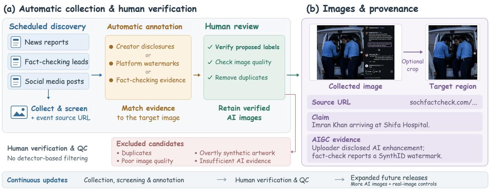  
Figure 1: From recurring discovery to verified benchmark releases. Scheduled tasks collect, screen, and annotate candidates across online sources. Human verification and quality control determine inclusion, preserving source evidence and acquired image conditions. Continued collection supports broader releases with more AI images and planned real-image controls.

## 3.2 Human Annotation Verification and Quality Control

Human reviewers check whether each automatic annotation is correct and perform sample-level quality control to decide inclusion. Review checks whether the available evidence establishes AI generation or editing of the target image, rather than merely a false claim about an event. Accepted evidence includes creator disclosures, visible platform watermarks, and explicit factchecking findings. Invisible-watermark evidence comes from detection results publicly reported by fact-checking organizations; our team does not independently rerun those tools.

Candidates with insuficient evidence or uncertain AI involvement are excluded. Human review also rejects obviously stylized artwork and unusable images while retaining the degradations encountered during real circulation. No AI-image detectors are used for sample selection. Each accepted sample is accompanied by a source webpage link and an evidence summary, making the basis for its label inspectable. Additional annotation details and an example appear in Appendix A.

## 3.3 Versioned Release and Dataset Profile

The current v1 release contains 407 AI-generated or edited images. New candidates undergo human verification and quality control before entering a subsequent release; evaluation results remain tied to a fixed version. We will release expanded versions with more samples and broader event and source coverage, and add real images, including original photographs corresponding to some AI-recreated, enhanced, or edited samples.

Each sample includes an acquired version (raw) and an evaluation version (processed). Where appropriate, a rectangular crop removes surrounding interface elements, comments, or explicit AI cues while retaining the target content; otherwise the image is unchanged. Preparation introduces no resizing, inpainting, or enhancement. There are 83 cropped images and 324 unchanged pairs; both versions are evaluated. Their acquired condition preserves the efects of online sharing, including compression, screenshots, and recapture.

Figure 3 summarizes the dataset profile. Median short-edge lengths are 716 pixels for raw and 700 pixels for processed images. Linked source pages span 78 website hostnames, covering diverse news and fact-checking outlets. The current benchmark is a positive-only challenge set evaluated by

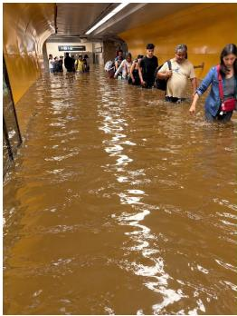  
(a) Subway flooding

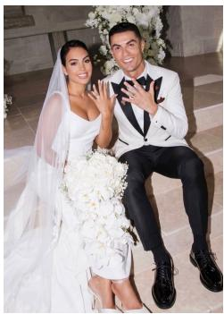  
(b) Football star wedding

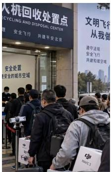  
(c) Drone disposal site

  
(d) Fashion digital twin

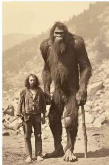  
(e) Historical Bigfoot photo

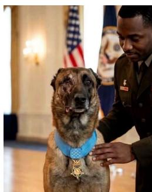  
(f) Military dog award

  
(g) Ice cream product

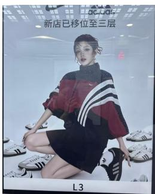  
(h) Adidas poster

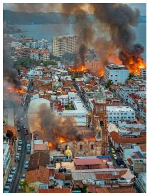  
(i) Added urban fires

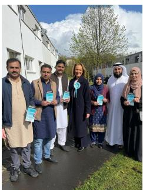  
(j) Supporters swap  
Figure 2: Representative samples from WildAIGC-Bench: fabricated events, scenes, and products (a–c, e–g); AI-generated fashion and advertising imagery (d, h); and local edits that add fires or replace people (i, j). Sources (linked by panel): (a) Maldita.es; (b) CRHoy; (c) AFP; (d) H&M; (e) Unexplained Mysteries; (f) Snopes; (g) Fact Crescendo; (h) 4A Advertising; (i) Lead Stories; (j) Full Fact.

AI-image recall. Source evidence is used to verify AI labels; detection is evaluated solely from the images.

## 4 Experiments and Analysis

## 4.1 Evaluation Setup

We evaluate DRCT [14], DDA [16], AIDE [4], B-Free [15], Efort [23], PGC [24], OmniAID [25], and CO-SPY [26] as dedicated visual detectors. The MLLMs include specialized detectors—FakeVLM [17], BusterX++ [18], and Veritas++ [6]—and general-purpose models: Qwen3.6-35B-A3B [27], Qwen3.8- 27B [28], and GLM-5.3-Flash [29]. Together with PE-336 and PE-518, all sixteen configurations cover the external benchmarks and WildAIGC-Bench. Open-source methods use public code and weights, with each method’s preprocessing and decision settings held consistent across benchmarks. Qwen3.6, Qwen3.8, and GLM use the same prompts as Veritas++.

PE-Det baseline. Recent studies have reported advantages of PE representations for AI-image detection [30, 31]. We fine-tune PE-Core-L/14 [12] with a two-layer classification head and focal loss [32]. Training uses the training splits of WildFake [8], So-Fake-Set [33], and WildRF [9]; WildAIGC-Bench is excluded from training and model selection. PE-336 and PE-518 use input resolutions of 336 × 336 and 518 × 518, respectively. Training uses random cropping together with appearance and compression augmentations; inference directly resizes images without cropping.

External evaluation covers the benchmarks in Table 2. Visual detectors use complete evaluation sets. MLLMs use fixed 2,000-image subsets for EvalGEN, UnivFD, AIGIBench, Chameleon, and

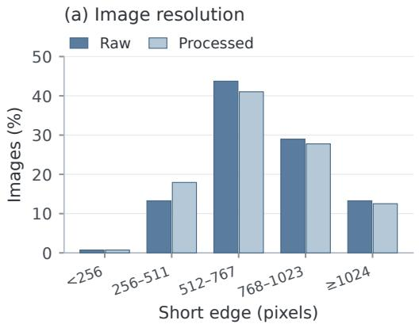

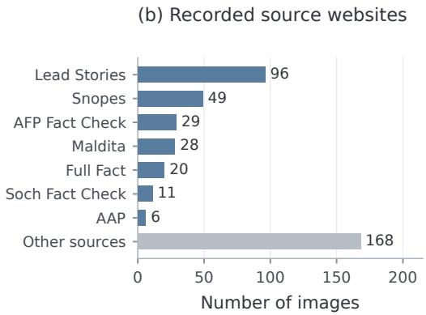  
Figure 3: Resolution and source profile. Left: short-edge distribution of the paired versions. Right: selected source websites, counted per image rather than per event or original platform; remaining sources, including CBS News and DW, are grouped as Other sources.

RRDataset; corresponding results are marked with † in Table 2. The remaining external benchmarks, including ITW-SM, are evaluated in full. Both raw and processed versions of WildAIGC-Bench are evaluated in full.

AI-generated content is the positive class. We report recall and, where real images are available, FPR and balanced accuracy (BAcc). BAcc equally weights AI-image recall and real-image specificity. External mean recall equally weights all nine benchmarks, and mean FPR weights the eight with real images, excluding EvalGEN. Comparisons use each method’s fixed operating point rather than calibration to equal FPR, and external real images are not matched controls for WildAIGC-Bench.

## 4.2 Performance Across Benchmarks

Table 1 contrasts external performance with WildAIGC-Bench. PE-518 achieves the highest external mean recall, 93.51%, and lowest mean FPR, 2.70%. MLLM recall should be interpreted together with false positives: FakeVLM reaches 90.63% external mean recall with 45.30% mean FPR, whereas Veritas++ reaches 82.86% recall with 19.72% FPR.

Table 2 reports BAcc and FPR by benchmark, providing a joint view of fake-image detection and real-image errors. All evaluated configurations have lower WildAIGC-Bench recall than their external mean. The recall drops range from 21.87 to 70.41 percentage points.

## 4.3 WildAIGC-Bench and Transfer Gaps

On processed inputs, recall ranges from 13.02% to 60.93%. GLM-5.3-Flash achieves the highest recall but still misses over one-third of the AI images. Qwen3.8 reaches 52.83%, compared with Qwen3.6’s 35.63%. PE-518 drops from 88.40% recall on ITW-SM to 23.10% here, a 65.30-point gap; BusterX++ drops from 94.22% to 29.48%. These gaps show limited transfer to forgeries found through real events.

Increasing the PE input resolution from 336×336 to 518×518 improves external mean BAcc from 92.3% to 95.0% and WildAIGC-Bench processed recall from 20.15% to 23.10%. This comparison supports the benefit of higher input resolution for PE-Det, although it does not close the transfer gap. PE-518 achieves the strongest external mean BAcc but remains below several other detectors in WildAIGC-Bench recall, showing that strong performance on existing benchmarks does not ensure reliable detection of these event-related forgeries.

Table 1: External mean recall and FPR, and WildAIGC-Bench recall (%). The cropped subset reports recall before and after cropping on the same 83 images. Drop is external mean recall minus full-set processed recall, in percentage points.
<table><tr><td></td><td colspan="2">External mean</td><td colspan="2">WildAIGC-Bench</td><td></td><td colspan="3">Cropped subset (83)</td></tr><tr><td>Method</td><td>Recall ↑</td><td>FPR↓</td><td>Raw</td><td>Processed</td><td>Drop</td><td>Raw</td><td>Processed</td><td>∆</td></tr><tr><td colspan="9">Visual detectors</td></tr><tr><td>DRCT</td><td>50.86</td><td>12.81</td><td>29.48</td><td>28.99</td><td>21.87</td><td>32.53</td><td>30.12</td><td>-2.41</td></tr><tr><td>DDA</td><td>81.66</td><td>9.48</td><td>35.38</td><td>36.36</td><td>45.30</td><td>32.53</td><td>37.35</td><td>+4.82</td></tr><tr><td>AIDE</td><td>52.97</td><td>13.05</td><td>14.50</td><td>18.43</td><td>34.55</td><td>8.43</td><td>27.71</td><td>+19.28</td></tr><tr><td>B-Free</td><td>81.17</td><td>6.11</td><td>33.66</td><td>33.17</td><td>48.00</td><td>24.10</td><td>21.69</td><td>-2.41</td></tr><tr><td>Effort</td><td>59.35</td><td>42.14</td><td>25.31</td><td>26.29</td><td>33.06</td><td>26.51</td><td>31.33</td><td>+4.82</td></tr><tr><td>PGC</td><td>64.35</td><td>12.76</td><td>13.76</td><td>13.02</td><td>51.32</td><td>16.87</td><td>13.25</td><td>-3.61</td></tr><tr><td>OmniAID</td><td>87.08</td><td>3.92</td><td>29.73</td><td>30.71</td><td>56.37</td><td>27.71</td><td>32.53</td><td>+4.82</td></tr><tr><td>CO-SPY</td><td>65.56</td><td>20.07</td><td>30.47</td><td>32.19</td><td>33.38</td><td>31.33</td><td>39.76</td><td>+8.43</td></tr><tr><td>PE-336</td><td>90.49</td><td>4.62</td><td>19.41</td><td>20.15</td><td>70.34</td><td>13.25</td><td>16.87</td><td>+3.61</td></tr><tr><td>PE-518</td><td>93.51</td><td>2.70</td><td>22.36</td><td>23.10</td><td>70.41</td><td>14.46</td><td>18.07</td><td>+3.61</td></tr><tr><td colspan="9">Multimodal large language models</td></tr><tr><td>FakeVLM</td><td>90.63</td><td>45.30</td><td>52.83</td><td>54.05</td><td>36.57</td><td>37.35</td><td>43.37</td><td>+6.02</td></tr><tr><td>BusterX++</td><td>75.93</td><td>13.24</td><td>29.73</td><td>29.48</td><td>46.44</td><td>33.73</td><td>32.53</td><td>-1.20</td></tr><tr><td>Veritas++</td><td>82.86</td><td>19.72</td><td>46.44</td><td>47.17</td><td>35.68</td><td>33.73</td><td>37.35</td><td>+3.61</td></tr><tr><td>Qwen3.6-35B</td><td>69.18</td><td>10.89</td><td>38.08</td><td>35.63</td><td>33.56</td><td>54.22</td><td>42.17</td><td>-12.05</td></tr><tr><td>Qwen3.8-27B</td><td>77.21</td><td>39.50</td><td>55.28</td><td>52.83</td><td>24.39</td><td>67.47</td><td>60.24</td><td>-7.23</td></tr><tr><td>GLM-5.3-Flash</td><td>85.45</td><td>13.58</td><td>66.58</td><td>60.93</td><td>24.52</td><td>77.11</td><td>66.27</td><td>-10.84</td></tr></table>

∆: processed minus raw recall on the 83 cropped images (percentage points); unchanged pairs are excluded.

Table 2: External evaluation (%): each paired entry reports BAcc ↑ / FPR ↓. EvalGEN reports recall only. Bold marks the best displayed values; shading highlights PE baselines and mean BAcc.
<table><tr><td colspan="10"></td></tr><tr><td>Method</td><td>EvalGEN Synthb.</td><td>UnivFD</td><td></td><td>AIGI.</td><td>Chame. SynthWX WildRF</td><td></td><td>RRD. ITW-SM BAcc ↑</td><td></td><td></td></tr><tr><td colspan="10">Visual detectors</td></tr><tr><td>DRCT</td><td>50.9 76.3/3.4 55.2/11.5</td><td></td><td></td><td>75.9/4.6</td><td>69.0/20.1</td><td>74.0/11.7 68.3/21.8</td><td>60.4/15.4 73.0/13.9</td><td></td><td>69.0</td></tr><tr><td>DDA</td><td>96.9 92.1/13.3</td><td></td><td>84.7/14.1</td><td>85.0/4.5</td><td>82.4/6.0</td><td>90.7/11.5 87.7/11.8</td><td>71.2/4.7</td><td>87.2/10.1</td><td>85.1</td></tr><tr><td>AIDE</td><td>56.3</td><td>79.4/6.5</td><td>79.1/22.8</td><td>81.1/8.6</td><td>62.8/8.3</td><td>67.9/12.9 67.8/19.5</td><td>57.4/7.5</td><td>62.3/18.4</td><td>69.8</td></tr><tr><td>B-Free</td><td>91.3</td><td>97.0/0.3</td><td>86.7/9.3</td><td>84.8/2.2</td><td>76.6/8.8</td><td>95.6/7.3 92.8/7.6</td><td>71.9/4.0</td><td>89.7/9.4</td><td>86.9</td></tr><tr><td>Effort</td><td>54.4 49.6/97.8</td><td></td><td>71.9/47.3</td><td>72.4/38.4</td><td>52.4/47.1</td><td>49.8/35.1 70.8/27.7</td><td>50.7/13.6</td><td>53.7/29.9</td><td>58.9</td></tr><tr><td>PGC</td><td>57.2 80.5/20.1</td><td></td><td>87.7/16.6</td><td>87.0/7.0</td><td>56.1/3.8</td><td>79.3/12.486.1/16.3</td><td>58.2/11.1</td><td>75.1/14.8</td><td>76.2</td></tr><tr><td>OmniAID</td><td>97.2</td><td>91.6/0.2</td><td>86.9/7.1</td><td>80.8/9.5</td><td>93.7/3.4</td><td>95.3/3.3 98.6/1.3</td><td>84.9/3.0</td><td>95.7/3.6</td><td>90.9</td></tr><tr><td>CO-SPY</td><td>92.7</td><td>86.5/2.5</td><td>60.8/20.7</td><td>72.2/17.2</td><td>68.4/15.3</td><td>74.7/24.4 76.8/22.0</td><td>74.4/15.6</td><td>54.5/42.8</td><td>71.1</td></tr><tr><td>PE-336</td><td>100.0 98.2/0.1</td><td></td><td>94.4/10.7</td><td>93.6/9.8</td><td>87.7/0.7</td><td>94.3/2.1 97.9/0.8</td><td>88.6/0.8</td><td>84.2/12.0</td><td>92.3</td></tr><tr><td>PE-518</td><td>100.0 99.8/0.1</td><td></td><td>97.2/5.0</td><td>94.9/6.4</td><td>90.9/0.3</td><td>95.8/3.0 99.3/0.1</td><td>90.7/0.9</td><td>91.3/5.8</td><td>95.0</td></tr><tr><td colspan="10">Multimodal large language models</td></tr><tr><td>FakeVLM</td><td>99.0† 61.5/72.9 75.4/42.0† 81.0/32.1† 74.5/50.4†</td><td></td><td></td><td></td><td></td><td>73.8/47.3 74.2/44.4 65.5/27.6†</td><td></td><td>71.2/45.6</td><td>72.1</td></tr><tr><td>BusterX++</td><td>92.9†</td><td>90.3/0.5 60.0/33.7† 72.7/9.3† 73.0/15.5†</td><td></td><td></td><td></td><td>90.2/12.7 94.5/6.9 70.7/15.0†</td><td></td><td>91.0/12.3</td><td>80.3</td></tr><tr><td>Veritas++</td><td>98.9† 82.8/17.3 64.3/15.7† 78.0/13.8† 86.3/20.6†</td><td></td><td></td><td></td><td></td><td>85.1/22.9 89.7/17.9 76.2/18.0†</td><td></td><td>82.0/31.5</td><td>80.6</td></tr><tr><td>Qwen3.6-35B</td><td>87.8†</td><td>72.1/7.3 58.3/36.6† 69.9/6.3† 73.1/11.6†</td><td></td><td></td><td></td><td>89.9/6.8 94.0/3.6 73.8/7.5†</td><td></td><td>92.8/7.5</td><td>78.0</td></tr><tr><td>Qwen3.8-27B</td><td></td><td>87.9† 65.0/34.7 55.7/59.7† 66.6/40.9† 64.0/41.3†</td><td></td><td></td><td></td><td>75.5/35.8 76.5/33.0 65.9/35.1†</td><td></td><td>76.4/35.5</td><td>68.2</td></tr><tr><td>GLM-5.3-Flash</td><td>98.8†</td><td>88.1/6.1 69.4/33.7† 80.9/8.3† 90.2/9.5†</td><td></td><td></td><td></td><td>89.3/14.394.4/7.2 79.3/14.4†</td><td></td><td>89.2/15.2</td><td>85.1</td></tr></table>

BAcc equally weights AI-image recall and real-image specificity. Mean BAcc averages the eight benchmarks with both classes, excluding EvalGEN. Abbreviations: Synthb., Synthbuster; AIGI., AIGIBench; Chame., Chameleon; SynthWX, SynthWildX; RRD., RRDataset. †: MLLM results on fixed 2,000-image subsets; unmarked per-benchmark results use complete evaluation sets.

On the 83 cropped images, recall improves for seven of ten visual detector configurations but declines for four of six MLLMs (Table 1). This suggests that isolating the target region can benefit visual classification, while surrounding context may aid some MLLMs’ judgments.

## 4.4 Shared Detector Blind Spots

On processed inputs, 46.93% of images are missed by at least three-quarters of the evaluated detector configurations. Reviewing this subset and its source records reveals several shared characteristics. Scenes involving people recur throughout this subset, including posed group photographs, social gatherings, public appearances, sports, and law-enforcement activities. Other samples depict disasters, damaged infrastructure, conflict, and animal rescue. Their presentation resembles familiar forms of visual reporting: news photographs, personal snapshots, historical photographs, broadcast stills, and surveillance views.

The subset spans both fabricated scenes and changes to existing photographs. Source records describe altered people, expressions, clothing, flags, and signs, as well as AI reconstruction of details from blurred footage. Visual quality also varies, from clear portraits and group photographs to low-light, blurred, or screenshot-based images. Shared misses therefore extend across content types, the extent of modification, and image quality levels, rather than being confined to visibly degraded inputs.

## 5 Limitations and Future Work

The current release is modest in size and focuses on forgeries collected through news and fact-checking contexts. It characterizes a challenging subset rather than the full distribution of online images, and currently lacks real-image controls. The planned expansion described in Section 3 will support paired comparisons, false-positive evaluation, and broader assessment of detection performance.

The reported results apply to the evaluated configurations. Image content and sharing conditions jointly contribute to the observed dificulty; we do not reconstruct each image’s complete sharing history or isolate individual degradations. We also lack a user study comparing detector performance and error patterns with human recognition.

The source links and evidence summaries are unused in the current image-only evaluation. Future work will explore agents that actively search for relevant source evidence and combine it with visual analysis to verify image authenticity in real-world online settings.

## 6 Conclusion

WildAIGC-Bench combines a continuously operating collection pipeline with a benchmark of photographic-looking AI imagery from news events and online claims. Automatic collection, screening, and preliminary annotation are followed by human annotation verification and quality control for final inclusion. Continued collection will support broader releases with more AI images and real-image controls. All evaluated configurations have lower recall than their external mean; the highest processed recall is 60.93%. These findings motivate both continued benchmark expansion and detection systems that actively search for source evidence and combine it with visual analysis.

## References

[1] Robin Rombach, Andreas Blattmann, Dominik Lorenz, Patrick Esser, and Björn Ommer. High-Resolution Image Synthesis with Latent Difusion Models. In Proceedings of the IEEE/CVF Conference on Computer Vision and Pattern Recognition, pages 10684–10695, 2022. URL https://arxiv.org/abs/2112.10752.

[2] Tim Brooks, Aleksander Holynski, and Alexei A. Efros. InstructPix2Pix: Learning to Follow Image Editing Instructions. In Proceedings of the IEEE/CVF Conference on Computer Vision and Pattern Recognition, pages 18392–18402, 2023. URL https://arxiv.org/abs/2211.098 00.

[3] Utkarsh Ojha, Yuheng Li, and Yong Jae Lee. Towards Universal Fake Image Detectors that Generalize Across Generative Models. In Proceedings of the IEEE/CVF Conference on Computer Vision and Pattern Recognition, pages 24480–24489, 2023. URL https://arxiv.or g/abs/2302.10174.

[4] Shilin Yan, Ouxiang Li, Jiayin Cai, Yanbin Hao, Xiaolong Jiang, Yao Hu, and Weidi Xie. A Sanity Check for AI-generated Image Detection. In International Conference on Learning Representations, 2025. URL https://arxiv.org/abs/2406.19435.

[5] Hao Tan, Jun Lan, Zichang Tan, Senyuan Shi, Ajian Liu, Chuanbiao Song, Huijia Zhu, Weiqiang Wang, Jun Wan, and Zhen Lei. Veritas: Generalizable Deepfake Detection via Pattern-Aware Reasoning. In International Conference on Learning Representations, 2026. URL https://arxiv.org/abs/2508.21048.

[6] Hao Tan, Jun Lan, Zichang Tan, Ajian Liu, Zijian Yu, Chuanbiao Song, Huijia Zhu, Weiqiang Wang, Jun Wan, and Zhen Lei. Veritas++: Value-aware On-Policy Distillation for Perception-Enhanced AIGI Detection. arXiv preprint arXiv:2607.27113, 2026. URL https://arxiv.org/ abs/2607.27113.

[7] Mingjian Zhu, Hanting Chen, Qiangyu Yan, Xudong Huang, Guanyu Lin, Wei Li, Zhijun Tu, Hailin Hu, Jie Hu, and Yunhe Wang. GenImage: A Million-Scale Benchmark for Detecting AI-Generated Image. In Advances in Neural Information Processing Systems, volume 36, 2023. URL https://arxiv.org/abs/2306.08571.

[8] Yan Hong, Jianming Feng, Haoxing Chen, Jun Lan, Huijia Zhu, Weiqiang Wang, and Jianfu Zhang. WildFake: A Large-Scale and Hierarchical Dataset for AI-Generated Images Detection. Proceedings of the AAAI Conference on Artificial Intelligence, 39(4):3500–3508, 2025. doi: 10.1609/aaai.v39i4.32363.

[9] Bar Cavia, Eliahu Horwitz, Tal Reiss, and Yedid Hoshen. Real-Time Deepfake Detection in the Real-World. arXiv preprint arXiv:2406.09398, 2024. URL https://arxiv.org/abs/2406 .09398.

[10] Despina Konstantinidou, Dimitrios Karageorgiou, Christos Koutlis, Olga Papadopoulou, Emmanouil Schinas, and Symeon Papadopoulos. Navigating the Challenges of AI-Generated Image Detection in the Wild: What Truly Matters? In ACM International Workshop on Multimedia AI against Disinformation, 2026. doi: 10.1145/3810988.3812665.

[11] Chunxiao Li, Xiaoxiao Wang, Meiling Li, Boming Miao, Peng Sun, Yunjian Zhang, Xiangyang Ji, and Yao Zhu. Bridging the Gap Between Ideal and Real-world Evaluation: Benchmarking

AI-Generated Image Detection in Challenging Scenarios. In Proceedings of the IEEE/CVF International Conference on Computer Vision, pages 20379–20389, 2025. URL https://arxi v.org/abs/2509.09172.

[12] Daniel Bolya, Po-Yao Huang, Peize Sun, Jang Hyun Cho, Andrea Madotto, Chen Wei, Tengyu Ma, Jiale Zhi, Jathushan Rajasegaran, Hanoona Rasheed, Junke Wang, Marco Monteiro, Hu Xu, Shiyu Dong, Nikhila Ravi, Daniel Li, Piotr Dollár, and Christoph Feichtenhofer. Perception Encoder: The best visual embeddings are not at the output of the network. In Advances in Neural Information Processing Systems, volume 38, 2025. URL https://arxiv.org/abs/2504.13181.

[13] Sheng-Yu Wang, Oliver Wang, Richard Zhang, Andrew Owens, and Alexei A. Efros. CNNgenerated images are surprisingly easy to spot... for now. In Proceedings of the IEEE/CVF Conference on Computer Vision and Pattern Recognition, pages 8695–8704, 2020. URL https://arxiv.org/abs/1912.11035.

[14] Baoying Chen, Jishen Zeng, Jianquan Yang, and Rui Yang. DRCT: Difusion Reconstruction Contrastive Training towards Universal Detection of Difusion Generated Images. In International Conference on Machine Learning, pages 7621–7639, 2024. URL https://proceedings.mlr.press/v235/chen24ay.html.

[15] Fabrizio Guillaro, Giada Zingarini, Ben Usman, Avneesh Sud, Davide Cozzolino, and Luisa Verdoliva. A Bias-Free Training Paradigm for More General AI-generated Image Detection. In Proceedings of the IEEE/CVF Conference on Computer Vision and Pattern Recognition, pages 18685–18694, 2025. URL https://arxiv.org/abs/2412.17671.

[16] Ruoxin Chen, Junwei Xi, Zhiyuan Yan, Ke-Yue Zhang, Shuang Wu, Jingyi Xie, Xu Chen, Lei Xu, Isabel Guan, Taiping Yao, and Shouhong Ding. Dual Data Alignment Makes AI-Generated Image Detector Easier Generalizable. In Advances in Neural Information Processing Systems, volume 38, 2025. URL https://arxiv.org/abs/2505.14359.

[17] Siwei Wen, Junyan Ye, Peilin Feng, Hengrui Kang, Zichen Wen, Yize Chen, Jiang Wu, Wenjun Wu, Conghui He, and Weijia Li. Spot the Fake: Large Multimodal Model-Based Synthetic Image Detection with Artifact Explanation. In Advances in Neural Information Processing Systems, volume 38, 2025. URL https://arxiv.org/abs/2503.14905.

[18] Haiquan Wen, Tianxiao Li, Zhenglin Huang, Yiwei He, and Guangliang Cheng. BusterX++: Towards Unified Cross-Modal AI-Generated Content Detection and Explanation with MLLM. arXiv preprint arXiv:2507.14632, 2025. URL https://arxiv.org/abs/2507.14632.

[19] Quentin Bammey. Synthbuster: Towards Detection of Difusion Model Generated Images. IEEE Open Journal of Signal Processing, 5:1–9, 2024. doi: 10.1109/ojsp.2023.3337714.

[20] Ziqiang Li, Jiazhen Yan, Ziwen He, Kai Zeng, Weiwei Jiang, Lizhi Xiong, and Zhangjie Fu. Is Artificial Intelligence Generated Image Detection a Solved Problem? In Advances in Neural Information Processing Systems, volume 38, 2025. URL https://arxiv.org/abs/2505.12335.

[21] Davide Cozzolino, Giovanni Poggi, Riccardo Corvi, Matthias Nießner, and Luisa Verdoliva. Raising the Bar of AI-generated Image Detection with CLIP. In Proceedings of the IEEE/CVF Conference on Computer Vision and Pattern Recognition Workshops, 2024. URL https: //arxiv.org/abs/2312.00195.

[22] Cheng Xia, Manxi Lin, Jiexiang Tan, Xiaoxiong Du, Yang Qiu, Junjun Zheng, Xiangheng Kong, Yuning Jiang, and Bo Zheng. MIRAGE: Towards AI-Generated Image Detection in the Wild. arXiv preprint arXiv:2508.13223, 2025. URL https://arxiv.org/abs/2508.13223.

[23] Zhiyuan Yan, Jiangming Wang, Peng Jin, Ke-Yue Zhang, Chengchun Liu, Shen Chen, Taiping Yao, Shouhong Ding, Baoyuan Wu, and Li Yuan. Orthogonal Subspace Decomposition for Generalizable AI-Generated Image Detection. In International Conference on Machine Learning, pages 70268–70288, 2025. URL https://proceedings.mlr.press/v267/yan25b.html.

[24] Xiaoyu Zhou, Jianwei Fei, Peipeng Yu, Jingchang Xie, Chong Cheng, and Zhihua Xia. PGC: Peak-Guided Calibration for Generalizable AI-Generated Image Detection. In International Conference on Machine Learning, pages 164828–164848, 2026. URL https://proceedings.ml r.press/v306/zhou26h.html.

[25] Yuncheng Guo, Junyan Ye, Chenjue Zhang, Hengrui Kang, Haohuan Fu, Conghui He, and Weijia Li. OmniAID: Decoupling Semantics and Artifacts for Universal AI-Generated Image Detection in the Wild. In International Conference on Machine Learning, pages 38614–38641, 2026. URL https://proceedings.mlr.press/v306/guo26ag.html.

[26] Siyuan Cheng, Lingjuan Lyu, Zhenting Wang, Xiangyu Zhang, and Vikash Sehwag. CO-SPY: Combining Semantic and Pixel Features to Detect Synthetic Images by AI. In IEEE/CVF Conference on Computer Vision and Pattern Recognition, pages 13455–13465, 2025.

[27] Qwen Team. Qwen3.6-35B-A3B: Agentic Coding Power, Now Open to All, April 2026. URL https://qwen.ai/blog?id=qwen3.6-35b-a3b. Accessed October 15, 2026.

[28] Qwen Team. Qwen3.8-27B. Oficial model card, 2026. URL https://huggingface.co/Qwen/ Qwen3.8-27B. Accessed October 15, 2026.

[29] Z.ai. GLM-5.3-Flash. Oficial model card, 2026. URL https://huggingface.co/zai-org/G LM-5.3-Flash. Accessed October 15, 2026.

[30] Manni Cui, Ruiqi Liu, Zijian Yu, Hao Tan, Zibo Wei, Zian Wang, Ziheng Qin, Huijia Zhu, Weiqiang Wang, Jun Lan, and Shu Wu. Learning Continuous Source Responses For Generalizable AI-Generated Image Detection. arXiv preprint arXiv:2609.14316, 2026. URL https://arxiv. org/abs/2609.14316.

[31] Weihan Cai, Hao Tan, Zichang Tan, Jun Wan, and Xinping Gao. Unleashing the Potential of Vision-Language Models for Generalizable AI-Generated Image Detection. arXiv preprint arXiv:2608.04935, 2026. URL https://arxiv.org/abs/2608.04935.

[32] Tsung-Yi Lin, Priya Goyal, Ross Girshick, Kaiming He, and Piotr Dollár. Focal Loss for Dense Object Detection. In Proceedings of the IEEE International Conference on Computer Vision, pages 2980–2988, 2017. URL https://arxiv.org/abs/1708.02002.

[33] Zhenglin Huang, Xiangtai Li, Xi Yang, Bei Peng, Xiaowei Huang, Baoyuan Wu, Dacheng Tao, Ming-Hsuan Yang, and Guangliang Cheng. So-Fake: Benchmarking and Explaining Social Media Image Forgery Detection. arXiv preprint arXiv:2505.18660, 2025. URL https: //arxiv.org/abs/2505.18660.

## WildAIGC-Bench: Supplementary Appendix

This appendix provides construction and annotation details (Section A), paired crop results and examples (Section B), representative shared misses (Section C), external evaluation coverage (Section D), and inference configurations and prompts (Section E).

## A Construction Workflow and Annotation Details

The construction pipeline assigns collection, initial screening, and preliminary annotation to scheduled automatic tasks that are already running. Human reviewers then verify whether the automatic annotations are correct and perform quality control to decide whether each sample enters the benchmark. Automatic annotations remain provisional until this review is complete.

Image-specific evidence. To verify an automatic annotation, reviewers check that the supporting evidence concerns the target image and establishes AI generation or editing. A false event claim alone is insuficient: a genuine photograph may also be shared with an incorrect description. Creator disclosures, visible platform watermarks, and explicit fact-checking findings can support admission. Invisible-watermark findings are taken from publicly reported fact-checking results rather than independent tool runs by the team. Candidates with insuficient evidence or uncertain AI involvement are excluded.

Quality control and image preparation. Human reviewers make the final inclusion decision, excluding obviously stylized artwork and unusable images while retaining real circulation degradations. Accepted samples preserve their acquired image and supporting source information. A target-region crop removes peripheral text and interface elements where appropriate, while the raw image remains available for paired evaluation. No AI-image detectors are used for sample selection.

Verification and cropping example. Figure A1(b) shows the purported image of Imran Khan arriving at a hospital. Soch Fact Check reports a positive SynthID detection, supporting the AI label. The acquired screenshot also contains the uploader’s explicit AI-enhancement disclosure and a comment calling the image fake. MLLMs can read these peripheral statements and potentially infer the label without detecting manipulation in the target image, giving them an advantage over visual detectors that focus on image features. Cropping removes these direct textual clues and supports a more comparable assessment of the target content. Source evidence remains available for annotation verification but is not supplied separately to detectors.

Continued collection and releases. The active pipeline continues to supply candidates while the current evaluation set remains fixed. Later releases will incorporate newly admitted samples and broaden coverage of events and information sources. Planned real-image additions include, but are not limited to, original photographs from which some AI-recreated, enhanced, or edited images were derived. This extension will enable paired source-image comparisons as well as evaluation of false positives.

## B Paired Analysis of Cropped Images

This analysis uses the same 83 images before and after target-region cropping. The 324 unchanged pairs are excluded. Raw denotes the acquired online image; processed denotes the retained target region. No resizing, inpainting, or enhancement is introduced during sample preparation.

Table A1 complements the recall comparison in the main paper with prediction transitions. A recovery is an image missed on raw input but detected after cropping; a loss is the reverse. Net recall changes can conceal substantial bidirectional changes: BusterX++ has nine recoveries and ten losses, yielding a net decrease of only one detection.

Table A1: Paired results on 83 cropped images. Recall and ∆ are percentages and percentage-point changes, respectively; recoveries and losses are image counts.
<table><tr><td>Method</td><td>Raw</td><td>Processed</td><td>∆</td><td>Recoveries</td><td>Losses</td></tr><tr><td>DRCT</td><td>32.53</td><td>30.12</td><td>-2.41</td><td>5</td><td>7</td></tr><tr><td>DDA</td><td>32.53</td><td>37.35</td><td>+4.82</td><td>9</td><td>5</td></tr><tr><td>AIDE</td><td>8.43</td><td>27.71</td><td>+19.28</td><td>18</td><td>2</td></tr><tr><td>B-Free</td><td>24.10</td><td>21.69</td><td>-2.41</td><td>2</td><td>4</td></tr><tr><td>Effort</td><td>26.51</td><td>31.33</td><td>+4.82</td><td>9</td><td>5</td></tr><tr><td>PGC</td><td>16.87</td><td>13.25</td><td>-3.61</td><td>0</td><td>3</td></tr><tr><td>OmniAID</td><td>27.71</td><td>32.53</td><td>+4.82</td><td>4</td><td>0</td></tr><tr><td>CO-SPY</td><td>31.33</td><td>39.76</td><td>+8.43</td><td>11</td><td>4</td></tr><tr><td>PE-336</td><td>13.25</td><td>16.87</td><td>+3.61</td><td>6</td><td>3</td></tr><tr><td>PE-518</td><td>14.46</td><td>18.07</td><td>+3.61</td><td>5</td><td>2</td></tr><tr><td>FakeVLM</td><td>37.35</td><td>43.37</td><td>+6.02</td><td>13</td><td>8</td></tr><tr><td>BusterX++</td><td>33.73</td><td>32.53</td><td>-1.20</td><td>9</td><td>10</td></tr><tr><td>Veritas++</td><td>33.73</td><td>37.35</td><td>+3.61</td><td>13</td><td>10</td></tr><tr><td>Qwen3.6-35B-A3B</td><td>54.22</td><td>42.17</td><td>-12.05</td><td>5</td><td>15</td></tr><tr><td>Qwen3.8-27B</td><td>67.47</td><td>60.24</td><td>-7.23</td><td>12</td><td>18</td></tr><tr><td>GLM-5.3-Flash</td><td>77.11</td><td>66.27</td><td>-10.84</td><td>7</td><td>16</td></tr></table>

Recall improves for seven of ten visual detector configurations and decreases for four of six MLLMs. For example, AIDE gains 19.28 points, while Qwen3.6 loses 12.05 points. Isolating the target region can benefit visual classification; removing surrounding text and interface context may remove useful cues for some MLLMs. Changes in framing and subsequent preprocessing also contribute to the comparison, so the paired results alone do not identify a single causal mechanism.

## B.1 Examples and Reasons for Cropping

## (a) Removing surrounding post text

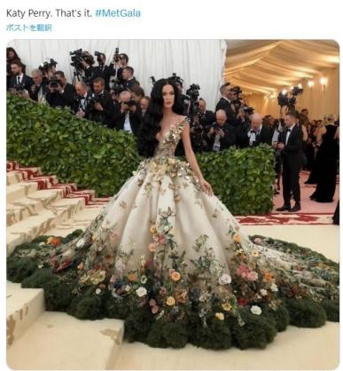  
Raw

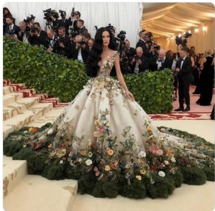  
Processed  
The crop retains the fabricated Katy Perry Met Gala photograph and removes the post heading, hashtag, and surrounding margin. This separates the target image from the text asserting attendance. Source: Japan Fact-check Center. Detections change from 1 to 1 of 10 visual configurations and from 2 to 3 of six MLLMs.

## (b) Removing disclosure and comment context

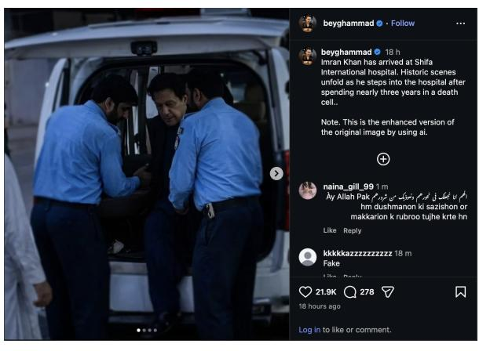  
Raw

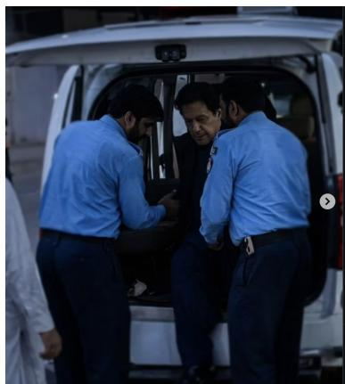  
Processed  
The crop retains the purported hospital-arrival image and removes the Instagram caption, engagement interface, and comments. The removed text explicitly discloses AI enhancement and includes a comment calling the image fake. The source reports a positive SynthID check; this is source-reported verification, not a tool run by our team. Source: Soch Fact Check. Detections change from 4 to 2 of 10 visual configurations and from 5 to 1 of six MLLMs.  
Figure A1: Two acquired/processed pairs illustrate why target-region crops are applied. The displayed versions are the actual benchmark inputs. Counts describe detections of these examples, not evidence that any one removed cue caused a prediction change.

## C Representative Shared Misses

On processed inputs, 191 of 407 images (46.93%) are missed by at least 12 of the 16 evaluated configurations. Figure A2 illustrates the diversity of this subset, spanning local edits, fabricated scenes, and AI reconstruction. Counts refer to processed inputs; the linked sources document the associated generation or editing.

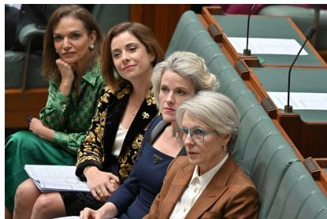

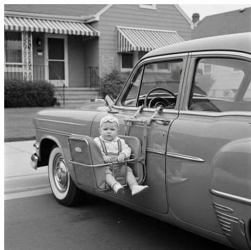  
(b) Fabricated historical image Missed by 13/16

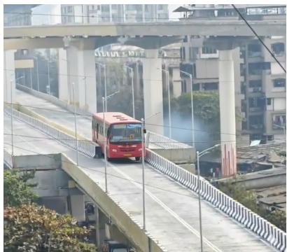  
(a) Clothing edits Missed by 14/16 Luxury-brand clothing and logos were added to a photograph of Australian ministers, as shown by comparison with the original press photograph. Source: AAP FactCheck.  
A black-and-white image of a baby seat outside a car circulated as a historical photograph. Snopes reports a positive SynthID check. Source: Snopes.  
(c) Object insertion Missed by 12/16 A bus was added to a real Mumbai flyover scene, creating the appearance of a vehicle stuck where the lanes narrow. Source: Alt News.

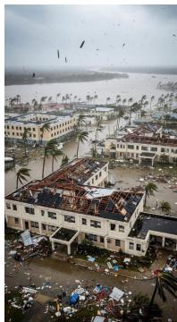  
(d) Fabricated disaster scene Missed by 12/16 The purported aerial view of a hurricane-damaged Jamaican hospital difers from its actual layout. Full Fact reports confirmation of a SynthID watermark. Source: Full Fact.

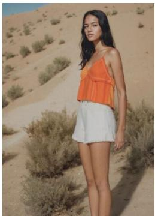  
(e) Generative fashion imagery Missed by 12/16  
Mango’s disclosed generative-AI campaign depicts a model in a desert setting, combining photographic advertising style with generated imagery. Source: invidis.

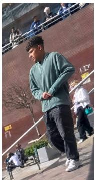  
(f) Reconstructed details Missed by 16/16  
AI reconstruction of low-resolution footage introduces clear facial and clothing details that the original recording does not establish. Source: Lead Stories.

Figure A2: Representative shared misses across public afairs, historical imagery, infrastructure, disasters, advertising, and eyewitness-style images. Misses occur across both modified photographs and generated content, rather than a single visual genre.

## D External Evaluation Coverage

Visual detectors use complete evaluation lists. MLLMs use fixed 2,000-image lists for EvalGEN, UnivFD, AIGIBench, Chameleon, and RRDataset. Their results on these five datasets carry † in the main paper’s Table 2. Synthbuster, SynthWildX, WildRF, and ITW-SM use the full evaluation lists for every method. Both WildAIGC-Bench versions are evaluated in full.

Table A2 reports the evaluation sizes and class composition. The same subsets are used across MLLMs.

Table A2: Evaluation sizes and class composition for MLLMs. EvalGEN contains AI images only.
<table><tr><td>Benchmark</td><td>Visual total</td><td>MLLM total</td><td>Real</td><td>AI</td></tr><tr><td>EvalGEN</td><td>55,285</td><td>2,000</td><td>0</td><td>2,000</td></tr><tr><td>UnivFD</td><td>90,329</td><td>2,000</td><td>1,000</td><td>1,000</td></tr><tr><td>AIGIBench</td><td>210,798</td><td>2,000</td><td>1,001</td><td>999</td></tr><tr><td>Chameleon</td><td>26,033</td><td>2,000</td><td>1,142</td><td>858</td></tr><tr><td>RRDataset</td><td>50,991</td><td>2,000</td><td>1,000</td><td>1,000</td></tr><tr><td>Synthbuster</td><td>4,000</td><td>4,000</td><td>1,000</td><td>3,000</td></tr><tr><td>SynthWildX</td><td>1,781</td><td>1,781</td><td>427</td><td>1,354</td></tr><tr><td>WildRF</td><td>1,834</td><td>1,834</td><td>909</td><td>925</td></tr><tr><td>ITW-SM</td><td>10,000</td><td>10,000</td><td>5,000</td><td>5,000</td></tr></table>

The sampled subsets are fixed across methods, with sampling seed 42.

## E Inference Configurations

Tables A3 and A4 summarize the inference settings. Each method uses a fixed operating rule across benchmarks.

## E.1 Visual Detectors

All visual detectors classify an image as AI-generated when the recorded fake-class score is strictly greater than 0.5. No prompt is used. Table A3 lists checkpoint identifiers and preprocessing settings used in evaluation.

Score interpretation. DRCT, AIDE, Efort, and OmniAID output a softmax fake-class probability (DRCT equivalently as one minus the real-class probability); DDA, B-Free, PGC, CO-SPY, and PE output a sigmoid fake probability. All visual detectors use the same >0.5 decision rule, applied to the fake-class score.

Table A3: Visual detector configurations. Weight filenames are included for the evaluated open-source checkpoints.
<table><tr><td>Method</td><td>Model / checkpoint</td><td>Input preprocessing</td></tr><tr><td>DRCT</td><td>ConvNeXt-Base; DRCT-2M / SDv1.4; 14_acc0.9996.pth</td><td>224 center crop; ImageNet normalization.</td></tr><tr><td>DDA</td><td>DINOv2 ViT-L/14 with LoRA; DDA_ckpt.pth</td><td>336 center crop; CLIP normalization.</td></tr><tr><td>AIDE</td><td>ConvNeXt-XXLarge; GenImage_train.pth</td><td>RGB and four DCT reconstruction views, each resized to 256 × 256; ImageNet normalization.</td></tr><tr><td>B-Free</td><td>DINOv2 ViT-B/14 with four registers; model_epoch_best.pth</td><td>Native-resolution forward with a five-crop wrapper (center plus four corners) with a crop size of 504 × 504 pixels; ImageNet normalization. Longest edge downscaled to 2,048 pixels when exceeded.</td></tr><tr><td>Effort</td><td>CLIP ViT-L/14 with SVD-residual attention, 2-class head; effort_clip_ L14_train0n_sdv14.pth</td><td>Shorter side replicate-padded to 256 (no resizing), then 224 center crop; CLIP normalization.</td></tr><tr><td>PGC</td><td>DINOv2-large with LoRA, 6-channel RGB-plus-quantization-residual input; PGC_train_progan_sdv1_4_ckpt.pth</td><td>224 padded center crop, RGB concatenated with quantization residuals to form six input channels; ImageNet normalization.</td></tr><tr><td>OmniAID</td><td>DINOv3 ViT-L/16 with 6-expert hybrid mixture-of-experts; checkpoint_omniaid_dino_v2.pth</td><td>448 × 448 resize; ImageNet normalization.</td></tr><tr><td>CO-SPY</td><td>Fused SigLIP (ViT-SO400M/14) and Stable-Diffusion-v1.4 VAE artifact encoder; artifact_weights.pth, semantic_weights.pth,</td><td>384 resize and center crop; per-branch normalization inside the model (no external normalization).</td></tr><tr><td>PE-336</td><td>fusion_weights.pth PE-Core-L/14, two-layer head</td><td>Direct resize to 336 × 336; PE normalization.</td></tr><tr><td>PE-518</td><td>PE-Core-L/14, two-layer head</td><td>Direct resize to 518 × 518; PE normalization.</td></tr></table>

## E.2 MLLMs and Prompts

MLLM outputs are interpreted as binary real/fake decisions. The three general-purpose MLLMs use the same system and user prompts as Veritas++, in all evaluations.

Table A4: MLLM settings. P1–P3 identify the prompt descriptions below.
<table><tr><td>Method</td><td>Model / access</td><td>Image input and decoding</td><td>Decision/ prompt</td></tr><tr><td>FakeVLM</td><td>LLaVA-1.5-7B based detector; local FakeVLM weights</td><td>Checkpoint processor; RGB input; greedy decoding, up to 64 new tokens.</td><td>Real/fake text; P1</td></tr><tr><td>BusterX++</td><td>Qwen2.5-VL based detector; local BusterX++ weights</td><td>Checkpoint processor and vision utility; greedy decoding, up to 512 new tokens.</td><td>Boxed A/B answer; P2</td></tr><tr><td>Veritas++</td><td>Qwen3-VL-8B based detector; merged local weights</td><td>Checkpoint processor and vision utility; greedy decoding, up to 1,024 new tokens.</td><td>Verdict parser; P3</td></tr><tr><td>Qwen3.6-35B-A3B</td><td>API access</td><td>RGB image submitted as base64 JPEG; temperature 0; thinking disabled; up to 1,024 output</td><td>Verdict parser; P3</td></tr><tr><td>Qwen3.8-27B</td><td>API access</td><td>tokens. RGB image submitted as base64 JPEG; temperature 0; thinking disabled; up to 1,024 output</td><td>Verdict parser; P3</td></tr><tr><td>GLM-5.3-Flash</td><td>API access</td><td>tokens. RGB image submitted as base64 JPEG; temperature 0; thinking disabled; up to 1,024 output tokens.</td><td>Verdict parser; P3</td></tr></table>

P1: FakeVLM. The recorded user prompt is: “Is this image real or fake? Answer real or fake.” P2: BusterX++. The prompt requests an authenticity analysis followed by a boxed A/B answer (A: real; B: fake):

<image>   
Please analyze whether there are any inconsistencies or   
obvious signs of forgery in the image, and finally come to   
a conclusion: Is this image real or fake?   
Then, just answer this MCQ with a single letter:   
Q: Is this image real or fake?   
Options:   
A) real   
B) fake   
Put the final answer in \boxed{...}

## P3: Veritas++ and general-purpose MLLMs. The recorded system prompt is:

You are an expert visual analyst. Please think about the question as if you were a human pondering deeply. It’s encouraged to include self-reflection or verification in the reasoning process. Then, give a final verdict within tags.

The user prompt is: “Is this image real or fake?”

Output interpretation. Binary labels are extracted from the model’s answer: real/fake text for FakeVLM, the boxed A/B choice for BusterX++, and the final real/fake verdict for Veritas++ and the three API models.