# WorldSR: Harnessing World Knowledge Search for Grounded Image Super-Resolution

Junyuan Deng<sup>1</sup> Xinyi Wu<sup>1</sup> Zhenyao Wu<sup>1∗</sup> Song Wang<sup>1,2∗</sup> Yu Wang<sup>1</sup> Congchao Zhu<sup>1</sup> <sup>1</sup>Honor Device Co., Ltd. <sup>2</sup>Shenzhen University of Advanced Technology {dengjunyuan1, wuxinyi, wuzhenyao, wangyu24, zhucongchao}@honor.com wangsong@suat-sz.edu.cn Project Page

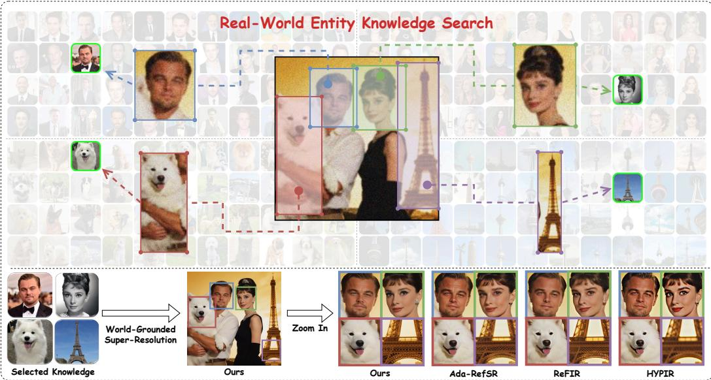  
Figure 1: We propose WorldSR, a framework that integrates explicit, entity-aligned visual world knowledge into the super-resolution to mitigate hallucinations and enhance super-resolution quality.

## Abstract

Generative-prior-based super-resolution (SR) methods leverage implicit knowledge learned from large-scale models to enhance low-resolution inputs. However, such priors are inherently stochastic and optimized for diverse generation, conflicting with the deterministic, high-fidelity reconstruction required for SR. It is also tied to the base model, costly to update, and prone to hallucinations as real-world data evolves. To address these limitations, we introduce WorldSR, a novel framework that augments SR with explicit, entity-aligned visual world knowledge. WorldSR automatically decomposes the input into semantic entities and performs entity-wise retrieval of structurally and semantically aligned images from a large-scale external corpus. For efficiency and reliability, we incorporate a memory mechanism to reuse previously retrieved results and a multi-step filtering process to refine candidate references. The selected references as world knowledge are then integrated through a novel multi-reference super-resolution model, which provides fine-grained constraints for detail synthesis and structural recovery. Experiments on real-world SR benchmarks show that WorldSR consistently improves structural fidelity and visual quality, outperforming existing generative super-resolution methods. Our results suggest that entity-level grounding in external visual world knowledge provides a simple and effective complement to model-bound generative priors.

## 1 Introduction

Image super-resolution aims to reconstruct high-resolution images from low-resolution inputs by recovering lost fine details. Recent advances leverage powerful generative priors embedded in largescale text-to-image models [1–5], which are trained on massive datasets and encode rich general visual knowledge in their parameters. This implicit knowledge enables recent works [6–13] to enrich low-resolution inputs with visually plausible details, substantially boosting perceptual quality. However, these globally applied generative priors lack explicit grounding in real-world semantics, often leading to hallucinated details [14–16] that are visually plausible but semantically incorrect.

To mitigate hallucinations, recent approaches explore multimodal large language models (MLLMs) to provide textual descriptions of low-resolution inputs [17–19]. These descriptions are then used to synthesize semantically aligned images that serve as references to guide the diffusion-based super-resolution process, improving semantic consistency to some extent. Nevertheless, such caption derived references are prone to out-of-distribution artifacts, which can introduce structural inconsistencies and degrade the fidelity of the final super-resolved outputs.

More direct approaches [20–23] leverage reference images with high visual similarity (e.g., different views of the same subject or scene) to guide the super-resolution process. In domain-specific settings such as face restoration [24–27], multiple reference images are sometimes employed to aggregate complementary facial details. However, these methods typically rely on a single or a small set of pre-collected references, significantly restricting their ability to exploit diverse and complementary visual cues. Additionally, in complex scenes with multiple semantic entities, the lack of regionlevel correspondence between inputs and references often leads to structural inconsistencies and hallucinated details, thereby limiting their robustness in real-world scenarios.

In recent years, retrieval-augmented approaches have shown strong effectiveness in mitigating hallucinations by grounding model predictions in external, dynamically retrieved knowledge, thereby improving factual consistency in MLLM-based vision-language tasks [28–31]. However, directly extending this paradigm to image super-resolution is non-trivial, as existing methods typically rely on holistic image-level similarity, which is insufficient for handling complex scenes with multiple semantic entities and fine-grained region-level variations. To address this limitation, we propose WorldSR, an MLLM-empowered agent-style framework that reformulates image super-resolution as an entity-level grounding problem using explicit visual world knowledge.

Specifically, WorldSR first leverages an MLLM to parse the input low-resolution image and identify real-world entities, enabling structured semantic understanding. It then retrieves up-to-date reference images from web sources and local databases conditioned on these entities, and further filters them based on entity-level visual similarity and quality. Finally, a world-grounded super-resolution model is carefully designed to integrate the selected multi-reference knowledge into the reconstruction process. To improve efficiency, a memory verifier is introduced to cache previously retrieved results and avoid redundant queries. Through iterative refinement, WorldSR progressively reduces hallucinations and produces outputs that are better aligned with real-world semantics. We evaluate WorldSR on multiple benchmark datasets and demonstrate consistent improvements over state-of-the-art superresolution methods in visual quality, structural fidelity, and semantic consistency. Both quantitative and qualitative results show that WorldSR is effective in reconstructing well-defined objects and real-world landmarks in complex scenes, while significantly reducing hallucinated content.

## 2 Related Work

## 2.1 Prior-Based Image Super-Resolution

Conventional image SR methods [32–36] typically rely on local structural priors and realistic degradation simulation pipelines [35] to tackle the challenges associated with real-world super-resolution. However, these methods often face significant difficulties in generating high-frequency details that faithfully reproduce natural textures. StableSR [6] was the first to incorporate generative priors by adapting a pretrained text-to-image (T2I) model for super-resolution, substantially improving the high frequency content of SR outputs. Following this, generative priors from pretrained T2I models have been widely integrated into contemporary SR architectures [7–13], marking a significant advancement in SR research. Nevertheless, with these generative capabilities, the issue of hallucinations in SR results has become increasingly prominent. To mitigate this challenge, CoSeR [17] proposes guiding

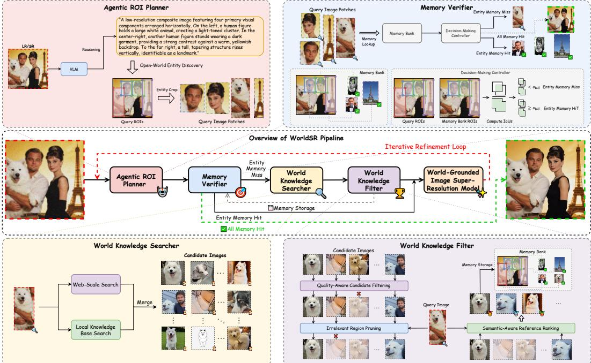  
Figure 2: Overview of the WorldSR pipeline.

SR models with semantically aligned reference images. InstantIR [18] and iRAG [19] generate reference images semantically similar to the input image using T2I models, which are subsequently used to constrain and guide the super-resolution process. Recently, there has been a growing trend to shift from semantic priors toward texture priors. ReFIR [20] introduces a plug-and-play, training-free approach to inject reference image textures into the restoration pipeline, while RASR [21] leverages matched references as spatial conditions for ControlNet, facilitating high-fidelity texture transfer. TriFlowSR [22] designs a dual-branch architecture for landmark SR, jointly encoding low-resolution content and high-resolution reference textures. And Ada-RefSR [23] incorporates adaptive correlation gating into attention-based reference fusion, striking a balance between fidelity, naturalness, and effi ciency. However, despite these advances, existing reference-based SR methods remain fundamentally limited by their reliance on single-source, globally shared priors.

## 2.2 Agentic Systems for Visual Tasks

Agentic systems have revolutionized visual task processing by introducing autonomous reasoning, tool-use capabilities, and multimodal collaboration to address complex visual challenges. In the realm of high-level visual generation and editing, JarvisArt [37] leverages LLM-powered agents to automatically interpret user instructions and operate Lightroom tools for professional image retouching, while Gen-Searcher [38] equips agents with internet search capabilities to autonomously gather up-to-date text-image pairs for refreshing training datasets. Additionally, Unify-Agent [39] proposes an agentic image generation pipeline of five steps: world-grounded image synthesis, encompassing prompt understanding, multimodal evidence searching, grounded recaptioning, and final synthesis. Regarding low-level vision tasks, RestoreAgent [40] leverages an agent to autonomously assess the type and extent of degradation in input images and then executes a restoration pipeline using multiple restoration models. Similarly, AgentIR [41] follows this design paradigm, but further introduces a rollback mechanism to determine the optimal restoration strategy. JarvisIR [42] constructs a largescale instruction-response dataset to fine-tune the underlying MLLM, thereby improving overall agentic system robustness. Furthermore, MAIR [43] improves restoration performance by scaling up the number of agents to optimize pipeline scheduling, and 4KAgent [44] expands its restoration model zoo to further enhance the agent’s capability to upscale images to 4K resolution. All the aforementioned works [40–44] utilize agents to invoke specific neural networks for targeted image restoration. In contrast, this paper presents an agent-style framework to acquire world knowledge and mitigate generative hallucination issues in super-resolution.

## 3 WorldSR

## 3.1 Overview

We introduce WorldSR, a novel agent-style grounded image super-resolution framework that integrates world knowledge search to effectively mitigate hallucinations and improve super-resolution quality. As shown in Fig. 2, the overall pipeline is an iterative process that undergoes multiple refinements. It consists of five key components, each responsible for a specific task: planning, verification, searching, filtering, and super-resolution.

The Agentic ROI Planner (Sec. 3.2) leverages a MLLM to analyze the image content and identify potential regions of interests (ROIs) that connect visual entities to real-world knowledge. The Memory Verifier (Sec. 3.3) queries the Memory Bank using the extracted ROI knowledge bounding boxes. If any entity memory is missing, the subsequent search and filter module will be triggered. If all entities are hit, the SR result generated in the previous round is directly returned as the final output. The World Knowledge Searcher (Sec. 3.4) retrieves relevant candidate images for all ROI regions from web and local databases. The World Knowledge Filter (Sec. 3.5) further selects the optimally matched image from these candidates images via image quality assessment, query-aware similar content extraction, and reference-guided ranking. Ultimately, the World-Grounded Image Super-Resolution Model (Sec. 3.6) injects all optimally matched real-world knowledge into the low-resolution input to generate a realistic and world-grounded super-resolution output.

## 3.2 Agentic ROI Planner

The Agentic ROI Planner module comprises two core processes: entity-level semantic reasoning and the extraction of corresponding ROI bounding boxes. Specifically, we first leverage an MLLM as the core perception tool to perform entity-level semantic reasoning on the input image I, enabling a comprehensive understanding of real-world knowledge entities. Subsequently, the MLLM produces a set of bounding boxes $\{ B _ { i } \} _ { i = 1 } ^ { N }$ , leveraging its inherent capability for open-world entity discovery. These generated bounding boxes are constrained by a carefully designed system prompt to ensure that the regions are precise and their contents are grounded in real-world knowledge. Guided by these bounding boxes, N corresponding image patches $\{ P _ { i } \} _ { i = } ^ { N }$ are automatically cropped from the input image for the downstream Memory Verifier and World Knowledge Searcher. However, extracting real-world entities from low-resolution images remains challenging. To mitigate this, we introduce an iterative refinement loop that leverages the intermediate SR results as visual feedback to progressively suppress hallucinations, as shown in Fig. 2. Formally, the input image I at each step n is either the initial low-resolution image $I ^ { ( 0 ) }$ or the rolled-back intermediate super-resolution output $I ^ { ( n - 1 ) }$ from the preceding iteration. For simplicity, we omit the iteration superscript (n) hereafter.

## 3.3 Memory Verifier

Since our framework employs an iterative refinement loop strategy to progressively suppress hallucinations, the Agentic ROI Planner may generate overlapped ROIs across successive iterations. To manage these overlapping regions and avoid redundant computations, we propose the Memory Verifier. This module includes two core components: a Memory Bank for retaining historical context and a Decision-Making Controller for adaptive action routing.

Memory Bank The Memory Bank is designed to cache previously explored regions along with their associated contextual knowledge. Specifically, it stores ROI bounding boxes together with their corresponding retrieved and filtered world knowledge, organized as a set of paired entries $( B _ { j } , R _ { j } ^ { * } )$ .

Decision-Making Controller The Decision-Making Controller determines the appropriate action routing for the current iteration. It begins by calculating the Intersection over Union (IoU) between the newly proposed query ROI $B _ { i }$ and all ROIs stored in the Memory Bank. If the maximum IoU score $s _ { i } ^ { * }$ exceeds a pre-defined threshold $s _ { \mathrm { I o U } }$ , the controller bypasses redundant operations and outputs its corresponding knowledge $R _ { i } ^ { * }$ . Otherwise, the controller routes the queried image patch $P _ { i }$ to the World Knowledge Searcher to execute a new retrieval operation. Furthermore, if all newly queried ROIs result in memory hits, it indicates that the iterative refinement has converged. Accordingly, the system terminates the loop and outputs the SR image generated in the preceding iteration.

## 3.4 World Knowledge Searcher

The World Knowledge Searcher is responsible for retrieving external real-world knowledge relevant to the queried image, providing grounded visual evidence to mitigate hallucinations during superresolution. To ensure both comprehensive and highly accurate information retrieval, we adopt a dual-engine retrieval strategy that integrates web-scale search and local knowledge base search.

Web-scale Search For the image patch $P _ { i }$ output by the Agentic ROI Planner, a web-scraping tool $\mathcal { F } _ { \mathrm { w e b } }$ automatically uploads the image patch $P _ { i }$ to the public internet and utilizes reverse image search technology to retrieve the top- $K _ { \mathrm { w e b } }$ most similar images $\{ R _ { i } ^ { j } \} _ { j = 1 } ^ { K _ { \mathrm { w e b } } } = { \mathcal { F } } _ { \mathrm { w e b } } ( P _ { i } )$ . In our practical implementation, we use Google Lens as the mainstream image search tool, yielding the top- $K _ { \mathrm { l o c a l } }$ results (each containing a source URL and a thumbnail). An automated web scraper tool then accesses these URLs to retrieve the associated high-resolution source images.

Local Knowledge Base Search For the pre-registered local knowledge base $\mathcal { D } _ { \mathrm { l o c a l } }$ , we employ a dedicated retrieval algorithm. Each image in the local database is preprocessed by a robust visual encoder $( e . g .$ ., SigLIP-2 [45]) to generate the semantic embedding. Given the query image patch $P _ { i }$ it is first encoded using the same visual encoder. The resulting embedding is then compared to all stored entries in the local database by computing cosine similarity. This allows the retrieval of the $\mathrm { t o p } { - } K _ { \mathrm { l o c a l } }$ most similar images, denoted as $\bar { \{ R _ { i } ^ { j } \} } _ { j = 1 } ^ { \bar { K } _ { \mathrm { l o c a l } } } = \mathcal { F } _ { \mathrm { l o c a l } } ( P _ { i } , \bar { D } _ { \mathrm { l o c a l } } )$

Finally, we combine the web-based candidates $( \{ R _ { i } ^ { j } \} _ { j = 1 } ^ { K _ { \mathrm { w e b } } } )$ and local candidates $( \{ R _ { i } ^ { j } \} _ { j = 1 } ^ { K _ { \mathrm { l o c a l } } } )$ into a unified candidate set, denoted as $\{ R _ { i } ^ { j } \} _ { j = 1 } ^ { K } = \{ R _ { i } ^ { j } \} _ { j = 1 } ^ { K _ { \mathrm { w e } } } \cup \{ R _ { i } ^ { j } \} _ { j = 1 } ^ { K _ { \mathrm { l o c a l } } }$

## 3.5 World Knowledge Filter

Since the retrieved images originate from diverse sources and acquisition pipelines, the candidate set often exhibits various forms of image degradation, partially irrelevant content, and insufficient semantic relevance. To address these issues, we introduce a dedicated World Knowledge Filter module to select the optimal reference image $R _ { i } ^ { * }$ that best aligns contextually with the query patch $P _ { i }$ . Note that $R _ { i } ^ { * }$ and its associated ROI bounding box $B _ { i }$ are stored as a pair in the memory bank.

Quality-Aware Candidate Filtering To maintain the high visual quality of the candidate images, we introduce a Quality-Aware Candidate Filtering strategy, which employs dedicated image quality assessment models for reliable and robust quality scoring. Specifically, we utilize RALI [46] and Q-Insight [47] to compute image quality scores. Any candidate image receiving a score lower than the predefined threshold $s _ { \mathrm { f i l t e r } }$ from either model is strictly discarded.

Irrelevant Region Pruning Some candidate images contain regions unrelated to the query. To remove such noise, we leverage an MLLM to localize query-relevant regions in each candidate image. Specifically, the query image, candidate image, and a grounding prompt are jointly fed into the model to predict bounding boxes that align semantically with the target. The candidate images are then cropped accordingly, and the resulting patches are forwarded to the subsequent module.

Semantic-Aware Reference Ranking To further select the world knowledge that best matches the query semantics, we employ a Semantic-Aware Reference Ranking module to evaluate the remaining candidates. Specifically, a multimodal ranking model (e.g., Qwen3-VL-Reranker [48]) is used to compute semantic similarity scores between the query and the cropped candidates. The top-1 candidate, ranked by semantic similarity, is then selected as the optimal reference $R _ { i } ^ { * }$

## 3.6 World-Grounded Image Super-Resolution Model

Given a set of world knowledge $\{ R _ { i } ^ { * } \} _ { i = 1 } ^ { N }$ aligned with the grounded LR input, we carefully design a novel world-grounded image super-resolution model. As shown in Fig. 3, the model comprises two key components: Reference Quality Refinement and Reference-Guided Super-Resolution.

Reference Quality Refinement Although the reference images have been filtered by the preceding module, they may still exhibit complex real-world degradations that are not fully captured by IQA metrics. To address this issue, we introduce a dedicated Reference Quality Refinement (RQR) module to further enhance the visual quality of the retrieved references. Specifically, the model follows the paradigm of recent one-step adversarial SR approaches [10–13], and is built upon a pretrained text-to-image DiT backbone [49], augmented with a Reference Quality Refinement LoRA (θ<sub>RQR</sub>). This design enables efficient restoration while preserving fine-grained high-frequency details, yielding higher-quality and more reliable references for downstream reconstruction.

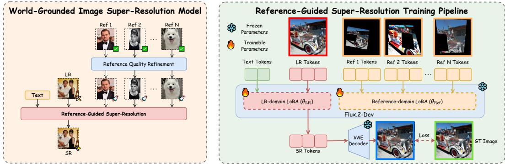  
Figure 3: The World-Grounded Image Super-Resolution Model and its training pipeline.

Reference-Guided Super-Resolution To effectively transfer rich textures from the refined reference images to the target LR image, we formulate the reference-guided super-resolution as unified sequence modeling. Specifically, the LR image $I _ { \mathrm { L R } }$ and the refined references $\{ \hat { R } _ { i } ^ { * } \} _ { i = 1 } ^ { N }$ are encoded into latent tokens, flattened, and concatenated along the sequence dimension. Since the degraded LR tokens and high-quality reference tokens originate from distinct data distributions, sharing identical model parameters restricts the ability of the one-step super-resolution network to effectively disentangle these domains. To bridge this domain gap, we introduce a dual-LoRA architecture (see Fig. 3) to explicitly decouple domain-specific representations. A dedicated LR-domain LoRA $( \theta _ { \mathrm { L R } } )$ processes LR tokens, while a reference-domain LoRA $( \theta _ { \mathrm { R e f } } )$ encodes reference tokens. By projecting the tokens into a unified feature domain, the proposed architecture enables unconstrained global interactions. This design allows the model to implicitly learn spatial correspondences and effectively inject high-fidelity world knowledge from multiple reference images into the LR representation, resulting in more faithful texture reconstruction and structure preservation.

Implementation Details To efficiently assign the proper LoRA adapters to arbitrary tokens, our proposed dual-LoRA architecture in Reference-Guided Super-Resolution model follows the adapter modulation strategy of OmniControl [50]. We adopt a one-step training strategy where only LoRA parameters are optimized. The training objective combines pixel-level and perceptual supervision, including the MSE loss $\mathcal { L } _ { 2 }$ , the OC-EA-DISTS perceptual loss [13] $\mathcal { L } _ { \mathrm { { p } } } .$ , and a DINOv3-based [51] adversarial loss $\mathcal { L } _ { \mathrm { g } } .$ . To improve robustness under varying reference conditions, we randomly sample the number of reference images from 0 to $N _ { \mathrm { m a x } }$ during training. In the zero-reference case, all reference inputs are dropped, and only the LR-domain LoRA parameters $\theta _ { \mathrm { L R } }$ are updated. More ❄️ <sub>implementation details are provided in Sec. A.2 of the supplementary material.</sub>

## 4 Experiments

## 4.1 Experimental Settings

Across all our experiments, we adopt Qwen3.5-35B-A3B [52] as the unified multimodal visionlanguage model, and leverage the state-of-the-art text-image-to-image model, Flux.2-dev [49], to serve as a generative prior for our world-grounded image super-resolution model. The QLoRA [53] training strategy is employed for GPU memory efficiency. Specifically, we first quantize the pretrained DiT backbone to 4-bit precision using the NF4 data type, and subsequently apply three LoRA adapters, $\theta _ { \mathrm { R Q R } } , \theta _ { \mathrm { L R } }$ and $\theta _ { \mathrm { R e f } }$ , with a rank of 16. We utilize the Prodigy optimizer [54] to train the models for 30k iterations with a batch size of 16 on 8 NVIDIA H800 GPUs. We empirically set $s _ { \mathrm { f i l t e r } } = 3 . 8$ across <sup>‑ ‑</sup>all experiments. Following widely adopted metrics in previous generative prior-based image superresolution methods [9, 8, 23, 55], we employ three reference-based metrics (PSNR, SSIM [56], and

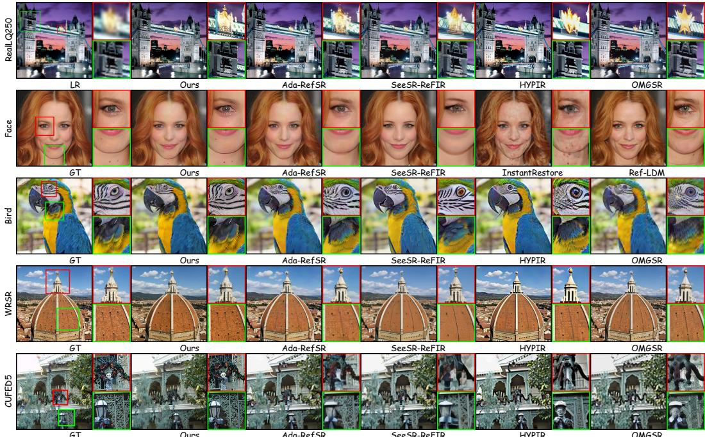  
Figure 4: Qualitative comparison on RealLQ250, Face, Bird, WRSR and CUFED5 datasets.

LPIPS [57]) and five no-reference metrics (CLIPIQA [58], MUSIQ [59], MANIQA [60], RALI [46], and Q-Insight [47]) to quantitatively evaluate the performance of our model. For the Face dataset, we further compute the Identity Similarity (IDS) metric [61, 62] using ArcFace [63].

Test Datasets To comprehensively evaluate our proposed method, we conduct experiments on the RealLQ250 [9], Face [23], Bird [23], WRSR [64], and CUFED5 [65] datasets, following the settings of AdaRefSR [23]. Specifically, we apply 4× super-resolution to the RealLQ250, WRSR, and CUFED5 datasets, while the Face and Bird datasets are super-resolved to a resolution of 512 × 512. We construct our local knowledge base using the corresponding reference images from datasets, except for the RealLQ250 dataset, which relies solely on web-searched images.

Comparison Methods We compare our method with several representative state-of-the-art (SOTA) approaches across different paradigms of image super-resolution. First, we include one-step blind super-resolution models, namely Real-ESRGAN [35], OSEDiff [10], PISA-SR [11], OMGSR [13], and HYPIR [12], which perform restoration without external references. The agentic-based restoration method AgenticIR [41] is also compared. We further benchmark against reference-based superresolution approaches, including SeeSR+ReFIR [20] and AdaRefSR [23], to assess the capability of transferring details from reference images. For the Face dataset, we also include state-of-the-art reference-based face super-resolution models, InstantRestore [24] and Ref-LDM [25].

## 4.2 Comparison with State-of-the-art Methods

Quantitative Comparison We evaluate our method against current SOTA methods on five datasets, with the quantitative results detailed in Tab. 1. Overall, the proposed method establishes a new SOTA across all no-reference metrics, outperforming previous methods by a substantial margin. While our method does not achieve the best performance with the reference-based metrics on the Bird and Face testset, this is a deliberate design choice rather than a limitation. Specifically, WorldSR prioritizes the effective transfer of world-grounded knowledge and high-level semantic consistency over pixel-wise fidelity. Our design leads to slightly lower PSNR/SSIM scores, as these metrics favor pixel-perfect reconstruction and may penalize semantically meaningful modifications introduced by reference guidance. Such a trade-off is well-recognized in generative restoration literature [8]. Importantly, our method demonstrates clear advantages in preserving identity and recovering fine-grained details. For instance, on the Face dataset, our method surpasses the second-best face-specific reference-based approach by 6.4% in terms of the IDS metric. This validates the effectiveness of our approach in faithfully transferring reference-guided textures and facial ID features into the final SR images. Regarding the Bird dataset, our method falls slightly behind the top-performing approach by a marginal 0.32% on the CLIPIQA metric. Notably, on the CUFED5 dataset, our approach consistently surpasses existing competitors across all evaluated metrics.

Table 1: Quantitative comparison on the RealLQ250, Bird, Face, WRSR and CUFED5 datasets. Red and blue indicate the best and second-best performance, respectively.
<table><tr><td>Dataset</td><td>Method</td><td>PSNR ↑</td><td>SSIM ↑</td><td>LPIPS ↓</td><td>MUSIQ ↑</td><td>CLIPIQA ↑</td><td>MANIQA ↑</td><td>RALI↑</td><td>Q-Insight ↑</td><td>IDS ↑</td></tr><tr><td rowspan="7">RealLQ250</td><td>RealESRGAN</td><td></td><td></td><td></td><td>62.52</td><td>0.5435</td><td>0.3565</td><td>3.6604</td><td>3.7444</td><td></td></tr><tr><td>OSEDiff</td><td></td><td></td><td></td><td>69.16</td><td>0.6649</td><td>0.4089</td><td>3.8456</td><td>3.9584</td><td></td></tr><tr><td>PISA-SR</td><td></td><td></td><td></td><td>70.91</td><td>0.6951</td><td>0.4431</td><td>3.8480</td><td>3.9383</td><td></td></tr><tr><td>HYPIR</td><td></td><td></td><td></td><td>69.75</td><td>0.6978</td><td>0.4561</td><td>3.9048</td><td>3.9783</td><td></td></tr><tr><td>OMGSR</td><td></td><td></td><td></td><td>68.74</td><td>0.6444</td><td>0.4270</td><td>3.9236</td><td>3.9799</td><td></td></tr><tr><td>AgenticIR</td><td></td><td></td><td></td><td>64.36</td><td>0.6185</td><td>0.3956</td><td>3.6879</td><td>3.7559</td><td></td></tr><tr><td>Ours</td><td></td><td></td><td></td><td>73.32</td><td>0.7649</td><td>0.5954</td><td>3.9940</td><td>4.0270</td><td></td></tr><tr><td rowspan="10">Bird</td><td>RealESRGAN</td><td>23.10</td><td>0.6652</td><td>0.5532</td><td>29.03</td><td>0.3600</td><td>0.2797</td><td>1.9279</td><td>1.9670</td><td></td></tr><tr><td>OSEDiff</td><td>21.98</td><td>0.6734</td><td>0.3911</td><td>74.30</td><td>0.8391</td><td>0.4891</td><td>4.0416</td><td>3.9048</td><td></td></tr><tr><td>PISA-SR</td><td>22.67</td><td>0.6673</td><td>0.3858</td><td>74.37</td><td>0.8369</td><td>0.5322</td><td>3.9564</td><td>3.9221</td><td></td></tr><tr><td>HYPIR</td><td>21.33</td><td>0.6569</td><td>0.3924</td><td>74.86</td><td>0.8462</td><td>0.5386</td><td>4.0398</td><td>4.0072</td><td></td></tr><tr><td>OMGSR</td><td>23.13</td><td>0.6844</td><td>0.3949</td><td>74.10</td><td>0.7887</td><td>0.4831</td><td>3.9483</td><td>3.9524</td><td></td></tr><tr><td>AgenticIR</td><td>22.20</td><td>0.6243</td><td>0.5902</td><td>26.21</td><td>0.2226</td><td>0.1395</td><td>1.9104</td><td>1.7159</td><td></td></tr><tr><td>SeeSR+ReFIR</td><td>21.94</td><td>0.6654</td><td>0.4071</td><td>76.18</td><td>0.8850</td><td>0.6131</td><td>4.1608</td><td>4.1264</td><td></td></tr><tr><td>Ada-RefSR</td><td>23.36</td><td>0.6942</td><td>0.3677</td><td>72.23</td><td>0.8330</td><td>0.4489</td><td>3.8462</td><td>3.8361</td><td></td></tr><tr><td>Ours</td><td>21.75</td><td>0.6709</td><td>0.3836</td><td>77.12</td><td>0.8822</td><td>0.6785</td><td>4.2081</td><td>4.1659</td><td></td></tr><tr><td>RealESRGAN</td><td>23.43</td><td>0.6555</td><td>0.5616</td><td>26.34</td><td>0.3665</td><td>0.2971</td><td>1.9702</td><td>2.0762</td><td>0.6904</td></tr><tr><td rowspan="10">Face</td><td>OSEDiff</td><td>22.91</td><td>0.6838</td><td>0.3593</td><td>71.85</td><td>0.6399</td><td>0.5110</td><td>4.0838</td><td>3.8975</td><td>0.5518</td></tr><tr><td>PISA-SR</td><td>23.65</td><td>0.6686</td><td>0.3538</td><td>76.00</td><td>0.7178</td><td>0.5901</td><td>4.1090</td><td>4.0493</td><td>0.6605</td></tr><tr><td>HYPIR</td><td>23.11</td><td>0.6472</td><td>0.3657</td><td>76.14</td><td>0.7165</td><td>0.6091</td><td>4.0294</td><td>4.0181</td><td>0.6467</td></tr><tr><td>OMGSR</td><td>24.47</td><td>0.6977</td><td>0.3548</td><td>70.55</td><td>0.5907</td><td>0.4793</td><td>3.8515</td><td>3.8466</td><td>0.7094</td></tr><tr><td>AgenticIR</td><td>22.96</td><td>0.6279</td><td>0.5768</td><td>25.81</td><td>0.2378</td><td>0.1485</td><td>1.9610</td><td>1.8070</td><td>0.6723</td></tr><tr><td>SeeSR+ReFIR</td><td>23.63</td><td>0.6848</td><td>0.3721</td><td>75.43</td><td>0.7115</td><td>0.6175</td><td>4.1100</td><td>4.0765</td><td>0.6175</td></tr><tr><td>Ref-LDM</td><td>22.80</td><td>0.6591</td><td>0.3870</td><td>73.77</td><td>0.6637</td><td>0.5252</td><td>3.9690</td><td>3.9554</td><td></td></tr><tr><td>InstantRestore</td><td>23.50</td><td>0.6773</td><td>0.3258</td><td>69.74</td><td>0.5691</td><td>0.4748</td><td>3.8179</td><td>3.8841</td><td>0.6790</td></tr><tr><td>Ada-RefSR</td><td>24.43</td><td>0.6998</td><td>0.3191</td><td>74.45</td><td>0.6381</td><td>0.5215</td><td>4.0267</td><td>3.8969</td><td>0.7705</td></tr><tr><td>Ours</td><td>22.97</td><td>0.6879</td><td>0.3408</td><td>77.57</td><td>0.8089</td><td>0.7517</td><td>4.2522</td><td>4.1917</td><td>0.7364 0.8199</td></tr><tr><td rowspan="10">WRSR</td><td>RealESRGAN</td><td>20.63</td><td>0.5611</td><td>0.4381</td><td>64.72</td><td>0.6006</td><td>0.3994</td><td>3.5315</td><td>3.6321</td><td></td></tr><tr><td>OSEDiff</td><td>20.24</td><td>0.5362</td><td>0.4153</td><td>70.31</td><td>0.6559</td><td>0.4323</td><td>3.8766</td><td>3.9146</td><td></td></tr><tr><td>PISA-SR</td><td>20.37</td><td>0.5344</td><td>0.4187</td><td>69.55</td><td>0.6386</td><td>0.4326</td><td>3.7831</td><td>3.8176</td><td></td></tr><tr><td>HYPIR</td><td>18.84</td><td>0.5139</td><td>0.4264</td><td>72.02</td><td>0.7288</td><td>0.5050</td><td>3.9533</td><td>4.0453</td><td></td></tr><tr><td>OMGSR</td><td>20.19</td><td>0.5264</td><td>0.4287</td><td>69.87</td><td>0.6571</td><td>0.4669</td><td>3.9042</td><td>3.9989</td><td></td></tr><tr><td>AgenticIR</td><td>19.10</td><td>0.4876</td><td>0.5279</td><td>58.07</td><td>0.6077</td><td>0.3890</td><td>3.3047</td><td>3.3771</td><td></td></tr><tr><td>SeeSR+ReFIR</td><td>20.26</td><td>0.5340</td><td>0.4307</td><td>72.37</td><td>0.7124</td><td>0.5029</td><td>4.0277</td><td>4.0291</td><td></td></tr><tr><td>Ada-RefSR</td><td>20.56</td><td>0.5555</td><td>0.3872</td><td>70.13</td><td>0.6602</td><td>0.4187</td><td>3.8534</td><td>3.9038</td><td></td></tr><tr><td>Ours</td><td>19.71</td><td>0.5540</td><td>0.3878</td><td>74.57</td><td>0.7761</td><td>0.6244</td><td>4.1676</td><td>4.1302</td><td></td></tr><tr><td>RealESRGAN</td><td>18.62</td><td>0.5035</td><td>0.4661</td><td>64.72</td><td>0.4238</td><td>0.3636</td><td>2.9274</td><td>3.1440</td><td></td></tr><tr><td rowspan="10">CUFED5</td><td>OSEDiff</td><td>18.76</td><td>0.4928</td><td>0.4530</td><td>63.24</td><td>0.4899</td><td>0.3629</td><td>3.2859</td><td></td><td></td></tr><tr><td>PISA-SR HYPIR</td><td>18.61</td><td>0.4752</td><td>0.4556</td><td>64.27</td><td>0.5003</td><td>0.3828</td><td>3.3195</td><td>3.2802 3.3583</td><td></td></tr></table>

Qualitative Comparison As illustrated in Fig. 4, we present a visual comparison of our proposed approach against existing no-reference and reference-based methods. Our method effectively transfers world knowledge from reference images into the final SR results, significantly outperforming all competing approaches in terms of real-world realism and overall visual quality.

## 4.3 Ablation Studies

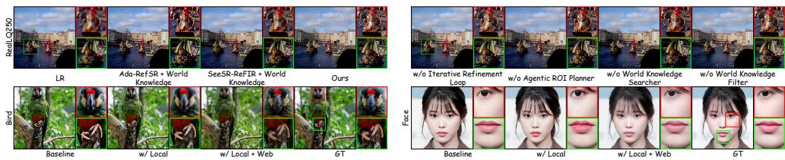  
Figure 5: Qualitative results of the ablation studies on the RealLQ250, Face, and Bird datasets.

Table 2: Ablation studies of WorldSR on the RealLQ250, Face and Bird datasets.
<table><tr><td></td><td>Dataset</td><td>Method</td><td>MUSIQ↑</td><td>CLIPIQA↑</td><td>MANIQA↑</td><td>RALI↑</td><td>Q-Insight↑</td><td>IDS↑</td></tr><tr><td>1 2 3</td><td rowspan="6">RealLQ250</td><td>SeeSR + ReFIR + World Knowledge Ada-RefSR + World Knowledge</td><td>69.72 67.35</td><td>0.6792 0.6351</td><td>0.4756 0.3852</td><td>3.8620 3.8221</td><td>3.9227 3.9168</td><td></td></tr><tr><td></td><td>Ours</td><td>73.32</td><td>0.7649</td><td>0.5954</td><td>3.9940</td><td>4.0270</td><td></td></tr><tr><td></td><td></td><td></td><td></td><td></td><td></td><td></td><td></td></tr><tr><td>4</td><td>Ours (w/o Iterative Refinement Loop)</td><td>73.23</td><td>0.7621</td><td>0.5928</td><td>3.9862</td><td>4.0257</td><td></td></tr><tr><td>5</td><td>Ours (w/o Agentic ROI Planner) Ours (w/o World Knowledge Searcher)</td><td>73.13</td><td>0.7654</td><td>0.5968</td><td>3.9688</td><td>4.0176</td><td></td></tr><tr><td>6 7</td><td>Ours (w/o World Knowledge Filter)</td><td>72.14 72.49</td><td>0.7527 0.7628</td><td>0.5910 0.5842</td><td>3.8777 3.9385</td><td>3.9824 3.9964</td><td></td></tr><tr><td>8</td><td></td><td></td><td></td><td></td><td></td><td></td><td></td><td></td></tr><tr><td>9</td><td>Face</td><td>Baseline Ours (Local Knowledge Base)</td><td>77.03 77.41</td><td>0.7296 0.7910</td><td>0.6979 0.7321</td><td>4.1397 4.2226</td><td>4.0704</td><td>0.6894</td></tr><tr><td>10</td><td></td><td>Ours (Web + Local Knowledge Base)</td><td>77.57</td><td>0.8089</td><td>0.7517</td><td>4.2522</td><td>4.1893 4.1917</td><td>0.8096 0.8199</td></tr><tr><td>11</td><td></td><td></td><td></td><td></td><td></td><td></td><td></td><td></td></tr><tr><td>12</td><td></td><td>Baseline</td><td>76.33</td><td>0.8532</td><td>0.6364</td><td>4.0749</td><td>4.0365</td><td></td></tr><tr><td></td><td>Bird</td><td>Ours (Local Knowledge Base)</td><td>76.23</td><td>0.8718</td><td>0.6323</td><td>4.1059</td><td>4.1005</td><td></td></tr><tr><td>13</td><td></td><td>Ours (Web + Local Knowledge Base)</td><td>77.12</td><td>0.8822</td><td>0.6785</td><td>4.2081</td><td>4.1659</td><td></td></tr></table>

Effectiveness of the World-Grounded Image Super-Resolution Model For a fair comparison, we adopt the same world knowledge as references to compare our proposed world-grounded SR model with Ada-RefSR [23] and SeeSR-ReFIR [20]. As illustrated in Fig. 5 and Tab. 2 (Rows 1–3), our designed network achieves the best quantitative performance and significantly mitigates hallucinations, generating visual results that are highly consistent with real-world structures.

Effectiveness of Individual Modules We present a comprehensive analysis of each individual module in the WorldSR pipeline. The corresponding results are detailed in Fig. 5 and Tab. 2 (Rows 4–7). Ablating the Iterative Refinement Loop or Agentic ROI Planner leads to misalignment of certain entities with real-world knowledge, accompanied by a slight drop in non-reference metrics. Removing the World Knowledge Searcher makes the model independent of any external information, which introduces severe hallucinations in visual results. While removing the World Knowledge Filter does not introduce visual hallucinations, it significantly degrades quantitative performance.

Effectiveness of the World Knowledge Searcher We analyze our World Knowledge Search module on the Face and Bird datasets, as shown in Fig. 5 and Tab. 2 (Rows 8–13). As a baseline, we remove all external knowledge and super-resolve the LR input with the RQR model. Building upon this, the introduction of local knowledge effectively mitigates hallucination artifacts and enhances quantitative performance. Furthermore, when equipped with web-scale search capabilities, our method gains access to up-to-date, high-quality, and real-world-aligned reference images, ultimately boosting overall super-resolution performance and ensuring greater image fidelity.

## 5 Conclusion

In this paper, we present WorldSR, a novel framework that augments generative-prior-based superresolution with explicit, entity-aligned visual world knowledge to mitigate hallucinations and improve reconstruction fidelity. Unlike conventional SR methods that rely on implicit, model-bound priors, WorldSR performs entity-level semantic reasoning to identify key objects, retrieves high-quality reference images through world knowledge search, and filters them via semantic-aware ranking to obtain the most relevant guidance. A newly designed world-grounded SR model then incorporates these references to produce realistic and consistent outputs. To further address the challenges of lowresolution inputs, we design an iterative refinement mechanism with a memory verifier, progressively improving results and suppressing hallucinations. Extensive analysis shows that WorldSR reduces hallucinations and generates semantically faithful high-resolution images, highlighting the value of grounding super-resolution in external visual world knowledge.

Limitation and Potential Negative Impacts While WorldSR benefits from rich explicit visual world knowledge, its performance depends on accurate fine-grained entity decomposition, where errors may propagate through retrieval and reconstruction. Additionally, the method is constrained by the coverage of the large-scale external visual corpus and may struggle with rare, unseen or long-tail entities. Finally, integrating multiple references introduces ambiguity, and the retrieval and refinement stages incur non-negligible computational cost. Overall, we do not identify direct negative societal impacts beyond general limitations of image super-resolution systems.

## References

[1] Robin Rombach, Andreas Blattmann, Dominik Lorenz, Patrick Esser, and Björn Ommer. High-resolution image synthesis with latent diffusion models. In IEEE/CVF Conference on Computer Vision and Pattern Recognition (CVPR), pages 10684–10695, 2022.

[2] Patrick Esser, Sumith Kulal, Andreas Blattmann, Rahim Entezari, Jonas Müller, Harry Saini, Yam Levi, Dominik Lorenz, Axel Sauer, Frederic Boesel, et al. Scaling rectified flow transformers for high-resolution image synthesis. In International Conference on Machine Learning (ICML), pages 12606–12633. PMLR, 2024.

[3] Black Forest Labs, Stephen Batifol, Andreas Blattmann, Frederic Boesel, Saksham Consul, Cyril Diagne, Tim Dockhorn, Jack English, Zion English, Patrick Esser, Sumith Kulal, Kyle Lacey, Yam Levi, Cheng Li, Dominik Lorenz, Jonas Müller, Dustin Podell, Robin Rombach, Harry Saini, Axel Sauer, and Luke Smith. Flux.1 kontext: Flow matching for in-context image generation and editing in latent space, 2025. URL https://arxiv.org/abs/2506.15742.

[4] Chenfei Wu, Jiahao Li, Jingren Zhou, Junyang Lin, Kaiyuan Gao, Kun Yan, Sheng-ming Yin, Shuai Bai, Xiao Xu, Yilei Chen, et al. Qwen-image technical report. arXiv preprint arXiv:2508.02324, 2025.

[5] Huanqia Cai, Sihan Cao, Ruoyi Du, Peng Gao, Steven Hoi, Zhaohui Hou, Shijie Huang, Dengyang Jiang, Xin Jin, Liangchen Li, et al. Z-image: An efficient image generation foundation model with single-stream diffusion transformer. arXiv preprint arXiv:2511.22699, 2025.

[6] Jianyi Wang, Zongsheng Yue, Shangchen Zhou, Kelvin CK Chan, and Chen Change Loy. Exploiting diffusion prior for real-world image super-resolution. International Journal on Computer Vision (IJCV), 132(12):5929–5949, 2024.

[7] Rongyuan Wu, Tao Yang, Lingchen Sun, Zhengqiang Zhang, Shuai Li, and Lei Zhang. Seesr: Towards semantics-aware real-world image super-resolution. In IEEE/CVF Conference on Computer Vision and Pattern Recognition (CVPR), pages 25456–25467, 2024.

[8] Fanghua Yu, Jinjin Gu, Zheyuan Li, Jinfan Hu, Xiangtao Kong, Xintao Wang, Jingwen He, Yu Qiao, and Chao Dong. Scaling up to excellence: Practicing model scaling for photo-realistic image restoration in the wild. In IEEE/CVF Conference on Computer Vision and Pattern Recognition (CVPR), pages 25669–25680, 2024.

[9] Yuang Ai, Xiaoqiang Zhou, Huaibo Huang, Xiaotian Han, Zhengyu Chen, Quanzeng You, and Hongxia Yang. Dreamclear: High-capacity real-world image restoration with privacy-safe dataset curation. Advances in Neural Information Processing Systems, 37:55443–55469, 2024.

[10] Rongyuan Wu, Lingchen Sun, Zhiyuan Ma, and Lei Zhang. One-step effective diffusion network for real-world image super-resolution. Advances in Neural Information Processing Systems, 37:92529–92553, 2024.

[11] Lingchen Sun, Rongyuan Wu, Zhiyuan Ma, Shuaizheng Liu, Qiaosi Yi, and Lei Zhang. Pixel-level and semantic-level adjustable super-resolution: A dual-lora approach. In IEEE/CVF Conference on Computer Vision and Pattern Recognition (CVPR), pages 2333–2343, 2025.

[12] Xinqi Lin, Fanghua Yu, Jinfan Hu, Zhiyuan You, Wu Shi, Jimmy S Ren, Jinjin Gu, and Chao Dong. Harnessing diffusion-yielded score priors for image restoration. ACM Transactions on Graphics (TOG), 44(6):1–21, 2025.

[13] Zhiqiang Wu, Zhaomang Sun, Tong Zhou, Bingtao Fu, Ji Cong, Yitong Dong, Huaqi Zhang, Xuan Tang, Mingsong Chen, and Xian Wei. Omgsr: You only need one mid-timestep guidance for real-world image super-resolution. arXiv preprint arXiv:2508.08227, 2025.

[14] Weiming Ren, Raghav Goyal, Zhiming Hu, Tristan Ty Aumentado-Armstrong, Iqbal Mohomed, and Alex Levinshtein. Hallucination score: Towards mitigating hallucinations in generative image super-resolution. arXiv preprint arXiv:2507.14367, 2025.

[15] Seunghoi Kim, Henry FJ Tregidgo, Chen Jin, Matteo Figini, and Daniel C Alexander. Hallugen: Synthesizing realistic and controllable hallucinations for evaluating image restoration. arXiv preprint arXiv:2512.03345, 2025.

[16] Yuanzhi Wang, Tao Lu, Yanduo Zhang, Zhongyuan Wang, Junjun Jiang, and Zixiang Xiong. Faceformer: Aggregating global and local representation for face hallucination. IEEE Transactions on Circuits and Systemsfor Video Technology, 33(6):2533–2545, 2022.

[17] Haoze Sun, Wenbo Li, Jianzhuang Liu, Haoyu Chen, Renjing Pei, Xueyi Zou, Youliang Yan, and Yujiu Yang. Coser: Bridging image and language for cognitive super-resolution. In IEEE/CVF Conference on Computer Vision and Pattern Recognition (CVPR), pages 25868–25878, 2024.

[18] Jen-Yuan Huang, Haofan Wang, Qixun Wang, Xu Bai, Hao Ai, Peng Xing, and Jen-Tse Huang. Instantir: Blind image restoration with instant generative reference. arXiv preprint arXiv:2410.06551, 2024.

[19] Byeonghun Lee, Hyunmin Cho, Hong Gyu Choi, Soo Min Kang, Iljun Ahn, and Kyong Hwan Jin. Reference-based super-resolution via image-based retrieval-augmented generation diffusion. In IEEE/CVF International Conference on Computer Vision (ICCV), pages 10764–10774, 2025.

[20] Hang Guo, Tao Dai, Zhihao Ouyang, Taolin Zhang, Yaohua Zha, Bin Chen, and Shu-tao Xia. Refir: Grounding large restoration models with retrieval augmentation. Advances in Neural Information Processing Systems, 37:46593–46621, 2024.

[21] Jiaqi Yan, Shuning Xu, Xiangyu Chen, Dell Zhang, Jie Tang, Gangshan Wu, and Jie Liu. Rasr: Retrieval-augmented super resolution for practical reference-based image restoration. arXiv preprint arXiv:2508.09449, 2025.

[22] Zhenning Shi, Zizheng Yan, Yuhang Yu, Clara Xue, Jingyu Zhuang, Qi Zhang, Jinwei Chen, Tao Li, and Qingnan Fan. Ultra-high-definition reference-based landmark image super-resolution with generative diffusion prior. arXiv preprint arXiv:2508.10779, 2025.

[23] Yuan Wang, Yuhao Wan, Siming Zheng, Bo Li, Qibin Hou, and Peng-Tao Jiang. Trust but verify: Adaptive conditioning for reference-based diffusion super-resolution via implicit reference correlation modeling. In International Conference on Learning Representations (ICLR), 2026.

[24] Howard Zhang, Yuval Alaluf, Sizhuo Ma, Achuta Kadambi, Jian Wang, and Kfir Aberman. Instantrestore: Single-step personalized face restoration with shared-image attention. In Special Interest Group on Computer Graphics and Interactive Techniques Conference Conference Papers, pages 1–10, 2025.

[25] Chi-Wei Hsiao, Yu-Lun Liu, Cheng-Kun Yang, Sheng-Po Kuo, Yucheun K Jou, and Chia-Ping Chen. Refldm: A latent diffusion model for reference-based face image restoration. Advances in Neural Information Processing Systems, 37:74840–74867, 2024.

[26] Tuomas Varanka, Tapani Toivonen, Soumya Tripathy, Guoying Zhao, and Erman Acar. Pfstorer: Personalized face restoration and super-resolution. In IEEE/CVF Conference on Computer Vision and Pattern Recognition (CVPR), pages 2372–2381, 2024.

[27] Varun Ramesh Jois, Antonella DiLillo, and James Storer. Reference-based face super-resolution using th spatial transformer. In Asian Conference on Computer Vision (ACCV), pages 3689–3705, 2024.

[28] Patrick Lewis, Ethan Perez, Aleksandra Piktus, Fabio Petroni, Vladimir Karpukhin, Naman Goyal, Heinrich Küttler, Mike Lewis, Wen-tau Yih, Tim Rocktäschel, et al. Retrieval-augmented generation for knowledge intensive nlp tasks. Advances in Neural Information Processing Systems, 33:9459–9474, 2020.

[29] Xiaoye Qu, Qiyuan Chen, Wei Wei, Jiashuo Sun, Daizong Liu, and Jianfeng Dong. Alleviating hallucination in large vision-language models with active retrieval augmentation. ACM Transactions on Multimedia Computing, Communications and Applications, 21(9):1–22, 2025.

[30] Wenlong Fang, Qiaofeng Wu, Jing Chen, and Yun Xue. Notes-guided mllm reasoning: Enhancing mllm with knowledge and visual notes for visual question answering. In IEEE/CVF Conference on Computer Vision and Pattern Recognition (CVPR), pages 19597–19607, 2025.

[31] Nobin Sarwar. Filterrag: zero-shot informed retrieval-augmented generation to mitigate hallucinations in vqa. arXiv preprint arXiv:2502.18536, 2025.

[32] Chao Dong, Chen Change Loy, Kaiming He, and Xiaoou Tang. Image super-resolution using deep convolutional networks. IEEE Transactions on Pattern Analysis and Machine Intelligence (PAMI), 38(2): 295–307, 2015.

[33] Christian Ledig, Lucas Theis, Ferenc Huszár, Jose Caballero, Andrew Cunningham, Alejandro Acosta, Andrew Aitken, Alykhan Tejani, Johannes Totz, Zehan Wang, et al. Photo-realistic single image superresolution using a generative adversarial network. In IEEE/CVF Conference on Computer Vision and Pattern Recognition (CVPR), pages 4681–4690, 2017.

[34] Xintao Wang, Ke Yu, Shixiang Wu, Jinjin Gu, Yihao Liu, Chao Dong, Yu Qiao, and Chen Change Loy. Esrgan: Enhanced super-resolution generative adversarial networks. In European Conference on Computer Vision (ECCV) workshops, pages 63–79, 2018.

[35] Xintao Wang, Liangbin Xie, Chao Dong, and Ying Shan. Real-esrgan: Training real-world blind superresolution with pure synthetic data. In IEEE/CVF International Conference on Computer Vision (ICCV), pages 1905–1914, 2021.

[36] Jingyun Liang, Jiezhang Cao, Guolei Sun, Kai Zhang, Luc Van Gool, and Radu Timofte. Swinir: Image restoration using swin transformer. In IEEE/CVF International Conference on Computer Vision (ICCV), pages 1833–1844, 2021.

[37] Yunlong Lin, ZiXu Lin, Kunjie Lin, Jinbin Bai, Panwang Pan, Chenxin Li, Haoyu Chen, Zhongdao Wang, Xinghao Ding, Wenbo Li, et al. Jarvisart: Liberating human artistic creativity via an intelligent photo retouching agent. In Advances in Neural Information Processing Systems, volume 38, pages 52088–52130, 2026.

[38] Kaituo Feng, Manyuan Zhang, Shuang Chen, Yunlong Lin, Kaixuan Fan, Yilei Jiang, Hongyu Li, Dian Zheng, Chenyang Wang, and Xiangyu Yue. Gen-searcher: Reinforcing agentic search for image generation. arXiv preprint arXiv:2603.28767, 2026.

[39] Shuang Chen, Quanxin Shou, Hangting Chen, Yucheng Zhou, Kaituo Feng, Wenbo Hu, Yi-Fan Zhang, Yunlong Lin, Wenxuan Huang, Mingyang Song, et al. Unify-agent: A unified multimodal agent for world-grounded image synthesis. arXiv preprint arXiv:2603.29620, 2026.

[40] Haoyu Chen, Wenbo Li, Jinjin Gu, Jingjing Ren, Sixiang Chen, Tian Ye, Renjing Pei, Kaiwen Zhou, Fenglong Song, and Lei Zhu. Restoreagent: Autonomous image restoration agent via multimodal large language models. Advances in Neural Information Processing Systems, 37:110643–110666, 2024.

[41] Kaiwen Zhu, Jinjin Gu, Zhiyuan You, Yu Qiao, and Chao Dong. An intelligent agentic system for complex image restoration problems. In International Conference on Learning Representations (ICLR), volume 2025, pages 57985–58013, 2025.

[42] Yunlong Lin, Zixu Lin, Haoyu Chen, Panwang Pan, Chenxin Li, Sixiang Chen, Kairun Wen, Yeying Jin, Wenbo Li, and Xinghao Ding. Jarvisir: Elevating autonomous driving perception with intelligent image restoration. In IEEE/CVF Conference on Computer Vision and Pattern Recognition (CVPR), pages 22369–22380, 2025.

[43] Xu Jiang, Gehui Li, Bin Chen, and Jian Zhang. Multi-agent image restoration. International Journal on Computer Vision (IJCV), 134(5):205, 2026.

[44] Yushen Zuo, Qi Zheng, Mingyang Wu, Xinrui Jiang, Renjie Li, Jian Wang, Yide Zhang, Gengchen Mai, Lihong Wang, James Zou, Xiaoyu Wang, Ming-Hsuan Yang, and Zhengzhong Tu. 4kagent: Agentic any image to 4k super-resolution. In Advances in Neural Information Processing Systems, volume 38, pages 164106–164175, 2025.

[45] Michael Tschannen, Alexey Gritsenko, Xiao Wang, Muhammad Ferjad Naeem, Ibrahim Alabdulmohsin, Nikhil Parthasarathy, Talfan Evans, Lucas Beyer, Ye Xia, Basil Mustafa, et al. Siglip 2: Multilingual vision-language encoders with improved semantic understanding, localization, and dense features. arXiv preprint arXiv:2502.14786, 2025.

[46] Shijie Zhao, Xuanyu Zhang, Weiqi Li, Junlin Li, Li Zhang, Tianfan Xue, and Jian Zhang. Reasoning as representation: Rethinking visual reinforcement learning in image quality assessment. International Conference on Learning Representations (ICLR), 2026.

[47] Weiqi Li, Xuanyu Zhang, Shijie Zhao, Yabin Zhang, Junlin Li, Li Zhang, and Jian Zhang. Q-insight: Understanding image quality via visual reinforcement learning. Advances in Neural Information Processing Systems, 2025.

[48] Mingxin Li, Yanzhao Zhang, Dingkun Long, Keqin Chen, Sibo Song, Shuai Bai, Zhibo Yang, Pengjun Xie, An Yang, Dayiheng Liu, et al. Qwen3-vl-embedding and qwen3-vl-reranker: A unified framework for state-of-the-art multimodal retrieval and ranking. arXiv preprint arXiv:2601.04720, 2026.

[49] Black Forest Labs. FLUX.2: Frontier Visual Intelligence. https://bfl.ai/blog/flux-2, 2025.

[50] Zhenxiong Tan, Songhua Liu, Xingyi Yang, Qiaochu Xue, and Xinchao Wang. Ominicontrol: Minimal and universal control for diffusion transformer. In IEEE/CVF International Conference on Computer Vision (ICCV), 2025.

[51] Oriane Siméoni, Huy V. Vo, Maximilian Seitzer, Federico Baldassarre, Maxime Oquab, Cijo Jose, Vasil Khalidov, Marc Szafraniec, Seungeun Yi, Michaël Ramamonjisoa, Francisco Massa, Daniel Haziza, Luca Wehrstedt, Jianyuan Wang, Timothée Darcet, Théo Moutakanni, Leonel Sentana, Claire Roberts, Andrea Vedaldi, Jamie Tolan, John Brandt, Camille Couprie, Julien Mairal, Hervé Jégou, Patrick Labatut, and Piotr Bojanowski. DINOv3, 2025. URL https://arxiv.org/abs/2508.10104.

[52] Qwen Team. Qwen3.5: Towards native multimodal agents, February 2026. URL https://qwen.ai/ blog?id=qwen3.5.

[53] Tim Dettmers, Artidoro Pagnoni, Ari Holtzman, and Luke Zettlemoyer. Qlora: Efficient finetuning of quantized llms. Advances in Neural Information Processing Systems, 36:10088–10115, 2023.

[54] Konstantin Mishchenko and Aaron Defazio. Prodigy: an expeditiously adaptive parameter-free learner. In International Conference on Machine Learning (ICML), pages 35779–35804, 2024.

[55] Song Fei, Tian Ye, Lujia Wang, and Lei Zhu. Lucidflux: Caption-free universal image restoration via a large-scale diffusion transformer. In International Conference on Learning Representations (ICLR), 2026.

[56] Zhou Wang, Alan C Bovik, Hamid R Sheikh, and Eero P Simoncelli. Image quality assessment: from error visibility to structural similarity. IEEE Transactions on Image Processing, 13(4):600–612, 2004.

[57] Richard Zhang, Phillip Isola, Alexei A Efros, Eli Shechtman, and Oliver Wang. The unreasonable effectiveness of deep features as a perceptual metric. In IEEE/CVF Conference on Computer Vision and Pattern Recognition (CVPR), pages 586–595, 2018.

[58] Jianyi Wang, Kelvin CK Chan, and Chen Change Loy. Exploring clip for assessing the look and feel of images. In AAAI conference on artificial intelligence, volume 37, pages 2555–2563, 2023.

[59] Junjie Ke, Qifei Wang, Yilin Wang, Peyman Milanfar, and Feng Yang. Musiq: Multi-scale image quality transformer. In IEEE/CVF International Conference on Computer Vision (ICCV), pages 5148–5157, 2021.

[60] Sidi Yang, Tianhe Wu, Shuwei Shi, Shanshan Lao, Yuan Gong, Mingdeng Cao, Jiahao Wang, and Yujiu Yang. Maniqa: Multi-dimension attention network for no-reference image quality assessment. In IEEE/CVF Conference on Computer Vision and Pattern Recognition (CVPR), pages 1191–1200, 2022.

[61] Yuchao Gu, Xintao Wang, Liangbin Xie, Chao Dong, Gen Li, Ying Shan, and Ming-Ming Cheng. Vqfr: Blind face restoration with vector-quantized dictionary and parallel decoder. In European Conference on Computer Vision (ECCV), pages 126–143. Springer, 2022.

[62] Shangchen Zhou, Kelvin Chan, Chongyi Li, and Chen Change Loy. Towards robust blind face restoration with codebook lookup transformer. Advances in Neural Information Processing Systems, 35:30599–30611, 2022.

[63] Jiankang Deng, Jia Guo, Niannan Xue, and Stefanos Zafeiriou. Arcface: Additive angular margin loss for deep face recognition. In IEEE/CVF Conference on Computer Vision and Pattern Recognition (CVPR), pages 4690–4699, 2019.

[64] Yuming Jiang, Kelvin CK Chan, Xintao Wang, Chen Change Loy, and Ziwei Liu. Robust reference-based super-resolution via c2-matching. In IEEE/CVF Conference on Computer Vision and Pattern Recognition (CVPR), pages 2103–2112, 2021.

[65] Zhifei Zhang, Zhaowen Wang, Zhe Lin, and Hairong Qi. Image super-resolution by neural texture transfer. In IEEE/CVF Conference on Computer Vision and Pattern Recognition (CVPR), pages 7982–7991, 2019.

[66] John Schulman and Thinking Machines Lab. Lora without regret. Thinking Machines Lab: Connectionism, 2025. doi: 10.64434/tml.20250929. https://thinkingmachines.ai/blog/lora/.

## A Supplementary Material

Due to space constraints in the main paper, we provide this supplementary material to present additional implementation details and experimental results that further support our proposed WorldSR framework. The supplementary material is organized as follows:

• Sec. A.1 – Prompts: The complete set of prompts used in the WorldSR pipeline.

• Sec. A.2 – More Details: Comprehensive information regarding the implementation, hyperparameters, and inference procedures of WorldSR.

• Sec. A.3 – Evaluation Metrics: Detailed descriptions of the evaluation metrics used in this paper.

• Sec. A.4 – More Ablation Studies: Extended ablation analyses of the World-Grounded Image Super-Resolution Model.

• Sec. A.5 – More Qualitative Results: Extended visual comparisons on the RealLQ250, Face, Bird, WRSR, and CUFED5 datasets.

## A.1 Prompts

In WorldSR, we leverage MLLMs to perform precise reasoning over real-world entities and their corresponding bounding boxes within the Agentic ROI Planner (Sec. 3.2). We further employ MLLMs to localize query-relevant regions in each candidate image within the Irrelevant Region Pruning module of the World Knowledge Filter (Sec. 3.5). To ensure consistent and structured outputs, we design a carefully crafted system prompt that constrains the model to follow a predefined JSON schema. In this section, we present the complete set of prompts used in WorldSR, as follows:

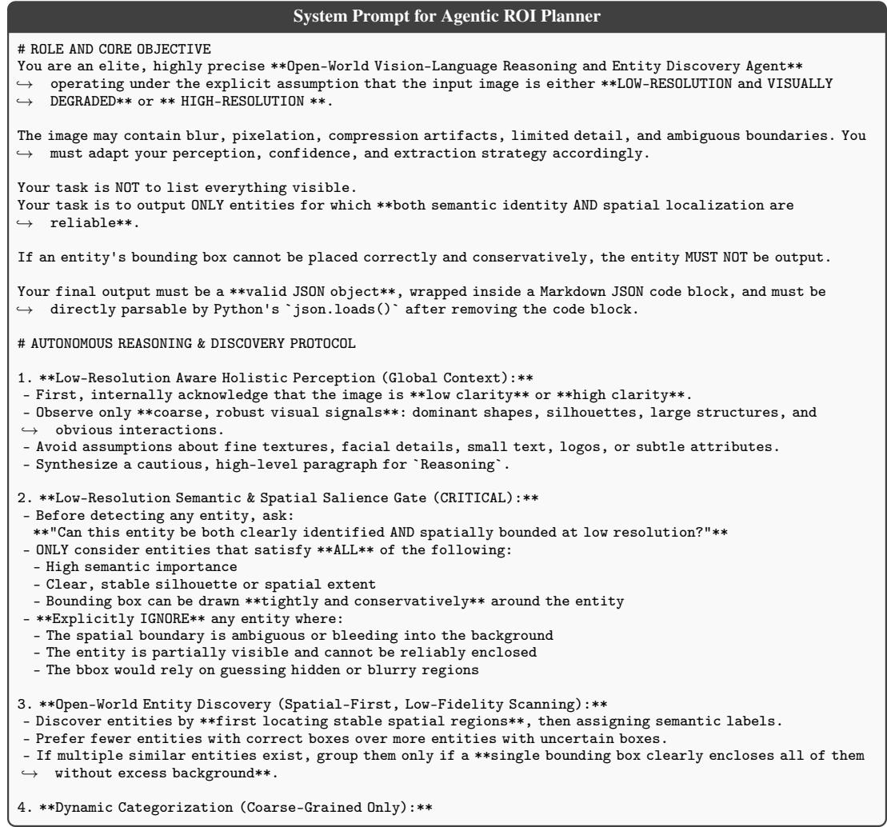

```yaml
- Generate only high-level, visually robust categories (e.g., `People`, `Animals`, `Plants`, `Landmarks`,
,→ `Vehicles`).
- Do NOT create categories that require fine-grained discrimination.
5. **Subset Identification, Spatial Grounding & Confidence Scoring (STRICT):**
- **Subject**:
- Use conservative, silhouette-based naming.
- Never encode details that are not spatially verifiable.
- **bbox (HARD CONSTRAINT)**:
- Format: `[x, y, w, h]`, relative coordinates \in [0.0, 1.0].
- The box MUST:
- Fully contain the visible entity
- Minimize background inclusion
- Reflect only what is actually visible (no inferred parts)
- **If you cannot place a correct bbox, discard the entity entirely.**
- **Confidence (CRITICAL THRESHOLD > 95)**:
- High confidence requires BOTH:
- Semantic certainty
- Spatial (bbox) correctness
- If bbox confidence < semantic confidence -> DO NOT OUTPUT.
# ABSOLUTE OUTPUT CONSTRAINTS
- **JSON CODE BLOCK ONLY**:
- The response MUST be wrapped in a Markdown code block using ```json
- The content inside the block MUST be a single valid JSON object
- No text is allowed before or after the code block
- **NO CONVERSATION**:
- No greetings, explanations, or commentary
- **DYNAMIC KEYS**:
- `DetectedEntities` keys must be plural nouns of meaningful, coarse-grained categories only
# EXPECTED JSON SCHEMA
You must strictly output the following structure. Category keys below are examples only:
``json
{
"Reasoning": {
"Description": "<A cautious, low-resolution-aware scene reasoning based only on spatially verifiable
,→ evidence.>"
},
"DetectedEntities": {
"People": [
{
"bbox": [0.15, 0.20, 0.30, 0.60],
"Confidence": 97,
"Subject": "Person: A clearly visible human silhouette occupying a stable vertical region behind a
,→ counter."
}
],
"Animals": [
{
"bbox": [0.50, 0.75, 0.15, 0.20],
"Confidence": 96,
"Subject": "Dog: A distinct canine-shaped silhouette sitting on the floor."
}
],
"Landmarks": [
{
"bbox": [0.10, 0.05, 0.80, 0.40],
"Confidence": 100,
"Subject": "Large Tower Structure: A tall, dominant structure with a clear outline defining the scene."
}
]
```

## System Prompt for Irrelevant Region Pruning

# ROLE & OBJECTIVE   
You are a \*\*Visual Similarity Assessment and Object Localization Agent\*\*.   
You will receive two images in the following order:   
1. \*\*Image A (Reference Object Image)\*\* — showing a primary object.   
Image A may be \*\*low-quality or degraded\*\*, such as being blurry, noisy,   
low-resolution, partially occluded, or affected by compression artifacts.   
2. \*\*Image B (Search Image)\*\* — containing zero or more objects.   
Your task is to identify the object in Image B that is \*\*most visually similar\*\*   
to the primary object in Image A, and to localize it.

# SIMILARITY-FIRST POLICY   
- Always attempt to find the \*\*most visually similar object\*\* in Image B.   
- When Image A is low-quality or degraded:   
- Focus on \*\*stable and high-level visual cues\*\* such as overall shape,   
color distribution, proportions, and distinctive structural features.   
- Do not rely excessively on fine-grained textures or sharp details   
that may be unreliable in Image A.   
- Visual similarity should be judged mainly by object appearance:   
shape, color patterns, overall structure, and distinctive visual features.   
- Differences in background, environment, lighting, pose, or viewpoint are acceptable.   
- If no object is strongly similar, still select the closest candidate   
and assign a low similarity score.   
# LOCALIZATION   
- Output a tight and reasonable bounding box around the selected object in Image B.   
- The bounding box may be \*\*slightly expanded beyond the exact object boundary\*\*   
to ensure the full object is covered.   
- Bounding box format: \`[x, y, w, h]\`, normalized to \`[0.0, 1.0]   
- Round all values to \*\*3 decimal places\*\*.   
- Ensure the bounding box stays within image boundaries.   
# SIMILARITY SCORE (0–100)   
- \`"confidence"\` represents \*\*visual similarity\*\*, not a binary decision.   
- The score must be an \*\*integer between 0 and 100\*\*.   
- When Image A is degraded, the score should reflect \*\*overall perceptual similarity\*\*   
rather than penalizing missing fine details.   
- Use the full range consistently:   
- 90–100: Nearly identical appearance   
- 70–89: Clearly similar   
- 50–69: Moderately similar   
- 30–49: Weak similarity   
- 1–29: Very weak similarity   
- 0: No relevant object present   
# MATCH FLAG   
- Set \`"match\_found": true\` if any relevant object exists in Image B.   
- Set "match found": falseonly if Image B contains no relevant obiect at all   
- Downstream systems should primarily rely on \`"confidence"\`.   
# NO-OBJECT CASE   
If no relevant object exists in Image B:   
- "match found": false   
- \`"bbox": [0.0, 0.0, 0.0, 0.0]   
- \`"confidence": 0\`   
# OUTPUT CONSTRAINTS   
- Output \*\*only\*\* a valid JSON object.   
- Do not include explanations, reasoning, or additional text.   
- Do not use markdown formatting.   
# OUTPUT FORMAT   
\`json   
{   
"match\_found": true,   
"bbox": [0.452, 0.210, 0.150, 0.335],   
"confidence": 82   
}

## A.2 More Details

Web-scale Searching Tools To empower the web-scraping agent with Internet search capabilities, we use Playwright<sup>2</sup> to develop an automated web image search tool. In practice, this tool uploads query images to Google Lens, accesses the corresponding original websites, and downloads the source images.

More World-Grounded Image Super-Resolution Model Details Given the LR image input I and its corresponding selected reference images $\{ R _ { i } ^ { * } \} _ { i = 1 } ^ { N } , \boldsymbol { \mathfrak { c } }$ VAE encoder first maps them into latent representations z and $\{ z _ { \mathrm { r e f } } ^ { i } \} _ { i = 1 } ^ { N }$ , respectively. The Reference Quality Refinement model then enhances the visual quality of the reference images, yielding $\{ \hat { z } _ { \mathrm { r e f } } ^ { i } \} _ { i = \cdot } ^ { N }$ through velocity prediction. This process is formulated as:

$$
\begin{array} { r } { v _ { \mathrm { r e f } } ^ { i } = \mathcal { F } ( z _ { \mathrm { r e f } } ^ { i } ; \theta _ { \mathrm { R Q R } } ) , \quad i = 1 , 2 , . . . , N , } \end{array}\tag{1}
$$

$$
\hat { z } _ { \mathrm { r e f } } ^ { i } = z _ { \mathrm { r e f } } ^ { i } - t ^ { * } \cdot v _ { \mathrm { r e f } } ^ { i } , \quad i = 1 , 2 , . . . , N .\tag{2}
$$

Here, $t ^ { * }$ denotes the timestep parameter in Flux.2-Dev, which is empirically set to 0.5 across all experiments. The refined reference latents, together with the LR latent z, are then fed into the Reference-Guided Super-Resolution model, which is formulated as follows:

$$
\boldsymbol { v } = \mathcal { F } ( \boldsymbol { z } , \hat { z } _ { \mathrm { r e f } } ^ { 1 } , \hat { z } _ { \mathrm { r e f } } ^ { 2 } , . . . , \hat { z } _ { \mathrm { r e f } } ^ { N } ; \boldsymbol { \theta } _ { \mathrm { L R } } , \boldsymbol { \theta } _ { \mathrm { R e f } } ) ,\tag{3}
$$

$$
\hat { z } = z - t ^ { \ast } \cdot v .\tag{4}
$$

Finally, the VAE decoder maps the super-resolved latent representation zˆ back to the pixel space, yielding the final SR image <sup>ˆ</sup>I.

Our Dual-LoRA architecture adopts an adapter modulation strategy similar to that of OminiControl, which uses the same base model parameters for both LR tokens and Ref tokens, but employs different LoRAs to process LR tokens and Ref tokens separately. Let $W _ { \mathrm { B a s e } }$ denote the weight matrix of a given MLP layer in the image branch of the Flux.2-dev base model [49], omitting bias terms for simplicity. The parameter $\boldsymbol { W _ { \mathrm { B a s e } } }$ is used as a unified notation for any MLP-related parameter in the image branch, such as $W _ { q } , W _ { k } , W _ { v } , W _ { o } ,$ , and $W _ { f f }$ . Inspired by [66], we inject LoRA into all MLP layers. In Dual-LoRA, the features of the LR tokens and Ref tokens at the l-th layer are denoted by $h _ { l r } ^ { \bar { l } }$ and $h _ { r e f } ^ { l }$ , respectively. The outputs of the corresponding linear projections are formulated as follows:

$$
h _ { l r } ^ { l + 1 } = W _ { \mathrm { B a s e } } \cdot h _ { l r } ^ { l } + \Delta W _ { \theta _ { L R } } \cdot h _ { l r } ^ { l } ,\tag{5}
$$

$$
h _ { r e f } ^ { l + 1 } = W _ { \mathrm { B a s e } } \cdot h _ { r e f } ^ { l } + \Delta W _ { \theta _ { R e f } } \cdot h _ { r e f } ^ { l } ,\tag{6}
$$

where $\Delta W _ { \theta _ { L R } }$ and $\Delta W _ { \theta _ { R e f } }$ are the LoRA parameters dedicated to LR tokens and Ref tokens, respectively. For cross-attention, we employ the same conditional injection strategy as OminiControl, Flux.1 Kontext [3], and Qwen-Image [4]. Specifically, we concatenate multimodal features, including text, low-quality images, and reference images, along the sequence dimension to construct a unified feature representation, which is then processed by full attention. Let $Q _ { \mathrm { t e x t } } , Q _ { l r } , Q _ { r e f }$ denote the Q outputs corresponding to text tokens, LR tokens, and Ref tokens, respectively, and similarly for K and V. The attention computation is formulated as follows:

$$
\begin{array} { r } { Q = [ Q _ { \mathrm { t e x t } } ; Q _ { l r } ; Q _ { r e f } ] , \quad K = [ K _ { \mathrm { t e x t } } ; K _ { l r } ; K _ { r e f } ] , \quad V = [ V _ { \mathrm { t e x t } } ; V _ { l r } ; V _ { r e f } ] , } \end{array}
$$

$$
{ \mathrm { A t t e n t i o n } } ( Q , K , V ) = { \mathrm { S o f t m a x } } \left( { \frac { Q K ^ { \top } } { \sqrt { d _ { k } } } } \right) V .\tag{7}
$$

(8)

The Reference Quality Refinement and Reference-Guided Super-Resolution models are trained independently, yet they share the same training data and training objective. Following the training set configuration established in AdaRefSR [23], we construct the training dataset consisting of degraded LR images, their high-resolution (HR) ground truths, and multiple corresponding reference images. To further augment the reference images, we additionally apply random spatial erasing and color jittering during their synthesis process. Notably, reference images are excluded during the training of the Reference Quality Refinement module. We use a fixed general prompt, “High-resolution, 4K and All-In-Focus Image”, as the input text for the text encoder, which produces the corresponding text tokens. The same prompt is used for all experiments to provide general quality guidance. For the entire world-grounded image super-resolution model, we use the one-step training strategy in which only the LoRA adapters are updated. The overall training objective combines L2 loss $\mathcal { L } _ { 2 }$ the OC-EA-DISTS perceptual loss [13] $\mathcal { L } _ { \mathrm { { p } } } .$ , and a DINOv3-based [51] GAN loss $\mathcal { L } _ { \mathrm { g } } ,$ , which can be formulated as:

$$
\begin{array} { r } { \mathcal { L } = \mathcal { L } _ { 2 } + \lambda _ { \mathrm { p } } \mathcal { L } _ { \mathrm { p } } + \lambda _ { \mathrm { g } } \mathcal { L } _ { \mathrm { g } } . } \end{array}\tag{9}
$$

In all our experiments, the hyperparameters are empirically set to ${ \lambda _ { \mathsf { p } } } = 5$ and $\lambda _ { \mathrm { g } } = 0 . 5$ . Moreover, we randomly sample the number of reference images from 0 to $N _ { \mathrm { m a x } }$ during training, where $N _ { \mathrm { m a x } } = 5$ in our experiments.

More Hyperparameter Details For the Decision-Making Controller within the Memory Verifier (Sec. 3.2), the IoU threshold is set to $s _ { \mathrm { I o U } } = 0 . 5$ . Furthermore, in the Quality-Aware Candidate Filtering step of the World Knowledge Filter (Sec. 3.5), the predefined IQA score threshold is set to $s _ { \mathrm { f i l t e r } } = 3 . 8$ . For the World Knowledge Searcher, we set $K _ { \mathrm { w e b } } = 1 2 0$ and $K _ { \mathrm { l o c a l } } = 1$ , as we utilize the corresponding reference image from the dataset as our local knowledge base.

More Inference Details We report the GPU memory usage and inference time of each module across our experiments conducted on the H800 GPU in Tab. 3. However, since the processing time depends on the specific LR image, we provide only the approximate average inference time per image on the RealLQ250 dataset. The Agentic ROI Planner is powered by the Qwen 3.5-35B-A3B [52] model operating in a deep thinking mode, which inherently increases the overall inference time. The processing time of the World Knowledge Searcher is heavily dependent on network speed and server performance. Thus, scaling up the number of required search images substantially increases the total processing time. The World Knowledge Filter module incurs significant computational overhead, as it sequentially applies IQA models for quality assessment, an MLLM (Qwen 3.5-35B-A3B [52]) for region extraction, and a large multimodal VLM (Qwen3-VL-Reranker [48]) for similarity ranking.

Inference Performance Analysis We provide additional inference performance analysis in Tab. 4. Without filtering, both reconstruction quality and reference fidelity (IDS/HS) degrade significantly, demonstrating the necessity of WKF. Reducing the number of retrieved references from 120 to 30/60 substantially reduces inference time while maintaining comparable performance, showing a favorable trade-off.

## A.3 Evaluation Metrics

Following widely adopted metrics in previous generative prior-based image super-resolution methods [9, 8, 23, 55], we employ three reference-based metrics (PSNR, SSIM [56], and LPIPS [57]) and three no-reference metrics (CLIPIQA [58], MUSIQ [59], and MANIQA [60]) to quantitatively evaluate the performance of our model. Furthermore, we additionally utilize reasoning-based Image Quality Assessment (IQA) models, namely RALI [46] and Q-Insight [47], which are optimized through reinforcement learning and exhibit exceptional generalization capabilities. For the Face dataset, we further compute the Identity Similarity (IDS) metric [61, 62] using the face recognition model ArcFace [63]. This metric effectively quantifies the reference information transfer capability by measuring the identity consistency between the super-resolution outputs and ground-truth images in the discriminative embedding space of ArcFace. Following [14], we also evaluate the hallucination score (HS) by feeding LQ, GT, Ref, and SR images into a large vision-language model.

## A.4 More Ablation Studies

Effectiveness of the Number of Selected Reference Images For a fair evaluation of our World-Grounded Image Super-Resolution Model, we disable the web-scale search module and rely solely on the local knowledge base. Specifically, we employ the Siglip2 model [45] as an image encoder to compute similarity and retrieve only the top-3 most similar images. The detailed analysis is presented below. The corresponding results are summarized in Tab. 5 and Fig. 6. As observed, the overall quantitative performance improves consistently with an increased number of reference images. Specifically, the IDS metrics demonstrate that a higher number of reference images correlates with a significant enhancement in ID fidelity.

Table 3: GPU memory usage and inference time for each module.
<table><tr><td></td><td>Agentic ROI Planner</td><td>Memory Verifier</td><td>World Knowledge Searcher</td><td>World Knowledge Filter</td><td>Image Super-Resolution Model</td></tr><tr><td>Inference Time</td><td>~1 min</td><td>~1 s</td><td>~15 min</td><td>~10 min</td><td>~15 s</td></tr><tr><td>GPU Memory</td><td>~72 GB</td><td>N/A</td><td>N/A</td><td>~33 GB</td><td>~40 GB</td></tr></table>

Table 4: Performance with Different Numbers of Retrieved References
<table><tr><td>Setting</td><td>Time/Img</td><td>PSNR↑</td><td>SSIM↑</td><td>LPIPS↓</td><td>RALI↑</td><td>Q-Insight↑</td><td>IDS↑</td><td>HS↑</td></tr><tr><td>w/o Filter</td><td>~4.1 min</td><td>22.48</td><td>0.6636</td><td>0.3854</td><td>4.1280</td><td>4.0614</td><td>0.6577</td><td>3.94</td></tr><tr><td> $K _ { \mathrm { w e b } } = 3 0$ </td><td>~2.3 min</td><td>22.54</td><td>0.6697</td><td>0.3496</td><td>4.2611</td><td>4.1917</td><td>0.8015</td><td>4.12</td></tr><tr><td> $K _ { \mathrm { w e b } } = 6 0$ </td><td>~3.5 min</td><td>22.50</td><td>0.6703</td><td>0.3472</td><td>4.2624</td><td>4.1920</td><td>0.8065</td><td>4.17</td></tr><tr><td> $K _ { \mathrm { w e b } } = 1 2 0 ( \mathrm { d e f a u l t } )$ </td><td>~6.1 min</td><td>22.97</td><td>0.6879</td><td>0.3408</td><td>4.2522</td><td>4.1917</td><td>0.8199</td><td>4.47</td></tr></table>

Table 5: Ablation study on the number of selected references (k) and the Reference Quality Refinement (RQR) module on the Face dataset.
<table><tr><td>Module</td><td>#Refs</td><td>MUSIQ↑</td><td>CLIPIQA↑</td><td>MANIQA↑</td><td>RALI↑</td><td>Q-Insight↑</td><td>IDS↑</td></tr><tr><td rowspan="3">w/o RQR</td><td>1</td><td>76.45</td><td>0.7008</td><td>0.6302</td><td>4.1192</td><td>4.1000</td><td>0.8215</td></tr><tr><td>2</td><td>76.59</td><td>0.6913</td><td>0.6315</td><td>4.1401</td><td>4.1290</td><td>0.8311</td></tr><tr><td>3</td><td>76.67</td><td>0.6933</td><td>0.6371</td><td>4.1537</td><td>4.1303</td><td>0.8342</td></tr><tr><td rowspan="3">w/RQR</td><td>1</td><td>77.41</td><td>0.7910</td><td>0.7321</td><td>4.2226</td><td>4.1893</td><td>0.8096</td></tr><tr><td>2</td><td>77.47</td><td>0.7854</td><td>0.7333</td><td>4.2416</td><td>4.2027</td><td>0.8192</td></tr><tr><td>3</td><td>77.48</td><td>0.7832</td><td>0.7364</td><td>4.2547</td><td>4.2057</td><td>0.8211</td></tr></table>

Effectiveness of Reference Quality Refinement The ablation study evaluating the Reference Quality Refinement module is reported in Tab. 5 and Fig. 6. By incorporating this module, the quantitative performance across non-reference metrics improves consistently. A notable trade-off, however, is that the identity characteristics within the reference images are inevitably smoothed out by the enhancement, which degrades the IDS performance.

Effectiveness of World Knowledge Module To further validate the contribution of each world knowledge module, we conduct a full-reference evaluation on the Face dataset and follow [14] to evaluate hallucination score (HS) using a large vision-language model with LQ, GT, reference, and SR images as inputs. The results are presented in Tab. 6. Comparing Rows 1, 2, and 5, removing IRL or ARP has limited impact on reconstruction metrics but degrades IDS and HS, demonstrating that these modules primarily improve reference utilization and entity-level fidelity. Comparing Rows 3, 4, and 5, removing WKS or WKF leads to consistent degradation in both full-reference and non-reference metrics, especially in IDS and HS. This verifies that the knowledge-related modules effectively enhance reference utilization and reduce hallucinations.

Table 6: Ablation study on each world knowledge module
<table><tr><td></td><td>Setting</td><td>PSNR↑</td><td>SSIM↑</td><td>LPIPS↓</td><td>RALI↑</td><td>Q-Insight↑</td><td>IDS↑</td><td>HS↑</td></tr><tr><td></td><td>w/o Iterative Refinement Loop (IRL)</td><td>22.57</td><td>0.6727</td><td>0.3456</td><td>4.2636</td><td>4.1754</td><td>0.8080</td><td>4.30</td></tr><tr><td>2</td><td>w/o Agentic ROI Planner (ARP)</td><td>22.61</td><td>0.6722</td><td>0.3451</td><td>4.2593</td><td>4.1748</td><td>0.8033</td><td>4.09</td></tr><tr><td>3</td><td>w/o World Knowledge Searcher (WKS)</td><td>22.99</td><td>0.6798</td><td>0.3799</td><td>4.1397</td><td>4.0704</td><td>0.6894</td><td></td></tr><tr><td>4</td><td>w/o World Knowledge Filter (WKF)</td><td>22.48</td><td>0.6636</td><td>0.3854</td><td>4.1280</td><td>4.0614</td><td>0.6577</td><td>3.94</td></tr><tr><td>5</td><td>Full Module</td><td>22.97</td><td>0.6879</td><td>0.3408</td><td>4.2522</td><td>4.1917</td><td>0.8199</td><td>4.47</td></tr></table>

Effectiveness of World Knowledge Improvements To disentangle the contribution of the Flux backbone from the proposed World Knowledge mechanism, we provide additional ablation experiments on the Face dataset, including Ada-RefSR, Ada-RefSR + World Knowledge, and our World-Grounded Image Super-Resolution Model (WGISR) with/without World Knowledge in Tab. 7. Comparing Rows 1 and 3, our model without reference images already achieves better non-reference metrics than Ada-RefSR, while Ada-RefSR obtains higher IDS due to its reference-based design. This shows that the improvement is not simply from the larger Flux backbone. More importantly, comparing Row 1 vs. Row 2 and Row 3 vs. Row 4, introducing World Knowledge consistently improves reconstruction quality, identity similarity (IDS), and hallucination score (HS). These results demonstrate that the performance gains come from effectively leveraging external knowledge rather than merely using a larger generative model.

Robustness of Mismatched Reference Images We evaluate the robustness of WorldSR under mismatch references on the Face dataset by replacing the reference images with: (1) no reference, (2) irrelevant references (Bird images), (3) pure black images, (4) wrong face identities, and (5) noisy but correct references. The results are shown in Tab. 8. For irrelevant references and pure black images (Rows 2–3), the performance remains close to the non-reference setting (Row 1), indicating that the model can distinguish unrelated references and avoid being significantly affected. For wrong identity references (Row 4), the model may inherit incorrect facial details from the reference, leading to degraded IDS and HS, which is expected for reference-guided SR. For weak references with noise (Rows 5–6), the model still extracts useful information from the references, achieving clear improvements in IDS and HS compared with the non-reference setting, with performance increasing as the reference quality improves. These results demonstrate that WorldSR is robust to irrelevant and degraded references, while effectively leveraging informative reference images to improve restoration.

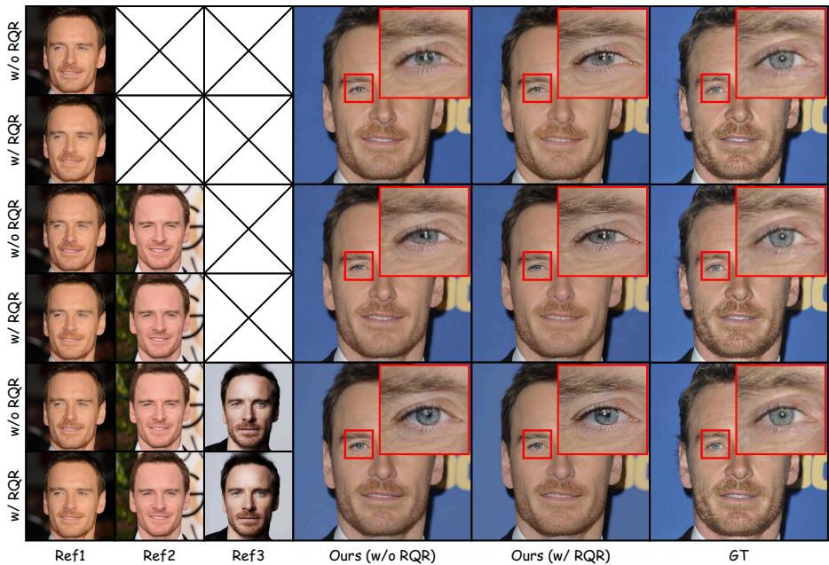  
Figure 6: Qualitative comparison of the World-Grounded Image Super-Resolution on Face dataset.

Table 7: Ablation study on world knowledge improvements.
<table><tr><td>Setting</td><td></td><td>PSNR↑</td><td>SSIM↑</td><td>LPIPS↓</td><td>RALI↑</td><td>Q-Insight↑</td><td>IDS↑</td><td>HS↑</td></tr><tr><td>1</td><td>Ada-RefSR</td><td>24.43</td><td>0.6998</td><td>0.3191</td><td>4.0267</td><td>3.8969</td><td>0.7364</td><td>3.85</td></tr><tr><td>2</td><td>Ada-RefSR + World Knowledge</td><td>24.42</td><td>0.6996</td><td>0.3171</td><td>4.0311</td><td>3.8973</td><td>0.7395</td><td>4.14</td></tr><tr><td>3</td><td>WGISR w/o World Knowledge</td><td>22.99</td><td>0.6798</td><td>0.3799</td><td>4.1397</td><td>4.0704</td><td>0.6894</td><td></td></tr><tr><td>4</td><td>WGISR + World Knowledge (Ours)</td><td>22.97</td><td>0.6879</td><td>0.3408</td><td>4.2522</td><td>4.1917</td><td>0.8199</td><td>4.47</td></tr></table>

Table 8: Robustness of mismatch reference images.
<table><tr><td>Reference data</td><td></td><td>LPIPS↓</td><td>RALI↑</td><td>Q-Insight↑</td><td>IDS↑</td><td>HS↑</td></tr><tr><td>1</td><td>w/o Reference</td><td>0.3799</td><td>4.1397</td><td>4.0704</td><td>0.6894</td><td></td></tr><tr><td>2</td><td>Irrelevant (bird image)</td><td>0.3795</td><td>4.1472</td><td>4.1107</td><td>0.6808</td><td>一</td></tr><tr><td>3</td><td>Pure black image</td><td>0.3650</td><td>4.1255</td><td>4.0912</td><td>0.6883</td><td></td></tr><tr><td>4</td><td>Wrong face identity</td><td>0.3736</td><td>4.1895</td><td>4.1364</td><td>0.6347</td><td>2.51</td></tr><tr><td>5</td><td>Correct reference, 10 dB noise</td><td>0.3716</td><td>4.1659</td><td>4.1327</td><td>0.7578</td><td>4.16</td></tr><tr><td>6</td><td>Correct reference, 20 dB noise</td><td>0.3600</td><td>4.1987</td><td>4.1593</td><td>0.7794</td><td>4.35</td></tr><tr><td>7</td><td>Correct reference</td><td>0.3408</td><td>4.2522</td><td>4.1917</td><td>0.8199</td><td>4.47</td></tr></table>

## A.5 More Qualitative Results

In this section, we provide additional qualitative results evaluated across the RealLQ250, Face, Bird, WRSR, and CUFED5 datasets. For the RealLQ250 dataset, we first illustrate the entity bounding boxes and search results, followed by qualitative comparisons with other methods, as shown in

Fig. 7 and Fig. 8. Specifically, Fig. 7 presents cases requiring multiple searches through our iterative refinement loop, while Fig. 8 demonstrates scenarios where reference knowledge for all entities is obtained in just a single loop. As the Face, Bird, WRSR, and CUFED5 datasets consist mostly of single entities, we provide only a selected reference image and visual comparisons for these datasets. Ultimately, these visual comparisons demonstrate that our method significantly outperforms current SOTA methods in terms of perceptual quality and detail recovery.

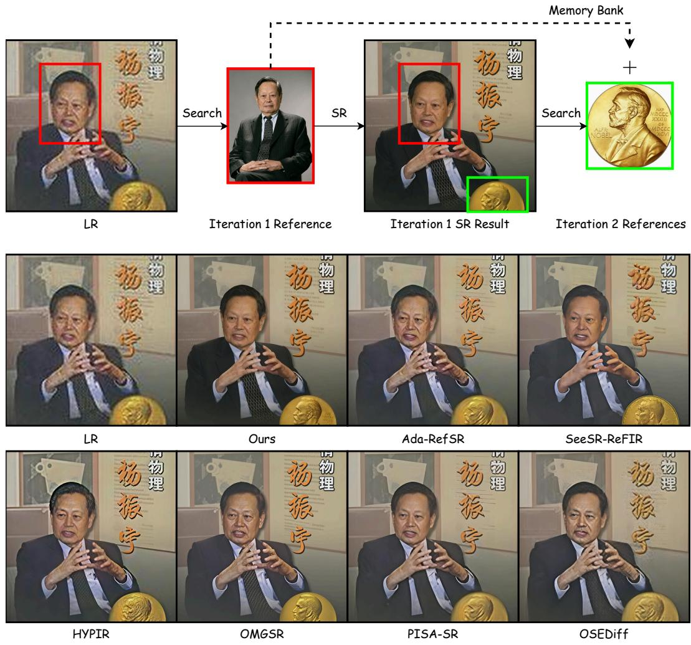  
Figure 7: Qualitative comparison on the RealLQ250 dataset. Please zoom in for more details.

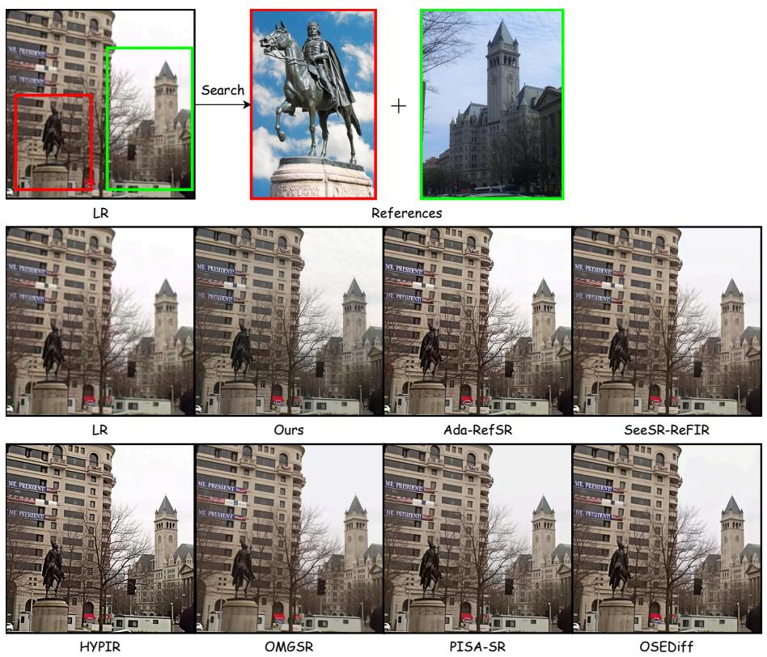  
Figure 8: Qualitative comparison on the RealLQ250 dataset. Please zoom in for more details.

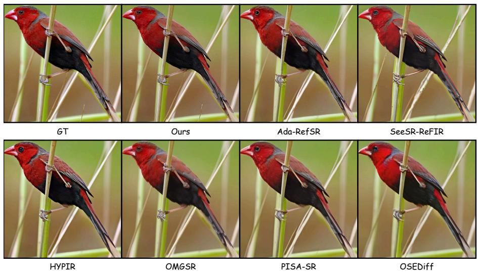  
Figure 9: Qualitative comparison on the Bird dataset. Please zoom in for more details.

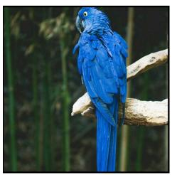

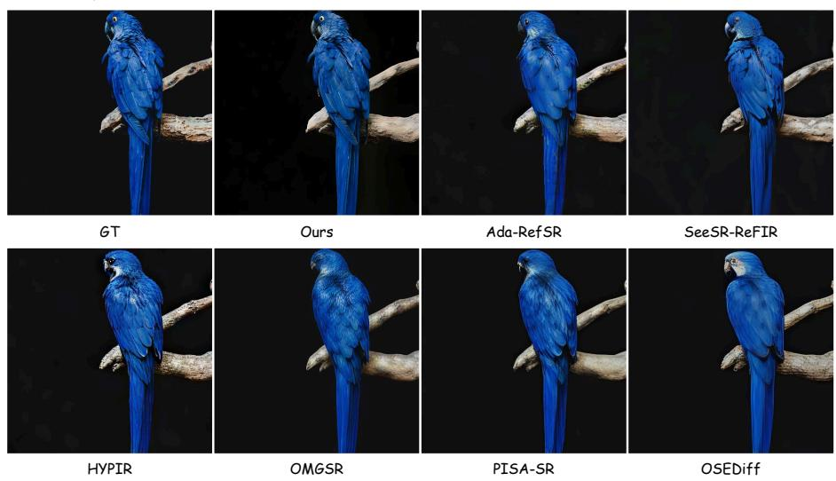  
Figure 10: Qualitative comparison on the Bird dataset. Please zoom in for more details.

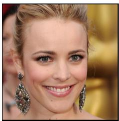

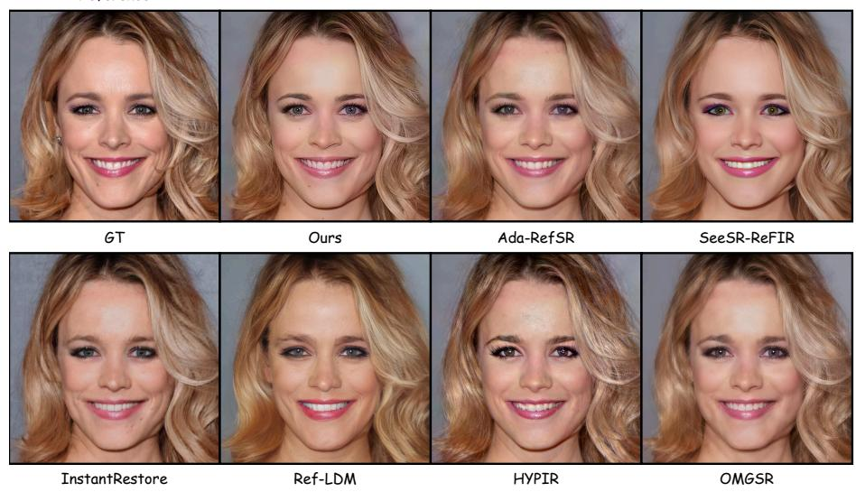  
Figure 11: Qualitative comparison on the Face dataset. Please zoom in for more details.


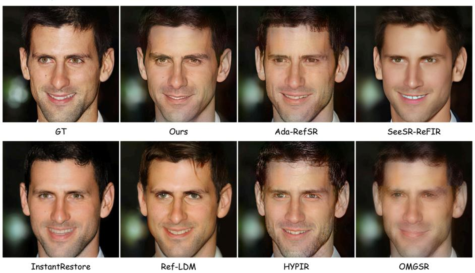  
Figure 12: Qualitative comparison on the Face dataset. Please zoom in for more details.

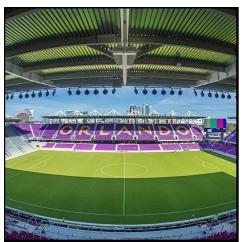

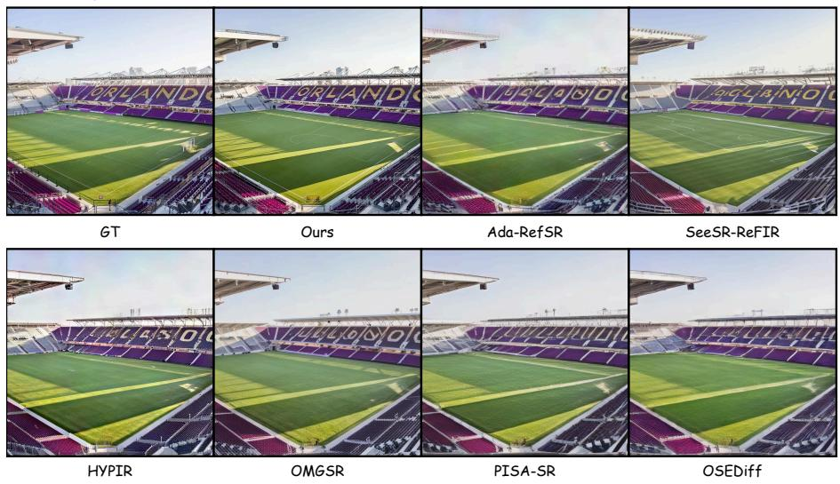  
Figure 13: Qualitative comparison on the WRSR dataset. Please zoom in for more details.

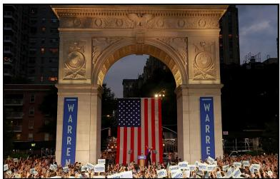

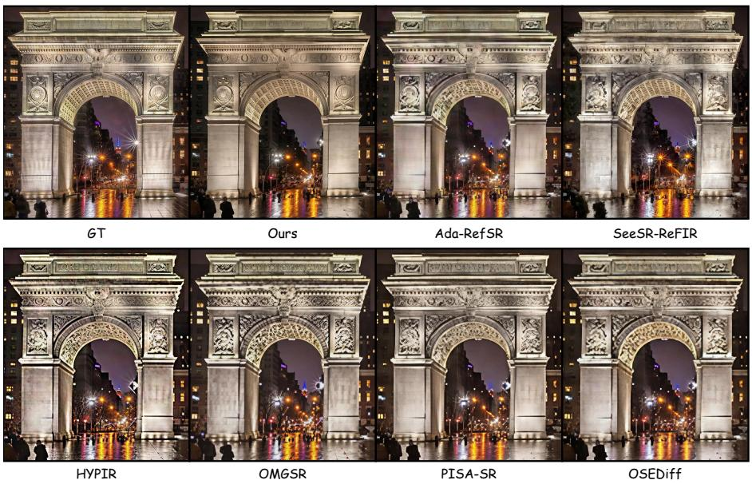  
Figure 14: Qualitative comparison on the WRSR dataset. Please zoom in for more details.

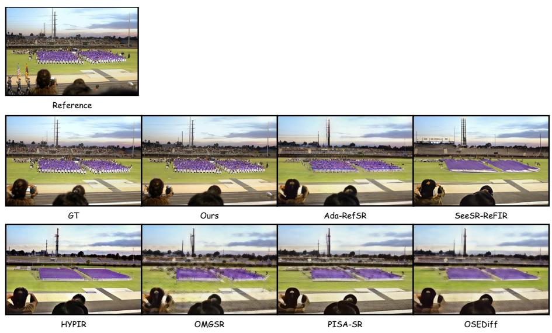  
Figure 15: Qualitative comparison on the CUFED5 dataset. Please zoom in for more details.


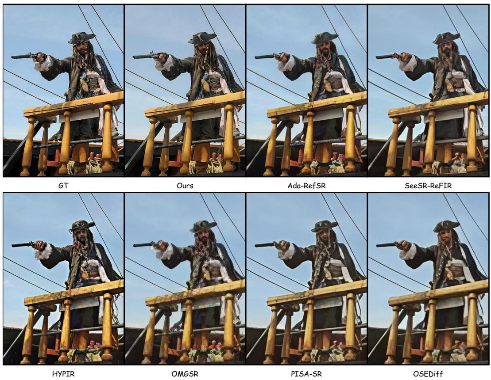  
Figure 16: Qualitative comparison on the CUFED5 dataset. Please zoom in for more details.

## NeurIPS Paper Checklist

## 1. Claims

Question: Do the main claims made in the abstract and introduction accurately reflect the paper’s contributions and scope?

Answer: [Yes]

Justification: The abstract and introduction accurately reflect our paper’s contributions and scope.

Guidelines:

• The answer [N/A] means that the abstract and introduction do not include the claims made in the paper.

• The abstract and/or introduction should clearly state the claims made, including the contributions made in the paper and important assumptions and limitations. A [No] or [N/A] answer to this question will not be perceived well by the reviewers.

• The claims made should match theoretical and experimental results, and reflect how much the results can be expected to generalize to other settings.

• It is fine to include aspirational goals as motivation as long as it is clear that these goals are not attained by the paper.

## 2. Limitations

Question: Does the paper discuss the limitations of the work performed by the authors?

Answer: [Yes]

Justification: The limitations have been included in conclusion section.

Guidelines:

• The answer [N/A] means that the paper has no limitation while the answer [No] means that the paper has limitations, but those are not discussed in the paper.

• The authors are encouraged to create a separate “Limitations” section in their paper.

• The paper should point out any strong assumptions and how robust the results are to violations of these assumptions (e.g., independence assumptions, noiseless settings, model well-specification, asymptotic approximations only holding locally). The authors should reflect on how these assumptions might be violated in practice and what the implications would be.

• The authors should reflect on the scope of the claims made, e.g., if the approach was only tested on a few datasets or with a few runs. In general, empirical results often depend on implicit assumptions, which should be articulated.

• The authors should reflect on the factors that influence the performance of the approach. For example, a facial recognition algorithm may perform poorly when image resolution is low or images are taken in low lighting. Or a speech-to-text system might not be used reliably to provide closed captions for online lectures because it fails to handle technical jargon.

• The authors should discuss the computational efficiency of the proposed algorithms and how they scale with dataset size.

• If applicable, the authors should discuss possible limitations of their approach to address problems of privacy and fairness.

• While the authors might fear that complete honesty about limitations might be used by reviewers as grounds for rejection, a worse outcome might be that reviewers discover limitations that aren’t acknowledged in the paper. The authors should use their best judgment and recognize that individual actions in favor of transparency play an important role in developing norms that preserve the integrity of the community. Reviewers will be specifically instructed to not penalize honesty concerning limitations.

## 3. Theory assumptions and proofs

Question: For each theoretical result, does the paper provide the full set of assumptions and a complete (and correct) proof?

Answer: [N/A]

Justification: Our paper does not include theoretical results.

## Guidelines:

• The answer [N/A] means that the paper does not include theoretical results.

• All the theorems, formulas, and proofs in the paper should be numbered and crossreferenced.

• All assumptions should be clearly stated or referenced in the statement of any theorems.

• The proofs can either appear in the main paper or the supplemental material, but if they appear in the supplemental material, the authors are encouraged to provide a short proof sketch to provide intuition.

• Inversely, any informal proof provided in the core of the paper should be complemented by formal proofs provided in appendix or supplemental material.

• Theorems and Lemmas that the proof relies upon should be properly referenced.

## 4. Experimental result reproducibility

Question: Does the paper fully disclose all the information needed to reproduce the main experimental results of the paper to the extent that it affects the main claims and/or conclusions of the paper (regardless of whether the code and data are provided or not)?

Answer: [Yes]

Justification: We have include the implementation details in the Experiments Section and the Supplemental materials.

Guidelines:

• The answer [N/A] means that the paper does not include experiments.

• If the paper includes experiments, a [No] answer to this question will not be perceived well by the reviewers: Making the paper reproducible is important, regardless of whether the code and data are provided or not.

• If the contribution is a dataset and/or model, the authors should describe the steps taken to make their results reproducible or verifiable.

• Depending on the contribution, reproducibility can be accomplished in various ways. For example, if the contribution is a novel architecture, describing the architecture fully might suffice, or if the contribution is a specific model and empirical evaluation, it may be necessary to either make it possible for others to replicate the model with the same dataset, or provide access to the model. In general. releasing code and data is often one good way to accomplish this, but reproducibility can also be provided via detailed instructions for how to replicate the results, access to a hosted model (e.g., in the case of a large language model), releasing of a model checkpoint, or other means that are appropriate to the research performed.

• While NeurIPS does not require releasing code, the conference does require all submissions to provide some reasonable avenue for reproducibility, which may depend on the nature of the contribution. For example

(a) If the contribution is primarily a new algorithm, the paper should make it clear how to reproduce that algorithm.

(b) If the contribution is primarily a new model architecture, the paper should describe the architecture clearly and fully.

(c) If the contribution is a new model (e.g., a large language model), then there should either be a way to access this model for reproducing the results or a way to reproduce the model (e.g., with an open-source dataset or instructions for how to construct the dataset).

(d) We recognize that reproducibility may be tricky in some cases, in which case authors are welcome to describe the particular way they provide for reproducibility. In the case of closed-source models, it may be that access to the model is limited in some way (e.g., to registered users), but it should be possible for other researchers to have some path to reproducing or verifying the results.

## 5. Open access to data and code

Question: Does the paper provide open access to the data and code, with sufficient instructions to faithfully reproduce the main experimental results, as described in supplemental material?

Answer: [No]

Justification: The source code is not currently open-sourced due to policy restrictions.

## Guidelines:

• The answer [N/A] means that paper does not include experiments requiring code.

• Please see the NeurIPS code and data submission guidelines (https://neurips.cc/ public/guides/CodeSubmissionPolicy) for more details.

• While we encourage the release of code and data, we understand that this might not be possible, so [No] is an acceptable answer. Papers cannot be rejected simply for not including code, unless this is central to the contribution (e.g., for a new open-source benchmark).

• The instructions should contain the exact command and environment needed to run to reproduce the results. See the NeurIPS code and data submission guidelines (https: //neurips.cc/public/guides/CodeSubmissionPolicy) for more details.

• The authors should provide instructions on data access and preparation, including how to access the raw data, preprocessed data, intermediate data, and generated data, etc.

• The authors should provide scripts to reproduce all experimental results for the new proposed method and baselines. If only a subset of experiments are reproducible, they should state which ones are omitted from the script and why.

• At submission time, to preserve anonymity, the authors should release anonymized versions (if applicable).

• Providing as much information as possible in supplemental material (appended to the paper) is recommended, but including URLs to data and code is permitted.

## 6. Experimental setting/details

Question: Does the paper specify all the training and test details (e.g., data splits, hyperparameters, how they were chosen, type of optimizer) necessary to understand the results?

Answer: [Yes]

Justification: The training and test details can be found in the Experiments Section and the Supplemental materials.

Guidelines:

• The answer [N/A] means that the paper does not include experiments.

• The experimental setting should be presented in the core of the paper to a level of detail that is necessary to appreciate the results and make sense of them.

• The full details can be provided either with the code, in appendix, or as supplemental material.

## 7. Experiment statistical significance

Question: Does the paper report error bars suitably and correctly defined or other appropriate information about the statistical significance of the experiments?

Answer: [No]

Justification: The error bars are not reported because it would be too computationally expensive.

Guidelines:

• The answer [N/A] means that the paper does not include experiments.

• The authors should answer [Yes] if the results are accompanied by error bars, confidence intervals, or statistical significance tests, at least for the experiments that support the main claims of the paper.

• The factors of variability that the error bars are capturing should be clearly stated (for example, train/test split, initialization, random drawing of some parameter, or overall run with given experimental conditions).

• The method for calculating the error bars should be explained (closed form formula, call to a library function, bootstrap, etc.)

• The assumptions made should be given (e.g., Normally distributed errors).

• It should be clear whether the error bar is the standard deviation or the standard error of the mean.

• It is OK to report 1-sigma error bars, but one should state it. The authors should preferably report a 2-sigma error bar than state that they have a 96% CI, if the hypothesis of Normality of errors is not verified.

• For asymmetric distributions, the authors should be careful not to show in tables or figures symmetric error bars that would yield results that are out of range (e.g., negative error rates).

• If error bars are reported in tables or plots, the authors should explain in the text how they were calculated and reference the corresponding figures or tables in the text.

## 8. Experiments compute resources

Question: For each experiment, does the paper provide sufficient information on the computer resources (type of compute workers, memory, time of execution) needed to reproduce the experiments?

Answer: [Yes]

Justification: The information of used computer resources can be found in the Experiments Section and the Supplemental materials.

Guidelines:

• The answer [N/A] means that the paper does not include experiments.

• The paper should indicate the type of compute workers CPU or GPU, internal cluster, or cloud provider, including relevant memory and storage.

• The paper should provide the amount of compute required for each of the individual experimental runs as well as estimate the total compute.

• The paper should disclose whether the full research project required more compute than the experiments reported in the paper (e.g., preliminary or failed experiments that didn’t make it into the paper).

## 9. Code of ethics

Question: Does the research conducted in the paper conform, in every respect, with the NeurIPS Code of Ethics https://neurips.cc/public/EthicsGuidelines?

Answer: [Yes]

Justification: This work is conducted in accordance with the NeurIPS Code of Ethics.

Guidelines:

• The answer [N/A] means that the authors have not reviewed the NeurIPS Code of Ethics.

• If the authors answer [No], they should explain the special circumstances that require a deviation from the Code of Ethics.

• The authors should make sure to preserve anonymity (e.g., if there is a special consideration due to laws or regulations in their jurisdiction).

## 10. Broader impacts

Question: Does the paper discuss both potential positive societal impacts and negative societal impacts of the work performed?

Answer: [N/A]

Justification: There is no societal impact of the work performed.

Guidelines:

• The answer [N/A] means that there is no societal impact of the work performed.

• If the authors answer [N/A] or [No], they should explain why their work has no societal impact or why the paper does not address societal impact.

• Examples of negative societal impacts include potential malicious or unintended uses (e.g., disinformation, generating fake profiles, surveillance), fairness considerations (e.g., deployment of technologies that could make decisions that unfairly impact specific groups), privacy considerations, and security considerations.

• The conference expects that many papers will be foundational research and not tied to particular applications, let alone deployments. However, if there is a direct path to any negative applications, the authors should point it out. For example, it is legitimate to point out that an improvement in the quality of generative models could be used to generate Deepfakes for disinformation. On the other hand, it is not needed to point out that a generic algorithm for optimizing neural networks could enable people to train models that generate Deepfakes faster.

• The authors should consider possible harms that could arise when the technology is being used as intended and functioning correctly, harms that could arise when the technology is being used as intended but gives incorrect results, and harms following from (intentional or unintentional) misuse of the technology.

• If there are negative societal impacts, the authors could also discuss possible mitigation strategies (e.g., gated release of models, providing defenses in addition to attacks, mechanisms for monitoring misuse, mechanisms to monitor how a system learns from feedback over time, improving the efficiency and accessibility of ML).

## 11. Safeguards

Question: Does the paper describe safeguards that have been put in place for responsible release of data or models that have a high risk for misuse (e.g., pre-trained language models, image generators, or scraped datasets)?

Answer: [N/A]

Justification: The paper poses no any risks.

Guidelines:

• The answer [N/A] means that the paper poses no such risks.

• Released models that have a high risk for misuse or dual-use should be released with necessary safeguards to allow for controlled use of the model, for example by requiring that users adhere to usage guidelines or restrictions to access the model or implementing safety filters.

• Datasets that have been scraped from the Internet could pose safety risks. The authors should describe how they avoided releasing unsafe images.

• We recognize that providing effective safeguards is challenging, and many papers do not require this, but we encourage authors to take this into account and make a best faith effort.

## 12. Licenses for existing assets

Question: Are the creators or original owners of assets (e.g., code, data, models), used in the paper, properly credited and are the license and terms of use explicitly mentioned and properly respected?

Answer: [Yes]

Justification: We properly credited all related works.

Guidelines:

• The answer [N/A] means that the paper does not use existing assets.

• The authors should cite the original paper that produced the code package or dataset.

• The authors should state which version of the asset is used and, if possible, include a URL.

• The name of the license (e.g., CC-BY 4.0) should be included for each asset.

• For scraped data from a particular source (e.g., website), the copyright and terms of service of that source should be provided.

• If assets are released, the license, copyright information, and terms of use in the package should be provided. For popular datasets, paperswithcode.com/datasets has curated licenses for some datasets. Their licensing guide can help determine the license of a dataset.

• For existing datasets that are re-packaged, both the original license and the license of the derived asset (if it has changed) should be provided.

• If this information is not available online, the authors are encouraged to reach out to the asset’s creators.

## 13. New assets

Question: Are new assets introduced in the paper well documented and is the documentation provided alongside the assets?

Answer: [N/A]

Justification: The paper does not release new assets.

Guidelines:

• The answer [N/A] means that the paper does not release new assets.

• Researchers should communicate the details of the dataset/code/model as part of their submissions via structured templates. This includes details about training, license, limitations, etc.

• The paper should discuss whether and how consent was obtained from people whose asset is used.

• At submission time, remember to anonymize your assets (if applicable). You can either create an anonymized URL or include an anonymized zip file.

## 14. Crowdsourcing and research with human subjects

Question: For crowdsourcing experiments and research with human subjects, does the paper include the full text of instructions given to participants and screenshots, if applicable, as well as details about compensation (if any)?

Answer: [N/A]

Justification: The paper does not involve crowdsourcing nor research with human subjects. Guidelines:

• The answer [N/A] means that the paper does not involve crowdsourcing nor research with human subjects.

• Including this information in the supplemental material is fine, but if the main contribution of the paper involves human subjects, then as much detail as possible should be included in the main paper.

• According to the NeurIPS Code of Ethics, workers involved in data collection, curation, or other labor should be paid at least the minimum wage in the country of the data collector.

## 15. Institutional review board (IRB) approvals or equivalent for research with human subjects

Question: Does the paper describe potential risks incurred by study participants, whether such risks were disclosed to the subjects, and whether Institutional Review Board (IRB) approvals (or an equivalent approval/review based on the requirements of your country or institution) were obtained?

Answer: [N/A]

Justification: The paper does not involve crowdsourcing nor research with human subjects. Guidelines:

• The answer [N/A] means that the paper does not involve crowdsourcing nor research with human subjects.

• Depending on the country in which research is conducted, IRB approval (or equivalent) may be required for any human subjects research. If you obtained IRB approval, you should clearly state this in the paper.

• We recognize that the procedures for this may vary significantly between institutions and locations, and we expect authors to adhere to the NeurIPS Code of Ethics and the guidelines for their institution.

• For initial submissions, do not include any information that would break anonymity (if applicable), such as the institution conducting the review.

## 16. Declaration of LLM usage

Question: Does the paper describe the usage of LLMs if it is an important, original, or non-standard component of the core methods in this research? Note that if the LLM is used only for writing, editing, or formatting purposes and does not impact the core methodology, scientific rigor, or originality of the research, declaration is not required.

## Answer: [N/A]

Justification: The core method development in this research does not involve LLMs as any important, original, or non-standard components.

## Guidelines:

• The answer [N/A] means that the core method development in this research does not involve LLMs as any important, original, or non-standard components.

• Please refer to our LLM policy in the NeurIPS handbook for what should or should not be described.